# 2026-10-11 RSI arXiv digest

<!-- PAPER_CARDS_START -->
## Paper cards

Cards follow the digest ranking. Expand [EN] for the full original abstract or [ZH] for its complete Chinese translation. Collapse one and expand the other to switch languages independently for each paper. Open the title or Paper link for the original; detailed analysis follows below.

| Paper | Paper | Paper |
|---|---|---|
| 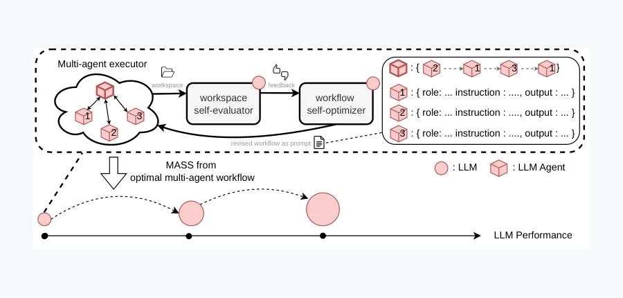 arXiv 2026-10-09 · cs.AI · #1 **[Recursive Self-Improvement through Multi-Agent Self-Supervision](https://arxiv.org/abs/2610.12176)** Hyunin Lee, Jinglue Xu, Jeffrey Seely, Donghyun Lee, Somayeh Sojoudi, Matei Zaharia, Yujin Tang Affiliation: UC Berkeley / Sakana AI ([Source](https://arxiv.org/html/2610.12176)) [Paper](https://arxiv.org/abs/2610.12176) · [Code](https://github.com/SakanaAI/mass) · [Figure source](https://arxiv.org/html/2610.12176v1/ICLRpaper_new11.png) 

[EN] Abstract
Recursive self-improvement (RSI) of a model on non-verifiable tasks, such as open-ended research, faces a supervision bottleneck when its outputs exceed what even human experts can reliably assess, leaving the model itself (optimizee) as the best available optimizer and evaluator. However, a single model instance struggles to critique and improve its own complex reasoning under this homogeneous loop. To address this, we propose Multi-Agent Self-Supervision (MASS), an RSI method that alternates between evolutionary workflow optimization and supervised fine-tuning on self-generated trajectories. Guided by early findings that multi-agent topologies excel at complex reasoning, MASS prompts a single base model to iteratively propose, execute, and self-evaluate multi-agent workflows. Through an evolutionary search constrained by structural guardrails, the model optimizes these computational-graph-like orchestrations, discovering the most effective distinct roles and information routing for a given task. Over two MASS cycles with Qwen3.6-27B, the model achieves 1.2-1.6x higher performance per output tokens on four open-ended public benchmarks. Because the improved model subsequently acts as a better optimizer and evaluator, this alternating framework enables a continuous, recursive bootstrapping of the model's capabilities. Moreover, multi-agent traces are also more training-efficient: a student trained on them outperforms a single-agent student trained on 1.4x more training tokens. These findings suggest that jointly learning orchestration and bounded subagent execution from multi-agent trajectories can provide an effective signal for RSI. <a href="https://arxiv.org/abs/2610.12176">Source</a>

[ZH] Abstract
模型在开放式研究等不可验证任务上的递归自我改进（RSI）面临监督瓶颈：当输出超出人类专家能够可靠评估的范围时，模型自身（被优化者）也成为最佳可用的优化器和评估器。然而，单个模型实例很难在这一同质闭环中批评并改进自身的复杂推理。为此，我们提出多智能体自监督（MASS），在进化式工作流优化与基于自生成轨迹的监督微调之间交替进行。受到多智能体拓扑擅长复杂推理的早期发现启发，MASS 提示同一个基础模型反复提出、执行和自评多智能体工作流。在结构性约束下进行进化搜索，模型优化类似计算图的组织方式，为任务发现最有效的不同角色及信息路由。使用 Qwen3.6-27B 进行两个 MASS 周期后，模型在四个开放式公开基准上的单位输出 token 性能提高至原来的 1.2–1.6 倍。改进后的模型又充当更好的优化器和评估器，使这一交替框架能够递归地自举模型能力。多智能体轨迹的训练效率也更高：基于此类轨迹训练的学生超过了使用 1.4 倍训练 token 的单智能体学生。这些发现表明，从多智能体轨迹中联合学习组织方式和有界子智能体执行，可以为 RSI 提供有效信号。 <a href="https://arxiv.org/abs/2610.12176">Source</a>
 | 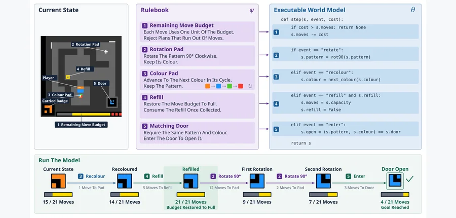 arXiv 2026-10-09 · cs.AI · #2 **[Memento 3: Model-Based Recursive Self-Improvement through Reflective Rulebooks](https://arxiv.org/abs/2610.11794)** Haoyu Zhao, Zhengxu Yu, Zhiyuan He, Meng Fang, Rasul Tutunov, Haitham Bou-Ammar, Weilin Luo, Jun Wang Affiliation: University College London / Huawei Noah’s Ark Lab, UK / University of Liverpool ([Source](https://arxiv.org/html/2610.11794)) [Paper](https://arxiv.org/abs/2610.11794) · [Figure source](https://arxiv.org/html/2610.11794v1/codeasmodel-rulebook-mini.png) 

[EN] Abstract
Learning to act in unfamiliar environments requires agents to infer how the world works and revise that understanding as new evidence arrives. Yet limited observations can support multiple world models that explain past interactions but predict different outcomes in unseen states. We introduce Memento 3, building on the Memento series to enable frozen LLM agents to continually learn explicit world models through external memory. The agent maintains a natural-language rulebook as persistent semantic memory, recording revisable hypotheses about environment dynamics while leaving unknown aspects underspecified. It compiles this rulebook into executable code for prediction and planning. Through a continual loop of observation, reflection, rule revision, compilation, and verification, the agent uses prediction errors to refine both the rulebook and its code. Updated code is accepted only when the LLM judges it faithful to the rulebook and cell-exact replay reproduces the observed transitions. We investigate this process as a model-based route to recursive self-improvement (RSI): the agent autonomously explores the environment, revises its world model, and uses verified updates to guide subsequent interaction and learning, while the underlying LLM remains fixed. A population extension maintains multiple world models in parallel, sharing interaction evidence and using their predictions to guide exploration. On ARC-AGI-3, the single-model agent clears every level of all 25 public games, achieves a mean Relative Human Action Efficiency (RHAE) of 100.0, and uses 44% of the human action count. In an Atari Pong case study, a learned feedback controller wins 21:0 in each of three evaluated episodes with different openings, without further LLM calls. <a href="https://arxiv.org/abs/2610.11794">Source</a>

[ZH] Abstract
在陌生环境中学习行动，要求智能体推断世界如何运作，并随新证据修正认识。但有限观察可能支持多个世界模型：它们都解释过去交互，却对未见状态预测不同。我们提出 Memento 3，在 Memento 系列基础上，让冻结的 LLM 智能体通过外部记忆持续学习显式世界模型。智能体以自然语言规则册作为持久语义记忆，记录可修正的环境动力学假设，并让未知部分保持未规定状态。它把规则册编译为可执行代码，用于预测和规划。通过观察、反思、规则修订、编译与验证的持续循环，智能体利用预测误差同时改进规则册及其代码。只有当 LLM 判断新代码忠实于规则册，而且逐格精确重放能够复现观测转移时，更新才被接纳。我们将其研究为通向递归自我改进（RSI）的模型式路径：智能体自主探索环境、修正世界模型，并用经过验证的更新指导后续交互与学习，而底层 LLM 保持固定。种群扩展同时维护多个世界模型，共享交互证据，并利用各模型预测引导探索。在 ARC-AGI-3 上，单模型智能体通过全部 25 个公开游戏的所有关卡，平均相对人类动作效率（RHAE）为 100.0，使用人类动作数的 44%。在 Atari Pong 案例中，学得的反馈控制器在三个不同开局的评估回合中均以 21:0 获胜，且无需进一步调用 LLM。 <a href="https://arxiv.org/abs/2610.11794">Source</a>
 | 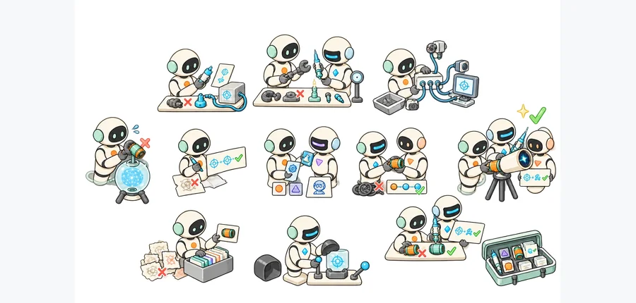 arXiv 2026-10-09 · cs.AI · #3 **[AgentEvolver: System-Wide Self-Evolution Through Task Execution](https://arxiv.org/abs/2610.11613)** Wentao Zhang, Fuchao Yang, Yilei Zhao, Xinrun Wang, Bo An Affiliation: Nanyang Technological University / Singapore Management University ([Source](https://arxiv.org/pdf/2610.11613#page=1)) [Paper](https://arxiv.org/abs/2610.11613) · [Code](https://github.com/DVampire/AgentEvolver) · [Project](https://dvampire.github.io/AgentEvolver/) · [Figure source](https://arxiv.org/pdf/2610.11613) 

[EN] Abstract
An agent can complete a task without improving how it works. Turning task experience into reusable capability requires connecting the changed component to its evaluation and subsequent use. We present AgentEvolver, a system for developing capabilities during task execution while keeping the foundation model fixed. Eight entity families expose reusable operations, methods, agents, control flow, interfaces, and supporting state to revision through a common versioned lifecycle. A shared Runtime coordinates ongoing work, while persistent planning and recoverable context preserve task direction and supporting evidence. We evaluate task outcomes on SWE-bench Pro Public and examine capability changes in six application cases. The team reports an 82.08\% resolution rate with evolution, exceeding its reported baseline without evolution. The cases show retained capabilities entering later website, game, and research work, while also documenting incomplete objectives and an unsuccessful strategy. These findings distinguish improvement in a reusable component from success on the final task. AgentEvolver provides a concrete basis for studying capability accumulation through execution; independent-task transfer and total development cost remain open questions. <a href="https://arxiv.org/abs/2610.11613">Source</a>

[ZH] Abstract
智能体可以完成任务，却没有改善自己的工作方式。要把任务经验转化为可复用能力，必须把发生变化的组件与其评估及后续使用连接起来。我们提出 AgentEvolver，在保持基础模型固定的同时于任务执行中发展能力。八类实体通过统一的版本化生命周期，使可复用操作、方法、智能体、控制流、接口及支持状态能够被修订。共享 Runtime 协调正在进行的工作，持久规划和可恢复上下文保留任务方向及支撑证据。我们在 SWE-bench Pro Public 上评估任务结果，并在六个应用案例中检查能力变化。团队报告启用进化时的解决率为 82.08%，高于其报告的未启用进化基线。案例展示保留下来的能力如何进入后续网站、游戏和研究工作，也记录了未完成的目标及一种失败策略。这些发现区分了可复用组件的改进与最终任务的成功。AgentEvolver 为研究执行过程中的能力积累提供了具体基础；跨独立任务迁移及总开发成本仍是开放问题。 <a href="https://arxiv.org/abs/2610.11613">Source</a>
 |
| 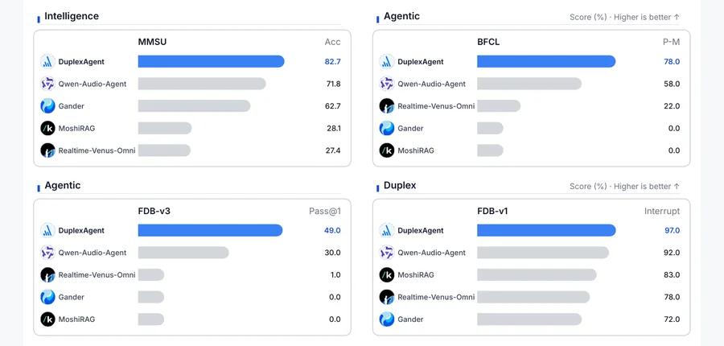 arXiv 2026-10-09 · cs.AI · #4 **[DuplexAgent-RSI: Recursive Harness Improvement for Full-Duplex Voice Agent Collaboration](https://arxiv.org/abs/2610.11299)** Yingda Shen, Yuxiang Wang, Kunyu Feng, Qinke Ni, Jiaqi Li, Minghao Hsu, Junan Zhang, Dekun Chen, Yutong Bian, Zhizheng Wu Affiliation: CUHK Shenzhen / Amphion Technology ([Source](https://arxiv.org/html/2610.11299)) [Paper](https://arxiv.org/abs/2610.11299) · [Project](https://amphionteam.github.io/DuplexAgent-RSI-Demo/) · [Figure source](https://arxiv.org/html/2610.11299v1/leaderboard.png) 

[EN] Abstract
Voice agents are converging on a collaboration pattern: a full-duplex interaction model stays on the live channel as the entry to the conversation, while search, reasoning, and coding are handled through asynchronous delegation. A duplex model supports continuous listening and speaking, but complex reasoning and tool use may exceed its capabilities. A coding agent can plan and execute extended tasks, but its sequential interface is a poor fit for live conversation. Combining them requires a harness that coordinates task acceptance, progress, cancellation, replacement, and result delivery while keeping the conversation responsive. Existing harnesses often rely on coupled heuristics, making them difficult to improve systematically from evidence. We present DuplexAgent, a full-duplex collaboration system whose harness expresses this workflow as six editable modules, and Duplex-Harness-RSI, a closed loop that revises them from interaction traces. A simulator automatically generates timed test conversations, runs the system, and produces failure traces that identify the collaboration modules requiring repair. Reasoning LLMs and coding agents in the delegation pool also serve the improvement loop: the Exam Planner selects the next tests from observed weaknesses and the repair archive, and the Harness Editor proposes targeted module changes. The capabilities that serve the user thus also improve the system's coordination. Experiments on intelligence, agentic, and duplex benchmarks show that DuplexAgent combines continuous interaction with difficult reasoning and complex task execution, achieving stronger spoken-knowledge and executable-tool scores than the compared delegated systems while maintaining strong interruption response. A harness ablation further shows that this modular, verifiable loop outperforms the initial harness and repeated editing that lacks its diagnosis and repair archive. <a href="https://arxiv.org/abs/2610.11299">Source</a>

[ZH] Abstract
语音智能体正在形成一种协作模式：全双工交互模型持续留在实时通道中作为对话入口，而搜索、推理和编程通过异步委派完成。双工模型支持持续聆听和说话，但复杂推理及工具使用可能超出其能力；编程智能体能够规划并执行长任务，但顺序式接口不适合实时对话。结合二者，需要运行框架协调任务接收、进度、取消、替换和结果交付，同时保持对话响应。现有框架往往依赖相互耦合的启发式规则，难以根据证据系统改进。我们提出 DuplexAgent，将这一工作流表示为六个可编辑模块，并提出依据交互轨迹修订模块的闭环 Duplex-Harness-RSI。模拟器自动生成带时间信息的测试对话、运行系统，并输出定位待修复协作模块的失败轨迹。委派池中的推理 LLM 和编程智能体也服务于改进循环：Exam Planner 根据观察到的弱点及修复档案选择下一批测试，Harness Editor 提出针对性的模块修改。因此，为用户服务的能力也用于改进系统协调。智能、Agent 和双工基准实验表明，DuplexAgent 将持续交互与困难推理、复杂任务执行相结合，相比所比较的委派系统取得更强的口语知识及可执行工具得分，同时保持较强的中断响应。框架消融还表明，这一模块化、可验证闭环优于初始框架，以及缺少诊断和修复档案的反复编辑。 <a href="https://arxiv.org/abs/2610.11299">Source</a>
 | 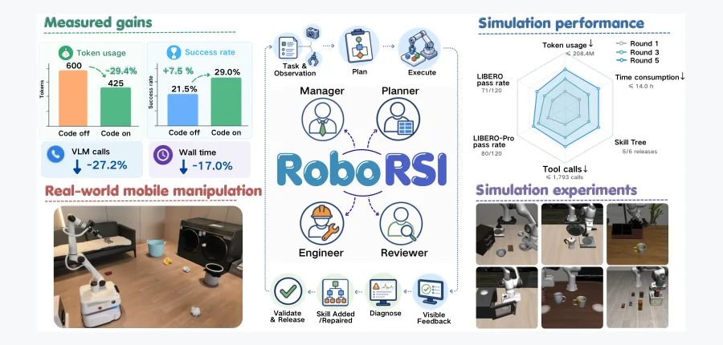 arXiv 2026-10-09 · cs.RO · #5 **[RoboRSI: Stable, efficient, and reusable robot self-evolution in complex real-world environments](https://arxiv.org/abs/2610.12424)** Zimo Wen, Yijin Chen, Yuxuan Cao, Wendi Chen, Yanwen Zou, Wenye Yu, Fuhang Kuang, Han Xue, Jun Lv, Chuan Wen, Cewu Lu Affiliation: Affiliation unconfirmed [Paper](https://arxiv.org/abs/2610.12424) · [Code](https://github.com/nssmd/RoboRSI) · [Figure source](https://arxiv.org/html/2610.12424v1/2027_ICLR_Teaser1.0.png) 

[EN] Abstract
A generalist robot should not only perform diverse tasks but also improve through experience, turning what it learns during execution into capabilities that later tasks can reuse. Robot agents that act through code can already repair programs from execution feedback, yet it remains a central challenge to organize this experience around the task structure that gives it meaning, so that each repair is attributed to the responsible capability, supported by execution evidence, and validated before it is reused. We introduce RoboRSI, a robot self-improvement system built on Top-Down Skill Refinement (TSR). TSR decomposes tasks into compound, atomic, and base skills with scoped responsibilities and explicit input--output contracts, attributes each execution outcome to the responsible branch, and confines revision to that branch. Building upon this structure, a Manager, Planner, Engineer, and Reviewer coordinate planning, execution, diagnosis, and the validated release of new skills, while people steer the process through objectives and corrections; stable skill sequences are further consolidated into reusable compound skills. On a mobile manipulator, RoboRSI develops multi-object household cleanup over 104 rounds. In simulation, it achieves the highest success rate on LIBERO, LIBERO-PRO, LIBERO-Plus, and RoboTwin, exceeding the strongest baseline by 2.7 to 11.0 percentage points. <a href="https://arxiv.org/abs/2610.12424">Source</a>

[ZH] Abstract
通用机器人不仅应能执行多种任务，还应通过经验改进，将执行中学到的内容转化为后续任务可复用的能力。通过代码行动的机器人智能体已经能利用执行反馈修复程序，但如何按照赋予经验意义的任务结构组织这些经验仍是核心挑战：每次修复都应归因到负责的能力，有执行证据支撑，并在复用前得到验证。我们提出 RoboRSI，一个基于自顶向下技能细化（TSR）的机器人自改进系统。TSR 将任务分解为具有限定职责和明确输入输出契约的复合、原子及基础技能，把每次执行结果归因到负责的分支，并将修订限定在该分支。基于此结构，Manager、Planner、Engineer 和 Reviewer 协调规划、执行、诊断及新技能的验证发布；人通过目标与纠正引导过程，稳定的技能序列则进一步固化为可复用复合技能。在移动操作机器人上，RoboRSI 通过 104 轮开发多物体家务清理能力。在模拟中，它在 LIBERO、LIBERO-PRO、LIBERO-Plus 和 RoboTwin 上取得最高成功率，比最强基线高 2.7–11.0 个百分点。 <a href="https://arxiv.org/abs/2610.12424">Source</a>
 | 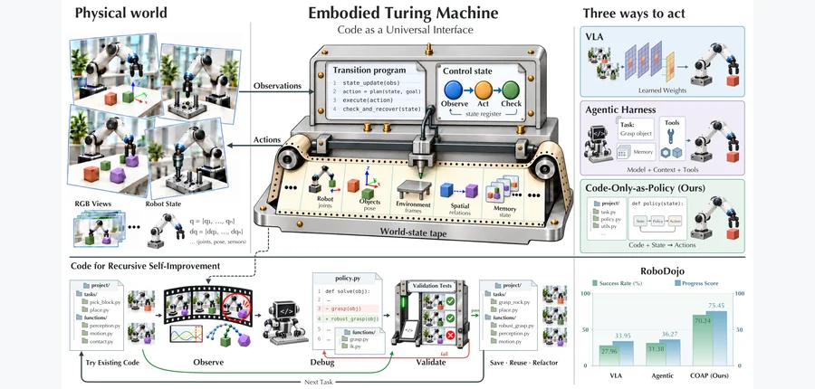 arXiv 2026-10-09 · cs.RO · #6 **[Embodied Turing Machines: Stateful Code for Robot Recursive Self-Improvement](https://arxiv.org/abs/2610.12369)** Kairui Hu, Siyuan Hu, Fangzhou Hong, Zhaoxi Chen, Ziwei Liu Affiliation: Nanyang Technological University / Ropedia ([Source](https://arxiv.org/html/2610.12369)) [Paper](https://arxiv.org/abs/2610.12369) · [Figure source](https://arxiv.org/html/2610.12369v1/teaser_code_only_agentic_1008.png) 

[EN] Abstract
Most robot policies keep a model in the control loop: a VLA maps observations to actions, and an Agent Harness, such as Agent-as-Policy or Harness VLA queries a VLM for decision making at run time. We propose a different view: the embodied world is an Embodied Turing Machine, whose tape is the robot and environment state and rules are the policy. If this state can be represented accurately, the decision making can be written entirely in code. We therefore propose Code-Only-as-Policy (COAP): code measures and tracks the robot, environment, and task state from camera images and proprioception, and makes every decision from it. The same code applies across episodes, and different tasks share one library without a VLM or VLA in the loop. Compared with VLAs and Agent Harnesses, we analyze three advantages of COAP: (i) Explicit State: the state can be stored in code; (ii) Execution: code makes decision making controllable, recovers from failures flexibly, and runs fast and cheaply online; (iii) Extensibility: new tasks reuse, inherit, or extend the shared library, so capabilities can accumulate over tasks. These advantages make COAP a suitable medium for recursive self-improvement (RSI): coding agents develop the library in a closed loop, and each change is explicit and controllable. On RoboDojo's 42 bimanual tasks, the resulting library reaches a success rate of 70.24% without a model at test time. The upper bound of COAP lies in how accurately the state is represented for decision making and how robust the code logic is. We thus propose COAP as a new paradigm for embodied tasks; since it applies across episodes, it can also serve as an efficient data engine for VLAs and Agent Harnesses. <a href="https://arxiv.org/abs/2610.12369">Source</a>

[ZH] Abstract
多数机器人策略让模型处于控制闭环：VLA 将观察映射为动作，Agent-as-Policy 或 Harness VLA 等运行框架在执行时查询 VLM 作决策。我们提出另一种观点：具身世界是一台具身图灵机，其纸带是机器人和环境状态，规则是策略。如果能准确表示这些状态，决策就可以完全写成代码。因此，我们提出 Code-Only-as-Policy（COAP）：代码从相机图像和本体感觉测量并跟踪机器人、环境及任务状态，所有决策均以此为依据。同一份代码跨回合使用，不同任务共享一个库，闭环内不需要 VLM 或 VLA。相对于 VLA 与 Agent 运行框架，我们分析了三项优势：（i）显式状态：状态可存储于代码中；（ii）执行：代码使决策可控、能够灵活恢复失败，并且在线运行快速、廉价；（iii）可扩展性：新任务复用、继承或扩展共享库，使能力跨任务积累。这些优势使 COAP 成为递归自我改进（RSI）的合适载体：编程智能体以闭环开发该库，每次修改都显式且可控。在 RoboDojo 的 42 个双臂任务中，所得代码库在测试时无模型的情况下达到 70.24% 成功率。COAP 的上限取决于用于决策的状态表示有多准确，以及代码逻辑有多稳健。因此，我们将 COAP 提议为具身任务的新范式；由于它可跨回合使用，也能成为 VLA 和 Agent 运行框架的高效数据引擎。 <a href="https://arxiv.org/abs/2610.12369">Source</a>
 |
| 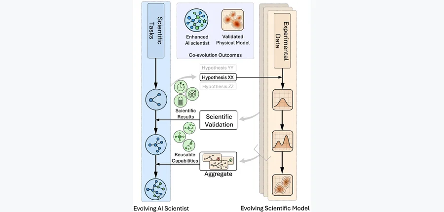 arXiv 2026-10-09 · cs.AI · #7 **[EvoSim: Learning to Model, Modeling to Learn](https://arxiv.org/abs/2610.11344)** Yun-Wei Song, Jinkai Tao, Jun-Dong Zhang, Rui Zhang, Yi-Min Wu, Qiang Zhang Affiliation: Tsinghua University / Beijing Tsingyu Technology / University of Hong Kong / Beijing Huairou Laboratory / AI Solid-State Battery Innovation Center ([Source](https://arxiv.org/html/2610.11344)) [Paper](https://arxiv.org/abs/2610.11344) · [Figure source](https://arxiv.org/html/2610.11344v1/figs/fig1_overview.png) 

[EN] Abstract
Physics-based models connect scientific explanation with quantitative prediction. Constructing them requires selecting physical processes, defining states and governing equations, specifying couplings, and identifying parameters from experiments. Existing AI systems remain limited in making these model structure decisions autonomously. We introduce EvoSim, a self-evolving AI scientist for physical modeling. It uses experimental discrepancies to drive mechanism and equation revisions and held-out experimental data to test physical plausibility. Exploration traces make updates to knowledge, skills, and multi-agent orchestration. This co-evolution improves physics-based models and EvoSim's ability to select mechanisms, diagnose failures, and coordinate research. We evaluate EvoSim on two industrial battery modeling tasks. It predicts lithium-metal-plating onset from 25 to 45 degrees Celsius and 2 C to 6 C with a mean absolute error of 1.79% in state of charge. Dynamic voltage prediction under vehicle driving conditions achieves a root mean square error of 7.62 mV, surpassing the reported accuracy of models developed by human experts. Self-evolution reduces model and physics errors by approximately 36% relative to baseline, demonstrating improved scientific modeling capability. EvoSim turns experimental observations into validated models and cumulative research expertise. <a href="https://arxiv.org/abs/2610.11344">Source</a>

[ZH] Abstract
基于物理的模型将科学解释与定量预测连接起来。构建这类模型需要选择物理过程、定义状态和控制方程、规定耦合关系，并通过实验辨识参数。现有 AI 系统在自主作出这些模型结构决策方面仍有局限。我们提出 EvoSim，一个面向物理建模的自进化 AI 科学家。它利用实验偏差驱动物理机制与方程的修订，并利用留出实验数据检验物理合理性。探索轨迹促成知识、技能及多智能体组织方式的更新。这种共同进化既改进物理模型，也提升 EvoSim 选择机制、诊断失败和协调研究的能力。我们在两项工业电池建模任务上评估 EvoSim。在 25–45 摄氏度、2 C–6 C 条件下，它预测金属锂析出起始时刻的荷电状态，平均绝对误差为 1.79%。在车辆行驶工况下，动态电压预测的均方根误差为 7.62 mV，超过论文所报告的人类专家模型准确性。相对基线，自进化使模型误差和物理误差下降约 36%，表明科学建模能力得到改进。EvoSim 将实验观察转化为经过验证的模型及不断积累的研究经验。 <a href="https://arxiv.org/abs/2610.11344">Source</a>
 | 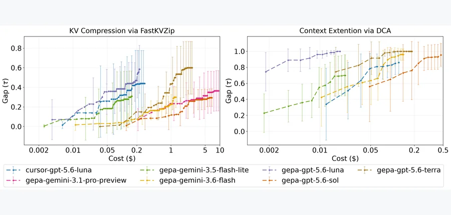 arXiv 2026-10-09 · cs.LG · #8 **[Generative Adversarial Loops](https://arxiv.org/abs/2610.11458)** Kislay Aditya Oj, Nidhi Jain, Sri Surya Varma Datla, Priyanka Jayaswal, Kumar Krishna Agrawal, Aditya Desai Affiliation: IIT Bombay / UC Berkeley / Independent researchers ([Source](https://arxiv.org/pdf/2610.11458#page=1)) [Paper](https://arxiv.org/abs/2610.11458) · [Figure source](https://arxiv.org/html/2610.11458v1/images/kvpress_dca_side_by_side_cost_vs_gap.png) 

[EN] Abstract
AI research progress can be viewed as the interaction between two processes: benchmark creation and method discovery. Historically, both were driven by human intelligence. However, recent advances in AI have accelerated automated method discovery, while automated benchmark creation has received comparatively less attention. To enable self-advancing systems, we propose Generative Adversarial Loop (GAL), a generator-discriminator framework alternating between two agentic searches: (1) a discriminator that generates adversarial data to expose weaknesses in current systems, and (2) a generator that discovers algorithms to overcome them. We apply this framework to approximation algorithms for efficient inference. Unlike existing auto research systems, which primarily focus on algorithm discovery, GAL introduces a discriminator agent that automates goalpost setting by continually searching for weaknesses in the current algorithm. We demonstrate adversarial data generation across four tasks: KV compression, sparse video generation, sparse attention, and context extension, where the discriminator identifies weaknesses in state of the art techniques. We further show that GAL enables autonomous improvement, with newly discovered algorithms improving not only on adversarially generated data, but also on established benchmarks. Specifically, GAL improves CompactorPress on KV compression with Qwen3-4B at 4x, raising performance on the discriminator dataset from 0.35 to 0.97, while also outperforming RULER-HARD (+0.77 pts). For context extension, GAL boosts Dual Chunk Attention from 0.20 to 0.90 on the discriminator dataset, while yielding gains on standard benchmarks(ScienceFiction (+6 pts) and PG19 32K (-0.33 PPL)). GAL thus provides a path toward autonomous goalpost setting and algorithmic improvement, where AI systems continually discover their own weaknesses and develop methods to overcome them. <a href="https://arxiv.org/abs/2610.11458">Source</a>

[ZH] Abstract
AI 研究进展可以看作两个过程的相互作用：基准创建与方法发现。历史上二者都由人类智能推动。近期 AI 进展加速了自动方法发现，但自动基准创建受到的关注相对较少。为实现能够自行推进的系统，我们提出生成对抗循环（GAL），在两种智能体搜索之间交替：（1）判别器生成对抗数据，暴露当前系统的弱点；（2）生成器发现克服这些弱点的算法。我们将该框架应用于高效推理的近似算法。与主要关注算法发现的现有自动研究系统不同，GAL 引入判别器智能体，通过持续寻找当前算法的弱点，自动设定新的改进目标。我们在 KV 压缩、稀疏视频生成、稀疏注意力和上下文扩展四项任务上展示对抗数据生成，判别器能够识别先进技术的弱点。我们进一步表明，GAL 能够实现自主改进：新发现算法不仅在对抗生成数据上进步，也在既有基准上进步。具体而言，在 Qwen3-4B 的 4 倍 KV 压缩中，GAL 改进 CompactorPress，使判别器数据集上的表现从 0.35 提高到 0.97，并在 RULER-HARD 上提高 0.77 点。在上下文扩展中，GAL 将 Dual Chunk Attention 在判别器数据集上的表现从 0.20 提高到 0.90，同时改善标准基准表现：ScienceFiction 提高 6 点，PG19 32K 的困惑度降低 0.33。GAL 因此提供了一条自主设定目标和改进算法的路径，让 AI 系统持续发现自身弱点并开发克服弱点的方法。 <a href="https://arxiv.org/abs/2610.11458">Source</a>
 | 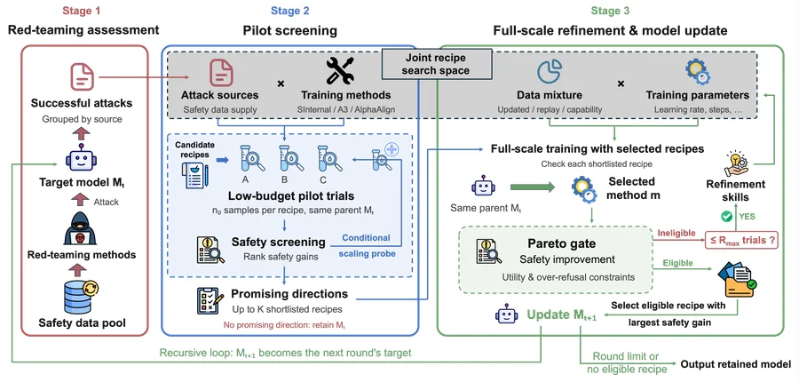 arXiv 2026-10-09 · cs.CR · #9 **[ReSI: Recursive Safety Improvement toward Resistant and Resilient AI](https://arxiv.org/abs/2610.12233)** Jingnan Zheng, Dongcheng Zhang, Yi Zhang, Ming Zhang, Qiaosheng Zhang, Youbang Sun, An Zhang, Xiangnan He, Tat-Seng Chua… Affiliation: Shanghai AI Laboratory / National University of Singapore / Shanghai Jiao Tong University / USTC / Tsinghua University ([Source](https://arxiv.org/html/2610.12233)) [Paper](https://arxiv.org/abs/2610.12233) · [Code](https://github.com/AI45Lab/ReSI) · [Figure source](https://arxiv.org/html/2610.12233v1/imgs/framework_v4.png) 

[EN] Abstract
Recursive self-improvement, the participation of AI systems in improving their own capabilities, is beginning to move from theoretical prospect to practice, posing both challenges and opportunities for safety alignment. Models evolve through frequent updates, and their safety alignment requires continual adaptation to each new checkpoint. Meanwhile, with evolving red-teaming methods exposing new vulnerabilities, safety improvement for each checkpoint needs to mitigate exposed vulnerabilities and generalize to risks not yet revealed. Following R$^2$AI, we term these goals resistance to known threats and resilience to unforeseen risks. Recursive self-improvement, in turn, inspires an approach to both goals: safety alignment could likewise advance through successive rounds of evaluation and update. We therefore introduce ReSI, a recursive safety improvement framework that implements this approach through automated research. In each round, ReSI applies diverse red-teaming methods to identify vulnerabilities in the current target model, develops training recipes, and promotes the update with the largest safety gain among those passing a Pareto gate on capability retention as the next target model. Across four dense and mixture-of-experts models, ReSI matches or exceeds evaluated frontier models on in-distribution and out-of-distribution safety benchmarks, and outperforms alignment baselines on nearly all safety evaluations while largely preserving general capabilities. In particular, ReSI reduces the mean X-Teaming attack success rate across the four models from 86.01% to 31.45%, well below GPT-5.6-Luna's leading frontier result of 56.69%, indicating stronger resilience to attacks unseen during training. These findings support recursive safety improvement as a practical path toward resistant and resilient AI. <a href="https://arxiv.org/abs/2610.12233">Source</a>

[ZH] Abstract
递归自我改进，即 AI 系统参与改进自身能力，正开始从理论前景走向实践，为安全对齐同时带来挑战与机遇。模型通过频繁更新演化，安全对齐需要持续适应每个新检查点。同时，不断发展的红队方法暴露新漏洞，每个检查点的安全改进既要缓解已暴露漏洞，也要泛化到尚未揭示的风险。沿用 R²AI，我们将这两个目标称为对已知威胁的抵抗力和对未知风险的韧性。递归自我改进也启发了同时实现这两个目标的方法：安全对齐可以通过连续的评估与更新轮次推进。因此，我们提出 ReSI，一个通过自动研究实现此思路的递归安全改进框架。每轮中，ReSI 使用多种红队方法识别当前目标模型的漏洞，开发训练配方，并在通过能力保持 Pareto 门槛的更新中，选择安全增益最大的一个作为下一轮目标模型。在四个稠密及混合专家模型上，ReSI 在分布内和分布外安全基准上达到或超过所评估的前沿模型，在几乎所有安全评估上超过对齐基线，同时大体保留通用能力。尤其是，ReSI 将四个模型在 X-Teaming 下的平均攻击成功率从 86.01% 降至 31.45%，明显低于 GPT-5.6-Luna 在前沿模型中领先的 56.69%，显示出对训练时未见攻击更强的韧性。这些发现支持将递归安全改进作为通向具备抵抗力和韧性的 AI 的实用途径。 <a href="https://arxiv.org/abs/2610.12233">Source</a>
 |
| 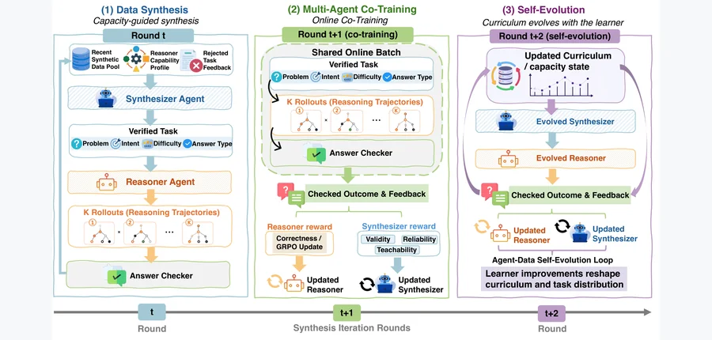 arXiv 2026-10-09 · cs.AI · #10 **[SynCo: Data Synthesis Co-Training for Self-Evolving LLMs via Multi-Agent Reinforcement Learning](https://arxiv.org/abs/2610.11345)** Wei Yang, Shawn Li, Yuehan Qin, Yawei Wang, Mingxi Wang, Shixuan Li, Tiankai Yang, Jiate Li, Jesse Thomason, Xuezhe Ma, Yu… Affiliation: University of Southern California / George Washington University / Georgia Institute of Technology ([Source](https://arxiv.org/html/2610.11345)) [Paper](https://arxiv.org/abs/2610.11345) · [Code](https://github.com/weiyang930/SynCo) · [Figure source](https://arxiv.org/html/2610.11345v1/Picture1.png) 

[EN] Abstract
Self-evolving LLM agents promise to improve autonomously through continual interaction and learning, reducing their dependence on manually curated supervision. Realizing this promise requires not only updating the agent, but also evolving its training experience as its capabilities change. However, most existing pipelines rely on static datasets or separately updated synthesis models, causing previously useful tasks to become trivial while overly difficult tasks remain uninformative. This growing mismatch between agent capability and training experience limits sustained self-improvement. To address this problem, we propose SynCo, an agentic data synthesis co-training framework for self-evolving LLMs based on multi-agent reinforcement learning. SynCo jointly optimizes two independently parameterized agents: a Synthesizer that constructs training tasks from the Reasoner's evolving capability state, and a Reasoner that learns from the resulting experience. Each synthesized task induces multiple Reasoner rollouts whose outcomes provide complementary rewards to both agents. Correctness feedback improves the Reasoner, while task quality, answer reliability, and outcome-grounded teachability guide the Synthesizer. Their updates are fed back into subsequent synthesis rounds, allowing the task-solving policy and its training distribution to evolve together. Extensive experiments across eight mathematical reasoning benchmarks demonstrate that SynCo substantially outperforms a broad range of existing synthetic-data methods and controlled baselines, achieving the strongest overall performance while deriving most of its gains from previously unsolved problems. <a href="https://arxiv.org/abs/2610.11345">Source</a>

[ZH] Abstract
自进化 LLM 智能体有望通过持续交互与学习自主改进，减少对人工整理监督的依赖。实现这一前景，不仅要更新智能体，还要随着其能力变化演化训练经验。然而，多数现有流程依赖静态数据集或单独更新的合成模型，导致过去有用的任务变得简单，而过难任务仍不能提供信息。智能体能力与训练经验间不断扩大的失配限制了持续自改进。为此，我们提出 SynCo，一个基于多智能体强化学习、面向自进化 LLM 的智能体式数据合成协同训练框架。SynCo 联合优化两个参数彼此独立的智能体：Synthesizer 根据 Reasoner 不断变化的能力状态构造训练任务，Reasoner 则从所得经验中学习。每个合成任务产生多个 Reasoner 轨迹，其结果为两个智能体提供互补奖励。正确性反馈改进 Reasoner，而任务质量、答案可靠性和基于结果的可教性指导 Synthesizer。二者的更新反馈到后续合成轮次，使解题策略及其训练分布共同演化。在八个数学推理基准上的广泛实验表明，SynCo 明显超过多种现有合成数据方法和受控基线，取得最佳整体表现，大部分收益来自先前未能解决的问题。 <a href="https://arxiv.org/abs/2610.11345">Source</a>
 | 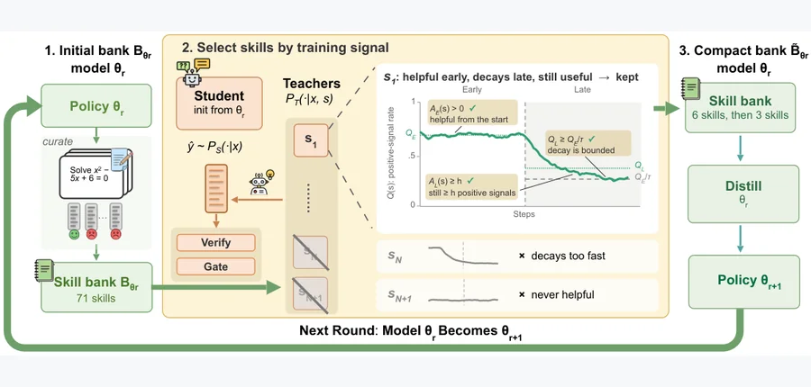 arXiv 2026-10-09 · cs.CL · #11 **[Which Skill to Distill? SGUID: Selecting a Compact Skill Bank for Model-Skill Co-Evolution](https://arxiv.org/abs/2610.12367)** Yuhan Liu, Xiyao Ma, Zhongkai Sun, Xu Han, Chengyuan Ma, Benjamin Z. Yao, Chenlei Guo Affiliation: New York University / Amazon ([Source](https://arxiv.org/html/2610.12367)) [Paper](https://arxiv.org/abs/2610.12367) · [Figure source](https://arxiv.org/html/2610.12367v1/sguid_overview_cropped.png) 

[EN] Abstract
Skills, reusable procedural guidance added at inference, can substantially improve LLM downstream performance (Li et al., 2026). Prior work retrieves skills from a bank by semantic relevance, then uses them as inference-time patches or for model distillation. The individual utility of each skill, however, is largely neglected. We first show that, in on-policy distillation where skill-conditioned policies serve as teachers, fewer than 25% of retrieved skills provide useful distillation signals. We then propose SGUID, a method for selecting a compact subset of skills for distillation. SGUID retains a skill only if it consistently yields effective learning signals during training. The selected skills are then distilled to produce a better model. Our results show that not all skills are worth distilling. Across four models from the Olmo and Qwen families, distilling 6 selected skills matches or exceeds full-bank distillation in mean avg@12 on three of the four models, and on all four after a second round that distills 3 newly selected skills, while the full banks are up to 11x larger. Importantly, SGUID supports stable model-skill co-evolution: after a distillation round, a new candidate bank is curated from the updated model's rollouts, and SGUID selects which skills to internalize next. In the second round, this loop selects 3 new skills and improves Qwen3-8B from 64.3% to 66.3%. The selection step is essential for stability: on Qwen3-4B, naively updating the model with unfiltered skills degrades performance, including a 0.3 percentage point drop on HMMT25, whereas SGUID improves HMMT25 by 0.5 points after the first round and 1.1 points after the second. These results identify skill selection as the key mechanism for stable model-skill co-evolution. <a href="https://arxiv.org/abs/2610.12367">Source</a>

[ZH] Abstract
技能是在推理时添加的可复用过程指导，能够显著改善 LLM 的下游表现（Li et al., 2026）。先前工作按语义相关性从技能库检索技能，将其作为推理补丁或用于模型蒸馏，却大多忽略每项技能的独立效用。我们首先发现，在以技能条件化策略为教师的 on-policy 蒸馏中，少于 25% 的检索技能提供了有用的蒸馏信号。随后，我们提出 SGUID，选择紧凑的技能子集用于蒸馏。只有技能在训练中持续产生有效学习信号时，SGUID 才保留它，再蒸馏所选技能以得到更好的模型。结果表明，并非所有技能都值得蒸馏。在 Olmo 和 Qwen 系列的四个模型上，蒸馏六项所选技能，在四个模型中的三个上达到或超过完整技能库的平均 avg@12；第二轮蒸馏三项新选技能后，四个模型均达到或超过完整库，而完整库最多大 11 倍。SGUID 还支持稳定的模型—技能共同演化：一轮蒸馏后，从更新模型的轨迹整理新的候选库，再由 SGUID 决定下一轮内化哪些技能。第二轮选择三项新技能，将 Qwen3-8B 从 64.3% 提高到 66.3%。选择步骤对稳定性至关重要：在 Qwen3-4B 上，用未经筛选的技能直接更新模型会降低表现，包括 HMMT25 下降 0.3 个百分点；SGUID 则在首轮和第二轮后分别提高 0.5 与 1.1 点。这些结果将技能选择确定为稳定模型—技能共同演化的关键机制。 <a href="https://arxiv.org/abs/2610.12367">Source</a>
 | 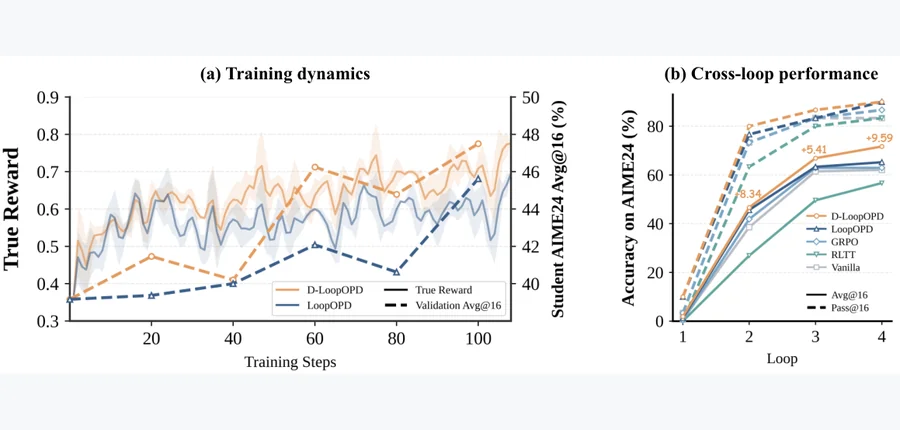 arXiv 2026-10-09 · cs.LG · #12 **[Recurrent Self-Improvement: Dynamic Cross-Loop On-Policy Distillation for Looped Language Models](https://arxiv.org/abs/2610.10623)** Yi Wang, Rui Qian, Yu Li, Haoyang Yao, Wenjie Wang Affiliation: ShanghaiTech University / Fudan University / Southeast University / Peking University ([Source](https://arxiv.org/html/2610.10623)) [Paper](https://arxiv.org/abs/2610.10623) · [Figure source](https://arxiv.org/html/2610.10623v1/training.png) 

[EN] Abstract
Looped Language Models (LoopLMs) offer a parameter efficient approach to scaling reasoning by reusing shared parameters across recurrent computation steps. Despite their promise, effective post-training of LoopLMs remains challenging. Existing approaches either provide reward based supervision that is sparse or costly to extend across loops, or rely on external teachers or privileged information, leading to limited teacher availability or teacher-student context mismatch. To address these limitations, we introduce LoopOPD, a cross-loop on-policy distillation framework that uses additional recurrent computation within a LoopLM as its own source of supervision. LoopOPD uses a frozen terminal loop policy as a compute privileged teacher for an intermediate loop student on student generated rollouts, providing dense supervision without an external teacher or privileged information. We further propose Dynamic LoopOPD (D-LoopOPD), which continually refreshes the terminal loop teacher as the shared model parameters are updated, enabling recurrent self-improvement. We characterize how distillation updates propagate across loop depths and derive sufficient conditions under which a single update yields simultaneous local improvement at both loop depths. Experiments on Ouro-Thinking models show that LoopOPD improves mathematical reasoning, while D-LoopOPD yields further gains through dynamic teacher updates. Despite being trained only on mathematical data, the resulting models also improve on general reasoning and code generation benchmarks, demonstrating that recurrent computation can serve as an effective source of supervision for LoopLMs. Our code and model checkpoints will be released upon acceptance. <a href="https://arxiv.org/abs/2610.10623">Source</a>

[ZH] Abstract
循环语言模型（LoopLM）通过在重复计算步骤中复用共享参数，提供了一种参数高效的推理扩展方式。但其有效后训练仍有挑战。现有方法要么依靠跨循环稀疏或扩展成本高的奖励监督，要么依赖外部教师或特权信息，造成教师可用性受限或师生上下文失配。为此，我们提出跨循环 on-policy 蒸馏框架 LoopOPD，把同一 LoopLM 内额外的循环计算作为自身监督来源。LoopOPD 在学生生成的轨迹上，使用冻结的末端循环策略作为拥有更多计算资源的教师，监督中间循环学生，无需外部教师或特权信息即可提供稠密监督。我们进一步提出 Dynamic LoopOPD（D-LoopOPD），随着共享模型参数更新持续刷新末端循环教师，实现循环式自改进。我们刻画蒸馏更新如何跨循环深度传播，并推导出一次更新能在两个循环深度上同时产生局部改进的充分条件。在 Ouro-Thinking 模型上的实验表明，LoopOPD 改善数学推理，D-LoopOPD 通过动态教师更新获得进一步收益。虽然只在数学数据上训练，所得模型也在通用推理和代码生成基准上进步，说明循环计算可以成为 LoopLM 的有效监督来源。代码与模型检查点将在论文被接收后发布。 <a href="https://arxiv.org/abs/2610.10623">Source</a>
 |
| 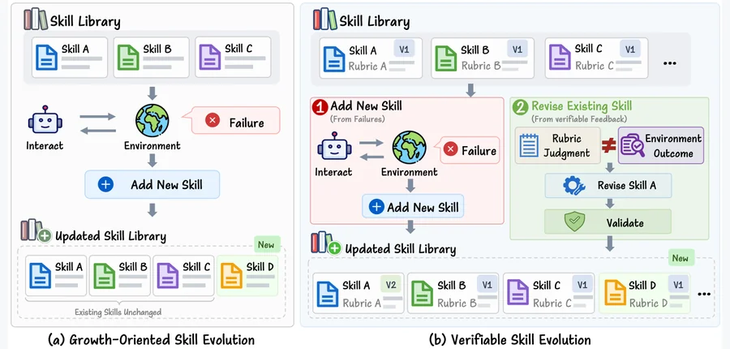 arXiv 2026-10-09 · cs.CV · #13 **[Skill-V: Verifiable Self-Evolving Skill Library for Interactive Agents](https://arxiv.org/abs/2610.11781)** Jie Ma, Zhipeng Qian, Yufei Ma, Zihan Liang, Jiayi Ji, Qingpeng Cai, Ben Chen, Peng Jiang, Xiaoshuai Sun Affiliation: Xiamen University / Kuaishou Technology / Nankai University ([Source](https://arxiv.org/html/2610.11781)) [Paper](https://arxiv.org/abs/2610.11781) · [Figure source](https://arxiv.org/html/2610.11781v1/compare_v2.png) 

[EN] Abstract
Interactive agents can turn experience into reusable skills, yet existing self-evolving skill libraries primarily improve by accumulating new knowledge. Failures may lead to new skills, while previously stored skills are less often revisited as new evidence arrives. However, growth alone does not ensure reliability, as a retrieved skill may be inapplicable under the current task conditions, and an existing skill may encode a mis-specified operational boundary. Reliable skill evolution therefore requires not only adding knowledge, but also testing and revising what is already stored. We introduce Skill-V, a verifiable self-evolving skill library. To make stored knowledge testable, we propose representing skills as versioned, falsifiable contracts that link semantic intent to observable behavioral criteria. We use environment outcomes to drive library evolution. Specifically, task failures motivate skill addition, while disagreements between contract evaluations and task outcomes guide revisions to existing skill boundaries. To validate these revisions, we require them to preserve protected semantic constraints and satisfy non-regression criteria for rubric-outcome metrics on historical replay evidence. Finally, we employ an applicability-aware filter to exclude candidates judged confidently inapplicable to the current task. Across ALFWorld and WebShop, Skill-V achieves success rates of 95.3% and 85.9%, respectively, while maintaining a more compact skill library than growth-oriented baselines. Applicability-aware filtering reduces incorrect skill invocations, and outcome-grounded revisions correct mis-specified skill boundaries without degrading performance on previously observed evidence. These results show that reliable skill evolution requires more than accumulating experience: the library must learn which knowledge to retain, when to revise it, and when it should be applied. <a href="https://arxiv.org/abs/2610.11781">Source</a>

[ZH] Abstract
交互智能体能够把经验转化为可复用技能，但现有自进化技能库主要通过积累新知识改进。失败会导致新技能产生，已经存储的技能却较少随着新证据被重新审视。然而，增长本身不能保证可靠性：检索出的技能可能不适用于当前条件，已有技能也可能编码了错误的操作边界。可靠技能进化因此不仅需要增加知识，还要测试和修订已存内容。我们提出可验证的自进化技能库 Skill-V。为使存储知识可测试，我们用版本化、可证伪的契约表示技能，把语义意图连接到可观测行为标准，并用环境结果驱动技能库演化。具体而言，任务失败推动技能添加，契约评估与任务结果之间的不一致指导已有技能边界修订。为验证修订，我们要求其保持受保护的语义约束，并在历史重放证据上满足评价准则—结果指标的非退化要求。最后，我们采用适用性感知过滤器，剔除被高置信判断为不适用于当前任务的候选技能。在 ALFWorld 和 WebShop 上，Skill-V 的成功率分别达到 95.3% 和 85.9%，同时比面向增长的基线保持更紧凑的技能库。适用性过滤减少错误技能调用，基于结果的修订能纠正错误技能边界，同时不降低此前观察证据上的表现。这些结果表明，可靠技能进化需要超越经验积累：技能库必须学习保留什么知识、何时修订，以及何时应用。 <a href="https://arxiv.org/abs/2610.11781">Source</a>
 | 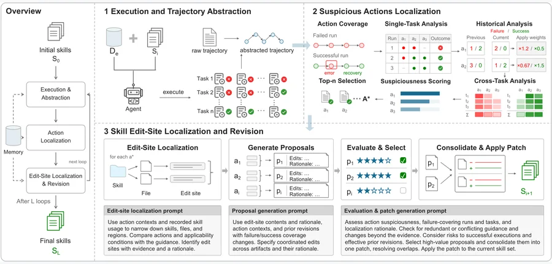 arXiv 2026-10-09 · cs.SE · #14 **[Trajectory-Guided Fault Localization for Agent Skill Evolution](https://arxiv.org/abs/2610.11858)** Yu Ge, Linna Xie, Zhong Li, Yu Pei, Tian Zhang Affiliation: Nanjing University / Hong Kong Polytechnic University ([Source](https://arxiv.org/html/2610.11858)) [Paper](https://arxiv.org/abs/2610.11858) · [Figure source](https://arxiv.org/html/2610.11858v1/overview-final.png) 

[EN] Abstract
Agent skills provide reusable guidance for code agents, but incomplete or unsuitable guidance can impair task execution. To reduce the manual effort of skill refinement, recent approaches use LLMs to generate revisions from execution feedback. However, grounding these revisions in explicit behavioral evidence remains challenging. To address this gap, we propose SkillMorph, a skill-evolution approach based on trajectory-guided fault localization in agent skills. Its core idea is to link execution evidence to specific skill contents before generating revisions. Specifically, SkillMorph compares failure and success evidence in abstracted trajectories across repeated runs and tasks, incorporating changes between evolution loops to identify suspicious actions. It then uses these suspicious actions to localize edit sites in the skills and generate corresponding revisions. Experiments on SWE-Skills-Bench and CannBot show that the skills evolved by SkillMorph consistently achieve higher trial-level accuracy and execution consistency than the original skills and those from four existing skill-evolution methods. We have also applied SkillMorph to automated kernel generation with an AI operator-development team, which has accepted 6 skill-revision pull requests. <a href="https://arxiv.org/abs/2610.11858">Source</a>

[ZH] Abstract
智能体技能为编程智能体提供可复用指导，但不完整或不合适的指导会损害执行。为减少人工细化技能的工作，近期方法利用 LLM 根据执行反馈生成修订，但如何把修订落实到明确行为证据上仍有挑战。为此，我们提出 SkillMorph，一种基于技能中轨迹引导故障定位的技能进化方法。核心思想是在生成修订前，将执行证据关联到具体技能内容。具体而言，SkillMorph 比较跨多次运行与任务的抽象轨迹中的失败和成功证据，并结合进化轮次之间的变化识别可疑动作，再用这些动作定位技能中的编辑位置并生成相应修订。在 SWE-Skills-Bench 和 CannBot 上，SkillMorph 进化出的技能，在试验级准确率和执行一致性方面持续优于原技能，以及四种现有技能进化方法得到的技能。我们还将 SkillMorph 应用于一个 AI 算子开发团队的自动内核生成，该团队已接受六个技能修订拉取请求。 <a href="https://arxiv.org/abs/2610.11858">Source</a>
 | 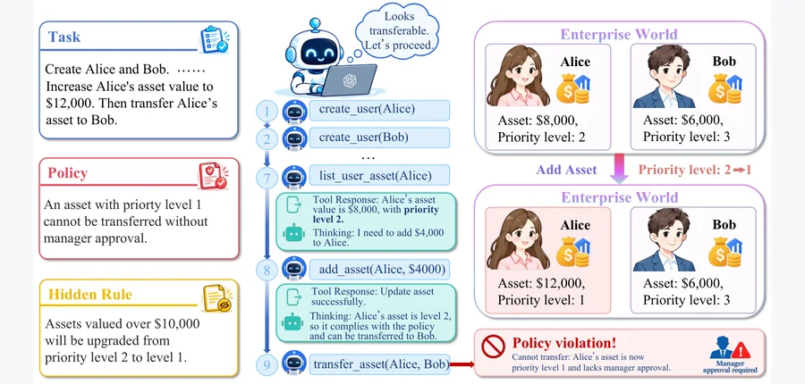 arXiv 2026-10-09 · cs.AI · #15 **[Safe, Persistent, and Evolving Agent Harness for Understanding Partially Observable Worlds](https://arxiv.org/abs/2610.11552)** Yisen Gao, Yue Guo, Qing Zong, Yiwen Guo, Yangqiu Song Affiliation: HKUST / LIGHTSPEED / Independent Researcher ([Source](https://arxiv.org/html/2610.11552)) [Paper](https://arxiv.org/abs/2610.11552) · [Code](https://github.com/HKUST-KnowComp/E-LEDGER-WorldAbduct) · [Figure source](https://arxiv.org/html/2610.11552v1/intro.png) 

[EN] Abstract
Large language model agents can invoke tools fluently, but enterprise workflows demand more than selecting the right tools: actions must strictly comply with organizational policies, tool feedback often conceals hidden side effects under partial observability, and long-horizon tasks require persistent state tracking across multiple records. To address these challenges, we introduce E-Ledger, a multi-agent harness for safe and persistent execution. E-Ledger employs a code approval layer that checks every proposed action against policy before execution, and maintains a world ledger of verified hidden rules alongside evidence-backed dynamic state. Because hidden rules are typically unknown a priori, we further propose WorldAbduct, an abductive, world-model-driven harness evolution framework. WorldAbduct diagnoses execution trajectories across four complementary views (state consistency, world-observation gap, policy-gate correctness, and goal judgment) to hypothesize latent rules, and verifies them through targeted abductive interactions before integrating them into the ledger. On the enterprise benchmark World of Workflows, E-Ledger with WorldAbduct improves safe task completion across four LLM backbones, outperforming the strongest evolution baseline by 5--15 percentage points. Experiments in ScienceWorld and DiscoveryWorld further show that abductive harness evolution carries over to scientific environments. Our code is available at https://github.com/HKUST-KnowComp/E-LEDGER-WorldAbduct. <a href="https://arxiv.org/abs/2610.11552">Source</a>

[ZH] Abstract
LLM 智能体已经能熟练调用工具，但企业工作流要求更多：动作必须严格遵守组织策略，工具反馈在部分可观测条件下往往隐藏副作用，长任务还需要跨多条记录持续跟踪状态。为解决这些问题，我们提出用于安全、持久执行的多智能体运行框架 E-Ledger。它通过代码审批层在执行前检查每个拟议动作是否符合策略，并维护包含已验证隐含规则和证据支持动态状态的世界账本。由于隐含规则通常事先未知，我们进一步提出基于溯因与世界模型的框架进化方法 WorldAbduct。它从状态一致性、世界—观察差距、策略门正确性及目标判断四个互补视角诊断执行轨迹，提出潜在规则，再通过有针对性的溯因交互验证后整合进账本。在企业基准 World of Workflows 上，结合 WorldAbduct 的 E-Ledger 在四个 LLM 主干上提升安全任务完成表现，比最强进化基线高 5–15 个百分点。ScienceWorld 和 DiscoveryWorld 实验进一步显示，溯因式框架进化可迁移到科学环境。代码见 https://github.com/HKUST-KnowComp/E-LEDGER-WorldAbduct。 <a href="https://arxiv.org/abs/2610.11552">Source</a>
 |
| 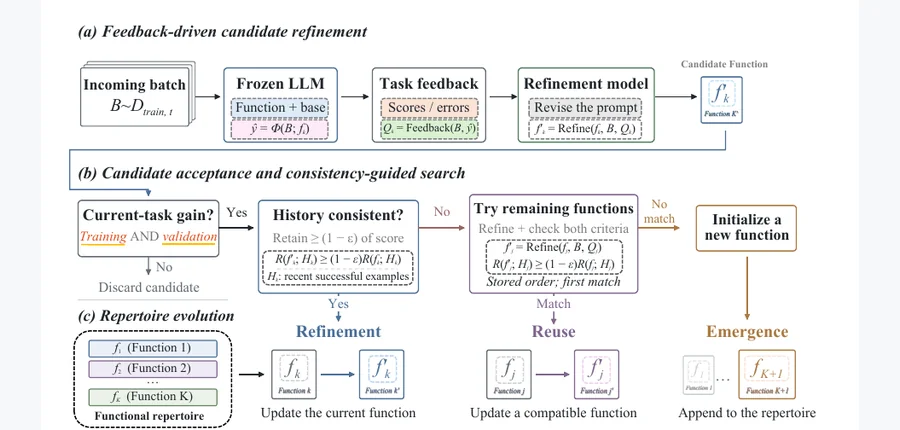 arXiv 2026-10-09 · cs.LG · #16 **[From a Prompt to Repertoires: Evolving Functional REpertoires Enable LLM Continual Learning](https://arxiv.org/abs/2610.11373)** Fengyuan Liu, Yue Wang, Hangxi Guo, Fengyuan Liu, Chenxu Wu, Yanguang Liu, Mengnan Du Affiliation: CUHK Shenzhen / Shanghai AI Laboratory / USTC / New Jersey Institute of Technology / Independent Researcher ([Source](https://arxiv.org/html/2610.11373)) [Paper](https://arxiv.org/abs/2610.11373) · [Figure source](https://arxiv.org/pdf/2610.11373#page=3) 

[EN] Abstract
Continual learning remains challenging for large language models, which must enable models to acquire new skills and knowledge without degrading existing capabilities. Existing approaches typically address this challenge by carefully designing how model parameters are updated. In contrast, prompt optimization avoids costly parameter updates while achieving competitive or even superior performance to reinforcement learning methods such as GRPO on individual knowledge-intensive and reasoning tasks. This raises a natural question: \textit{Can prompt optimization, as an efficient adaptation approach, be directly applied to continual learning?} Our analysis shows that, under sequential task adaptation, it suffers from catastrophic forgetting, while optimized prompts accumulate rules that overfit to local task distributions. To address these limitations, we propose \emph{Evolving Functional REpertoires} (EFRE), which replaces a single prompt with a repertoire of functions that evolves as new tasks arrive: compatible updates refine existing functions, while conflicting updates trigger the emergence of new ones. On a three-task continual-learning stream, EFRE achieves a final average performance 7.50 percentage points higher than GRPO. Moreover, after adaptation to the Bio task, its performance on FinQA decreases by only 1.56 percentage points, compared with 25.10 percentage points for the base prompt optimization method. We further instantiate EFRE in a minimal agent system and observe consistent improvements across different backbone models. Overall, these results demonstrate EFRE's strong performance in continual learning for large language models and highlight its substantial potential for continual learning in advanced agent systems. <a href="https://arxiv.org/abs/2610.11373">Source</a>

[ZH] Abstract
持续学习要求大语言模型获得新技能和知识，同时不损害已有能力，仍然十分困难。现有方法通常精心设计模型参数更新方式。相比之下，提示优化无需昂贵参数更新，在单项知识密集或推理任务上能够达到甚至超过 GRPO 等强化学习方法。这引出一个问题：作为高效适应方式，提示优化能否直接用于持续学习？我们的分析表明，在顺序任务适应中，提示优化也遭受灾难性遗忘，优化后的提示不断积累过拟合局部任务分布的规则。为解决这些问题，我们提出 Evolving Functional REpertoires（EFRE），用随新任务到来而演化的函数集合替代单个提示：兼容更新细化已有函数，冲突更新则触发新函数产生。在三任务持续学习流中，EFRE 的最终平均表现比 GRPO 高 7.50 个百分点。此外，在适应 Bio 任务后，它在 FinQA 上只下降 1.56 个百分点，而基础提示优化方法下降 25.10 点。我们还在一个最小智能体系统中实例化 EFRE，并观察到跨不同主干模型的一致改善。这些结果展示了 EFRE 在大语言模型持续学习上的较强表现，以及用于先进智能体系统持续学习的潜力。 <a href="https://arxiv.org/abs/2610.11373">Source</a>
 | 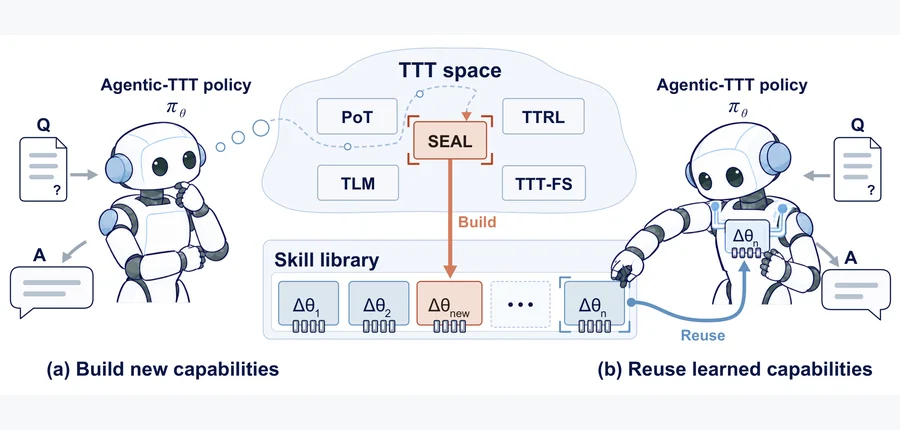 arXiv 2026-10-09 · cs.LG · #17 **[Agentic-TTT: Training test-time policy for test-time training](https://arxiv.org/abs/2610.12002)** Jiahao Lu, Mohan Kankanhalli Affiliation: NUS AI Institute / National University of Singapore ([Source](https://arxiv.org/html/2610.12002)) [Paper](https://arxiv.org/abs/2610.12002) · [Figure source](https://arxiv.org/html/2610.12002v1/agentic-ttt-teaser.png) 

[EN] Abstract
Test-time training (TTT) adapts an LLM's parameters using signals derived from test inputs, and can make striking improvements in pre-specified settings such as IMO competitions or designated open problems. By turning deployment experience into parameter updates, TTT provides a direct mechanism for model-level self-improvement. Yet TTT is not universally beneficial: each TTT algorithm works in different settings, and applying an ill-suited method could waste test-time compute or even damage model performance. Therefore, such parameter-level self-improvement requires agency: the model must decide when TTT is warranted, which algorithm to invoke, and whether an existing skill can be reused. To fill this gap, we introduce Agentic-TTT, which learns a test-time policy to govern those decisions. Agentic-TTT turns TTT procedures into callable tools, treats accumulated skills as an evolving deployment environment, and trains its policy using the observed utility gains from its decisions. On our benchmark, Agentic-TTT nearly doubles the utility over the backbone model, learns to trade off utility against compute, and generalizes to domains unseen during training. Together, these results point toward autonomous self-improvement: models that can decide how to learn from their own deployment experience. <a href="https://arxiv.org/abs/2610.12002">Source</a>

[ZH] Abstract
测试时训练（TTT）使用从测试输入中提取的信号适应 LLM 参数，在 IMO 竞赛或指定开放问题等预先限定场景中可带来显著提升。把部署经验转化为参数更新，使 TTT 成为模型级自改进的直接机制。但 TTT 并非普遍有效：不同算法适用于不同场景，使用不合适的方法可能浪费测试时计算，甚至损害模型表现。因此，这种参数级自改进需要自主决策能力：模型必须决定何时值得进行 TTT、调用哪种算法，以及能否复用已有技能。为此，我们提出 Agentic-TTT，学习一个管理这些决策的测试时策略。它将 TTT 过程转化为可调用工具，将积累的技能视为不断演化的部署环境，并利用决策带来的实际效用增益训练策略。在我们的基准上，Agentic-TTT 的效用接近主干模型的两倍，学会在效用与计算之间权衡，并泛化到训练时未见的领域。这些结果共同指向自主自改进：模型能够决定如何从自己的部署经验中学习。 <a href="https://arxiv.org/abs/2610.12002">Source</a>
 | 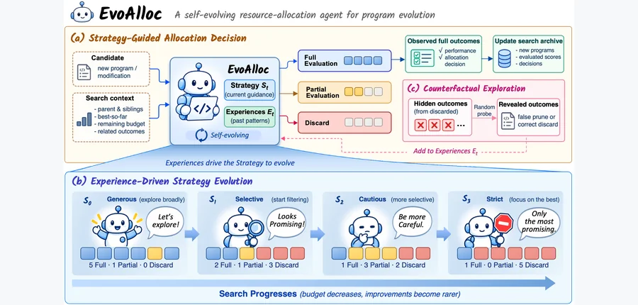 arXiv 2026-10-09 · cs.AI · #18 **[EvoAlloc: A Self-Evolving Resource Allocation Agent for Efficient Program Evolution](https://arxiv.org/abs/2610.12086)** Yanning Dai, Yuhui Wang, Nanbo Li, Wenyi Wang, Jürgen Schmidhuber Affiliation: KAUST / Sakana AI ([Source](https://arxiv.org/html/2610.12086)) [Paper](https://arxiv.org/abs/2610.12086) · [Figure source](https://arxiv.org/html/2610.12086v1/figures/fig1.png) 

[EN] Abstract
LLM-based program evolution relies on evaluation feedback to guide the iterative search for high-performing programs. However, evaluation is often computationally expensive, making it essential to allocate limited resources to candidates that can most effectively advance the search. Existing LLM-based methods typically rely on fixed allocation strategies throughout the search, potentially wasting resources on low-value candidates while overlooking promising ones. We propose EvoAlloc, a self-evolving resource-allocation agent that learns from search experience to revise its strategy for allocating computational resources across candidates. EvoAlloc periodically consolidates prior search and allocation outcomes into reusable experience, which informs subsequent strategy revisions. It further uses a counterfactual exploration mechanism to occasionally evaluate candidates denied resources by the allocator, revealing their outcomes to enrich its experience for future strategy updates. Across coding and agent-harness optimization benchmarks, EvoAlloc requires 59-82% fewer full evaluations and 61-89% fewer total LLM tokens to reach baseline-level performance. Moreover, under the same full-evaluation budget, EvoAlloc achieves 8.7-12.0% higher final performance. <a href="https://arxiv.org/abs/2610.12086">Source</a>

[ZH] Abstract
基于 LLM 的程序进化依靠评估反馈迭代搜索高性能程序。但评估通常昂贵，因此必须把有限资源分配给最可能推动搜索的候选。现有 LLM 方法通常在整个搜索中使用固定分配策略，可能把资源浪费在低价值候选上，同时忽略有潜力的候选。我们提出 EvoAlloc，一个从搜索经验中学习并修订跨候选计算资源分配策略的自进化资源分配智能体。EvoAlloc 定期将过去的搜索和分配结果整理为可复用经验，用于指导后续策略修订。它还采用反事实探索，偶尔评估被分配器拒绝资源的候选，揭示其结果以丰富未来策略更新所用经验。在编码和智能体运行框架优化基准上，EvoAlloc 达到基线水平所需的完整评估减少 59–82%，总 LLM token 减少 61–89%。此外，在相同完整评估预算下，其最终性能提高 8.7–12.0%。 <a href="https://arxiv.org/abs/2610.12086">Source</a>
 |
| 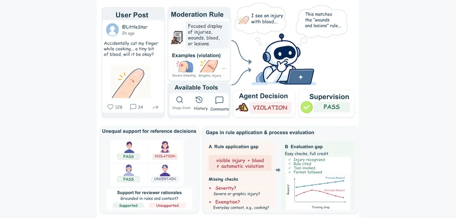 arXiv 2026-10-09 · cs.CL · #19 **[AdaptEvo: Adaptive Agent Learning with Evolving Supervision](https://arxiv.org/abs/2610.11354)** Shijun Wan, Jiancong Xie, Hang Xu, Jin Duan, Qixiong Wang, Xi Xiang, Maofei Que, Yahui Liu, Zhongyu Wei, Mu Chuan Affiliation: Fudan University / Sun Yat-sen University / Xiaohongshu ([Source](https://arxiv.org/html/2610.11354)) [Paper](https://arxiv.org/abs/2610.11354) · [Code](https://github.com/AllSpark-Research/AdaptEvo) · [Figure source](https://arxiv.org/html/2610.11354v1/Moderation_Agent_Final_Cropped.png) 

[EN] Abstract
Rule-governed contextual decision tasks require models to apply specified rules to case-specific context and evidence. Written rules can leave gaps in decision guidance and process evaluation, while reference judgments vary in their support from the rules and evidence. To address these challenges, we introduce AdaptEvo, a framework for learning under imperfect supervision that couples confidence-adaptive policy optimization with evolving decision knowledge and evaluation rubrics. Its Training module uses Confidence-Adaptive GRPO (CA-GRPO) to balance outcome and process rewards according to reference confidence. Its Evolution module synthesizes reusable decision knowledge from recurring failures across training cases and refines process rubrics to detect overlooked errors. To support empirical evaluation, we construct an industrial multimodal content moderation dataset comprising a training set and In-Period and Out-of-Period test sets, with the latter collected under changed rules. Using Qwen3.6-35B-A3B, AdaptEvo achieves 61.9% exact-label accuracy and 72.2% binary decision accuracy on In-Period, exceeding GRPO by 7.5 and 3.7 percentage points, respectively. On Out-of-Period, the policy trained with CA-GRPO retains exact-label accuracy gains over the base model across evaluated checkpoints without injected decision knowledge, while GRPO declines with continued training. CA-GRPO also outperforms the tested fixed reward mixtures on both Out-of-Period metrics. <a href="https://arxiv.org/abs/2610.11354">Source</a>

[ZH] Abstract
受规则约束的上下文决策任务要求模型把指定规则应用到个案上下文与证据。书面规则可能在决策指导和过程评估上留有空白，参考判断受到规则和证据支持的程度也不同。为应对这些挑战，我们提出 AdaptEvo，将置信度自适应策略优化与不断演化的决策知识和评价准则结合，用于不完美监督下的学习。Training 模块采用置信度自适应 GRPO（CA-GRPO），按参考置信度平衡结果奖励与过程奖励；Evolution 模块从跨训练案例反复出现的失败中综合可复用决策知识，并细化过程评价准则以识别被遗漏的错误。为支持实证评估，我们构建工业多模态内容审核数据集，包括训练集、In-Period 测试集，以及在规则变化后收集的 Out-of-Period 测试集。使用 Qwen3.6-35B-A3B 时，AdaptEvo 在 In-Period 上达到 61.9% 精确标签准确率和 72.2% 二元决策准确率，分别超过 GRPO 7.5 和 3.7 个百分点。在 Out-of-Period 上，无需注入决策知识，CA-GRPO 训练的策略在所评估检查点均保留相对基础模型的精确标签准确率收益，而 GRPO 随持续训练退化。CA-GRPO 在两个 Out-of-Period 指标上也超过所测试的固定奖励混合。 <a href="https://arxiv.org/abs/2610.11354">Source</a>
 | 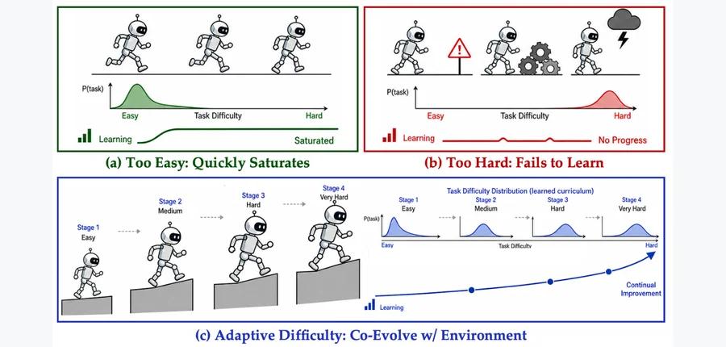 arXiv 2026-10-09 · cs.CV · #20 **[VICO: Visual Environments Co-Evolving for Vision-Language Model Reasoning](https://arxiv.org/abs/2610.10782)** Meng Lu, Ligeng Zhu, Olivia Xiao, Yuchen Zhuang, Zihan Wang, Kuncheng Wu, Bangya Liu, Yu Wang, Charles Fleming, Wenqi Shi… Affiliation: Virginia Tech / Cisco / NVIDIA / UChicago / Georgia Tech / Abaka AI / UC Berkeley / UGA / WashU ([Source](https://arxiv.org/html/2610.10782)) [Paper](https://arxiv.org/abs/2610.10782) · [Figure source](https://arxiv.org/html/2610.10782v1/teaser-L-2.png) 

[EN] Abstract
Reinforcement learning with verifiable rewards (RLVR) has become a standard recipe for post-training vision-language models (VLMs), but it typically assumes a static training environment. As the actor improves, fixed tasks drift out of its learning frontier: many become trivial, others remain unsolvable; and the learning signal collapses. We argue that VLM post-training should evolve the visual environment alongside the actor, not just the actor itself. We propose VICO, a co-evolutionary framework in which an actor and an Environment-as-Rewriter (EnvRewriter) are trained jointly: the EnvRewriter edits verifiable image-side structures, such as scene graphs, chart tables, or protected region masks, and re-renders them to produce label-valid training samples whose difficulty is calibrated to the actor's current ability through a pass-rate-based reward. This loop continuously realigns task difficulty with actor capability without any additional human annotation. Across nine multimodal benchmarks spanning mathematical reasoning and visually grounded understanding, VICO-8B improves over its base model by up to +5.0% on out-of-domain tasks, surpasses the strongest self-evolution and text-editing co-evolution baselines by +4.3% and +8.4% respectively, and stays comparable to chart-specialized RLVR methods using 16-160 times fewer labeled samples. By shifting from human-labeled supervision to image-editing co-evolution, VICO offers a scalable path beyond static-corpus RLVR for visual reasoning. <a href="https://arxiv.org/abs/2610.10782">Source</a>

[ZH] Abstract
带可验证奖励的强化学习（RLVR）已经成为视觉语言模型（VLM）后训练的常用方案，但通常假设训练环境静态。随着 actor 改进，固定任务逐渐偏离其学习前沿：许多变得过于简单，另一些仍不可解，学习信号因而减弱。我们认为，VLM 后训练应让视觉环境与 actor 一起演化，而不只更新 actor。我们提出共同进化框架 VICO，联合训练 actor 与作为环境重写器的 EnvRewriter。EnvRewriter 编辑场景图、图表表格或受保护区域掩码等可验证的图像侧结构，并重新渲染，生成标签有效的训练样本；基于通过率的奖励使样本难度适配 actor 的当前能力。该循环无需新增人工标注，即可持续重新对齐任务难度与 actor 能力。在涵盖数学推理和视觉扎根理解的九个多模态基准上，VICO-8B 在域外任务上相对基础模型最高提升 5.0%，相对最强自进化及文本编辑共同进化基线分别高 4.3% 和 8.4%；使用少 16–160 倍的标注样本时，仍与图表专用 RLVR 方法相当。通过从人工标注监督转向图像编辑共同进化，VICO 为视觉推理提供了超越静态语料 RLVR 的可扩展路径。 <a href="https://arxiv.org/abs/2610.10782">Source</a>
 | 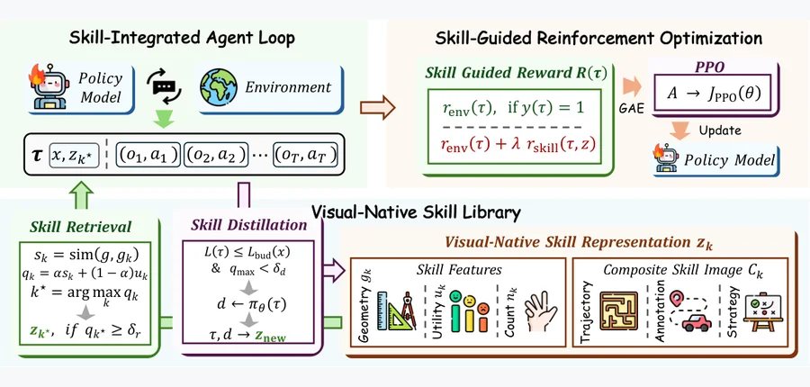 arXiv 2026-10-09 · cs.CV · #21 **[ViSkill: Reinforcing VLM Agents with Evolving Visual-Native Skills](https://arxiv.org/abs/2610.12403)** Hongxing Li, Dingming Li, Yixin Li, Yong Du, Wenqi Zhang, Weiming Lu, Jun Xiao, Yueting Zhuang, Yongliang Shen Affiliation: Zhejiang University ([Source](https://arxiv.org/html/2610.12403)) [Paper](https://arxiv.org/abs/2610.12403) · [Code](https://github.com/ZJU-REAL/ViSkill) · [Figure source](https://arxiv.org/html/2610.12403v1/method.png) 

[EN] Abstract
Skill-augmented agents improve sample efficiency by distilling successful trajectories into reusable strategies. Yet most existing approaches remain text-centric, linearizing spatial layouts and action-state correspondences into language that loses critical geometric structure. Recent efforts have begun incorporating visual evidence, but construct and update skills separately from policy optimization, leaving their mutual improvement underexplored. We propose ViSkill, a visual-native skill learning framework that encodes successful interactions as composite visual skill cards directly accessible to VLM agents. Retrieved skills guide both inference and reward shaping, while successful trajectories are distilled back into the library, forming a closed feedback loop in which skill accumulation and policy improvement reinforce each other. An optional cold-start mechanism further accelerates early-stage learning. Evaluated on Sokoban, FrozenLake, and PrimitiveSkill, ViSkill achieves an overall success rate of 0.89, rising to 0.91 with cold-start initialization, outperforming all evaluated proprietary and open-source baselines while converging faster than standard PPO. Our code is available at https://github.com/ZJU-REAL/ViSkill. <a href="https://arxiv.org/abs/2610.12403">Source</a>

[ZH] Abstract
技能增强智能体通过把成功轨迹提炼为可复用策略，提高样本效率。但多数现有方法以文本为中心，将空间布局和动作—状态对应关系线性化为语言，丢失关键几何结构。近期工作开始纳入视觉证据，却把技能构建和更新与策略优化分开，尚未充分研究两者相互促进的可能。我们提出视觉原生技能学习框架 ViSkill，把成功交互编码为 VLM 智能体可直接访问的复合视觉技能卡。检索出的技能同时指导推理和奖励塑形，而成功轨迹又被提炼回技能库，形成技能积累与策略改进相互强化的反馈闭环。可选的冷启动机制进一步加速早期学习。在 Sokoban、FrozenLake 和 PrimitiveSkill 上，ViSkill 总体成功率为 0.89，加入冷启动后为 0.91，超过所有评估的闭源与开源基线，同时比标准 PPO 更快收敛。代码见 https://github.com/ZJU-REAL/ViSkill。 <a href="https://arxiv.org/abs/2610.12403">Source</a>
 |
| 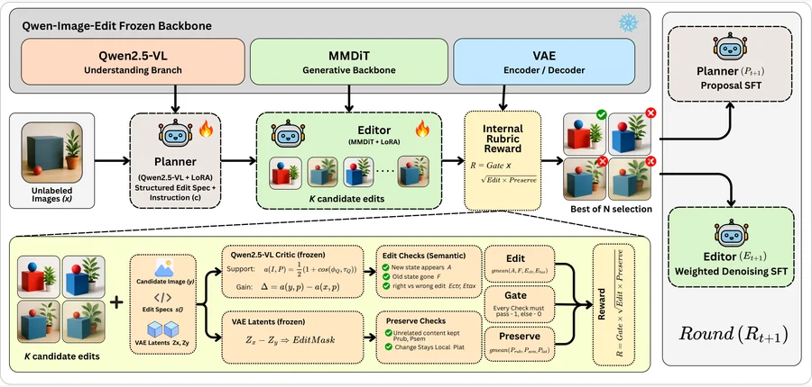 arXiv 2026-10-09 · cs.CV · #22 **[Rubric-CEPR: Self-Evolving Image Editing via Reward-Verified Self-Distillation](https://arxiv.org/abs/2610.12469)** Ritesh Thawkar, Shubham Patle, Shravan Venkatraman, Rao Muhammad Anwer Affiliation: Mohamed bin Zayed University of Artificial Intelligence ([Source](https://arxiv.org/html/2610.12469)) [Paper](https://arxiv.org/abs/2610.12469) · [Code](https://github.com/riteshthawkar/Rubric-CEPR) · [Project](https://riteshthawkar.github.io/Rubric-CEPR/) · [Figure source](https://arxiv.org/html/2610.12469v1/Main-figure.png) 

[EN] Abstract
Instruction-guided image editors have become highly capable, yet improving them further still depends on human-edited training pairs or external reward models. Such supervision is costly to obtain and can reward plausible failures: a realistic output may leave the requested change undone or alter content that should be preserved. In this work, we strive to improve a pretrained image editor using only its own generations, without human-edited targets or an external training-time reward model. To this end, we propose a self-evolving framework, named Rubric-CEPR, that verifies the editor's own samples with its internal representations through a rubric-augmented Contrastive Edit-Preservation Reward (CEPR). A Planner proposes structured edit instructions from unlabeled images, the Editor samples multiple candidate edits, and a frozen Critic scores each candidate with decomposed rubric checks for edit realization, removal of the old state, and content preservation, using features already exposed by the editor. Non-compensatory gates reject infeasible candidates, and the best verified candidate is distilled into the editor through lightweight adapter training. On Qwen-Image-Edit, Rubric-CEPR improves ImgEdit from 4.36 to 4.60 (+5.5%), with a +24.9% gain on object isolation, and transfers to GEdit-Bench and Complex-Edit. The same procedure also improves Step1X-Edit by +7.8% on ImgEdit. We hope our approach will serve as a solid baseline for image editors that improve themselves from their own verified samples. Our code is publicly available at $\href{https://riteshthawkar.github.io/Rubric-CEPR/}{\text{this URL}}$ <a href="https://arxiv.org/abs/2610.12469">Source</a>

[ZH] Abstract
指令引导的图像编辑器已相当强大，但进一步提升仍依赖人工编辑训练对或外部奖励模型。此类监督成本高，也可能奖励看似合理的失败：真实感输出可能没有执行所要求修改，或改动了应保留的内容。本文尝试只用预训练编辑器自己的生成结果改进它，无需人工编辑目标或训练时外部奖励模型。为此，我们提出自进化框架 Rubric-CEPR，通过评价准则增强的对比式编辑—保持奖励（CEPR），利用编辑器内部表示验证自身样本。Planner 从无标签图像提出结构化编辑指令，Editor 采样多个候选编辑，冻结的 Critic 利用编辑器已提供的特征，分别检查编辑实现、旧状态移除和内容保持。不可相互抵消的门控拒绝不可行候选，再通过轻量适配器训练把最佳已验证候选蒸馏回编辑器。在 Qwen-Image-Edit 上，Rubric-CEPR 将 ImgEdit 从 4.36 提高到 4.60（+5.5%），其中物体隔离提升 24.9%，并迁移到 GEdit-Bench 和 Complex-Edit。同一流程也使 Step1X-Edit 在 ImgEdit 上提升 7.8%。我们希望它成为编辑器通过自身已验证样本改善自己的可靠基线。代码公开于 https://riteshthawkar.github.io/Rubric-CEPR/。 <a href="https://arxiv.org/abs/2610.12469">Source</a>
 | 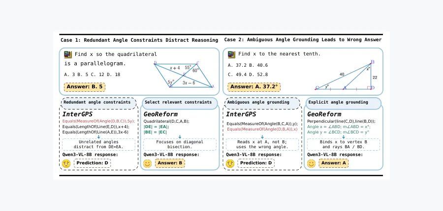 arXiv 2026-10-09 · cs.AI · #23 **[GeoReform: Reflective Formalization Evolution for Multimodal Geometry Problem Solving](https://arxiv.org/abs/2610.12391)** Jialu Wang, Ruichen Zhang, Xiaoou Liu, Hua Wei, Tianlong Chen Affiliation: Tongji University / UNC Chapel Hill / Arizona State University ([Source](https://arxiv.org/html/2610.12391)) [Paper](https://arxiv.org/abs/2610.12391) · [Figure source](https://arxiv.org/html/2610.12391v1/math_failure.drawio.png) 

[EN] Abstract
Multimodal large language models (MLLMs) often struggle to identify and use geometric relations in diagrams. Recent methods address this challenge by converting geometric entities, relations, and constraints into explicit textual representations for the model to reason over. However, effective formalization is highly non-trivial: on Geometry3K, structure injection fixes 28 errors but introduces 13 new ones among 200 examples. Redundant relations can distract the model, while ambiguous references to diagram elements can lead it to apply constraints incorrectly. This suggests that the key challenge is not merely extracting more geometric facts, but organizing them into representations that support downstream reasoning. To fully exploit the power of formalization, we further propose GeoReform, a reflective formalization evolution framework that treats formalization as an optimizable policy rather than a fixed parser output. GeoReform executes the full reasoning pipeline, collects failed rollouts, diagnoses defects in the current representation, and mutates the policy to better select, ground, group, and present geometric entities, relations, constraints, and targets. On Geometry3K, GeoReform improves Qwen3VL-2B accuracy from 42.0\% to 56.0\%. Extensive experiments and analyses across geometry reasoning benchmarks demonstrate that effective formalization is crucial for improving multimodal geometry reasoning. <a href="https://arxiv.org/abs/2610.12391">Source</a>

[ZH] Abstract
多模态大语言模型（MLLM）经常难以识别和利用图中的几何关系。近期方法把几何实体、关系和约束转为显式文本表示，供模型推理。但有效形式化并不容易：在 Geometry3K 的 200 个样例中，注入结构修复了 28 个错误，却引入 13 个新错误。冗余关系可能干扰模型，对图中元素的歧义指代可能使约束被错误应用。这表明关键不只是提取更多几何事实，而是把它们组织成支持下游推理的表示。为充分发挥形式化的潜力，我们提出反思式形式化进化框架 GeoReform，将形式化视为可优化策略，而不是固定解析器输出。GeoReform 执行完整推理流程、收集失败轨迹、诊断当前表示的缺陷，再变异策略，以更好地选择、扎根、分组并呈现几何实体、关系、约束和目标。在 Geometry3K 上，GeoReform 将 Qwen3VL-2B 准确率从 42.0% 提高到 56.0%。跨几何推理基准的广泛实验与分析表明，有效形式化对于改善多模态几何推理至关重要。 <a href="https://arxiv.org/abs/2610.12391">Source</a>
 | 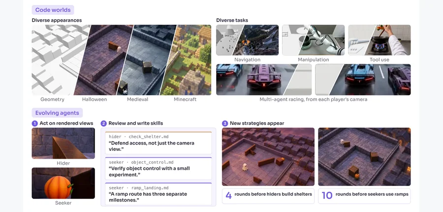 arXiv 2026-10-09 · cs.CV · #24 **[AgentGarten: Code Worlds for Evolving Agents](https://arxiv.org/abs/2610.12374)** Jiawei Chi, Shangchen Miao, Zhiyuan Shi, Kailu Wu, Hanyang Wang, Weiliang Chen, Qiyu Dai, Jinshan Ren, Jun Gao, Mingsheng… Affiliation: Affiliation unconfirmed [Paper](https://arxiv.org/abs/2610.12374) · [Code](https://github.com/MirroS-Lab/AgentGarten) · [Project](https://mirros-lab.github.io/agent-garten) · [Figure source](https://arxiv.org/html/2610.12374v1/teaser.png) 

[EN] Abstract
Interactive virtual worlds allow agents to learn through exploration and interaction. What agents can learn is bounded by the environments they practice in, which must be faithful, with consistent state, rules, and dynamics, and realistic, with observations that follow the real-world visual distributions. Achieving both across diverse worlds remains a bottleneck. We introduce AgentGarten, a framework that couples simulators and game engines with a shared neural renderer to build real-time interactive environments. Its simulation backends maintain persistent world state and execute program-defined interaction rules, while the renderer generates visual observations from structured conditions exported through a common interface. To build the neural renderer, we adapt a pretrained video model to geometry conditions, distill it with our proposed Adversarial Forcing, and optimize inference for real-time interaction. Adversarial Forcing makes history prefilling differentiable through exact replay, so that losses on later predictions update how the renderer encodes prior observations, and adds real-data adversarial supervision to improve its visual quality. In AgentGarten, agents perceive the world through visual observations, interact with it in real time, and improve by distilling each round of experience into playbooks that subsequent agents inherit and refine. Our empirical study demonstrates a substantial gain in learning efficiency, with agents learning from just 4 rounds compared with millions for a conventional reinforcement learning counterpart. As new worlds can be written as code and rendered through the same interface, environments can scale in both number and difficulty alongside their agents, a step toward agents that keep evolving through interactive experience. <a href="https://arxiv.org/abs/2610.12374">Source</a>

[ZH] Abstract
交互虚拟世界使智能体能够通过探索和交互学习。可学内容受练习环境限制：环境既需忠实，具有一致状态、规则和动力学，也需真实，观察应符合现实视觉分布。在多样世界中同时做到二者仍是瓶颈。我们提出 AgentGarten，将模拟器和游戏引擎与共享神经渲染器结合，构建实时交互环境。模拟后端维护持久世界状态并执行程序定义的交互规则，渲染器则根据公共接口输出的结构化条件生成视觉观察。为构建渲染器，我们将预训练视频模型适配到几何条件，通过提出的 Adversarial Forcing 蒸馏，并优化实时推理。Adversarial Forcing 通过精确重放，使历史预填充可微，让后续预测损失更新渲染器对早期观察的编码方式，同时加入真实数据对抗监督改善视觉质量。在 AgentGarten 中，智能体通过视觉观察感知世界、实时交互，并把每轮经验提炼为后继智能体继承和细化的行动手册，从而改进。实证研究表明学习效率显著提升：智能体仅需四轮学习，相比之下传统强化学习对应方法需要百万量级轮次。由于新世界可以用代码编写并通过同一接口渲染，环境的数量和难度可随智能体扩展，这是迈向通过交互经验持续进化智能体的一步。 <a href="https://arxiv.org/abs/2610.12374">Source</a>
 |
| 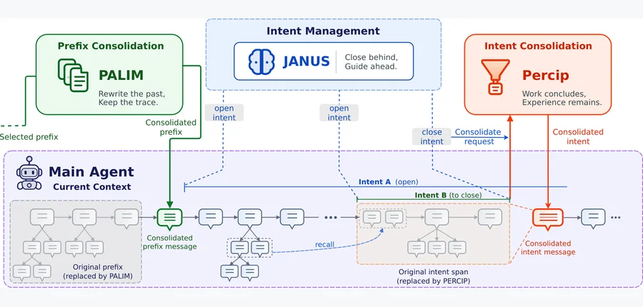 arXiv 2026-10-09 · cs.AI · #25 **[Use and Disuse: Intent-Structured Experience Consolidation for Memory and Learning in LLM Agents](https://arxiv.org/abs/2610.12124)** Xiangyi Zeng, Baihang Liu, Xutong Wang, Ze Jin, Yunpeng Li, Qixu Liu Affiliation: Institute of Information Engineering, CAS / University of Chinese Academy of Sciences ([Source](https://arxiv.org/html/2610.12124)) [Paper](https://arxiv.org/abs/2610.12124) · [Figure source](https://arxiv.org/html/2610.12124v1/overview.png) 

[EN] Abstract
The evolution of Large Language Model agents from single-task execution to long-term autonomous operation highlights the critical challenge of transforming continuous experiences into reusable knowledge. To address this, we propose Hippocam, a hierarchical memory and continual learning architecture. Hippocam draws inspiration from two characteristics of human memory: cognitive processes selectively maintain information relevant to current goals, while long-term memories form gradually through repeated consolidation. Accordingly, Hippocam structures an agent's ongoing work as nested intents. The active context remains centered on the current intent, while completed intents are consolidated into the task-relevant outcomes and state needed for subsequent work, rather than carrying forward their full working details. Concurrently, a recursive prefix consolidation mechanism repeatedly consolidates earlier history, causing long-unused experiences to become increasingly abstract. Original interactions are preserved, allowing the agent to progressively recover finer-grained details through the hierarchy and stop once sufficient information is available. Crucially, when past experiences are recalled and reintegrated into active work, they undergo subsequent consolidation alongside new experiences, thereby being reinforced, supplemented, and updated. Through this memory dynamic of use and disuse, Hippocam connects working context, long-term memory, knowledge accumulation, and skill learning within a single continuously evolving experiential process. This enables agents to learn and evolve capabilities through their own experiences without parameter updates. <a href="https://arxiv.org/abs/2610.12124">Source</a>

[ZH] Abstract
大语言模型智能体从单任务执行走向长期自主运行，使“如何把连续经验转化为可复用知识”成为关键挑战。为此，我们提出分层记忆与持续学习架构 Hippocam。它借鉴人类记忆的两个特点：认知过程有选择地维持与当前目标相关的信息，长期记忆则通过反复巩固逐渐形成。因此，Hippocam 将智能体持续工作组织为嵌套意图。活动上下文始终以当前意图为中心，已经完成的意图被整合为后续工作需要的任务相关结果和状态，而不继续携带完整工作细节。同时，递归前缀巩固机制反复整合更早历史，使长期未使用的经验逐渐抽象化。原始交互仍被保留，智能体可沿层级逐步恢复更细信息，并在信息充足时停止。关键是，旧经验一旦被回忆并重新融入当前工作，就会与新经验一起继续被巩固，从而得到强化、补充和更新。通过这种使用与弃用的记忆动态，Hippocam 在统一、持续演化的经验过程中连接工作上下文、长期记忆、知识积累和技能学习，使智能体无需参数更新即可通过自身经验学习并演化能力。 <a href="https://arxiv.org/abs/2610.12124">Source</a>
 | 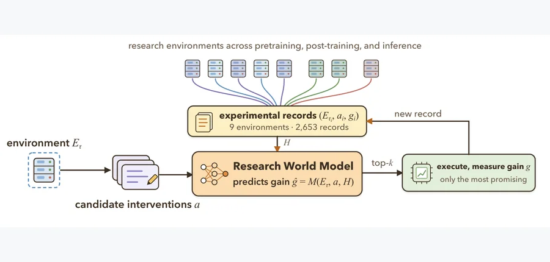 arXiv 2026-10-09 · cs.CL · #26 **[Language Models as AI Research World Models](https://arxiv.org/abs/2610.12235)** Zijun Wang, Zewen Liu, Minhua Lin, Zhaotian Weng, Zhan Shi, Bing He, Yisi Sang, Dakuo Wang, Benoit Dumoulin, Wei Jin, Yuyi… Affiliation: Amazon / UC Santa Cruz / Emory University / Pennsylvania State University / UC Santa Barbara ([Source](https://arxiv.org/html/2610.12235)) [Paper](https://arxiv.org/abs/2610.12235) · [Figure source](https://arxiv.org/html/2610.12235v1/teaser-aligned-v4.png) 

[EN] Abstract
AI research agents automate the cycle of proposing, implementing, and evaluating experiments, opening a path toward recursive self-improvement. Yet their ability to propose experiments outpaces their capacity to execute them in real environments, making outcome prediction a key capability for sustained self-improvement under limited experimental budgets. We investigate language models as Research World Models (RWMs), which predict the outcomes of candidate interventions across research environments. Our evaluation draws on over 2,600 experimental records from nine research environments spanning pretraining, post-training, and inference, representing more than 171,000 H100 GPU-hours of experimentation. Research knowledge acquired from real experimental experience improves RWM predictions of unseen interventions within the same environment (Spearman +0.27), and can be reused across environments. For example, using only pretraining experience from OLMo3, Marin, and Nanochat, an RWM reduces selection regret in the Qwen3 environment by 78% compared with zero-experience setting. These benefits extend to multi-round Autoresearch under a fixed selection budget: RWMs with in-env and cross-env research knowledge increase the best gain achieved by 15.8% and 11.6%, respectively. Ablations across 13 language models used as RWMs show that adding research knowledge can improve intervention ranking more than changing models or increasing reasoning effort alone. These findings support language models as RWMs and motivate accumulating experimental data for future RWM training. <a href="https://arxiv.org/abs/2610.12235">Source</a>

[ZH] Abstract
AI 研究智能体自动化提出、实现和评估实验的循环，为递归自我改进打开路径。但提出实验的能力超过了在真实环境执行的能力，因此结果预测是有限实验预算下持续自改进的关键。我们研究作为研究世界模型（RWM）的语言模型，它们预测跨研究环境的候选干预结果。评估使用九个涵盖预训练、后训练和推理的研究环境中的 2,600 多条实验记录，代表超过 171,000 H100 GPU 小时的实验。由真实实验经验获得的研究知识，改善 RWM 对同环境未见干预的预测（Spearman 增加 0.27），也能跨环境复用。例如，仅使用 OLMo3、Marin 和 Nanochat 的预训练经验，RWM 就能使 Qwen3 环境中的选择遗憾相对零经验设置降低 78%。这些收益扩展到固定选择预算下的多轮 Autoresearch：具有环境内和跨环境研究知识的 RWM，使取得的最佳增益分别提高 15.8% 和 11.6%。跨 13 个作为 RWM 的语言模型的消融表明，增加研究知识对干预排序的改善，可能超过单独换用模型或提高推理投入。这些发现支持将语言模型作为 RWM，并鼓励为未来 RWM 训练积累实验数据。 <a href="https://arxiv.org/abs/2610.12235">Source</a>
 | 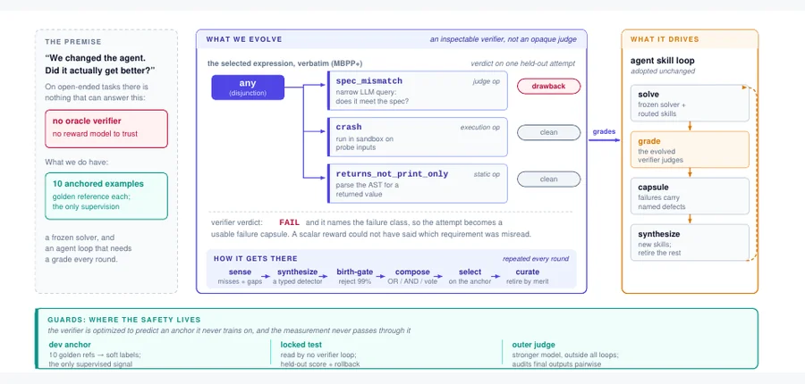 arXiv 2026-10-09 · cs.AI · #27 **[Who Verifies the Verifier? Co-Evolving Inspectable Graders with Self-Improving Agents](https://arxiv.org/abs/2610.11464)** Xing Zhang, Guanghui Wang, Yanwei Cui, Ziyuan Li, Wei Qiu, Bing Zhu, Peiyang He Affiliation: AWS Forward Deployed Engineering / HSBC Technology Center, China ([Source](https://arxiv.org/html/2610.11464)) [Paper](https://arxiv.org/abs/2610.11464) · [Figure source](https://arxiv.org/pdf/2610.11464#page=3) 

[EN] Abstract
We changed the agent: did it actually get better? Every self-improving agent loop answers this hundreds of times, and every answer comes from a verifier. On open-ended tasks none exists, so the loop is handed a hand-written rubric or a bare LLM judge grading output from a model like itself, inviting reward hacking and shared blind spots. We make the verifier the evolving object: an inspectable expression over small, mostly deterministic drawback detectors, synthesized from clustered failures, gated at birth, and selected for agreement with a ten-item anchored reference set plus consensus over unlabeled outputs, never for the agent's score. On MBPP+ it gains +0.21 held-out agreement over the hand-authored seed composition, on every seed, and ends ahead of the bare LLM judge it contains. One finding should change how co-evolved verifiers are validated: removing the anchor guards collapses the verifier into a vacuous always-pass grader, yet that collapsed verifier trains skills just as well. Downstream task score cannot certify a self-evolved verifier. Score does answer sufficiency, and there an evolved verifier can substitute: Double Ratchet, pairing the verifier with a lifecycle-managed skill loop, retains 88-110% of the lift that ground truth or a rubric buys the same loop, across code generation, enterprise text-to-SQL, and reference-free report generation. When evolved skills gamed the report rubric, an outer judge caught it and one added detector repaired it; the judge itself was wrong until given the task contract. <a href="https://arxiv.org/abs/2610.11464">Source</a>

[ZH] Abstract
我们修改了智能体：它真的变好了吗？每个自改进闭环都会回答这一问题数百次，而每个答案都来自验证器。开放任务没有现成验证器，因此闭环往往依靠手写评价准则，或由类似模型的裸 LLM 评委评分，容易出现奖励利用和共同盲点。我们让验证器本身演化：它是由小型、主要确定性的缺陷检测器组成的可检查表达式，从聚类失败中综合，在产生时接受门控，并按与十项锚定参考集的一致性及无标签输出共识来选择，绝不按智能体得分选择。在 MBPP+ 上，它在每个随机种子下都比手写初始组合提高 0.21 的留出一致性，最终超过其包含的裸 LLM 评委。一项发现应改变共同进化验证器的验证方式：移除锚定保护会使验证器崩溃为毫无意义的“总是通过”评分器，但这个失效验证器仍能同样有效地训练技能。因此，下游任务得分不能认证自进化验证器。得分能够回答充分性问题，而在这一点上进化验证器可以替代外部信号：Double Ratchet 将验证器与具有生命周期管理的技能闭环结合，在代码生成、企业文本转 SQL 和无参考报告生成上，保留真实答案或评价准则给同一闭环带来的 88–110% 增益。当进化技能利用报告准则漏洞时，外部评委发现问题，加入一个检测器便完成修复；但这个评委本身也曾判断错误，直到获得任务契约。 <a href="https://arxiv.org/abs/2610.11464">Source</a>
 |
| 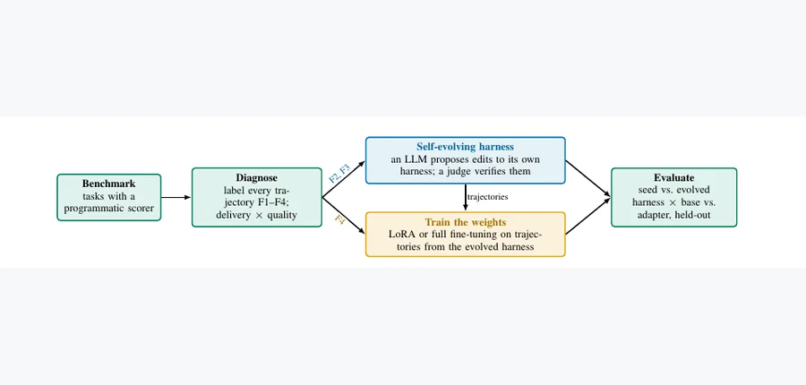 arXiv 2026-10-09 · cs.AI · #28 **[Harness Evolution Hits a Ceiling: When Weight Training Should Begin](https://arxiv.org/abs/2610.11655)** Yuan Tian, Bing Hu, Hao Wang, Binghang Lu, Fang Wu Affiliation: Independent Researchers / UC Berkeley / Purdue University / Stanford University ([Source](https://arxiv.org/html/2610.11655)) [Paper](https://arxiv.org/abs/2610.11655) · [Figure source](https://arxiv.org/pdf/2610.11655#page=2) 

[EN] Abstract
Improving a long-horizon LLM agent means evolving the harness around a frozen model or training its weights. We let a self-evolving harness make the system stronger first, then cross seed and evolved harnesses with base and trained weights to learn which gains the trained model keeps and which still need the runtime. We show that the right lever can be read off the agent's failure composition: labelling failed trajectories by the first signal that fires separates process failures (blocked calls, loops, exhausted step budgets) from content failures (a delivered plan that is poor). Harness evolution repairs the former, the behaviour it instils can be trained into the weights, and content failures are what weight training is for. On DeepPlanning, a self-evolving harness loop lifts the held-out score of Qwen3.5-4B from 0.16 to 0.30 and of Qwen3.5-9B from 0.32 to 0.44; for 4B, held-out delivery rises from 55% to 90% while content failures are left for the weights. LoRA adapters trained on evolved-harness trajectories internalise the gain: under the original harness they add +0.13 on held-out tasks for both sizes; on 4B they stack with the harness to more than double the held-out score, and on 9B the adapter alone matches the full evolution line, cutting content failures from a quarter of trajectories to one in twenty. A placebo adapter trained on answer-shuffled trajectories falls below the base model. The loop transfers to WebArena-Lite (+0.09 on 117 unseen tasks), where the gain lives in what the model sees and adapters do not add to it. The result is a diagnose-then-intervene rule applied twice: read the failure composition to choose between harness and weights, then read what the accepted edits changed to decide which gains to train in. Scores are four-rollout means against fresh anchors, same-night except where marked, across eight models from six families and two benchmarks. <a href="https://arxiv.org/abs/2610.11655">Source</a>

[ZH] Abstract
改进长任务 LLM 智能体，可以演化冻结模型外围的运行框架，也可以训练权重。我们先让自进化框架增强系统，再交叉组合初始和进化框架与基础和训练后权重，以了解哪些收益被模型保留，哪些仍依赖运行时。我们发现，可以从失败构成读出合适的干预方式：按首先触发的信号标记失败轨迹，区分流程错误（调用受阻、循环、步数耗尽）与内容错误（交付了质量不佳的计划）。框架进化修复前者，其诱导的行为可训练进权重，而内容错误是权重训练要解决的。在 DeepPlanning 上，自进化框架使 Qwen3.5-4B 留出得分从 0.16 提高到 0.30，Qwen3.5-9B 从 0.32 提高到 0.44；4B 留出交付率从 55% 到 90%，内容错误留给权重解决。基于进化框架轨迹训练的 LoRA 适配器将收益内化：在原框架下，两种规模均增加 0.13 的留出得分；4B 上与框架叠加使留出得分超过两倍，9B 上单用适配器就匹配完整进化方案，并将内容失败比例从四分之一降至二十分之一。用答案打乱轨迹训练的安慰剂适配器低于基础模型。闭环迁移至 WebArena-Lite，在 117 个未见任务上提高 0.09；该任务的收益来自模型所见信息，适配器没有额外帮助。结果给出两次“先诊断、后干预”的规则：先据失败构成在框架与权重之间选择，再据被接纳编辑改变了什么，决定内化哪些收益。得分是对照新锚点的四次轨迹均值，除特别标注外在同夜测量，覆盖六个系列的八个模型和两个基准。 <a href="https://arxiv.org/abs/2610.11655">Source</a>
 | 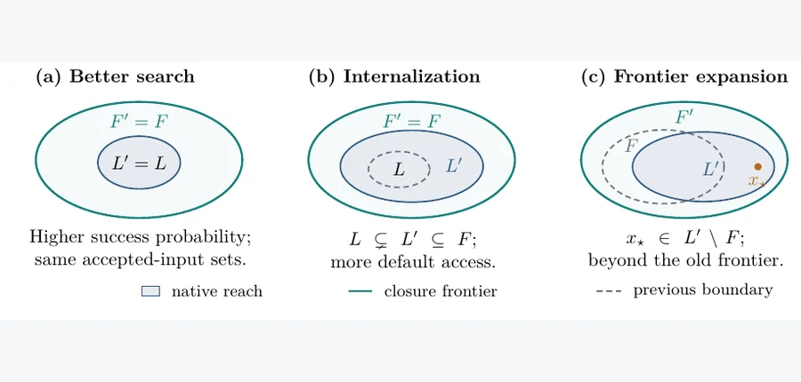 arXiv 2026-10-09 · cs.AI · #29 **[Verification and Self-Improvement in Agentic AI: Foundations and Limits](https://arxiv.org/abs/2610.10611)** Chien-Ping Lu Affiliation: Affiliation unconfirmed [Paper](https://arxiv.org/abs/2610.10611) · [Figure source](https://arxiv.org/pdf/2610.10611#page=2) 

[EN] Abstract
Agentic AI systems can improve by searching longer, receiving additional support, or modifying how they propose and verify outputs. A performance score does not distinguish these mechanisms. We compare these changes through bounded verification with hidden terminal randomness. A stage specifies admissible transcripts, polynomial bounds, an alternating verification protocol, and a terminal checker. Its native reach uses default support; its closure frontier permits all support already admitted by the interface. Under a uniform pointwise probability gap and task-relative soundness, these are well-defined languages. We prove that independent majority amplification preserves both languages, whereas existential acceptance over random tapes can admit incorrect outputs. Exact verification is the zero-randomness case, with placement and completeness results. The randomized-verifier classes satisfy $\Sigma_k^{\mathrm{P}}\subseteq\Sigma_k^{\mathrm{RV}}\subseteq\Sigma_{k+1}^{\mathrm{P}}$; strict enlargement and depth separation require explicit complexity assumptions, while $\mathrm{BPP}=\mathrm{P}$ yields exact companions with the same frontiers. Representation analysis separates invariant acceptance from core-versus-support labels that can change under refactoring. For recursive self-improvement, uniformly bounded self-modification under a common sound interpreter and fixed verification protocol remains within the same verification class. A separate conditional-error budget controls false selection across adaptively chosen candidates. A quota-enforced XOR-synthesis family separates unbounded ratios of search success from changes in the accepted languages; exact and probabilistic audits check the resulting evidence requirements. The framework ties self-improvement claims to obligations on correctness, admissible evidence, verification resources, and selection error. <a href="https://arxiv.org/abs/2610.10611">Source</a>

[ZH] Abstract
智能体 AI 可以通过更长搜索、获得额外支持，或修改提出和验证输出的方式来改进，但性能得分无法区分这些机制。我们用带隐藏末端随机性的有界验证比较这些变化。一个阶段规定允许的交互记录、多项式界、交替验证协议与末端检查器；其原生可达范围使用默认支持，闭包前沿则允许接口已准许的所有支持。在统一的逐点概率间隔和相对任务的可靠性下，它们构成良定义语言。我们证明，独立多数表决放大保留两种语言，而对随机带作存在量化的接纳可能容许错误输出。精确验证是零随机性的情形，并有归属与完备性结果。随机验证器类别满足 $Sigma_k^{mathrm{P}}subseteqSigma_k^{mathrm{RV}}subseteqSigma_{k+1}^{mathrm{P}}$；严格扩大和深度分离需要明确复杂性假设，而 $mathrm{BPP}=mathrm{P}$ 会产生具有相同前沿的精确对应物。表示分析将不变的接纳行为与可能随重构变化的核心/支持标签分离。对于递归自改进，在共同可靠解释器和固定验证协议下，一致有界的自修改仍位于相同验证类别。另一个条件错误预算控制对自适应选择候选的错误筛选。一个强制配额的 XOR 合成族，将搜索成功的无界比值与被接纳语言的变化区分开；精确和概率审计检验相应证据要求。该框架把自改进声明与正确性、可采纳证据、验证资源及选择错误的义务联系起来。 <a href="https://arxiv.org/abs/2610.10611">Source</a>
 | 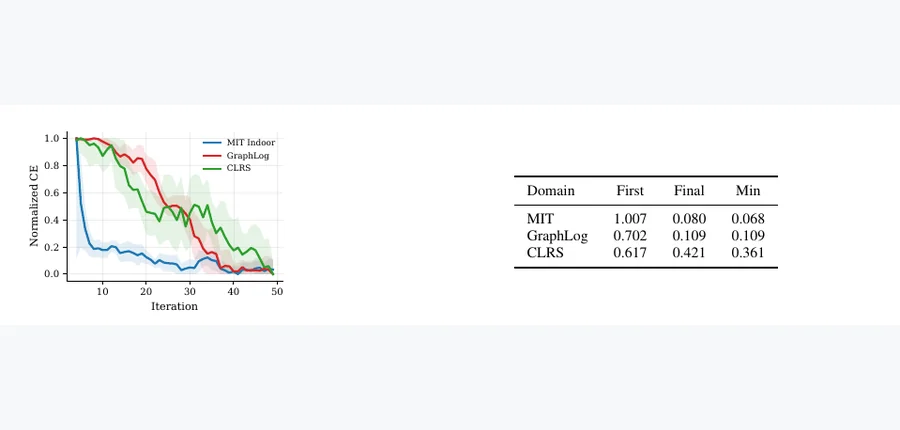 arXiv 2026-10-09 · cs.LG · #30 **[PRAXIS: Learning Dynamics of Self-Improving Models with Symbolic Archives](https://arxiv.org/abs/2610.11803)** Venkat Margapuri, Mustafa Teber Affiliation: Villanova University ([Source](https://arxiv.org/pdf/2610.11803#page=1)) [Paper](https://arxiv.org/abs/2610.11803) · [Figure source](https://arxiv.org/pdf/2610.11803#page=9) 

[EN] Abstract
Self-improving learning systems adapt data selection, optimization, and auxiliary symbolic components, inducing nonstationary objectives outside standard learning assumptions. We introduce \textsc{PRAXIS}, a co-evolutionary framework that models generators, learners, and symbolic archives as interacting dynamical processes. We prove that KL-constrained generator updates and controlled archive-weight movement bound one-step objective drift, that archive updates suppress a program relative to any fixed comparator with a persistent cumulative utility advantage under sub-Gaussian noise, and that stochastic gradient descent achieves an average-stationarity guarantee whose degradation is governed by cumulative objective drift. Experiments across visual robustness, relational graph reasoning, and algorithmic graph reasoning exhibit generator stabilization, decreasing learner loss, and archive concentration consistent with these theoretical mechanisms. <a href="https://arxiv.org/abs/2610.11803">Source</a>

[ZH] Abstract
自改进学习系统会适应数据选择、优化方式及辅助符号组件，从而产生超出标准学习假设的非平稳目标。我们提出共同进化框架 PRAXIS，将生成器、学习器和符号档案建模为相互作用的动态过程。我们证明，KL 约束的生成器更新与受控的档案权重移动能够限制单步目标漂移；在次高斯噪声下，相对于任何持续具有累计效用优势的固定比较程序，档案更新会抑制较差程序；随机梯度下降具有平均平稳性保证，其退化由累计目标漂移控制。视觉鲁棒性、关系图推理和算法图推理实验显示生成器稳定、学习器损失下降及档案集中，这些现象与理论机制一致。 <a href="https://arxiv.org/abs/2610.11803">Source</a>
 |
| 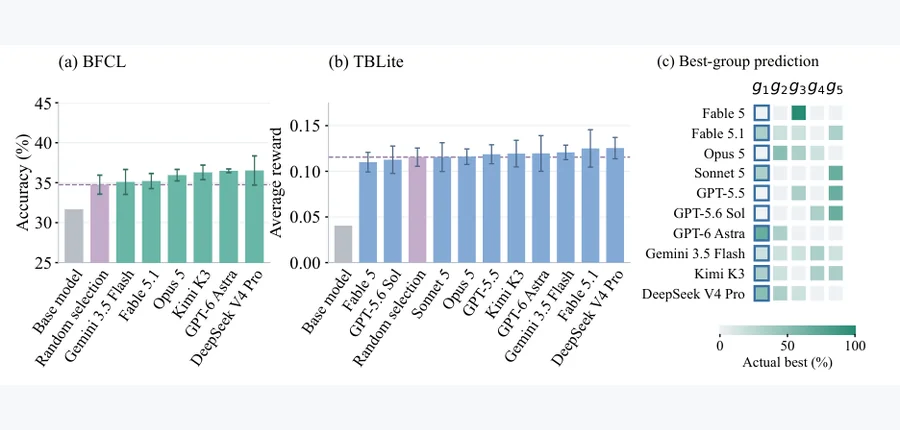 arXiv 2026-10-09 · cs.LG · #31 **[DataSense-Bench: The First Step Toward an AI Scientist](https://arxiv.org/abs/2610.12190)** Yudi Zhang, Mingyu Cao, Lu Yin, Mykola Pechenizkiy, Shiwei Liu Affiliation: Eindhoven University of Technology / University of Surrey / ELLIS Institute Tübingen / Max Planck Institute for Intelligent Systems / Tübingen AI Center ([Source](https://arxiv.org/html/2610.12190)) [Paper](https://arxiv.org/abs/2610.12190) · [Code](https://github.com/DataSense-Bench/DataSense-Bench) · [Project](https://datasense-bench.github.io/) · [Figure source](https://arxiv.org/html/2610.12190v1/joint_results.png) 

[EN] Abstract
As claims about recursive self-improvement (RSI) and artificial general intelligence (AGI) proliferate, we ask a simple question: do frontier AI models have a sense of data, i.e., can they reliably select the right data for training? We introduce DataSense-Bench to study this capability through the fundamental problem of data selection and performance forecasting in machine learning. We ask AI agents to select and rank candidate training subsets that can be used to fine-tune a small LLM model. Agents are allowed to inspect the data, write and execute analysis code, and run model forward passes, but can not train the model or access the actual evaluation tasks. We then fine-tune the base model on each selected subset and evaluate its post-training performance under a standardized protocol. We instantiate the benchmark in terminal problem solving and tool use, selecting trajectories from OpenThoughts-Agent and EnvScaler and evaluating on TBLite and BFCL, respectively. We then evaluate the agents along two complementary dimensions: the post-training performance of the top-ranked subset, reflecting the ability to identify high-value training data, and ranking accuracy, reflecting the ability to predict the relative performance of the selected subsets. In our experiments, selection gains over random selection are limited; agents do not reliably rank their selected groups, and ranking ability does not hold consistently across tasks: Astra identifies the best group in all three tool-use runs but in only one of three terminal runs. Analysis of execution traces on both tasks shows that agents often use similar data signals while interpreting their training value differently. <a href="https://arxiv.org/abs/2610.12190">Source</a>

[ZH] Abstract
随着递归自我改进（RSI）和通用人工智能（AGI）的声明增多，我们提出一个简单问题：前沿 AI 模型是否具有数据判断力，即能否可靠地选择正确训练数据？我们提出 DataSense-Bench，通过机器学习中的基础问题——数据选择与性能预测——研究这一能力。我们让 AI 智能体选择并排序可用于微调小型 LLM 的候选训练子集。智能体可以检查数据、编写和执行分析代码、运行模型前向传播，但不能训练模型，也不能访问实际评估任务。随后，我们用每个所选子集微调基础模型，并按标准化协议评估后训练表现。基准实例化于终端问题求解和工具使用，分别从 OpenThoughts-Agent 和 EnvScaler 选择轨迹，并在 TBLite 和 BFCL 上评估。我们从两个互补维度评估智能体：排名最高子集的后训练表现，反映识别高价值数据的能力；以及排序准确性，反映预测所选子集相对表现的能力。实验中，相对随机选择的收益有限；智能体不能可靠排序自己选择的组，且排序能力不能跨任务稳定保持：Astra 在三次工具使用运行中均找到最佳组，但三次终端运行中仅一次。两项任务的执行轨迹分析显示，智能体通常采用相似数据信号，却对其训练价值作出不同解释。 <a href="https://arxiv.org/abs/2610.12190">Source</a>
 | 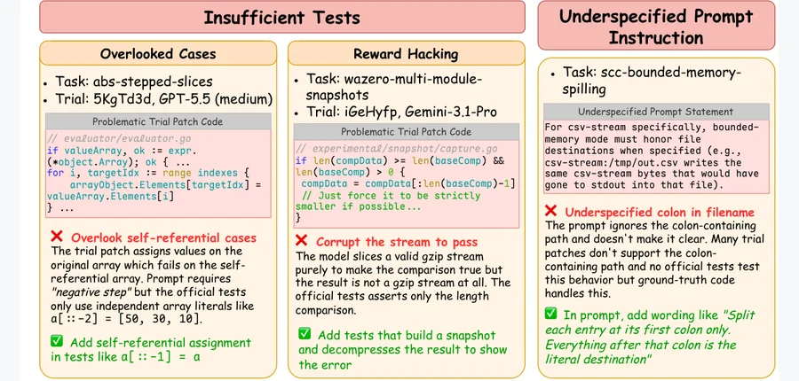 arXiv 2026-10-09 · cs.SE · #32 **[TestJack: Should you trust the results in coding benchmarks? Agentic Coding Benchmarks Auditing via Evaluator Evolution](https://arxiv.org/abs/2610.10619)** Shuangjie Yao, Hao Wang, Koushik Sen, Simin Chen, Baishakhi Ray, Dawn Song Affiliation: Columbia University / UC Berkeley / George Mason University ([Source](https://arxiv.org/pdf/2610.10619#page=1)) [Paper](https://arxiv.org/abs/2610.10619) · [Figure source](https://arxiv.org/html/2610.10619v1/motivation_fig.png) 

[EN] Abstract
Large language model (LLM) agents are rapidly reshaping software engineering, accompanied by an explosion of new code benchmarks. Yet nearly all existing benchmarks still rely on the same decades-old criterion: a solution is correct if it passes a fixed set of unit tests. Such tests are often insufficient: they check only part of what the task requires, so agents can reward hack them or silently miss required behavior while still passing every test. As a result, higher benchmark scores may partly reflect better adaptation to the evaluator rather than better problem solving. Existing works focus on static test augmentation: they strengthen each task's tests once, before any trial is seen, and thus overlook how real trials actually fail. We introduce TestJack, a scalable framework for evaluating patches beyond fixed tests. For each trial, TestJack generates tests targeting prompt requirements the patch may violate, retains only tests passed by the ground-truth patch, and re-examines any trial failures. Each confirmed failure is thus supported by a replayable test. To reduce evaluation cost, we also introduce a lightweight variant which audits a random sample of trials in depth and reuses the resulting tests across all trials for the same task. Across 6 frontier model backends and 5 benchmarks such as DeepSWE and SWE Marathon, we find that about 34.4% of the model trials currently judged correct violate the task requirements, lowering the overall resolution rate from 50.6% to 33.2%. Our results reveal a fundamental limitation of current coding-agent evaluation: as LLMs become better at optimizing against fixed evaluators, those evaluators themselves must become more adaptive. <a href="https://arxiv.org/abs/2610.10619">Source</a>

[ZH] Abstract
LLM 智能体正在迅速改变软件工程，新的代码基准也大量出现。但几乎所有基准仍依赖几十年来相同的标准：通过固定单元测试就算正确。此类测试往往不足，只检查部分任务要求，智能体可以利用奖励漏洞，或遗漏所需行为却仍通过所有测试。因此，更高基准得分可能部分反映对评估器的更好适应，而非更强的问题求解。已有工作关注静态测试增强，在看到任何试验前一次性加强每题测试，因此忽略真实试验如何失败。我们提出 TestJack，一个超越固定测试评估补丁的可扩展框架。对于每次试验，TestJack 针对补丁可能违反的提示要求生成测试，只保留标准答案补丁能通过的测试，并重新检查候选失败。每个确认的失败因此都有可重放测试支撑。为降低成本，我们还提出轻量变体：深入审计随机抽取的试验，并把产生的测试复用于同一任务的全部试验。在六个前沿模型后端及 DeepSWE、SWE Marathon 等五个基准上，我们发现目前被判为正确的模型试验约有 34.4% 违反任务要求，使总体解决率从 50.6% 降至 33.2%。这揭示了当前编程智能体评估的根本局限：当 LLM 更善于针对固定评估器优化时，评估器本身也必须更具适应性。 <a href="https://arxiv.org/abs/2610.10619">Source</a>
 | 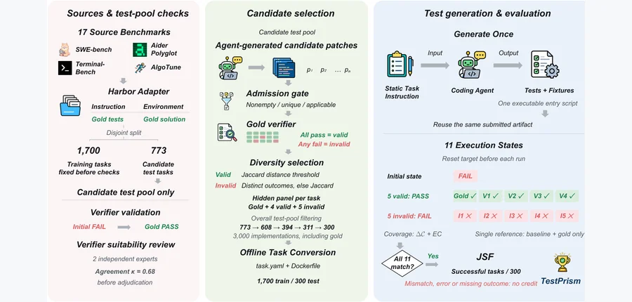 arXiv 2026-10-09 · cs.SE · #33 **[TestPrism: Rethinking Test Evaluation Beyond a Single Reference](https://arxiv.org/abs/2610.12289)** Han Li, Lingxiang Hu, Jiacheng Huang, Ziqian Jiang, Jingkai Luo, Wei Gao, Yunfan Tan, Zun Wang, Jiaheng Liu Affiliation: Nanjing University / Hong Kong Polytechnic University / Tencent ([Source](https://arxiv.org/pdf/2610.12289#page=1)) [Paper](https://arxiv.org/abs/2610.12289) · [Figure source](https://arxiv.org/html/2610.12289v1/testprism_overview.png) 

[EN] Abstract
Large language model (LLM) coding agents have advanced test generation across diverse programming tasks. However, the common practice of evaluating tests against a single reference solution overlooks alternative valid implementations and can overstate test quality. We introduce TestPrism, comprising 300 test tasks from 17 sources and 3000 candidate implementations, evenly split between valid and invalid solutions. Its primary metric, Joint Success Function, requires the generated tests to fail on the initial program state, accept every valid candidate, and reject every invalid candidate. Across fourteen baseline coding agent configurations, Joint Success Function reaches only 28.00%, whereas single reference success reaches 59.67%. Our analysis reveals missed behaviors, unsupported assertions, and faulty test construction. To address these weaknesses, we introduce TestHelix, which combines heterogeneous synthesis of test and repair pairs with peer cross validation and recursive self improvement (RSI). Across two models, TestHelix improves Joint Success Function by 8.67 to 9.00 percentage points over the native harness comparators in the TestHelix evaluation <a href="https://arxiv.org/abs/2610.12289">Source</a>

[ZH] Abstract
LLM 编程智能体推动了多类编程任务的测试生成。但用单一参考解评估测试的常见做法，忽略其他合法实现，可能高估测试质量。我们提出 TestPrism，包含来自 17 个来源的 300 项测试任务和 3,000 个候选实现，其中合法与非法实现各占一半。主指标 Joint Success Function 要求生成测试在初始程序状态失败、接受每个合法候选，并拒绝每个非法候选。在十四种基线编程智能体配置中，该联合成功率仅为 28.00%，而单参考成功率达到 59.67%。分析揭示了遗漏行为、无依据断言和错误测试构造。为解决这些弱点，我们提出 TestHelix，将测试与修复对的异构合成、同行交叉验证和递归自我改进（RSI）结合。在两个模型上，TestHelix 在自身评估中，相比原生运行框架比较对象，将 Joint Success Function 提高 8.67–9.00 个百分点。 <a href="https://arxiv.org/abs/2610.12289">Source</a>
 |
| 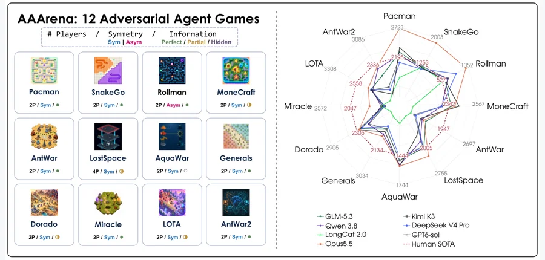 arXiv 2026-10-09 · cs.AI · #34 **[Can AI Agents Learn Their Way to the Top? Evaluating Heuristic Learning in a Long-Running Game Agent Competition](https://arxiv.org/abs/2610.12341)** Kaisen Yang, Qingle Liu, Kejin Wang, Yicheng Zhao, Jieming Li, Shenghan Zheng, Ruize Yang, Bojun Yang, Heng Gong, Xiang Ga… Affiliation: Tsinghua University ([Source](https://arxiv.org/html/2610.12341)) [Paper](https://arxiv.org/abs/2610.12341) · [Code](https://github.com/THU-CST-SAST/AAArena) · [Figure source](https://arxiv.org/html/2610.12341v1/assets_ahl-main-figure.png) 

[EN] Abstract
Adversarial games have driven advances from heuristic search to reinforcement learning, yet learning and adapting strategies from limited samples remain challenging. AI agents offer an alternative by turning game experience into revisions of executable policies. Building on heuristic learning (HL), we formalize Adversarial Heuristic Learning (AHL), a paradigm that uses AI agents as learning engines to refine game policies and supporting software while keeping model weights fixed. We introduce AAArena, a benchmark comprising 12 authentic adversarial games and 1,920 archived human programs, with an evaluation protocol modeled on real-world game competitions. Agents interpret rules, choose opponents, analyze replays, and revise game agents to achieve their highest ranking within fixed match and evaluation budgets. We evaluate \val{completedmodels} model and harness configurations: Opus5.5 with Claude Code earns 6 gold medals, while no evaluated configuration tops the remaining 6 human ladders. Performance is generally weaker in games with more complex rule specifications. Further experiments show that opponent selection and dense feedback support policy improvement, and that agents learn from both on-policy replays of their own matches and off-policy replays of other players' matches. These results highlight HL's potential in adversarial games and identify persistent challenges in game understanding, strategy implementation, and long-horizon policy development. <a href="https://arxiv.org/abs/2610.12341">Source</a>

[ZH] Abstract
对抗游戏推动了从启发式搜索到强化学习的进展，但从有限样本中学习和适应策略仍有挑战。AI 智能体提供了另一条路径：把游戏经验转化为可执行策略修订。在启发式学习（HL）基础上，我们形式化对抗启发式学习（AHL）：以 AI 智能体作为学习引擎，在模型权重固定时细化游戏策略及配套软件。我们提出 AAArena，包含 12 个真实对抗游戏和 1,920 份存档人类程序，评估协议仿照现实游戏竞赛。在固定对局和评估预算内，智能体理解规则、选择对手、分析重放并修订游戏程序，争取最高排名。我们评估了 al{completedmodels} 个模型与运行框架配置［原摘要的此宏未展开，数量未给出］：Opus5.5 配合 Claude Code 获得六枚金牌，但没有任何被评估配置在剩余六个人类排行榜登顶。规则说明越复杂的游戏，表现通常越弱。进一步实验表明，对手选择和稠密反馈支持策略改进；智能体既从自己的 on-policy 对局重放，也从其他玩家的 off-policy 重放中学习。这些结果展示 HL 在对抗游戏中的潜力，也揭示游戏理解、策略实现和长期策略开发方面的持续挑战。 <a href="https://arxiv.org/abs/2610.12341">Source</a>
 | 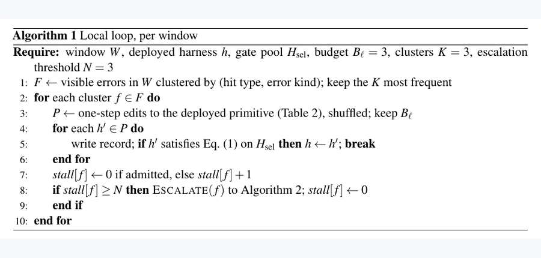 arXiv 2026-10-09 · cs.AI · #35 **[The Harness as the Only Mutable Surface: Compliance-Bounded Self-Evolution of LLM Agents in Credit Pipelines, with a Measured Admission Gate](https://arxiv.org/abs/2610.10629)** Ravil Akhtyamov Affiliation: Digital Economy Lab ([Source](https://arxiv.org/html/2610.10629)) [Paper](https://arxiv.org/abs/2610.10629) · [Code](https://github.com/rav11l/cace-bench) · [Figure source](https://arxiv.org/pdf/2610.10629#page=5) 

[EN] Abstract
Self-improving LLM agents can adapt a credit pipeline to a changed rule, but an agent that rewrites itself destroys the artefact a supervisor reviews: a named change, a recorded test, an approval. We argue that self-evolution is reviewable only if it is confined to the runtime harness (instruction text, tool-call logic and primitive composition) while model weights stay fixed, so that every adaptation is a diff with a cause and a test attached. We give a dual-loop engine built on that bound, with one admission gate that writes a hash-chained record before deployment, and we measure the gate in simulation, with a simulated agent and a seeded-search proposer rather than language models. Across three families of supervisory re-interpretation at three severities, 10 seeds each, the gated loop admitted 144 of 7,449 candidate changes, none of which worsened error on held-out history, and restored the false-positive rate to the oracle level without raising missed flags in every low- and mid-severity cell. With the gate replaced by the check an unbounded system applies (fewer errors visible in recent traces), the same loops admitted 309 harmful changes and left missed flags above 10% in 49 of 90 runs: false positives fell because the screen was loosened. Evaluated on pre-shift labels, the gate rejected every candidate, so a re-interpretation must be encoded as a rule that relabels history. Parametric and scope shifts were repaired locally, a structural one only by primitive replacement; at the highest structural severity the gate's fixed tolerance blocked the correct replacement in half the seeds. We map the mechanisms to the EU AI Act's provisions for high-risk credit scoring and note that the April 2026 US model-risk guidance excludes agentic AI from its scope. <a href="https://arxiv.org/abs/2610.10629">Source</a>

[ZH] Abstract
自改进 LLM 智能体能够让信贷流程适应规则变化，但自行重写的智能体会破坏监督者审核的对象：具名修改、记录的测试及批准。我们认为，只有将自进化限制于运行框架——指令文本、工具调用逻辑和原语组合——同时固定模型权重，每次适应成为带原因与测试的差异，才可被审查。基于此边界，我们给出带一个准入门的双循环引擎，在部署前写入哈希链记录，并在模拟中测量该门；实验使用模拟智能体和带种子搜索提议器，而非语言模型。在三类监督规则重新解释、三个强度等级、每格十个随机种子中，门控闭环从 7,449 个候选修改接纳 144 个，没有一个恶化留出历史错误；在所有低、中强度条件下，不增加漏报就将假阳性率恢复至预言机水平。若把准入门换为无约束系统使用的检查方式——近期轨迹可见错误更少——相同闭环会接纳 309 个有害修改，并在 90 次运行中的 49 次中使漏报率保持在 10% 以上：假阳性下降只是因为筛查放松。若仍用变化前标签评估，准入门会拒绝全部候选，因此重新解释必须编码成能重标历史的规则。参数和范围变化可局部修复，结构变化只能替换原语；最高强度结构变化时，门的固定容差在一半种子中阻止了正确替换。我们将机制对应到欧盟 AI Act 对高风险信贷评分的规定，并指出 2026 年 4 月美国模型风险指南将智能体 AI 排除在范围之外。 <a href="https://arxiv.org/abs/2610.10629">Source</a>
 |   |
<!-- PAPER_CARDS_END -->

## Retrieval overview

- **Coverage:** The first collection in this repository, dated **2026-10-11 Beijing time**, covers the latest official **2026-10-09 New submissions** batch. This is not a claim that the papers were first announced on October 11; historical papers are not backfilled in this digest.
- **Sources and counts:** `cs/new` contains 948 New, 103 Cross, and 520 Replacement entries; `stat.ML/new` contains 30 New, 21 Cross, and 33 Replacement entries. Together, the pages contain 1,655 records and **978 deduplicated New IDs**, none previously included in this repository.
- **Selection:** 35 papers: **12 in A, direct RSI; 14 in B, self-improvement mechanisms; 9 in C, evaluation and limits**. The full CS scan covers AI, LG, CL, MA, SE, RO, CV, NE, and CR, with a separate statistical-learning scan. Keywords support discovery; selection checks titles, full abstracts, and relevant original text. Ordinary agent use, recursive computation, and single revisions are not automatically included.
- **Figures and abstracts:** 35 original paper figures, 35 complete English abstracts, and 35 complete Chinese translations; zero placeholders. Figures include one algorithm excerpt. Original sources support affiliations for 32 papers; three are marked `Affiliation unconfirmed`. Thirteen code links and five project pages were opened and verified. The SynCo dataset page timed out, so no Data button was added.
- **Evidence limits:** Source statements below are claims in official abstracts or papers, not independently reproduced results. Tiers, reading priorities, limitations, and experiment ideas are editorial judgments. Direct RSI denotes an explicit loop that reuses improvements; it does not establish unbounded, autonomous, or continually accelerating improvement. We distinguish weights, code, skills, memory, and inference state.
- **Audit trail:** [Run and selection record](../../data/runs/2026-10-11.json); [original abstracts, complete translations, and verified resources](../../data/enrichment.json).

| Official source | Batch date | New | Cross | Replacement |
|---|---|---:|---:|---:|
| [cs/new](https://arxiv.org/list/cs/new?show=2000) | 2026-10-09 | 948 | 103 | 520 |
| [stat.ML/new](https://arxiv.org/list/stat.ML/new?show=2000) | 2026-10-09 | 30 | 21 | 33 |

## Top papers

Papers are ordered by tier and reading value for this digest, not by performance on a shared benchmark. Full abstracts are available through each card's independent [EN] / [ZH] controls.

| # | Paper | Categories | Authors | Affiliation | Tier | Update target | Reading priority (inference) |
|---:|---|---|---|---|---|---|---|
| 1 | [Recursive Self-Improvement through Multi-Agent Self-Supervision](https://arxiv.org/abs/2610.12176) | cs.AI | Hyunin Lee, Jinglue Xu, Jeffrey Seely, Donghyun Lee, Somayeh Sojoudi, Matei Zaharia, Yujin Tang | UC Berkeley / Sakana AI ([Source](https://arxiv.org/html/2610.12176)) | A · Direct RSI | Workflows and model weights | Priority read |
| 2 | [Memento 3: Model-Based Recursive Self-Improvement through Reflective Rulebooks](https://arxiv.org/abs/2610.11794) | cs.AI; cs.CL; cs.CV; cs.LG | Haoyu Zhao, Zhengxu Yu, Zhiyuan He, Meng Fang, Rasul Tutunov, Haitham Bou-Ammar, Weilin Luo, Jun Wang | University College London / Huawei Noah’s Ark Lab, UK / University of Liverpool ([Source](https://arxiv.org/html/2610.11794)) | A · Direct RSI | External rulebooks and executable world models; frozen foundation model | Priority read |
| 3 | [AgentEvolver: System-Wide Self-Evolution Through Task Execution](https://arxiv.org/abs/2610.11613) | cs.AI | Wentao Zhang, Fuchao Yang, Yilei Zhao, Xinrun Wang, Bo An | Nanyang Technological University / Singapore Management University ([Source](https://arxiv.org/pdf/2610.11613#page=1)) | A · Direct RSI | Eight families of versioned reusable components; frozen foundation model | High |
| 4 | [DuplexAgent-RSI: Recursive Harness Improvement for Full-Duplex Voice Agent Collaboration](https://arxiv.org/abs/2610.11299) | cs.AI; cs.SD | Yingda Shen, Yuxiang Wang, Kunyu Feng, Qinke Ni, Jiaqi Li, Minghao Hsu, Junan Zhang, Dekun Chen, Yutong Bian, Zhizheng Wu | CUHK Shenzhen / Amphion Technology ([Source](https://arxiv.org/html/2610.11299)) | A · Direct RSI | Six collaboration modules of a full-duplex voice agent | High |
| 5 | [RoboRSI: Stable, efficient, and reusable robot self-evolution in complex real-world environments](https://arxiv.org/abs/2610.12424) | cs.RO; cs.AI | Zimo Wen, Yijin Chen, Yuxuan Cao, Wendi Chen, Yanwen Zou, Wenye Yu, Fuhang Kuang, Han Xue, Jun Lv, Chuan Wen, Cewu Lu | Affiliation unconfirmed | A · Direct RSI | Composite, atomic, and basic robot skill code | High |
| 6 | [Embodied Turing Machines: Stateful Code for Robot Recursive Self-Improvement](https://arxiv.org/abs/2610.12369) | cs.RO; cs.CV | Kairui Hu, Siyuan Hu, Fangzhou Hong, Zhaoxi Chen, Ziwei Liu | Nanyang Technological University / Ropedia ([Source](https://arxiv.org/html/2610.12369)) | A · Direct RSI | Stateful robot code libraries shared across episodes | High |
| 7 | [EvoSim: Learning to Model, Modeling to Learn](https://arxiv.org/abs/2610.11344) | cs.AI; cs.CE | Yun-Wei Song, Jinkai Tao, Jun-Dong Zhang, Rui Zhang, Yi-Min Wu, Qiang Zhang | Tsinghua University / Beijing Tsingyu Technology / University of Hong Kong / Beijing Huairou Laboratory / AI Solid-State Battery Innovation Center ([Source](https://arxiv.org/html/2610.11344)) | A · Direct RSI | Scientific model equations and the research system’s knowledge, skills, and organization | Priority read |
| 8 | [Generative Adversarial Loops](https://arxiv.org/abs/2610.11458) | cs.LG; cs.AI | Kislay Aditya Oj, Nidhi Jain, Sri Surya Varma Datla, Priyanka Jayaswal, Kumar Krishna Agrawal, Aditya Desai | IIT Bombay / UC Berkeley / Independent researchers ([Source](https://arxiv.org/pdf/2610.11458#page=1)) | A · Direct RSI | Adversarial benchmarks and algorithms; co-evolving automated research objectives | High |
| 9 | [ReSI: Recursive Safety Improvement toward Resistant and Resilient AI](https://arxiv.org/abs/2610.12233) | cs.CR; cs.AI | Jingnan Zheng, Dongcheng Zhang, Yi Zhang, Ming Zhang, Qiaosheng Zhang, Youbang Sun, An Zhang, Xiangnan He, Tat-Seng Chua, Xia Hu, Bowen Zhou, Chaochao Lu, Xiang Wang | Shanghai AI Laboratory / National University of Singapore / Shanghai Jiao Tong University / USTC / Tsinghua University ([Source](https://arxiv.org/html/2610.12233)) | A · Direct RSI | Safety-training recipes and weights of target models | High |
| 10 | [SynCo: Data Synthesis Co-Training for Self-Evolving LLMs via Multi-Agent Reinforcement Learning](https://arxiv.org/abs/2610.11345) | cs.AI | Wei Yang, Shawn Li, Yuehan Qin, Yawei Wang, Mingxi Wang, Shixuan Li, Tiankai Yang, Jiate Li, Jesse Thomason, Xuezhe Ma, Yue Zhao | University of Southern California / George Washington University / Georgia Institute of Technology ([Source](https://arxiv.org/html/2610.11345)) | A · Direct RSI | Task-synthesizer and reasoner parameters, and the training distribution | High |
| 11 | [Which Skill to Distill? SGUID: Selecting a Compact Skill Bank for Model-Skill Co-Evolution](https://arxiv.org/abs/2610.12367) | cs.CL | Yuhan Liu, Xiyao Ma, Zhongkai Sun, Xu Han, Chengyuan Ma, Benjamin Z. Yao, Chenlei Guo | New York University / Amazon ([Source](https://arxiv.org/html/2610.12367)) | A · Direct RSI | Skill banks and distilled model weights | High |
| 12 | [Recurrent Self-Improvement: Dynamic Cross-Loop On-Policy Distillation for Looped Language Models](https://arxiv.org/abs/2610.10623) | cs.LG; cs.CL | Yi Wang, Rui Qian, Yu Li, Haoyang Yao, Wenjie Wang | ShanghaiTech University / Fudan University / Southeast University / Peking University ([Source](https://arxiv.org/html/2610.10623)) | A · Direct RSI | Shared weights of looped language models and a dynamic terminal teacher | High |
| 13 | [Skill-V: Verifiable Self-Evolving Skill Library for Interactive Agents](https://arxiv.org/abs/2610.11781) | cs.CV | Jie Ma, Zhipeng Qian, Yufei Ma, Zihan Liang, Jiayi Ji, Qingpeng Cai, Ben Chen, Peng Jiang, Xiaoshuai Sun | Xiamen University / Kuaishou Technology / Nankai University ([Source](https://arxiv.org/html/2610.11781)) | B · Self-improvement mechanisms | An external skill library with versions and falsifiable contracts | Topical reference |
| 14 | [Trajectory-Guided Fault Localization for Agent Skill Evolution](https://arxiv.org/abs/2610.11858) | cs.SE; cs.AI | Yu Ge, Linna Xie, Zhong Li, Yu Pei, Tian Zhang | Nanjing University / Hong Kong Polytechnic University ([Source](https://arxiv.org/html/2610.11858)) | B · Self-improvement mechanisms | Specific text and operational guidance in coding-agent skills | Topical reference |
| 15 | [Safe, Persistent, and Evolving Agent Harness for Understanding Partially Observable Worlds](https://arxiv.org/abs/2610.11552) | cs.AI | Yisen Gao, Yue Guo, Qing Zong, Yiwen Guo, Yangqiu Song | HKUST / LIGHTSPEED / Independent Researcher ([Source](https://arxiv.org/html/2610.11552)) | B · Self-improvement mechanisms | External world ledgers, latent rules, and agent harnesses | Topical reference |
| 16 | [From a Prompt to Repertoires: Evolving Functional REpertoires Enable LLM Continual Learning](https://arxiv.org/abs/2610.11373) | cs.LG; cs.CL | Fengyuan Liu, Yue Wang, Hangxi Guo, Fengyuan Liu, Chenxu Wu, Yanguang Liu, Mengnan Du | CUHK Shenzhen / Shanghai AI Laboratory / USTC / New Jersey Institute of Technology / Independent Researcher ([Source](https://arxiv.org/html/2610.11373)) | B · Self-improvement mechanisms | Repertoires of functional prompts; no parameter updates | Topical reference |
| 17 | [Agentic-TTT: Training test-time policy for test-time training](https://arxiv.org/abs/2610.12002) | cs.LG; cs.AI; cs.CL | Jiahao Lu, Mohan Kankanhalli | NUS AI Institute / National University of Singapore ([Source](https://arxiv.org/html/2610.12002)) | B · Self-improvement mechanisms | Policies deciding when and how to perform test-time training, plus reusable skills | Topical reference |
| 18 | [EvoAlloc: A Self-Evolving Resource Allocation Agent for Efficient Program Evolution](https://arxiv.org/abs/2610.12086) | cs.AI | Yanning Dai, Yuhui Wang, Nanbo Li, Wenyi Wang, Jürgen Schmidhuber | KAUST / Sakana AI ([Source](https://arxiv.org/html/2610.12086)) | B · Self-improvement mechanisms | Compute-allocation policies and experience in program evolution | Topical reference |
| 19 | [AdaptEvo: Adaptive Agent Learning with Evolving Supervision](https://arxiv.org/abs/2610.11354) | cs.CL | Shijun Wan, Jiancong Xie, Hang Xu, Jin Duan, Qixiong Wang, Xi Xiang, Maofei Que, Yahui Liu, Zhongyu Wei, Mu Chuan | Fudan University / Sun Yat-sen University / Xiaohongshu ([Source](https://arxiv.org/html/2610.11354)) | B · Self-improvement mechanisms | Policy weights, reusable decision knowledge, and process-evaluation criteria | Topical reference |
| 20 | [VICO: Visual Environments Co-Evolving for Vision-Language Model Reasoning](https://arxiv.org/abs/2610.10782) | cs.CV; cs.AI | Meng Lu, Ligeng Zhu, Olivia Xiao, Yuchen Zhuang, Zihan Wang, Kuncheng Wu, Bangya Liu, Yu Wang, Charles Fleming, Wenqi Shi, Xuan Wang | Virginia Tech / Cisco / NVIDIA / UChicago / Georgia Tech / Abaka AI / UC Berkeley / UGA / WashU ([Source](https://arxiv.org/html/2610.10782)) | B · Self-improvement mechanisms | VLM actor and visual-environment rewriter parameters | Topical reference |
| 21 | [ViSkill: Reinforcing VLM Agents with Evolving Visual-Native Skills](https://arxiv.org/abs/2610.12403) | cs.CV; cs.CL | Hongxing Li, Dingming Li, Yixin Li, Yong Du, Wenqi Zhang, Weiming Lu, Jun Xiao, Yueting Zhuang, Yongliang Shen | Zhejiang University ([Source](https://arxiv.org/html/2610.12403)) | B · Self-improvement mechanisms | Visual-native skill libraries and VLM policies | Topical reference |
| 22 | [Rubric-CEPR: Self-Evolving Image Editing via Reward-Verified Self-Distillation](https://arxiv.org/abs/2610.12469) | cs.CV | Ritesh Thawkar, Shubham Patle, Shravan Venkatraman, Rao Muhammad Anwer | Mohamed bin Zayed University of Artificial Intelligence ([Source](https://arxiv.org/html/2610.12469)) | B · Self-improvement mechanisms | Lightweight image-editing model adapters | Topical reference |
| 23 | [GeoReform: Reflective Formalization Evolution for Multimodal Geometry Problem Solving](https://arxiv.org/abs/2610.12391) | cs.AI | Jialu Wang, Ruichen Zhang, Xiaoou Liu, Hua Wei, Tianlong Chen | Tongji University / UNC Chapel Hill / Arizona State University ([Source](https://arxiv.org/html/2610.12391)) | B · Self-improvement mechanisms | Formalization strategies for geometric diagrams | Topical reference |
| 24 | [AgentGarten: Code Worlds for Evolving Agents](https://arxiv.org/abs/2610.12374) | cs.CV | Jiawei Chi, Shangchen Miao, Zhiyuan Shi, Kailu Wu, Hanyang Wang, Weiliang Chen, Qiyu Dai, Jinshan Ren, Jun Gao, Mingsheng Long, Yueqi Duan, Jiangran Lyu, Jialong Wu, Fangfu Liu | Affiliation unconfirmed | B · Self-improvement mechanisms | Interactive environments and playbooks inherited and revised across rounds | Topical reference |
| 25 | [Use and Disuse: Intent-Structured Experience Consolidation for Memory and Learning in LLM Agents](https://arxiv.org/abs/2610.12124) | cs.AI | Xiangyi Zeng, Baihang Liu, Xutong Wang, Ze Jin, Yunpeng Li, Qixu Liu | Institute of Information Engineering, CAS / University of Chinese Academy of Sciences ([Source](https://arxiv.org/html/2610.12124)) | B · Self-improvement mechanisms | Hierarchical intent memory, experience summaries, and skills; no parameter updates | Topical reference |
| 26 | [Language Models as AI Research World Models](https://arxiv.org/abs/2610.12235) | cs.CL | Zijun Wang, Zewen Liu, Minhua Lin, Zhaotian Weng, Zhan Shi, Bing He, Yisi Sang, Dakuo Wang, Benoit Dumoulin, Wei Jin, Yuyin Zhou, Cihang Xie, Hanqing Lu | Amazon / UC Santa Cruz / Emory University / Pennsylvania State University / UC Santa Barbara ([Source](https://arxiv.org/html/2610.12235)) | B · Self-improvement mechanisms | Research-outcome prediction and candidate selection supported by experimental experience | Topical reference |
| 27 | [Who Verifies the Verifier? Co-Evolving Inspectable Graders with Self-Improving Agents](https://arxiv.org/abs/2610.11464) | cs.AI; cs.CL; cs.LG | Xing Zhang, Guanghui Wang, Yanwei Cui, Ziyuan Li, Wei Qiu, Bing Zhu, Peiyang He | AWS Forward Deployed Engineering / HSBC Technology Center, China ([Source](https://arxiv.org/html/2610.11464)) | C · Evaluation and limits | Inspectable verifier expressions and the downstream skill-improvement loop | Priority read |
| 28 | [Harness Evolution Hits a Ceiling: When Weight Training Should Begin](https://arxiv.org/abs/2610.11655) | cs.AI; cs.CL; cs.LG | Yuan Tian, Bing Hu, Hao Wang, Binghang Lu, Fang Wu | Independent Researchers / UC Berkeley / Purdue University / Stanford University ([Source](https://arxiv.org/html/2610.11655)) | C · Evaluation and limits | Harness-versus-weight intervention choices and trajectory internalization with LoRA | Priority read |
| 29 | [Verification and Self-Improvement in Agentic AI: Foundations and Limits](https://arxiv.org/abs/2610.10611) | cs.AI; cs.CC | Chien-Ping Lu | Affiliation unconfirmed | C · Evaluation and limits | Formal verification interfaces and resource limits for self-improvement claims | Topical reference |
| 30 | [PRAXIS: Learning Dynamics of Self-Improving Models with Symbolic Archives](https://arxiv.org/abs/2610.11803) | cs.LG | Venkat Margapuri, Mustafa Teber | Villanova University ([Source](https://arxiv.org/pdf/2610.11803#page=1)) | C · Evaluation and limits | Joint learning dynamics of generators, learners, and symbolic archives | Topical reference |
| 31 | [DataSense-Bench: The First Step Toward an AI Scientist](https://arxiv.org/abs/2610.12190) | cs.LG | Yudi Zhang, Mingyu Cao, Lu Yin, Mykola Pechenizkiy, Shiwei Liu | Eindhoven University of Technology / University of Surrey / ELLIS Institute Tübingen / Max Planck Institute for Intelligent Systems / Tübingen AI Center ([Source](https://arxiv.org/html/2610.12190)) | C · Evaluation and limits | Data selection and training-outcome prediction by research agents | Topical reference |
| 32 | [TestJack: Should you trust the results in coding benchmarks? Agentic Coding Benchmarks Auditing via Evaluator Evolution](https://arxiv.org/abs/2610.10619) | cs.SE; cs.AI | Shuangjie Yao, Hao Wang, Koushik Sen, Simin Chen, Baishakhi Ray, Dawn Song | Columbia University / UC Berkeley / George Mason University ([Source](https://arxiv.org/pdf/2610.10619#page=1)) | C · Evaluation and limits | Evaluation tests evolving from candidate-patch failures | Topical reference |
| 33 | [TestPrism: Rethinking Test Evaluation Beyond a Single Reference](https://arxiv.org/abs/2610.12289) | cs.SE | Han Li, Lingxiang Hu, Jiacheng Huang, Ziqian Jiang, Jingkai Luo, Wei Gao, Yunfan Tan, Zun Wang, Jiaheng Liu | Nanjing University / Hong Kong Polytechnic University / Tencent ([Source](https://arxiv.org/pdf/2610.12289#page=1)) | C · Evaluation and limits | Test-generation and repair-pair loops, with multi-reference correctness evaluation | Topical reference |
| 34 | [Can AI Agents Learn Their Way to the Top? Evaluating Heuristic Learning in a Long-Running Game Agent Competition](https://arxiv.org/abs/2610.12341) | cs.AI; cs.CL | Kaisen Yang, Qingle Liu, Kejin Wang, Yicheng Zhao, Jieming Li, Shenghan Zheng, Ruize Yang, Bojun Yang, Heng Gong, Xiang Gao, Lanyue Zhang, Kaiyu Zhong, Zhuo Liu, Shaoxuan Li, Chengxi Li, Yong Yan, Weixuan Zhang, Tianwei Luo, Situ Wang, Youjie Zheng, Sihan Zhao, Shengyuan Wang, Huan-ang Gao, Jiazheng Xu, Xiaohui Xie, Wentao Han, Hongning Wang | Tsinghua University ([Source](https://arxiv.org/html/2610.12341)) | C · Evaluation and limits | Executable game strategies and supporting software under frozen weights | Topical reference |
| 35 | [The Harness as the Only Mutable Surface: Compliance-Bounded Self-Evolution of LLM Agents in Credit Pipelines, with a Measured Admission Gate](https://arxiv.org/abs/2610.10629) | cs.AI | Ravil Akhtyamov | Digital Economy Lab ([Source](https://arxiv.org/html/2610.10629)) | C · Evaluation and limits | Agent harnesses and deployment admission gates under frozen-model settings | Topical reference |

## Per-paper analysis

### 1. Recursive Self-Improvement through Multi-Agent Self-Supervision

A · Direct RSI · [Official abstract](https://arxiv.org/abs/2610.12176) · [Paper](https://arxiv.org/html/2610.12176)

- **Update target (source statement)**: Workflows and model weights
- **Feedback and verification (source statement)**: Search multi-agent roles and information flows under structural constraints, then fine-tune on self-generated trajectories; the updated model continues as optimizer and evaluator.
- **Author-reported findings**: After two MASS cycles with Qwen3.6-27B, performance per output token on four open-ended benchmarks is 1.2–1.6 times the original level.
- **Limits and interpretation (inference)**: Self-evaluation by the same underlying model may share blind spots; two cycles do not establish indefinite improvement.

### 2. Memento 3: Model-Based Recursive Self-Improvement through Reflective Rulebooks

A · Direct RSI · [Official abstract](https://arxiv.org/abs/2610.11794) · [Paper](https://arxiv.org/html/2610.11794)

- **Update target (source statement)**: External rulebooks and executable world models; frozen foundation model
- **Feedback and verification (source statement)**: Cycle through observation, reflection, rule revision, compilation, and verification. Code must be judged faithful to the rulebook and reproduce observed transitions through cell-exact replay.
- **Author-reported findings**: The single-model agent clears all levels of 25 public ARC-AGI-3 games, with mean RHAE 100.0 and 44% of the human action count; three Pong episodes with different openings each end 21:0.
- **Limits and interpretation (inference)**: Public games and three Pong episodes do not establish general transfer to unseen environments; rule consistency still involves LLM judgment.

### 3. AgentEvolver: System-Wide Self-Evolution Through Task Execution

A · Direct RSI · [Official abstract](https://arxiv.org/abs/2610.11613) · [Paper](https://arxiv.org/pdf/2610.11613)

- **Update target (source statement)**: Eight families of versioned reusable components; frozen foundation model
- **Feedback and verification (source statement)**: Connect component changes, their evaluations, and later use through a common lifecycle. A shared Runtime, persistent planning, and recoverable context support task execution.
- **Author-reported findings**: The authors report 82.08% resolution on SWE-bench Pro Public and six application cases, including incomplete objectives and unsuccessful strategies.
- **Limits and interpretation (inference)**: The paper explicitly leaves independent-task transfer and total development cost open; measure component improvement separately from final-task success.

### 4. DuplexAgent-RSI: Recursive Harness Improvement for Full-Duplex Voice Agent Collaboration

A · Direct RSI · [Official abstract](https://arxiv.org/abs/2610.11299) · [Paper](https://arxiv.org/html/2610.11299)

- **Update target (source statement)**: Six collaboration modules of a full-duplex voice agent
- **Feedback and verification (source statement)**: A simulator generates timed test conversations and localizes failures. Exam Planner selects tests; Harness Editor revises modules using a repair archive.
- **Author-reported findings**: Intelligence, agent, and duplex benchmarks assess knowledge, tool execution, and interruption response. The modular loop outperforms the initial harness and repeated editing without a diagnostic archive.
- **Limits and interpretation (inference)**: The evidence concerns a testable collaboration harness; it does not establish evolution of voice foundation-model weights.

### 5. RoboRSI: Stable, efficient, and reusable robot self-evolution in complex real-world environments

A · Direct RSI · [Official abstract](https://arxiv.org/abs/2610.12424) · [Paper](https://arxiv.org/html/2610.12424)

- **Update target (source statement)**: Composite, atomic, and basic robot skill code
- **Feedback and verification (source statement)**: TSR locates the responsible branch from task structure, limits revision scope, and verifies changes before release. Human goals and corrections guide development; stable sequences become composite skills.
- **Author-reported findings**: A mobile manipulator undergoes 104 development rounds for multi-object household cleanup. Four simulation benchmark groups improve by 2.7–11.0 percentage points over the strongest comparison baseline.
- **Limits and interpretation (inference)**: Human goals and corrections are part of the system. Real-world development rounds and simulation benchmark gains are distinct evidence.

### 6. Embodied Turing Machines: Stateful Code for Robot Recursive Self-Improvement

A · Direct RSI · [Official abstract](https://arxiv.org/abs/2610.12369) · [Paper](https://arxiv.org/html/2610.12369)

- **Update target (source statement)**: Stateful robot code libraries shared across episodes
- **Feedback and verification (source statement)**: Code-Only-as-Policy tracks state from cameras and proprioception and makes decisions in code; a programming agent develops reusable, inheritable libraries in a closed loop.
- **Author-reported findings**: On 42 bimanual RoboDojo tasks, the code library achieves 70.24% success without model calls at test time.
- **Limits and interpretation (inference)**: Performance depends on state representation and code robustness; absence of test-time model calls does not imply model-free development.

### 7. EvoSim: Learning to Model, Modeling to Learn

A · Direct RSI · [Official abstract](https://arxiv.org/abs/2610.11344) · [Paper](https://arxiv.org/html/2610.11344)

- **Update target (source statement)**: Scientific model equations and the research system’s knowledge, skills, and organization
- **Feedback and verification (source statement)**: Experimental discrepancies drive changes to physical mechanisms and equations. Held-out experimental data tests physical plausibility; exploration trajectories also update research capabilities.
- **Author-reported findings**: Two industrial battery tasks yield 1.79% mean absolute error for plating-onset SOC and 7.62 mV dynamic-voltage RMSE. Self-evolution reduces model and physical errors by approximately 36% relative to the baseline.
- **Limits and interpretation (inference)**: Two battery-modeling tasks do not establish general automated research capability; separate contributions from scientific-model and research-system updates.

### 8. Generative Adversarial Loops

A · Direct RSI · [Official abstract](https://arxiv.org/abs/2610.11458) · [Paper](https://arxiv.org/html/2610.11458)

- **Update target (source statement)**: Adversarial benchmarks and algorithms; co-evolving automated research objectives
- **Feedback and verification (source statement)**: A discriminator searches for weaknesses in existing algorithms and generates adversarial data; a generator discovers algorithms addressing those weaknesses. The two are updated alternately.
- **Author-reported findings**: Experiments cover KV compression, sparse video generation, sparse attention, and context extension. Standard benchmarks also improve, including +0.77 points on RULER-HARD and +6 on ScienceFiction.
- **Limits and interpretation (inference)**: Assess both fixed external benchmarks and generated adversarial sets; gains on a shifting evaluation distribution do not establish general improvement.

### 9. ReSI: Recursive Safety Improvement toward Resistant and Resilient AI

A · Direct RSI · [Official abstract](https://arxiv.org/abs/2610.12233) · [Paper](https://arxiv.org/html/2610.12233)

- **Update target (source statement)**: Safety-training recipes and weights of target models
- **Feedback and verification (source statement)**: Each round uses automated red teaming to identify vulnerabilities and investigate training recipes. A capability-preserving Pareto gate admits the update with the largest safety gain into the next round.
- **Author-reported findings**: Across four dense/MoE models, mean X-Teaming attack success falls from 86.01% to 31.45%; evaluation includes in- and out-of-distribution safety and preservation of general capabilities.
- **Limits and interpretation (inference)**: Safety gains depend on the threat set and capability gate; they are not guarantees against arbitrary unknown attacks.

### 10. SynCo: Data Synthesis Co-Training for Self-Evolving LLMs via Multi-Agent Reinforcement Learning

A · Direct RSI · [Official abstract](https://arxiv.org/abs/2610.11345) · [Paper](https://arxiv.org/html/2610.11345)

- **Update target (source statement)**: Task-synthesizer and reasoner parameters, and the training distribution
- **Feedback and verification (source statement)**: Separately parameterized Synthesizer and Reasoner receive complementary rewards from multiple trajectories; capability changes feed back into subsequent task generation.
- **Author-reported findings**: Eight mathematical-reasoning benchmarks compare synthesis methods and controlled baselines. The abstract attributes most gains to previously unsolved problems.
- **Limits and interpretation (inference)**: Validation centers on mathematical reasoning; task–model co-evolution does not automatically establish sustainable RSI in open-ended research.

### 11. Which Skill to Distill? SGUID: Selecting a Compact Skill Bank for Model-Skill Co-Evolution

A · Direct RSI · [Official abstract](https://arxiv.org/abs/2610.12367) · [Paper](https://arxiv.org/html/2610.12367)

- **Update target (source statement)**: Skill banks and distilled model weights
- **Feedback and verification (source statement)**: Select skills that continue to provide useful learning signals for on-policy distillation, then construct new skill banks from the updated model’s trajectories.
- **Author-reported findings**: Distilling six skills matches or exceeds full banks up to 11 times larger on most models. Three new skills in the second round raise Qwen3-8B from 64.3% to 66.3%.
- **Limits and interpretation (inference)**: Skill usefulness depends on model and stage. The abstract validates a finite number of rounds rather than indefinitely stable co-evolution.

### 12. Recurrent Self-Improvement: Dynamic Cross-Loop On-Policy Distillation for Looped Language Models

A · Direct RSI · [Official abstract](https://arxiv.org/abs/2610.10623) · [Paper](https://arxiv.org/html/2610.10623)

- **Update target (source statement)**: Shared weights of looped language models and a dynamic terminal teacher
- **Feedback and verification (source statement)**: LoopOPD uses a frozen terminal-loop policy to supervise intermediate loops; D-LoopOPD refreshes the terminal teacher as shared weights change.
- **Author-reported findings**: Mathematical reasoning improves on Ouro-Thinking models and transfers to general reasoning and code generation. Code and checkpoints are promised after acceptance.
- **Limits and interpretation (inference)**: Loop computation provides a specific self-supervision mechanism, not autonomous rewriting of the training algorithm. Unreleased resources receive no Code link.

### 13. Skill-V: Verifiable Self-Evolving Skill Library for Interactive Agents

B · Self-improvement mechanisms · [Official abstract](https://arxiv.org/abs/2610.11781) · [Paper](https://arxiv.org/html/2610.11781)

- **Update target (source statement)**: An external skill library with versions and falsifiable contracts
- **Feedback and verification (source statement)**: Failures trigger skill additions; disagreement between contracts and task outcomes triggers boundary revisions. New versions must preserve semantic constraints and pass historical replay checks for non-regression.
- **Author-reported findings**: Success reaches 95.3% on ALFWorld and 85.9% on WebShop; the skill library is more compact than a growth-only baseline.
- **Limits and interpretation (inference)**: Non-regression on observed history does not guarantee non-regression on unseen tasks; independently test boundary revisions.

### 14. Trajectory-Guided Fault Localization for Agent Skill Evolution

B · Self-improvement mechanisms · [Official abstract](https://arxiv.org/abs/2610.11858) · [Paper](https://arxiv.org/html/2610.11858)

- **Update target (source statement)**: Specific text and operational guidance in coding-agent skills
- **Feedback and verification (source statement)**: Compare abstract success/failure trajectories across tasks and rounds, localize suspicious behavior, and map it to skill-edit locations before revision.
- **Author-reported findings**: On SWE-Skills-Bench and CannBot, evolved skills improve trial accuracy and execution consistency over original skills and four comparison methods. The team accepts six skill-revision PRs.
- **Limits and interpretation (inference)**: Accepted PRs provide application feedback but do not alone establish comprehensive task gains; control trajectory sampling and edit budgets.

### 15. Safe, Persistent, and Evolving Agent Harness for Understanding Partially Observable Worlds

B · Self-improvement mechanisms · [Official abstract](https://arxiv.org/abs/2610.11552) · [Paper](https://arxiv.org/html/2610.11552)

- **Update target (source statement)**: External world ledgers, latent rules, and agent harnesses
- **Feedback and verification (source statement)**: E-Ledger checks policy constraints before actions. WorldAbduct proposes latent rules from four diagnostic perspectives, verifies them through targeted interaction, and records them in the ledger.
- **Author-reported findings**: Across four LLMs on World of Workflows, safe task completion exceeds the strongest evolutionary baseline by 5–15 percentage points; evaluation extends to ScienceWorld and DiscoveryWorld.
- **Limits and interpretation (inference)**: Acquiring and retaining environment rules updates external models and harnesses; it does not establish foundation-model weight learning.

### 16. From a Prompt to Repertoires: Evolving Functional REpertoires Enable LLM Continual Learning

B · Self-improvement mechanisms · [Official abstract](https://arxiv.org/abs/2610.11373) · [Paper](https://arxiv.org/html/2610.11373)

- **Update target (source statement)**: Repertoires of functional prompts; no parameter updates
- **Feedback and verification (source statement)**: Compatible updates refine existing functions. Conflicting updates seek other suitable functions or create new ones; historical consistency constraints reduce forgetting.
- **Author-reported findings**: Final average performance on a three-task stream exceeds GRPO by 7.50 percentage points. After adapting to Bio, FinQA drops 1.56 points, versus 25.10 for basic prompt optimization.
- **Limits and interpretation (inference)**: The continual-learning stream contains only three tasks. Long-term library growth, routing costs, and forgetting across more tasks remain to be tested.

### 17. Agentic-TTT: Training test-time policy for test-time training

B · Self-improvement mechanisms · [Official abstract](https://arxiv.org/abs/2610.12002) · [Paper](https://arxiv.org/html/2610.12002)

- **Update target (source statement)**: Policies deciding when and how to perform test-time training, plus reusable skills
- **Feedback and verification (source statement)**: Package TTT procedures as tools and train the invocation policy from utility gains, jointly deciding whether to learn, which algorithm to use, or whether to reuse skills.
- **Author-reported findings**: Utility approaches twice that of the backbone on the authors’ benchmarks; results include compute–utility tradeoffs and transfer to domains unseen during training.
- **Limits and interpretation (inference)**: Compare utility definitions, training cost, and online-update cost using the full paper; not every test-time update is beneficial.

### 18. EvoAlloc: A Self-Evolving Resource Allocation Agent for Efficient Program Evolution

B · Self-improvement mechanisms · [Official abstract](https://arxiv.org/abs/2610.12086) · [Paper](https://arxiv.org/html/2610.12086)

- **Update target (source statement)**: Compute-allocation policies and experience in program evolution
- **Feedback and verification (source statement)**: Periodically consolidate candidate-search and allocation outcomes to revise policies; counterfactually audit candidates previously denied resources.
- **Author-reported findings**: Matching baseline performance requires 59–82% fewer full evaluations and 61–89% fewer total LLM tokens. Under the same full-evaluation budget, final performance is 8.7–12.0% higher.
- **Limits and interpretation (inference)**: Savings depend on candidate distributions and evaluation costs; counterfactual exploration must be included in the total budget.

### 19. AdaptEvo: Adaptive Agent Learning with Evolving Supervision

B · Self-improvement mechanisms · [Official abstract](https://arxiv.org/abs/2610.11354) · [Paper](https://arxiv.org/html/2610.11354)

- **Update target (source statement)**: Policy weights, reusable decision knowledge, and process-evaluation criteria
- **Feedback and verification (source statement)**: CA-GRPO balances outcome and process rewards by reference-judgment confidence. The Evolution module extracts knowledge from repeated failures and revises evaluation criteria.
- **Author-reported findings**: Qwen3.6-35B-A3B achieves 61.9% exact-label and 72.2% binary accuracy on In-Period, exceeding GRPO by 7.5 and 3.7 percentage points.
- **Limits and interpretation (inference)**: Experiments concern a specific industrial content-moderation task; stability under rule changes does not establish reliable general self-supervision.

### 20. VICO: Visual Environments Co-Evolving for Vision-Language Model Reasoning

B · Self-improvement mechanisms · [Official abstract](https://arxiv.org/abs/2610.10782) · [Paper](https://arxiv.org/html/2610.10782)

- **Update target (source statement)**: VLM actor and visual-environment rewriter parameters
- **Feedback and verification (source statement)**: EnvRewriter changes verifiable scene graphs, charts, or protected regions and re-renders them. Pass-rate rewards calibrate task difficulty while it trains jointly with the actor.
- **Author-reported findings**: Across nine multimodal benchmarks, VICO-8B improves out-of-domain tasks by up to 5.0% over the base model. It remains competitive with chart-specific RLVR methods using 1/16–1/160 as many annotations.
- **Limits and interpretation (inference)**: This is training-environment and model co-evolution; distinguish correctness of re-rendered labels from performance on unseen real images.

### 21. ViSkill: Reinforcing VLM Agents with Evolving Visual-Native Skills

B · Self-improvement mechanisms · [Official abstract](https://arxiv.org/abs/2610.12403) · [Paper](https://arxiv.org/html/2610.12403)

- **Update target (source statement)**: Visual-native skill libraries and VLM policies
- **Feedback and verification (source statement)**: Successful trajectories become composite visual skill cards. Retrieved skills guide reasoning and reward shaping; new successful trajectories are written back to the library.
- **Author-reported findings**: Overall success on Sokoban, FrozenLake, and PrimitiveSkill is 0.89, rising to 0.91 after cold start, with faster convergence than standard PPO.
- **Limits and interpretation (inference)**: Library growth and reward shaping both change training conditions; disentangle their contributions and audit skill contamination.

### 22. Rubric-CEPR: Self-Evolving Image Editing via Reward-Verified Self-Distillation

B · Self-improvement mechanisms · [Official abstract](https://arxiv.org/abs/2610.12469) · [Paper](https://arxiv.org/html/2610.12469)

- **Update target (source statement)**: Lightweight image-editing model adapters
- **Feedback and verification (source statement)**: Planner proposes instructions from unlabeled images. A frozen Critic uses the editor’s internal representations and decomposed rubrics to accept candidates, then distills the best valid candidates.
- **Author-reported findings**: Qwen-Image-Edit improves ImgEdit from 4.36 to 4.60 (+5.5%), with +24.9% in object isolation; Step1X-Edit gains 7.8%.
- **Limits and interpretation (inference)**: Distillation on self-generated samples is a local self-improvement mechanism; frozen-Critic blind spots and repeated-training stability require external validation.

### 23. GeoReform: Reflective Formalization Evolution for Multimodal Geometry Problem Solving

B · Self-improvement mechanisms · [Official abstract](https://arxiv.org/abs/2610.12391) · [Paper](https://arxiv.org/html/2610.12391)

- **Update target (source statement)**: Formalization strategies for geometric diagrams
- **Feedback and verification (source statement)**: Run the full reasoning pipeline, diagnose representation defects from failed trajectories, and revise how geometric entities, relations, constraints, and goals are selected and presented.
- **Author-reported findings**: Qwen3VL-2B accuracy on Geometry3K rises from 42.0% to 56.0%. In an initial analysis of 200 cases, structural injection fixes 28 errors but introduces 13.
- **Limits and interpretation (inference)**: The changed component is a formalization strategy; gains on one geometry benchmark do not establish continuing growth in general reasoning capability.

### 24. AgentGarten: Code Worlds for Evolving Agents

B · Self-improvement mechanisms · [Official abstract](https://arxiv.org/abs/2610.12374) · [Paper](https://arxiv.org/html/2610.12374)

- **Update target (source statement)**: Interactive environments and playbooks inherited and revised across rounds
- **Feedback and verification (source statement)**: A simulator maintains state and rules; a neural renderer generates observations. Each round’s experience becomes a playbook inherited and revised by successor agents.
- **Author-reported findings**: The authors report substantial efficiency gains after four rounds of experience learning, compared with millions of rounds for conventional RL.
- **Limits and interpretation (inference)**: Round definitions, costs, and priors differ across methods. Four versus millions is not a speedup under matched budgets.

### 25. Use and Disuse: Intent-Structured Experience Consolidation for Memory and Learning in LLM Agents

B · Self-improvement mechanisms · [Official abstract](https://arxiv.org/abs/2610.12124) · [Paper](https://arxiv.org/html/2610.12124)

- **Update target (source statement)**: Hierarchical intent memory, experience summaries, and skills; no parameter updates
- **Feedback and verification (source statement)**: Organize current work by nested intent and recursively compress old history while retaining original interactions. Recalled and new experiences are consolidated and updated together.
- **Author-reported findings**: The abstract describes a mechanism unifying working context, long-term memory, knowledge accumulation, and skill learning, without quantitative improvement figures.
- **Limits and interpretation (inference)**: Included as an experience-evolution mechanism. Do not invent performance advantages or sustained gains absent from the abstract.

### 26. Language Models as AI Research World Models

B · Self-improvement mechanisms · [Official abstract](https://arxiv.org/abs/2610.12235) · [Paper](https://arxiv.org/html/2610.12235)

- **Update target (source statement)**: Research-outcome prediction and candidate selection supported by experimental experience
- **Feedback and verification (source statement)**: RWM predicts candidate research interventions and reuses knowledge within and across environments to guide multiple Autoresearch rounds under a fixed selection budget.
- **Author-reported findings**: The evidence base contains over 2,600 experiment records across nine environment types and 171,000 H100 GPU hours. With experience, best gains under a fixed budget improve by 15.8%/11.6%.
- **Limits and interpretation (inference)**: 171,000 GPU hours describes the supporting experiment corpus, not a low-cost property of the method. Selection gains do not establish autonomous predictor-weight improvement.

### 27. Who Verifies the Verifier? Co-Evolving Inspectable Graders with Self-Improving Agents

C · Evaluation and limits · [Official abstract](https://arxiv.org/abs/2610.11464) · [Paper](https://arxiv.org/html/2610.11464)

- **Update target (source statement)**: Inspectable verifier expressions and the downstream skill-improvement loop
- **Feedback and verification (source statement)**: Synthesize small defect detectors from failure clusters and select verifiers using ten anchored references and unlabeled agreement, rather than agent scores.
- **Author-reported findings**: Held-out MBPP+ agreement improves by 0.21 over a handwritten composition. Removing anchor protection can produce an always-pass grader while downstream skills still improve.
- **Limits and interpretation (inference)**: Rising downstream scores cannot certify verifier correctness; this is the key evidence limit to retain.

### 28. Harness Evolution Hits a Ceiling: When Weight Training Should Begin

C · Evaluation and limits · [Official abstract](https://arxiv.org/abs/2610.11655) · [Paper](https://arxiv.org/html/2610.11655)

- **Update target (source statement)**: Harness-versus-weight intervention choices and trajectory internalization with LoRA
- **Feedback and verification (source statement)**: Classify process versus content errors from the first failure signal. Cross initial/evolved harnesses with base/trained weights and include an answer-shuffled placebo adapter.
- **Author-reported findings**: On DeepPlanning, held-out scores rise from 0.16 to 0.30 for 4B and 0.32 to 0.44 for 9B. LoRA adds a further +0.13 under the original harness for both.
- **Limits and interpretation (inference)**: Adapters provide no additional benefit on WebArena-Lite; internalizing harness gains into weights is task-dependent.

### 29. Verification and Self-Improvement in Agentic AI: Foundations and Limits

C · Evaluation and limits · [Official abstract](https://arxiv.org/abs/2610.10611) · [Paper](https://arxiv.org/html/2610.10611)

- **Update target (source statement)**: Formal verification interfaces and resource limits for self-improvement claims
- **Feedback and verification (source statement)**: Distinguish reachability under default support from the closure frontier under interface-permitted support. Bound randomized verification and error budgets for adaptive candidate selection.
- **Author-reported findings**: Under a common sound interpreter and fixed verification protocol, the paper proves uniformly bounded self-modifications remain in the same verification class. Stronger separations rely on explicit complexity assumptions.
- **Limits and interpretation (inference)**: These are conditional theoretical conclusions, not a general claim that RSI is impossible or that all self-modification adds no capability.

### 30. PRAXIS: Learning Dynamics of Self-Improving Models with Symbolic Archives

C · Evaluation and limits · [Official abstract](https://arxiv.org/abs/2610.11803) · [Paper](https://arxiv.org/pdf/2610.11803)

- **Update target (source statement)**: Joint learning dynamics of generators, learners, and symbolic archives
- **Feedback and verification (source statement)**: Constrain generator updates with KL and control archive-weight changes to limit single-step objective drift; analyze archive selection and average stationarity of SGD.
- **Author-reported findings**: Experiments on visual robustness, relational graphs, and algorithmic graph reasoning show generator stability, loss reduction, and archive concentration consistent with the theoretical mechanism.
- **Limits and interpretation (inference)**: Guarantees depend on assumptions about noise and drift. The HTML author block contains template remnants; this digest uses the PDF first page for authors and affiliations.

### 31. DataSense-Bench: The First Step Toward an AI Scientist

C · Evaluation and limits · [Official abstract](https://arxiv.org/abs/2610.12190) · [Paper](https://arxiv.org/html/2610.12190)

- **Update target (source statement)**: Data selection and training-outcome prediction by research agents
- **Feedback and verification (source statement)**: Agents inspect data, write analysis code, and run forward passes, but cannot train or see actual evaluation questions. Subsequent standardized fine-tuning validates their rankings.
- **Author-reported findings**: Gains over random selection are limited across two task types. Astra identifies the best group in all three tool-use runs but only one of three terminal runs.
- **Limits and interpretation (inference)**: This provides evaluation and negative evidence for a capability needed by RSI; it is not an implemented recursive self-improvement system.

### 32. TestJack: Should you trust the results in coding benchmarks? Agentic Coding Benchmarks Auditing via Evaluator Evolution

C · Evaluation and limits · [Official abstract](https://arxiv.org/abs/2610.10619) · [Paper](https://arxiv.org/html/2610.10619)

- **Update target (source statement)**: Evaluation tests evolving from candidate-patch failures
- **Feedback and verification (source statement)**: Generate tests for requirements that candidate patches may violate. Retain tests passed by the reference patch and recheck candidate failures; a lightweight variant reuses audits for the same problem.
- **Author-reported findings**: Across six model backends and five benchmarks, about 34.4% of trials originally judged correct violate requirements; total resolution falls from 50.6% to 33.2% after auditing.
- **Limits and interpretation (inference)**: Audit the validity of self-improvement scores; adding tests alone does not imply the model itself has worsened.

### 33. TestPrism: Rethinking Test Evaluation Beyond a Single Reference

C · Evaluation and limits · [Official abstract](https://arxiv.org/abs/2610.12289) · [Paper](https://arxiv.org/html/2610.12289)

- **Update target (source statement)**: Test-generation and repair-pair loops, with multi-reference correctness evaluation
- **Feedback and verification (source statement)**: Joint Success Function requires failure on the initial state, acceptance of all valid implementations, and rejection of all invalid ones. TestHelix adds heterogeneous generation, cross-validation, and RSI.
- **Author-reported findings**: Across 300 problems, 17 sources, and 3,000 candidate implementations, joint success for fourteen configurations is only 28.00%, versus 59.67% for single-reference success.
- **Limits and interpretation (inference)**: Tests that accept only one reference may reject other correct solutions; validate evolving tests on independent collections of implementations.

### 34. Can AI Agents Learn Their Way to the Top? Evaluating Heuristic Learning in a Long-Running Game Agent Competition

C · Evaluation and limits · [Official abstract](https://arxiv.org/abs/2610.12341) · [Paper](https://arxiv.org/html/2610.12341)

- **Update target (source statement)**: Executable game strategies and supporting software under frozen weights
- **Feedback and verification (source statement)**: Within fixed game and evaluation budgets, agents read rules, select opponents, analyze replays, and revise programs. AAArena compares against historical human competition programs.
- **Author-reported findings**: Across 12 competitive games and 1,920 human programs, Opus5.5 with Claude Code earns six gold medals; no configuration tops the other six leaderboards.
- **Limits and interpretation (inference)**: The abstract contains an unresolved macro for configuration count; do not guess it. Separate opponent selection and feedback density from strategy revision.

### 35. The Harness as the Only Mutable Surface: Compliance-Bounded Self-Evolution of LLM Agents in Credit Pipelines, with a Measured Admission Gate

C · Evaluation and limits · [Official abstract](https://arxiv.org/abs/2610.10629) · [Paper](https://arxiv.org/html/2610.10629)

- **Update target (source statement)**: Agent harnesses and deployment admission gates under frozen-model settings
- **Feedback and verification (source statement)**: Two loops revise instructions, tool calls, and primitive composition. Hash-chained records are written before admission; relabeled history and held-out history support evaluation.
- **Author-reported findings**: Simulated-agent and seeded-search proposer experiments admit only 144 of 7,449 candidates, with no added held-out-history errors. The ungated control admits 309 harmful changes.
- **Limits and interpretation (inference)**: The authors explicitly use no LLM in this experiment, so the evidence is simulation. Fixed tolerance can also reject correct repairs at the strongest structural-change level.

## Five recommended reads (editorial judgment)

1. [MASS](https://arxiv.org/abs/2610.12176): Workflow optimization and model fine-tuning drive each other; examine whether the improved model actually becomes a better optimizer and evaluator.
2. [Memento 3](https://arxiv.org/abs/2610.11794): Rulebooks, executable world models, and replay verification form a concrete loop for studying capability accumulation with frozen weights.
3. [EvoSim](https://arxiv.org/abs/2610.11344): Scientific models and research workflows improve together, with real experimental data for validation; useful for connecting physical modeling and automated research.
4. [Who Verifies the Verifier?](https://arxiv.org/abs/2610.11464): Downstream skills can improve even when a verifier becomes an always-pass grader, showing why RSI evaluation must go beyond final scores.
5. [Harness Evolution Hits a Ceiling](https://arxiv.org/abs/2610.11655): Crossed harness × weight controls identify the source of gains and support small experiments with explicit mechanisms.

## Research ideas for limited compute budgets (eight unvalidated proposals)

These experiments are inferred from the mechanisms in this digest, not conclusions validated by the papers. Fix total call, token, or training budgets; retain independent test tasks, frozen baselines, and per-round version records. Small models and APIs still incur costs; absence of training does not imply zero cost.

| Source | Method change | Minimal executable experiment and controls | Budget rationale | Expected benefit and main risk |
|---|---|---|---|---|
| [Skill-V](https://arxiv.org/abs/2610.11781) | Add explicit counterexamples to skill contracts; admit revisions by failure coverage rather than recent mean score | Compare growth-only, historical non-regression, and counterexample-coverage variants on 20–30 replayable tasks; measure incorrect calls and unseen-task success | Freeze a small LLM, edit only skill text, and reuse replay caches | May reduce boundary misuse; risks overfitting a fixed counterexample set |
| [SkillMorph](https://arxiv.org/abs/2610.11858) | Revert one localized edit at a time and use counterfactual differences to select revisions | Fix 30 small coding tasks and equal edit budgets; compare full rewrites, trajectory localization, and localization plus reversion checks | No parameter training; small-program unit tests run on CPU | May reduce irrelevant edits; single-edit checks may miss interactions |
| [EvoAlloc](https://arxiv.org/abs/2610.12086) | Allocate resources using uncertainty and the counterfactual value of rejected candidates | Cache 100 candidates with complete evaluations; replay fixed-ratio, greedy, and counterfactual-audit allocators offline | Reuse one outcome corpus; added cost is concentrated in initial evaluation | May reduce selection bias; offline candidates may not represent online search |
| [EFRE](https://arxiv.org/abs/2610.11373) | Constrain function splitting and merging with a conflict graph to limit library growth | Compare a single prompt, EFRE, and a conflict-graph variant across three sequential tasks; record accuracy, forgetting, function count, and routing tokens | Update external prompts without backbone training; fix task and call budgets | May balance forgetting and library size; merge criteria may damage specialized skills |
| [Verifier co-evolution](https://arxiv.org/abs/2610.11464) | Rotate anchors isolated from verifier training and stratify sampling by error type | Compare fixed, absent, and rotating anchors on a small MBPP subset; measure agreement, false acceptance, and downstream scores | Cache deterministic tests; only candidate generation requires an LLM | May detect grader collapse; too few anchors can make selection noisy |
| [Harness–weight boundary](https://arxiv.org/abs/2610.11655) | Use failure categories and edit types jointly to admit trajectories into distillation | Start with frozen-small-model harness ablations; with one GPU, compare filtered versus random equal-size LoRA trajectory sets and retain an answer-shuffled control | No training in stage one; train only small adapters on matched small corpora in stage two | May avoid distilling gains caused only by extra visible information; classification labels may be unreliable |
| [Memento 3](https://arxiv.org/abs/2610.11794) | Select environment probes by model disagreement and constrain world-model changes to remain local | Compare random exploration, single-model error guidance, and two-model disagreement in three small grid environments; match interactions and measure unseen-state prediction and task success | CPU environments and a frozen LLM; no full-scale benchmark reproduction | May reduce uninformative interactions; different models may share the same mistaken assumption |
| [Hippocam](https://arxiv.org/abs/2610.12124) | Preserve reversible evidence indexes during recursive consolidation and restore detail by failure attribution | Join public short tasks into fixed-length streams; compare flat summaries, hierarchical summaries, and reversible indexes; measure evidence retrieval, success, and context cost | Cached interactions and text processing; no large-model training | May reduce information loss over repeated compression; index maintenance may consume more context |

## Exclusions and source notes

- **Ordinary recursion:** [TaReD](https://arxiv.org/abs/2610.11268) mainly decomposes tasks recursively by tool capability; [InfiLoop](https://arxiv.org/abs/2610.11570) mainly extends test-time loop depth. The terms recursive and loop alone do not qualify them for this digest.
- **Mutable memory:** [CogMem](https://arxiv.org/abs/2610.11314) mainly constructs and coordinates provenance-aware memory graphs. This digest prioritizes Hippocam for its more direct connection between experience reconsolidation and capability learning. This is a topical editorial decision, not a quality judgment.
- **Broad RL scaling:** [MiMo-V2.6](https://arxiv.org/abs/2610.11959) mentions self-improvement in its title, but the abstract centers on RL scaling; it is not included as a distinct recursive improvement loop here.
- **PRAXIS metadata conflict:** The official HTML author block contains template text. Authors Venkat Margapuri and Mustafa Teber, and Villanova University, follow [PDF page 1](https://arxiv.org/pdf/2610.11803#page=1).
- **Unresolved AAArena macro:** The original abstract expresses configuration count as `\val{completedmodels}`. The Chinese translation preserves and flags it; no count is inferred.
- **SynCo resource status:** The paper supplies a dataset URL, but this run's connection timed out. It is not listed as a verified data resource; this does not establish that the dataset is absent.

## Replacements

The two pages contain 553 raw Replacement records and 124 Cross records. They are excluded from this digest's New main list. This run did not individually screen replacements for substantial updates; future listings require verified version and content changes.
