# 2026-10-15 RSI arXiv digest

<!-- PAPER_CARDS_START -->
## Paper cards

Cards follow the digest ranking. Expand [EN] for the full original abstract or [ZH] for its complete Chinese translation. Collapse one and expand the other to switch languages independently for each paper. Open the title or Paper link for the original; detailed analysis follows below.

| Paper | Paper | Paper |
|---|---|---|
| 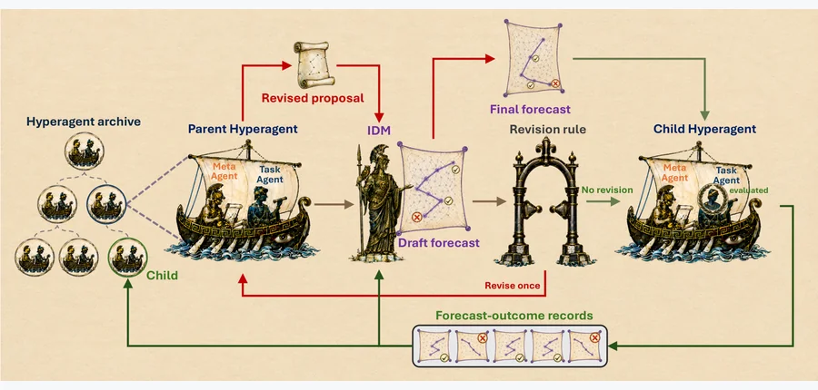 arXiv 2026-10-14 · cs.LG · #1 **[Predict Before You Modify: Learning Improvement Dynamics for Self-Evolving Agents](https://arxiv.org/abs/2610.13991)** Zixuan Xie , Chang Xu , Yuhua Jiang , Li Zhao Affiliation: University of Virginia / Microsoft Research / Tsinghua University [Paper](https://arxiv.org/abs/2610.13991) · [Figure source](https://arxiv.org/html/2610.13991v1/editable_idm_odyssey_teaser.png) 

[EN] Abstract
Self-evolving agents improve through repeated cycles of modification and evaluation. However, existing methods receive feedback on modifications only after costly evaluations, and aggregate scores may obscure distinctions between failures that require different repairs. We introduce predictive self-evolution through an editable Improvement Dynamics Model (IDM). Before evaluation, the IDM predicts task-level outcomes of a proposed modification and guides an optional revision. After evaluation, past modifications and their observed outcomes are used to improve the IDM, allowing predictive knowledge to accumulate across generations. The system can thus improve how it solves tasks, proposes modifications, and predicts their effects. Building on HyperAgents, we evaluate this approach across multilingual coding, paper review, robotics reward design, and Olympiad-level mathematical grading. Our approach outperforms HyperAgents across all four domains, with up to 46% higher average performance over generations. Gains also persist under matched token budgets that include both agent evolution and task evaluation, and extend to held-out tasks. Forecast accuracy improves as the IDM evolves, and the learned predictive knowledge transfers to improve evolution in a new domain. <a href="https://arxiv.org/abs/2610.13991">Source</a>

[ZH] Abstract
自进化智能体通过反复修改和评估实现改进。但现有方法只有在昂贵评估之后才能获得修改反馈，汇总分数也可能掩盖需要不同修复的失败差异。我们提出基于可编辑改进动力学模型（IDM）的预测式自进化。评估前，IDM 预测修改对各任务的结果，并指导可选修订；评估后，历史修改及其观测结果用于改进 IDM，使预测知识跨代积累。因此，系统不仅改进任务求解，也改进修改提案及效果预测。我们基于 HyperAgents，在多语言编码、论文评审、机器人奖励设计和奥林匹克级数学评分上评估。方法在四个领域均优于 HyperAgents，跨代平均表现最高提高 46%。收益在同时计入智能体进化与任务评估的匹配 token 预算下仍成立，并扩展到留出任务。IDM 演化使预测准确率提高，学得的预测知识还能迁移，改善新领域的进化。 <a href="https://arxiv.org/abs/2610.13991">Source</a>
 | 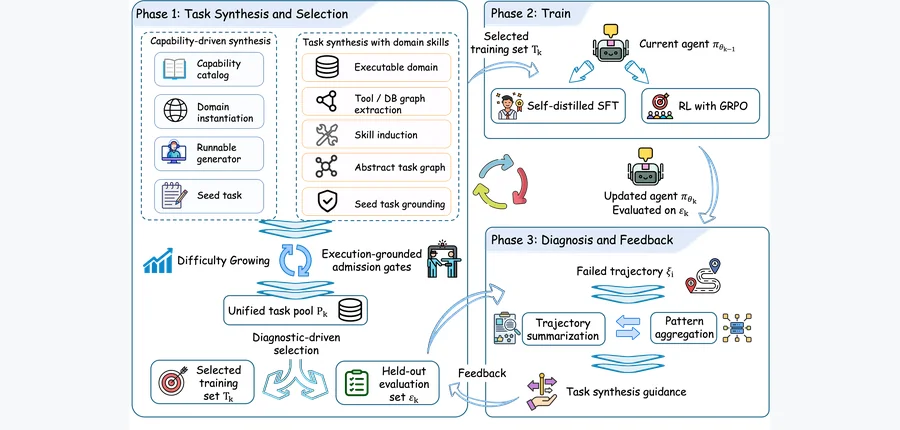 arXiv 2026-10-14 · cs.AI · #2 **[ClawLoop: Self-Improving Agents via Harness-Native Training Loop](https://arxiv.org/abs/2610.14118)** Hansi Yang , Linji Hao , Hongyan Hao , An Wang , Han Wu , Qi Gu , Xunliang Cai Affiliation: Meituan / Peking University [Paper](https://arxiv.org/abs/2610.14118) · [Figure source](https://arxiv.org/html/2610.14118v1/Figures/main.png) 

[EN] Abstract
The rapid advancement of Large Language Models (LLMs) has driven their deployment toward general-purpose harness environments, where LLM-based agents operate in sandbox workspaces and interact directly with file systems and shells. While numerous post-training pipelines exist for tool-use agents, their counterparts for harness-based agents remain scarce and are predominantly one-shot and teacher-dependent: a stronger external model synthesizes tasks and collects trajectories, the target agent is trained once, and evaluation results are consumed by human researchers rather than fed back into the loop. Such pipelines are inherently bounded by the capability of the external model and the scope of human prior, leaving no room for self-improvement. To address these limitations, we propose ClawLoop, a framework that enables self-improving without any external teacher model and with minimal prior dependencies. ClawLoop composes three phases into a self-sustaining cycle: Task Synthesis, which generates a diverse pool of training tasks via two complementary construction routines, applies diagnosis-conditioned difficulty growth followed by both agent-free and agent-based task validation; Training, which updates the agent via SFT and/or RL; and Diagnosis and Feedback, which analyzes the agent's rollout behaviors to produce a capability analysis report that will be used as feedback for task synthesis in the next iteration. Using Qwen3.6-27B as the loop model, ClawLoop yields consistent improvements on SkillsBench, Claw-Eval-Live, and ClawGym-Bench. The iteratively refined tasks are further transferred to smaller-scale Qwen3.5-4B and 9B models with gains across all benchmarks, validating data quality independently of the loop model. <a href="https://arxiv.org/abs/2610.14118">Source</a>

[ZH] Abstract
LLM 的迅速进展推动其进入通用运行框架环境，智能体在沙箱工作区直接操作文件系统和 shell。虽然工具智能体已有大量后训练流水线，面向此类运行框架的训练却稀少，且大多一次性、依赖教师：更强外部模型合成任务并收集轨迹，目标智能体仅训练一次，评估结果由人类研究者消费而不反馈入循环。这限制于外部模型能力及人类先验范围，缺少自改进空间。我们提出 ClawLoop，无需外部教师模型且仅依赖少量先验的自改进框架。它把三阶段组成自维持循环：任务合成通过两种互补构造方式产生多样任务，按诊断提升难度，并进行无需智能体和依赖智能体的双重验证；训练通过 SFT 和/或 RL 更新智能体；诊断与反馈分析 rollout 行为，生成能力报告，指导下一轮任务合成。以 Qwen3.6-27B 为循环模型，ClawLoop 在 SkillsBench、Claw-Eval-Live、ClawGym-Bench 上持续提升。迭代细化的任务还能迁移至更小的 Qwen3.5-4B 和 9B，在所有基准上获益，独立于循环模型验证数据质量。 <a href="https://arxiv.org/abs/2610.14118">Source</a>
 | 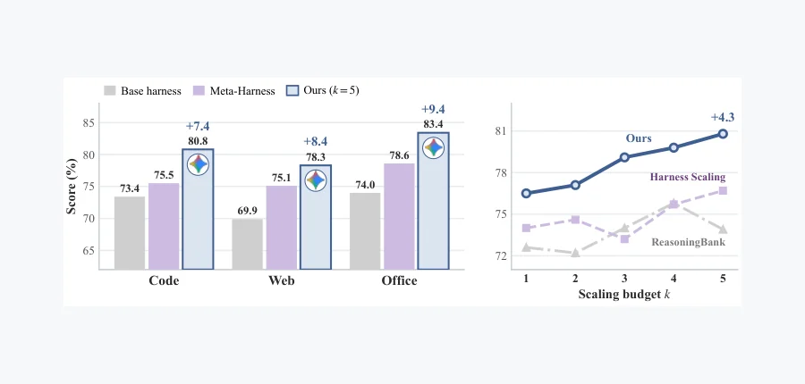 arXiv 2026-10-14 · cs.AI · #3 **[Harness^2: Recursive Agent Harnessing for an Open World](https://arxiv.org/abs/2610.14224)** Ruiyao Xu , Yanfei Chen , Zhongying CuiZhu , Bhavana Dalvi Mishra , Yifei Ming , Han Yu , Rujun Han , Chen-Yu Lee , Tomas… Affiliation: Google Cloud AI Research / Northwestern University [Paper](https://arxiv.org/abs/2610.14224) · [Code](https://github.com/google-research/harness2) · [Project](https://harness2.github.io/) · [Figure source](https://arxiv.org/html/2610.14224v1/intro_teaser.png) 

[EN] Abstract
LLM agents' capabilities depend not only on their underlying models but also on their execution harnesses. Recursive self-improvement (RSI) offers a promising approach to automatically evolve these harnesses. However, deploying RSI in open-world settings still faces two critical challenges. First, open-world tasks are typically unseen during the harness design phase and novel at test time, leaving no ground-truth verifiers to reliably guide online harness edits. Second, the RSI process remains highly task-specific and fails to generalize to novel scenarios. We introduce Harness^2, a plug-and-play, recursive agent harnessing framework that addresses these challenges through two connected levels of recursion. Task-level recursion refines the current task's harness using a contrastive Propose-Probe-Compose step that reliably guides edits without ground-truth verifiers, and can be scaled further via parallel or sequential recursion. Harnessing-level recursion then extracts experience from these edits to update a continual improvement harness, enabling the agent to better adapt to future tasks. Across three professional benchmarks and four model-harness configurations, a single step consistently improves GLM-5 and Gemini 3.5 Flash over their base harnesses, yielding gains of up to 11.5 points on WorkBuddy-Bench, 4.5 points on JobBench, and 11.8 percentage points on LAB, with further gains as the task-level recursion budget increases. <a href="https://arxiv.org/abs/2610.14224">Source</a>

[ZH] Abstract
LLM 智能体能力既取决于底层模型，也取决于执行框架。递归自改进有望自动演化框架，但开放世界部署有两个难点：设计阶段未见、测试时新颖的任务没有真实验证器来可靠指导在线编辑；改进过程也往往任务专用，难以泛化。我们提出即插即用的 Harness²，通过两个相连层级的递归解决这些问题。任务级递归用对比式“提出—探查—组合”步骤，在没有真实验证器时指导当前任务的框架编辑，并可通过并行或顺序递归进一步扩展。框架级递归从编辑中提炼经验，更新持续改进框架，使智能体更好适应未来任务。在三个专业基准、四种模型—框架配置上，单步就能持续改善 GLM-5 与 Gemini 3.5 Flash，相比基础框架在 WorkBuddy-Bench 最高提高 11.5 点、JobBench 提高 4.5 点、LAB 提高 11.8 个百分点，增加任务级递归预算还能继续获益。 <a href="https://arxiv.org/abs/2610.14224">Source</a>
 |
| 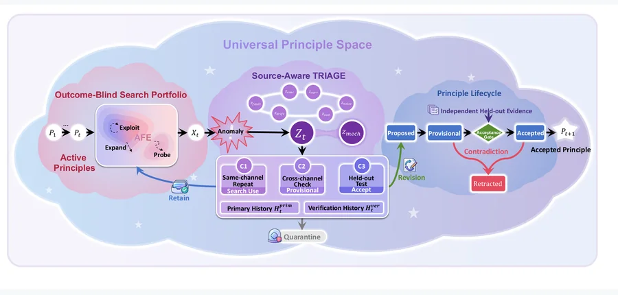 arXiv 2026-10-14 · cs.LG · #4 **[Triage-PiEvo: Evidence Admission for Principle-Evolving Scientific Agents](https://arxiv.org/abs/2610.14683)** Peize Li , Yingming Pu , Xingguo Xu , Yiming Cui , Yuansheng Gao , Tao Lin Affiliation: Westlake University / Kuaishou Technology / Zhejiang University / Dalian University of Technology / Hangzhou Dianzi University [Paper](https://arxiv.org/abs/2610.14683) · [Figure source](https://arxiv.org/html/2610.14683v1/fig_method_overview.png) 

[EN] Abstract
Large language model (LLM)-based AI Scientists advance scientific discovery, yet they suffer from inefficiencies due to noisy observations. Existing principle-evolving agents act on every anomaly, leaving its source unresolved: a new mechanism or an evaluation artifact, so invalid revisions bias evolution. To address this, we formulate revision as evidence admission: anomalies steer search immediately, but only independently verified evidence may rewrite persistent principles, and contradicted principles are retracted. We realize this in TRIAGE-PIEVO , which pairs an anomaly-responsive search portfolio with a staged verification gate that alone controls what enters principle state. Across four scientific tasks with three backbones, TRIAGE-PIEVO (1) attains the highest average solution quality with +7.5%~11.8% over the strongest baseline per backbone, matching the strongest baseline's full-budget quality with one-third of the evaluation budget on Qwen3-235B; and additional stress tests and cross-harness deployment demonstrate that (2) in constructed stress tests, it admits none of the corrupted, hidden-source, or exploit evidence that ungated variants admit, while missing no planted mechanism, and (3) plugged unchanged into three external research harnesses, it cuts false evidence admissions by over 60% and raises verified scores by 31%~43%. <a href="https://arxiv.org/abs/2610.14683">Source</a>

[ZH] Abstract
LLM 科研智能体推动科学发现，却受噪声观测拖累。现有原理演化智能体对每个异常作出反应，却未厘清它来自新机制还是评估伪象，导致无效修订使演化偏移。我们把修订表述为证据准入：异常可以立即引导搜索，但只有独立验证的证据可改写持久原理，被反驳的原理则撤回。TRIAGE-PIEVO 将响应异常的搜索组合与分阶段验证门相结合，后者独占控制哪些内容进入原理状态。在四项科学任务、三个主干上，它的平均解质量最高，相比各主干最强基线提高 7.5%–11.8%；Qwen3-235B 仅用三分之一评估预算就匹配最强基线的完整预算质量。构造的压力测试中，它不接纳无门控变体会接纳的损坏、隐藏来源或利用型证据，同时没有漏掉植入机制。原样接入三个外部研究框架后，错误证据接纳减少超过 60%，验证分数提高 31%–43%。 <a href="https://arxiv.org/abs/2610.14683">Source</a>
 | 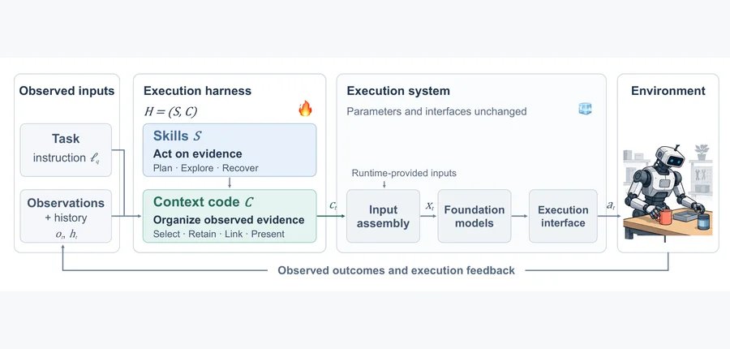 arXiv 2026-10-14 · cs.RO · #5 **[EnactOpt: Diagnosis-Guided Harness Evolution for Embodied Agents](https://arxiv.org/abs/2610.14977)** ZhiYuan Feng , Zhuoshi Pan , Zhaolu Kang , Zhongxia Chen , Shuo Yang , Sen Ye , Heng Wang , Han Li Affiliation: Tsinghua University / Peking University / Kling AI / University of Illinois Urbana-Champaign [Paper](https://arxiv.org/abs/2610.14977) · [Figure source](https://arxiv.org/html/2610.14977v1/figure1_redesigned.png) 

[EN] Abstract
Embodied agents built on foundation models rely on an execution harness to organize observations, guide actions, and incorporate execution feedback into subsequent decisions. Failures can arise not only from limited model capabilities, but also from how the harness presents evidence and guides its use. These model-external mechanisms provide an adaptation target without updating model parameters, but task-specific interaction experience can be costly to collect. Task-level outcomes alone do not reveal whether relevant evidence was missing from the model input or was available but inadequately used. Moreover, these two aspects are coupled: effective action guidance may require evidence that the current context omits, while exposing that evidence alone does not ensure an appropriate response. We introduce EnactOpt, which uses limited execution feedback to jointly evolve reusable textual skills and context-construction code while keeping the underlying models and runtime fixed. It diagnoses adjacent decisions by relating action feedback to the actual model input and subsequent action. Structured episode summaries guide joint revisions through prompt-level edit operators, and candidate harnesses undergo compatibility checks and validation-based retention. Across VLABench, ALFWorld, and Embodied Agent Interface (EAI), EnactOpt improves task success by approximately 10-27 percentage points over the initial harnesses and outperforms the evaluated GEPA, TextGrad, and Trace2Skill baselines. These gains extend to task conditions not used for harness evolution or candidate selection. The results support a complementary route to embodied adaptation: turning limited execution experience into reusable behavioral improvements by jointly refining how evidence is presented and acted upon. <a href="https://arxiv.org/abs/2610.14977">Source</a>

[ZH] Abstract
基于基础模型的具身智能体依靠执行框架组织观测、指导动作并把执行反馈纳入后续决策。失败不仅可能来自模型能力，也可能来自证据呈现和使用方式。这些模型外机制可在不更新参数时适配，但收集专用交互经验昂贵。任务结果本身不能揭示相关证据是未进入输入，还是已经可见却未被有效使用；两者又相互依赖：动作指导可能需要当前上下文遗漏的证据，单纯展示证据也不保证正确响应。EnactOpt 用有限执行反馈，联合演化可复用文本技能和上下文构造代码，保持模型与运行系统固定。它把相邻决策的动作反馈、真实模型输入及后续动作联系起来诊断，用结构化回合摘要和提示层编辑算子指导联合修订，候选经过兼容性检查和验证选择。在 VLABench、ALFWorld、EAI 上，任务成功率较初始框架约提高 10–27 个百分点，并优于比较的 GEPA、TextGrad、Trace2Skill。收益扩展到未参与演化或候选选择的任务条件。这支持通过联合改进证据呈现与行动方式，把少量执行经验变成可复用行为改进。 <a href="https://arxiv.org/abs/2610.14977">Source</a>
 | 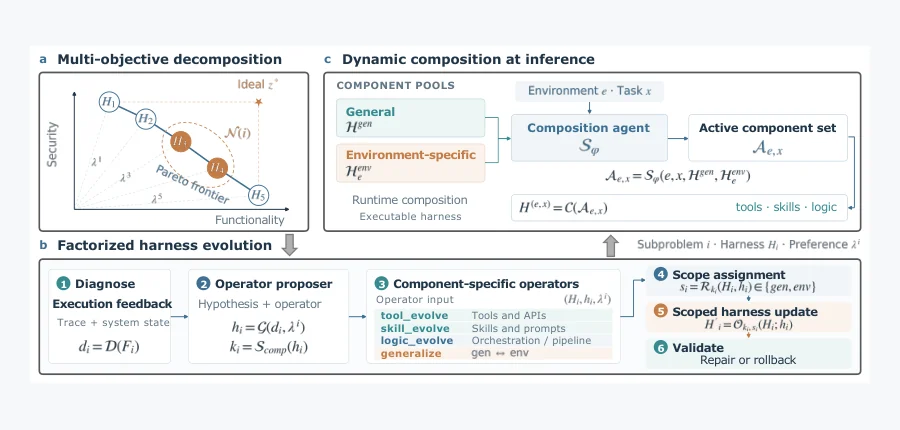 arXiv 2026-10-14 · cs.AI · #6 **[Harmony Harness: Multi-Objective Self-Evolution of Agent Harnesses](https://arxiv.org/abs/2610.15150)** Weichen Yu , Lesly Miculicich , Bhavana Dalvi Mishra , Jiefeng Chen , Shuo Li , Matt Fredrikson , Tomas Pfister , Long T. Le Affiliation: Google Cloud AI Research / Google DeepMind / Carnegie Mellon University [Paper](https://arxiv.org/abs/2610.15150) · [Figure source](https://arxiv.org/html/2610.15150v1/HH_pipeline.png) 

[EN] Abstract
Recent work on self-evolving LLM agents treats the agent harness as an optimization target that can be iteratively improved through execution feedback. Existing approaches, however, largely optimize a single objective and evolve the harness as a monolithic artifact, limiting their ability to handle competing goals and to separate transferable design from environment-specific adaptation. We introduce Harmony Harness, a framework for multi-objective, compositional harness evolution. Harmony Harness formulates harness evolution as a multi-objective optimization problem and uses decomposition-based evolutionary search to maintain solutions across different regions of the Pareto frontier, avoiding reliance on a hand-designed structural diversity metric for repository-scale harnesses. In parallel, we introduce factorized evolution operators that separately refine general-purpose harness mechanisms and benchmark-specific adaptations, together with a dynamic composition workflow that integrates them at inference time. Across SecRepoBench and BaxBench, Harmony Harness consistently outperforms strong harness-evolution baselines, with gains exceeding 10% on both benchmarks. Our results show that explicitly modeling both objective trade-offs and harness structure yields substantially stronger and more transferable agent evolution than existing single-objective, monolithic approaches. <a href="https://arxiv.org/abs/2610.15150">Source</a>

[ZH] Abstract
近期自进化 LLM 智能体把运行框架视为可依执行反馈反复改善的目标，但通常只优化单一目标，并把框架作为整体演化，难以处理目标竞争及区分通用设计和环境专用适配。我们提出 Harmony Harness，用于多目标、组合式框架演化。它把框架演化表述为多目标优化，用基于分解的进化搜索，维护 Pareto 前沿不同区域的解，避免对仓库级框架手工设计结构多样性指标。同时，因子化进化算子分别细化通用框架机制和基准专用适配，再由动态组合工作流在推理时整合。在 SecRepoBench 与 BaxBench 上，它持续优于强框架进化基线，两个基准均获超过 10% 的收益。结果显示，同时显式建模目标权衡与框架结构，比现有单目标、整体式方法产生更强且更易迁移的进化。 <a href="https://arxiv.org/abs/2610.15150">Source</a>
 |
| 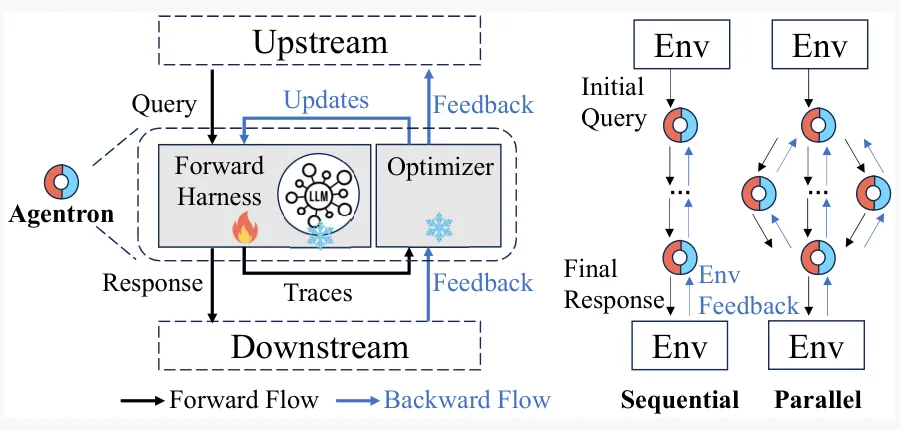 arXiv 2026-10-14 · cs.AI · #7 **[HarnessNet: Feedback-driven Hierarchical Joint Harness Evolution for Multi-agent Systems](https://arxiv.org/abs/2610.15221)** Zhaoyuan Qiu , Sachith Seneviratne , Yu Xia , Saman Halgamuge Affiliation: University of Melbourne [Paper](https://arxiv.org/abs/2610.15221) · [Figure source](https://arxiv.org/html/2610.15221v1/Agentron.png) 

[EN] Abstract
AI agents can evolve by using environment feedback to revise their harnesses, the software managing model inputs, tool use, memory, and execution, while keeping foundation models frozen. Existing studies focus on single agents, leaving joint harness evolution in multi-agent systems (MAS) underexplored. A single global optimizer faces growing context and workload as the system scales, while access restrictions may prevent sharing agent internals or system-wide feedback. We propose HarnessNet, a framework for hierarchical harness evolution in MAS. Its basic unit, Agentron, comprises an evolvable forward harness, a foundation model, and a local optimizer that can observe and modify only that harness. Agentrons form a layered graph through which environment feedback propagates backward, with upstream optimizers receiving node-specific feedback from the downstream layer. This decomposes joint harness evolution into smaller, coordinated tasks with separate contexts, reducing individual optimizers' context and workload while keeping access local. Optimizers need not access all agent trajectories or raw environment feedback. Experiments on AgentBench with multiple foundation models demonstrate the feasibility of training HarnessNet. Compared with a single global optimizer, HarnessNet achieves comparable performance gains while respecting local privacy and requiring fewer tokens and less time per optimizer call. A migration study shows that the evolved harnesses remain jointly effective after replacing the foundation models, suggesting transferability across models. <a href="https://arxiv.org/abs/2610.15221">Source</a>

[ZH] Abstract
AI 智能体可利用环境反馈修订管理输入、工具、记忆和执行的软件框架，同时保持基础模型冻结。现有研究集中于单智能体，多智能体联合框架演化尚少。一位全局优化器会随系统规模增加而承受更多上下文和工作，访问限制也可能阻止共享内部状态或全局反馈。HarnessNet 提出层级框架演化。基本单元 Agentron 包含可进化前向框架、基础模型和只能观察、修改本地框架的优化器。各单元构成分层图，环境反馈向后传播，上游优化器接收下游层提供的节点专用反馈，把联合演化拆成协调的小任务，各有独立上下文，降低工作量并保持本地访问。优化器无需访问全部轨迹或原始环境反馈。多基础模型的 AgentBench 实验验证可训练性。相比全局优化器，HarnessNet 在满足本地隐私限制时取得相近收益，每次优化器调用 token 更少、耗时更短。迁移研究表明，替换基础模型后，演化框架仍联合有效，提示跨模型迁移能力。 <a href="https://arxiv.org/abs/2610.15221">Source</a>
 | 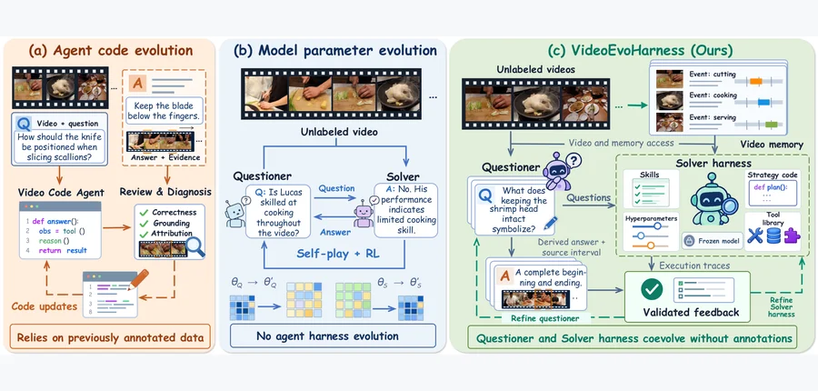 arXiv 2026-10-14 · cs.CV · #8 **[VideoEvoHarness: Self Evolving Agent Harness from Unlabeled Videos for Video Understanding](https://arxiv.org/abs/2610.15389)** Weixin Xu , Yifan Liu , Yi Wang , Mingfei Rong , Zhenyu Yang , Zhisheng Zhong , Shengsheng Qian , Changsheng Xu Affiliation: Institute of Automation, CAS / University of Chinese Academy of Sciences / Jiangsu University of Science and Technology / AICOMO / Inner Mongolia University / Tencent Hunyuan [Paper](https://arxiv.org/abs/2610.15389) · [Code](https://github.com/Wei-Xin-Xu/VideoEvoHarness) · [Figure source](https://arxiv.org/html/2610.15389v1/fig_overview.png) 

[EN] Abstract
Video understanding agents rely on a harness to acquire evidence, use tools, and reason, but improving it requires substantial effort. Recent self evolution methods seek to optimize harnesses through execution feedback to reduce human intervention. However, existing methods often rely on annotated video questions and answers or focus on updating model parameters, leaving harness evolution from unlabeled videos underexplored. VideoEvoHarness jointly evolves a Questioner and a Solver harness from unlabeled videos with frozen model parameters. The Questioner constructs questions and computes reference answers directly from video memory records. Question quality assessments and Solver execution trajectories guide question generation policy revisions. The Solver supports evolving skills, strategies, hyperparameters, and tools using execution feedback. Executable strategies define workflows in code, reducing repeated interpretation of natural language instructions. Each round, candidate harnesses are compared on identical validation questions, with validated improvements retained for later use. Experiments on benchmarks and a dedicated benchmark question set, using videos disjoint from evolution videos, show higher overall accuracy than initially and transfer gains across backbones. Overall accuracy on this set also improves progressively across rounds. This supports our foundational framework for harness evolution from unlabeled videos, opening a promising direction for self evolving video agents. Code is available at this https URL . <a href="https://arxiv.org/abs/2610.15389">Source</a>

[ZH] Abstract
视频理解智能体依赖框架获取证据、使用工具和推理，而改进框架耗费大量精力。自进化方法尝试借执行反馈减少人工干预，但往往依赖标注视频问答或更新模型参数，无标注视频上的框架演化研究不足。VideoEvoHarness 冻结模型，联合演化出题者与求解者框架。出题者根据视频记忆记录构造问题并直接计算参考答案，问题质量评估和求解轨迹指导问题生成策略修订；求解者根据执行反馈演化技能、策略、超参数和工具，可执行策略用代码定义工作流，减少反复解释自然语言指令。每轮在相同验证问题上比较候选框架，保留验证过的改进。在与演化视频不重叠的视频基准和专门问题集上，总体准确率高于初始设置，且跨主干迁移获益；专门问题集准确率随轮次逐步提高。结果支持从无标注视频演化框架，为自进化视频智能体提供方向。代码见原摘要所附链接。 <a href="https://arxiv.org/abs/2610.15389">Source</a>
 | 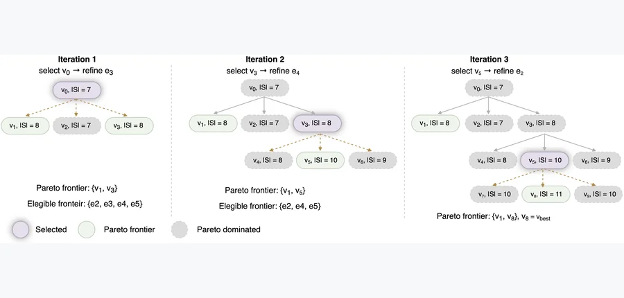 arXiv 2026-10-14 · cs.AI · #9 **[SpecForge: Recursive Self-Improvement for Coding Agents via Behavioral Specifications](https://arxiv.org/abs/2610.15708)** Yutong Cheng , Haifeng Chen , Peng Gao , Wei Cheng Affiliation: Virginia Tech / NEC Laboratories America [Paper](https://arxiv.org/abs/2610.15708) · [Figure source](https://arxiv.org/html/2610.15708v1/figures/tree.png) 

[EN] Abstract
Coding agents based on frozen language models can improve their performance by refining the external context they rely on, without updating model weights. We study recursive self-improvement through behavioral specifications: natural-language code documentation that describes the behavior of program entities and guides agents in generating correct code. We formulate a self-improvement loop in which an agent generates code from its current specifications, evaluates it with execution-verified tests, and refines the specifications based on observed failures. The improved specifications then guide subsequent generation, progressively improving the agent's understanding of the codebase. However, recursive refinement is challenging because program entities are interdependent. Improving the specification of one entity can inadvertently degrade the correctness of others, a phenomenon we call output coupling. This creates a whack-a-mole effect in which local improvements cause regressions elsewhere, preventing consistent progress. We introduce SpecForge, a multi-frontier tree search framework that addresses this challenge with three mechanisms: (i) Pareto-guided state selection preserves complementary specification states and prevents premature commitment; (ii) dependency-constrained entity selection prioritizes callee-before-caller refinement; and (iii) error-diversified expansion explores multiple refinements using different subsets of test failures. On DevEval+, SpecForge achieves the best performance across five backbone models, including a 94.9% solve rate with Claude-4.5-Sonnet and a 5.7-percentage-point average improvement over the strongest baseline. The improved specifications also make the agent better at tasks outside the loop: they transfer to cross-language translation and to new-feature implementation, where they outperform the benchmark-provided requirement documents. <a href="https://arxiv.org/abs/2610.15708">Source</a>

[ZH] Abstract
基于冻结语言模型的编码智能体可通过细化外部上下文、而非权重更新改善表现。我们研究基于行为规范的递归自改进：自然语言代码文档描述程序实体行为，指导生成正确代码。循环由当前规范生成代码、用执行验证测试评估、按失败细化规范，再用改进规范指导后续生成，逐步提升对代码库的理解。但实体相互依赖，改进一个实体的规范可能损害其他实体正确性，即输出耦合，形成局部改进、别处回归的打地鼠效应。SpecForge 采用多前沿树搜索：Pareto 引导状态选择保留互补规范状态，避免过早承诺；依赖约束实体选择优先细化被调用者，再细化调用者；错误多样化扩展使用不同失败子集探索多种修订。在 DevEval+ 的五个主干上均取得最佳表现，Claude-4.5-Sonnet 解决率 94.9%，平均比最强基线高 5.7 个百分点。改进规范还迁移到循环外的跨语言翻译和新功能实现，并优于基准提供的需求文档。 <a href="https://arxiv.org/abs/2610.15708">Source</a>
 |
| 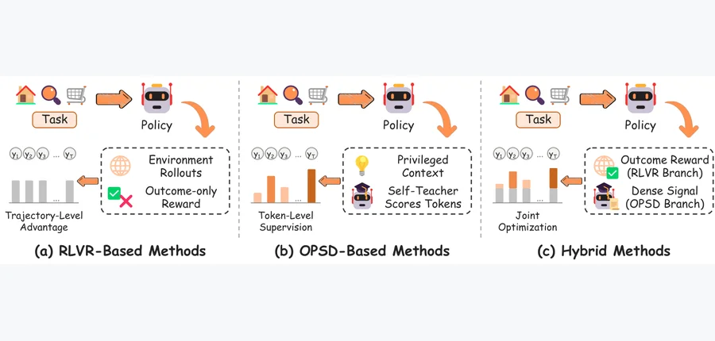 arXiv 2026-10-14 · cs.CL · #10 **[RSIPO: Recursive Self-Improving Policy Optimization for Agentic Reinforcement Learning via Skill-Policy Co-Evolution](https://arxiv.org/abs/2610.15772)** Fan Zhang , Hao Wu , Jinyang Wu , Hongyu Qu , Zheng Lian , Xiao Luo , Yefeng Zheng , Bo Zhang , Haoxuan Li , Pheng-Ann Heng Affiliation: THU / NUS / Tongji University / UW-Madison / Westlake University / CUHK / Shanghai AI Laboratory / PKU (source abbreviations) [Paper](https://arxiv.org/abs/2610.15772) · [Code](https://github.com/zfkarl/RSIPO) · [Figure source](https://arxiv.org/html/2610.15772v1/intro_paradigms.png) 

[EN] Abstract
Recent focus in agentic reinforcement learning (RL) seeks to improve credit assignment in long-horizon tasks. One promising direction combines reinforcement learning with verifiable rewards (RLVR) and on-policy self-distillation (OPSD), integrating trajectory-level advantages with dense token-level supervision. This line of work often conditions a teacher model on privileged context, such as agentic skills, to score tokens generated by the student policy. Despite their progress, they largely overlook the on-policy evolution of agentic skills and the reliability of teacher supervision. Towards this end, we introduce Recursive Self-Improving Policy Optimization (RSIPO), a self-evolving agentic RL framework that enables agentic skills and the policy model to co-evolve throughout the training process. Specifically, RSIPO enables the policy itself to extract skills from completed trajectories and explicitly optimizes its skill-generation capability through trajectory replay. It further employs empirical Bayes shrinkage to dynamically calibrate the student's trust in teacher scores, accounting for the fact that skill-enhanced teacher guidance can sometimes be less reliable. Experiments with Qwen-family models on embodied interaction and search-based agentic tasks demonstrate that RSIPO outperforms all the compared baseline approaches. With Qwen2.5-7B as the base model, RSIPO achieves an average success rate of 98.6\% on ALFWorld, yielding absolute improvements of 2.5\% and 17.4\% over the second-best baseline and standard GRPO, respectively. <a href="https://arxiv.org/abs/2610.15772">Source</a>

[ZH] Abstract
智能体 RL 近期关注长周期任务信用分配，一个方向结合可验证奖励 RL 与在策略自蒸馏，把轨迹优势与密集 token 监督融合，通常用技能等特权上下文条件化教师，为学生 token 评分。但技能的在策略演化及教师监督可靠性常被忽视。我们提出 RSIPO，让技能与策略在训练过程中共同演化。策略从完成轨迹中提取技能，并通过轨迹重放显式优化技能生成能力；经验贝叶斯收缩动态校准学生对教师分数的信任，因为技能增强教师有时也不可靠。Qwen 系列在具身交互和搜索任务上的实验中，RSIPO 优于所有比较基线。以 Qwen2.5-7B 为基础，在 ALFWorld 平均成功率 98.6%，比第二名和标准 GRPO 分别绝对提高 2.5% 和 17.4%。 <a href="https://arxiv.org/abs/2610.15772">Source</a>
 | 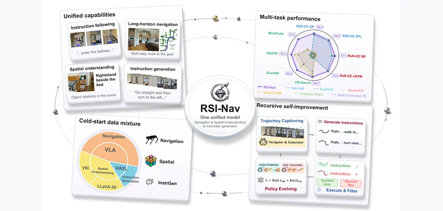 arXiv 2026-10-14 · cs.CV · #11 **[Data-Centric Recursive Self-Improvement for Navigation via Policy-Synchronized Language-Action Dual Bootstrapping](https://arxiv.org/abs/2610.15782)** Songze Li , Haoming Gu , Ziyang Gong , Zhitong Wang , Gengze Zhou , Zun Wang , Yuhan Zhu , Tianxiang Jiang , Juanzi Li , Q… Affiliation: Shanghai AI Laboratory / Shanghai Jiao Tong University / Tsinghua University / University of Adelaide / UNC Chapel Hill / Nanjing University / USTC / Harbin Institute of Technology / Fudan University [Paper](https://arxiv.org/abs/2610.15782) · [Code](https://github.com/OpenGVLab/RSI-Nav) · [Figure source](https://arxiv.org/html/2610.15782v1/RSI-Nav_teaser.png) 

[EN] Abstract
Vision-language navigation requires agents to follow natural-language instructions to reach target locations, making high-quality language supervision essential. Since human annotation is costly, prior work has explored scalable data synthesis methods. However, existing methods typically either use separate models for navigation and instruction generation or couple the two tasks through task-specific components; most also annotate the full trajectory corpus with a fixed model before updating, which can cause generated supervision to lag behind the evolving policy. Therefore, we introduce RSI-Nav, a data-centric recursive self-improvement framework for navigation via policy-synchronized language-action dual bootstrapping, which unifies vision-language-to-action instruction following and vision-action-to-language instruction generation within a shared model. Specifically, after supervised fine-tuning establishes fundamental capabilities, RSI-Nav progressively processes unlabeled trajectories in small shards. The current model generates instructions for these trajectories, executes them to evaluate goal completion and path efficiency, retains qualified samples, and immediately updates itself before processing the next shard. This shard-wise update keeps newly generated supervision aligned with the evolving policy. We also incorporate spatial understanding data, since stronger spatial reasoning benefits navigation. Extensive experiments show that RSI-Nav reaches 68.6% SR on R2R-CE and 72.4% SR on RxR-CE, while providing stronger instruction-generation utility and modestly improved spatial understanding after recursive evolution. <a href="https://arxiv.org/abs/2610.15782">Source</a>

[ZH] Abstract
视觉语言导航要求按自然语言指令到达目标，因此需要高质量语言监督。人工标注昂贵，既有合成方法通常分别使用导航和指令生成模型，或依赖专用组件耦合两者；多数还先用固定模型标注整个轨迹库再更新，监督可能落后于演化策略。RSI-Nav 提出与策略同步的语言—动作双自举，在共享模型内统一视觉语言到动作的跟随和视觉动作到语言的指令生成。SFT 建立基本能力后，逐个处理无标注轨迹小分片：当前模型生成指令，执行并评估目标完成和路径效率，保留合格样本，立即自我更新，再进入下一分片，使新监督与演化策略同步。方法还加入空间理解数据，因为更强空间推理有益导航。实验中，R2R-CE 成功率为 68.6%，RxR-CE 为 72.4%，递归演化还提高指令生成效用，并适度改善空间理解。 <a href="https://arxiv.org/abs/2610.15782">Source</a>
 | 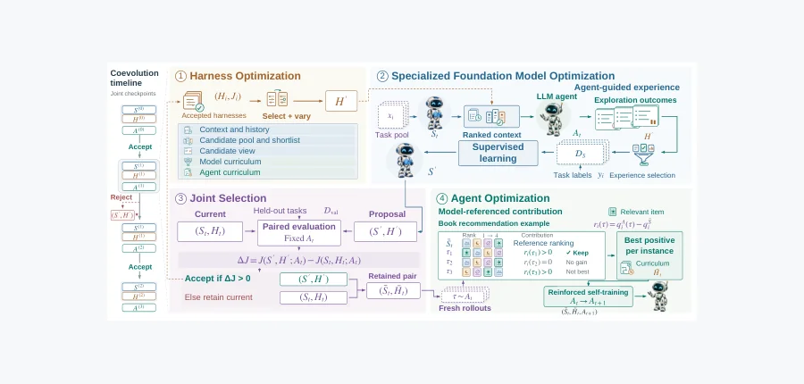 arXiv 2026-10-14 · cs.AI · #12 **[Heterogeneous Agentic Coevolution](https://arxiv.org/abs/2610.16078)** Wenqian Ye , Ziwei Guan , Zi Yang , Shivani Modi , Cici Cong Wu , Yunlong He , Yuxin Chen , Zhengyu Zhang , Liang Luo , Ve… Affiliation: Meta AI / University of Virginia [Paper](https://arxiv.org/abs/2610.16078) · [Figure source](https://arxiv.org/html/2610.16078v1/HACE_method.png) 

[EN] Abstract
Recent advances in self-improving LLM agents have demonstrated the potential of AI systems that drive their own intelligence. However, many domain-specific applications rely on specialized foundation models that possess strong domain expertise but remain dependent on human-designed improvements. Extending recursive self-improvement to these models presents a key challenge: as a specialist improves, the strategies used to advance it must also adapt. To address this challenge, we propose Heterogeneous Agentic CoEvolution (HACE), a framework that jointly evolves specialized foundation models and LLM agents through reciprocal learning. HACE improves the specialist through supervised learning while training the agent with on-policy reinforced self-training, guided by verified performance gains on the current specialist. The agent's exploration, in turn, informs subsequent specialist training, enabling both models to adapt to each other's progress. To sustain this reciprocal learning, HACE further employs evolutionary search to optimize their interaction harness, adapting how the models exchange information and select training experiences as their capabilities evolve. We evaluate HACE across three challenging domains: recommendation systems, protein function prediction in biology, and crystal stability prediction in material discovery. We show that HACE outperforms the evaluated self-improving methods on the primary task metrics across all three domains. These results shed light on heterogeneous coevolution as a universal approach to improving specialized foundation models through reciprocal interaction with a learning agent. <a href="https://arxiv.org/abs/2610.16078">Source</a>

[ZH] Abstract
近期自改进 LLM 智能体展现 AI 驱动自身智能发展的潜力，但领域应用依赖的专门基础模型虽有强领域知识，仍依赖人工设计改进。把 RSI 扩展到专门模型的关键是：专家模型改善时，促进其进步的策略也必须适配。HACE 通过相互学习，联合演化专门基础模型和 LLM 智能体。专家通过监督学习改善；智能体采用在策略强化自训练，以当前专家上经验证的性能收益作为指导。智能体探索又指导下一轮专家训练，使双方适应彼此进展。HACE 还用进化搜索优化交互框架，随能力变化调整信息交换和训练经验选择。在推荐系统、生物蛋白功能预测、材料晶体稳定性预测三个领域，它的主要任务指标均优于被评估自改进方法。结果揭示异构共同演化可通过学习智能体与专门模型相互作用，改善专门基础模型。 <a href="https://arxiv.org/abs/2610.16078">Source</a>
 |
| 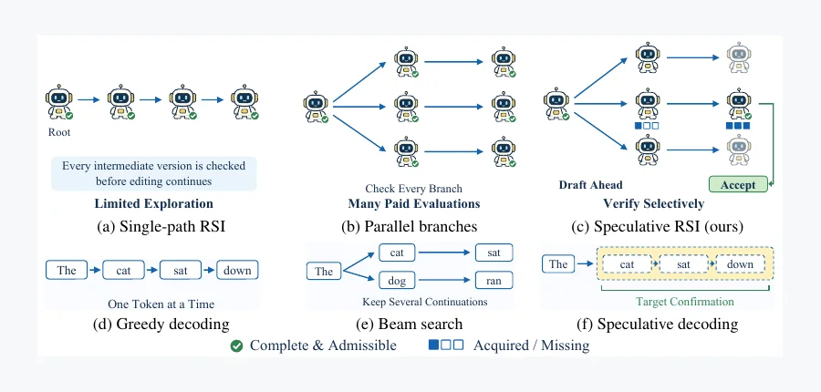 arXiv 2026-10-14 · cs.LG · #13 **[Drafting Agents, Not Just Tokens: Speculative Recursive Self-Improvement for Agentic Systems](https://arxiv.org/abs/2610.16491)** Xin Xu , Ke Cheng , Hao Wang , Yangru Huang , Yanghao Xiao , Zhichao Chen , Zhisheng Zhong , Xun Liu , Yi Li , Qian Li , H… Affiliation: Tencent AMS / Xiaohongshu / University of Chinese Academy of Sciences / Peking University / Tencent Hunyuan / Beihang University [Paper](https://arxiv.org/abs/2610.16491) · [Figure source](https://arxiv.org/pdf/2610.16491#page=2) 

[EN] Abstract
Improving an agent through successive revisions requires balancing exploration and evaluation under a limited budget. A narrow search can miss useful sequences of edits, while fully evaluating every intermediate version can exhaust the budget before those sequences yield a verified improvement. We introduce Speculative Recursive Self-Improvement (SpecRSI), which drafts executable successor agents before their predecessors are fully evaluated, while requiring complete verification before adoption. Verification-Aware Tree Search (VATS) allocates the budget between further edits and outstanding checks using the predicted verified return of a continuation. Group Verification Optimization (GVO) learns the improver from completed searches while keeping the real evaluator fixed. In the main scientific comparison, terminal gains exceed Janus by 33.3%--40.0%. Additional evaluations show that SpecRSI outperforms Janus in all 50 scientific backbone--task pairs and exceeds MetaRSI-v1 by 1.85%--2.38% in macro-average system score across twenty backbones. Coding-validation success reaches 69.4% versus HGM's 64.3% at a 20.8% lower target-cost index. <a href="https://arxiv.org/abs/2610.16491">Source</a>

[ZH] Abstract
连续修订智能体时，有限预算必须平衡探索与评估。狭窄搜索可能漏掉有益编辑序列，完整评估每个中间版本又可能在得到验证改进前耗尽预算。SpecRSI 在前代尚未完成评估时，就起草可执行后继智能体，但只在完整验证后接纳。验证感知树搜索（VATS）根据后续序列的预测已验证回报，在继续编辑和待完成检查之间分配预算；组验证优化（GVO）利用已完成搜索训练改进者，同时保持真实评估器固定。主要科学比较中，终点收益比 Janus 高 33.3%–40.0%。额外评估中，全部五十种科学主干—任务组合都优于 Janus，在二十个主干的宏平均系统分数上，比 MetaRSI-v1 高 1.85%–2.38%。代码验证成功率为 69.4%，HGM 为 64.3%，目标成本指数还低 20.8%。 <a href="https://arxiv.org/abs/2610.16491">Source</a>
 | 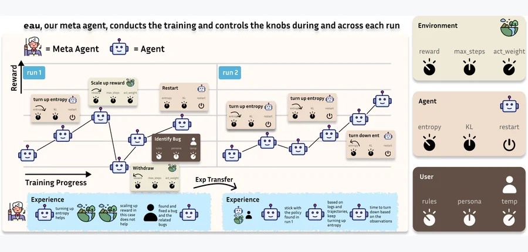 arXiv 2026-10-14 · cs.AI · #14 **[EAU: Environment-Agent-User Co-evolution for Training User-Centric Agents](https://arxiv.org/abs/2610.16523)** Min Cai , Dan Zhang , Gao Xing , Libin Ma , Zhaohui Xu , Xi Ye Affiliation: University of Alberta / National University of Singapore / Kuaishou Technology / Independent Researcher / Amii [Paper](https://arxiv.org/abs/2610.16523) · [Project](https://eau-meta-agent.github.io) · [Figure source](https://arxiv.org/html/2610.16523v1/eau_demo.png) 

[EN] Abstract
Training LLM agents to interact with users over multiple turns is challenging because the learning signal depends not only on the agent, but also on the user simulator and environment, which jointly shape the agent's experience. Simulated users can be stochastic or inconsistent, while environments may contain unreliable tools, incomplete state coverage, and incorrect verifiers. Prior work mainly addresses the resulting instability through reward shaping or denser supervision, while treating these components as fixed. We instead introduce EAU, a meta-agent framework for environment--agent--user co-evolution. During training, EAU monitors trajectories, tool traces, rewards, and training statistics; diagnoses failures and uninformative interactions; and proposes targeted modifications to the user simulator, environment, reward design, and RL configuration. Validated changes are hot-swapped into the ongoing run, allowing the training setup to evolve together with the policy. These adaptations also persist across runs, so later training can build on previously discovered improvements rather than restarting from a fixed setup. We enable this process through an editable symbolic representation of user and environment dynamics, while the agent remains a neural LLM optimized with RL. Across three interactive-agent benchmarks and two backbone models, EAU consistently outperforms prior RL methods, improving the overall score over the strongest baseline by 14.7--15.0% and increasing successful task completion on ColBench by up to 36.7%, showing that co-evolving the training system with the policy can substantially improve multi-turn RL. <a href="https://arxiv.org/abs/2610.16523">Source</a>

[ZH] Abstract
训练多轮用户交互智能体很困难，因为学习信号同时依赖智能体、用户模拟器和环境。模拟用户可能随机或不一致，环境可能工具不可靠、状态覆盖不全、验证器错误。此前多用奖励塑形或密集监督处理不稳定，却把这些组件固定。EAU 是环境—智能体—用户共同演化的元智能体框架，训练中监测轨迹、工具痕迹、奖励和统计，诊断失败及无信息交互，针对用户模拟器、环境、奖励设计、RL 配置提出修改。经验证变化热切换进正在进行的训练，让训练设置与策略一起演化；适配跨运行保留，后续可继承已发现改进。方法用可编辑符号表示描述用户和环境动力学，智能体仍为 RL 优化的神经 LLM。在三个交互基准、两个主干上，它持续优于此前 RL 方法，相比最强基线总体分数高 14.7%–15.0%，ColBench 成功完成最高增加 36.7%，说明共同演化训练系统与策略能显著改善多轮 RL。 <a href="https://arxiv.org/abs/2610.16523">Source</a>
 | 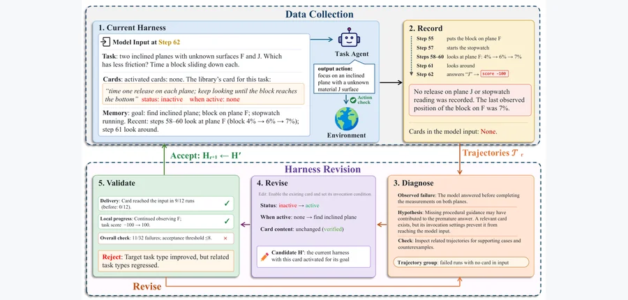 arXiv 2026-10-14 · cs.AI · #15 **[Trace-to-Architecture: Capability Bottleneck Diagnosis for Harness Revision](https://arxiv.org/abs/2610.16725)** Wenfeng Wang , Jianrui Shi , Mingang Guo , Jiayuan Ma , Yuqi Lu , Jiajun Sun , Guojiang Zhao , Jing Li Affiliation: University of Pennsylvania / Harbin Institute of Technology, Shenzhen / DP Technology [Paper](https://arxiv.org/abs/2610.16725) · [Figure source](https://arxiv.org/html/2610.16725v1/T2A_overview.png) 

[EN] Abstract
Improving an LLM agent requires knowing what to change when it fails. Similar failures can require different fixes, and resolving one problem can expose another. We introduce Trace-to-Architecture (T2A), a framework that uses execution trajectories to determine what to change in an agent's harness and when those changes apply. A development agent diagnoses failures using execution evidence from successful and failed tasks, revises the corresponding harness components, and then checks whether target tasks improve, selected successful tasks remain successful, and the edits are actually triggered. New execution evidence guides subsequent diagnosis and revision. Across ALFWorld, ScienceWorld, and AppWorld, T2A achieves the highest aggregate score for all three evaluated task agents, exceeding their respective strongest baselines by 6.2--30.3 points. We also integrate T2A's diagnosis and validation procedures into Meta-Harness, improving the resulting harnesses' mean ScienceWorld score by 21.6 points from the same starting harness. <a href="https://arxiv.org/abs/2610.16725">Source</a>

[ZH] Abstract
改善 LLM 智能体需要在失败时知道应改什么。相似失败可能需要不同修复，解决一个问题也可能暴露另一个。Trace-to-Architecture（T2A）使用执行轨迹确定应修改哪些框架组件，以及变化何时适用。开发智能体依据成功与失败任务的执行证据诊断，修订对应组件，再检查目标任务是否改善、选定成功任务是否仍成功、编辑是否真的被触发；新执行证据继续指导诊断与修订。在 ALFWorld、ScienceWorld、AppWorld 上，T2A 对三个任务智能体均取得最高汇总分，分别比各自最强基线高 6.2–30.3 点。将其诊断与验证流程加入 Meta-Harness，从相同初始框架出发，最终框架的平均 ScienceWorld 分数再提高 21.6 点。 <a href="https://arxiv.org/abs/2610.16725">Source</a>
 |
| 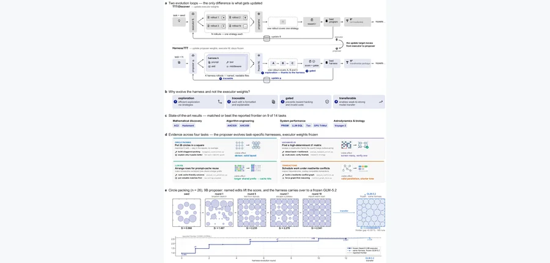 arXiv 2026-10-14 · cs.LG · #16 **[HarnessTTT: Learn to Optimize Harness at Test-Time for Scientific Discovery](https://arxiv.org/abs/2610.17370)** Yingzi Ma , Yulong Cao , Nanxi Li , Fang Wu , Yizhe Zhang , James Zou , Yejin Choi , Chaowei Xiao Affiliation: University of Wisconsin-Madison / NVIDIA / Johns Hopkins University / Stanford University / Meta [Paper](https://arxiv.org/abs/2610.17370) · [Figure source](https://arxiv.org/html/2610.17370v1/one_page_summary.png) 

[EN] Abstract
Scientific discovery with language models requires finding the best valid solution within a finite computational budget. We study how feedback from this search can improve the procedure used to conduct it. We introduce HarnessTTT, a test-time learning framework that trains a harness proposer while keeping the executor frozen. The proposer generates executable harnesses comprising system prompts, reusable skills, tools, middleware, and execution controls. Each harness guides a budgeted discovery rollout, whose outcome provides feedback for updating the proposer. A discovery-oriented policy-gradient objective combines gap-normalized rewards, leave-one-out advantages (RLOO), and max-sharpening to favor high-performing proposals. Generated components are validated before execution, and the search retains the best valid solution and selected harnesses across rounds. Across fourteen discovery tasks in mathematics, systems, GPU kernels, heuristic programming, astrodynamics, and biology, HarnessTTT with a frozen 9B executor improves on OpenEvolve with the same executor on all eleven benchmark tasks (e.g., from 1.17 to 2.64 on circle packing), improves on the discovery-fine-tuned Finch-9B by up to 92%, holds the best open-weight sub-10B result on nine, and reaches 0.380919 on Erdős minimum overlap, better than the best human reference of 0.380927. Scaling the proposer and frozen executor to 27B improves on eleven of fourteen tasks, and transferring the learned harnesses to GPT-5.5 matches or exceeds the strongest reported system of any backbone on nine of fourteen tasks. Together, these results show that harness search can itself be learned at test time: a trained proposer lets a small frozen executor search effectively, and the harnesses it finds carry over to stronger executors. <a href="https://arxiv.org/abs/2610.17370">Source</a>

[ZH] Abstract
语言模型科学发现需要在有限计算预算内找到最佳有效解。我们研究如何用搜索反馈改进搜索程序，提出 HarnessTTT：训练框架提案者、冻结执行器的测试时学习方法。提案者生成含系统提示、可复用技能、工具、中间件和执行控制的可执行框架，每个框架指导预算内发现 rollout，其结果反馈用于更新提案者。面向发现的策略梯度目标结合差距归一奖励、留一优势（RLOO）和最大值锐化，偏向高表现提案。生成组件在执行前验证，跨轮保留最佳有效解及选定框架。在数学、系统、GPU 内核、启发式编程、天体动力学、生物十四项任务中，冻结 9B 执行器在全部十一个基准任务上优于同执行器的 OpenEvolve，例如圆填充从 1.17 至 2.64；比发现专用微调 Finch-9B 最高改善 92%，九项获得开放权重十 B 以下最佳结果，Erdős 最小重叠为 0.380919，优于最佳人类参考 0.380927。提案者和冻结执行器扩到 27B 后，十四项中十一项改善；把框架迁移至 GPT-5.5，九项匹配或超过所有主干最强报告系统。结果表明，训练提案者可让小型冻结执行器高效搜索，框架还可迁移至更强执行器。 <a href="https://arxiv.org/abs/2610.17370">Source</a>
 | 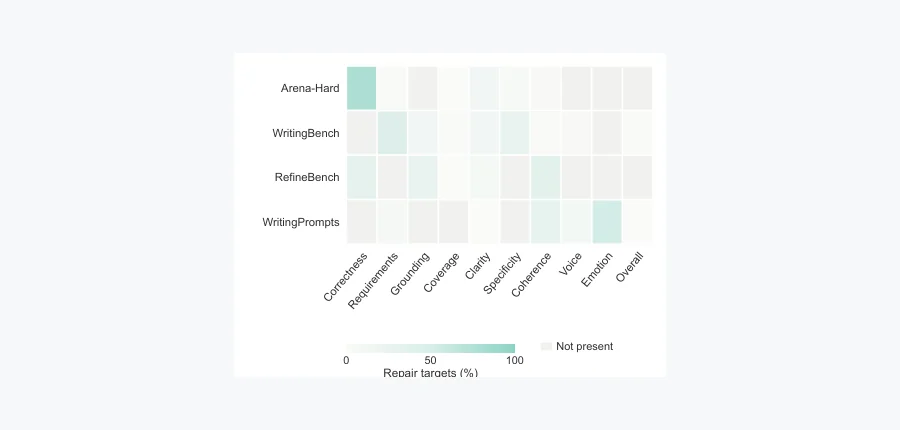 arXiv 2026-10-14 · cs.AI · #17 **[Verifier-Harness Co-Evolution for Training-Free Self-Improvement on Open-Ended Tasks](https://arxiv.org/abs/2610.17609)** Tianyi Xu , Yaolun Zhang , Yiran Wu , Joe Nguyen , Shengyu Dai , Saba Moeinizade , Zhenwen Shao , Qingyun Wu , Huazheng Wang Affiliation: Oregon State University / Pennsylvania State University / Johnson &amp; Johnson / AG2 AI [Paper](https://arxiv.org/abs/2610.17609) · [Code](https://github.com/tianyi0216/Unified-Co-Evolution) · [Figure source](https://arxiv.org/html/2610.17609v1/ucoe_repair_targets.png) 

[EN] Abstract
Training-free self-improvement lets an agent use feedback to revise the response it is about to return and to update the harness state that shapes how it handles later tasks. On open-ended tasks that feedback rarely comes from reference answers or executable tests, so the agent has to rely on a model-based verifier. When the verifier is wrong, the current response can get worse, and misleading experience can persist across the task stream. A verifier that never changes also grows stale as the agent's responses improve and task demands shift. We introduce Unified Co-Evolution (UCoE), a training-free method that evolves an executable verifier program together with the agent's harness state while all model parameters stay fixed. UCoE synthesizes candidate verifier programs and tests them on response contrasts, pairs of responses that differ in one declared property and have a known preferred side. It selects the candidate whose discrimination on its weakest contrast family is highest, a quantity we call driving capacity. The selected verifier diagnoses one weakness in each draft, guides a single repair, decides which response is served, and determines whether the accepted repair may enter the harness state. As tasks complete, their diagnostics seed new candidate verifiers, which must beat the current verifier on the same contrasts before adoption. Across six open-ended benchmarks, UCoE averages 59.00% preference against matched direct generation with Qwen3-8B and 57.19% with Qwen3.8-27B, margins of 9.00 and 7.19 percentage points. On three verifiable benchmarks, the same method raises the mean from 36.06% for direct generation to 38.48%. Code is available at this https URL . <a href="https://arxiv.org/abs/2610.17609">Source</a>

[ZH] Abstract
无需训练的自改进允许智能体据反馈修订当前响应，并更新影响后续任务的框架状态。开放任务通常没有参考答案或可执行测试，只能依赖模型验证器；验证器出错会恶化当前响应，还会让误导经验持久保留。固定验证器又随响应改善和任务变化而过时。UCoE 保持全部模型参数固定，联合演化可执行验证程序与框架状态。它生成验证器候选，在仅一项声明属性不同、偏好方向已知的响应对上测试，以最弱对比家族的最高区分能力选择候选，称为驱动能力。验证器诊断草稿的一项弱点、指导一次修复、决定服务哪个响应，以及修复是否可进入框架状态。任务结束后，诊断生成新候选，必须在相同对比集上优于当前验证器才能接纳。在六个开放基准中，Qwen3-8B 和 Qwen3.8-27B 相比匹配直接生成的平均偏好分别为 59.00% 和 57.19%，优势 9.00 和 7.19 个百分点；三个可验证基准的均值从直接生成的 36.06% 提高到 38.48%。代码见原摘要所附链接。 <a href="https://arxiv.org/abs/2610.17609">Source</a>
 | 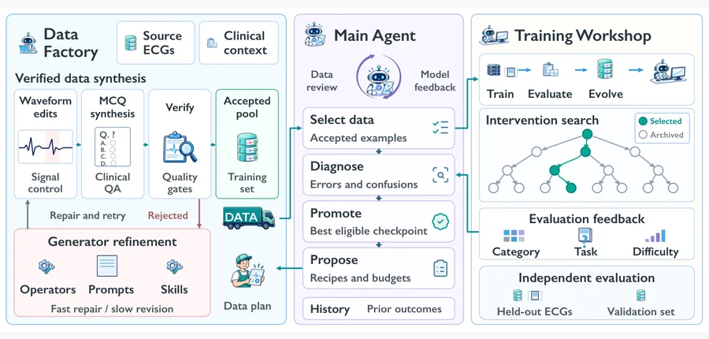 arXiv 2026-10-14 · cs.AI · #18 **[ECG-RSI: Recursive Self-Improvement through Targeted Electrocardiogram Waveform Evolution](https://arxiv.org/abs/2610.17718)** Xiaoliang Wang , Zhuo Chen , Chuanyang Zheng , Jiangwei Lao , Quanbin Wang , Honglin Lin , Jiajia Liu , Zhihong Lu , Hao J… Affiliation: Zhejiang University / Ant Group / Shanghai Artificial Intelligence Laboratory / Shanghai Jiao Tong University [Paper](https://arxiv.org/abs/2610.17718) · [Figure source](https://arxiv.org/html/2610.17718v1/figure1.png) 

[EN] Abstract
Electrocardiogram (ECG) models need supervision that targets evolving weaknesses and remains faithful to waveform evidence. We introduce ECG-RSI, a recursive self-improvement framework combining verified waveform synthesis with feedback-guided intervention search. Signal remeasurement verifies waveform edits; construction errors guide generator repair, while learner errors motivate interventions compared on a separate selection set. Across seven benchmarks, three rounds raise Qwen3.5-35B-A3B's mean question-answering accuracy from 34.57% to 56.04% and mean classification F1 from 24.27 to 34.03. Across the retained trajectory, the preferred supervision shifts from direct reinforcement to confusion-focused contrasts. Continued feedback correction yields diminishing external gains. These results motivate separating error diagnosis from intervention selection and checking whether gains on the feedback set transfer to independent benchmarks. <a href="https://arxiv.org/abs/2610.17718">Source</a>

[ZH] Abstract
心电图模型需要针对不断变化弱点、且忠实于波形证据的监督。ECG-RSI 把经过验证的波形合成与反馈引导的干预搜索结合。信号重新测量验证波形编辑，构造错误指导生成器修复，学习器错误则提出在独立选择集上比较的干预。七个基准上，三轮将 Qwen3.5-35B-A3B 平均问答准确率从 34.57% 提高到 56.04%，平均分类 F1 从 24.27 提高到 34.03。保留轨迹中，优选监督从直接强化转向聚焦混淆的对比。持续反馈纠正的外部收益逐渐减小。结果提示应将错误诊断与干预选择分开，并检查反馈集收益能否迁移到独立基准。 <a href="https://arxiv.org/abs/2610.17718">Source</a>
 |
| 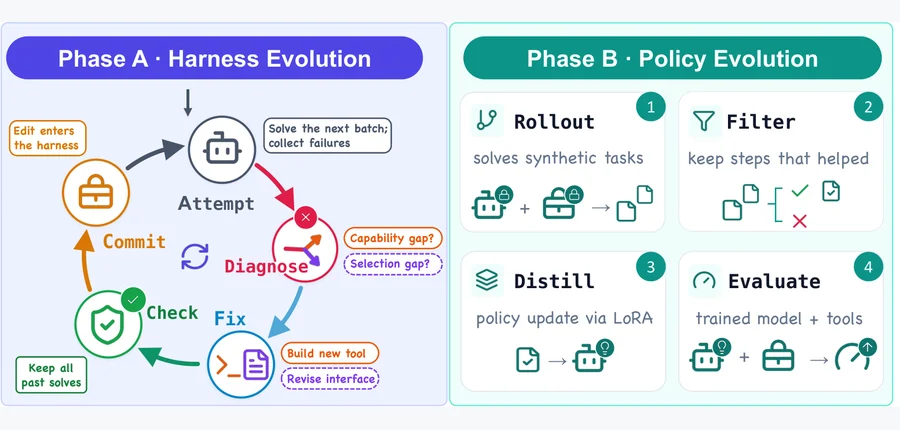 arXiv 2026-10-14 · cs.AI · #19 **[Coupled Harness--Model Evolution for Scientific Equation Discovery](https://arxiv.org/abs/2610.17740)** Pengze Li , Jiaquan Zhang , Encheng Su , Yunbo Long , Zihang Zeng , Xinping Liu , Han Zhang , Junchi Yu , Shixiang Tang… Affiliation: Fudan University / USTC / University of Cambridge / Peng Cheng Laboratory / University of Oxford / CUHK / Shanghai AI Laboratory [Paper](https://arxiv.org/abs/2610.17740) · [Figure source](https://arxiv.org/html/2610.17740v1/wkfl2.png) 

[EN] Abstract
Large language models (LLMs) are increasingly used to discover scientific equations from experimental data. Such a discovery system has two parts that must work together: a library of executable computational tools and the model's tool-use policy. The tools supply the solving capability, from diagnosing structure in the data to fitting candidate equations; the policy plans and orchestrates their use. Yet existing systems adapt only one part, keeping either the toolset or the model fixed, which leaves the corresponding failures uncorrectable. We develop a coupled evolution framework that improves both parts from the same verifiable fit-error signal. In the tool-evolution phase, an agent grows an executable tool library from a small set of generic numerical operations by diagnosing its own failures: it authors a new tool when a capability is missing and revises its selection rules when the right tool went unused. In the policy-evolution phase, a small open model (roughly 3B active parameters) is fine-tuned on successful tool-use trajectories collected with the frozen library, on training formulas screened to be disjoint from all evaluation benchmarks. Ablations show the two phases are complementary: with no tool library at all the same model solves almost nothing, the tools account for most of the gain, and trajectory training adds a further gain that is largest on the most difficult problems. The full system solves 79.1/71.3\% of LSR-Synth problems at fit tolerances $10^{-2}$/$10^{-3}$, reaches 63.8\% pooled accuracy on the distributionally different SRSD-Feynman panel, and obtains a normalized CP3-28 aggregate of $-7.27$. These results suggest a broader recipe for scientific agents: let the model and its instruments improve each other under verifiable feedback. <a href="https://arxiv.org/abs/2610.17740">Source</a>

[ZH] Abstract
LLM 越来越多地从实验数据发现科学方程。这类系统包含必须协同的两部分：可执行计算工具库，以及模型的工具使用策略。工具提供从结构诊断到方程拟合的求解能力，策略规划和编排使用方式；现有系统往往只适配其中一方，使另一方失败无法纠正。我们用相同的可验证拟合误差信号共同演化两者。工具演化阶段，智能体从少量通用数值操作出发，诊断自身失败：缺能力时编写新工具，正确工具未被使用时修订选择规则。策略演化阶段，用冻结工具库收集成功轨迹，在已筛除所有评估基准重叠的训练公式上微调约三 B 激活参数的开放模型。消融显示两阶段互补：同模型没有工具几乎不能求解，工具贡献大部分收益，轨迹训练进一步提升，尤其困难题最明显。完整系统在 LSR-Synth 的 10⁻²、10⁻³ 容差下分别解决 79.1%、71.3%，在分布不同的 SRSD-Feynman 面板汇总准确率 63.8%，归一 CP3-28 汇总为 −7.27。结果支持科学智能体通过可验证反馈让模型与其仪器共同改进。 <a href="https://arxiv.org/abs/2610.17740">Source</a>
 | 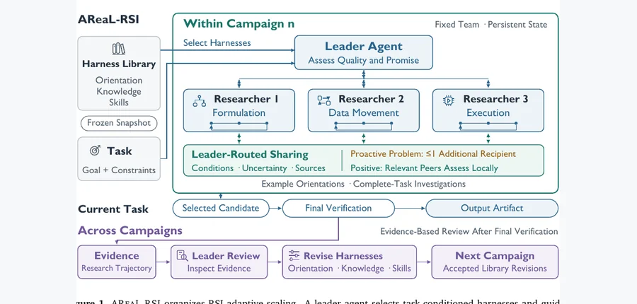 arXiv 2026-10-14 · cs.AI · #20 **[AReaL-RSI: Adaptive Scaling and Coordination of Recursive Self-Improvement](https://arxiv.org/abs/2610.18083)** Wenhao Zhou , Jiajun Song , Haitao Wang , Zipeng Qiu , Yingqi Peng , Ruida Xu , Jiale Li , Wenshuang Li , Shusheng Xu , We… Affiliation: Ant Group / Zhejiang University / HKUST [Paper](https://arxiv.org/abs/2610.18083) · [Figure source](https://arxiv.org/pdf/2610.18083#page=2) 

[EN] Abstract
Scaling recursive self-improvement requires additional computation to produce useful research progress in reaching persistent objectives. Intuitively, more researcher agents can explore more hypotheses, but early evaluation scores might misrepresent their promise, shared findings could lose their applicability conditions, and useful procedures could remain confined to completed investigations. In this paper, we present AReaL-RSI, a framework for organizing a persistent research team of agents without updating backbone LLM weights. We formulate the scaling problem in terms of evaluated outcomes and whole-system resource expenditure. Concretely, a leader agent selects task-appropriate research orientations and guides ongoing investigations; conditional memory sharing distinguishes unresolved problems from supported findings and enables recipient adaptation. During recursive evolution, after each campaign, evidence-based review revises researcher orientation, knowledge, and skills for later campaigns. Experiments compare AReaL-RSI with Codex-Goal on downstream harness optimization, GPU kernel optimization, and AI research tasks using two backbones. Under the reported resource allocations, AReaL-RSI improves Terminal Bench performance by 2.2 percentage points for each backbone and increases mean KernelBench speedup by 32.2-36.8%; further scalability comparisons favor the design of AReaL-RSI over native scaling: combining experience sharing with specialized researcher roles yields 1.9-27.5% lower kernel latency than independent exploration and 1.3-33.9% lower latency than sharing alone across all seven comparable task-backbone pairs. <a href="https://arxiv.org/abs/2610.18083">Source</a>

[ZH] Abstract
扩展 RSI 要让额外计算转化为面向持久目标的有效研究进展。更多研究智能体可探索更多假设，但早期分数可能误导，分享发现可能丢失适用条件，有用过程也可能困在已结束调查中。AReaL-RSI 组织持久研究团队而不更新主干权重，以评估结果和全系统资源消耗刻画扩展。领导者选择任务适配研究方向、引导调查；条件化记忆共享区分未解决问题和已获支持发现，并允许接收者适配。每轮研究后，证据审阅修订研究者方向、知识、技能，服务后续轮次。两个主干上，与 Codex-Goal 比较下游框架优化、GPU 内核优化、AI 研究。在报告资源分配下，两个主干的 Terminal Bench 均提高 2.2 个百分点，平均 KernelBench 加速提高 32.2%–36.8%。扩展比较中，经验共享结合专门角色优于原生扩展：七个可比任务—主干组合中，相比独立探索内核延迟低 1.9%–27.5%，相比仅共享低 1.3%–33.9%。 <a href="https://arxiv.org/abs/2610.18083">Source</a>
 | 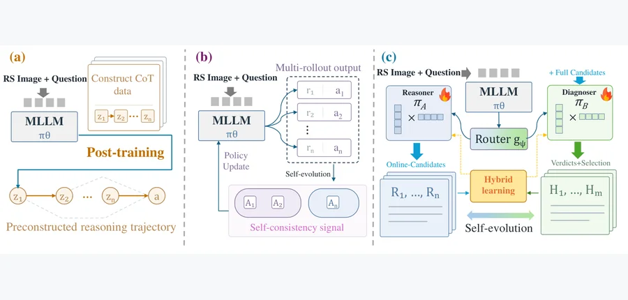 arXiv 2026-10-14 · cs.CV · #21 **[ReDiS: Reasoning-Diagnosis Self-Evolution for Multimodal Reasoning in Remote Sensing](https://arxiv.org/abs/2610.18388)** Yi Liu , Wentao Jiang , Shuo Ni , Zhiming Luo , Di Wang , Zengmao Wang , Jing Zhang , Bo Du Affiliation: Wuhan University / Zhongguancun Academy / Beijing Institute of Technology [Paper](https://arxiv.org/abs/2610.18388) · [Code](https://github.com/MiliLab/ReDiS) · [Figure source](https://arxiv.org/html/2610.18388v1/motivation.png) 

[EN] Abstract
Multimodal large language models (MLLMs) have shown strong potential for remote sensing understanding, yet reliable reasoning remains challenging when tasks require fine-grained visual grounding and multi-step inference. Existing approaches typically rely on either costly pre-constructed reasoning trajectories or self-generated signals such as response consistency, which can reinforce shared errors and provide unreliable supervision. We introduce \textbf{Reasoning--Diagnosis Self-Evolution (ReDiS)}, a framework that separates reasoning exploration from candidate evaluation while allowing the two processes to evolve jointly. ReDiS instantiates two role-specific experts from a shared multimodal backbone: a \textbf{Reasoner} that explores diverse visual evidence--answer candidates and a \textbf{Diagnoser} that jointly evaluates the complete candidate set and provides credibility-aware feedback. As the Reasoner evolves, it exposes new candidate distributions and failure modes; the Diagnoser adapts to these changes and, in turn, reshapes the learning signal for subsequent exploration. To handle groups in which all sampled answers are incorrect and group-relative advantages vanish, we further introduce \textbf{Failure-Triggered Recovery (FTR)}, which provides minimal outcome-level correction without prescribing intermediate reasoning trajectories. Experiments on LHRS-Bench, MME-RS, and CHOICE show consistent improvements over Qwen3.5 backbones at 0.8B, 2B, and 4B scales. ReDiS improves category-averaged accuracy by 6.47 percentage points at 0.8B, while ReDiS-4B achieves the highest average performance among the compared remote sensing MLLMs. <a href="https://arxiv.org/abs/2610.18388">Source</a>

[ZH] Abstract
多模态 LLM 在遥感理解中潜力很大，但精细视觉定位与多步推理仍难可靠完成。既有方法依赖昂贵预构造轨迹，或响应一致性等自生成信号，可能强化共同错误。ReDiS 将推理探索与候选评估分开，同时让二者共同演化。共享多模态主干形成两个专用专家：推理者探索多种视觉证据—答案候选；诊断者联合评估完整候选集并提供可信度感知反馈。推理者演化暴露新候选分布和失败模式，诊断者适配变化，再改变后续探索的学习信号。对于采样答案全错、组相对优势消失的情况，失败触发恢复（FTR）提供最少的结果级纠正，不规定中间推理轨迹。在 LHRS-Bench、MME-RS、CHOICE 上，Qwen3.5 的 0.8B、2B、4B 均持续提升；0.8B 类别平均准确率提高 6.47 个百分点，ReDiS-4B 在所比较遥感 MLLM 中平均表现最高。 <a href="https://arxiv.org/abs/2610.18388">Source</a>
 |
| 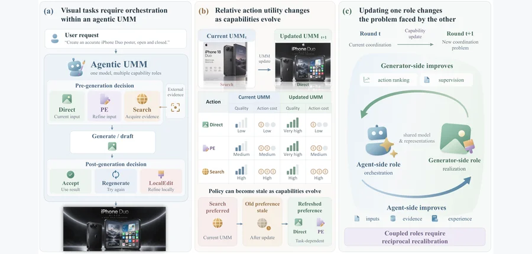 arXiv 2026-10-14 · cs.CV · #22 **[RSIgen: Reciprocal Self-Improvement for Agentic Visual Generation](https://arxiv.org/abs/2610.18688)** Yidi Liu , Haozhe Wang , Jie Xiao , Kai Zhu , Xueyang Fu , Zheng-Jun Zha Affiliation: University of Science and Technology of China / Wan Team, Alibaba Group / Hong Kong University of Science and Technology [Paper](https://arxiv.org/abs/2610.18688) · [Figure source](https://arxiv.org/html/2610.18688v1/rsi_fig1_motivation.png) 

[EN] Abstract
Agentic visual generation produces experience that can improve the native understanding (agent) and generation roles of a unified multimodal backbone, but task success alone does not determine which role should learn. Generator updates can also make the agent's action supervision stale. We introduce RSIgen, a task-centric reciprocal self-improvement framework linking learning allocation, supervision refresh, and recursive curriculum construction. Dynamic Responsibility Routing (DRR) uses matched interventions on evidence, inputs, and supported actions to select learning recipients and construct compatible training targets. After generator learning, RSIgen re-evaluates the relative utility of tested actions with branch inputs held fixed to refresh agent supervision; the retained roles then construct the next curriculum. Across BAGEL, Qwen-Image, and Wan-Image-7B, RSIgen improves AgentGen-Bench Full Overall9 by 3.2--3.3 points over a three-cycle SearchGen adaptation with action costs. Wan controls support allocation gains at matched role-level training exposure, refresh gains at a matched adaptation budget, and benefits from updated curriculum sources while recipients continue learning. In blind evaluation on 200 real-user requests, pooled tie-adjusted preference scores against the same baseline reach 70.0% for task completion and 64.9% for visual quality. <a href="https://arxiv.org/abs/2610.18688">Source</a>

[ZH] Abstract
智能体视觉生成的经验可以改善统一多模态主干的理解与生成角色，但任务成功本身不能决定谁应学习，生成器更新也会使智能体动作监督过时。RSIgen 以任务为中心，将学习分配、监督刷新、递归课程构造联结成相互自改进框架。动态责任路由（DRR）对证据、输入、受支持动作进行匹配干预，选择学习接收方并构建兼容目标。生成器学习后，在分支输入固定时重新评估测试动作的相对效用，刷新智能体监督；保留的角色再构建下一课程。在 BAGEL、Qwen-Image、Wan-Image-7B 上，相比考虑动作成本的三周期 SearchGen 适配，AgentGen-Bench Full Overall9 高 3.2–3.3 点。Wan 的受控实验在匹配角色训练暴露下支持分配收益、匹配适配预算下支持刷新收益，并显示接收方持续学习时，更新课程来源的益处。在二百个真实用户请求的盲评中，相比同基线，汇总、平局校正偏好分数达到任务完成 70.0%、视觉质量 64.9%。 <a href="https://arxiv.org/abs/2610.18688">Source</a>
 | 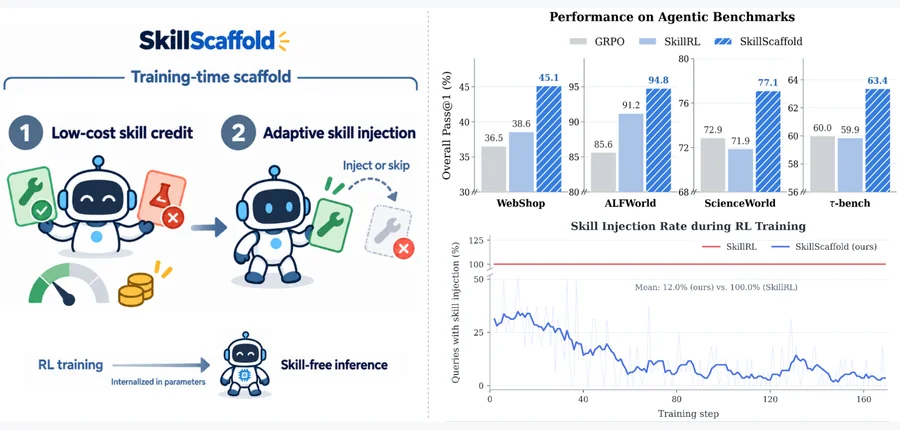 arXiv 2026-10-14 · cs.LG · #23 **[SkillScaffold: Scaffolding Agentic Reinforcement Learning with Policy-Adaptive Skill Credit Assignment and Selective Injection](https://arxiv.org/abs/2610.18807)** Wenlin Zhong , Hao Wang , Kun Yuan , Fan Yang , Jinluan Yang , Dian Jin , Xu Tan , Yiquan Wu , Kun Kuang Affiliation: Zhejiang University / Kuaishou Technology / University of Chinese Academy of Sciences / Zhejiang University of Science and Technology [Paper](https://arxiv.org/abs/2610.18807) · [Code](https://github.com/Vaidurya00/SkillScaffold) · [Figure source](https://arxiv.org/html/2610.18807v1/figures/intro_compact_new_2.png) 

[EN] Abstract
Agentic reinforcement learning (RL) enables large language models (LLMs) to learn from multi-turn interactions with verifiable outcomes. Textual skills can improve exploration by distilling prior interactions into reusable guidance. However, existing skill-based RL approaches often either assume skill injection is beneficial or rely on indirect feedback or rollout-intensive evaluation to assess its utility. Our pilot studies show that rollout-based utility estimation for skill credit assignment is costly and unstable under limited sampling, while skill benefits vary across candidates and depend on the current policy's competence on each query. To address these challenges, we introduce SkillScaffold, a policy-adaptive training scaffold that combines low-cost skill-utility estimation with selective skill injection. By reusing outcome-verified training trajectories, SkillScaffold generates candidate skills and estimates their utility through outcome-aware likelihood comparisons, without candidate-specific environment rollouts. The resulting utility guides whether and which skill to inject, retaining skill-free execution when no candidate is estimated to help. Joint training enables the Generator to produce skills tailored to the evolving Executor. Scaffolded RL encourages skill internalization for skill-free inference. Experiments on ALFWorld, WebShop, ScienceWorld, and $\tau^2$-Bench demonstrate gains over strong agentic-RL and skill-based RL baselines across both short- and long-horizon tasks. Ablations and further analyses support the importance of utility-based selection and abstention. Our code is available at this https URL . <a href="https://arxiv.org/abs/2610.18807">Source</a>

[ZH] Abstract
智能体 RL 可从具有可验证结果的多轮交互学习，文本技能把旧交互蒸馏成可复用指导，改善探索。但已有技能 RL 常假设注入有益，或依赖间接反馈、高 rollout 成本评估效用。先导研究显示，有限采样下基于 rollout 的效用估计昂贵、不稳定，技能收益还随候选及当前策略对查询的能力变化。SkillScaffold 结合低成本效用估计与选择性注入，复用结果已验证的训练轨迹生成技能，通过结果感知似然比较估计效用，无需为候选单独运行环境。估计决定是否注入、注入哪个技能；没有候选有望有益时保持无技能执行。联合训练让生成者产出适应持续演化执行者的技能，支架式 RL 鼓励技能内化，以备无技能推理。在 ALFWorld、WebShop、ScienceWorld、τ²-Bench 的长短周期任务上，均优于强智能体 RL 与技能 RL 基线；消融支持效用选择和拒绝注入的重要性。代码见原摘要链接。 <a href="https://arxiv.org/abs/2610.18807">Source</a>
 | 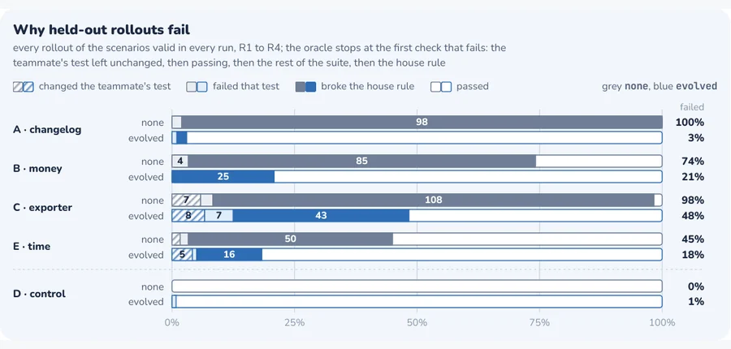 arXiv 2026-10-14 · cs.SE · #24 **[Cortex: Measurement-Gated Evolution and Pruning of Coding-Agent Skills and Rules](https://arxiv.org/abs/2610.14216)** Samuele Giampieri Affiliation: Independent researcher [Paper](https://arxiv.org/abs/2610.14216) · [Figure source](https://arxiv.org/html/2610.14216v1/results-failures.png) 

[EN] Abstract
Coding agents such as Claude Code also follow text files that developers write for them: a project file, skills the agent may choose to open, and rules that load automatically when the agent reads matching files. We call these files the agent's harness. Developers add to it whenever they correct the agent, but one success proves little: the same agent can pass a task once and fail it the next time. We present Cortex, a tool that tests changes to the harness instead of trusting them. It saves fixes from the developer's sessions as replayable tasks, finds the corrections that recur, writes one skill or rule at a time, and keeps it only if repeated runs with and without it show a net gain and no task made noticeably worse. Existing text is tested the same way before it is deleted, and Cortex neither adds nor deletes text the agent never used. We tested Cortex with Claude Haiku 4.5 on a repository built for the purpose, with conventions the model tends to break, one area with nothing to learn, and a script playing the developer. On held-out tasks, the harnesses it built made the agent follow the conventions far more often than no skills or rules did, left the comparison area unchanged, and added no text read on every turn. Rules, which load automatically, did most of the work; skills helped only when offered with the files a task touches, and those offered on every turn were rarely opened. Cortex kept none of the useless or harmful suggestions we planted, but the agent never opened the useless ones or the harmful skills, and it reached no verdict on the harmful rules, so the test shows that Cortex keeps no unused text, not that it detects damage. Under the stronger Claude Sonnet 5 a single run's harness added little, and on a real open-source project, where the agent was rarely corrected, Cortex found nothing to learn. We release the tool, the lab and its data. <a href="https://arxiv.org/abs/2610.14216">Source</a>

[ZH] Abstract
Claude Code 等编码智能体也遵循开发者编写的项目文件、按需打开的技能，以及读取匹配文件时自动加载的规则。我们把这些文件称为运行框架。开发者常在纠正智能体后添加内容，但一次成功说明不了多少，同一智能体可能一次通过、下次失败。Cortex 测试框架变化，而非直接信任变化：把开发会话中的修复保存为可重放任务，发现重复纠正，每次编写一项技能或规则，仅在多次有无对照运行显示净收益且没有任务明显退化时保留。删除旧文本前也同样测试，不添加或删除智能体从未使用的文本。我们用 Claude Haiku 4.5 在专门构建的仓库评估，包含模型容易违反的约定、一个无须学习的区域及模拟开发者的脚本。留出任务上，生成的框架显著提高约定遵循，未改变对照区域，也没有添加每回合必读文本。自动加载的规则贡献最大；技能只有随任务涉及文件一起提供时才有用，每回合都提供的技能反而很少被打开。Cortex 未保留植入的无用或有害建议，但智能体从未打开无用建议和有害技能，对有害规则也未作结论，因此测试证明的是不保留未使用文本，而非能检测伤害。对更强 Claude Sonnet 5，单次运行得到的框架收益很小；在纠正很少的真实开源项目上，Cortex 未发现可学内容。我们发布工具、实验环境及数据。 <a href="https://arxiv.org/abs/2610.14216">Source</a>
 |
| 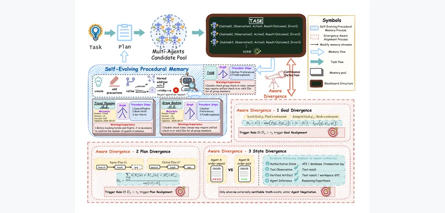 arXiv 2026-10-14 · cs.MA · #25 **[SEPM: Self-Evolving Procedural Memory Grounded in Task Graphs for Multi-Agent Collaboration](https://arxiv.org/abs/2610.14515)** Yi Liu , Junwei Zhao , Li Sun , Jiansong Zhang , Sen Su Affiliation: Beijing University of Posts and Telecommunications / China Telecom [Paper](https://arxiv.org/abs/2610.14515) · [Code](https://github.com/cookieApril/SEPM) · [Figure source](https://arxiv.org/html/2610.14515v1/Multi-Agents-Main-Fig.png) 

[EN] Abstract
Long-horizon multi-agent collaboration requires memory that preserves both successful actions and the coordination structure underlying them. Existing memory systems support information sharing or procedural reuse, but often leave the evolution of shared procedures disconnected from the task dependencies and execution states of collaborating agents. This coupling also limits the direct transfer of procedural memory designed for individual agents to team settings. We propose Self-Evolving Procedural Memory (SEPM), a framework that uses task dependency graphs as a common representation for online coordination and procedural memory evolution. During execution, a lightweight shared blackboard records structured evidence alongside task dependencies, supporting the detection of goal, plan, and world-state divergence and evidence-based realignment. After execution, verified actions and dependencies are distilled into reusable procedures, while recurring failures inform warnings and constraints. The shared procedure pool evolves through creation, refinement, specialization, and retirement, guided by success and cost utility and constrained by evidence and safety requirements. Together, these mechanisms preserve the collaborative structure and applicability conditions needed to reuse experience across tasks. Evaluations on ALFWorld, WebArena, and OfficeBench under AutoGen and DyLAN show that SEPM achieves the highest task scores among the compared methods in all six benchmark settings. Under AutoGen, it improves task scores over the no-added-memory baseline by 29.85, 25.86, and 13.00 percentage points, respectively. The codebase is available at this https URL . <a href="https://arxiv.org/abs/2610.14515">Source</a>

[ZH] Abstract
长周期多智能体协作需要记忆同时保留成功行动及其协作结构。现有系统支持信息共享或过程复用，但共享过程的演化往往与任务依赖及各智能体执行状态脱节，这也限制单智能体过程记忆向团队迁移。我们提出 SEPM，以任务依赖图统一在线协作与过程记忆演化。执行中，轻量共享黑板结合任务依赖保存结构化证据，用于检测目标、计划和世界状态偏离，并据证据重新对齐。执行后，经验证的动作与依赖被蒸馏为可复用过程，重复失败转化为警告和约束。共享过程池依成功与成本效用创建、细化、专门化和退役，并受证据与安全要求约束，从而保留跨任务复用所需的协作结构和适用条件。在 AutoGen、DyLAN 下的 ALFWorld、WebArena、OfficeBench 六种设置中，SEPM 任务分数均为被比较方法最高；AutoGen 下，相比未增加记忆的基线分别提高 29.85、25.86、13.00 个百分点。代码见原摘要所附链接。 <a href="https://arxiv.org/abs/2610.14515">Source</a>
 | 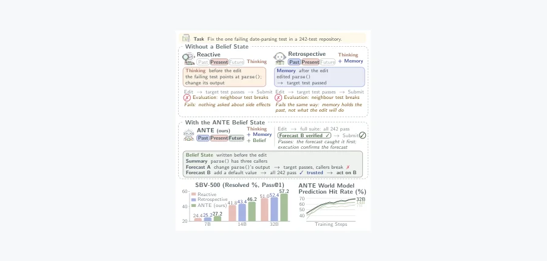 arXiv 2026-10-14 · cs.LG · #26 **[ANTE: Anticipate, Then Execute -- Learning Internal World Models for Coding Agents from Verified Beliefs](https://arxiv.org/abs/2610.15368)** Yi Ge , Kangrui Ruan , Jifan Chen , Manish Prajapat , Christian Bock , Xiaoyang Wang , Rein Houthooft , Aritra Sengupta… Affiliation: University of Maryland, College Park / AWS AI Labs [Paper](https://arxiv.org/abs/2610.15368) · [Figure source](https://arxiv.org/html/2610.15368v1/fig_intro.png) 

[EN] Abstract
Rapid advances in large language models have made software engineering agents capable of tackling complex coding tasks. Within a containerized environment, a coding agent receives tool responses or execution results, and determines its later actions by those earlier results. However, most existing coding agents never look ahead: their policies do not anticipate the consequences of actions, and the terminal reward barely attributes a failure to certain earlier steps, so an ill-judged edit can corrupt the repository state irreversibly before any signal arrives. Recent code world models aim to address these challenges, but they are either trained and then frozen before reinforcement learning (RL), or reduced to an auxiliary next-token loss on the environment's outputs. We present ANTE (Anticipate, Then Execute), an agentic RL framework that verifies the policy's pre-action predictions by real execution and turns them into per-step credit for its actions and trust-or-abstain decisions. With an internal belief stated before each action, Belief-Anchored Policy Optimization (BAPO) turns the settled predictions into per-step advantages by anchoring credit on the policy's own forecasts. To turn the trained forecasts into better actions at inference, thereby facilitating effective test-time scaling, ANTE-TTO (test-time optimization) selects among candidate actions without an external scorer. ANTE raises Qwen3-32B from 25.0% to 57.2% pass@1 on SWE-bench Verified, 6.2% above a matched GRPO baseline trained without the belief state; its world model's accuracy climbs from 44% to 69% during RL, and the learned foresight capability transfers across harnesses and out-of-distribution domains. In summary, we aim to build a code world model that knows what has happened, what holds now, and what the next action will achieve. <a href="https://arxiv.org/abs/2610.15368">Source</a>

[ZH] Abstract
LLM 的进步使软件工程智能体能处理复杂代码任务。在容器中，智能体接收工具响应和执行结果，再决定后续动作，但大多不预判动作后果，终点奖励也很难把失败归因到早期步骤，糟糕编辑可能在反馈到达前就不可逆损坏仓库。近期代码世界模型要么在 RL 前训练后冻结，要么仅用环境输出的辅助下一 token 损失。我们提出 ANTE，以真实执行验证策略的动作前预测，并转化为动作及信任或拒答决策的逐步信用。每个动作前声明内部信念，信念锚定策略优化（BAPO）以自身预测为锚，将已判定预测转成逐步优势。推理时，ANTE-TTO 无需外部评分器，在候选动作中选择，把训练所得预测转化为更好动作，实现测试时扩展。ANTE 把 Qwen3-32B 在 SWE-bench Verified 的 pass@1 从 25.0% 提高到 57.2%，比未训练信念状态的匹配 GRPO 基线高 6.2%；世界模型准确率在 RL 中从 44% 升至 69%，预见能力可跨框架和域外领域迁移。我们旨在建立知道已经发生什么、当前成立什么、下一动作将实现什么的代码世界模型。 <a href="https://arxiv.org/abs/2610.15368">Source</a>
 | 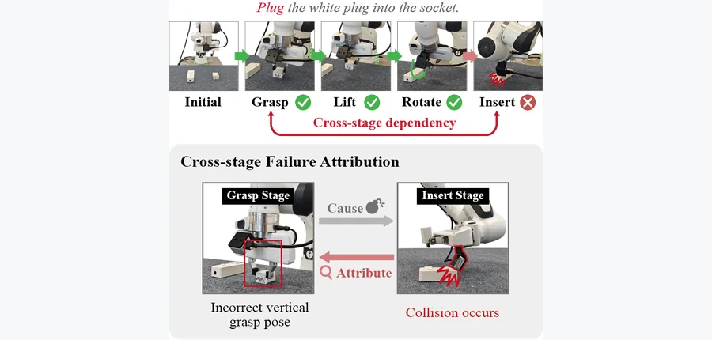 arXiv 2026-10-14 · cs.RO · #27 **[ReTrace: Cross-Stage Failure Attribution for Self-Improving Robotic Manipulation](https://arxiv.org/abs/2610.15814)** Yue Yu , Bin Zhu , Junhui Li , Jiayu Wang , Shijie Zhou , Jingjing Chen Affiliation: Fudan University / Singapore Management University [Paper](https://arxiv.org/abs/2610.15814) · [Figure source](https://arxiv.org/html/2610.15814v1/images/dependency.png) 

[EN] Abstract
General-purpose multimodal foundation models are increasingly capable of directly controlling robots, yet improving their manipulation capabilities through autonomous interaction remains challenging. A key challenge to such self-improvement is learning from failures in complex manipulation tasks involving cross-stage dependencies, where an action may succeed locally but cause a later stage to fail. To address this challenge, we introduce ReTrace, a self-improvement framework for robotic manipulation through autonomous physical interaction and retrospective reasoning, without provided demonstrations or model-parameter updates. ReTrace retrospectively traces downstream failures to earlier decisions, proposes targeted corrections, and evaluates them through subsequent interactions. Across attempts, ReTrace progressively consolidates validated corrections into a reusable manipulation skill that guide subsequent execution. We evaluate ReTrace on four real-world manipulation tasks using a Franka Research 3 robot. On the two tasks with strong cross-stage dependencies, GPT-6 Astra-low improves from 0% to 80% success on plug insertion and from 0% to 100% on ball pouring, while GPT-6 Sol-xhigh improves from 0% to 10% and 0% to 90%, respectively. The learned skills also transfer across model and reasoning configurations and reduce inference-time decision cost in most evaluated settings. <a href="https://arxiv.org/abs/2610.15814">Source</a>

[ZH] Abstract
通用多模态基础模型越来越能直接控制机器人，但通过自主交互改善操作能力仍很困难。关键挑战是学习跨阶段依赖下的失败：动作可能局部成功，却导致后续失败。ReTrace 无需提供演示或更新模型参数，通过自主物理交互和回顾推理实现自改进。它把下游失败回溯到较早决策，提出针对性纠正，并通过后续交互评估；跨尝试把验证后的纠正逐渐巩固为可复用技能，指导后续执行。我们用 Franka Research 3 评估四项真实操作任务。在跨阶段依赖较强的两项任务中，GPT-6 Astra-low 的插头插入从 0% 提高至 80%，倒球从 0% 至 100%；GPT-6 Sol-xhigh 分别从 0% 至 10% 和 0% 至 90%。技能可跨模型与推理配置迁移，并在多数评估设置中降低推理决策成本。 <a href="https://arxiv.org/abs/2610.15814">Source</a>
 |
| 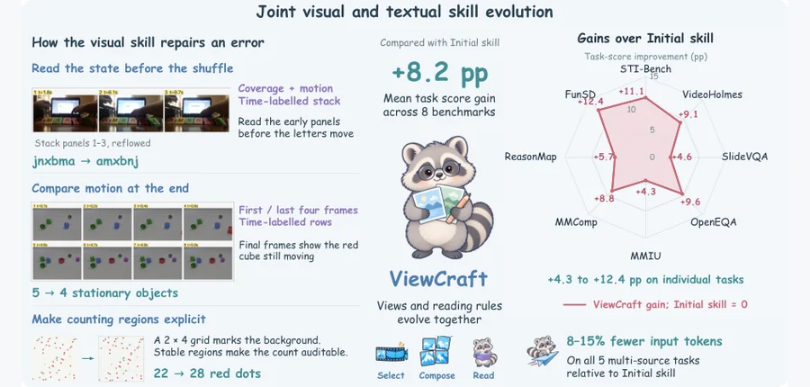 arXiv 2026-10-14 · cs.CV · #28 **[VIEWCRAFT: Evolving What Multimodal Agents See and How They Read It](https://arxiv.org/abs/2610.15915)** Binxiao Xu , Ruichuan An , Bocheng Zou , Weihua Du , Xinyu Wei , Hangyu Guo , YiFan Zhang , Renye Yan , Chengqi Duan , Han… Affiliation: PKU / MIT-IBM Computing Research Lab / UW-Madison / CASIA / CMU / PolyU / HKU (source abbreviations) [Paper](https://arxiv.org/abs/2610.15915) · [Code](https://github.com/Little-Fridge/ViewCraft) · [Figure source](https://arxiv.org/html/2610.15915v1/vc_fig1_motivation.png) 

[EN] Abstract
Reusable skills improve multimodal agents without updating model weights, but their effectiveness depends on both the evidence presented and the procedure used to read it. We introduce ViewCraft, which jointly evolves an executable evidence interface and its reading procedure. The interface selects, transforms, and organizes observations; the reader interprets the resulting views. Failure traces guide revisions, replay and paired evaluation retain useful changes, and interface projection recovers visual edits from eligible rejected joint proposals. Across eight benchmarks, ViewCraft improves over direct execution by an average of $6.1$ points in task score, with gains on every benchmark. The advantage persists at a matched input-token budget. On all five multi-source tasks, the learned interface uses 8%-15% fewer input tokens than Initial skill. The learned skills also transfer across executors and outperform direct execution in every evaluated transfer, supporting evidence construction and reading as a coupled, reusable skill. <a href="https://arxiv.org/abs/2610.15915">Source</a>

[ZH] Abstract
可复用技能能在不更新权重时改善多模态智能体，但效果同时取决于所呈现证据和读取证据的过程。ViewCraft 联合演化可执行证据接口及其读取程序；接口选择、变换、组织观测，读取者解释所得视图。失败轨迹指导修订，重放和配对评估保留有效变化，接口投影从符合条件但被拒绝的联合提案中恢复视觉编辑。八个基准上，平均任务分较直接执行高 6.1 点，每个基准均获益；匹配输入 token 预算后优势仍成立。五项多源任务中，学得接口比初始技能少用 8%–15% 输入 token。技能还能跨执行器迁移，在每个迁移评估中优于直接执行，支持把证据构造与读取作为耦合、可复用技能。 <a href="https://arxiv.org/abs/2610.15915">Source</a>
 | 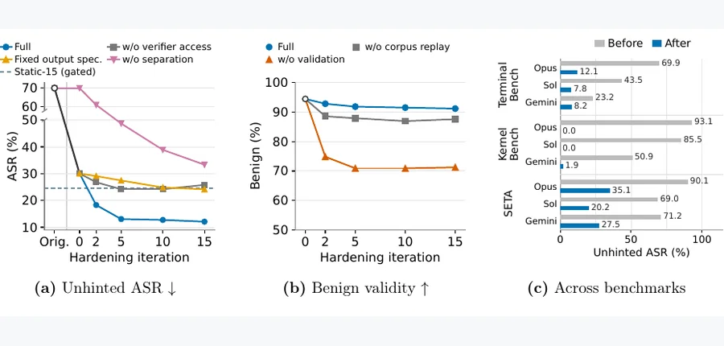 arXiv 2026-10-14 · cs.CR · #29 **[Scalable Weak-to-Strong Verifier Hardening for Agent Environments](https://arxiv.org/abs/2610.15924)** Chong Zeng , Ziqian Zhong , Kexun Zhang , Ivan Bercovich , Ivgeni Segal , Yuzhen Mao , Shashwat Saxena , Aditi Raghunathan Affiliation: Stanford University / Carnegie Mellon University / Fewshot Corp / Independent Researcher [Paper](https://arxiv.org/abs/2610.15924) · [Project](https://verifier-hardening.github.io/) · [Figure source](https://arxiv.org/pdf/2610.15924#page=1) 

[EN] Abstract
Agent environments are essential for large language model (LLM) development. They use programmatic verifiers to turn complex outcomes into rewards. Verifiers can be attacked into awarding full credit to cheating agents without completing the intended task, causing inaccurate evaluation and misalignment in training. As agent environments scale in numbers and difficulty, so must the repairing of exploitable verifiers. To this end, we ask whether today's model with scaled compute can automatically harden agent environments to prevent potentially stronger future models from reward hacking. We introduce a scalable, fully automatic approach to weak-to-strong verifier hardening. It first sets up an isolated verifier sandbox that agents cannot directly modify, then uses a hacker-fixer loop to find and repair remaining verifier vulnerabilities. We apply this loop to Terminal Bench, KernelBench, and SETA, substantially reducing attack success across these agent environments. The iterative design scales with the hardening budget, producing progressively stronger defenses as the number of loop iterations increases and outperforming the static, non-iterative baseline. An earlier version of our hacker-fixer loop has been adopted by the official Terminal Bench repository as a way to audit exploits in its environments. Project page: this https URL . <a href="https://arxiv.org/abs/2610.15924">Source</a>

[ZH] Abstract
智能体环境通过程序验证器，把复杂结果转为奖励，因此对 LLM 发展至关重要。但验证器可被攻击，使作弊智能体未完成目标却获满分，造成评估失真和训练错位。环境数量与难度扩展时，可利用验证器的修复也须扩展。我们研究当代模型增加计算后，能否自动加固环境，阻止未来更强模型利用奖励。方法先建立智能体不能直接修改的隔离验证沙箱，再用攻击者—修复者循环寻找和修补其余漏洞。应用于 Terminal Bench、KernelBench、SETA 后，攻击成功率显著下降。随着加固预算和循环次数增加，防御逐渐增强，并优于静态非迭代基线。较早版本已被 Terminal Bench 官方仓库采用，用于审计环境利用漏洞。项目页见原摘要所附链接。 <a href="https://arxiv.org/abs/2610.15924">Source</a>
 | 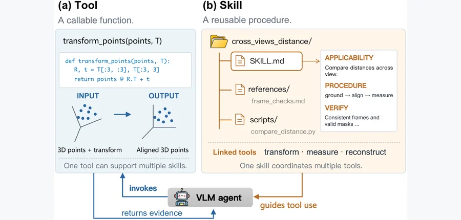 arXiv 2026-10-14 · cs.CV · #30 **[EvoSpatial: Experience-Driven Skill and Tool Evolution for Spatial Reasoning Agents](https://arxiv.org/abs/2610.16679)** Bin Yu , Shijie Lian , Zhaolong Shen , Xiaopeng Lin , Yao Zhang , Haishan Liu , Haotian Li , Yuliang Wei , Kai Hu , Yichao… Affiliation: Harbin Institute of Technology / Zhongguancun Academy / Zhongguancun Institute of Artificial Intelligence / HKUST (Guangzhou) / DeepCybo / Huazhong University of Science and Technology / Wuhan University / Beihang University [Paper](https://arxiv.org/abs/2610.16679) · [Figure source](https://arxiv.org/html/2610.16679v2/skill-tool.png) 

[EN] Abstract
Tool-augmented vision-language agents compose perception and measurement to reason about spatial relationships, but effective execution also requires tracking geometric assumptions and checking intermediate evidence. Preserving this experience across tasks requires retaining procedural knowledge together with the computations it governs. We introduce EvoSpatial, an experience-driven framework that evolves a library of linked skills and tools. Our key insight is that successful and failed spatial trajectories reveal both how to compute and when to trust the result. EvoSpatial retrieves skills, reuses tools, and synthesizes reusable computational functions (generated helpers) during reasoning. After answer submission, supervised outcome feedback guides skill refinement and tool consolidation for subsequent tasks. Across 20 benchmarks, EvoSpatial attains the highest average score among the compared spatial agents, exceeding SpatialClaw by 4.0 percentage points. Further experiments show cross-benchmark transfer and improved reasoning through skill-guided distillation without external skills at evaluation. These results support accumulating spatial experience for both inference-time reuse and trajectory-based training. <a href="https://arxiv.org/abs/2610.16679">Source</a>

[ZH] Abstract
工具增强视觉语言智能体结合感知和测量推理空间关系，但有效执行还需要跟踪几何假设、检查中间证据。跨任务保留经验，需要同时保存过程知识及其控制的计算。EvoSpatial 演化相互关联的技能与工具库，核心是成功和失败的空间轨迹同时揭示如何计算及何时信任结果。推理时检索技能、复用工具，并合成可复用计算函数。提交答案后，监督结果反馈指导技能细化和工具巩固，服务后续任务。二十个基准上，它在比较的空间智能体中平均分最高，比 SpatialClaw 高 4.0 个百分点。进一步实验显示跨基准迁移，以及技能引导蒸馏后无需评估时外部技能也能提升推理，支持将空间经验积累用于推理复用及轨迹训练。 <a href="https://arxiv.org/abs/2610.16679">Source</a>
 |
| 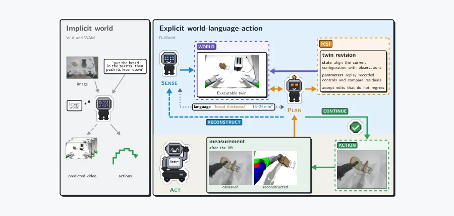 arXiv 2026-10-14 · cs.RO · #31 **[D-World: An Explicit World-Language-Action Model with Recursive Self-Improvement under Dual Control](https://arxiv.org/abs/2610.17114)** Xuan Wen , Baichao Wang Affiliation: Geek+ [Paper](https://arxiv.org/abs/2610.17114) · [Figure source](https://arxiv.org/html/2610.17114v1/fig_teaser.png) 

[EN] Abstract
Frontier large language models (LLMs) now reason about space well enough to program robots, yet the world models behind robot policies are implicit, held in network weights or predicted video, and cannot be inspected or corrected directly. We present D-World, an explicit world-language-action model built on the Sense, Plan and Act decomposition. A perception agent writes the scene as an executable digital twin using generated vision and geometry code. A planning agent searches for actions in simulation and, after each executed action chunk, revises the twin's object states and named physical parameters against what the robot measured. A parameter revision is accepted only if replaying the latest chunk does not increase any measured residual beyond its tolerance, and every chunk is checked in the updated twin before it runs. Structural mismatches return to perception for reconstruction. We call this measurement-grounded cycle of correction and revision recursive self-improvement (RSI), in which the LLM stays frozen while the world it acts in improves. We model the choice of actions that both advance the task and expose model error as a dual control problem and show that the cost of incorporating evidence into the twin sets the threshold at which probing pays, so cheap local revision counteracts the turn-off of cautious controllers. Each episode runs a real-to-sim-to-real loop, and its recorded twins can be refitted and re-rendered offline into higher-fidelity environments for post-training. Because perception and planning communicate only through the twin and language, either can be replaced by a learned model, and since inference dominates the loop, the loop speeds up with faster models. On a dual-arm robot, towel and toaster tasks show local revisions, such as one reducing the bread's rendered-depth residual from 22.4 to 1.5 mm, that let execution continue without reconstruction. <a href="https://arxiv.org/abs/2610.17114">Source</a>

[ZH] Abstract
前沿 LLM 已能通过编程控制机器人，但策略背后的世界模型通常隐含在权重或预测视频里，无法直接检查、纠正。D-World 以感知—规划—行动分解构建显式世界—语言—动作模型。感知智能体用生成的视觉和几何代码，把场景写成可执行数字孪生；规划智能体在仿真搜索动作，并在每个真实动作片段后，依据测量修订对象状态和具名物理参数。只有重放最新片段后，没有任何测量残差超出其容差而增加，参数修订才被接纳；每个片段执行前都在更新孪生中检查。结构错配返回感知重建。我们把这一测量驱动修订循环称为 RSI，LLM 冻结而其行动世界逐步改善。把同时推进任务、暴露模型错误的动作选择建模为双重控制，表明向孪生纳入证据的成本决定探测何时划算，廉价局部修订可对抗谨慎控制器的关闭现象。每回合运行真实—仿真—真实闭环，记录的孪生还可离线重拟合和重渲染为更高保真后训练环境。感知与规划只通过孪生和语言通信，因此任一方都可替换为学习模型；推理占主导，模型变快也会加速循环。双臂毛巾与烤面包机任务展示局部修订，例如把面包渲染深度残差从 22.4 降至 1.5 毫米，使执行无需重建即可继续。 <a href="https://arxiv.org/abs/2610.17114">Source</a>
 | 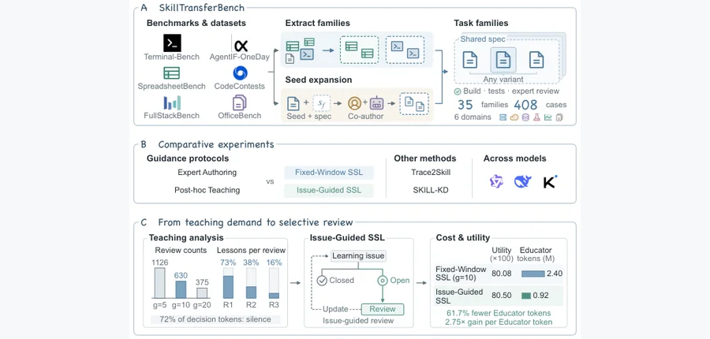 arXiv 2026-10-14 · cs.AI · #32 **[Socratic Skill Learning: Interleaving Teaching and Practice for Transferable Agent Skills](https://arxiv.org/abs/2610.17860)** Letian Zhu , Han Li , Yifan Yao , Xinping Lei , Xinyu Che , Jiahao Wang , Dianyi Wang , Yucheng Fu , Jiakai Wang , Zhiqi B… Affiliation: Nanjing University / Alibaba Group [Paper](https://arxiv.org/abs/2610.17860) · [Figure source](https://arxiv.org/html/2610.17860v1/study_workflow.png) 

[EN] Abstract
Agent Skills improve LLM agents by making task knowledge reusable across sessions. Learning transferable Skills requires evidence about a procedure and its conditions of use, which a successful task attempt can leave untested. We introduce Socratic Skill Learning (SSL), which interleaves expert teaching with Student practice. An Educator guides investigation while the Student remains the sole environment operator and Skill author, able to question, test, and adapt advice. To test reuse beyond the learning task, we construct SkillTransferBench, with 35 task families and 408 executable cases, pairing public variation specifications with held-out evaluation in fresh solver sessions. On the main 22-family, 155-case cohort, Fixed-Window SSL reaches 0.801 utility, versus 0.723 without a Skill, 0.761 for adapted Trace2Skill (trajectory distillation), and 0.751 for adapted SKILL-KD (contrastive distillation). Across three model pairs on shared families, interleaved guidance outperforms expert authoring and post-hoc teaching. Process analysis links guidance to Student writing and package revision; a case study shows the Student testing and refining a proposed procedure for later reuse. As demand for new lessons falls, the cost of fixed-window review grows. Issue-Guided SSL tracks unresolved questions across Skill revisions to select and focus review, reaching 0.805 utility with 61.7% fewer Educator tokens and 16.9% fewer total acquisition tokens than Fixed-Window SSL on the main cohort. <a href="https://arxiv.org/abs/2610.17860">Source</a>

[ZH] Abstract
智能体技能让任务知识可跨会话复用，但学到可迁移技能需要检验过程及使用条件，一次成功可能没有覆盖这些条件。Socratic Skill Learning（SSL）交错专家教学与学生实践。教育者指导调查，学生始终是唯一环境操作者和技能作者，可以质疑、测试和调整建议。为评估学习任务外的复用，我们构建 SkillTransferBench：35 个任务家族、408 个可执行案例，结合公开变化规范与新求解会话中的留出评估。主要二十二家族、一百五十五案例中，固定窗口 SSL 效用为 0.801，无技能为 0.723，适配的 Trace2Skill 为 0.761，SKILL-KD 为 0.751。共享家族的三组模型配对中，交错指导优于专家直接编写及事后教学。过程分析把指导与学生写作、包修订联系起来，案例展示学生测试和细化拟议过程以备复用。随着新课程需求降低，固定窗口审阅成本上升。Issue-Guided SSL 跨技能版本跟踪未解问题，选择和聚焦审阅，在主要样本上达到 0.805 效用，相比固定窗口少用 61.7% 教育者 token、16.9% 总获取 token。 <a href="https://arxiv.org/abs/2610.17860">Source</a>
 | 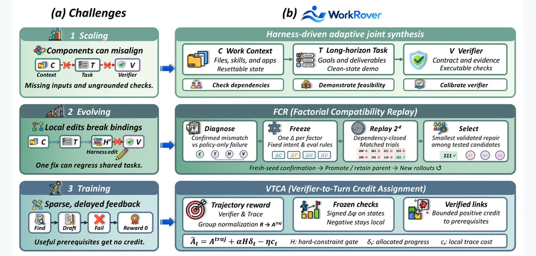 arXiv 2026-10-14 · cs.AI · #33 **[WorkRover: Scaling Long-Horizon Cowork Agent Training Via Recursive Environment Evolution](https://arxiv.org/abs/2610.18067)** Hang He , Linting Wang , Guanming Liu , Bo Mao , Jinxiu Liu , Yiran Suo , Maosen Zhou , Zhiheng Xi , Guanting Dong , Zhou… Affiliation: Fudan University / East China Normal University / Renmin University of China / Shanghai Qiji Zhifeng / Shanghai Innovation Institute [Paper](https://arxiv.org/abs/2610.18067) · [Project](https://workrover.github.io/) · [Figure source](https://arxiv.org/html/2610.18067v1/figure2_challenges_approaches_2to1.png) 

[EN] Abstract
Scaling interactive environments is important for training long-horizon agents through reinforcement learning. These environments often require further testing and refinement after initial generation, and correcting defects in a task may also require updating its work context and verifier. However, existing construction pipelines offer limited support for such iterative refinement while keeping these components aligned. We introduce WorkRover, a framework for training long-horizon cowork agents through recursive environment evolution. Its harness-driven synthesis enables construction agents to jointly build and validate semantically aligned work contexts, executable tasks, and evidence-grounded verifiers, adapting their actions to workspace state and execution feedback rather than following a fixed construction workflow. To support environment evolution, we introduce Factorial Compatibility Replay (FCR), which uses rollout feedback to evaluate combinations of component revisions through dependency-closed replay and selects the smallest validated repair among tested candidates while preserving task requirements and evaluation constraints. To provide finer-grained training signals, we propose Verifier-to-Turn Credit Assignment (VTCA), which augments trajectory-level GRPO advantages with signals from deterministic workspace-progress checks and assigns a bounded share of positive-progress credit to prerequisite turns using recorded tool-output and artifact dependencies. Using WorkRover, we post-train Qwen3.5-35B-A3B to obtain WorkRover-35B-A3B and evaluate it on several cowork-agent benchmarks. Its reported scores exceed those of Qwen3.5-35B-A3B by 26.27 percentage points on JobBench, 29.32 percentage points on OfficeQA Pro, and 413.25 Elo points on GDPval v2. These results suggest that WorkRover offers a promising foundation for scalable training of long-horizon cowork agents. <a href="https://arxiv.org/abs/2610.18067">Source</a>

[ZH] Abstract
交互环境扩展对长周期智能体 RL 很重要，初次生成后常需测试和细化，修复任务还可能要求同步更新工作上下文与验证器；现有流水线较少支持保持组件一致的迭代改进。WorkRover 通过递归环境演化训练长周期协作工作智能体。框架驱动合成让构建智能体联合构造、验证语义一致的工作上下文、可执行任务、证据支撑验证器，依工作区状态和执行反馈调整动作，而非固定流程。因子兼容性重放（FCR）利用 rollout 反馈，通过依赖闭合重放评估组件修订组合，保留任务要求与评估约束，在已测试候选中选最小有效修复。验证器到轮次信用分配（VTCA）以确定性工作区进展检查增强轨迹 GRPO 优势，并依据工具输出和产物依赖，向前置轮次分配有界正进展信用。我们后训练 Qwen3.5-35B-A3B 得到 WorkRover-35B-A3B，在 JobBench 高 26.27 个百分点，OfficeQA Pro 高 29.32 个百分点，GDPval v2 高 413.25 Elo 点，显示其可支持可扩展的长周期协作智能体训练。 <a href="https://arxiv.org/abs/2610.18067">Source</a>
 |
| 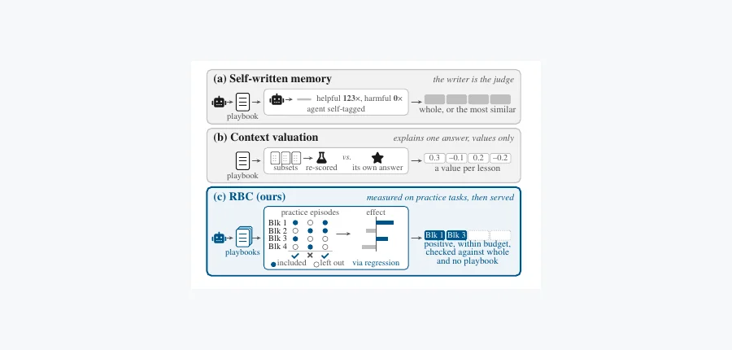 arXiv 2026-10-14 · cs.CL · #34 **[Reliable Memory from Unstable Growth: Curating Self-Written Agent Playbooks with Randomized Experiments](https://arxiv.org/abs/2610.18427)** Hoang Pham , Cong-Duy Nguyen , Dong Le , Ponhvoan Srey , Anh Tuan Luu Affiliation: Nanyang Technological University / VinUniversity [Paper](https://arxiv.org/abs/2610.18427) · [Figure source](https://arxiv.org/pdf/2610.18427#page=1) 

[EN] Abstract
Persistent textual memory lets language-model agents reuse lessons from past tasks to improve on future multi-step tasks without retraining. Systems such as ACE and Dynamic Cheatsheet keep it as a playbook: lessons the agent writes after each task and reads in its prompt. A key challenge is to decide which lessons improve later tasks. Current systems leave the decision to the agent itself, which makes performance unstable: the same procedure can write a playbook that helps or one that falls up to 69.6 points below no playbook. These findings motivate valuing lessons by their measured effect on task success rather than by the agent's judgment. We propose Randomized Block Curation (RBC), which measures this effect with a randomized experiment on practice tasks. It groups related lessons into blocks large enough to move success measurably and, on each practice task, includes or leaves out every block at random. Random inclusion makes tasks with and without a block comparable, so the gap in their success estimates the block's effect. RBC keeps the blocks that help and, since the same procedure can write a helpful or a harmful playbook, grows several and serves whichever curated, whole or no playbook scores best on fresh practice episodes. Across two memory systems, three models and three benchmarks, RBC raises average success to 66.9, against 55.5 with the whole playbook, 54.1 with no playbook and 53.8 when the agent's own judgment picks the lessons to keep. <a href="https://arxiv.org/abs/2610.18427">Source</a>

[ZH] Abstract
持久文本记忆让语言智能体不训练也能复用旧任务经验，改善未来多步任务。ACE、Dynamic Cheatsheet 等把经验写成每次任务后更新、提示中读取的行动手册，但关键是判断哪些经验真正有用。目前由智能体自行判断，表现不稳定：同一流程可能写出有益手册，也可能比无手册低最多 69.6 点。因此，我们主张以任务成功的测量效果评价经验，而非自身判断。随机区组筛选（RBC）在练习任务上做随机实验：把相关经验分成足以可测影响成功的区组，每项练习随机包含或排除每个区组，使有无区组任务可比，由成功率差估计效果。保留有益区组；因生成过程可能有益也可能有害，它生成多个手册，在新练习回合选择筛选版、完整版或无手册中最佳者。两个记忆系统、三个模型、三个基准上，RBC 平均成功率 66.9，完整手册为 55.5，无手册 54.1，智能体自行选经验 53.8。 <a href="https://arxiv.org/abs/2610.18427">Source</a>
 | 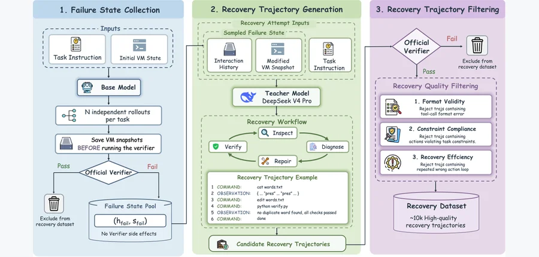 arXiv 2026-10-14 · cs.AI · #35 **[ReTerm: Recovery Training for Self-Improving Terminal Agents](https://arxiv.org/abs/2610.18484)** Wei Xie , Kaituo Feng , Shiming Fu , Yong Liu , Xiangyu Yue , Shuangjia Zheng Affiliation: Fudan University / CUHK MMLab / Shanghai Jiao Tong University [Paper](https://arxiv.org/abs/2610.18484) · [Code](https://github.com/twothsnd/ReTerm) · [Figure source](https://arxiv.org/html/2610.18484v1/recovery_pipeline.png) 

[EN] Abstract
Terminal agents have shown strong abilities in complex coding tasks. However, they often struggle to recover from errors during long-running execution (e.g., command errors, faulty implementations), eventually leading to task failures. To this end, we present ReTerm, a self-improving terminal agent trained by learning how to recover from its own failed terminal tasks. To support its training, we construct a customized data pipeline and produce ReTerm-10K, a high-quality dataset that provides effective recovery demonstrations for SFT cold start. Furthermore, we propose ReTerm-GRPO, an online RL algorithm that forks from the agent's own failure states to generate multiple independent self-recovery attempts. By learning from whether these attempts successfully complete the task, the agent self-improves through its own recovery experience. Built on Qwen3.5-9B, our ReTerm-9B achieves 34.8% Pass@1 on Terminal-Bench 2.0, improving over the base model by 14.6 points. Further analysis shows that our method achieves consistently higher recovery rates across diverse error categories compared with standard GRPO training. All code, data and model are released at this https URL . <a href="https://arxiv.org/abs/2610.18484">Source</a>

[ZH] Abstract
终端智能体擅长复杂代码任务，但长时间执行中的命令错误、错误实现等常难恢复，最终导致任务失败。ReTerm 通过学习从自身失败终端任务恢复实现自改进。专门数据流水线构建高质量 ReTerm-10K，为 SFT 冷启动提供恢复演示；在线 ReTerm-GRPO 从自身失败状态分叉，生成多个独立恢复尝试，按能否完成任务学习，从自身恢复经验改善。基于 Qwen3.5-9B 的 ReTerm-9B 在 Terminal-Bench 2.0 达到 34.8% Pass@1，比基础模型高 14.6 点。进一步分析显示，多种错误类别的恢复率持续高于标准 GRPO。全部代码、数据和模型已通过原摘要链接发布。 <a href="https://arxiv.org/abs/2610.18484">Source</a>
 | 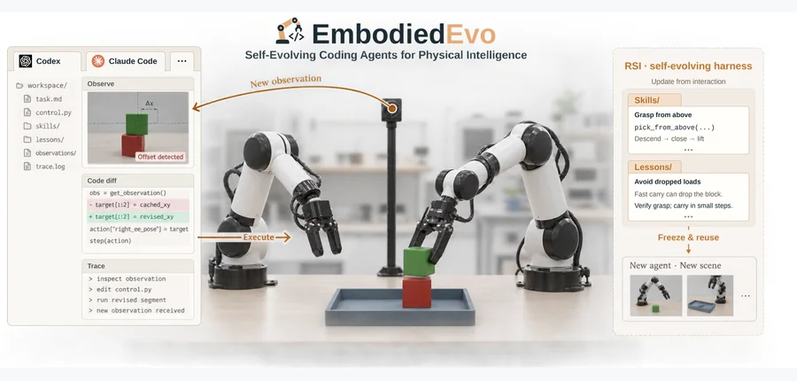 arXiv 2026-10-14 · cs.RO · #36 **[EmbodiedEvo: Self-improving Coding Agents for Physical Intelligence](https://arxiv.org/abs/2610.18867)** Wenyi Li , Yizhe Chi , Youjie Zheng , Chunyu Liu , Xiaoqiu Wang , Mingju Gao , Zheng Jiang , Deyao Hong , Calvin Xiao , Ka… Affiliation: Navers Lab / Einsia.AI / Tsinghua University (as stated) [Paper](https://arxiv.org/abs/2610.18867) · [Figure source](https://arxiv.org/html/2610.18867v2/Figures/embodied-rsi-overview.png) 

[EN] Abstract
Bringing general-purpose agents into the physical world calls for an executable representation of physical intelligence. Compared with vision-language-action (VLA) models, which map observations and language instructions directly to actions, code makes control logic explicit and reusable. Code can serve not only as a policy representation but also as the workspace in which the agent solves a task. Rather than following a prescribed workflow of planning, execution, and verification, the agent can autonomously inspect the state, revise and execute code, and use feedback to choose the next step. The success of this SWE-style loop in digital environments motivates its extension to physical tasks. Yet physical execution remains prone to recurring failures. To retain and refine experience for later scenes, we introduce EmbodiedEvo, where a coding agent evolves reusable Skills and Lessons through feedback on a single Playground scene, then freezes the resulting harness for diverse new scenes. On RoboDojo-Sim, EmbodiedEvo achieves an average score of 44.48 and a success rate of 37.82\%, surpassing all officially verified results. Paired tests show the largest gains on memory-dependent tasks and successful reuse of coordinated procedures, while fine contact control remains difficult. Experience from stronger models also improves weaker executors: Astra's experience raises Sol and Luna's success rates by 8.86 and 5.50 percentage points over no experience. Compared with raw interaction history, Skills and Lessons achieve comparable task performance at 53.0\% lower execution cost. <a href="https://arxiv.org/abs/2610.18867">Source</a>

[ZH] Abstract
把通用智能体带入物理世界，需要可执行的物理智能表示。相比把观测和指令直接映射为动作的 VLA，代码让控制逻辑显式、可复用，也可作为智能体解决任务的工作空间。智能体无需遵循预定规划—执行—验证流程，可自主检查状态、改写和运行代码，并据反馈选择下一步。数字环境中软件工程式循环的成功，推动其扩展到物理任务，但物理执行仍易出现重复失败。EmbodiedEvo 让编码智能体在单个 Playground 场景中，依据反馈演化可复用技能和经验，再冻结所得框架用于不同新场景。在 RoboDojo-Sim 上，平均分 44.48、成功率 37.82%，超过所有官方验证结果。配对测试中，记忆依赖任务收益最大，协作过程成功复用，但细致接触控制仍困难。强模型经验还能帮助弱执行器：Astra 经验使 Sol、Luna 成功率相比无经验高 8.86、5.50 个百分点。相比原始交互历史，技能与经验在相近表现下减少 53.0% 执行成本。 <a href="https://arxiv.org/abs/2610.18867">Source</a>
 |
| 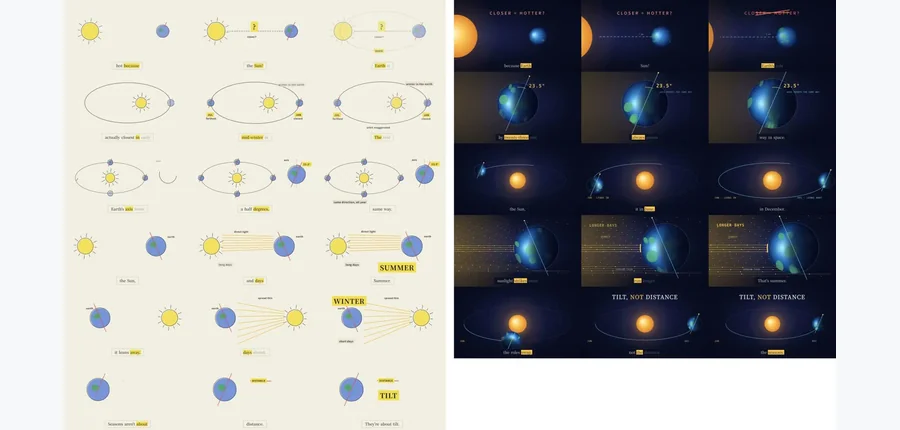 arXiv 2026-10-14 · cs.AI · #37 **[Reels-RSI: Program-Level Self-Improvement for Code-Rendered Explainer Videos](https://arxiv.org/abs/2610.14495)** Wei Lin Affiliation: Agentic Loops X (as stated) [Paper](https://arxiv.org/abs/2610.14495) · [Code](https://github.com/agentic-loops-x/Reels-RSI) · [Figure source](https://arxiv.org/html/2610.14495v1/figures/evolve-seasons.jpg) 

[EN] Abstract
Explainer videos -- a worked geometry problem, why the sky is blue, how a dynasty fell -- are usually one more target for pixel video generation. We argue they are a different kind of artifact: a program (script, storyboard and per-frame animation code) that a deterministic renderer turns into frames. A program can be read, diffed, tested and audited; pixels can only be watched. Reels-RSI is an open-source reel director for any agent harness; its self-improvement happens at the program level rather than in weights or prompts. Every revision pass is logged with a code snapshot; a retrospective pairs each check finding with the diff that fixed it and proposes lessons; a lesson that a static check can catch is compiled into a rule with a must-fail and a must-pass example, so the memory is unit-tested; and a rule learned today runs over everything made before it. A bounded, benchmark-gated step lets an agent rewrite the director's playbook, kept only when blind pairwise judgments on held-out topics prefer it; nothing enters memory without a human decision. Across 111 reels -- a field study, two playbook evolutions, a 2x2 memory ablation, a weaker director, a 48-reel learning curve and a judge-reliability study -- we find that the rule learned in the field caught four latent defects in frames authored before it existed and none after; that rules are an audit for a strong director (eight unguarded reels, no violation) and a guard for a weaker one (thirty violations unguarded versus five); that lessons shorten revision loops but do not compound or move the judge; and that the first rewrite's 11--1 verdict was a position bias in our vote design (judges pick the second-shown reel 62--81% of the time), masking scripts that traded thirteen facts for craft. We document four failure modes of the preference signal, which check caught each, and the fixes. Code, rules, lessons and data are public. <a href="https://arxiv.org/abs/2610.14495">Source</a>

[ZH] Abstract
讲解视频，如几何解题、天空为何是蓝色或王朝如何衰落，通常被当作像素视频生成目标。我们认为它们是另一类产物：由脚本、分镜和逐帧动画代码组成、经确定性渲染器生成画面的程序。程序可读取、比较差异、测试和审计，像素只能观看。Reels-RSI 是适用于任意智能体框架的开源短视频导演，其自改进发生在程序层，而非权重或提示层。每轮修订保存代码快照；回顾把检查发现与修复差异配对并提出经验；能被静态检查捕获的经验被编译为含必失败、必通过样例的规则，从而对记忆做单元测试；新规则还追溯检查旧视频。受预算和基准约束的步骤允许改写导演手册，只有留出主题的盲配对判断更偏好新版才保留；任何记忆进入都需人类决定。在 111 个视频中，我们开展实地研究、两次手册进化、2×2 记忆消融、弱导演、48 视频学习曲线和评委可靠性研究。实地规则发现四个产生于规则之前的潜在画面缺陷，之后没有；规则对强导演主要用于审计（八个无护栏视频零违规），对弱导演则提供保护（无护栏三十次违规，有护栏五次）。经验缩短修订循环，却未复利增长或改变评委判断。第一次改写的 11–1 优势其实来自投票位置偏差：评委有 62%–81% 概率选后展示的视频，掩盖了脚本用十三项事实换取表现手法的问题。我们记录偏好信号四类失败、发现它们的检查及修复。代码、规则、经验和数据公开。 <a href="https://arxiv.org/abs/2610.14495">Source</a>
 | 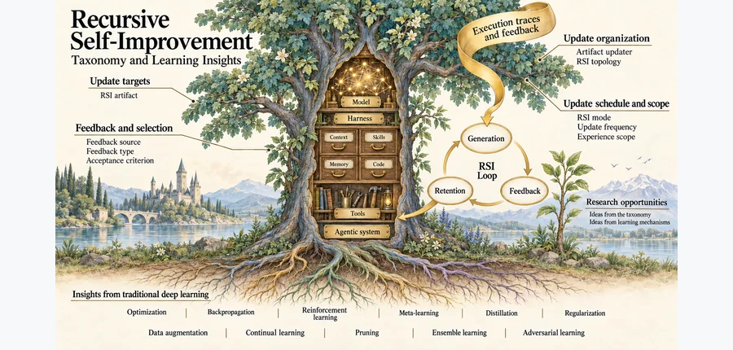 arXiv 2026-10-14 · cs.AI · #38 **[From Existing Methods to New Research Ideas: Two Perspectives on Recursive Self-Improvement](https://arxiv.org/abs/2610.14625)** Leijun Zhou , Yanke Yu , Zhihao Liu , Qu Xiang , Tiancheng Hu , Yiru Dong , Yihan Wu , Yangxi Xiang , Xuejun Wu , Xi Chen… Affiliation: PrismShadow / Peking University / Zhejiang University / New York University [Paper](https://arxiv.org/abs/2610.14625) · [Project](https://prism-shadow.github.io/awesome-rsi/) · [Figure source](https://arxiv.org/html/2610.14625v1/figs/overview.png) 

[EN] Abstract
Recursive self-improvement (RSI) offers a route to AI systems that participate in their own continued development. Recent methods allow language agents to retain changes to their parameters, memory, skills, and code for subsequent execution and improvement. We examine how these methods can inform new research ideas through two complementary perspectives. First, we introduce a unified taxonomy with nine design dimensions organized into four groups: update targets, update organization, update schedule and scope, feedback and selection. This taxonomy places existing methods in a shared design space, where examining individual dimensions and their interactions can inspire new research ideas. Second, we examine how existing RSI methods draw on traditional deep learning, for example through optimization, regularization, data augmentation, continual learning, and adversarial learning. We develop further ideas by examining more specific learning mechanisms and drawing on evolutionary computation. We also review how existing benchmarks assess self-improvement under online, offline, and offline-to-online settings. Together, these perspectives help researchers develop new RSI research ideas from existing designs and learning mechanisms. RSI papers and resources are available at this https URL . <a href="https://arxiv.org/abs/2610.14625">Source</a>

[ZH] Abstract
递归自改进使 AI 系统有机会参与自身持续发展。近期方法让语言智能体保留对参数、记忆、技能和代码的修改，用于后续执行与改进。我们从两个互补视角研究如何利用这些方法产生新研究想法。首先，提出包含九个设计维度的统一分类，组织为更新对象、更新组织、更新时间与范围、反馈与选择四组。它把已有方法置于共同设计空间，研究各维度及相互作用可启发新想法。其次，考察已有 RSI 方法如何利用优化、正则化、数据增强、持续学习和对抗学习等传统深度学习机制，并结合更具体学习机制及进化计算发展进一步想法。我们还回顾基准如何在在线、离线、离线到在线设置中评估自改进。这些视角帮助研究者从现有设计与学习机制发展新 RSI 想法。论文和资源见原摘要所附链接。 <a href="https://arxiv.org/abs/2610.14625">Source</a>
 | 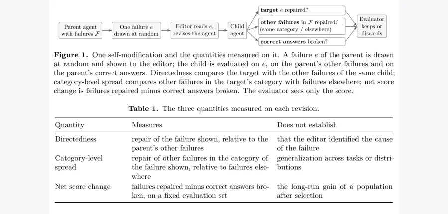 arXiv 2026-10-14 · cs.SE · #39 **[Does Failure Feedback Direct Agent Self-Modification?](https://arxiv.org/abs/2610.14662)** Rong He Affiliation: Affiliation unconfirmed [Paper](https://arxiv.org/abs/2610.14662) · [Figure source](https://arxiv.org/pdf/2610.14662#page=3) 

[EN] Abstract
Self-improving agents use failure feedback to revise their code or instructions, but gains after selection do not establish target-specific repair or generalization. We measure directedness by comparing repair of a randomly selected target failure with repair of the parent's other failures. Across 145 eligible modifications in public Darwin Gödel Machine logs, we find no detectable target-specific advantage. Controlled instruction-revision experiments with small open models show that relevant feedback can improve target repair. In a second study with a pre-specified analysis plan, target feedback raised repair by 20 percentage points for Qwen3-4B relative to matched same-category feedback; the 7-point increase for Phi-4-mini was not significant. Target repair did not reliably imply held-out improvement. Held-out gains were concentrated in settings with identifiable, repairable failure mechanisms, including planted errors and natural tool-interface failures. Benefits of edit localization and regression screening varied across settings, while eight-step revision loops and GEPA ended at similar mean held-out accuracy. Evaluations should report target repair, transfer to related failures, and held-out net change separately. <a href="https://arxiv.org/abs/2610.14662">Source</a>

[ZH] Abstract
自改进智能体使用失败反馈修改代码或指令，但选择后的收益不能证明针对性修复或泛化。我们通过比较随机选定目标失败的修复率与父版本其他失败的修复率，测量定向性。在公开 Darwin Gödel Machine 日志的 145 个合格修改中，未检测出目标专有优势。小型开放模型的受控指令修订实验表明，相关反馈可以改善目标修复。在第二项预先规定分析方案的研究中，相比匹配的同类别反馈，目标反馈使 Qwen3-4B 修复率提高 20 个百分点；Phi-4-mini 的 7 点提高不显著。目标修复并不可靠地意味着留出提升。留出收益集中在存在可识别、可修复机制的设置，包括植入错误和自然工具接口失败。编辑定位与回归筛查的收益随设置变化，八步修订循环与 GEPA 的最终平均留出准确率相近。评估应分别报告目标修复、相关失败迁移和留出净变化。 <a href="https://arxiv.org/abs/2610.14662">Source</a>
 |
| 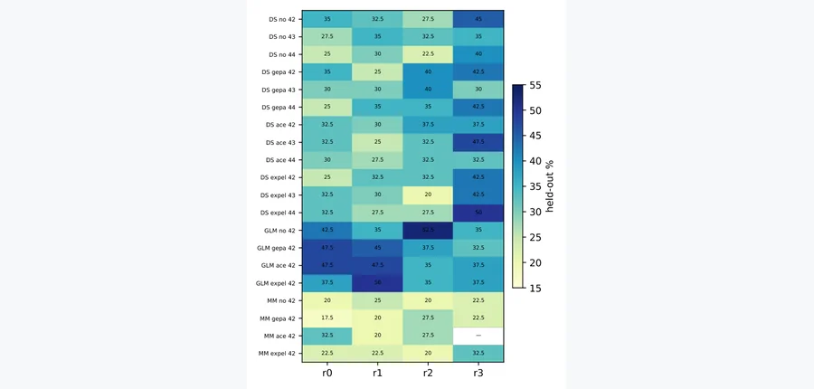 arXiv 2026-10-14 · cs.AI · #40 **[Trace Evolution Bench: Measuring Whether Agents Improve from Their Own Environment Traces](https://arxiv.org/abs/2610.15055)** Fangfei Li , Chenyang Zhao , Long Wang , Feng Tian , Lv Guo Affiliation: MatrixOrigin, China [Paper](https://arxiv.org/abs/2610.15055) · [Figure source](https://arxiv.org/html/2610.15055v1/fig_v1_heatmap.png) 

[EN] Abstract
Self-evolving agents are usually scored by endpoint Gain: held-out success after an update minus success before. That difference can credit a frozen rescore as evolution. We introduce Trace Evolution Bench (TEB), a protocol that separates that rescore from a context or weight update, together with three frozen 80/20/40 packs. An update is accepted only when validation does not fall, held-out identifiers never enter the update, and a text update is not ranked with a weight update. The primary scoreboard is coding, graded by hidden unit tests in a closed workspace. On that pack (40 held-out tasks, one family), DeepSeek v4 Pro under no_evolve never changes its policy yet moves 7.5, 5.0, and 12.5 percentage points across three seeds. Of nine text-update cells inspired by GEPA, ACE, and ExpeL, seven have positive excess above that seed's own band, and one gepa_llm seed moves down by the width of its band (-12.5, regression 0.48). GLM and MiniMax do not reproduce that seven-of-nine pattern. No method stays above its own band on every seed of all three models: GLM has two paired cells above their own bands, and MiniMax expel_llm seed 44 is a third (regression 0.30). The methods were fixed on a validation screen before held-out was read. Office, graded by rule-bounded delivery, and manufacturing table QA are separate packs: office DeepSeek does not exceed its own bands (widest 17.5 points), and manufacturing has no paired positive excess beyond its seed band. <a href="https://arxiv.org/abs/2610.15055">Source</a>

[ZH] Abstract
自进化智能体通常按终点 Gain 评分，即更新后减更新前的留出成功率，但差值可能把冻结策略的重新评分误算为进化。我们提出 Trace Evolution Bench（TEB），将重新评分与上下文或权重更新分开，并提供三组冻结的 80/20/40 数据包。只有验证不下降、留出标识符不进入更新时才接纳更新，文本更新不与权重更新混排。主榜是在封闭工作区用隐藏单元测试评分的编码任务。在该包的四十个留出任务、一个家族上，DeepSeek v4 Pro 的 no_evolve 从不改策略，三个种子仍波动 7.5、5.0、12.5 个百分点。九个受 GEPA、ACE、ExpeL 启发的文本更新单元中，七个超过各自种子的波动带；一个 gepa_llm 种子下降一个带宽（−12.5，回归 0.48）。GLM 与 MiniMax 未复现七胜九的模式。没有方法在三个模型的每个种子上都超过自身波动带：GLM 有两个配对单元超过，MiniMax 的 expel_llm 种子 44 是第三个（回归 0.30）。方法在读取留出集前，已通过验证筛查固定。按规则约束交付评分的办公包、制造表格问答包另行评估：办公 DeepSeek 未超过自身波动带（最宽 17.5 点），制造包没有超过种子波动带的配对正收益。 <a href="https://arxiv.org/abs/2610.15055">Source</a>
 | 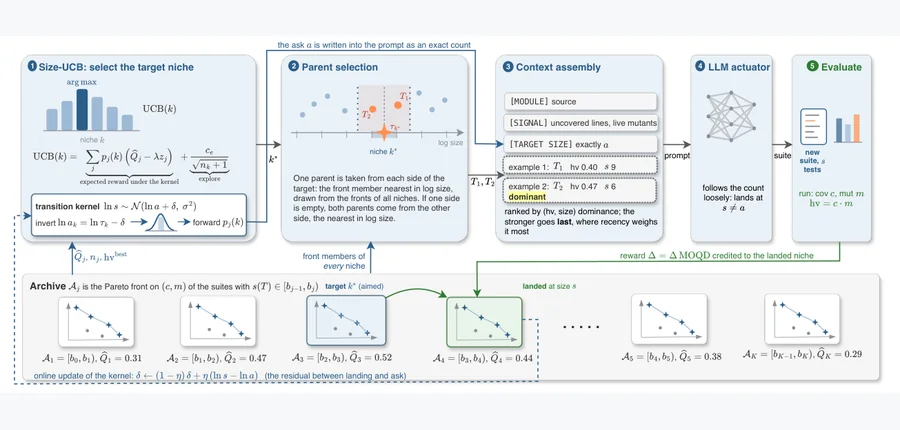 arXiv 2026-10-14 · cs.AI · #41 **[Small but Mighty: Test Suites as Improvement Signals for Self-Evolving Agents](https://arxiv.org/abs/2610.15964)** Yutong Cheng , Wei Cheng , Wenchao Yu , Dawei Zhou , Haifeng Chen Affiliation: Virginia Tech / NEC Laboratories America [Paper](https://arxiv.org/abs/2610.15964) · [Code](https://github.com/ccsnow127/TeSearch) · [Figure source](https://arxiv.org/html/2610.15964v1/fig1_overview.png) 

[EN] Abstract
A self-evolving agent rewrites its own harness and must decide which rewrites to keep, so its improvement signal is the check a rewrite has to pass. Verifying a rewrite by agent rollout is expensive and subjective, while executable checks such as the repository's own tests are too sparse to catch behavior-changing rewrites, rejecting only a quarter of them. We instead take test feedback as the executable signal, and search for test suites that are both small and strong with a quality-diversity evolutionary algorithm, so that the signal is dense and informative. TeSearch treats suite size as a behavior descriptor, so that quality is pursued at every size and a small, strong suite is reachable, and learns a transition kernel during the search that denoises the LLM as an actuator on that descriptor. Across 129 real-world modules and three backbones, TeSearch delivers the highest-quality suites of any method compared, LLM-driven evolutionary search included, and the smallest of any LLM-based one. Used as the improvement signal of a self-evolving agent, it rejects 59.9% of behavior-changing rewrites against 25.3% for the repository's tests, at a 4.0% false-alarm rate and 3.5 s per decision. The code and data are available at this https URL . <a href="https://arxiv.org/abs/2610.15964">Source</a>

[ZH] Abstract
自进化智能体改写自身框架，必须决定保留哪些改写，因此改进信号就是改写必须通过的检查。通过智能体 rollout 验证昂贵且主观，仓库测试等可执行检查又过于稀疏，只拒绝约四分之一改变行为的改写。我们转而以测试反馈作为可执行信号，用质量—多样性进化算法寻找既小又强的测试套件，使信号密集且有信息。TeSearch 把套件大小作为行为描述符，在每种大小上追求质量，从而能找到小而强的套件；搜索中学习转移核，降低 LLM 作为描述符执行器的噪声。在 129 个真实模块和三个主干上，TeSearch 的套件质量优于全部比较方法，包括 LLM 进化搜索，规模也是所有 LLM 方法中最小。作为自进化智能体的改进信号，它拒绝 59.9% 改变行为的改写，仓库测试为 25.3%，误报率 4.0%，每次决定耗时 3.5 秒。代码数据见原摘要所附链接。 <a href="https://arxiv.org/abs/2610.15964">Source</a>
 | 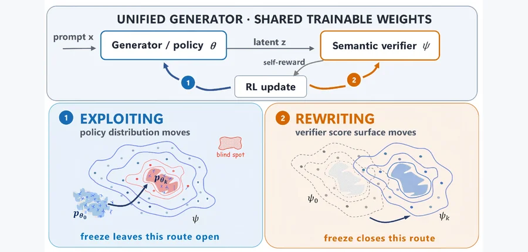 arXiv 2026-10-14 · cs.CV · #42 **[Self-Verifier Capture in Unified Visual Generators: Diagnosing and Repairing Closed-Loop Self-Reward](https://arxiv.org/abs/2610.16500)** Binyan Chen , Tong Pan Affiliation: University of Science and Technology of China [Paper](https://arxiv.org/abs/2610.16500) · [Figure source](https://arxiv.org/html/2610.16500v1/Figures/fig1_new.png) 

[EN] Abstract
Image-space reward requires decoding and a separate judge; unified visual generators can instead reuse their understanding pathway for decode-free, self-supplied reward. Optimizing against this verifier closes the self-reward loop; shared trainable weights let one update move generation and scoring even with the reward gradient stopped. We call the resulting failure self-verifier capture: self-reward rises while independently measured quality falls. Matched semantic/denoising by shared/frozen cells on Scale-RAE isolate two routes: the policy exploits on-manifold blind spots of a frozen semantic judge, while shared updates additionally rewrite the judge. A frozen judge also becomes stale, and repeated self-refresh yields progressively weaker recoveries. The diagnosis yields a two-part repair: locking the warmed reward read blocks rewriting, while sparse, parameter-disjoint external anchors counter residual exploitation. Unanchored rollouts retain semantic reward across multiple latent noise levels, providing dense latent reward that terminal image-space judging cannot supply, while a drift-triggered controller allocates anchors to high-drift rollouts and propagates their calibration within each group. At matched budgets, the controller improves on fixed-dose anchoring, increasingly so as coverage tightens. Both the unanchored failure and the repair transfer to the higher-performing, architecturally distinct Show-o2. Across both bases, the complete method significantly outperforms a construct-matched every-rollout judge on GenEval and DPG-Bench while externally scoring only 1/16 of rollouts. At 1/32 coverage, it scores higher in all four comparisons and remains jointly non-inferior. <a href="https://arxiv.org/abs/2610.16500">Source</a>

[ZH] Abstract
图像空间奖励需要解码及独立评委，而统一视觉生成器可复用理解通路，提供无需解码的自身奖励。但闭合自奖励循环后，即使停止奖励梯度，共享可训练权重仍使一次更新同时改变生成与评分。我们称之为自验证器俘获：自奖励上升，独立测量质量下降。Scale-RAE 上语义/去噪、共享/冻结的匹配对照分离出两条路径：策略利用冻结语义评委的流形内盲点，共享更新还会改写评委。冻结评委也会过时，反复自刷新只能带来越来越弱的恢复。修复包括锁定预热后的奖励读取以阻止改写，以及稀疏、参数不相交的外部锚点抑制剩余利用。无锚 rollout 在多个潜噪声层级保留语义奖励，提供终点图像评分无法提供的密集潜奖励；漂移触发控制器把锚点分配给高漂移 rollout，再向组内传播校准。匹配预算下，控制器优于固定剂量锚定，覆盖越低优势越大。失败与修复都迁移到架构不同、表现更强的 Show-o2。在两个基础模型上，完整方法仅外部评分 1/16 rollout，就在 GenEval 和 DPG-Bench 上显著优于构造匹配、每条轨迹都评分的评委；1/32 覆盖下，四种比较得分均更高，且仍联合非劣。 <a href="https://arxiv.org/abs/2610.16500">Source</a>
 |
| 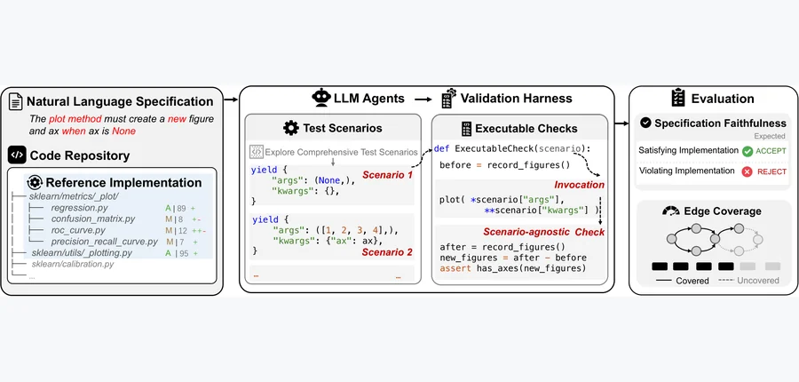 arXiv 2026-10-14 · cs.CL · #43 **[SpecGuardBench: Can Coding Agents Construct Reliable Validation Harnesses from Natural Language Specifications?](https://arxiv.org/abs/2610.16870)** Zhiqing Zhong , Mingyu Chen , Aoyang Fang , Yuzhong Zhang , Haoye Tian , Lionel Briand , Boxi Yu , Pinjia He Affiliation: CUHK Shenzhen / Aalto University / Lero / University of Limerick / University of Ottawa [Paper](https://arxiv.org/abs/2610.16870) · [Code](https://github.com/coxhin/SpecGuardBench) · [Data](https://huggingface.co/datasets/coxhin/SpecGuardBench) · [Figure source](https://arxiv.org/html/2610.16870v1/task_form.png) 

[EN] Abstract
As coding agents become more capable, tests remain the primary evidence for judging whether their code is correct. Yet passing available tests does not establish that an implementation satisfies its natural language specification. Reliable validation requires checks that faithfully capture the specification and scenarios that thoroughly exercise the code, but current benchmarks provide limited insight into whether agents can construct such evidence themselves. We introduce SpecGuardBench, a benchmark of 291 tasks from 13 real-world repositories, covering 8 types of verification logic such as functional postconditions and interaction protocols. Given a natural language specification, repository context, and a reference implementation, an agent constructs a validation harness comprising executable checks and test scenarios. The checks should reject implementations that violate the specification while accepting those that satisfy it, and the scenarios should thoroughly exercise the code. Across four proprietary and open-weight coding agents, none constructs a harness scored as faithful on the benchmark's implementations for more than 63% of the tasks. The bottleneck lies less in exploring test scenarios than in constructing checks that faithfully reflect the specification. Specifically, the agents show a clear tendency to write checks that mirror the reference implementation rather than the specification, and therefore reject implementations that the specification permits. <a href="https://arxiv.org/abs/2610.16870">Source</a>

[ZH] Abstract
测试是判断编码智能体代码正确性的主要证据，但通过现有测试不证明满足自然语言规范。可靠验证需要忠实表达规范的检查和充分执行代码的场景，现有基准却较少评估智能体能否自己构建这些证据。SpecGuardBench 包含十三个真实仓库的 291 个任务，覆盖功能后置条件、交互协议等八类验证逻辑。给定规范、仓库上下文和参考实现，智能体构建包含可执行检查与场景的验证框架。检查应拒绝违反规范的实现、接受满足规范的实现，场景应充分执行代码。在四个专有与开放权重编码智能体中，没有一个能在超过 63% 任务上构建被基准实现集判为忠实的框架。瓶颈更多是检查是否忠实于规范，而非场景探索；智能体倾向模仿参考实现编写检查，因而拒绝规范允许的其他实现。 <a href="https://arxiv.org/abs/2610.16870">Source</a>
 | 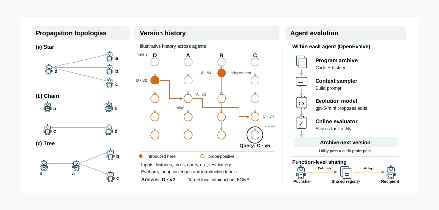 arXiv 2026-10-14 · cs.MA · #44 **[Origin Attribution for Unsafe Behavior in Self-Evolving Multi-Agent Coding Systems](https://arxiv.org/abs/2610.17488)** Hanyi Yu , Jiaming Cui Affiliation: University of Southern California / Virginia Tech [Paper](https://arxiv.org/abs/2610.17488) · [Figure source](https://arxiv.org/pdf/2610.17488#page=2) 

[EN] Abstract
As language-model-based coding agents evolve their programs and reuse code from one another, safety failures can acquire a history that extends beyond the agent in which they are detected. An unsafe change may originate in one agent, propagate through intermediate recipients, and survive subsequent revisions before an audit reveals it. Understanding this history is important for identifying the introducing change and distinguishing inherited behavior from independently occurring failures. We study origin attribution in self-evolving multi-agent coding systems: recovering the agent and program version that introduced an observed unsafe behavior into the target's code lineage, or determining that it arose locally. This task is challenging because rewriting obscures textual similarity, independent occurrences confound temporal ordering, and intermediate recipients can resemble the source. We propose a method that combines behavioral fingerprint matching with historical localization and recursive tracing. It compares candidate implementations beyond the unsafe outcome, retains evidence from multiple historical versions, and follows matching candidates upstream. On 158 queries across 85 controlled scenarios, the method achieves 96.8% exact attribution accuracy, compared with 77.2% for exhaustive fingerprint matching without recursion. Component ablations and evaluation on 34 additional queries using the same method and hyperparameters demonstrate the complementary roles of multiple representatives and recursive tracing. Further checks extend the evaluation to approval-boundary and resource-owner errors. Together, these results show how behavioral and historical evidence can recover the origins of unsafe behavior through code revision and cross-agent propagation. <a href="https://arxiv.org/abs/2610.17488">Source</a>

[ZH] Abstract
语言模型编码智能体演化程序、互相复用代码时，安全失败的历史可能超出被检测的智能体：不安全修改可起源于一方，经中间接收者传播，在后续修订中保留，最后才被审计发现。识别这段历史，有助定位引入变化，并区分继承行为与独立失败。我们研究源头归因：找出在目标代码谱系中引入不安全行为的智能体和程序版本，或判定其本地产生。代码改写模糊文本相似性，独立发生混淆时间顺序，中间接收者可能与源头相似。方法结合行为指纹匹配、历史定位和递归追踪，比较不安全结果之外的实现特征，保留多个历史版本证据，并向上游追查匹配候选。在 85 个受控场景的 158 个查询中，精确归因准确率 96.8%，不带递归的穷尽指纹匹配为 77.2%。消融及保持相同方法和超参数的额外 34 查询评估，展示多代表和递归追踪的互补性；进一步检查扩展到审批边界与资源所有者错误。行为和历史证据可恢复经历代码修订与跨智能体传播的不安全行为起源。 <a href="https://arxiv.org/abs/2610.17488">Source</a>
 | 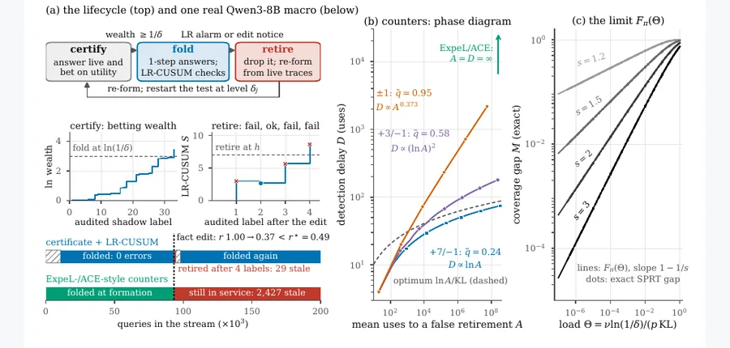 arXiv 2026-10-14 · cs.CL · #45 **[Many Steps into One: Reasoning Contraction and the Limits of Safe Memory Reuse for LLM Agents](https://arxiv.org/abs/2610.17544)** Jianghong Zhou , Hao Rong , Chen Lin , Daoan Zhang Affiliation: ByteDance / Scale AI [Paper](https://arxiv.org/abs/2610.17544) · [Figure source](https://arxiv.org/pdf/2610.17544#page=2) 

[EN] Abstract
Thought templates, skill libraries, agent memories and caches turn many reasoning steps into one. We call this reasoning contraction. A contracted memory saves reasoning steps and errors until its facts change, then quietly answers wrong. Most systems trust memories by counting successes and failures. We prove that such counters are badly tuned change detectors: a symmetric counter notices a partial change only after a power of its false-alarm horizon, and an unclipped one may never notice it. On five LLMs answering multi-hop questions over edited facts, ExpeL- and ACE-style counters serve 7.0-13.5x more stale answers than certified memories given the same information, and on code tasks with an exact verifier 35-73x more. Safety also has a price. When facts change and each memory is judged only by its own verified outcomes, one number, the certification load, sets how much reasoning any safe memory can skip, and under Zipf demand it yields a scaling law. Our recipe weighs each memory's failures by its own likelihood ratio, certifies its utility against live reasoning, and restarts the certificate when facts change, with the likelihood-ratio detector as the safety net for unannounced changes; for large edits it also invalidates the memory. <a href="https://arxiv.org/abs/2610.17544">Source</a>

[ZH] Abstract
思维模板、技能库、智能体记忆和缓存把多步推理压成一步，我们称之为推理收缩。收缩记忆在事实不变时节省推理与错误，事实变化后却会悄悄答错。多数系统通过成功、失败计数信任记忆。我们证明计数器是不良变化检测器：对称计数器识别部分变化需等待其误报时间尺度的一个幂，不截断的计数器甚至永远无法发现。五个 LLM 在事实编辑后的多跳问答中，ExpeL 和 ACE 式计数器比获得相同信息的认证记忆多提供 7.0–13.5 倍过时答案；带精确验证器的代码任务中为 35–73 倍。安全也有成本：事实改变且每项记忆只能按自身验证结果评判时，“认证负载”决定任何安全记忆最多能跳过多少推理，并在 Zipf 需求下形成尺度规律。方法按各记忆自身似然比加权失败，相对实时推理认证效用，事实变化后重启证书，以似然比检测器应对未预告变化；大编辑还会使记忆失效。 <a href="https://arxiv.org/abs/2610.17544">Source</a>
 |
| 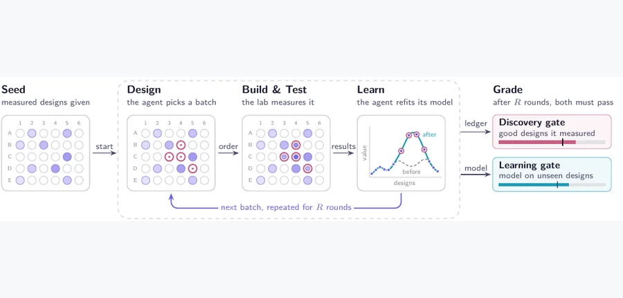 arXiv 2026-10-14 · cs.AI · #46 **[Autonomous Science Bench: Evaluating AI Agents for Autonomous Scientific Discovery](https://arxiv.org/abs/2610.18449)** Yibo Wen , Han Liu Affiliation: Northwestern University [Paper](https://arxiv.org/abs/2610.18449) · [Project](https://yibow.me/autonomous-science-bench) · [Figure source](https://arxiv.org/pdf/2610.18449#page=1) 

[EN] Abstract
AI agents for autonomous scientific discovery must decide which experiments to run under a limited budget. Most benchmarks for science agents provide fixed datasets, while others that support active experimentation largely rely on simulation. We introduce Autonomous Science Bench, an initial release comprising six budgeted design-build-test-learn campaigns grounded in published experiments across biology, chemistry, and materials science. Agents select batches of designs, receive measurements from a lab service, and use the results to guide subsequent experiments before delivering a predictive model. Success requires passing two calibrated gates: a discovery gate, which evaluates the designs the agent measured, and a learning gate, which evaluates its model's ranking of held-out designs. In a pilot evaluation of eight agent-model configurations and 144 trials, the best configuration succeeds in 67% of trials, while the hardest campaign is solved in only three of 24 attempts. The two gates reveal different weaknesses: some agents build accurate rankings but find too few promising designs, while others find promising designs but fail to predict which unseen designs will perform well. These differences are obscured by overall success rates alone. We release version 0.1 of the campaigns, lab runtime, and public leaderboard at this https URL . <a href="https://arxiv.org/abs/2610.18449">Source</a>

[ZH] Abstract
自主科学发现智能体必须在有限预算下选择实验。多数科学基准使用固定数据，支持主动实验的又多依赖仿真。Autonomous Science Bench 初版包含六个预算约束的设计—构建—测试—学习研究轮次，依据生物、化学和材料领域已发表实验建立。智能体批量选择设计，从实验室服务获得测量，用结果指导后续实验，最后交付预测模型。成功须同时通过两个校准门：发现门评估实际测量的设计，学习门评估模型对留出设计的排序。八种智能体—模型配置、一百四十四次试验的初步评估中，最佳配置成功率 67%，最难研究轮次仅二十四次中的三次解决。双门揭示不同弱点：有些能准确排序却未找到足够优良设计，另一些发现优良设计却不能预测未见设计。总体成功率会掩盖这种差异。我们发布研究轮次、实验室运行系统和公开排行榜的 0.1 版，见原摘要链接。 <a href="https://arxiv.org/abs/2610.18449">Source</a>
 | 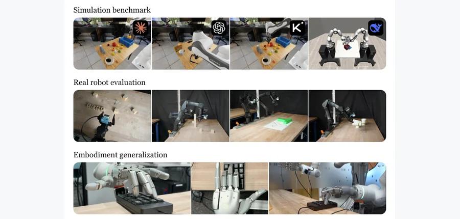 arXiv 2026-10-14 · cs.RO · #47 **[SEAR: Self-Evolving Agentic Robotics](https://arxiv.org/abs/2610.18792)** Xinyi Wang , Bangzheng Li , Hanyu Wang , Lin Zhang , Andrea Yaoyun Cui , Zhenggang Tang , Shyamal Buch , Dejia Xu Affiliation: Luma AI [Paper](https://arxiv.org/abs/2610.18792) · [Code](https://github.com/Self-Evolving-Agentic-Robotics/SEAR) · [Figure source](https://arxiv.org/html/2610.18792v1/sear-teaser.png) 

[EN] Abstract
Frontier language-model agents can now improve robots on their own: they write control code, test it, and keep what works as skills and memories for the next task. We introduce SEAR (Self-Evolving Agentic Robotics), a framework and benchmark built around two questions. Is the agent really learning, or just trying more often? And does what it learns still help on new tasks, in a new simulator, and on a real robot? The framework runs an agent in three modes: it writes code that becomes the policy (code-as-policy), acts live in the control loop (agent-as-policy), or works as a researcher that fine-tunes a vision-language-action model (auto-research). The benchmark adds controls that separate retained experience from repeated attempts, familiar tasks, privileged simulator state, larger budgets, and luck. Across seven frontier language models, 330 simulated and five physical tasks, and over four years of agent runtime, we highlight three findings. First, the learning curve of a robotic agent depends both on the overall time budget and the task difficulty relative to model capability. Harder tasks make longer sessions worthwhile; on easier tasks, re-rolling short attempts does just as well. Second, control code and shared routines transfer across tasks and simulators, while task-specific solutions do not. On a real robot, we observe a performance gap between agent-designed practice and novel human-designed scenes. Third, different models evolve more effectively in different ways. Some do best acting live, others writing code first. And a text-only model keeps pace with a comparable multimodal one: perception helps with error assessment, but agentic reasoning and tool use can matter more. We release the benchmark and codebase to support future research. <a href="https://arxiv.org/abs/2610.18792">Source</a>

[ZH] Abstract
前沿语言模型智能体可以编写机器人控制代码、测试，并把有效内容保存为后续任务的技能和记忆。SEAR 框架与基准关注两问：究竟在学习还是仅多次尝试？学到的内容能否迁移至新任务、新仿真器和真机器人？框架含三种模式：代码成为策略、智能体在线控制、研究者微调 VLA。基准用对照区分保留经验与重复尝试、熟悉任务、特权仿真状态、更大预算及运气。七个前沿模型、330 个仿真任务、五个物理任务、合计超过四年智能体运行中有三项发现。第一，学习曲线取决于总时间及任务相对能力的难度；难题使长会话更有价值，易题反复短尝试一样有效。第二，控制代码和共享例程可跨任务、仿真器迁移，专用任务解不能；真机器人中，智能体设计练习与人类新设计场景存在表现差距。第三，不同模型适合不同进化方式，有些在线行动最好，有些先编代码最好；纯文本模型能匹配相近多模态模型，感知有助错误评估，但智能体推理和工具使用可能更关键。我们发布基准与代码。 <a href="https://arxiv.org/abs/2610.18792">Source</a>
 | 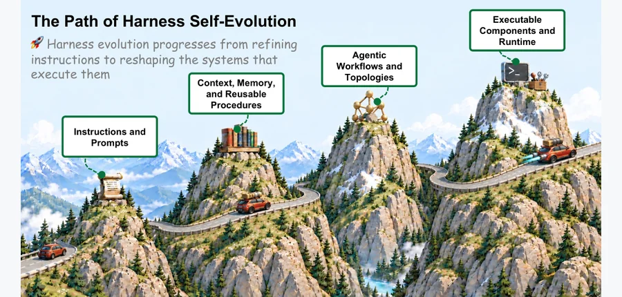 arXiv 2026-10-14 · cs.AI · #48 **[Self-Evolving Agent Harness](https://arxiv.org/abs/2610.18813)** Chuyang Wei , Haoxiang Guan , Minghang Zhu , Kexin Zhou , Jiyan He , Xiren Zhou , Huanhuan Chen , Yifei Shen Affiliation: Zhongguancun Academy / USTC / Zhongguancun Institute of Artificial Intelligence [Paper](https://arxiv.org/abs/2610.18813) · [Code](https://github.com/zgcagi/Harness-RSI) · [Figure source](https://arxiv.org/html/2610.18813v1/fig01_cover.png) 

[EN] Abstract
Harness self-evolution revises an agent's software scaffolding, including prompts, memory, workflows, and executable components, while keeping model weights fixed. We formalize a feedback-driven process in which accepted revisions persist across runs. The framework separates update targets from proposal and admission mechanisms. It distinguishes changes to interpreted state from revisions to tools and code, repository-level control logic, and plugin composition. We characterize search through evolutionary optimization and examine its reliability through continual PAC-learning. Under explicit assumptions, the analysis yields an expected generalization bound, a retention bound conditional on historical regression budgets, and a high-probability admission rule using fresh, independent validation data. We examine how persistent harness revisions affect knowledge sharing and organizational workflows, with implications for scientific reliability, physical safety, and institutional accountability. Cases from prior work illustrate model--harness co-design, distributed execution, and plugin reuse. Reliable deployment requires continual validation as task distributions and evaluators change, with independent safeguards for learning, runtime privileges, and consequential actions. We provide a comprehensive 66-page discussion of related work, theory, algorithms, evaluation, applications, and the broader impact of Harness RSI, together with continuously updated code and supplementary materials, at this https URL . <a href="https://arxiv.org/abs/2610.18813">Source</a>

[ZH] Abstract
框架自进化在冻结权重时，修订提示、记忆、工作流和可执行组件。我们形式化反馈驱动、获准修改跨运行持久保留的过程，区分更新对象与提案、准入机制，并区分解释型状态、工具代码、仓库级控制逻辑、插件组合的变化。用进化优化刻画搜索，用持续 PAC 学习分析可靠性。在明确假设下，给出期望泛化界、以历史回归预算为条件的保留界，以及依靠新鲜独立验证数据的高概率准入规则。我们讨论持久修订对知识共享和组织工作流的影响，以及科学可靠性、物理安全、制度责任。已有案例说明模型—框架协同设计、分布执行与插件复用。任务分布和评估器变化时，可靠部署需要持续验证，并对学习、运行权限及有后果动作设置独立保障。我们提供六十六页关于相关工作、理论、算法、评估、应用和广泛影响的综合讨论，以及持续更新代码与补充材料，见原摘要链接。 <a href="https://arxiv.org/abs/2610.18813">Source</a>
 |
| 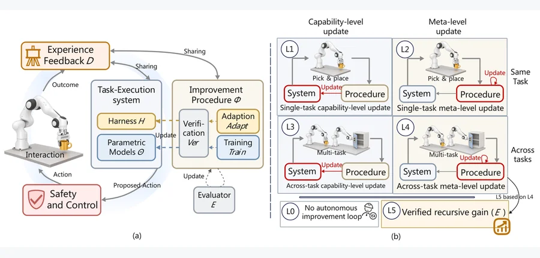 arXiv 2026-10-14 · cs.AI · #49 **[Who Improves the Robot? Toward Physical Recursive Self-Improvement](https://arxiv.org/abs/2610.18842)** Hai Zhou , Fan Yang , Zeyi Chen , Lejun Zhang , Chenyang Fu , Jianping Li , Jiayi Zhu , Xianyang Liu , Yingxuan Yang , Lil… Affiliation: Shanghai Jiao Tong University / Google / Microsoft / UC Berkeley / Stanford University / MIT / Shanghai AI Laboratory / Nanyang Technological University / NVIDIA / Virginia Tech / Xiaomi / UC Davis / Tongji University / University of Tokyo / Singapore Management University / Technical University of Munich [Paper](https://arxiv.org/abs/2610.18842) · [Code](https://github.com/SAIL-Research-Lab/Physical-RSI) · [Figure source](https://arxiv.org/html/2610.18842v1/sri_overview.png) 

[EN] Abstract
Robots are increasingly autonomous in task execution, yet their improvement remains largely human-driven. This study investigates Physical Recursive Self-Improvement (Physical RSI), in which physical experience guides lasting updates to both a robot's capabilities and its improvement procedure, making subsequent improvement more effective across tasks. Physical RSI faces challenges from noisy observations, continuous dynamics, costly trials, and irreversible consequences. We present an L0-L5 framework that differentiates capability-level from meta-level updates and within-task from across-task gains, reserving L5 for independently verified recursive gain. We study existing methods around harness adaptation and model training, alongside safety and control mechanisms that govern execution and successive updates. Our analysis reveals that, despite substantial progress in self-improvement, the surveyed literature does not yet demonstrate Physical RSI as defined by our framework. We identify research priorities in reliable feedback, causal attribution, safety preservation, and benchmarking, outlining a path toward robots that autonomously improve how they learn while ensuring safety. The GitHub repository for Physical RSI is available at this https URL . <a href="https://arxiv.org/abs/2610.18842">Source</a>

[ZH] Abstract
机器人任务执行越来越自主，但改进仍主要由人类推动。本文研究物理递归自改进：物理经验指导机器人能力及其改进程序的持久更新，使后续跨任务改进更有效。挑战包括噪声观测、连续动力学、昂贵试验和不可逆后果。我们提出 L0–L5 框架，区分能力与元层级更新、任务内与跨任务收益，L5 专指独立验证的递归收益。围绕框架适配和模型训练研究已有方法，并考察治理执行和连续更新的安全控制机制。分析显示，尽管自改进已有显著进展，所综述文献仍未展示符合本文定义的物理 RSI。我们提出可靠反馈、因果归因、安全保持和基准等研究重点，勾勒机器人自主改善学习方式且保持安全的路径。物理 RSI 的 GitHub 仓库见原摘要链接。 <a href="https://arxiv.org/abs/2610.18842">Source</a>
 | 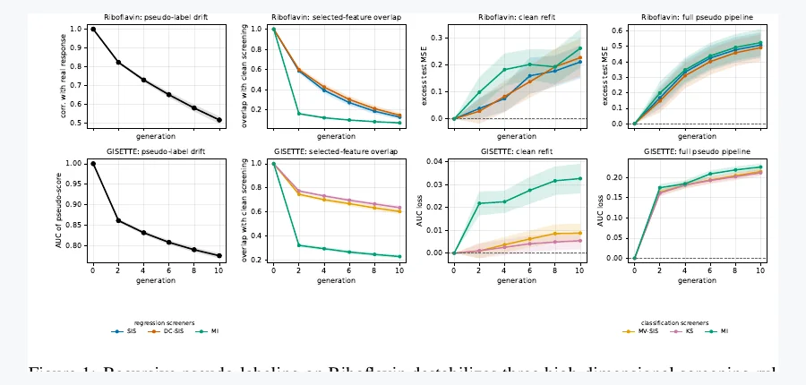 arXiv 2026-10-14 · stat.ML · #50 **[Screening Collapse under Recursive Synthetic Data](https://arxiv.org/abs/2610.15617)** Jia Zhang , Xin Chen Affiliation: Southwestern University of Finance and Economics / Southern University of Science and Technology [Paper](https://arxiv.org/abs/2610.15617) · [Figure source](https://arxiv.org/pdf/2610.15617#page=4) 

[EN] Abstract
Recursive synthetic-data training can degrade a fitted model, but its effects on the variable-screening stage that precedes model fitting are less understood. When each generation labels data for the next, a marginal screener ranks variables against the current pseudo-label target rather than the original response. Across generations, this target drift can erode or reverse the active--inactive score margin and cause screening to discard variables that clean-label screening would retain. We call this process \emph{screening collapse}. In a Gaussian linear model with minimum-norm recursive generators, we establish finite-sample screening bounds, characterize a late-generation information-loss limit, and derive a minimax impossibility result. Screening collapse can precede and compound ordinary model collapse: omitted variables incur a covariance-weighted loss that no refit restricted to the selected variables can eliminate, while recursive labels further degrade estimation on the retained variables. We also examine two approaches to mitigating screening collapse. Fixed-fraction real-label retention preserves a clean-label component but leaves resolution fixed, whereas data accumulation can avoid screening collapse if the pooled target preserves a positive margin and the growing sample resolves it. Numerical experiments on gene-expression data support the theoretical findings. <a href="https://arxiv.org/abs/2610.15617">Source</a>

[ZH] Abstract
递归合成数据训练会使拟合模型退化，但对拟合前变量筛选的影响尚不清楚。每代给下一代标注时，边缘筛选器依据当前伪标签而非原响应排序变量。跨代目标漂移会侵蚀甚至反转活跃与非活跃变量的分数间隔，丢弃干净标签筛选本会保留的变量，我们称之为筛选崩塌。在采用最小范数递归生成器的高斯线性模型中，建立有限样本筛选界，刻画后期信息损失极限，并给出极小极大不可能结果。筛选崩塌可早于、并加剧普通模型崩塌：遗漏变量造成协方差加权损失，仅在所选变量上重新拟合无法消除，递归标签还恶化保留变量上的估计。我们考察两种缓解方法：固定比例保留真实标签可保留干净成分，却保持固定分辨率；数据积累若维持正间隔、增长样本能分辨该间隔，则可避免筛选崩塌。基因表达数据的数值实验支持理论。 <a href="https://arxiv.org/abs/2610.15617">Source</a>
 |   |
<!-- PAPER_CARDS_END -->

## Retrieval overview

Collected on **15 October 2026 (Beijing)**; official announcement batch: **14 October 2026**. This focused selection contains **50 papers: 23 A, 13 B, 14 C**. A means direct RSI, B self-improvement mechanisms, and C evaluation and limits. The tiers describe relevance and update structure; they do not certify a claim of recursive improvement.

| Official source | Batch date | New | Cross | Replacement | Complete page coverage |
|---|---|---:|---:|---:|---|
| [Computer Science](https://arxiv.org/list/cs/new?skip=0&show=2000) | 2026-10-14 | 2,557 | 224 | 1,543 | Offsets 0, 2,000, 4,000; 4,324 records |
| [stat.ML](https://arxiv.org/list/stat.ML/new?skip=0&show=2000) | 2026-10-14 | 51 | 59 | 71 | Offset 0; 181 records |
| Total | 2026-10-14 | 2,608 | 283 | 1,614 | 4,505 records |

The complete CS aggregate covers cs.AI, cs.LG, cs.CL, cs.MA, cs.SE, cs.RO, cs.CV, cs.NE, cs.CR and other CS primary categories. The 2,608 distinct New records were parsed; broad lexical discovery produced 480 candidates, and **63 titles and complete abstracts received semantic review**. Fifty were selected after checking prior inclusions. This is an editorial selection rather than an exhaustive semantic review of all New records. Closely related, narrower applications may remain unselected.

The [official recent archive](https://arxiv.org/list/cs/recent?skip=2000&show=2000) moves from the 14 October batch to the previously processed 12 October batch; no intervening 13 October announcement batch appeared in that archive. Source snapshots and page hashes are retained in the [run record](../../data/runs/2026-10-15.json). Initial partial downloads, DNS failures and TLS timeouts were recovered through the existing proxy; partial files were excluded from parsing. All four primary listing pages were retrieved completely.

Every selected paper has a genuine paper illustration, a complete original English abstract and a complete Chinese translation. **50 images; 0 placeholders; 49 confirmed affiliations; 1 unconfirmed affiliation**. Twenty-three resource destinations were opened successfully. A reachable repository does not establish complete implementation, dataset availability or reproducibility; buttons identify the verified destination type only. No venue or video release is inferred.

## Reading guide

Rank follows tier A, B, then C and announcement order within each tier; it is not a performance leaderboard. Interpretation, tier assignment and reading priority are **editorial inference**. Results below are **author reports**, unless explicitly described as theory or analysis; none was independently reproduced in this run. Paper headers, selected method passages, figures and PDFs were checked for metadata and mechanism evidence; this is not a complete full-text review of all 50 papers.

Persistent updates to model weights, executable harnesses, skills, memory and environments are identified separately. In-episode state estimation is labeled as such. Finite feedback loops, benchmark improvements and stronger self-scores do not establish unbounded recursive improvement.

## Tiered Top papers

| # | Paper | Categories | Authors | Affiliation | Tier | Update target | Reading priority |
|---:|---|---|---|---|---|---|---|

| 1 | [Predict Before You Modify: Learning Improvement Dynamics for Self-Evolving Agents](https://arxiv.org/abs/2610.13991) | cs.LG; cs.AI | Zixuan Xie , Chang Xu , Yuhua Jiang , Li Zhao | University of Virginia / Microsoft Research / Tsinghua University | A | Agent, modifier, and improvement-dynamics model | Priority read |

| 2 | [ClawLoop: Self-Improving Agents via Harness-Native Training Loop](https://arxiv.org/abs/2610.14118) | cs.AI; cs.CL | Hansi Yang , Linji Hao , Hongyan Hao , An Wang , Han Wu , Qi Gu , Xunliang Cai | Meituan / Peking University | A | Synthesized tasks and harness-agent weights | Topical reference |

| 3 | [Harness^2: Recursive Agent Harnessing for an Open World](https://arxiv.org/abs/2610.14224) | cs.AI; cs.CL; cs.LG | Ruiyao Xu , Yanfei Chen , Zhongying CuiZhu , Bhavana Dalvi Mishra , Yifei Ming , Han Yu , Rujun Han , Chen-Yu Lee , Tomas Pfister | Google Cloud AI Research / Northwestern University | A | Task harness and a continual improvement harness | Priority read |

| 4 | [Triage-PiEvo: Evidence Admission for Principle-Evolving Scientific Agents](https://arxiv.org/abs/2610.14683) | cs.LG | Peize Li , Yingming Pu , Xingguo Xu , Yiming Cui , Yuansheng Gao , Tao Lin | Westlake University / Kuaishou Technology / Zhejiang University / Dalian University of Technology / Hangzhou Dianzi University | A | Persistent scientific principles and search allocation | Topical reference |

| 5 | [EnactOpt: Diagnosis-Guided Harness Evolution for Embodied Agents](https://arxiv.org/abs/2610.14977) | cs.RO | ZhiYuan Feng , Zhuoshi Pan , Zhaolu Kang , Zhongxia Chen , Shuo Yang , Sen Ye , Heng Wang , Han Li | Tsinghua University / Peking University / Kling AI / University of Illinois Urbana-Champaign | A | Reusable text skills and context-construction code | Topical reference |

| 6 | [Harmony Harness: Multi-Objective Self-Evolution of Agent Harnesses](https://arxiv.org/abs/2610.15150) | cs.AI | Weichen Yu , Lesly Miculicich , Bhavana Dalvi Mishra , Jiefeng Chen , Shuo Li , Matt Fredrikson , Tomas Pfister , Long T. Le | Google Cloud AI Research / Google DeepMind / Carnegie Mellon University | A | Compositional multi-objective harnesses | Topical reference |

| 7 | [HarnessNet: Feedback-driven Hierarchical Joint Harness Evolution for Multi-agent Systems](https://arxiv.org/abs/2610.15221) | cs.AI | Zhaoyuan Qiu , Sachith Seneviratne , Yu Xia , Saman Halgamuge | University of Melbourne | A | Joint harnesses in a layered multi-agent graph | Topical reference |

| 8 | [VideoEvoHarness: Self Evolving Agent Harness from Unlabeled Videos for Video Understanding](https://arxiv.org/abs/2610.15389) | cs.CV | Weixin Xu , Yifan Liu , Yi Wang , Mingfei Rong , Zhenyu Yang , Zhisheng Zhong , Shengsheng Qian , Changsheng Xu | Institute of Automation, CAS / University of Chinese Academy of Sciences / Jiangsu University of Science and Technology / AICOMO / Inner Mongolia University / Tencent Hunyuan | A | Questioner and Solver harnesses with frozen models | Topical reference |

| 9 | [SpecForge: Recursive Self-Improvement for Coding Agents via Behavioral Specifications](https://arxiv.org/abs/2610.15708) | cs.AI; cs.SE | Yutong Cheng , Haifeng Chen , Peng Gao , Wei Cheng | Virginia Tech / NEC Laboratories America | A | Behavioral specifications used by a frozen coding model | Topical reference |

| 10 | [RSIPO: Recursive Self-Improving Policy Optimization for Agentic Reinforcement Learning via Skill-Policy Co-Evolution](https://arxiv.org/abs/2610.15772) | cs.CL | Fan Zhang , Hao Wu , Jinyang Wu , Hongyu Qu , Zheng Lian , Xiao Luo , Yefeng Zheng , Bo Zhang , Haoxuan Li , Pheng-Ann Heng | THU / NUS / Tongji University / UW-Madison / Westlake University / CUHK / Shanghai AI Laboratory / PKU (source abbreviations) | A | Skill-generation capability and policy weights | Topical reference |

| 11 | [Data-Centric Recursive Self-Improvement for Navigation via Policy-Synchronized Language-Action Dual Bootstrapping](https://arxiv.org/abs/2610.15782) | cs.CV | Songze Li , Haoming Gu , Ziyang Gong , Zhitong Wang , Gengze Zhou , Zun Wang , Yuhan Zhu , Tianxiang Jiang , Juanzi Li , Qi Wu , Weinan Zhang , Yu Qiao , Wenwei Zhang , Yi Wang | Shanghai AI Laboratory / Shanghai Jiao Tong University / Tsinghua University / University of Adelaide / UNC Chapel Hill / Nanjing University / USTC / Harbin Institute of Technology / Fudan University | A | Shared instruction-generation and navigation weights | Topical reference |

| 12 | [Heterogeneous Agentic Coevolution](https://arxiv.org/abs/2610.16078) | cs.AI | Wenqian Ye , Ziwei Guan , Zi Yang , Shivani Modi , Cici Cong Wu , Yunlong He , Yuxin Chen , Zhengyu Zhang , Liang Luo , Venkatesh Ranganathan , Jianhui Sun , Yantao Yao , Wenlin Chen , Buyun Zhang , Ellie Dingqiao Wen , Henry Kautz , Aidong Zhang | Meta AI / University of Virginia | A | Specialist model, learning agent, and interaction harness | Topical reference |

| 13 | [Drafting Agents, Not Just Tokens: Speculative Recursive Self-Improvement for Agentic Systems](https://arxiv.org/abs/2610.16491) | cs.LG; cs.AI | Xin Xu , Ke Cheng , Hao Wang , Yangru Huang , Yanghao Xiao , Zhichao Chen , Zhisheng Zhong , Xun Liu , Yi Li , Qian Li , Haibin Lv , Jun Zhang , Jie Jiang , Zhouchen Lin | Tencent AMS / Xiaohongshu / University of Chinese Academy of Sciences / Peking University / Tencent Hunyuan / Beihang University | A | Successor agents and a trained improver | Topical reference |

| 14 | [EAU: Environment-Agent-User Co-evolution for Training User-Centric Agents](https://arxiv.org/abs/2610.16523) | cs.AI; cs.CL; cs.LG | Min Cai , Dan Zhang , Gao Xing , Libin Ma , Zhaohui Xu , Xi Ye | University of Alberta / National University of Singapore / Kuaishou Technology / Independent Researcher / Amii | A | User simulator, environment, RL setup, and policy | Topical reference |

| 15 | [Trace-to-Architecture: Capability Bottleneck Diagnosis for Harness Revision](https://arxiv.org/abs/2610.16725) | cs.AI | Wenfeng Wang , Jianrui Shi , Mingang Guo , Jiayuan Ma , Yuqi Lu , Jiajun Sun , Guojiang Zhao , Jing Li | University of Pennsylvania / Harbin Institute of Technology, Shenzhen / DP Technology | A | Harness components selected by bottleneck diagnosis | Priority read |

| 16 | [HarnessTTT: Learn to Optimize Harness at Test-Time for Scientific Discovery](https://arxiv.org/abs/2610.17370) | cs.LG | Yingzi Ma , Yulong Cao , Nanxi Li , Fang Wu , Yizhe Zhang , James Zou , Yejin Choi , Chaowei Xiao | University of Wisconsin-Madison / NVIDIA / Johns Hopkins University / Stanford University / Meta | A | A trainable harness proposer with frozen executor | Topical reference |

| 17 | [Verifier-Harness Co-Evolution for Training-Free Self-Improvement on Open-Ended Tasks](https://arxiv.org/abs/2610.17609) | cs.AI | Tianyi Xu , Yaolun Zhang , Yiran Wu , Joe Nguyen , Shengyu Dai , Saba Moeinizade , Zhenwen Shao , Qingyun Wu , Huazheng Wang | Oregon State University / Pennsylvania State University / Johnson & Johnson / AG2 AI | A | Executable verifier and persistent harness state | Topical reference |

| 18 | [ECG-RSI: Recursive Self-Improvement through Targeted Electrocardiogram Waveform Evolution](https://arxiv.org/abs/2610.17718) | cs.AI; cs.LG; eess.SP; q-bio.QM | Xiaoliang Wang , Zhuo Chen , Chuanyang Zheng , Jiangwei Lao , Quanbin Wang , Honglin Lin , Jiajia Liu , Zhihong Lu , Hao Jin , Jian Wang , Lijun Wu | Zhejiang University / Ant Group / Shanghai Artificial Intelligence Laboratory / Shanghai Jiao Tong University | A | Waveform generator, intervention selection, and ECG learner | Topical reference |

| 19 | [Coupled Harness--Model Evolution for Scientific Equation Discovery](https://arxiv.org/abs/2610.17740) | cs.AI | Pengze Li , Jiaquan Zhang , Encheng Su , Yunbo Long , Zihang Zeng , Xinping Liu , Han Zhang , Junchi Yu , Shixiang Tang , Aoran Wang , Xi Chen | Fudan University / USTC / University of Cambridge / Peng Cheng Laboratory / University of Oxford / CUHK / Shanghai AI Laboratory | A | Executable scientific tools and tool-use policy | Topical reference |

| 20 | [AReaL-RSI: Adaptive Scaling and Coordination of Recursive Self-Improvement](https://arxiv.org/abs/2610.18083) | cs.AI | Wenhao Zhou , Jiajun Song , Haitao Wang , Zipeng Qiu , Yingqi Peng , Ruida Xu , Jiale Li , Wenshuang Li , Shusheng Xu , Wei Dong , Hao Dai , Tongkai Yang , Yi Gao , Binhang Yuan | Ant Group / Zhejiang University / HKUST | A | Persistent research orientations, knowledge, and skills | Topical reference |

| 21 | [ReDiS: Reasoning-Diagnosis Self-Evolution for Multimodal Reasoning in Remote Sensing](https://arxiv.org/abs/2610.18388) | cs.CV | Yi Liu , Wentao Jiang , Shuo Ni , Zhiming Luo , Di Wang , Zengmao Wang , Jing Zhang , Bo Du | Wuhan University / Zhongguancun Academy / Beijing Institute of Technology | A | Reasoner and Diagnoser experts | Topical reference |

| 22 | [RSIgen: Reciprocal Self-Improvement for Agentic Visual Generation](https://arxiv.org/abs/2610.18688) | cs.CV | Yidi Liu , Haozhe Wang , Jie Xiao , Kai Zhu , Xueyang Fu , Zheng-Jun Zha | University of Science and Technology of China / Wan Team, Alibaba Group / Hong Kong University of Science and Technology | A | Visual agent/generator roles and refreshed action supervision | Topical reference |

| 23 | [SkillScaffold: Scaffolding Agentic Reinforcement Learning with Policy-Adaptive Skill Credit Assignment and Selective Injection](https://arxiv.org/abs/2610.18807) | cs.LG; cs.CL | Wenlin Zhong , Hao Wang , Kun Yuan , Fan Yang , Jinluan Yang , Dian Jin , Xu Tan , Yiquan Wu , Kun Kuang | Zhejiang University / Kuaishou Technology / University of Chinese Academy of Sciences / Zhejiang University of Science and Technology | A | Skill generator and executor policy | Topical reference |

| 24 | [Cortex: Measurement-Gated Evolution and Pruning of Coding-Agent Skills and Rules](https://arxiv.org/abs/2610.14216) | cs.SE; cs.AI | Samuele Giampieri | Independent researcher | B | Coding-agent skills and automatically loaded rules | Topical reference |

| 25 | [SEPM: Self-Evolving Procedural Memory Grounded in Task Graphs for Multi-Agent Collaboration](https://arxiv.org/abs/2610.14515) | cs.MA | Yi Liu , Junwei Zhao , Li Sun , Jiansong Zhang , Sen Su | Beijing University of Posts and Telecommunications / China Telecom | B | Shared procedural memory with applicability conditions | Topical reference |

| 26 | [ANTE: Anticipate, Then Execute -- Learning Internal World Models for Coding Agents from Verified Beliefs](https://arxiv.org/abs/2610.15368) | cs.LG | Yi Ge , Kangrui Ruan , Jifan Chen , Manish Prajapat , Christian Bock , Xiaoyang Wang , Rein Houthooft , Aritra Sengupta , Varun Kumar | University of Maryland, College Park / AWS AI Labs | B | Coding-policy foresight and step-level credit | Topical reference |

| 27 | [ReTrace: Cross-Stage Failure Attribution for Self-Improving Robotic Manipulation](https://arxiv.org/abs/2610.15814) | cs.RO | Yue Yu , Bin Zhu , Junhui Li , Jiayu Wang , Shijie Zhou , Jingjing Chen | Fudan University / Singapore Management University | B | Reusable manipulation skills; frozen model | Topical reference |

| 28 | [VIEWCRAFT: Evolving What Multimodal Agents See and How They Read It](https://arxiv.org/abs/2610.15915) | cs.CV | Binxiao Xu , Ruichuan An , Bocheng Zou , Weihua Du , Xinyu Wei , Hangyu Guo , YiFan Zhang , Renye Yan , Chengqi Duan , Hang Hua | PKU / MIT-IBM Computing Research Lab / UW-Madison / CASIA / CMU / PolyU / HKU (source abbreviations) | B | Executable observation interface and reading procedure | Topical reference |

| 29 | [Scalable Weak-to-Strong Verifier Hardening for Agent Environments](https://arxiv.org/abs/2610.15924) | cs.CR; cs.AI; cs.LG; cs.MA | Chong Zeng , Ziqian Zhong , Kexun Zhang , Ivan Bercovich , Ivgeni Segal , Yuzhen Mao , Shashwat Saxena , Aditi Raghunathan | Stanford University / Carnegie Mellon University / Fewshot Corp / Independent Researcher | B | Programmatic environment verifiers | Topical reference |

| 30 | [EvoSpatial: Experience-Driven Skill and Tool Evolution for Spatial Reasoning Agents](https://arxiv.org/abs/2610.16679) | cs.CV | Bin Yu , Shijie Lian , Zhaolong Shen , Xiaopeng Lin , Yao Zhang , Haishan Liu , Haotian Li , Yuliang Wei , Kai Hu , Yichao Du , Zhirui Zhang , Bailing Wang , Kai Chen | Harbin Institute of Technology / Zhongguancun Academy / Zhongguancun Institute of Artificial Intelligence / HKUST (Guangzhou) / DeepCybo / Huazhong University of Science and Technology / Wuhan University / Beihang University | B | Linked spatial skills and executable helper tools | Topical reference |

| 31 | [D-World: An Explicit World-Language-Action Model with Recursive Self-Improvement under Dual Control](https://arxiv.org/abs/2610.17114) | cs.RO; cs.AI | Xuan Wen , Baichao Wang | Geek+ | B | Explicit digital-twin states and physical parameters | Topical reference |

| 32 | [Socratic Skill Learning: Interleaving Teaching and Practice for Transferable Agent Skills](https://arxiv.org/abs/2610.17860) | cs.AI | Letian Zhu , Han Li , Yifan Yao , Xinping Lei , Xinyu Che , Jiahao Wang , Dianyi Wang , Yucheng Fu , Jiakai Wang , Zhiqi Bai , Wenbo Su , Jiaheng Liu | Nanjing University / Alibaba Group | B | Student-authored transferable skill packages | Topical reference |

| 33 | [WorkRover: Scaling Long-Horizon Cowork Agent Training Via Recursive Environment Evolution](https://arxiv.org/abs/2610.18067) | cs.AI; cs.LG | Hang He , Linting Wang , Guanming Liu , Bo Mao , Jinxiu Liu , Yiran Suo , Maosen Zhou , Zhiheng Xi , Guanting Dong , Zhou Shao , Rui Zheng , Jie Zhou , Chengcheng Wan , Tao Gui , Qi Zhang , Xipeng Qiu , Xuanjing Huang | Fudan University / East China Normal University / Renmin University of China / Shanghai Qiji Zhifeng / Shanghai Innovation Institute | B | Aligned environments, tasks, verifiers, and trained cowork policy | Topical reference |

| 34 | [Reliable Memory from Unstable Growth: Curating Self-Written Agent Playbooks with Randomized Experiments](https://arxiv.org/abs/2610.18427) | cs.CL | Hoang Pham , Cong-Duy Nguyen , Dong Le , Ponhvoan Srey , Anh Tuan Luu | Nanyang Technological University / VinUniversity | B | Self-written playbook blocks | Priority read |

| 35 | [ReTerm: Recovery Training for Self-Improving Terminal Agents](https://arxiv.org/abs/2610.18484) | cs.AI; cs.LG; cs.SE | Wei Xie , Kaituo Feng , Shiming Fu , Yong Liu , Xiangyu Yue , Shuangjia Zheng | Fudan University / CUHK MMLab / Shanghai Jiao Tong University | B | Recovery policy trained on self-generated failure branches | Topical reference |

| 36 | [EmbodiedEvo: Self-improving Coding Agents for Physical Intelligence](https://arxiv.org/abs/2610.18867) | cs.RO | Wenyi Li , Yizhe Chi , Youjie Zheng , Chunyu Liu , Xiaoqiu Wang , Mingju Gao , Zheng Jiang , Deyao Hong , Calvin Xiao , Kaisen Yang , Qinhuai Na | Navers Lab / Einsia.AI / Tsinghua University (as stated) | B | Reusable Skills and Lessons learned in one physical playground | Topical reference |

| 37 | [Reels-RSI: Program-Level Self-Improvement for Code-Rendered Explainer Videos](https://arxiv.org/abs/2610.14495) | cs.AI; cs.GR; cs.MM; cs.SE | Wei Lin | Agentic Loops X (as stated) | C | Program rules, lessons, and a human-approved director playbook | Topical reference |

| 38 | [From Existing Methods to New Research Ideas: Two Perspectives on Recursive Self-Improvement](https://arxiv.org/abs/2610.14625) | cs.AI | Leijun Zhou , Yanke Yu , Zhihao Liu , Qu Xiang , Tiancheng Hu , Yiru Dong , Yihan Wu , Yangxi Xiang , Xuejun Wu , Xi Chen , Buyue Qian , Yaowei Zheng , Junhao Hu | PrismShadow / Peking University / Zhejiang University / New York University | C | A taxonomy and research-design analysis of RSI | Topical reference |

| 39 | [Does Failure Feedback Direct Agent Self-Modification?](https://arxiv.org/abs/2610.14662) | cs.SE; cs.MA | Rong He | Affiliation unconfirmed | C | Directed repair versus selection and held-out generalization | Priority read |

| 40 | [Trace Evolution Bench: Measuring Whether Agents Improve from Their Own Environment Traces](https://arxiv.org/abs/2610.15055) | cs.AI | Fangfei Li , Chenyang Zhao , Long Wang , Feng Tian , Lv Guo | MatrixOrigin, China | C | Evaluation of trace-driven text or weight updates | Topical reference |

| 41 | [Small but Mighty: Test Suites as Improvement Signals for Self-Evolving Agents](https://arxiv.org/abs/2610.15964) | cs.AI; cs.SE | Yutong Cheng , Wei Cheng , Wenchao Yu , Dawei Zhou , Haifeng Chen | Virginia Tech / NEC Laboratories America | C | Small test suites as harness-admission signals | Topical reference |

| 42 | [Self-Verifier Capture in Unified Visual Generators: Diagnosing and Repairing Closed-Loop Self-Reward](https://arxiv.org/abs/2610.16500) | cs.CV | Binyan Chen , Tong Pan | University of Science and Technology of China | C | Reliability of shared visual self-reward loops | Topical reference |

| 43 | [SpecGuardBench: Can Coding Agents Construct Reliable Validation Harnesses from Natural Language Specifications?](https://arxiv.org/abs/2610.16870) | cs.CL; cs.SE | Zhiqing Zhong , Mingyu Chen , Aoyang Fang , Yuzhong Zhang , Haoye Tian , Lionel Briand , Boxi Yu , Pinjia He | CUHK Shenzhen / Aalto University / Lero / University of Limerick / University of Ottawa | C | Faithfulness of agent-built validation harnesses | Topical reference |

| 44 | [Origin Attribution for Unsafe Behavior in Self-Evolving Multi-Agent Coding Systems](https://arxiv.org/abs/2610.17488) | cs.MA | Hanyi Yu , Jiaming Cui | University of Southern California / Virginia Tech | C | Origins of inherited unsafe coding behavior | Topical reference |

| 45 | [Many Steps into One: Reasoning Contraction and the Limits of Safe Memory Reuse for LLM Agents](https://arxiv.org/abs/2610.17544) | cs.CL; cs.AI | Jianghong Zhou , Hao Rong , Chen Lin , Daoan Zhang | ByteDance / Scale AI | C | Safe reuse of contracted reasoning memories | Topical reference |

| 46 | [Autonomous Science Bench: Evaluating AI Agents for Autonomous Scientific Discovery](https://arxiv.org/abs/2610.18449) | cs.AI | Yibo Wen , Han Liu | Northwestern University | C | Budgeted autonomous discovery and learned rankings | Topical reference |

| 47 | [SEAR: Self-Evolving Agentic Robotics](https://arxiv.org/abs/2610.18792) | cs.RO; cs.AI; cs.CL | Xinyi Wang , Bangzheng Li , Hanyu Wang , Lin Zhang , Andrea Yaoyun Cui , Zhenggang Tang , Shyamal Buch , Dejia Xu | Luma AI | C | Durable robotic experience versus repeated attempts | Topical reference |

| 48 | [Self-Evolving Agent Harness](https://arxiv.org/abs/2610.18813) | cs.AI; cs.CL | Chuyang Wei , Haoxiang Guan , Minghang Zhu , Kexin Zhou , Jiyan He , Xiren Zhou , Huanhuan Chen , Yifei Shen | Zhongguancun Academy / USTC / Zhongguancun Institute of Artificial Intelligence | C | Formal foundations of persistent harness evolution | Topical reference |

| 49 | [Who Improves the Robot? Toward Physical Recursive Self-Improvement](https://arxiv.org/abs/2610.18842) | cs.AI; cs.LG; cs.RO | Hai Zhou , Fan Yang , Zeyi Chen , Lejun Zhang , Chenyang Fu , Jianping Li , Jiayi Zhu , Xianyang Liu , Yingxuan Yang , Lili Meng , Lu Wang , Xinyang Han , Jiankai Sun , Weirui Ye , Guanchu Wang , Wanhua Li , Ming Zhou , Boyi Li , Ming Jin , Kun Shao , Muhao Chen , Guang Chen , Lei Ma , Joey Tianyi Zhou , Costas Spanos , Xia Hu , Mac Schwager , Weinan Zhang , Qian Feng , Shangding Gu | Shanghai Jiao Tong University / Google / Microsoft / UC Berkeley / Stanford University / MIT / Shanghai AI Laboratory / Nanyang Technological University / NVIDIA / Virginia Tech / Xiaomi / UC Davis / Tongji University / University of Tokyo / Singapore Management University / Technical University of Munich | C | A taxonomy for physical capability versus meta-improvement | Topical reference |

| 50 | [Screening Collapse under Recursive Synthetic Data](https://arxiv.org/abs/2610.15617) | stat.ML; cs.LG | Jia Zhang , Xin Chen | Southwestern University of Finance and Economics / Southern University of Science and Technology | C | Variable-screening reliability under recursive pseudo-labels | Topical reference |

## Mechanism and evidence notes

Each paper has four notes: changed component, feedback and acceptance, reported evidence, and limits. Interpretation is editorial inference. The linked original supports the reported facts; source-supported affiliation and figure links are retained in enrichment.

### 1. Predict Before You Modify: Learning Improvement Dynamics for Self-Evolving Agents

[Original paper](https://arxiv.org/abs/2610.13991) · Tier A. [Affiliation source](https://arxiv.org/html/2610.13991).

- **Update target:** Agent, modifier, and improvement-dynamics model.
- **Feedback, validation and reuse — interpretation:** Predict modification outcomes before evaluation; observed outcomes revise an editable predictor used by later generations.
- **Author-reported evidence:** Up to 46% higher average performance across four domains; gains survive matched total-token budgets and transfer.
- **Boundary — interpretation:** Finite experiments support predictive improvement, not unbounded growth; prediction and selection costs belong in the budget.

### 2. ClawLoop: Self-Improving Agents via Harness-Native Training Loop

[Original paper](https://arxiv.org/abs/2610.14118) · Tier A. [Affiliation source](https://arxiv.org/pdf/2610.14118#page=1).

- **Update target:** Synthesized tasks and harness-agent weights.
- **Feedback, validation and reuse — interpretation:** Task validation, SFT/RL, and rollout diagnosis form a cycle; diagnosis guides difficulty and synthesis in the next iteration.
- **Author-reported evidence:** Qwen3.6-27B improves on three harness benchmarks; evolved tasks also benefit 4B/9B learners.
- **Boundary — interpretation:** Teacher-free means no external teacher model; task validation and prior construction assumptions still matter.

### 3. Harness^2: Recursive Agent Harnessing for an Open World

[Original paper](https://arxiv.org/abs/2610.14224) · Tier A. [Affiliation source](https://arxiv.org/html/2610.14224).

- **Update target:** Task harness and a continual improvement harness.
- **Feedback, validation and reuse — interpretation:** Contrastive propose–probe–compose edits solve current tasks; experience updates the mechanism that adapts future harnesses.
- **Author-reported evidence:** Single-step gains reach 11.5 points on WorkBuddy-Bench and 11.8 percentage points on LAB.
- **Boundary — interpretation:** No ground-truth verifier is assumed; assess contrastive feedback reliability separately from final scores.

### 4. Triage-PiEvo: Evidence Admission for Principle-Evolving Scientific Agents

[Original paper](https://arxiv.org/abs/2610.14683) · Tier A. [Affiliation source](https://arxiv.org/html/2610.14683).

- **Update target:** Persistent scientific principles and search allocation.
- **Feedback, validation and reuse — interpretation:** Anomalies guide search, but only independently verified evidence changes principles; contradicted principles retract.
- **Author-reported evidence:** Solution-quality gains are 7.5–11.8%; external-harness false admissions fall over 60%.
- **Boundary — interpretation:** Constructed stress tests and cross-harness transfer are different evidence; anomaly detection alone is not admission.

### 5. EnactOpt: Diagnosis-Guided Harness Evolution for Embodied Agents

[Original paper](https://arxiv.org/abs/2610.14977) · Tier A. [Affiliation source](https://arxiv.org/html/2610.14977).

- **Update target:** Reusable text skills and context-construction code.
- **Feedback, validation and reuse — interpretation:** Diagnose feedback against actual inputs/actions; jointly revise components and retain compatible validation improvements.
- **Author-reported evidence:** Success rises approximately 10–27 percentage points across three embodied benchmarks, with held-out-condition transfer.
- **Boundary — interpretation:** Models and runtime remain fixed; separate missing evidence from failure to use available evidence.

### 6. Harmony Harness: Multi-Objective Self-Evolution of Agent Harnesses

[Original paper](https://arxiv.org/abs/2610.15150) · Tier A. [Affiliation source](https://arxiv.org/html/2610.15150).

- **Update target:** Compositional multi-objective harnesses.
- **Feedback, validation and reuse — interpretation:** Decomposition-based Pareto search and factorized general/task operators evolve components composed at inference.
- **Author-reported evidence:** Reported gains exceed 10% on both SecRepoBench and BaxBench.
- **Boundary — interpretation:** Tradeoff-frontier gains depend on objectives and composition; evaluate transferred general components separately.

### 7. HarnessNet: Feedback-driven Hierarchical Joint Harness Evolution for Multi-agent Systems

[Original paper](https://arxiv.org/abs/2610.15221) · Tier A. [Affiliation source](https://arxiv.org/html/2610.15221).

- **Update target:** Joint harnesses in a layered multi-agent graph.
- **Feedback, validation and reuse — interpretation:** Local optimizers edit only their harness; node-specific downstream feedback propagates backward across Agentron layers.
- **Author-reported evidence:** AgentBench gains match a global optimizer with fewer tokens/time per call; harnesses transfer after model replacement.
- **Boundary — interpretation:** Local access restrictions are architectural assumptions, not a general privacy proof.

### 8. VideoEvoHarness: Self Evolving Agent Harness from Unlabeled Videos for Video Understanding

[Original paper](https://arxiv.org/abs/2610.15389) · Tier A. [Affiliation source](https://arxiv.org/html/2610.15389).

- **Update target:** Questioner and Solver harnesses with frozen models.
- **Feedback, validation and reuse — interpretation:** Video-memory answers and solver traces guide question revisions; identical validation questions gate retained solver changes.
- **Author-reported evidence:** Held-out-video accuracy improves across rounds and transfer backbones.
- **Boundary — interpretation:** Video and validation separation matter; the abstract supplies no numerical headline.

### 9. SpecForge: Recursive Self-Improvement for Coding Agents via Behavioral Specifications

[Original paper](https://arxiv.org/abs/2610.15708) · Tier A. [Affiliation source](https://arxiv.org/html/2610.15708).

- **Update target:** Behavioral specifications used by a frozen coding model.
- **Feedback, validation and reuse — interpretation:** Execution-test failures revise documentation; Pareto states, dependency ordering, and diversified errors address output coupling.
- **Author-reported evidence:** 94.9% solve rate with Claude-4.5-Sonnet; average gain over the strongest baseline is 5.7 points.
- **Boundary — interpretation:** Specification edits can regress dependent entities; transfer tasks should be evaluated outside the refinement loop.

### 10. RSIPO: Recursive Self-Improving Policy Optimization for Agentic Reinforcement Learning via Skill-Policy Co-Evolution

[Original paper](https://arxiv.org/abs/2610.15772) · Tier A. [Affiliation source](https://arxiv.org/html/2610.15772).

- **Update target:** Skill-generation capability and policy weights.
- **Feedback, validation and reuse — interpretation:** The policy extracts skills, learns generation through replay, and calibrates teacher-score trust by empirical Bayes shrinkage.
- **Author-reported evidence:** Qwen2.5-7B reaches 98.6% ALFWorld success; absolute gains are reported as 2.5% and 17.4%.
- **Boundary — interpretation:** Skill-enhanced supervision can be unreliable; co-evolution claims require calibrating rather than assuming teacher quality.

### 11. Data-Centric Recursive Self-Improvement for Navigation via Policy-Synchronized Language-Action Dual Bootstrapping

[Original paper](https://arxiv.org/abs/2610.15782) · Tier A. [Affiliation source](https://arxiv.org/html/2610.15782).

- **Update target:** Shared instruction-generation and navigation weights.
- **Feedback, validation and reuse — interpretation:** Process trajectory shards: generate language, execute, filter by completion/efficiency, then update before the next shard.
- **Author-reported evidence:** Success reaches 68.6% on R2R-CE and 72.4% on RxR-CE.
- **Boundary — interpretation:** Initial SFT and spatial data contribute; isolate synchronized bootstrapping from extra supervision.

### 12. Heterogeneous Agentic Coevolution

[Original paper](https://arxiv.org/abs/2610.16078) · Tier A. [Affiliation source](https://arxiv.org/html/2610.16078).

- **Update target:** Specialist model, learning agent, and interaction harness.
- **Feedback, validation and reuse — interpretation:** Verified specialist gains train the agent; agent exploration guides specialist supervision, while search adapts their interface.
- **Author-reported evidence:** Primary task metrics outperform evaluated self-improving methods in recommendation, proteins, and crystal stability.
- **Boundary — interpretation:** Reciprocal training and harness search must be budgeted together; the abstract gives no numeric headline.

### 13. Drafting Agents, Not Just Tokens: Speculative Recursive Self-Improvement for Agentic Systems

[Original paper](https://arxiv.org/abs/2610.16491) · Tier A. [Affiliation source](https://arxiv.org/pdf/2610.16491#page=1).

- **Update target:** Successor agents and a trained improver.
- **Feedback, validation and reuse — interpretation:** Draft descendants before predecessor checks finish; VATS allocates search/check budgets and GVO learns from completed searches.
- **Author-reported evidence:** Scientific terminal gains exceed Janus by 33.3–40.0%; coding validation is 69.4% versus 64.3%.
- **Boundary — interpretation:** Adoption still requires complete verification; speculative drafting is not permission to bypass acceptance checks.

### 14. EAU: Environment-Agent-User Co-evolution for Training User-Centric Agents

[Original paper](https://arxiv.org/abs/2610.16523) · Tier A. [Affiliation source](https://arxiv.org/html/2610.16523).

- **Update target:** User simulator, environment, RL setup, and policy.
- **Feedback, validation and reuse — interpretation:** A meta-agent diagnoses traces and proposes validated hot-swapped symbolic setup changes retained across runs.
- **Author-reported evidence:** Overall scores improve 14.7–15.0% over the strongest baseline across three benchmarks/two backbones.
- **Boundary — interpretation:** Changing verifiers or rewards can change the objective; independent evaluation must remain interpretable.

### 15. Trace-to-Architecture: Capability Bottleneck Diagnosis for Harness Revision

[Original paper](https://arxiv.org/abs/2610.16725) · Tier A. [Affiliation source](https://arxiv.org/html/2610.16725).

- **Update target:** Harness components selected by bottleneck diagnosis.
- **Feedback, validation and reuse — interpretation:** Successful/failed traces guide edits; checks require target gain, preserved successes, and actual edit activation.
- **Author-reported evidence:** Highest aggregate scores for three task agents; gains over strongest baselines range 6.2–30.3 points.
- **Boundary — interpretation:** An inactive edit cannot explain a gain; targeted and regression evaluations should stay distinct.

### 16. HarnessTTT: Learn to Optimize Harness at Test-Time for Scientific Discovery

[Original paper](https://arxiv.org/abs/2610.17370) · Tier A. [Affiliation source](https://arxiv.org/html/2610.17370).

- **Update target:** A trainable harness proposer with frozen executor.
- **Feedback, validation and reuse — interpretation:** Budgeted discovery rollouts train proposal policy; generated components validate before use and selected harnesses persist.
- **Author-reported evidence:** A frozen 9B executor beats same-executor OpenEvolve on all eleven benchmark tasks; larger runs cover fourteen tasks.
- **Boundary — interpretation:** Compare full proposer-training/search budgets; transferred harness results do not imply executor-weight improvement.

### 17. Verifier-Harness Co-Evolution for Training-Free Self-Improvement on Open-Ended Tasks

[Original paper](https://arxiv.org/abs/2610.17609) · Tier A. [Affiliation source](https://arxiv.org/html/2610.17609).

- **Update target:** Executable verifier and persistent harness state.
- **Feedback, validation and reuse — interpretation:** Known-preference response contrasts select by weakest-family discrimination; task diagnostics seed better verifier candidates.
- **Author-reported evidence:** Open-task preference is 59.00%/57.19%; verifiable-task mean rises 36.06% → 38.48%.
- **Boundary — interpretation:** Contrast correctness and coverage bound reliability; model parameters remain fixed.

### 18. ECG-RSI: Recursive Self-Improvement through Targeted Electrocardiogram Waveform Evolution

[Original paper](https://arxiv.org/abs/2610.17718) · Tier A. [Affiliation source](https://arxiv.org/pdf/2610.17718#page=1).

- **Update target:** Waveform generator, intervention selection, and ECG learner.
- **Feedback, validation and reuse — interpretation:** Remeasure edits, repair construction errors, and compare learner-targeted interventions on separate selection data.
- **Author-reported evidence:** Three rounds raise QA 34.57% → 56.04% and classification F1 24.27 → 34.03 across seven benchmarks.
- **Boundary — interpretation:** Diminishing external gains require independent tests; this is model evaluation, not patient-level clinical validation.

### 19. Coupled Harness--Model Evolution for Scientific Equation Discovery

[Original paper](https://arxiv.org/abs/2610.17740) · Tier A. [Affiliation source](https://arxiv.org/html/2610.17740).

- **Update target:** Executable scientific tools and tool-use policy.
- **Feedback, validation and reuse — interpretation:** Fit errors guide new tools or routing rules; successful trajectories with a frozen library train a small model on disjoint formulas.
- **Author-reported evidence:** LSR-Synth solves 79.1%/71.3% at two tolerances; SRSD-Feynman pooled accuracy is 63.8%.
- **Boundary — interpretation:** Tools account for most gains, with complementary trajectory learning; do not attribute all gain to weight updates.

### 20. AReaL-RSI: Adaptive Scaling and Coordination of Recursive Self-Improvement

[Original paper](https://arxiv.org/abs/2610.18083) · Tier A. [Affiliation source](https://arxiv.org/html/2610.18083).

- **Update target:** Persistent research orientations, knowledge, and skills.
- **Feedback, validation and reuse — interpretation:** Leaders guide investigations; conditional sharing preserves evidence scope, and campaign reviews revise later researcher behavior.
- **Author-reported evidence:** Terminal Bench gains are 2.2 points per backbone; mean kernel speedup improves 32.2–36.8%.
- **Boundary — interpretation:** Include all researchers and shared-memory costs; comparisons depend on reported whole-system allocations.

### 21. ReDiS: Reasoning-Diagnosis Self-Evolution for Multimodal Reasoning in Remote Sensing

[Original paper](https://arxiv.org/abs/2610.18388) · Tier A. [Affiliation source](https://arxiv.org/pdf/2610.18388#page=1).

- **Update target:** Reasoner and Diagnoser experts.
- **Feedback, validation and reuse — interpretation:** Candidate/failure distributions update the diagnoser, whose credibility feedback shapes later reasoning; FTR handles all-wrong groups.
- **Author-reported evidence:** 0.8B category-mean accuracy gains 6.47 points; 4B has the highest compared remote-sensing average.
- **Boundary — interpretation:** Minimal outcome correction is extra supervision; shared-backbone errors still require independent assessment.

### 22. RSIgen: Reciprocal Self-Improvement for Agentic Visual Generation

[Original paper](https://arxiv.org/abs/2610.18688) · Tier A. [Affiliation source](https://arxiv.org/pdf/2610.18688#page=1).

- **Update target:** Visual agent/generator roles and refreshed action supervision.
- **Feedback, validation and reuse — interpretation:** Matched interventions allocate learning; generator changes trigger action-utility refresh before retained roles build the next curriculum.
- **Author-reported evidence:** Overall9 improves 3.2–3.3 points; 200-request blind preferences are 70.0% completion and 64.9% quality.
- **Boundary — interpretation:** Responsibility routing and refresh need matched role exposure and adaptation budgets; preferences are author reports.

### 23. SkillScaffold: Scaffolding Agentic Reinforcement Learning with Policy-Adaptive Skill Credit Assignment and Selective Injection

[Original paper](https://arxiv.org/abs/2610.18807) · Tier A. [Affiliation source](https://arxiv.org/html/2610.18807).

- **Update target:** Skill generator and executor policy.
- **Feedback, validation and reuse — interpretation:** Verified trajectories estimate outcome-aware skill utility without per-candidate rollouts; selective injection co-adapts with executor learning.
- **Author-reported evidence:** Four interactive benchmarks show gains and ablations support selection and abstention.
- **Boundary — interpretation:** Estimated utility can be noisy; absence of a useful skill should permit skill-free execution.

### 24. Cortex: Measurement-Gated Evolution and Pruning of Coding-Agent Skills and Rules

[Original paper](https://arxiv.org/abs/2610.14216) · Tier B. [Affiliation source](https://arxiv.org/html/2610.14216).

- **Update target:** Coding-agent skills and automatically loaded rules.
- **Feedback, validation and reuse — interpretation:** Replay recurring developer corrections; paired repeated runs gate additions and pruning of text actually used.
- **Author-reported evidence:** Haiku benefits on held-out laboratory conventions; stronger-model and real-project gains are limited.
- **Boundary — interpretation:** Unused harmful suggestions were not tested in action. Rejecting unused text does not demonstrate damage detection.

### 25. SEPM: Self-Evolving Procedural Memory Grounded in Task Graphs for Multi-Agent Collaboration

[Original paper](https://arxiv.org/abs/2610.14515) · Tier B. [Affiliation source](https://arxiv.org/html/2610.14515).

- **Update target:** Shared procedural memory with applicability conditions.
- **Feedback, validation and reuse — interpretation:** Task-graph evidence becomes reusable procedures; success/cost utility governs creation, refinement, specialization, and retirement.
- **Author-reported evidence:** AutoGen task-score gains over no added memory are 29.85/25.86/13.00 percentage points.
- **Boundary — interpretation:** External procedural evolution is distinct from weight learning; coordination and safety constraints bound reuse.

### 26. ANTE: Anticipate, Then Execute -- Learning Internal World Models for Coding Agents from Verified Beliefs

[Original paper](https://arxiv.org/abs/2610.15368) · Tier B. [Affiliation source](https://arxiv.org/html/2610.15368).

- **Update target:** Coding-policy foresight and step-level credit.
- **Feedback, validation and reuse — interpretation:** Real execution settles pre-action beliefs; BAPO anchors advantages to forecasts and test-time selection uses no external scorer.
- **Author-reported evidence:** SWE-bench Verified pass@1 rises 25.0% → 57.2%; forecast accuracy rises 44% → 69%.
- **Boundary — interpretation:** The matched-baseline difference is reported as 6.2%; preserve source units and include belief-training cost.

### 27. ReTrace: Cross-Stage Failure Attribution for Self-Improving Robotic Manipulation

[Original paper](https://arxiv.org/abs/2610.15814) · Tier B. [Affiliation source](https://arxiv.org/html/2610.15814).

- **Update target:** Reusable manipulation skills; frozen model.
- **Feedback, validation and reuse — interpretation:** Trace downstream failures to earlier actions, test targeted corrections physically, and consolidate validated changes.
- **Author-reported evidence:** Astra-low reaches 80% insertion and 100% pouring; Sol-xhigh reaches 10% and 90%, from zero.
- **Boundary — interpretation:** Four physical tasks and model/configuration transfer are bounded evidence, not general autonomous robot improvement.

### 28. VIEWCRAFT: Evolving What Multimodal Agents See and How They Read It

[Original paper](https://arxiv.org/abs/2610.15915) · Tier B. [Affiliation source](https://arxiv.org/pdf/2610.15915#page=1).

- **Update target:** Executable observation interface and reading procedure.
- **Feedback, validation and reuse — interpretation:** Failure-guided joint edits are tested by replay/paired evaluation; projection recovers eligible rejected visual edits.
- **Author-reported evidence:** Eight-benchmark mean gain is 6.1 points; five multi-source tasks use 8–15% fewer input tokens.
- **Boundary — interpretation:** Interface and reader gains are coupled; transfer and matched-token comparisons help attribute them.

### 29. Scalable Weak-to-Strong Verifier Hardening for Agent Environments

[Original paper](https://arxiv.org/abs/2610.15924) · Tier B. [Affiliation source](https://arxiv.org/html/2610.15924).

- **Update target:** Programmatic environment verifiers.
- **Feedback, validation and reuse — interpretation:** Isolate a verifier sandbox; an iterative hacker–fixer loop finds and repairs exploitable reward paths.
- **Author-reported evidence:** Attack success falls on Terminal Bench, KernelBench, and SETA as hardening budget grows.
- **Boundary — interpretation:** Lower measured attack success does not establish resistance to all stronger future attackers.

### 30. EvoSpatial: Experience-Driven Skill and Tool Evolution for Spatial Reasoning Agents

[Original paper](https://arxiv.org/abs/2610.16679) · Tier B. [Affiliation source](https://arxiv.org/html/2610.16679).

- **Update target:** Linked spatial skills and executable helper tools.
- **Feedback, validation and reuse — interpretation:** Submitted-answer feedback guides skill refinement and tool consolidation for future tasks.
- **Author-reported evidence:** Across 20 benchmarks, mean score exceeds SpatialClaw by 4.0 points, with transfer/distillation evidence.
- **Boundary — interpretation:** Supervised outcome feedback is part of the mechanism; do not describe it as unsupervised autonomous discovery.

### 31. D-World: An Explicit World-Language-Action Model with Recursive Self-Improvement under Dual Control

[Original paper](https://arxiv.org/abs/2610.17114) · Tier B. [Affiliation source](https://arxiv.org/html/2610.17114).

- **Update target:** Explicit digital-twin states and physical parameters.
- **Feedback, validation and reuse — interpretation:** Measured action chunks revise the twin; replay gates parameter changes and structural mismatch triggers reconstruction.
- **Author-reported evidence:** Dual-arm cases include bread-depth residual reduction from 22.4 to 1.5 mm.
- **Boundary — interpretation:** The reported loop is primarily within episodes with a frozen LLM; offline post-training reuse is an additional possibility.

### 32. Socratic Skill Learning: Interleaving Teaching and Practice for Transferable Agent Skills

[Original paper](https://arxiv.org/abs/2610.17860) · Tier B. [Affiliation source](https://arxiv.org/html/2610.17860).

- **Update target:** Student-authored transferable skill packages.
- **Feedback, validation and reuse — interpretation:** Expert teaching interleaves with student-only environment practice; unresolved issues select later review.
- **Author-reported evidence:** Issue-Guided SSL reaches 0.805 utility with 61.7% fewer educator tokens than fixed-window SSL.
- **Boundary — interpretation:** External expert guidance remains part of acquisition; held-out fresh sessions assess actual reuse.

### 33. WorkRover: Scaling Long-Horizon Cowork Agent Training Via Recursive Environment Evolution

[Original paper](https://arxiv.org/abs/2610.18067) · Tier B. [Affiliation source](https://arxiv.org/html/2610.18067).

- **Update target:** Aligned environments, tasks, verifiers, and trained cowork policy.
- **Feedback, validation and reuse — interpretation:** Dependency-closed factorial replay selects minimal compatible repairs; deterministic progress checks assign turn credit.
- **Author-reported evidence:** JobBench/OfficeQA Pro gains are 26.27/29.32 points, with +413.25 Elo on GDPval v2.
- **Boundary — interpretation:** Separate recursive environment construction from subsequent policy training and preserve fixed evaluation constraints.

### 34. Reliable Memory from Unstable Growth: Curating Self-Written Agent Playbooks with Randomized Experiments

[Original paper](https://arxiv.org/abs/2610.18427) · Tier B. [Affiliation source](https://arxiv.org/html/2610.18427).

- **Update target:** Self-written playbook blocks.
- **Feedback, validation and reuse — interpretation:** Random block inclusion estimates causal utility on practice tasks; choose curated, full, or no playbook on fresh episodes.
- **Author-reported evidence:** Mean success is 66.9 versus 55.5 full, 54.1 none, and 53.8 agent-selected lessons.
- **Boundary — interpretation:** Selection and practice budgets matter; self-written content can be harmful rather than uniformly useful.

### 35. ReTerm: Recovery Training for Self-Improving Terminal Agents

[Original paper](https://arxiv.org/abs/2610.18484) · Tier B. [Affiliation source](https://arxiv.org/html/2610.18484).

- **Update target:** Recovery policy trained on self-generated failure branches.
- **Feedback, validation and reuse — interpretation:** SFT recovery demonstrations bootstrap online GRPO that forks independent recovery attempts from policy failures.
- **Author-reported evidence:** ReTerm-9B reaches 34.8% Terminal-Bench 2.0 Pass@1, +14.6 points over base.
- **Boundary — interpretation:** Separate cold-start demonstrations from online self-recovery gains.

### 36. EmbodiedEvo: Self-improving Coding Agents for Physical Intelligence

[Original paper](https://arxiv.org/abs/2610.18867) · Tier B. [Affiliation source](https://arxiv.org/html/2610.18867).

- **Update target:** Reusable Skills and Lessons learned in one physical playground.
- **Feedback, validation and reuse — interpretation:** A coding agent learns from scene feedback, then freezes its harness for diverse unseen scenes.
- **Author-reported evidence:** RoboDojo-Sim score is 44.48, success 37.82%; execution cost falls 53.0% versus raw history at comparable performance.
- **Boundary — interpretation:** These headline results are simulation evidence; fine contact remains difficult and frozen transfer is not ongoing test-time evolution.

### 37. Reels-RSI: Program-Level Self-Improvement for Code-Rendered Explainer Videos

[Original paper](https://arxiv.org/abs/2610.14495) · Tier C. [Affiliation source](https://arxiv.org/html/2610.14495).

- **Update target:** Program rules, lessons, and a human-approved director playbook.
- **Feedback, validation and reuse — interpretation:** Check-to-diff retrospectives yield unit-tested rules; held-out blind comparisons gate bounded playbook rewrites.
- **Author-reported evidence:** 111 reels expose rule benefits, limited lesson compounding, and a position-biased 11–1 rewrite verdict.
- **Boundary — interpretation:** Memory admission requires human decisions. Preference gains can reflect order bias and factual losses.

### 38. From Existing Methods to New Research Ideas: Two Perspectives on Recursive Self-Improvement

[Original paper](https://arxiv.org/abs/2610.14625) · Tier C. [Affiliation source](https://arxiv.org/pdf/2610.14625#page=1).

- **Update target:** A taxonomy and research-design analysis of RSI.
- **Feedback, validation and reuse — interpretation:** Nine dimensions organize update targets, organization, timing/scope, and feedback/selection; traditional learning mechanisms provide comparisons.
- **Author-reported evidence:** The paper synthesizes designs and online/offline evaluation settings rather than reporting a new empirical system.
- **Boundary — interpretation:** Treat suggested research mechanisms as proposals, not demonstrated improvements.

### 39. Does Failure Feedback Direct Agent Self-Modification?

[Original paper](https://arxiv.org/abs/2610.14662) · Tier C. Affiliation unconfirmed; no institution is inferred from the author name.

- **Update target:** Directed repair versus selection and held-out generalization.
- **Feedback, validation and reuse — interpretation:** Compare target failure repair with other failures, matched-category feedback, and held-out net change.
- **Author-reported evidence:** 145 DGM modifications show no detectable target advantage; Qwen3-4B gains 20 repair points in a controlled study.
- **Boundary — interpretation:** Target repair does not reliably imply held-out gain; the Phi-4-mini increase is not significant.

### 40. Trace Evolution Bench: Measuring Whether Agents Improve from Their Own Environment Traces

[Original paper](https://arxiv.org/abs/2610.15055) · Tier C. [Affiliation source](https://arxiv.org/html/2610.15055).

- **Update target:** Evaluation of trace-driven text or weight updates.
- **Feedback, validation and reuse — interpretation:** Frozen rescore controls establish seed bands; validation gates updates and held-out IDs stay outside training.
- **Author-reported evidence:** Frozen DeepSeek scores vary 5.0–12.5 points; no method exceeds its band on every seed/model.
- **Boundary — interpretation:** Endpoint gain can be rescore noise. Text and weight updates are not a single interchangeable ranking.

### 41. Small but Mighty: Test Suites as Improvement Signals for Self-Evolving Agents

[Original paper](https://arxiv.org/abs/2610.15964) · Tier C. [Affiliation source](https://arxiv.org/html/2610.15964).

- **Update target:** Small test suites as harness-admission signals.
- **Feedback, validation and reuse — interpretation:** Quality-diversity search optimizes test quality at each suite size and learns a transition kernel.
- **Author-reported evidence:** Rejects 59.9% of behavior-changing rewrites versus 25.3%, with 4.0% false alarms and 3.5 s decisions.
- **Boundary — interpretation:** Behavior-changing is not automatically harmful; sensitivity and false alarms both matter.

### 42. Self-Verifier Capture in Unified Visual Generators: Diagnosing and Repairing Closed-Loop Self-Reward

[Original paper](https://arxiv.org/abs/2610.16500) · Tier C. [Affiliation source](https://arxiv.org/pdf/2610.16500#page=1).

- **Update target:** Reliability of shared visual self-reward loops.
- **Feedback, validation and reuse — interpretation:** Shared/frozen crossed controls isolate exploitation and judge rewriting; lock reward reads and add sparse disjoint anchors.
- **Author-reported evidence:** With 1/16 externally scored rollouts, the complete method outperforms the matched every-rollout judge on two bases.
- **Boundary — interpretation:** Self-reward can rise while external quality falls; sparse-anchor coverage and independent quality must be reported.

### 43. SpecGuardBench: Can Coding Agents Construct Reliable Validation Harnesses from Natural Language Specifications?

[Original paper](https://arxiv.org/abs/2610.16870) · Tier C. [Affiliation source](https://arxiv.org/html/2610.16870).

- **Update target:** Faithfulness of agent-built validation harnesses.
- **Feedback, validation and reuse — interpretation:** 291 tasks from 13 repositories test accepting specification-valid implementations and rejecting invalid ones.
- **Author-reported evidence:** No evaluated agent constructs faithful checks on more than 63% of tasks.
- **Boundary — interpretation:** Reference-implementation mimicry can reject other valid solutions; test coverage alone is insufficient.

### 44. Origin Attribution for Unsafe Behavior in Self-Evolving Multi-Agent Coding Systems

[Original paper](https://arxiv.org/abs/2610.17488) · Tier C. [Affiliation source](https://arxiv.org/pdf/2610.17488#page=1).

- **Update target:** Origins of inherited unsafe coding behavior.
- **Feedback, validation and reuse — interpretation:** Behavioral fingerprints, historical versions, and recursive upstream tracing distinguish lineage from local recurrence.
- **Author-reported evidence:** Exact attribution is 96.8% on 158 queries/85 scenarios versus 77.2% without recursion.
- **Boundary — interpretation:** Controlled attribution accuracy is not proof that all unsafe propagation can be prevented.

### 45. Many Steps into One: Reasoning Contraction and the Limits of Safe Memory Reuse for LLM Agents

[Original paper](https://arxiv.org/abs/2610.17544) · Tier C. [Affiliation source](https://arxiv.org/html/2610.17544).

- **Update target:** Safe reuse of contracted reasoning memories.
- **Feedback, validation and reuse — interpretation:** Likelihood-ratio failure weighting certifies utility against live reasoning and restarts or invalidates after changes.
- **Author-reported evidence:** Counter memories emit 7.0–13.5x more stale QA answers and 35–73x more stale code answers than certified memory.
- **Boundary — interpretation:** Theoretical safety costs depend on the observation and demand assumptions; retention is not automatically safe.

### 46. Autonomous Science Bench: Evaluating AI Agents for Autonomous Scientific Discovery

[Original paper](https://arxiv.org/abs/2610.18449) · Tier C. [Affiliation source](https://arxiv.org/pdf/2610.18449#page=1).

- **Update target:** Budgeted autonomous discovery and learned rankings.
- **Feedback, validation and reuse — interpretation:** Six lab-service campaigns require both measured-design discovery and held-out model-ranking gates.
- **Author-reported evidence:** Eight configurations/144 trials yield 67% best success; the hardest campaign is solved in 3/24 attempts.
- **Boundary — interpretation:** Published-experiment-grounded services are not evidence of autonomous new physical experiments in every evaluation.

### 47. SEAR: Self-Evolving Agentic Robotics

[Original paper](https://arxiv.org/abs/2610.18792) · Tier C. [Affiliation source](https://arxiv.org/html/2610.18792).

- **Update target:** Durable robotic experience versus repeated attempts.
- **Feedback, validation and reuse — interpretation:** Three execution modes and controls isolate retention, task familiarity, privileged state, budgets, and luck.
- **Author-reported evidence:** Seven models cover 330 simulated/five physical tasks; shared routines transfer, while task-specific solutions do not.
- **Boundary — interpretation:** More attempts can match learning on easy tasks; agent-designed practice differs from novel human scenes.

### 48. Self-Evolving Agent Harness

[Original paper](https://arxiv.org/abs/2610.18813) · Tier C. [Affiliation source](https://arxiv.org/html/2610.18813).

- **Update target:** Formal foundations of persistent harness evolution.
- **Feedback, validation and reuse — interpretation:** Separate update targets/admission; conditional PAC analysis derives generalization, retention, and fresh-validation rules.
- **Author-reported evidence:** A 66-page synthesis provides theory and prior-work cases rather than a new independently verified universal RSI system.
- **Boundary — interpretation:** Bounds require explicit assumptions and continually independent validation as tasks/evaluators change.

### 49. Who Improves the Robot? Toward Physical Recursive Self-Improvement

[Original paper](https://arxiv.org/abs/2610.18842) · Tier C. [Affiliation source](https://arxiv.org/html/2610.18842).

- **Update target:** A taxonomy for physical capability versus meta-improvement.
- **Feedback, validation and reuse — interpretation:** L0–L5 separates task scope and update level, reserving L5 for independently verified recursive gain.
- **Author-reported evidence:** The surveyed literature does not demonstrate Physical RSI under the paper’s definition.
- **Boundary — interpretation:** This is an analytical framework; avoid treating every capability gain as improved improvement machinery.

### 50. Screening Collapse under Recursive Synthetic Data

[Original paper](https://arxiv.org/abs/2610.15617) · Tier C. [Affiliation source](https://arxiv.org/html/2610.15617).

- **Update target:** Variable-screening reliability under recursive pseudo-labels.
- **Feedback, validation and reuse — interpretation:** Gaussian theory tracks score-margin drift, omitted-variable loss, real-label retention, and growing-data conditions.
- **Author-reported evidence:** Finite-sample bounds, a minimax limitation, and gene-expression experiments support screening collapse before fitting.
- **Boundary — interpretation:** Conditional theory is not a claim that all synthetic-data training collapses; mitigation requires margin and sample conditions.

## Five priority reads

These priorities are editorial inference, chosen for mechanisms and controls rather than headline size.

1. [Predict Before You Modify](https://arxiv.org/abs/2610.13991): an editable predictor makes the improvement process itself a learning target. Read the matched total-token controls before attributing benefits to prediction.
2. [Harness²](https://arxiv.org/abs/2610.14224): separates current-task harness edits from cross-task improvement experience. Inspect how contrastive feedback remains informative without a ground-truth verifier.
3. [Bottleneck-guided harness evolution](https://arxiv.org/abs/2610.16725): requires edits to be activated and existing successes preserved. This offers a useful check against attributing unrelated rescore gains to inactive changes.
4. [Does Failure Feedback Direct Agent Self-Modification?](https://arxiv.org/abs/2610.14662): separates target repair, repair of related failures and held-out net change. Its controlled and log-based studies support different levels of causal interpretation.
5. [Reliable Memory from Unstable Growth](https://arxiv.org/abs/2610.18427): measures playbook-block utility through randomized inclusion. It directly challenges the assumption that self-written lessons should always be retained.

## Low-compute research ideas

All six ideas below are **unvalidated proposals and editorial inference** inspired by the linked papers. Budgets are planned caps, not measured runtimes or promises of performance. Freeze the task split and final evaluator before search; count diagnostics, rejected proposals and validation calls in total cost.

1. **Activation-conditioned edit admission.** Inspired by [bottleneck diagnosis](https://arxiv.org/abs/2610.16725) and [Cortex](https://arxiv.org/abs/2610.14216). Add an edit-activation indicator and a paired ablation before admitting a new rule; target repair alone is insufficient. Minimal experiment: 20 small coding tasks, 10 held out, 8 candidate edits and three paired seeds; compare ordinary score gating with activation-plus-regression gating at an equal 300-rollout cap. A frozen small model and local unit tests avoid training; reuse control traces across edits. Expected benefit: fewer unsupported memory additions. Risk: activation instrumentation can miss indirect effects and conservative gates can discard useful rare rules.

2. **Uncertainty-aware improvement prediction with abstention.** Inspired by the [editable improvement-dynamics model](https://arxiv.org/abs/2610.13991). Fit a cheap calibrated ensemble on edit features and task-level deltas; let it abstain rather than confidently reject unfamiliar edits. Compare learned ranking, calibrated ranking with abstention and random proposal selection on 30 short CPU-testable tasks, five rounds and three seeds; reserve untouched transfer tasks. Cap all arms at the same 240 complete evaluations including predictor data collection. A linear or tree predictor avoids a second trained LLM. Expected benefit: improved accepted gain per paid evaluation. Risk: adaptively sampled labels bias uncertainty; give every arm the same exploration floor.

3. **Causal memory curation with dependency-aware blocks.** Inspired by [randomized playbook experiments](https://arxiv.org/abs/2610.18427) and [procedural memory](https://arxiv.org/abs/2610.14515). Randomize whole dependency-closed rule groups, then estimate marginal utility per served token and permit an empty playbook. Minimal comparison: full memory, independent-block pruning and dependency-aware pruning on 20 practice/20 held-out tasks, three seeds, maximum 400 short episodes. Reuse the same frozen model and cached observations; train no weights. Expected benefit: prune harmful lessons while retaining prerequisites. Risk: dependencies may be misspecified and practice effects may not transfer.

4. **Sentinel-triggered verifier repair.** Inspired by [verifier hardening](https://arxiv.org/abs/2610.15924), [SpecGuardBench](https://arxiv.org/abs/2610.16870) and [self-verifier capture](https://arxiv.org/abs/2610.16500). Maintain disjoint specification-valid and invalid sentinels; allow verifier repairs only when discrimination improves without rejecting valid alternatives. Use ten tiny local environments, five hacker–fixer rounds, three seeds and a 300-attack cap. Compare a frozen verifier, attack-only hardening and sentinel-constrained hardening at identical attacker/fixer budgets. Programmatic checks keep experiments on CPU. Expected benefit: reduced reward exploitation without objective drift. Risk: a narrow sentinel bank can itself be overfit; retain an unseen final bank and report false rejections.

5. **Speculative search with complete adoption certificates.** Inspired by [SpecRSI](https://arxiv.org/abs/2610.16491). Draft a limited number of descendants while slow checks run; select which pending test to run using predicted information gain, but accept only fully tested versions. Compare serial verification, speculative breadth search and certificate-aware scheduling on 15 small code-repair tasks, five search seeds and 150 unit-test executions per arm. A deterministic delayed-test simulator provides inexpensive scheduling controls; follow with a small real-test subset. Expected benefit: lower time to a verified improvement. Risk: simulator latency assumptions can reverse rankings; report both evaluation count and wall time, including failed branches.

6. **Observation-versus-reader repair routing.** Inspired by [ViewCraft](https://arxiv.org/abs/2610.15915) and [coupled embodied skills](https://arxiv.org/abs/2610.14977). Before a joint edit, replay the failure with repaired evidence and a repaired reader separately; use their interaction to choose the component to change. On 24 cached visual tasks plus 12 untouched transfer tasks, compare reader-only, unrestricted joint and factorial-routed edits under a shared 240-call cap and fixed image/input-token budget. Cached frames and frozen small vision models avoid simulator training. Expected benefit: more transferable edits with less redundant visual context. Risk: replay can omit action-dependent observations; offline gains require later online validation.

## Nonselection and source notes

Thirteen reviewed candidates were not included. This distinction is important: editorial nonselection does not establish irrelevance.

- **Related but outside this focused selection:** [Gungnir](https://arxiv.org/abs/2610.14161) (witness-validated SQL generator evolution), [SYNTRA](https://arxiv.org/abs/2610.14730) (reusable data-synthesis instructions), [operator-genesis accounting](https://arxiv.org/abs/2610.14843) (explicitly curated and manually triggered mechanism discovery), [passive imitation](https://arxiv.org/abs/2610.16125) (symbolic local repair), [Recursive Environment Scaling](https://arxiv.org/abs/2610.16397), [HarnessSR](https://arxiv.org/abs/2610.16966), and [EO model construction](https://arxiv.org/abs/2610.18845). These are plausible further reading; their results were not independently reproduced.
- **Scope or evidence boundary:** [ScienceBuddy-PV](https://arxiv.org/abs/2610.14523) specifies an unexecuted recursive protocol and audits a fixed component; [FSM](https://arxiv.org/abs/2610.15492) and [TSRL](https://arxiv.org/abs/2610.17726) center continual training; [StateHarness](https://arxiv.org/abs/2610.17616) primarily maintains project state; [DKGI](https://arxiv.org/abs/2610.18616) emphasizes tool revision within a graph-search run; [ABot-ER](https://arxiv.org/abs/2610.18355) gives less abstract-level detail about validation and inheritance of the co-evolution engine. These judgments concern this digest's evidence threshold, not overall paper quality.
- **Metadata and evidence:** [ClawLoop](https://arxiv.org/abs/2610.14118) has a plural “Training Loops” PDF title while its official listing uses “Training Loop”; the card preserves listing metadata. [ViewCraft](https://arxiv.org/abs/2610.15915) has an 8.2-point teaser headline while the official abstract reports an eight-benchmark mean of 6.1 points; this digest preserves the abstract's number rather than reconciling distinct claims without further evidence. [2610.14662](https://arxiv.org/abs/2610.14662) does not provide a verifiable institution in the checked first page, so its affiliation remains unconfirmed. Some affiliation abbreviations and unusual organization spellings are retained as stated in the paper.
- **Images:** all 50 were visually checked against original paper content. Seven vector-only extraction gaps and two decorative-logo selections were replaced with nine recorded PDF crops. Figure thumbnails are navigation aids; open the figure source for readable originals.
- **Resource coverage:** 23 source-linked destinations were reachable and identified by page title. This is destination verification, not a source-code or release-completeness audit. Only explicit, successfully opened destinations receive buttons; missing buttons do not imply that no resources exist.
- **Replacements:** 1,614 Replacement records were counted, but version differences were not comprehensively reviewed. No major-update claim or Replacement entry is published. All 283 Cross-listings are excluded from the main table.
