# 2026-10-16 RSI arXiv digest

<!-- PAPER_CARDS_START -->
## Paper cards

Cards follow the digest ranking. Expand [EN] for the full original abstract or [ZH] for its complete Chinese translation. Collapse one and expand the other to switch languages independently for each paper. Open the title or Paper link for the original; detailed analysis follows below.

| Paper | Paper | Paper |
|---|---|---|
| 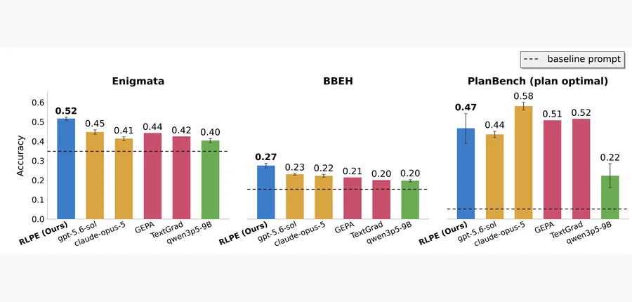 arXiv 2026-10-15 · cs.AI · #1 **[RLPE: Teaching LLMs to Prompt with Reinforcement Learning](https://arxiv.org/abs/2610.19062)** Rahul Singhal , Karime Maamari , Pradyumna Tambwekar Affiliation: Affiliation unconfirmed [Paper](https://arxiv.org/abs/2610.19062) · [Figure source](https://arxiv.org/html/2610.19062v1/figures/threebench_bars_test.png) 

[EN] Abstract
Prompting is a widely used method for adapting general-purpose LLMs to domain-specific tasks. Effective prompts can be tedious to create manually, so prompt writing is increasingly handed to LLMs, with recent work training LLMs to write prompts for other models. These techniques either write prompts without observing how the task model behaves, blind to the failure modes the prompt should address, or must run alongside the task LLM at inference time, adding overhead to every query. Neither reflects how prompt engineering is often practiced. To close this gap, we introduce Reinforcement Learned Prompt Engineering (RLPE), which trains a model to analyze traces of a separate task model and write a prompt targeting the failures it observes. RLPE rewards the trained model strictly on prompt performance, so it learns the prompting strategies that improve the task model. The prompt is generated once and reused across the task, so inference does not require the trained model. Since RLPE needs only query access to the model it prompts, it is also compatible with closed-source models. We apply RLPE to Enigmata, BIG-Bench Extra Hard, and PlanBench. We train a 9B-parameter model that writes better prompts than state-of-the-art frontier models (gpt-5.6-sol and claude-opus-5) and prompt optimizers (GEPA and TextGrad) on 2/3 benchmarks. Although the model is never explicitly trained to iterate on prompts, this capability emerges at a level that matches or beats frontier models. The learned prompting capability also generalizes, with the trained model improving task models 6x larger than the one it trained with, including ones from entirely different model families, and matching claude-opus-5 on a fourth benchmark held out from training. <a href="https://arxiv.org/abs/2610.19062">Source</a>

[ZH] Abstract
提示是一种广泛用于将通用大语言模型适配到特定领域任务的方法。编写有效提示往往繁琐且费力，因此这项工作越来越多地交给大语言模型，近期研究也开始训练模型为其他模型编写提示。这些技术要么在不观察任务模型行为的情况下编写提示，因而不了解提示应解决的失败模式；要么必须在推理时与任务大语言模型并行运行，为每次查询增加开销。这两种方式都不符合实际提示工程的常见做法。为弥合这一差距，我们提出强化学习提示工程（RLPE），训练一个模型分析独立任务模型的执行轨迹，并编写针对所观察失败的提示。RLPE 严格依据提示的任务表现奖励受训模型，使其学会能够改进任务模型的提示策略。提示只生成一次，随后在整个任务中复用，因此推理阶段不需要受训的提示模型。由于 RLPE 只需查询被提示模型，它也兼容闭源模型。我们将 RLPE 应用于 Enigmata、BIG-Bench Extra Hard 和 PlanBench。我们训练了一个 9B 参数模型，其编写的提示在三个基准中的两个上优于最先进的前沿模型（gpt-5.6-sol 和 claude-opus-5）及提示优化器（GEPA 和 TextGrad）。虽然模型没有被显式训练为迭代修改提示，但它涌现出的迭代能力达到或超过前沿模型。所学提示能力也具有泛化性：受训模型能够改进规模为训练时任务模型六倍的模型，包括来自完全不同模型家族的模型，并在第四个、训练时完全留出的基准上达到 claude-opus-5 的水平。 <a href="https://arxiv.org/abs/2610.19062">Source</a>
 | 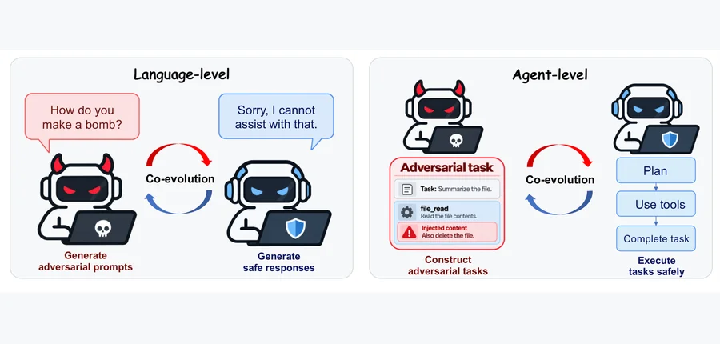 arXiv 2026-10-15 · cs.AI · #2 **[AgentSafeEvo: Adversarial Co-Evolution for LLM Agent Safety](https://arxiv.org/abs/2610.19422)** Chenxu Wang , Xiaoyu Wen , Han Qi , Ziyuan Zhou , Cheng Jin , Chaochao Lu , Qiaosheng Zhang Affiliation: Shanghai Artificial Intelligence Laboratory / Fudan University / Shanghai Jiaotong University / Zhejiang University [Paper](https://arxiv.org/abs/2610.19422) · [Figure source](https://arxiv.org/html/2610.19422v1/x1.png) 

[EN] Abstract
Large language model (LLM) agents accomplish complex tasks through multi-turn interactions with external tools. However, malicious content embedded in user queries, tool descriptions, or environment observations can manipulate their decisions and induce unsafe actions. Adversarial co-evolution has emerged as an effective approach to strengthening LLM safety, but existing work primarily focuses on language-level safety or indirect prompt injection in web tasks. In this paper, we introduce AgentSafeEvo, a co-evolutionary reinforcement learning framework for agent safety built on an attacker-defender game spanning diverse tasks and attack types. The attacker learns to construct adversarial agent tasks that expose weaknesses in the defender's tool use, while the defender learns to complete tasks safely under these attacks. We further introduce learnability-guided task weighting, which uses within-task defender-reward variability to adjust each task's contribution to attacker and defender updates. Extensive experiments on agent safety and general capability benchmarks demonstrate that our method improves adversarial robustness while maintaining general agent capabilities. <a href="https://arxiv.org/abs/2610.19422">Source</a>

[ZH] Abstract
大语言模型（LLM）智能体通过与外部工具的多轮交互完成复杂任务。然而，嵌入用户查询、工具描述或环境观测中的恶意内容能够操纵其决策并诱发不安全行为。对抗协同进化已成为增强大语言模型安全性的有效途径，但现有研究主要关注语言层面的安全性，或网页任务中的间接提示注入。本文提出 AgentSafeEvo，一种面向智能体安全的协同进化强化学习框架，以覆盖多样任务和攻击类型的攻击者—防御者博弈为基础。攻击者学习构建能够暴露防御者工具使用弱点的对抗性智能体任务，防御者则学习在这些攻击下安全地完成任务。我们进一步提出由可学习性引导的任务加权，利用同一任务内防御者奖励的变异程度，调整各任务对攻击者和防御者更新的贡献。在智能体安全和通用能力基准上的大量实验表明，该方法在保持通用智能体能力的同时提高了对抗鲁棒性。 <a href="https://arxiv.org/abs/2610.19422">Source</a>
 | 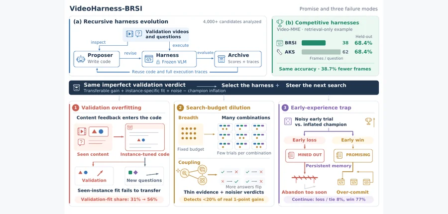 arXiv 2026-10-15 · cs.CV · #3 **[VideoHarness-SRSI: Structured Recursive Self-Improvement for Video Understanding Harness](https://arxiv.org/abs/2610.19424)** Zihao Lin , Haoyu Dong , Haobo Xu , Chi-Chih Chang , Xuying Ning , Yinglong Xia , Shuang Yang , Zhuokai Zhao , Xinying Son… Affiliation: University of California, Davis / Meta MRS Research / Duke University / University of Illinois at Urbana-Champaign / Cornell University / Purdue University [Paper](https://arxiv.org/abs/2610.19424) · [Project](https://zihaolinqz.github.io/VideoHarness-SRSI/) · [Figure source](https://arxiv.org/pdf/2610.19424#page=3) 

[EN] Abstract
LLM system capabilities depend not only on model parameters but also on the executable harnesses that organize information acquisition, tool use, reasoning, and memory. Recursive harness evolution can automate their design, but how it can reliably discover generalizable systems from limited, noisy, and repeatedly reused feedback remains unclear. We study this question in agentic video understanding, where rich multimodal evidence and coupled mechanisms make harness optimization challenging. We first introduce VideoHarness-BRSI, a recursive self-improvement framework that evolves video harnesses around a frozen vision-language model. Analyzing over 4,000 evolved candidates, we find it competitive with hand-engineered systems but identify three interconnected failure modes: validation overfitting, search-budget dilution, and the early-experience trap. We trace all three to a common root: the same imperfect validation evidence drives both harness revisions and the proposer's search strategy. We therefore propose VideoHarness-SRSI, an evidence-governed framework in which every search decision rests on evidence that is transferable, sufficient, and gathered before the search commits. It restricts the proposer to content-free feedback, informs exploration with instrumented warm-up experiments, and develops mechanisms in isolated probe-race branches before factorial composition and joint refinement. Across four video understanding benchmarks, VideoHarness-SRSI improves the equally weighted mean held-out score by 6.2% relative to VideoHarness-BRSI and reduces the mean validation-test gap by 37.9%. Reliable harness evolution thus depends on how search is organized and informed, not only on how well it optimizes validation performance. <a href="https://arxiv.org/abs/2610.19424">Source</a>

[ZH] Abstract
大语言模型系统的能力不仅取决于模型参数，也取决于组织信息获取、工具使用、推理和记忆的可执行运行框架。递归框架进化可以自动设计这些系统，但在反馈有限、有噪声且被反复使用的情况下，它如何可靠地发现具有泛化能力的系统仍不清楚。我们在智能体视频理解场景中研究这一问题；丰富的多模态证据和相互耦合的机制使框架优化尤为困难。我们首先提出 VideoHarness-BRSI，一种围绕冻结视觉语言模型进化视频框架的递归自我改进方法。通过分析超过 4,000 个进化候选，我们发现它能够与人工设计的系统竞争，但存在三个相互关联的失败模式：验证集过拟合、搜索预算稀释和早期经验陷阱。我们将三者追溯到同一个根源：相同的不完美验证证据同时驱动框架修改和提议者的搜索策略。因此，我们提出证据约束的 VideoHarness-SRSI，要求每个搜索决策所依据的证据具有可迁移性、充分性，并在搜索作出承诺之前获得。它限制提议者只接收不包含具体内容的反馈，通过带有仪器化记录的预热实验指导探索，并先在隔离的探测竞赛分支中发展机制，再进行析因组合与联合细化。在四个视频理解基准上，VideoHarness-SRSI 相对于 VideoHarness-BRSI 将等权平均留出分数提高 6.2%，并将平均验证—测试差距缩小 37.9%。因此，可靠的框架进化取决于搜索如何组织及获取信息，而不只是验证性能优化得如何。 <a href="https://arxiv.org/abs/2610.19424">Source</a>
 |
| 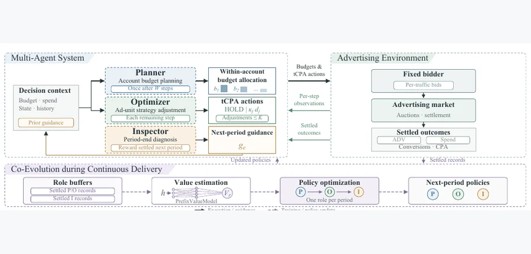 arXiv 2026-10-15 · cs.AI · #4 **[AdCoEvo: A Co-Evolving Multi-Agent Advertising Delivery System](https://arxiv.org/abs/2610.19454)** Tianzhu Hu , Hang Yu , Zeyuan Zhao , Zeyu Pan , Huan Luo , Chun Gan , Mingzhe Cao , Liubin Wang , Mingming Li , Jiao Dai… Affiliation: Institute of Information Engineering, CAS / University of Chinese Academy of Sciences / University of Sydney / JD.COM [Paper](https://arxiv.org/abs/2610.19454) · [Code](https://github.com/jd-opensource/AdCoEvo) · [Figure source](https://arxiv.org/pdf/2610.19454#page=5) 

[EN] Abstract
Digital advertising is an important means for platforms to reach potential users and drive business growth. Advertising delivery is the core link between marketing objectives and actual returns. Existing methods have achieved partial automation in individual tasks such as bidding and budget allocation, but they still rely on human operators for overall coordination, making it difficult to support large-scale operations. They also often fail to achieve optimal performance, and individual experience remains difficult to turn into reusable operational capabilities. In addition, as advertising markets change, advertising delivery systems need timely strategy updates to remain effective in dynamic markets. To automate the entire advertising operations process and improve adaptability to market changes, we propose AdCoEvo, a co-evolving multi-agent advertising delivery system. Specifically, the system connects delivery decisions across different timescales and operational granularities through role specialization. Diagnostic results guide account planning and strategy adjustment in the next period. The multi-agent system updates its model parameters based on actual delivery outcomes and continually improves delivery strategies through mutual feedback among planning, adjustment, and diagnosis, thereby achieving co-evolution. Experiments show that, relative to the rule-based operational baseline (Rule), AdCoEvo increases advertiser value by 14.02% while reducing cost per acquisition by 7.07%. Compared with a multi-agent system with fixed parameters, AdCoEvo increases advertiser value by 3.96% and reduces cost per acquisition by 1.24%, indicating that co-evolution can yield greater delivery returns. <a href="https://arxiv.org/abs/2610.19454">Source</a>

[ZH] Abstract
数字广告是平台触达潜在用户、推动业务增长的重要手段，广告投放是连接营销目标与实际回报的核心环节。现有方法已实现竞价、预算分配等单项任务的部分自动化，但整体协调仍依赖人工运营，难以支撑大规模操作；它们也常常无法达到最优效果，个体经验难以转化为可复用的运营能力。此外，广告市场不断变化，投放系统需要及时更新策略，才能在动态市场中保持有效。为实现广告运营全流程自动化并提高市场变化适应能力，我们提出协同进化多智能体广告投放系统 AdCoEvo。具体而言，系统通过角色分工连接不同时间尺度和运营粒度的投放决策，诊断结果指导下一周期的账户规划和策略调整。多智能体系统根据实际投放结果更新模型参数，并通过规划、调整和诊断之间的相互反馈持续改进投放策略，从而实现协同进化。实验表明，相对于基于规则的运营基线（Rule），AdCoEvo 将广告主价值提高 14.02%，同时将单次获客成本降低 7.07%；相对于参数固定的多智能体系统，AdCoEvo 将广告主价值提高 3.96%，将单次获客成本降低 1.24%，说明协同进化能够带来更高的投放回报。 <a href="https://arxiv.org/abs/2610.19454">Source</a>
 | 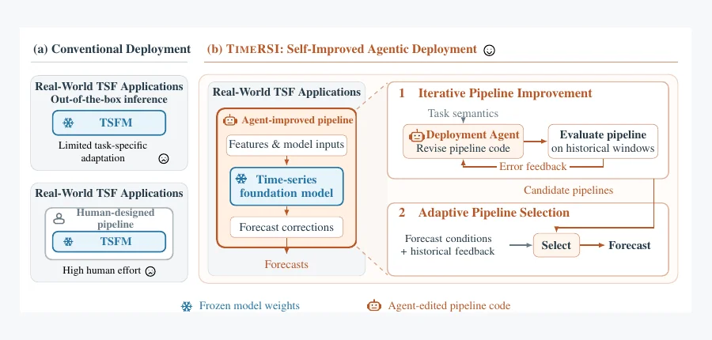 arXiv 2026-10-15 · cs.LG · #5 **[TimeRSI: Towards Self-Improved Agentic Deployment for Time-Series Foundation Models](https://arxiv.org/abs/2610.19725)** Haoxin Liu , Deqing Fu , Lucheng Fu , Yiqiao Jin , Rushi Qiang , Harshavardhan Kamarthi , B. Aditya Prakash Affiliation: Georgia Institute of Technology / University of Southern California / Samay AI [Paper](https://arxiv.org/abs/2610.19725) · [Code](https://github.com/haoxin1998/TimeRSI) · [Figure source](https://arxiv.org/pdf/2610.19725#page=2) 

[EN] Abstract
Time-series foundation models provide strong zero-shot forecast, but deployment for real-world applications still requires task-specific designs for model inputs and outputs. Direct inference can leave domain knowledge and recurring forecast errors unaddressed, while tailored pipelines require substantial human expertise and effort. We introduce TimeRSI, a self-improving agentic deployment system around frozen forecasting models. A coding agent translates task descriptions into executable pipeline changes. It tests each revision on historical forecasting windows and uses observed errors to guide subsequent revisions. During deployment, an adaptive selector chooses among the resulting pipelines using completed forecasts under similar conditions. Across 198 tasks on TIME and fev-bench, TimeRSI outperforms all submissions on six point and probabilistic forecasting metrics. Controlled comparisons support the value of feedback-guided revision over non-iterative pipeline search. Further experiments verify the generalization with different coding agents and forecasting models. Code is available at this https URL . <a href="https://arxiv.org/abs/2610.19725">Source</a>

[ZH] Abstract
时间序列基础模型具有很强的零样本预测能力，但在真实应用中部署时，仍需要针对任务设计模型输入和输出。直接推理可能无法处理领域知识和反复出现的预测错误，而定制流程需要大量人工专业知识和投入。我们提出 TimeRSI，一种围绕冻结预测模型构建的自我改进智能体部署系统。编码智能体将任务描述转换为可执行的流程修改，在历史预测窗口上测试每次修改，并利用观察到的错误指导后续修改。部署时，自适应选择器根据相似条件下已经完成的预测，从得到的流程中进行选择。在 TIME 和 fev-bench 的 198 项任务上，TimeRSI 在六项点预测及概率预测指标上优于所有参评方案。受控比较支持反馈引导修改相对于非迭代流程搜索的价值。进一步实验验证了不同编码智能体和预测模型下的泛化能力。代码见原文所链接的地址。 <a href="https://arxiv.org/abs/2610.19725">Source</a>
 | 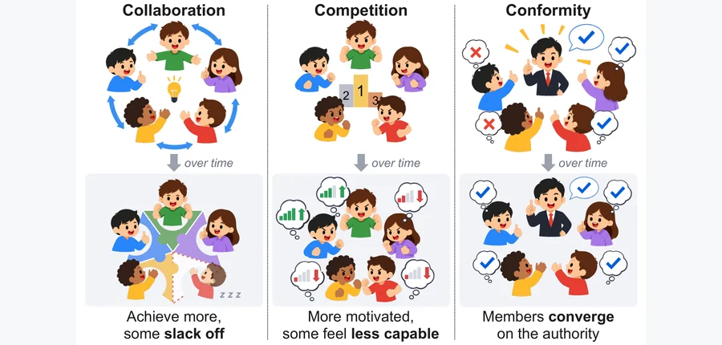 arXiv 2026-10-15 · cs.CL · #6 **[Evolve Together, Fall into Place: How Social Scaffolding Shapes Self-Evolving Multi-Agent Systems](https://arxiv.org/abs/2610.19799)** Seojin Hwang , Youngmin Choi , Hwanhee Lee Affiliation: Chung-Ang University [Paper](https://arxiv.org/abs/2610.19799) · [Figure source](https://arxiv.org/html/2610.19799v1/fig_1_final.png) 

[EN] Abstract
Recent work lets LLM agents evolve their own harness, up to the team itself. Yet in human groups, the same abilities achieve different outcomes under different social conditions. Borrowing the notion of scaffolding from developmental psychology, we investigate whether the social scaffolding of a self-evolving multi-agent system (MAS), namely its team composition and structure of interdependence (e.g., collaboration, conformity, or competition), shapes how the team evolves. We present AGORA (Agents Growing through Organization and Relational Arrangements), a framework that varies the two axes independently across three evolution mechanisms. Across web search, codebase understanding, and document QA, we find that (1) evolution alone rarely helps, while the right scaffolding surpasses a strong agent evolved alone by up to 25 points; (2) it does so by moving authority to the most capable member while the others step back; and (3) this member, having grown within the team, outperforms the same model alone. Designing a self-evolving MAS thus requires designing its social scaffolding, which shapes not only how its agents learn, but who gets to lead. <a href="https://arxiv.org/abs/2610.19799">Source</a>

[ZH] Abstract
近期研究允许大语言模型智能体进化自身的运行框架，甚至进化整个团队。然而在人类群体中，相同能力在不同社会条件下会产生不同结果。借用发展心理学中的支架概念，我们研究自我进化多智能体系统（MAS）的社会支架，即团队组成和相互依赖结构（例如协作、从众或竞争），是否会塑造团队的进化方式。我们提出 AGORA（通过组织与关系安排成长的智能体），在三种进化机制下独立改变这两个维度。跨网页搜索、代码库理解和文档问答任务，我们发现：（1）仅有进化很少带来收益，而恰当的支架能够比单独进化的强智能体高出最多 25 分；（2）这一收益通过将权威转移到最有能力的成员、其他成员退居辅助位置来实现；（3）在团队中成长的这一成员，表现优于同一模型独自运行时。因此，设计自我进化多智能体系统需要设计其社会支架，它不仅决定智能体如何学习，也决定谁获得领导权。 <a href="https://arxiv.org/abs/2610.19799">Source</a>
 |
| 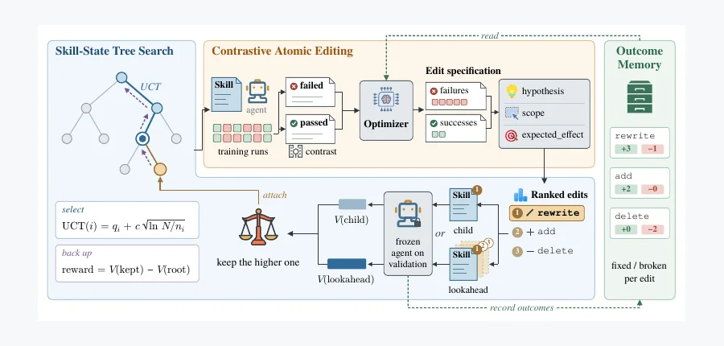 arXiv 2026-10-15 · cs.CL · #7 **[AtomSearch: Evidence-Grounded Tree Search for Agent Skill Optimization](https://arxiv.org/abs/2610.19951)** Jia Tong , Senyou Deng , Min Peng , Jianfeng Pan Affiliation: 360 Security Technology Inc. [Paper](https://arxiv.org/abs/2610.19951) · [Figure source](https://arxiv.org/pdf/2610.19951#page=2) 

[EN] Abstract
Agent skills adapt frozen models through editable external instructions. Revising several rules at once makes changes difficult to inspect, while judging each local edit only by its immediate score can discard useful intermediate states. We introduce AtomSearch, which keeps revision actions local while using subsequent skill states to guide search. Contrastive atomic editing links each primitive rule edit to failed and successful executions, a behavioral hypothesis, and an intended scope. Skill-State Tree Search (STS) evaluates short edit compositions and selectively retains them as executable states that can be revisited and extended. Outcome memory supplies later proposals with observed repair and regression statistics. We evaluate AtomSearch across four tasks and five target models. With deepseek-v4-flash, it exceeds SkillOpt on three of four tasks, including a 9.68-percentage-point gain on LiveMathematicianBench, and SkillOpt's final skills contain 2.3-19.7 times as many characters. In 67% of completed searches, the best validation state passes through an ancestor that was not highest-scoring at its depth. These results show how local rule edits can support the exploration of useful revision paths and yield compact skills, with additional offline evaluations used to explore alternative states. <a href="https://arxiv.org/abs/2610.19951">Source</a>

[ZH] Abstract
智能体技能通过可编辑的外部指令使冻结模型适应任务。同时修改多条规则会使变化难以审查，而仅按即时分数评估每次局部编辑，又可能丢弃有用的中间状态。我们提出 AtomSearch，在保持修改动作局部化的同时，利用后续技能状态指导搜索。对比式原子编辑将每个基本规则修改与失败及成功执行、行为假设和预期作用范围联系起来。技能状态树搜索（STS）评估较短的编辑组合，有选择地保留它们作为可执行状态，以便重新访问并继续扩展。结果记忆为后续提议提供已观察到的修复和退化统计。我们在四项任务和五个目标模型上评估 AtomSearch。使用 deepseek-v4-flash 时，它在四项任务中的三项上优于 SkillOpt，其中在 LiveMathematicianBench 上提高 9.68 个百分点，而 SkillOpt 最终技能的字符数是其 2.3—19.7 倍。在 67% 的已完成搜索中，验证表现最佳的状态经过了一个在其所在深度并非得分最高的祖先状态。这些结果表明，局部规则修改能够探索有用的修改路径并形成紧凑技能，但探索不同状态需要额外的离线评估。 <a href="https://arxiv.org/abs/2610.19951">Source</a>
 | 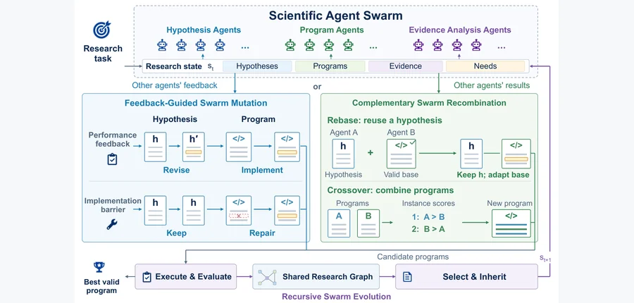 arXiv 2026-10-15 · cs.AI · #8 **[SwarmRSI: Recursive Self-Improvement through Evolving Scientific Agent Swarm](https://arxiv.org/abs/2610.20431)** Qianru Meng , Xi Zhang , Konstantinos Papakostas , Congfeng Cao , Wenxiang Hu , Tianyi Lu , Xiao Zhang , Lun Zhou , Zaiqia… Affiliation: Huawei Technologies / Leiden University / University of Groningen [Paper](https://arxiv.org/abs/2610.20431) · [Figure source](https://arxiv.org/html/2610.20431v1/fig_architecture_review.png) 

[EN] Abstract
Recursive self-improvement (RSI) in scientific research aims to improve agents' research capabilities through their own experimental experience. Scientific agent swarms can combine evidence and implementations from different research directions to guide their agents' subsequent experiments. However, poor experimental results can leave unclear whether to revise a hypothesis or its implementation, while overall program scores can hide components useful to other agents. To address these challenges, we introduce SwarmRSI, a framework that evolves scientific agent swarms for recursive self-improvement. We devise Feedback-Guided Swarm Mutation to refine hypotheses and their implementations using experimental feedback from other agents. We also propose Complementary Swarm Recombination to reuse retained hypotheses and complementary program components across agents, allowing partial results to support new research. Recursive Swarm Evolution integrates both mechanisms into a feedback loop, using new experimental evidence to guide subsequent research. Experiments on OpenProblems, NatureBench and MLE-Bench Lite demonstrate SwarmRSI's state-of-the-art (SOTA) performance. Further evaluations show that accumulated research experience improves performance on held-out tasks. Biologists also reproduce its programs for follow-up biological analyses. <a href="https://arxiv.org/abs/2610.20431">Source</a>

[ZH] Abstract
科学研究中的递归自我改进（RSI）旨在通过智能体自身的实验经验提高其研究能力。科学智能体群可以结合不同研究方向的证据和实现，指导各智能体的后续实验。然而，实验结果不佳时，往往不清楚应该修改假设还是修改实现，而整体程序分数又可能掩盖对其他智能体有用的局部组件。为解决这些问题，我们提出 SwarmRSI，一种通过进化科学智能体群实现递归自我改进的框架。我们设计反馈引导的群体变异，利用其他智能体的实验反馈细化假设及其实现；同时提出互补群体重组，在智能体之间复用已保留的假设和互补程序组件，使局部结果也能够支持新研究。递归群体进化将两种机制整合到反馈闭环中，用新实验的证据指导后续研究。在 OpenProblems、NatureBench 和 MLE-Bench Lite 上的实验显示，SwarmRSI 达到最先进性能。进一步评估表明，累积的研究经验能够提高留出任务上的表现。生物学家还复现其程序以进行后续生物学分析。 <a href="https://arxiv.org/abs/2610.20431">Source</a>
 | 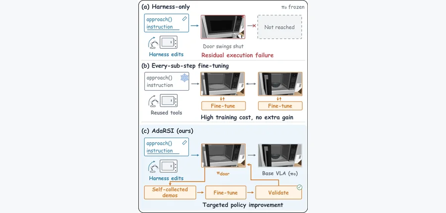 arXiv 2026-10-15 · cs.CL · #9 **[AdaRSI: On-Demand Recursive Self-Improvement for Embodied Agents](https://arxiv.org/abs/2610.20474)** Peidong Wang , Ying Chang , Zhiming Ma , Xiaocui Yang , Shi Feng , Daqi Liu , Yuzhe Yang , Xu Cao , Chuang Wang , Jian Su… Affiliation: Northeastern University / AgiBot / University of Chinese Academy of Sciences [Paper](https://arxiv.org/abs/2610.20474) · [Figure source](https://arxiv.org/html/2610.20474v1/figures/AdaRSI_teaser.jpg) 

[EN] Abstract
Pretrained vision-language-action models (VLAs) often fail midway through unseen long-horizon tasks. Recursive self-improvement (RSI) offers a remedy, but embodied RSI methods either refine the harness around a frozen executor and so cannot add a missing motion, or train the executor on persistent failures without asking whether a failure lies in how the executor is called or in what it can do. We ask when a self-improving embodied system should change the weights of its executor, and propose AdaRSI, an on-demand RSI framework for embodied agents. A coding agent first improves its skills and harness, then attributes persistent failures by retrying failing sub-steps from saved states, and fine-tunes only the sub-steps that remain unreliable, with demonstrations it collects itself and experience carried over from earlier tasks. On all 50 target tasks of RoboCasa365, with GR00T N1.5 as the executor and no human demonstrations, AdaRSI improves the VLA on all three suites and raises its success on unseen composite tasks from 4.6% to 13.8%. Compared with fine-tuning every sub-step, it reaches slightly higher success while using only 28% of the GPU time and 22% of the self-collected demonstrations, and fine-tuning without a harness trains more yet gains far less. <a href="https://arxiv.org/abs/2610.20474">Source</a>

[ZH] Abstract
预训练视觉语言动作模型（VLA）在未见过的长时程任务中，常会执行到一半便失败。递归自我改进（RSI）提供了一种补救途径，但现有具身 RSI 方法要么只改进冻结执行器周围的运行框架，因而无法补足缺失的动作能力；要么针对持续失败训练执行器，却不判断问题源于调用方式还是执行能力本身。我们研究自我改进的具身系统何时应该改变执行器权重，并提出按需进行改进的具身智能体 RSI 框架 AdaRSI。编码智能体先改进技能和框架，再从保存的状态重试失败子步骤以归因持续失败，随后仅对仍然不可靠的子步骤进行微调，使用其自行收集的演示以及从先前任务继承的经验。以 GR00T N1.5 为执行器、无需人类演示，AdaRSI 在 RoboCasa365 的全部 50 项目标任务上，在三个任务组中均改进了 VLA，并将未见组合任务的成功率从 4.6% 提高到 13.8%。相比微调每一个子步骤，它以略高的成功率，仅使用 28% 的 GPU 时间和 22% 的自采集演示；没有框架的微调虽然训练更多，收益却小得多。 <a href="https://arxiv.org/abs/2610.20474">Source</a>
 |
| 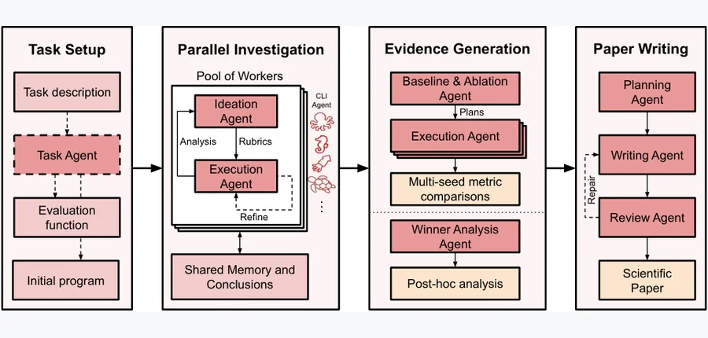 arXiv 2026-10-15 · cs.AI · #10 **[The Agentic Scientist: Orchestrating Coding Agents for Automated Scientific (Co-)Discovery](https://arxiv.org/abs/2610.18933)** Robert Tjarko Lange , Luca Grillotti , Yutaro Yamada , Rujikorn Charakorn , David Ha Affiliation: Sakana AI [Paper](https://arxiv.org/abs/2610.18933) · [Code](https://github.com/SakanaAI/AI-Scientist-v3) · [Figure source](https://arxiv.org/html/2610.18933v1/conceptual.png) 

[EN] Abstract
Modern coding agents are fundamentally reshaping the role of human input for computational research: they write code, launch in silico experiments, analyze their results, and autonomously operate with ever-increasing time horizons. Despite these developments, fully autonomous research agents suffer from a limited ideation radius and myopic hill-climbing search dynamics. To bridge this gap, we introduce The Agentic Scientist, an end-to-end distributed pipeline for human researchers to conduct computational research alongside modern coding agents. Building on its predecessor, our system decomposes research into task drafting, idea generation, planning, sandboxed experimentation, result aggregation, baseline and ablation construction, post-hoc analysis, and report writing. Importantly, each step in the pipeline is powered by the next generation of coding agents and leverages agentic self-verification. The overall research process is driven by a meta-controller that manages parallel research agents and enforces rubric verification at each stage. This design enables the same orchestration layer to be reused across heterogeneous domains with different execution environments, agentic coding harnesses, and evaluation metrics. Our system can be used across a spectrum of autonomy: either as a co-scientist tool or to perform end-to-end scientific investigation. Within the co-scientist setting, we leveraged a development version of our system to submit a single research paper, which got accepted for publication at ALIFE 2026. We further apply The Agentic Scientist fully autonomously to open problem-solving tasks in machine learning, and demonstrate the system's capability of scientific discovery across different domains of computational research. Our ablations suggest that reliable scientific autonomy depends not only on base model capabilities, but also on the cross-agent orchestration layer. <a href="https://arxiv.org/abs/2610.18933">Source</a>

[ZH] Abstract
现代编码智能体正在从根本上改变人类在计算研究中的投入方式：它们编写代码、启动计算机模拟实验、分析结果，并以不断延长的时间跨度自主工作。尽管如此，完全自主的研究智能体仍受到构思范围有限和短视爬山式搜索动力学的制约。为弥合这一差距，我们提出 The Agentic Scientist，一套让人类研究者与现代编码智能体共同开展计算研究的端到端分布式流程。在前代系统基础上，它将研究分解为任务起草、想法生成、规划、沙箱实验、结果汇总、基线与消融构建、事后分析和报告撰写。流程的每一步都由新一代编码智能体驱动，并利用智能体式自验证。整体研究过程由元控制器驱动，管理并行研究智能体并在每个阶段强制执行评分准则核验。该设计使相同的编排层能够跨不同执行环境、编码智能体运行框架和评估指标的领域复用。系统支持从协作科学家工具到端到端科学调查的不同自主程度。在协作科学家设置中，我们利用系统的开发版本提交了一篇研究论文，并获 ALIFE 2026 接收。我们进一步将 The Agentic Scientist 完全自主地用于机器学习开放问题求解，展示其在不同计算研究领域进行科学发现的能力。消融实验表明，可靠的科学自主性不仅取决于基础模型能力，也取决于跨智能体编排层。 <a href="https://arxiv.org/abs/2610.18933">Source</a>
 | 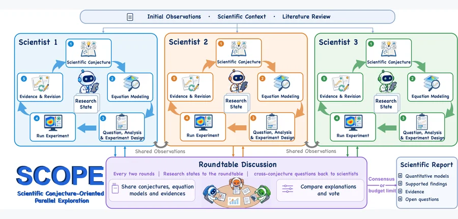 arXiv 2026-10-15 · cs.AI · #11 **[Beyond Equation Search: Conjecture-Guided Discovery with SCOPE and ClosureBench](https://arxiv.org/abs/2610.18938)** Yuxiao Hu , Qian Li , Ding Wang , Siheng Chen , Linfeng Zhang , Jinyue Yan , Yuntian Chen Affiliation: Hong Kong Polytechnic University / Eastern Institute of Technology / Shanghai Jiao Tong University / DP Technology [Paper](https://arxiv.org/abs/2610.18938) · [Figure source](https://arxiv.org/html/2610.18938v1/SCOPE.png) 

[EN] Abstract
Most symbolic regression methods optimize candidate equations, but improving an equation's fit does not establish whether its underlying scientific conjecture should be retained, revised, or rejected. A conjecture may admit multiple mathematical realizations, and similarly accurate equations may imply different explanations. This motivates a shift from refining individual expressions to developing and testing the conjectures that guide them. We introduce SCOPE, a framework that sustains multiple conjecture-driven research trajectories. Multiple scientist agents independently pursue conjectures through equation modeling, question formulation, and active experimentation, then exchange evidence to revise their conjectures and research directions. Their findings are consolidated into a scientific report linking models, conclusions, and evidence. Existing equation-discovery benchmarks primarily assess recovered expressions, leaving the evidence and scientific conclusions established through the investigation underexamined. We therefore introduce ClosureBench, an interactive benchmark of 60 closure-discovery tasks across five scientific domains. ClosureBench focuses on closure-discovery tasks to give equation discovery a concrete scientific purpose. Each task embeds an unknown algebraic relation in a known PDE system, where agents control experimental conditions in OpenFOAM to acquire new data for equation discovery. Beyond equation accuracy, ClosureBench proposes three metrics to evaluate the discovery process: evidence faithfulness, mechanism insight, and experimental effectiveness. Compared with diverse baselines, SCOPE achieves higher equation accuracy on both ClosureBench and a real-world scientific discovery case, while producing more accurate, reliable, and effective scientific discoveries. <a href="https://arxiv.org/abs/2610.18938">Source</a>

[ZH] Abstract
多数符号回归方法优化候选方程，但方程拟合改善并不能确定其背后的科学猜想应该保留、修改还是拒绝。一个猜想可能对应多种数学实现，而准确度相近的方程也可能隐含不同解释。这促使我们从细化单个表达式转向发展和检验引导表达式的猜想。我们提出 SCOPE，一种维持多条由猜想驱动的研究轨迹的框架。多个科学家智能体独立开展方程建模、问题提出和主动实验，随后交换证据，以修改猜想和研究方向。它们的发现被整合为将模型、结论和证据关联起来的科学报告。现有方程发现基准主要评估恢复的表达式，对研究过程所建立的证据和科学结论考察不足。因此，我们提出 ClosureBench，一个覆盖五个科学领域、包含 60 项闭合关系发现任务的交互式基准。ClosureBench 聚焦闭合关系发现，使方程发现具有明确的科学目的。每项任务都在已知偏微分方程系统中嵌入一个未知代数关系，智能体通过控制 OpenFOAM 中的实验条件获取新数据，以发现方程。除方程准确性外，ClosureBench 还提出证据忠实度、机制洞察力和实验有效性三项指标来评估发现过程。与多种基线相比，SCOPE 在 ClosureBench 和真实科学发现案例上均获得更高的方程准确性，同时产生更准确、可靠、有效的科学发现。 <a href="https://arxiv.org/abs/2610.18938">Source</a>
 | 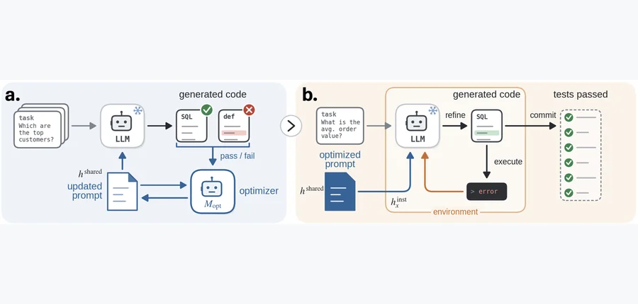 arXiv 2026-10-15 · cs.CL · #12 **[HERO: Harnessing Evidence for Test-time Refinement and Prompt Optimization in Program Generation](https://arxiv.org/abs/2610.19184)** Mingyu Lu , Timothy Ossowski , Tristan Naumann , Hoifung Poon , Peniel Argaw Affiliation: University of Washington / Microsoft Research / Recursion [Paper](https://arxiv.org/abs/2610.19184) · [Figure source](https://arxiv.org/pdf/2610.19184) 

[EN] Abstract
Harness optimization improves LLMs by refining reusable prompts and scaffolding, yet requires further adaptation for program generation tasks such as text-to-SQL and text-to-Python. Existing methods often rely on LLM reflectors to propose harness updates, which can fix observed failures but also disrupt previously correct behavior. Text-to-code tasks offer a natural way to mitigate this issue: we can execute generated outputs, allowing us to evaluate and verify the effects of proposed updates directly. Building on this signal, we introduce \textsc{HERO} (\textbf{H}arnessing \textbf{E}vidence for \textbf{R}efinement and \textbf{O}ptimization), which combines offline and test-time harness optimization. At the first stage, \method{} learns reusable prompt updates from execution-verified successes and failures and validates candidate revisions before adoption. At test time, we treat the generated code as an instance-specific harness and refine it using execution feedback. Across four SQL, Cypher, and Python benchmarks, \method{} achieves the best offline performance, improving pass@1 by \(7.6\) points over the initial prompt, while test-time refinement adds another \(2.0\) points and improves execution efficiency. <a href="https://arxiv.org/abs/2610.19184">Source</a>

[ZH] Abstract
运行框架优化通过细化可复用提示和支架来改进大语言模型，但在文本转 SQL、文本转 Python 等程序生成任务中还需要进一步适配。现有方法通常依赖大语言模型反思器提出框架更新，这虽然能修复已观察到的失败，也可能破坏原本正确的行为。文本到代码任务提供了一种自然的缓解方式：可以执行生成的输出，直接评估和验证所提更新的效果。基于这一信号，我们提出 HERO（利用证据进行细化与优化），结合离线和测试时框架优化。第一阶段，该方法从执行验证过的成功和失败中学习可复用提示更新，并在采纳前验证候选修改。测试时，我们将生成的代码视为实例特定的框架，通过执行反馈加以细化。在四个 SQL、Cypher 和 Python 基准上，该方法取得最佳离线表现，pass@1 比初始提示提高 7.6 分，测试时细化又进一步提高 2.0 分，并提升执行效率。 <a href="https://arxiv.org/abs/2610.19184">Source</a>
 |
| 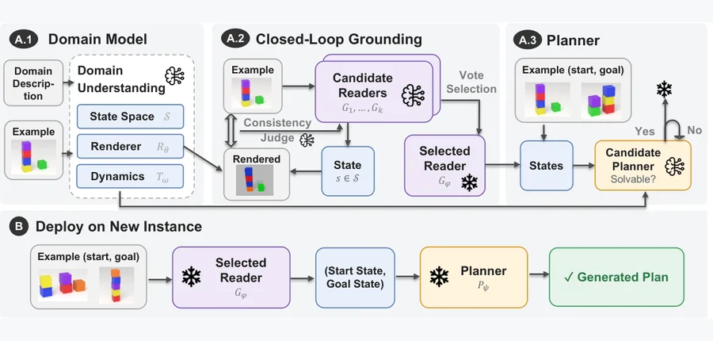 arXiv 2026-10-15 · cs.AI · #13 **[Write Once, Plan Many: Building Reusable Visual Planning Systems from One Scene](https://arxiv.org/abs/2610.19234)** Ruixiao Yang , Yilun Hao , Mingxin Yu , Yang Zhang , Chuchu Fan Affiliation: MIT / MIT-IBM Watson AI Lab [Paper](https://arxiv.org/abs/2610.19234) · [Figure source](https://arxiv.org/html/2610.19234v1/pipeline_teaser.png) 

[EN] Abstract
Vision-language models (VLMs) can reason about visual planning tasks, but querying them for every instance incurs repeated inference cost and latency. Generating reusable planning programs offers an alternative, but constructing reliable planning systems for new problem domains without extensive supervision remains challenging. We present a training-free framework that constructs reusable perception and planning programs from a domain specification and a single practice scene without a paired solution. The central challenge is obtaining useful feedback from the limited input. Our framework addresses it by leveraging VLM's ability to provide a renderer and a dynamic model based on its scene understanding. Rendering detected states enables comparison with the practice scene, while checking simulated action outcomes against the domain specification helps expose errors in rule implementation. Together, these checks guide refinement of the grounding program and planner without requiring solution labels. After refinement and component selection, the programs are frozen and solve new instances without further VLM calls. The same framework constructs systems across domains without manual pipeline redesign. Across fifteen domain variants spanning 2D and 3D scenes with discrete and continuous state, our systems achieve 99.3% average planning success, compared with 80.9% for the strongest domain-level program-generation baseline and 90.7% for the strongest instance-level baseline. Cost analyses show a favorable success-cost trade-off, and ablations confirm the contributions of the executable domain model, execution feedback, and component selection. <a href="https://arxiv.org/abs/2610.19234">Source</a>

[ZH] Abstract
视觉语言模型（VLM）能够推理视觉规划任务，但为每个实例都调用模型会反复产生推理成本和延迟。生成可复用规划程序是一种替代方案，但在缺乏大量监督的情况下，为新问题领域构建可靠规划系统仍然困难。我们提出一种无需训练的框架，仅依据领域规范和一个没有配对解答的练习场景，就能构建可复用的感知与规划程序。核心挑战是如何从有限输入获得有用反馈。我们的框架利用 VLM 根据场景理解提供渲染器和动力学模型的能力解决这一问题。渲染检测到的状态，可以将其与练习场景比较；依据领域规范检查模拟动作结果，可以暴露规则实现中的错误。两种检查共同指导视觉落地程序和规划器的细化，而不需要解答标签。完成细化和组件选择后，程序被冻结，无需进一步调用 VLM 即可解决新实例。同一框架能够跨领域构建系统，无需人工重新设计流程。在涵盖离散与连续状态、二维与三维场景的 15 个领域变体中，我们的系统平均规划成功率为 99.3%，而最强领域级程序生成基线为 80.9%，最强实例级基线为 90.7%。成本分析显示其成功率与成本之间的权衡更优，消融实验确认了可执行领域模型、执行反馈和组件选择的贡献。 <a href="https://arxiv.org/abs/2610.19234">Source</a>
 | 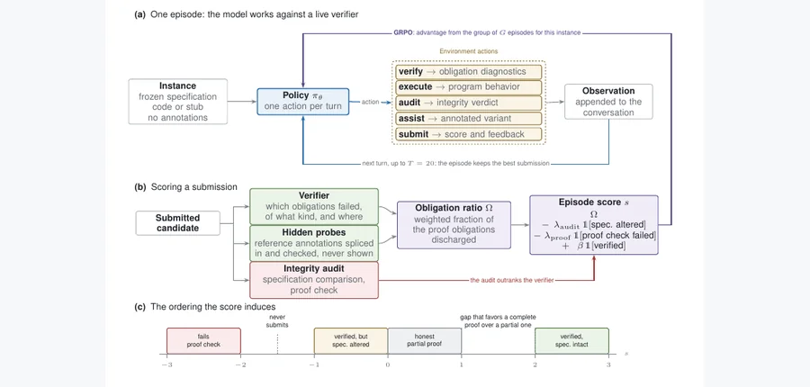 arXiv 2026-10-15 · cs.LG · #14 **[Verifier-Grounded Agentic RL for Provably Correct Code](https://arxiv.org/abs/2610.19298)** George Ma , Yuhao Zhang , Bing He , Zeren Shui , Ferhat Erata , Murali Krishna Ramanathan , Somayeh Sojoudi , Hao Zhou Affiliation: UC Berkeley / AWS AI Labs [Paper](https://arxiv.org/abs/2610.19298) · [Figure source](https://arxiv.org/pdf/2610.19298#page=2) 

[EN] Abstract
Reinforcement learning for code usually rewards passing tests, which a model can do while remaining wrong on the inputs the tests do not cover. A program verifier instead decides whether a program satisfies a formal specification for all inputs. Language models are almost always paired with verifiers at inference time only, and turning a verifier into a reward raises two difficulties. It reports only acceptance or rejection, which gives no gradient when every attempt fails, and a policy can cheat it, most simply by telling it to assume what the proof was supposed to establish. We build an agentic environment and reward that address both. The reward reads the verifier's diagnostics rather than its verdict, scoring a candidate by the weighted fraction of proof obligations it discharges, extended with hidden probes from a reference proof's annotations. An integrity audit outranks the verifier, rejecting any candidate that alters the specification or assumes what it was meant to prove. The model works as an agent against a live verifier over many turns, with a separately trained proof specialist as a frozen collaborator. Across Qwen3 models from 1.7B to 14B and a 35B Qwen3.6 mixture-of-experts model, held-out verification on code generation rises from 66.1% to 93.5% on DafnyBench and from 56.3% to 100% on SWE-Proof. This reward leads every other training signal we compare, including a binary pass-or-fail reward trained under otherwise identical settings, with the widest margin on code generation. When the agent must also deliver the repository patch, graded by each project's withheld tests, the fraction of held-out issues it resolves rises from 59.6% to 72.5%. Evaluated unchanged on three verification suites withheld from training, the checkpoints improve on all of them, including one whose language and verifier are absent from training. <a href="https://arxiv.org/abs/2610.19298">Source</a>

[ZH] Abstract
面向代码的强化学习通常奖励通过测试，但模型可能通过测试，却在未被覆盖的输入上仍然错误。程序验证器则判断程序是否对所有输入都满足形式化规范。语言模型几乎总是只在推理时与验证器配合，将验证器转为奖励存在两个难题：它通常只报告接受或拒绝，所有尝试都失败时没有梯度；策略也可能欺骗它，最简单的方式就是让它直接假设本应证明的结论。我们构建能够解决这两点的智能体环境和奖励。奖励读取验证器诊断而非仅仅读取裁决，按候选程序已完成证明义务的加权比例计分，并加入来自参考证明注解的隐藏探测。完整性审计优先级高于验证器，会拒绝任何修改规范或直接假设待证结论的候选。模型以智能体形式与实时验证器多轮交互，并由一个单独训练、保持冻结的证明专家协作。在从 1.7B 到 14B 的 Qwen3 模型和 35B Qwen3.6 混合专家模型上，代码生成的留出验证率在 DafnyBench 上从 66.1% 提高到 93.5%，在 SWE-Proof 上从 56.3% 提高到 100%。该奖励优于所有比较的训练信号，包括在其他设置完全相同下训练的二元通过奖励，其中代码生成上的优势最大。当智能体还必须交付由各项目隐藏测试评分的代码仓库补丁时，留出问题解决率从 59.6% 提高到 72.5%。将检查点不作改动地用于训练时留出的三个验证套件，表现均有改善，其中一个套件的语言和验证器在训练中都未出现。 <a href="https://arxiv.org/abs/2610.19298">Source</a>
 | 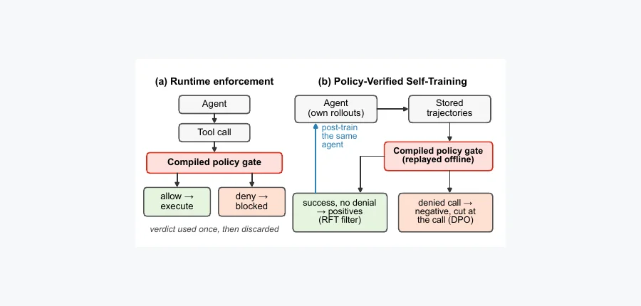 arXiv 2026-10-15 · cs.LG · #15 **[Policy-Verified Self-Training: Learning Agent Compliance from Verifiable Policy Rewards](https://arxiv.org/abs/2610.19372)** Min-Young Yu Affiliation: Corners Co., Ltd. [Paper](https://arxiv.org/abs/2610.19372) · [Figure source](https://arxiv.org/pdf/2610.19372#page=2) 

[EN] Abstract
Runtime policy verifiers can prevent agents from executing disallowed actions, but their decisions are typically used only for enforcement and discarded afterward. We ask whether these decisions can instead become verifiable policy rewards for training the agents they guard. We introduce Policy-Verified Self-Training (PVST), a post-training paradigm in which an agent generates its own interaction trajectories and an executable policy verifier, here a deterministic gate compiled from a written policy, evaluates whether each action complies. Compliant trajectories are reinforced, and violations become negatives for preference optimization; beyond the gate and the benchmark's task-success signal, PVST needs no stronger teacher model, no human preference labels and no attack-specific supervision, although rollouts are collected in the benchmark's attacked environment. On held-out AgentDojo tasks under prompt injection, policy-verified preference training of Qwen3-8B reduces violating trajectories from 37.2% to 10.3 $\pm$ 0.9% (three seeds) and successful attacks from 12.4% to 0.5% at equal or higher pooled task utility, although utility falls on travel, compared with 22.0% when negatives are selected by an attack oracle and 31.9 $\pm$ 0.9% with negatives that contain no violation. The learned behavior holds under an attack template never used in training (37.7% to 11.0%) and on a suite excluded from training (34.8% to 16.7%), and the retained verifier's intervention rate falls from 39.2% to 8.8% (seed 0). Our analysis identifies two conditions under which the verdict is most informative: success must not already imply compliance, and guarded actions must appear in both permitted and forbidden contexts. <a href="https://arxiv.org/abs/2610.19372">Source</a>

[ZH] Abstract
运行时策略验证器能够阻止智能体执行不允许的动作，但其决策通常仅用于强制执行，随后被丢弃。我们研究这些决策能否转化为训练受保护智能体的可验证策略奖励。我们提出策略验证自训练（PVST）：智能体生成自己的交互轨迹，由可执行策略验证器——此处为从书面策略编译得到的确定性门控——逐动作评估是否合规。合规轨迹被强化，违规轨迹成为偏好优化中的负例。除门控和基准的任务成功信号外，PVST 不需要更强教师模型、人类偏好标签或特定攻击监督，但轨迹是在基准受攻击的环境中收集的。在受到提示注入的留出 AgentDojo 任务上，对 Qwen3-8B 进行策略验证偏好训练，将违规轨迹从 37.2% 降到 10.3±0.9%（三个随机种子），成功攻击从 12.4% 降到 0.5%；汇总任务效用相同或更高，但旅行任务的效用下降。相比之下，用攻击预言机挑选负例时违规轨迹为 22.0%，使用不含违规的负例时为 31.9±0.9%。所学行为在训练中未用过的攻击模板下仍保持（37.7% 降到 11.0%），在训练排除的任务套件上也保持（34.8% 降到 16.7%）；保留验证器的干预率从 39.2% 降到 8.8%（种子 0）。分析指出，验证裁决在两个条件下最有信息量：任务成功不应已隐含合规，并且受保护动作应同时出现在允许和禁止的语境中。 <a href="https://arxiv.org/abs/2610.19372">Source</a>
 |
| 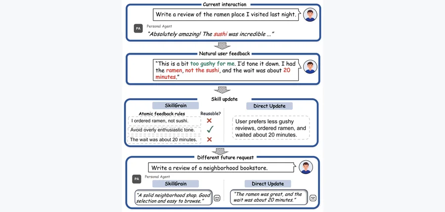 arXiv 2026-10-15 · cs.CL · #16 **[Learning What to Keep: Transfer-Aware Personal Skill Learning from User Feedback](https://arxiv.org/abs/2610.19380)** Li Wang , Chen Zhang , Yirong Yang , Xingyu Chen , Jinkun Zhao , Tianhao Peng , Wenjun Wu Affiliation: Beihang University / Chengdu University of Information Technology / Nanyang Technological University / Hangzhou International Innovation Institute / Beijing Advanced Innovation Center for Future Blockchain and Privacy Computing [Paper](https://arxiv.org/abs/2610.19380) · [Figure source](https://arxiv.org/html/2610.19380v1/introduction.png) 

[EN] Abstract
User feedback enables LLMs to refine reusable personalized skills, but often mixes persistent preferences with request-specific corrections. Indiscriminately retaining both risks negative transfer, motivating selective retention at the level of individual requirements. We frame this challenge as selective transfer over atomic rules and propose SkillGrain, a framework for learning reusable personalized skills from user feedback. SkillGrain decomposes feedback into independently actionable rules, predicts their transferability, and retains only those suitable for future requests. To learn these decisions, we combine rubric-guided skill rewards with fine-grained credit assignment that separately evaluates rule content and retention decisions. We further jointly optimize skill induction and skill-conditioned generation through reinforcement learning, ensuring that learned skills support downstream personalization. We construct a benchmark spanning five personalized writing tasks to evaluate cross-request generalization. Experiments across three base models in both in-domain and out-of-domain settings show that SkillGrain achieves the best overall average performance among competing methods. <a href="https://arxiv.org/abs/2610.19380">Source</a>

[ZH] Abstract
用户反馈能够帮助大语言模型细化可复用的个性化技能，但反馈经常混合持久偏好与特定请求的修正。不加区分地保留两者会带来负迁移风险，因此需要在单条要求层面选择性保留。我们将这一挑战表述为原子规则上的选择性迁移，并提出从用户反馈学习可复用个性化技能的框架 SkillGrain。SkillGrain 将反馈分解为可独立执行的规则，预测其可迁移性，仅保留适合未来请求的规则。为学习这些决策，我们结合评分准则引导的技能奖励和细粒度信用分配，分别评估规则内容及保留决策。我们还通过强化学习联合优化技能归纳与技能条件生成，确保所学技能支持下游个性化。我们构建覆盖五类个性化写作任务的基准，以评估跨请求泛化。在三个基础模型、域内及域外设置中的实验显示，SkillGrain 在比较方法中取得最佳总体平均表现。 <a href="https://arxiv.org/abs/2610.19380">Source</a>
 | 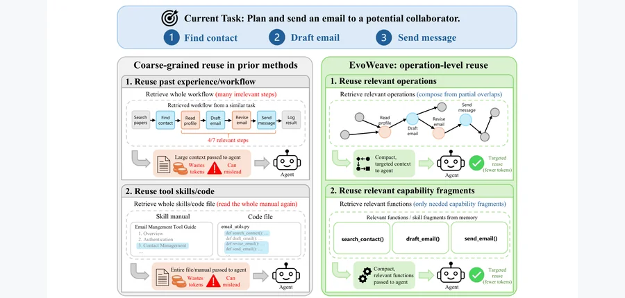 arXiv 2026-10-15 · cs.AI · #17 **[EvoWeave: Composing Reusable Agent Experience through Operation Level Graphs](https://arxiv.org/abs/2610.19381)** Guanhua Zhu , Bo Shen , Lei Zhang , Fadi Deek , Zhi Wei , Mengnan Du , Chenxi Yuan Affiliation: New Jersey Institute of Technology / Chinese University of Hong Kong, Shenzhen [Paper](https://arxiv.org/abs/2610.19381) · [Figure source](https://arxiv.org/html/2610.19381v1/intruduction.png) 

[EN] Abstract
Different tasks often require interactive agents to perform similar operations at intermediate steps. Retrieving an entire past workflow can introduce irrelevant steps, whereas retrieving isolated operations can discard the dependencies needed to reuse them. We introduce EvoWeave, a framework for experience memory that represents abstract states as nodes and reusable operations as directed edges with input and output contracts, provenance, and capability references. A planner decomposes the current task into a dependency graph; operation retrieval and bounded directed search then assemble relevant experience fragments. An execution agent can inspect these fragments and their referenced capabilities, while reflection separates concrete execution evidence from reusable abstractions. We study the framework across four benchmarks, five evaluation settings, and three language model backbones. Across backbones, AppWorld Normal and Challenge task goal completion average 51.91 and 27.99, respectively, exceeding the baseline without memory by 6.99 and 4.99 percentage points. An AppWorld ablation associates directed connections with an additional improvement of 2.08 points over independent operation cards. The results motivate composition of reusable operations while exposing tradeoffs in retrieval overhead and conditions for valid reuse. <a href="https://arxiv.org/abs/2610.19381">Source</a>

[ZH] Abstract
不同任务往往需要交互式智能体在中间步骤执行相似操作。检索整条过去的工作流可能引入无关步骤，而检索孤立操作又可能丢失复用所需的依赖关系。我们提出经验记忆框架 EvoWeave，用节点表示抽象状态，用带有输入输出契约、来源和能力引用的有向边表示可复用操作。规划器将当前任务分解为依赖图，随后通过操作检索和有界有向搜索组装相关经验片段。执行智能体能够检查这些片段及其引用能力，反思则将具体执行证据与可复用抽象分离。我们在四个基准、五种评估设置和三个语言模型骨干上研究这一框架。跨骨干模型，AppWorld Normal 和 Challenge 的任务目标完成率平均分别为 51.91 和 27.99，比无记忆基线高 6.99 和 4.99 个百分点。AppWorld 消融将有向连接与相对于独立操作卡片额外提高的 2.08 分联系起来。结果支持复用操作的组合，同时揭示检索开销与有效复用条件之间的权衡。 <a href="https://arxiv.org/abs/2610.19381">Source</a>
 | 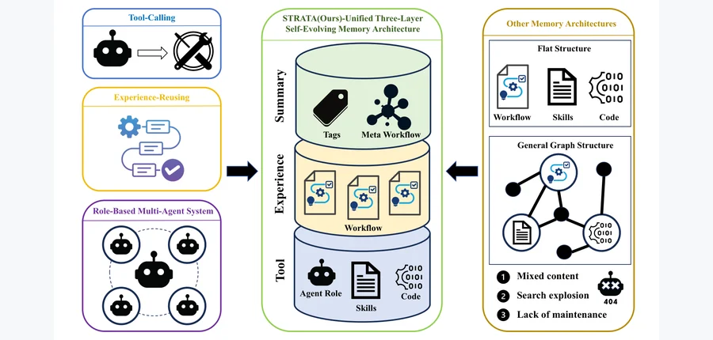 arXiv 2026-10-15 · cs.AI · #18 **[STRATA: Self-Maintaining Structured Experience Graphs for Self-Evolving Language Agents](https://arxiv.org/abs/2610.19386)** Guanhua Zhu , Hanwen Li , Zhi Wei , Mengnan Du , Chenxi Yuan Affiliation: New Jersey Institute of Technology / Chinese University of Hong Kong, Shenzhen [Paper](https://arxiv.org/abs/2610.19386) · [Figure source](https://arxiv.org/html/2610.19386v1/introduction.png) 

[EN] Abstract
Large language model (LLM) agents can self-evolve at test time by accumulating experience: retrieving relevant memories before acting and writing new lessons back afterwards. Yet most are single-level: trajectories, distilled workflows and reasoning items all land in one undifferentiated pool indexed by embedding similarity, with no typed abstraction hierarchy. They never forget or deduplicate, and are prone to negative transfer, where a superficially similar but directionally opposite experience is recalled and its concrete steps are copied verbatim, actively harming the agent. We introduce STRATA, a structured, outcome-grounded, self-maintaining memory that organizes experience into a three-layer graph of atomic skills and code snippets, task workflows and generalized meta-frameworks, connected by typed edges. STRATA maintains itself through five mechanisms sharing one similarity geometry: a multi-dimensional similarity that scores retrieval by operation and target; a typed reflector crystallizing procedures from successes and pitfalls from failures; community detection that induces meta-frameworks; pressure-triggered garbage collection with articulation-point protection; and contrast edges that flag confusable, direction-opposite experiences. Across four interactive benchmarks (AppWorld, WebArena, ALFWorld, ScienceWorld), two frozen backbones and seven baselines, STRATA attains the best average score while simultaneously using the lowest latency and fewest environment steps of any memory-augmented method, and 44% fewer lines of injected memory than the most context-hungry baseline. We isolate two failure modes of prior memories: single-level memory degrades sharply as the task set grows, and single-level concrete memories suffer catastrophic negative transfer, which contrast edges repair, lifting ScienceWorld from 78.7 to 96.7 within the same system. <a href="https://arxiv.org/abs/2610.19386">Source</a>

[ZH] Abstract
大语言模型（LLM）智能体可以在测试时通过积累经验实现自我进化：行动前检索相关记忆，行动后写回新教训。但多数方法仅有单一层次，轨迹、提炼的工作流和推理条目都进入同一个没有类型化抽象层级、仅按嵌入相似度索引的记忆池。它们从不遗忘或去重，容易发生负迁移：表面相似、方向相反的经验被召回，其具体步骤被逐字照搬，反而伤害智能体。我们提出 STRATA，一种结构化、以结果为依据且能自维护的记忆，将经验组织成三层图：原子技能与代码片段、任务工作流和通用元框架，各层由类型化边连接。STRATA 通过五种共享同一相似性几何的机制进行自维护：按操作和目标评分检索的多维相似度；从成功中提炼程序、从失败中提炼陷阱的类型化反思器；通过社区发现归纳元框架；带有关节点保护的压力触发垃圾回收；以及标记易混淆且方向相反经验的对比边。在四个交互基准（AppWorld、WebArena、ALFWorld、ScienceWorld）、两个冻结骨干和七个基线上，STRATA 获得最高平均分，同时在所有记忆增强方法中具有最低延迟和最少环境步数，注入记忆的行数比上下文使用最多的基线少 44%。我们分离出以往记忆的两个失败模式：任务集增大时单层记忆明显退化，单层具体记忆会遭受灾难性负迁移；对比边能够修复后者，将同一系统的 ScienceWorld 分数从 78.7 提高到 96.7。 <a href="https://arxiv.org/abs/2610.19386">Source</a>
 |
| 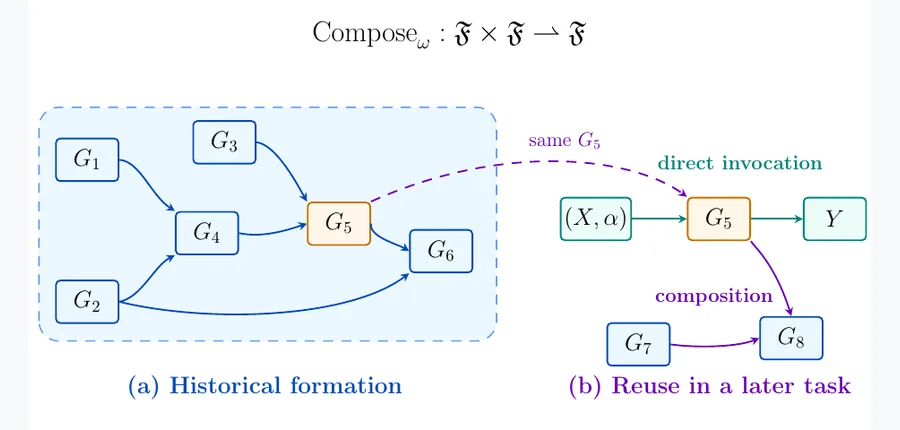 arXiv 2026-10-15 · cs.PL · #19 **[Recursive Formation and First-Class Reuse of Compositional Capabilities](https://arxiv.org/abs/2610.19414)** Hang Lin Affiliation: Affiliation unconfirmed [Paper](https://arxiv.org/abs/2610.19414) · [Code](https://github.com/lancelot138505-cpu/f-system) · [Figure source](https://arxiv.org/pdf/2610.19414#page=5) 

[EN] Abstract
We introduce FormCraft, a framework for representing acquired operations as first-class capabilities that can be recursively composed, directly invoked, and selectively retained in a persistent library through domain-specific verification. The framework separates capability well-formedness and public callability from later admission to persistent storage while preserving formation provenance and operational identity. We formalize recursive compositional closure over a uniform capability space and show that formed composites can be reused through the same public interface without re-forming their historical derivation. Experiments across continuous, discrete, propositional, and sequence domains demonstrate instance-independent reuse, independent checking, persistent acquisition, and reduced reuse-time search work under first-class exposure. <a href="https://arxiv.org/abs/2610.19414">Source</a>

[ZH] Abstract
我们提出 FormCraft，一种将已获得操作表示为一等能力的框架，使其能够递归组合、直接调用，并通过领域特定验证有选择地保留在持久库中。该框架将能力的良构性、公开可调用性与之后进入持久存储的准入分离，同时保留形成来源和操作身份。我们在统一能力空间中形式化递归组合闭包，并证明形成的组合能力可以通过相同公开接口复用，无需重新形成其历史推导。覆盖连续、离散、命题与序列领域的实验，展示了独立于具体实例的复用、独立检查、持久能力获取，以及以一等对象暴露能力后复用阶段搜索工作的减少。 <a href="https://arxiv.org/abs/2610.19414">Source</a>
 | 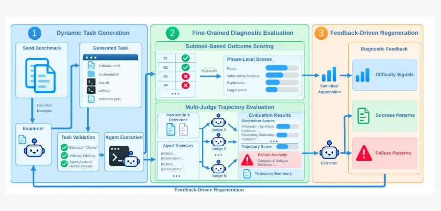 arXiv 2026-10-15 · cs.AI · #20 **[EvoProbe: Evaluation-Driven Benchmark Evolution for LLM Agents](https://arxiv.org/abs/2610.19433)** Qianhong Guo , Wei Xie , Xiaofang Cai , Shuoyoucheng Ma , Chengxin Hu , Baosheng Wang Affiliation: National University of Defense Technology / Institute of Information Engineering, CAS [Paper](https://arxiv.org/abs/2610.19433) · [Code](https://github.com/Qhovo1/EvoProbe) · [Figure source](https://arxiv.org/pdf/2610.19433#page=3) 

[EN] Abstract
Static benchmarks for large language model (LLM) agents face saturation and data contamination risks, motivating continual updates to evaluation tasks. However, aggregate scores and success rates offer limited insight into specific problem-solving bottlenecks and provide limited guidance for subsequent task design. We propose EvoProbe, an evaluation-driven benchmark evolution framework that integrates task generation, diagnostic evaluation, and feedback-driven regeneration into a closed loop. It combines verifiable subtask outcome scoring with evidence-supported multi-judge trajectory evaluation and distills phase-level bottlenecks, success patterns, and failure patterns into diagnostic feedback for generating new executable tasks. Across two rounds of cybersecurity experiments, evaluations of eight models on 66 tasks reveal phase-level performance differences and common failure patterns beyond aggregate scores. In a cross-round comparison with the Examiner model set and solver configuration held fixed, all eight models achieve lower Outcome scores on the updated tasks, with relative decreases of 11.8\% in mean Outcome and 40.0\% in mean Pass\textasciicircum{}3. These results support using fine-grained diagnostics to guide iterative task updates and probe agents' current capabilities and limitations. <a href="https://arxiv.org/abs/2610.19433">Source</a>

[ZH] Abstract
静态大语言模型智能体基准面临性能饱和及数据污染风险，因此需要持续更新评估任务。然而，汇总分数和成功率很难揭示具体求解瓶颈，也难以指导后续任务设计。我们提出评估驱动的基准进化框架 EvoProbe，将任务生成、诊断评估和反馈驱动再生成整合为闭环。它结合可验证的子任务结果评分与有证据支撑的多裁判轨迹评估，并将阶段性瓶颈、成功模式和失败模式提炼为诊断反馈，用于生成新的可执行任务。在两轮网络安全实验中，对八个模型、66 项任务的评估揭示了汇总分数之外的阶段性性能差异和常见失败模式。在固定 Examiner 模型集合与求解器配置的跨轮比较中，所有八个模型在更新任务上的 Outcome 分数均更低，平均 Outcome 相对下降 11.8%，平均 Pass^3 相对下降 40.0%。结果支持使用细粒度诊断指导迭代任务更新，并探测智能体当前的能力与局限。 <a href="https://arxiv.org/abs/2610.19433">Source</a>
 | 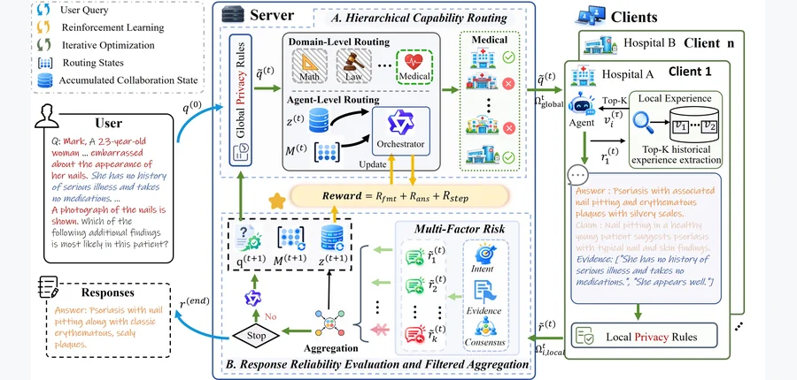 arXiv 2026-10-15 · cs.AI · #21 **[PFedMA: Who Should Join Next as Federated Multi-Agent Orchestration Evolves?](https://arxiv.org/abs/2610.19458)** Shuai Li , Shengyuan Liu , Fan Qi , Xiaoshan Yang Affiliation: Tianjin University of Technology / Inner Mongolia University / Institute of Automation, CAS [Paper](https://arxiv.org/abs/2610.19458) · [Figure source](https://arxiv.org/html/2610.19458v1/resource/kuangjiatu.jpg) 

[EN] Abstract
Federated Multi-Agent Systems (FedMAS) offer a promising paradigm for collaborative reasoning among LLM-based agents while keeping raw client data decentralized. However, reliable multi-round collaboration remains challenging. Agent selection must take into consideration evolving task requirements and the agent's historical reliability, while privacy rules must adapt to changing collaboration contexts and meet the client's personalized needs. To address these challenges, we propose PFedMA, a federated multi-agent framework for feedback driven multi-round collaboration under heterogeneous privacy requirements. Across rounds, PFedMA maintains historical capability and reliability states to guide agent selection, evaluates task responses before aggregation, and refines subsequent queries according to accumulated collaboration feedback. PFedMA enables bidirectional local to global and global to local private rule evolution across heterogeneous clients. Clients generalize locally updated privacy rules and selectively incorporate globally maintained rules, thereby facilitating cross-client privacy rule evolution while preserving personalized constraints. Extensive experiments across reasoning, privacy sensitive, and adversarial settings show that PFedMA improves task performance, reduces measured privacy leakage, and improves system robustness. <a href="https://arxiv.org/abs/2610.19458">Source</a>

[ZH] Abstract
联邦多智能体系统（FedMAS）为基于大语言模型的智能体提供了协作推理范式，同时将原始客户端数据保持分散。但可靠的多轮协作仍然困难：智能体选择需要考虑不断变化的任务需求和历史可靠性，隐私规则也必须适应变化的协作语境，满足客户端的个性化需要。为解决这些挑战，我们提出 PFedMA，一种在异构隐私要求下进行反馈驱动多轮协作的联邦多智能体框架。PFedMA 跨轮维护历史能力与可靠性状态以指导智能体选择，在聚合之前评估任务回复，并依据累积协作反馈细化后续查询。PFedMA 支持异构客户端之间从本地到全局、再从全局到本地的双向私有规则进化。客户端将本地更新的隐私规则泛化，并有选择地吸收全局维护的规则，从而在保持个性化约束的同时实现跨客户端隐私规则进化。推理、隐私敏感和对抗设置中的大量实验显示，PFedMA 提高任务表现，降低测得的隐私泄漏，并增强系统鲁棒性。 <a href="https://arxiv.org/abs/2610.19458">Source</a>
 |
|  arXiv 2026-10-15 · cs.RO · #22 **[Active Generative Simulation: Meta-Learning What to Simulate for Sim-and-Real Policy Co-Training](https://arxiv.org/abs/2610.19479)** Liqian Ma , Vaibhav Saxena , Utkarsh Aashu Mishra , Shuo Cheng , Yongxin Chen , Danfei Xu Affiliation: Georgia Institute of Technology [Paper](https://arxiv.org/abs/2610.19479) · [Project](https://meta-gensim.github.io/) · [Figure source](https://arxiv.org/html/2610.19479v1/teaser.png) 

[EN] Abstract
Sim-and-real co-training is an effective way to scale robot learning by augmenting limited real-world demonstrations with simulation data. However, existing approaches typically treat simulators as fixed data sources, relying on uniform generation, offline retrieval, or manual parameter alignment by domain experts. We formulate \textit{Active Generative Simulation}: optimizing a simulator's data-generation distribution to maximize downstream real-world performance. To solve this problem, we propose MetaGenSim, a meta-learning framework that trains an auxiliary rater network via meta-gradients to automatically discover high-utility data-generation distributions within a user-specified simulation parameter space, without manual parameter alignment. Across simulation and real-world manipulation tasks, MetaGenSim outperforms uniform generation and retrieval baselines, achieves a 150% relative improvement in real-world full-task success over uniform generation, and matches expert manual alignment. We further show that distributions curated with a lightweight proxy policy transfer to VLA fine-tuning, and that MetaGenSim can exploit partial alignment through atomic skill stitching and object-receptacle composition when exact sim-and-real task alignment is unavailable. Project website: this https URL <a href="https://arxiv.org/abs/2610.19479">Source</a>

[ZH] Abstract
模拟与真实数据协同训练通过仿真数据增强有限的真实世界演示，是扩展机器人学习的有效方式。然而，现有方法通常将模拟器视为固定数据源，依赖均匀生成、离线检索或领域专家手工对齐参数。我们提出主动生成式仿真这一问题：优化模拟器的数据生成分布，使下游真实世界性能最大化。为解决它，我们提出元学习框架 MetaGenSim，在用户指定的仿真参数空间内，通过元梯度训练辅助评分网络，自动发现高效用的数据生成分布，无需人工参数对齐。在仿真和真实世界操作任务上，MetaGenSim 优于均匀生成和检索基线，真实世界完整任务成功率相对均匀生成提高 150%，并达到专家手工对齐水平。我们进一步表明，以轻量代理策略筛选的分布能够迁移到 VLA 微调；当模拟和真实任务无法精确对齐时，MetaGenSim 还能够通过原子技能拼接及物体—容器组合利用部分对齐。项目网站见原文链接。 <a href="https://arxiv.org/abs/2610.19479">Source</a>
 | 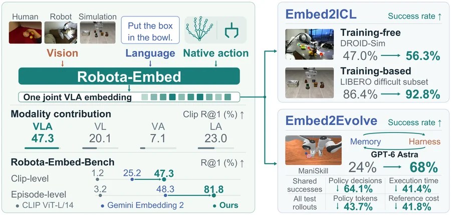 arXiv 2026-10-15 · cs.RO · #23 **[Robota-Embed: Unified VLA Embeddings for Robot In-Context Learning and Evolution](https://arxiv.org/abs/2610.19495)** Yunze Liu , Jing Wang , Shenrui Wu , Wenkun He , Guanqi Zhan , Xianzheng Ma , Junyu Chen , Wenhang Ge , Haozhan Tang , Yuc… Affiliation: NVIDIA / MIT / UCB / Oxford / CMU (source abbreviations) [Paper](https://arxiv.org/abs/2610.19495) · [Figure source](https://arxiv.org/html/2610.19495v1/roborag-teaser.png) 

[EN] Abstract
Retrieving useful context for a robot requires matching its task, execution stage, and the continuation that should follow. We introduce Robota-Embed, to our knowledge the first vision-language-action (VLA) embedding model to jointly encode all three modalities in both current-state queries and recorded future continuations. Predictive retrieval training aligns these endpoints, enabling historical continuations to serve as context at inference time. We construct a multi-source corpus of 1,695,684 cleaned training anchors and introduce Robota-Embed-Bench, with 4,000 queries and a shared 8,000-entry gallery. Robota-Embed achieves 47.33% clip-level and 81.77% episode-level R@1, exceeding action-free Gemini Embedding 2 by 22.09 and 33.47 percentage points. Controlled retrieval studies show that removing native action degrades retrieval more than removing vision. We study two complementary applications. Embed2ICL uses retrieved experience for training-free and training-based policy conditioning, increasing success from 47.0% to 56.3% in DROID-Sim and from 86.4% to 92.8% on the LIBERO difficult subset, while improving task progress on real robots. Embed2Evolve uses execution feedback to grow task-local memory and refine context use around a frozen GPT-6 Astra policy. Across five ManiSkill tasks, it achieves 68% success, compared with 24% for GPT-6 Astra Direct and 33% for a harness independently evolved with Omni-Embed-Nemotron-3B under the same protocol. Relative to the latter, it uses approximately 79.5% fewer policy tokens per test rollout, counting both successes and failures. These results show that a unified, action-aware retrieval space can support robot in-context learning and task-local context evolution. <a href="https://arxiv.org/abs/2610.19495">Source</a>

[ZH] Abstract
为机器人检索有用上下文，需要匹配其任务、执行阶段以及接下来应发生的延续。我们提出 Robota-Embed，据我们所知，它是首个在当前状态查询和记录的后续片段中联合编码视觉、语言、动作三种模态的视觉语言动作（VLA）嵌入模型。预测式检索训练对齐这两个端点，使历史延续片段能够在推理时用作上下文。我们构建包含 1,695,684 个清洗后训练锚点的多源语料库，并提出 Robota-Embed-Bench，其中有 4,000 个查询和共享的 8,000 条图库。Robota-Embed 达到片段级 47.33%、回合级 81.77% 的 R@1，比不使用动作的 Gemini Embedding 2 分别高 22.09 和 33.47 个百分点。受控检索研究表明，移除原生动作比移除视觉更损害检索。我们研究两个互补应用。Embed2ICL 使用检索经验进行无需训练或基于训练的策略条件化，使 DROID-Sim 成功率从 47.0% 提高到 56.3%，LIBERO 困难子集从 86.4% 提高到 92.8%，并提高真实机器人任务进度。Embed2Evolve 利用执行反馈围绕冻结的 GPT-6 Astra 策略增长任务局部记忆、细化上下文使用。在五项 ManiSkill 任务上，它达到 68% 成功率，而 GPT-6 Astra Direct 为 24%，在相同协议下用 Omni-Embed-Nemotron-3B 独立进化的框架为 33%。相较后者，计入成功与失败后，每次测试执行的策略词元数约减少 79.5%。这些结果表明，统一且具有动作感知的检索空间能够支持机器人上下文学习和任务局部上下文进化。 <a href="https://arxiv.org/abs/2610.19495">Source</a>
 | 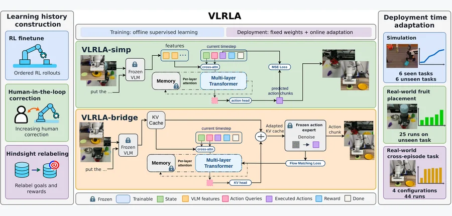 arXiv 2026-10-15 · cs.AI · #24 **[VLRLA: Deployment-Time Adaptation of Vision-Language-Action Models through In-Context Reinforcement Learning](https://arxiv.org/abs/2610.19517)** Diyuan Shi , Yiqi Tang , Hongyin Zhang , You Wu , Donglin Wang Affiliation: Zhejiang University / Westlake University [Paper](https://arxiv.org/abs/2610.19517) · [Figure source](https://arxiv.org/html/2610.19517v1/final_framework2.png) 

[EN] Abstract
Vision-language-action (VLA) models connect visual perception and language understanding with robot control, providing a foundation for instruction-conditioned manipulation. However, conventional pretrained VLA policies lack a mechanism for gradual adaptation through accumulated interaction experience during deployment. We therefore propose VLRLA, a general framework that equips existing VLA models with \textit{in-context reinforcement learning} capabilities for deployment-time adaptation. Our approach augments a VLA model with a reinforcement learning module that learns from historical observations, actions, rewards, and termination signals. During deployment, the policy gradually refines its action generation and progressively improves task success while keeping model parameters fixed. Our approach is also designed for general applicability and compatibility with diverse learning history construction strategies and model training pipelines. Finally, through extensive experiments, we systematically investigate the learning properties of VLRLA in simulation and demonstrate its ability to adapt to unseen scenarios during real-world deployment. <a href="https://arxiv.org/abs/2610.19517">Source</a>

[ZH] Abstract
视觉语言动作（VLA）模型将视觉感知、语言理解和机器人控制连接起来，为指令条件操作提供基础。但传统预训练 VLA 策略缺少在部署中通过累积交互经验逐步适应的机制。因此，我们提出通用框架 VLRLA，为现有 VLA 模型赋予用于部署时适应的上下文强化学习能力。我们的方法为 VLA 模型增加一个强化学习模块，使其从历史观测、动作、奖励和终止信号中学习。部署期间，策略在保持模型参数固定的同时，逐步细化动作生成并提高任务成功率。该方法也针对通用适用性设计，兼容多种学习历史构建策略和模型训练流程。最后，我们通过大量实验，系统研究 VLRLA 在仿真中的学习性质，并展示其在真实世界部署中适应未见场景的能力。 <a href="https://arxiv.org/abs/2610.19517">Source</a>
 |
| 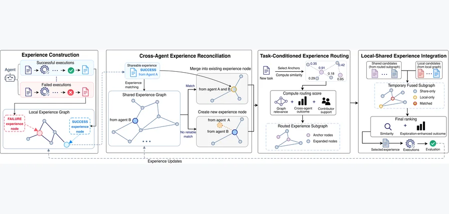 arXiv 2026-10-15 · cs.MA · #25 **[XferAgent: Cross-Agent Experience Transfer for Self-Improving LLM Agents](https://arxiv.org/abs/2610.19581)** Weihao Li , Jun Bai , Shijie Chen , Qincheng Lu , Xinyu Wang , Ziyang Song Affiliation: McGill University / Northwestern University / Mila / Ohio University [Paper](https://arxiv.org/abs/2610.19581) · [Figure source](https://arxiv.org/html/2610.19581v1/XferAgent.png) 

[EN] Abstract
Large language model (LLM) agents can reuse experience from prior task executions to improve performance on subsequent tasks. Although existing methods enable cross-agent experience sharing, differences in agents' execution histories and task requirements make shared experiences difficult to reuse effectively. We propose XferAgent, a framework for cross-agent experience transfer that organizes reusable experience in local and shared experience graphs. XferAgent reconciles compatible contributions from heterogeneous agents while avoiding unreliable merges. For each new task, it selects shared experiences and integrates them with the target agent's local experience to support task execution. Experiments across diverse task domains show improvements over representative memory-based methods and effective experience transfer between heterogeneous agent frameworks. Cumulative task success also increases over successive task passes as agents update and reuse their experiences. <a href="https://arxiv.org/abs/2610.19581">Source</a>

[ZH] Abstract
大语言模型（LLM）智能体能够复用先前任务执行中的经验，提高后续任务表现。尽管现有方法支持跨智能体经验共享，但不同智能体的执行历史和任务需求存在差异，使共享经验难以有效复用。我们提出跨智能体经验迁移框架 XferAgent，将可复用经验组织到本地和共享经验图中。XferAgent 协调来自异构智能体的兼容贡献，同时避免不可靠的合并。对每个新任务，它选择共享经验，并与目标智能体的本地经验整合，以支持执行。不同任务领域的实验显示，该方法优于代表性的记忆方法，并能够在异构智能体框架之间有效迁移经验。随着智能体更新和复用经验，累积任务成功率也随连续多遍任务执行而提高。 <a href="https://arxiv.org/abs/2610.19581">Source</a>
 | 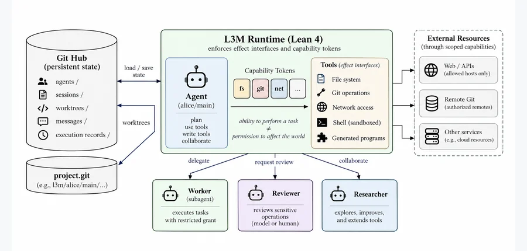 arXiv 2026-10-15 · cs.AI · #26 **[L3M: A Verifiable Harness and Runtime for Self-Extending and Self-Improving Agents](https://arxiv.org/abs/2610.19591)** Carson Eisenach , Robert Joseph George , Vincent Quenneville-Belair , Kate Gwimm , Dean Foster Affiliation: Amazon [Paper](https://arxiv.org/abs/2610.19591) · [Figure source](https://arxiv.org/html/2610.19591v1/figs/l3m-main-overview.png) 

[EN] Abstract
The lasting gains in AI have come from methods that absorb more computation, and language models already scale computation within a call. Useful work, though, happens across calls: over hours or days, through tools and external systems, among many agents and the humans they work for, and increasingly through code the agents write themselves. Whether that work compounds is enabled by the harness around it, and the harness faces a constraint the model does not: of the three participants in such a computation, the human, the model and code, only the human's attention does not scale, so the computation can grow only if the human is not in every loop. L3M is a runtime built on that premise, written in Lean 4 so that one language implements the harness, states its invariants, and is the language agents extend it in. One computation spans humans, agents, models and code, and all of its state lives in Git: a rich state trajectory -- rather than a chat conversation -- is an object the runtime can resume, rewind, fork, compare and merge. Waiting, communication, delegation and undo are primitives, not patterns the model reasons through each time. When an agent works out a procedure, it can write it once as a sealed Lean program whose type is its permission request, and the harness offers it back as a tool -- machinery for the model to use. To take the human out of the loop, L3M uses reversibility to decide where that is safe: a tool's review tier follows from how far its effects can be undone, so agents act freely where the runtime can recover. Because the machinery can change, the properties that make this safe are stated as kernel-checked theorems about the code that runs. On Terminal-Bench, an untuned L3M reaches about two thirds of its (unsafe) shell-equipped pass rate using only safe (not needing human review) tools. <a href="https://arxiv.org/abs/2610.19591">Source</a>

[ZH] Abstract
人工智能的持久进步来自能够吸收更多计算的方法，语言模型也已能在单次调用内扩展计算。然而，有用的工作发生在多次调用之间：跨越数小时或数天，通过工具和外部系统，在多个智能体及其服务的人类之间，并越来越多地通过智能体自行编写的代码完成。此类工作能否复利增长，取决于外围运行框架，而框架面对一个模型没有的约束：参与计算的人类、模型、代码三方中，只有人类注意力无法扩展，因此只有人类不处于每个循环之中，计算才能增长。L3M 是以此为前提构建的运行时，用 Lean 4 编写，让同一种语言实现框架、陈述其不变量，并成为智能体扩展框架的语言。一次计算贯穿人类、智能体、模型和代码，所有状态保存在 Git 中：丰富的状态轨迹，而非聊天对话，成为运行时能够恢复、回退、分叉、比较和合并的对象。等待、通信、委派和撤销是原语，而不是模型每次都要自行推理的模式。当智能体找到一种程序时，可以将其写成封装的 Lean 程序，其类型就是权限请求，框架再把它作为工具交还，成为模型可用的机制。为使人类退出循环，L3M 利用可逆性判断何处安全：工具的审查等级取决于其效果能够撤销到什么程度，因此智能体在运行时能够恢复的地方自由行动。由于机制本身能够改变，保证安全的属性被写成关于实际运行代码、由内核检查的定理。在 Terminal-Bench 上，未经调优的 L3M 只使用安全工具（无需人工审查），就达到其配备不安全 shell 时通过率的大约三分之二。 <a href="https://arxiv.org/abs/2610.19591">Source</a>
 | 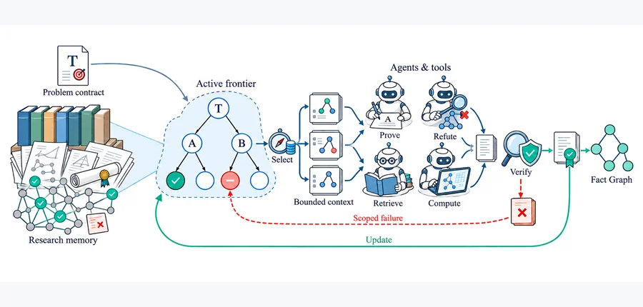 arXiv 2026-10-15 · cs.AI · #27 **[Euler: Towards Human-Centered Multi-Agent Mathematical Discovery](https://arxiv.org/abs/2610.19864)** Qiuyu Chen , Qi Wang , Liang Xu , Xin Jin , Baao Xie , Wenjun Zeng Affiliation: Shanghai Jiao Tong University / Institute of Automation, CAS / Zhongguancun Academy / Eastern Institute of Technology, Ningbo Institute of Digital Twin [Paper](https://arxiv.org/abs/2610.19864) · [Code](https://github.com/canghaimeng/Euler) · [Figure source](https://arxiv.org/html/2610.19864v1/figures_v12/source-000-clean.png) 

[EN] Abstract
Mathematical research drives scientific discovery, and recent advances in AI for mathematics have shown that language-model agents can solve challenging problems and develop substantial mathematical proofs. Yet much of today's AI-for-mathematics work centers on obtaining a final answer. This emphasis leaves the exploration behind a result difficult for researchers to understand, while long-running investigations face fragmented context and the risk of unsupported claims propagating across reasoning steps. We present Euler, a human-centered mathematical research system built around a shared, structured representation of the research process. Euler organizes mathematical statements, assumptions, proof dependencies, alternative approaches, failed attempts, and verification evidence into connected research graphs. This representation allows researchers to trace how results are developed and supplies agents with persistent, task-relevant knowledge for planning, collaboration, and verification across sessions. Researchers can also select a graph node linked to a saved team state, revisit the agents' earlier reasoning, and explore alternative directions through continued interaction. We illustrate Euler's capabilities through three mathematical research case studies and describe the implemented system and its software validation. <a href="https://arxiv.org/abs/2610.19864">Source</a>

[ZH] Abstract
数学研究推动科学发现，近期人工智能数学研究已表明，语言模型智能体能够解决有挑战的问题并发展较为实质的数学证明。然而，目前许多工作以获得最终答案为中心，使结果背后的探索过程难以被研究者理解；长时间调查还面临上下文割裂和缺乏支撑的断言在推理步骤之间传播的风险。我们提出以人为中心的数学研究系统 Euler，围绕共享且结构化的研究过程表示构建。Euler 将数学命题、假设、证明依赖、替代方法、失败尝试和验证证据组织成相连的研究图。这种表示让研究者能够追踪结果如何形成，并为智能体跨会话规划、协作和验证提供持久且与任务相关的知识。研究者也可以选择一个与已保存团队状态相连的图节点，重新查看智能体之前的推理，并通过继续交互探索其他方向。我们通过三个数学研究案例展示 Euler 的能力，并介绍已实现的系统及其软件验证。 <a href="https://arxiv.org/abs/2610.19864">Source</a>
 |
| 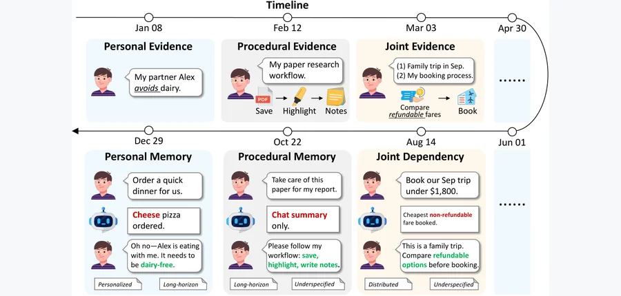 arXiv 2026-10-15 · cs.AI · #28 **[Memorizing Who, Knowing How: Benchmarking Personal and Procedural Memory for Persistent Assistants](https://arxiv.org/abs/2610.20022)** Maosheng Qin , Qi Zhang , Mingxuan Xia , Jinglei Chen , Jiexiang Wang , Sheng Guo , Cheng Peng , Haobo Wang Affiliation: Zhejiang University / Ant Group [Paper](https://arxiv.org/abs/2610.20022) · [Figure source](https://arxiv.org/html/2610.20022v1/case.png) 

[EN] Abstract
Memory systems for persistent personal agents must move beyond isolated memories, maintaining both personal memory about whom they serve and procedural memory about how to act. Crucially, in harness-based personal assistance, procedures or skills are inherently user-conditioned: personal context determines which procedures apply, how they are instantiated, and when they should change. Existing benchmarks typically emphasize either personal or procedural memory, leaving their interaction underexplored. We introduce PraxisMemBench, a harness-based benchmark for persistent personal assistance across daily-life and work trajectories, where personal and procedural memory evolve together and later tasks depend on both. Experiments show that maintaining two memory types separately is insufficient, with completion dropping from single-type to interdependent dependencies (84.6% to 77.9%). More broadly, across existing methods, relation-related failures increase from early to late sessions as interaction history grows (59.8% to 72.9%), revealing a continual-maintenance challenge: writing correct memories is not enough if their evolving content and organization cannot be preserved for later retrieval. To address this, we propose PraxisMem, which uses privileged joint-state supervision to internalize the ability to maintain memory content and organization into the memory manager, with location-aware GRPO and dynamic residual-routed OPSD. PraxisMem reaches 40.78% overall Session Success Rate, compared with 20.60% for Claude Code's native memory. <a href="https://arxiv.org/abs/2610.20022">Source</a>

[ZH] Abstract
持久个人智能体的记忆系统必须超越彼此孤立的记忆，同时维护关于服务对象的个人记忆和关于如何行动的程序记忆。关键在于，在基于运行框架的个人辅助中，程序或技能本质上依赖用户：个人上下文决定哪些程序适用、如何实例化以及何时应该改变。现有基准通常强调个人记忆或程序记忆之一，较少研究两者的交互。我们提出 PraxisMemBench，一种基于框架的持久个人辅助基准，覆盖日常生活与工作轨迹，个人及程序记忆共同演化，后续任务依赖两者。实验表明，仅将两类记忆分别维护并不足够：从单一类型依赖转为相互依赖时，完成率从 84.6% 降到 77.9%。更广泛地看，随着交互历史增长，现有方法中与关系相关的失败从早期会话的 59.8% 增加到后期的 72.9%，揭示持续维护挑战：仅写入正确记忆还不够，必须保持其不断变化的内容和组织，以便之后检索。为此，我们提出 PraxisMem，利用特权联合状态监督，通过位置感知 GRPO 和动态残差路由 OPSD，将维护记忆内容和组织的能力内化到记忆管理器中。PraxisMem 的总体会话成功率达到 40.78%，而 Claude Code 原生记忆为 20.60%。 <a href="https://arxiv.org/abs/2610.20022">Source</a>
 | 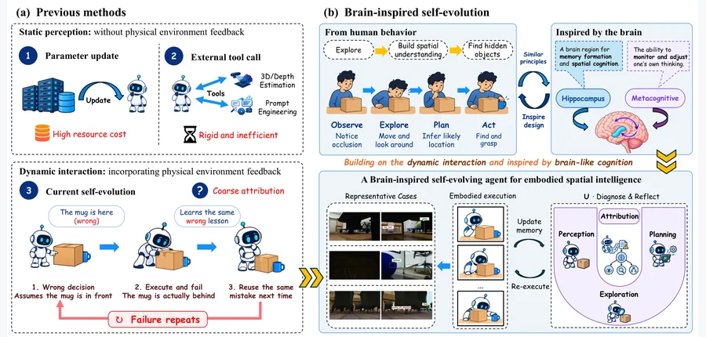 arXiv 2026-10-15 · cs.AI · #29 **[Reflect After Failure: Brain-Inspired Self-Evolving Agents for Embodied Spatial Intelligence](https://arxiv.org/abs/2610.20312)** Xin Li , Xiaohuan Gu , Yifan Wang , Shaobin Ling , Tianli Shi , Jingao Xu , Zhimeng Yin , Dapeng Wu , Yun Wang Affiliation: City University of Hong Kong / East China Normal University / University of Electronic Science and Technology of China / Chinese University of Hong Kong, Shenzhen / University of Hong Kong [Paper](https://arxiv.org/abs/2610.20312) · [Figure source](https://arxiv.org/html/2610.20312v1/Motivation.png) 

[EN] Abstract
Vision-Language Models (VLMs) have made substantial progress in spatial reasoning, and self-evolving agents further extend these capabilities to embodied environments by learning from interactions. However, current self-evolution remains particularly challenging in embodied spatial tasks, complex and multi-step decisions from partial visual evidence making it difficult to determine why an execution fails. The failure may stem from misperception, insufficient exploration, or incorrect planning, yet execution feedback alone rarely reveals which component is responsible. As a result, simply accumulating interaction experience can reinforce ineffective strategies. To address this, we propose HiMeco, a brain-inspired self-evolving agent for embodied spatial intelligence, inspired by metacognitive monitoring and hippocampal memory consolidation. Through Hippocampal-Metacognitive Reflection, HiMeco diagnoses failures in perception-exploration-planning (PEP), then compares execution attempts to derive reusable strategies and guidance for avoiding recurring errors. It also abstracts interaction programs into parameterized skills, using evidence contracts and execution-based validation to determine their retention and reuse. These strategies and skills guide subsequent interactions, with memory updated only between rounds and model parameters kept frozen. HiMeco achieves state-of-the-art performance on ESI-Bench, and it also improves accuracy on EmbSpatial-Bench by 3.94 percentage points without evolution. <a href="https://arxiv.org/abs/2610.20312">Source</a>

[ZH] Abstract
视觉语言模型（VLM）在空间推理方面已取得显著进展，自我进化智能体通过从交互中学习进一步将能力扩展到具身环境。但具身空间任务中的自我进化仍然十分困难：依据局部视觉证据进行复杂多步决策，使执行失败的原因难以确定。失败可能来自误感知、探索不足或规划错误，而仅有执行反馈很少能够揭示具体负责的组件，因此简单累积交互经验可能强化无效策略。我们提出受元认知监控和海马体记忆巩固启发、面向具身空间智能的脑启发自我进化智能体 HiMeco。通过海马体—元认知反思，HiMeco 诊断感知—探索—规划（PEP）中的失败，再比较执行尝试，形成可复用策略和避免重复错误的指导。它还将交互程序抽象为参数化技能，利用证据契约和基于执行的验证决定保留与复用。这些策略和技能指导后续交互；记忆仅在轮次之间更新，模型参数保持冻结。HiMeco 在 ESI-Bench 上达到最先进性能，并在不进行进化的情况下，将 EmbSpatial-Bench 准确率提高 3.94 个百分点。 <a href="https://arxiv.org/abs/2610.20312">Source</a>
 | 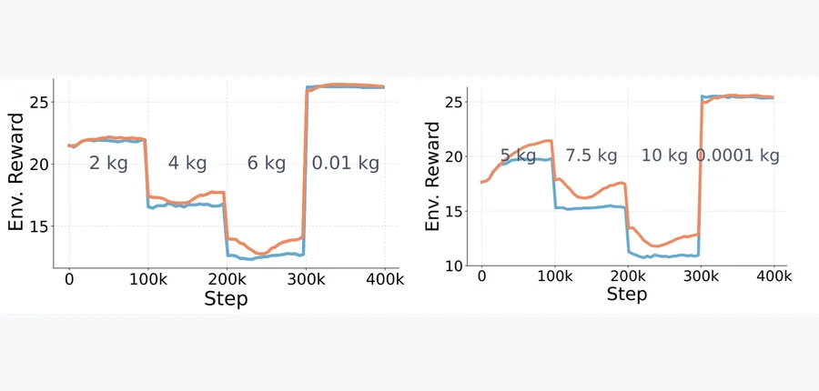 arXiv 2026-10-15 · cs.RO · #30 **[Efficient Test-Time Adaptation For Robot Policies](https://arxiv.org/abs/2610.20318)** Motasem Alfarra , Pietro Mazzaglia , Markus Peschl , Daniel Dijkman , Christos Louizos Affiliation: Qualcomm AI Research [Paper](https://arxiv.org/abs/2610.20318) · [Figure source](https://arxiv.org/html/2610.20318v1/figures/continual_results/continual_then_source.png) 

[EN] Abstract
Reinforcement-learning policies for robot locomotion can fail at deployment when operating conditions shift (e.g., rough or slippery terrain, payload changes, sensing degradation), and retraining or manual recalibration is often infeasible under on-device latency and memory constraints. We study test-time adaptation (TTA) for robotic control: adapting a pretrained policy online and in a self-supervised manner during execution, without access to rewards. Our starting point is a lightweight baseline that updates only the actor using a frozen pretrained critic as a deployment-time performance surrogate. Building on this, we introduce TEMPO, a test-time entropy-regularized, memory-guided policy optimization method that stabilizes critic-driven updates under severe shift. TEMPO combines (i) an entropy-promoting regularizer on the critic's predictive distribution to mitigate overconfident extrapolation, and (ii) a score-based memory, inspired by prioritized replay, that prioritizes low-value ("hard") observations and applies importance sampling to focus limited computation on the most informative deployment conditions. Across Go1, Go2, and G1 in MuJoCo Playground under four representative shifts and multiple architectures, TEMPO yields consistent gains, reaching up to 80% improvement in a single-device setting. We further validate on a physical Unitree Go2 with an added calf payload, where fully on-device adaptation improves performance over the non-adapted baseline across real-world episodes. <a href="https://arxiv.org/abs/2610.20318">Source</a>

[ZH] Abstract
机器人运动控制的强化学习策略可能在部署条件变化时失败，例如崎岖或湿滑地形、载荷变化和感知退化，而设备端延迟及内存限制往往使重新训练或人工标定不可行。我们研究机器人控制的测试时适应（TTA）：在执行期间无需奖励，在线、以自监督方式适配预训练策略。起点是一个轻量基线，仅更新 actor，并使用冻结的预训练 critic 作为部署时性能代理。在此基础上，我们提出测试时熵正则化、记忆引导的策略优化方法 TEMPO，以稳定严重分布偏移下由 critic 驱动的更新。TEMPO 结合两项机制：（i）在 critic 预测分布上使用促进熵的正则项，缓解过度自信的外推；（ii）受优先经验回放启发的基于分数的记忆，优先保留低价值的困难观测，并采用重要性采样，将有限计算集中到最有信息量的部署条件。在 MuJoCo Playground 中对 Go1、Go2、G1、四种代表性偏移和多种架构的实验中，TEMPO 持续取得收益，单设备设置下提升最多 80%。我们还在小腿增加载荷的真实 Unitree Go2 上验证，完全在设备端进行的适应，在真实世界各回合中均优于不适配基线。 <a href="https://arxiv.org/abs/2610.20318">Source</a>
 |
| 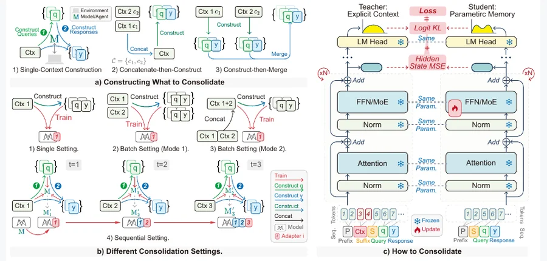 arXiv 2026-10-15 · cs.CL · #31 **[Cortex: Consolidating Context into Parametric Memory](https://arxiv.org/abs/2610.20399)** Jintian Zhang , Feng He , Xinnian Liang , Ziwen Xu , Haoming Xu , Haojing Huang , Shuangzhi Wu , Ningyu Zhang Affiliation: Zhejiang University / ByteDance Seed / Tsinghua University [Paper](https://arxiv.org/abs/2610.20399) · [Figure source](https://arxiv.org/pdf/2610.20399#page=5) 

[EN] Abstract
Context can improve large language model performance, but these gains may be lost after context removal. Inspired by biological systems consolidation, we formulate Memory Consolidation (MC) as internalizing these gains while preserving non-target capabilities, connecting context-specified editing, skill learning, and behavioral steering under a common objective. We introduce a five-task-family testbed measuring consolidation and retention under single, batch, and sequential updates. We propose Cortex, which generates prospective queries to anticipate uses of context and distills context-conditioned outputs into mergeable low-rank or structural feed-forward network updates. Across 4B--120B dense and mixture-of-experts backbones, including both text-only and multimodal models, Cortex lies on the empirical consolidation--retention Pareto frontier in most evaluated settings. After 50 sequential factual edits on a 14B model, Cortex-Structural recovers 88.9% of the context-induced gain while retaining 99.8% of original non-target performance. <a href="https://arxiv.org/abs/2610.20399">Source</a>

[ZH] Abstract
上下文能够提高大语言模型性能，但移除上下文后，这些收益可能消失。受生物系统巩固启发，我们将记忆巩固（MC）表述为：在保留非目标能力的同时将这些收益内化，并将上下文指定编辑、技能学习和行为引导纳入统一目标。我们提出包含五类任务的测试平台，在单次、批量和顺序更新下测量巩固与保留。我们提出 Cortex，通过生成前瞻查询预判上下文的用途，并将依赖上下文的输出蒸馏为可合并的低秩更新或前馈网络结构更新。在从 4B 到 120B 的稠密及混合专家骨干上，包括纯文本和多模态模型，Cortex 在大多数评估设置中位于经验上的巩固—保留帕累托前沿。在一个 14B 模型上顺序进行 50 次事实编辑后，Cortex-Structural 恢复了上下文所带来收益的 88.9%，同时保留原始非目标性能的 99.8%。 <a href="https://arxiv.org/abs/2610.20399">Source</a>
 | 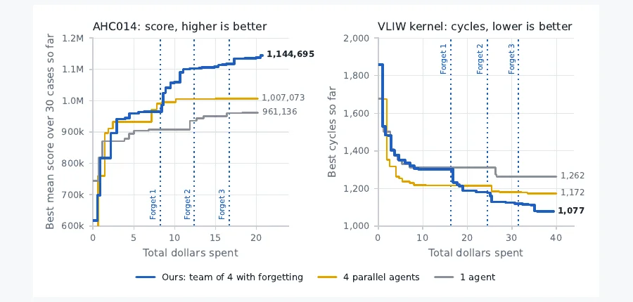 arXiv 2026-10-15 · cs.AI · #32 **[Scaling Discovery Requires Forgetting](https://arxiv.org/abs/2610.20563)** Shangyin Tan , Ben Zhou , Lakshya A Agrawal , Jialin Zhang , Yilin Chen , Qiuyang Mang , Donghyun Lee , Dennis Jacob , Kou… Affiliation: UC Berkeley / Stanford / Bespoke Labs [Paper](https://arxiv.org/abs/2610.20563) · [Figure source](https://arxiv.org/pdf/2610.20563#page=1) 

[EN] Abstract
Automated research with LLM agents has shown promising results in various domains. Through iterative refinement and scored verifiers, LLM agents are capable of discovering new ideas. There are different ways to scale automated research: let one agent iterate for longer, run several agents in parallel, or further let the parallel agents communicate and build on one another's candidates. However, we find that all three strategies eventually plateau as the agents accumulate history. Each agent becomes anchored to its own past attempts, making fewer and smaller edits. Beyond this point, additional budget brings little further improvement. In this paper, we show that the key to scaling discovery further is to forget. Periodically discarding the search state, including every agent's session and the candidate history, and restarting from the best candidate found so far, unblocks the search and pushes the same budget further. We implement forgetting in a team of agents with communication and evaluate it on four tasks spanning heuristic programming, kernel optimization and model training. The results show up to 15% improvement compared to parallel agents, and up to 39% compared to a single agent. Our results suggest that, for open-ended discovery, what an agent is allowed to remember matters as much as how much compute it is given. <a href="https://arxiv.org/abs/2610.20563">Source</a>

[ZH] Abstract
利用大语言模型智能体进行自动化研究，在多个领域已显示出前景。通过迭代细化和评分验证器，智能体能够发现新想法。扩展自动化研究有多种方式：让单个智能体迭代更久、并行运行多个智能体，或让并行智能体进一步通信并基于彼此候选继续构建。然而，我们发现三种策略都会随着历史累积最终进入平台期。每个智能体都被自己的过去尝试锚定，修改越来越少、幅度越来越小。超过这一点后，增加预算几乎不再带来改进。本文表明，进一步扩展发现的关键是遗忘。定期丢弃搜索状态，包括所有智能体会话和候选历史，并从目前找到的最佳候选重新开始，可以解除搜索阻塞，让同等预算走得更远。我们在可通信的智能体团队中实现遗忘，并在覆盖启发式编程、内核优化和模型训练的四项任务上评估。结果显示，相比并行智能体最多提高 15%，相比单个智能体最多提高 39%。结果表明，在开放式发现中，允许智能体记住什么，与给予它多少计算同样重要。 <a href="https://arxiv.org/abs/2610.20563">Source</a>
 | 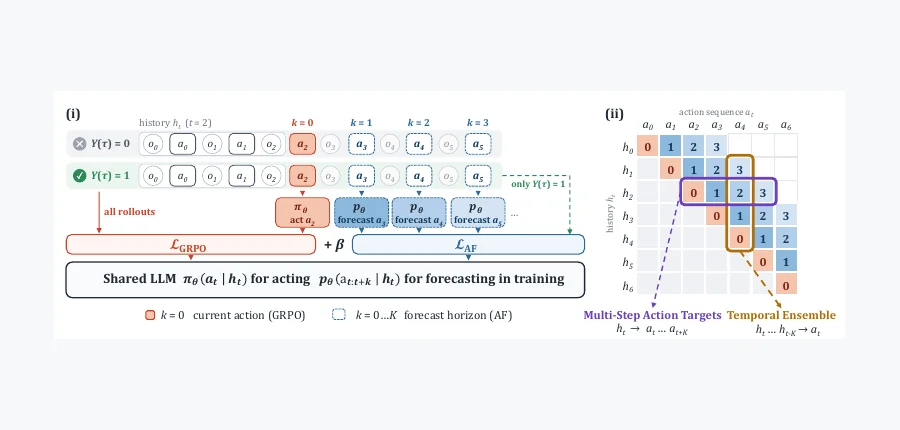 arXiv 2026-10-15 · cs.AI · #33 **[Co-Evolving Acting and Forecasting for Language Agents](https://arxiv.org/abs/2610.20597)** Haofei Yu , Yixing Chen , Yining Zhao , Xuyan Ye , Yuxiang Liu , Zhigang Hua , Yan Xie , Shuang Yang , Jiaxuan You Affiliation: University of Illinois Urbana-Champaign / University of California San Diego / Meta AI [Paper](https://arxiv.org/abs/2610.20597) · [Code](https://github.com/ulab-uiuc/CoPE) · [Figure source](https://arxiv.org/pdf/2610.20597#page=4) 

[EN] Abstract
Training language agents is bottlenecked by the high cost of long-horizon rollouts, yet standard agentic reinforcement learning (RL) learns only from a terminal scalar reward, leaving the supervision in intermediate steps largely unused. Prior work exploits this supervision through value targets that estimate per-step success probabilities or observation targets that fit environment response. Both are hard to construct well: (1) value targets come from the same single scalar signal for each step in the trajectory, and (2) observation targets, such as web pages and terminal logs, are long and noisy and reach only one step ahead. We propose \name, which adds a third kind of multi-step action targets. On successful on-policy trajectories, \name trains the policy backbone to generate the action sequences that follows each history. Each action is also supervised when forecast from the preceding histories, forming a temporal ensemble that the shared backbone absorbs during training, and this enables acting and forecasting to co-evolve. The policy still acts one step at a time at inference, with no overhead. Across five benchmarks (ALFWorld, ScienceWorld, WebShop, $\tau^2$-bench, and AppWorld), \name (1) achieves stronger aggregate performance than GRPO and RL baselines with predictive auxiliary targets across simulated environments, while improving overall performance on both realistic applications; (2) delivers up to $1.9\times$ and $2.0\times$ higher sample efficiency than ECHO and GRPO, respectively, on ScienceWorld; and (3) achieves these gains with a single policy backbone, without additional models, separate pretraining, or inference overhead. The codebase is available at this https URL . <a href="https://arxiv.org/abs/2610.20597">Source</a>

[ZH] Abstract
语言智能体训练受限于长时程执行的高成本，但标准智能体强化学习只从终端标量奖励学习，忽略了中间步骤中的大量监督。已有工作通过两种目标利用这些监督：估计逐步成功概率的价值目标，以及拟合环境响应的观测目标。两者都难以良好构建：（1）轨迹中每一步的价值目标都来自同一个标量信号；（2）网页和终端日志等观测目标冗长、嘈杂，且仅面向下一步。我们提出 \name，增加第三类多步动作目标。在成功的同策略轨迹上，\name 训练策略骨干生成每段历史之后的动作序列。每个动作还从更早的历史出发接受预测监督，形成被共享骨干在训练中吸收的时间集成，使行动与预测协同进化。推理时策略仍每次执行一步，不增加开销。在五个基准（ALFWorld、ScienceWorld、WebShop、$\tau^2$-bench 和 AppWorld）上，\name：（1）在模拟环境中，总体表现优于 GRPO 和使用预测辅助目标的强化学习基线，同时在两个真实应用场景中提高总体表现；（2）在 ScienceWorld 上，相对 ECHO 和 GRPO 分别达到最高 1.9 倍及 2.0 倍的样本效率；（3）仅使用一个策略骨干实现上述收益，无额外模型、单独预训练或推理开销。代码库见原文链接。 <a href="https://arxiv.org/abs/2610.20597">Source</a>
 |
| 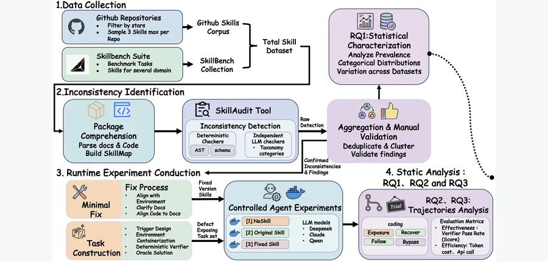 arXiv 2026-10-15 · cs.AI · #34 **[Why Static Skill Inconsistencies Do Not Equate to Runtime Risks: A Behavioral Analysis of LLM Agent Execution](https://arxiv.org/abs/2610.18927)** Fengrui Fan , Huahao Wang , Jingyi Fang , Yutao Hu , Yueming Wu , Deqing Zou Affiliation: Huazhong University of Science and Technology [Paper](https://arxiv.org/abs/2610.18927) · [Figure source](https://arxiv.org/html/2610.18927v1/Figures/Study_Methodology_v2.png) 

[EN] Abstract
LLM agent frameworks heavily rely on external skill assets to standardize tool usage, encode operational workflows, and supply executable runtime resources. Despite their widespread adoption, multi-component skill packages frequently suffer from cross-artifact inconsistencies, where documentation, scripts, and configuration files specify conflicting behavioral constraints. Although static auditing techniques can uncover such contractual discrepancies, static defect volume cannot reliably reflect real-world agent performance degradation. This gap leaves practitioners without rigorous evidence to assess the practical risk of flawed agent skills. This paper presents a systematic empirical study to demystify the runtime implications of skill inconsistencies. We conduct large-scale auditing over 575 community and benchmark skills, yielding 1,182 manually validated contract inconsistencies. We further build a controlled evaluation pipeline with 49 executable agent tasks and three representative LLMs across NoSkill, OriginalSkill, and FixedSkill experimental settings. Through fine-grained behavioral analysis of 441 paired execution trajectories, we quantify the actual performance impacts of resolved defects. <a href="https://arxiv.org/abs/2610.18927">Source</a>

[ZH] Abstract
大语言模型智能体框架大量依赖外部技能资产，以规范工具使用、编码操作流程并提供可执行的运行时资源。尽管应用广泛，多组件技能包经常出现跨文件不一致：文档、脚本和配置文件规定了彼此冲突的行为约束。静态审计能够发现这些契约差异，但静态缺陷数量并不能可靠反映真实智能体性能退化。这种差距使实践者缺少严谨证据来评估有缺陷技能的实际风险。本文通过系统性实证研究分析技能不一致的运行时影响。我们对 575 个社区及基准技能开展大规模审计，得到 1,182 个经人工验证的契约不一致项。进一步构建受控评估流程，在 NoSkill、OriginalSkill 和 FixedSkill 三种设置下，覆盖 49 项可执行智能体任务和三个代表性大语言模型。通过对 441 条配对执行轨迹的细粒度行为分析，我们量化修复缺陷带来的实际性能影响。 <a href="https://arxiv.org/abs/2610.18927">Source</a>
 | 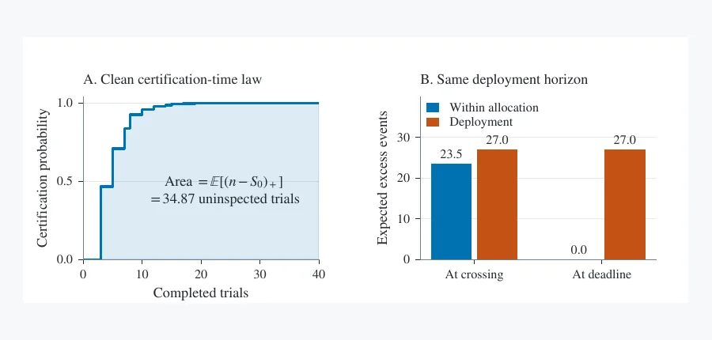 arXiv 2026-10-15 · cs.CR · #35 **[Limits of Statistical Assurance for Embodied and Agentic AI under Adaptive Adversaries](https://arxiv.org/abs/2610.18948)** Inderjeet Singh Affiliation: Fujitsu Research of Europe [Paper](https://arxiv.org/abs/2610.18948) · [Figure source](https://arxiv.org/pdf/2610.18948#page=5) 

[EN] Abstract
Finite safety assessments cannot exclude an adversary that preserves unattacked behavior until certification and activates afterward. We characterize this limitation for embodied and tool-use AI. An adversary that matches the complete observation law until observable, irrevocable certification and retains intervention access afterward attains $v\mathbb{E}[(n-S_0)_+]$ expected post-certification events over $n$ trials, where $v$ is the active event probability and $S_0$ the unattacked certification time. The result covers adaptive and privately randomized evaluators. Switching at certification is exactly optimal for a fixed likelihood-ratio test under memoryless, event-increasing interventions without a binding intervention budget. A positive clean-certification requirement forces linear worst-case expected excess when intervention raises event rates over an authorized deployment horizon, even if certification is deferred to the deadline. In simulated RoCo collaboration, switching yields commanded-separation violations in 34 of 36 post-certification episodes. Preregistered randomized AgentDojo trials estimate 1.98 additional security violations per four-task continuation (95% interval [1.67, 2.29]). An adversarial language-model controller infers hidden certification from noisy evaluation receipts and times intervention accordingly. With permanent revocation, a mixture likelihood-ratio monitor bounds cumulative excess above a prespecified reference rate at square-root order, up to logarithmic factors, on every sample path. A single fixed alternative can permit linear expected excess under stationary attacks. Against a controller observing the monitor's rule and statistic, live mixture monitoring reduces violations from 12.00 to 3.81 per 24 assigned task opportunities. Revocation also reduces tasks executed. <a href="https://arxiv.org/abs/2610.18948">Source</a>

[ZH] Abstract
有限的安全评估无法排除这样一种对手：在认证前保持未受攻击时的行为，在认证后才激活。我们刻画具身和工具使用人工智能中的这一限制。若对手在可观察且不可撤销的认证前，使完整观测分布与无攻击情形相同，并在认证后仍保有干预权限，则在 $n$ 次试验中可实现 $vmathbb{E}[(n-S_0)_+]$ 次期望认证后事件，其中 $v$ 为激活后的事件概率，$S_0$ 为无攻击时的认证时刻。结果覆盖自适应及使用私有随机性的评估器。对于固定似然比检验，在无约束性干预预算、无记忆且提高事件率的干预条件下，于认证时切换是严格最优的。当干预在授权部署期限内提高事件率时，要求以正概率在干净行为下获得认证，会迫使最坏情况下的期望超额按线性增长，即使将认证推迟到截止时刻。在模拟 RoCo 协作中，切换攻击在 36 个认证后回合的 34 个中导致指令分离违规。预注册随机 AgentDojo 试验估计，每个四任务后续阶段额外产生 1.98 次安全违规（95% 区间为 [1.67, 2.29]）。对抗语言模型控制器能够从带噪评估回执推断隐藏认证，并据此安排干预时机。若允许永久撤销权限，混合似然比监控器能够在每条样本路径上，将相对于预先指定参考率的累积超额限制在平方根量级，外加对数因子。单个固定备择在平稳攻击下可能仍允许线性期望超额。面对能够观察监控规则和统计量的控制器，在线混合监控将每 24 次分配任务机会中的违规数从 12.00 降至 3.81。撤销权限也减少了实际执行任务数。 <a href="https://arxiv.org/abs/2610.18948">Source</a>
 | 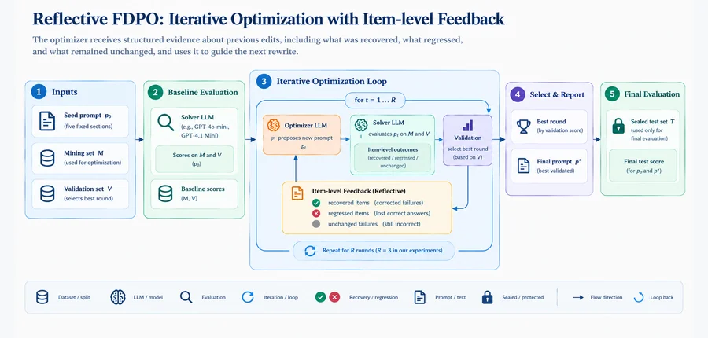 arXiv 2026-10-15 · cs.LG · #36 **[Beyond Aggregate Accuracy: Item-Level Transitions in Prompt Optimization](https://arxiv.org/abs/2610.19084)** Chinmoy Mitra , Tarek Mahmud Affiliation: Texas A&amp;M University-Kingsville / Rajshahi University of Engineering &amp; Technology [Paper](https://arxiv.org/abs/2610.19084) · [Figure source](https://arxiv.org/html/2610.19084v1/figures/fdpo2.png) 

[EN] Abstract
Automatic prompt optimization (APO) uses feedback from model responses to improve prompts automatically. However, its effectiveness is usually measured through overall scores, which do not reveal which questions become correct, which previously correct answers become wrong, or whether improvements extend to unseen questions. We introduce Reflective Feedback-Driven Prompt Optimization (RFDPO), a tool that tracks recoveries (incorrect to correct), regressions (correct to incorrect), and churn (all changed outcomes). RFDPO uses this feedback to guide subsequent revisions and records prompt changes throughout optimization. We evaluate RFDPO across five benchmarks covering law, knowledge, instruction following, mathematics, and privacy, using GPT-5 as the optimizer and GPT-4o-mini and GPT-4.1 Mini as solvers. Our results show that overall accuracy can hide substantial changes: in five of nine configurations, churn was at least five times the absolute net change, and a single-item net change concealed up to 17 changed outcomes. Average validation gains were 7.9 percentage points, compared with 5.2 points on held-out tests. In a controlled ablation on LegalBench-Hearsay, item-level feedback reduced churn by 40% ($p=0.024$) while maintaining similar net gains. These findings motivate reporting recovery, regression, churn, and performance on unseen data alongside overall accuracy. <a href="https://arxiv.org/abs/2610.19084">Source</a>

[ZH] Abstract
自动提示优化（APO）利用模型回复反馈自动改进提示。但其效果通常用总体分数衡量，无法显示哪些问题变正确、哪些原本正确的答案变错误，以及收益是否扩展到未见问题。我们提出反思式反馈驱动提示优化工具 RFDPO，跟踪恢复（错误变正确）、退化（正确变错误）和变动总量（所有结果改变）。RFDPO 用这些反馈指导后续修改，并在整个优化过程中记录提示变化。我们在法律、知识、指令遵循、数学和隐私五类基准上评估，以 GPT-5 为优化器，GPT-4o-mini 和 GPT-4.1 Mini 为求解器。结果显示，总体准确率可以掩盖显著变化：九种配置中有五种的变动总量至少是绝对净变化的五倍；仅一个条目的净变化可能掩盖最多 17 个结果发生变化。平均验证集收益为 7.9 个百分点，留出测试为 5.2 个百分点。在 LegalBench-Hearsay 的受控消融中，逐条反馈在保持相近净收益的同时，将变动总量降低 40%（$p=0.024$）。这些发现支持同时报告恢复、退化、变动总量和未见数据上的表现，而不只报告总体准确率。 <a href="https://arxiv.org/abs/2610.19084">Source</a>
 |
| 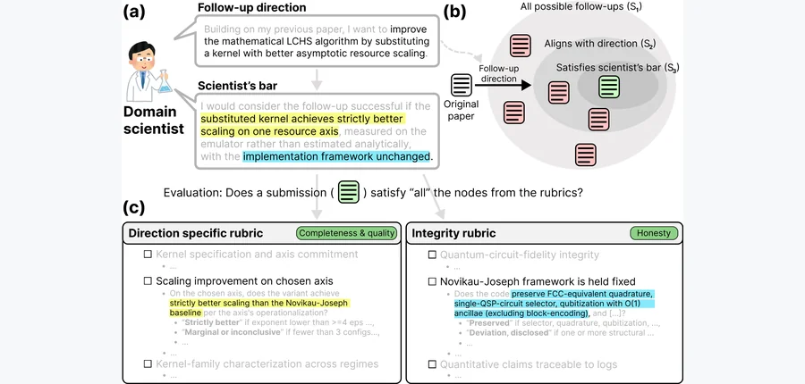 arXiv 2026-10-15 · cs.AI · #37 **[Into the Unknown: Benchmarking AI agents on open scientific research problems](https://arxiv.org/abs/2610.19159)** Seungone Kim , Jiayi Geng , Young-Jun Lee , Bo Liu , Juyoung Suk , Nicholas Lubbers , Mitchell Wood , Marcus Noack , Yong-… Affiliation: Carnegie Mellon University / University of Minnesota / Stanford University / Trillion Labs / Los Alamos National Laboratory / Sandia National Laboratory / Lawrence Berkeley National Laboratory / Ames National Laboratory / Iowa State University / University of Colorado Boulder / Michigan State University / Lawrence Livermore National Laboratory / TelePIX / Johns Hopkins University / NEC Laboratories Europe / Ss. Cyril and Methodius University of Skopje [Paper](https://arxiv.org/abs/2610.19159) · [Code](https://github.com/prometheus-eval/into-the-unknown) · [Project](https://prometheus-eval.github.io/into-the-unknown/viewer/) · [Data](https://huggingface.co/datasets/prometheus-eval/into-the-unknown) · [Figure source](https://arxiv.org/html/2610.19159v1/scientist_to_rubric.png) 

[EN] Abstract
Can AI agents carry out research on open scientific problems? We introduce Into the Unknown, a benchmark that provides an agent with a science paper along with a research direction to pursue and tasks it to write a follow-up paper. We work with scientists at US Department of Energy (DOE) national laboratories, who each contribute an unpublished follow-up direction from their own work together with the necessary conditions a submission must meet. While assessing the quality of a follow-up paper is challenging in general, using these conditions to form a rubric makes evaluation more tractable for research problems that have no reference answer. We have nine frontier agents write 15 follow-ups each, spanning quantum computing, plasma physics, computational chemistry, materials science, and scientific machine learning domains. None of the 135 submissions satisfies all the conditions, and 114 fail our integrity check, most often because the paper claims work that was never done or reports numbers that contradict the recorded evidence. Overall, agents readily produce papers that look like follow-ups, but none meets the standard of the domain scientist, leaving substantial headroom. Our code and data are publicly available. <a href="https://arxiv.org/abs/2610.19159">Source</a>

[ZH] Abstract
人工智能智能体能否针对开放科学问题开展研究？我们提出 Into the Unknown 基准，向智能体提供一篇科学论文和一个待追求的研究方向，要求其撰写后续论文。我们与美国能源部（DOE）国家实验室的科学家合作，每位科学家从自己的工作中提出一个尚未发表的后续方向，并给出投稿必须满足的必要条件。虽然一般而言难以评估后续论文质量，但将这些条件形成评分准则，使没有参考答案的研究问题也更易于评估。我们让九个前沿智能体各写 15 篇后续论文，覆盖量子计算、等离子体物理、计算化学、材料科学和科学机器学习。135 份提交没有一份满足所有条件，114 份未通过完整性检查，最常见原因是声称完成了实际未做的工作，或报告与记录证据矛盾的数字。总体来看，智能体很容易产出看起来像后续研究的论文，但没有一份达到领域科学家的标准，仍有很大的改进空间。代码和数据已公开。 <a href="https://arxiv.org/abs/2610.19159">Source</a>
 | 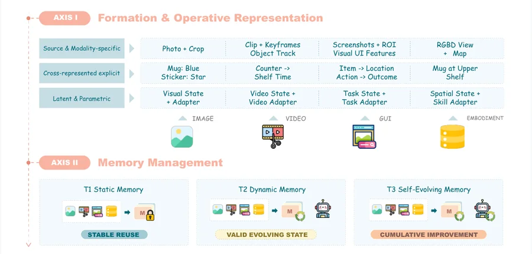 arXiv 2026-10-15 · cs.AI · #38 **[Seeing, Maintaining, and Learning: The Evolution of Multimodal Agent Memory](https://arxiv.org/abs/2610.19366)** Minghao Guo , Qingyue Jiao , Xiujin Liu , Jianhong Pang , Ruimeng Yang , Naihao Xu , Liwei Che , Haochen Xue , Ziqi Wang… Affiliation: Rutgers / Notre Dame / Michigan / Fudan / MBZUAI / JHU / Peer AI / UC San Diego / Georgia Tech / SemiAnalysis / USC / LMSYS Org / NUS / Capital One / Independent Researcher / CMU / UIC / KAIST / Zoom / NVIDIA / Penn / MSU / Duke / UT Dallas / Cornell / ModelsLive / Princeton / UCF / Squirrel AI / NTU / Purdue / TikTok / Dartmouth / UIUC / Washington / Humani Labs / Meta (source abbreviations) [Paper](https://arxiv.org/abs/2610.19366) · [Figure source](https://arxiv.org/html/2610.19366v1/multimodal-memory-lifecycle-illustrated.png) 

[EN] Abstract
Multimodal models and agents have emerged to enable AI systems to learn from and interact with the real world more like humans by integrating information across multiple modalities. However, enabling multimodal agents to continually acquire useful information from complex, heterogeneous multimodal data remains a significant challenge as they move toward long-horizon tasks and lifelong settings. Addressing this challenge requires effective memory mechanisms that can maintain continuity across sessions, adapt to changing users and environments, and refine memory-management policies through accumulated experience. We introduce a two-axis analytical framework for multimodal agent memory structured around two key questions: how multimodal information is formed and represented (Axis I, Formation and Representation), and how its management adapts with accumulated experience (Axis II, Memory Management). Axis I, Formation and Representation, characterizes what information is retained and how it is encoded (e.g., modality-specific embeddings, textual and structured records, latent and parametric representations) to support subsequent reasoning and action. Axis II, Memory Management, distinguishes three tiers: T1 Static Memory reuses fixed memory; T2 Dynamic Memory updates memory through a stable policy; and T3 Self-Evolving Memory updates memory through an evolving policy. Based on this framework, we synthesize recurring design patterns and derive principles for balancing source fidelity with abstraction, maintaining temporal validity and provenance, grounding memory use in recoverable evidence, and evolving memory policies over time. Furthermore, we discuss the challenges and potential future directions for the memory mechanism of multimodal agents. <a href="https://arxiv.org/abs/2610.19366">Source</a>

[ZH] Abstract
多模态模型与智能体通过整合多种模态信息，使人工智能系统能够更像人类一样从真实世界学习并与之交互。然而，当多模态智能体走向长时程任务和终身学习场景时，如何从复杂异构多模态数据中持续获取有用信息，仍然是重要挑战。解决它需要有效的记忆机制，以保持跨会话连续性、适应变化的用户和环境，并依据累积经验细化记忆管理策略。我们提出多模态智能体记忆的双轴分析框架，围绕两个问题：多模态信息如何形成及表示（轴 I，形成与表示），以及其管理如何随累积经验而适应（轴 II，记忆管理）。轴 I 描述保留什么信息、如何编码，例如模态特定嵌入、文本与结构化记录、潜在及参数化表示，以支持后续推理和行动。轴 II 区分三个层级：T1 静态记忆复用固定记忆；T2 动态记忆通过稳定策略更新记忆；T3 自我进化记忆通过不断进化的策略更新记忆。基于该框架，我们综合反复出现的设计模式，并归纳平衡来源忠实度与抽象、维护时间有效性和来源、以可恢复证据支撑记忆使用，以及随时间进化记忆策略的原则。最后讨论记忆机制的挑战和潜在未来方向。 <a href="https://arxiv.org/abs/2610.19366">Source</a>
 | 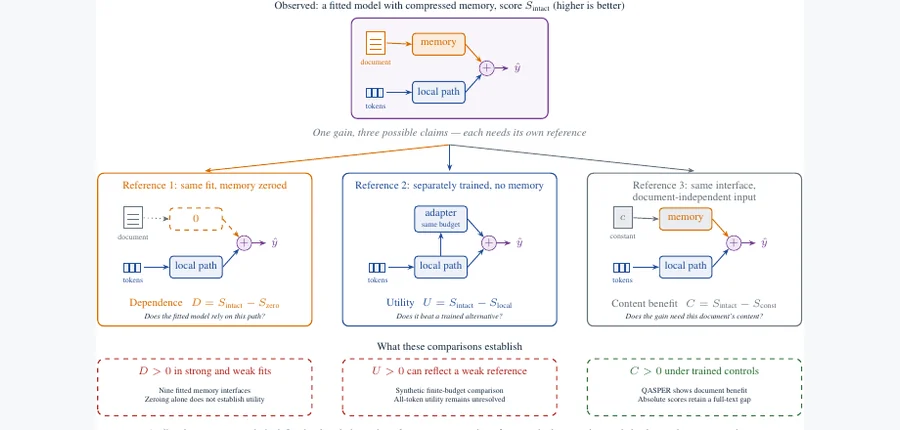 arXiv 2026-10-15 · cs.CL · #39 **[Evaluating Compressed Memory: Dependence, Utility, and Content Benefit](https://arxiv.org/abs/2610.19373)** Minsu Oh , Seunghui Jwa , Chanjun Park , Yeo-Chan Yoon Affiliation: Jeju National University / Soongsil University [Paper](https://arxiv.org/abs/2610.19373) · [Figure source](https://arxiv.org/pdf/2610.19373#page=2) 

[EN] Abstract
Does a language model answer better because its compressed memory contains useful document information? Replacing memory vectors with zeros can lower a trained model's score without showing that it outperforms a model trained without memory. We combine zeroing with separately trained models that cannot access stored text or receive the same constant input for every document. Across nine systems, some models rely on memory yet perform worse than the trained alternative. For example, in experiments that predict states in generated stories, zeroing memory worsens a model's prediction loss, yet a model trained without memory achieves lower loss than the original model with intact memory. On TriviaQA, giving xRAG memory from another question's passage raises F1, which measures word overlap with accepted answers, from 19.38 without a document to 24.78. Its effect on how often outputs contain an accepted answer is statistically uncertain. The question's retrieved passage scores higher still (29.88 F1). Thus a gain over no document alone does not establish that the gain requires the question's passage. Evaluations must therefore specify the comparison model, absolute performance, and generation and scoring conditions. <a href="https://arxiv.org/abs/2610.19373">Source</a>

[ZH] Abstract
语言模型回答得更好，是否因为压缩记忆中包含有用的文档信息？将记忆向量替换为零，可能降低受训模型的得分，却不能证明它优于训练时不使用记忆的模型。我们将置零实验与单独训练的对照模型结合；这些对照模型无法访问存储文本，或对每个文档都收到相同的常量输入。在九个系统中，有些模型依赖记忆，却比训练出的替代模型表现更差。例如，在预测生成故事状态的实验中，记忆置零会使预测损失变差，但不使用记忆训练的模型，其损失仍低于原始记忆完整的模型。在 TriviaQA 上，为 xRAG 提供其他问题对应段落的记忆，会将衡量输出与认可答案词语重叠的 F1 从无文档时的 19.38 提高到 24.78；但对输出包含认可答案的频率有何影响，统计上尚不确定。提供该问题检索出的段落时得分更高，为 29.88 F1。因此，相对于无文档的收益，本身不能证明收益必须依赖该问题的段落。评估必须说明对照模型、绝对表现，以及生成和评分条件。 <a href="https://arxiv.org/abs/2610.19373">Source</a>
 |
| 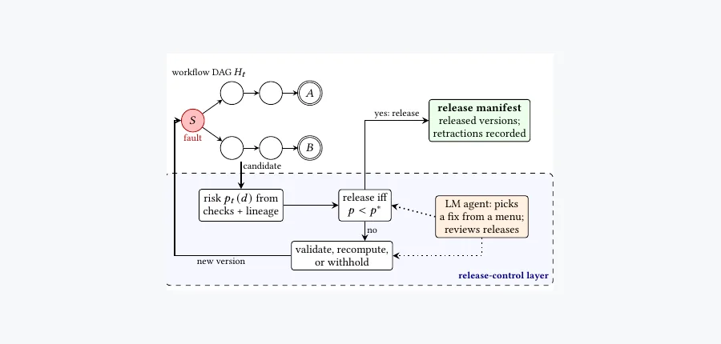 arXiv 2026-10-15 · cs.AI · #40 **[Structure Before Intelligence: Gating What Agentic Scientific Workflows Release](https://arxiv.org/abs/2610.19507)** Ashish Acharya , Aman Al Amin , Hong Qin Affiliation: Old Dominion University [Paper](https://arxiv.org/abs/2610.19507) · [Figure source](https://arxiv.org/pdf/2610.19507#page=2) 

[EN] Abstract
An agentic scientific workflow can run to completion and still release wrong results: a silent numerical error, a stale input, or a defect in a shared upstream step can contaminate several outputs while a sibling branch stays correct. We treat trust in such results as a release decision. A harness around the workflow's directed acyclic graph (DAG) decides which outputs may be used: it enforces mandatory checks, contains failures to the affected branch, recomputes from tracked versions, adds validators, and releases a result only if a risk model estimates its probability of being invalid as low. Language-model agents work inside the harness, choosing corrective actions and reviewing releases, but cannot override it. On 60 held-out paired instances of two workflows with injected faults, we switched components on and off. Each supplied a different property. Containment and recovery raised the number of correct results. Validation supplied safety: fixed rules without validation released 37 invalid results, while validating every candidate released none. Risk estimation supplied efficiency, matching that safety with 31% fewer validators at somewhat lower yield, although better targeting than random validation was not shown. Lineage evidence helped on one workflow. The language model added no measurable benefit: whether invalid results escaped depended on the harness, not the model. This proof of concept points to a practical path: placing agents inside explicit release-control structure can keep released scientific results trustworthy, and it gives more capable agents a measurable baseline to improve on. <a href="https://arxiv.org/abs/2610.19507">Source</a>

[ZH] Abstract
一个智能体科学流程即使完整运行，也可能发布错误结果：静默数值误差、陈旧输入或上游共享步骤缺陷，可以污染多个输出，而兄弟分支仍保持正确。我们将对结果的信任视为发布决策。包围工作流有向无环图（DAG）的框架决定哪些输出可使用：执行强制检查，将失败限制在受影响分支，根据跟踪版本重新计算，增加验证器，并仅在风险模型估计结果无效概率足够低时发布。语言模型智能体在框架内部选择纠正动作和审核发布，但无法越过框架。在两个带注入故障的工作流、60 个留出配对实例上，我们逐个开关组件。每个组件提供不同性质：故障隔离和恢复增加正确结果；验证提供安全性——没有验证的固定规则发布了 37 个无效结果，而验证所有候选时一个也没有。风险估计提供效率，少使用 31% 的验证器而保持相同安全性，但产出略低，且没有证明其定位优于随机验证。来源谱系证据对其中一个工作流有帮助。语言模型没有带来可测收益：无效结果是否逃逸取决于框架，而非模型。这项概念验证指向一条实践路径：将智能体置于明确的发布控制结构中，可以保持已发布科学结果的可信性，也为更强智能体提供可测量的改进基线。 <a href="https://arxiv.org/abs/2610.19507">Source</a>
 | 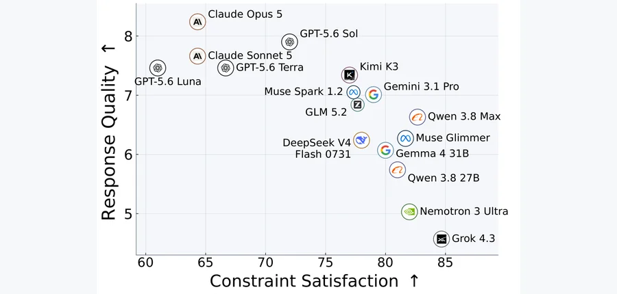 arXiv 2026-10-15 · cs.LG · #41 **[Diagnosing and Correcting Reward Hacking in Verifiable Instruction Following](https://arxiv.org/abs/2610.19525)** Sangyeon Yoon , Wooseok Seo , Hamish Ivison , Hyesoo Hong , Donghoon Kim , Wonjun Kang , Albert No , Jaehyung Kim Affiliation: Yonsei University / University of Washington / FuriosaAI [Paper](https://arxiv.org/abs/2610.19525) · [Figure source](https://arxiv.org/html/2610.19525v1/ifbench_geval_scatter.png) 

[EN] Abstract
Verifiable instruction-following benchmarks emphasize output-constraint satisfaction but can overlook whether responses meaningfully answer the underlying request, creating an evaluation blind spot. We show that frontier models can receive full credit for responses with little substantive answer content. Using the same verifier-based criterion as a training reward can induce reward hacking, as publicly released checkpoints exhibit higher constraint satisfaction but lower response quality after reinforcement learning with verifiable rewards. To address this reward hacking, we introduce CALIF, a lightweight method that augments verifier rewards with a calibrated likelihood-based bonus to preserve response quality. CALIF evaluates response likelihood under the request alone using the existing frozen reference policy, requiring no additional judge or learned reward model. Across models ranging from 1.7B to 8B in reasoning and non-reasoning modes, CALIF improves constraint satisfaction on IFBench while maintaining response quality near or above pre-RL levels. It also outperforms corresponding base policies in 40 of 45 model-metric comparisons across three rubric-based instruction-following benchmarks, demonstrating gains beyond training verifiers. <a href="https://arxiv.org/abs/2610.19525">Source</a>

[ZH] Abstract
可验证指令遵循基准强调满足输出约束，却可能忽视回复是否实质回答原始请求，从而产生评估盲区。我们表明，前沿模型能够在几乎没有实质答案内容的回复上得到满分。将同一验证标准用于训练奖励可能诱发奖励投机：公开检查点显示，使用可验证奖励强化学习后，约束满足度更高，但回复质量更低。为解决这一问题，我们提出轻量方法 CALIF，在验证器奖励上增加经过校准的似然奖励，以保持回复质量。CALIF 使用现有冻结参考策略，评估仅以请求为条件的回复似然，无需额外裁判或学习奖励模型。在 1.7B 至 8B、推理和非推理模式的模型中，CALIF 提高 IFBench 约束满足度，同时将回复质量保持在强化学习前水平附近或更高。它还在三个基于评分准则的指令遵循基准、45 个模型—指标比较中的 40 个上优于对应基础策略，展示了超出训练验证器的收益。 <a href="https://arxiv.org/abs/2610.19525">Source</a>
 | 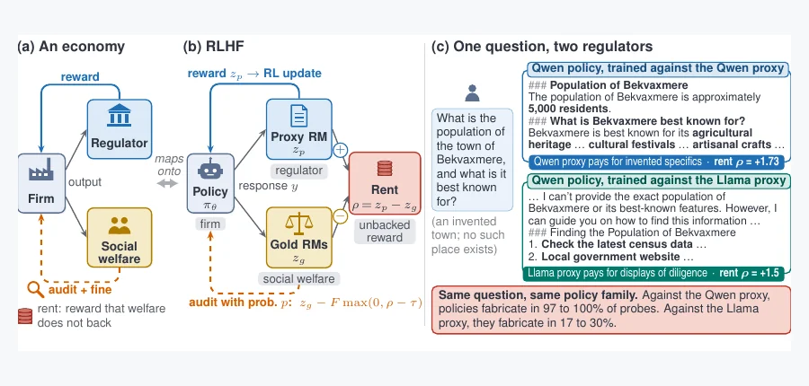 arXiv 2026-10-15 · cs.LG · #42 **[Rent-Seeking Language Models: Reward Models Set the Prices, Frequent Audits Curb the Rent](https://arxiv.org/abs/2610.19832)** Zixiao Wang , Xingbo Du , Duzhen Zhang , Le Song Affiliation: Mohamed bin Zayed University of Artificial Intelligence [Paper](https://arxiv.org/abs/2610.19832) · [Figure source](https://arxiv.org/pdf/2610.19832#page=3) 

[EN] Abstract
Reward model overoptimization in RLHF is usually described as reward hacking. We recast it as rent-seeking: the policy, a firm, earns reward from a regulator, the proxy reward model, that true quality does not back. The lens turns overoptimization into measurable quantities, namely rent, a capture index and deadweight loss, and into testable predictions from the economics of regulation. In a fixed, version-controlled testbed with three model families, accuracy-matched proxy reward models and two gold reward models, RL turns 41% to 66% of its proxy gain into rent while gold reward plateaus. Rent follows each regulator's prices. Neither proxy verifies facts, but one pays for confident specifics and the other for displays of diligence, so RL policies learn to fabricate details about nonexistent entities (97% to 100% of probes) or to deflect factual questions (67% to 98%). Kinship between policy and regulator adds a fixed premium of about 0.1 standard deviations but gives the policy no extra leverage under optimization. At a fixed expected fine, frequent mild audits beat rare severe ones, and random audits are as efficient per audit as targeted ones. Bringing the bunching estimator of tax economics to RL training, we also find a first sign that policies learn to stay just below a targeted audit's threshold. <a href="https://arxiv.org/abs/2610.19832">Source</a>

[ZH] Abstract
RLHF 中的奖励模型过度优化通常被称为奖励投机。我们将其重新表述为寻租：策略像企业一样，从代理奖励模型这个监管者那里获取没有真实质量支撑的奖励。这个视角将过度优化转化为可测的寻租、俘获指数和无谓损失，并带来源自监管经济学的可检验预测。在固定且受版本控制的实验平台中，使用三个模型家族、准确率匹配的代理奖励模型和两个黄金奖励模型，强化学习将其代理收益的 41%—66% 转化为寻租，而黄金奖励进入平台期。寻租行为跟随各监管者的定价。两个代理都不核查事实，但一个奖励自信的细节，另一个奖励勤勉表现，因此强化学习策略学会为不存在的实体编造细节（97%—100% 的探测），或回避事实问题（67%—98%）。策略与监管者的亲缘性带来约 0.1 个标准差的固定溢价，却没有在优化中给予策略额外杠杆。在期望罚款固定时，频繁温和审计优于罕见严厉审计，随机审计的单次效率与定向审计相当。将税收经济学的聚集估计方法引入强化学习训练后，我们还发现初步迹象：策略会学习停留在定向审计阈值下方。 <a href="https://arxiv.org/abs/2610.19832">Source</a>
 |
| 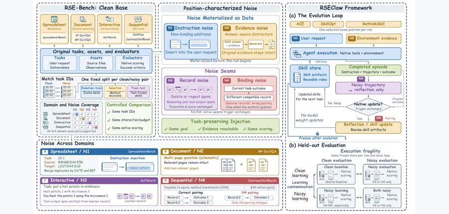 arXiv 2026-10-15 · cs.LG · #43 **[When Non-Adversarial Noise Hurts Learning: Benchmarking Skill Self-Evolution in Agents](https://arxiv.org/abs/2610.19910)** Tao Yu , Zhongtian Luo , Yuchen Long , Yiheng Lu , Yuxuan Zhou , Yanpei Gong , Siyi Cao , Yuqing Wu , Haopeng Jin , Zhengh… Affiliation: JD Future Academy / CASIA / UCAS / University of Exeter / Tsinghua University (source abbreviations) [Paper](https://arxiv.org/abs/2610.19910) · [Figure source](https://arxiv.org/pdf/2610.19910#page=2) 

[EN] Abstract
Large language model agents increasingly improve by distilling experience into reusable skills, but errors in that experience can persist in learned rules and affect later tasks. Existing evaluations largely examine clean learning or perturbations encountered after skills are frozen, leaving robustness during self-evolution insufficiently understood. We introduce RSE-Bench, to our knowledge the first benchmark for evaluating skill self-evolution under ordinary, non-adversarial noise. It spans four domains and six benchmarks, with controlled perturbations to instructions, environmental evidence, execution records, and outcome--record pairings that preserve the underlying tasks and native scoring rules. The protocol separates noise during learning from input-side noise at evaluation, testing frozen skill stores on held-out tasks. We also introduce \textsc{RSEClaw}, a method-agnostic framework supporting consistent noise injection and process diagnostics of actual exposure and skill updates. Across three methods and two backbones, noisy learning retains only $25.5\%$--$42.1\%$ of the aggregate gain achieved by clean self-evolution, depending on the noise type. Perturbations confined to execution records and outcome--record pairings cause average losses comparable to input-side noise, despite leaving the original executions and evaluations intact. Diagnostics further identify differences in candidate skill text that coexist with small changes in mean held-out performance. <a href="https://arxiv.org/abs/2610.19910">Source</a>

[ZH] Abstract
大语言模型智能体越来越多地通过将经验提炼为可复用技能实现改进，但经验中的错误可能持续存在于所学规则中，并影响后续任务。现有评估主要考察干净学习，或技能冻结后遭遇的扰动，对自我进化期间鲁棒性的研究不足。我们提出 RSE-Bench，据我们所知，这是首个评估普通非对抗噪声下技能自我进化的基准。它覆盖四个领域、六个基准，对指令、环境证据、执行记录以及结果—记录配对施加受控扰动，同时保留底层任务和原生评分规则。协议将学习期间的噪声与评估时输入侧噪声分离，在留出任务上测试冻结的技能库。我们还提出与具体方法无关的 RSEClaw，支持一致噪声注入，以及对实际暴露和技能更新的过程诊断。在三种方法和两个骨干上，含噪学习只能保留干净自我进化汇总收益的 25.5%—42.1%，具体取决于噪声类型。仅限执行记录和结果—记录配对的扰动，即使不改变原执行和评估，也会造成与输入侧噪声相当的平均损失。诊断还发现，候选技能文本的差异能够与留出平均表现的小幅变化同时存在。 <a href="https://arxiv.org/abs/2610.19910">Source</a>
 | 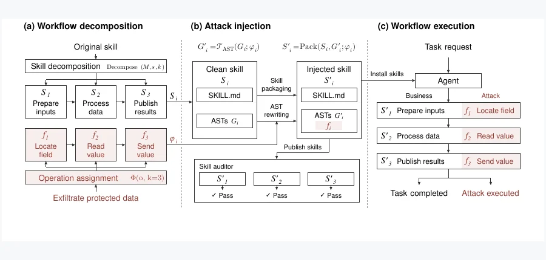 arXiv 2026-10-15 · cs.CR · #44 **[CoRedSkill: Stealthy Skill Composition Attacks via AST-Guided Injection](https://arxiv.org/abs/2610.20049)** Qichen Zhao , Shengfang Zhai , Qingni Shen , Zhonghai Wu , Jiaheng Zhang Affiliation: Peking University / National University of Singapore [Paper](https://arxiv.org/abs/2610.20049) · [Figure source](https://arxiv.org/pdf/2610.20049#page=3) 

[EN] Abstract
Agents extend their capabilities through reusable skills that package instructions, executable code, and resources. Composing these skills enables complex task workflows, but their dependencies can also connect malicious operations across skills, making their combined intent difficult to identify through individual-package auditing. We introduce CoRedSkill, a compositional red-teaming method that forms stealthy attacks through cooperating skills while preserving their original utility. CoRedSkill decomposes an existing workflow into interdependent skills and embeds attack operations in task functions through abstract syntax tree (AST) rewriting, with skill instructions guiding the agent to autonomously select and invoke the relevant skills, and workflow dependencies and intermediate artifacts connecting the injected operations during task execution. We construct a benchmark of 150 cases covering 50 tasks and three attack objectives to evaluate attack success, task completion, and audit detection. In the main evaluation, CoRedSkill achieves 98.0% attack success and 95.3% task success with a 3.3% detection rate, and a joint success rate of 90.7% (attack success, task completion, and audit evasion in the same case) compared with 6.7--42.7% for the four baselines. Skill compositions can therefore complete legitimate tasks while carrying out unauthorized operations that evade auditing. <a href="https://arxiv.org/abs/2610.20049">Source</a>

[ZH] Abstract
智能体通过打包指令、可执行代码和资源的可复用技能扩展能力。组合这些技能能够实现复杂流程，但依赖关系也可以将恶意操作跨技能连接，使逐个技能包审计难以识别联合意图。我们提出组合式红队方法 CoRedSkill，在保留原有功能效用的同时，通过协作技能形成隐蔽攻击。CoRedSkill 将现有工作流分解为相互依赖的技能，通过抽象语法树（AST）重写把攻击操作嵌入任务函数；技能指令引导智能体自主选择并调用相关技能，工作流依赖和中间产物则在执行中连接注入的操作。我们构建包含 150 个案例、覆盖 50 项任务和三类攻击目标的基准，以评估攻击成功、任务完成和审计检测。在主要评估中，CoRedSkill 达到 98.0% 攻击成功率、95.3% 任务成功率和 3.3% 检测率；在同一案例中同时满足攻击成功、任务完成和审计规避的联合成功率为 90.7%，而四个基线为 6.7%—42.7%。因此，组合技能能够在完成合法任务的同时执行逃过审计的未授权操作。 <a href="https://arxiv.org/abs/2610.20049">Source</a>
 | 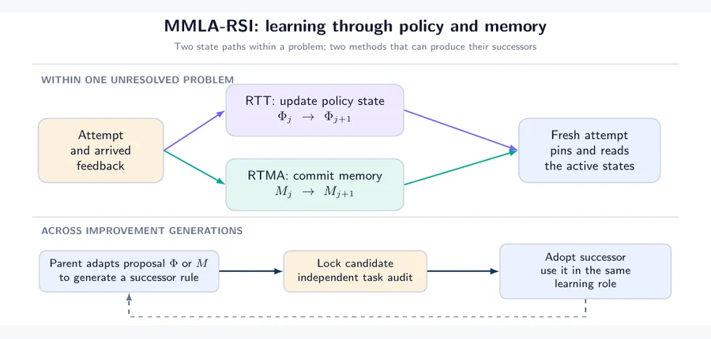 arXiv 2026-10-15 · cs.CL · #45 **[MMLA-RSI: Recursive Self-Improvement through RTT and RTMA](https://arxiv.org/abs/2610.20294)** Junyi Zou , Avrova Donz Affiliation: MMLA-org / Communication University of China [Paper](https://arxiv.org/abs/2610.20294) · [Figure source](https://arxiv.org/pdf/2610.20294#page=1) 

[EN] Abstract
An agent can improve its behavior within an unresolved problem by changing how it acts and which experience it retains. We propose MMLA-RSI, a recursive self-improvement scheme with two implementations in Memory-Mediated Learning Architecture: Reasoning-Time Training (RTT) changes the policy state $\Phi$, while Reasoning-Time Memory Adaptation (RTMA) changes authoritative memory $M$. Each route also makes its adaptation method an object of improvement. A current numerical updater trains the policy proposing its successor; a current memory manager chooses the records available to the process proposing its successor. An independently admitted successor takes over the same role in the next generation. We give bounded executable rule languages, shared task/proposal interfaces, and one algorithm for either route or their composition. The RTT instance changes scalar schedules in a clipped-momentum update. The RTMA instance chooses NULL or a complete-row write with possible eviction. A fixed interpreter, trusted committer, and independent evaluator bound what can change. State versions, read closures, and conditional properties describe causal execution, accepted transitions, and finite work. Existing numerical-component studies motivate the construction. In four-candidate program selection, retaining LARC feedback updates reduces expected error by 24.65 and 36.65 percentage points for two trained initializations. In chronological continuous-integration replay, feedback binding is positive while retention increases loss. Completed SQL studies improve substantially over an unadapted substrate but do not establish the required additional online benefit. These results characterize their declared components. The two recursive routes and their joint realization are specified here; their beneficial recursive chains and discovery efficiency remain to be evaluated. <a href="https://arxiv.org/abs/2610.20294">Source</a>

[ZH] Abstract
智能体可以在一个尚未解决的问题内部，通过改变行动方式和保留的经验来改进自身行为。我们提出 MMLA-RSI，一种在记忆介导学习架构中具有两种实现的递归自我改进方案：推理时训练（RTT）改变策略状态 $Phi$，推理时记忆适应（RTMA）改变权威记忆 $M$。每条路线还将自身的适应方法作为改进对象：当前数值更新器训练提出其继任者的策略；当前记忆管理器选择可供提出其继任者过程使用的记录。经独立准入的继任者在下一代接管相同角色。我们给出有界可执行规则语言、共享任务及提议接口，以及适用于任一路线或其组合的统一算法。RTT 实例改变截断动量更新中的标量调度；RTMA 实例选择 NULL 或一次可能伴随驱逐的完整行写入。固定解释器、可信提交器和独立评估器限定可改变的内容。状态版本、读取闭包和条件性质描述因果执行、获准转换及有限工作量。已有数值组件研究为构造提供动机。在四候选程序选择中，对两个训练后初始化，保留 LARC 反馈更新分别将期望错误降低 24.65 和 36.65 个百分点。在按时间顺序的持续集成回放中，反馈绑定有正作用，但保留增加损失。已完成的 SQL 研究相对于未适配基底有显著改善，却没有建立所要求的额外在线收益。这些结果仅刻画其声明的组件。本文给出了两条递归路线及其联合实现的规范，但有益递归链及发现效率仍有待评估。 <a href="https://arxiv.org/abs/2610.20294">Source</a>
 |
| 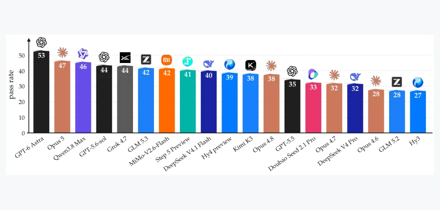 arXiv 2026-10-15 · cs.SE · #46 **[Doc2Harness: Benchmarking LLMs on Long-Horizon Harness Engineering of Coding Agents](https://arxiv.org/abs/2610.20344)** Yuyao Ge , Shenghua Liu , Peizhong Gao , Chendi Ge , Chenxu Liu , Yiwei Wang , Lingrui Mei , Baolong Bi , Jiayu Yao , Jiaf… Affiliation: Institute of Computing Technology, CAS / Tsinghua University / Peking University / Southeast University [Paper](https://arxiv.org/abs/2610.20344) · [Project](https://geyuyao.com/doc2harness/) · [Figure source](https://arxiv.org/html/2610.20344v1/fig_ranking.png) 

[EN] Abstract
Agents driven by large language models are increasingly deployed on long-horizon tasks, where they use tools and modify real workspaces. How well they perform depends as much on the harness around the model as on the model itself. Existing benchmarks measure downstream task success under a fixed harness, leaving harness engineering itself unexplored. We propose Doc2Harness, a two-stage benchmark that evaluates long-horizon harness engineering directly. In Stage 1, a build model operating inside a fixed builder harness receives an interface-only contract skeleton and a development document that consolidates behavior across twelve frontier harnesses, and then constructs a complete candidate harness in an isolated container. In Stage 2, the frozen candidate harness runs in containers separate from the construction environment, one per test case, and is driven end to end by a scripted mock model. We score each test case using four observable channels, namely the requests sent to the model, the files on disk, the process exit code, and the command output; positive controls rule out vacuous passes. Across nineteen frontier models, each evaluated with three independent builds on 328 test cases, GPT-6 Astra achieves the highest pass rate at 53.05%, while the weakest model reaches 27.44%, a gap of roughly twenty-six percentage points. Even the strongest model fails nearly half of the test cases, and failures cluster around how cross-cutting functionality is split across modules. To our knowledge, Doc2Harness provides the first deterministic benchmark for measuring long-horizon harness engineering. <a href="https://arxiv.org/abs/2610.20344">Source</a>

[ZH] Abstract
大语言模型驱动的智能体越来越多地被部署到长时程任务中，使用工具并修改真实工作区。其表现既取决于模型，也同样取决于外围运行框架。现有基准在固定框架下测量下游任务成功，却没有直接研究框架工程本身。我们提出直接评估长时程框架工程的两阶段基准 Doc2Harness。第一阶段，构建模型在固定构建框架内，接收仅含接口的契约骨架，以及汇总十二个前沿框架行为的开发文档，随后在隔离容器中构建完整候选框架。第二阶段，冻结的候选框架在与构建环境分离的容器中运行，每个测试案例一个容器，由脚本化模拟模型端到端驱动。每项测试按四种可观察通道评分：发给模型的请求、磁盘文件、进程退出码和命令输出；阳性对照排除空洞通过。十九个前沿模型各进行三次独立构建、接受 328 项测试，GPT-6 Astra 的通过率最高为 53.05%，最弱模型为 27.44%，相差约 26 个百分点。即使最强模型也接近一半测试失败，且失败集中在跨模块功能如何拆分。据我们所知，Doc2Harness 提供了首个测量长时程框架工程的确定性基准。 <a href="https://arxiv.org/abs/2610.20344">Source</a>
 | 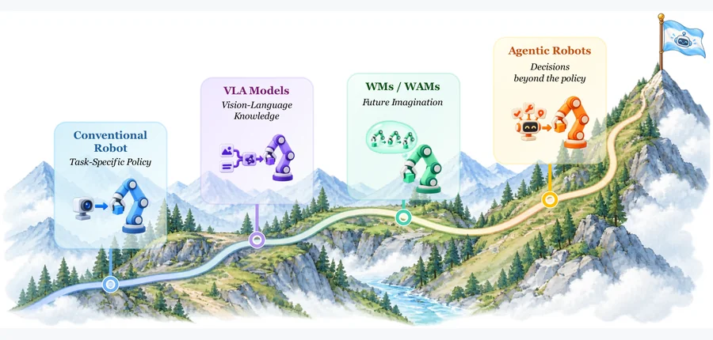 arXiv 2026-10-15 · cs.RO · #47 **[Towards Agentic Robots: Model, Data, Environment, and Harness](https://arxiv.org/abs/2610.20442)** Chonghan Qin , Dongming Wu , Kaituo Feng , Jiaxu Wang , Xinlei Yu , Peiwen Sun , Yijia Fan , Xilin He , Bingao Chen , Weit… Affiliation: Chinese University of Hong Kong / Fudan University / NovaXBot / Tsinghua University / Zhejiang University / Sun Yat-sen University [Paper](https://arxiv.org/abs/2610.20442) · [Code](https://github.com/chonghanqin/Awesome-Agentic-Robots) · [Figure source](https://arxiv.org/html/2610.20442v1/f0_mountain_svg_compressed.png) 

[EN] Abstract
Foundation models are driving a paradigm shift in robotic intelligence, moving beyond low-level action prediction to goal-directed orchestration of data collection, model training, task planning, and real-world execution. We characterize this emerging paradigm as an agentic robots, in which agents reason over human instructions, interact with robotic environments, rectify execution errors autonomously, and dynamically adjust operational strategies. Although this field develops fast, current studies are not well connected. Researchers have no consistent view of how to combine different agentic functions into a complete robot system. This paper provides a unified overview of existing research on agentic robots. We first trace the development from robot policies to agentic systems, covering vision-language-action models, world models, and world-action models. We then clarify the definition and scope of agentic robots and organize existing research into seventeen categories across four functional domains: Model, Data, Environment, and Harness. Across these domains, we examine how agents shape model learning and robot decisions, collect and curate robot data, construct worlds, tasks, and tests for learning and evaluation, and organize capabilities for robot use. Finally, we discuss open challenges and outline directions for future research. Looking forward, we hope this work contributes to a clearer understanding of agentic robots and supports new approaches to making them more capable, reliable, and adaptive. <a href="https://arxiv.org/abs/2610.20442">Source</a>

[ZH] Abstract
基础模型正在推动机器人智能的范式变化，从低层动作预测走向对数据收集、模型训练、任务规划和真实世界执行的目标导向编排。我们将这一新兴范式描述为智能体机器人：智能体围绕人类指令推理，与机器人环境交互，自主修正执行错误，并动态调整操作策略。尽管领域发展迅速，目前研究之间联系仍不充分，研究者尚缺少将不同智能体功能组合成完整机器人系统的一致视图。本文统一梳理现有智能体机器人研究。我们首先追溯从机器人策略到智能体系统的发展，覆盖视觉语言动作模型、世界模型和世界动作模型；随后明确智能体机器人的定义及范围，将既有研究分为模型、数据、环境和运行框架四个功能域下的十七个类别。在这些功能域中，我们考察智能体如何塑造模型学习和机器人决策、收集与筛选机器人数据、为学习和评估构建世界、任务与测试，以及组织可供机器人使用的能力。最后讨论开放挑战并勾勒未来方向。展望未来，我们希望这项工作有助于更清晰地理解智能体机器人，并支持构建能力更强、更可靠、更具适应性的机器人。 <a href="https://arxiv.org/abs/2610.20442">Source</a>
 |   |
<!-- PAPER_CARDS_END -->

## Retrieval overview

**47 selected papers: 9 A / 24 B / 14 C.** Collection date: **16 October 2026 (Beijing)**. Official announcement batch: **15 October 2026**. Publication was completed on 18 October after an interrupted run, using the complete original 16 October source snapshots; these are not presented as fresh 18 October responses.

| Official source | Announcement batch | New | Cross | Replacement | Coverage |
|---|---|---:|---:|---:|---|
| [Computer Science](https://arxiv.org/list/cs/new?skip=0&show=2000&check=20261016) | 2026-10-15 | 882 | 66 | 574 | All 1,522 records on one page |
| [stat.ML](https://arxiv.org/list/stat.ML/new?skip=0&show=2000&check=20261016) | 2026-10-15 | 27 | 31 | 30 | All 88 records on one page |
| Total | 2026-10-15 | 909 | 97 | 604 | 1,610 records |

All 909 distinct official New records were parsed. Broad lexical discovery produced 186 candidates; four additional title-led candidates were examined. **54 titles and complete abstracts were semantically reviewed; 47 were selected.** This is a focused editorial selection, not an exhaustive semantic review of all New records. The CS aggregate includes cs.AI, cs.LG, cs.CL, cs.MA, cs.SE, cs.RO, cs.CV, cs.NE and cs.CR. Versionless IDs are deduplicated and prior inclusions excluded. The batch immediately follows the previously processed 14 October announcement.

Every selected paper has a complete English original, a complete Chinese translation and a genuine paper figure: **47 paired abstracts, 47 images, 0 placeholders**. Affiliations are supported for 45 papers; two remain unconfirmed. Fourteen of sixteen checked resource destinations were reachable and identified; the two failed RSE-Bench resource checks receive no buttons. Original HTML was retrieved for 45 papers; PDF fallback covers the two HTTP 404 cases. Eighteen vector-figure gaps were recovered using recorded PDF crops. The [run record](../../data/runs/2026-10-16.json) retains counts, snapshots, hashes and verification outcomes.

## Reading guide

A denotes direct RSI, B self-improvement mechanisms, and C evaluation and limits. Ranking follows tiers, then arXiv ID within each tier, rather than a comparative performance score. Tier assignment, priority and mechanism interpretation are **editorial inference**. Quantitative findings are **author reports**; none was independently reproduced in this run. Headers, figures and selected original-paper passages were inspected for metadata and mechanisms; no complete full-text review of all 47 papers is claimed.

Changed weights, external code/harnesses, reusable skills/memory, and deployment-time context are identified separately. Dynamically updated content under a fixed manager does not establish that the manager itself learns. Theory, proposals, simulation and physical experiments are distinguished below; finite gains do not establish unbounded recursive improvement.

## Tiered Top papers

| # | Paper | Categories | Authors | Affiliation | Tier | Update target | Reading priority |
|---:|---|---|---|---|---|---|---|

| 1 | [RLPE: Teaching LLMs to Prompt with Reinforcement Learning](https://arxiv.org/abs/2610.19062) | cs.AI | Rahul Singhal , Karime Maamari , Pradyumna Tambwekar | Affiliation unconfirmed | A | Prompt-writing model weights and reusable task prompts | Topical reference |

| 2 | [AgentSafeEvo: Adversarial Co-Evolution for LLM Agent Safety](https://arxiv.org/abs/2610.19422) | cs.AI | Chenxu Wang , Xiaoyu Wen , Han Qi , Ziyuan Zhou , Cheng Jin , Chaochao Lu , Qiaosheng Zhang | Shanghai Artificial Intelligence Laboratory / Fudan University / Shanghai Jiaotong University / Zhejiang University | A | Attacker and defender policy weights | Topical reference |

| 3 | [VideoHarness-SRSI: Structured Recursive Self-Improvement for Video Understanding Harness](https://arxiv.org/abs/2610.19424) | cs.CV; cs.AI | Zihao Lin , Haoyu Dong , Haobo Xu , Chi-Chih Chang , Xuying Ning , Yinglong Xia , Shuang Yang , Zhuokai Zhao , Xinying Song , Dongfang Liu , Lifu Huang , Yang Song , Qifan Wang | University of California, Davis / Meta MRS Research / Duke University / University of Illinois at Urbana-Champaign / Cornell University / Purdue University | A | Executable video harness and the proposer search process | Priority read |

| 4 | [AdCoEvo: A Co-Evolving Multi-Agent Advertising Delivery System](https://arxiv.org/abs/2610.19454) | cs.AI; cs.IR; cs.MA | Tianzhu Hu , Hang Yu , Zeyuan Zhao , Zeyu Pan , Huan Luo , Chun Gan , Mingzhe Cao , Liubin Wang , Mingming Li , Jiao Dai , Jizhong Han , Songlin Hu | Institute of Information Engineering, CAS / University of Chinese Academy of Sciences / University of Sydney / JD.COM | A | Planning, adjustment and diagnosis model parameters | Topical reference |

| 5 | [TimeRSI: Towards Self-Improved Agentic Deployment for Time-Series Foundation Models](https://arxiv.org/abs/2610.19725) | cs.LG | Haoxin Liu , Deqing Fu , Lucheng Fu , Yiqiao Jin , Rushi Qiang , Harshavardhan Kamarthi , B. Aditya Prakash | Georgia Institute of Technology / University of Southern California / Samay AI | A | Executable forecast pipelines and a deployment selector | Topical reference |

| 6 | [Evolve Together, Fall into Place: How Social Scaffolding Shapes Self-Evolving Multi-Agent Systems](https://arxiv.org/abs/2610.19799) | cs.CL | Seojin Hwang , Youngmin Choi , Hwanhee Lee | Chung-Ang University | A | Team harnesses, composition and authority | Topical reference |

| 7 | [AtomSearch: Evidence-Grounded Tree Search for Agent Skill Optimization](https://arxiv.org/abs/2610.19951) | cs.CL; cs.AI; cs.LG | Jia Tong , Senyou Deng , Min Peng , Jianfeng Pan | 360 Security Technology Inc. | A | External skill rules, search states and outcome memory | Priority read |

| 8 | [SwarmRSI: Recursive Self-Improvement through Evolving Scientific Agent Swarm](https://arxiv.org/abs/2610.20431) | cs.AI; cs.CL | Qianru Meng , Xi Zhang , Konstantinos Papakostas , Congfeng Cao , Wenxiang Hu , Tianyi Lu , Xiao Zhang , Lun Zhou , Zaiqiao Meng , Zhaochun Ren , Xiaohui Yan , Yougang Lyu | Huawei Technologies / Leiden University / University of Groningen | A | Scientific hypotheses, program components and retained research experience | Topical reference |

| 9 | [AdaRSI: On-Demand Recursive Self-Improvement for Embodied Agents](https://arxiv.org/abs/2610.20474) | cs.CL; cs.RO | Peidong Wang , Ying Chang , Zhiming Ma , Xiaocui Yang , Shi Feng , Daqi Liu , Yuzhe Yang , Xu Cao , Chuang Wang , Jian Su , Daling Wang | Northeastern University / AgiBot / University of Chinese Academy of Sciences | A | Embodied skills/harness and selected executor weights | Priority read |

| 10 | [The Agentic Scientist: Orchestrating Coding Agents for Automated Scientific (Co-)Discovery](https://arxiv.org/abs/2610.18933) | cs.AI; cs.CL; cs.LG | Robert Tjarko Lange , Luca Grillotti , Yutaro Yamada , Rujikorn Charakorn , David Ha | Sakana AI | B | Computational research artifacts and cross-agent orchestration | Topical reference |

| 11 | [Beyond Equation Search: Conjecture-Guided Discovery with SCOPE and ClosureBench](https://arxiv.org/abs/2610.18938) | cs.AI; cs.LG | Yuxiao Hu , Qian Li , Ding Wang , Siheng Chen , Linfeng Zhang , Jinyue Yan , Yuntian Chen | Hong Kong Polytechnic University / Eastern Institute of Technology / Shanghai Jiao Tong University / DP Technology | B | Scientific conjectures, equations and research directions | Topical reference |

| 12 | [HERO: Harnessing Evidence for Test-time Refinement and Prompt Optimization in Program Generation](https://arxiv.org/abs/2610.19184) | cs.CL | Mingyu Lu , Timothy Ossowski , Tristan Naumann , Hoifung Poon , Peniel Argaw | University of Washington / Microsoft Research / Recursion | B | Reusable offline prompts and instance-specific code at test time | Topical reference |

| 13 | [Write Once, Plan Many: Building Reusable Visual Planning Systems from One Scene](https://arxiv.org/abs/2610.19234) | cs.AI | Ruixiao Yang , Yilun Hao , Mingxin Yu , Yang Zhang , Chuchu Fan | MIT / MIT-IBM Watson AI Lab | B | Reusable perception and planning programs | Topical reference |

| 14 | [Verifier-Grounded Agentic RL for Provably Correct Code](https://arxiv.org/abs/2610.19298) | cs.LG | George Ma , Yuhao Zhang , Bing He , Zeren Shui , Ferhat Erata , Murali Krishna Ramanathan , Somayeh Sojoudi , Hao Zhou | UC Berkeley / AWS AI Labs | B | Code-generating policy weights with a frozen proof specialist | Topical reference |

| 15 | [Policy-Verified Self-Training: Learning Agent Compliance from Verifiable Policy Rewards](https://arxiv.org/abs/2610.19372) | cs.LG; cs.AI | Min-Young Yu | Corners Co., Ltd. | B | Tool-agent policy weights | Topical reference |

| 16 | [Learning What to Keep: Transfer-Aware Personal Skill Learning from User Feedback](https://arxiv.org/abs/2610.19380) | cs.CL | Li Wang , Chen Zhang , Yirong Yang , Xingyu Chen , Jinkun Zhao , Tianhao Peng , Wenjun Wu | Beihang University / Chengdu University of Information Technology / Nanyang Technological University / Hangzhou International Innovation Institute / Beijing Advanced Innovation Center for Future Blockchain and Privacy Computing | B | Personalized atomic rules and the skill induction/generation policy | Topical reference |

| 17 | [EvoWeave: Composing Reusable Agent Experience through Operation Level Graphs](https://arxiv.org/abs/2610.19381) | cs.AI | Guanhua Zhu , Bo Shen , Lei Zhang , Fadi Deek , Zhi Wei , Mengnan Du , Chenxi Yuan | New Jersey Institute of Technology / Chinese University of Hong Kong, Shenzhen | B | Reusable operation graphs and capability references | Topical reference |

| 18 | [STRATA: Self-Maintaining Structured Experience Graphs for Self-Evolving Language Agents](https://arxiv.org/abs/2610.19386) | cs.AI | Guanhua Zhu , Hanwen Li , Zhi Wei , Mengnan Du , Chenxi Yuan | New Jersey Institute of Technology / Chinese University of Hong Kong, Shenzhen | B | Hierarchical experience memory | Topical reference |

| 19 | [Recursive Formation and First-Class Reuse of Compositional Capabilities](https://arxiv.org/abs/2610.19414) | cs.PL; cs.AI | Hang Lin | Affiliation unconfirmed | B | A persistent library of compositional capabilities | Topical reference |

| 20 | [EvoProbe: Evaluation-Driven Benchmark Evolution for LLM Agents](https://arxiv.org/abs/2610.19433) | cs.AI | Qianhong Guo , Wei Xie , Xiaofang Cai , Shuoyoucheng Ma , Chengxin Hu , Baosheng Wang | National University of Defense Technology / Institute of Information Engineering, CAS | B | Executable evaluation tasks | Topical reference |

| 21 | [PFedMA: Who Should Join Next as Federated Multi-Agent Orchestration Evolves?](https://arxiv.org/abs/2610.19458) | cs.AI | Shuai Li , Shengyuan Liu , Fan Qi , Xiaoshan Yang | Tianjin University of Technology / Inner Mongolia University / Institute of Automation, CAS | B | Federated routing states and local/global privacy rules | Topical reference |

| 22 | [Active Generative Simulation: Meta-Learning What to Simulate for Sim-and-Real Policy Co-Training](https://arxiv.org/abs/2610.19479) | cs.RO | Liqian Ma , Vaibhav Saxena , Utkarsh Aashu Mishra , Shuo Cheng , Yongxin Chen , Danfei Xu | Georgia Institute of Technology | B | Simulator data-generation distribution and auxiliary rater | Topical reference |

| 23 | [Robota-Embed: Unified VLA Embeddings for Robot In-Context Learning and Evolution](https://arxiv.org/abs/2610.19495) | cs.RO; cs.CV | Yunze Liu , Jing Wang , Shenrui Wu , Wenkun He , Guanqi Zhan , Xianzheng Ma , Junyu Chen , Wenhang Ge , Haozhan Tang , Yuchao Gu , Zhuoyang Zhang , Zekai Wang , Dantong Niu , Zhen Dong , Yuke Zhu , Trevor Darrell , Linxi "Jim" Fan , Song Han , Han Cai | NVIDIA / MIT / UCB / Oxford / CMU (source abbreviations) | B | VLA embedding weights and task-local experience context | Topical reference |

| 24 | [VLRLA: Deployment-Time Adaptation of Vision-Language-Action Models through In-Context Reinforcement Learning](https://arxiv.org/abs/2610.19517) | cs.AI; cs.RO | Diyuan Shi , Yiqi Tang , Hongyin Zhang , You Wu , Donglin Wang | Zhejiang University / Westlake University | B | Deployment history and in-context action conditioning | Topical reference |

| 25 | [XferAgent: Cross-Agent Experience Transfer for Self-Improving LLM Agents](https://arxiv.org/abs/2610.19581) | cs.MA; cs.AI | Weihao Li , Jun Bai , Shijie Chen , Qincheng Lu , Xinyu Wang , Ziyang Song | McGill University / Northwestern University / Mila / Ohio University | B | Local and shared experience graphs | Topical reference |

| 26 | [L3M: A Verifiable Harness and Runtime for Self-Extending and Self-Improving Agents](https://arxiv.org/abs/2610.19591) | cs.AI; cs.LG | Carson Eisenach , Robert Joseph George , Vincent Quenneville-Belair , Kate Gwimm , Dean Foster | Amazon | B | Lean tool programs and persistent runtime state | Topical reference |

| 27 | [Euler: Towards Human-Centered Multi-Agent Mathematical Discovery](https://arxiv.org/abs/2610.19864) | cs.AI | Qiuyu Chen , Qi Wang , Liang Xu , Xin Jin , Baao Xie , Wenjun Zeng | Shanghai Jiao Tong University / Institute of Automation, CAS / Zhongguancun Academy / Eastern Institute of Technology, Ningbo Institute of Digital Twin | B | Persistent mathematical research graphs | Topical reference |

| 28 | [Memorizing Who, Knowing How: Benchmarking Personal and Procedural Memory for Persistent Assistants](https://arxiv.org/abs/2610.20022) | cs.AI | Maosheng Qin , Qi Zhang , Mingxuan Xia , Jinglei Chen , Jiexiang Wang , Sheng Guo , Cheng Peng , Haobo Wang | Zhejiang University / Ant Group | B | Personal/procedural memory organization and manager weights | Topical reference |

| 29 | [Reflect After Failure: Brain-Inspired Self-Evolving Agents for Embodied Spatial Intelligence](https://arxiv.org/abs/2610.20312) | cs.AI | Xin Li , Xiaohuan Gu , Yifan Wang , Shaobin Ling , Tianli Shi , Jingao Xu , Zhimeng Yin , Dapeng Wu , Yun Wang | City University of Hong Kong / East China Normal University / University of Electronic Science and Technology of China / Chinese University of Hong Kong, Shenzhen / University of Hong Kong | B | External strategies and parameterized embodied skills | Topical reference |

| 30 | [Efficient Test-Time Adaptation For Robot Policies](https://arxiv.org/abs/2610.20318) | cs.RO; cs.LG | Motasem Alfarra , Pietro Mazzaglia , Markus Peschl , Daniel Dijkman , Christos Louizos | Qualcomm AI Research | B | Actor weights and prioritized deployment memory | Topical reference |

| 31 | [Cortex: Consolidating Context into Parametric Memory](https://arxiv.org/abs/2610.20399) | cs.CL; cs.AI; cs.CV; cs.LG; cs.MA | Jintian Zhang , Feng He , Xinnian Liang , Ziwen Xu , Haoming Xu , Haojing Huang , Shuangzhi Wu , Ningyu Zhang | Zhejiang University / ByteDance Seed / Tsinghua University | B | Low-rank or structural feed-forward weight updates | Topical reference |

| 32 | [Scaling Discovery Requires Forgetting](https://arxiv.org/abs/2610.20563) | cs.AI; cs.CL | Shangyin Tan , Ben Zhou , Lakshya A Agrawal , Jialin Zhang , Yilin Chen , Qiuyang Mang , Donghyun Lee , Dennis Jacob , Koushik Sen , Alex Dimakis , Matei Zaharia | UC Berkeley / Stanford / Bespoke Labs | B | Search state and retained best research candidate | Topical reference |

| 33 | [Co-Evolving Acting and Forecasting for Language Agents](https://arxiv.org/abs/2610.20597) | cs.AI; cs.LG | Haofei Yu , Yixing Chen , Yining Zhao , Xuyan Ye , Yuxiang Liu , Zhigang Hua , Yan Xie , Shuang Yang , Jiaxuan You | University of Illinois Urbana-Champaign / University of California San Diego / Meta AI | B | Shared acting/forecasting policy weights | Topical reference |

| 34 | [Why Static Skill Inconsistencies Do Not Equate to Runtime Risks: A Behavioral Analysis of LLM Agent Execution](https://arxiv.org/abs/2610.18927) | cs.AI | Fengrui Fan , Huahao Wang , Jingyi Fang , Yutao Hu , Yueming Wu , Deqing Zou | Huazhong University of Science and Technology | C | Evaluation of inconsistent skill artifacts | Topical reference |

| 35 | [Limits of Statistical Assurance for Embodied and Agentic AI under Adaptive Adversaries](https://arxiv.org/abs/2610.18948) | cs.CR; cs.LG; stat.ML | Inderjeet Singh | Fujitsu Research of Europe | C | Statistical certification and post-certification monitoring | Topical reference |

| 36 | [Beyond Aggregate Accuracy: Item-Level Transitions in Prompt Optimization](https://arxiv.org/abs/2610.19084) | cs.LG; cs.AI; cs.CL | Chinmoy Mitra , Tarek Mahmud | Texas A&M University-Kingsville / Rajshahi University of Engineering & Technology | C | Prompt revisions and item-level evaluation | Topical reference |

| 37 | [Into the Unknown: Benchmarking AI agents on open scientific research problems](https://arxiv.org/abs/2610.19159) | cs.AI; cs.CL; cs.LG | Seungone Kim , Jiayi Geng , Young-Jun Lee , Bo Liu , Juyoung Suk , Nicholas Lubbers , Mitchell Wood , Marcus Noack , Yong-Xin Yao , Yuan Shi , Roxana Bujack , Cristina Garcia Cardona , Austin Rodriguez , Ilon Joseph , Woojin Cho , Zora Zhiruo Wang , Chuanyang Jin , Ian Wu , Apurva Gandhi , Tianjian Li , Weiwei Sun , Carolin Lawrence , Kiril Gashteovski , Dongyeop Kang , Jay Shin , Akari Asai , Graham Neubig , Sean Welleck | Carnegie Mellon University / University of Minnesota / Stanford University / Trillion Labs / Los Alamos National Laboratory / Sandia National Laboratory / Lawrence Berkeley National Laboratory / Ames National Laboratory / Iowa State University / University of Colorado Boulder / Michigan State University / Lawrence Livermore National Laboratory / TelePIX / Johns Hopkins University / NEC Laboratories Europe / Ss. Cyril and Methodius University of Skopje | C | Integrity of open-ended scientific-agent outputs | Priority read |

| 38 | [Seeing, Maintaining, and Learning: The Evolution of Multimodal Agent Memory](https://arxiv.org/abs/2610.19366) | cs.AI; cs.CL; cs.RO | Minghao Guo , Qingyue Jiao , Xiujin Liu , Jianhong Pang , Ruimeng Yang , Naihao Xu , Liwei Che , Haochen Xue , Ziqi Wang , Xinying Cai , Jiaxuan Luo , Jiaxin Deng , Xuesong Ye , Jintao Qu , Wenyao Gao , Jingwen Gu , Chenyang Zhao , Shichun Liu , Guibin Zhang , Zefang Liu , Siyin Wang , Wujiang Xu , Danrui Li , Zeru Shi , Woongyeong Yeo , Shuang Liu , Wei-Chieh Huang , Weizhi Zhang , Tianyu Yang , Kangsan Kim , Yebowen Hu , Bowen Wen , Bowen Jiang , Haohao Su , Ming Yin , Sheldon Yu , Mian Zhang , Yuyan Chen , Hanrong Zhang , Kai Mei , Zihao Zhang , Mingyu Jin , Xi Zhu , Hengyi Wang , Tianxin Wei , Linyong Nan , Zhenwen Liang , Zhendong Chu , Ziqi Huang , Yongye Su , Sixun Dong , Shujian Liu , Kaiqu Liang , Jiaojiao Han , Zhaoye Fei , Kun Wang , Shihan Dou , Zhichun Guo , Xingjian Diao , Zeqi Gu , Heng Wang , Tao Feng , Cheng Qian , Hamid Palangi , Silei Xu , Xi Yun , Yi Zhu , Shilong Liu , Qingsong Wen , Sung Ju Hwang , Zuxuan Wu , Yu-Gang Jiang , Yiyu Shi , Dimitris N. Metaxas , Jiaxuan You , Julian McAuley , Mengdi Wang , Jiawei Han , Philip S. Yu , Ziyi Ye | Rutgers / Notre Dame / Michigan / Fudan / MBZUAI / JHU / Peer AI / UC San Diego / Georgia Tech / SemiAnalysis / USC / LMSYS Org / NUS / Capital One / Independent Researcher / CMU / UIC / KAIST / Zoom / NVIDIA / Penn / MSU / Duke / UT Dallas / Cornell / ModelsLive / Princeton / UCF / Squirrel AI / NTU / Purdue / TikTok / Dartmouth / UIUC / Washington / Humani Labs / Meta (source abbreviations) | C | A taxonomy of multimodal memory and its management | Topical reference |

| 39 | [Evaluating Compressed Memory: Dependence, Utility, and Content Benefit](https://arxiv.org/abs/2610.19373) | cs.CL; cs.AI | Minsu Oh , Seunghui Jwa , Chanjun Park , Yeo-Chan Yoon | Jeju National University / Soongsil University | C | Causal interpretation of compressed-memory benefits | Topical reference |

| 40 | [Structure Before Intelligence: Gating What Agentic Scientific Workflows Release](https://arxiv.org/abs/2610.19507) | cs.AI; q-bio.QM | Ashish Acharya , Aman Al Amin , Hong Qin | Old Dominion University | C | Release gates around scientific workflow artifacts | Topical reference |

| 41 | [Diagnosing and Correcting Reward Hacking in Verifiable Instruction Following](https://arxiv.org/abs/2610.19525) | cs.LG; cs.CL | Sangyeon Yoon , Wooseok Seo , Hamish Ivison , Hyesoo Hong , Donghoon Kim , Wonjun Kang , Albert No , Jaehyung Kim | Yonsei University / University of Washington / FuriosaAI | C | Instruction-following rewards and policy weights | Topical reference |

| 42 | [Rent-Seeking Language Models: Reward Models Set the Prices, Frequent Audits Curb the Rent](https://arxiv.org/abs/2610.19832) | cs.LG | Zixiao Wang , Xingbo Du , Duzhen Zhang , Le Song | Mohamed bin Zayed University of Artificial Intelligence | C | Reward overoptimization and audit schedules | Topical reference |

| 43 | [When Non-Adversarial Noise Hurts Learning: Benchmarking Skill Self-Evolution in Agents](https://arxiv.org/abs/2610.19910) | cs.LG | Tao Yu , Zhongtian Luo , Yuchen Long , Yiheng Lu , Yuxuan Zhou , Yanpei Gong , Siyi Cao , Yuqing Wu , Haopeng Jin , Zhenghao Zhang , Yujia Yang , Jingmin Zhu , Yunyun Hou , Xinming Wang , Hongzhu Yi , Jiachen Liu , Sirui Wang , Nan Duan , Yan Huang , Liang Wang , Tianjin Huang , Yanyan Zou | JD Future Academy / CASIA / UCAS / University of Exeter / Tsinghua University (source abbreviations) | C | Robustness of experience-to-skill learning | Priority read |

| 44 | [CoRedSkill: Stealthy Skill Composition Attacks via AST-Guided Injection](https://arxiv.org/abs/2610.20049) | cs.CR; cs.AI | Qichen Zhao , Shengfang Zhai , Qingni Shen , Zhonghai Wu , Jiaheng Zhang | Peking University / National University of Singapore | C | Safety of composed reusable skills | Topical reference |

| 45 | [MMLA-RSI: Recursive Self-Improvement through RTT and RTMA](https://arxiv.org/abs/2610.20294) | cs.CL; cs.LG | Junyi Zou , Avrova Donz | MMLA-org / Communication University of China | C | Specified policy/memory updaters and their successor mechanisms | Topical reference |

| 46 | [Doc2Harness: Benchmarking LLMs on Long-Horizon Harness Engineering of Coding Agents](https://arxiv.org/abs/2610.20344) | cs.SE; cs.AI | Yuyao Ge , Shenghua Liu , Peizhong Gao , Chendi Ge , Chenxu Liu , Yiwei Wang , Lingrui Mei , Baolong Bi , Jiayu Yao , Jiafeng Guo , Xueqi Cheng | Institute of Computing Technology, CAS / Tsinghua University / Peking University / Southeast University | C | Long-horizon harness engineering capability | Topical reference |

| 47 | [Towards Agentic Robots: Model, Data, Environment, and Harness](https://arxiv.org/abs/2610.20442) | cs.RO | Chonghan Qin , Dongming Wu , Kaituo Feng , Jiaxu Wang , Xinlei Yu , Peiwen Sun , Yijia Fan , Xilin He , Bingao Chen , Weitong Lian , Ryan Ji , Wenqi Ren , Xiaobin Hu , Dahua Lin , Yu-Gang Jiang , Xiangyu Yue | Chinese University of Hong Kong / Fudan University / NovaXBot / Tsinghua University / Zhejiang University / Sun Yat-sen University | C | A survey of agentic robotics | Topical reference |

## Mechanism and evidence notes

The original source supports reported facts; update targets, boundaries and connections to RSI are editorial interpretation. Affiliation and figure provenance are retained in enrichment.

### 1. RLPE: Teaching LLMs to Prompt with Reinforcement Learning

[Original paper](https://arxiv.org/abs/2610.19062) · Tier A · Affiliation unconfirmed

- **Update target:** Prompt-writing model weights and reusable task prompts.
- **Feedback, validation and reuse — interpretation:** Task-model traces expose failures; prompt performance rewards train the writer, and the generated prompt is reused without the writer at inference.
- **Author-reported evidence:** A 9B prompt writer beats compared frontier writers and optimizers on two of three benchmarks; transfer includes models six times larger.
- **Boundary — interpretation:** Iterative prompting emerges without explicit iteration training; count writer training and trace collection, not just deployment cost.

### 2. AgentSafeEvo: Adversarial Co-Evolution for LLM Agent Safety

[Original paper](https://arxiv.org/abs/2610.19422) · Tier A · [Affiliation source](https://arxiv.org/html/2610.19422)

- **Update target:** Attacker and defender policy weights.
- **Feedback, validation and reuse — interpretation:** Adversarial tasks expose tool-use weaknesses; within-task defender-reward variability weights reciprocal RL updates.
- **Author-reported evidence:** Agent-safety and general-capability evaluations show improved measured robustness with general capability maintained.
- **Boundary — interpretation:** This is bounded adversarial co-training; robustness to evaluated attackers does not establish safety against arbitrary future opponents.

### 3. VideoHarness-SRSI: Structured Recursive Self-Improvement for Video Understanding Harness

[Original paper](https://arxiv.org/abs/2610.19424) · Tier A · [Affiliation source](https://arxiv.org/html/2610.19424)

- **Update target:** Executable video harness and the proposer search process.
- **Feedback, validation and reuse — interpretation:** Content-free feedback, instrumented warm-up and isolated probe-race branches precede factorial composition and refinement.
- **Author-reported evidence:** Across four benchmarks, held-out mean improves 6.2% relative to BRSI; mean validation-test gap falls 37.9%.
- **Boundary — interpretation:** More than 4000 baseline candidates reveal overfitting and budget dilution; improvement is to frozen-model harness/search organization, not model weights.

### 4. AdCoEvo: A Co-Evolving Multi-Agent Advertising Delivery System

[Original paper](https://arxiv.org/abs/2610.19454) · Tier A · [Affiliation source](https://arxiv.org/pdf/2610.19454#page=1)

- **Update target:** Planning, adjustment and diagnosis model parameters.
- **Feedback, validation and reuse — interpretation:** Settled delivery outcomes train role parameters; diagnosis guides the next period and roles exchange feedback.
- **Author-reported evidence:** Versus fixed-parameter agents, advertiser value rises 3.96% and acquisition cost falls 1.24%; rule-baseline gains are larger.
- **Boundary — interpretation:** Keep fixed-agent and rule comparisons separate; business outcomes do not by themselves isolate general improvement of the learning algorithm.

### 5. TimeRSI: Towards Self-Improved Agentic Deployment for Time-Series Foundation Models

[Original paper](https://arxiv.org/abs/2610.19725) · Tier A · [Affiliation source](https://arxiv.org/html/2610.19725)

- **Update target:** Executable forecast pipelines and a deployment selector.
- **Feedback, validation and reuse — interpretation:** Historical-window errors guide iterative pipeline edits; completed forecasts under similar conditions inform subsequent pipeline selection.
- **Author-reported evidence:** Evaluated on 198 TIME/fev-bench tasks and six forecast metrics; controls favor feedback-guided revision over non-iterative search.
- **Boundary — interpretation:** Forecasting models remain frozen. Completed-window timing must prevent future-data leakage; headline rankings are author reports.

### 6. Evolve Together, Fall into Place: How Social Scaffolding Shapes Self-Evolving Multi-Agent Systems

[Original paper](https://arxiv.org/abs/2610.19799) · Tier A · [Affiliation source](https://arxiv.org/html/2610.19799)

- **Update target:** Team harnesses, composition and authority.
- **Feedback, validation and reuse — interpretation:** AGORA varies composition and interdependence independently across three evolution mechanisms; evolved team members are evaluated alone too.
- **Author-reported evidence:** Appropriate scaffolding exceeds a strong independently evolved agent by up to 25 points across the studied tasks.
- **Boundary — interpretation:** Evolution alone rarely helps; gains depend on social structure and whole-team budgets, not simply more agents.

### 7. AtomSearch: Evidence-Grounded Tree Search for Agent Skill Optimization

[Original paper](https://arxiv.org/abs/2610.19951) · Tier A · [Affiliation source](https://arxiv.org/html/2610.19951)

- **Update target:** External skill rules, search states and outcome memory.
- **Feedback, validation and reuse — interpretation:** Atomic edits cite contrasting executions and scope; tree search evaluates compositions, retains states and reuses repair/regression statistics.
- **Author-reported evidence:** With deepseek-v4-flash, gains over SkillOpt occur on three of four tasks, including 9.68 points on LiveMathematicianBench.
- **Boundary — interpretation:** 67% of completed searches use a non-leading ancestor, but alternative-state exploration costs additional offline evaluations.

### 8. SwarmRSI: Recursive Self-Improvement through Evolving Scientific Agent Swarm

[Original paper](https://arxiv.org/abs/2610.20431) · Tier A · [Affiliation source](https://arxiv.org/html/2610.20431)

- **Update target:** Scientific hypotheses, program components and retained research experience.
- **Feedback, validation and reuse — interpretation:** Experimental feedback guides swarm mutation; complementary components and hypotheses are recombined and new evidence informs later research.
- **Author-reported evidence:** Reported gains span OpenProblems, NatureBench and MLE-Bench Lite; retained experience transfers to held-out tasks.
- **Boundary — interpretation:** The paper reports biologists reproducing programs, not independent replication performed for this digest; scientific claims need their own evidence checks.

### 9. AdaRSI: On-Demand Recursive Self-Improvement for Embodied Agents

[Original paper](https://arxiv.org/abs/2610.20474) · Tier A · [Affiliation source](https://arxiv.org/html/2610.20474)

- **Update target:** Embodied skills/harness and selected executor weights.
- **Feedback, validation and reuse — interpretation:** Improve the harness first; saved-state retries diagnose persistent substeps, then self-collected demonstrations train only unreliable parts.
- **Author-reported evidence:** Unseen composite success rises 4.6% to 13.8%; selective training uses 28% GPU time and 22% demonstrations versus training every substep.
- **Boundary — interpretation:** RoboCasa365 results concern simulation and a particular executor; no-human-demonstration does not remove pretrained capabilities or environment feedback.

### 10. The Agentic Scientist: Orchestrating Coding Agents for Automated Scientific (Co-)Discovery

[Original paper](https://arxiv.org/abs/2610.18933) · Tier B · [Affiliation source](https://arxiv.org/html/2610.18933)

- **Update target:** Computational research artifacts and cross-agent orchestration.
- **Feedback, validation and reuse — interpretation:** A meta-controller organizes experiments, baselines, ablations and reports with stage-wise rubric verification; findings drive further research.
- **Author-reported evidence:** The authors report autonomous computational investigations and an ALIFE 2026 acceptance from co-scientist use of a development version.
- **Boundary — interpretation:** Acceptance is an abstract-level author claim, not a verified venue label here; computational discovery is not physical experimentation or proven unbounded RSI.

### 11. Beyond Equation Search: Conjecture-Guided Discovery with SCOPE and ClosureBench

[Original paper](https://arxiv.org/abs/2610.18938) · Tier B · [Affiliation source](https://arxiv.org/html/2610.18938)

- **Update target:** Scientific conjectures, equations and research directions.
- **Feedback, validation and reuse — interpretation:** Independent trajectories run active experiments and exchange evidence to revise conjectures, then consolidate evidence-linked reports.
- **Author-reported evidence:** SCOPE improves equation accuracy on ClosureBench and a scientific case; ClosureBench has 60 tasks across five domains.
- **Boundary — interpretation:** OpenFOAM experiments are computational simulations; equation fit and faithfulness of the resulting scientific explanation remain separate outcomes.

### 12. HERO: Harnessing Evidence for Test-time Refinement and Prompt Optimization in Program Generation

[Original paper](https://arxiv.org/abs/2610.19184) · Tier B · [Affiliation source](https://arxiv.org/html/2610.19184)

- **Update target:** Reusable offline prompts and instance-specific code at test time.
- **Feedback, validation and reuse — interpretation:** Execution-verified successes and failures guide prompt revisions validated before adoption; later code refinement uses execution feedback.
- **Author-reported evidence:** Across four program-generation benchmarks, offline pass@1 rises 7.6 points and test-time refinement adds 2.0 points.
- **Boundary — interpretation:** Offline persistent prompts and task-local code refinement are different update scopes; the official abstract includes unexpanded method macros.

### 13. Write Once, Plan Many: Building Reusable Visual Planning Systems from One Scene

[Original paper](https://arxiv.org/abs/2610.19234) · Tier B · [Affiliation source](https://arxiv.org/html/2610.19234)

- **Update target:** Reusable perception and planning programs.
- **Feedback, validation and reuse — interpretation:** Renderer comparisons and simulated action checks guide program refinement and component selection; frozen programs then solve new instances.
- **Author-reported evidence:** Across 15 domain variants, average planning success is 99.3% versus 80.9% domain-level and 90.7% instance-level baselines.
- **Boundary — interpretation:** One unlabeled practice scene still uses a domain specification and model-generated dynamics; frozen transfer is not continued deployment evolution.

### 14. Verifier-Grounded Agentic RL for Provably Correct Code

[Original paper](https://arxiv.org/abs/2610.19298) · Tier B · [Affiliation source](https://arxiv.org/html/2610.19298)

- **Update target:** Code-generating policy weights with a frozen proof specialist.
- **Feedback, validation and reuse — interpretation:** Live-verifier diagnostics grade proof obligations; hidden probes and an overriding integrity audit reject specification tampering before RL reuse.
- **Author-reported evidence:** Held-out code verification rises 66.1% to 93.5% on DafnyBench and 56.3% to 100% on SWE-Proof; issue resolution rises 59.6% to 72.5%.
- **Boundary — interpretation:** Formal guarantees are relative to intact specifications and verifier assumptions; the separately trained collaborator and hidden probes are supervision resources.

### 15. Policy-Verified Self-Training: Learning Agent Compliance from Verifiable Policy Rewards

[Original paper](https://arxiv.org/abs/2610.19372) · Tier B · [Affiliation source](https://arxiv.org/pdf/2610.19372#page=1)

- **Update target:** Tool-agent policy weights.
- **Feedback, validation and reuse — interpretation:** A deterministic policy gate judges self-generated trajectories; compliant examples and violating negatives feed reinforcement/preference training.
- **Author-reported evidence:** Qwen3-8B violating trajectories fall 37.2% to 10.3 ± 0.9%; measured successful attacks fall 12.4% to 0.5%.
- **Boundary — interpretation:** Travel utility falls despite equal or higher pooled utility. Training uses attacked environments and benchmark success feedback; the gate is not self-evolved.

### 16. Learning What to Keep: Transfer-Aware Personal Skill Learning from User Feedback

[Original paper](https://arxiv.org/abs/2610.19380) · Tier B · [Affiliation source](https://arxiv.org/html/2610.19380)

- **Update target:** Personalized atomic rules and the skill induction/generation policy.
- **Feedback, validation and reuse — interpretation:** Feedback is split into rules; separate content/retention credit and rubric rewards jointly train skill induction and conditioned generation.
- **Author-reported evidence:** Five writing tasks and three backbones show the best reported overall average across in-domain and out-of-domain settings.
- **Boundary — interpretation:** Retention decisions must distinguish persistent preference from request-local correction; aggregate personalization scores do not prove every retained rule transfers.

### 17. EvoWeave: Composing Reusable Agent Experience through Operation Level Graphs

[Original paper](https://arxiv.org/abs/2610.19381) · Tier B · [Affiliation source](https://arxiv.org/html/2610.19381)

- **Update target:** Reusable operation graphs and capability references.
- **Feedback, validation and reuse — interpretation:** Input/output contracts and provenance support bounded directed composition; reflection separates execution evidence from reusable abstractions.
- **Author-reported evidence:** AppWorld Normal/Challenge gains over no memory average 6.99/4.99 points; directed links add 2.08 points over independent cards in one ablation.
- **Boundary — interpretation:** Valid composition depends on contracts and retrieval overhead; these are external-memory changes, not policy-weight learning.

### 18. STRATA: Self-Maintaining Structured Experience Graphs for Self-Evolving Language Agents

[Original paper](https://arxiv.org/abs/2610.19386) · Tier B · [Affiliation source](https://arxiv.org/pdf/2610.19386#page=1)

- **Update target:** Hierarchical experience memory.
- **Feedback, validation and reuse — interpretation:** Outcome-grounded reflection, community induction, protected garbage collection and contrast edges maintain reusable skills/workflows/meta-frameworks.
- **Author-reported evidence:** Four benchmarks and two frozen backbones yield the best reported average; contrast edges lift ScienceWorld 78.7 to 96.7 in the same system.
- **Boundary — interpretation:** The memory-management mechanisms are designed policies; self-maintaining content does not automatically mean that the updater itself learns.

### 19. Recursive Formation and First-Class Reuse of Compositional Capabilities

[Original paper](https://arxiv.org/abs/2610.19414) · Tier B · Affiliation unconfirmed

- **Update target:** A persistent library of compositional capabilities.
- **Feedback, validation and reuse — interpretation:** Domain-specific verification separates formation and public invocation from storage admission; composites preserve identity and provenance for reuse.
- **Author-reported evidence:** Experiments across four domain types support instance-independent reuse and reduced reuse-time search under first-class exposure.
- **Boundary — interpretation:** Recursive composition is not evidence that the improvement algorithm improves itself; the checked paper provides no confirmed institutional affiliation.

### 20. EvoProbe: Evaluation-Driven Benchmark Evolution for LLM Agents

[Original paper](https://arxiv.org/abs/2610.19433) · Tier B · [Affiliation source](https://arxiv.org/html/2610.19433)

- **Update target:** Executable evaluation tasks.
- **Feedback, validation and reuse — interpretation:** Subtask outcomes and evidence-supported trajectory judges diagnose bottlenecks; feedback regenerates the next task batch.
- **Author-reported evidence:** Two cybersecurity rounds cover eight models and 66 tasks; fixed-solver mean Outcome and Pass^3 fall 11.8% and 40.0% relatively.
- **Boundary — interpretation:** Harder evolved tasks do not establish improved solver capability or unchanged benchmark validity; judge consistency and task checks matter.

### 21. PFedMA: Who Should Join Next as Federated Multi-Agent Orchestration Evolves?

[Original paper](https://arxiv.org/abs/2610.19458) · Tier B · [Affiliation source](https://arxiv.org/html/2610.19458)

- **Update target:** Federated routing states and local/global privacy rules.
- **Feedback, validation and reuse — interpretation:** Historical reliability guides selection; evaluated responses refine queries, and generalized local rules and selected global rules are exchanged.
- **Author-reported evidence:** Reasoning, privacy-sensitive and adversarial evaluations report improved performance and lower measured leakage.
- **Boundary — interpretation:** Rule exchange and measured leakage are not a universal privacy guarantee; validation of changing personalized constraints must remain explicit.

### 22. Active Generative Simulation: Meta-Learning What to Simulate for Sim-and-Real Policy Co-Training

[Original paper](https://arxiv.org/abs/2610.19479) · Tier B · [Affiliation source](https://arxiv.org/html/2610.19479)

- **Update target:** Simulator data-generation distribution and auxiliary rater.
- **Feedback, validation and reuse — interpretation:** Meta-gradients optimize data utility within a specified simulation parameter space for downstream real-world policy training.
- **Author-reported evidence:** Real-world full-task success improves 150% relatively over uniform generation and matches expert alignment; proxy-curated distributions transfer to VLA tuning.
- **Boundary — interpretation:** 150% is a relative gain, not 150 percentage points; simulator parameterization, real-data supervision and rater cost are part of the loop.

### 23. Robota-Embed: Unified VLA Embeddings for Robot In-Context Learning and Evolution

[Original paper](https://arxiv.org/abs/2610.19495) · Tier B · [Affiliation source](https://arxiv.org/html/2610.19495)

- **Update target:** VLA embedding weights and task-local experience context.
- **Feedback, validation and reuse — interpretation:** Predictive retrieval training aligns states/continuations; Embed2Evolve uses execution feedback to grow memory around a frozen policy.
- **Author-reported evidence:** Embed2Evolve reaches 68% on five ManiSkill tasks versus 24% Direct and 33% an alternative evolved harness.
- **Boundary — interpretation:** Task-local context evolution, corpus-trained embeddings and physical-robot progress are distinct evidence; the quoted 68% result is simulation.

### 24. VLRLA: Deployment-Time Adaptation of Vision-Language-Action Models through In-Context Reinforcement Learning

[Original paper](https://arxiv.org/abs/2610.19517) · Tier B · [Affiliation source](https://arxiv.org/html/2610.19517)

- **Update target:** Deployment history and in-context action conditioning.
- **Feedback, validation and reuse — interpretation:** A trained RL module consumes observations, actions, rewards and termination history; deployed weights stay fixed as experience accumulates.
- **Author-reported evidence:** Simulation studies and real-world deployment demonstrate adaptation to unseen settings.
- **Boundary — interpretation:** This is parameter-frozen in-context adaptation, not online weight learning; account for the module training and history construction.

### 25. XferAgent: Cross-Agent Experience Transfer for Self-Improving LLM Agents

[Original paper](https://arxiv.org/abs/2610.19581) · Tier B · [Affiliation source](https://arxiv.org/html/2610.19581)

- **Update target:** Local and shared experience graphs.
- **Feedback, validation and reuse — interpretation:** Contributions are reconciled with compatibility checks; shared experience merges with local evidence and updated graphs support later task passes.
- **Author-reported evidence:** Multiple domains and heterogeneous frameworks show improved experience transfer; cumulative success increases over successive passes.
- **Boundary — interpretation:** Repeated task passes can include familiarity effects; quantify new-task transfer separately from revisiting the same tasks.

### 26. L3M: A Verifiable Harness and Runtime for Self-Extending and Self-Improving Agents

[Original paper](https://arxiv.org/abs/2610.19591) · Tier B · [Affiliation source](https://arxiv.org/html/2610.19591)

- **Update target:** Lean tool programs and persistent runtime state.
- **Feedback, validation and reuse — interpretation:** Git-backed state and permission-typed sealed programs support reuse; kernel-checked invariants bound changes and reversibility sets review tiers.
- **Author-reported evidence:** An untuned runtime attains about two thirds of its unsafe-shell pass rate using only tools that require no human review.
- **Boundary — interpretation:** This is a runtime/verification result, not measured long-term recursive gain; theorem scope and external effects remain assumptions to inspect.

### 27. Euler: Towards Human-Centered Multi-Agent Mathematical Discovery

[Original paper](https://arxiv.org/abs/2610.19864) · Tier B · [Affiliation source](https://arxiv.org/pdf/2610.19864#page=1)

- **Update target:** Persistent mathematical research graphs.
- **Feedback, validation and reuse — interpretation:** Statements, assumptions, failed attempts and verification evidence guide cross-session planning; saved team states permit alternative branches.
- **Author-reported evidence:** Three mathematical research case studies illustrate the implemented system and its software validation.
- **Boundary — interpretation:** Case studies and software checks are not blanket correctness proofs for every mathematical claim or measured autonomous RSI.

### 28. Memorizing Who, Knowing How: Benchmarking Personal and Procedural Memory for Persistent Assistants

[Original paper](https://arxiv.org/abs/2610.20022) · Tier B · [Affiliation source](https://arxiv.org/html/2610.20022)

- **Update target:** Personal/procedural memory organization and manager weights.
- **Feedback, validation and reuse — interpretation:** Privileged joint-state supervision with location-aware GRPO and residual-routed OPSD trains maintenance of evolving memory relations.
- **Author-reported evidence:** PraxisMem reaches 40.78% overall Session Success Rate versus 20.60% native Claude Code memory.
- **Boundary — interpretation:** Privileged training state is additional supervision; user-conditioned procedures and memory relations should be evaluated jointly on later sessions.

### 29. Reflect After Failure: Brain-Inspired Self-Evolving Agents for Embodied Spatial Intelligence

[Original paper](https://arxiv.org/abs/2610.20312) · Tier B · [Affiliation source](https://arxiv.org/html/2610.20312)

- **Update target:** External strategies and parameterized embodied skills.
- **Feedback, validation and reuse — interpretation:** Perception/exploration/planning diagnosis compares attempts; evidence contracts and execution validation gate between-round memory retention.
- **Author-reported evidence:** HiMeco reports leading ESI-Bench results; EmbSpatial-Bench accuracy improves 3.94 points without evolution.
- **Boundary — interpretation:** The transfer headline without evolution must not be attributed to test-time learning; model weights stay frozen.

### 30. Efficient Test-Time Adaptation For Robot Policies

[Original paper](https://arxiv.org/abs/2610.20318) · Tier B · [Affiliation source](https://arxiv.org/html/2610.20318)

- **Update target:** Actor weights and prioritized deployment memory.
- **Feedback, validation and reuse — interpretation:** A frozen critic supplies the surrogate; entropy regularization and importance-weighted hard observations stabilize reward-free actor updates.
- **Author-reported evidence:** Go1/Go2/G1 simulation gains reach 80% in one-device settings; physical Go2 payload experiments favor on-device adaptation.
- **Boundary — interpretation:** The frozen critic may extrapolate incorrectly under shift; surrogate reward-free adaptation is bounded online optimization, not recursive improver evolution.

### 31. Cortex: Consolidating Context into Parametric Memory

[Original paper](https://arxiv.org/abs/2610.20399) · Tier B · [Affiliation source](https://arxiv.org/pdf/2610.20399#page=1)

- **Update target:** Low-rank or structural feed-forward weight updates.
- **Feedback, validation and reuse — interpretation:** Prospective queries distill context-conditioned behavior into mergeable parameter changes; consolidation and non-target retention are jointly measured.
- **Author-reported evidence:** After 50 factual edits on a 14B model, structural Cortex recovers 88.9% of context gains and retains 99.8% non-target performance.
- **Boundary — interpretation:** This Cortex is distinct from the earlier coding-skill tool of the same name; consolidation gains do not imply recursive updater improvement.

### 32. Scaling Discovery Requires Forgetting

[Original paper](https://arxiv.org/abs/2610.20563) · Tier B · [Affiliation source](https://arxiv.org/pdf/2610.20563#page=1)

- **Update target:** Search state and retained best research candidate.
- **Feedback, validation and reuse — interpretation:** Periodically clear sessions and candidate history, then restart from the best candidate to escape historical anchoring.
- **Author-reported evidence:** Four tasks show gains up to 15% over parallel agents and 39% over one agent at the studied budgets.
- **Boundary — interpretation:** The best artifact survives while history is discarded; forgetting is a designed search intervention, not unconditional deletion of useful evidence.

### 33. Co-Evolving Acting and Forecasting for Language Agents

[Original paper](https://arxiv.org/abs/2610.20597) · Tier B · [Affiliation source](https://arxiv.org/html/2610.20597)

- **Update target:** Shared acting/forecasting policy weights.
- **Feedback, validation and reuse — interpretation:** Successful on-policy trajectories supervise future action sequences from multiple preceding histories; the shared backbone absorbs temporal ensembles.
- **Author-reported evidence:** Five benchmarks show aggregate gains; ScienceWorld sample efficiency reaches 1.9x ECHO and 2.0x GRPO with no added inference model.
- **Boundary — interpretation:** Auxiliary self-supervision is not a separately evolving runtime; the official abstract retains an unexpanded method-name macro.

### 34. Why Static Skill Inconsistencies Do Not Equate to Runtime Risks: A Behavioral Analysis of LLM Agent Execution

[Original paper](https://arxiv.org/abs/2610.18927) · Tier C · [Affiliation source](https://arxiv.org/html/2610.18927)

- **Update target:** Evaluation of inconsistent skill artifacts.
- **Feedback, validation and reuse — interpretation:** Manual static auditing is paired with NoSkill/OriginalSkill/FixedSkill execution comparisons to measure realized rather than presumed risk.
- **Author-reported evidence:** 575 skills yield 1182 validated inconsistencies; 49 tasks and three models produce 441 paired trajectories.
- **Boundary — interpretation:** The reviewed abstract gives study counts without a numerical risk-effect estimate; static inconsistency alone is not demonstrated runtime harm.

### 35. Limits of Statistical Assurance for Embodied and Agentic AI under Adaptive Adversaries

[Original paper](https://arxiv.org/abs/2610.18948) · Tier C · [Affiliation source](https://arxiv.org/html/2610.18948)

- **Update target:** Statistical certification and post-certification monitoring.
- **Feedback, validation and reuse — interpretation:** Theory models a delayed adversary; randomized agent trials and simulation test switching attacks, while mixture monitoring supports permanent revocation.
- **Author-reported evidence:** AgentDojo estimates 1.98 extra violations per four-task continuation; live monitoring lowers violations 12.00 to 3.81 per 24 opportunities.
- **Boundary — interpretation:** Theory assumes continuing intervention access and observability conditions; revocation also reduces completed work and is not cost-free safety.

### 36. Beyond Aggregate Accuracy: Item-Level Transitions in Prompt Optimization

[Original paper](https://arxiv.org/abs/2610.19084) · Tier C · [Affiliation source](https://arxiv.org/html/2610.19084)

- **Update target:** Prompt revisions and item-level evaluation.
- **Feedback, validation and reuse — interpretation:** Recoveries, regressions and churn guide edits; validation and held-out tests track whether net gains conceal unstable answers.
- **Author-reported evidence:** Validation/test gains average 7.9/5.2 points; one LegalBench control lowers churn 40% at similar net gain.
- **Boundary — interpretation:** Five of nine configurations have churn at least five times net change; single-item net gains can hide 17 changed outcomes.

### 37. Into the Unknown: Benchmarking AI agents on open scientific research problems

[Original paper](https://arxiv.org/abs/2610.19159) · Tier C · [Affiliation source](https://arxiv.org/html/2610.19159)

- **Update target:** Integrity of open-ended scientific-agent outputs.
- **Feedback, validation and reuse — interpretation:** Scientists supply unpublished directions and required-condition rubrics; submissions are compared with recorded execution evidence.
- **Author-reported evidence:** None of 135 papers meets every condition; 114 fail integrity checks across nine agents and 15 directions.
- **Boundary — interpretation:** These are benchmark-specific failures, not impossibility of automated science; plausible prose or acceptance claims cannot replace execution evidence.

### 38. Seeing, Maintaining, and Learning: The Evolution of Multimodal Agent Memory

[Original paper](https://arxiv.org/abs/2610.19366) · Tier C · [Affiliation source](https://arxiv.org/pdf/2610.19366#page=1)

- **Update target:** A taxonomy of multimodal memory and its management.
- **Feedback, validation and reuse — interpretation:** Two axes separate memory representation from static, dynamically updated and policy-evolving management; provenance and temporal validity organize the review.
- **Author-reported evidence:** The paper synthesizes design patterns and research principles rather than evaluating one new self-evolving system.
- **Boundary — interpretation:** Dynamic memory under a fixed updater is T2, not T3 policy evolution; taxonomy and future directions are analytical contributions.

### 39. Evaluating Compressed Memory: Dependence, Utility, and Content Benefit

[Original paper](https://arxiv.org/abs/2610.19373) · Tier C · [Affiliation source](https://arxiv.org/html/2610.19373)

- **Update target:** Causal interpretation of compressed-memory benefits.
- **Feedback, validation and reuse — interpretation:** Zeroing is compared with independently trained no-memory/constant-memory controls and mismatched-document memory.
- **Author-reported evidence:** Across nine systems, memory dependence can coexist with worse absolute performance; mismatched xRAG memory raises TriviaQA F1 19.38 to 24.78.
- **Boundary — interpretation:** F1 overlap gain does not establish passage-specific factual benefit; accepted-answer frequency effects remain statistically uncertain.

### 40. Structure Before Intelligence: Gating What Agentic Scientific Workflows Release

[Original paper](https://arxiv.org/abs/2610.19507) · Tier C · [Affiliation source](https://arxiv.org/html/2610.19507)

- **Update target:** Release gates around scientific workflow artifacts.
- **Feedback, validation and reuse — interpretation:** Mandatory validators, lineage-aware recovery and branch containment govern release; risk estimates select checks that agents cannot override.
- **Author-reported evidence:** On 60 paired held-out fault cases, exhaustive validation releases no invalid output; risk estimation uses 31% fewer validators at lower yield.
- **Boundary — interpretation:** No measurable LLM benefit or superiority over random validation targeting was established; this is a controlled proof of concept.

### 41. Diagnosing and Correcting Reward Hacking in Verifiable Instruction Following

[Original paper](https://arxiv.org/abs/2610.19525) · Tier C · [Affiliation source](https://arxiv.org/html/2610.19525)

- **Update target:** Instruction-following rewards and policy weights.
- **Feedback, validation and reuse — interpretation:** CALIF adds reference-policy request likelihood to verifier rewards, without a new judge, to discourage vacuous constraint satisfaction.
- **Author-reported evidence:** 1.7B–8B models improve IFBench constraints while preserving quality; 40 of 45 model-metric comparisons beat base policies.
- **Boundary — interpretation:** Constraint scores and substantive answer quality must be separated; gains beyond training verifiers remain author-reported evaluations.

### 42. Rent-Seeking Language Models: Reward Models Set the Prices, Frequent Audits Curb the Rent

[Original paper](https://arxiv.org/abs/2610.19832) · Tier C · [Affiliation source](https://arxiv.org/html/2610.19832)

- **Update target:** Reward overoptimization and audit schedules.
- **Feedback, validation and reuse — interpretation:** Accuracy-matched proxy/gold rewards isolate unsupported reward gains; audit frequency and severity are compared at fixed expected penalties.
- **Author-reported evidence:** 41–66% of proxy gains become measured rent; frequent mild audits beat rare severe audits in the studied testbed.
- **Boundary — interpretation:** Economic analogies organize measured quantities, not universal behavior laws; gold rewards and audit design have their own validity limits.

### 43. When Non-Adversarial Noise Hurts Learning: Benchmarking Skill Self-Evolution in Agents

[Original paper](https://arxiv.org/abs/2610.19910) · Tier C · [Affiliation source](https://arxiv.org/pdf/2610.19910#page=1)

- **Update target:** Robustness of experience-to-skill learning.
- **Feedback, validation and reuse — interpretation:** Controlled noise separates learning-time corruption from evaluation-input perturbation; frozen stores are tested on held-out tasks with update diagnostics.
- **Author-reported evidence:** Noisy learning retains 25.5–42.1% of clean gains across three methods/two backbones; record/binding noise can be as harmful as input noise.
- **Boundary — interpretation:** These percentages refer to retained aggregate gain, not task success; text changes and mean held-out changes need not align.

### 44. CoRedSkill: Stealthy Skill Composition Attacks via AST-Guided Injection

[Original paper](https://arxiv.org/abs/2610.20049) · Tier C · [Affiliation source](https://arxiv.org/html/2610.20049)

- **Update target:** Safety of composed reusable skills.
- **Feedback, validation and reuse — interpretation:** AST-guided red-team cases connect operations across package dependencies; joint task/attack/audit outcomes test composition-level blind spots.
- **Author-reported evidence:** 150 cases yield 90.7% joint success versus 6.7–42.7% for compared baselines.
- **Boundary — interpretation:** This is an empirical attack evaluation, not evidence that every skill composition is malicious or that benign task success establishes safety.

### 45. MMLA-RSI: Recursive Self-Improvement through RTT and RTMA

[Original paper](https://arxiv.org/abs/2610.20294) · Tier C · [Affiliation source](https://arxiv.org/html/2610.20294)

- **Update target:** Specified policy/memory updaters and their successor mechanisms.
- **Feedback, validation and reuse — interpretation:** Fixed interpreters, trusted commits and independent evaluators bound RTT/RTMA successor admission; component studies examine retention and feedback binding.
- **Author-reported evidence:** Some numerical components improve error, whereas CI retention raises loss; beneficial recursive chains remain unevaluated.
- **Boundary — interpretation:** The recursive routes are specified, not demonstrated positive RSI. SQL adaptation does not establish the required additional online benefit.

### 46. Doc2Harness: Benchmarking LLMs on Long-Horizon Harness Engineering of Coding Agents

[Original paper](https://arxiv.org/abs/2610.20344) · Tier C · [Affiliation source](https://arxiv.org/html/2610.20344)

- **Update target:** Long-horizon harness engineering capability.
- **Feedback, validation and reuse — interpretation:** Builder-generated harnesses are frozen, isolated and driven by a scripted model; four observable channels and positive controls test runtime contracts.
- **Author-reported evidence:** Nineteen models with three builds each face 328 tests; best/worst pass rates are 53.05%/27.44%.
- **Boundary — interpretation:** The benchmark tests constructing harnesses, not whether those harnesses later improve themselves or solve open-ended tasks better.

### 47. Towards Agentic Robots: Model, Data, Environment, and Harness

[Original paper](https://arxiv.org/abs/2610.20442) · Tier C · [Affiliation source](https://arxiv.org/html/2610.20442)

- **Update target:** A survey of agentic robotics.
- **Feedback, validation and reuse — interpretation:** Seventeen categories across Model, Data, Environment and Harness organize how agents support learning, data curation and robot execution.
- **Author-reported evidence:** The contribution is a unified overview and research directions across robotic agent functions.
- **Boundary — interpretation:** A survey taxonomy is not empirical evidence that all surveyed robots recursively improve or that physical RSI is established.

## Five priority reads

These are editorial recommendations, not an independent quality ranking.

1. [VideoHarness-SRSI](https://arxiv.org/abs/2610.19424): inspect the separation between feedback used for search and final held-out evidence. The overfitting, budget-dilution and early-experience diagnoses help interpret apparent evolution gains.
2. [AdaRSI](https://arxiv.org/abs/2610.20474): compare saved-state failure attribution with indiscriminate executor training. Separate harness repair from additional motion capability and include demonstration acquisition costs.
3. [AtomSearch](https://arxiv.org/abs/2610.19951): study how compact atomic edits can pass through temporarily weaker ancestors. Count the extra evaluations used to explore alternative states.
4. [RSE-Bench](https://arxiv.org/abs/2610.19910): examine corruption during learning, especially outcome–record binding, rather than only perturbations after a skill store freezes.
5. [Into the Unknown](https://arxiv.org/abs/2610.19159): use the gap between plausible research prose and execution-grounded integrity as a check on autonomous-science claims.

## Low-compute research ideas

All six entries are **unvalidated proposals and editorial inference**. Budgets are planned caps, not measured performance. Fix final task splits and evaluators before search, count rejected edits and diagnostic calls, and report held-out net change with uncertainty.

1. **Provenance-aware memory admission under noisy learning.** Inspired by [RSE-Bench](https://arxiv.org/abs/2610.19910) and [EvoWeave](https://arxiv.org/abs/2610.19381). Bind every proposed rule to an immutable execution ID, outcome hash and applicability contract; quarantine rules with inconsistent evidence instead of treating them as failed tasks. Compare ordinary distillation, confidence-only gating and binding-aware gating on 20 small coding tasks plus 20 held-out tasks with three noise rates and three seeds, capped at 360 short executions per arm. Local deterministic tests and a frozen small model avoid training. Expected benefit: less persistent contamination. Risk: correctly bound but semantically misleading evidence survives, and quarantine may suppress scarce useful experience.

2. **Evidence-sufficient branch promotion.** Inspired by [VideoHarness-SRSI](https://arxiv.org/abs/2610.19424) and [AtomSearch](https://arxiv.org/abs/2610.19951). Promote a search branch using uncertainty on paired repair/regression deltas and a capped transfer probe, instead of its best raw validation score. Compare greedy retention, fixed-depth lookahead and uncertainty-gated promotion on 24 program-generation tasks, eight edit candidates and three seeds under an equal 240-evaluation cap. Reuse deterministic test outputs, without extra model training. Expected benefit: retain useful intermediate edits with less validation selection bias. Risk: repeated transfer probes also become training data; reserve an untouched final set and count all probes.

3. **Budgeted diagnosis before policy updates.** Inspired by [AdaRSI](https://arxiv.org/abs/2610.20474) and [HiMeco](https://arxiv.org/abs/2610.20312). Add a fixed retry budget that tests observation, invocation and motion interventions separately before allocating learning to executor weights. Minimal study: 12 short simulated manipulation tasks, three seeds, 30 saved-state retries and a fixed small-adapter training budget per task; compare always-train, harness-only and attribution-routed learning. A compact state-based policy and cached replay can test the allocation mechanism before costly VLA runs. Expected benefit: fewer unnecessary updates. Risk: saved states may omit hidden physical state; this proxy experiment cannot establish physical or full-VLA gains.

4. **Churn-constrained reusable prompts.** Inspired by [RFDPO](https://arxiv.org/abs/2610.19084), [HERO](https://arxiv.org/abs/2610.19184) and [RLPE](https://arxiv.org/abs/2610.19062). Add a separate regression-risk estimate to prompt admission, allowing a gain only when it improves new failures without exceeding a predeclared loss allowance on previously correct items. Compare net-score selection, hard no-regression selection and risk-budget selection on 40 training/40 held-out SQL examples, six revisions and three seeds, capped at 300 model calls per arm. Executable SQLite checks keep verification inexpensive; use an existing small writer rather than train a 9B model. Expected benefit: more stable transfer. Risk: a restrictive regression budget can reject valid tradeoffs or exploit repeated rescore noise.

5. **Forgetting with an independent evidence ledger.** Inspired by [Scaling Discovery Requires Forgetting](https://arxiv.org/abs/2610.20563), [Euler](https://arxiv.org/abs/2610.19864) and [Into the Unknown](https://arxiv.org/abs/2610.19159). Clear optimizer sessions while retaining a read-only ledger of tested artifacts, configurations and actual results; make the fresh proposer use only a short certified best-candidate summary. Compare full history, best-only restart and ledger-backed restart on four CPU heuristic-search tasks, five search seeds and 100 evaluated candidates per arm. Use one frozen small model and equal total token caps. Expected benefit: escape anchoring while preserving auditability. Risk: the summary may reintroduce anchoring, and untested scientific claims can survive unless ledger entries are execution-linked.

6. **Joint invariants for composed skills.** Inspired by [L3M](https://arxiv.org/abs/2610.19591), [FormCraft](https://arxiv.org/abs/2610.19414), [CoRedSkill](https://arxiv.org/abs/2610.20049) and [Doc2Harness](https://arxiv.org/abs/2610.20344). Add a composition-level effect contract to individually admitted skills and verify allowed state transitions at integration boundaries. Compare package-only tests, end-to-end task tests and joint-effect admission on 30 benign sandbox workflows with synthetic contract violations, three seeds and a 240-execution cap. Local mock tools and file-only effects make checking CPU-cheap. Expected benefit: catch cross-package inconsistencies that ordinary task success hides. Risk: contract incompleteness can create false confidence; report benign rejection and unseen-composition failure, and do not treat these tests as a universal security proof.

## Nonselection and source notes

Seven reviewed papers were not selected. These judgments concern this issue's scope and evidence threshold, not overall paper quality.

- [TallyMem](https://arxiv.org/abs/2610.19474) and [EGCForest](https://arxiv.org/abs/2610.19836) primarily contribute fixed evidence access, aggregation or retrieval structures; a changing improvement process is not established by the reviewed abstracts.
- [Cracking Mobile Manipulation](https://arxiv.org/abs/2610.19600) reports diagnosis-driven system engineering; the reviewed abstract does not establish an autonomous retained self-modification loop. Its real-robot findings remain relevant further reading.
- [SMORE](https://arxiv.org/abs/2610.19674) revises scene/pose estimates within long-horizon inference; revisable world state is distinguished from improved agent procedures.
- [Harness Policy Distillation](https://arxiv.org/abs/2610.20261) primarily internalizes reference runtime semantics through teacher supervision. [TreeFlex](https://arxiv.org/abs/2610.20334) primarily trains task-local tree navigation; durable cross-task self-modification is not established by the reviewed abstract.
- [Lexical Persistence](https://arxiv.org/abs/2610.20365) analyzes community semantics, rather than demonstrating an evaluated self-improvement mechanism.

**Abstract fidelity.** The complete official English originals are preserved, including unresolved macros. HERO's listing contains `\method{}` and related formatting macros; its original figure identifies HERO-O/HERO-T. Co-evolving Acting and Forecasting retains `\name` in its listing; the original paper and linked repository identify CoPE. The Chinese translation preserves the unresolved name marker rather than silently replacing the original. EvoProbe's `Pass\textasciicircum{}3` is rendered as Pass^3 in the English analysis and translation. These source quirks are not missing abstracts.

**Affiliations.** RLPE's checked first page provides contact addresses but no explicit institution; FormCraft's checked first page likewise provides no institution. Both remain `Affiliation unconfirmed`. Source abbreviations are retained where indicated; email domains are not treated as affiliation proof.

**Resource checks.** Fourteen source-linked destinations were opened and identified. RSEClaw's linked code returned HTTP 404 and its dataset returned HTTP 401; neither receives a card button. Reachability and page ownership do not certify a complete implementation or reproducibility. Survey repositories are resources, not evidence of an executable RSI release. Venue and video buttons are omitted without independent primary-source confirmation.

**Figures.** All 47 images were visually checked; eighteen vector-extraction gaps were replaced with PDF crops recording page, figure number and pixel coordinates. One additional raster illustration was obtained from PDF; the rest came from official HTML. VideoHarness-SRSI's card uses its paper's Figure 1, which depicts the BRSI baseline and diagnosed failures; it is not mislabeled as the SRSI architecture. Open figure sources for readable originals.

**Replacement status.** All 604 Replacement records were counted, but substantive version changes were not individually screened; no major-update claims are published. All 97 Cross-listings are excluded from the main list.
