# 2026-10-17 RSI arXiv digest

<!-- PAPER_CARDS_START -->
## Paper cards

Cards follow the digest ranking. Expand [EN] for the full original abstract or [ZH] for its complete Chinese translation. Collapse one and expand the other to switch languages independently for each paper. Open the title or Paper link for the original; detailed analysis follows below.

| Paper | Paper | Paper |
|---|---|---|
| 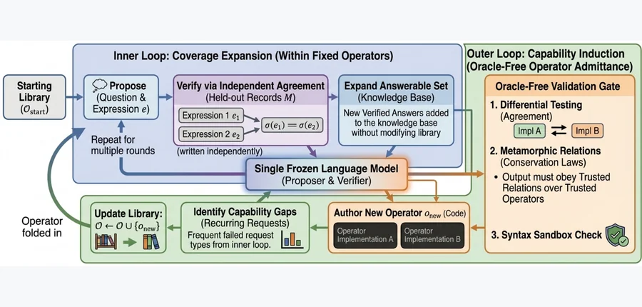 arXiv 2026-10-16 · cs.AI · #1 **[A Self-Improving Agent that Grows its Own DSL: Oracle-Free Operator Induction for Exact Question Answering](https://arxiv.org/abs/2610.20809)** Yun-Shiuan Chuang , Yirou Ge , Yixi Li , Yiming Bian , Zijie Pan , Jenna L. Ballard , Uma Kona , Linsey Pang , Prakhar Meh… Affiliation: PayPal AI [Paper](https://arxiv.org/abs/2610.20809) · [Figure source](https://arxiv.org/html/2610.20809v1/method_overview.png) 

[EN] Abstract
A self-improving agent has to decide which new skills to keep, and in practice it keeps whatever earns a high reward, convinces a judge model, or compresses its library, even when the skill is wrong. That is fine until the answers have to be exactly right: over a table of transactions, a total is either right or wrong. We ask a harder question: can an agent grow what it can compute with no reward, no judge, and no answer key, and still be exactly right? A single frozen model runs two nested loops over a small, exact domain-specific language (DSL). The inner loop answers new questions only when two independently written expressions agree on every record. The outer loop discovers its own missing capability and authors an operator for it, admitted only when an independent second implementation agrees and the result obeys a conservation law, all without ground truth. The inner loop roughly triples the answerable-question set, and the outer loop self-extends on disjoint starting sets, inventing operators outside the starting closure; a no-induction control answers none of the new questions. The admission rule is empirically sound: it rejects 138 of 138 buggy operator variants under an independent reference, even one written by a different model family, where the admit-if-it-runs, self-consistency, and compression signals the field relies on admit most of them. Unmodified, the same mechanism self-extends on two further domains with unrelated schemas, business-ledger and clinical-encounter question answering, growing their answerable sets more than tenfold and nearly twentyfold. The loop transfers across model families too: run with further proposers, the gate stays sound and independent families self-extend comparably, with only the induction yield tracking each proposer's DSL fluency. <a href="https://arxiv.org/abs/2610.20809">Source</a>

[ZH] Abstract
自我改进智能体必须决定保留哪些新技能；实践中，它往往保留能获得高奖励、说服裁判模型或压缩技能库的技能，即使技能是错的。这在答案不要求严格精确时尚可接受，但对交易表计算总额，答案只能是对或错。我们提出一个更困难的问题：智能体能否在没有奖励、没有裁判、没有答案键的情况下，扩展可计算范围，并仍保持严格正确？一个冻结模型在小型精确领域特定语言（DSL）上运行两个嵌套循环。内循环仅在两个独立编写的表达式对每条记录的结果一致时回答新问题；外循环发现自身缺失的能力并编写算子，只有独立的第二实现给出一致结果、且结果遵守守恒律时，算子才能被接纳，整个过程不使用真实答案。内循环使可回答问题集约扩大三倍；外循环在互不重叠的起始集合上实现自扩展，发明超出起始闭包的算子，而无归纳对照无法回答任何新问题。准入规则在实验中可靠：以独立参考检查时，它拒绝全部 138 个有缺陷算子变体，即使参考由另一模型家族编写也如此；而仅检查可运行、自一致性及压缩等常用信号会接纳其中大多数。不作修改，同一机制还能在业务账本和临床就诊问答两个模式无关的领域自扩展，使可回答集合分别扩大十倍以上和接近二十倍。该循环也能跨模型家族迁移：换用其他提议者时，门控仍可靠，独立模型家族实现相近程度的自扩展，只有归纳产出率随各提议者的 DSL 熟练程度变化。 <a href="https://arxiv.org/abs/2610.20809">Source</a>
 | 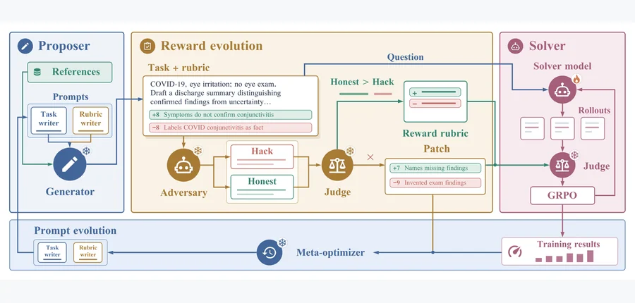 arXiv 2026-10-16 · cs.AI · #2 **[Recursive Reward Improvement via Adversarial Meta-Prompt Evolution](https://arxiv.org/abs/2610.21040)** Wei Dai , Qianchu Liu , Guanghui Qin , Xing Han , Tristan Naumann , Paul Pu Liang , Sheng Zhang Affiliation: Massachusetts Institute of Technology / Microsoft Research / Johns Hopkins University [Paper](https://arxiv.org/abs/2610.21040) · [Figure source](https://arxiv.org/html/2610.21040v1/RRIMed_main_figure.png) 

[EN] Abstract
Recursive Self-Improvement (RSI) has gained wide attention for its ability to work with limited data. In a proposer-solver loop, a proposer model writes training tasks and a solver model learns to solve them through reinforcement learning. Such loops have succeeded in mathematics and coding, where every answer can be checked automatically. Open-ended expert tasks, like clinical report generations, have no answer key, which makes simple question-answer generation not viable. Here the proposer must also write a rubric that lists the content an answer should include and the errors it should avoid. However, the unique challenge behind model-written rubric is the comprehensiveness of it. For naively generated rubric, solvers tend to exploit it, naming the expected topics without the substance behind them, which corrupts the learning process. To solve this problem, we introduce RRI, Recursive Reward Improvement, which uses a reward hacking adversary to supervise the reward. Before the solver trains on a generated task, an adversary writes an answer that games its rubric while being as useless as possible, the same model writes an honest answer without seeing the rubric, and up to two repair steps revise the rubric to make the honest answer win. The exploits found also rewrite how future tasks and rubrics are generated. On HealthBench Professional, RRI improves the adjusted score over the Generation Only self-improvement baseline by 10.9 points at 9B and 12.4 at 27B, and by 10.3 points without any external model. In particular, the gains are largest on difficult and writing tasks. We show that the 27B model trained on the HealthBench Professional description improves by 6.6 points on PRBench Hard and 8.0 on ProfBench without seeing a task from either. We further analyze the exploitable points of model-generated question-rubric pairs to facilitate future research on open-ended self-play. <a href="https://arxiv.org/abs/2610.21040">Source</a>

[ZH] Abstract
递归自我改进（RSI）因能够利用有限数据而受到广泛关注。在提议者—求解者循环中，提议者模型编写训练任务，求解者模型通过强化学习学习求解。这类循环在每个答案都能自动检查的数学和代码领域取得成功。但临床报告生成等开放式专家任务没有答案键，简单生成问答对并不可行，提议者还必须编写评分准则，列出答案应包含的内容与应避免的错误。模型生成准则的独特挑战是全面性：面对朴素生成的准则，求解者往往仅提到预期主题而缺少实质内容，借此投机并污染学习过程。为此，我们提出递归奖励改进 RRI，利用奖励投机对手监督奖励。在求解者用生成任务训练前，对手编写一个尽量无用、却能利用评分准则漏洞的答案；同一模型在不看准则的情况下写出诚实答案；随后最多两次修复使诚实答案获胜。发现的漏洞还会改写未来任务和准则的生成方式。在 HealthBench Professional 上，相比仅生成的自改进基线，RRI 将调整后分数在 9B 和 27B 模型上分别提高 10.9 和 12.4 分；不使用任何外部模型时提高 10.3 分，难题和写作任务收益尤其大。仅使用 HealthBench Professional 描述训练的 27B 模型，在未看过相应任务的情况下，在 PRBench Hard 和 ProfBench 上分别提高 6.6 和 8.0 分。我们进一步分析模型生成问题—准则对的可利用之处，以支持开放式自博弈研究。 <a href="https://arxiv.org/abs/2610.21040">Source</a>
 | 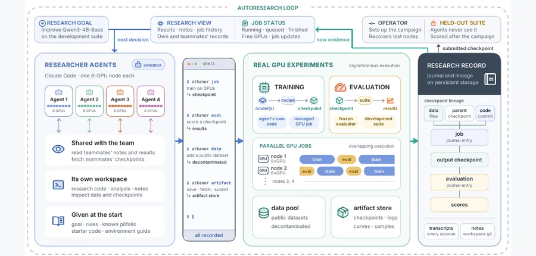 arXiv 2026-10-16 · cs.AI · #3 **[Athanor: An Agent-Native System for Autonomous Post-Training Research](https://arxiv.org/abs/2610.21055)** Yufa Zhou , Yichen Wang , Jiakun Fan , Ziqi Shu , Zhichao Liu , Anru R. Zhang , Neiwen Ling , Zijun Wei Affiliation: ByteDance / Duke University / University of Chicago / Virginia Tech [Paper](https://arxiv.org/abs/2610.21055) · [Figure source](https://arxiv.org/pdf/2610.21055#page=3) 

[EN] Abstract
Recursive self-improvement, in which AI systems build stronger AI systems, is one promising route to superintelligence. We study a weaker form that can be measured today: frontier agents post-training a small raw base model with public data, as a test of their research potential. We build Athanor, an open agent-native system for autonomous post-training research (AutoPostTrain) on real GPUs. We give the agents full research autonomy, low-friction engineering tools, and efficient starter code. The agents carry out the research themselves: they read datasets and evaluation results, build their training data, write and modify training algorithms, tune hyperparameters, and analyze the results to decide what to try next. They work in a sandbox and cannot use external teacher models. Athanor's services supply frozen evaluation, managed jobs, decontaminated data, a persistent research record, and a held-out suite the agents are unaware of. In a 104-hour campaign, a team of four Claude Opus 5.5 agents, each on an eight-GPU node and given no research advice, improves Qwen3-4B-Base from 15.9 to 67.3 on a six-task development suite and from 9.2 to 48.2 on a held-out suite, against 66.5 and 47.9 for the official Qwen3-4B-Instruct-2507. To our knowledge, this is the first demonstration that a team of frontier agents can autonomously post-train a raw base model into a cross-domain generalist model that matches or surpasses the official instruct version on average. The campaign's full record shows that the agents reach this level by recombining known methods and each other's models: SFT on public reasoning data, RL with a rollout change one agent introduced, weight merges across agents, and rounds of self-distillation. With execution handled, today's agents already have the engineering and research ability to conquer this task. We hope Athanor provides a foundation for scaling autonomous AI research. <a href="https://arxiv.org/abs/2610.21055">Source</a>

[ZH] Abstract
递归自我改进，即人工智能系统构建更强的人工智能系统，是通向超级智能的一条潜在路径。我们研究一种目前可测量的较弱形式：前沿智能体用公开数据对小型原始基础模型进行后训练，以检验其研究潜力。我们构建 Athanor，一个在真实 GPU 上开展自主后训练研究（AutoPostTrain）的开放智能体原生系统。我们给予智能体完整研究自主权、低摩擦工程工具和高效起始代码。智能体自行阅读数据集与评估结果、构建训练数据、编写和修改训练算法、调整超参数，并分析结果决定下一步尝试。它们在沙箱内工作，不能使用外部教师模型。Athanor 提供冻结评估、托管作业、去污染数据、持久研究记录，以及智能体不知道的留出套件。在一场 104 小时的实验中，四个 Claude Opus 5.5 智能体各使用一个八 GPU 节点，未获得研究建议，将 Qwen3-4B-Base 在六任务开发套件上的分数从 15.9 提高到 67.3，留出套件从 9.2 提高到 48.2；官方 Qwen3-4B-Instruct-2507 分别为 66.5 和 47.9。据我们所知，这是首次展示前沿智能体团队能够自主将原始基础模型后训练为跨领域通用模型，并在平均表现上达到或超过官方指令版本。完整记录显示，它们通过重新组合已知方法和彼此模型达到这一水平：公开推理数据上的 SFT、采用某个智能体引入的执行采样变化的 RL、跨智能体权重合并，以及多轮自蒸馏。在执行问题得到处理后，当今智能体已具备完成该任务的工程和研究能力。我们希望 Athanor 为扩展自主人工智能研究提供基础。 <a href="https://arxiv.org/abs/2610.21055">Source</a>
 |
| 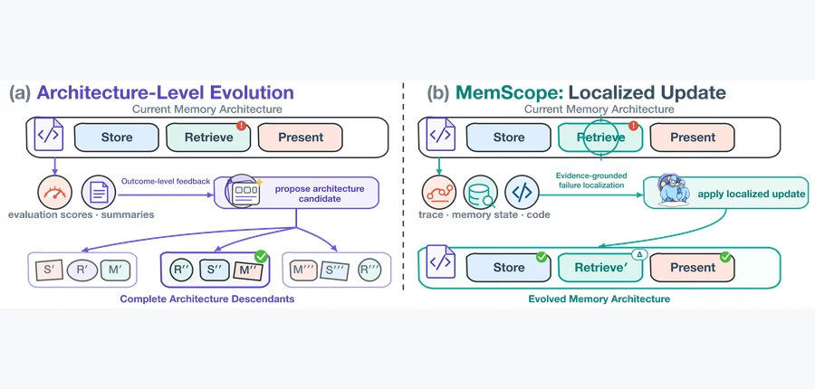 arXiv 2026-10-16 · cs.AI · #4 **[MemScope: Evolving Agent Memory Architectures through Localized Code Repair](https://arxiv.org/abs/2610.21170)** Miao Su , Yucan Guo , Zixuan Li , Long Bai , Zhongni Hou , Xiaolong Jin , Jiafeng Guo Affiliation: State Key Laboratory of AI Safety / Institute of Computing Technology, CAS / University of Chinese Academy of Sciences / Meituan [Paper](https://arxiv.org/abs/2610.21170) · [Figure source](https://arxiv.org/html/2610.21170v1/figs/memscope_abstract_comparison_branching_draft_20260728_from_svg.png) 

[EN] Abstract
Agent memory architectures define how LLM agents store and reuse experience across tasks, but they are typically fixed after deployment, limiting their adaptability across task types. Recent self-evolving approaches instead adapt these memory architectures using execution feedback, typically represented as evaluation scores or compressed summaries. However, such coarse-grained feedback is insufficient for precise failure localization in current agent systems, where long-horizon task execution involves multiple interacting components. Without a precise failure location, existing approaches lack a clear code-level target for modification, leaving the update scope weakly constrained and often leading to large-scale rewrites of an otherwise capable memory architecture. We propose MemScope, a framework for evidence-grounded, localized evolution of an existing memory architecture. Its tool-using Patch Agent jointly inspects raw execution traces, runtime memory state, and current architecture code to identify repair targets and apply bounded, in-place edits under provider-identity and memory-compatibility constraints. On GAIA, the trace-and-memory inspection variant achieves 86.67% accuracy, compared with 70.00% for trace-only and 63.33% for summary-only feedback. Under xBench tasks, the evolved memory architecture improves over its original version from 49 to 55 correct answers with DeepSeek V3.2 and from 50 to 53 with Kimi K2.7 Code. On disjoint ALFWorld unseen tasks, success rises from 50.75% to 71.64%. Across archived architecture-snapshot transitions, the median code-change ratio is 4.4%. These results support fine-grained execution evidence as a basis for localized, in-place memory-architecture evolution. <a href="https://arxiv.org/abs/2610.21170">Source</a>

[ZH] Abstract
智能体记忆架构决定大语言模型智能体如何跨任务存储和复用经验，但通常部署后保持固定，限制了对不同任务类型的适应。近期自进化方法利用执行反馈适配记忆架构，反馈通常表示为评估分数或压缩摘要。然而，在长时程执行涉及多个交互组件的系统中，这类粗粒度反馈不足以精确定位失败。缺少精确失败位置，就缺少明确的代码修改目标，更新范围约束不足，经常导致对原本有能力的记忆架构进行大规模重写。我们提出 MemScope，对现有记忆架构开展有证据支撑的局部进化。使用工具的 Patch Agent 联合检查原始执行轨迹、运行时记忆状态与当前架构代码，确定修复目标，并在提供者身份和记忆兼容性约束下进行有界原地编辑。在 GAIA 上，同时检查轨迹与记忆的变体准确率为 86.67%，轨迹单独检查为 70.00%，仅摘要反馈为 63.33%。在 xBench 上，进化架构使 DeepSeek V3.2 正确答案从 49 增至 55，Kimi K2.7 Code 从 50 增至 53。在不重叠的 ALFWorld 未见任务上，成功率从 50.75% 增至 71.64%。存档架构快照转换中的代码变化比例中位数为 4.4%。这些结果支持以细粒度执行证据开展局部原地记忆架构进化。 <a href="https://arxiv.org/abs/2610.21170">Source</a>
 | 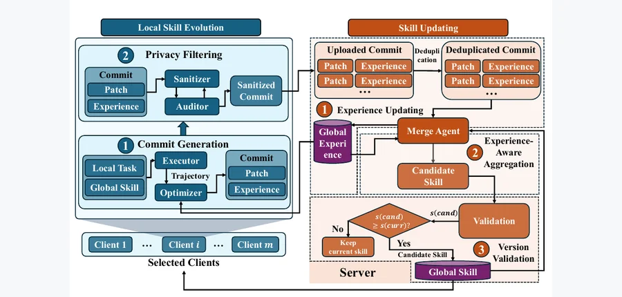 arXiv 2026-10-16 · cs.AI · #5 **[FedSkillGit: Federated Skill Evolution via Version Control](https://arxiv.org/abs/2610.21348)** Boxun Lan , Jiamei Li , Weijian Li , Chengyu Yang , Zhuang Qi , Chengcheng Wan , Xiaohong Chen , Ming Hu Affiliation: East China Normal University / Shandong University [Paper](https://arxiv.org/abs/2610.21348) · [Figure source](https://arxiv.org/pdf/2610.21348#page=3) 

[EN] Abstract
Large language model agents can improve their capabilities by evolving reusable natural-language skills from execution experience. In real-world deployments, this experience is distributed across data owners who cannot pool their raw data, which motivates federated skill evolution. The natural first design lets each client evolve the whole skill document and upload the result for server-side aggregation. That design is poorly matched to skill evolution for three reasons. An evolved document can still carry client-specific content distilled from private traces, repeated transmission of a nearly unchanged document spends communication on knowledge that the population already holds and the contribution of a single client is buried in a document that the server cannot meaningfully attribute. We propose FedSkillGit, a federated skill evolution framework that replaces full-document updates with commits. Each participating client submits a bounded set of patches over named rules together with its local experience, which summarizes what the round taught it, and the pair passes a two-stage privacy filter before it leaves the client. The server deduplicates the submitted patches and the local experience of all participants, updates a global experience document that only the optimizers read, and merges the surviving patches into a candidate skill. The candidate is distributed to the clients, which score it on their own validation sets and report the results, and it is published only when the reported scores improve on the current version. Experiments on three datasets and three language model families show that FedSkillGit outperforms state-of-the-art baselines by up to 22% and approaches centralized evolution without sharing raw client data. <a href="https://arxiv.org/abs/2610.21348">Source</a>

[ZH] Abstract
大语言模型智能体能够从执行经验中进化可复用自然语言技能，提高自身能力。真实部署中，经验分散在无法汇集原始数据的数据所有者之间，因此需要联邦技能进化。最直接的设计是让每个客户端进化整个技能文档，再上传服务器聚合，但它与技能进化有三点不匹配：进化文档仍可能包含从私有轨迹提炼的客户端特定内容；反复传输几乎没变化的文档浪费通信；单个客户端的贡献被埋在服务器难以有效归因的完整文档中。我们提出 FedSkillGit，用版本提交替代整文档更新。每个客户端针对命名规则提交有界补丁集，并附上总结本轮收获的本地经验；两者离开客户端前都经过两阶段隐私过滤。服务器对所有参与者的补丁和本地经验去重，更新仅供优化器读取的全局经验文档，再将保留补丁合并为候选技能。候选被分发给客户端，在各自验证集上评分并回传结果；只有汇报分数优于当前版本时才发布。在三个数据集、三个语言模型家族上的实验显示，FedSkillGit 相比最先进基线最多提高 22%，且不共享原始客户端数据便接近集中式进化水平。 <a href="https://arxiv.org/abs/2610.21348">Source</a>
 | 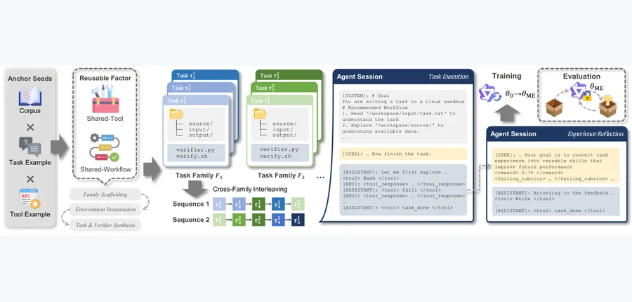 arXiv 2026-10-16 · cs.AI · #6 **[MetaExp: Learning to Self-Improve through Experience via Verifiable Cross-Task Environment Scaling](https://arxiv.org/abs/2610.21492)** Renhao Li , Xinjie Shen , Yang Su , Jianhong Tu , Derek F. Wong , Dayiheng Liu , Min Yang Affiliation: University of Macau / Shenzhen Institute of Advanced Technology, CAS / Georgia Institute of Technology / Alibaba Token Hub, Alibaba Group [Paper](https://arxiv.org/abs/2610.21492) · [Figure source](https://arxiv.org/html/2610.21492v1/framework.png) 

[EN] Abstract
Language-model agents can accumulate interaction feedback, but reliably turning that feedback into reusable experience remains challenging. Existing methods either optimize external experience scaffolds or train experience-related behavior on specific task distributions, leaving open whether experience learning itself can become a transferable model capability. Training such a capability calls for supervision beyond isolated tasks, which mainly support in-episode problem solving rather than revealing what knowledge remains useful across episodes. In this work, we introduce MetaExp, a scalable framework that trains this capability through verifiable task families with controlled cross-task structure. Each family preserves a reusable factor while varying task-specific realizations, enabling transfer without direct solution reuse. We propose two complementary designs: Shared-Tool families keep black-box tools fixed across tasks to elicit operational experience, while Shared-Workflow families preserve latent procedures across changing realizations to elicit procedural experience. We scale environments under both designs, collect and filter sequential interaction trajectories, and fine-tune Qwen3.5-122B-A10B on 4,956 trajectories from 1,000 task families. With parameters frozen during downstream evolution, MetaExp improves by +8.5 points on SpreadsheetBench, peaks at +2.3 on APEX-Agents, and improves by +14.8 on AutomationBench. The gains persist under domain-excluded training, supporting experience learning as a transferable capability for continued non-parametric improvement after deployment. <a href="https://arxiv.org/abs/2610.21492">Source</a>

[ZH] Abstract
语言模型智能体能够累积交互反馈，但可靠地将反馈转为可复用经验仍有挑战。现有方法要么优化外部经验支架，要么在特定任务分布上训练经验相关行为，尚未回答经验学习本身能否成为可迁移的模型能力。训练这种能力需要超出孤立任务的监督；孤立任务主要支持回合内求解，无法揭示哪些知识跨回合仍有用。我们提出 MetaExp，通过具有受控跨任务结构、可验证的任务家族训练该能力。每个家族保留可复用因素，同时改变任务特定实现，使迁移不依赖直接复用答案。我们提出两种互补设计：Shared-Tool 家族在任务间保持黑盒工具不变，诱发操作经验；Shared-Workflow 家族在不同实现中保留潜在流程，诱发程序经验。我们按两种设计扩展环境，收集并筛选顺序交互轨迹，用来自 1,000 个任务家族的 4,956 条轨迹微调 Qwen3.5-122B-A10B。在下游进化时冻结参数，MetaExp 在 SpreadsheetBench 提高 8.5 分，在 APEX-Agents 最高提高 2.3 分，在 AutomationBench 提高 14.8 分。排除目标领域训练后收益仍保持，支持将经验学习作为可迁移能力，实现部署后持续的非参数改进。 <a href="https://arxiv.org/abs/2610.21492">Source</a>
 |
| 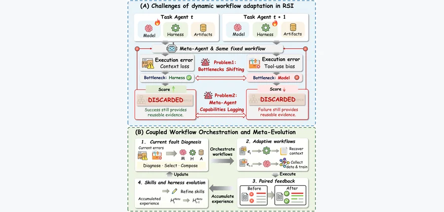 arXiv 2026-10-16 · cs.AI · #7 **[RSIFlow: Adaptive Self-Improvement Workflows with an Evolving Meta-Agent](https://arxiv.org/abs/2610.21791)** Huan Zhang , Mingju Chen , Dongxu Zhou , Can Lv , Sen Cui , Faguo Wu , Shiji Zhou Affiliation: Beihang University / Tsinghua University / Beijing Academy of Artificial Intelligence [Paper](https://arxiv.org/abs/2610.21791) · [Code](https://github.com/1HUAN1/RSI-Flow) · [Figure source](https://arxiv.org/html/2610.21791v1/intro2.png) 

[EN] Abstract
Large language model (LLM) agents have demonstrated strong capabilities in complex tasks, including code generation, tool use, and multi-hop question answering. Existing self-improvement methods enhance agent performance through model optimization, harness evolution, and executable artifact refinement, while recursive self-improvement (RSI) further extends optimization to the improvement mechanisms themselves. However, adapting self-improvement workflows to evolving performance bottlenecks while improving workflow orchestration through execution feedback remains a key challenge. We propose \textbf{RSIFlow}, a \textbf{R}ecursive \textbf{S}elf-\textbf{I}mprovement framework that integrates adaptive work\textbf{flow} orchestration with meta-agent capability evolution. RSIFlow diagnoses performance bottlenecks from task-agent trajectories and environmental feedback to dynamically select component-specific improvement workflows. The meta-agent then distills workflow outcomes into component-specific skills and cross-component principles, evolving its own harness to improve subsequent workflow orchestration. Experiments across six benchmarks and two backbone models show that RSIFlow achieves the SOTA average performance on all benchmarks. Ablation studies further demonstrate the contributions of adaptive workflow orchestration and meta-harness evolution. Code is available at this https URL . <a href="https://arxiv.org/abs/2610.21791">Source</a>

[ZH] Abstract
大语言模型智能体已在代码生成、工具使用和多跳问答等复杂任务中展现强大能力。现有自改进方法通过模型优化、运行框架进化和可执行产物细化提高表现，而递归自我改进（RSI）进一步将优化扩展到改进机制本身。然而，如何使自改进流程适应不断变化的性能瓶颈，并通过执行反馈改进流程编排，仍是重要挑战。我们提出 RSIFlow，将自适应工作流编排与元智能体能力进化相结合的递归自我改进框架。RSIFlow 从任务智能体轨迹与环境反馈诊断性能瓶颈，动态选择针对特定组件的改进流程。元智能体再将流程结果提炼为组件特定技能和跨组件原则，进化自身运行框架，以改进后续流程编排。在六个基准、两个骨干模型上的实验显示，RSIFlow 在所有基准上取得最先进平均表现。消融进一步展示自适应流程编排与元框架进化的贡献。代码见原文链接。 <a href="https://arxiv.org/abs/2610.21791">Source</a>
 | 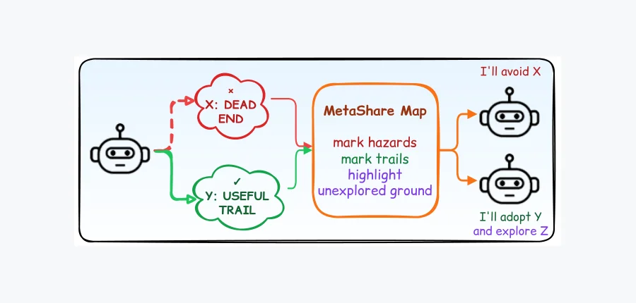 arXiv 2026-10-16 · cs.MA · #8 **[MetaShare: Failure-Aware Collective Self-Improvement for Open-Ended Agents](https://arxiv.org/abs/2610.21887)** Vishal Bhutani , Prasang Gupta , Sumanth Chundru , Kevin Paul Affiliation: PricewaterhouseCoopers (PwC) [Paper](https://arxiv.org/abs/2610.21887) · [Figure source](https://arxiv.org/html/2610.21887v1/teaser_metashare.drawio.png) 

[EN] Abstract
Humans often learn fastest not by repeating success, but by remembering which failures not to repeat. Open-ended self-improving agents can share experience across lineages, as in GEA, or edit their own improvement mechanisms, as in DGM-Hyperagents, yet failed improvement attempts are rarely retained as reusable cross-branch knowledge, and search can collapse onto redundant strategies. We introduce MetaShare, a failure-aware framework that records successful and unsuccessful agent modifications together with signed performance deltas. Before each generation, MetaShare retrieves diverse high-performing strategies alongside high-confidence failures from other lineages, letting agents reuse effective mechanisms while avoiding known dead ends. A task-blind auditor periodically injects absent or underrepresented mechanism categories, while embedding-based de-ranking limits redundancy during retrieval. Multiple meta-agents propose modifications in parallel at heterogeneous temperatures behind a deterministic selector that gates applicability, scope, compilability, and size. Experiments across paper review, coding, math grading, robotics reward design, and financial audit-risk assessment show that MetaShare's median matches or exceeds DGM-Hyperagents' final performance and reaches its own best-performing agent in 1.7--2.9$\times$ fewer evolution iterations. <a href="https://arxiv.org/abs/2610.21887">Source</a>

[ZH] Abstract
人类往往不仅通过重复成功，更通过记住不应重复的失败加速学习。开放式自改进智能体可以像 GEA 一样跨谱系共享经验，也可以像 DGM-Hyperagents 一样编辑自身改进机制，但失败的改进尝试很少被保留为可复用的跨分支知识，搜索也容易坍缩到重复策略。我们提出失败感知框架 MetaShare，记录成功和失败的智能体修改及带符号性能变化。每一代开始前，它检索其他谱系中多样的高性能策略和高置信失败，使智能体复用有效机制、避免已知死路。不看任务的审计器周期性注入缺失或代表不足的机制类别，基于嵌入的降排名限制检索冗余。多个元智能体以异构温度并行提议修改，由确定性选择器门控适用性、范围、可编译性和大小。在论文评审、代码、数学评分、机器人奖励设计和财务审计风险评估中，MetaShare 的中位数表现达到或超过 DGM-Hyperagents 的最终表现，并以少 1.7—2.9 倍的进化迭代次数达到自身最佳智能体。 <a href="https://arxiv.org/abs/2610.21887">Source</a>
 |  arXiv 2026-10-16 · cs.AI · #9 **[CoWorld Reasoner: Agentic Multimodal Reasoning with the Evolving Video World Model-Driven Harness](https://arxiv.org/abs/2610.21910)** Dongjie Cheng , Ruifeng Yuan , Ran Wei , Ning Song , Yongqi Li , Wenjie Li Affiliation: Hong Kong Polytechnic University / Hangzhou Diagens Biotechnology [Paper](https://arxiv.org/abs/2610.21910) · [Project](https://modalitydance.github.io/CoWorld-Reasoner) · [Figure source](https://arxiv.org/pdf/2610.21910) 

[EN] Abstract
As Vision-Language Models (VLMs) advance, they are increasingly expected to perform spatiotemporal reasoning over motion, actions, and view changes beyond what the input images show. Video World Models (VWMs) provide a natural unified engine for visual imagination by generating task-relevant visual content as additional evidence. However, existing approaches typically invoke a VWM through fixed pipelines centered on a predefined form of visual imagination, such as novel-view synthesis. To support flexible visual imagination for diverse reasoning tasks, we introduce CoWorld Reasoner, an agentic framework that uses a VWM as a unified visual reasoning engine. Its Video World Model-Driven Harness exposes multiple visual operations through tools and uses skills to guide the VLM in deciding whether to imagine, selecting an operation, constructing a generation request, and interpreting the resulting visual evidence. We further introduce VLM-VWM Harness Co-Evolution, which jointly revises tools, skills, and execution code based on execution feedback while keeping both model weights fixed. Across seven benchmarks spanning spatial intelligence, temporal and causal reasoning, and perceptual reasoning, CoWorld Reasoner outperforms direct reasoning with the same VLM. The strongest variant improves on all seven benchmarks, including relative accuracy gains of 11.8% on MMSI and 13.0% on ERQA, and outperforms all five evolving baselines using the same backbone across five benchmarks. <a href="https://arxiv.org/abs/2610.21910">Source</a>

[ZH] Abstract
随着视觉语言模型（VLM）发展，人们越来越期待它们能够推理超出输入图像所呈现内容的运动、动作和视角变化。视频世界模型（VWM）通过生成与任务相关的视觉内容作为额外证据，为视觉想象提供统一引擎。但现有方法通常通过围绕新视角合成等预定义想象形式的固定流程调用 VWM。为支持多样推理任务中的灵活视觉想象，我们提出 CoWorld Reasoner，将 VWM 用作统一视觉推理引擎的智能体框架。视频世界模型驱动的运行框架通过工具暴露多种视觉操作，并以技能引导 VLM 决定是否想象、选择操作、构建生成请求以及解释生成的视觉证据。我们进一步提出 VLM-VWM 框架协同进化，在保持两个模型权重固定的同时，依据执行反馈联合修改工具、技能和执行代码。在涵盖空间智能、时间与因果推理、感知推理的七个基准上，CoWorld Reasoner 优于相同 VLM 的直接推理。最强变体在全部七个基准上改进，包括 MMSI 和 ERQA 上分别 11.8% 和 13.0% 的相对准确率收益，并在五个基准上优于使用相同骨干的全部五个进化基线。 <a href="https://arxiv.org/abs/2610.21910">Source</a>
 |
| 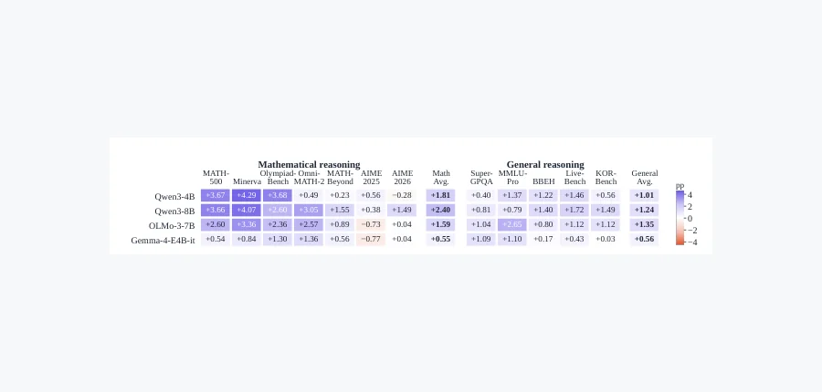 arXiv 2026-10-16 · cs.LG · #10 **[Selection Is Not Learning: Choosing Model Futures](https://arxiv.org/abs/2610.22029)** Haoyi Yang , Kshitij Mishra , Nils Lukas , Salem Lahlou Affiliation: Mohamed bin Zayed University of Artificial Intelligence [Paper](https://arxiv.org/abs/2610.22029) · [Figure source](https://arxiv.org/html/2610.22029v1/row_heatmap.png) 

[EN] Abstract
Self-evolving language models train on tasks they generate, so every round must decide which updated model the next round inherits. Current loops such as R-Zero, Agent0, and Skill Self-Play make this decision through the task, admitting tasks that look learnable and inheriting every resulting update. We identify a selection-to-update gap in these loops, where a task that looks learnable need not produce a useful update. Most updates on verified tasks fail to make correct answers more likely, yet these loops inherit them all. HeirCommit freezes the updated model and uses fresh evaluation questions to decide whether to inherit it or retain the current model. EvoHeir separates parameter inheritance from experience inheritance, using current and archived experience to repair failures and preserve successes before final confirmation. Our analysis characterizes selection-induced optimism and decomposes regret into selection, absorption, and confirmation errors. HeirCommit cuts the harmful share of accepted updates by 68-83% relative to random inheritance at the same acceptance rate. Across four backbones, EvoHeir achieves the best mathematics and general-reasoning averages, raising the math average by 5.3% relative to the strongest baseline, Agent0. The framework lets useful experience persist even when the model that produced it is not inherited. <a href="https://arxiv.org/abs/2610.22029">Source</a>

[ZH] Abstract
自进化语言模型在自己生成的任务上训练，因此每一轮都必须决定下一轮继承哪一个更新后模型。R-Zero、Agent0、Skill Self-Play 等循环通过任务本身作出决定：接纳看似可学习的任务，然后继承所有由此产生的更新。我们发现其中存在从选择到更新的缺口：看似可学习的任务未必产生有用更新。多数在验证任务上的更新不能提高正确答案的概率，但这些循环仍全部继承。HeirCommit 冻结更新模型，用新评估问题决定继承还是保留当前模型。EvoHeir 将参数继承与经验继承分离，在最终确认前使用当前和历史经验修复失败、保留成功。分析刻画选择引起的乐观偏差，并将遗憾分解为选择、吸收和确认误差。相同接纳率下，HeirCommit 比随机继承将获准更新中的有害比例降低 68%—83%。跨四个骨干，EvoHeir 达到最佳数学和通用推理平均表现，数学均分比最强基线 Agent0 相对提高 5.3%。该框架允许有用经验持续存在，即使产生它的模型未被继承。 <a href="https://arxiv.org/abs/2610.22029">Source</a>
 | 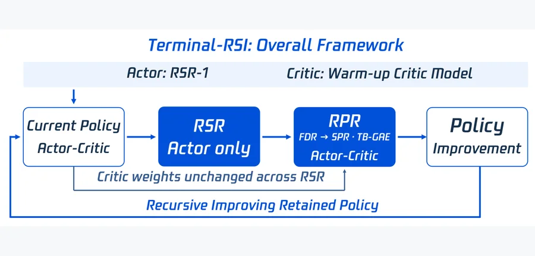 arXiv 2026-10-16 · cs.AI · #11 **[Terminal-RSI: Recursive Self-Improving Terminal Agents via Recursive Self-Rewrite and Policy-Refine](https://arxiv.org/abs/2610.22192)** Junyao Yang , Zongxia Li , Yucheng Shi , Zhongzhi Li , Ruhan Wang , Ruiwen Zhou , Haitao Mi , Shuicheng Yan , Leowei Liang Affiliation: Tencent Hy Frontier / National University of Singapore / University of Maryland, College Park / University of Georgia / Indiana University [Paper](https://arxiv.org/abs/2610.22192) · [Project](https://jyyang26.github.io/terminal-rsi/) · [Figure source](https://arxiv.org/html/2610.22192v1/terminal_rsi_overall_from_ppt.png) 

[EN] Abstract
Converting verifier outcomes into useful policy updates and partial progress into complete task resolution is crucial for terminal agents. We present Terminal-RSI, which alternates Recursive Self-Rewrite (RSR) of verified trajectories with critic-inheriting Recursive Policy-Refine (RPR). We formulate Turn-Boundary Skip-Observation GAE (TB-GAE) to retain token-specific baselines while applying decay across interaction turns. Family Dense Reward (FDR) calibrates semantic progress across task families; Success-Prioritized Reward (SPR) separates strict success from bounded partial credit. A Warm-up Critic Model, recursive critic handoff, and stage-specific learning rates coordinate the two refinement phases. The five-stage sequence from Qwen3.8-27B base model through RSR-1, RPR-1, RSR-2, and RPR-2 yields Terminal-RSI-27B: 19.84% on Terminal-Bench 4.0, 86.52% on Terminal-Bench 2.1, 16.95% on Terminal-Bench 3.0, and 79.00% on Terminal-Bench Hard. On LHTB, process reward rises from 0.21 to 0.37 and strict completion from 0/46 to 5/46; SWR100 success doubles from 3.00% to 6.00%. By recursively coupling verified trajectory rewriting with critic-inheriting policy refinement, each retained stage consolidates discovered behaviors and progressively advances the agent from partial local repairs to strict terminal verification. <a href="https://arxiv.org/abs/2610.22192">Source</a>

[ZH] Abstract
将验证器结果转换为有用策略更新、将局部进展转换为完整任务解决，对终端智能体至关重要。我们提出 Terminal-RSI，交替执行已验证轨迹的递归自重写（RSR）和继承 critic 的递归策略细化（RPR）。我们形式化轮次边界跳观测 GAE（TB-GAE），保留词元特定基线，同时跨交互轮次施加衰减。家族稠密奖励（FDR）跨任务家族校准语义进展；成功优先奖励（SPR）区分严格成功和有界部分得分。预热 critic、递归 critic 交接与阶段特定学习率协调两个细化阶段。从 Qwen3.8-27B 基础模型，经 RSR-1、RPR-1、RSR-2、RPR-2 的五阶段序列得到 Terminal-RSI-27B：在 Terminal-Bench 4.0、2.1、3.0 和 Hard 上分别为 19.84%、86.52%、16.95% 和 79.00%。在 LHTB 上，过程奖励从 0.21 升到 0.37，严格完成从 0/46 增至 5/46；SWR100 成功率从 3.00% 翻倍到 6.00%。通过递归耦合已验证轨迹重写和继承 critic 的策略细化，每个保留阶段巩固发现的行为，逐步将智能体从局部修复推进到严格终端验证。 <a href="https://arxiv.org/abs/2610.22192">Source</a>
 | 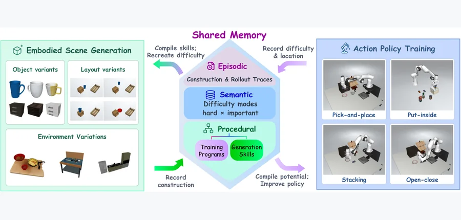 arXiv 2026-10-16 · cs.RO · #12 **[CoDA: Co-Evolution of Data Engines and Action Policies](https://arxiv.org/abs/2610.22362)** Tianjiao Yu , Zhilin Ou , Yifan Shen , Xinzhuo Li , Yuanzhe Liu , Onkar Kishor Susladkar , Fan Wang , Ismini Lourentzou Affiliation: University of Illinois Urbana-Champaign / Chinese University of Hong Kong, Shenzhen / Amazon [Paper](https://arxiv.org/abs/2610.22362) · [Figure source](https://arxiv.org/html/2610.22362v1/teaser_d.png) 

[EN] Abstract
Generative simulation can automate robot environment construction, but physically valid environments are not necessarily useful for training. The challenge is to identify environments that address a policy's failures and supervision that helps it overcome them. We introduce CoDA, a framework in which a simulation data engine and an action policy co-evolve through a shared heterogeneous memory of environment construction, policy failures, and learning progress. The memory compiles validated diagnoses from a vision-language critic into generation programs that recreate difficulties and training programs that help the policy overcome them. We further propose Text2potential to convert these diagnoses into staged potentials for action-chunk value learning, providing dense supervision for policy updates while preserving the task's optimal policy under standard shaping assumptions. Measured learning progress guides further generation and program refinement. Across four manipulation task families, CoDA improves out-of-distribution success from 5.3% after supervised fine-tuning to 27.6%, exceeding the strongest closed-loop baseline by 9.5 percentage points with the same generation budget. On LIBERO-Pro, 15 rounds of generation and training raise success from 25% to 84% under position perturbations and from 1% to 76% under instruction perturbations. <a href="https://arxiv.org/abs/2610.22362">Source</a>

[ZH] Abstract
生成式仿真能够自动构建机器人环境，但物理有效的环境未必有训练价值。挑战是识别针对策略失败的环境，以及帮助克服失败的监督。我们提出 CoDA，通过共享异构记忆，让仿真数据引擎和动作策略协同进化，记忆覆盖环境构建、策略失败和学习进展。记忆将视觉语言 critic 验证过的诊断编译为重现困难的生成程序，以及帮助策略克服困难的训练程序。我们进一步提出 Text2potential，将诊断转为用于动作块价值学习的分阶段势函数，在标准奖励塑形假设下保留任务最优策略，同时为策略更新提供稠密监督。测得的学习进展指导后续生成及程序细化。在四类操作任务中，CoDA 将分布外成功率从监督微调后的 5.3% 提高到 27.6%，在相同生成预算下比最强闭环基线高 9.5 个百分点。在 LIBERO-Pro 上，15 轮生成和训练，将位置扰动下成功率从 25% 提高到 84%，指令扰动下从 1% 提高到 76%。 <a href="https://arxiv.org/abs/2610.22362">Source</a>
 |
| 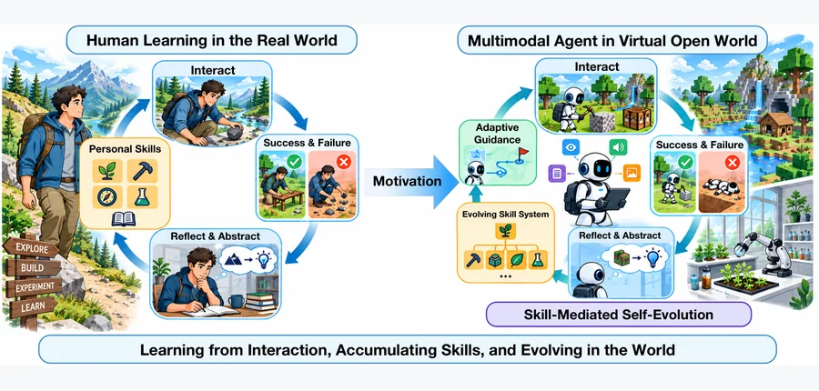 arXiv 2026-10-16 · cs.AI · #13 **[EvolvingBrain: An Adaptive Skill System for Multi-modal Agents Self-Evolution in Open Worlds](https://arxiv.org/abs/2610.20786)** Runxuan Liu , Jingqi Shi , Baoxin Wang , Honghong Zhao , Haoyuan Xu , Yueqing Sun , Jiafeng Liang , Tao He , Dayong Wu , Q… Affiliation: Harbin Institute of Technology / iFLYTEK / Meituan / Pengcheng Laboratory [Paper](https://arxiv.org/abs/2610.20786) · [Figure source](https://arxiv.org/html/2610.20786v1/introduction.png) 

[EN] Abstract
Multi-modal agents have made significant progress in interacting with open worlds. However, their ability to self-evolve remains limited. Supervised fine-tuning enables imitation but not active experience organization, while outcome-based reinforcement learning promotes exploration yet underuses intermediate trajectory information. Therefore, we propose EvolvingBrain, which uses an adaptive skill system as the brain for agent self-evolution, consisting of two following components. Stratified Skill Self-Evolution: extracts Procedural Patterns and Problematic Patterns from model-specific trajectories, summarizes experience by generating skills, and evolves through multiple interactions with the open world, ultimately forming a Stratified Skill Architecture consisting of Domain, Plan, and Action/Trap Skills, which provides the agent with a multi-granularity knowledge repository and a novel evolution approach. State-Aware Adaptive Execution: summarizes long-horizon interactions into Structured Abstractive Memory and uses it to guide the State-Aware Skill Fusion Strategy, enabling the agent to utilize knowledge according to its current state. Experiments on VAB-Minecraft and DiscoveryWorld demonstrate that EvolvingBrain improves success rates on open-world tasks and exhibits generalization capabilities. Our code is provided in the supplementary materials and will be publicly released in the camera-ready version. <a href="https://arxiv.org/abs/2610.20786">Source</a>

[ZH] Abstract
多模态智能体在与开放世界交互方面取得显著进展，但自我进化能力仍有限。监督微调支持模仿，却不支持主动组织经验；基于结果的强化学习促进探索，却未充分利用中间轨迹信息。因此，我们提出 EvolvingBrain，以自适应技能系统作为智能体自进化的大脑，包含两个组件。分层技能自进化：从模型特定轨迹提取程序模式和问题模式，通过生成技能总结经验，并在与开放世界的多次交互中进化，最终形成由领域、规划、动作或陷阱技能构成的分层技能架构，为智能体提供多粒度知识库和新的进化方式。状态感知自适应执行：将长时程交互总结为结构化抽象记忆，用其指导状态感知技能融合策略，使智能体根据当前状态使用知识。在 VAB-Minecraft 和 DiscoveryWorld 上的实验显示，EvolvingBrain 提高开放世界任务成功率并展现泛化能力。代码已在补充材料中提供，将在最终定稿版本公开发布。 <a href="https://arxiv.org/abs/2610.20786">Source</a>
 | 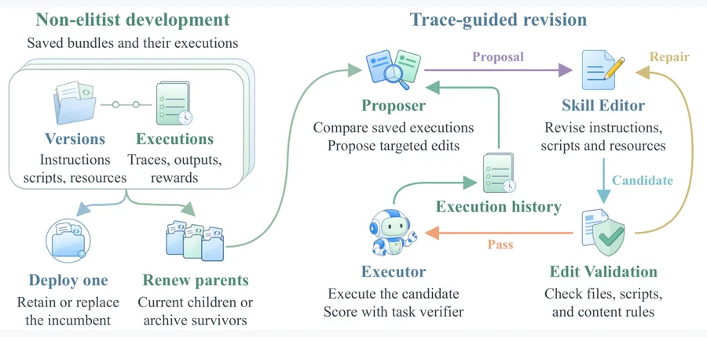 arXiv 2026-10-16 · cs.AI · #14 **[SkillNEO: Non-Elitist Evolutionary Optimization of Agent Skills](https://arxiv.org/abs/2610.20926)** Enze Ma , Chunyu Miao , Yankai Chen , Jie Yang , Liancheng Fang , Kening Zheng , Hanrong Zhang , Muyao Xu , Xinle Yu , Che… Affiliation: University of Illinois at Chicago / Mohamed bin Zayed University of Artificial Intelligence / University of California San Diego / University of California Los Angeles / Independent Researcher / University of Texas at Arlington [Paper](https://arxiv.org/abs/2610.20926) · [Figure source](https://arxiv.org/html/2610.20926v1/skillneo_method_artwork.png) 

[EN] Abstract
Agent skills turn procedural knowledge into reusable artifacts, allowing LLM agents to accumulate and refine expertise through experience. Building on this, skill evolution iteratively improves skills using execution feedback. However, improvement may require several interdependent edits, so low-reward versions can still be worth developing. Requiring immediate reward gains can discard useful partial repairs before their benefits emerge. Non-elitist evolution allows new versions to receive further edits despite scoring below earlier ones. For agent skills, this calls for evidence of what to preserve and repair next. We introduce SkillNEO (Non-Elitist Evolutionary Optimization for Agent Skills), which separately selects a version to use and versions to keep improving. Comparing how related versions perform the same task reveals working steps to preserve and remaining failures to fix. It can also revisit and revise earlier versions using later evidence. Across 86 SkillsBench tasks in eight domains, including software engineering and office work, SkillNEO raises GPT-5.4 Mini's average reward from 49.1% to 66.4%, within GPT-5.5 and GPT-5.6 Luna's original-skill range. Mini executes tasks, proposes revisions, and edits skills; final evaluation uses the same task instances. Gains span all eight domains. The same skills improve stronger models without further editing. On the 41 tasks with modified skills, reuse improves Luna by 10.5 percentage points and places GPT-5.5 10.6 points above its published original-skill reference. Execution records show these skills can benefit stronger models even when Mini still fails some task requirements. Search histories also show lower-scoring versions leading to skills ultimately selected for use. Together, these findings show that skill evolution can turn a weaker model's partial progress into reusable procedural knowledge for improving more capable agents. <a href="https://arxiv.org/abs/2610.20926">Source</a>

[ZH] Abstract
智能体技能将程序知识转为可复用产物，使大语言模型智能体从经验中积累并细化专长。技能进化据此使用执行反馈迭代改进技能。但改进可能需要多个相互依赖的编辑，因此低奖励版本仍可能值得继续发展。要求即时奖励提高，会在收益出现前丢弃有用的局部修复。非精英式进化允许新版本即使分数低于先前版本，仍获得进一步编辑机会；对智能体技能而言，这需要证据说明保留什么以及下一步修复什么。我们提出 SkillNEO，分别选择用于执行的版本与继续改进的版本。比较相关版本在同一任务上的表现，可发现应保留的有效步骤和待修复失败；它也能用后来的证据回访并修改早期版本。在覆盖软件工程、办公等八个领域的 86 项 SkillsBench 任务上，SkillNEO 将 GPT-5.4 Mini 平均奖励从 49.1% 提高到 66.4%，进入 GPT-5.5 和 GPT-5.6 Luna 使用原始技能时的范围。Mini 同时执行任务、提议修改和编辑技能，最终评估使用相同任务实例。收益覆盖全部八个领域。同一技能无需再编辑即可改进更强模型。在 41 项技能被修改的任务上，复用使 Luna 提高 10.5 个百分点，使 GPT-5.5 比其公开原始技能参考高 10.6 分。执行记录表明，即使 Mini 仍未满足某些任务要求，这些技能也能帮助更强模型；搜索历史也显示，较低分版本能够通向最终被选用的技能。结果表明，技能进化能够将弱模型的局部进展转成可复用程序知识，改进更强智能体。 <a href="https://arxiv.org/abs/2610.20926">Source</a>
 | 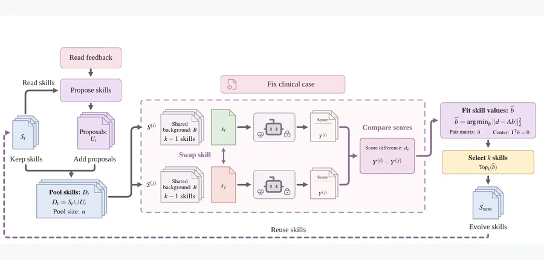 arXiv 2026-10-16 · cs.LG · #15 **[CausalEvo: Causal Skill Self-Evolution for Health LLM Agents](https://arxiv.org/abs/2610.21016)** Yuchen Zhang Affiliation: University of Texas Health Science Center at Houston [Paper](https://arxiv.org/abs/2610.21016) · [Code](https://github.com/txbrook/CausalEvo) · [Figure source](https://arxiv.org/html/2610.21016v1/figures/causalevo_overview.png) 

[EN] Abstract
Large language model (LLM) agents for health can accumulate reusable textual skills from task feedback, such as calculation criteria, measurement time points, and formula units. Deciding which skills to retain is consequential: useful rules improve later answers, while faulty generalizations propagate errors. We propose CausalEvo, a method for causal skill self-evolution that estimates the relative effects of deliberately changed skill sets while holding the model weights, feedback cases, and rule count fixed. At each evolution step, a frozen LLM proposes candidate rules, which are pooled with the incumbent skills so that the current skill set remains a feasible choice. Paired skill replacements against shared background rules are scored on the same feedback cases; least squares converts the score differences into relative skill values, and the top-ranked rules are retained, favoring incumbents on ties. A decision-loss bound separates candidate support, approximation, and estimation errors. On six MedCalc-Bench-Verified tasks with 120 held-out cases, CausalEvo achieves 60.00% accuracy, compared with 55.83% for SkillOpt and 51.67% without skills. Across the recorded training configurations, which use different optimization budgets, it consumes 55.6% fewer training tokens than SkillOpt. Gains concentrate in particular calculations alongside regressions on others, and paired accuracy intervals include zero. CausalEvo turns task feedback into controlled decisions about skill retention and replacement. Project repository: this https URL <a href="https://arxiv.org/abs/2610.21016">Source</a>

[ZH] Abstract
健康领域大语言模型智能体能够从任务反馈中积累可复用文本技能，例如计算标准、测量时间点和公式单位。决定保留哪些技能至关重要：有用规则改进后续答案，错误泛化则传播错误。我们提出因果技能自进化方法 CausalEvo，在模型权重、反馈案例和规则数量固定时，估计刻意改变技能集合所产生的相对效果。每个进化步骤中，冻结模型提出候选规则，将其与现有技能合并，使当前技能集合始终是可行选择。针对共同背景规则的配对技能替换，在相同反馈案例上评分；最小二乘将分数差异转为相对技能价值，保留排名最高的规则，同分时优先现有规则。决策损失界区分候选支持、近似和估计误差。在六项 MedCalc-Bench-Verified 任务、120 个留出案例上，CausalEvo 准确率为 60.00%，SkillOpt 为 55.83%，无技能为 51.67%。在优化预算不同的已记录训练配置中，它比 SkillOpt 少消耗 55.6% 训练词元。收益集中于部分计算，其他计算出现退化，且配对准确率区间包含零。CausalEvo 将任务反馈转为受控的技能保留和替换决策。项目仓库见原文链接。 <a href="https://arxiv.org/abs/2610.21016">Source</a>
 |
| 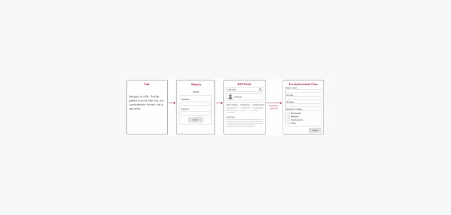 arXiv 2026-10-16 · cs.AI · #16 **[AutoOnboarder: Autonomously Onboarding LLM Agents](https://arxiv.org/abs/2610.21218)** Tanay Arora , Cong Liu Affiliation: Research Science Institute, MIT / CliGenAILab, Boston Children's Hospital [Paper](https://arxiv.org/abs/2610.21218) · [Figure source](https://arxiv.org/html/2610.21218v1/fig_executor_workflow.png) 

[EN] Abstract
Agentic large language models have been documented to lose reasoning capability when placed inside a harness, the software that mediates their observations and actions. To reconcile these losses, we introduce AutoOnboarder, an autonomous system that adapts an agent to a task the way a trainer onboards a new employee. It places the agent under the supervision of an intelligent ``Onboarder'' coding agent, which iteratively tailors its foundation model, prompt, and harness source code to simultaneously improve performance and decrease cost. Like a real onboarding process, the Onboarder is only given tens of examples, and all evaluation data is isolated on a separate virtual machine to prevent leakage. We report the lessons learned from building and testing AutoOnboarder on genomic-sequencing prior authorization form submission. Autonomously onboarded agents are able to match or exceed the performance of a Gemini 3.5 Flash baseline at up to 29$\times$ lower costs. However, these agents remain imperfect, and the Onboarding process varies greatly in terms of final performance. We conclude that future Onboarding systems require a robust environment for the Onboarder, including a structured thought interface, (controlled) internet access, and a wide model search space. <a href="https://arxiv.org/abs/2610.21218">Source</a>

[ZH] Abstract
智能体大语言模型进入运行框架——调节其观测和动作的软件——后，可能损失推理能力。为弥补这种损失，我们提出 AutoOnboarder，像培训者为新员工做入职培训一样，让智能体自主适配任务。它让智能体接受智能编码“Onboarder”的监督，迭代调整基础模型、提示和框架源代码，以同时提高性能、降低成本。类似真实入职流程，Onboarder 只获得数十个示例，所有评估数据隔离在独立虚拟机上，防止泄漏。我们报告在基因组测序事先授权表提交任务上构建和测试 AutoOnboarder 的经验。自主适配的智能体能够达到或超过 Gemini 3.5 Flash 基线表现，成本最高降低至约二十九分之一。但这些智能体仍不完美，入职过程的最终表现差异很大。我们认为，未来 Onboarding 系统需要为 Onboarder 提供可靠环境，包括结构化思考接口、受控互联网访问和广泛的模型搜索空间。 <a href="https://arxiv.org/abs/2610.21218">Source</a>
 | 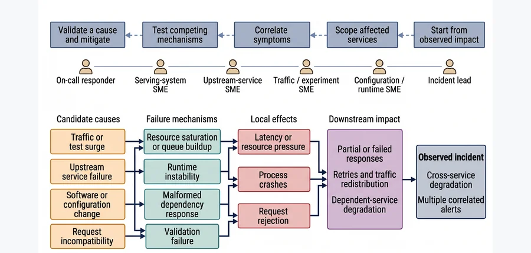 arXiv 2026-10-16 · cs.AI · #17 **[Diviner: Agentic RCA with Human-Governed Adaptation for Large-Scale Infrastructure](https://arxiv.org/abs/2610.21281)** Pradipta Ghosh , Gaurav Mitra , Shripad Nadgowda , Akshil Shah , Junyu Liu , Canturk Isci , Syamla Bandla , Xinyao Hu , On… Affiliation: Meta, Inc. [Paper](https://arxiv.org/abs/2610.21281) · [Figure source](https://arxiv.org/html/2610.21281v1/figures/incident_flow.jpeg) 

[EN] Abstract
Root-cause analysis (RCA) in large-scale distributed systems is challenging because a single symptom can cross service, data, configuration, compute, and organizational boundaries. Responders must assemble incomplete evidence and coordinate experts who hold different parts of the causal path. Generic language-model agents do not solve this problem through tool access alone: they can use stale or mistimed context, interpret failed queries as absent symptoms, report unsupported system state, and overload observability services designed for human-paced use. We present Diviner (Domain-Informed Verifiable Incident Navigation through Evidence and Review), an agentic RCA system operating at Meta and organized around a four-stage reliability lifecycle. Encode combines a large corpus of reviewed incidents with service-owner expertise to produce scoped, versioned skills, workflows, typed tools, and an incident knowledge graph. Execute uses an adaptive Lead and context-isolated workers to apply relevant knowledge to point-in-time evidence and maintain evidence-linked hypotheses. Evaluate compares saved investigation trajectories with responder-reviewed outcomes to measure exact cause, useful direction, and Groundedness. Adapt uses recurring gaps and on-call feedback to derive focused operational- knowledge updates, admitting them only after replay, quality checks, and owner approval. <a href="https://arxiv.org/abs/2610.21281">Source</a>

[ZH] Abstract
大规模分布式系统的根因分析（RCA）十分困难，因为单个症状可能跨越服务、数据、配置、计算和组织边界。响应者必须汇集不完整证据，协调分别掌握因果路径片段的专家。通用语言模型智能体仅有工具访问并不能解决这些问题：它们可能使用陈旧或时机不当的上下文，将查询失败误解为症状不存在，报告无证据的系统状态，并使原本为人类节奏设计的可观测服务过载。我们提出在 Meta 运行的 Diviner（通过证据与审查开展领域知情、可验证事件导航），围绕四阶段可靠性生命周期组织。Encode 将大量已审阅事件与服务所有者经验结合，形成有作用域、带版本的技能、工作流、类型化工具和事件知识图。Execute 使用自适应 Lead 和上下文隔离的工作者，将相关知识应用到特定时间点证据，并维护证据关联假设。Evaluate 将保存的调查轨迹与响应者审阅的结果比较，测量精确原因、有用方向和证据扎实度。Adapt 利用反复出现的缺口和轮值反馈，形成聚焦的操作知识更新，仅在通过回放、质量检查和所有者批准后接纳。 <a href="https://arxiv.org/abs/2610.21281">Source</a>
 | 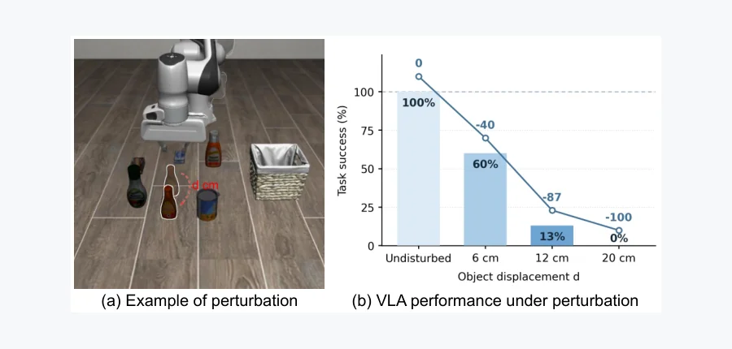 arXiv 2026-10-16 · cs.RO · #18 **[CarryOn: A Dual-Loop Harness for Personalized and Reliable Robot Assistance](https://arxiv.org/abs/2610.21453)** Zixuan Wang , Yuqi Liu , Yuxin Chen , Sengqiao Yang , Jinhui Ye , Pengguang Chen , Changsheng Lu , Shu Liu , Bei Yu , Jiay… Affiliation: HKUST / CUHK / SmartMore (source abbreviations) [Paper](https://arxiv.org/abs/2610.21453) · [Code](https://github.com/JIA-Lab-research/CarryOn) · [Figure source](https://arxiv.org/html/2610.21453v1/disturbance_response.png) 

[EN] Abstract
While generalist vision-language-action (VLA) models have enabled diverse open-world manipulation, real-world robotic assistance requires two critical capabilities they currently lack: personalization and reliable execution. First, executing an instruction like "make me a sandwich" requires grounding subtask decomposition in persistent user preferences rather than relying on a single generic solution. Second, reliable deployment demands explainable safety assurance that proactively prevents hazards and gracefully recovers from occasional physical failures. To address these gaps, we present CarryOn, a dual-loop harness designed to augment a frozen VLA policy. The planning loop maintains persistent user-level and scene-level context that is continually grounded against new observations and revised through interaction, enabling personalized task selection and execution grounding across conversations and changing scenes. The execution loop actively supervises policy rollouts, shielding actions from predicted hazardous contact. When execution fails, the system invokes reusable control-based recovery skills that restore task progress and are refined through reflection on earlier failures. On a real robot and in simulation, CarryOn dispatches preference-consistent subtasks across users and scenes, reduces the violation rate of an already safety-finetuned VLA from 52.6% to 6.1%, and increases recovery success from 13% to 80% when refined skills are reused. <a href="https://arxiv.org/abs/2610.21453">Source</a>

[ZH] Abstract
通用视觉语言动作（VLA）模型已支持多种开放世界操作，但真实机器人辅助仍需要两种当前不足的能力：个性化和可靠执行。首先，“给我做一个三明治”这样的指令，需要根据持久用户偏好分解子任务，而不是使用单一通用方案；其次，可靠部署需要可解释安全保障，主动防止危险，并从偶发物理失败中平稳恢复。我们提出 CarryOn，为冻结 VLA 策略增加双循环运行框架。规划循环维护持久的用户级和场景级上下文，不断以新观测为依据、通过交互修正，从而跨对话和变化场景实现个性化任务选择与执行落地。执行循环主动监督策略执行，屏蔽预计会导致危险接触的动作。执行失败时，系统调用可复用的控制型恢复技能恢复任务进展，并根据此前失败反思细化技能。在真实机器人和仿真中，CarryOn 跨用户与场景分派符合偏好的子任务，将已经过安全微调的 VLA 的违规率从 52.6% 降到 6.1%，在复用改进技能时将恢复成功率从 13% 提高到 80%。 <a href="https://arxiv.org/abs/2610.21453">Source</a>
 |
| 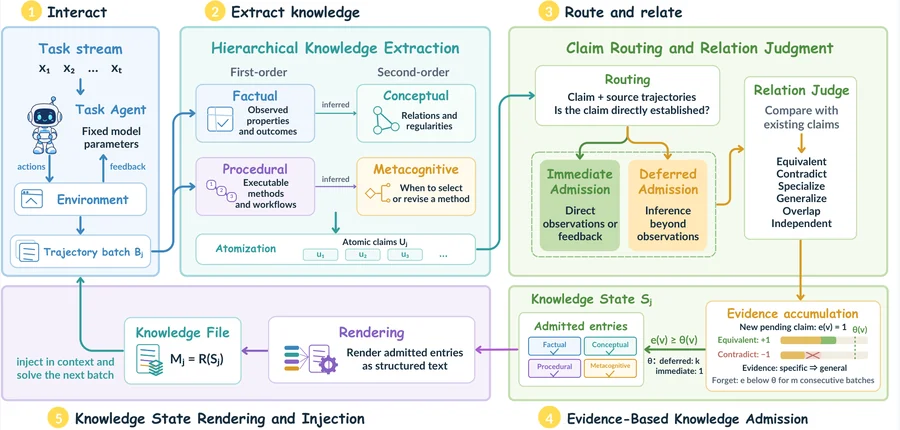 arXiv 2026-10-16 · cs.CL · #19 **[Reliable Knowledge Acquisition for Continual Learning Agents](https://arxiv.org/abs/2610.21739)** Yixu Huang , Jiaqi W. Ma Affiliation: University of California Davis / University of Illinois Urbana-Champaign [Paper](https://arxiv.org/abs/2610.21739) · [Figure source](https://arxiv.org/html/2610.21739v1/method_diagram.png) 

[EN] Abstract
As agents powered by foundation models move into open-ended environments, continual learning from experience becomes essential. For agents built on models with fixed parameters, this learning requires reusing prior task experience in context to improve performance and efficiency on future tasks. Existing memory and experience-learning systems typically focus on either retained facts or procedures, and lack a mechanism for establishing the reliability of claims extracted from the ongoing task stream. Indeed, we find that approximately 12--33\% of entries produced by representative systems harm future task performance when reused. To address these limitations, we propose \textbf{RIKA} (Reliable Knowledge Acquisition), which combines hierarchical extraction of factual, conceptual, procedural, and metacognitive knowledge with Evidence-based Knowledge Admission, which uses source evidence and subsequent experience to govern which claims enter the task agent's context, without additional validation tasks. Across six task streams from Continual Learning Bench and four model backbones, RIKA achieves the highest aggregate score on every backbone. <a href="https://arxiv.org/abs/2610.21739">Source</a>

[ZH] Abstract
随着基础模型智能体进入开放式环境，从经验持续学习变得重要。对于参数固定的模型，这种学习需要在上下文中复用先前任务经验，提高未来任务表现与效率。现有记忆和经验学习系统往往聚焦保留事实或程序中的一种，缺少机制来确定从持续任务流中提取断言的可靠性。我们发现，代表性系统产生的条目中，约 12%—33% 在复用时会损害未来任务表现。为此，我们提出 RIKA（可靠知识获取），将事实、概念、程序和元认知知识的分层提取，与基于证据的知识准入结合。准入利用来源证据和后续经验，控制哪些断言进入任务智能体上下文，无需额外验证任务。在 Continual Learning Bench 的六个任务流、四个骨干上，RIKA 在每个骨干上均获得最高汇总分数。 <a href="https://arxiv.org/abs/2610.21739">Source</a>
 | 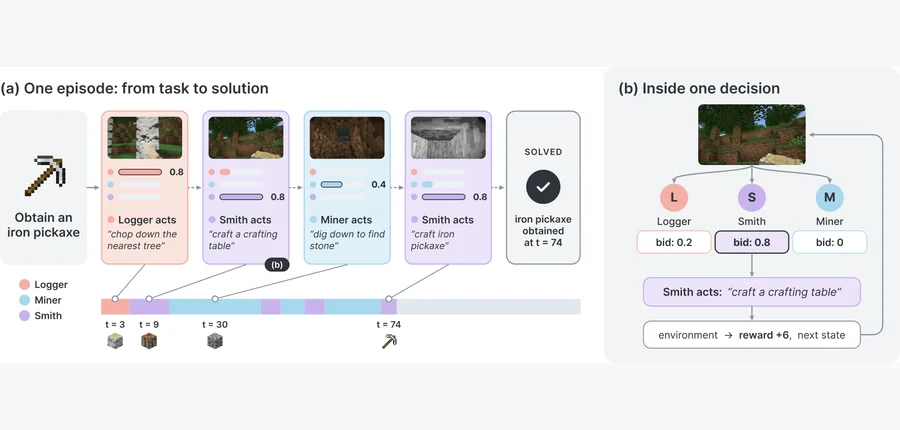 arXiv 2026-10-16 · cs.MA · #20 **[Learning Self-Orchestration in Decentralized Agent Swarms](https://arxiv.org/abs/2610.22322)** Guowei Xu , Zhenting Qi , Amani Kiruga , Himabindu Lakkaraju , Yilun Du Affiliation: Harvard University [Paper](https://arxiv.org/abs/2610.22322) · [Code](https://github.com/Embodied-Minds-Lab/MPT) · [Figure source](https://arxiv.org/html/2610.22322v1/pipeline.png) 

[EN] Abstract
The capabilities of an agent swarm depend on both its individual members and how they coordinate. Yet existing multi-agent systems often train agents within fixed orchestration structures, separating the learning of individual capabilities from the organization of collective behavior. We introduce market-based post-training (MPT), a framework for jointly learning action policies and self-orchestration in decentralized agent swarms. Agents express their willingness to participate through bids, which determine who acts and how collective outcomes provide local training credit. Learning both action and bidding behavior allows individual capabilities and patterns of participation to adapt together without a central coordinating agent. We evaluate MPT on embodied crafting, robot navigation, and deep research. Results show gains over monolithic post-training and confirm that agent participation indeed evolves with learning. With the same post-trained action policies, learned self-orchestration outperforms alternative coordination strategies. Ablations show that both action and bidding benefit from learning, and that learned bids provide more effective action-training signals. Beyond the original training objectives, trained swarms adapt faster to related tasks and achieve better performance with larger populations at inference time. Larger populations also suffer smaller performance losses under agent dropout, demonstrating that learned self-orchestration supports reuse, scaling, and robustness in decentralized agent swarms. Code and trained models are available at this https URL . <a href="https://arxiv.org/abs/2610.22322">Source</a>

[ZH] Abstract
智能体群能力同时取决于各成员能力和协调方式。但现有多智能体系统通常在固定编排结构中训练，将个体能力学习与集体行为组织分离。我们提出基于市场的后训练（MPT），联合学习去中心化智能体群的动作策略和自编排。智能体用出价表达参与意愿，出价决定谁行动，以及集体结果如何提供局部训练信用。共同学习动作与出价，使个体能力和参与模式无需中央协调智能体即可一起适应。我们在具身合成、机器人导航和深度研究上评估 MPT。结果表明，它优于单体后训练，智能体参与方式确实随学习进化。在相同后训练动作策略下，所学自编排优于其他协调策略。消融显示，动作与出价都受益于学习，而所学出价提供更有效的动作训练信号。在原训练目标之外，受训智能体群更快适应相关任务，推理时扩大群体也获得更好表现。更大群体在成员退出时损失更小，说明所学自编排支持去中心化群体的复用、扩展和鲁棒性。代码和训练模型见原文链接。 <a href="https://arxiv.org/abs/2610.22322">Source</a>
 | 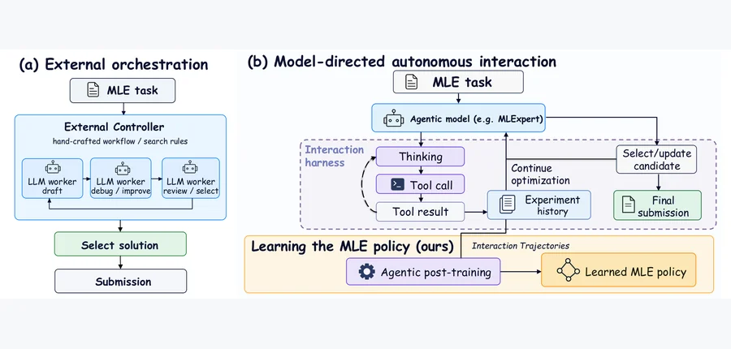 arXiv 2026-10-16 · cs.AI · #21 **[MLExpert: Towards a Generalist Agentic Model for Autonomous Machine Learning Engineering](https://arxiv.org/abs/2610.22344)** Shangheng Du , Jinxin Shi , Shuaiyu Zhang , Yiming Wu , Junpeng Zhao , Shiyang Feng , Xin Li , Liang He , Xiangchao Yan… Affiliation: Shanghai Artificial Intelligence Laboratory / East China Normal University [Paper](https://arxiv.org/abs/2610.22344) · [Figure source](https://arxiv.org/html/2610.22344v1/intro_mle_figure2.png) 

[EN] Abstract
Large language models (LLMs) are expanding from assisting scientific research and engineering to autonomously developing and improving AI systems, advancing AI for AI (AI4AI) as a pathway toward recursive self-improvement (RSI). Workflow-driven machine learning engineering (MLE) systems provide a practical path toward this pursuit through complex orchestration that manages long-horizon experimentation, while recent MLE systems adopt model-directed interaction, allowing models to autonomously organize experiments and adapt optimization strategies based on execution feedback. However, feedback from each experiment reflects several preceding decisions, and a long MLE run contains many such costly experiments. Training must therefore select useful supervision from long interaction trajectories and learn from intermediate outcomes. We propose a post-training method for autonomous long-horizon MLE optimization and apply it to train MLExpert, a 35B Mixture-of-Experts agentic model. We design the Kaggle-MLE Factory to construct executable tasks and an interaction harness for model-directed experimentation. Hierarchical agentic SFT transfers general tool-use and coding capabilities to MLE through outcome-guided supervision. Windowed Interaction RL (WIRL) treats the multi-turn decisions between successive experiment results as an execution window and assigns it a shared outcome-based reward. Asynchronous collection and policy correction support policy updates before the trajectory ends. On MLE-Bench Lite, MLExpert improves the average medal rate of the base model from 37.9% to 72.7%, achieving performance comparable to larger frontier models such as Kimi-K3 and GLM-5.3. Further experiments show that MLExpert improves performance on NatureBench Lite, agent scaffold optimization, and algorithm optimization, suggesting that the learned optimization capability generalizes to other tasks. <a href="https://arxiv.org/abs/2610.22344">Source</a>

[ZH] Abstract
大语言模型正在从辅助科研和工程扩展到自主开发与改进人工智能系统，将 AI for AI（AI4AI）推进为通向递归自我改进（RSI）的路径。流程驱动的机器学习工程（MLE）系统通过复杂编排管理长时程实验，为这一目标提供实践方式；近期系统采用模型主导交互，让模型自主组织实验、依据执行反馈调整优化策略。但每次实验的反馈涉及此前多个决策，而长 MLE 执行又包含许多昂贵实验，因此训练必须从长交互轨迹选择有用监督，并从中间结果学习。我们提出自主长时程 MLE 优化的后训练方法，用其训练 35B 混合专家智能体模型 MLExpert。我们设计 Kaggle-MLE Factory，构建可执行任务和模型主导实验的交互框架。分层智能体 SFT 通过结果引导监督，将通用工具和代码能力迁移到 MLE。窗口交互强化学习（WIRL）将连续实验结果之间的多轮决策视为执行窗口，赋予共享的结果奖励。异步采集和策略校正支持在轨迹结束前更新策略。在 MLE-Bench Lite 上，MLExpert 将基础模型平均获奖牌率从 37.9% 提高到 72.7%，达到 Kimi-K3、GLM-5.3 等更大前沿模型的相近水平。进一步实验显示，它还提高 NatureBench Lite、智能体支架优化和算法优化的表现，表明所学优化能力可泛化到其他任务。 <a href="https://arxiv.org/abs/2610.22344">Source</a>
 |
| 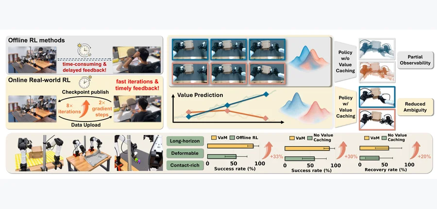 arXiv 2026-10-16 · cs.RO · #22 **[Value as Memory: Online Value-Guided Post-training for General Robot Policies](https://arxiv.org/abs/2610.22368)** Wenye Yu , Yijin Chen , Kaiyi Xiong , Wenbo Han , Wendi Chen , Yang Jin , Han Xue , Jun Lv , Cewu Lu , Chuan Wen Affiliation: Shanghai Jiao Tong University / Shanghai Innovation Institute / Noematrix Ltd. [Paper](https://arxiv.org/abs/2610.22368) · [Project](https://virlus.github.io/vam/) · [Figure source](https://arxiv.org/html/2610.22368v1/teaser-compressed.png) 

[EN] Abstract
Real-world post-training of generalist robot policies faces two challenges: partial observability makes action selection ambiguous, while offline post-training methods delay feedback from deployment experience. We present Value as Memory (VaM), a framework that addresses these challenges through value caching and online real-world reinforcement learning (RL). Value caching conditions actions on recent value predictions as task-progress memory, while online updates enable timely policy improvement by combining offline demonstrations, off-policy interventions, and on-policy rollouts for sample-efficient adaptation. As a result, VaM transitions from offline RL warmup to online autonomous learning with sparse rewards. Across long-horizon tasks involving deformable objects and contact-rich manipulation, VaM yields a mean absolute success-rate gain of $29.4\%$ with value caching, while achieving a $32.8\%$ gain with online autonomous learning over matched offline training. The evaluated online schedule performs $8\times$ as many policy iterations under the same gradient-step budget, with more than $2\times$ lower recorded time per gradient step with concurrent data collection and training. <a href="https://arxiv.org/abs/2610.22368">Source</a>

[ZH] Abstract
通用机器人策略的真实世界后训练面临两个挑战：部分可观测性使动作选择有歧义，离线后训练又延迟了部署经验的反馈。我们提出 Value as Memory（VaM），通过价值缓存和在线真实世界强化学习解决两者。价值缓存以近期价值预测作为任务进度记忆来条件化动作；在线更新结合离线演示、离策略干预和同策略执行，及时改进策略并实现样本高效适应。因此，VaM 从离线 RL 预热过渡到稀疏奖励下的在线自主学习。在涉及可变形物体与接触密集操作的长时程任务中，价值缓存带来平均 29.4 个百分点的绝对成功率收益，在线自主学习相对匹配离线训练带来 32.8% 的收益。评估的在线调度在相同梯度步预算下进行八倍策略迭代；数据采集和训练并行时，每个梯度步的记录用时降低超过两倍。 <a href="https://arxiv.org/abs/2610.22368">Source</a>
 | 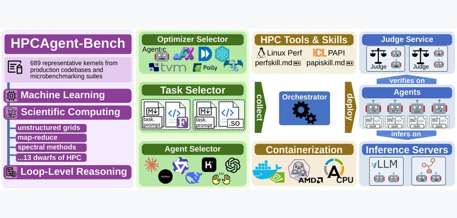 arXiv 2026-10-16 · cs.SE · #23 **[HPCAgent-Bench: A Framework for Sound Benchmarking of Code-Optimizing Agents, Harnesses, and Skills](https://arxiv.org/abs/2610.20673)** Yakup Koray Budanaz , Lorenzo Paleari , Marcin Copik , Alexandru Calotoiu , Timo Schneider , Benjamin Chen Ming Choong , S… Affiliation: ETH Zurich / Institute of High Performance Computing, A*STAR [Paper](https://arxiv.org/abs/2610.20673) · [Figure source](https://arxiv.org/html/2610.20673v1/agentbench_v11_is.png) 

[EN] Abstract
Coding agents are increasingly used to optimize code, but existing benchmarks fix one accelerator, programming model or harness, so they cannot isolate what each component contributes or show whether added skills and tools repay their cost. We present HPCAgent-Bench with 689 kernels in three tracks: loop-level optimization challenges, kernels extracted from HPC codes, and machine-learning models. The framework specifies each kernel once in NumPy, derives C and Fortran references, accepts submissions through a common C ABI or Python interface, and runs them on CPUs or GPUs, on one or multiple nodes. An external judge checks correctness on hidden fuzzed inputs and times each submission, closing paths agents use to exploit the testing system. We introduce two metrics for reporting results: \textit{intervention efficacy} measures an intervention, such as adding a tool, through paired runs on speedup, success rate and cost, and \textit{weighted token cost} reports input, cached-input and output tokens under explicit weights. Agents reach up to $4.2\times$ speedup over automatic parallelizers, and their optimizations transfer to another machine: $93$--$99\%$ of answers without device-specific code remain correct, and per-kernel speedups keep a rank correlation of $r_s\ge0.84$. Across 40 matched setups, interventions significantly change speedup only twice but token cost by up to $3.0\times$. Because token weighting decides whether a saving is significant, we state the weights and release every token count as a standard for cost reporting. We provide the first comprehensive, broad and hardened benchmark for the sound evaluation of agentic optimization, with transparent cost metrics. <a href="https://arxiv.org/abs/2610.20673">Source</a>

[ZH] Abstract
编码智能体越来越多地被用于优化代码，但现有基准往往固定一种加速器、编程模型或运行框架，无法分离各组件贡献，也不能说明新增技能和工具的收益是否抵偿成本。我们提出 HPCAgent-Bench，包含 689 个内核，分为循环级优化挑战、从高性能计算代码提取的内核，以及机器学习模型三个赛道。框架用 NumPy 只定义一次内核，派生 C 和 Fortran 参考，通过通用 C ABI 或 Python 接口接收提交，并在单节点或多节点的 CPU/GPU 上运行。外部裁判用隐藏模糊输入检查正确性、测量耗时，关闭智能体利用测试系统的途径。我们引入两个结果指标：干预效能通过配对运行，衡量增加工具等干预对加速比、成功率和成本的影响；加权词元成本在明确权重下报告输入、缓存输入和输出词元。智能体相对自动并行化器达到最高 4.2 倍加速，优化也能迁移到其他机器：不含设备特定代码的答案有 93%—99% 仍正确，逐内核加速比秩相关为 $r_s\ge0.84$。在 40 个匹配设置中，干预仅两次显著改变加速比，却能使词元成本变化最高三倍。由于词元权重决定节省是否显著，我们明确给出权重并公开每项词元计数，作为成本报告标准。我们提供全面、广泛且加固的智能体优化评估基准，以及透明成本指标。 <a href="https://arxiv.org/abs/2610.20673">Source</a>
 | 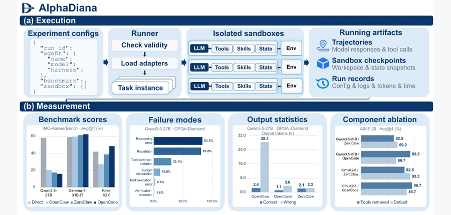 arXiv 2026-10-16 · cs.AI · #24 **[AlphaDiana: A Measurement System for Agents in Verifiable Reasoning Tasks](https://arxiv.org/abs/2610.20675)** Zhanke Zhou , Zongze Li , Weikai Huang , Xuan Li , Chentao Cao , Xiao Feng , Xiangyu Lu , Jinbo Hu , Yi Xie , Nico Pelleri… Affiliation: Hong Kong Baptist University / University of Arizona / Zuse Institute Berlin / Technical University of Berlin / Stanford University / Shanghai Jiao Tong University [Paper](https://arxiv.org/abs/2610.20675) · [Figure source](https://arxiv.org/pdf/2610.20675#page=2) 

[EN] Abstract
Agents pair reasoning models with harnesses that organize model calls, execute tools, load skill instructions, and retain history in memory. Understanding agent performance requires linking execution conditions to outcomes, behavior, and resource use. We introduce AlphaDiana, a measurement system with modular interfaces for datasets, agents, environments, and scorers. It preserves harness-native control loops while controlling file reuse and memory retention separately. AlphaDiana supports macro analyses of complete agents and micro interventions on agent components such as tools, skills, and memory under matched conditions. We study three open-source models and three open-source harnesses on five answer-based benchmarks, with two models also tested on two interactive benchmarks. We find that harnesses do not consistently improve the accuracy of reasoning: gains on questions unsolved by the model alone can be outweighed by losses on questions it answers correctly without tools. This inconsistency extends to component interventions: neither skill guidance nor retained history reliably improves accuracy. Behavior and output-token use must be assessed with correctness: low token entropy can accompany wrong answers, and less output per execution can mean more output tokens per correct answer when accuracy falls. AlphaDiana links answer correctness and execution status to traces and resource records for comparing agents and diagnosing failures under shared task and resource policies. <a href="https://arxiv.org/abs/2610.20675">Source</a>

[ZH] Abstract
智能体将推理模型与运行框架结合，由框架组织模型调用、执行工具、加载技能指令并在记忆中保留历史。理解智能体表现需要将执行条件与结果、行为、资源使用联系起来。我们提出 AlphaDiana，为数据集、智能体、环境和评分器提供模块化接口的测量系统。它保留框架原生控制循环，同时分别控制文件复用和记忆保留。AlphaDiana 支持完整智能体的宏观分析，也支持在匹配条件下对工具、技能、记忆等组件进行微观干预。我们研究三个开源模型、三个开源框架在五个答案型基准上的表现，其中两个模型还接受两个交互基准测试。我们发现，框架并不总能提高推理准确率：对模型独自无法解决的问题取得的收益，可能被原本不用工具就能正确回答的问题上的损失抵消。这种不一致也延伸到组件干预：技能指导和历史保留都不能可靠提高准确率。行为和输出词元使用必须与正确性共同评估：低词元熵可以伴随错误答案；当准确率下降时，每次执行输出更少，也可能意味着每个正确答案需要更多输出词元。AlphaDiana 将答案正确性、执行状态与轨迹和资源记录连接起来，以在共享任务及资源策略下比较智能体、诊断失败。 <a href="https://arxiv.org/abs/2610.20675">Source</a>
 |
| 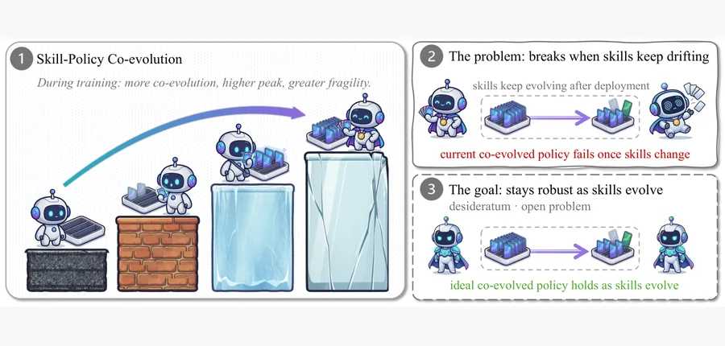 arXiv 2026-10-16 · cs.AI · #25 **[Evolving Together, Failing Apart: The Skill-Policy Co-evolution Trap in Self-Improving Agents](https://arxiv.org/abs/2610.20845)** Yujie Feng , Xiaobin Wang , Jinluan Yang , Xiaonan Shi , Pengjun Xie , Philip S. Yu , Xiaoming Wu , Jieping Ye Affiliation: Alibaba Token Hub, Alibaba Group / Hong Kong Polytechnic University / University of Illinois at Chicago [Paper](https://arxiv.org/abs/2610.20845) · [Figure source](https://arxiv.org/html/2610.20845v1/fig1new3.png) 

[EN] Abstract
Skill-policy co-evolution, in which an agent's policy model and its skill bank improve each other during training, is a promising paradigm for self-improving agents. Current evaluations score the co-evolved policy on the final bank it trained with (the delivered bank). After deployment, however, skills may be rewritten, added or removed more frequently than the policy model is retrained, leaving the policy to operate on a drifted skill bank that neither the training objective nor existing evaluation protocols address. In this paper, we first establish, through theoretical and empirical analysis, that the fragility hidden by this blind spot is not incidental. The acceptance rule these methods share (cooperative acceptance) ties a policy's competence to the bank it co-evolved with, leaving it fragile once skills drift, regardless of the implementation; empirically, sensitivity to skill drift grows as co-evolution training proceeds. We therefore introduce the CO-evolution Drift Audit (CODA), a deployment-oriented evaluation protocol that simulates skill drift and, alongside success rate under worst-case drift, introduces two new metrics: a consistency rate under meaning-preserving edits and a resistance rate to corrupted skills. Across four co-evolution methods and five benchmarks (six settings), worst-case success is 5-13 points below the peak measured for each delivered pair, erasing 52-93% of the delivered bank's gain over the no-skill baseline. CODA thus reframes the target of co-evolution, from peak performance on the co-evolved bank to the ability to harness skills however they evolve, and provides a shared standard against which future methods can be audited. <a href="https://arxiv.org/abs/2610.20845">Source</a>

[ZH] Abstract
技能—策略协同进化使智能体策略模型与技能库在训练中相互改进，是自改进智能体的一种有前景范式。当前评估使用策略训练时最终得到的技能库，即交付库，对协同进化后的策略评分。但部署后，技能重写、增删的频率可能高于模型重新训练，策略于是面对漂移后的技能库，而训练目标和现有评估协议都没有覆盖这种情况。我们首先通过理论和实证分析说明，这一盲区掩盖的脆弱性并非偶然。这些方法共享的合作准入规则，将策略能力绑定到共同进化的技能库，使其在技能漂移时无论具体实现如何都很脆弱；实验中，技能漂移敏感性随协同进化训练推进而增长。我们提出面向部署的协同进化漂移审计（CODA），模拟技能漂移，除最坏漂移下的成功率外，还引入语义保持编辑下的一致率和抵抗受损技能的抗性率。在四种协同进化方法、五个基准的六种设置中，最坏成功率比各交付组合测得的峰值低 5—13 分，抹去交付技能库相对无技能基线收益的 52%—93%。CODA 因而将协同进化目标从共同进化库上的峰值表现，转向无论技能如何变化都能使用技能的能力，并为审计未来方法提供统一标准。 <a href="https://arxiv.org/abs/2610.20845">Source</a>
 | 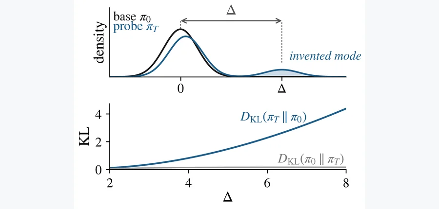 arXiv 2026-10-16 · cs.LG · #26 **[Multi-Reward Hacking: From Aggregation-Induced Drift to Trust-Anchored Defense](https://arxiv.org/abs/2610.21404)** Yushu Li , Jiin Woo , Xiaoxiao Li , Youngsuk Park Affiliation: University of British Columbia / Amazon Annapurna Labs [Paper](https://arxiv.org/abs/2610.21404) · [Figure source](https://arxiv.org/html/2610.21404v1/figures/kl_direction_arxiv.png) 

[EN] Abstract
To improve task performance while encouraging desirable response properties, LLM post-training often combines a primary reward (e.g., correctness) with auxiliary rewards (e.g., brevity or efficiency). However, how these rewards are aggregated can critically affect training outcomes. We show that symmetric aggregation, which treats reward channels equally, can induce a failure where aggregate reward improves while primary-task performance degrades, even when individual rewards are meaningful. We investigate this aggregation-induced failure through a one-step multi-reward decision formulation, characterizing when it constitutes multi-reward hacking. We prove that, under symmetric aggregation, deterministic conditional-mean GRPO converges to auxiliary-favoring behavior when auxiliary rewards are more reliably obtained, regardless of initialization. We propose Trust-Anchored Gating (TAG), which first elects an anchor channel based on the policy drift induced by optimizing each channel alone, then gates auxiliary credit on anchor satisfaction. Unlike calibration-sensitive static reweighting, TAG structurally eliminates credit for auxiliary-only outcomes while preserving additional credit for joint success. In the same analytical setting, TAG provably reverses this selection, converging to the primary-favoring action from any initialization when the primary channel is anchored. Experiments across Qwen and Llama models on mathematics and program synthesis reveal substantial degradation under symmetric, constrained, and normalized aggregation, whereas TAG mitigates this failure. On Qwen3-4B with a brevity reward, TAG achieves 0.581 pass@4 versus 0.220 for additive aggregation, while shortening responses by 44% relative to correctness-only training. <a href="https://arxiv.org/abs/2610.21404">Source</a>

[ZH] Abstract
大语言模型后训练常将主要奖励（如正确性）与辅助奖励（如简短或高效）结合，以提升任务表现并鼓励期望属性。但聚合方式会显著影响训练结果。我们表明，即使各奖励都有意义，平等对待奖励通道的对称聚合也可能导致汇总奖励提高、主要任务表现下降。我们用单步多奖励决策形式研究这种聚合诱发失败，刻画它何时构成多奖励投机。我们证明，在对称聚合下，确定性条件均值 GRPO 会在辅助奖励更易可靠获得时，收敛到偏向辅助目标的行为，与初始化无关。我们提出信任锚定门控（TAG），先依据单独优化每个通道引起的策略漂移选出锚通道，再以锚目标满足为条件授予辅助信用。不同于依赖校准的静态重加权，TAG 从结构上取消仅辅助成功的得分，同时保留联合成功的额外信用。在相同分析设置下，当主要通道为锚时，TAG 被证明从任意初始化收敛到偏向主要目标的动作，逆转此前选择。在 Qwen、Llama 的数学和程序合成实验中，对称、约束和归一化聚合均出现明显退化，TAG 缓解该失败。Qwen3-4B 使用简短奖励时，TAG 的 pass@4 为 0.581，加法聚合为 0.220，同时回复比仅正确性训练缩短 44%。 <a href="https://arxiv.org/abs/2610.21404">Source</a>
 | 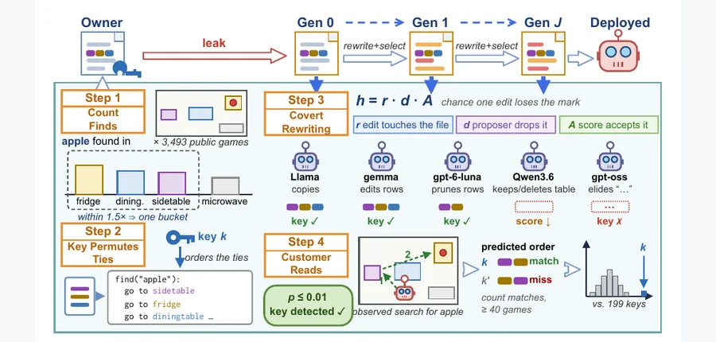 arXiv 2026-10-16 · cs.CR · #27 **[What Survives Self-Evolution: Provenance Marks in Copied Agent Harnesses](https://arxiv.org/abs/2610.21458)** Jieyu Li , Jingya Li , Sheng Li , Xinpeng Zhang , Zhenxing Qian Affiliation: Fudan University [Paper](https://arxiv.org/abs/2610.21458) · [Figure source](https://arxiv.org/pdf/2610.21458#page=2) 

[EN] Abstract
Agent harnesses, the prompt and tool code around a base model, leak. Claude Code's 512,000 lines were mirrored within hours of a packaging error. A plagiarist can pass a leaked harness through a published self-evolver and ship the result as its own. We define this as a covert rewriting attack. No one targets a provenance mark, yet a large language model (LLM) proposer rewrites the file that carries it and a score keeps the better rewrites. We give the first measurement of marks under this attack, with three evolvers, five proposers and two environments. Published marks fail. KGW in the prompt survives GEPA's rewrites in 0 of 12 copies, AgentMark as released in 5 of 12. The proposer's habits decide survival, by two orders of magnitude across models, and selection protects a mark only when each decision sees enough games. We then build a mark for this attack. Its key is the order of near-tied entries of a table of where objects are found, built from public games, so deleting the table costs success, rewrites that keep its rows keep the order, and a customer reads the key from the agent's actions alone. On held-out games it is detected in 62 of 76 copies whose lineage rewrote its file. A scheme-aware plagiarist reshuffles the ties at no measurable cost, and a plagiarist who asks the proposer for more general code removes the key in 75-100% of rewrites. <a href="https://arxiv.org/abs/2610.21458">Source</a>

[ZH] Abstract
基础模型周围的提示和工具代码，即智能体运行框架，会发生泄漏；Claude Code 的 512,000 行代码在打包错误数小时内被镜像。抄袭者可以用公开自进化器改写泄漏框架，再作为自己的产品发布。我们将其定义为隐蔽重写攻击：没人直接针对来源标记，但大语言模型提议者重写承载标记的文件，评分选择较好的改写。我们首次在三种进化器、五种提议者、两个环境中测量这种攻击下的标记存续。现有公开标记失效：提示中的 KGW 在 GEPA 重写后 12 份中存续零份，发布版 AgentMark 存续 5 份。不同提议模型习惯使存续相差两个数量级，只有每次选择看到足够游戏时，选择机制才保护标记。我们随后为这种攻击构建标记：密钥是基于公开游戏生成的物体位置表中近似并列条目的顺序。删除表会损害成功率，保留表行的改写会保留顺序，客户仅从动作就能读出密钥。在留出游戏中，76 份谱系重写过标记文件的副本中有 62 份被检测到。但了解方案的抄袭者能够以不可测成本重新排列并列项；要求提议者生成更通用代码的抄袭者，能在 75%—100% 的改写中去除密钥。 <a href="https://arxiv.org/abs/2610.21458">Source</a>
 |
| 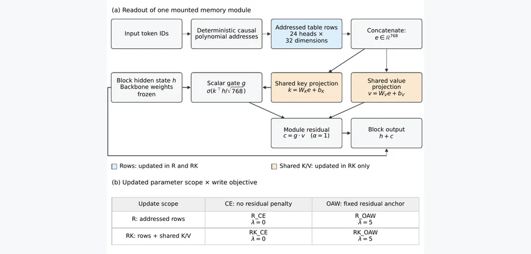 arXiv 2026-10-16 · cs.CL · #28 **[Writability and the Pathway: A Controlled Study of Knowledge Injection into Addressed Memory](https://arxiv.org/abs/2610.21553)** Wei Gao (1), Cheng Tian (1), Duan Yang (2), Jianqing Yin (1) ((1) Shibei Qiyuan AI Technology, (2) Xi'an Jiaotong University) Affiliation: Shibei Qiyuan AI Technology / Xi'an Jiaotong University [Paper](https://arxiv.org/abs/2610.21553) · [Figure source](https://arxiv.org/pdf/2610.21553#page=5) 

[EN] Abstract
Addressed conditional memory provides a local surface for post-hoc knowledge injection, but a successful write need not transfer to a new question or preserve untargeted behavior. This study combines a controlled GPT-2 comparison with production-memory experiments on Qwen3.8-Flash-Next-FP8 and DeepSeek-V4.1-Flash. Newly initialized modules attached to frozen GPT-2 are tested in a 2 x 2 design: row-only versus row-plus-projection updates, each with or without fixed module-residual anchoring. All arms reproduce 50 trained completions in each of three sampling seeds. Natural-question target-string hits average 5.3% for both row-only arms, 28.7% for unanchored projection updates, and 22.0% with anchoring, while strict answer scores remain zero. Anchoring lowers measured drift; lexical hits do not establish entity-specific retrieval. In the archived Qwen experiments, gradient writes make the designated first answer token top-ranked for 132 independently reset targets, comprising 93 new promotions and 39 already top-ranked targets. A separate matched 24-target comparison gives 13 new promotions with Adam versus two with SPSA at equal iteration counts but unequal computational procedures. An 80-row case includes saved continuations and a replay record, while reformulations bound its scope. Six DeepSeek zero-order cases yield one new target-token promotion and one regression. These results support bounded writing feasibility and separate trained expression, question-form behavior, and preservation; first-token rankings do not establish complete-answer success or universal conditions for writable memory. <a href="https://arxiv.org/abs/2610.21553">Source</a>

[ZH] Abstract
按地址访问的条件记忆为事后知识写入提供局部接口，但成功写入未必迁移到新问题，也未必保留非目标行为。本研究结合 GPT-2 受控比较与 Qwen3.8-Flash-Next-FP8、DeepSeek-V4.1-Flash 的生产记忆实验。在冻结 GPT-2 上附加新初始化模块，采用二乘二设计：仅行更新或行加投影更新，各自有无固定模块残差锚定。所有实验组在三个采样种子下都复现 50 条训练补全。自然问题的目标字符串命中率，两个仅行更新组均为平均 5.3%，无锚投影更新为 28.7%，有锚为 22.0%，但严格答案分数均为零。锚定降低测得漂移；词面命中并不建立实体特定检索。在存档 Qwen 实验中，梯度写入使 132 个独立重置目标的指定首答案词元排名第一，其中 93 个为新提升、39 个原已第一。另一个匹配的 24 目标比较中，相同迭代次数下 Adam 有 13 个新提升，SPSA 有两个，但计算过程并不相同。一个 80 行案例保存了后续生成和回放记录，改写问题限制其适用范围。六个 DeepSeek 零阶案例产生一个新目标词元提升及一个退化。结果支持有界写入可行性，并区分训练表达、问题形式行为和保留；首词元排名不能建立完整答案成功或可写记忆的普遍条件。 <a href="https://arxiv.org/abs/2610.21553">Source</a>
 | 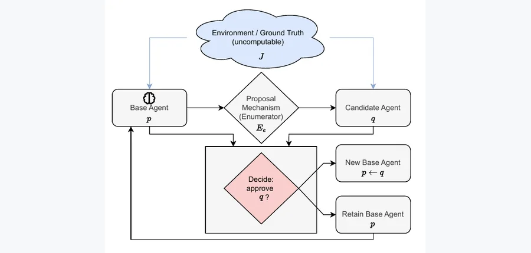 arXiv 2026-10-16 · cs.AI · #29 **[The Self-Improvement Problem](https://arxiv.org/abs/2610.21646)** Brian B. Moser , Stanislav Frolov , Tobias C. Nauen , Federico Raue , Andreas Dengel Affiliation: German Research Center for Artificial Intelligence / RPTU Kaiserslautern-Landau [Paper](https://arxiv.org/abs/2610.21646) · [Code](https://github.com/Brian-Moser/SelfImprovementProof) · [Figure source](https://arxiv.org/pdf/2610.21646#page=3) 

[EN] Abstract
With the rise of large language models, agentic systems are becoming increasingly autonomous, as they write code, call tools, revise prompts, and propose modifications to their own components. This autonomy raises a fundamental question for safe self-improvement: can an automated gate like a reward model or an automated reviewer reliably decide whether a proposed update should be accepted? The difficulty is structural. The gate must be a terminating, computable procedure, while the property we ultimately care about, namely whether an update is a genuine semantic improvement, depends on potentially unbounded program behavior. We formalize this mismatch by modeling agents as programs and defining improvement in terms of a semantic score that need not be computable. We study two evaluation abstractions. The first is a certifier that approves or rejects an update. The second is a search procedure that, given access to a proposal generator, attempts to output some improving candidate if one exists. We show that, in the fully general setting, no terminating procedure can simultaneously guarantee reliability (never accepting a non-improvement) and non-conservatism (never missing an available improvement): self-referential constructions can force any such gate or searcher to fail. Randomized gates with bounded error face the same limit. We then identify a standard decidable regime used in practice (bounded evaluation and a finite proposal budget) under which exhaustive simulation yields a terminating search procedure with the desired guarantees. We also show the limit of this recovery: a chain of accepted updates can raise the bounded score in every round while the true score falls. Our results draw a boundary between unbounded, universal settings where correctness guarantees collapse and bounded settings where they can be recovered by design. <a href="https://arxiv.org/abs/2610.21646">Source</a>

[ZH] Abstract
随着大语言模型兴起，智能体系统越来越自主，会编写代码、调用工具、修改提示并提议改变自身组件。这带来安全自改进的根本问题：奖励模型或自动审核者等自动门控，能否可靠判断是否应接受更新？困难是结构性的。门控必须是会终止、可计算的程序，但我们真正关心的更新是否构成语义改进，取决于潜在无界的程序行为。我们将智能体建模为程序，以未必可计算的语义分数定义改进，研究两种评估抽象：批准或拒绝更新的认证器，以及能够访问提议生成器、在存在改进候选时尝试输出其中一个的搜索过程。我们证明，在完全一般的设置下，任何终止过程都不能同时保证可靠性（从不接受非改进）和非保守性（从不错过可用改进）：自指构造可以迫使任何此类门控或搜索器失败。有界错误的随机门控面临相同限制。随后，我们指出实践常用的可判定区域，即有界评估和有限提议预算，此时穷举仿真能够给出具有所需保证的终止搜索过程。我们还展示这种恢复的边界：一条获准更新链可以每轮提高有界分数，真实分数却下降。结果区分无界普适情形中正确性保证崩溃，与可通过设计恢复保证的有界情形。 <a href="https://arxiv.org/abs/2610.21646">Source</a>
 | 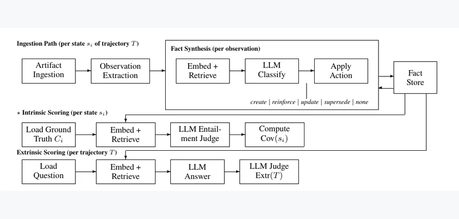 arXiv 2026-10-16 · cs.CL · #30 **[Beyond Downstream QA: Rethinking How We Evaluate Agent Memory](https://arxiv.org/abs/2610.22209)** Sebastian-Antonio Toma , Jean de Kernier , Mike Ply , Oliviu Matei Affiliation: Amazon Web Services / Technical University of Cluj-Napoca [Paper](https://arxiv.org/abs/2610.22209) · [Figure source](https://arxiv.org/pdf/2610.22209#page=6) 

[EN] Abstract
Agent memory benchmarks evaluate whether an agent's responses reflect correct knowledge, measuring downstream question-answering accuracy as a proxy for memory quality. We show this evaluation paradigm is incomplete: it conflates memory correctness with retrieval and generation quality, producing both false positives where correct responses mask broken memory and false negatives where incorrect responses blame correct memory for retrieval failures. We introduce FEB-30, a benchmark of 30 fact-evolution trajectories spanning 6 diagnostic categories and 3 difficulty levels, constructed via paradigm inversion: documents are generated from known fact trajectories, yielding deterministic ground truth without human annotation. Each trajectory defines how a fact should evolve across multi-author artifacts (documents, emails, conversations), enabling direct inspection of the memory store after each ingestion step. Applying FEB-30 to a representative memory system, we demonstrate that intrinsic and extrinsic evaluation diverge by an average of 16 percentage points, with 44% of trajectories exceeding meaningful divergence thresholds. Diagnostic decomposition reveals that the system correctly classifies memory operations (create, update, reinforce, supersede) only 20% of the time, a failure entirely invisible to extrinsic evaluation, and that failure modes differ systematically by category and difficulty. We release the benchmark, document generation pipeline, and scoring framework to support reproducible evaluation of agent memory systems. <a href="https://arxiv.org/abs/2610.22209">Source</a>

[ZH] Abstract
智能体记忆基准通常评估回复是否反映正确知识，用下游问答准确率替代记忆质量。我们表明这一范式不完整：它混淆记忆正确性、检索质量和生成质量，既会产生正确回复掩盖损坏记忆的假阳性，也会产生错误回复将检索失败归咎于正确记忆的假阴性。我们提出 FEB-30，包含六类诊断、三种难度的 30 条事实进化轨迹，通过范式反转构建：由已知事实轨迹生成文档，无需人工标注就有确定性真实答案。每条轨迹定义事实应如何跨多作者产物（文档、邮件、对话）演化，使每步摄入后都能直接检查记忆库。将 FEB-30 应用于一个代表性记忆系统，内在与外在评估平均相差 16 个百分点，44% 的轨迹超过有实际意义的差异阈值。诊断分解显示，系统对创建、更新、强化、替代等记忆操作正确分类的比例仅 20%，这一失败在外在评估中完全不可见；失败模式还随类别和难度系统变化。我们发布基准、文档生成流程和评分框架，以支持可复现的智能体记忆评估。 <a href="https://arxiv.org/abs/2610.22209">Source</a>
 |
<!-- PAPER_CARDS_END -->

## Retrieval overview

**30 selected papers: 12 A / 10 B / 8 C.** This is the requested **17 October 2026 (Beijing)** run, completed on **18 October** after interrupted retrieval. Official announcement batch: **16 October 2026**. stat.ML was retrieved on 17 October; the complete CS response was recovered on 18 October. Announcement date, requested run date and actual recovery date are recorded separately.

| Official source | Batch | New | Cross | Replacement | Complete coverage |
|---|---|---:|---:|---:|---|
| [Computer Science](https://arxiv.org/list/cs/new?skip=0&show=2000) | 2026-10-16 | 871 | 84 | 529 | 1,484 records; one page |
| [stat.ML](https://arxiv.org/list/stat.ML/new?skip=0&show=2000&check=20261017) | 2026-10-16 | 22 | 25 | 31 | 78 records; one page |
| Total | 2026-10-16 | 893 | 109 | 560 | 1,562 records |

All **893 distinct official New records** were parsed. Lexical discovery yielded 187 candidates; **37 titles and complete abstracts were semantically reviewed**, producing this focused selection of 30. This does not claim exhaustive semantic review of all New entries. The CS aggregate covers cs.AI, cs.LG, cs.CL, cs.MA, cs.SE, cs.RO, cs.CV, cs.NE and cs.CR. IDs are versionless and deduplicated, prior inclusions are excluded, and the batch follows the recovered 15 October announcement without a gap.

All 30 papers have complete English originals, full Chinese translations, source-supported affiliations and genuine illustrations: **30 EN / 30 ZH / 30 images; 0 placeholders; 0 unconfirmed affiliations**. Seven PDF crops recover six vector-extraction gaps and replace one accidentally selected Stanford logo. Eight of ten checked resource destinations were reachable and identified. Terminal-RSI's code and CoDA's project destination returned HTTP 404 and receive no buttons. Original HTML errors and partial downloads were recovered through complete HTML or PDF sources; no source failure is treated as no new papers. See the [run record](../../data/runs/2026-10-17.json) for snapshots, hashes, all observed IDs and provenance.

## Reading guide

A denotes direct RSI, B self-improvement mechanisms, and C evaluation and limits. The order is tier, then arXiv ID; it is not a comparative performance leaderboard. Tier assignment, reading priorities and mechanism interpretation are **editorial inference**. Numerical findings are **author reports**. No experiments were independently reproduced for this digest. Original headers, figures and selected passages were checked; this is not a full-text review of every included paper.

Identify the changed object: model weights, external code/harnesses, skills/memory, or within-episode state. A finite training curriculum, a stronger child model, a larger skill library and an improved improvement mechanism are different claims. Simulation and physical experiments are labeled separately. None of the reported finite loops proves unbounded recursive improvement.

## Tiered Top papers

| # | Paper | Categories | Authors | Affiliation | Tier | Update target | Reading priority |
|---:|---|---|---|---|---|---|---|

| 1 | [A Self-Improving Agent that Grows its Own DSL: Oracle-Free Operator Induction for Exact Question Answering](https://arxiv.org/abs/2610.20809) | cs.AI; cs.CL | Yun-Shiuan Chuang , Yirou Ge , Yixi Li , Yiming Bian , Zijie Pan , Jenna L. Ballard , Uma Kona , Linsey Pang , Prakhar Mehrotra | PayPal AI | A | DSL operators and persistent exact-computation capabilities | Priority read |

| 2 | [Recursive Reward Improvement via Adversarial Meta-Prompt Evolution](https://arxiv.org/abs/2610.21040) | cs.AI; cs.MA | Wei Dai , Qianchu Liu , Guanghui Qin , Xing Han , Tristan Naumann , Paul Pu Liang , Sheng Zhang | Massachusetts Institute of Technology / Microsoft Research / Johns Hopkins University | A | Task/rubric meta-prompts and solver weights | Topical reference |

| 3 | [Athanor: An Agent-Native System for Autonomous Post-Training Research](https://arxiv.org/abs/2610.21055) | cs.AI; cs.CL; cs.LG; cs.MA | Yufa Zhou , Yichen Wang , Jiakun Fan , Ziqi Shu , Zhichao Liu , Anru R. Zhang , Neiwen Ling , Zijun Wei | ByteDance / Duke University / University of Chicago / Virginia Tech | A | Post-training data, algorithms and descendant-model weights | Topical reference |

| 4 | [MemScope: Evolving Agent Memory Architectures through Localized Code Repair](https://arxiv.org/abs/2610.21170) | cs.AI | Miao Su , Yucan Guo , Zixuan Li , Long Bai , Zhongni Hou , Xiaolong Jin , Jiafeng Guo | State Key Laboratory of AI Safety / Institute of Computing Technology, CAS / University of Chinese Academy of Sciences / Meituan | A | Executable memory-architecture code | Priority read |

| 5 | [FedSkillGit: Federated Skill Evolution via Version Control](https://arxiv.org/abs/2610.21348) | cs.AI | Boxun Lan , Jiamei Li , Weijian Li , Chengyu Yang , Zhuang Qi , Chengcheng Wan , Xiaohong Chen , Ming Hu | East China Normal University / Shandong University | A | Federated skill rules and optimizer-only global experience | Topical reference |

| 6 | [MetaExp: Learning to Self-Improve through Experience via Verifiable Cross-Task Environment Scaling](https://arxiv.org/abs/2610.21492) | cs.AI | Renhao Li , Xinjie Shen , Yang Su , Jianhong Tu , Derek F. Wong , Dayiheng Liu , Min Yang | University of Macau / Shenzhen Institute of Advanced Technology, CAS / Georgia Institute of Technology / Alibaba Token Hub, Alibaba Group | A | Experience-learning policy weights, then deployment experience | Topical reference |

| 7 | [RSIFlow: Adaptive Self-Improvement Workflows with an Evolving Meta-Agent](https://arxiv.org/abs/2610.21791) | cs.AI | Huan Zhang , Mingju Chen , Dongxu Zhou , Can Lv , Sen Cui , Faguo Wu , Shiji Zhou | Beihang University / Tsinghua University / Beijing Academy of Artificial Intelligence | A | Component-specific workflows and meta-agent harness | Topical reference |

| 8 | [MetaShare: Failure-Aware Collective Self-Improvement for Open-Ended Agents](https://arxiv.org/abs/2610.21887) | cs.MA | Vishal Bhutani , Prasang Gupta , Sumanth Chundru , Kevin Paul | PricewaterhouseCoopers (PwC) | A | Agent modifications and cross-lineage mechanism memory | Topical reference |

| 9 | [CoWorld Reasoner: Agentic Multimodal Reasoning with the Evolving Video World Model-Driven Harness](https://arxiv.org/abs/2610.21910) | cs.AI | Dongjie Cheng , Ruifeng Yuan , Ran Wei , Ning Song , Yongqi Li , Wenjie Li | Hong Kong Polytechnic University / Hangzhou Diagens Biotechnology | A | VWM tools, skills and execution code | Topical reference |

| 10 | [Selection Is Not Learning: Choosing Model Futures](https://arxiv.org/abs/2610.22029) | cs.LG; cs.AI; cs.CL | Haoyi Yang , Kshitij Mishra , Nils Lukas , Salem Lahlou | Mohamed bin Zayed University of Artificial Intelligence | A | Parameter inheritance and experience inheritance | Priority read |

| 11 | [Terminal-RSI: Recursive Self-Improving Terminal Agents via Recursive Self-Rewrite and Policy-Refine](https://arxiv.org/abs/2610.22192) | cs.AI | Junyao Yang , Zongxia Li , Yucheng Shi , Zhongzhi Li , Ruhan Wang , Ruiwen Zhou , Haitao Mi , Shuicheng Yan , Leowei Liang | Tencent Hy Frontier / National University of Singapore / University of Maryland, College Park / University of Georgia / Indiana University | A | Terminal policy weights, verified trajectories and inherited critic | Topical reference |

| 12 | [CoDA: Co-Evolution of Data Engines and Action Policies](https://arxiv.org/abs/2610.22362) | cs.RO; cs.AI | Tianjiao Yu , Zhilin Ou , Yifan Shen , Xinzhuo Li , Yuanzhe Liu , Onkar Kishor Susladkar , Fan Wang , Ismini Lourentzou | University of Illinois Urbana-Champaign / Chinese University of Hong Kong, Shenzhen / Amazon | A | Simulation generation/training programs and action policy | Topical reference |

| 13 | [EvolvingBrain: An Adaptive Skill System for Multi-modal Agents Self-Evolution in Open Worlds](https://arxiv.org/abs/2610.20786) | cs.AI | Runxuan Liu , Jingqi Shi , Baoxin Wang , Honghong Zhao , Haoyuan Xu , Yueqing Sun , Jiafeng Liang , Tao He , Dayong Wu , Qi Gu , Shijin Wang , Ming Liu , Bing Qin | Harbin Institute of Technology / iFLYTEK / Meituan / Pengcheng Laboratory | B | Layered skills and structured interaction memory | Topical reference |

| 14 | [SkillNEO: Non-Elitist Evolutionary Optimization of Agent Skills](https://arxiv.org/abs/2610.20926) | cs.AI; cs.CL | Enze Ma , Chunyu Miao , Yankai Chen , Jie Yang , Liancheng Fang , Kening Zheng , Hanrong Zhang , Muyao Xu , Xinle Yu , Chengze Li , Wei-Chieh Huang , Ziwei Ren , Yunhao Du , Zhixiang Shen , Xue Liu , Philip S. Yu , Zhen Wang | University of Illinois at Chicago / Mohamed bin Zayed University of Artificial Intelligence / University of California San Diego / University of California Los Angeles / Independent Researcher / University of Texas at Arlington | B | Skill versions and non-elitist revision history | Topical reference |

| 15 | [CausalEvo: Causal Skill Self-Evolution for Health LLM Agents](https://arxiv.org/abs/2610.21016) | cs.LG | Yuchen Zhang | University of Texas Health Science Center at Houston | B | Textual health-calculation skills | Topical reference |

| 16 | [AutoOnboarder: Autonomously Onboarding LLM Agents](https://arxiv.org/abs/2610.21218) | cs.AI | Tanay Arora , Cong Liu | Research Science Institute, MIT / CliGenAILab, Boston Children's Hospital | B | Selected foundation model, prompts and harness source | Topical reference |

| 17 | [Diviner: Agentic RCA with Human-Governed Adaptation for Large-Scale Infrastructure](https://arxiv.org/abs/2610.21281) | cs.AI; cs.MA | Pradipta Ghosh , Gaurav Mitra , Shripad Nadgowda , Akshil Shah , Junyu Liu , Canturk Isci , Syamla Bandla , Xinyao Hu , Onkar Deshpande , Anik Dasgupta | Meta, Inc. | B | Versioned operational skills, workflows and incident knowledge | Topical reference |

| 18 | [CarryOn: A Dual-Loop Harness for Personalized and Reliable Robot Assistance](https://arxiv.org/abs/2610.21453) | cs.RO; cs.CV | Zixuan Wang , Yuqi Liu , Yuxin Chen , Sengqiao Yang , Jinhui Ye , Pengguang Chen , Changsheng Lu , Shu Liu , Bei Yu , Jiaya Jia | HKUST / CUHK / SmartMore (source abbreviations) | B | Persistent user/scene context and reusable recovery skills | Topical reference |

| 19 | [Reliable Knowledge Acquisition for Continual Learning Agents](https://arxiv.org/abs/2610.21739) | cs.CL; cs.AI; cs.LG | Yixu Huang , Jiaqi W. Ma | University of California Davis / University of Illinois Urbana-Champaign | B | Hierarchical factual/procedural/metacognitive knowledge | Topical reference |

| 20 | [Learning Self-Orchestration in Decentralized Agent Swarms](https://arxiv.org/abs/2610.22322) | cs.MA; cs.AI; cs.CL | Guowei Xu , Zhenting Qi , Amani Kiruga , Himabindu Lakkaraju , Yilun Du | Harvard University | B | Decentralized action and bidding policy weights | Topical reference |

| 21 | [MLExpert: Towards a Generalist Agentic Model for Autonomous Machine Learning Engineering](https://arxiv.org/abs/2610.22344) | cs.AI; cs.CL; cs.LG | Shangheng Du , Jinxin Shi , Shuaiyu Zhang , Yiming Wu , Junpeng Zhao , Shiyang Feng , Xin Li , Liang He , Xiangchao Yan , Bo Zhang | Shanghai Artificial Intelligence Laboratory / East China Normal University | B | MLE optimization policy weights | Topical reference |

| 22 | [Value as Memory: Online Value-Guided Post-training for General Robot Policies](https://arxiv.org/abs/2610.22368) | cs.RO | Wenye Yu , Yijin Chen , Kaiyi Xiong , Wenbo Han , Wendi Chen , Yang Jin , Han Xue , Jun Lv , Cewu Lu , Chuan Wen | Shanghai Jiao Tong University / Shanghai Innovation Institute / Noematrix Ltd. | B | Robot-policy weights and recent value-prediction context | Topical reference |

| 23 | [HPCAgent-Bench: A Framework for Sound Benchmarking of Code-Optimizing Agents, Harnesses, and Skills](https://arxiv.org/abs/2610.20673) | cs.SE | Yakup Koray Budanaz , Lorenzo Paleari , Marcin Copik , Alexandru Calotoiu , Timo Schneider , Benjamin Chen Ming Choong , Shriram Chandran , Lars Hulsbergen , Levi Widmer , Torsten Hoefler | ETH Zurich / Institute of High Performance Computing, A*STAR | C | Soundness and costs of code-optimization harness/skill interventions | Topical reference |

| 24 | [AlphaDiana: A Measurement System for Agents in Verifiable Reasoning Tasks](https://arxiv.org/abs/2610.20675) | cs.AI; cs.LG | Zhanke Zhou , Zongze Li , Weikai Huang , Xuan Li , Chentao Cao , Xiao Feng , Xiangyu Lu , Jinbo Hu , Yi Xie , Nico Pelleriti , Shiyang Liu , Menghan Lu , Max Zimmer , Brando Miranda , Jiangchao Yao , Bo Liu , Sanmi Koyejo , Sebastian Pokutta , Bo Han | Hong Kong Baptist University / University of Arizona / Zuse Institute Berlin / Technical University of Berlin / Stanford University / Shanghai Jiao Tong University | C | Evaluation of tools, skill guidance and retained memory | Topical reference |

| 25 | [Evolving Together, Failing Apart: The Skill-Policy Co-evolution Trap in Self-Improving Agents](https://arxiv.org/abs/2610.20845) | cs.AI; cs.CL | Yujie Feng , Xiaobin Wang , Jinluan Yang , Xiaonan Shi , Pengjun Xie , Philip S. Yu , Xiaoming Wu , Jieping Ye | Alibaba Token Hub, Alibaba Group / Hong Kong Polytechnic University / University of Illinois at Chicago | C | Deployment drift after skill–policy co-training | Priority read |

| 26 | [Multi-Reward Hacking: From Aggregation-Induced Drift to Trust-Anchored Defense](https://arxiv.org/abs/2610.21404) | cs.LG; cs.AI | Yushu Li , Jiin Woo , Xiaoxiao Li , Youngsuk Park | University of British Columbia / Amazon Annapurna Labs | C | Aggregation of primary and auxiliary training rewards | Topical reference |

| 27 | [What Survives Self-Evolution: Provenance Marks in Copied Agent Harnesses](https://arxiv.org/abs/2610.21458) | cs.CR | Jieyu Li , Jingya Li , Sheng Li , Xinpeng Zhang , Zhenxing Qian | Fudan University | C | Provenance marks under harness self-rewriting | Topical reference |

| 28 | [Writability and the Pathway: A Controlled Study of Knowledge Injection into Addressed Memory](https://arxiv.org/abs/2610.21553) | cs.CL | Wei Gao (1), Cheng Tian (1), Duan Yang (2), Jianqing Yin (1) ((1) Shibei Qiyuan AI Technology, (2) Xi'an Jiaotong University) | Shibei Qiyuan AI Technology / Xi'an Jiaotong University | C | Addressed-memory writes and update pathways | Topical reference |

| 29 | [The Self-Improvement Problem](https://arxiv.org/abs/2610.21646) | cs.AI; cs.CL; cs.LG | Brian B. Moser , Stanislav Frolov , Tobias C. Nauen , Federico Raue , Andreas Dengel | German Research Center for Artificial Intelligence / RPTU Kaiserslautern-Landau | C | Formal limits of update certifiers and searchers | Priority read |

| 30 | [Beyond Downstream QA: Rethinking How We Evaluate Agent Memory](https://arxiv.org/abs/2610.22209) | cs.CL; cs.AI; cs.LG | Sebastian-Antonio Toma , Jean de Kernier , Mike Ply , Oliviu Matei | Amazon Web Services / Technical University of Cluj-Napoca | C | Direct memory-state quality versus downstream QA | Topical reference |

## Mechanism and evidence notes

Every paper has four notes. The linked original supports reported facts; update-target interpretation and limitations are editorial analysis. Resource availability and figure provenance are stored separately from performance claims.

### 1. A Self-Improving Agent that Grows its Own DSL: Oracle-Free Operator Induction for Exact Question Answering

[Original paper](https://arxiv.org/abs/2610.20809) · Tier A · [Affiliation source](https://arxiv.org/pdf/2610.20809#page=1)

- **Update target:** DSL operators and persistent exact-computation capabilities.
- **Feedback, validation and reuse — interpretation:** Two independent expressions must agree recordwise; a separately implemented operator and conservation law gate library admission.
- **Author-reported evidence:** The inner loop roughly triples answerable questions; all 138 tested buggy variants are rejected, and two new domains expand over tenfold/nearly twentyfold.
- **Boundary — interpretation:** Empirical gate soundness in bounded exact domains is not universal correctness; agreement and conservation assumptions must be checked.

### 2. Recursive Reward Improvement via Adversarial Meta-Prompt Evolution

[Original paper](https://arxiv.org/abs/2610.21040) · Tier A · [Affiliation source](https://arxiv.org/html/2610.21040)

- **Update target:** Task/rubric meta-prompts and solver weights.
- **Feedback, validation and reuse — interpretation:** An adversary contrasts a rubric-gaming answer with an unseen-rubric honest answer; up to two repairs and discovered exploits shape later generation.
- **Author-reported evidence:** HealthBench Professional gains over Generation Only are 10.9/12.4 points at 9B/27B, with cross-benchmark transfer.
- **Boundary — interpretation:** Rubric repair remains model-mediated supervision; clinical benchmark scores do not establish clinical safety or independent medical validity.

### 3. Athanor: An Agent-Native System for Autonomous Post-Training Research

[Original paper](https://arxiv.org/abs/2610.21055) · Tier A · [Affiliation source](https://arxiv.org/pdf/2610.21055#page=1)

- **Update target:** Post-training data, algorithms and descendant-model weights.
- **Feedback, validation and reuse — interpretation:** Agents read evaluation results, change training/merging recipes and retain research records; frozen services and an undisclosed suite evaluate the campaign.
- **Author-reported evidence:** Four eight-GPU nodes over 104 hours raise development/held-out scores 15.9→67.3 and 9.2→48.2 for Qwen3-4B-Base.
- **Boundary — interpretation:** The authors explicitly study a weaker form than full RSI; expensive recombination of known methods does not demonstrate autonomous frontier-model self-improvement.

### 4. MemScope: Evolving Agent Memory Architectures through Localized Code Repair

[Original paper](https://arxiv.org/abs/2610.21170) · Tier A · [Affiliation source](https://arxiv.org/html/2610.21170)

- **Update target:** Executable memory-architecture code.
- **Feedback, validation and reuse — interpretation:** Patch Agent inspects raw traces, runtime memory state and current code, applying bounded edits under identity/compatibility constraints.
- **Author-reported evidence:** Disjoint ALFWorld success rises 50.75%→71.64%; median archived code-change ratio is 4.4%.
- **Boundary — interpretation:** GAIA/xBench and disjoint-task controls have different scopes; localized patches still require regression and budget accounting.

### 5. FedSkillGit: Federated Skill Evolution via Version Control

[Original paper](https://arxiv.org/abs/2610.21348) · Tier A · [Affiliation source](https://arxiv.org/html/2610.21348)

- **Update target:** Federated skill rules and optimizer-only global experience.
- **Feedback, validation and reuse — interpretation:** Named-rule patches plus local experience pass two privacy filters; client validation scores gate publication of merged candidate skills.
- **Author-reported evidence:** Three datasets and three model families show gains up to 22% over compared baselines, approaching centralized evolution.
- **Boundary — interpretation:** No raw-data pooling is distinct from formal privacy; distilled experience and patches can still leak without adequate controls.

### 6. MetaExp: Learning to Self-Improve through Experience via Verifiable Cross-Task Environment Scaling

[Original paper](https://arxiv.org/abs/2610.21492) · Tier A · [Affiliation source](https://arxiv.org/html/2610.21492)

- **Update target:** Experience-learning policy weights, then deployment experience.
- **Feedback, validation and reuse — interpretation:** Verifiable task families preserve reusable tools/workflows; sequential trajectories train cross-episode experience learning before frozen-weight downstream evolution.
- **Author-reported evidence:** Training uses 4956 trajectories/1000 families; downstream gains are 8.5 points SpreadsheetBench, up to 2.3 APEX and 14.8 AutomationBench.
- **Boundary — interpretation:** The 122B-A10B training stage and parameter-frozen deployment stage are separate costs and update targets.

### 7. RSIFlow: Adaptive Self-Improvement Workflows with an Evolving Meta-Agent

[Original paper](https://arxiv.org/abs/2610.21791) · Tier A · [Affiliation source](https://arxiv.org/html/2610.21791)

- **Update target:** Component-specific workflows and meta-agent harness.
- **Feedback, validation and reuse — interpretation:** Trajectory/environment diagnosis routes improvements; workflow results become skills and cross-component principles that revise later orchestration.
- **Author-reported evidence:** Six benchmarks and two backbones report leading averages; ablations support adaptive routing and meta-harness evolution.
- **Boundary — interpretation:** Reported averages do not prove unbounded compounding; hold final task/evaluator distributions outside repeated orchestration tuning.

### 8. MetaShare: Failure-Aware Collective Self-Improvement for Open-Ended Agents

[Original paper](https://arxiv.org/abs/2610.21887) · Tier A · [Affiliation source](https://arxiv.org/html/2610.21887)

- **Update target:** Agent modifications and cross-lineage mechanism memory.
- **Feedback, validation and reuse — interpretation:** Signed deltas retain successes/failures; diverse retrieval and a task-blind auditor guide parallel proposals under deterministic structural gates.
- **Author-reported evidence:** Across five domains, median matches/exceeds DGM-Hyperagents final scores and best-agent discovery takes 1.7–2.9x fewer iterations.
- **Boundary — interpretation:** Fewer iterations do not imply proportionate token/time savings; heterogeneous parallel proposer and auditing costs must be included.

### 9. CoWorld Reasoner: Agentic Multimodal Reasoning with the Evolving Video World Model-Driven Harness

[Original paper](https://arxiv.org/abs/2610.21910) · Tier A · [Affiliation source](https://arxiv.org/pdf/2610.21910#page=1)

- **Update target:** VWM tools, skills and execution code.
- **Feedback, validation and reuse — interpretation:** Execution feedback jointly revises the visual-generation harness; tools expose multiple imagination operations to a frozen VLM/VWM pair.
- **Author-reported evidence:** Strongest variant improves all seven benchmarks, including 11.8%/13.0% relative accuracy gains on MMSI/ERQA.
- **Boundary — interpretation:** The world-model weights do not evolve here; generated evidence can be wrong and needs evaluation separate from answer success.

### 10. Selection Is Not Learning: Choosing Model Futures

[Original paper](https://arxiv.org/abs/2610.22029) · Tier A · [Affiliation source](https://arxiv.org/html/2610.22029)

- **Update target:** Parameter inheritance and experience inheritance.
- **Feedback, validation and reuse — interpretation:** HeirCommit tests frozen updated models on fresh questions; EvoHeir repairs/preserves behavior using current/archived experience before confirmation.
- **Author-reported evidence:** Harmful accepted-update share falls 68–83% at matched acceptance; math mean improves 5.3% relatively over Agent0.
- **Boundary — interpretation:** Task learnability is not verified update value; fresh confirmation questions and separate parameter/experience controls are essential.

### 11. Terminal-RSI: Recursive Self-Improving Terminal Agents via Recursive Self-Rewrite and Policy-Refine

[Original paper](https://arxiv.org/abs/2610.22192) · Tier A · [Affiliation source](https://arxiv.org/pdf/2610.22192#page=1)

- **Update target:** Terminal policy weights, verified trajectories and inherited critic.
- **Feedback, validation and reuse — interpretation:** Alternate verified trajectory rewriting with critic-inheriting refinement; reward families distinguish strict success from bounded partial credit.
- **Author-reported evidence:** Five stages yield reported terminal scores; LHTB strict completions rise 0/46→5/46 and SWR100 success 3%→6%.
- **Boundary — interpretation:** Benchmark versions differ; partial progress rewards are not strict completion, and a finite schedule does not prove indefinite self-improvement.

### 12. CoDA: Co-Evolution of Data Engines and Action Policies

[Original paper](https://arxiv.org/abs/2610.22362) · Tier A · [Affiliation source](https://arxiv.org/pdf/2610.22362#page=1)

- **Update target:** Simulation generation/training programs and action policy.
- **Feedback, validation and reuse — interpretation:** Shared memory turns critic-validated diagnoses into programs; measured learning progress guides generation and potential-shaped policy updates.
- **Author-reported evidence:** OOD success rises 5.3%→27.6%; equal-generation-budget gain over strongest closed loop is 9.5 points.
- **Boundary — interpretation:** LIBERO-Pro gains are simulation evidence; optimal-policy preservation is conditional on standard potential-shaping assumptions.

### 13. EvolvingBrain: An Adaptive Skill System for Multi-modal Agents Self-Evolution in Open Worlds

[Original paper](https://arxiv.org/abs/2610.20786) · Tier B · [Affiliation source](https://arxiv.org/html/2610.20786)

- **Update target:** Layered skills and structured interaction memory.
- **Feedback, validation and reuse — interpretation:** Procedural/problem patterns from trajectories become domain/plan/action skills; state-aware memory guides later skill fusion.
- **Author-reported evidence:** Minecraft and DiscoveryWorld evaluations report improved open-world success and generalization.
- **Boundary — interpretation:** Skill-library evolution is external adaptation; the abstract promises public code at camera-ready, not an already verified release.

### 14. SkillNEO: Non-Elitist Evolutionary Optimization of Agent Skills

[Original paper](https://arxiv.org/abs/2610.20926) · Tier B · [Affiliation source](https://arxiv.org/html/2610.20926)

- **Update target:** Skill versions and non-elitist revision history.
- **Feedback, validation and reuse — interpretation:** Keep execution choice separate from versions selected for further editing; related-version comparisons and later evidence guide repairs.
- **Author-reported evidence:** 86 SkillsBench tasks raise Mini reward 49.1%→66.4%; edited skills also benefit stronger models without further editing.
- **Boundary — interpretation:** Final evaluation uses the same task instances; model transfer is not held-out-task generalization, and low-score ancestors incur search cost.

### 15. CausalEvo: Causal Skill Self-Evolution for Health LLM Agents

[Original paper](https://arxiv.org/abs/2610.21016) · Tier B · [Affiliation source](https://arxiv.org/html/2610.21016)

- **Update target:** Textual health-calculation skills.
- **Feedback, validation and reuse — interpretation:** Shared-background paired replacements estimate relative rule values; least squares ranks a fixed-size bank with incumbent tie preference.
- **Author-reported evidence:** Accuracy is 60.00% vs 55.83% SkillOpt and 51.67% no skills on 120 held-out cases.
- **Boundary — interpretation:** Paired accuracy intervals include zero; regressions occur, and the 55.6% token saving compares different optimization budgets.

### 16. AutoOnboarder: Autonomously Onboarding LLM Agents

[Original paper](https://arxiv.org/abs/2610.21218) · Tier B · [Affiliation source](https://arxiv.org/pdf/2610.21218#page=1)

- **Update target:** Selected foundation model, prompts and harness source.
- **Feedback, validation and reuse — interpretation:** An Onboarder iteratively adapts the agent using tens of examples; isolated-VM evaluation protects assessment data.
- **Author-reported evidence:** Prior-authorization form agents match/exceed the reported Gemini 3.5 Flash baseline at up to 29x lower cost.
- **Boundary — interpretation:** Final results vary substantially; model selection is not necessarily weight training, and healthcare administration is not clinical validation.

### 17. Diviner: Agentic RCA with Human-Governed Adaptation for Large-Scale Infrastructure

[Original paper](https://arxiv.org/abs/2610.21281) · Tier B · [Affiliation source](https://arxiv.org/html/2610.21281)

- **Update target:** Versioned operational skills, workflows and incident knowledge.
- **Feedback, validation and reuse — interpretation:** Incident trajectories and responder-reviewed outcomes expose recurring gaps; replay, checks and owner approval gate updates.
- **Author-reported evidence:** The paper describes deployment at Meta and a four-stage evidence/review lifecycle.
- **Boundary — interpretation:** Adaptation is explicitly human-governed; the reviewed abstract gives no numerical autonomous-improvement gain.

### 18. CarryOn: A Dual-Loop Harness for Personalized and Reliable Robot Assistance

[Original paper](https://arxiv.org/abs/2610.21453) · Tier B · [Affiliation source](https://arxiv.org/html/2610.21453)

- **Update target:** Persistent user/scene context and reusable recovery skills.
- **Feedback, validation and reuse — interpretation:** Planning context is grounded against observations; action shielding handles predicted hazards and reflection refines recovery skills for reuse.
- **Author-reported evidence:** Reported violation rate falls 52.6%→6.1%; recovery success rises 13%→80% in physical/simulated studies.
- **Boundary — interpretation:** The VLA stays frozen and begins safety-finetuned; personalization, shielding and learned recovery are different contributions.

### 19. Reliable Knowledge Acquisition for Continual Learning Agents

[Original paper](https://arxiv.org/abs/2610.21739) · Tier B · [Affiliation source](https://arxiv.org/html/2610.21739)

- **Update target:** Hierarchical factual/procedural/metacognitive knowledge.
- **Feedback, validation and reuse — interpretation:** Source evidence and subsequent experience govern claim admission to context without extra validation tasks.
- **Author-reported evidence:** RIKA leads aggregates across six streams/four backbones; approximately 12–33% of prior-system entries harm reuse.
- **Boundary — interpretation:** Absence of extra validation tasks does not make extracted claims infallible; provenance and later-task effects remain the relevant controls.

### 20. Learning Self-Orchestration in Decentralized Agent Swarms

[Original paper](https://arxiv.org/abs/2610.22322) · Tier B · [Affiliation source](https://arxiv.org/html/2610.22322)

- **Update target:** Decentralized action and bidding policy weights.
- **Feedback, validation and reuse — interpretation:** Collective outcomes provide local credit through participation bids; actions and self-orchestration learn together.
- **Author-reported evidence:** Embodied crafting/navigation/deep research improve; fixed-action-policy controls favor learned coordination and larger swarms tolerate dropout better.
- **Boundary — interpretation:** Population scaling and policy learning require separate budget controls; joint adaptation is not proof of self-authored learning algorithms.

### 21. MLExpert: Towards a Generalist Agentic Model for Autonomous Machine Learning Engineering

[Original paper](https://arxiv.org/abs/2610.22344) · Tier B · [Affiliation source](https://arxiv.org/html/2610.22344)

- **Update target:** MLE optimization policy weights.
- **Feedback, validation and reuse — interpretation:** Outcome-guided SFT and windowed RL assign intermediate experiment credit; asynchronous correction permits updates before trajectory completion.
- **Author-reported evidence:** A 35B MoE raises MLE-Bench Lite medal rate 37.9%→72.7%, with transfer to scaffold/algorithm optimization.
- **Boundary — interpretation:** A trained research capability is a mechanism toward AI4AI, not evidence that the model recursively improves its own trainer without bounds.

### 22. Value as Memory: Online Value-Guided Post-training for General Robot Policies

[Original paper](https://arxiv.org/abs/2610.22368) · Tier B · [Affiliation source](https://arxiv.org/html/2610.22368)

- **Update target:** Robot-policy weights and recent value-prediction context.
- **Feedback, validation and reuse — interpretation:** Value caching supplies progress memory; online real-world RL combines demonstrations, interventions and on-policy rollouts.
- **Author-reported evidence:** Value caching gains 29.4 points absolutely; online learning gains 32.8% over matched offline training; schedule runs 8x policy iterations per gradient-step budget.
- **Boundary — interpretation:** Real-world adaptation uses external sparse rewards and intervention data; iteration counts, gradient steps and elapsed time are different budgets.

### 23. HPCAgent-Bench: A Framework for Sound Benchmarking of Code-Optimizing Agents, Harnesses, and Skills

[Original paper](https://arxiv.org/abs/2610.20673) · Tier C · [Affiliation source](https://arxiv.org/html/2610.20673)

- **Update target:** Soundness and costs of code-optimization harness/skill interventions.
- **Feedback, validation and reuse — interpretation:** Hidden fuzz tests and external timing assess paired runs; explicit token weights prevent cost claims from depending on unstated accounting.
- **Author-reported evidence:** 689 kernels; only two of 40 matched interventions significantly change speedup, while token cost changes up to 3x.
- **Boundary — interpretation:** Up to 4.2x optimizer speedup is separate from intervention benefit; hardware transfer is not unbounded agent improvement.

### 24. AlphaDiana: A Measurement System for Agents in Verifiable Reasoning Tasks

[Original paper](https://arxiv.org/abs/2610.20675) · Tier C · [Affiliation source](https://arxiv.org/pdf/2610.20675#page=1)

- **Update target:** Evaluation of tools, skill guidance and retained memory.
- **Feedback, validation and reuse — interpretation:** Harness-native control is preserved while file reuse/memory and component interventions are controlled; correctness links to traces and cost.
- **Author-reported evidence:** Three models/harnesses across five answer benchmarks show no consistent accuracy benefit from harnesses, skill guidance or retained history.
- **Boundary — interpretation:** Less output per run may mean more per correct answer; behavior proxies cannot replace matched correctness checks.

### 25. Evolving Together, Failing Apart: The Skill-Policy Co-evolution Trap in Self-Improving Agents

[Original paper](https://arxiv.org/abs/2610.20845) · Tier C · [Affiliation source](https://arxiv.org/html/2610.20845)

- **Update target:** Deployment drift after skill–policy co-training.
- **Feedback, validation and reuse — interpretation:** CODA perturbs delivered banks and measures worst-case success, meaning-preserving consistency and corrupted-skill resistance.
- **Author-reported evidence:** Four methods/five benchmarks: drift removes 5–13 points and 52–93% of delivered-bank gain.
- **Boundary — interpretation:** Theoretical fragility follows stated acceptance assumptions; do not confuse this CODA audit with the distinct CoDA robotics framework.

### 26. Multi-Reward Hacking: From Aggregation-Induced Drift to Trust-Anchored Defense

[Original paper](https://arxiv.org/abs/2610.21404) · Tier C · [Affiliation source](https://arxiv.org/html/2610.21404)

- **Update target:** Aggregation of primary and auxiliary training rewards.
- **Feedback, validation and reuse — interpretation:** TAG chooses an anchor using isolated-channel policy drift, then denies auxiliary-only credit while retaining joint-success credit.
- **Author-reported evidence:** Qwen3-4B pass@4 is 0.581 vs 0.220 additive, with 44% shorter responses than correctness-only training.
- **Boundary — interpretation:** Convergence claims are for a one-step conditional-mean analytical setting; anchor selection must actually identify the desired primary objective.

### 27. What Survives Self-Evolution: Provenance Marks in Copied Agent Harnesses

[Original paper](https://arxiv.org/abs/2610.21458) · Tier C · [Affiliation source](https://arxiv.org/pdf/2610.21458#page=1)

- **Update target:** Provenance marks under harness self-rewriting.
- **Feedback, validation and reuse — interpretation:** Three evolvers/five proposers test incidental rewriting; behavior-readable table ordering is checked on held-out games and aware attacks.
- **Author-reported evidence:** Proposed mark survives detection in 62/76 lineage-rewritten copies; general-code requests remove it in 75–100% of rewrites.
- **Boundary — interpretation:** Incidental survival is not resistance to an informed adversary; the code-leak anecdote is author context, not independently verified here.

### 28. Writability and the Pathway: A Controlled Study of Knowledge Injection into Addressed Memory

[Original paper](https://arxiv.org/abs/2610.21553) · Tier C · [Affiliation source](https://arxiv.org/html/2610.21553)

- **Update target:** Addressed-memory writes and update pathways.
- **Feedback, validation and reuse — interpretation:** Factorial GPT-2 row/projection controls and archived model experiments separate trained completions, reformulated questions and preservation.
- **Author-reported evidence:** All GPT-2 arms reproduce 50 trained completions, but strict natural-question answer scores remain zero.
- **Boundary — interpretation:** Target first-token promotions are not complete correct answers; Adam/SPSA iteration matching does not equate computation.

### 29. The Self-Improvement Problem

[Original paper](https://arxiv.org/abs/2610.21646) · Tier C · [Affiliation source](https://arxiv.org/html/2610.21646)

- **Update target:** Formal limits of update certifiers and searchers.
- **Feedback, validation and reuse — interpretation:** Self-referential constructions separate unbounded semantic improvement from computable terminating gates; finite simulation supplies a decidable regime.
- **Author-reported evidence:** General reliable/non-conservative certification is impossible under the stated model, including bounded-error randomized gates.
- **Boundary — interpretation:** This does not forbid useful bounded improvement; increasing bounded scores can still lower the intended true semantic score.

### 30. Beyond Downstream QA: Rethinking How We Evaluate Agent Memory

[Original paper](https://arxiv.org/abs/2610.22209) · Tier C · [Affiliation source](https://arxiv.org/pdf/2610.22209#page=1)

- **Update target:** Direct memory-state quality versus downstream QA.
- **Feedback, validation and reuse — interpretation:** Known fact-evolution trajectories generate documents; store inspection after ingestion separates update correctness from retrieval/generation effects.
- **Author-reported evidence:** FEB-30 has 30 trajectories; intrinsic/extrinsic scores differ 16 points on average, and operation classification is correct only 20%.
- **Boundary — interpretation:** The reported failure concerns a representative tested system and synthetic trajectories, not all deployed memory architectures.

## Five priority reads

These priorities are editorial inference.

1. [Oracle-free DSL growth](https://arxiv.org/abs/2610.20809): inspect the independent-implementation and conservation-law gate, its exact-domain assumptions, and its mutation controls before generalizing empirical soundness.
2. [MemScope](https://arxiv.org/abs/2610.21170): raw traces plus runtime memory provide a concrete code-level repair target. Read the compatibility constraints and disjoint-task evaluation alongside the small patch-size result.
3. [Selection Is Not Learning](https://arxiv.org/abs/2610.22029): separates useful task selection, useful parameter updates and useful experience inheritance. Fresh confirmation is the crucial acceptance boundary.
4. [The skill–policy co-evolution trap](https://arxiv.org/abs/2610.20845): evaluate drifted banks rather than only the final co-trained pair. Its CODA audit is distinct from the robotics CoDA framework also included here.
5. [The Self-Improvement Problem](https://arxiv.org/abs/2610.21646): distinguish a general computability limit from useful finite-budget certification, and bounded benchmark gain from intended semantic benefit.

## Low-compute research ideas

All six ideas are **unvalidated proposals and editorial inference**. Budgets are planning caps, not measured runtime or performance. Freeze final tests before search and include rejected proposals, verification calls and retained-memory overhead in accounting.

1. **Decouple parameter and experience inheritance in a small learner.** Inspired by [EvoHeir](https://arxiv.org/abs/2610.22029) and [MetaExp](https://arxiv.org/abs/2610.21492). Add two independent acceptance decisions: one for a small policy adapter and one for extracted rules; require fresh confirmation for each. Minimal experiment: a 1B–3B arithmetic/tool model, three adaptation rounds, three seeds, 100 training and 100 untouched evaluation tasks; compare unconditional inheritance, parameter-only gating and split gating with equal generated examples and gradient-step caps. A single modest GPU and low-rank updates test the mechanism without reproducing the large MetaExp model. Expected benefit: preserve useful failures without retaining harmful weights. Risk: confirmation data can become an optimization target; reserve a final unseen family and report training as well as validation cost.

2. **Metamorphic admission with explicit gate diversity.** Inspired by [DSL operator induction](https://arxiv.org/abs/2610.20809). Add a diversity requirement between the proposer and second implementation, plus schema-preserving metamorphic tests, before retaining a new operator. Compare run-only, two-implementation agreement and agreement-plus-metamorphic gates on 20 tiny tabular tasks and 100 seeded operator mutations under an equal 200-test cap; reserve unrelated schemas. Local exact arithmetic is CPU-cheap and a frozen small proposer avoids training. Expected benefit: fewer correlated false admissions. Risk: shared bugs and incomplete conservation laws can still pass; report rejected correct operators and false admissions separately.

3. **Drift-aware skill admission.** Inspired by [CODA](https://arxiv.org/abs/2610.20845), [SkillNEO](https://arxiv.org/abs/2610.20926) and [FedSkillGit](https://arxiv.org/abs/2610.21348). Score a candidate on a small set of meaning-preserving paraphrases and controlled stale-skill variants, then admit it using worst-group gain rather than only its paired-bank score. Minimal comparison: ordinary elitist admission, non-elitist search with ordinary admission and drift-aware admission on 24 tasks/12 held-out tasks, three seeds and 240 complete executions per arm. A frozen model and text-only skill store avoid weight training. Expected benefit: less policy dependence on one wording or bank snapshot. Risk: repeated stress cases can be memorized and worst-group selection can reject useful specialized skills.

4. **Patch localization with counterfactual memory replay.** Inspired by [MemScope](https://arxiv.org/abs/2610.21170) and [FEB-30](https://arxiv.org/abs/2610.22209). Before code edits, replay the failure with corrected memory content and with corrected retrieval separately; restrict patches to the component whose intervention changes the outcome. Compare summary-only repair, trace-plus-memory repair and factorial-localized repair on ten toy memory architectures with 30 seeded faults, three seeds and an equal 180-evaluation cap. Deterministic fact streams and local unit tests keep the work CPU-based apart from proposal calls. Expected benefit: fewer broad rewrites and clearer attribution. Risk: toy injected failures may not represent real failures; a repaired state may hide an upstream writer defect.

5. **Signed failure memory with evidence aging.** Inspired by [MetaShare](https://arxiv.org/abs/2610.21887) and [RIKA](https://arxiv.org/abs/2610.21739). Retain failures with their applicability conditions and evaluator version; decay or quarantine negative advice when those conditions change instead of treating it as a universal prohibition. Compare success-only retrieval, unconditional signed memory and condition-aware signed memory across 20 CPU-testable code tasks with one controlled tool-version shift, three seeds and 120 edits per arm. Reuse a frozen proposer and cached deterministic evaluations. Expected benefit: avoid repeated dead ends without blocking newly viable strategies. Risk: overbroad conditions can still suppress discovery, while excessive decay wastes prior evidence; count search tokens as well as iterations.

6. **Primary-outcome anchors for low-budget improvement search.** Inspired by [TAG](https://arxiv.org/abs/2610.21404), [HPCAgent-Bench](https://arxiv.org/abs/2610.20673) and [AlphaDiana](https://arxiv.org/abs/2610.20675). Gate efficiency credit on verified correctness and a fixed regression allowance, while separately reporting success, speed and input/cache/output tokens. Minimal experiment: 15 small NumPy/SQLite optimization tasks, four edit rounds, three seeds and 150 paired runs per arm; compare additive scalarization, fixed correctness-first admission and drift-selected anchoring. External correctness tests and local timing avoid reward-model training. Expected benefit: prevent cheap but wrong edits from winning aggregate scores. Risk: noisy timings and an incorrectly selected anchor can distort decisions; final checks must use hidden inputs and report non-significant differences.

## Nonselection and source notes

Seven reviewed candidates remain related further reading outside this focused issue: [MemComposer](https://arxiv.org/abs/2610.21091), [AiO-Mem](https://arxiv.org/abs/2610.21147), [JevAgentHarness](https://arxiv.org/abs/2610.21412), [recursive offline distillation](https://arxiv.org/abs/2610.20914), [mentalized adversarial self-play](https://arxiv.org/abs/2610.21156), [Hy-Memory](https://arxiv.org/abs/2610.22196), and [Librarian Agents](https://arxiv.org/abs/2610.22273). Their nonselection is editorial; it does not establish irrelevance. Offline distillation in particular uses an auxiliary 70–72B model and answer supervision, so “recursive” alone should not be read as an autonomous improved-improver demonstration.

**Evidence boundaries.** SkillNEO evaluates its final skills on the same task instances used for evolution; cross-model reuse is not a held-out-task test. CausalEvo has regressions and paired accuracy intervals including zero; its token-saving comparison uses different optimization budgets. Athanor studies a deliberately weaker form of RSI with four eight-GPU nodes over a 104-hour campaign; it is not a low-compute result or autonomous frontier-model self-improvement. Diviner requires owner approval. General certification impossibility applies under the paper's unrestricted assumptions, while a finite decidable regime remains useful. VaM and CarryOn include physical experiments; CoDA's quoted LIBERO-Pro gains are simulation evidence.

**Resources and metadata.** Eight of ten checked source-linked destinations were reachable. The Terminal-RSI code URL and CoDA project URL returned HTTP 404 and receive no card buttons. Reachability does not certify a complete release, training assets or reproducibility. EvolvingBrain promises a future camera-ready release; no repository is guessed. No venue claim is inferred from a header or abstract. Source-supported affiliations are available for all 30 papers.

**Figures and retrieval.** All 30 illustrations were visually checked. Seven PDF crops cover six vector-extraction gaps plus replacement of an auto-selected Stanford logo; another actual paper example image came from PDF. The remaining 22 use official HTML image sources. Three HTTP-404 HTML papers use PDFs. Terminal-RSI, MetaShare and EvoHeir full HTML retries succeeded; AutoOnboarder returned a nonstandard HTML response and its first-page metadata was verified from PDF. Partial downloads were excluded from header extraction. Initial CS timeout delayed coverage but did not become a no-new conclusion. Open figure sources for original readability.

**Replacement status.** All 560 Replacement records were counted, but substantive version changes were not individually assessed; no major-update claims are published. All 109 Cross-listings stay outside the main list.
