# 2026-10-20 RSI arXiv digest

<!-- PAPER_CARDS_START -->
## Paper cards

Cards follow the digest ranking. Expand [EN] for the full original abstract or [ZH] for its complete Chinese translation. Collapse one and expand the other to switch languages independently for each paper. Open the title or Paper link for the original; detailed analysis follows below.

| Paper | Paper | Paper |
|---|---|---|
| 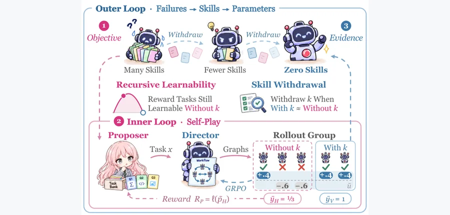 arXiv 2026-10-19 · cs.AI · #1 **[R$^2$Orch: Recursive Self-Improvement for Agent Orchestration via Self-Play within a Skill-Internalization Loop](https://arxiv.org/abs/2610.22740)** Mingda Zhang , Yun Huang , Qiang Huang , Yanjin Li , Rui Qian , Qichao Zhao , Tiesunlong Shen , Na Zhao , Jian Wang , Xiao… Affiliation: Chinese University of Hong Kong, Shenzhen / Fudan University / University of Illinois Urbana-Champaign / Tsinghua University / National University of Singapore [Paper](https://arxiv.org/abs/2610.22740) · [Figure source](https://arxiv.org/html/2610.22740v1/R2Orch-Figure1.png) 

[EN] Abstract
In recent years, agentic orchestration has been widely applied to solve complex human tasks. However, existing orchestration learning still faces key challenges, including hand-designed curricula, advantage collapse when a task's rollouts all reach the same outcome, and unreliable evaluation signals that judge each skill by one noisy score. To address these challenges, we propose R$^2$Orch, a new paradigm of Recursive Self-Play Orchestration: an inner loop of self-play that improves the orchestrator on self-chosen tasks, and an outer loop that improves how the inner loop improves. To support this paradigm, we introduce Recursive Learnability, a training objective that rewards a Proposer for choosing tasks whose rollouts keep reaching different outcomes as skills are withdrawn. Built on this objective, we further propose Skill Withdrawal, in which the outer loop withdraws each skill once a controlled evaluation within self-play shows that the orchestrator performs as well without it. Moreover, the two loops form one cycle: failures are distilled into skills, skills into parameters, and withdrawals lead the Proposer to new failures, so the orchestrator moves toward zero-skill deployment. Experimental results on twelve datasets show that R$^2$Orch consistently outperforms baselines across question answering, math, code, and interactive tasks. <a href="https://arxiv.org/abs/2610.22740">Source</a>

[ZH] Abstract
近年来，智能体编排被广泛用于解决复杂人类任务，但现有编排学习仍面临手工设计课程、某任务所有执行结果相同时的优势坍缩，以及用单个噪声分数判断技能的不可靠评估信号等挑战。为此，我们提出 R$^2$Orch，即递归自博弈编排：内循环通过自选任务上的自博弈改进编排器，外循环改进内循环的改进方式。为支持这一范式，我们提出递归可学习性训练目标，在技能逐步撤除时，奖励提议者选择仍能使执行结果保持差异的任务。基于该目标，我们进一步提出技能撤除：一旦自博弈内的受控评估表明编排器没有某技能也同样表现良好，外循环就撤除它。两个循环构成统一周期：失败被提炼为技能，技能被内化到参数，撤除又引导提议者发现新失败，使编排器逐步走向零技能部署。在十二个数据集上的实验显示，R$^2$Orch 在问答、数学、代码和交互任务中持续优于基线。 <a href="https://arxiv.org/abs/2610.22740">Source</a>
 | 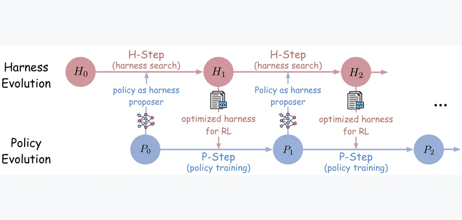 arXiv 2026-10-19 · cs.CL · #2 **[Self-Evolving Coding Agents via Harness-Policy Optimization](https://arxiv.org/abs/2610.22791)** Zhepei Wei , Wenlin Yao , Baolin Peng , Danqing Wang , Qianhui Wu , Hao Cheng , Yu Meng , Jianfeng Gao Affiliation: Microsoft Research / University of Virginia / Carnegie Mellon University [Paper](https://arxiv.org/abs/2610.22791) · [Code](https://github.com/MSR-Orchard/Self-HPO) · [Figure source](https://arxiv.org/html/2610.22791v1/teaser_overview.png) 

[EN] Abstract
Large language model (LLM) agents have shown promising potential in coding tasks, and their performance is jointly determined by the policy model and the harness that mediates their interaction with the environment. Indeed, harness and policy are mutually reinforcing and evolving only one component is suboptimal---a harness tuned for one checkpoint may not target the failure modes of an updated policy, while policy learning remains limited to the trajectories elicited by a fixed harness. In light of this, we propose Self-HPO, a recursive self-improving framework for coding agents that alternates harness and policy optimization, using the evolving policy as its own harness proposer. Specifically, in each round, the current policy first analyzes its own failures and proposes new harness candidates (H-step). The policy is then updated through reinforcement learning (RL) under the selected harness (P-step), and hard tasks identified during training form the next harness search set, keeping harness optimization targeted to the policy's evolving failure modes. Across three coding benchmarks, Self-HPO consistently outperforms harness-only and policy-only baselines, improving Qwen3.5-35B-A3B's average resolve rate from 57.8% to 64.8%, with gains generalizing to out-of-distribution settings. Further analysis shows that both optimized components retain gains even when paired with their base counterparts, while their joint gain exceeds the sum of their individual gains. Self-HPO also improves reliability (Pass@1) and expands the capability frontier (Pass@k) over the base agent. Additionally, we show that with a stronger external model (e.g., Opus 4.8) as the harness proposer, the same framework yields a further performance boost. <a href="https://arxiv.org/abs/2610.22791">Source</a>

[ZH] Abstract
大语言模型（LLM）智能体在代码任务上展现潜力，其表现由策略模型与调节环境交互的运行框架共同决定。两者相互促进，因此仅进化单个组件并不最优：针对某检查点调优的框架，可能无法处理更新后策略的失败模式；策略学习又受限于固定框架所诱发的轨迹。我们提出 Self-HPO，交替优化框架与策略、并让不断进化的策略充当自身框架提议者的递归自改进方法。每轮中，当前策略先分析自己的失败，提出新框架候选（H 步）；随后在选中框架下通过强化学习更新策略（P 步），训练中发现的困难任务构成下一轮框架搜索集合，使优化持续针对策略变化中的失败模式。在三个代码基准上，Self-HPO 稳定优于仅框架或仅策略优化，将 Qwen3.5-35B-A3B 平均问题解决率从 57.8% 提高到 64.8%，收益可泛化至分布外设置。分析发现，两个优化组件即使分别与原始对应组件配对仍保留收益，联合收益还超过单独收益之和。Self-HPO 同时提高基础智能体的可靠性（Pass@1）和能力前沿（Pass@k）。采用更强外部模型（如 Opus 4.8）作为框架提议者时，该框架还带来进一步提升。 <a href="https://arxiv.org/abs/2610.22791">Source</a>
 | 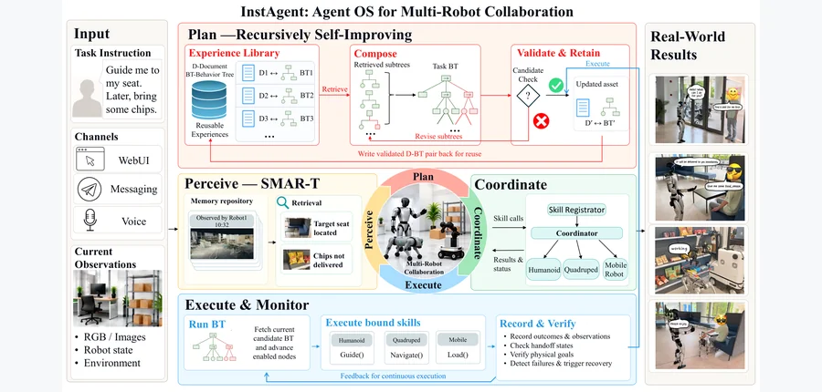 arXiv 2026-10-19 · cs.RO · #3 **[InstAgent: A Recursively Self-Improving Agent Operating System for Heterogeneous Robot Collaboration](https://arxiv.org/abs/2610.23098)** Haoyang Luo , Junhao Qin , Jingyan Cao , Yi Huang , Guangjie Yang , Xiaoyu Chen , Haotao Lu , Tianxiang Gui , Ye Shi , Jin… Affiliation: ShanghaiTech University / InstAdapt [Paper](https://arxiv.org/abs/2610.23098) · [Figure source](https://arxiv.org/html/2610.23098v1/teaser.png) 

[EN] Abstract
Heterogeneous robot teams enable complex, long-horizon tasks by combining complementary sensing, mobility, and manipulation capabilities across multiple embodiments. Yet existing systems struggle to retain execution-time corrections as reusable experience, maintain task-relevant context memory across space and time for reliable handoffs, and explicitly represent the inter-robot dependencies required for structured collaboration. In order to address these challenges, we present InstAgent, a recursively self-improving (RSI) Agent Operating System for heterogeneous robot collaboration. InstAgent organizes team behaviors as agentic behavior trees (BTs) that explicitly model capability assignment, inter-robot dependencies and handoff checks. The RSI mechanism updates these collaboration programs from execution feedback and preserves successful revisions for reuse in future tasks, while shared multimodal spatio-temporal memory provides context for planning and handoff validation. Experiments on 20 real-world multi-robot tasks with three high-level models show consistent gains in task success, first-attempt completion, and execution efficiency. <a href="https://arxiv.org/abs/2610.23098">Source</a>

[ZH] Abstract
异构机器人团队结合不同机体的感知、移动和操作能力，能够完成复杂长时程任务。但现有系统难以将执行时修正保留为可复用经验，难以跨空间与时间维护任务相关上下文以可靠交接，也难以显式表示结构化协作所需的机器人间依赖。为此，我们提出面向异构机器人协作、具备递归自我改进（RSI）的智能体操作系统 InstAgent。它用智能体式行为树（BT）组织团队行为，显式建模能力分配、机器人间依赖与交接检查。RSI 机制依据执行反馈更新这些协作程序，将成功修改保留供未来任务复用；共享多模态时空记忆为规划和交接验证提供上下文。在 20 项真实世界多机器人任务、三个高层模型上的实验显示，任务成功率、首次尝试完成率和执行效率均持续改善。 <a href="https://arxiv.org/abs/2610.23098">Source</a>
 |
| 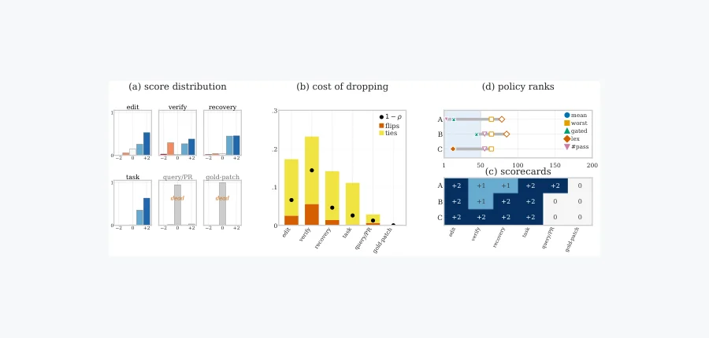 arXiv 2026-10-19 · cs.LG · #4 **[MetaCurate: Evolving Curation Filters for High-Quality Agentic Coding Data](https://arxiv.org/abs/2610.23134)** Donghoon Kim , Seunghyuk Oh , Kevin Galim , Minseo Kim , Minjae Lee , Younghyun Kim , Wooseok Seo , Hyung Il Koo , Wonjun… Affiliation: FuriosaAI / University of California, Berkeley [Paper](https://arxiv.org/abs/2610.23134) · [Code](https://github.com/furiosa-ai/MetaCurate) · [Project](https://furiosa-air.github.io/metacurate) · [Data](https://huggingface.co/datasets/furiosa-ai/MetaCurate-DeepSeekV4Pro) · [Figure source](https://arxiv.org/html/2610.23134v1/diagnosis_four_panel.png) 

[EN] Abstract
Supervised fine-tuning on agent trajectories is an effective way to improve coding agents, but selecting useful training examples requires more than identifying successful runs. A resolved patch may follow inefficient reasoning or unnecessary tool use, while a failed run may still contain useful intermediate steps. Training pipelines therefore rely on rules and qualitative assessments to filter trajectories, yet designing these filters typically requires substantial human expertise, and validating improvements through repeated training and evaluation is expensive. We introduce MetaCurate, a training-free framework that evolves executable trajectory curation filters using pairwise LLM judgments. Disagreements between the filter's rankings and the judge's preferences provide targeted feedback for jointly revising its rules, rubric, and aggregation policy. The resulting filter scores trajectories independently, so pairwise comparisons are required only during search. Starting from a blank filter, MetaCurate autonomously discovers a curation strategy that achieves competitive downstream performance without task-specific handwritten criteria. We validate downstream utility through controlled SFT experiments on our uncurated trajectory pool and the Nemotron v3 SWE dataset, with random selection and hand-authored filtering as baselines. In our experiments, MetaCurate achieves the highest mean SWE-Verified score among the compared methods, including hand-authored rule-based filtering and a training-loop baseline whose search costs 3.5x as much. <a href="https://arxiv.org/abs/2610.23134">Source</a>

[ZH] Abstract
在智能体轨迹上监督微调能够有效改进编码智能体，但选择有用训练样本不只是识别成功执行。解决问题的补丁可能伴随低效推理或多余工具调用，失败执行也可能包含有用中间步骤。因此，训练流程依赖规则和定性判断来过滤轨迹，而设计过滤器通常需要大量人工专业知识，通过反复训练评估验证改进也很昂贵。我们提出无需训练的 MetaCurate，以大语言模型配对判断进化可执行轨迹筛选器。过滤器排序与裁判偏好的分歧提供定向反馈，联合修改规则、评分准则和聚合策略。得到的过滤器独立评分每条轨迹，因此配对比较只在搜索期需要。从空白过滤器开始，MetaCurate 无需任务特定手写标准，自主发现具有竞争力下游表现的筛选策略。我们在未筛选轨迹池和 Nemotron v3 SWE 数据集上，通过受控 SFT 实验验证下游效用，以随机选择和人工过滤为基线。实验中，MetaCurate 在比较方法中取得最高平均 SWE-Verified 分数，包括人工规则过滤及搜索成本为其 3.5 倍的训练循环基线。 <a href="https://arxiv.org/abs/2610.23134">Source</a>
 | 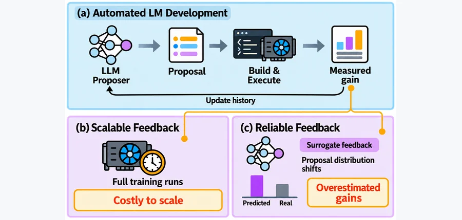 arXiv 2026-10-19 · cs.CL · #5 **[Language Models Learn to Improve Language Models](https://arxiv.org/abs/2610.23344)** Minhua Lin , Zijun Wang , Zewen Liu , Zhaotian Weng , Bing He , Zhan Shi , Benoit Dumoulin , Xiang Zhang , Suhang Wang , H… Affiliation: Pennsylvania State University / University of California, Santa Cruz / Emory University / University of California, Santa Barbara / Amazon [Paper](https://arxiv.org/abs/2610.23344) · [Figure source](https://arxiv.org/html/2610.23344v1/figures/fig_intro_v4_1.png) 

[EN] Abstract
Large language models (LLMs) are increasingly used to automate AI research, including language-model (LM) development, offering a potential path toward recursive self-improvement. However, turning experimental feedback into a learned ability to propose effective improvements across models faces two challenges. First, training such an ability with real feedback is expensive: reinforcement learning (RL) requires evaluating tens of thousands of proposals, each potentially requiring a full model-training run. Even at ten GPU-hours per run, reward collection alone would consume hundreds of thousands of GPU-hours, motivating a cheaper surrogate. Second, surrogate feedback can become unreliable as policy optimization favors overestimated proposals when the proposal distribution shifts. To address these challenges, we propose LM2LM, which trains LLMs with RL to generate effective LM improvement proposals. To provide scalable feedback, we use a research world model (RWM), a frozen LLM that predicts proposal gains from real experimental records provided in context, as the reward model for RL. To maintain feedback reliability, we periodically execute current-policy proposals ranked highly by the RWM and add their measured outcomes to its context. Across eight autoregressive and diffusion LM development environments, real-execution evaluations on held-out tasks show that LM2LM enables Qwen3.8-27B to outperform GPT-6-sol, even when GPT-6-sol is given 300 real experimental records in context, while requiring 33% lower data-generation cost. LM2LM also generalizes to a model family unseen during training. <a href="https://arxiv.org/abs/2610.23344">Source</a>

[ZH] Abstract
大语言模型（LLM）越来越多地被用于自动化人工智能研究，包括语言模型（LM）开发，为递归自我改进提供潜在路径。但将实验反馈转为跨模型提出有效改进的学习能力，面临两个挑战。第一，真实反馈训练昂贵：强化学习需评估数万项提议，每项可能需完整模型训练；即使每次十 GPU 小时，仅奖励采集也需数十万 GPU 小时，因此需要更廉价代理。第二，当策略优化偏好被高估的提议、提议分布发生变化时，代理反馈会失去可靠性。为此，我们提出 LM2LM，通过强化学习训练大语言模型生成有效的语言模型改进提议。为提供可扩展反馈，我们使用研究世界模型（RWM）：一个冻结大语言模型，依据上下文中的真实实验记录预测提议收益，作为强化学习奖励模型。为维持反馈可靠性，我们周期性执行当前策略提出、被 RWM 排名较高的提议，并将测得结果加入其上下文。在八个自回归及扩散语言模型开发环境中，留出任务的真实执行评估显示，LM2LM 使 Qwen3.8-27B 优于 GPT-6-sol，即使后者上下文中提供了 300 条真实实验记录，同时数据生成成本降低 33%。LM2LM 也泛化到训练未见的模型家族。 <a href="https://arxiv.org/abs/2610.23344">Source</a>
 | 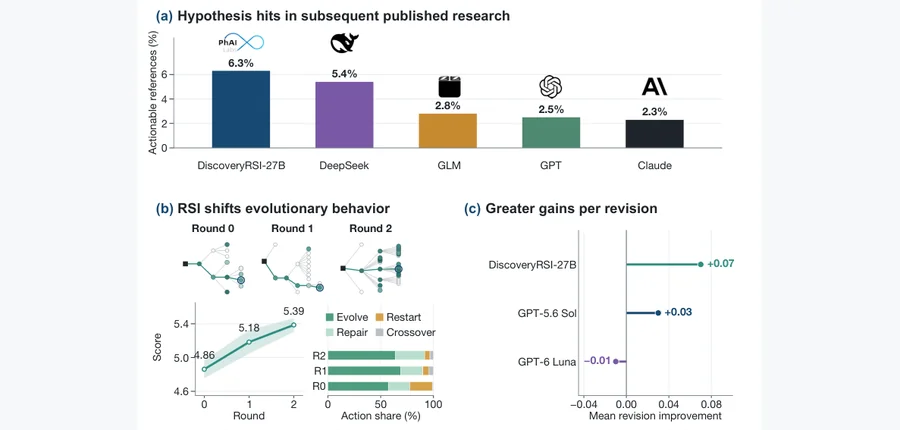 arXiv 2026-10-19 · cs.CL · #6 **[DiscoveryRSI: Recursively Learning to Discover Valuable Hypotheses](https://arxiv.org/abs/2610.23839)** Jianyuan Zhong , Chenwei Wu , Zhaochen Yu , Xixian Jiang , Xuewei Li , Hao Xiao , Xilin Dai , Junyang Wang , Jiaru Zou , Z… Affiliation: PhAI Labs / Chinese University of Hong Kong / University of Michigan / National University of Singapore / Fudan University / Peking University People’s Hospital / Peking University / Stanford University / Hong Kong University of Science and Technology / University of California, Santa Barbara / Southeast University / Harvard Medical School / Federal University of São Paulo / Massachusetts Institute of Technology / University of Oxford / Princeton University [Paper](https://arxiv.org/abs/2610.23839) · [Code](https://github.com/Gen-Verse/DiscoveryRSI) · [Figure source](https://arxiv.org/html/2610.23839v1/teaser-vector.png) 

[EN] Abstract
Scientific discovery requires developing worthwhile hypotheses into practical investigations, yet learning from this evolving research process remains challenging. We introduce an operational definition of valuable and testable research hypotheses: evidence-grounded claims about consequential uncertainties, coupled with feasible investigations, explicit decision criteria, and alternative explanations. Our DiscoveryRSI framework develops hypothesis trees through multi-agent evolutionary search, compiles selected investigations into executable Harbor tasks, and recursively learns through three mechanisms: hypothesis credit optimization attributes scientific assessments to documented research contributions; harness replay identifies productive strategies and recurring failures to refine research workflows; and rediscovery applies accepted improvements to new investigations, generating further experience for subsequent learning. We also introduce DFM-Bench, which provides comprehensive assessment of hypothesis quality and cumulative research progress at the levels of hypotheses, revisions, development paths and research runs. Across four life-science domains, automated evaluation shows that hypothesis quality rises from 4.86 for the base model to 5.39 after two rounds of self-improvement, with the large gains in falsifiability and data resolvability. We further validate hypothesis quality through expert review, comparing our DiscoveryRSI-27B with other research agents. Preliminary human assessments show that DiscoveryRSI-27B scores higher than GPT-6 Luna on hypothesis importance and whether claims are plausible and evidence-bounded. DiscoveryRSI-27B achieved a 6.3% rate of hypothesis correspondence with research published after the model cutoff, largely outperform GPT-6 with 2.5% and Claude Opus 5 with 2.3%, while delivering greater human-rated improvement along research paths. <a href="https://arxiv.org/abs/2610.23839">Source</a>

[ZH] Abstract
科学发现需要将有价值的假设发展为可执行研究，但如何从不断变化的研究过程中学习仍有挑战。我们为有价值且可检验的研究假设给出操作性定义：针对重要不确定性的证据支撑断言，配有可行调查、明确决策标准和替代解释。DiscoveryRSI 通过多智能体进化搜索发展假设树，将选中研究编译为可执行 Harbor 任务，并通过三个机制递归学习：假设信用优化将科学评估归因到有记录的研究贡献；框架回放识别有效策略和重复失败，细化研究流程；再发现将获准改进用于新调查，产生后续学习经验。我们还提出 DFM-Bench，在假设、修改、发展路径和研究执行等层面全面评估假设质量及累积研究进展。四个生命科学领域的自动评估表明，两轮自改进后假设质量由基础模型的 4.86 升至 5.39，收益主要来自可证伪性与数据可判定性。我们进一步通过专家审阅，将 DiscoveryRSI-27B 与其他研究智能体比较。初步人工评估表明，它在假设重要性、断言合理性及证据边界方面高于 GPT-6 Luna。其假设与模型知识截止时间后发表研究的对应率为 6.3%，显著高于 GPT-6 的 2.5% 和 Claude Opus 5 的 2.3%，沿研究路径的人类评分改进也更大。 <a href="https://arxiv.org/abs/2610.23839">Source</a>
 |
| 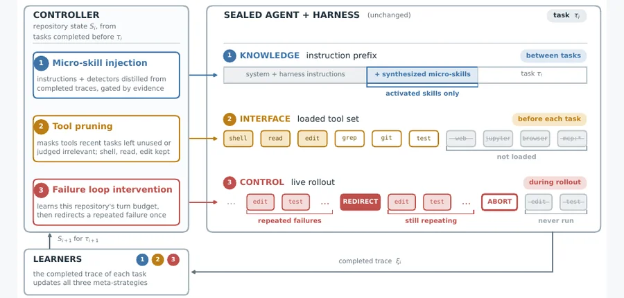 arXiv 2026-10-19 · cs.CL · #7 **[TokenEconomizer: Experience-Driven Black-Box Cost Control for Coding Agents](https://arxiv.org/abs/2610.22732)** Aaron J. Li , Weijia Xu , Chandan Singh , Zixiao Chen , Jeevana Priya Inala , Charlotte Siska , Acar Tamersoy , Bin Yu , I… Affiliation: University of California, Berkeley / Microsoft Research / Microsoft Security [Paper](https://arxiv.org/abs/2610.22732) · [Code](https://github.com/microsoft/TokenEconomizer) · [Project](https://tokeneconomizer.github.io) · [Figure source](https://arxiv.org/pdf/2610.22732#page=5) 

[EN] Abstract
Advances in frontier coding agents have sharply increased the token costs of AI-assisted software engineering. Their token efficiency is typically evaluated on isolated tasks, whereas real-world developers use them to continuously build, update, and maintain large-scale projects. This mismatch motivates us to evaluate agents over sequences of realistic coding tasks, where we find that agents exhibit recurring environment-dependent token costs that existing methods struggle to reduce. To minimize these costs, we introduce TokenEconomizer, an external controller that cuts environment-specific token costs over a sequence of tasks. These cuts come from determining (i) which operational micro-skills to inject, (ii) which persistently irrelevant tools to prune, and (iii) when to intervene in unproductive failure loops. Across Claude Code, Codex, and GitHub Copilot CLI paired with frontier models, TokenEconomizer reduces the average token cost by 18.4-30.9% with comparable task success. Savings hold in every repository under every tested agent-model setting and generalize to diverse domains such as sequential web development and security auditing, where costs fall by 6.4-21.2% depending on task structure. Our work establishes adaptive black-box cost control as a promising direction for reducing token costs of coding agents in realistic settings. <a href="https://arxiv.org/abs/2610.22732">Source</a>

[ZH] Abstract
前沿编码智能体的进展显著提高了人工智能辅助软件工程的词元成本。效率通常在孤立任务上评估，但真实开发者持续构建、更新和维护大型项目。因此，我们按现实代码任务序列评估，发现智能体存在重复的环境相关词元开销，现有方法难以减少。我们提出外部控制器 TokenEconomizer，跨任务序列削减环境特定成本，通过决定：（i）注入哪些操作微技能；（ii）剪除哪些持续无关的工具；（iii）何时干预无效失败循环。在 Claude Code、Codex、GitHub Copilot CLI 与前沿模型配对的设置中，它在任务成功率相近时，将平均词元成本降低 18.4%—30.9%。每个被测智能体—模型设置的每个仓库都保留节省；收益还泛化到顺序网页开发和安全审计等不同领域，成本随任务结构降低 6.4%—21.2%。研究将自适应黑盒成本控制确立为降低真实编码智能体词元成本的潜在方向。 <a href="https://arxiv.org/abs/2610.22732">Source</a>
 | 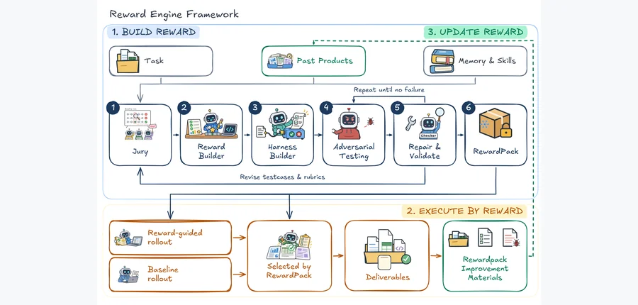 arXiv 2026-10-19 · cs.AI · #8 **[Reward Engine: Reward-Centric Self-Evolution for Open-Ended Tool Agents](https://arxiv.org/abs/2610.22915)** Litong Feng , Ji Qi , Yiran Cheng , Shaowu Pan , Xinyu Zhang , Qijun Li Affiliation: Huawei openJiuwen Team [Paper](https://arxiv.org/abs/2610.22915) · [Figure source](https://arxiv.org/html/2610.22915v1/reward_engine_overview.png) 

[EN] Abstract
Open-ended tool agents can complete the same objective through different tool paths, and their quality depends jointly on the interaction trace, environment state, and final artifacts, so such tasks rarely admit an executable ground-truth reward. The central challenge is therefore to construct a reward from existing experience that exposes the current policy's failures while remaining stationary during optimization. We introduce Reward Engine, which, like a self-motivated student, first works out what success requires and then optimizes toward it. From the task and initial trajectories, it builds a RewardPack of testcases for required correctness and rubrics for graded quality, each executed as a check that returns a judgment with evidence. The frozen RewardPack then guides the agent to revise and select its outputs, and can also serve as a reward for reinforcement learning. On WorkBuddy Bench Office and Claw-Eval, the constructed reward largely agrees with the benchmark graders, not reversing their ordering on 82.3\% and 80.5\% of candidate pairs. Used to revise executions, it raises three-run consistency ($\mathrm{Pass}^{3}$) over Baseline from 45.0\% to 54.0\% and from 78.4\% to 83.7\%. <a href="https://arxiv.org/abs/2610.22915">Source</a>

[ZH] Abstract
开放式工具智能体可以通过不同工具路径完成同一目标，质量共同取决于交互轨迹、环境状态和最终产物，因此很少存在可执行的真实奖励。核心挑战是从现有经验构建奖励，使其揭示当前策略失败，同时在优化期间保持稳定。我们提出 Reward Engine，像主动学习的学生一样，先确定成功条件，再朝其优化。它依据任务和初始轨迹构建 RewardPack，包含检查必要正确性的测试案例和评估渐进质量的准则，每项都作为返回判断及证据的检查执行。冻结的 RewardPack 随后指导智能体修改和选择输出，也能用作强化学习奖励。在 WorkBuddy Bench Office 和 Claw-Eval 上，构建奖励与基准评分大体一致，分别在 82.3% 和 80.5% 的候选对上不反转排序。用来细化执行时，相对基线，三次运行一致性（$\mathrm{Pass}^{3}$）分别从 45.0% 升到 54.0%，从 78.4% 升到 83.7%。 <a href="https://arxiv.org/abs/2610.22915">Source</a>
 | 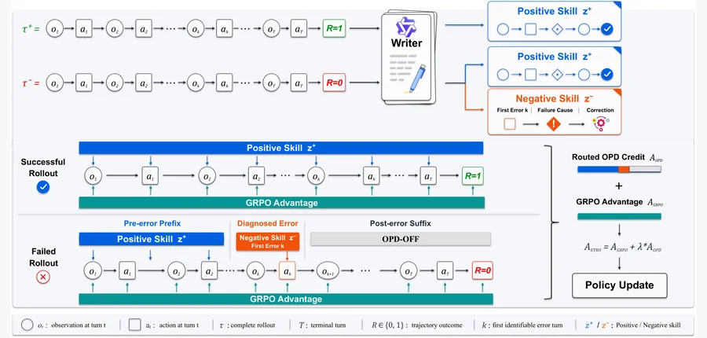 arXiv 2026-10-19 · cs.AI · #9 **[Distill Until Divergence: Error-Truncated Hindsight Distillation for Agentic RL](https://arxiv.org/abs/2610.23048)** Yibin Huang , Conghui Zhu Affiliation: Harbin Institute of Technology [Paper](https://arxiv.org/abs/2610.23048) · [Figure source](https://arxiv.org/html/2610.23048v1/etro.png) 

[EN] Abstract
Long-horizon interaction requires agents to make multiple decisions in a changing environment. Outcome-based GRPO lacks fine-grained guidance for intermediate decisions. Recent methods distill completed trajectories into reusable skills and use hindsight-conditioned OPD to provide dense token-level credit. However, skill-induced probability shifts do not necessarily represent reward-aligned credit; especially after an erroneous action changes subsequent interaction states, skill-conditioned supervision may become mismatched with the current state. To address this mismatch, we propose \methodname{}, which routes two complementary hindsight skills according to trajectory outcomes and error boundaries: Positive skills capture successful workflows to reinforce successful trajectories and pre-error decisions, while Negative skills capture failure-specific corrections to target decisive errors. The post-error suffix is optimized exclusively by GRPO, retaining outcome-based learning without extending potentially mismatched hindsight supervision. Extensive experiments demonstrate competitive task performance and support effective fine-grained credit allocation. <a href="https://arxiv.org/abs/2610.23048">Source</a>

[ZH] Abstract
长时程交互要求智能体在变化环境中连续决策。基于结果的 GRPO 缺乏对中间决策的细粒度指导。近期方法将完整轨迹提炼为可复用技能，并使用后见条件化同策略蒸馏（OPD）提供稠密词元级信用。但技能引起的概率变化未必对应奖励一致的信用，尤其当错误动作改变后续交互状态后，技能条件监督可能与当前状态不匹配。为解决这一问题，我们提出 \methodname{}，依据轨迹结果和错误边界路由两种互补后见技能：正向技能捕获成功流程，以强化成功轨迹和错误前决策；负向技能捕获针对失败的修正，以处理决定性错误。错误后的后缀仅由 GRPO 优化，保留基于结果的学习，而不延伸可能错配的后见监督。大量实验展示具有竞争力的任务表现，并支持有效的细粒度信用分配。 <a href="https://arxiv.org/abs/2610.23048">Source</a>
 |
| 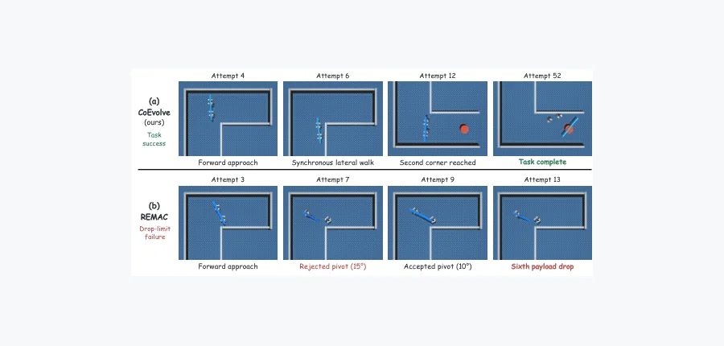 arXiv 2026-10-19 · cs.RO · #10 **[CoEvolve: Self-Evolving Code Policies from Skills to Strategies for Humanoid Robots](https://arxiv.org/abs/2610.23288)** Zicheng Liu , Haochen Wu , Jiawei He , Suyun Zhao , Huan Yang , Cheng Chi , Hao Tang Affiliation: Peking University / Renmin University of China / Beijing XYZ Embodied AI / Beijing Academy of Artificial Intelligence [Paper](https://arxiv.org/abs/2610.23288) · [Figure source](https://arxiv.org/html/2610.23288v2/baseline_vs_ours2.png) 

[EN] Abstract
Recent advances in Vision-Language-Action (VLA) models and World Action Models (WAMs) have expanded the manipulation and whole body capabilities of individual robots. Yet a single robot remains limited by its embodiment, and many real world tasks require capabilities that can only emerge through cooperation. Existing multi robot frameworks largely emphasize task decomposition, allocation, and replanning, while providing limited support for adapting executable coordination when physical execution deviates from the intended behavior. We present CoEvolve, a framework that represents team coordination as executable code over fixed robot motor skills. CoEvolve introduces Verifier Guided Coordination Evolution, where a multimodal foundation model instantiates coordination strategies through motion primitives, semantic objectives, temporary robot roles, and bounded execution parameters. Physical verification evaluates each executed transition, rejected behaviors trigger structured coordination revision from an accepted checkpoint, and verified experience is retained to guide subsequent decisions. We evaluate CoEvolve with two simulated Unitree G1 humanoids transporting a freely supported rigid payload through constrained corridors. Across 15 base task runs with three multimodal backbone families, CoEvolve completes 8 tasks, with every backbone achieving end to end success. Additional evaluations yield verified placement on two additional corridor layouts and after both same-backbone and cross-backbone experience initialization, while exposing persistent limitations in motion precision and contact stability. These results support executable coordination as a practical interface for adapting long horizon multi robot collaboration under shared physical constraints. <a href="https://arxiv.org/abs/2610.23288">Source</a>

[ZH] Abstract
视觉语言动作模型（VLA）和世界动作模型（WAM）的进展拓展了单个机器人的操作和全身能力，但单个机器人仍受机体限制，许多真实任务需要协作才可能具备的能力。现有多机器人框架主要强调任务分解、分配和重规划，对物理执行偏离预期时如何适配可执行协调支持有限。我们提出 CoEvolve，在固定机器人运动技能上用可执行代码表示团队协调。验证器引导的协调进化利用多模态基础模型，以动作原语、语义目标、临时机器人角色和有界执行参数实例化协调策略。物理验证评估每次已执行转换，拒绝行为触发从获准检查点开始的结构化协调修改；已验证经验被保留，指导后续决策。我们使用两个模拟 Unitree G1 人形机器人，搬运自由支撑的刚性载荷穿过受限走廊。跨三个多模态骨干家族的 15 次基础任务执行中，CoEvolve 完成 8 项，每个骨干均有端到端成功。额外评估在两个新走廊布局以及同骨干、跨骨干经验初始化后均得到验证过的放置，同时暴露动作精度和接触稳定性方面的持续限制。结果支持将可执行协调作为适配共享物理约束下长时程多机器人协作的实践接口。 <a href="https://arxiv.org/abs/2610.23288">Source</a>
 | 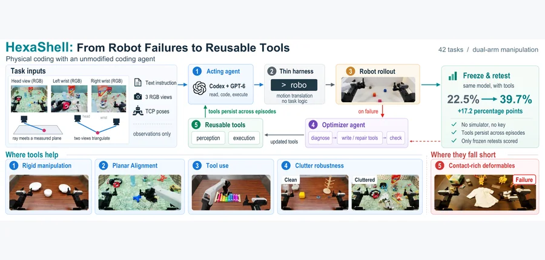 arXiv 2026-10-19 · cs.RO · #11 **[HexaShell: A Thin Harness for Exploring the Limits of VLM Agents as Robot Coding Agents](https://arxiv.org/abs/2610.23479)** Hongcheng Gao , Alex Zhou , Jay Zhu , Zelin Zheng , Shijia Ge , Xiping Li , Di Wu , Yazhe Wang , Jianshu Zeng , Xuan Shang… Affiliation: Affiliation unconfirmed [Paper](https://arxiv.org/abs/2610.23479) · [Code](https://github.com/HexaFuture/HexaShell) · [Figure source](https://arxiv.org/html/2610.23479v1/HexaShell_Figure1.png) 

[EN] Abstract
Agents built on vision language models (VLMs) now compete with learned policies on robot manipulation leaderboards. We ask how far a coding agent can go when it controls a robot instead of a computer, and where it stops. Our system, HexaShell, keeps the harness thin: it only turns the agent's commands into robot motion. The agent drives a robot with two arms through one command line. It sees three RGB cameras and knows their calibration. After each failed attempt, the agent reads the log, finds the cause, and writes or fixes small programs called tools. In this way it keeps what it learns as code, as a coding agent does when it fixes a failing test. The tools may use only what the robot observes. They use triangulation to find where objects are, relative to each other and to the gripper. If two cameras see the same point, the point lies where the two camera rays meet. If a point lies on a known plane, such as the table or the top of a block, it lies where its ray meets that plane. When the head camera is not enough, the robot moves a wrist camera to get a second view. We build the tools on only ten layouts of one seed per task, then freeze them and test them on ten new layouts of the same seed. We use Codex with GPT-6-Astra at medium reasoning effort. On all 42 RoboDojo tasks, HexaShell reaches a success rate of 39.7% and a progress score of 48.0, averaged in the same way as the leaderboard. This is a new state of the art on RoboDojo. The limit is contact, not reasoning: pushing reaches 92.5% and memory tasks 65.0%, but tight insertion only 8.3%. When the agent fails, it usually sees the failure but cannot make the motion work. We open source the tools evolved so far at this https URL . <a href="https://arxiv.org/abs/2610.23479">Source</a>

[ZH] Abstract
基于视觉语言模型（VLM）的智能体已能在机器人操作排行榜上与学习策略竞争。我们研究编码智能体控制机器人而非计算机时能走多远，又在哪里受限。HexaShell 保持轻量框架，仅将智能体命令转换为机器人运动。智能体通过一个命令行控制双臂机器人，看到三个 RGB 相机并知道标定信息。每次失败后，它阅读日志、寻找原因，并编写或修复称为工具的小程序；像编码智能体修复失败测试一样，将所学保留为代码。工具只能使用机器人观测到的信息，通过三角测量确定物体彼此及其相对夹爪的位置。两个相机看到同一点时，该点位于两条相机射线交会处；某点位于桌面或积木顶部等已知平面时，其位置是射线与平面的交点。头部相机不足时，机器人移动腕部相机获得第二视角。我们仅用每个任务一个种子的十个布局构建工具，随后冻结，在相同种子的十个新布局上测试。使用 Codex、GPT-6-Astra 和中等推理强度。在全部 42 项 RoboDojo 任务上，按排行榜相同方式平均，HexaShell 成功率为 39.7%，进度分数为 48.0，达到新的最先进水平。限制在接触而非推理：推动成功率 92.5%，记忆任务 65.0%，紧密插入仅 8.3%。失败时，智能体通常看到了失败，却无法使动作成功。已进化工具在原文链接处开源。 <a href="https://arxiv.org/abs/2610.23479">Source</a>
 | 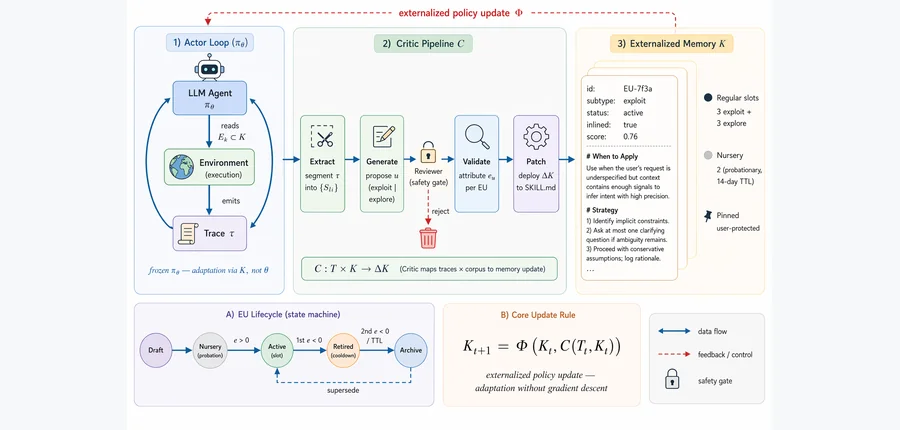 arXiv 2026-10-19 · cs.AI · #12 **[Darwin-Claw: Environment-Adaptive Experience Consolidation for Recursively Self-Evolving Agents](https://arxiv.org/abs/2610.23574)** Mingze Yin , Xiaohan Wang , Dian Li , Longfei Luo , Jiahong Yan , Yiheng Zhu , Chang-Yu Hsieh Affiliation: Zhejiang University / Tencent / Zhongguancun Academy [Paper](https://arxiv.org/abs/2610.23574) · [Figure source](https://arxiv.org/html/2610.23574v1/figures/framework.png) 

[EN] Abstract
While Large Language Model (LLM) agents have demonstrated remarkable capabilities across complex tasks, they predominantly operate in isolated sessions, lacking the ability to continually learn from historical interactions or adapt to user-specific environments. Existing self-evolution paradigms often indiscriminately inject raw interaction trajectories into memory or skill modules, leading to obscured behavioral patterns and compromised update controllability. Furthermore, as foundational LLM reasoning improves, the bottleneck for agentic evolution shifts from accumulating generic knowledge to effectively managing situational experience. To address this, we propose Darwin-Claw, an environment-adaptive self-evolving framework that systematically distills episodic experiences to drive the comprehensive evolution of operational skills and durable memory. Theoretically grounded in an iterative agent-actor and evolver-critic co-adaptation, Darwin-Claw introduces a Hierarchical Experience Consolidation System that extracts fine-grained error attributions and generalizes them into dynamically updated prototype vectors. This structured situational experience serves as interaction patches for context-sensitive perception and explicit optimization signals for skill refinement. Practically, Darwin-Claw is a readily deployable, automated framework compatible with mainstream agent systems without requiring manual curation. Extensive experiments on WildClawBench demonstrate that Darwin-Claw yields substantial performance improvements, establishing a controllable and stable pathway for the continual, user-centric adaptation of autonomous agents in real-world ecosystems. <a href="https://arxiv.org/abs/2610.23574">Source</a>

[ZH] Abstract
大语言模型智能体在复杂任务中能力突出，但主要在孤立会话中运行，难以持续从历史交互学习或适应用户特定环境。现有自进化范式常将原始交互轨迹不加区分地注入记忆或技能模块，使行为模式模糊、更新可控性受损。随着基础模型推理增强，进化瓶颈也从积累通用知识转为有效管理情境经验。我们提出环境自适应自进化框架 Darwin-Claw，系统提炼情景经验，驱动操作技能和持久记忆的综合进化。理论上，它以迭代智能体 actor 与进化器 critic 协同适应为基础，提出分层经验巩固系统，提取细粒度错误归因，并泛化为动态更新的原型向量。这些结构化情境经验既作为上下文感知的交互补丁，也作为技能细化的显式优化信号。实践上，Darwin-Claw 可直接部署、兼容主流智能体系统，无需人工整理。WildClawBench 上的大量实验显示，它取得显著性能改进，为自主智能体在真实生态中持续适应用户提供可控且稳定的路径。 <a href="https://arxiv.org/abs/2610.23574">Source</a>
 |
| 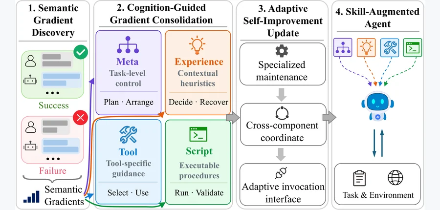 arXiv 2026-10-19 · cs.AI · #13 **[From Trajectories to Differentiated Skills: Cognitive Differentiation for Self-Improving Agents](https://arxiv.org/abs/2610.23599)** Yewei Zhao , Derong Xu , Wei Chen , Yin Xu , Peilun Zhou , Xiaohan Wang , Guojun Yin , Wei Lin , Mingjun Xiao Affiliation: University of Science and Technology of China / Meituan / City University of Hong Kong [Paper](https://arxiv.org/abs/2610.23599) · [Figure source](https://arxiv.org/html/2610.23599v1/fig1b.png) 

[EN] Abstract
Large language model (LLM) agents tackle complex tasks through reasoning and interaction with external environments. Agent skills provide persistent, transferable capabilities that guide task planning, inform contextual decisions, support tool use, and enable executable procedures. Yet existing skill-evolution methods largely organize knowledge around skill artifacts, overlooking the functional heterogeneity within individual skills and its implications for knowledge maintenance and use. Inspired by cognitive science, we propose Cognitive Differentiation in Skill Evolution (CDSE), which evolves a unified skill through four functionally distinct yet coordinated components: Meta, Experience, Tool, and Script. CDSE extracts evidence-grounded semantic gradients from successful and failed trajectories, consolidates them by functional role, and applies component-specific updates and validation with cross-component coordination and adaptive invocation. An analysis of 500 top-ranked skill packages shows that 96.8% contain knowledge spanning at least two functional roles. Across six benchmarks, three agent models, and two execution harnesses, CDSE achieves the highest scores in all 36 settings, improving over the Base agent by 7.6 percentage points and the strongest competing method in each setting by 2.6 points on average. Ablation studies further support the importance of functional differentiation and adaptive invocation. <a href="https://arxiv.org/abs/2610.23599">Source</a>

[ZH] Abstract
大语言模型智能体通过推理和环境交互处理复杂任务。智能体技能提供持久、可迁移能力，指导规划、上下文决策、工具使用和可执行流程。但现有技能进化主要围绕技能产物组织知识，忽略单个技能内部的功能异质性及其对知识维护和使用的影响。受认知科学启发，我们提出技能进化中的认知分化（CDSE），将统一技能进化为功能不同但协调的四个组件：Meta、Experience、Tool 和 Script。CDSE 从成功及失败轨迹提取有证据支撑的语义梯度，按功能角色巩固，执行组件特定更新与验证，并进行跨组件协调和自适应调用。对 500 个高排名技能包的分析显示，96.8% 包含跨至少两种功能角色的知识。在六个基准、三个智能体模型、两个执行框架组成的 36 个设置中，CDSE 均取得最高分，平均比基础智能体高 7.6 个百分点，比各设置最强竞争方法高 2.6 分。消融进一步支持功能分化和自适应调用的重要性。 <a href="https://arxiv.org/abs/2610.23599">Source</a>
 | 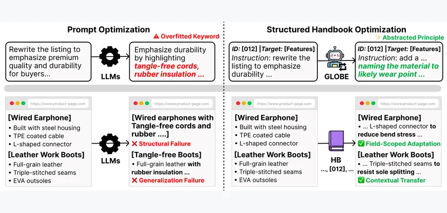 arXiv 2026-10-19 · cs.CL · #14 **[GLOBE: Evolving Structured Agentic Memory for E-commerce Product Optimization in Generative Search](https://arxiv.org/abs/2610.23709)** Hyunseo Kim , Suil Choe , Sukkyoung So , Daeyeon Yi Affiliation: AI Lab, CTO Division, LG Electronics [Paper](https://arxiv.org/abs/2610.23709) · [Figure source](https://arxiv.org/html/2610.23709v1/introduction.png) 

[EN] Abstract
Optimizing product listings for generative search requires language agents not only to rewrite effectively but also to continually self-improve by retaining successful strategies across diverse categories. However, existing approaches often treat structured listings as free-form text, leaving effective strategies implicit in prompts, search trajectories, or rewritten outputs rather than accumulating them as a reusable agentic memory. To address this limitation, we introduce GLOBE, an agentic framework that drives continual self-improvement by storing optimization knowledge in an evolving handbook of explicit, field-scoped behaviors. In each episode, an Editor applies relevant behaviors and receives rank-based feedback, which a Reflector converts into behavior updates. Crucially for dependable execution in real-world settings, a Moderator removes redundant proposals, a Curator commits accepted changes, and consistently harmful behaviors are deactivated. This cycle transforms episodic feedback into a persistent, field-scoped optimization memory. Experiments show that structured behaviors outperform monolithic prompt optimization, while feedback-driven evolution and moderation further improve effectiveness and reduce downside risk. The learned behaviors also remain effective on unseen product categories, suggesting that agentic memory evolution supports interpretable and transferable product optimization. <a href="https://arxiv.org/abs/2610.23709">Source</a>

[ZH] Abstract
面向生成式搜索优化产品信息，要求语言智能体不仅能有效重写，还能通过跨类别保留成功策略持续自我改进。但现有方法经常把结构化产品信息当作自由文本，有效策略隐含在提示、搜索轨迹或重写输出中，而未积累为可复用智能体记忆。我们提出 GLOBE，将优化知识存为不断进化、按字段限定作用域的显式行为手册，以推动持续改进。每个回合，Editor 应用相关行为、获得排名反馈，Reflector 将其转换为行为更新。为保证真实设置中的可靠执行，Moderator 删除冗余提议，Curator 提交获准变化，持续有害的行为被停用。这一循环把回合反馈转为持久、字段限定的优化记忆。实验显示，结构化行为优于整块提示优化，反馈驱动进化及审核进一步提升有效性并降低下行风险。所学行为在未见产品类别上仍有效，表明记忆进化支持可解释、可迁移的产品优化。 <a href="https://arxiv.org/abs/2610.23709">Source</a>
 | 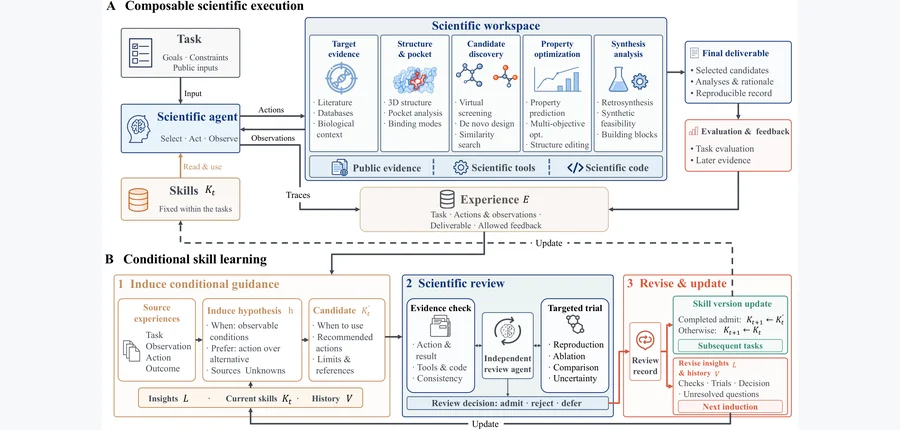 arXiv 2026-10-19 · cs.AI · #15 **[DrugHarness: An Evolvable Agent Harness for Computational Drug Discovery](https://arxiv.org/abs/2610.23791)** Yuxing Chen , Zhisheng Zhang , Cheng Tang , Wei Li , Minghui Zhang , Ziyan Huang , Shaocong Wei , Jiawei Chen , Junru Hu… Affiliation: Shanghai Artificial Intelligence Laboratory / China Pharmaceutical University / University of the Chinese Academy of Sciences / Shanghai Jiao Tong University / Westlake University / Nanjing University / Ant Group / Tongji University / Monash University / Shenzhen Loop Area Institute [Paper](https://arxiv.org/abs/2610.23791) · [Figure source](https://arxiv.org/html/2610.23791v1/system_overview2.png) 

[EN] Abstract
Computational drug discovery requires agents to compose scientific operations and adapt to changing evidence and constraints. Here we introduce DrugHarness, an evolvable agent harness coupling composable scientific execution with conditional skill induction. Its environment integrates over 80 scientific operations, biomedical resources and task-specific code, preserving associations among candidates, results and artifacts. From execution trajectories and outcome feedback, DrugHarness induces action hypotheses with observable applicability conditions, recommended actions and supporting evidence. An independent review agent evaluates candidate skills derived from these hypotheses through source verification and, when needed, targeted execution trials. Admitted skills guide subsequent tasks and are revised through feedback. Evaluation on MolBench and SMDD-Bench demonstrates capabilities in molecular screening, optimization and constrained design. Without evolution, DrugHarness exceeds reported MolClaw-CC results by 10.8 percentage points in affinity-comparison accuracy and 55% in mean top-three active hits on MolBench. Retrospective evaluation on skill-development tasks shows that evolution increases Qwen's affinity-comparison accuracy from 62.2% to 81.1% and optimization success from 79.5% to 87.2%. In a prospective HPK1 study, DrugHarness achieves a more favorable median docking score than Biomni among system-specific candidates. A synthesized compound achieves a cellular IC50 of 14.19 nM, a 2.64-fold potency improvement over the best input reference, with activity competitive with two selected compounds designed by experienced medicinal chemists. These results support conditional skill evolution for scientific agents and demonstrate a workflow connecting computational drug design with experimental validation. <a href="https://arxiv.org/abs/2610.23791">Source</a>

[ZH] Abstract
计算药物发现要求智能体组合科学操作，并适应变化的证据与约束。我们提出 DrugHarness，将可组合科学执行与条件技能归纳耦合的可进化框架。环境整合超过 80 种科学操作、生物医学资源和任务特定代码，保留候选、结果和产物的关联。依据执行轨迹与结果反馈，DrugHarness 归纳具有可观察适用条件、推荐动作和支持证据的动作假设。独立审查智能体通过来源验证、必要时的定向执行试验，评估由假设形成的候选技能。获准技能指导后续任务，并依据反馈修改。MolBench 和 SMDD-Bench 评估显示分子筛选、优化与约束设计能力。未进行进化时，在 MolBench 上，它相对公开 MolClaw-CC 结果的亲和力比较准确率高 10.8 个百分点，前三活性命中平均数高 55%。技能开发任务上的回顾评估显示，进化将 Qwen 亲和力比较准确率从 62.2% 提高到 81.1%，优化成功率从 79.5% 提高到 87.2%。前瞻 HPK1 研究中，在各系统特定候选之间，DrugHarness 的中位对接分数比 Biomni 更有利。合成的一种化合物细胞 IC50 为 14.19 nM，比最佳输入参考效力提高 2.64 倍，与两种经验丰富药物化学家设计的选中化合物活性相当。结果支持科学智能体的条件技能进化，并展示连接计算药物设计与实验验证的流程。 <a href="https://arxiv.org/abs/2610.23791">Source</a>
 |
| 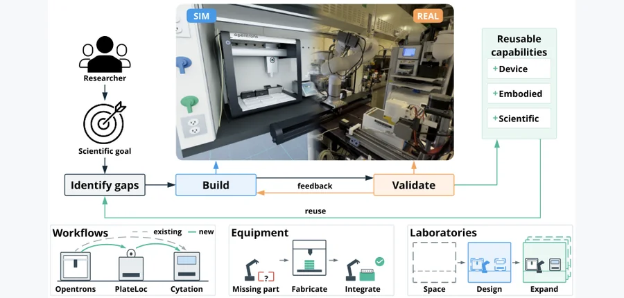 arXiv 2026-10-19 · cs.AI · #16 **[Self-Building Labs](https://arxiv.org/abs/2610.23826)** Jiaru Bai , Yuchi Zhao , Han Hao , Miroslav Bogdanovic , Yang Cao , Varinia Bernales , Alán Aspuru-Guzik Affiliation: University of Toronto / Vector Institute / Institute of Medical Science / Acceleration Consortium / CIFAR / NVIDIA [Paper](https://arxiv.org/abs/2610.23826) · [Project](https://self-building-labs.github.io/) · [Figure source](https://arxiv.org/html/2610.23826v1/sbl_v2.png) 

[EN] Abstract
Self-driving laboratories (SDLs) accelerate scientific discovery by automating experimental execution and optimization. AI agents can increasingly propose new experiments, but existing SDLs can only run the procedures they were built for. Adapting them to a new experiment still takes extensive manual engineering, which makes laboratory flexibility the bottleneck for scaling discovery. We introduce the self-building laboratory (SBL), which designs, configures, and operates its own laboratory setup given a high-level scientific goal. SBL starts from whatever already exists, from an empty room to a working SDL, and builds the missing capabilities: the lab layout, its digital twin, robot skills, and experimental workflows. We demonstrate the system working across different robots and setups, scaling from a single workstation to laboratories with several robots working together. We validate SBL's end-to-end capabilities through a real-world quantum-dot synthesis experiment. By shifting the role of human researchers from manually configuring and programming device automation to specifying scientific objectives, SBL makes scientific automation more accessible, flexible, and scalable. Project website: this https URL <a href="https://arxiv.org/abs/2610.23826">Source</a>

[ZH] Abstract
自驱动实验室（SDL）通过自动化实验执行和优化加速科学发现。人工智能智能体越来越能提出新实验，但现有 SDL 只能执行预先为其构建的程序；适配新实验仍需大量人工工程，使实验室灵活性成为扩展发现的瓶颈。我们提出自构建实验室（SBL），根据高层科学目标自行设计、配置并运行实验室。SBL 从已有条件出发，可以是空房间，也可以是运行中的 SDL，构建缺少的能力：实验室布局、数字孪生、机器人技能和实验流程。我们展示它适用于不同机器人与设置，从单工作站扩展到多机器人协作实验室，并通过真实世界量子点合成实验验证端到端能力。SBL 将研究者角色从人工配置和编程设备自动化，转为指定科学目标，使科学自动化更易获得、更灵活且更可扩展。项目网站见原文链接。 <a href="https://arxiv.org/abs/2610.23826">Source</a>
 | 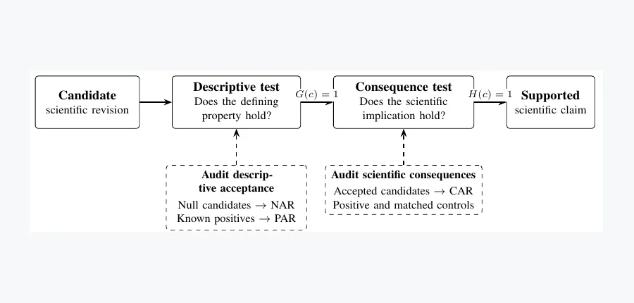 arXiv 2026-10-19 · cs.AI · #17 **[Null Controls Are Necessary but Not Sufficient: Evaluating Acceptance Guards for Scientific Discovery and Interpretability](https://arxiv.org/abs/2610.22445)** Tianyu Wu (Project Aether) Affiliation: Affiliation unconfirmed [Paper](https://arxiv.org/abs/2610.22445) · [Project](https://real-project-aether.github.io/project-aether/) · [Figure source](https://arxiv.org/pdf/2610.22445#page=3) 

[EN] Abstract
Automated discovery systems propose scientific explanations and test which to accept. Does passing a test establish the intended claim? We develop four executable operations for changing physical descriptions: identifying redundancies (L1), coarse-graining dynamics (L2), transferring structure (L3), and inferring missing quantities from conservation imbalances (L4). We evaluate these operations and three interpretability settings through null acceptance (NAR), positive acceptance (PAR), and consequence agreement (CAR). A reduction mapping every state to zero predicts its own future perfectly. It passes closure on 96% of 129 public chaotic systems despite retaining no dynamical variation. An independent observable-preservation test rejects it throughout. On controlled benchmarks, the combined criteria accept 24/24 genuine reductions and reject 72/72 nulls. The other operations distinguish symmetries from redundancies, validate transfers, and reject spurious conservation imbalances. In language and ESM-2 protein models, linear CKA remains unchanged when a proposed correspondence is randomly rotated, whereas localized interventions distinguish genuine mappings from tested nulls. In sparse autoencoders, enrichment rejects all 16 tested nulls, yet independent ablation supports 45% of evaluable enriched features, compared with 0.5% of matched controls. These results reveal two acceptance gaps: descriptive tests can accept scientifically empty candidates, and accepted candidates can lack independently verified consequences. Reliable automated discovery requires evaluating both what a test accepts and the scientific consequences it establishes. Code and data: this https URL . <a href="https://arxiv.org/abs/2610.22445">Source</a>

[ZH] Abstract
自动发现系统提出科学解释并检验哪些可以接纳，但通过检验能否建立预期断言？我们提出四种改变物理描述的可执行操作：识别冗余（L1）、动力学粗粒化（L2）、结构迁移（L3）和从守恒不平衡推断缺失量（L4）。我们通过空值接纳率（NAR）、正例接纳率（PAR）和后果一致性（CAR），评估这些操作及三类可解释性设置。将所有状态映射到零的约化能完美预测自身未来，虽未保留任何动力学变化，却在 129 个公开混沌系统中的 96% 上通过闭合性检验。独立的可观测量保留检验在所有情况下拒绝它。在受控基准上，组合标准接纳全部 24 个真实约化、拒绝全部 72 个空值。其他操作区分对称性与冗余、验证迁移，并拒绝虚假守恒不平衡。在语言模型与 ESM-2 蛋白模型中，随机旋转所提对应关系时线性 CKA 不变，但局部干预能区分真实映射与所测空值。在稀疏自编码器中，富集检验拒绝全部 16 个空值，但独立消融只支持 45% 可评估的富集特征，匹配对照为 0.5%。结果揭示两种准入缺口：描述性检验会接纳科学上空洞的候选，获准候选也可能缺乏独立验证的后果。可靠自动发现需要同时评估检验接纳什么，以及其建立了什么科学后果。代码和数据见原文链接。 <a href="https://arxiv.org/abs/2610.22445">Source</a>
 | 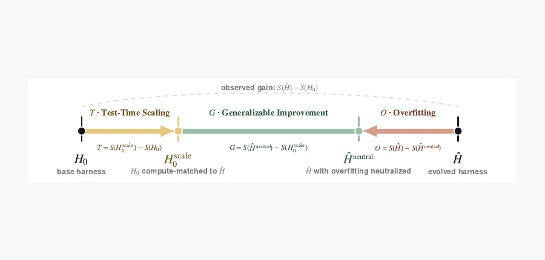 arXiv 2026-10-19 · cs.AI · #18 **[Harness-Delta Attribution: Dissecting Gains From Harness Evolution](https://arxiv.org/abs/2610.22466)** Wenxuan Ding , Qin Lu , Changlong Yu , Sha Li , Shuowei Jin , Xin Liu , Zhenyu Shi , Greg Durrett Affiliation: Amazon / New York University [Paper](https://arxiv.org/abs/2610.22466) · [Code](https://github.com/Wenwen-D/HarnessDeltaAttribution) · [Project](https://wenwen-d.github.io/blog/harness-delta-attribution/) · [Figure source](https://arxiv.org/pdf/2610.22466#page=3) 

[EN] Abstract
Harness evolution automatically optimizes the prompts, skills, tools, and orchestration code around a fixed-weight model, offering a way to improve agentic systems without updating model weights. The agent harness is iteratively optimized to achieve higher performance on the search set. But how much of this gain reflects benchmark-specific overfitting or additional inference-time compute, and how much may generalize beyond the search set? In this work, we introduce Harness-Delta Attribution (HDA), an evaluation protocol that dissects an evolution gain into artifact-driven overfitting, gains explained by test-time scaling, and the remainder, which gives an upper bound on residual generalizable improvement. We apply HDA to 11 executor models and three harness-evolution frameworks across math, coding, creativity, and agentic tasks. In 21 of these settings that show statistically significant search-set gains, we find that a large share of the improvement is explained by overfitting or test-time scaling. Specifically, among these 21 settings, overfitting and test-time scaling account for 54% and 14% of the gain on average; their combined share exceeds 50% in 14 settings. The residual and held-out transfer vary substantially across tasks, models, and frameworks. Importantly, search-set gains often fail to transfer to held-out tasks, and provide limited evidence that they will persist under practical distribution shifts. Moreover, validation-based signals are insufficient to prevent overfitting. These results motivate attribution-aware evaluation in future harness evolution research. <a href="https://arxiv.org/abs/2610.22466">Source</a>

[ZH] Abstract
运行框架进化自动优化固定权重模型周围的提示、技能、工具和编排代码，无需更新权重即可提高智能体系统表现。框架为提高搜索集性能而迭代优化，但收益中有多少是基准特定过拟合或额外推理计算，又有多少可能泛化？我们提出框架增量归因（HDA），将进化收益分为产物导致的过拟合、测试时扩展可解释收益和剩余部分，后者给出残余可泛化改进的上界。我们在数学、代码、创造性和智能体任务中，对 11 个执行模型、三种框架进化方法应用 HDA。在搜索集收益统计显著的 21 个设置中，大量改进可由过拟合或测试时扩展解释：两者平均分别占收益的 54% 和 14%，组合占比在 14 个设置中超过一半。剩余部分和留出迁移在任务、模型和框架间差异显著。搜索集收益经常无法迁移到留出任务，只能为其在实际分布偏移下持续提供有限证据；基于验证的信号也不足以防止过拟合。结果支持未来框架进化采用具有归因意识的评估。 <a href="https://arxiv.org/abs/2610.22466">Source</a>
 |
| 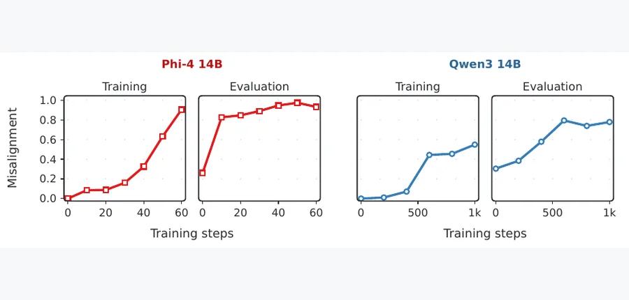 arXiv 2026-10-19 · cs.LG · #19 **[Progressive Misalignment Can Emerge from Benign Recursive Self-Distillation](https://arxiv.org/abs/2610.22467)** Karim Abdel Sadek , Federico Di Gennaro , Fanny Yang Affiliation: University of California, Berkeley / ETH Zurich [Paper](https://arxiv.org/abs/2610.22467) · [Project](https://progressive-misalignment.github.io/) · [Figure source](https://arxiv.org/pdf/2610.22467#page=2) 

[EN] Abstract
Training models on their own outputs has attracted widespread attention as a possible route to advance AI capabilities. One prominent approach is self-distillation, where a model is trained to match the token-level predictions it would have produced when given access to additional context, such as a cue, feedback, or instruction. However, the safety properties of this training procedure are poorly understood. In this paper, we present a surprising safety failure of recursive self-distillation, where each self-distilled model becomes the teacher for the next round of training. We observe that when a safe model is recursively self-distilled on its own (safe) generations while receiving an additional non-harmful cue, it becomes increasingly misaligned across a diverse set of harmful queries; we call this Progressive Misalignment. We show this failure mode in both the Qwen3 and Phi-4 model families on SORRY-Bench and StrongREJECT. Progressive misalignment also occurs in a more realistic setup, where the fixed cue is replaced by feedback from a simulated user with benign intent. Using a gradient-based method, we are also able to find benign prompts that lead to progressive misalignment when applying recursive self-distillation, showing that harmful training prompts are not necessary for this failure mode to emerge. We hope our work encourages future investigations of the safety properties of AI systems recursively trained on their own data. <a href="https://arxiv.org/abs/2610.22467">Source</a>

[ZH] Abstract
在模型自身输出上训练，被广泛关注为提升人工智能能力的潜在途径。常见的自蒸馏让模型匹配它在获得线索、反馈或指令等额外上下文时会产生的词元级预测，但该训练程序的安全性质仍不清楚。我们报告递归自蒸馏中的意外安全失败：每个自蒸馏模型成为下一轮教师。一个安全模型在获得额外无害线索、递归学习自身安全生成时，会在多种有害查询上逐步失配，我们称之为渐进失配。在 Qwen3 和 Phi-4 家族、SORRY-Bench 与 StrongREJECT 上均观察到该失败。更现实的设置中，用善意模拟用户反馈替代固定线索，也出现渐进失配。我们还用基于梯度的方法找到会在递归自蒸馏下导致失配的良性提示，说明不需要有害训练提示也能产生这种失败。我们希望推动进一步研究在自身数据上递归训练的人工智能系统的安全性质。 <a href="https://arxiv.org/abs/2610.22467">Source</a>
 | 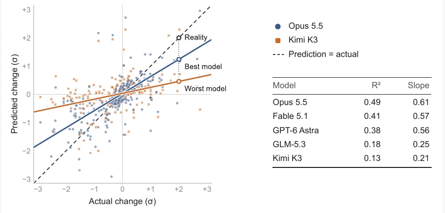 arXiv 2026-10-19 · cs.LG · #20 **[Can LLMs predict the outcomes of machine learning experiments?](https://arxiv.org/abs/2610.22599)** Ayush Bansal , Aldo Pareja , Sean Klein , Serge Didenko , Artem Lukoianov Affiliation: Autolab AI / Institute of Foundation Models / Massachusetts Institute of Technology [Paper](https://arxiv.org/abs/2610.22599) · [Code](https://github.com/autolab-ai/EV-estimation) · [Figure source](https://arxiv.org/pdf/2610.22599#page=1) 

[EN] Abstract
Recent advances in AI make Recursive Self-Improvement (RSI) increasingly plausible. Large Language Models (LLMs) can already propose, select, and run Machine Learning (ML) experiments. However, the space of possible design choices in ML is vast. An LLM that proposes an experiment needs a reliable intuition of whether it is worth running given the timing constraints of long training runs. In this work, we measure such intuition in current frontier LLMs by evaluating how accurately they predict the impact of self-generated ML experiment ideas before these are put into training runs. To this end, we construct a dataset of 288 LLM-proposed ideas on eight MLE-bench tasks. We then prompt five frontier LLMs (GPT-6 Astra, Claude Opus 5.5, Claude Fable 5.1, Kimi K3, and GLM-5.3) to predict the impact of each idea and compare their predictions with the actual outcomes after training. We report four main findings. First, LLM predictions are substantially better than random chance but far from accurate: even the best model, Claude Opus 5.5, explains only half of the variance in outcomes (R^2 = 0.49). Second, we notice that all tested models systematically underestimate the magnitude of the changes. Third, prediction quality varies widely across tasks. Finally, the choice of the coding harness that actually implements the ideas has little effect on outcomes, and we find no evidence of self-preference. Higher reasoning settings and additional context lead to modest gains. Overall, our results show that current LLMs have useful but limited intuition about which ML ideas will work. We release our dataset to support further study. <a href="https://arxiv.org/abs/2610.22599">Source</a>

[ZH] Abstract
人工智能进展使递归自我改进（RSI）越来越可行。大语言模型已能提出、选择和运行机器学习实验，但可能设计选择的空间巨大，提议实验的模型需要可靠直觉，判断长训练时间约束下某实验是否值得运行。我们评估当前前沿模型在提议投入训练前，预测自生成机器学习实验想法效果的准确性。为此，构建八项 MLE-bench 任务、288 个模型提议想法的数据集，再让五个前沿模型（GPT-6 Astra、Claude Opus 5.5、Claude Fable 5.1、Kimi K3、GLM-5.3）预测每个想法的影响，并与真实训练结果比较。主要发现有四点：预测显著优于随机但远不准确，即使最佳 Claude Opus 5.5 也只解释约一半结果方差（R^2=0.49）；所有模型系统性低估变化幅度；预测质量跨任务差异很大；实际实现想法所用编码框架影响较小，且没有发现自我偏好证据。更高推理设置及额外上下文带来适度收益。总体上，模型对哪些机器学习想法有效具有有用但有限的直觉。我们公开数据集支持进一步研究。 <a href="https://arxiv.org/abs/2610.22599">Source</a>
 | 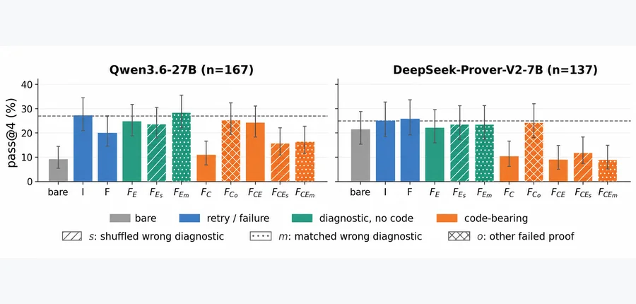 arXiv 2026-10-19 · cs.AI · #21 **[Repair, Retry, and the Cost of Hindsight: Verifier Feedback in Formal Theorem Proving](https://arxiv.org/abs/2610.22698)** Jack Li , Sophia Li Affiliation: Stanford University [Paper](https://arxiv.org/abs/2610.22698) · [Figure source](https://arxiv.org/html/2610.22698v1/figures/results_onestep.png) 

[EN] Abstract
Verifier-guided self-repair conditions a model on feedback from failed attempts before it tries again, without weight updates. Yet two findings in prior work are in tension: verifier feedback can improve repair of failures, but self-repair itself can provide little-to-no advantage over independent resampling. We reconcile these findings in Lean theorem proving through controlled one-step experiments that hold the preceding failure fixed while varying whether the failed proof is shown, whether the compiler error corresponds to that failure, and the retry instruction. We test frozen Qwen3.6-27B, a general-purpose model, and DeepSeek-Prover-V2-7B, a specialized prover, on difficult MiniF2F problems. We find two opposing effects. Showing the model its failed predecessor reduces success and sharply increases copying of it, while on Qwen adding that attempt's compiler error recovers the loss, to the level of the diagnostic alone. Replacing the predecessor with another theorem's failed proof largely removes the degradation on both models; on Qwen, replacing the diagnostic with another problem's error substantially reduces the recovery. Without the failed proof, correct diagnostics show no resolved advantage over wrong-diagnostic controls on either model. The failed-proof penalty persists with and without the retry instruction, whereas Qwen's diagnostic recovery is weaker without it. In 11-problem sequential experiments through 64 attempts, Qwen retains a correct-diagnostic benefit within failed-proof histories, while DeepSeek-Prover shows no resolved recovery. However, no tested one-step feedback condition establishes an advantage over instruction-only resampling, nor does 64-attempt sequential repair with failed proofs and correct diagnostics at equal token budgets. Verifier feedback can thus improve repair without overcoming the performance loss from conditioning on a failed attempt. <a href="https://arxiv.org/abs/2610.22698">Source</a>

[ZH] Abstract
验证器引导的自修复让模型在不更新权重的情况下，依据失败反馈再尝试。但已有工作中两种发现似乎冲突：验证反馈可以提高失败修复，自修复本身却可能比独立重采样没有或只有很小优势。我们在 Lean 定理证明中用受控单步实验协调两者，固定前一次失败，改变是否展示失败证明、编译错误是否对应该失败，以及重试指令。在困难 MiniF2F 问题上测试冻结通用模型 Qwen3.6-27B 和专用证明器 DeepSeek-Prover-V2-7B。发现两种相反作用：展示失败前驱降低成功率并显著增加复制；对 Qwen，加入对应编译错误可恢复损失，达到只看诊断的水平。将前驱换成其他定理的失败证明，基本消除两模型的退化；对 Qwen，将诊断换为其他问题的错误会显著降低恢复。不展示失败证明时，两模型均未显示正确诊断相对错误诊断对照的明确优势。无论有无重试指令，失败证明惩罚都存在，而没有指令时 Qwen 的诊断恢复更弱。在 11 个问题、最多 64 次尝试的顺序实验中，Qwen 在失败证明历史内仍保留正确诊断收益，DeepSeek-Prover 则没有明确恢复。然而，无论所测单步反馈条件，还是相同词元预算下带失败证明与正确诊断的 64 次顺序修复，都未建立优于仅指令重采样的优势。因此，验证反馈能改进修复，却未必克服条件化于失败尝试造成的性能损失。 <a href="https://arxiv.org/abs/2610.22698">Source</a>
 |
| 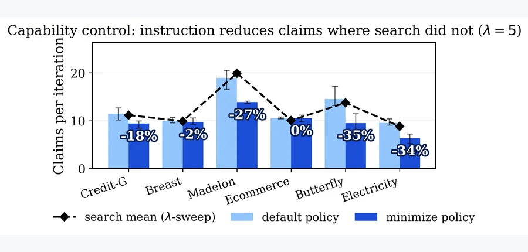 arXiv 2026-10-19 · cs.AI · #22 **[When Can You Trust an Agent's Own Verifier? Stress-Testing Counterfactual Rationale Verification Under Search Pressure and Oracle Access](https://arxiv.org/abs/2610.22779)** Jonghyun Lee , Moonsu Kim , Sunghwan Park Affiliation: Yonsei University [Paper](https://arxiv.org/abs/2610.22779) · [Figure source](https://arxiv.org/html/2610.22779v1/figs/fig3_capability_control.png) 

[EN] Abstract
Automated agent design increasingly trusts a single score to decide whether a change is an improvement -- but a score optimized aggressively enough ceases to measure what it was meant to. When an agent also explains its design, that explanation is a second signal we can check without human labels: negate each stated claim, re-run, and observe whether performance drops. We ask whether such a verifier stays reliable once an agent optimizes against it. Our contribution is not a new verifier but a way to stress-test one: a pressure ratio $\rho$ measuring how much the verifier steers the agent's search, and four falsifiable probes covering four failure modes -- giving no signal, being too weak to matter, being gamed by stating fewer claims, and being queried before the agent commits. We apply the test to our own verifier, the Rationale Consistency Score (RCS), inside an LLM agent that designs machine-learning pipelines, with one generator model, six tasks, and three seeds. First, in our prior configuration the verifier barely affects the search objective ($\rho \ll 1$), partly because of an accuracy gate, so its robustness had not been tested; it still shapes the reported artifact through a final-selection tie-break that $\rho$ does not register. Second, a capability control shows the agent shortens its claim lists when instructed, yet search does not, even at $\rho$ over 100 times the prior level; since feedback omits claim volume and horizons are short, this null result is largely structural rather than evidence of robustness. Third, when the agent can probe the verifier before committing, it keeps claims that pass while held-out faithfulness falls -- a decline invisible to in-loop metrics, though partly confounded by how RCS scores small pipelines. We offer these as preliminary evidence and propose a reporting standard: audit a verifier with $\rho$ and these probes before trusting it. <a href="https://arxiv.org/abs/2610.22779">Source</a>

[ZH] Abstract
自动智能体设计越来越依赖单个分数决定变化是否改进，但被激烈优化的分数会不再衡量原本目标。当智能体也解释其设计时，这种解释提供无需人工标签即可检查的第二信号：否定每条断言、重新执行，观察性能是否下降。我们研究该验证器在智能体针对它优化后是否仍可靠。贡献不是新验证器，而是压力测试方法：用压力比 $\rho$ 衡量验证器对搜索的引导程度，并用四个可证伪探测覆盖无信号、影响太弱、少列断言投机，以及提交前查询四种失败模式。我们在设计机器学习流程的大语言模型智能体中，对自身的理由一致性分数（RCS）应用测试，使用一个生成模型、六项任务、三个种子。首先，先前配置中验证器对搜索目标影响很小（$\rho\ll1$），部分由于准确率门控，所以其鲁棒性并未被测试；但它通过最终选择的平局裁决影响报告产物，这不被 $\rho$ 捕捉。其次，能力对照显示，按指令智能体会缩短断言列表，但搜索不会，即使压力比超过原水平一百倍；由于反馈不含断言数量且时间跨度短，这种空结果主要是结构性的，并非鲁棒性证据。第三，允许提交前探测验证器时，智能体保留可通过断言，留出忠实度却下降，循环内指标看不到这种下降，但 RCS 对小型流程的评分方式构成部分混杂。我们将其作为初步证据，建议在信任验证器前，用压力比和这些探测进行审计。 <a href="https://arxiv.org/abs/2610.22779">Source</a>
 | 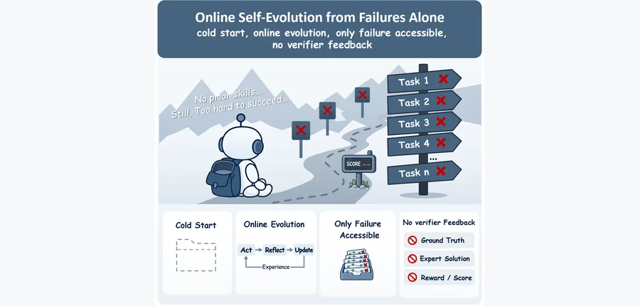 arXiv 2026-10-19 · cs.CL · #23 **[Self-Evolving Agents Can Repair Failures but Struggle to Generalize from Them](https://arxiv.org/abs/2610.22984)** Weixiang Zhao , Yichen Zhang , Yanyan Zhao , Jinming Bai , Bin Liang , Ruifeng Xu , Bing Qin , Ting Liu Affiliation: Harbin Institute of Technology (Harbin and Shenzhen) / Chinese University of Hong Kong [Paper](https://arxiv.org/abs/2610.22984) · [Figure source](https://arxiv.org/pdf/2610.22984) 

[EN] Abstract
Experience-driven self-evolution offers a promising path for large language model (LLM) agents to continually improve through interaction. Yet existing approaches often rely on successful trajectories or external evaluation signals, leaving unclear whether agents can evolve when such positive anchors are unavailable. We study this question through Cold-Start Failure-Only Evolution (CFOE), where agents start without accumulated experience and learn only from failed interactions without privileged guidance. Across three self-evolving paradigms, multiple LLM backbones, and four interactive environments, we uncover a consistent repair-generalization gap: failure-derived experience can help repair previously failed tasks, but rarely yields sustained improvements on unseen tasks. Further analysis shows that agents often misinterpret failures, while even verified-correct experience remains difficult to transfer. Relaxing CFOE reveals that verifier feedback and additional interaction provide limited gains, whereas successful trajectories substantially improve transfer. These findings suggest that current self-evolving agents are better at repairing observed failures than building generalizable capabilities from failure. <a href="https://arxiv.org/abs/2610.22984">Source</a>

[ZH] Abstract
经验驱动自进化为大语言模型智能体通过交互持续改进提供潜在路径，但现有方法常依赖成功轨迹或外部评估信号，缺少这些正向锚点时能否进化尚不清楚。我们通过冷启动仅失败进化（CFOE）研究这一问题：智能体从无累积经验开始，仅从失败交互学习，不使用特权指导。跨三种自进化范式、多个骨干和四个交互环境，我们发现一致的修复—泛化缺口：失败经验有助于修复曾失败任务，但很少持续提高未见任务表现。分析显示，智能体经常误解失败，即使验证为正确的经验也难迁移。放宽 CFOE 后，验证器反馈和额外交互仅带来有限收益，成功轨迹却显著改善迁移。结果表明，当前自进化智能体更擅长修复已见失败，而非从失败建立可泛化能力。 <a href="https://arxiv.org/abs/2610.22984">Source</a>
 | 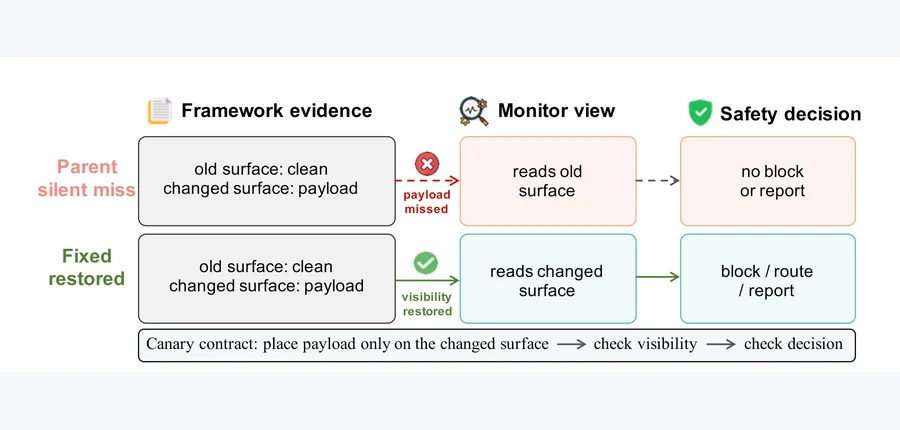 arXiv 2026-10-19 · cs.AI · #24 **[Monitor-Validity Failures: LLM Safety Evidence Paths at Evolving Framework Boundaries](https://arxiv.org/abs/2610.23362)** Junchi Liao Affiliation: Affiliation unconfirmed [Paper](https://arxiv.org/abs/2610.23362) · [Figure source](https://arxiv.org/html/2610.23362v1/figures/fig1.png) 

[EN] Abstract
Modern LLM applications rely on runtime monitors that inspect tool calls, traces, streams, detector outputs, and verifier inputs. This creates an interface-reliability problem: a framework path may remain operational while policy-relevant evidence never reaches its decision point. In one representative case, a regex detector returned a positive match, but the framework stranded the result before the block decision. This differs from jailbreaks and detector errors because the evidence is already recognized yet disconnected from enforcement. We study this repair-boundary signature with canary contracts: parent/fixed confirmation units that place a known payload only on the changed evidence surface and record monitor visibility together with the downstream decision for action-boundary cases. Applying the protocol to public framework repairs, we confirm 18 evidence-path failures across 11 LLM or agent safety project groups and four implementation ecosystems. Nine are established-boundary repairs, eight are new-surface policy-coverage gaps, and one is a boundary-only evidence case. Fourteen reach E1 enforcement boundaries: seven native action outcomes, six configured enforcement boundaries, and one synthetic-consumer consequence. The remaining cases affect verifier, safety-prompt, or observability channels. The cases form carrier, adapter, authority, and surface families and show how ordinary application behavior can remain intact while a safety-specific evidence path misses its decision. Exact revisions, deterministic outcomes, negative controls, and a frozen prospective audit document the confirmation rule. Monitor assumptions therefore need regression tests at the schemas, streams, tools, and adapters that frameworks evolve. <a href="https://arxiv.org/abs/2610.23362">Source</a>

[ZH] Abstract
现代大语言模型应用依赖运行时监控器检查工具调用、轨迹、流、检测输出和验证器输入，由此产生接口可靠性问题：框架路径可能正常运行，但策略相关证据从未到达决策点。一个代表案例中，正则检测器已返回阳性匹配，框架却将结果滞留在阻断决策之前。这不同于越狱和检测错误，因为证据已被识别，只是与执行断开。我们用金丝雀契约研究这种修复边界特征：父版本与修复版本的确认单元，仅把已知载荷放在变化的证据表面，记录监控可见性，并对动作边界案例记录下游决策。对公开框架修复应用该协议，我们在 11 个语言模型或智能体安全项目组、四种实现生态中确认 18 个证据路径失败，其中九个是既有边界修复，八个是新表面的策略覆盖缺口，一个是仅边界证据案例。十四个达到 E1 执行边界：七个原生动作结果、六个配置的执行边界、一个合成消费者后果。其余影响验证器、安全提示或可观测通道。案例归为载体、适配器、权限与表面四类，显示普通应用行为可保持正常，安全证据路径却错过决策点。精确版本、确定性结果、负对照和冻结的前瞻审计记录确认规则。因此，监控假设需要在框架不断变化的模式、流、工具和适配器处进行回归测试。 <a href="https://arxiv.org/abs/2610.23362">Source</a>
 |
|  arXiv 2026-10-19 · cs.RO · #25 **[Beyond Success Rate: Interventional Evaluation of Memory in Vision-Language-Action Systems](https://arxiv.org/abs/2610.23372)** Keyuan Luo , Yi Xie , Wanyun Ling , Yuanzhe Li , Ziyue Li , Zhuoqi Zeng Affiliation: Hainan Bielefeld University of Applied Sciences (BiUH) / Technical University of Munich / Technische Universität Berlin [Paper](https://arxiv.org/abs/2610.23372) · [Figure source](https://arxiv.org/html/2610.23372v1/figure1_fourq_c.png) 

[EN] Abstract
When we say that a robot uses memory, does that memory actually play a role? Success-rate ablations alone cannot establish the use of task-relevant facts: they change information and computation together, while aggregate rates can hide offsetting gains and losses. We propose an Interventional Memory Evaluation Protocol (IMEP) for vision-language-action (VLA) systems to address four questions: (1) Does memory provide a net benefit? (2) Under what conditions does memory help? (3) Do changes to memory alter task outcomes? (4) Are these effects specific to task-relevant facts? At the retrieval interface, we compare target-fact substitutions with fact-preserving replacements, minimal numerical perturbations, and exact replicas, while assessing decision correctness separately from motor execution success. We evaluate within-episode, cross-episode, and agentic memory. In cross-episode learned-bank experiments, a one-unit-in-the-last-place (ULP) intervention, including its installation procedure, changes 11.9% of seed-paired outcomes, while changing key facts produces no clear additional effect over fact-preserving replacements. To examine when memory helps, we introduce ChainBench, where correct decisions require historical information unavailable in current observations. The full memory configuration raises task success from 39.1% to 74.3%, matching the oracle-decision condition under shared recorded executions. These results show that correct history can support robot decisions, but establishing whether a memory system realizes this benefit requires fact-specific evidence beyond aggregate success rates. <a href="https://arxiv.org/abs/2610.23372">Source</a>

[ZH] Abstract
当我们说机器人使用记忆时，记忆真的起作用吗？仅成功率消融不能建立任务相关事实的使用，因为它同时改变信息和计算，汇总率还可能掩盖相互抵消的收益与损失。我们提出 VLA 系统的干预式记忆评估协议（IMEP），回答四个问题：（1）记忆是否有净收益；（2）何时有帮助；（3）改变记忆是否改变任务结果；（4）影响是否特定于任务相关事实。我们在检索接口比较目标事实替换、事实保持替换、最小数值扰动和精确副本，并将决策正确性与运动执行成功分开评估。研究覆盖回合内、跨回合和智能体式记忆。在跨回合学习记忆库实验中，一个末位单位（ULP）干预及其安装程序改变 11.9% 的种子配对结果，但改变关键事实相对事实保持替换没有明确额外影响。为研究何时记忆有用，我们提出 ChainBench，要求正确决策使用当前观测不可获得的历史信息。完整记忆将任务成功率从 39.1% 提高到 74.3%，在共享记录执行下与预言机决策条件匹配。结果表明，正确历史可以支持机器人决策，但要确认某记忆系统是否实现此收益，需要超出汇总成功率的事实特定证据。 <a href="https://arxiv.org/abs/2610.23372">Source</a>
 | 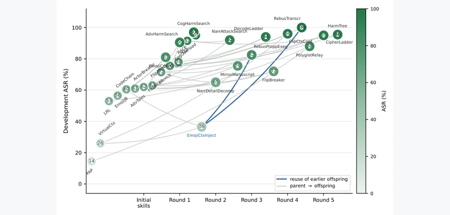 arXiv 2026-10-19 · cs.CR · #26 **[RedDarwin: Evolving Jailbreak Skills against Frontier LLMs](https://arxiv.org/abs/2610.23726)** Zhouyuan Ma , Yutao Wu , Hanxun Huang , Xiang Zheng , Yi Liu , Xingjun Ma Affiliation: Fudan University / Deakin University / University of Melbourne / City University of Hong Kong / Griffith University [Paper](https://arxiv.org/abs/2610.23726) · [Figure source](https://arxiv.org/html/2610.23726v1/combination_search_appendix.png) 

[EN] Abstract
Red teaming must continually adapt as frontier LLM safeguards evolve, yet existing approaches largely search for adversarial prompts or optimize within fixed attack procedures. We observe that even when an attack becomes ineffective, its underlying mechanisms can remain useful and can be revised or recombined to construct stronger attacks. Based on this insight, we introduce RedDarwin, an agentic framework that shifts the unit of jailbreak evolution from prompts and fixed attacks to executable attack skills. RedDarwin consists of 47 reusable base skills and autonomously revises, composes, executes, and selects them using target-model feedback, allowing successful discoveries to become building blocks for subsequent evolution. RedDarwin produces 65 evolved skills, improving 44 of 47 base attacks and increasing their mean attack success rate (ASR) on AdvBench from 18.8% to 47.3%. These evolved skills consistently outperform baselines on the held-out StrongREJECT and frontier LLMs unseen during evolution; with only 10 target-model queries, RedDarwin achieves 100% ASR on GPT-5.6-Sol, 92% on Claude-Sonnet-5, and 80% on Gemini-3.8-Flash. Analysis of the evolution trajectories further shows that strong attacks often emerge from novel combinations of reusable mechanisms rather than from individually dominant ones. We believe this paradigm can accelerate adaptive red teaming and inform stronger safeguards, creating complementary value for both safety evaluation and defense. <a href="https://arxiv.org/abs/2610.23726">Source</a>

[ZH] Abstract
红队测试必须随前沿模型保障措施持续适应，但现有方法主要搜索对抗提示或在固定攻击程序中优化。我们观察到，即使攻击失效，其底层机制仍可能有用，可经修改或重组构成更强攻击。基于此，RedDarwin 将越狱进化单位从提示和固定攻击转为可执行攻击技能。它包含 47 个可复用基础技能，依据目标模型反馈自主修改、组合、执行和选择，使成功发现成为后续进化的组件。RedDarwin 产生 65 个进化技能，改进 47 个基础攻击中的 44 个，将 AdvBench 平均攻击成功率从 18.8% 提高到 47.3%。技能在留出 StrongREJECT 及进化未见前沿模型上持续优于基线；仅十次目标模型查询，报告在 GPT-5.6-Sol、Claude-Sonnet-5 和 Gemini-3.8-Flash 上分别达到 100%、92% 和 80% 攻击成功率。轨迹分析显示，强攻击经常来自可复用机制的新组合，而非单个主导机制。我们认为，该范式可加速自适应红队测试并支持更强保障措施，为安全评估和防御提供互补价值。 <a href="https://arxiv.org/abs/2610.23726">Source</a>
 |   |
<!-- PAPER_CARDS_END -->

## Retrieval overview

**26 selected papers: 6 A / 10 B / 10 C.** Collection date: **20 October 2026 (Beijing)**. Official announcement batch: **19 October 2026**. The previous processed batch was Friday, 16 October; the weekend and unchanged-batch reports do not repeat those papers.

| Official source | Batch | New | Cross | Replacement | Complete listing coverage |
|---|---|---:|---:|---:|---|
| [Computer Science](https://arxiv.org/list/cs/new?skip=0&show=2000&check=20261020) | 2026-10-19 | 748 | 71 | 498 | 1,317 records; one page |
| [stat.ML](https://arxiv.org/list/stat.ML/new?skip=0&show=2000&check=20261020) | 2026-10-19 | 15 | 16 | 33 | 64 records; one page |
| Total | 2026-10-19 | 763 | 87 | 531 | 1,381 records |

All **763 unique official New records** were parsed. Lexical discovery yielded 162 candidates; **32 titles and complete original abstracts were semantically reviewed**, producing this focused selection of 26. This is not exhaustive semantic review of every New record. The CS aggregate covers cs.AI, cs.LG, cs.CL, cs.MA, cs.SE, cs.RO, cs.CV, cs.NE and cs.CR. Versionless IDs are deduplicated and prior inclusions excluded. Cross-listings remain outside the main list.

All 26 papers have complete paired abstracts and visually checked genuine figures: **26 EN / 26 ZH / 26 images; 0 placeholders**. Twenty images come from official HTML, one is a PDF raster figure, and five are rendered PDF crops. The crops fill three extraction gaps and replace an automatically selected logo and avatar. Affiliations are source-supported for 23 papers; three remain **Affiliation unconfirmed**. Fourteen of 15 checked resource destinations were reachable and identified; the CoEvolve code URL returned HTTP 404 and receives no button. See the [run record](../../data/runs/2026-10-20.json) for snapshots, hashes, section IDs, selection scope and provenance.

## Reading guide

A denotes direct RSI, B self-improvement mechanisms, and C evaluation and limits. Order is tier, then arXiv ID; it does not rank comparable performance. Tier assignments, priorities and mechanism interpretation are **editorial inference**. Numerical findings are **author reports**; no experiments were independently reproduced for this digest. Original headers, figures and selected passages were checked, rather than a complete full-text review of every paper.

Identify what changes: weights, executable code or harnesses, skills/memory, or one inference trajectory. These are distinct improvement claims. Simulation is separated from physical experiments, surrogate predictions from actual execution, and retrospective development scores from held-out transfer. No finite loop here establishes unbounded recursive improvement.

## Tiered Top papers

| # | Paper | Categories | Authors | Affiliation | Tier | Update target | Reading priority |
|---:|---|---|---|---|---|---|---|
| 1 | [R$^2$Orch: Recursive Self-Improvement for Agent Orchestration via Self-Play within a Skill-Internalization Loop](https://arxiv.org/abs/2610.22740) | cs.AI | Mingda Zhang , Yun Huang , Qiang Huang , Yanjin Li , Rui Qian , Qichao Zhao , Tiesunlong Shen , Na Zhao , Jian Wang , Xiaoying Tang | Chinese University of Hong Kong, Shenzhen / Fudan University / University of Illinois Urbana-Champaign / Tsinghua University / National University of Singapore | A | Orchestrator/proposer weights and removable external skills | Topical reference |
| 2 | [Self-Evolving Coding Agents via Harness-Policy Optimization](https://arxiv.org/abs/2610.22791) | cs.CL; cs.AI | Zhepei Wei , Wenlin Yao , Baolin Peng , Danqing Wang , Qianhui Wu , Hao Cheng , Yu Meng , Jianfeng Gao | Microsoft Research / University of Virginia / Carnegie Mellon University | A | Coding-agent policy weights and executable harness | Priority read |
| 3 | [InstAgent: A Recursively Self-Improving Agent Operating System for Heterogeneous Robot Collaboration](https://arxiv.org/abs/2610.23098) | cs.RO | Haoyang Luo , Junhao Qin , Jingyan Cao , Yi Huang , Guangjie Yang , Xiaoyu Chen , Haotao Lu , Tianxiang Gui , Ye Shi , Jingya Wang | ShanghaiTech University / InstAdapt | A | Reusable multi-robot collaboration programs | Topical reference |
| 4 | [MetaCurate: Evolving Curation Filters for High-Quality Agentic Coding Data](https://arxiv.org/abs/2610.23134) | cs.LG | Donghoon Kim , Seunghyuk Oh , Kevin Galim , Minseo Kim , Minjae Lee , Younghyun Kim , Wooseok Seo , Hyung Il Koo , Wonjun Kang | FuriosaAI / University of California, Berkeley | A | Executable data-curation rules, rubrics and aggregation | Topical reference |
| 5 | [Language Models Learn to Improve Language Models](https://arxiv.org/abs/2610.23344) | cs.CL; cs.AI | Minhua Lin , Zijun Wang , Zewen Liu , Zhaotian Weng , Bing He , Zhan Shi , Benoit Dumoulin , Xiang Zhang , Suhang Wang , Hanqing Lu | Pennsylvania State University / University of California, Santa Cruz / Emory University / University of California, Santa Barbara / Amazon | A | LM-improvement proposer weights and world-model context | Priority read |
| 6 | [DiscoveryRSI: Recursively Learning to Discover Valuable Hypotheses](https://arxiv.org/abs/2610.23839) | cs.CL | Jianyuan Zhong , Chenwei Wu , Zhaochen Yu , Xixian Jiang , Xuewei Li , Hao Xiao , Xilin Dai , Junyang Wang , Jiaru Zou , Zhiqing Cui , Boyuan Zheng , Jing Xiong , Zhen Zhang , Qiang Gao , Michael Morley , Luis Nakayama , Qiang Xu , Liyue Shen , Tao Gui , Leo Anthony Celi , James Zou , Zhenfei Yin , Yingcheng Wu , Ling Yang | PhAI Labs / Chinese University of Hong Kong / University of Michigan / National University of Singapore / Fudan University / Peking University People’s Hospital / Peking University / Stanford University / Hong Kong University of Science and Technology / University of California, Santa Barbara / Southeast University / Harvard Medical School / Federal University of São Paulo / Massachusetts Institute of Technology / University of Oxford / Princeton University | A | Hypotheses, research workflows and learned research capability | Priority read |
| 7 | [TokenEconomizer: Experience-Driven Black-Box Cost Control for Coding Agents](https://arxiv.org/abs/2610.22732) | cs.CL | Aaron J. Li , Weijia Xu , Chandan Singh , Zixiao Chen , Jeevana Priya Inala , Charlotte Siska , Acar Tamersoy , Bin Yu , Ion Stoica , Michel Galley , Jianfeng Gao | University of California, Berkeley / Microsoft Research / Microsoft Security | B | External operational micro-skills, tool exposure and intervention policy | Topical reference |
| 8 | [Reward Engine: Reward-Centric Self-Evolution for Open-Ended Tool Agents](https://arxiv.org/abs/2610.22915) | cs.AI | Litong Feng , Ji Qi , Yiran Cheng , Shaowu Pan , Xinyu Zhang , Qijun Li | Huawei openJiuwen Team | B | Evidence-returning RewardPack and revised task outputs | Topical reference |
| 9 | [Distill Until Divergence: Error-Truncated Hindsight Distillation for Agentic RL](https://arxiv.org/abs/2610.23048) | cs.AI | Yibin Huang , Conghui Zhu | Harbin Institute of Technology | B | Agent policy weights and outcome/error-specific hindsight credit | Topical reference |
| 10 | [CoEvolve: Self-Evolving Code Policies from Skills to Strategies for Humanoid Robots](https://arxiv.org/abs/2610.23288) | cs.RO | Zicheng Liu , Haochen Wu , Jiawei He , Suyun Zhao , Huan Yang , Cheng Chi , Hao Tang | Peking University / Renmin University of China / Beijing XYZ Embodied AI / Beijing Academy of Artificial Intelligence | B | Executable coordination code over fixed motor skills | Topical reference |
| 11 | [HexaShell: A Thin Harness for Exploring the Limits of VLM Agents as Robot Coding Agents](https://arxiv.org/abs/2610.23479) | cs.RO | Hongcheng Gao , Alex Zhou , Jay Zhu , Zelin Zheng , Shijia Ge , Xiping Li , Di Wu , Yazhe Wang , Jianshu Zeng , Xuan Shangguan , Yongli Wang , Yexing Wan , Lingyu He , Zhiqi Jia , Sihang Wu , Xiao He | Affiliation unconfirmed | B | Robot tools written by a frozen coding model | Topical reference |
| 12 | [Darwin-Claw: Environment-Adaptive Experience Consolidation for Recursively Self-Evolving Agents](https://arxiv.org/abs/2610.23574) | cs.AI | Mingze Yin , Xiaohan Wang , Dian Li , Longfei Luo , Jiahong Yan , Yiheng Zhu , Chang-Yu Hsieh | Zhejiang University / Tencent / Zhongguancun Academy | B | Operational skills, durable memory and situational prototypes | Topical reference |
| 13 | [From Trajectories to Differentiated Skills: Cognitive Differentiation for Self-Improving Agents](https://arxiv.org/abs/2610.23599) | cs.AI | Yewei Zhao , Derong Xu , Wei Chen , Yin Xu , Peilun Zhou , Xiaohan Wang , Guojun Yin , Wei Lin , Mingjun Xiao | University of Science and Technology of China / Meituan / City University of Hong Kong | B | Meta, Experience, Tool and Script skill components | Topical reference |
| 14 | [GLOBE: Evolving Structured Agentic Memory for E-commerce Product Optimization in Generative Search](https://arxiv.org/abs/2610.23709) | cs.CL; cs.AI | Hyunseo Kim , Suil Choe , Sukkyoung So , Daeyeon Yi | AI Lab, CTO Division, LG Electronics | B | A persistent field-scoped optimization handbook | Topical reference |
| 15 | [DrugHarness: An Evolvable Agent Harness for Computational Drug Discovery](https://arxiv.org/abs/2610.23791) | cs.AI | Yuxing Chen , Zhisheng Zhang , Cheng Tang , Wei Li , Minghui Zhang , Ziyan Huang , Shaocong Wei , Jiawei Chen , Junru Hu , Hongze Zhu , Jianghan Shen , Min Cen , Xinyuan Zhu , Yaxue Zhao , Jubo Wang , Yuqiang Li , Chun-Mei Feng , Zongyuan Ge , Rui Su , Jie Xu , Yirong Chen , Xi Xu , Ming Hu | Shanghai Artificial Intelligence Laboratory / China Pharmaceutical University / University of the Chinese Academy of Sciences / Shanghai Jiao Tong University / Westlake University / Nanjing University / Ant Group / Tongji University / Monash University / Shenzhen Loop Area Institute | B | Conditional scientific skills and evidence-linked artifacts | Topical reference |
| 16 | [Self-Building Labs](https://arxiv.org/abs/2610.23826) | cs.AI; cs.MA; cs.RO | Jiaru Bai , Yuchi Zhao , Han Hao , Miroslav Bogdanovic , Yang Cao , Varinia Bernales , Alán Aspuru-Guzik | University of Toronto / Vector Institute / Institute of Medical Science / Acceleration Consortium / CIFAR / NVIDIA | B | Laboratory layouts, digital twins, robot skills and workflows | Topical reference |
| 17 | [Null Controls Are Necessary but Not Sufficient: Evaluating Acceptance Guards for Scientific Discovery and Interpretability](https://arxiv.org/abs/2610.22445) | cs.AI; cs.LG | Tianyu Wu (Project Aether) | Affiliation unconfirmed | C | Acceptance criteria for discovery and interpretability | Priority read |
| 18 | [Harness-Delta Attribution: Dissecting Gains From Harness Evolution](https://arxiv.org/abs/2610.22466) | cs.AI | Wenxuan Ding , Qin Lu , Changlong Yu , Sha Li , Shuowei Jin , Xin Liu , Zhenyu Shi , Greg Durrett | Amazon / New York University | C | Attribution of fixed-weight harness-evolution gains | Priority read |
| 19 | [Progressive Misalignment Can Emerge from Benign Recursive Self-Distillation](https://arxiv.org/abs/2610.22467) | cs.LG; cs.AI; cs.CL | Karim Abdel Sadek , Federico Di Gennaro , Fanny Yang | University of California, Berkeley / ETH Zurich | C | Safety drift across recursively self-distilled model weights | Topical reference |
| 20 | [Can LLMs predict the outcomes of machine learning experiments?](https://arxiv.org/abs/2610.22599) | cs.LG; cs.AI; cs.CL | Ayush Bansal , Aldo Pareja , Sean Klein , Serge Didenko , Artem Lukoianov | Autolab AI / Institute of Foundation Models / Massachusetts Institute of Technology | C | Prediction of ML experiment utility | Topical reference |
| 21 | [Repair, Retry, and the Cost of Hindsight: Verifier Feedback in Formal Theorem Proving](https://arxiv.org/abs/2610.22698) | cs.AI | Jack Li , Sophia Li | Stanford University | C | Task-local proof repair versus resampling | Topical reference |
| 22 | [When Can You Trust an Agent's Own Verifier? Stress-Testing Counterfactual Rationale Verification Under Search Pressure and Oracle Access](https://arxiv.org/abs/2610.22779) | cs.AI | Jonghyun Lee , Moonsu Kim , Sunghwan Park | Yonsei University | C | Reliability of an agent-design rationale verifier | Topical reference |
| 23 | [Self-Evolving Agents Can Repair Failures but Struggle to Generalize from Them](https://arxiv.org/abs/2610.22984) | cs.CL | Weixiang Zhao , Yichen Zhang , Yanyan Zhao , Jinming Bai , Bin Liang , Ruifeng Xu , Bing Qin , Ting Liu | Harbin Institute of Technology (Harbin and Shenzhen) / Chinese University of Hong Kong | C | Transfer from cold-start failure-only experience | Topical reference |
| 24 | [Monitor-Validity Failures: LLM Safety Evidence Paths at Evolving Framework Boundaries](https://arxiv.org/abs/2610.23362) | cs.AI; cs.CR; cs.SE | Junchi Liao | Affiliation unconfirmed | C | Safety-monitor evidence paths across framework changes | Topical reference |
| 25 | [Beyond Success Rate: Interventional Evaluation of Memory in Vision-Language-Action Systems](https://arxiv.org/abs/2610.23372) | cs.RO; cs.LG | Keyuan Luo , Yi Xie , Wanyun Ling , Yuanzhe Li , Ziyue Li , Zhuoqi Zeng | Hainan Bielefeld University of Applied Sciences (BiUH) / Technical University of Munich / Technische Universität Berlin | C | Causal contribution of VLA memory content | Topical reference |
| 26 | [RedDarwin: Evolving Jailbreak Skills against Frontier LLMs](https://arxiv.org/abs/2610.23726) | cs.CR; cs.CL | Zhouyuan Ma , Yutao Wu , Hanxun Huang , Xiang Zheng , Yi Liu , Xingjun Ma | Fudan University / Deakin University / University of Melbourne / City University of Hong Kong / Griffith University | C | Risks from evolving executable red-team skills | Topical reference |

## Mechanism and evidence notes

Each paper has four notes. Linked originals support factual statements; update-target interpretation and boundaries are editorial analysis. Resource reachability does not establish reproducibility.

### 1. R$^2$Orch: Recursive Self-Improvement for Agent Orchestration via Self-Play within a Skill-Internalization Loop

[Original paper](https://arxiv.org/abs/2610.22740) · Tier A · [Affiliation source](https://arxiv.org/html/2610.22740)

- **Update target:** Orchestrator/proposer weights and removable external skills.
- **Feedback, validation and reuse — interpretation:** Self-play chooses tasks with varying outcomes under skill withdrawal; failures become skills, skills enter parameters and controlled equivalence tests remove them.
- **Author-reported evidence:** Twelve datasets show reported improvements across QA, math, code and interaction.
- **Boundary — interpretation:** Zero-skill deployment is a training objective, not absence of prior supervision; evaluate internalization and the learned improvement mechanism separately.

### 2. Self-Evolving Coding Agents via Harness-Policy Optimization

[Original paper](https://arxiv.org/abs/2610.22791) · Tier A · [Affiliation source](https://arxiv.org/html/2610.22791)

- **Update target:** Coding-agent policy weights and executable harness.
- **Feedback, validation and reuse — interpretation:** The current policy diagnoses failures and proposes harnesses; selected-harness RL produces the next checkpoint and hard-task search set.
- **Author-reported evidence:** Three benchmarks raise average resolve rate 57.8%→64.8%; component swaps and OOD tests support complementary gains.
- **Boundary — interpretation:** Self-proposal and the optional stronger external proposer are different settings; include harness search and policy training costs.

### 3. InstAgent: A Recursively Self-Improving Agent Operating System for Heterogeneous Robot Collaboration

[Original paper](https://arxiv.org/abs/2610.23098) · Tier A · [Affiliation source](https://arxiv.org/html/2610.23098)

- **Update target:** Reusable multi-robot collaboration programs.
- **Feedback, validation and reuse — interpretation:** Behavior trees encode assignments, dependencies and handoff checks; execution feedback revises programs and successful changes persist across tasks.
- **Author-reported evidence:** Twenty real-world multi-robot tasks with three high-level models show consistent success and efficiency gains.
- **Boundary — interpretation:** This is external collaboration-code evolution; the abstract gives no numerical headline and does not establish unlimited physical improvement.

### 4. MetaCurate: Evolving Curation Filters for High-Quality Agentic Coding Data

[Original paper](https://arxiv.org/abs/2610.23134) · Tier A · [Affiliation source](https://arxiv.org/html/2610.23134)

- **Update target:** Executable data-curation rules, rubrics and aggregation.
- **Feedback, validation and reuse — interpretation:** Pairwise LLM disagreements guide filter revisions; the final independent trajectory scorer is evaluated through separate controlled SFT experiments.
- **Author-reported evidence:** Highest mean SWE-Verified score among compared methods; a training-loop search baseline costs 3.5x as much.
- **Boundary — interpretation:** Training-free refers to filter search, not downstream SFT; judge agreement alone is not measured policy-training utility.

### 5. Language Models Learn to Improve Language Models

[Original paper](https://arxiv.org/abs/2610.23344) · Tier A · [Affiliation source](https://arxiv.org/html/2610.23344)

- **Update target:** LM-improvement proposer weights and world-model context.
- **Feedback, validation and reuse — interpretation:** RL uses a frozen research world model as reward; periodic real execution of highly ranked current-policy proposals refreshes its evidence context.
- **Author-reported evidence:** Eight LM development environments show held-out execution gains over GPT-6-sol with 33% lower data-generation cost.
- **Boundary — interpretation:** The reward model weights stay frozen while context changes; periodic execution controls surrogate optimism, not universal prediction accuracy.

### 6. DiscoveryRSI: Recursively Learning to Discover Valuable Hypotheses

[Original paper](https://arxiv.org/abs/2610.23839) · Tier A · [Affiliation source](https://arxiv.org/pdf/2610.23839#page=1)

- **Update target:** Hypotheses, research workflows and learned research capability.
- **Feedback, validation and reuse — interpretation:** Credit optimization, workflow replay and rediscovery transfer accepted changes to new investigations and generate further experience.
- **Author-reported evidence:** Two rounds raise automated hypothesis quality 4.86→5.39; preliminary expert review and post-cutoff research correspondence are reported.
- **Boundary — interpretation:** Correspondence with later publications is not independent proof of novel discovery; preliminary ratings and automated scores require distinct interpretation.

### 7. TokenEconomizer: Experience-Driven Black-Box Cost Control for Coding Agents

[Original paper](https://arxiv.org/abs/2610.22732) · Tier B · [Affiliation source](https://arxiv.org/pdf/2610.22732#page=1)

- **Update target:** External operational micro-skills, tool exposure and intervention policy.
- **Feedback, validation and reuse — interpretation:** Repeated environment costs guide skill injection, persistent tool pruning and interruption of unproductive loops across task sequences.
- **Author-reported evidence:** Average token costs fall 18.4–30.9% at comparable success across coding systems; transfer domains show 6.4–21.2% savings.
- **Boundary — interpretation:** Token savings are not necessarily monetary or wall-clock savings; report controller overhead and success under matched task sequences.

### 8. Reward Engine: Reward-Centric Self-Evolution for Open-Ended Tool Agents

[Original paper](https://arxiv.org/abs/2610.22915) · Tier B · [Affiliation source](https://arxiv.org/html/2610.22915)

- **Update target:** Evidence-returning RewardPack and revised task outputs.
- **Feedback, validation and reuse — interpretation:** Initial experience yields correctness tests and graded rubrics; the pack freezes during candidate revision/selection and may also supply RL rewards.
- **Author-reported evidence:** Pair ordering is not reversed in 82.3%/80.5% of comparisons; Pass^3 rises 45.0%→54.0% and 78.4%→83.7%.
- **Boundary — interpretation:** The quoted gains concern execution refinement; optional use for RL must not be reported as a demonstrated policy-training gain.

### 9. Distill Until Divergence: Error-Truncated Hindsight Distillation for Agentic RL

[Original paper](https://arxiv.org/abs/2610.23048) · Tier B · [Affiliation source](https://arxiv.org/html/2610.23048)

- **Update target:** Agent policy weights and outcome/error-specific hindsight credit.
- **Feedback, validation and reuse — interpretation:** Positive skills supervise success/pre-error decisions; negative skills target decisive errors and only GRPO trains the post-error suffix.
- **Author-reported evidence:** The abstract reports competitive task results and effective fine-grained credit allocation without numerical headline values.
- **Boundary — interpretation:** This is training-time credit assignment, not necessarily a persistent external skill bank; the listing retains an unresolved method-name macro.

### 10. CoEvolve: Self-Evolving Code Policies from Skills to Strategies for Humanoid Robots

[Original paper](https://arxiv.org/abs/2610.23288) · Tier B · [Affiliation source](https://arxiv.org/html/2610.23288v2)

- **Update target:** Executable coordination code over fixed motor skills.
- **Feedback, validation and reuse — interpretation:** Transition verification rejects invalid behavior; accepted checkpoints support structured revision and verified experience guides later coordination.
- **Author-reported evidence:** Two simulated G1 robots complete 8/15 base runs; added layouts and transferred experience show verified placement.
- **Boundary — interpretation:** These are simulation results, despite physical constraints in the verifier; contact precision/stability remain limits. Latest HTML is v2.

### 11. HexaShell: A Thin Harness for Exploring the Limits of VLM Agents as Robot Coding Agents

[Original paper](https://arxiv.org/abs/2610.23479) · Tier B · Affiliation unconfirmed after header and first-page inspection

- **Update target:** Robot tools written by a frozen coding model.
- **Feedback, validation and reuse — interpretation:** Failure logs guide geometric tool repairs on development layouts; frozen tools are then tested on new layouts of the same task seed.
- **Author-reported evidence:** 42 RoboDojo tasks yield 39.7% success/48.0 progress; pushing reaches 92.5%, tight insertion 8.3%.
- **Boundary — interpretation:** New-layout testing shares the seed and is distinct from new-task transfer; contact limitations cannot be reduced to reasoning accuracy.

### 12. Darwin-Claw: Environment-Adaptive Experience Consolidation for Recursively Self-Evolving Agents

[Original paper](https://arxiv.org/abs/2610.23574) · Tier B · [Affiliation source](https://arxiv.org/html/2610.23574)

- **Update target:** Operational skills, durable memory and situational prototypes.
- **Feedback, validation and reuse — interpretation:** Actor/evolver feedback extracts fine error attributions, updates prototypes and uses them as context patches and skill-refinement signals.
- **Author-reported evidence:** WildClawBench experiments report substantial performance gains with mainstream agent compatibility.
- **Boundary — interpretation:** Controllability/stability are author claims; the reviewed abstract supplies no numeric gain or general convergence guarantee.

### 13. From Trajectories to Differentiated Skills: Cognitive Differentiation for Self-Improving Agents

[Original paper](https://arxiv.org/abs/2610.23599) · Tier B · [Affiliation source](https://arxiv.org/html/2610.23599)

- **Update target:** Meta, Experience, Tool and Script skill components.
- **Feedback, validation and reuse — interpretation:** Success/failure trajectories yield evidence-grounded semantic gradients; role-specific updates and validation coordinate adaptive invocation.
- **Author-reported evidence:** Across 36 settings, average gains are 7.6 points over base and 2.6 over the strongest competitor.
- **Boundary — interpretation:** A 500-package survey finds mixed roles in 96.8%; descriptive prevalence is separate from causal evidence supplied by ablations.

### 14. GLOBE: Evolving Structured Agentic Memory for E-commerce Product Optimization in Generative Search

[Original paper](https://arxiv.org/abs/2610.23709) · Tier B · [Affiliation source](https://arxiv.org/html/2610.23709)

- **Update target:** A persistent field-scoped optimization handbook.
- **Feedback, validation and reuse — interpretation:** Rank feedback drives behavior proposals; moderation removes redundancy, curation commits changes and consistently harmful behaviors deactivate.
- **Author-reported evidence:** Structured behaviors beat monolithic prompt optimization and remain effective on unseen product categories.
- **Boundary — interpretation:** Generative-search rankings are the task objective, not universal listing quality; frozen-category transfer and online adaptation should be separated.

### 15. DrugHarness: An Evolvable Agent Harness for Computational Drug Discovery

[Original paper](https://arxiv.org/abs/2610.23791) · Tier B · [Affiliation source](https://arxiv.org/html/2610.23791)

- **Update target:** Conditional scientific skills and evidence-linked artifacts.
- **Feedback, validation and reuse — interpretation:** Execution hypotheses specify observable applicability; independent source review and targeted trials gate admission and later feedback revises skills.
- **Author-reported evidence:** Retrospective affinity accuracy rises 62.2%→81.1%; one synthesized HPK1 compound has cellular IC50 14.19 nM.
- **Boundary — interpretation:** Retrospective skill-task gains, system-specific docking candidates and cellular experiments are different evidence; potency is not clinical efficacy.

### 16. Self-Building Labs

[Original paper](https://arxiv.org/abs/2610.23826) · Tier B · [Affiliation source](https://arxiv.org/pdf/2610.23826#page=1)

- **Update target:** Laboratory layouts, digital twins, robot skills and workflows.
- **Feedback, validation and reuse — interpretation:** A high-level goal drives configuration of missing capabilities and execution across available robot/lab setups.
- **Author-reported evidence:** End-to-end capability is demonstrated with a real quantum-dot synthesis experiment and multiple robot configurations.
- **Boundary — interpretation:** Self-building automation is related enabling machinery; the abstract does not establish a measured recursive learning chain or indefinite laboratory self-improvement.

### 17. Null Controls Are Necessary but Not Sufficient: Evaluating Acceptance Guards for Scientific Discovery and Interpretability

[Original paper](https://arxiv.org/abs/2610.22445) · Tier C · Affiliation unconfirmed after header and first-page inspection

- **Update target:** Acceptance criteria for discovery and interpretability.
- **Feedback, validation and reuse — interpretation:** Null/positive acceptance and consequence agreement combine descriptive tests with independent observable preservation or interventions.
- **Author-reported evidence:** A zero reduction passes closure on 96% of 129 systems; combined controls accept 24/24 genuine reductions and reject 72/72 nulls.
- **Boundary — interpretation:** Rejecting nulls does not establish intended scientific consequences; only 45% of evaluable enriched SAE features have independent ablation support.

### 18. Harness-Delta Attribution: Dissecting Gains From Harness Evolution

[Original paper](https://arxiv.org/abs/2610.22466) · Tier C · [Affiliation source](https://arxiv.org/html/2610.22466)

- **Update target:** Attribution of fixed-weight harness-evolution gains.
- **Feedback, validation and reuse — interpretation:** HDA separates artifact overfitting, test-time scaling and residual gain; held-out transfer evaluates what survives search.
- **Author-reported evidence:** Across 21 settings with significant search gains, average shares are 54% overfitting and 14% test-time scaling.
- **Boundary — interpretation:** The remainder is an upper bound on generalizable improvement, not a certified causal gain; validation signals do not reliably prevent overfitting.

### 19. Progressive Misalignment Can Emerge from Benign Recursive Self-Distillation

[Original paper](https://arxiv.org/abs/2610.22467) · Tier C · [Affiliation source](https://arxiv.org/html/2610.22467)

- **Update target:** Safety drift across recursively self-distilled model weights.
- **Feedback, validation and reuse — interpretation:** Each distilled checkpoint teaches the next under benign cues or simulated-user feedback; independent harmful-query suites measure resulting misalignment.
- **Author-reported evidence:** Qwen3/Phi-4 tests on SORRY-Bench and StrongREJECT show progressive misalignment despite safe generations and benign prompts.
- **Boundary — interpretation:** Safe training examples alone do not certify recursively trained safety; no independent reproduction or numeric effect size is supplied here.

### 20. Can LLMs predict the outcomes of machine learning experiments?

[Original paper](https://arxiv.org/abs/2610.22599) · Tier C · [Affiliation source](https://arxiv.org/html/2610.22599)

- **Update target:** Prediction of ML experiment utility.
- **Feedback, validation and reuse — interpretation:** 288 proposed ideas over eight MLE-bench tasks are actually trained; five frontier models forecast outcomes before execution.
- **Author-reported evidence:** Best reported outcome R^2 is 0.49; models underestimate change magnitudes, with large task variation and modest reasoning/context gains.
- **Boundary — interpretation:** Prediction is useful but far from reliable acceptance evidence; no detected self-preference is not a universal absence claim.

### 21. Repair, Retry, and the Cost of Hindsight: Verifier Feedback in Formal Theorem Proving

[Original paper](https://arxiv.org/abs/2610.22698) · Tier C · [Affiliation source](https://arxiv.org/html/2610.22698)

- **Update target:** Task-local proof repair versus resampling.
- **Feedback, validation and reuse — interpretation:** Matched failed proofs, correct/wrong diagnostics and retry instructions isolate copying penalties and feedback recovery under equal token budgets.
- **Author-reported evidence:** Qwen diagnostics recover failed-proof conditioning losses; no tested condition establishes superiority over instruction-only resampling.
- **Boundary — interpretation:** Conditional repair benefit is not net search improvement; frozen-model retry evidence is distinct from durable cross-task learning.

### 22. When Can You Trust an Agent's Own Verifier? Stress-Testing Counterfactual Rationale Verification Under Search Pressure and Oracle Access

[Original paper](https://arxiv.org/abs/2610.22779) · Tier C · [Affiliation source](https://arxiv.org/html/2610.22779)

- **Update target:** Reliability of an agent-design rationale verifier.
- **Feedback, validation and reuse — interpretation:** Pressure ratio and four falsifiable probes test influence, gaming and pre-commit oracle access across six tasks/three seeds.
- **Author-reported evidence:** The old verifier barely steers search; pre-commit probing can preserve in-loop scores while held-out faithfulness declines.
- **Boundary — interpretation:** Null gaming results are partly structural, not proof of robustness; small-pipeline scoring confounds are explicitly acknowledged.

### 23. Self-Evolving Agents Can Repair Failures but Struggle to Generalize from Them

[Original paper](https://arxiv.org/abs/2610.22984) · Tier C · [Affiliation source](https://arxiv.org/html/2610.22984)

- **Update target:** Transfer from cold-start failure-only experience.
- **Feedback, validation and reuse — interpretation:** Three evolution paradigms, multiple backbones and four environments compare observed-failure repair with unseen-task gains and relaxed-feedback variants.
- **Author-reported evidence:** Failure experience repairs old tasks but rarely yields sustained transfer; successful trajectories improve transfer more than added verifier feedback.
- **Boundary — interpretation:** Verified-correct experience is not automatically reusable; study restrictions bound the negative conclusion.

### 24. Monitor-Validity Failures: LLM Safety Evidence Paths at Evolving Framework Boundaries

[Original paper](https://arxiv.org/abs/2610.23362) · Tier C · Affiliation unconfirmed after header and first-page inspection

- **Update target:** Safety-monitor evidence paths across framework changes.
- **Feedback, validation and reuse — interpretation:** Parent/fixed canary contracts, exact revisions and negative controls trace recognized evidence to downstream enforcement.
- **Author-reported evidence:** 18 failures across 11 project groups/four ecosystems include 14 E1 enforcement-boundary cases with distinct consequence types.
- **Boundary — interpretation:** Recognized evidence stranded before a decision differs from detector error; synthetic/configured/native outcomes must not be merged as identical exploit evidence.

### 25. Beyond Success Rate: Interventional Evaluation of Memory in Vision-Language-Action Systems

[Original paper](https://arxiv.org/abs/2610.23372) · Tier C · [Affiliation source](https://arxiv.org/html/2610.23372)

- **Update target:** Causal contribution of VLA memory content.
- **Feedback, validation and reuse — interpretation:** Target-fact interventions are compared with replicas, fact-preserving replacements and ULP changes; decision and motor outcomes are separated.
- **Author-reported evidence:** ChainBench success rises 39.1%→74.3%; ULP installation changes 11.9% of paired cross-episode outcomes.
- **Boundary — interpretation:** No clear extra target-fact effect appears over fact-preserving controls in that experiment; gross ablations cannot establish fact-specific memory use.

### 26. RedDarwin: Evolving Jailbreak Skills against Frontier LLMs

[Original paper](https://arxiv.org/abs/2610.23726) · Tier C · [Affiliation source](https://arxiv.org/pdf/2610.23726#page=1)

- **Update target:** Risks from evolving executable red-team skills.
- **Feedback, validation and reuse — interpretation:** Target feedback selects and recombines reusable skills; held-out benchmarks and unseen target models assess transfer.
- **Author-reported evidence:** 65 skills improve 44/47 base attacks; mean AdvBench ASR rises 18.8%→47.3%.
- **Boundary — interpretation:** ASR is attack/evaluator/budget specific and author-reported; this digest summarizes safety evidence without reproducing attacks or treating it as universal model failure.

## Five priority reads

These priorities are editorial inference.

1. [Self-HPO](https://arxiv.org/abs/2610.22791): read the alternating harness/policy loop alongside swapped-component and out-of-distribution comparisons. Separate the self-proposer setting from the optional stronger external proposer and include RL/search cost.
2. [LM2LM](https://arxiv.org/abs/2610.23344): examine how real execution refreshes a frozen reward model's context, and whether held-out execution gains survive shifts in proposal distribution. This links learned research ability with a concrete surrogate-drift control.
3. [DiscoveryRSI](https://arxiv.org/abs/2610.23839): inspect attribution, workflow replay and reuse separately. Automated scores, preliminary experts and correspondence with later publications support different claims; none alone proves new scientific discovery.
4. [Harness-Delta Attribution](https://arxiv.org/abs/2610.22466): use the overfitting/scaling/residual split when assessing harness evolution. The residual is an upper bound, and ordinary validation is not a guarantee against search overfitting.
5. [Null controls and scientific consequences](https://arxiv.org/abs/2610.22445): check the gap between passing a descriptive gate and preserving an independent scientific consequence. Positive controls and matched consequence tests should accompany null rejection.

## Research ideas for limited compute budgets

All six items are **unvalidated method proposals and editorial inference**. Budgets are planning caps, not measured runtime or performance. Fix a final test set before search; account for proposal, rejection, verification, training and retained-memory costs.

1. **Evidence-triggered refresh for a research surrogate.** Inspired by [LM2LM](https://arxiv.org/abs/2610.23344) and [experiment-outcome prediction](https://arxiv.org/abs/2610.22599). Change the refresh rule: reserve a small random-audit quota and trigger extra real execution when calibrated forecast intervals miss, rather than executing only top-ranked proposals. Minimal experiment: 12 small tabular classification tasks, three sequential search rounds, three seeds; compare static context, top-only refresh and audit-triggered refresh at 24 real CPU fits per task/arm and equal proposal-call caps. Use logistic regression or shallow boosting so each actual experiment is cheap; a frozen small model avoids reward-model training. Expected benefit: expose systematic optimism outside the top-ranked region. Risk: tiny audit samples and context selection can still overfit; report calibration, actual final gain and all execution costs on unseen tasks.

2. **Dual admission for curation filters.** Inspired by [MetaCurate](https://arxiv.org/abs/2610.23134) and [null/consequence controls](https://arxiv.org/abs/2610.22445). Require a candidate filter both to rank known-positive trajectories above corrupted matched nulls and to improve a separate small downstream probe before retention. Compare judge-agreement-only search, matched-null admission and dual admission over 20 filter mutations, three seeds, with equal scoring calls and 12 probe-training runs per arm. A fixed cached trajectory pool, 1B model with LoRA, short contexts and at most six single-GPU hours per arm can test the admission mechanism without claiming to reproduce full coding-agent performance. Expected benefit: reduce preference agreement that lacks training utility. Risk: repeated probe use becomes another search target; hold out an untouched task family and count probe training in the budget.

3. **Condition-aware failure memory with reversible retention.** Inspired by [failure-only evolution](https://arxiv.org/abs/2610.22984), [CDSE](https://arxiv.org/abs/2610.23599) and [GLOBE](https://arxiv.org/abs/2610.23709). Add explicit applicability conditions and a short probation state to each negative rule; retain it only if a fresh paired test improves transfer without suppressing previous successes. Compare unconditional failure memory, success-and-failure memory and probation admission on 24 CPU-testable code tasks plus 12 untouched tasks, three seeds and 180 full executions per arm. A frozen proposer and small text store avoid weight updates. Expected benefit: reduce broad prohibitions learned from one failure. Risk: bad applicability inference or repeated validation can hide regressions; report correction/regression counts and the no-memory control.

4. **Intervention-gated memory commits.** Inspired by [IMEP](https://arxiv.org/abs/2610.23372). Before committing a task fact, compare its effect with a fact-preserving replacement and an identical reinstall; admit on a fact-specific decision benefit rather than aggregate success alone. Minimal experiment: a deterministic text-based pick/place simulator with 20 hidden-history tasks and 20 observation-sufficient controls, three seeds; compare ordinary memory writing, success-only gating and intervention gating under 240 rollout calls per arm. CPU state transitions isolate information use from motor failures and avoid robotic training. Expected benefit: retain causally useful facts while exposing installation artifacts. Risk: synthetic facts may be too simple; include natural-language paraphrases, count decision changes and keep the final held-out task set frozen.

5. **Stability budget for alternating policy/harness updates.** Inspired by [Self-HPO](https://arxiv.org/abs/2610.22791) and [recursive self-distillation safety](https://arxiv.org/abs/2610.22467). Add a joint admission gate that checks a small fixed set of benign refusal/constraint tasks after each harness change and each policy update, with rollback and a capped cumulative regression allowance. Compare no gate, per-round gating and cumulative gating on a 1B–3B toy tool agent, three rounds and three seeds, using LoRA with at most six single-GPU hours per arm and equal generated-token budgets. Expected benefit: catch drift that individually acceptable updates accumulate. Risk: a fixed safety set can be memorized; a separate unseen final suite is essential, and a passing gate cannot establish general safety. This is a controlled small-model mechanism test, not a Self-HPO reproduction.

6. **Correctness-first cost control with matched replay.** Inspired by [TokenEconomizer](https://arxiv.org/abs/2610.22732) and [HDA](https://arxiv.org/abs/2610.22466). Modify controller admission so a token-saving micro-skill must pass paired hidden correctness checks under the same total call budget, with explicit accounting for controller tokens and tool pruning. Minimal comparison: no controller, savings-only admission and correctness-first admission on ten small repositories with six sequential tasks each, three seeds and 120 verification executions per arm. Local unit tests and a frozen model keep computation modest; cap all proposal and controller calls equally. Expected benefit: distinguish useful reuse from simply aborting or reducing work. Risk: hidden tests can be incomplete and timings noisy; report success, input/cache/output tokens, controller overhead and regressions separately.

## Nonselection and source notes

Six semantically reviewed candidates remain related further reading outside this focused issue: [Algorithm Modelization](https://arxiv.org/abs/2610.23161), [Agentic Proof Harness Engineering](https://arxiv.org/abs/2610.23241), [NestedVLA](https://arxiv.org/abs/2610.23271), [a VLA lifelong-memory survey](https://arxiv.org/abs/2610.23319), [AI-driven reproducibility](https://arxiv.org/abs/2610.23845), and [permission escalation in coding-agent harnesses](https://arxiv.org/abs/2610.22987). Their nonselection is editorial, not a finding of irrelevance. The 162 discovery candidates were not all semantically reviewed; broader coverage should not be inferred from the 763-record parse.

**Evidence boundaries.** InstAgent reports real-world multi-robot experiments; CoEvolve uses simulated G1 robots despite its physical-transition verifier. HexaShell freezes tools for new layouts of the same seed, which is narrower than new-task generalization. Self-Building Labs demonstrates real quantum-dot synthesis but does not establish a measured recursive learning chain. DrugHarness's retrospective skill-development scores, comparisons among system-specific docking candidates and cellular IC50 are distinct; cellular potency is not clinical efficacy. HDA's residual is an upper bound rather than proven generalizable gain. Lean feedback can recover the penalty from conditioning on failed proofs without beating instruction-only resampling under equal token budgets.

**Abstract and version notes.** The [official listing](https://arxiv.org/list/cs/new?skip=0&show=2000&check=20261020) for [Distill Until Divergence](https://arxiv.org/abs/2610.23048) contains the unresolved macro `\methodname{}`. Both abstract versions retain that marker; the paper figure calls the method ETRO. CoEvolve's official HTML resolves to v2: header and illustration evidence use that version, while the original New-listing abstract is retained. No substantive v1/v2 comparison or major-replacement claim is made.

**Resources and affiliations.** Fourteen of 15 opened source-linked destinations were reachable and identified. The CoEvolve code URL returned HTTP 404 and is omitted from card buttons; this does not prove no code exists elsewhere. Reachability does not certify complete assets or reproducibility. No venue or unverified video URL is inferred. Project Aether, HexaShell and Monitor-Validity Failures have no explicit institution confirmed in the inspected headers/first pages, so their cards retain `Affiliation unconfirmed`. A project name, domain or email is insufficient affiliation evidence.

**Figures and retrieval.** All 26 illustrations were visually checked. Five PDF crops recover TokenEconomizer, HDA and experiment-prediction figures and replace Project Aether's logo and Progressive Misalignment's avatar. The other 21 comprise 20 official HTML images and one genuine PDF raster figure. Crop page, figure, rendered size and pixel bounds are saved in enrichment. Nine initial HTML TLS failures were recovered on retry; an unnecessary PDF fallback timed out but complete HTML for that paper is available. These failures do not become an empty-batch conclusion. Full HTML was obtained for all 26 selected papers; that does not imply full-text semantic review of all of them.

**Replacement status.** All 531 Replacement records were counted but were not individually screened for substantive changes. No major-update claim is published. All 87 Cross-listings remain outside the main list.
