# 2026-10-21 RSI arXiv digest

<!-- PAPER_CARDS_START -->
## Paper cards

Cards follow the digest ranking. Expand [EN] for the full original abstract or [ZH] for its complete Chinese translation. Collapse one and expand the other to switch languages independently for each paper. Open the title or Paper link for the original; detailed analysis follows below.

| Paper | Paper | Paper |
|---|---|---|
| 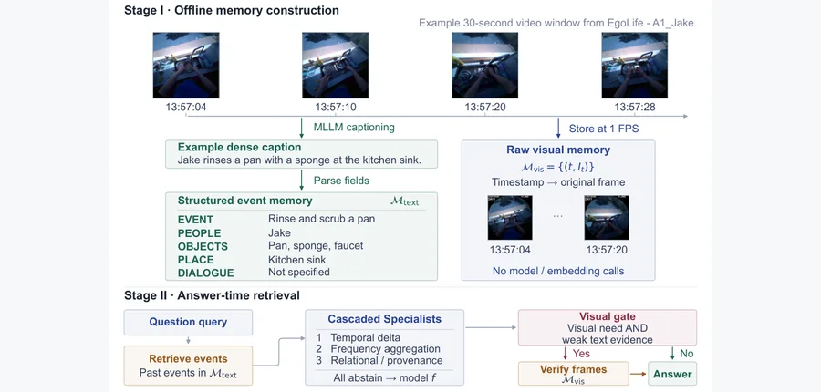 arXiv 2026-10-20 · cs.CV · #1 **[LVMH: A Meta-Optimization Harness for Long-Video Agent Memory](https://arxiv.org/abs/2610.23904)** Liwei Che , Benlin Liu , Dai Li , Xiangyan Li , Zijian Wu , Changjiang Li , Minghao Guo , Chengzhi Mao , Vladimir Pavlovic… Affiliation: Rutgers University / University of Washington / Meta / National University of Singapore / Palo Alto Networks [Paper](https://arxiv.org/abs/2610.23904) · [Figure source](https://arxiv.org/html/2610.23904v1/seem_video_memory_example.png) 

[EN] Abstract
Long-video agents must map hours or days of multimodal evidence into a bounded context while respecting token and latency budgets, making memory design a context-management challenge. Existing memory systems largely rely on hand-designed policies, leaving open how to jointly optimize memory design for performance and efficiency. We propose Long Video Meta-memory Harness (LVMH), an automated multi-agent framework that formulates memory-policy development as multi-objective code search around a fixed answer model. To guard against self-certification and development-set overfitting, LVMH separates implementation from independent review and enforces protected observation boundaries. Persistent meta-memory records past proposals, traces, costs, and failures to guide subsequent policy revisions. Through this harness, we discover Self-Evolving Evidence Memory (SEEM), a "text-first, vision-second" policy that answers from compact structured event memory and evidence specialists, consulting localized frames through a selective visual gate. The policy evolved on EgoLifeQA generalizes to unseen benchmarks, outperforming Meta-Harness on both Ego-R1 Bench and Video-MME (L) with GPT-5 mini. Across the three benchmarks, SEEM with GPT-5 achieves 65.7% average accuracy, surpassing the previous state of the art by 7.7 percentage points with approximately 32x lower average evaluation token use and 91x shorter average response time. <a href="https://arxiv.org/abs/2610.23904">Source</a>

[ZH] Abstract
长视频智能体必须在词元和延迟预算内，将数小时或数天的多模态证据映射到有限上下文，因此记忆设计成为上下文管理挑战。现有系统主要依赖人工策略，如何联合优化记忆的性能和效率仍待解决。我们提出长视频元记忆框架 LVMH，在固定回答模型周围将记忆策略开发表述为多目标代码搜索。为防止自我认证和开发集过拟合，LVMH 分离实现与独立审查，并强制保护观测边界。持久元记忆记录过去的提议、轨迹、成本和失败，指导后续策略修改。借助该框架，我们发现自进化证据记忆 SEEM：一种“文本优先、视觉其次”的策略，从紧凑结构化事件记忆与证据专家中回答，通过选择性视觉门控查询局部帧。在 EgoLifeQA 上进化的策略泛化到未见基准，使用 GPT-5 mini 时在 Ego-R1 Bench 和 Video-MME（L）均优于 Meta-Harness。在三个基准上，使用 GPT-5 的 SEEM 平均准确率为 65.7%，比此前最优高 7.7 个百分点，平均评估词元使用量约降低 32 倍，平均响应时间约缩短 91 倍。 <a href="https://arxiv.org/abs/2610.23904">Source</a>
 | 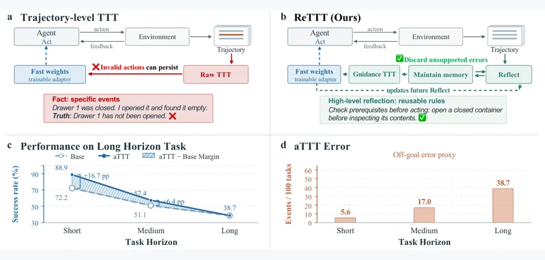 arXiv 2026-10-20 · cs.LG · #2 **[ReTTT: Reflection-Driven Test-Time Training via Experience-Based Parametric Memory](https://arxiv.org/abs/2610.23942)** Kangcong Li , Hangfan Zhang , Shuyue Hu , Shengji Tang , Tao Chen Affiliation: Fudan University / Shanghai Artificial Intelligence Laboratory / CUHK [Paper](https://arxiv.org/abs/2610.23942) · [Figure source](https://arxiv.org/html/2610.23942v1/motivation_v6.png) 

[EN] Abstract
LLM agents accumulate valuable task-specific information through their actions, observations, and environmental feedback during multi-turn task execution. When effectively used, this information can help agents refine subsequent decisions and improve task performance. However, the learning value of an interaction depends on its context and subsequent feedback, making it challenging to extract reliable, actionable lessons and revise them as the task unfolds. In this paper, we introduce ReTTT, which enables experience-driven self-adaptation through test-time training on lessons constructed and continually revised within an episode. ReTTT lets the agent reflect on interaction feedback, maintain the resulting lessons in an explicit memory, and learn from them by updating an episode-local LoRA adapter while keeping the backbone frozen. The adapted model then performs both subsequent actions and reflection, coupling policy adaptation with the construction of future learning experience. We evaluate ReTTT on ALFWorld, ScienceWorld, and SWE-bench Lite using two model families. ReTTT outperforms trajectory-based test-time training across all six model--benchmark settings, improving task success by up to 12.14 percentage points. A frozen-reflection comparison further shows a 7.14-point benefit from adapting the reflection policy, while trajectory analysis illustrates how adapted reflection derives more task-specific guidance from failed attempts. These findings suggest that learning to reflect on its own behavior can boost agents' performance on long-horizon tasks. <a href="https://arxiv.org/abs/2610.23942">Source</a>

[ZH] Abstract
大语言模型智能体在多轮任务中，通过动作、观测和环境反馈积累有价值的任务特定信息。有效使用这些信息可细化后续决策、提高表现，但交互的学习价值依赖上下文与后续反馈，难以提取可靠可用的教训，并随任务推进修改。我们提出 ReTTT，通过在回合内持续构建和修订的教训上进行测试时训练，实现经验驱动自适应。智能体反思交互反馈，在显式记忆中维护教训，在冻结主干的同时更新回合局部 LoRA 适配器以学习教训。适配后的模型同时执行后续动作和反思，将策略适配与未来学习经验构建耦合。我们使用两个模型家族，在 ALFWorld、ScienceWorld 和 SWE-bench Lite 上评估。ReTTT 在全部六个模型—基准设置中优于基于轨迹的测试时训练，任务成功率最多提高 12.14 个百分点。冻结反思的对照进一步显示，适配反思策略带来 7.14 个百分点收益；轨迹分析展示适配反思如何从失败中提取更贴合任务的指导。这表明，学习反思自身行为能够改善长时程任务表现。 <a href="https://arxiv.org/abs/2610.23942">Source</a>
 | 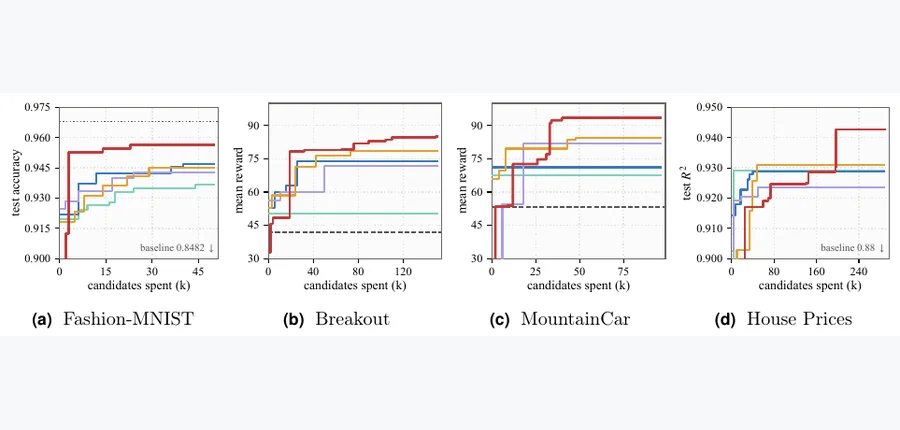 arXiv 2026-10-20 · cs.AI · #3 **[MELD: Recursive Self-Improvement via Hierarchical Coordination for Multi-Agent Scientific Discovery](https://arxiv.org/abs/2610.24454)** Sizhe Tang , Zuyuan Zhang , Zeyu Fang , Tian Lan Affiliation: George Washington University [Paper](https://arxiv.org/abs/2610.24454) · [Figure source](https://arxiv.org/pdf/2610.24454#page=8) 

[EN] Abstract
Multi-agent scientific discovery with large language models raises a coupled learning problem: research assignments determine both which experiments are pursued and the experiences from which agents adapt. We introduce MELD, a unified hierarchical test-time training framework that jointly adapts a team-level Coordinator policy and agent-level individual Scientist policies within a single discovery process. The Coordinator generates a joint portfolio of search branches and research directives over a shared derivation tree, while Scientists develop hypotheses and execution plans implemented by a shared frozen Executor. Both levels receive alternating GRPO-style parameter updates under a shared smooth best-of-budget objective, allowing team organization and individual research behavior to co-evolve in a recursive self-improvement loop. Our analysis establishes objective alignment for the hierarchy, characterizes conditions for coordination gains over independent parallel discovery and the first-order benefit of private adaptation, and derives a finite-budget regret bound for adapted models. On 22 MLGym and MLE-bench tasks, MELD is best on 20 of them and achieves the highest aggregate normalized scores on MLGym, using a 4B backbone for coordination and research. Most baselines use proprietary Scientists, and all systems share one frozen Executor. <a href="https://arxiv.org/abs/2610.24454">Source</a>

[ZH] Abstract
基于大语言模型的多智能体科学发现存在耦合学习问题：研究分工既决定追求哪些实验，也决定智能体从何种经验中适配。我们提出 MELD，统一的分层测试时训练框架，在单次发现过程中联合适配团队层面的协调者策略和智能体层面的科学家策略。协调者在共享推导树上生成搜索分支和研究指令的联合组合，科学家发展假设和执行计划，由共享冻结执行器实现。两层在共享的平滑化预算内最佳结果目标下交替进行 GRPO 式参数更新，使团队组织与个体研究行为在递归自我改进循环中共同进化。分析建立层级目标一致性，刻画协调优于独立并行发现及私有适配一阶收益的条件，并推导适配模型的有限预算遗憾界。在 22 项 MLGym 和 MLE-bench 任务上，MELD 在其中 20 项表现最佳，并在 MLGym 取得最高归一化汇总分数，协调和研究均采用 4B 主干。多数基线使用专有科学家模型，所有系统共享同一个冻结执行器。 <a href="https://arxiv.org/abs/2610.24454">Source</a>
 |
| 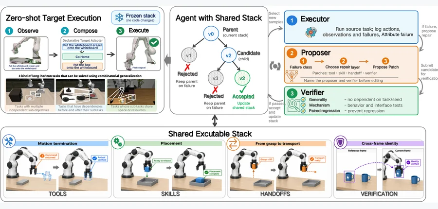 arXiv 2026-10-20 · cs.AI · #4 **[Learning to Compose: Recursive Self-Improvement of Shared Executable Stacks for Zero-Shot Long-Horizon Robot Manipulation](https://arxiv.org/abs/2610.24464)** Yangzhi Chen , Feiran Liu , Zishuo Wang , Zijian Jin , Xin Zhu , Lecheng Ruan , Wenjuan Han Affiliation: Beijing Jiaotong University / New York University / University of Southern California / PKU-HEC Joint Lab for Industrial Intelligence, Peking University / LingXing Tech [Paper](https://arxiv.org/abs/2610.24464) · [Code](https://github.com/cocacola-lab/Recursia) · [Project](https://cocacola-lab.github.io/Recursia-website/) · [Figure source](https://arxiv.org/html/2610.24464v1/framework.png) 

[EN] Abstract
Individually competent robot skills can fail when composed: tools may lack a required capability, completion signals may misrepresent physical progress, and one skill may leave a state that violates its successor's prerequisites. We introduce Recursia, a recursive self-improvement framework that treats the shared executable stack, rather than individual task programs, as the persistent unit of improvement. The stack integrates tools, skills with execution contracts, handoffs, and verifiers. Source-side execution traces guide failure attribution and the generation of missing tools or repairs to existing shared components. Generality checks, mechanism tests, and paired selection and regression gates determine which changes become the next parent. The resulting stack is frozen and reused through declarative task adapters, allowing source-derived changes to support new compositions without target-side code repair. Experiments cover LIBERO-Pro Long simulation and a physical Franka FR3 equipped with a Franka Hand. In simulation, Recursia improves success over ASPIRE by 5.8 percentage points under Pos perturbations and 15.1 points under Task perturbations. Across three physical compositional target tasks, it improves mean success over the Skill Document Only baseline by 40 percentage points. Analyses of constituent execution, candidate rejection, and inference drivers distinguish local mechanism improvements from complete task success and characterize the cost of feedback-conditioned orchestration. These results examine shared executable interfaces as a concrete mechanism for compositional transfer in robot programming. <a href="https://arxiv.org/abs/2610.24464">Source</a>

[ZH] Abstract
单项能力足够的机器人技能组合后仍可能失败：工具缺少所需能力，完成信号不反映物理进度，或前一技能留下不满足后一技能前提的状态。我们提出递归自我改进框架 Recursia，将共享可执行栈而非单项任务程序作为持久改进单位。该栈整合工具、带执行契约的技能、交接与验证器。源任务执行轨迹指导失败归因，生成缺失工具或修复现有共享组件。通用性检查、机制测试和配对选择及回归门控，决定哪些变化成为下一代父版本。所得栈冻结后通过声明式任务适配器复用，让源任务改进支持新组合，而无需目标任务代码修复。实验覆盖 LIBERO-Pro Long 仿真，以及配备 Franka Hand 的实体 Franka FR3。在仿真中，相对 ASPIRE，Pos 扰动下成功率提高 5.8 个百分点，Task 扰动下提高 15.1 个百分点。在三个实体组合目标任务中，相对 Skill Document Only 基线，平均成功率提高 40 个百分点。对组成技能执行、候选拒绝和推理驱动因素的分析，区分局部机制改善与完整任务成功，并刻画反馈条件化编排的成本。结果考察共享可执行接口作为机器人编程中组合迁移的具体机制。 <a href="https://arxiv.org/abs/2610.24464">Source</a>
 | 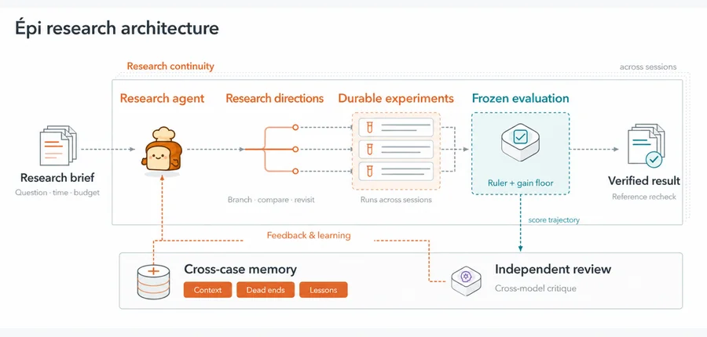 arXiv 2026-10-20 · cs.CL · #5 **[Epi: Towards a Persistent, Self-Improving Agent for Autonomous Research](https://arxiv.org/abs/2610.24944)** Yue Huang , Zhangchen Xu , Xiaonan Luo , Zheyuan Liu , Lichi Li , Yiping Wang , Peiyang Song , Eric Gabriel Ramos , Enze X… Affiliation: Bake AI / University of Notre Dame / University of Washington / Stevens Institute of Technology / Scale AI / NVIDIA / Carnegie Mellon University / MIT / Cohere Labs / Ohio State University / Microsoft / UC Santa Barbara / Stanford University [Paper](https://arxiv.org/abs/2610.24944) · [Project](https://github.com/BakeLab/Epi-results) · [Figure source](https://arxiv.org/html/2610.24944v1/architecture.png) 

[EN] Abstract
We present Épi, an autonomous research agent that sustains investigations across model sessions and evolves its methods through accumulated experience. Épi combines persistent research history, hierarchical memory, branching and independent review to maintain research continuity, learn from experiments, and explore and revisit alternative approaches. Its experiments run across session boundaries, and a fixed verifier evaluates their outputs. Épi produced 120 record-setting results, comprising 20 numerical bound records across 12 families and 100 construction records across eight families. These include an approximately 84-fold narrower interval for the $n$-queens constant and a more than 3.6-million-fold narrower rigorous interval for the quartic Feigenbaum attractor dimension. Exact dual certificates establish that the Cohn-Elkies linear-programming bound cannot be sharp in dimensions 10 and 11. Beyond numerical improvements, Épi gives a computer-assisted proof of Tuza's conjecture for split graphs with an eight-vertex clique part and at most three triangle-active neighborhood types, with arbitrary multiplicities. We extend this research process to algorithmic coding with Épi-turbo, a lightweight configuration that develops executable solvers for tasks including vehicle routing, scheduling and production planning. On 30 FrontierOR tasks, Épi-turbo achieves a 5.4% higher total benchmark score than Codex at 64% of its model cost, using the same underlying model and reasoning effort. Épi is designed to support human understanding by connecting computational results to explicit methods and mathematical arguments that researchers can examine and build upon. <a href="https://arxiv.org/abs/2610.24944">Source</a>

[ZH] Abstract
我们提出 Épi，一个跨模型会话持续研究、通过累积经验进化方法的自主研究智能体。Épi 结合持久研究历史、层级记忆、分支和独立审查，维持研究连续性、从实验学习，并探索和重新访问替代方法。实验跨会话运行，由固定验证器评估输出。Épi 产生 120 项刷新纪录的结果，包括 12 个类别的 20 项数值界纪录，以及八个类别的 100 项构造纪录。其中，$n$ 皇后常数区间约缩窄 84 倍，四次 Feigenbaum 吸引子维数的严格区间缩窄超过 360 万倍。精确对偶证书证明，Cohn-Elkies 线性规划界在 10 和 11 维无法达到紧界。除数值改进外，Épi 给出计算机辅助证明：Tuza 猜想在团部分含八个顶点、至多三类三角形活跃邻域且重数任意的分裂图上成立。我们将该研究过程扩展到算法编程，提出轻量配置 Épi-turbo，为车辆路径、调度和生产规划等任务开发可执行求解器。在 30 项 FrontierOR 任务上，使用相同基础模型与推理强度时，Épi-turbo 总基准分数比 Codex 高 5.4%，模型成本为其 64%。Épi 将计算结果关联到研究者可以检验和发展的明确方法与数学论证，以支持人类理解。 <a href="https://arxiv.org/abs/2610.24944">Source</a>
 | 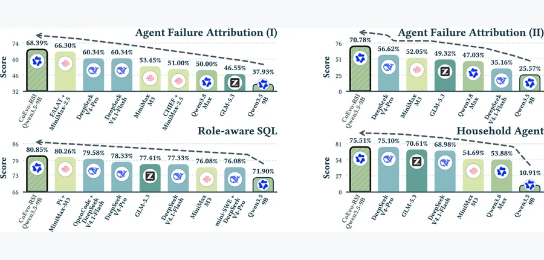 arXiv 2026-10-20 · cs.LG · #6 **[CoEvo-RSI: When Harnesses Evolve, Which Models Should Follow?](https://arxiv.org/abs/2610.25078)** Jiaqi Su , Guibin Zhang , Jie-Jing Shao , Cong Pang , Tiankuo Yao , Ivor Tsang , Haiyan Yin , Shuicheng Yan Affiliation: National University of Singapore / Agency for Science, Technology and Research (A*STAR) / SenseTime Group Inc. [Paper](https://arxiv.org/abs/2610.25078) · [Code](https://github.com/SuJQ0722/CoEvo-RSI) · [Figure source](https://arxiv.org/html/2610.25078v1/figure.png) 

[EN] Abstract
Model--harness co-evolution has emerged as a prominent paradigm for recursive self-improving (RSI) agents, jointly evolving their execution scaffolds and intrinsic capabilities. We study the persistent yet often overlooked brain--body mismatch problem in this paradigm, where an evolving harness (body) demands behaviors its model (brain) has not learned or restricts capabilities it already possesses. We introduce CoEvo-RSI, a RSI framework that advances model--harness co-evolution through agent-driven, bidirectional historical inheritance. Drawing on a shared evolutionary archive and execution feedback, a meta-agent coordinates harness development from historical designs with model checkpoint selection or merging and subsequent adaptation under the selected harness, aligning inherited capabilities with evolving execution requirements to reduce brain--body mismatch. Using only supervised fine-tuning (SFT) on its own rejection-sampled trajectories, CoEvo-RSI makes Qwen3.5-9B competitive with larger models across diverse vertical applications, including multi-agent failure attribution, role-aware text-to-SQL, and smart-home instruction following. It surpasses DeepSeek-V4-Pro on TraceElephant (+14.16 agent accuracy) and GLM-5.3 on HomeBench VM (+4.90 success rate), underscoring the need for brain--body alignment and the potential of bidirectional historical inheritance to advance agent co-evolution. <a href="https://arxiv.org/abs/2610.25078">Source</a>

[ZH] Abstract
模型与运行框架共同进化是递归自我改进（RSI）智能体的重要范式，联合进化执行支架和内在能力。我们研究其中持续存在却常被忽略的“脑—身体失配”：进化中的框架要求模型尚未学会的行为，或限制已有能力。我们提出 CoEvo-RSI，通过智能体驱动、双向历史继承推进模型—框架共同进化。元智能体依据共享进化档案和执行反馈，协调从历史设计开发框架、选择或合并模型检查点，以及在所选框架下进一步适配，使继承能力与变化的执行需求一致，减轻失配。仅使用自身拒绝采样轨迹上的监督微调（SFT），CoEvo-RSI 便使 Qwen3.5-9B 在多智能体失败归因、角色感知文本到 SQL、智能家居指令跟随等垂直应用中与更大模型竞争。在 TraceElephant 上比 DeepSeek-V4-Pro 的智能体准确率高 14.16，在 HomeBench VM 上比 GLM-5.3 的成功率高 4.90，强调脑—身体对齐的重要性，以及双向历史继承推进共同进化的潜力。 <a href="https://arxiv.org/abs/2610.25078">Source</a>
 |
| 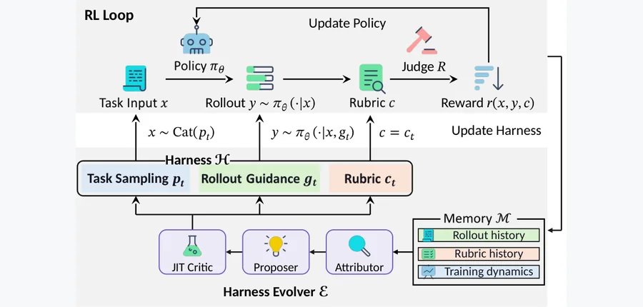 arXiv 2026-10-20 · cs.CL · #7 **[HarnessRL: Co-Evolving Policies with a Just-in-Time Training Harness for Open-Ended RL](https://arxiv.org/abs/2610.26426)** Xiaoqiang Wang , Ting-En Lin , Yuchuan Wu , Pinyi Zhang , Caixin Kang , Ling Li , Bingxue Qiu , Jieping Ye , Yongbin Li… Affiliation: Alibaba Token Hub, Alibaba Group / Université de Montréal / Mila - Quebec AI Institute [Paper](https://arxiv.org/abs/2610.26426) · [Code](https://github.com/Tongyi-ConvAI/Qwen-Character/tree/main/HarnessRL) · [Figure source](https://arxiv.org/html/2610.26426v1/motivation.png) 

[EN] Abstract
Rubric-based reinforcement learning (RL) trains policies for open-ended generation with natural-language criteria as rewards, but these rewards can become ineffective as training progresses. We identify two failure modes. Under non-discriminative rewards, scores collapse to uniformly low or high values due to insufficient exploration or a mismatch between task difficulty and policy capability. Under spurious rewards, higher scores do not correspond to better responses. Both reflect a training configuration whose task sampling, exploration, and evaluation stay fixed as the policy evolves. We introduce HarnessRL, a training-time harness that co-evolves with the policy through three interfaces for task sampling, rollout guidance, and rubric criteria. HarnessRL maintains a training-time memory from which a harness evolver retrieves within-task history and cross-task evidence. Using this evidence, the evolver attributes each reward failure to the interface whose update can address it. It then runs a proposer and just-in-time critic loop in which the critic accepts a candidate update only after measuring its effect on the current frozen policy, returning rejected candidates for revision. We also curate Rubric-Mix-10k, a five-domain training and evaluation suite for open-ended RL across medical, science, writing, role-play, and instruction-following tasks. On Rubric-Mix-10k, HarnessRL outperforms the strongest baselines by 2.8 to 3.1 points across both 4B and 9B model scales and nearly halves the training steps to its best checkpoint. Code and data are available at this https URL . <a href="https://arxiv.org/abs/2610.26426">Source</a>

[ZH] Abstract
基于评分准则的强化学习用自然语言标准奖励开放式生成，但训练推进时奖励可能失效。我们识别两类失败：非区分性奖励因探索不足或难度与策略能力不匹配，坍缩为一致低分或高分；虚假奖励则表现为高分不对应更好回答。两者都反映出策略变化时，任务采样、探索和评估仍固定。我们提出 HarnessRL，通过任务采样、执行引导和评分标准三个接口，让训练时框架与策略共同进化。框架维护训练记忆，进化器从中检索同任务历史及跨任务证据，将奖励失败归因到可解决它的接口。随后运行提议者和即时评论者循环，评论者仅在测量候选更新对当前冻结策略的影响后接纳，拒绝候选则返回修订。我们还整理 Rubric-Mix-10k，覆盖医学、科学、写作、角色扮演及指令跟随五个领域的开放式强化学习训练与评估。在该套件上，HarnessRL 在 4B 和 9B 规模上比最强基线高 2.8—3.1 分，到达最佳检查点的训练步数接近减半。代码和数据见原文链接。 <a href="https://arxiv.org/abs/2610.26426">Source</a>
 | 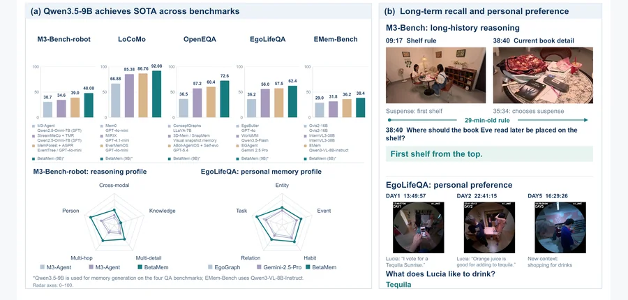 arXiv 2026-10-20 · cs.AI · #8 **[BetaMem: Learning to Remember a Changing World for Embodied Agents](https://arxiv.org/abs/2610.26554)** Mai Liu , He Sun , Siru Zhong , Kerun Chen , Hao Yan , Xiaohui Lv , Shuai Tao , Wulong Liu Affiliation: Beta Infinity / Peking University / Beihang University / Hong Kong University of Science and Technology (Guangzhou) [Paper](https://arxiv.org/abs/2610.26554) · [Figure source](https://arxiv.org/pdf/2610.26554) 

[EN] Abstract
Long-horizon embodied agents face temporal confusion and incomplete or distorted records, recurring errors from fixed memory rules, and growing storage and retrieval costs. We present BetaMem, a framework for building and evolving traceable long-term memory through six linked layers: working, spatial, entity, episodic, experiential, and procedural memory. A dual-level write contract constrains operation executability and source support for content: supervised fine-tuning learns compliant memory operations, while reinforcement learning combines repeated sampling with teacher verification of the original observations to reward complete, accurate records and penalize omissions, distortion, and unsupported content. We formulate failure-driven policy recursive self-improvement through diagnosis along the causal sequence of memory operations and local rule repairs gated by independent replay. Atomic tools frame storage, updates, retrieval, and forgetting as cost-utility allocation under storage and read budgets. Using the open-source Qwen3.5-9B model for memory generation, BetaMem achieves overall scores of 48.08% on M3-Bench-robot, 92.08% on LoCoMo, 72.6% on OpenEQA EM-EQA, and 62.4% on EgoLifeQA, the highest among the listed memory methods under their respective evaluation protocols. Training the model for memory generation raises the contract pass rate from 50.9% to 86.2% while reducing output tokens per stored action by 47.3%. A separate Qwen3-VL-8B-Instruct evaluation on EMem-Bench achieves an average success rate of 38.4% and an average error recurrence rate of 24.9%. We perform best among evaluated methods using comparably sized open-source models. Category results show that we have advantages in integrating information across observations, recalling events over long histories, and inferring personal habits. <a href="https://arxiv.org/abs/2610.26554">Source</a>

[ZH] Abstract
长时程具身智能体面临时间混淆、记录不完整或失真、固定记忆规则引起的重复错误，以及存储检索成本增长。我们提出 BetaMem，通过工作、空间、实体、情景、经验和程序六个相连层次，构建和进化可追踪长期记忆。双层写入契约约束操作可执行性和内容来源支持：监督微调学习合规记忆操作，强化学习结合重复采样与教师对原始观测的验证，奖励完整准确记录，惩罚遗漏、失真和无依据内容。我们通过沿记忆操作因果序列诊断，以及由独立回放门控的局部规则修复，建立失败驱动的策略递归自改进。原子工具将存储、更新、检索和遗忘表述为存储与读取预算下的成本效用分配。使用开源 Qwen3.5-9B 生成记忆时，在 M3-Bench-robot、LoCoMo、OpenEQA EM-EQA 和 EgoLifeQA 上总体分数分别为 48.08%、92.08%、72.6% 和 62.4%，在各自协议下高于所列记忆方法。训练记忆生成模型将契约通过率从 50.9% 提高到 86.2%，每个存储动作输出词元减少 47.3%。另用 Qwen3-VL-8B-Instruct 在 EMem-Bench 评估，平均成功率为 38.4%，平均错误复发率为 24.9%。在使用相近规模开源模型的方法中，我们表现最佳。分类结果显示其优势在于跨观测整合信息、长历史事件回忆和个人习惯推断。 <a href="https://arxiv.org/abs/2610.26554">Source</a>
 | 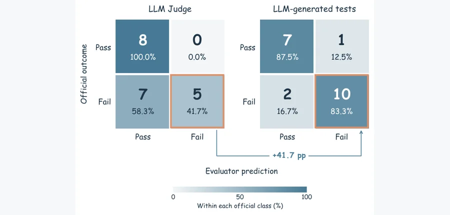 arXiv 2026-10-20 · cs.LG · #9 **[HarnessPro: Recursive Harness Self-Improvement with Pareto Optimization for Performance-Cost Trade-offs](https://arxiv.org/abs/2610.26770)** Zhuoshi Pan , ZhiYuan Feng , Yukuo Cen , Honglin Lin , Junru Lu , Zhongxia Chen , Shuo Yang , H. Vicky Zhao , Jie Tang Affiliation: Tsinghua University / Z.AI / Shanghai Jiao Tong University / University of Warwick / Kling AI [Paper](https://arxiv.org/abs/2610.26770) · [Code](https://github.com/pzs19/HarnessPro) · [Figure source](https://arxiv.org/html/2610.26770v2/evaluation_confusion_matrices.png) 

[EN] Abstract
Harness development plays a crucial role in building capable AI agents. Recent approaches improve harnesses through recursive self-improvement (RSI), but their performance gains often come with higher execution costs. We introduce HarnessPro, a label-free method for evolving harnesses to improve task performance while reducing execution cost. In this setting, candidate harnesses are evaluated using LLM-generated tests without access to ground-truth solutions or official tests. Specialized agents diagnose execution trajectories, plan updates with different performance-cost priorities, and implement them as candidate harnesses. Rather than returning a single harness, HarnessPro uses normalized weighted squared-distance selection to provide cost-focused (lite), balanced (medium), and performance-focused (heavy) harnesses for different deployment budgets. Selected harnesses enter the next iteration, where execution feedback guides further updates. Our experiments cover Terminal-Bench 2, SWE-Bench Pro, and ProgramBench, using GPT-5.5 with Codex and GLM-5.2 with Claude Code. Across these benchmarks using GPT-5.5 with Codex, the heavy mode of HarnessPro achieves an average pass-rate gain of 2.0 percentage points and an average per-task cost reduction of 26.1% relative to RHO. This advantage also holds when using GLM-5.2 with Claude Code. Code is available at this https URL <a href="https://arxiv.org/abs/2610.26770">Source</a>

[ZH] Abstract
运行框架开发对构建强大人工智能智能体至关重要。近期方法通过递归自我改进（RSI）优化框架，但性能收益往往伴随执行成本增加。我们提出无标签框架进化方法 HarnessPro，在提高任务表现的同时降低成本。候选框架用大语言模型生成的测试评估，不访问真实答案或官方测试。专门智能体诊断执行轨迹、按不同性能—成本优先级规划更新，并实现候选框架。HarnessPro 不只返回单个框架，而使用归一化加权平方距离选择，提供成本优先 lite、平衡 medium 和性能优先 heavy 三类框架。选中框架进入下一轮，由执行反馈指导进一步更新。实验覆盖 Terminal-Bench 2、SWE-Bench Pro 和 ProgramBench，使用配合 Codex 的 GPT-5.5 以及配合 Claude Code 的 GLM-5.2。在上述基准上，使用 GPT-5.5 与 Codex 时，heavy 模式相对 RHO 平均通过率提高 2.0 个百分点，平均单任务成本降低 26.1%；使用 GLM-5.2 与 Claude Code 时优势也成立。代码见原文链接。 <a href="https://arxiv.org/abs/2610.26770">Source</a>
 |
| 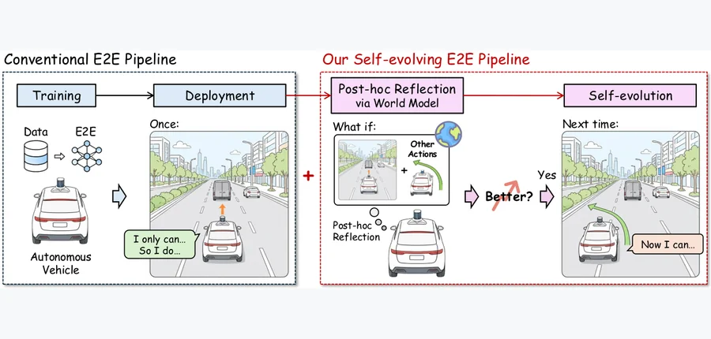 arXiv 2026-10-20 · cs.RO · #10 **[EvoAD: Self-Evolving Autonomous Driving via Latent World-Model Guided Post-hoc Reflection](https://arxiv.org/abs/2610.23886)** Junjie Yang , Qiming Zhang , Yuyan Li , Shuqi Shen , Yusong Huang , Yanggang Sheng , Wenpeng Xu , Ziyi Shi , Tianshun Li… Affiliation: Hong Kong University of Science and Technology / Hong Kong University of Science and Technology (Guangzhou) / Chinese University of Hong Kong, Shenzhen / Victoria University of Wellington / Southern University of Science and Technology [Paper](https://arxiv.org/abs/2610.23886) · [Figure source](https://arxiv.org/html/2610.23886v1/teaser.png) 

[EN] Abstract
End-to-end autonomous driving systems have achieved rapid progress by learning unified policies that map sensor observations directly to driving trajectories. However, once deployed, these systems typically remain frozen: they may repeat similar decisions in similar scenes, and failures can only be addressed through costly data collection and retraining. This sharply contrasts with human drivers, who improve lifelong through experience, memory, and reflection. In this work, we ask whether autonomous driving systems can achieve similar post-deployment self-evolution to human drivers. We propose EvoAD, a self-evolving autonomous driving framework via latent world-model guided post-hoc reflection. EvoAD stores driving experiences in a bird's-eye-view feature memory pool, retrieves scene-relevant precedents according to geometric and semantic similarity, and uses a latent world model to evaluate the future consequences of candidate trajectories in a compact planning-oriented space. Instead of treating memory as external textual contexts or using world models only for pre-action simulation, EvoAD transforms executed driving outcomes into reusable improvement signals for future decisions. This enables the system to diagnose how prior trajectories could have been improved and to refine behavior in similar future scenarios without retraining the base driving policy. Experiments on NAVSIM v1 and v2 show consistent improvements across reflection rounds and state-of-the-art performance, demonstrating the potential of world models as reflective mechanisms for post-deployment self-evolution in autonomous driving. <a href="https://arxiv.org/abs/2610.23886">Source</a>

[ZH] Abstract
端到端自动驾驶通过学习从传感器观测直接映射到驾驶轨迹的统一策略取得快速进步，但部署后通常冻结：相似场景可能重复相似决策，失败只能通过昂贵的数据采集和重训练处理。这与人类通过经验、记忆和反思终身改进形成对比。我们研究自动驾驶能否实现类似人类的部署后自进化，提出潜在世界模型引导事后反思的 EvoAD。它将驾驶经验存入鸟瞰图特征记忆池，按几何和语义相似度检索场景相关先例，在紧凑、面向规划的空间中用潜在世界模型评估候选轨迹的未来后果。与将记忆当作外部文字上下文或仅在动作前模拟不同，EvoAD 将已执行驾驶结果转为未来决策可复用的改进信号，使系统诊断先前轨迹如何能更好，并在不重训练基础驾驶策略的情况下改进相似未来场景。在 NAVSIM v1 和 v2 上，各反思轮次持续改进并达到最先进性能，展示世界模型作为部署后自进化反思机制的潜力。 <a href="https://arxiv.org/abs/2610.23886">Source</a>
 | 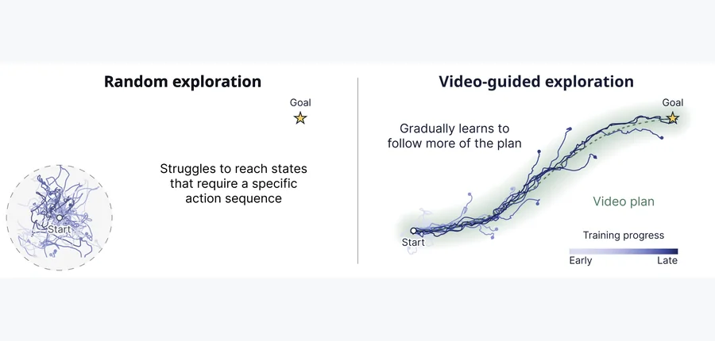 arXiv 2026-10-20 · cs.AI · #11 **[Self-Improving Video-to-Action Models](https://arxiv.org/abs/2610.24177)** Hyunwoo Ryu , Eric Ming Chen , Max Wilcoxson , Vincent Sitzmann Affiliation: Computer Science &amp; Artificial Intelligence Laboratory, Massachusetts Institute of Technology [Paper](https://arxiv.org/abs/2610.24177) · [Project](https://wilcoxsonm21.github.io/mirror/) · [Figure source](https://arxiv.org/html/2610.24177v1/exploration_intuition_v4.png) 

[EN] Abstract
Video generative models are an emerging tool for embodied agents: they can serve as scalable visual planners, generating videos that depict how to complete previously unseen tasks. However, executing these plans typically requires a video-to-action or "inverse dynamics" model trained on large, human-collected video-action datasets, severely limiting scalability. We introduce Mirror, a self-supervised approach that learns video-to-action mappings through environment interactions, without prior action data or hand-crafted rewards. Mirror learns by attempting to follow a visual plan by executing its best guess of the underlying actions in the environment. Mirror then trains on the resulting video-action pairs, incrementally self-improving and following the visual planner more closely. Across Atari, OGBench, and DeepMind Control, Mirror outperforms leading learning-from-observation methods with learned video plans, and achieves near-expert performance with oracle plans. On Minecraft BASALT, it outperforms methods with access to expert actions or hand-engineered task knowledge. In Minecraft survival, it is the first method to acquire an iron pickaxe through self-improvement alone, without rewards or expert action labels. In the offline setting, with expert action labels but no environment interaction, it sets a new state of the art in obtaining diamonds. Our results suggest that advances in video models can translate into increasingly capable agents without a corresponding need for hand-crafted rewards or large collections of expert action data. <a href="https://arxiv.org/abs/2610.24177">Source</a>

[ZH] Abstract
视频生成模型可充当具身智能体的可扩展视觉规划器，生成完成未见任务的视频，但执行通常需要在大量人工采集视频—动作数据上训练视频到动作或逆动力学模型，严重限制可扩展性。我们提出 Mirror，通过环境交互自监督学习视频—动作映射，无需先验动作数据或手工奖励。Mirror 用当前对潜在动作的最佳猜测执行，尝试跟随视觉计划，再在所得视频—动作对上训练，逐步自我改进并更好地跟随规划器。在 Atari、OGBench 和 DeepMind Control 上，使用学习视频计划时优于领先的观测学习方法，使用预言机计划时达到接近专家表现。在 Minecraft BASALT 上，优于可访问专家动作或人工任务知识的方法。在 Minecraft 生存模式中，成为首个仅通过自我改进、无需奖励或专家动作标签获得铁镐的方法。在有专家动作标签但无环境交互的离线设置中，获取钻石达到新最优。结果表明，视频模型进展可转化为更强智能体，而不必相应增加手工奖励或大量专家动作数据。 <a href="https://arxiv.org/abs/2610.24177">Source</a>
 | 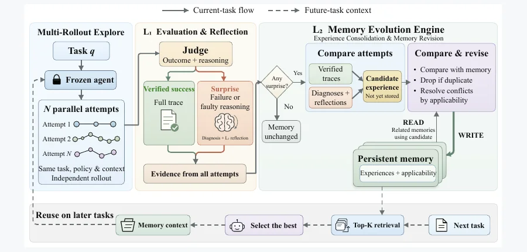 arXiv 2026-10-20 · cs.AI · #12 **[Hippo: Training-Free Agent Self-Evolution via Hippocampal Replay](https://arxiv.org/abs/2610.24453)** Yutong Song , Jiang Wu , Yuxuan Ren , Tony Qin , Baoyuan Wang Affiliation: University of California, Irvine / Independent Researcher / Rice University / Zillow Group [Paper](https://arxiv.org/abs/2610.24453) · [Figure source](https://arxiv.org/pdf/2610.24453#page=4) 

[EN] Abstract
Motivated by recursive self-improvement (RSI), we study how LLM agents can learn through external memory without updating model parameters. Extracting useful experience from a single attempt is difficult: flawed reasoning can produce success, while poor execution can obscure a sound strategy. Preserving its value over time is also difficult: our accumulation baseline without consolidation initially improves but eventually performs below a no-memory baseline. Our key idea is to compare attempts at the same task to identify reusable decisions and refine when they apply. We introduce Hippo, a memory framework inspired by selective hippocampal encoding and replay that learns from these comparisons when shortcomings are diagnosed. It compares the resulting experience with existing memory to merge overlaps and resolve conflicts through explicit applicability conditions. This allows prior guidance to be revised without storing every lesson as a separate entry. Experiments on SWE-bench Verified, WebArena, and Mind2Web show performance gains in all three settings and substantially fewer retained experiences than the accumulation baseline. The gains extend across the evaluated base models of varying capabilities, indicating that memory-based adaptation remains useful even for highly capable models. <a href="https://arxiv.org/abs/2610.24453">Source</a>

[ZH] Abstract
受递归自我改进启发，我们研究大语言模型智能体如何不更新参数，而通过外部记忆学习。单次尝试难以提取有效经验，因为错误推理也可成功，糟糕执行也可掩盖正确策略；长期保留价值同样困难：不做巩固的累积基线先改善，最终却低于无记忆基线。我们的核心是比较同一任务的多次尝试，识别可复用决策，细化适用条件。我们提出受选择性海马编码与回放启发的 Hippo，在诊断出不足时从这种比较学习。它将所得经验与已有记忆比较，合并重叠，并通过显式适用条件解决冲突，使既有指导可修改而不必将每条教训独立存储。在 SWE-bench Verified、WebArena 和 Mind2Web 上全部取得收益，保留经验远少于累积基线。收益扩展到所评估不同能力的基础模型，表明记忆适配对高能力模型也有用。 <a href="https://arxiv.org/abs/2610.24453">Source</a>
 |
| 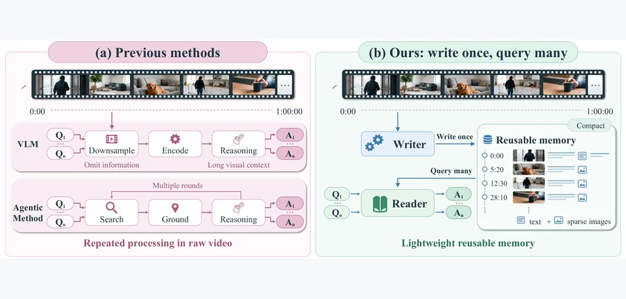 arXiv 2026-10-20 · cs.CV · #13 **[Write Once, Query Many: Evolving Compact Reusable Memory for Long Videos](https://arxiv.org/abs/2610.24537)** Kerui Chen , Jinglu Wang , Yun Wang , Xinjiang Wang , Yan Lu Affiliation: Zhejiang University / Microsoft Research Asia [Paper](https://arxiv.org/abs/2610.24537) · [Figure source](https://arxiv.org/html/2610.24537v1/teaser.png) 

[EN] Abstract
Long videos often exceed the context capacity of multimodal large language models (MLLMs), while agentic search repeats costly video processing and grounding for each query. Reusable memory can amortize this cost, but must preserve information for questions unknown during construction. We propose Video-EMem, an evolvable video memory harness built on time-anchored perceptual observations. This representation combines compact free-form text with sparse images to preserve semantic content and complementary visual details across temporal scales, supporting temporal navigation without a fixed semantic schema. A Writer encodes each video once by consolidating overlapping multiscale observations, and a Reader retrieves and organizes evidence solely from the resulting memory. With the underlying models frozen, we evolve their workflows and operators using distinct feedback: query-independent source fidelity and coverage for the Writer, and QA failures in evidence localization and utilization for the Reader. Experiments support this separation for generalization beyond development queries, with our evolution strategy improving average accuracy by 7.2% over the unevolved harness. While reducing storage by about 99.86% on average relative to raw videos, Video-EMem improves Qwen3-VL-30B by an average of 2.6% across three long-video QA benchmarks over direct input of 2,048 frames. Using the same o3 answer model as the state-of-the-art agentic method, it improves average accuracy by 2.5% with lower per-query latency. <a href="https://arxiv.org/abs/2610.24537">Source</a>

[ZH] Abstract
长视频常超出多模态大语言模型上下文容量，智能体搜索又为每个查询重复昂贵的视频处理与定位。可复用记忆能摊薄成本，却必须保留构建时未知问题需要的信息。我们提出 Video-EMem，基于时间锚定感知观测的可进化视频记忆框架，结合紧凑自由文本和稀疏图像，跨时间尺度保留语义及互补视觉细节，无需固定语义模式即可时间导航。Writer 每个视频只编码一次，整合重叠的多尺度观测；Reader 仅从所得记忆检索组织证据。在冻结基础模型的情况下，我们分别用不同反馈进化二者流程和操作：Writer 使用独立于查询的来源忠实度和覆盖度，Reader 使用证据定位和利用方面的问答失败。实验支持这种分离对开发查询之外的泛化，进化策略比未进化框架平均准确率高 7.2%。相对原始视频，平均存储量减少约 99.86%；跨三个长视频问答基准，Qwen3-VL-30B 相对直接输入 2,048 帧的平均准确率提高 2.6%。使用与最先进智能体方法相同的 o3 回答模型时，平均准确率提高 2.5%，单查询延迟更低。 <a href="https://arxiv.org/abs/2610.24537">Source</a>
 | 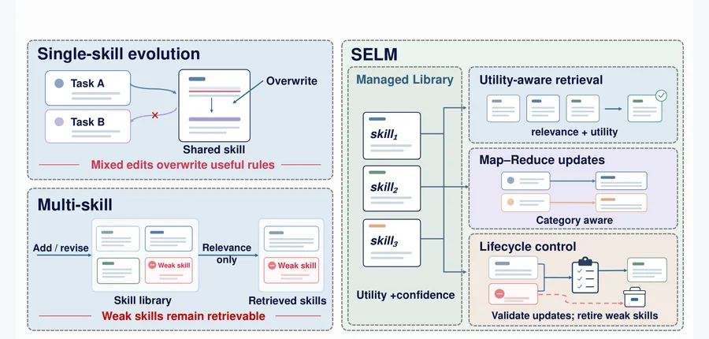 arXiv 2026-10-20 · cs.AI · #14 **[Selm: Self-Evolving Library Management for Multi-Skill Agent Optimization](https://arxiv.org/abs/2610.24630)** Mengxi Hu , Yuxuan Hu , Jinbo Su , Ke Wang , Honghao Shi , Wenli Wu , Cuiping Li , Hong Chen , Jing Zhang Affiliation: Renmin University of China / Beijing Academy of Artificial Intelligence [Paper](https://arxiv.org/abs/2610.24630) · [Figure source](https://arxiv.org/html/2610.24630v1/fig3_intro.png) 

[EN] Abstract
Large language model (LLM) agents increasingly use skills as a lightweight way to acquire task-specific knowledge. Recent work enables skills to evolve from task trajectories. However, these methods often lack systematic management of evolved skills, making it difficult for agents to reuse and accumulate skills across domains, thus limiting performance on subsequent this http URL reliably accumulate, reuse, and maintain useful skills across tasks, we present SELM (Self-Evolving Library Management), a framework that formulates skill evolution as library-level management. SELM jointly manages skill retrieval, updating, and lifecycle by maintaining skill confidence and utility signals. It introduces utility-aware retrieval to select useful skills, a Map-Reduce framework to generate targeted updates from task-specific experience, and lifecycle controls to retain or remove skills based on their effectiveness. These mechanisms enable the skill library to continuously accumulate useful experience while preserving and pruning skills across tasks, improving agent performance on complex tasks across diverse domains. We evaluate SELM on four agent benchmarks covering diverse tasks and execution environments, and SELM consistently outperforms in most settings. <a href="https://arxiv.org/abs/2610.24630">Source</a>

[ZH] Abstract
大语言模型智能体越来越多地把技能作为轻量方式获得任务知识。近期工作可从任务轨迹进化技能，但通常缺乏对进化技能的系统管理，难以跨领域复用和积累，限制后续任务表现。为可靠积累、复用和维护跨任务的有用技能，我们提出 SELM（自进化库管理），将技能进化表述为库层面的管理。SELM 通过维护技能置信度和效用信号，联合管理检索、更新与生命周期。它引入效用感知检索选择有用技能，使用 Map-Reduce 框架从任务特定经验生成定向更新，并按有效性控制保留或删除，使技能库持续积累有用经验，同时跨任务保存和剪除技能。我们在覆盖不同任务和执行环境的四个智能体基准上评估，SELM 在多数设置中持续优于其他方法。 <a href="https://arxiv.org/abs/2610.24630">Source</a>
 | 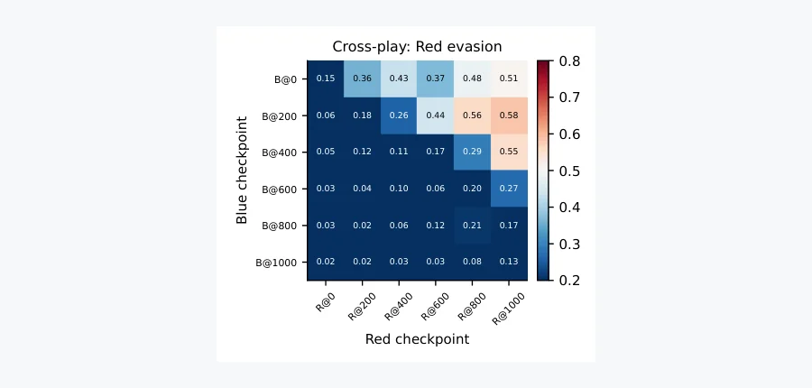 arXiv 2026-10-20 · cs.CR · #15 **[Peer Pressure: Execution-Verified Co-Evolution of Attacker and Defender Populations for Code Security](https://arxiv.org/abs/2610.24896)** Khushbu Pahwa , Yubin Ge , Daniele Bonadiman , Xiaofei Ma , Yi Zhang Affiliation: AWS AI [Paper](https://arxiv.org/abs/2610.24896) · [Figure source](https://arxiv.org/html/2610.24896v1/crossplay.png) 

[EN] Abstract
LLM code agents increasingly ship code with little oversight, yet defenders trained on static vulnerability datasets fall behind adapting adversaries. We co-train attacker and defender instead, and let execution decide every reward: an attacker (Red) edits a real repository and earns nothing unless its patch applies, builds, passes the tests, completes its development task and reproduces a real exploit in an isolated container, whose path also labels the entry point, the critical operation and the trace between them. Peer-Relative Policy Optimization (PRPO) makes both sides populations of LoRA adapters over one frozen base and credits each against same-role peers that faced an identical condition, placing the population inside the policy-gradient baseline rather than the opponent pool, with a tournament preserving diversity. Matching cancels the condition's difficulty: at equal coverage it is worth 2.3 points of balanced accuracy over a baseline computed on other conditions, and it matches a within-policy control at half the verifier spend. PRPO's 7B diff reviewer reaches 64.8% balanced accuracy on four unseen applications in three untrained languages, 5.5 points above supervised security fine-tuning and 4.4 above a frozen frontier reviewer (Claude Opus 4.8), which it leads by 15.8 on the application it trains on. Its 9B repository agent recovers 23 of 172 held-out VulnGym advisories, against 10 after supervised fine-tuning and 7 for the same backbone untrained under the same scaffold, and locates 17 of 43 reachable entry points against 13 for mini-swe-agent with GLM-5.2. Run unchanged on jailbreak defense, the same algorithm matches or exceeds WildGuard's static F1 at equal corpus and model size. Under a judge distinct from its training oracle it cuts attack success from 36.0% to 4.6%, against WildGuard's 8.9%. <a href="https://arxiv.org/abs/2610.24896">Source</a>

[ZH] Abstract
大语言模型代码智能体日益少经监督就交付代码，但静态漏洞数据训练的防御者会落后于适应中的对手。我们共同训练攻击者与防御者，让执行决定所有奖励：攻击者修改真实仓库，只有补丁能应用、构建、通过测试、完成开发任务，并在隔离容器中复现真实利用时才获得奖励；该路径也标注入口、关键操作及其间轨迹。同伴相对策略优化（PRPO）让双方成为同一冻结基础模型上的 LoRA 适配器种群，以面对相同条件的同角色同伴为基准归因，将种群放入策略梯度基线而非对手池，并用锦标赛保持多样性。匹配消除条件难度：相同覆盖下，比使用其他条件计算的基线高 2.3 个平衡准确率百分点，以一半验证器开销匹配策略内对照。7B 差异审查器在四个未见应用、三种未训练语言上平衡准确率为 64.8%，比监督安全微调高 5.5 个百分点，比冻结前沿审查器 Claude Opus 4.8 高 4.4，在训练应用上领先后者 15.8。9B 仓库智能体恢复 172 个留出 VulnGym 公告中的 23 个，监督微调为 10，未训练同主干同支架为 7；定位 43 个可达入口中的 17 个，使用 GLM-5.2 的 mini-swe-agent 为 13。不改算法用于越狱防御时，在相同语料与模型规模下达到或超过 WildGuard 的静态 F1。采用不同于训练预言机的裁判时，攻击成功率从 36.0% 降到 4.6%，WildGuard 为 8.9%。 <a href="https://arxiv.org/abs/2610.24896">Source</a>
 |
| 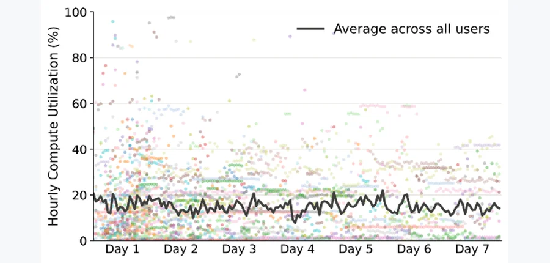 arXiv 2026-10-20 · cs.LG · #16 **[Conjugate Compilation: Self-Improving Agentic Co-Compilation for Speculative Decoding](https://arxiv.org/abs/2610.25012)** Annabelle Sujun Tang , Rohan Mahapatra , Christopher Priebe , Hanyang Xu , Manya Ghobadi , Christopher Rossbach , Hadi Esm… Affiliation: University of California, San Diego / Massachusetts Institute of Technology / Systalyze / University of Texas at Austin / Microsoft [Paper](https://arxiv.org/abs/2610.25012) · [Figure source](https://arxiv.org/html/2610.25012v1/figures/motivation.png) 

[EN] Abstract
As LLM adoption surges, scaling model serving requires unlocking stranded GPU capacity alongside deploying more GPUs. Speculative decoding brings two models into the serving process: a small draft model proposes tokens that a larger target model verifies. Yet compiling these models individually leaves their shared execution outside the compiler's optimization boundary. We introduce CONJUGATE COMPILATION, which reframes speculative decoding as a cross-model compilation problem and jointly optimizes the draft and target models within their shared execution rather than treating each in isolation. Our key insight is that cross-model compilation should be informed by the measured performance of the co-located shared execution it produces: an optimization that improves a kernel in isolation need not improve the models when they execute together. To expand cross-model opportunities, we devise operand layouts that interleave blocks from both models within common tiles, co-locating GEMM and non-GEMM work while preserving their mathematics. We realize CONJUGATE COMPILATION through a self-improving agentic search system in which an LLM edits cross-model optimization plans using the compiler and GPU execution as its environment. Each proposed plan is compiled and evaluated through its co-located shared execution, whose measured score, together with kernel-level verdicts and compiler feedback, informs subsequent proposals, while Monte Carlo tree search accumulates rewards to guide exploration. Across six single-GPU speculative-decoding configurations on NVIDIA B300 and RTX 5090 GPUs, CONJUGATE COMPILATION achieves a geometric-mean per-round speedup of 1.37x over conventional execution. Interleaved kernels raise this speedup to 1.45x, reaching 1.59x in the best case. CONJUGATE COMPILATION also improves GPU utilization on average by 1.46x on RTX 5090 and 1.50x on B300. <a href="https://arxiv.org/abs/2610.25012">Source</a>

[ZH] Abstract
随着大语言模型采用激增，扩展服务既需要更多 GPU，也需要释放闲置容量。推测解码由小草稿模型提出词元、大目标模型验证，但分别编译两者会把共享执行排除在编译器优化边界之外。我们提出共轭编译，将推测解码重述为跨模型编译问题，在共享执行内联合优化草稿和目标模型。核心是用所产生的同机共享执行实测性能指导跨模型编译：孤立内核更快不一定代表共同执行更快。我们设计在公共分块中交错两模型数据块的操作数布局，在保持数学计算的同时共置 GEMM 与非 GEMM 工作。实现采用自改进智能体搜索系统，大语言模型以编译器和 GPU 执行为环境，修改跨模型优化计划。每项计划被编译，并通过共享执行评估，实测分数、内核级判定和编译反馈指导后续提议，蒙特卡洛树搜索累积奖励指导探索。在 NVIDIA B300 和 RTX 5090 上六种单 GPU 推测解码配置中，相对常规执行，每轮加速的几何平均为 1.37 倍；交错内核将其提高到 1.45 倍，最佳 1.59 倍。RTX 5090 和 B300 平均 GPU 利用率分别提高 1.46 倍和 1.50 倍。 <a href="https://arxiv.org/abs/2610.25012">Source</a>
 | 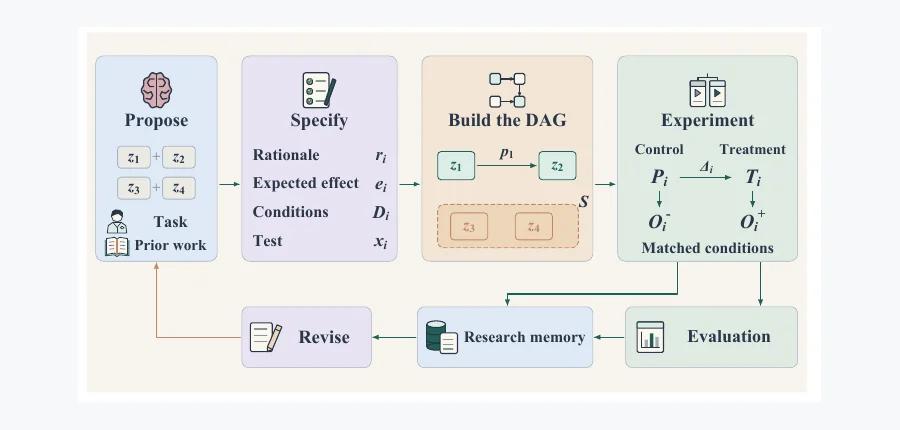 arXiv 2026-10-20 · cs.AI · #17 **[DAGLoop: Aligning Method Design with Experimental Feedback in Automated AI Research](https://arxiv.org/abs/2610.25089)** Dengyuxing Wang , Yonggang Zhang , Qianshu Cai , Huajiang Zheng , Jun Song , Yangqiu Song , Yike Guo Affiliation: Hong Kong University of Science and Technology / Hong Kong Generative AI Research &amp; Development Center / University of Science and Technology of China / Hong Kong Baptist University [Paper](https://arxiv.org/abs/2610.25089) · [Code](https://github.com/deng34567/DAGLoop) · [Figure source](https://arxiv.org/pdf/2610.25089#page=3) 

[EN] Abstract
Automated AI research agents aim to improve machine learning methods by iteratively proposing, implementing, and evaluating candidate methods. Existing work uses the outcome of each evaluation to determine how the next candidate should be revised for performance improvement. However, a candidate often combines multiple design decisions, and its overall outcome alone does not reveal which decisions produced their expected effects, whether their required conditions were satisfied, or which decisions should be retained or revised. Inspired by ablation studies in the machine learning community, we propose DAGLoop to test the expected effect of a design decision by comparing implementations with and without that decision while preserving the other decisions it requires. Specifically, DAGLoop translates each design decision's rationale into a testable expectation and pairs it with a targeted experiment, forming an experimental specification for assessing the expected effect under its required conditions. Using these specifications, we formulate ablation planning as the construction of a directed acyclic graph (DAG) from the candidate method's design: nodes associate decisions with tests, and edges encode dependencies. The DAG specifies which decisions each experiment must retain and supports joint tests when an expected effect requires several decisions to act together. Outcomes are recorded with the tested decisions, expectations, and conditions to form structured research memory. This memory guides the agent in retaining experimentally supported decisions, revising unsupported ones, and planning further experiments when the evidence is unresolved. Experiments on dozens of research tasks demonstrate substantial performance improvements achieved by DAGLoop across diverse executable research settings. Code and evaluation scripts are available at this https URL . <a href="https://arxiv.org/abs/2610.25089">Source</a>

[ZH] Abstract
自动化人工智能研究智能体通过反复提出、实现、评估候选方法改进机器学习，但候选常组合多项设计，整体结果无法说明哪些决策产生预期作用、所需条件是否满足，以及应保留或修改什么。受消融研究启发，我们提出 DAGLoop，在保留某设计所需其他决策的条件下，比较有无该决策的实现，以检验预期作用。它将每项设计理由转为可检验预期，配对定向实验，形成评估所需条件下预期作用的实验规格。基于规格，将消融规划表述为从候选设计构建有向无环图（DAG）：节点关联决策与测试，边编码依赖。该图规定每项实验必须保留哪些决策，并在作用需要多项决策共同产生时支持联合测试。结果与被测决策、预期及条件一起存为结构化研究记忆，指导保留有实验支持的决策、修改不受支持者，在证据未定时规划更多实验。在数十项研究任务上，DAGLoop 在不同可执行研究设置中带来显著性能改进。代码和评估脚本见原文链接。 <a href="https://arxiv.org/abs/2610.25089">Source</a>
 | 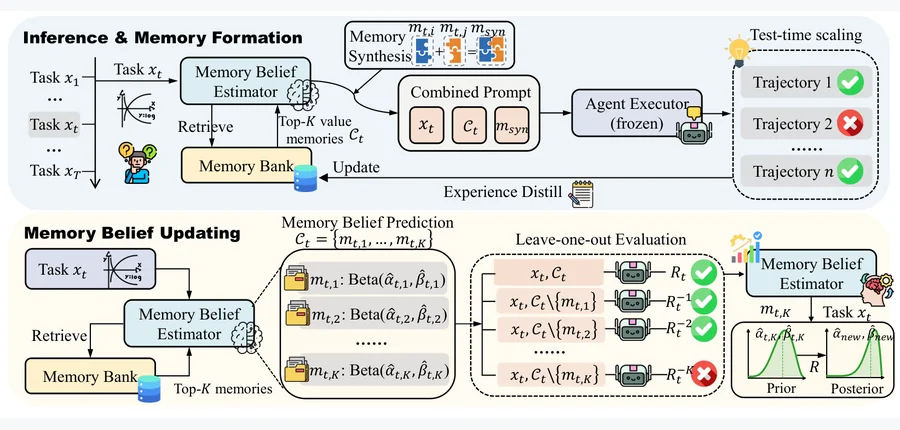 arXiv 2026-10-20 · cs.LG · #18 **[Memory as Belief: Bayesian Evolution of Memory for Self-Evolving LLM Agents](https://arxiv.org/abs/2610.25119)** Yiming Xu , Qian Yang , Zihan Chen , Yuefei Wu , Wenhan Zeng , Bin Shi , Bo Dong Affiliation: Xi’an Jiaotong University / University of Virginia / Zhengzhou University [Paper](https://arxiv.org/abs/2610.25119) · [Figure source](https://arxiv.org/html/2610.25119v1/overview_memory.png) 

[EN] Abstract
Large language model (LLM) agents increasingly rely on external memory to accumulate past experiences for continual adaptation. However, effectively reusing memory requires accurately assessing its value, as retrieved experiences may become unreliable when transferred across task contexts. Despite its importance, memory valuation remains largely underexplored, with existing methods relying on historical retrieval success rates that overlook the context dependency of memory usefulness and the varying reliability of estimates under different amounts of evidence. Inspired by the Bayesian brain hypothesis, we propose BEAM (Bayesian-style Evolutionary Agentic Memory), a framework that reformulates memory value evaluation as a parameterized cognitive inference process, where memory value is represented as a context-conditioned dynamic belief rather than a passive historical statistic. Specifically, BEAM infers memory value beliefs from current task contexts and continuously calibrates them using execution feedback as empirical evidence, transforming memory from passive storage into an adaptive cognitive mechanism for continual self-evolution. Extensive experiments across reasoning and code generation benchmarks demonstrate that BEAM consistently improves memory utilization and enables continual self-evolution of LLM agents. <a href="https://arxiv.org/abs/2610.25119">Source</a>

[ZH] Abstract
大语言模型智能体依赖外部记忆累积经验、持续适配，但有效复用要求准确评估价值，因为经验跨任务迁移可能不可靠。现有方法多用历史检索成功率，忽略有用性对上下文的依赖，以及证据量不同导致的估计可靠性差异。受贝叶斯脑假说启发，我们提出 BEAM（贝叶斯式进化智能体记忆），将记忆价值评估重述为参数化认知推断过程：价值是上下文条件化的动态信念，而非被动历史统计。BEAM 从当前任务上下文推断价值信念，并持续用执行反馈作为经验证据校准，将记忆从被动存储转为持续自进化的自适应认知机制。在推理和代码生成基准上的大量实验显示，BEAM 持续改善记忆利用，支持智能体持续自进化。 <a href="https://arxiv.org/abs/2610.25119">Source</a>
 |
| 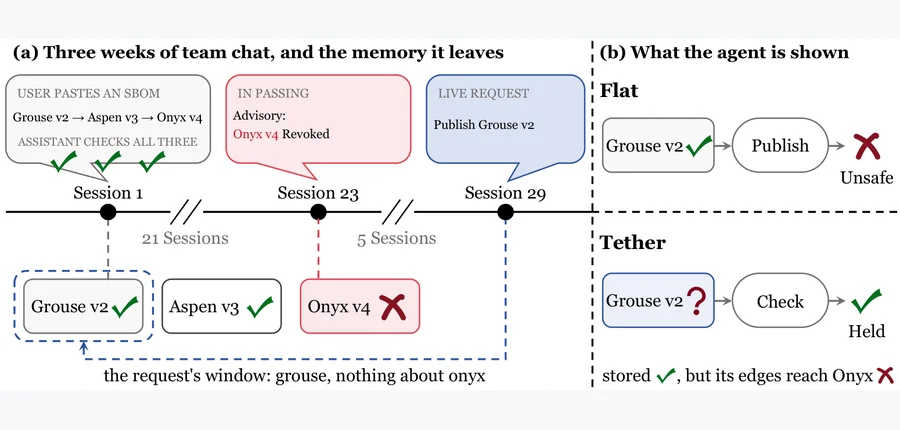 arXiv 2026-10-20 · cs.CL · #19 **[Memories That Outlive Their Reasons: Dependency-Tethered Memory for Tool-Using LLM Agents](https://arxiv.org/abs/2610.25123)** Yiqi Wang , Jinqian Ju , Jiaqi Zhang , Zhangkai Wu , Yiqun Duan , Zequn Sun , Taotao Cai , Mingkai Zheng Affiliation: University of Southern Queensland / Southern University of Science and Technology / Jiangsu University / University of Sydney / Uploading Inc. / Nanjing University [Paper](https://arxiv.org/abs/2610.25123) · [Code](https://github.com/xiaoqi-7/tether-fallout) · [Figure source](https://arxiv.org/html/2610.25123v1/Introduction.png) 

[EN] Abstract
Agents now act on the Web, publishing packages, models and datasets through registry APIs, and remembering past verifications spares them the work. But a verdict rests on premises. When a signing key is revoked, everything built on it stops passing, yet the advisory names only the key, and the old verdicts of its dependents may never share a retrieval window with it. This non-locality of invalidation turns memory into a liability: in long simulated chats, an agent reading a memory of atomic facts publishes 62% of the objects whose failure lies upstream, each backed by a record that was true when written. Yet derivation is local even when invalidation is not. Tether records, at write time, the exact versions each verdict derives from, and at read time withdraws any verdict whose support has failed anywhere in the store; the agent reads the same fields as before. On Fallout, a generator of versioned worlds with hypothesis-blind simulated histories shared by every memory, Tether publishes 0.3% of upstream-failing objects across three domains when relations are stated with their verdicts, with 37% fewer verification calls than checking everything. A-Mem and Graphiti re-verify most candidates (0.83-0.86 checks per candidate), which limits their savings, yet publish 9% of upstream-failing objects; Mem0 relies on memory more and publishes 42%. Flushing every verdict on any failure is as safe as Tether but costs 32% more checks. The gain over fact memory holds with three open-weight backbones and against a whole-store window. These gains depend on capturing dependencies: when relations arrive in sessions apart from their verdicts, Tether's downstream unsafe publication rate rises to 9.4-22.1%, and a weak writer that misses edges loses safety in the same way. <a href="https://arxiv.org/abs/2610.25123">Source</a>

[ZH] Abstract
智能体通过注册表 API 发布软件包、模型和数据，记住过去验证可以省事，但判定依赖前提。签名密钥撤销会使其依赖项全部失效，公告却只命名密钥，旧判定与公告可能从不出现在同一检索窗口。这种非局部失效使记忆成为风险：在长模拟对话中，读取原子事实记忆的智能体发布 62% 的上游失效对象，尽管记录写入时为真。失效非局部，推导却是局部的。Tether 写入时记录每个判定依赖的精确版本，读取时撤回任何支持在存储任意位置失效的判定，智能体读取字段保持相同。在 Fallout 版本化世界生成器中，所有记忆共享不知待测假说的模拟历史；当关系与判定同时陈述时，Tether 跨三个领域仅发布 0.3% 的上游失效对象，比全量验证少 37% 调用。A-Mem 和 Graphiti 重新验证多数候选，每候选 0.83—0.86 次，限制节省，却仍发布 9% 的上游失效对象；Mem0 更依赖记忆，发布 42%。任何失败就清空全部判定与 Tether 同样安全，但多用 32% 检查。相对事实记忆的收益在三个开源权重主干以及全库窗口对照中成立。收益依赖依赖关系捕捉：当关系和判定分散在不同会话，Tether 下游不安全发布率升至 9.4%—22.1%，弱写入器漏边也同样丧失安全性。 <a href="https://arxiv.org/abs/2610.25123">Source</a>
 | 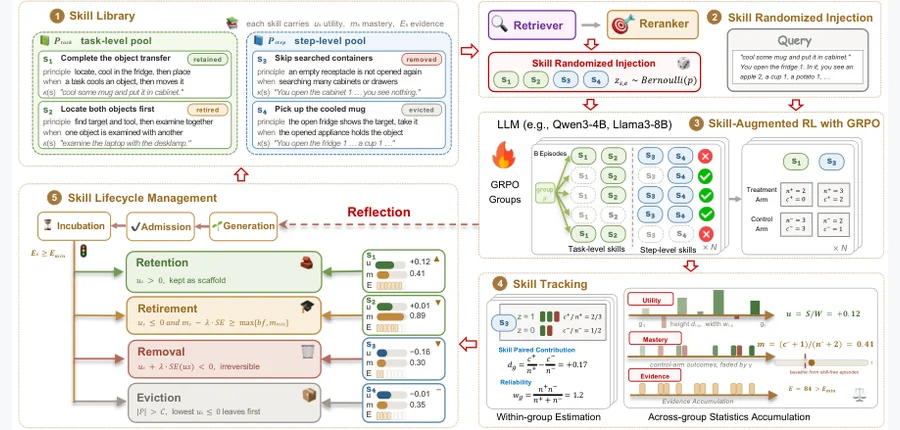 arXiv 2026-10-20 · cs.LG · #20 **[Trackable Skill Library Lifecycle Management for Agentic Reinforcement Learning](https://arxiv.org/abs/2610.25126)** Xi Zhu , Yuanlin Duan , Changyi Yang , Kai Mei , Riyang Bao , Shichao Zhu , Dimitris N. Metaxas Affiliation: Rutgers University / Carnegie Mellon University / TikTok Inc. [Paper](https://arxiv.org/abs/2610.25126) · [Figure source](https://arxiv.org/html/2610.25126v1/TrackRL.png) 

[EN] Abstract
Skill-augmented agentic RL has emerged as an effective approach to improving LLM agents on long-horizon tasks. Despite this progress, individual skills may follow distinct trajectories as the policy evolves, with some becoming redundant after the model internalizes their capabilities, others remaining valuable as external scaffolding, and still others turning harmful. However, existing skill library systems fail to identify each skill's true contribution due to free-riding among co-retrieved skills, difficulty confounding across tasks, and the absence of skill-specific counterfactual evidence, which prevents reliable skill lifecycle management. We propose TrackRL, an agentic RL framework where skill tracking drives skill library full lifecycle management. Specifically, within each GRPO group, we turn grouped sampling into online randomized controlled experiments. Independent random injection and within-group contrasts on the same task isolate each skill's true contribution, and reliability-weighted aggregation accumulates evidence across groups. As evidence accumulates, we continuously track skill utility, which measures the skill's causal contribution as external scaffolding, and model mastery, which reflects how far the corresponding capability has been internalized. Along this line, we formulate skill lifecycle management as an evidence-gated state-transition process that governs each skill from generation and admission through protected incubation to retention, retirement, or removal, while a soft capacity bound controls library growth. Experiments show that TrackRL outperforms recent skill-augmented RL baselines in both library-assisted and skill-free evaluation, with further analyses revealing how skill value shifts during policy learning and how evidence-driven state transitions shape skill library evolution. Our code is available at this https URL . <a href="https://arxiv.org/abs/2610.25126">Source</a>

[ZH] Abstract
技能增强智能体强化学习能改善长时程任务，但策略进化时，各技能可能有不同轨迹：能力内化后冗余、仍是有效外部支架，或转为有害。现有库难以识别真实贡献，因为共同检索技能间搭便车、任务难度混杂以及缺少技能特定反事实证据，阻碍可靠生命周期管理。我们提出 TrackRL，以技能跟踪驱动全生命周期管理。它把每个 GRPO 组的分组采样转为在线随机对照实验，通过独立随机注入和同任务组内对比隔离每项技能真实贡献，以可靠性加权聚合跨组证据。由此持续跟踪技能效用，即作为外部支架的因果贡献，以及模型掌握度，即能力内化程度。生命周期管理成为证据门控的状态转换，从生成、准入、保护孵化到保留、退役或移除，软容量界控制库增长。实验显示，TrackRL 在有库辅助和无技能评估中均优于近期技能增强强化学习基线，分析展示学习中技能价值变化及证据驱动转换如何塑造库进化。代码见原文链接。 <a href="https://arxiv.org/abs/2610.25126">Source</a>
 | 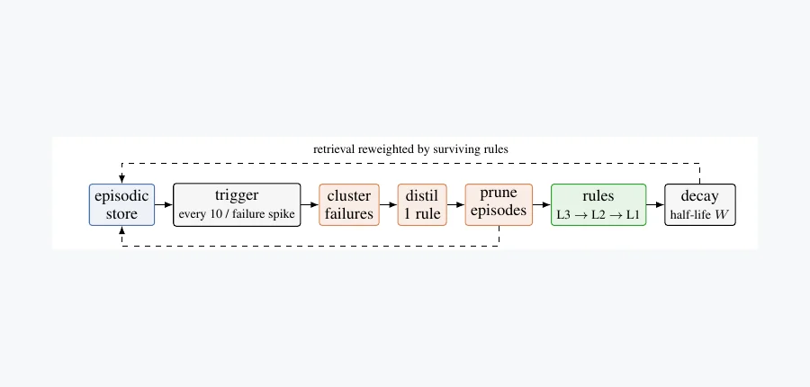 arXiv 2026-10-20 · cs.NE · #21 **[Let Them Sleep: Recursive Self-Pruning Memory for Long-Horizon LLM Agents](https://arxiv.org/abs/2610.25561)** Kargi Chauhan , Sadiba Nusrat Nur , Pratibha Revankar , Kyle Montgomery , Chenguang Wang Affiliation: University of California, Santa Cruz [Paper](https://arxiv.org/abs/2610.25561) · [Figure source](https://arxiv.org/pdf/2610.25561#page=2) 

[EN] Abstract
Agents that run for a long time have a memory problem, and it is not the one most systems optimize for. Storing every trace and retrieving the nearest neighbors works early and quietly stops working later: the store fills up with failures the agent then repeats, and with facts that were true fifty turns ago. RSPM (Recursive Self-Pruning Memory) borrows the fix biology already found. At intervals the agent sleeps. It clusters its recent failures, distills each cluster into a short rule, and deletes the raw episodes it just learned from. Rules decay unless something reinforces them, and rules that recur across many contexts get promoted into general ones. We tested this on three settings with little in common: a difficulty-calibrated SWE-bench simulation, temporal consistency across 12 conversational benchmarks, and long-horizon QA on LoCoMo-10. All three improve, by 9.1, 11.9, and 7.6 points respectively. More interestingly, the two studies that instrument the store itself converge on nearly the same operating point without being tuned toward it: roughly 93% fewer retry loops and roughly 30% fewer stored entries. That hints that knowing what to forget is a general property of agent memory rather than a benchmark-specific trick. <a href="https://arxiv.org/abs/2610.25561">Source</a>

[ZH] Abstract
长期运行智能体的记忆问题并非大多数系统优化的那个问题。存储全部轨迹、检索近邻最初有效，随后逐渐失效：库中充满会被重复的失败，以及五十轮前还正确的事实。递归自剪枝记忆 RSPM 借鉴生物学：智能体定期“睡眠”，聚类近期失败，把每个簇提炼为短规则，删除已学习的原始片段。规则若不被强化就衰减，跨许多上下文复现的规则晋升为一般规则。我们在三个差异很大的设置中测试：难度校准的 SWE-bench 模拟、12 个对话基准上的时间一致性，以及 LoCoMo-10 长时程问答，分别提高 9.1、11.9 和 7.6 分。更值得关注的是，两项测量存储本身的研究在未针对该结果调优时收敛到相近工作点：重试循环减少约 93%，存储条目减少约 30%。这暗示知道遗忘什么或许是智能体记忆的一般性质，而非基准特定技巧。 <a href="https://arxiv.org/abs/2610.25561">Source</a>
 |
| 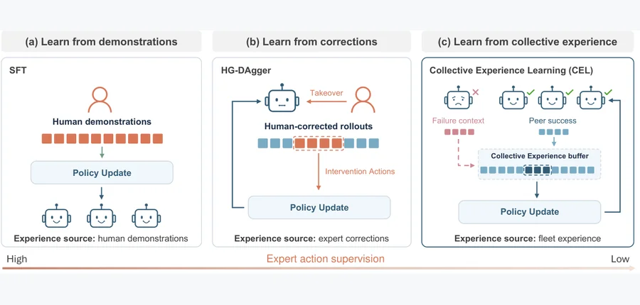 arXiv 2026-10-20 · cs.RO · #22 **[Learning from Fleet Experience: A Collective Learning Paradigm for Robots](https://arxiv.org/abs/2610.25736)** Chao Yu , Shu'ang Yu , Hao Lin , Hongzhi Zang , Yuxiang Yan , Chenxi Jiang , Zhen Guo , Chuankang Li , Yihao Chen , Xin Xu… Affiliation: Tsinghua University / AgiBot / Infinigence AI [Paper](https://arxiv.org/abs/2610.25736) · [Project](https://cel-robot-learning.github.io) · [Figure source](https://arxiv.org/html/2610.25736v1/CEL.png) 

[EN] Abstract
Experience generated during deployment offers an opportunity for robots to improve policy reliability through learning from their own executions. However, learning through human corrections requires teleoperators to monitor execution and intervene when policies fail, a demand that is difficult to meet as robot fleets grow. We introduce collective experience learning (CEL), a learning paradigm in which deployed robots share their execution experience to improve a common policy. We realize CEL through failure-guided experience retrieval fine-tuning (FERT), which uses failure contexts from robot executions to retrieve relevant trajectory segments from the fleet's shared successful experience and uses their actions as supervision for policy updates, without collecting additional expert demonstrations or corrective actions. A fault-tolerant asynchronous training system (FATS) coordinates experience collection, policy optimization and policy distribution despite local interruptions within the robot fleet. Across five real-world manipulation tasks, the resulting policies achieve success rates of 93.3-99.2%, evaluated over 120 trials per task on robots excluded from training data collection. With collection time per robot held fixed, larger fleets provide more experience and FERT generally achieves higher success rates across the evaluated sizes. On multi-stage phone packaging, learning with 96 robots increases success from 79.2% to 98.3%. These results support collective experience as a practical basis for scalable robot learning and a path towards improving policy reliability during deployment without collecting additional expert corrective actions. <a href="https://arxiv.org/abs/2610.25736">Source</a>

[ZH] Abstract
部署经验为机器人从自身执行学习、提高策略可靠性提供机会，但依赖人工修正要求遥操作员监控并介入，难以随机器人队伍扩展。我们提出集体经验学习（CEL），让部署机器人共享执行经验以改进公共策略。实现采用失败引导经验检索微调（FERT），从失败上下文检索队伍共享成功经验中的相关轨迹片段，以其动作监督策略更新，无需额外专家示范或修正动作。容错异步训练系统 FATS 在局部中断下仍协调经验采集、优化和策略分发。在五项真实操作任务中，每项在不参与训练采集的机器人上评估 120 次，成功率达到 93.3%—99.2%。固定每台采集时间时，更大队伍提供更多经验，FERT 在所测规模下通常成功率更高。多阶段手机包装中，96 台机器人学习使成功率从 79.2% 升至 98.3%。结果支持集体经验作为可扩展机器人学习的实践基础，无需额外专家修正动作即可在部署中提高可靠性。 <a href="https://arxiv.org/abs/2610.25736">Source</a>
 | 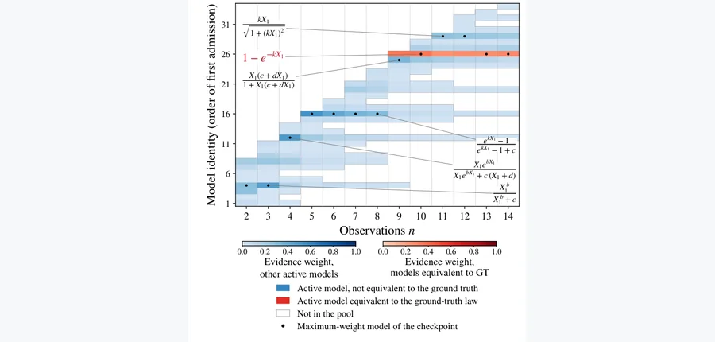 arXiv 2026-10-20 · cs.LG · #23 **[Bayesian Model Discovery with Language Models: Closing the Loop between Hypotheses and Experiments](https://arxiv.org/abs/2610.25747)** JooKyung Yuh , Byungmin Park , Eunseo Choi , Jinheon Baek , Junmo Cho , Kyu Hyun Choi , Sung Ju Hwang , Kyong Hwan Jin , H… Affiliation: Korea University / KAIST / KETI [Paper](https://arxiv.org/abs/2610.25747) · [Figure source](https://arxiv.org/html/2610.25747v1/pool_evolution_inside12_boxinggym_e2_bg__death__full_allres__s31_n14.png) 

[EN] Abstract
Scientific model discovery requires proposing candidate models of an unknown system and designing experiments that discriminate among them. However, LLM-based approaches typically rely on in-context learning to predict outcomes and select experiments, lacking explicit model evaluation to systematically guide hypothesis search, while Bayesian approaches enable principled model comparison but are confined to a predefined candidate set which results in limited search spaces. To this end, we introduce BMD, which closes the loop between LLM-driven hypothesis generation and Bayesian experimental design. Specifically, an LLM proposes model families, while a numerical engine fits their parameters, weighs them by model evidence, and averages their predictions. Then, BMD chooses the next experimental conditions by maximizing the joint expected information gain over families and their parameters, while feeding the updated beliefs and residual diagnostics back to the LLM to guide its next proposals. Across four scientific discovery benchmarks, BMD achieves lowest final prediction error than in-context learning and LLM-based scientific agents while recovering exact functional forms more often, with ablations supporting numerical feedback and the joint objective. <a href="https://arxiv.org/abs/2610.25747">Source</a>

[ZH] Abstract
科学模型发现需要为未知系统提出模型并设计区分它们的实验。大语言模型方法常依赖上下文学习预测结果、选择实验，缺少显式模型评估来系统指导假设搜索；贝叶斯方法有原则的模型比较却被预定义候选集限制。我们提出 BMD，闭合语言模型假设生成与贝叶斯实验设计循环：语言模型提出模型家族，数值引擎拟合参数、按模型证据加权、平均预测；随后通过最大化家族及其参数的联合预期信息增益选择下一实验条件，并将更新信念和残差诊断反馈给语言模型，指导后续提议。在四个科学发现基准上，BMD 比上下文学习和语言模型科学智能体取得更低最终预测误差，更常恢复精确函数形式；消融支持数值反馈与联合目标。 <a href="https://arxiv.org/abs/2610.25747">Source</a>
 | 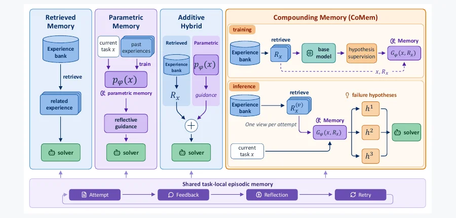 arXiv 2026-10-20 · cs.CL · #24 **[CoMem: Learning to Anticipate Failures from Retrieved Experience](https://arxiv.org/abs/2610.25790)** Yun Shen , Ming Shen , Tianjun Yao Affiliation: Ohio State University / Shenzhen Loop Area Institute / Shanghai Jiaotong University [Paper](https://arxiv.org/abs/2610.25790) · [Figure source](https://arxiv.org/pdf/2610.25790#page=2) 

[EN] Abstract
Reflection lets LLM agents improve from their own attempts, but the memory it builds is local to a single task, so an agent reflecting on its own tends to revisit the same explanation for failure. Cross-task reflective memory addresses this in two forms: retrieved memory keeps past experience explicit and looks up related cases, which is specific but bounded by the bank, and parametric memory internalizes experience into parameters, which generalizes but is grounded in nothing beyond the task description. When both are used, existing agents combine them additively, feeding their outputs to the solver side by side, so retrieved experience never changes what the learned memory produces. We introduce CoMem (Compounding Memory), which makes retrieved experience an input to the learned memory itself, at training and at inference. The agent builds a bank of its own successful and failed reflections, learns from retrieved cases to write failure hypotheses, candidate explanations of how an attempt is likely to go wrong, and at test time reasons from newly retrieved cases to guide each attempt. Varying the retrieved cases gives the memory different perspectives, yielding reflective diversity that is not merely sampled but also grounded in retrieved experience. Across two backbones and five benchmarks in math, code, and multi-hop QA, CoMem achieves strong overall performance. Additional evaluations show that it generalizes to out-of-distribution tasks and enables smaller models to provide effective guidance to stronger solvers. <a href="https://arxiv.org/abs/2610.25790">Source</a>

[ZH] Abstract
反思让智能体从尝试中改善，但记忆常局限单项任务，使其反复访问相同失败解释。跨任务反思记忆有两种形式：检索记忆显式保存经验、查找案例，具体但受记忆库限制；参数记忆将经验内化到参数，可泛化却只有任务描述作依据。现有方法把二者输出并列给求解器，检索经验不改变学习记忆产生的内容。我们提出 CoMem（复合记忆），让检索经验在训练和推理时都作为学习记忆本身的输入。智能体建立自身成功和失败反思库，从检索案例学习写失败假说，即下一尝试可能出错的候选解释，并在测试时从新检索案例推理以指导每次尝试。改变检索案例提供不同视角，使反思多样性不仅靠采样，还由经验支撑。在两个主干、五个数学、代码及多跳问答基准上取得较强总体表现。额外评估显示分布外任务泛化，并使小模型有效指导更强求解器。 <a href="https://arxiv.org/abs/2610.25790">Source</a>
 |
| 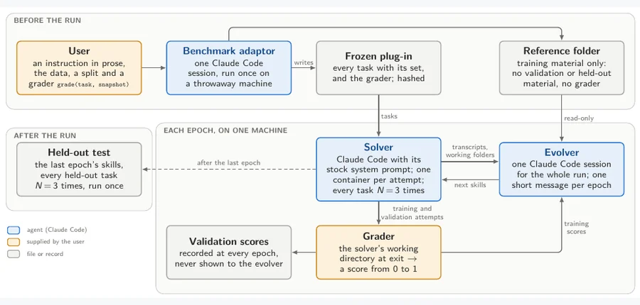 arXiv 2026-10-20 · cs.AI · #25 **[EvoSkill v2: Fully Agentic Skill Evolution from Benchmark Adaptation to a Stateful Evolver](https://arxiv.org/abs/2610.25931)** Dastin Huang , Baran Nama , Salaheddin Alzubi Affiliation: Sentient Labs [Paper](https://arxiv.org/abs/2610.25931) · [Figure source](https://arxiv.org/pdf/2610.25931#page=3) 

[EN] Abstract
EvoSkill v2 is a three-agent system that edits the instructions (skills) an agent is given, leaving its model and harness intact. The user starts a run by describing a benchmark and supplying a grader, which a benchmark adaptor turns into a benchmark-specific plugin. A solver attempts the tasks, and an evolver reads the solver's training rollouts and rewrites the skills at each epoch. We implement the evolver as one stateful coding agent with a bash tool for the whole run, unlike the two most common designs among the skill optimizers we surveyed: a sequence of single model calls, as in SkillOpt, and an agent that starts afresh each round, as in SkillBoost. We also measure how much the solver's rollouts vary from one attempt to the next, give the evolver several attempts per training task, and accept every epoch's skills instead of selecting among them on noisy scores. With fine-grained ground truth, EvoSkill v2's skills raised the held-out pass rate above the stronger of SkillOpt and SkillBoost by 7.7 percentage points on SpreadsheetBench v2 and by 5.4 on $\tau^3$-bench banking. In both benchmarks and both feedback settings, EvoSkill v2's evolver cost less per percentage point of held-out pass rate gained than either baseline's optimizer. EvoSkill v2 also enables a less capable model to improve its own skills, demonstrated by a gain of up to 21.5 percentage points in the $\tau^3$-bench banking experiment where Claude Haiku 5.5 powers both solver and evolver. <a href="https://arxiv.org/abs/2610.25931">Source</a>

[ZH] Abstract
EvoSkill v2 是三智能体系统，编辑提供给智能体的技能指令，保持模型和框架不变。用户描述基准并提供评分器，基准适配器将其转为专用插件。求解器尝试任务，进化器读取训练轨迹，每个 epoch 重写技能。我们让进化器成为整个运行期间持有 bash 工具的有状态编码智能体，不同于调查中两种常见设计：如 SkillOpt 的连续单次模型调用，或如 SkillBoost 的每轮重启智能体。我们还测量求解器执行变异，为每项训练任务提供多次尝试，并接纳每个 epoch 技能，而非按噪声分数择优。有细粒度真实反馈时，相对 SkillOpt 和 SkillBoost 中更强者，在 SpreadsheetBench v2 的留出通过率高 7.7 个百分点，在 $	au^3$-bench 银行业高 5.4 个百分点。两个基准和两种反馈设置下，每提升一个留出通过率百分点的进化器成本都低于两项基线。它也让较弱模型改进自身技能：Claude Haiku 5.5 同时担任求解器与进化器时，银行业实验最多提高 21.5 个百分点。 <a href="https://arxiv.org/abs/2610.25931">Source</a>
 |  arXiv 2026-10-20 · cs.AI · #26 **[Persistent Memory and Iterative Improvement in an LLM Agent for Chinese-Character Drawing](https://arxiv.org/abs/2610.24090)** Peilin Wu , Yi-Zhuang You Affiliation: Palo Alto High School / University of California San Diego [Paper](https://arxiv.org/abs/2610.24090) · [Code](https://github.com/Clearsightpei/iterative-agent-memory) · [Figure source](https://arxiv.org/html/2610.24090v1/verdict_examples.png) 

[EN] Abstract
Does persistent memory accumulated from previous attempts help an LLM agent solve new problems, and does memory design affect that benefit? We study programmatic Chinese-character drawing across five agent conditions attempting the same 668 items. Accumulated memory produces modest aggregate gains despite substantial growth in the memory stores: free-form notes improve first-attempt success by 4.6 percentage points, while a design combining free-form memory with reusable code improves it by 2.8 points. The two designs do not differ significantly overall, but the code bank shows a suggestive advantage on later, harder items. A separate post-hoc comparison finds a much larger improvement when the code-bank agent receives privileged, target-specific structural supervision. The agent can therefore exploit highly informative structural guidance, although the privileged per-item information does not establish what could have been learned from experience alone. These results suggest that memory design may affect where accumulated experience becomes useful, even when its average benefit is modest. <a href="https://arxiv.org/abs/2610.24090">Source</a>

[ZH] Abstract
从过去尝试累积的持久记忆，能否帮助大语言模型智能体解决新问题，记忆设计是否影响收益？我们在五个智能体条件下，对相同 668 个项目研究程序化汉字绘制。尽管记忆库大幅增长，汇总收益有限：自由笔记使首次成功率提高 4.6 个百分点，自由记忆结合可复用代码提高 2.8 个百分点。二者总体无显著差异，但代码库在后期更难项目上显示提示性优势。另一次事后比较发现，代码库智能体获得特权、目标特定结构监督时，改进明显更大。智能体能利用高信息量结构指导，但这种逐项目特权信息不能说明仅从经验能学到什么。结果提示，记忆设计可能影响经验在哪些情形有用，即使平均收益有限。 <a href="https://arxiv.org/abs/2610.24090">Source</a>
 | 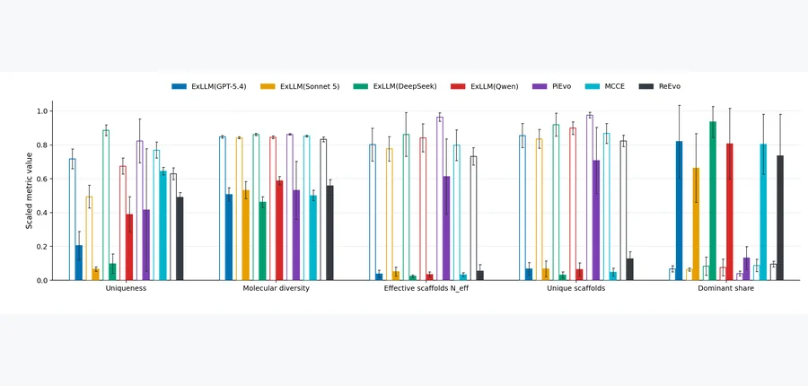 arXiv 2026-10-20 · cs.LG · #27 **[An important Bottleneck in LLM Optimizers: Principle-Level Local Optima](https://arxiv.org/abs/2610.24291)** Nian Ran , Tianhe Jia , Zhengyang Mu , Yue Wang , Sebastian Brulin , Markus Olhofer , Mauricio A. Alvarez , Yang Liu , Ric… Affiliation: University of Manchester / UKRI AI Centre for Doctoral Training in Decision Making for Complex Systems / University of Chinese Academy of Sciences / Zhongguancun Academy / NVIDIA / Honda Research Institute Europe [Paper](https://arxiv.org/abs/2610.24291) · [Figure source](https://arxiv.org/html/2610.24291v1/results_v4/molecular_bars.png) 

[EN] Abstract
Feedback-driven LLM optimizers are increasingly used for evolutionary search, Bayesian optimization, heuristic design, and scientific discovery. Yet rapid initial gains often give way to prolonged plateaus despite substantial remaining evaluation budgets. We investigate \emph{principle-level search collapse}, where an optimizer's search becomes confined to a narrow set of design principles, even though it may continue to generate distinct candidates and achieve small improvements. We assemble a diagnostic benchmark spanning molecular optimization, network sentinel-node selection, and GPU-kernel optimization, and introduce a decision-tree protocol combining principle narrowing, prolonged performance plateaus, and gaps to attainable reference solutions. Across 161 assessable runs on the three problem domains, 78.3\% receive support for collapse, including 55.3\% with strong support. Candidate-level variation can nevertheless conceal restricted search at the principle level. We then test \emph{diversity injection}, a common response to search stagnation, such as higher t, multiple LLMs, and web search, and show that it provides limited and inconsistent benefits: among 65 molecular runs, still 73.8\% and 53.8\% receive support and strong support respectively. We finally test reference-principle interventions and find that they improve some runs, but their benefits vary across models and tasks: access to a better principle does not guarantee its effective use. Our benchmark and diagnostic protocol provide a basis for evaluating future optimizers on principle-level collapse. Our findings highlight the need for online collapse detection and better mechanisms for generating and maintaining alternative principles during optimization. <a href="https://arxiv.org/abs/2610.24291">Source</a>

[ZH] Abstract
反馈驱动的语言模型优化器广用于进化搜索、贝叶斯优化、启发式设计和科学发现，但快速初始收益后常在仍有大量评估预算时长期停滞。我们研究“原理层面搜索坍缩”：搜索局限于狭窄设计原理，尽管仍产生不同候选和小幅改进。我们构建分子优化、网络哨兵节点选择和 GPU 内核优化诊断基准，提出结合原理收窄、长期平台期以及与可达参考解差距的决策树协议。三个领域 161 次可评估运行中，78.3% 得到坍缩支持，55.3% 获强支持；候选层变化却可掩盖原理受限。我们测试更高 t、多模型、网页搜索等多样性注入，收益有限且不一致：65 次分子运行中，仍有 73.8% 和 53.8% 获坍缩支持与强支持。参考原理干预能改善部分运行，但因模型和任务而异，得到更好原理不保证有效使用。基准和协议为未来评估提供基础，强调在线坍缩检测和生成维护替代原理机制的需要。 <a href="https://arxiv.org/abs/2610.24291">Source</a>
 |
| 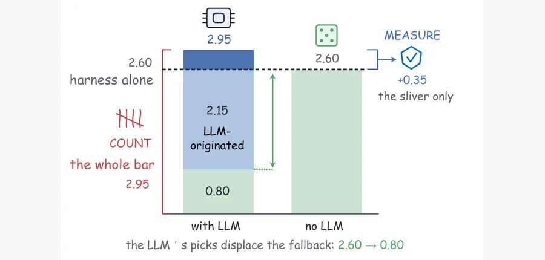 arXiv 2026-10-20 · cs.AI · #28 **[CADS: Measuring the Incremental Contribution of LLM Proposers in Sequential Biological Screens](https://arxiv.org/abs/2610.24597)** Guanxing Chen , Nihui Shao , Haohuai He , Zhenchao Tang , Pengwei Hu , Zhi-An Huang Affiliation: City University of Hong Kong (Dongguan) / Hong Kong Polytechnic University / Tencent AI Lab / Xinjiang Technical Institute of Physics and Chemistry, Chinese Academy of Sciences [Paper](https://arxiv.org/abs/2610.24597) · [Figure source](https://arxiv.org/pdf/2610.24597#page=2) 

[EN] Abstract
Large language models are increasingly used to guide sequential biological screens, yet standard evaluations rely on raw hit counts that conflate a proposer's value with the discovery capacity of the underlying algorithmic harness. Adaptive sampling and corrupted experimental readouts also leave standard feedback comparisons without a false-discovery guarantee. We present Certified Agentic Discovery Screens (CADS), an error-controlled measurement framework that quantifies a proposer's incremental value against an identical LLM-free loop. By integrating capped likelihood-ratio bounds, e-processes, and complete-family e-BH, CADS controls the terminal false discovery rate under the stated null and corruption conditions despite arbitrary dependence, adaptive sampling, and optional stopping. In DepMap-backed simulations, CADS exposes two evaluation artifacts: the LLM-free harness alone clears the feedback gate, and raw origin counts overstate LLM contributions because LLM picks displace fallback discoveries. On the initial 20 seeds, supplying tested-candidate history to Qwen2.5-7B shifts its net contribution from +0.35, with a 95% interval covering zero, to +2.90, with the interval above zero. This initial net effect did not persist in a 50-seed matched-quota replication. These results support net gain over an LLM-free loop, measured between separately certified sets, as the appropriate measure of proposer contribution. <a href="https://arxiv.org/abs/2610.24597">Source</a>

[ZH] Abstract
语言模型日益指导顺序生物筛选，但原始命中数混淆提议者价值与算法框架发现能力。自适应采样和损坏实验读出，也使常规反馈比较缺少假发现保证。我们提出 CADS，以错误控制框架衡量相对完全相同无语言模型循环的增量价值。结合截断似然比界、e 过程和完整族 e-BH，在所述零假设与损坏条件下，即使任意依赖、自适应采样和可选停止，也控制终止假发现率。在基于 DepMap 的仿真中，它揭露两种评估伪象：无模型框架本身就通过反馈门槛；原始来源计数高估模型贡献，因为模型选择挤占后备发现。初始 20 个种子中，向 Qwen2.5-7B 提供已测试候选历史，把净贡献从 +0.35（95% 区间含零）变为 +2.90（区间高于零）。该初始净效应未在 50 种子、匹配配额的复核中持续。结果支持以独立认证集合间、相对无模型循环的净收益衡量提议者贡献。 <a href="https://arxiv.org/abs/2610.24597">Source</a>
 | 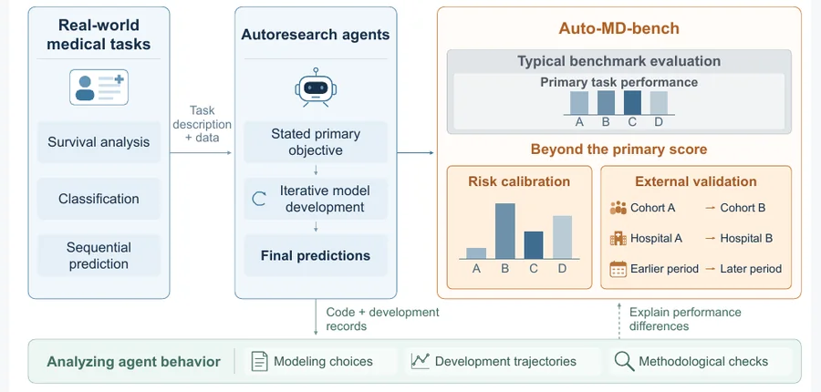 arXiv 2026-10-20 · cs.LG · #29 **[Auto-MD-bench: Evaluating Autoresearch Agents for Real-World Medical Tasks](https://arxiv.org/abs/2610.25069)** Shenqi Zhou (1 and 2), Qiran Zou (1), Wenhao Zhao (1), Zhenyu Liao (3), Dianbo Liu (1) ((1) National University of Singapo… Affiliation: National University of Singapore / Zhejiang University / Amazon [Paper](https://arxiv.org/abs/2610.25069) · [Code](https://github.com/Edwin0080/Auto-MD-bench) · [Data](https://huggingface.co/datasets/Edwin0080/Auto-MD-bench) · [Figure source](https://arxiv.org/pdf/2610.25069#page=3) 

[EN] Abstract
Autonomous agents are increasingly capable of developing machine learning (ML) models end to end. In medical practice, however, strong performance on the target metric does not fully characterize how good the models are in real-world use cases. For example, medical ML models should also provide well-calibrated risk estimates and remain robust across patient populations. Yet autonomous model development is typically guided by task objectives that emphasize simple predictive discrimination (e.g. AUROC). This raises a key question: are these objectives sufficient to guide agents toward models that meet the broader requirements of real-world medical use? In this study, we introduce Auto-MD-bench, a benchmark of 15 real-world medical tasks from 10 clinical datasets, spanning survival analysis, classification and sequential prediction, with external validation across cohorts, hospitals and time periods. We evaluate four agents: AIDE, AI Scientist v2, Codex, and Autoresearch. The strongest agents achieve competitive primary scores, yet their predicted risks are less calibrated than those of the simple baseline models, which could lead to severe medical accidents. Moreover, models with nearly identical primary scores can exhibit markedly different calibration, while performance varies substantially across population shifts. These findings show that primary task performance alone is insufficient to assess autonomous clinical modeling and multiple different metrics widely used in healthcare practice need to be taken into consideration. <a href="https://arxiv.org/abs/2610.25069">Source</a>

[ZH] Abstract
自主智能体越来越能端到端开发机器学习模型，但医学实践中，目标指标表现不能完整刻画真实可用性，还需风险校准与跨人群鲁棒性。自主开发目标通常强调 AUROC 等预测区分度，因此我们问这种目标是否足够引导满足更广医学要求的模型。Auto-MD-bench 包含十个临床数据集的 15 项真实医疗任务，涵盖生存分析、分类和序列预测，并跨队列、医院和时间进行外部验证。我们评估 AIDE、AI Scientist v2、Codex 和 Autoresearch。最强智能体主指标具有竞争力，但预测风险校准不如简单基线，可能造成严重医疗事故；几乎相同主分数的模型校准可明显不同，跨人群分布偏移表现也显著变化。结果表明，仅主任务性能不足以评估自主临床建模，必须考虑医疗实践广用的多种指标。 <a href="https://arxiv.org/abs/2610.25069">Source</a>
 | 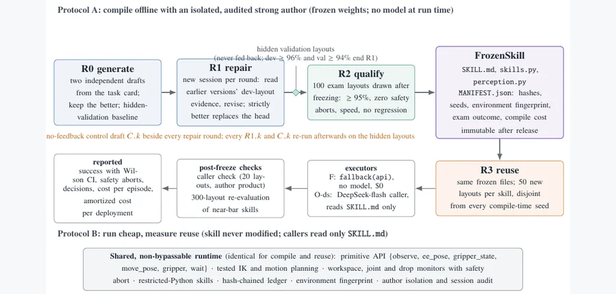 arXiv 2026-10-20 · cs.RO · #30 **[Compile Once, Run Cheap: Frozen, Portable Skills for Embodied Agents, and What Recursive Self-Improvement Adds](https://arxiv.org/abs/2610.25114)** Jingwen Bai , Guochao Bai , Canbo Zhang , Shuangqi Li , Minchao Hu , Weichun Huang , Shuang Liu Affiliation: Beijing Ou Rui Ling Shi Technology Co., Ltd. / ChangingTek Robotics Technology (Suzhou) Co., Ltd. / Shanghai Yunfan Intelligent Control Robot Technology Co., Ltd. [Paper](https://arxiv.org/abs/2610.25114) · [Code](https://github.com/Orillusion/embodied-skill-rsi) · [Figure source](https://arxiv.org/pdf/2610.25114#page=2) 

[EN] Abstract
Embodied AI lacks the data-rich pretraining that gave language models their agents and skills, so new manipulation capability costs demonstrations per task or a frontier model in every episode. We study a third route: a strong general model acts only as an offline author that writes, runs, diagnoses and repairs a manipulation skill in simulation until it passes an exam on layouts drawn after freezing; the frozen skill then runs as code alone or under a cheap caller that reads only its description. We call this skill-level recursive self-improvement Skill-RSI and specify a compile protocol (isolated, audited author; hidden validation layouts; no-feedback and inherit-only controls; tamper-evident ledger) and a reuse protocol that runs the identical files with executors from another model family. On 7 RoboTwin 2.0 tasks with cluttered tables, Claude Code compiled 4 tasks into 7 frozen skills, 5 from a first draft needing only qualification, at USD 4.29-8.22 of author cost each (USD 55 per skill counting the 13 failed campaigns). The other three tasks did not compile in 18 campaigns, including five with GPT-6 and a pre-registered 150-layout run: on the hardest task every campaign scored 78-95 of 100 but had 3-16 safety aborts, failing the gate of 95% success with zero aborts; a 100-episode exam bounds an abort rate only to 3.6%. On hidden layouts, repair that inherits the previous version beat from-scratch rewriting in 8 of 8 controlled campaigns (sign test p = 0.004); an inherit-only lineage attributes most of the gap to inheritance, with development feedback adding a little (3 of 3, p = 0.125). Write-once campaigns found no detectable first-draft effect of practice (minimum detectable effect 14 points). The frozen skills kept 148/150 successes on new layouts with no model and 147/150 with a DeepSeek-flash caller at USD 0.00028-0.00054 per episode; no direct-control baseline was run. <a href="https://arxiv.org/abs/2610.25114">Source</a>

[ZH] Abstract
具身人工智能缺少语言模型式数据丰富预训练，因此新增操作能力常需逐任务示范，或每回合调用前沿模型。我们研究第三条路：强通用模型仅作离线作者，在仿真中编写、运行、诊断和修复技能，直到通过冻结后抽样布局的考试；冻结技能随后独立执行，或由只读说明的廉价调用者执行。我们称之为技能层递归自改进 Skill-RSI，规定编译协议，包括隔离审计作者、隐藏验证布局、无反馈和仅继承对照、防篡改账本，以及跨模型家族用相同文件的复用协议。在七项杂乱桌面 RoboTwin 2.0 任务中，Claude Code 将四项编译为七个冻结技能，其中五个首稿只需资格验证；单项作者成本 4.29—8.22 美元，计入 13 次失败活动后每技能 55 美元。另三任务在 18 次活动中未编译成功，包括五次 GPT-6 和预注册 150 布局运行；最难任务每次得分 78—95/100，却有 3—16 次安全中止，未通过成功率 95% 且零中止门槛；100 回合考试也只能将中止率界定到 3.6%。隐藏布局中，继承前版的修复在八项受控活动全部胜过从头重写，符号检验 p=0.004；仅继承谱系表明大部分差距来自继承，开发反馈仅增加少量，三项中三项，p=0.125。一次写入活动未发现练习对首稿的可检测影响，最小可检测效应为 14 个百分点。冻结技能在新布局中无模型达 148/150 成功，使用 DeepSeek-flash 调用者达 147/150，单回合成本 0.00028—0.00054 美元；未运行直接控制基线。 <a href="https://arxiv.org/abs/2610.25114">Source</a>
 |
| 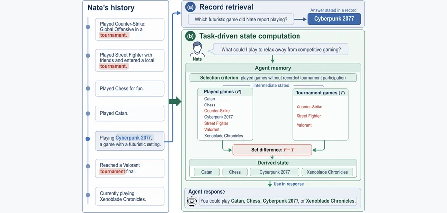 arXiv 2026-10-20 · cs.DB · #31 **[MemDerive: A Diagnostic Benchmark for Agent Memory over Evolving Data](https://arxiv.org/abs/2610.25373)** Sen Gao , Yongan Li , Han Chen , Bingsheng He , Ming Wu , Jason Zeng , Michael Heinrich , Shixuan Sun Affiliation: National University of Singapore / Shanghai Jiao Tong University / Zero Gravity Labs [Paper](https://arxiv.org/abs/2610.25373) · [Figure source](https://arxiv.org/html/2610.25373v1/fig1.png) 

[EN] Abstract
Long-running agents rely on memory of their past interactions for task state, such as what has been completed and which conditions still hold. Such state is usually a derived state. No record states it, and it must be computed by rules from multiple records of an evolving history. Existing memory benchmarks score only the final answer, with no reference for the intermediate states behind it. A wrong answer therefore cannot be traced to the state that was missed, and a state that silently became outdated goes undetected. We present MemDerive, a diagnostic benchmark for agent memory over evolving data. It specifies each scenario symbolically, derives exact gold answers with Datalog, records the gold derivation DAG and the supporting events of every query, and renders the history in natural language with fictional entities and distractors. Its 10 scenarios contain 4,692 events and 1,503 queries whose difficulty varies along access, evolution, and composition. On this ground truth, MemDerive evaluates answer reliability, diagnoses failures by probing the nodes of the gold derivation DAG, and tracks whether answers stay correct as events arrive. Our evaluation of four memory systems reveals failures that final-answer benchmarks hide. On derived state, every memory system falls behind simple BM25 retrieval, although the same answer model reaches 96.01% when given the supporting events. Most failures are ungathered, as a system holds the missing intermediate state but does not retrieve it for the question that needs it. Memory systems also rarely propagate implicit changes, which no new record states. These results suggest three principles for memory design. Gather inputs along the derivation, store rules with their versions, and maintain derived states through recorded dependencies. <a href="https://arxiv.org/abs/2610.25373">Source</a>

[ZH] Abstract
长期智能体依赖历史记忆维护已完成事项、仍成立条件等任务状态，但它通常是从多个变化记录按规则计算的派生状态。现有基准只评最终答案，无中间状态参照，错误无法定位，过时状态也可能隐蔽。我们提出 MemDerive，符号化规定场景，以 Datalog 推导精确答案，记录每个查询的真实推导 DAG 和支持事件，再将历史渲染为含虚构实体与干扰项的自然语言。十个场景有 4,692 事件、1,503 查询，难度沿访问、演化和组合变化。基准评估答案可靠性，通过探测推导图节点诊断失败，并追踪新事件到来时是否保持正确。四项记忆系统评估发现，派生状态上全部落后于简单 BM25，但相同回答模型在提供支持事件时达到 96.01%。多数失败因未聚集输入：系统持有缺少的中间状态，却未为所需问题检索；系统也很少传播新记录未显式陈述的隐含变化。结果建议沿推导聚集输入、带版本存规则、通过记录依赖维护派生状态。 <a href="https://arxiv.org/abs/2610.25373">Source</a>
 | 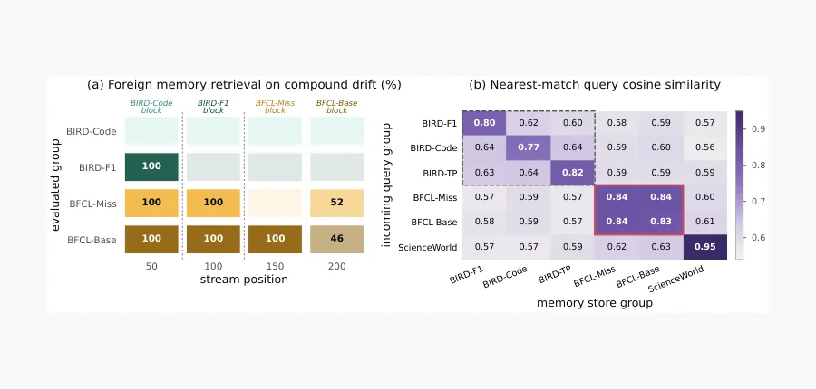 arXiv 2026-10-20 · cs.AI · #32 **[Are Self-Evolving Agents Continual Learners?](https://arxiv.org/abs/2610.25858)** Xiaoyin Chen , Yizheng Huang , Yinglun Xu , Ziyun Zhao , Emmett McQuinn , Julie Liu , Hope Yao Affiliation: Mila - Quebec AI Institute / Université de Montréal / Google DeepMind [Paper](https://arxiv.org/abs/2610.25858) · [Figure source](https://arxiv.org/html/2610.25858v1/fig_rb_mechanisms.png) 

[EN] Abstract
Large language model agents are often deployed in environments where new knowledge, tools, and workflows keep arriving. Such an agent is therefore expected to adapt continually, learning new tasks as they arrive without forgetting earlier ones. This resembles the continual learning problem, but at a pace that conventional gradient updates cannot sustain. Nonparametric self-evolving agents are a natural alternative: they adapt by rewriting their own harness, such as prompts, memory, and skills, from task feedback while the model weights stay frozen. We study whether such agents are effective continual learners across four drifting task streams that shift in topic, workflow, or domain (built from BIRD, BFCL, and ScienceWorld). Evaluating three representative methods spanning experience retrieval and self-modification (ReasoningBank, GEPA, and Meta-Harness), we find that although self-evolution improves aggregate performance on most streams, higher plasticity consistently comes at the cost of stability. Specifically, self-modifying methods apply global edits to a shared prompt or workspace, interfering with unseen tasks and overwriting earlier knowledge as the stream shifts. Conversely, similarity-based memory retrieval localizes updates across distant domains, but still retrieves foreign memories on unseen tasks and suffers from retrieval collision when similar queries require conflicting workflows. These findings show that current self-evolving agents remain incomplete continual learners. <a href="https://arxiv.org/abs/2610.25858">Source</a>

[ZH] Abstract
语言模型智能体部署中不断出现新知识、工具和流程，需要持续学习新任务、不遗忘旧任务，类似持续学习，却快到常规梯度更新难以支撑。非参数自进化可在冻结权重时按反馈重写提示、记忆和技能等框架。我们在来自 BIRD、BFCL 和 ScienceWorld 的四条主题、流程或领域漂移任务流中，研究其持续学习能力。评估经验检索和自修改代表 ReasoningBank、GEPA、Meta-Harness 后发现，多数流汇总表现改善，但更高可塑性总以稳定性为代价。自修改方法对共享提示或工作区全局编辑，干扰未见任务，并随流转移覆盖旧知识。相似性检索能跨远领域局部化更新，但仍在未见任务检索外来记忆，相似问题需冲突流程时也发生检索碰撞。当前自进化智能体仍是不完整的持续学习者。 <a href="https://arxiv.org/abs/2610.25858">Source</a>
 | 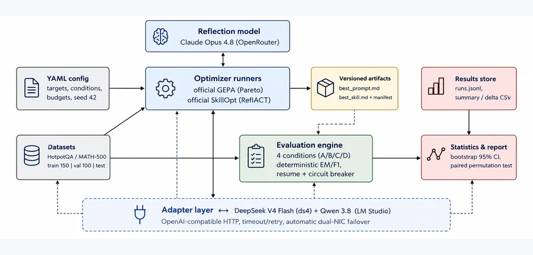 arXiv 2026-10-20 · cs.AI · #33 **[Understanding When Reflective Prompt and Skill Optimization Helps on Locally Served Reasoning Models: A Two-Model Study of GEPA and SkillOpt](https://arxiv.org/abs/2610.26020)** Andrea Giummarra (1), Carmelo Baglieri (1), Antonio Di Maria (1), Andrea Farruggio (1), Michele Piatto (1), Giovanni Mical… Affiliation: Evision srl / University of Catania [Paper](https://arxiv.org/abs/2610.26020) · [Figure source](https://arxiv.org/html/2610.26020v1/fig_pipeline.png) 

[EN] Abstract
Reflective text-space optimizers such as GEPA and SkillOpt have reported large gains on frontier and mid-size models. We test replication across two reasoning-native target-serving configurations: DeepSeek V4 Flash through DwarfStar and Qwen3.8-27B through LM Studio. For each target, we evaluate the same held-out tasks and four conditions - minimal baseline, GEPA prompt, SkillOpt skill, and manually engineered prompt - on HotpotQA (n=500 per condition) and MATH-500 (n=250). In the primary Qwen v2 rerun under the same frozen protocol, GEPA selects the HotpotQA seed and exactly reproduces baseline behavior, whereas SkillOpt's validation gain reverses into held-out degradation. On MATH-500, GEPA raises exact match from 0.828 to 0.904 while reducing latency but increasing token consumption, so lower response time does not imply lower token cost. DeepSeek likewise shows its strongest GEPA effect on MATH-500 (0.852 to 0.908). Across both targets, GEPA's strongest gains occur on MATH-500, while neither optimizer improves the HotpotQA baseline. Optimization is therefore task- and method-dependent, and validation gains may reverse on held-out evaluation. An earlier Qwen run is retained as serving-sensitivity evidence. These results suggest that textual headroom for a model-task pair and the observed effect of a text-space optimizer are more informative when decomposed into content/reasoning, answer-realization/evaluator alignment, and serving-completion/reliability. The cross-benchmark pattern further suggests that optimization may benefit from low-ambiguity, actionable evaluation signals. <a href="https://arxiv.org/abs/2610.26020">Source</a>

[ZH] Abstract
GEPA、SkillOpt 等反思式文本空间优化器在前沿及中型模型上报告大收益。我们在两个本地推理模型服务配置复核：DwarfStar 上的 DeepSeek V4 Flash、LM Studio 上的 Qwen3.8-27B。每个目标在相同留出任务上比较最小基线、GEPA 提示、SkillOpt 技能和手工提示四条件，HotpotQA 每条件 500 项、MATH-500 为 250 项。固定协议下主要 Qwen v2 重跑中，GEPA 在 HotpotQA 选中种子，完全复现基线行为，SkillOpt 验证收益反转为留出退化。MATH-500 上，GEPA 将精确匹配从 0.828 提至 0.904，延迟下降但词元增加，响应更快不代表词元更省。DeepSeek 的最强 GEPA 效果也在 MATH-500，从 0.852 至 0.908。两目标均在该任务收益最大，两优化器均未改善 HotpotQA。因此效果依赖任务与方法，验证收益可在留出评估反转。较早 Qwen 运行保留为服务敏感性证据。结果建议将文本改进空间与效果分解为内容/推理、答案实现/评估对齐、服务完成/可靠性；跨基准模式也提示，低歧义、可执行评估信号或更利于优化。 <a href="https://arxiv.org/abs/2610.26020">Source</a>
 |
| 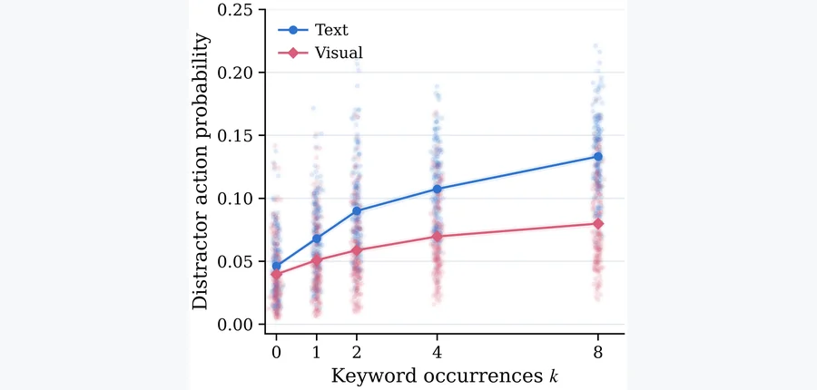 arXiv 2026-10-20 · cs.CV · #34 **[Procedural Exposure Bias in Skill-Augmented Language Model Agents](https://arxiv.org/abs/2610.26062)** Qing Yang , Yuqi Xiong , Pengcheng Huang , Zhipeng Xu , Zhenghao Liu , Zulong Chen , Yu Gu , Ge Yu Affiliation: Northeastern University, Shenyang / Alibaba Group [Paper](https://arxiv.org/abs/2610.26062) · [Figure source](https://arxiv.org/html/2610.26062v1/figures/distractor_vs_k_9b.png) 

[EN] Abstract
External skills provide language-model agents with reusable procedural knowledge, yet how models use such knowledge after it is supplied remains poorly understood. We identify Procedural Exposure Bias (PEB), the tendency of language models to increasingly favor an action as its associated procedural pattern is repeatedly exposed in a skill, even when the interaction state and action relevance remain unchanged. We find that PEB strongly depends on how procedural knowledge is represented: presenting the same content visually substantially attenuates exposure-induced shifts in action preference relative to textual presentation. Further analysis shows that this attenuation primarily arises from visual encoding rather than structured layout. Although repeated procedural signals remain recoverable from Visual representations, they exert a weaker influence on downstream action prediction, distinguishing signal accessibility from its use as action evidence. This effect also extends to executable action selection, where increasing exposure more strongly favors the corresponding action under Text than Visual. Layer-wise analyses show that exposure-dependent action evidence becomes more pronounced toward the model output, with stronger evidence under Text, while activation interventions reveal architecture-specific roles of internal components in transmitting or counteracting the preference shift. Complete-agent evaluations across ALFWorld, ScienceWorld, and WebShop further show that Visual skills achieve higher macro-average task success than Text skills for all four evaluated models. These findings establish skill representation as an important factor governing how procedural knowledge is translated into agent decisions. All code is available at this https URL . <a href="https://arxiv.org/abs/2610.26062">Source</a>

[ZH] Abstract
外部技能提供可复用程序知识，但模型如何使用它仍不清楚。我们识别程序暴露偏差（PEB）：当关联程序模式在技能中反复出现，即使交互状态和动作相关性不变，模型也越来越偏好该动作。偏差强烈依赖表示：相同内容用视觉呈现，比文字显著减弱暴露引起的偏移，主要来自视觉编码而非结构布局。视觉表示仍可恢复重复程序信号，但对后续动作预测影响较弱，说明可访问信号不等于把它用作动作证据。可执行动作选择也有此效应，文字暴露更强地偏向对应动作。逐层分析显示，越接近输出，暴露相关动作证据越明显，文字更强；激活干预揭示内部组件传递或抵消偏移的架构特定作用。ALFWorld、ScienceWorld 和 WebShop 完整智能体评估中，全部四模型的视觉技能宏平均成功率均高于文字技能。技能表示是程序知识转为决策的重要因素，代码见原文链接。 <a href="https://arxiv.org/abs/2610.26062">Source</a>
 | 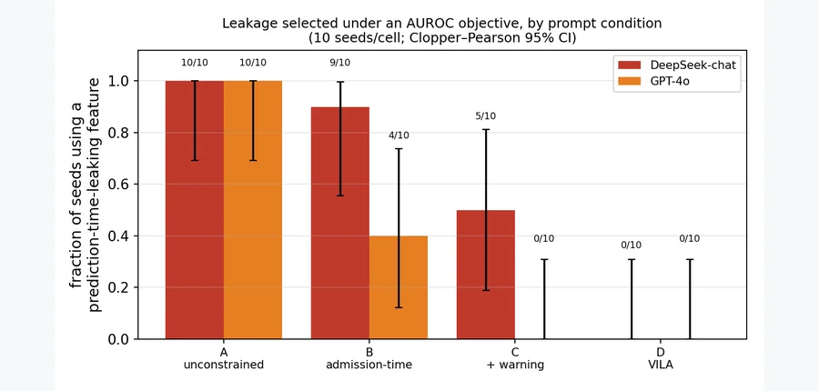 arXiv 2026-10-20 · cs.CR · #35 **[LeakBench: Auditing Reward Hacking through Prediction-Time Leakage in Clinical Modeling Agents](https://arxiv.org/abs/2610.26088)** Xiaoyuan Bao , Jingsi Jiang , Jiao Shan , Yulong Cao , Haoyu Wang , Zida Liu , Jun Gao Affiliation: Peking University / Peking University Third Hospital / Beijing Jishuitan Hospital / Peking University People’s Hospital / Peking University Health Science Center [Paper](https://arxiv.org/abs/2610.26088) · [Figure source](https://arxiv.org/html/2610.26088v1/figures/fig1_four_condition_leakage.png) 

[EN] Abstract
Autonomous clinical-modeling agents can optimize predictive performance while violating conditions that make a model usable. We introduce LeakBench, an executable, guideline-derived audit suite that tests agent decisions for prediction-time leakage, calibration, site-level evaluation, support awareness, and decision-curve net benefit. LeakBench combines a synthetic task with known failure structure and two real-data settings: MIMIC-IV (430k admissions) and governed multi-hospital inpatient record front-page (MHFP) data. Our primary analysis uses reward hacking descriptively, without attributing intent: an agent selects prediction-time-invalid inputs because they improve its validation reward. A deterministic optimizer and every evaluated unconstrained local-model configuration select a fatal leaking feature. In fully logged September 2026 A/B runs, DeepSeek Flash and GPT-6-astra each leak in 10/10 unconstrained runs and 0/10 runs with an explicit admission-time constraint. This contrast is version-sensitive: a blinded Claude/Fable-5.1 chat run does not leak in either condition, while explicit-constraint violations appear only in a historical August 2026 slice lacking raw trajectories. Replacing AUROC with AUPRC does not remove leakage selection. Renaming or disguising the leaking inputs changes neither selection nor provenance-based detection; a name-based filter fails. A deterministic provenance verifier-in-loop removes the leak, making the LLM repair loop defense-in-depth. Specific verifier feedback clears fatal leakage in a hosted agent, and a three-seed ablation finds principle-only feedback clears decision-level defects, though these mitigation results are limited. LeakBench treats trustworthy clinical prediction as a property of an agent's modeling process, not merely its score; it is an audit testbed with known-failure controls, not yet an expert-validated benchmark. <a href="https://arxiv.org/abs/2610.26088">Source</a>

[ZH] Abstract
自主临床建模智能体可优化预测分数却违反可用条件。LeakBench 是可执行、指南导出的审计套件，测试预测时泄漏、校准、站点评估、支持感知与决策曲线净收益，结合已知失败结构的合成任务及 MIMIC-IV（43 万入院）和受治理多医院病案首页 MHFP 两种真实数据。主要分析描述性使用“奖励投机”，不归因意图：智能体因验证奖励更高而选择预测时无效输入。确定性优化器和全部所评估无约束本地模型配置都选择致命泄漏特征。完整日志的 2026 年 9 月 A/B 中，DeepSeek Flash 和 GPT-6-astra 各自无约束 10/10 泄漏，显式入院时约束 0/10。对比受版本影响：盲化 Claude/Fable-5.1 对话在两条件均不泄漏，显式约束违反只出现在缺原始轨迹的历史 8 月切片。换 AUROC 为 AUPRC 不能消除选择泄漏；重命名或伪装输入不改变选择及来源检测，而名称过滤失败。确定性来源验证器置于循环中可去除泄漏，模型修复成为纵深防御。具体反馈可清除一个托管智能体的致命泄漏，三种子消融中仅原则反馈可清除决策层缺陷，但缓解证据有限。可信临床预测是建模过程性质而非仅分数；这是有已知失败对照的审计试验床，尚非专家验证基准。 <a href="https://arxiv.org/abs/2610.26088">Source</a>
 | 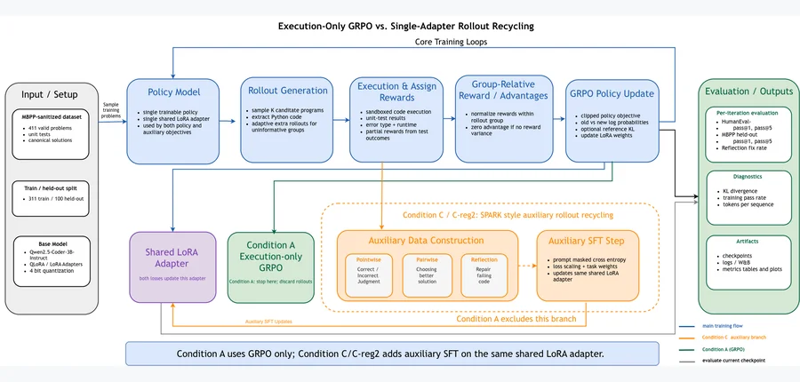 arXiv 2026-10-20 · cs.CL · #36 **[Co-Evolving Policy and Reward for Code Generation: A Mechanistic Study of Single-Adapter Drift](https://arxiv.org/abs/2610.26416)** Amarsaikhan Batjargal , Noriko Tomuro Affiliation: DePaul University [Paper](https://arxiv.org/abs/2610.26416) · [Figure source](https://arxiv.org/html/2610.26416v1/figures/Spark-Code-Architecture-3.png) 

[EN] Abstract
Reinforcement learning with verifiable rewards (RLVR) is particularly well suited to code generation because generated programs can be objectively evaluated through execution. Execution also provides behavioral information that can be reused as additional supervision. The Synergistic Policy and Reward Co-Evolving Framework (SPARK), originally proposed for reasoning tasks, exploits this idea by recycling training rollouts and their evaluation results to train a model not only to generate solutions but also to evaluate and improve them. We investigate whether this policy-reward co-evolution approach transfers effectively to code generation and whether execution-grounded reflection provides an additional source of self-improvement. We compare SPARK-style rollout recycling with execution-only Group Relative Policy Optimization (GRPO) using Qwen2.5-Coder-3B-Instruct. Our results do not support either hypothesis under the configuration tested. Although co-evolution improves training performance, these gains do not generalize to held-out problems. Compared at the same stage of training, rollout recycling produces roughly 34x greater KL divergence from the reference policy than execution-only GRPO. Over training, trained tokens per GRPO sequence fall from 185 to 86 as training pass rate increases, while held-out performance declines or fails to sustain early gains. We characterize these patterns as single-adapter policy drift: the shared trainable parameters increasingly depart from pretrained code-generation behavior without corresponding gains in generalization. The results show that higher training reward alone is not evidence of generalizable code self-improvement and highlight the importance of held-out evaluation and drift diagnostics. <a href="https://arxiv.org/abs/2610.26416">Source</a>

[ZH] Abstract
可验证奖励强化学习适于代码生成，因为执行能客观评价程序，也能提供附加监督。最初用于推理的 SPARK 框架回收训练轨迹和评估结果，使模型既生成又评估、改善解答。我们研究策略—奖励共同进化是否有效迁移到代码，以及执行支撑反思能否进一步自改进。用 Qwen2.5-Coder-3B-Instruct 比较 SPARK 式轨迹回收与仅执行奖励的 GRPO，所测配置下均未支持两假说。共同进化改善训练表现却不泛化到留出问题；同训练阶段比较，轨迹回收相对参考策略的 KL 散度约为仅执行 GRPO 的 34 倍。训练通过率上升时，每 GRPO 序列训练词元从 185 降至 86，留出表现下降或无法保持早期收益。我们称之为单适配器策略漂移：共享可训练参数偏离预训练代码行为，却无相应泛化收益。更高训练奖励并非可泛化代码自改进证据，强调留出评估和漂移诊断。 <a href="https://arxiv.org/abs/2610.26416">Source</a>
 |
| 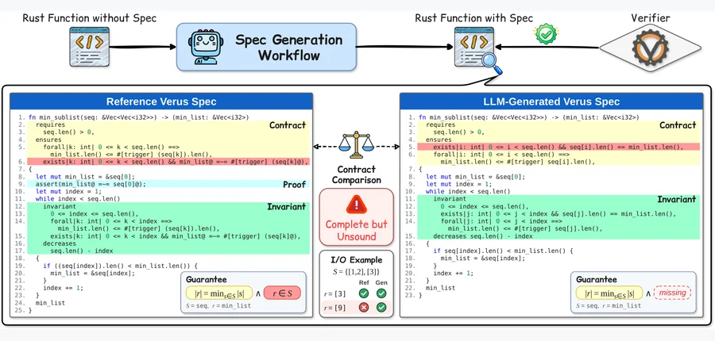 arXiv 2026-10-20 · cs.SE · #37 **[VerusEval: Evaluating LLM-Generated Verus Specifications Beyond Verifier Acceptance](https://arxiv.org/abs/2610.26464)** Ding Wang , Chao Jiang , Dugang Liu , Zhiwu Xu , Cheng Wen , Zhong Ming , Yuwei Liu , Xinyi Wan , Lin Huang Affiliation: Shenzhen University / Ant Research, Ant Group [Paper](https://arxiv.org/abs/2610.26464) · [Figure source](https://arxiv.org/html/2610.26464v1/motivating_case.png) 

[EN] Abstract
Large language models (LLMs) are increasingly used to generate Verus contracts for Rust programs together with the proofs that establish them. Yet verifier acceptance, the common measure of success, shows only that the implementation satisfies the generated contract, so it leaves open whether the contract captures the intended behavior. Assessing specification generation therefore requires an evaluation methodology, not a single metric. We present VerusEval, a framework that evaluates generated contracts along six dimensions, including Verus-native checks for semantic triviality, validated input-output (I/O) suites, and contract equivalence, and that relates them so that the strength and blind spots of each become measurable. Evaluating 13,716 artifacts from four workflows, five LLMs, and two prompting settings on 762 tasks, we find that acceptance overstates quality: only 42.3\% of the accepted artifacts complete all three semantic checks without a flag, and across workflows and models, higher acceptance does not consistently come with more correct contracts. I/O evaluation rejects 23.6\% of the accepted artifacts, yet only 63.2\% of those that pass it are proved equivalent. Of the accepted artifacts flagged by contract comparison, 84.1\% have a rejected completeness obligation, and the direction of a failure prioritizes inspection of the generated contract or the reference; it does not by itself establish which artifact is defective. Screening and review further identify 36 candidate defects among 61 selected reference contracts, and repairing one of them makes 10 of its 11 failing artifacts equivalent. Based on these findings, we derive four actionable lessons for evaluation, generation, and benchmark maintenance. <a href="https://arxiv.org/abs/2610.26464">Source</a>

[ZH] Abstract
语言模型越来越用于为 Rust 程序生成 Verus 契约及证明，但验证器通过只说明实现满足所生成契约，无法说明契约表达了预期行为。我们提出 VerusEval，从六个维度评估契约，包括 Verus 原生语义空洞检查、验证过的输入输出套件和契约等价性，并关联各维度以测量能力与盲点。在 762 任务、四工作流、五模型、两提示设置的 13,716 产物上，通过率高估质量：仅 42.3% 获准产物完成三种语义检查且无标记；跨工作流和模型，更高通过率并不稳定对应更正确契约。输入输出评估拒绝 23.6% 获准产物，但通过者仅 63.2% 被证明等价。在契约比较标记的获准产物中，84.1% 的完整性义务被拒；失败方向能优先引导检查生成契约或参考，却不能单独确定哪方有缺陷。进一步筛查审阅，在选中 61 个参考契约中识别 36 个候选缺陷，修复其中一个使其 11 项失败产物中的十项等价。由此提出评估、生成和基准维护的四条实践经验。 <a href="https://arxiv.org/abs/2610.26464">Source</a>
 | 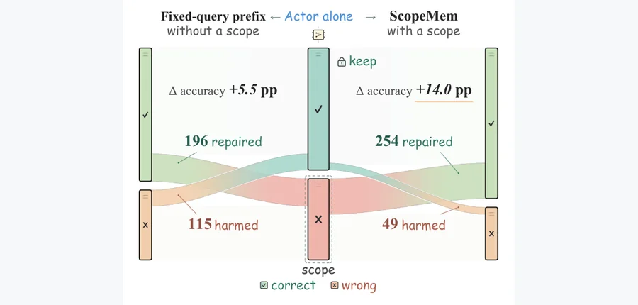 arXiv 2026-10-20 · cs.AI · #38 **[ScopeMem: Latent Memory That Learns Where to Revise Frozen GUI Agents](https://arxiv.org/abs/2610.26503)** Zhicheng Zheng , Cheng Zhang , Shengping Yu , Tianxiang Zhao Affiliation: Hong Kong University of Science and Technology (Guangzhou) / Imperial College London [Paper](https://arxiv.org/abs/2610.26503) · [Figure source](https://arxiv.org/html/2610.26503v1/fig_butterfly.png) 

[EN] Abstract
Latent memory is gaining ground as a lightweight history supplement for GUI agents. It supplies history to a frozen vision-language model via prefix vectors trained with step-wise cross-entropy (CE). While resulting gains are naturally attributed to encoded history, our controlled experiments show they primarily stem from action revision. The prefix learns to alter the model's default actions. However, this revision is unscoped because step-wise CE pushes outputs toward reference actions at every step without explicitly preserving correct decisions. Consequently, it repairs errors but also breaks 8-13% of initially correct answers. Overall accuracy metrics hide these losses. We therefore propose ScopeMem, a latent-memory method for scoped revision. Its encoder conditions prefix generation on the model's initial answer and is trained to correct errors while preserving correct decisions. On the controlled ablation set, ScopeMem reduces the share of broken correct decisions to 5.6% while repairing more errors than any evaluated CE-trained prefix. On AndroidControl, GUI-Odyssey, and zero-shot AITW, ScopeMem outperforms all evaluated prompting and latent-memory baselines, enabling a frozen Qwen3-VL-8B to match or surpass GUI-specialized agents and Qwen3-VL-32B. <a href="https://arxiv.org/abs/2610.26503">Source</a>

[ZH] Abstract
潜在记忆作为 GUI 智能体的轻量历史补充，通过逐步交叉熵训练的前缀向量向冻结视觉语言模型提供历史。收益常被归因于历史编码，但受控实验显示主要来自动作修订：前缀改变默认动作。逐步交叉熵在每步推向参考动作，不显式保护正确决策，因此修错也破坏 8%—13% 原本正确答案，整体准确率掩盖损失。我们提出 ScopeMem，让编码器以模型初始答案为条件生成前缀，训练时纠错并保留正确决策。在受控消融集，将正确决策破坏比例降至 5.6%，同时修复错误多于全部所评估交叉熵前缀。在 AndroidControl、GUI-Odyssey 和零样本 AITW 上，优于全部所评估提示与潜在记忆基线，让冻结 Qwen3-VL-8B 达到或超过 GUI 专用智能体及 Qwen3-VL-32B。 <a href="https://arxiv.org/abs/2610.26503">Source</a>
 | 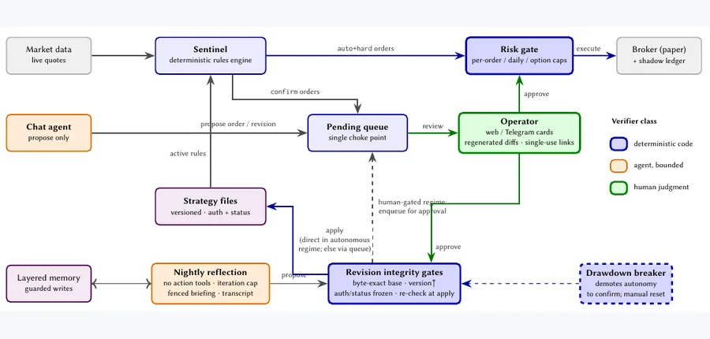 arXiv 2026-10-20 · cs.AI · #39 **[AllPath: Layered Verification for a Deployed, Self-Revising LLM Trading Agent under Human-Gated and Autonomous Regimes](https://arxiv.org/abs/2610.26662)** Tian Zhang , Meng Li Affiliation: Independent researchers, USA [Paper](https://arxiv.org/abs/2610.26662) · [Code](https://github.com/dukesky/allpath-trading-agent) · [Figure source](https://arxiv.org/pdf/2610.26662#page=3) 

[EN] Abstract
LLM trading agents are evaluated almost exclusively in backtests and autonomous benchmark harnesses. Deployment, where actions are irreversible, raises a different question: who verifies the agent's actions, and which failures can each verifier structurally catch? We report on AllPath, a personal LLM trading agent deployed against a live paper-brokerage account. The system watches positions through a deterministic rules engine, and each night it reviews its own day and proposes revisions to its own trading strategies. Verification is split across three layers. Code verifies what must not depend on judgment: deterministic gates enforce risk limits and block any strategy revision that fails an integrity check. The agent verifies itself within fixed bounds: its nightly review has an iteration cap and no tools that can act. A human verifies judgment, through approval screens that show the current state of each proposal. We also compared two verification policies for the agent's self-revisions on the live system: two and a half weeks with every self-revision human-gated, then five weeks with reflection revisions auto-applied behind the same code gates, while the operator's chat channel stayed human-gated throughout. Each layer caught a different kind of failure. The code gates rejected no proposal; their role was keeping revisions consistent. The human rejected two proposals that passed every code check, both over a disagreement about the market, and later removed 11 of the 19 rules the agent had added on its own, at a median lag of eight days. The most instructive production incidents, such as strategies silently left unmonitored, passed every gate; the operator found them by hand, and the fix each time was an interface change that makes the condition visible. We contribute the layered architecture, the two-regime account, and a production incident taxonomy, none observable in a backtest. <a href="https://arxiv.org/abs/2610.26662">Source</a>

[ZH] Abstract
语言模型交易智能体几乎只在回测和自主基准中评估，但动作不可逆的部署提出谁验证动作、各验证器结构上能捕捉哪些失败的问题。我们报告 AllPath，一个连接实时纸面交易账户的个人智能体。确定性规则引擎监控持仓，每晚智能体审查当天并提议修改策略。验证分三层：代码确定性执行风险限制，拒绝不通过完整性检查的修改；智能体在固定边界内自审，夜间审查有迭代上限且无行动工具；人工通过展示提案当前状态的审批界面验证判断。比较实时系统上两种政策：两周半所有自修改人工批准，随后五周反思修改在相同代码门控后自动应用，操作者聊天通道全程仍需人工批准。各层捕捉不同失败：代码未拒绝任何提议，其作用是保持一致；人工因市场判断分歧拒绝两个通过所有代码检查的提议，后来删除智能体自行添加 19 条规则中的 11 条，中位延迟八天。最有启发的生产事故如策略悄然不受监控，均通过所有门槛，由人工发现，每次修复是使条件可见的接口修改。贡献是分层架构、两运行制度记录和生产事故分类，这些无法在回测中观察。 <a href="https://arxiv.org/abs/2610.26662">Source</a>
 |
| 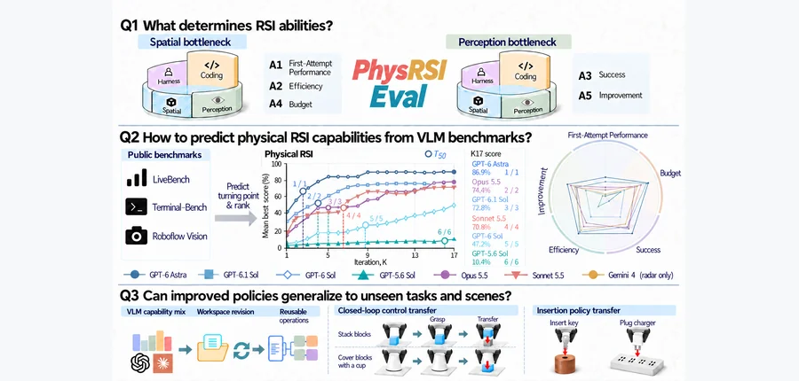 arXiv 2026-10-20 · cs.RO · #40 **[Where is Physical RSI capability from? An Observational Scaling Law of LLM-as-policy](https://arxiv.org/abs/2610.26848)** Zekai Li , Jiayi Yu , Jinlu Zhang , Luyang Niu , Zekun Qi , Jun Zheng , Xuchuan Chen , Dairu Liu , Yintianrun Zhang , He W… Affiliation: Galbot Team [Paper](https://arxiv.org/abs/2610.26848) · [Figure source](https://arxiv.org/html/2610.26848v1/assets/teaserv4.jpg) 

[EN] Abstract
In this paper, we systematically investigate the mechanisms, scaling behavior, and generalization of physical Recursive self-improvement. We introduce PhysRSI-eval to quantify physical RSI through a five-axis metric: First-Attempt Performance, Efficiency, Success, Budget and Improvement from failure. Different VLMs are evaluated on 18 manipulation tasks under a fixed interaction budget. The analysis of experimental results motivates the Physical Barrel Hypothesis: different capabilities may constrain different parts of improvement. The five-axis metrics also distinguish systems with close public benchmark averages and show that high scores need not come with early or efficient gains. We study observational scaling from two perspectives: predicting the relative performance of VLM agents from their public capabilities, and forecasting later progress from early physical feedback. Together, these analyses ask how quickly and how far an agent can improve. Moreover, we conduct workspace interventions and then analyze what improvement leaves behind. Removing history reduces late-round success, frozen workspaces remain useful on unseen layouts, and three cross-task cases achieve success earlier. The results suggest that scene-specific adaptation and reusable experience can coexist. <a href="https://arxiv.org/abs/2610.26848">Source</a>

[ZH] Abstract
我们系统研究物理递归自我改进的机制、缩放行为和泛化，提出 PhysRSI-eval，以首次表现、效率、成功、预算及从失败中改进五轴量化物理 RSI。在固定交互预算下，对不同视觉语言模型评估 18 项操作任务。结果分析提出物理木桶假说：不同能力可能限制改进的不同部分。五轴也区分公开基准均分相近的系统，表明高分未必伴随早期或高效收益。我们从两方面研究观测缩放：用公开能力预测 VLM 智能体相对表现，以及用早期物理反馈预测后续进展，考察改进多快、多远。我们还干预工作区并分析改进留下什么：移除历史降低后期成功率，冻结工作区在未见布局仍有用，三个跨任务案例更早成功。结果提示场景特定适配和可复用经验可以并存。 <a href="https://arxiv.org/abs/2610.26848">Source</a>
 |   |   |
<!-- PAPER_CARDS_END -->

## Retrieval overview

**40 selected papers: 9 A / 16 B / 15 C.** Collection date: **21 October 2026 (Beijing)**. Official announcement batch: **20 October 2026**, immediately following the previously processed 19 October batch.

| Official source | Batch | New | Cross | Replacement | Listing coverage |
|---|---|---:|---:|---:|---|
| [CS page 1](https://arxiv.org/list/cs/new?skip=0&show=2000&check=20261021) and [page 2](https://arxiv.org/list/cs/new?skip=2000&show=2000&check=20261021) | 2026-10-20 | 1,593 | 115 | 957 | 2,665 records; 2,000 + 665 |
| [stat.ML](https://arxiv.org/list/stat.ML/new?skip=0&show=2000&check=20261021) | 2026-10-20 | 18 | 33 | 57 | 108 records; one page |
| Total | 2026-10-20 | 1,611 | 148 | 1,014 | 2,773 records |

All **1,611 unique official New records** were parsed. Lexical discovery produced 302 candidates; **49 titles and complete original abstracts were semantically reviewed**, yielding this focused selection of 40. This is not exhaustive semantic review of all New records or all lexical candidates. The CS aggregate covers cs.AI, cs.LG, cs.CL, cs.MA, cs.SE, cs.RO, cs.CV, cs.NE and cs.CR. IDs are versionless, deduplicated and checked against prior inclusions. Cross-listings remain outside the main list.

All selected papers have full paired abstracts, source-supported affiliations and visually checked genuine illustrations: **40 EN / 40 ZH / 40 images; 0 placeholders; 0 unconfirmed affiliations**. Twenty-nine images use official HTML, one is a PDF raster figure, and ten are rendered PDF crops. The crops fill nine extraction gaps and replace Hippo's blank raster extraction. Sixteen of 18 opened source-linked resource destinations were reachable and identified; MELD and TrackRL code URLs returned HTTP 404 and receive no buttons. The [run record](../../data/runs/2026-10-21.json) contains all listing sections, snapshots, hashes, review scope and provenance.

## Reading guide

A denotes direct RSI, B self-improvement mechanisms, and C evaluation and limits. Ordering is tier then arXiv ID, not a comparative performance leaderboard. Tier assignment, interpretation and priorities are **editorial inference**. Numerical findings are **author reports**; no experiments were independently reproduced for this digest. Headers, figures and selected passages were checked, rather than a complete full-text review of every paper.

Separate model weights, episode-local adapters, external code/harnesses, persistent skills/memory and task-local state. A better result after search need not mean a better improvement mechanism. Report rejected candidates, inheritance-only effects, regression and validation-to-test reversal, not just successful endpoints. Simulation, physical robots, retrospective clinical datasets and live paper trading support different claims. No finite loop establishes unbounded recursive improvement.

## Tiered Top papers

| # | Paper | Categories | Authors | Affiliation | Tier | Update target | Reading priority |
|---:|---|---|---|---|---|---|---|
| 1 | [LVMH: A Meta-Optimization Harness for Long-Video Agent Memory](https://arxiv.org/abs/2610.23904) | cs.CV; cs.MA | Liwei Che , Benlin Liu , Dai Li , Xiangyan Li , Zijian Wu , Changjiang Li , Minghao Guo , Chengzhi Mao , Vladimir Pavlovic , Ranjay Krishna | Rutgers University / University of Washington / Meta / National University of Singapore / Palo Alto Networks | A | Memory-policy code and persistent search meta-memory | Topical reference |
| 2 | [ReTTT: Reflection-Driven Test-Time Training via Experience-Based Parametric Memory](https://arxiv.org/abs/2610.23942) | cs.LG; cs.AI | Kangcong Li , Hangfan Zhang , Shuyue Hu , Shengji Tang , Tao Chen | Fudan University / Shanghai Artificial Intelligence Laboratory / CUHK | A | Episode-local LoRA weights and explicit reflection lessons | Priority read |
| 3 | [MELD: Recursive Self-Improvement via Hierarchical Coordination for Multi-Agent Scientific Discovery](https://arxiv.org/abs/2610.24454) | cs.AI | Sizhe Tang , Zuyuan Zhang , Zeyu Fang , Tian Lan | George Washington University | A | Coordinator and Scientist policy weights | Topical reference |
| 4 | [Learning to Compose: Recursive Self-Improvement of Shared Executable Stacks for Zero-Shot Long-Horizon Robot Manipulation](https://arxiv.org/abs/2610.24464) | cs.AI | Yangzhi Chen , Feiran Liu , Zishuo Wang , Zijian Jin , Xin Zhu , Lecheng Ruan , Wenjuan Han | Beijing Jiaotong University / New York University / University of Southern California / PKU-HEC Joint Lab for Industrial Intelligence, Peking University / LingXing Tech | A | Shared executable tools, contracted skills, handoffs and verifiers | Priority read |
| 5 | [Epi: Towards a Persistent, Self-Improving Agent for Autonomous Research](https://arxiv.org/abs/2610.24944) | cs.CL; cs.AI | Yue Huang , Zhangchen Xu , Xiaonan Luo , Zheyuan Liu , Lichi Li , Yiping Wang , Peiyang Song , Eric Gabriel Ramos , Enze Xie , Olexandr Isayev , Paul Liang , Nouha Dziri , Huan Sun , Jianfeng Gao , Ying Liu , Misha Sra , Xiangliang Zhang , Alex Pentland , Zichen Chen | Bake AI / University of Notre Dame / University of Washington / Stevens Institute of Technology / Scale AI / NVIDIA / Carnegie Mellon University / MIT / Cohere Labs / Ohio State University / Microsoft / UC Santa Barbara / Stanford University | A | Persistent research history, methods and executable solvers | Topical reference |
| 6 | [CoEvo-RSI: When Harnesses Evolve, Which Models Should Follow?](https://arxiv.org/abs/2610.25078) | cs.LG; cs.CL | Jiaqi Su , Guibin Zhang , Jie-Jing Shao , Cong Pang , Tiankuo Yao , Ivor Tsang , Haiyan Yin , Shuicheng Yan | National University of Singapore / Agency for Science, Technology and Research (A*STAR) / SenseTime Group Inc. | A | Historical harness designs and model checkpoint selection/merging plus SFT | Topical reference |
| 7 | [HarnessRL: Co-Evolving Policies with a Just-in-Time Training Harness for Open-Ended RL](https://arxiv.org/abs/2610.26426) | cs.CL | Xiaoqiang Wang , Ting-En Lin , Yuchuan Wu , Pinyi Zhang , Caixin Kang , Ling Li , Bingxue Qiu , Jieping Ye , Yongbin Li , Bang Liu | Alibaba Token Hub, Alibaba Group / Université de Montréal / Mila - Quebec AI Institute | A | RL policy weights and training task/guidance/rubric interfaces | Topical reference |
| 8 | [BetaMem: Learning to Remember a Changing World for Embodied Agents](https://arxiv.org/abs/2610.26554) | cs.AI | Mai Liu , He Sun , Siru Zhong , Kerun Chen , Hao Yan , Xiaohui Lv , Shuai Tao , Wulong Liu | Beta Infinity / Peking University / Beihang University / Hong Kong University of Science and Technology (Guangzhou) | A | Memory-generation weights, six-layer memory and local operational rules | Topical reference |
| 9 | [HarnessPro: Recursive Harness Self-Improvement with Pareto Optimization for Performance-Cost Trade-offs](https://arxiv.org/abs/2610.26770) | cs.LG; cs.CL | Zhuoshi Pan , ZhiYuan Feng , Yukuo Cen , Honglin Lin , Junru Lu , Zhongxia Chen , Shuo Yang , H. Vicky Zhao , Jie Tang | Tsinghua University / Z.AI / Shanghai Jiao Tong University / University of Warwick / Kling AI | A | External harness variants along a performance/cost frontier | Topical reference |
| 10 | [EvoAD: Self-Evolving Autonomous Driving via Latent World-Model Guided Post-hoc Reflection](https://arxiv.org/abs/2610.23886) | cs.RO | Junjie Yang , Qiming Zhang , Yuyan Li , Shuqi Shen , Yusong Huang , Yanggang Sheng , Wenpeng Xu , Ziyi Shi , Tianshun Li , Yijie Chen , Yujia Wang , Jun Ma , Xinhu Zheng , Hongliang Lu , Hai Yang | Hong Kong University of Science and Technology / Hong Kong University of Science and Technology (Guangzhou) / Chinese University of Hong Kong, Shenzhen / Victoria University of Wellington / Southern University of Science and Technology | B | Driving-experience memory and reflected trajectory decisions | Topical reference |
| 11 | [Self-Improving Video-to-Action Models](https://arxiv.org/abs/2610.24177) | cs.AI; cs.CV | Hyunwoo Ryu , Eric Ming Chen , Max Wilcoxson , Vincent Sitzmann | Computer Science & Artificial Intelligence Laboratory, Massachusetts Institute of Technology | B | Video-to-action model weights | Topical reference |
| 12 | [Hippo: Training-Free Agent Self-Evolution via Hippocampal Replay](https://arxiv.org/abs/2610.24453) | cs.AI | Yutong Song , Jiang Wu , Yuxuan Ren , Tony Qin , Baoyuan Wang | University of California, Irvine / Independent Researcher / Rice University / Zillow Group | B | External experience memory and applicability conditions | Topical reference |
| 13 | [Write Once, Query Many: Evolving Compact Reusable Memory for Long Videos](https://arxiv.org/abs/2610.24537) | cs.CV; cs.LG | Kerui Chen , Jinglu Wang , Yun Wang , Xinjiang Wang , Yan Lu | Zhejiang University / Microsoft Research Asia | B | Frozen-model Writer/Reader workflows and operators | Topical reference |
| 14 | [Selm: Self-Evolving Library Management for Multi-Skill Agent Optimization](https://arxiv.org/abs/2610.24630) | cs.AI | Mengxi Hu , Yuxuan Hu , Jinbo Su , Ke Wang , Honghao Shi , Wenli Wu , Cuiping Li , Hong Chen , Jing Zhang | Renmin University of China / Beijing Academy of Artificial Intelligence | B | Skill-library retrieval, skill content and lifecycle | Topical reference |
| 15 | [Peer Pressure: Execution-Verified Co-Evolution of Attacker and Defender Populations for Code Security](https://arxiv.org/abs/2610.24896) | cs.CR; cs.CL | Khushbu Pahwa , Yubin Ge , Daniele Bonadiman , Xiaofei Ma , Yi Zhang | AWS AI | B | Attacker/defender LoRA populations over a frozen base | Topical reference |
| 16 | [Conjugate Compilation: Self-Improving Agentic Co-Compilation for Speculative Decoding](https://arxiv.org/abs/2610.25012) | cs.LG; cs.DC; cs.PL | Annabelle Sujun Tang , Rohan Mahapatra , Christopher Priebe , Hanyang Xu , Manya Ghobadi , Christopher Rossbach , Hadi Esmaeilzadeh | University of California, San Diego / Massachusetts Institute of Technology / Systalyze / University of Texas at Austin / Microsoft | B | Cross-model compilation plans and MCTS search state | Topical reference |
| 17 | [DAGLoop: Aligning Method Design with Experimental Feedback in Automated AI Research](https://arxiv.org/abs/2610.25089) | cs.AI | Dengyuxing Wang , Yonggang Zhang , Qianshu Cai , Huajiang Zheng , Jun Song , Yangqiu Song , Yike Guo | Hong Kong University of Science and Technology / Hong Kong Generative AI Research & Development Center / University of Science and Technology of China / Hong Kong Baptist University | B | Method-design decisions and dependency-aware research memory | Topical reference |
| 18 | [Memory as Belief: Bayesian Evolution of Memory for Self-Evolving LLM Agents](https://arxiv.org/abs/2610.25119) | cs.LG | Yiming Xu , Qian Yang , Zihan Chen , Yuefei Wu , Wenhan Zeng , Bin Shi , Bo Dong | Xi’an Jiaotong University / University of Virginia / Zhengzhou University | B | Context-conditioned memory-value beliefs | Topical reference |
| 19 | [Memories That Outlive Their Reasons: Dependency-Tethered Memory for Tool-Using LLM Agents](https://arxiv.org/abs/2610.25123) | cs.CL | Yiqi Wang , Jinqian Ju , Jiaqi Zhang , Zhangkai Wu , Yiqun Duan , Zequn Sun , Taotao Cai , Mingkai Zheng | University of Southern Queensland / Southern University of Science and Technology / Jiangsu University / University of Sydney / Uploading Inc. / Nanjing University | B | Versioned memory verdicts and support dependencies | Topical reference |
| 20 | [Trackable Skill Library Lifecycle Management for Agentic Reinforcement Learning](https://arxiv.org/abs/2610.25126) | cs.LG; cs.CL | Xi Zhu , Yuanlin Duan , Changyi Yang , Kai Mei , Riyang Bao , Shichao Zhu , Dimitris N. Metaxas | Rutgers University / Carnegie Mellon University / TikTok Inc. | B | RL policy weights and tracked skill lifecycle states | Priority read |
| 21 | [Let Them Sleep: Recursive Self-Pruning Memory for Long-Horizon LLM Agents](https://arxiv.org/abs/2610.25561) | cs.NE | Kargi Chauhan , Sadiba Nusrat Nur , Pratibha Revankar , Kyle Montgomery , Chenguang Wang | University of California, Santa Cruz | B | External failure rules and retained episodes | Topical reference |
| 22 | [Learning from Fleet Experience: A Collective Learning Paradigm for Robots](https://arxiv.org/abs/2610.25736) | cs.RO | Chao Yu , Shu'ang Yu , Hao Lin , Hongzhi Zang , Yuxiang Yan , Chenxi Jiang , Zhen Guo , Chuankang Li , Yihao Chen , Xin Xu , Xu Fu , Jiakai Zhou , Liangzhi Shi , Hongyi Ren , Yiwei Liu , Jing Wu , Yuanqing Wang , Chen Wu , Bo Dai , Chunyu Yang , Hongliang Huang , Shuoyu Yue , Weiqi Yin , Yinuo Chen , Ruihua Chen , Chunyang Zhu , Han Xiao , Yanghao Li , Ruipu Wu , Zhikai Cai , Xiu Chen , Xu Tan , Yuchen Yan , Jialin Zhang , Wen Zeng , Yiming Zhou , Zixiao Huang , Guanghui Ren , Quanlu Zhang , Boxun Li , Maoqing Yao , Yu Wang | Tsinghua University / AgiBot / Infinigence AI | B | Shared robot policy weights distributed across a fleet | Topical reference |
| 23 | [Bayesian Model Discovery with Language Models: Closing the Loop between Hypotheses and Experiments](https://arxiv.org/abs/2610.25747) | cs.LG | JooKyung Yuh , Byungmin Park , Eunseo Choi , Jinheon Baek , Junmo Cho , Kyu Hyun Choi , Sung Ju Hwang , Kyong Hwan Jin , Hae Beom Lee | Korea University / KAIST / KETI | B | Scientific model-family proposals, fitted parameters and experimental beliefs | Topical reference |
| 24 | [CoMem: Learning to Anticipate Failures from Retrieved Experience](https://arxiv.org/abs/2610.25790) | cs.CL | Yun Shen , Ming Shen , Tianjun Yao | Ohio State University / Shenzhen Loop Area Institute / Shanghai Jiaotong University | B | Reflection bank and learned parametric failure hypotheses | Topical reference |
| 25 | [EvoSkill v2: Fully Agentic Skill Evolution from Benchmark Adaptation to a Stateful Evolver](https://arxiv.org/abs/2610.25931) | cs.AI; cs.CL; cs.LG | Dastin Huang , Baran Nama , Salaheddin Alzubi | Sentient Labs | B | External skill instructions and stateful evolver context | Topical reference |
| 26 | [Persistent Memory and Iterative Improvement in an LLM Agent for Chinese-Character Drawing](https://arxiv.org/abs/2610.24090) | cs.AI | Peilin Wu , Yi-Zhuang You | Palo Alto High School / University of California San Diego | C | Accumulated drawing notes and reusable code | Topical reference |
| 27 | [An important Bottleneck in LLM Optimizers: Principle-Level Local Optima](https://arxiv.org/abs/2610.24291) | cs.LG | Nian Ran , Tianhe Jia , Zhengyang Mu , Yue Wang , Sebastian Brulin , Markus Olhofer , Mauricio A. Alvarez , Yang Liu , Richard Allmendinger | University of Manchester / UKRI AI Centre for Doctoral Training in Decision Making for Complex Systems / University of Chinese Academy of Sciences / Zhongguancun Academy / NVIDIA / Honda Research Institute Europe | C | Principle diversity within feedback-driven optimizer search | Topical reference |
| 28 | [CADS: Measuring the Incremental Contribution of LLM Proposers in Sequential Biological Screens](https://arxiv.org/abs/2610.24597) | cs.AI; q-bio.QM | Guanxing Chen , Nihui Shao , Haohuai He , Zhenchao Tang , Pengwei Hu , Zhi-An Huang | City University of Hong Kong (Dongguan) / Hong Kong Polytechnic University / Tencent AI Lab / Xinjiang Technical Institute of Physics and Chemistry, Chinese Academy of Sciences | C | Incremental value of an LLM research proposer | Priority read |
| 29 | [Auto-MD-bench: Evaluating Autoresearch Agents for Real-World Medical Tasks](https://arxiv.org/abs/2610.25069) | cs.LG; cs.AI | Shenqi Zhou (1 and 2), Qiran Zou (1), Wenhao Zhao (1), Zhenyu Liao (3), Dianbo Liu (1) ((1) National University of Singapore, (2) Zhejiang University, (3) Amazon) | National University of Singapore / Zhejiang University / Amazon | C | Evaluation objectives for autonomous clinical-model development | Topical reference |
| 30 | [Compile Once, Run Cheap: Frozen, Portable Skills for Embodied Agents, and What Recursive Self-Improvement Adds](https://arxiv.org/abs/2610.25114) | cs.RO; cs.AI; cs.LG | Jingwen Bai , Guochao Bai , Canbo Zhang , Shuangqi Li , Minchao Hu , Weichun Huang , Shuang Liu | Beijing Ou Rui Ling Shi Technology Co., Ltd. / ChangingTek Robotics Technology (Suzhou) Co., Ltd. / Shanghai Yunfan Intelligent Control Robot Technology Co., Ltd. | C | Frozen robot skills and inheritance/feedback attribution | Topical reference |
| 31 | [MemDerive: A Diagnostic Benchmark for Agent Memory over Evolving Data](https://arxiv.org/abs/2610.25373) | cs.DB; cs.AI; cs.CL; cs.IR | Sen Gao , Yongan Li , Han Chen , Bingsheng He , Ming Wu , Jason Zeng , Michael Heinrich , Shixuan Sun | National University of Singapore / Shanghai Jiao Tong University / Zero Gravity Labs | C | Derived-state memory, retrieval and dependency propagation | Topical reference |
| 32 | [Are Self-Evolving Agents Continual Learners?](https://arxiv.org/abs/2610.25858) | cs.AI; cs.LG | Xiaoyin Chen , Yizheng Huang , Yinglun Xu , Ziyun Zhao , Emmett McQuinn , Julie Liu , Hope Yao | Mila - Quebec AI Institute / Université de Montréal / Google DeepMind | C | Continual adaptation versus retention of prior workflows | Priority read |
| 33 | [Understanding When Reflective Prompt and Skill Optimization Helps on Locally Served Reasoning Models: A Two-Model Study of GEPA and SkillOpt](https://arxiv.org/abs/2610.26020) | cs.AI; cs.CL | Andrea Giummarra (1), Carmelo Baglieri (1), Antonio Di Maria (1), Andrea Farruggio (1), Michele Piatto (1), Giovanni Micale (2) | Evision srl / University of Catania | C | Replicability of reflective prompt/skill optimization | Topical reference |
| 34 | [Procedural Exposure Bias in Skill-Augmented Language Model Agents](https://arxiv.org/abs/2610.26062) | cs.CV | Qing Yang , Yuqi Xiong , Pengcheng Huang , Zhipeng Xu , Zhenghao Liu , Zulong Chen , Yu Gu , Ge Yu | Northeastern University, Shenyang / Alibaba Group | C | Action preferences induced by skill representation/exposure | Topical reference |
| 35 | [LeakBench: Auditing Reward Hacking through Prediction-Time Leakage in Clinical Modeling Agents](https://arxiv.org/abs/2610.26088) | cs.CR; cs.LG | Xiaoyuan Bao , Jingsi Jiang , Jiao Shan , Yulong Cao , Haoyu Wang , Zida Liu , Jun Gao | Peking University / Peking University Third Hospital / Beijing Jishuitan Hospital / Peking University People’s Hospital / Peking University Health Science Center | C | Prediction-time validity of clinical optimization decisions | Topical reference |
| 36 | [Co-Evolving Policy and Reward for Code Generation: A Mechanistic Study of Single-Adapter Drift](https://arxiv.org/abs/2610.26416) | cs.CL; cs.LG; cs.SE | Amarsaikhan Batjargal , Noriko Tomuro | DePaul University | C | Single-adapter policy/reward co-training drift | Topical reference |
| 37 | [VerusEval: Evaluating LLM-Generated Verus Specifications Beyond Verifier Acceptance](https://arxiv.org/abs/2610.26464) | cs.SE | Ding Wang , Chao Jiang , Dugang Liu , Zhiwu Xu , Cheng Wen , Zhong Ming , Yuwei Liu , Xinyi Wan , Lin Huang | Shenzhen University / Ant Research, Ant Group | C | Semantic quality of generated formal contracts | Topical reference |
| 38 | [ScopeMem: Latent Memory That Learns Where to Revise Frozen GUI Agents](https://arxiv.org/abs/2610.26503) | cs.AI | Zhicheng Zheng , Cheng Zhang , Shengping Yu , Tianxiang Zhao | Hong Kong University of Science and Technology (Guangzhou) / Imperial College London | C | Trained latent prefixes around a frozen GUI model | Topical reference |
| 39 | [AllPath: Layered Verification for a Deployed, Self-Revising LLM Trading Agent under Human-Gated and Autonomous Regimes](https://arxiv.org/abs/2610.26662) | cs.AI | Tian Zhang , Meng Li | Independent researchers, USA | C | Nightly proposed trading-strategy rule revisions | Topical reference |
| 40 | [Where is Physical RSI capability from? An Observational Scaling Law of LLM-as-policy](https://arxiv.org/abs/2610.26848) | cs.RO; cs.AI; cs.CV | Zekai Li , Jiayi Yu , Jinlu Zhang , Luyang Niu , Zekun Qi , Jun Zheng , Xuchuan Chen , Dairu Liu , Yintianrun Zhang , He Wang , Li Yi | Galbot Team | C | Measured physical-agent adaptation and retained workspace experience | Topical reference |

## Mechanism and evidence notes

Each paper has four notes. Linked originals support factual statements; interpretation and boundaries are editorial analysis. Source reachability alone is not reproducibility evidence.

### 1. LVMH: A Meta-Optimization Harness for Long-Video Agent Memory

[Original paper](https://arxiv.org/abs/2610.23904) · Tier A · [Affiliation source](https://arxiv.org/pdf/2610.23904#page=1)

- **Update target:** Memory-policy code and persistent search meta-memory.
- **Feedback, validation and reuse — interpretation:** Independent review and protected observation boundaries constrain code search; proposal/cost/failure records guide subsequent revisions around a frozen answer model.
- **Author-reported evidence:** SEEM reports 65.7% mean accuracy, 7.7 points above the previous comparator, with about 32x fewer tokens and 91x shorter responses.
- **Boundary — interpretation:** These ratios are evaluation-setting specific; frozen answer weights and searched memory code are separate components, and transfer is not unbounded RSI.

### 2. ReTTT: Reflection-Driven Test-Time Training via Experience-Based Parametric Memory

[Original paper](https://arxiv.org/abs/2610.23942) · Tier A · [Affiliation source](https://arxiv.org/html/2610.23942)

- **Update target:** Episode-local LoRA weights and explicit reflection lessons.
- **Feedback, validation and reuse — interpretation:** Interaction feedback revises lessons; the adapted model performs both actions and later reflection while its backbone stays frozen.
- **Author-reported evidence:** Six settings improve over trajectory TTT by up to 12.14 points; adapting reflection adds 7.14 points in the frozen-reflection comparison.
- **Boundary — interpretation:** The adapter is episode-local; improved within-episode learning is not demonstrated persistent cross-task evolution.

### 3. MELD: Recursive Self-Improvement via Hierarchical Coordination for Multi-Agent Scientific Discovery

[Original paper](https://arxiv.org/abs/2610.24454) · Tier A · [Affiliation source](https://arxiv.org/html/2610.24454)

- **Update target:** Coordinator and Scientist policy weights.
- **Feedback, validation and reuse — interpretation:** Alternating GRPO-style updates use a shared best-of-budget objective and derivation tree; a common Executor remains frozen.
- **Author-reported evidence:** A 4B backbone leads on 20/22 research tasks and aggregate normalized MLGym scores.
- **Boundary — interpretation:** Theory requires stated alignment/regret assumptions; comparisons often use proprietary Scientists, so isolate coordination and model effects.

### 4. Learning to Compose: Recursive Self-Improvement of Shared Executable Stacks for Zero-Shot Long-Horizon Robot Manipulation

[Original paper](https://arxiv.org/abs/2610.24464) · Tier A · [Affiliation source](https://arxiv.org/pdf/2610.24464#page=1)

- **Update target:** Shared executable tools, contracted skills, handoffs and verifiers.
- **Feedback, validation and reuse — interpretation:** Source traces drive attribution and patches; generality/mechanism checks plus paired selection and regression gates admit the next parent, then freeze it for target reuse.
- **Author-reported evidence:** Reported gains are 5.8/15.1 points under simulation Pos/Task perturbations and 40 points across three physical target tasks.
- **Boundary — interpretation:** Separate simulation, three physical tasks and constituent checks; target transfer uses frozen stacks without target-side code repair.

### 5. Epi: Towards a Persistent, Self-Improving Agent for Autonomous Research

[Original paper](https://arxiv.org/abs/2610.24944) · Tier A · [Affiliation source](https://arxiv.org/pdf/2610.24944#page=1)

- **Update target:** Persistent research history, methods and executable solvers.
- **Feedback, validation and reuse — interpretation:** Hierarchical memory, branching and independent review retain experimental experience across sessions; a fixed verifier assesses outputs.
- **Author-reported evidence:** Authors report 120 records and explicit certificates; Epi-turbo scores 5.4% above Codex on 30 FrontierOR tasks at 64% model cost.
- **Boundary — interpretation:** Record status and mathematical proofs are author reports here; numerical interval narrowing is not universal capability growth or independent replication.

### 6. CoEvo-RSI: When Harnesses Evolve, Which Models Should Follow?

[Original paper](https://arxiv.org/abs/2610.25078) · Tier A · [Affiliation source](https://arxiv.org/pdf/2610.25078#page=1)

- **Update target:** Historical harness designs and model checkpoint selection/merging plus SFT.
- **Feedback, validation and reuse — interpretation:** A meta-agent uses an evolutionary archive and execution feedback to align inherited model capabilities with selected harness requirements.
- **Author-reported evidence:** Self-generated rejection-sampled SFT makes 9B competitive in vertical tasks, with reported +14.16 agent accuracy and +4.90 success rate versus named larger models.
- **Boundary — interpretation:** Checkpoint selection, merging and actual training are different operations; cross-model task scores do not establish matched-compute superiority.

### 7. HarnessRL: Co-Evolving Policies with a Just-in-Time Training Harness for Open-Ended RL

[Original paper](https://arxiv.org/abs/2610.26426) · Tier A · [Affiliation source](https://arxiv.org/html/2610.26426)

- **Update target:** RL policy weights and training task/guidance/rubric interfaces.
- **Feedback, validation and reuse — interpretation:** Memory supports reward-failure attribution; an immediate critic measures candidate updates on the current frozen policy before accepting them.
- **Author-reported evidence:** On five-domain Rubric-Mix-10k, 4B/9B variants exceed strongest baselines by 2.8–3.1 points and nearly halve steps to the best checkpoint.
- **Boundary — interpretation:** Fewer training steps are not automatically less total compute; include evolver/critic work and independently assess rubric quality.

### 8. BetaMem: Learning to Remember a Changing World for Embodied Agents

[Original paper](https://arxiv.org/abs/2610.26554) · Tier A · [Affiliation source](https://arxiv.org/pdf/2610.26554#page=1)

- **Update target:** Memory-generation weights, six-layer memory and local operational rules.
- **Feedback, validation and reuse — interpretation:** SFT/RL enforce source-supported write contracts; causal operation diagnosis proposes local rule repairs gated by independent replay.
- **Author-reported evidence:** Contract pass rises 50.9%→86.2%, stored-action output tokens fall 47.3%; separate benchmarks and an EMem-Bench evaluation are reported.
- **Boundary — interpretation:** Scores use different benchmark protocols and model backbones; do not merge memory-generation training gains with the separate recursive rule-repair result.

### 9. HarnessPro: Recursive Harness Self-Improvement with Pareto Optimization for Performance-Cost Trade-offs

[Original paper](https://arxiv.org/abs/2610.26770) · Tier A · [Affiliation source](https://arxiv.org/html/2610.26770)

- **Update target:** External harness variants along a performance/cost frontier.
- **Feedback, validation and reuse — interpretation:** Generated tests score candidate patches; specialized agents diagnose/plan/implement and weighted-distance selection chooses lite/medium/heavy parents for later rounds.
- **Author-reported evidence:** GPT-5.5/Codex heavy mode averages +2.0 pass-rate points and 26.1% lower per-task cost versus RHO across three coding benchmarks.
- **Boundary — interpretation:** Label-free search still relies on generated tests; measured benchmark success and search-test acceptance differ, and all search costs matter.

### 10. EvoAD: Self-Evolving Autonomous Driving via Latent World-Model Guided Post-hoc Reflection

[Original paper](https://arxiv.org/abs/2610.23886) · Tier B · [Affiliation source](https://arxiv.org/pdf/2610.23886#page=1)

- **Update target:** Driving-experience memory and reflected trajectory decisions.
- **Feedback, validation and reuse — interpretation:** Geometric/semantic retrieval supplies precedents; latent-world-model consequence evaluation turns executed outcomes into guidance for later similar scenes.
- **Author-reported evidence:** NAVSIM v1/v2 show improvement across reflection rounds and claimed leading performance.
- **Boundary — interpretation:** The base driving policy is not retrained; NAVSIM benchmark evidence does not establish safe deployment on public roads.

### 11. Self-Improving Video-to-Action Models

[Original paper](https://arxiv.org/abs/2610.24177) · Tier B · [Affiliation source](https://arxiv.org/html/2610.24177)

- **Update target:** Video-to-action model weights.
- **Feedback, validation and reuse — interpretation:** The agent follows a visual plan with current actions and trains on its resulting video/action pairs to improve subsequent execution.
- **Author-reported evidence:** Mirror reports gains across games/control; Minecraft survival iron-pickaxe acquisition uses no reward or expert action labels.
- **Boundary — interpretation:** The offline diamond result does use expert action labels; learned and oracle visual plans provide different supervision conditions.

### 12. Hippo: Training-Free Agent Self-Evolution via Hippocampal Replay

[Original paper](https://arxiv.org/abs/2610.24453) · Tier B · [Affiliation source](https://arxiv.org/pdf/2610.24453#page=1)

- **Update target:** External experience memory and applicability conditions.
- **Feedback, validation and reuse — interpretation:** Compare attempts on the same task, diagnose shortcomings, then merge overlaps and resolve conflicts rather than append every lesson.
- **Author-reported evidence:** SWE-bench Verified, WebArena and Mind2Web all improve with fewer retained experiences than unconsolidated accumulation.
- **Boundary — interpretation:** Training-free means fixed model parameters; task attempts, comparison and consolidation have costs and do not guarantee stable lifelong learning.

### 13. Write Once, Query Many: Evolving Compact Reusable Memory for Long Videos

[Original paper](https://arxiv.org/abs/2610.24537) · Tier B · [Affiliation source](https://arxiv.org/html/2610.24537)

- **Update target:** Frozen-model Writer/Reader workflows and operators.
- **Feedback, validation and reuse — interpretation:** Writer evolves against query-independent fidelity/coverage; Reader evolves from QA localization/utilization failures; written memory is reused across queries.
- **Author-reported evidence:** Evolution improves average accuracy 7.2%; storage is reduced about 99.86% relative to raw videos.
- **Boundary — interpretation:** Storage comparisons use raw video, not an equally capable compressed baseline; percentage gains are retained as reported rather than silently converted to points.

### 14. Selm: Self-Evolving Library Management for Multi-Skill Agent Optimization

[Original paper](https://arxiv.org/abs/2610.24630) · Tier B · [Affiliation source](https://arxiv.org/html/2610.24630)

- **Update target:** Skill-library retrieval, skill content and lifecycle.
- **Feedback, validation and reuse — interpretation:** Confidence/utility guide retrieval, Map-Reduce experience updates and evidence-based retention/removal across tasks.
- **Author-reported evidence:** Four agent benchmarks show gains in most settings without numerical headline values in the abstract.
- **Boundary — interpretation:** Library management changes external skills, not necessarily model weights; the original listing has malformed link text retained in EN.

### 15. Peer Pressure: Execution-Verified Co-Evolution of Attacker and Defender Populations for Code Security

[Original paper](https://arxiv.org/abs/2610.24896) · Tier B · [Affiliation source](https://arxiv.org/html/2610.24896)

- **Update target:** Attacker/defender LoRA populations over a frozen base.
- **Feedback, validation and reuse — interpretation:** Execution gates rewards; same-condition same-role peer baselines and diversity-preserving tournaments drive co-training.
- **Author-reported evidence:** A 7B reviewer reports 64.8% held-out balanced accuracy; a 9B agent recovers 23/172 advisories.
- **Boundary — interpretation:** These are security evaluation results under specified containers/oracles; no exploit procedures are reproduced here and cross-task transfers are not a universal security guarantee.

### 16. Conjugate Compilation: Self-Improving Agentic Co-Compilation for Speculative Decoding

[Original paper](https://arxiv.org/abs/2610.25012) · Tier B · [Affiliation source](https://arxiv.org/html/2610.25012)

- **Update target:** Cross-model compilation plans and MCTS search state.
- **Feedback, validation and reuse — interpretation:** Compiler diagnostics, kernel verdicts and jointly measured GPU execution guide subsequent plans while MCTS accumulates search rewards.
- **Author-reported evidence:** Six configurations show 1.37x geometric-mean per-round speedup, rising to 1.45x with interleaving, best 1.59x.
- **Boundary — interpretation:** These are per-round speculative-decoding results on B300/RTX 5090; plan search is external optimization, not evidence of model-weight self-training.

### 17. DAGLoop: Aligning Method Design with Experimental Feedback in Automated AI Research

[Original paper](https://arxiv.org/abs/2610.25089) · Tier B · [Affiliation source](https://arxiv.org/html/2610.25089)

- **Update target:** Method-design decisions and dependency-aware research memory.
- **Feedback, validation and reuse — interpretation:** Decision rationales become tests; a DAG preserves prerequisites and joint effects, storing outcomes to retain/revise decisions and plan unresolved experiments.
- **Author-reported evidence:** Dozens of executable research tasks show reported performance improvements.
- **Boundary — interpretation:** No numerical headline is given in the reviewed abstract; evidence for one tested dependency set does not certify every causal explanation.

### 18. Memory as Belief: Bayesian Evolution of Memory for Self-Evolving LLM Agents

[Original paper](https://arxiv.org/abs/2610.25119) · Tier B · [Affiliation source](https://arxiv.org/pdf/2610.25119#page=1)

- **Update target:** Context-conditioned memory-value beliefs.
- **Feedback, validation and reuse — interpretation:** Parameterized belief inference values experience for current contexts; execution feedback continually calibrates the beliefs for future retrieval.
- **Author-reported evidence:** Reasoning and code benchmarks report improved memory utilization and continued adaptation.
- **Boundary — interpretation:** Bayesian-style terminology does not by itself establish calibrated posteriors; inspect context-shift and evidence-volume controls.

### 19. Memories That Outlive Their Reasons: Dependency-Tethered Memory for Tool-Using LLM Agents

[Original paper](https://arxiv.org/abs/2610.25123) · Tier B · [Affiliation source](https://arxiv.org/html/2610.25123)

- **Update target:** Versioned memory verdicts and support dependencies.
- **Feedback, validation and reuse — interpretation:** Write-time dependency capture and whole-store invalidation withdraw unsupported verdicts before later reads.
- **Author-reported evidence:** In simulated Fallout worlds, upstream-failing publication falls 62%→0.3% with 37% fewer checks than verify-all when dependencies arrive together.
- **Boundary — interpretation:** Separated relations raise unsafe rates to 9.4–22.1%; this is simulated registry behavior and correctness depends on writer edge capture.

### 20. Trackable Skill Library Lifecycle Management for Agentic Reinforcement Learning

[Original paper](https://arxiv.org/abs/2610.25126) · Tier B · [Affiliation source](https://arxiv.org/pdf/2610.25126#page=1)

- **Update target:** RL policy weights and tracked skill lifecycle states.
- **Feedback, validation and reuse — interpretation:** Random skill injection within same-task GRPO groups yields counterfactual contrasts; evidence tracks external utility/internal mastery and gates admission/retirement.
- **Author-reported evidence:** Library-assisted and skill-free evaluations outperform recent skill-augmented RL baselines.
- **Boundary — interpretation:** Randomization addresses specified confounds; utility, internalization and finite-sample uncertainty should remain distinct, with no numeric gain supplied here.

### 21. Let Them Sleep: Recursive Self-Pruning Memory for Long-Horizon LLM Agents

[Original paper](https://arxiv.org/abs/2610.25561) · Tier B · [Affiliation source](https://arxiv.org/html/2610.25561)

- **Update target:** External failure rules and retained episodes.
- **Feedback, validation and reuse — interpretation:** Periodic clustering distills rules and deletes raw episodes; reinforcement counters decay and recurring rules are promoted.
- **Author-reported evidence:** Reported gains are 9.1/11.9/7.6 points across three settings, with roughly 93% fewer retry loops and 30% fewer entries in two instrumented studies.
- **Boundary — interpretation:** The SWE setting is a difficulty-calibrated simulation; similar operating points are suggestive rather than proof of a universal forgetting law.

### 22. Learning from Fleet Experience: A Collective Learning Paradigm for Robots

[Original paper](https://arxiv.org/abs/2610.25736) · Tier B · [Affiliation source](https://arxiv.org/html/2610.25736)

- **Update target:** Shared robot policy weights distributed across a fleet.
- **Feedback, validation and reuse — interpretation:** Failure contexts retrieve successful fleet trajectory segments for supervised fine-tuning; asynchronous collection/training/distribution tolerates local interruptions.
- **Author-reported evidence:** Five physical tasks reach 93.3–99.2% over 120 trials each on held-out robots; 96-robot phone packaging rises 79.2%→98.3%.
- **Boundary — interpretation:** No additional corrective demonstrations is narrower than no prior demonstrations or training; fleet scale and collection cost are substantial.

### 23. Bayesian Model Discovery with Language Models: Closing the Loop between Hypotheses and Experiments

[Original paper](https://arxiv.org/abs/2610.25747) · Tier B · [Affiliation source](https://arxiv.org/html/2610.25747)

- **Update target:** Scientific model-family proposals, fitted parameters and experimental beliefs.
- **Feedback, validation and reuse — interpretation:** LLM hypotheses are numerically fitted/weighted; joint information gain selects experiments and residual diagnostics update subsequent proposals.
- **Author-reported evidence:** Four discovery benchmarks show lower final prediction error and more exact-form recovery than compared agents.
- **Boundary — interpretation:** This is a scientific hypothesis/experiment loop; no learned improvement of the LLM proposer itself is established by the abstract.

### 24. CoMem: Learning to Anticipate Failures from Retrieved Experience

[Original paper](https://arxiv.org/abs/2610.25790) · Tier B · [Affiliation source](https://arxiv.org/html/2610.25790)

- **Update target:** Reflection bank and learned parametric failure hypotheses.
- **Feedback, validation and reuse — interpretation:** Successful/failed reflections form retrieval cases; retrieved experience conditions the learned memory during training and inference.
- **Author-reported evidence:** Two backbones and five math/code/QA benchmarks show strong results plus OOD and small-to-large solver guidance.
- **Boundary — interpretation:** Parametric learning and explicit retrieval interact, but benchmark transfer does not show autonomous indefinite compounding.

### 25. EvoSkill v2: Fully Agentic Skill Evolution from Benchmark Adaptation to a Stateful Evolver

[Original paper](https://arxiv.org/abs/2610.25931) · Tier B · [Affiliation source](https://arxiv.org/html/2610.25931)

- **Update target:** External skill instructions and stateful evolver context.
- **Feedback, validation and reuse — interpretation:** A persistent coding-agent evolver reads multiple solver rollouts and rewrites skills each epoch, accepting each epoch instead of noisy best-selection.
- **Author-reported evidence:** Held-out gains over strongest competitors are 7.7 points on SpreadsheetBench v2 and 5.4 on banking; self-skill improvement reaches 21.5 points in one setting.
- **Boundary — interpretation:** Model and harness stay intact; accepting every epoch is an experimental choice rather than a general guarantee against regressions.

### 26. Persistent Memory and Iterative Improvement in an LLM Agent for Chinese-Character Drawing

[Original paper](https://arxiv.org/abs/2610.24090) · Tier C · [Affiliation source](https://arxiv.org/html/2610.24090)

- **Update target:** Accumulated drawing notes and reusable code.
- **Feedback, validation and reuse — interpretation:** Five conditions process the same 668 items; later new-item outcomes test what retained experience supports.
- **Author-reported evidence:** First-attempt gains are 4.6 points for notes and 2.8 for notes plus code, with no significant overall difference between them.
- **Boundary — interpretation:** The large post-hoc structural-supervision gain uses privileged target-specific information, not demonstrated experience-only learning.

### 27. An important Bottleneck in LLM Optimizers: Principle-Level Local Optima

[Original paper](https://arxiv.org/abs/2610.24291) · Tier C · [Affiliation source](https://arxiv.org/html/2610.24291)

- **Update target:** Principle diversity within feedback-driven optimizer search.
- **Feedback, validation and reuse — interpretation:** A decision tree tests principle narrowing, plateaus and attainable reference gaps; diversity/reference-principle interventions probe remedies.
- **Author-reported evidence:** 78.3% of 161 assessable runs support collapse, 55.3% strongly; common diversity injection has inconsistent benefit.
- **Boundary — interpretation:** These diagnostic classifications depend on domain/reference choices; receiving a stronger principle does not ensure effective use.

### 28. CADS: Measuring the Incremental Contribution of LLM Proposers in Sequential Biological Screens

[Original paper](https://arxiv.org/abs/2610.24597) · Tier C · [Affiliation source](https://arxiv.org/html/2610.24597)

- **Update target:** Incremental value of an LLM research proposer.
- **Feedback, validation and reuse — interpretation:** An identical LLM-free loop and certified sets separate net contribution from displaced fallback discoveries; e-processes control errors under stated assumptions.
- **Author-reported evidence:** Initial 20-seed history-conditioned gain +2.90 did not persist in a matched-quota 50-seed replication.
- **Boundary — interpretation:** DepMap-backed simulations are not wet-lab discovery; theoretical false-discovery control requires the stated null/corruption conditions.

### 29. Auto-MD-bench: Evaluating Autoresearch Agents for Real-World Medical Tasks

[Original paper](https://arxiv.org/abs/2610.25069) · Tier C · [Affiliation source](https://arxiv.org/pdf/2610.25069#page=1)

- **Update target:** Evaluation objectives for autonomous clinical-model development.
- **Feedback, validation and reuse — interpretation:** External cohort/hospital/time tests separate primary discrimination from calibration and population-shift behavior.
- **Author-reported evidence:** Four research agents on 15 tasks can achieve competitive main scores yet worse calibration than simple baselines.
- **Boundary — interpretation:** This is retrospective benchmark evidence, not observed patient injury or clinical deployment certification.

### 30. Compile Once, Run Cheap: Frozen, Portable Skills for Embodied Agents, and What Recursive Self-Improvement Adds

[Original paper](https://arxiv.org/abs/2610.25114) · Tier C · [Affiliation source](https://arxiv.org/pdf/2610.25114#page=1)

- **Update target:** Frozen robot skills and inheritance/feedback attribution.
- **Feedback, validation and reuse — interpretation:** Audited offline authors face hidden-layout exams; no-feedback/inherit-only controls separate retained versions, development feedback and caller reuse.
- **Author-reported evidence:** Seven frozen skills from four tasks retain 148/150 no-model and 147/150 cheap-caller successes; three tasks never compile.
- **Boundary — interpretation:** Inheritance explains most controlled gains; added feedback evidence is 3/3 with p=0.125, 100-episode safety bounds remain weak, and no direct-control baseline was run.

### 31. MemDerive: A Diagnostic Benchmark for Agent Memory over Evolving Data

[Original paper](https://arxiv.org/abs/2610.25373) · Tier C · [Affiliation source](https://arxiv.org/html/2610.25373)

- **Update target:** Derived-state memory, retrieval and dependency propagation.
- **Feedback, validation and reuse — interpretation:** Datalog gold derivation DAGs support node probes and evolving-answer checks, separating absent inputs from failed retrieval.
- **Author-reported evidence:** Four memory systems trail BM25 on derived state while an answer model given supporting events reaches 96.01%.
- **Boundary — interpretation:** Synthetic fictional histories isolate mechanisms but do not establish failure prevalence in deployed agents or prove a particular replacement method.

### 32. Are Self-Evolving Agents Continual Learners?

[Original paper](https://arxiv.org/abs/2610.25858) · Tier C · [Affiliation source](https://arxiv.org/pdf/2610.25858#page=1)

- **Update target:** Continual adaptation versus retention of prior workflows.
- **Feedback, validation and reuse — interpretation:** Drifting BIRD/BFCL/ScienceWorld streams test frozen-weight prompt/workspace edits and similarity-memory retrieval across unseen/earlier tasks.
- **Author-reported evidence:** Three representative methods often improve aggregates while trading plasticity against stability; memory retrieval also has collisions.
- **Boundary — interpretation:** These results bound evaluated methods/streams, not all possible continual self-evolution.

### 33. Understanding When Reflective Prompt and Skill Optimization Helps on Locally Served Reasoning Models: A Two-Model Study of GEPA and SkillOpt

[Original paper](https://arxiv.org/abs/2610.26020) · Tier C · [Affiliation source](https://arxiv.org/html/2610.26020)

- **Update target:** Replicability of reflective prompt/skill optimization.
- **Feedback, validation and reuse — interpretation:** Frozen held-out protocols compare minimal, GEPA, SkillOpt and hand-engineered prompts under two local serving configurations.
- **Author-reported evidence:** Qwen MATH exact match rises .828→.904 with GEPA, but HotpotQA does not improve and SkillOpt validation gains can reverse.
- **Boundary — interpretation:** Serving sensitivity, latency and token use are distinct; the study is limited to two target configurations.

### 34. Procedural Exposure Bias in Skill-Augmented Language Model Agents

[Original paper](https://arxiv.org/abs/2610.26062) · Tier C · [Affiliation source](https://arxiv.org/html/2610.26062)

- **Update target:** Action preferences induced by skill representation/exposure.
- **Feedback, validation and reuse — interpretation:** Hold state/action relevance fixed, vary repeated procedural text versus visual encoding and probe layers/executable action selection.
- **Author-reported evidence:** Visual skills attenuate exposure bias and improve macro success across four evaluated models.
- **Boundary — interpretation:** Accessible procedural signals need not be used as decision evidence; this is a representation/control result rather than a learned self-improvement loop.

### 35. LeakBench: Auditing Reward Hacking through Prediction-Time Leakage in Clinical Modeling Agents

[Original paper](https://arxiv.org/abs/2610.26088) · Tier C · [Affiliation source](https://arxiv.org/html/2610.26088)

- **Update target:** Prediction-time validity of clinical optimization decisions.
- **Feedback, validation and reuse — interpretation:** Known-failure controls and provenance verification separate reward-driven leakage from intent; explicit constraints and repair feedback test mitigation.
- **Author-reported evidence:** Logged September A/B runs show 10/10 versus 0/10 leakage for two agents; other versions/settings behave differently.
- **Boundary — interpretation:** Audit testbed is not yet expert-validated; historical runs lacking raw traces and limited mitigation ablations carry weaker evidence.

### 36. Co-Evolving Policy and Reward for Code Generation: A Mechanistic Study of Single-Adapter Drift

[Original paper](https://arxiv.org/abs/2610.26416) · Tier C · [Affiliation source](https://arxiv.org/html/2610.26416)

- **Update target:** Single-adapter policy/reward co-training drift.
- **Feedback, validation and reuse — interpretation:** Compare rollout-recycling SPARK-style training and execution-only GRPO with held-out evaluation and KL/token diagnostics.
- **Author-reported evidence:** Training gains fail to generalize; same-stage KL is roughly 34x larger and trained tokens decline 185→86.
- **Boundary — interpretation:** This is a negative result for the tested 3B configuration, not a universal impossibility of policy/reward co-evolution.

### 37. VerusEval: Evaluating LLM-Generated Verus Specifications Beyond Verifier Acceptance

[Original paper](https://arxiv.org/abs/2610.26464) · Tier C · [Affiliation source](https://arxiv.org/html/2610.26464)

- **Update target:** Semantic quality of generated formal contracts.
- **Feedback, validation and reuse — interpretation:** Six evaluation dimensions combine triviality checks, validated I/O and contract equivalence; direction guides review of generated and reference artifacts.
- **Author-reported evidence:** Only 42.3% of accepted artifacts pass all three semantic checks without a flag across 13,716 artifacts.
- **Boundary — interpretation:** A flagged equivalence obligation does not identify which contract is wrong; candidate reference defects require review.

### 38. ScopeMem: Latent Memory That Learns Where to Revise Frozen GUI Agents

[Original paper](https://arxiv.org/abs/2610.26503) · Tier C · [Affiliation source](https://arxiv.org/html/2610.26503)

- **Update target:** Trained latent prefixes around a frozen GUI model.
- **Feedback, validation and reuse — interpretation:** Condition prefix generation on the initial answer and train explicit correction plus preservation, separating useful history from default-action revision.
- **Author-reported evidence:** Controlled broken-correct rate falls from CE-prefix 8–13% to 5.6% while repairing more errors; three GUI benchmarks improve.
- **Boundary — interpretation:** A frozen backbone does not mean training-free; prefixes are learned and aggregate accuracy must be paired with corrections/regressions.

### 39. AllPath: Layered Verification for a Deployed, Self-Revising LLM Trading Agent under Human-Gated and Autonomous Regimes

[Original paper](https://arxiv.org/abs/2610.26662) · Tier C · [Affiliation source](https://arxiv.org/html/2610.26662)

- **Update target:** Nightly proposed trading-strategy rule revisions.
- **Feedback, validation and reuse — interpretation:** Deterministic integrity/risk gates, bounded non-acting reflection and human approval supervise a live paper-brokerage agent.
- **Author-reported evidence:** Human review rejects two code-valid proposals and later removes 11/19 self-added rules; incidents motivate visibility changes.
- **Boundary — interpretation:** This is paper trading, not real-money profit evidence; sequential 2.5/5-week regimes are not a randomized causal comparison.

### 40. Where is Physical RSI capability from? An Observational Scaling Law of LLM-as-policy

[Original paper](https://arxiv.org/abs/2610.26848) · Tier C · [Affiliation source](https://arxiv.org/html/2610.26848)

- **Update target:** Measured physical-agent adaptation and retained workspace experience.
- **Feedback, validation and reuse — interpretation:** A fixed budget and five axes compare 18 manipulation tasks; history removal, frozen-workspace reuse and cross-task cases probe retained effects.
- **Author-reported evidence:** Authors report observational prediction of relative/later progress and useful retained workspaces on unseen layouts.
- **Boundary — interpretation:** The inspected workspace study uses RoboDojo simulation, not a physical robot; observational scaling is not a causal law and three cross-task cases are narrow transfer evidence.

## Five priority reads

These priorities are editorial inference.

1. [ReTTT](https://arxiv.org/abs/2610.23942): a concrete coupling between adapted reflection and the next learning experience. Inspect the frozen-reflection comparison and distinguish episode-local LoRA from retained cross-task improvement.
2. [Recursia](https://arxiv.org/abs/2610.24464): shared executable interfaces, regression gates and frozen target reuse provide testable transfer claims. Read the simulation and three physical target tasks separately, including rejected changes and inference cost.
3. [TrackRL](https://arxiv.org/abs/2610.25126): same-task randomized skill injection offers a practical attribution mechanism for external utility versus internalized mastery. Check evidence uncertainty, co-skill interactions and the cost of tracking; its advertised repository was unavailable during collection.
4. [CADS](https://arxiv.org/abs/2610.24597): an LLM-free matched loop reveals how apparent discoveries can displace discoveries the harness would already make. The initial gain failing a larger replication is as informative as the error-control result.
5. [Are Self-Evolving Agents Continual Learners?](https://arxiv.org/abs/2610.25858): use its drifting streams to ask whether local improvement preserves earlier workflows. Both global edits and similarity retrieval can interfere; aggregate gains alone hide that trade-off.

## Research ideas for limited compute budgets

All six items are **unvalidated method proposals and editorial inference**. Budgets below are planning caps, not measured runtime or performance. Freeze final tests before search and include proposal, rejected-candidate, verification, controller and training costs. These are mechanism experiments, not established novel contributions or reproductions of the full systems.

1. **Interaction-aware skill retirement.** Inspired by [TrackRL](https://arxiv.org/abs/2610.25126) and [SELM](https://arxiv.org/abs/2610.24630). Before retiring an apparently redundant skill, add a small randomized paired test with its most frequently co-retrieved partner; require nonnegative held-out marginal effect when either is absent. Compare utility-only retirement, independent randomized retirement and interaction-aware retirement on 24 CPU-testable code tasks, six synthetic skill pairs and three seeds, capped at 240 complete executions per arm. A frozen small proposer and deterministic unit tests avoid RL training. Expected benefit: prevent two mutually compensating skills from both disappearing. Risk: many interactions exhaust samples, so preselect pairs using training data and report confidence intervals and rejected retirements on untouched tasks.

2. **Dependency invalidation with evidence reacquisition.** Inspired by [Tether](https://arxiv.org/abs/2610.25123), [Hippo](https://arxiv.org/abs/2610.24453) and [MemDerive](https://arxiv.org/abs/2610.25373). On premise failure, mark dependent memories pending and retrieve only the smallest missing support set before reinstatement; prohibit consolidation from deleting unresolved dependency edges. Compare atomic facts, invalidation-only and targeted reacquisition over 20 synthetic versioned workflows with split-session relations, three seeds and equal 200-verification caps. Datalog and a small text writer keep computation CPU-based apart from proposal calls. Expected benefit: recover useful knowledge without reusing stale verdicts or checking everything. Risk: missed edges remain unsafe; include oracle-edge and deliberately incomplete-writer controls, false invalidation rates and final publication errors.

3. **Probation for reflection adapters.** Inspired by [ReTTT](https://arxiv.org/abs/2610.23942) and [single-adapter drift](https://arxiv.org/abs/2610.26416). Train a candidate episode-local adapter on new lessons, but retain it only if paired replay improves the current objective without breaking a small unrelated constraint set; separately test whether the adapted model should also author the next lesson. Minimal factorial experiment: a 1B–3B tool model, 20 deterministic tasks, three update rounds and three seeds, comparing no adapter, always-accept, gated action-only and gated action-plus-reflection under equal generated-token/update caps. LoRA, short contexts and at most six single-GPU hours per arm target the gate rather than full SWE training. Expected benefit: prevent reflective drift from amplifying its own bad supervision. Risk: repeated replay becomes a search target; freeze an unseen final constraint family and count false rejections as well as regression.

4. **Ablation memory with an LLM-free contribution audit.** Inspired by [DAGLoop](https://arxiv.org/abs/2610.25089) and [CADS](https://arxiv.org/abs/2610.24597). Admit a design decision into reusable research memory only after a dependency-preserving ablation and comparison with an identical random or rule-based proposer loop, recording displaced fallback successes. Minimal experiment: 12 small tabular or NumPy optimization tasks, four binary design choices, three seeds, with 32 actual fits/executions per task/arm. Compare whole-candidate scoring, dependency-aware ablation and ablation-plus-net-contribution admission at matched total evaluations. Tiny CPU workloads and cached proposals make true execution cheap. Expected benefit: separate useful causal decisions from apparent progress the harness already supplies. Risk: interactions and noisy measurements can make local tests misleading; retain unresolved evidence instead of converting it to unconditional rules.

5. **Cost frontiers with a fixed correctness anchor.** Inspired by [HarnessPro](https://arxiv.org/abs/2610.26770), [Conjugate Compilation](https://arxiv.org/abs/2610.25012) and [Skill-RSI](https://arxiv.org/abs/2610.25114). Add an immutable hidden correctness/regression gate before admitting any cheaper harness variant, then choose lite/medium/heavy only among qualified variants using full search-plus-deployment cost. Compare scalar score search, ordinary Pareto selection and qualified Pareto selection on ten small SQLite/NumPy programs, six patch rounds and three seeds, capped at 180 evaluations per arm. CPU timings and exact tests avoid expensive GPU compiler search. Expected benefit: expose variants that look cheap because they skip work or regress. Risk: hidden tests are incomplete and timing noisy; include no-feedback and inherit-only lineages and report amortization across multiple deployment counts.

6. **Drift-localized memory rewrites.** Inspired by [continual self-evolution](https://arxiv.org/abs/2610.25858), [ScopeMem](https://arxiv.org/abs/2610.26503) and [RSPM](https://arxiv.org/abs/2610.25561). Condition every rule rewrite on an explicit applicability scope and protect currently correct decisions with a small paired replay set; allow forgetting only after both new-domain utility and old-domain regression checks. Compare global consolidation, similarity-only retrieval and scoped rewrite with preservation on three sequential toy domains, 30 tasks per domain and three seeds, under equal 270 rollout caps per arm. A frozen proposer and text-only memory isolate the mechanism without latent-prefix training. Expected benefit: retain adaptation while reducing overwrite and retrieval collision. Risk: scopes can be inaccurate or too narrow; include same-wording/conflicting-workflow cases and report correction/regression matrices, storage, latency and every replay call.

## Nonselection and source notes

Nine reviewed candidates remain related further reading outside this focused issue: [Coopshift](https://arxiv.org/abs/2610.24086), [Cortex](https://arxiv.org/abs/2610.24255), [MemRevise](https://arxiv.org/abs/2610.24672), [PLACE](https://arxiv.org/abs/2610.25179), [ACE-Trader](https://arxiv.org/abs/2610.25847), [Geometry of Agent Memory](https://arxiv.org/abs/2610.26433), [When the harness decides success](https://arxiv.org/abs/2610.26632), [RELIEF](https://arxiv.org/abs/2610.26636), and [MemT-1.0](https://arxiv.org/abs/2610.26825). Their nonselection is editorial, not a finding of irrelevance. The 302 lexical candidates were not all semantically reviewed.

**Evidence boundaries.** ReTTT adapts an episode-local adapter; Mirror's offline diamond result uses expert action labels, while its online survival claim does not. CEL's five tasks use physical robots, but experience comes from a large fleet and the claim is no additional corrective demonstrations, not no prior training. Recursia includes both simulation and a physical Franka study. Skill-RSI's reported reuse uses RoboTwin simulation and attributes much of its controlled repair advantage to inheritance; added development feedback has p=0.125 and no direct-control baseline was run. The inspected PhysRSI-eval workspace experiment explicitly states that all rounds are RoboDojo simulation episodes; observational scaling and three transfer cases do not establish a causal physical capability law.

**Evaluation and negative results.** CADS's initial net effect did not persist in its larger matched-quota replication. SPARK-style code co-training improves training reward without sustained held-out gain in the tested configuration. GEPA/SkillOpt outcomes depend on task, serving and token budget. Verus acceptance does not certify intended specifications, and reference defects can also explain failed equivalence. Clinical benchmark results concern retrospective datasets and known-failure audits; no observed patient harm or clinical certification is claimed. AllPath is a live paper-brokerage system, and its sequential human-gated/autonomous periods are not randomized real-money profitability evidence.

**Abstract and artifact discrepancies.** SELM's official listing contains malformed text around `subsequent this http URL reliably accumulate`; its full English original is preserved, and the Chinese translation follows the recoverable surrounding sentences without inventing a URL. Skill-RSI's PDF v1 labels itself manuscript version 3.6 and contains a longer abstract; the card retains the complete original New-listing abstract. Epi's results repository currently describes 106 constructions and 15 mathematical results, differing from the original abstract's 100 constructions and 20 numerical-bound records; the abstract is retained and artifact counting has not been reconciled. No venue is inferred from manuscript formatting, copyright text or profile links.

**Resources and retrieval.** Sixteen of 18 opened source-linked destinations were reachable and identified. MELD's and TrackRL's advertised code URLs returned HTTP 404 and receive no buttons; no alternative URL is guessed. Epi's Project button opens its results archive, not a claimed full agent implementation. Auto-MD-bench's dataset page covers ten of its 15 tasks. Reachability alone does not certify complete assets, correct results or reproducibility. Two official HTML papers, Hippo and BetaMem, returned 404 and were verified from PDFs. Three initial PDF responses were not valid PDFs; explicit v1 retries recovered them. Invalid responses were excluded from evidence extraction. Official listing coverage is complete across both CS pages and stat.ML.

**Figures.** All 40 illustrations were visually checked. Ten rendered PDF crops recover MELD, DAGLoop, RSPM, CoMem, EvoSkill v2, Auto-MD-bench, Skill-RSI, CADS and AllPath, and replace Hippo's blank raster extraction. BetaMem uses an actual PDF raster figure; 29 illustrations use official HTML sources. Page, figure label, rendering size and pixel bounds are saved for every crop. Open Figure source for original readability.

**Replacement status.** All 1,014 Replacement records were counted across complete pagination but were not individually screened for substantive changes. No major-update claim is published. All 148 Cross-listings stay outside the main list.
