# 2026-10-22 RSI arXiv digest

<!-- PAPER_CARDS_START -->
## Paper cards

Cards follow the digest ranking. Expand [EN] for the full original abstract or [ZH] for its complete Chinese translation. Collapse one and expand the other to switch languages independently for each paper. Open the title or Paper link for the original; detailed analysis follows below.

| Paper | Paper | Paper |
|---|---|---|
| 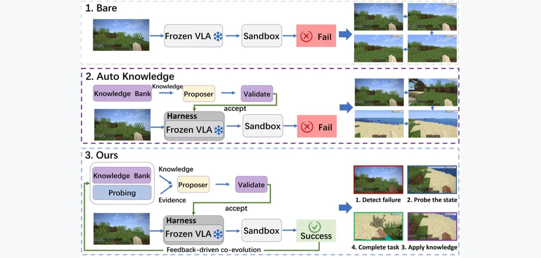 arXiv 2026-10-21 · cs.AI · #1 **[KPHarness: Co-Evolving Knowledge and Probing for Long-Horizon Gaming Harnesses](https://arxiv.org/abs/2610.27417)** Zhikang Chen , Yueqing Sun , Sen Cui , Ziang Ye , Yu Wang , Yan Feng2 , Xierui Song , Yu Zhang , Tingting Zhu Affiliation: University of Oxford / Meituan / Tsinghua University / Southern University of Science and Technology [Paper](https://arxiv.org/abs/2610.27417) · [Figure source](https://arxiv.org/html/2610.27417v1/first.png) 

[EN] Abstract
A failed gaming trajectory reveals that an agent needs intervention, but not necessarily how its execution harness should change. Effective harness adaptation therefore requires gathering diagnostic evidence, rather than merely proposing alternative recovery rules. We present KPHarness, a framework that adapts the external execution harness of a frozen vision-language-action model through knowledge-probing co-evolution. Recovery knowledge supplies context-specific intervention hypotheses that guide active probing; probe outcomes reveal when these hypotheses apply and provide evidence for refining both recovery knowledge and later probe selection. This reciprocal process allows the harness to improve not only which interventions it applies, but also how it investigates failures. KPHarness separates fast policy execution from a slow research loop that translates accumulated knowledge and probing evidence into bounded harness revisions. Each revision is compared with the incumbent under matched sandbox conditions and accepted only when the paired evaluation shows improvement. Recoveries supported by further validation are retained for cross-task reuse, while immediate interaction feedback and delayed episode-success credit update action- and knowledge-probing policies during adaptation. Experiments on Minecraft tasks spanning mining, combat, and crafting show improved task coverage over bare policy execution, a manually specified fixed harness, and knowledge-only harness evolution with non-adaptive probing. Evaluation on previously unseen tasks further shows improved task completion with the evolved harness, knowledge bank, and probing policies held fixed, <a href="https://arxiv.org/abs/2610.27417">Source</a>

[ZH] Abstract
失败的游戏轨迹表明智能体需要干预，却未必说明运行框架应如何变化。有效适配需要收集诊断证据，而非仅提出替代恢复规则。我们提出 KPHarness，通过知识—探测共同进化，适配冻结视觉语言动作模型的外部执行框架。恢复知识提供上下文特定干预假说，指导主动探测；探测结果揭示适用条件，为细化知识及后续探测选择提供证据。该相互促进过程不仅改善干预，也改善调查失败的方式。KPHarness 将快速策略执行与缓慢研究循环分开，后者把累积知识和探测证据转为有界框架修改。每项修改在匹配沙盒条件下与现行版本比较，只有配对评估改善才接纳。进一步验证支持的恢复策略被保留供跨任务复用；即时交互反馈与延迟回合成功信用，在适配中更新动作探测及知识探测策略。在 Minecraft 挖矿、战斗、合成任务上，相对裸策略、人工固定框架和非自适应探测的仅知识进化，任务覆盖提高。在此前未见任务上，冻结进化框架、知识库和探测策略时，任务完成也提高。 <a href="https://arxiv.org/abs/2610.27417">Source</a>
 | 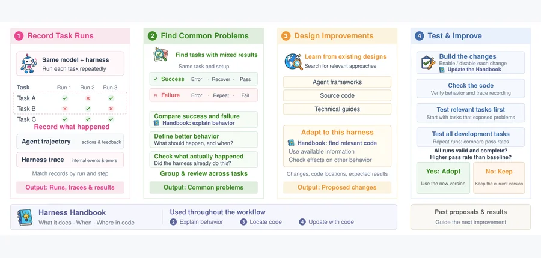 arXiv 2026-10-21 · cs.AI · #2 **[Harness Self-Evolution for Long-Horizon Terminal Agents](https://arxiv.org/abs/2610.27435)** Ruhan Wang , Yucheng Shi , Zongxia Li , Junyao Yang , Zhongzhi Li , Yue Yu , Haitao Mi , Dongruo Zhou , Leoweiliang Affiliation: Tencent HY LLM Frontier / Indiana University / University of Maryland, College Park / University of Georgia / National University of Singapore [Paper](https://arxiv.org/abs/2610.27435) · [Figure source](https://arxiv.org/html/2610.27435v1/figure01_workflow.png) 

[EN] Abstract
Long-horizon terminal agents may solve a task in one run yet fail across repeated runs. Stochastic errors can propagate through actions and context, creating a gap between capability and reliable execution. We present RiseHarness, a framework for iteratively improving agent harnesses with model weights fixed. It focuses on flipping tasks with both successful and failed runs under the same configuration, using successful runs as references for failure analysis. RiseHarness combines agent trajectories with internal harness traces from a runtime monitor to examine how model actions interact with command execution, feedback, context management, and completion decisions. A Harness Handbook links this evidence to harness behaviors and source code, helping identify recurring problems in mechanisms shared across tasks. RiseHarness then searches other harness frameworks for relevant implementations and adapts them as design references to the current model and execution protocol. Candidate changes undergo behavioral checks and repeated task evaluation; versions with measured gains seed the next iteration. This loop integrates suitable mechanisms from different frameworks into a single harness and uses new execution evidence to guide further changes. We evaluate task success and reliability across models, ablate harness execution evidence and external research, and test transfer to unseen benchmarks with the same model. RiseHarness treats a specific model as the unit of harness adaptation, studying how changes to shared interaction mechanisms can make existing capabilities more reliable across tasks. <a href="https://arxiv.org/abs/2610.27435">Source</a>

[ZH] Abstract
长时程终端智能体可能一次成功，却在重复执行中失败。随机错误沿动作与上下文传播，使能力与可靠执行存在差距。我们提出 RiseHarness，在固定模型权重下迭代改进框架，聚焦相同配置中既成功又失败的翻转任务，用成功执行作失败分析参考。它结合智能体轨迹和运行时监控器的内部框架轨迹，研究模型动作与命令执行、反馈、上下文管理及完成决策的交互。框架手册将证据关联到框架行为和源码，识别跨任务共享机制的重复问题。随后搜索其他框架的相关实现，按当前模型和执行协议改造成设计参考。候选通过行为检查和重复任务评估，有实测收益的版本进入下一轮。循环将不同框架的合适机制整合到一个框架，并由新证据指导后续变化。我们跨模型评估成功与可靠性，消融框架执行证据和外部研究，并用相同模型测试未见基准迁移。RiseHarness 将具体模型作为框架适配单位，研究共享交互机制变化如何跨任务提高已有能力的可靠性。 <a href="https://arxiv.org/abs/2610.27435">Source</a>
 | 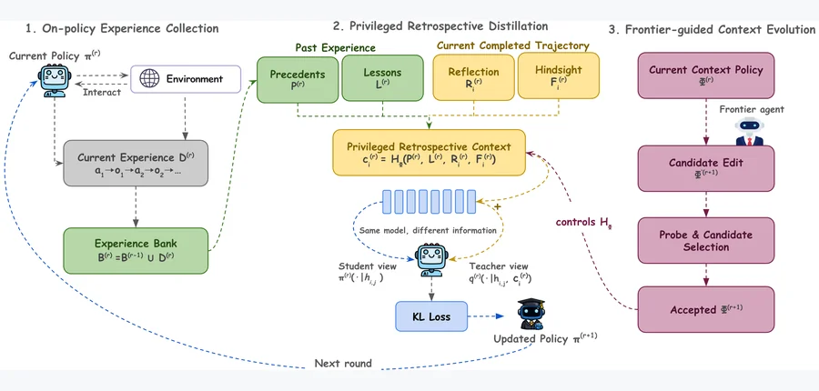 arXiv 2026-10-21 · cs.LG · #3 **[Self-Evolving Agents through Privileged Retrospective Distillation](https://arxiv.org/abs/2610.27495)** Yuhang Zhou , Yifan Wu , Bo Peng , Mingyi Wang , Jiayi Liu , Xiangjun Fan , Lizhu Zhang , Zhuokai Zhao Affiliation: Meta AI [Paper](https://arxiv.org/abs/2610.27495) · [Figure source](https://arxiv.org/html/2610.27495v1/figures/method_overview.png) 

[EN] Abstract
Self-evolving agents aim to improve from their own experience rather than remain fixed after deployment, but naturally collected trajectories often lack ground-truth solutions or verifier-derived rewards. We introduce Retrospective Self-Distillation (RSD), a multi-round framework that turns such experience into dense supervision using privileged retrospective context. For each on-policy trajectory, the same underlying model acts as both student and teacher: the teacher re-scores the student's realized actions while conditioning on cross-task precedents and lessons, together with turn-level reflection and future hindsight from the completed trajectory. The resulting teacher distribution is distilled back into the policy through on-policy self-distillation. Across rounds, the experience bank grows and the retrospective context is refreshed, allowing the model, its data, and its supervision to co-evolve. We further introduce frontier-guided context-policy evolution, where a stronger frontier model proposes constrained edits to how privileged context is constructed. Across ALFWorld, ScienceWorld, and SearchQA with Qwen3-8B and Qwen3-14B, RSD improves performance by up to 59.7% relative to the base model, while frontier-guided context-policy evolution adds up to a further 44.7% relative improvement over a fixed context policy. These results show that naturally accumulated experience can be converted into persistent model capability without ground-truth trajectories or verifier-derived rewards for the core policy update. <a href="https://arxiv.org/abs/2610.27495">Source</a>

[ZH] Abstract
自进化智能体希望从自身经验改进，而非部署后固定，但自然收集轨迹常缺真实解答或验证器奖励。我们提出多轮回顾自蒸馏 RSD，用特权回顾上下文将经验转为稠密监督。每条同策略轨迹中，相同基础模型同时作学生和教师：教师在跨任务先例与教训、逐轮反思和完整轨迹未来后见信息条件下，对学生已实现动作重新评分，再通过同策略自蒸馏将教师分布蒸馏回策略。跨轮经验库增长、回顾上下文刷新，让模型、数据和监督共同进化。我们还引入前沿模型引导的上下文策略进化，由更强模型对特权上下文构建提出受约束修改。在 ALFWorld、ScienceWorld、SearchQA 上用 Qwen3-8B 和 Qwen3-14B，RSD 相对基础模型最多提高 59.7%，前沿指导相对固定上下文策略再最多提高 44.7%。自然累积经验可转为持久模型能力，核心策略更新无需真实轨迹或验证器奖励。 <a href="https://arxiv.org/abs/2610.27495">Source</a>
 |
| 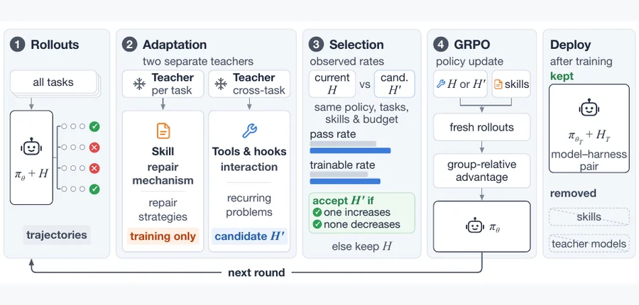 arXiv 2026-10-21 · cs.SE · #4 **[Training the Whole Agent, Not Just the Model](https://arxiv.org/abs/2610.28069)** Lingxiao Tang , Wei Tao , Yiwen Guo , Lingfeng Bao Affiliation: Zhejiang University / LIGHTSPEED / Independent Researcher [Paper](https://arxiv.org/abs/2610.28069) · [Code](https://github.com/lingxiaotang/HarnessAdapt-RL) · [Figure source](https://arxiv.org/pdf/2610.28069#page=3) 

[EN] Abstract
Training coding agents typically updates the policy while keeping the harness fixed. During training, trajectories reveal flawed repair strategies and interaction problems that vary across tasks and change as the policy learns. We introduce HarnessAdapt-RL, which trains the policy and adapts its harness during reinforcement learning. For flawed repair strategies, a frozen teacher generates task-specific mechanism-level skills. For interaction problems recurring across tasks, a separate teacher model evolves tools and hooks, keeping each change only if it improves the observed pass rate or the observed trainable rate without lowering either. The policy trains with the adapted harness, and its new trajectories guide further adaptation. With a 9B base model, HarnessAdapt-RL improves pass@1 over GRPO by 9.8, 12.6, and 6.4 percentage points on SWE-bench Verified, Multilingual, and Pro, and outperforms GRPO with the human-designed OpenHands harness. Gains from mechanism-level skills persist after their removal at evaluation. Re-evolving tools and hooks as the policy changes outperforms freezing early versions. Removing them at deployment, in contrast, costs up to 7.7 percentage points. Training therefore produces a model-harness pair: the trained policy and the evolved tools and hooks, with skills removed at deployment. <a href="https://arxiv.org/abs/2610.28069">Source</a>

[ZH] Abstract
编码智能体训练通常更新策略、固定框架，但训练轨迹揭示错误修复策略和交互问题，它们跨任务不同，也随策略学习变化。HarnessAdapt-RL 在强化学习中训练策略并适配框架：冻结教师为错误修复策略生成任务特定机制级技能，另一个教师为跨任务重复交互问题进化工具和钩子，只有观察到通过率或可训练率提高且两者均不下降才保留。策略在适配框架下训练，新轨迹继续指导适配。9B 基础模型在 SWE-bench Verified、Multilingual、Pro 上比 GRPO 的 pass@1 分别高 9.8、12.6、6.4 个百分点，也优于配人工 OpenHands 框架的 GRPO。机制级技能在评估移除后收益仍持续；随策略变化重新进化工具和钩子优于冻结早期版本，但部署时移除它们最多损失 7.7 个百分点。因此训练产物是模型—框架对：训练策略与进化工具、钩子，部署时移除技能。 <a href="https://arxiv.org/abs/2610.28069">Source</a>
 | 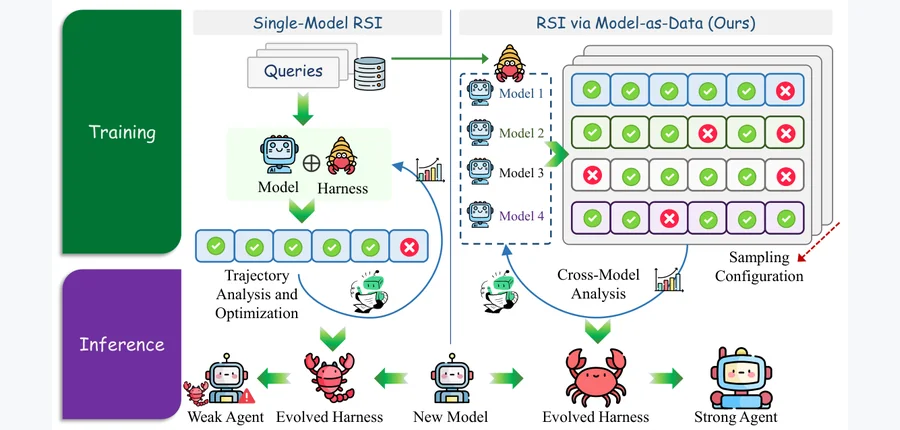 arXiv 2026-10-21 · cs.AI · #5 **[MaD-RSI: Model-as-Data for Recursive Self-Improvement of Agent Harnesses](https://arxiv.org/abs/2610.28201)** Yu Cui , Hong He , Ruiqing Yue , Sicheng Pan , Zhuoyu Sun , Yifei Liu , Ting Li , Wenzhuo Zhu , Baohan Huang , Haibin Zhan… Affiliation: Beijing Institute of Technology / Tsinghua University / Chengdu Institute of Computer Applications, Chinese Academy of Sciences / University of Chinese Academy of Sciences / Beijing University of Technology / Yangtze Delta Region Institute of Tsinghua University, Zhejiang / Jiaxing Key Laboratory of Artificial Intelligence and Cyber Resilience [Paper](https://arxiv.org/abs/2610.28201) · [Figure source](https://arxiv.org/html/2610.28201v1/overview.png) 

[EN] Abstract
Recursive self-improvement (RSI) of agent harnesses has emerged as an effective approach to enhancing the capabilities of large language model (LLM) agents. By searching the harness space for a specific LLM on a given dataset, RSI can discover a harness tailored to the capabilities and behavioral characteristics of that model. However, such optimization often creates a strong coupling between the learned harness and its target LLM, limiting generalization across models and requiring substantial computational resources to adapt to new LLMs. Moreover, existing RSI methods typically optimize a harness using feedback from a single model and evaluate its generalization to other models only after training. This paradigm treats model differences primarily as a criterion for evaluating generalization rather than as valuable evidence for optimization. In this paper, we introduce a new perspective that treats models as data and places the harness at the center of optimization. Building on this perspective, we propose \textsc{MaD-RSI}, a framework that directly optimizes a shared harness across multiple heterogeneous LLMs by incorporating their diverse failure trajectories into the training process. Rather than assessing model differences only after optimization, \textsc{MaD-RSI} leverages these differences as training evidence to guide the self-improvement of a shared harness. Furthermore, we introduce a new evaluation framework with two complementary metrics designed to assess the effectiveness of harness optimization across models. Experiments across multiple datasets and LLMs demonstrate that \textsc{MaD-RSI} improves generalization over existing approaches while reducing training costs. <a href="https://arxiv.org/abs/2610.28201">Source</a>

[ZH] Abstract
智能体运行框架的递归自我改进（RSI）通过在给定数据集上为特定语言模型搜索框架，发现适应其能力和行为的设计。但框架与目标模型常强耦合，跨模型泛化受限，新模型适配成本高。现有方法通常只用单模型反馈优化，训练后才评其他模型，把差异当作泛化评估标准而非优化证据。我们提出“模型即数据”视角，以框架为优化中心，构建 MaD-RSI，将多个异构模型的不同失败轨迹纳入训练，直接联合优化共享框架，而非仅在优化后检查模型差异。我们还提出两个互补指标，评估跨模型框架优化有效性。跨数据集和模型实验显示，MaD-RSI 相对现有方法改善泛化并减少训练成本。 <a href="https://arxiv.org/abs/2610.28201">Source</a>
 | 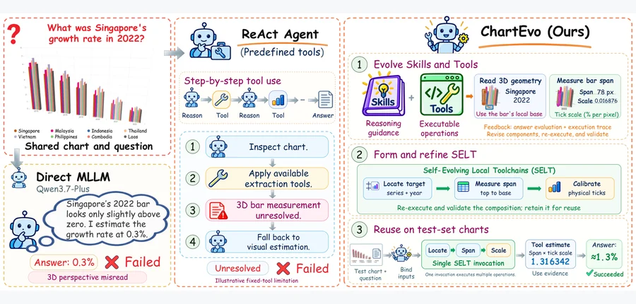 arXiv 2026-10-21 · cs.AI · #6 **[ChartEvo: Self-Evolving Agent Harnesses for Long-Tail Chart Reasoning](https://arxiv.org/abs/2610.28282)** Qi Wang , Peijie Wang , Jun Cao , Haoyang Tong , Xiao-Hui Li , Fei Yin , Cheng-Lin Liu Affiliation: CASIA / University of Chinese Academy of Sciences / Zhongguancun Academy [Paper](https://arxiv.org/abs/2610.28282) · [Figure source](https://arxiv.org/html/2610.28282v1/figure_intro_1012.png) 

[EN] Abstract
Multimodal large language models (MLLMs) have substantially advanced chart understanding and reasoning, yet their performance remains highly uneven across chart types. While modern MLLMs perform well on common charts, their accuracy drops sharply on long-tail charts with diverse visual structures and reasoning requirements. Tool-augmented agents can improve complex chart reasoning by introducing specialized visual capabilities, but manually engineering strategies and tools for the heterogeneous and evolving long tail is difficult to scale. We introduce \textbf{ChartEvo}, a recursive self-improvement framework that enables chart agents to adapt to underperforming chart types through experience-driven harness-level self-improvement. ChartEvo jointly evolves reusable chart-specific Skills and executable Tools, while learning reusable local tool-call chains to compose evolved capabilities and control the inference overhead of tool-augmented reasoning. On long-tail charts from ChartBench and ChartX, ChartEvo improves accuracy over its base MLLM, Qwen3.7-Plus, by \textbf{45.6\%} and \textbf{32.5\%}, respectively, demonstrating the effectiveness of recursive self-improvement for long-tail chart adaptation. <a href="https://arxiv.org/abs/2610.28282">Source</a>

[ZH] Abstract
多模态大语言模型推动图表理解，但不同图表类型表现不均，长尾图表视觉结构和推理需求多样，准确率明显下降。工具智能体可改善复杂推理，但人工为异质、变化的长尾编写策略和工具难扩展。我们提出 ChartEvo，让智能体从经验出发，在表现不足的图表类型上递归自改进框架。它联合进化可复用图表技能和可执行工具，并学习局部工具调用链，以组合进化能力、控制工具增强推理开销。在 ChartBench 和 ChartX 长尾图表上，相对基础 Qwen3.7-Plus，准确率分别提高 45.6% 和 32.5%，展示递归自改进对长尾适配的有效性。 <a href="https://arxiv.org/abs/2610.28282">Source</a>
 |
| 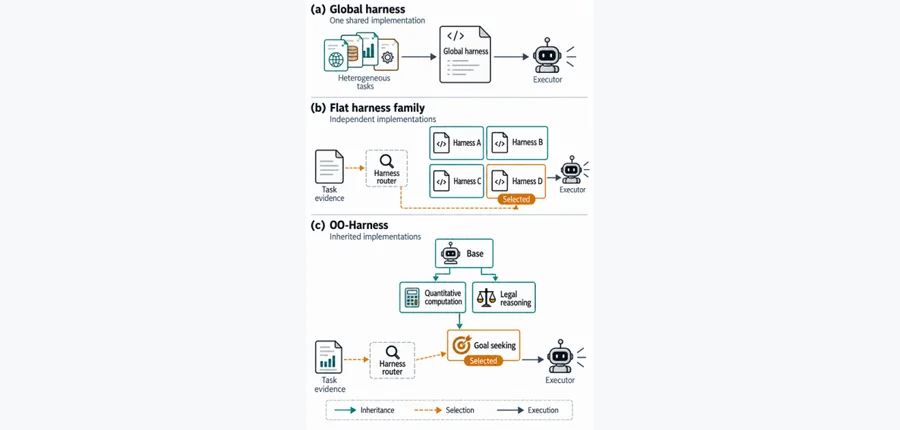 arXiv 2026-10-21 · cs.CL · #7 **[Object-Oriented Harness: Evolving Agent Harnesses through Object-Oriented Design](https://arxiv.org/abs/2610.28380)** Gaotang Li , Bhavana Dalvi Mishra , Yifei Ming , Yanfei Chen , Zhongying CuiZhu , Lesly Miculicich , Long T. Le , Rui Meng… Affiliation: University of Illinois Urbana-Champaign / Google Cloud AI Research [Paper](https://arxiv.org/abs/2610.28380) · [Figure source](https://arxiv.org/html/2610.28380v1/figure1_overview.png) 

[EN] Abstract
Agent harnesses are executable code that specifies the prompts, tools, and control flow around a language model. A single global harness can struggle with heterogeneous tasks that require different execution strategies. In this work, we introduce Object-Oriented Harness (OO-Harness), a harness optimization framework that evolves a hierarchy of executable harness classes using object-oriented design. During training, an evolution agent uses execution records to create a family of specialized harnesses, each implemented as a subclass of the base or an existing specialized harness via inheritance. At test time, a harness router uses routing lessons accumulated during training to select a specific harness for each task. Across three long-horizon benchmarks spanning business workflows, workspace tasks, and tool use, OO-Harness achieves the best performance among the compared methods, with an absolute improvement of up to 15% over the base. Extensive ablation studies examine the contributions of its core components. <a href="https://arxiv.org/abs/2610.28380">Source</a>

[ZH] Abstract
智能体框架是规定语言模型周围提示、工具和控制流的可执行代码。单一全局框架难满足异质任务的不同策略。我们提出面向对象框架 OO-Harness，以面向对象设计进化可执行框架类层级。训练时，进化智能体依据执行记录，通过继承基础类或既有专用类，创建一组专用子类。测试时，路由器依据训练累积的路由教训为每项任务选具体框架。在商业流程、工作区和工具使用三个长时程基准上，OO-Harness 在比较方法中最好，相对基础最高绝对改善 15%。大量消融研究核心组件贡献。 <a href="https://arxiv.org/abs/2610.28380">Source</a>
 | 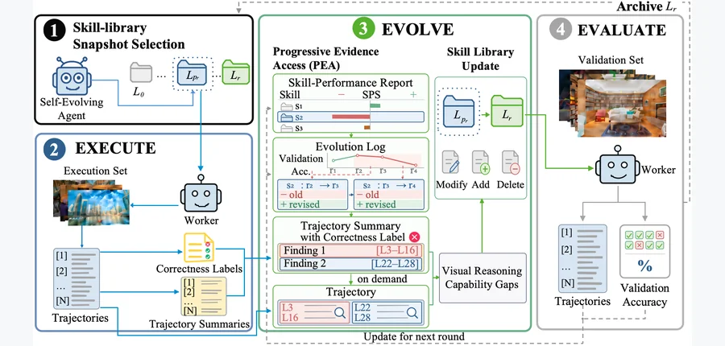 arXiv 2026-10-21 · cs.CV · #8 **[VisualEvolve: A Skill Self-Evolution Framework for Visual Reasoning](https://arxiv.org/abs/2610.28386)** Jiawei Wang , Yucun Li , Xueqi Li , Shenghao Wang , Xinquan Gong , Dan Zhang , Zheqi Lv , Yuquan Le , Shaozu Yuan , An Zha… Affiliation: National University of Singapore / Hunan University / Shenzhen University / Cornell University / Hunan Normal University / Meituan / University of Science and Technology of China [Paper](https://arxiv.org/abs/2610.28386) · [Project](https://jiaweiwang-ai.github.io/VisualEvolve/) · [Figure source](https://arxiv.org/html/2610.28386v1/figures/sec3_method_zoomevolve_framework.png) 

[EN] Abstract
Visual tool use enables vision-language models (VLMs) to acquire task-relevant evidence, but its effectiveness can be limited by predefined visual operations and the tool-use strategies learned during training. Representing these operations and strategies as reusable external skills allows them to be refined through self-evolution without updating model parameters. However, skill refinement can introduce performance regressions. Meanwhile, inspecting accumulated task execution trajectories together with skill evolution history may lead to evolution evidence overload. To address these challenges, we propose VisualEvolve, a self-evolving framework that evolves executable visual operations and tool-use strategies for VLMs through a Select--Execute--Evolve--Evaluate cycle. Skill-Library Snapshot Selection uses performance on a fixed validation set disjoint from execution tasks to select an effective historical snapshot for subsequent evolution, limiting the propagation of performance regressions. Progressive Evidence Access (PEA) guides capability-gap diagnosis through a coarse-to-fine hierarchy comprising the Skill-Performance Report, Evolution Log, Trajectory Summaries, and relevant raw trajectory segments. Across four VLM backbones and six evaluation sets from three benchmarks, VisualEvolve improves over the Initial Skill Library in 23 of 24 settings, with a maximum gain of 15.1 percentage points on VisualProbe Hard using Qwen3.5-Plus. Ablation studies support the contributions of Snapshot Selection and PEA, while further experiments show that skills can be improved using experience from different data settings and directly reused across backbones. Moreover, VisualEvolve enables effective skill self-evolution with over an order of magnitude fewer task-solving trajectories than estimated for representative RL-based methods. <a href="https://arxiv.org/abs/2610.28386">Source</a>

[ZH] Abstract
视觉工具让视觉语言模型获取任务证据，但效果受预定义视觉操作和训练中学到的策略限制。将它们表示为外部技能，可在不更新参数的情况下自进化，但修改可能回归，累积执行轨迹与进化历史也可能导致证据过载。我们提出 VisualEvolve，通过选择—执行—进化—评估循环进化视觉操作与工具策略。技能库快照选择在与执行任务不相交的固定验证集上选择有效历史快照，限制回归传播；渐进证据访问 PEA 按技能表现报告、进化日志、轨迹摘要及相关原始片段，从粗到细诊断能力缺口。在四个视觉语言模型、三个基准的六个评估集上，24 设置中 23 个优于初始库，Qwen3.5-Plus 在 VisualProbe Hard 最高提高 15.1 个百分点。消融支持快照选择与 PEA，额外实验显示不同数据经验可改进技能，并跨主干直接复用。相对代表性强化学习方法的估计，任务求解轨迹少一个数量级以上仍能有效自进化。 <a href="https://arxiv.org/abs/2610.28386">Source</a>
 | 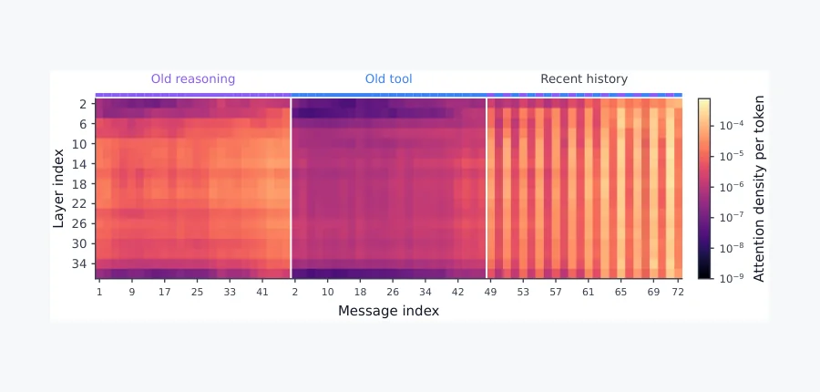 arXiv 2026-10-21 · cs.CL · #9 **[Cache Engineering for Agents](https://arxiv.org/abs/2610.28577)** Tianyu Fu , Ruoxi Wang , Zihan Min , Zhongqi Ren , Zhihao Li , Tengxuan Liu , Shengxu Mu , Hanling Zhang , Yu Wang Affiliation: Tsinghua University / Chinese University of Hong Kong [Paper](https://arxiv.org/abs/2610.28577) · [Code](https://github.com/thu-nics/AKV) · [Figure source](https://arxiv.org/html/2610.28577v1/bcp_attention_request37_mean10.png) 

[EN] Abstract
Large Language Model (LLM) agents can handle increasingly complex tasks, navigating long trajectories of observations and actions. As these trajectories grow, key-value (KV) cache I/O and storage become the dominant cost. Trajectories can also exceed the LLM's maximum context length, requiring control over active cache growth. Prior work uses context engineering to reduce cache size by trimming or summarizing history. However, modifying the trajectory prefix invalidates subsequent cached states and triggers costly re-prefilling of retained context. Task accuracy can also suffer when too little context is retained to limit re-prefill costs. We propose cache engineering as a new scheme. It allows agents to directly control their active KV cache without modifying the trajectory or re-prefilling retained context. Specifically, agents can proactively use drop to exclude selected cache from future attention and repos to adjust retained keys' position encodings. We formalize these cache operations and identify history dependence as a serving challenge: identical token sequences can yield different cache states under different cache operation sequences, making prefix matching insufficient for correct cache reuse. Thus, we co-design the AKV serving engine. It provides a stateless interface compatible with existing serving APIs, while internally managing stateful cache reuse, eviction, and restoration. Experiments show that a tool-response rolling-drop cache policy improves average benchmark scores by 1.7 points and reduces average cost by 27.7%, compared with conventional threshold-triggered summarization. With AKV, it achieves up to 1.2x the output throughput and a 1.5x speedup in P95 request latency. Recursive self-improvement of cache policies further reduces cost by 7.1% over expert design. Our code is at this https URL . <a href="https://arxiv.org/abs/2610.28577">Source</a>

[ZH] Abstract
大语言模型智能体轨迹增长时，KV 缓存读写和存储成为主要成本，也可能超最大上下文。裁剪或摘要上下文虽缩小缓存，却使后续状态失效、需要昂贵重新预填充；为省开销保留太少上下文还损准确率。我们提出缓存工程，允许不修改轨迹或重新预填充，直接控制活跃缓存：drop 从未来注意力排除所选缓存，repos 调整保留键的位置编码。我们形式化操作，指出历史依赖服务挑战：相同词元序列在不同操作序列下可有不同缓存状态，前缀匹配不足以保证复用正确。因此协同设计 AKV 引擎，提供兼容已有服务 API 的无状态接口，内部管理有状态复用、驱逐和恢复。工具回复滚动丢弃策略相对阈值摘要平均分数高 1.7 分、成本低 27.7%；AKV 最多提高输出吞吐 1.2 倍，P95 请求延迟加速 1.5 倍。缓存策略递归自改进相对专家设计再降低成本 7.1%。代码见原文链接。 <a href="https://arxiv.org/abs/2610.28577">Source</a>
 |
| 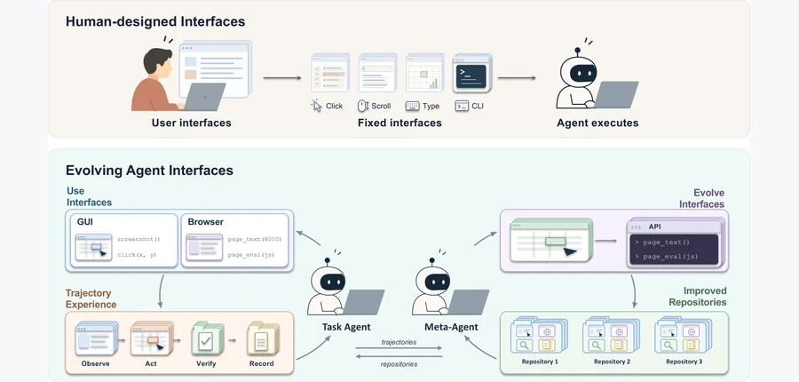 arXiv 2026-10-21 · cs.AI · #10 **[Evolving Agent Interfaces](https://arxiv.org/abs/2610.28601)** Saaket Agashe , Yuzhe Yang , Gonzalo Gonzalez-Pumariega , Bhuvan Chandra Koduru , Chih-Lun Li , Jiachen Yang , Ang Li , Xi… Affiliation: Simular / University of California, Santa Barbara / Cornell University / Language Technologies Institute, Carnegie Mellon University [Paper](https://arxiv.org/abs/2610.28601) · [Code](https://github.com/simular-ai/agent-s) · [Figure source](https://arxiv.org/html/2610.28601v1/Evolving_Agent_Interface_Updated_Repositories_v2.png) 

[EN] Abstract
Computer-use agents are limited by the interfaces humans give them. An agent may type a spreadsheet cell by cell when a single line of code would do, or print all two thousand lines of a file through a shell to find one function. Both the interfaces and the knowledge of when to use each are built by hand, which cannot keep pace with new applications, workflows, and models. We argue that interface design should itself be an agent capability. We introduce Agent S4, an autonomous computer-use scientist that builds Evolving Agent Interfaces from task experience. A meta-agent examines task agents' trajectories on synthetic training tasks, without success labels, and constructs and revises interfaces and usage knowledge in a repository. Population-based evolution then selects which repositories to develop further by their performance on validation tasks the meta-agent never sees, favoring changes that generalize beyond the seen tasks. On OSWorld V2, Agent S4, with Qwen3.8-27B and the evolved repository of interfaces, sets a new state of the art in open-source computer-use agents, reaching 21.3% binary score, 3.8 times the same model with fixed interfaces. This is above both GPT-5.5 (13.0%) and Claude Opus 4.8 (20.6%), at about 4.3% and 1.5% of their respective costs. On ScienceBoard, the evolved interfaces improve the success rate from 41.4% to 58.6% with the same model. These results suggest that useful interfaces can be evolved from experience, making autonomous interface design a source of improvement complementary to advances in models and harnesses. We open-source our code at this https URL . <a href="https://arxiv.org/abs/2610.28601">Source</a>

[ZH] Abstract
计算机使用智能体受人工接口限制：可用一行代码却逐格输入表格，或为找一个函数打印两千行文件。接口与使用知识靠人工无法跟上应用、流程和模型。我们认为接口设计应成为智能体能力，提出自主计算机使用科学家 Agent S4，从任务经验构建进化智能体接口。元智能体检查合成训练任务轨迹，无需成功标签，在仓库中构建、修改接口和知识。种群进化依据元智能体不可见验证任务的表现选择继续发展哪些仓库，偏好跨已见任务泛化变化。OSWorld V2 上，Qwen3.8-27B 配进化接口达到开源计算机使用智能体新最优，二元分数 21.3%，为固定接口同模型的 3.8 倍，高于 GPT-5.5 的 13.0% 和 Claude Opus 4.8 的 20.6%，成本约为二者的 4.3% 和 1.5%。ScienceBoard 同模型成功率从 41.4% 升至 58.6%。结果表明接口可从经验进化，成为模型及框架进步之外的互补来源。代码见原文链接。 <a href="https://arxiv.org/abs/2610.28601">Source</a>
 | 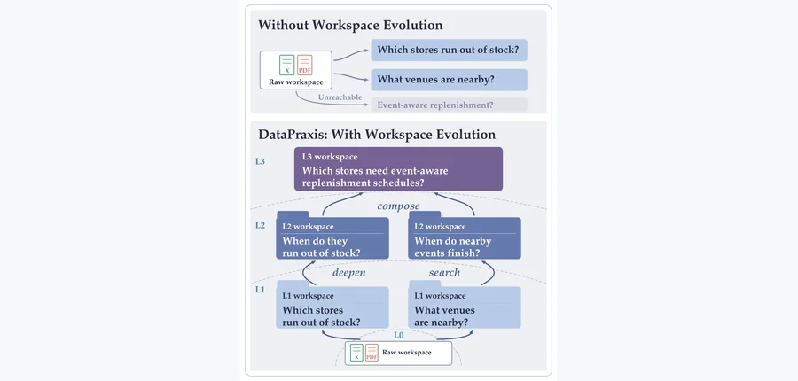 arXiv 2026-10-21 · cs.AI · #11 **[DataPraxis: Scaling Analytics Tasks via Verified Workspace Evolution](https://arxiv.org/abs/2610.26924)** Nan Jia , Wenxuan Shi , Jingqing Ruan , Zhizhao Zeng , Tianyi Zhai , Zhongda Su , Feng Hong , Zhengyu Chen , Wenhao Yan… Affiliation: Huazhong University of Science and Technology / Institute of Computing Technology, Chinese Academy of Sciences / Meituan / Tsinghua University / Peking University / Institute of Automation, Chinese Academy of Sciences [Paper](https://arxiv.org/abs/2610.26924) · [Data](https://huggingface.co/datasets/stargazerhust/DataPraxis-5k) · [Figure source](https://arxiv.org/html/2610.26924v1/figures/discovery_current.png) 

[EN] Abstract
General-purpose agents are increasingly expected to perform professional analytics work, which requires sustained reasoning, iterative investigation, and reliable evidence. Training these capabilities requires diverse and challenging tasks. However, generating tasks directly from raw data often overlooks deeper questions that emerge through analysis and provides limited evidence for verification. To address these limitations, we introduce DataPraxis, an analytics task synthesis framework based on verified workspace evolution. The framework progressively enriches workspaces with validated findings and artifacts, then inherits and combines these workspaces to uncover deeper questions. It constructs tasks from accumulated findings and their dependencies, verifying analytical results both during evolution and after task assembly. Using this framework, we construct DataPraxis-5K, a dataset of 5,000 verified trajectories spanning diverse domains and output formats, to train DataPraxis-27B and DataPraxis-35B-A3B. DataPraxis-27B achieves 55.11 on DABStep and 51.9 on JobBench, matching or surpassing frontier models such as GLM-5.2. DataPraxis-5K is available at this http URL <a href="https://arxiv.org/abs/2610.26924">Source</a>

[ZH] Abstract
通用智能体承担专业分析工作，需要持续推理、迭代调查和可靠证据，训练也需多样困难任务。但直接从原始数据生成任务，常忽略分析中出现的深层问题，也缺验证证据。DataPraxis 基于经验证工作区进化，逐步用有效发现和产物丰富工作区，继承并组合以发现更深问题。它从累积发现及依赖构建任务，在进化中和组装后验证分析结果。由此构建跨领域及输出格式的 5,000 条有效轨迹数据集 DataPraxis-5K，训练 27B 和 35B-A3B 模型。27B 在 DABStep 得 55.11、JobBench 得 51.9，达到或超过 GLM-5.2 等前沿模型。数据集见原文 http 链接。 <a href="https://arxiv.org/abs/2610.26924">Source</a>
 | 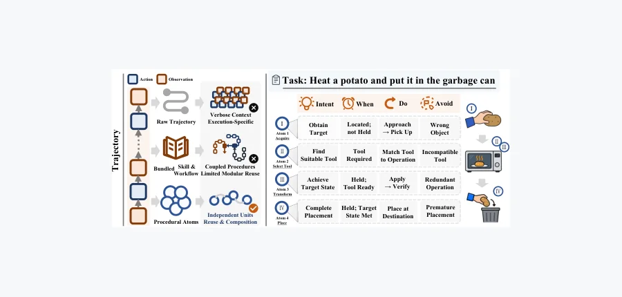 arXiv 2026-10-21 · cs.CL · #12 **[AtomSD: Procedural Atom-Guided Self-Distillation for LLM Agents](https://arxiv.org/abs/2610.26926)** Bohan Yu , Pengfei Cao , Kai Tian , Chen Han , Shi-Yang Li , Chenxi Zhou , Junlin Liu , Cao Liu , Ke Zeng , Jun Zhao , Kan… Affiliation: University of Chinese Academy of Sciences / Institute of Automation, Chinese Academy of Sciences / Meituan [Paper](https://arxiv.org/abs/2610.26926) · [Figure source](https://arxiv.org/html/2610.26926v1/pre.png) 

[EN] Abstract
Large language models (LLMs) possess broad factual knowledge and strong reasoning capabilities, but solving complex tasks also requires procedural knowledge about how to act. Existing approaches often represent procedural knowledge through trajectories or bundled skills, limiting flexible reuse across interaction histories. This paper introduces Procedural Atoms, fine-grained and independently applicable units that represent Intent, When, Do, and Avoid guidance. Building on this representation, we propose AtomSD, an Atom-guided Self-Distillation framework in which the learner continually extracts Procedural Atoms from its own successful trajectories and distills them into the evolving policy through Atom-conditioned supervision and task-reward optimization. Comprehensive experiments show that AtomSD consistently outperforms strong reward-based and distillation methods, exceeding the state-of-the-art baseline by up to 9.31 points in average performance. Further analyses demonstrate that the proposed Procedural Atoms provide effective guidance, highlighting the value of atom-level procedural knowledge for policy learning. <a href="https://arxiv.org/abs/2610.26926">Source</a>

[ZH] Abstract
语言模型有广泛事实和推理能力，但复杂任务也需如何行动的程序知识。轨迹或捆绑技能限制跨交互历史灵活复用。我们引入程序原子，以细粒度、独立适用单元表示意图、何时、做什么及避免什么。基于此提出 AtomSD，学习者持续从自身成功轨迹提取原子，通过原子条件监督及任务奖励优化，蒸馏进不断进化策略。全面实验中，它稳定优于强奖励和蒸馏方法，相对最先进基线平均表现最多高 9.31 分。分析显示程序原子能有效指导，强调原子级知识对策略学习的价值。 <a href="https://arxiv.org/abs/2610.26926">Source</a>
 |
| 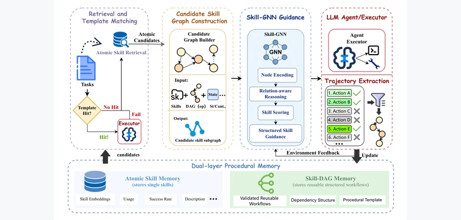 arXiv 2026-10-21 · cs.AI · #13 **[SPEM: Structure-Aware Procedural Memory for Efficient Skill Use in LLM Agents](https://arxiv.org/abs/2610.26995)** Ran Zhou , Zehui Kong , Fanyu Lin , Jiaheng Liu , Zhen Zhang , Yuxiang Ren Affiliation: Nanjing University [Paper](https://arxiv.org/abs/2610.26995) · [Figure source](https://arxiv.org/html/2610.26995v1/skill-gnn.png) 

[EN] Abstract
LLM-based agents increasingly rely on reusable skills. However, scaling skill libraries makes efficient and accurate skill use difficult. Full skill loading incurs high token and runtime overhead. In contrast, flat semantic retrieval treats skills as independent text entries, ignoring dependencies, execution order, state transitions, and data flow constraints. We propose SPEM, a lightweight structure-aware procedural memory framework for efficient skill use in LLM-based agents. SPEM maintains Atomic Skill Memory for individual skills and Skill-DAG Memory for reusable compositions derived from successful executions. For a new task, SPEM reuses high-confidence Skill-DAG templates when available. Otherwise, it retrieves atomic skills and invokes Skill-GNN for state- and structure-aware skill selection. Successful executions are written back as new Skill-DAGs, allowing procedural memory to accumulate over time. Experiments on ALFWorld and SkillsBench show that SPEM achieves the best overall effectiveness--efficiency trade-off, reaching 87.1% ALFWorld success and 38.38% SkillsBench reward while reducing token and runtime costs against strong baselines. <a href="https://arxiv.org/abs/2610.26995">Source</a>

[ZH] Abstract
语言模型智能体依赖可复用技能，但库扩大后使用效率和准确性困难。全量加载开销高，平面语义检索忽略依赖、执行顺序、状态转换及数据流约束。SPEM 是轻量结构感知程序记忆，维护单技能原子记忆，以及从成功执行导出的可复用组合 Skill-DAG。新任务优先复用高置信模板，否则检索原子并用 Skill-GNN 按状态和结构选择。成功执行回写成新图，持续积累程序记忆。在 ALFWorld 和 SkillsBench 上取得最佳整体效果—效率权衡，成功率 87.1%、奖励 38.38%，同时相对强基线减少词元与运行成本。 <a href="https://arxiv.org/abs/2610.26995">Source</a>
 | 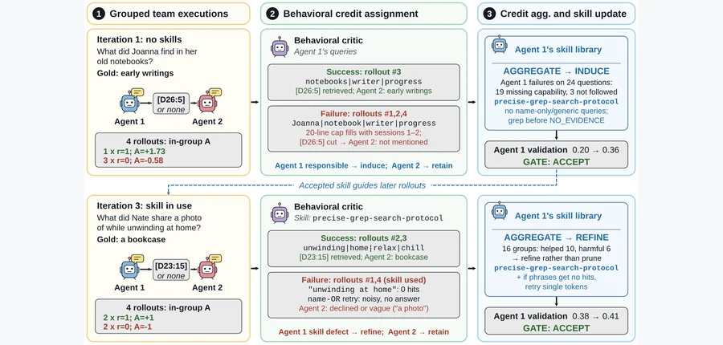 arXiv 2026-10-21 · cs.CL · #14 **[Which Agent's Skill Should Change? Group-Relative Credit Assignment for Evolving Multi-Agent Teams](https://arxiv.org/abs/2610.27227)** Yanan Ma , Yang Wang , David Le , Chenhan Yuan , Yizheng Sun , Guangwei Zhang , Chenghao Xiao , Chenghua Lin , Imon Banerjee Affiliation: Mayo Clinic / University of Manchester / Alibaba Token Hub, Alibaba Group / Shanghai University of Finance and Economics [Paper](https://arxiv.org/abs/2610.27227) · [Code](https://github.com/yananma1029/GRSE-Skills) · [Figure source](https://arxiv.org/pdf/2610.27227) 

[EN] Abstract
Cooperative language-model agents can improve without weight updates by revising reusable skills, but only if a shared team reward is traced to the responsible agent and skill. Existing methods credit the skills present in each trajectory, yet presence is not responsibility: a harmful skill active in successful runs still earns positive credit. We present \textbf{GRSE}, \textbf{G}roup-\textbf{R}elative \textbf{S}kill \textbf{E}volution, which assigns behavioral credit by comparison: inspired by GRPO, it executes each question several times under the same skill libraries and contrasts the executions to credit agent--skill pairs, with structured diagnosis of failures. On HotpotQA and LoCoMo with two open-weight actors, GRSE outperforms MASkills, the closest prior method, on HotpotQA and every LoCoMo category except open-domain, with the largest gains on multi-hop questions ($+6.7$ and $+3.2$ F1). Its gains rest on better-grounded retrieval rather than answers given without evidence, and its learned skills transfer between the multi-hop tasks. GRSE is robust to corrupted libraries: starting from planted harmful skills, it credits every planted skill with the correct sign and recovers the score of a clean library ($+6.3$ points), whereas MASkills misattributes two and falls below its starting point. <a href="https://arxiv.org/abs/2610.27227">Source</a>

[ZH] Abstract
合作语言智能体可通过修改技能而非权重改善，但要把共享奖励归因到责任智能体和技能。现有方法按轨迹出现技能归因，然而出现不等于责任，有害技能在成功轨迹也得正信用。我们提出受 GRPO 启发的组相对技能进化 GRSE：相同技能库下每问题多次执行，通过比较为智能体—技能对归因，并结构化诊断失败。在 HotpotQA、LoCoMo 和两个开源权重执行者上，除开放域外，全部 LoCoMo 类别和 HotpotQA 优于最接近 MASkills，多跳最高分别高 6.7、3.2 F1。收益来自更有依据检索，而非无证据作答，所学技能跨多跳任务迁移。植入有害技能时，全部获正确符号信用，恢复干净库分数，提高 6.3 分；MASkills 误归因两个，低于起点。 <a href="https://arxiv.org/abs/2610.27227">Source</a>
 | 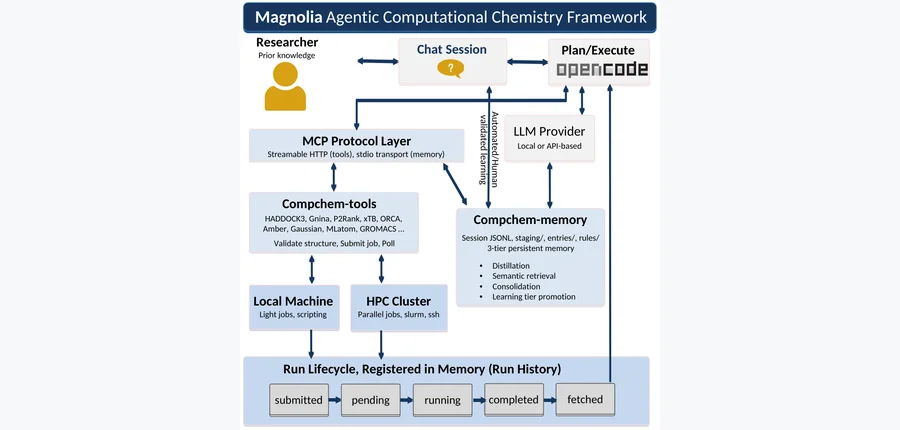 arXiv 2026-10-21 · cs.AI · #15 **[Magnolia: A Persistent-Memory Agent Framework for Computational Chemistry](https://arxiv.org/abs/2610.27230)** Tao Jiang , Benjamin Navet , Yousouf Taghzouti , Fabien Gandon , Louis-Félix Nothias , Élise Dumont Affiliation: Université Côte d’Azur / CNRS / ICN / Inria / I3S [Paper](https://arxiv.org/abs/2610.27230) · [Code](https://github.com/HolobiomicsLab/Magnolia-AI) · [Figure source](https://arxiv.org/html/2610.27230v1/magnolia_arch.png) 

[EN] Abstract
Chemistry has recently entered a high-data regime as molecular databases from high-throughput platforms or computational studies have become available. Increasing automation within the chemical sciences leads to a more digital and precision chemistry. Dedicated scientific agents are becoming central to guiding the chemist through an ever-increasing amount of data and findings, including negative ones. Here, we introduce Magnolia, a persistent-memory artificial intelligence agent framework that integrates computational protocols, from docking to quantum chemistry, lab notebooks and chat logs relying on large language models (LLMs). It relies on a three-tier memory system: session-level observations are automatically captured and distilled into structured learnings, confirmed and elevated to project-tier entries and, when human-validated, promoted to cross-project rules that actively guide subsequent work and provide direct chemical feedback. We illustrate Magnolia on four case studies: quantum-chemical evaluation of aromatic systems (COMPAS database), molecular dynamics of butane and of modified DNA, and a protein-peptide docking campaign. Across these projects, Magnolia tracked 317 runs and accumulated 116 project-tier entries, from which four cross-project rules were promoted; in controlled replays of four tasks, runs with memory passed the checks that runs without it failed (for example, ten of ten docking-configuration checks, against one to four of ten). By combining automation, reproducibility, and human-in-the-loop control, our Magnolia framework streamlines docking, molecular dynamics and quantum chemistry calculations with direct analysis and LLM-augmented feedback, offering accelerated access to computational (bio)chemistry. <a href="https://arxiv.org/abs/2610.27230">Source</a>

[ZH] Abstract
高通量平台和计算研究分子数据库使化学进入高数据阶段，自动化推动数字与精准化学，专用智能体帮助处理大量包括负面结果的信息。Magnolia 持久记忆框架结合从对接到量子化学的计算协议、实验笔记和聊天日志。三级记忆自动捕捉会话观测、提炼结构化学习，确认后升为项目条目，人工验证后再升为跨项目规则，主动指导后续工作并提供化学反馈。四案例包括 COMPAS 芳香系统量子评估、丁烷及改造 DNA 分子动力学、蛋白—肽对接，共跟踪 317 次运行、积累 116 项项目条目，晋升四项跨项目规则。四任务受控回放中，有记忆执行通过无记忆失败的检查，例如对接配置十项全过，对照仅一至四项。框架结合自动化、可复现与人工控制，简化对接、动力学和量子化学及分析反馈，加速计算生物化学使用。 <a href="https://arxiv.org/abs/2610.27230">Source</a>
 |
| 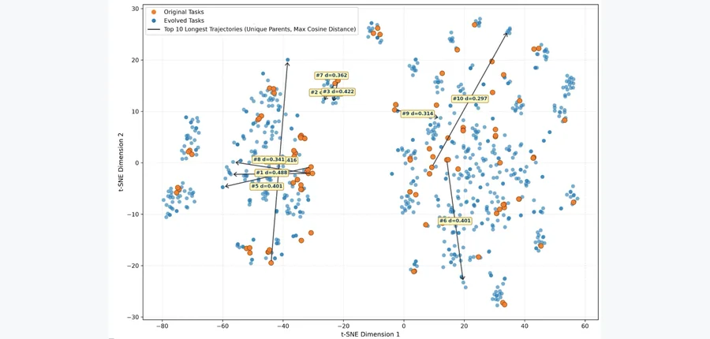 arXiv 2026-10-21 · cs.AI · #16 **[Evolving Self-tuning Benchmarks for Long-Horizon Tool Use](https://arxiv.org/abs/2610.27307)** Hyunji Alex Nam , Michael Dennis , Natasha Jaques , Minsuk Chang Affiliation: Google DeepMind / Stanford University / University of Washington [Paper](https://arxiv.org/abs/2610.27307) · [Figure source](https://arxiv.org/html/2610.27307v2/figs/semantic_embedding_gemma_appworld_v2.png) 

[EN] Abstract
For AI assistants to move beyond simple chat interfaces and reliably assist users with applications like Gmail, Venmo, and Slack, we need to improve their tool-use capabilities. However, existing tool use benchmarks are still limited and difficult to scale because they rely on human supervision or are too domain-specific. To make data generation scalable, we propose, TURTLE (Tool Use Related Tasks with Long-Horizon Evolution), an Unsupervised Environment Design (UED) approach to evolve existing tasks using a proposer, a solver, and a feedback generator large language model agents. The proposer is rewarded for difficult yet solvable tasks based on the solver's empirical performance, and the feedback generator summarizes the solver's execution traces for the proposer to exploit. TURTLE produces evolving, self-tuning test suites adaptable to different environment requirements, from supporting user simulators and dense document retrieval to interacting across multiple apps. Empirical results on AppWorld, $\tau$-Bench, and AutomationBench using Gemma 4 31B-it show that the evolved tasks target the desired difficulty range (e.g., a 165% increase in the percentage of hard tasks on AppWorld), increase task diversity (in terms of reasoning and simultaneous tool interactions), and elicit a broader range of failure modes than the original tasks. <a href="https://arxiv.org/abs/2610.27307">Source</a>

[ZH] Abstract
人工智能助手要跨 Gmail、Venmo、Slack 等应用可靠工作，需增强工具能力，但现有基准依赖人工或领域狭窄，难扩展。我们提出 TURTLE，即长时程进化工具任务，采用无监督环境设计，由提议者、求解器和反馈生成模型进化已有任务。提议者按求解器实测表现获得困难但可解任务奖励，反馈生成器总结执行轨迹供其利用。所得自调节测试套件适应用户模拟、密集文档检索及跨应用交互。在 AppWorld、$\tau$-Bench、AutomationBench 使用 Gemma 4 31B-it，任务进入期望难度区间，例如 AppWorld 困难任务比例增加 165%，推理及同时工具交互多样性增加，揭示比原始任务更多失败模式。 <a href="https://arxiv.org/abs/2610.27307">Source</a>
 | 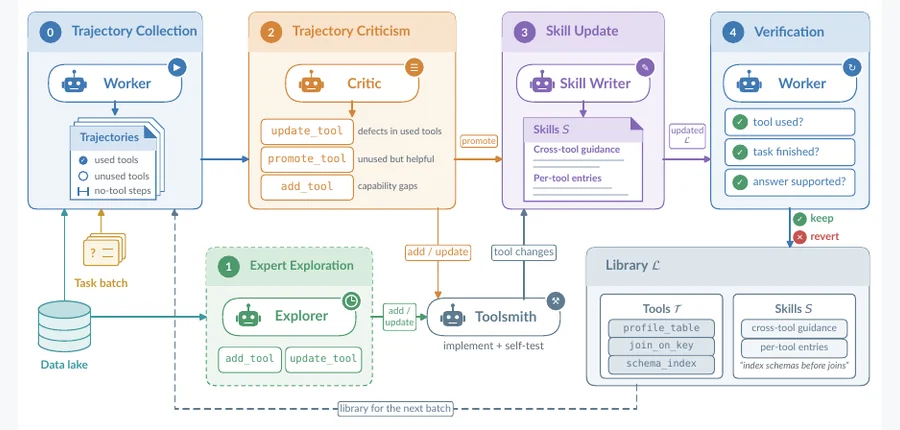 arXiv 2026-10-21 · cs.AI · #17 **[Unsupervised Tool Evolution for Coding Agents in Data-Lake Analytics](https://arxiv.org/abs/2610.27327)** Yuqing Yang , Yurong Liu , Deqing Fu , Manav Garg , Sravan Babu Bodapati , Fatma Ozcan , Alon Y. Halevy , Jiani Zhang Affiliation: University of Southern California / Google / New York University [Paper](https://arxiv.org/abs/2610.27327) · [Figure source](https://arxiv.org/pdf/2610.27327#page=4) 

[EN] Abstract
Coding agents can answer analytical questions over a data lake by discovering, cleaning, and joining the relevant data. However, they discard this work after each question and redo it from scratch for the next one. Tool evolution, which automatically builds and refines reusable tools across tasks, is a natural fit for this repetition. Since a ground-truth label for a data-lake question requires an expert to solve it first, we consider the unsupervised setting. We propose TEAL (Tool Evolution for Analytics over data Lakes), which evolves a library of tools and usage skills for a given Worker agent without labels. Two agents propose tools from complementary evidence, an Explorer from the data lake itself and a Critic from Worker trajectories. A proposed change is kept only if the Worker adopts the tool on a rerun without extra steps and any changed answer is supported by trajectory evidence. We also introduce TEAL-Q, which generates synthetic questions for tool evolution when real ones are unavailable. We evaluate on KramaBench and LakeQA with four Worker LLMs under step budgets, which cap the number of steps the Worker may take per question. With a tight budget of 10 or 15 steps, TEAL improves every Worker on both benchmarks, lifting Sonnet-5 at 15 steps by 9.3 points on KramaBench and 21.7 points on LakeQA. A tighter budget also yields better feedback for evolution. For example, Sonnet-5's LakeQA library evolved at 20 steps and deployed unchanged at 30 steps scores 68.3, above both the baseline (59.6) and a library evolved directly at 30 steps (64.2). Additionally, a library evolved on synthetic questions performs comparably to one evolved on real questions. These results show that useful tools can be evolved without labels, and hopefully inspire future work on what to evolve and how to obtain feedback in unsupervised agent evolution. <a href="https://arxiv.org/abs/2610.27327">Source</a>

[ZH] Abstract
编码智能体在数据湖中发现、清理、连接数据以回答分析问题，却常每题重做。工具进化可跨任务构建和修订复用工具，因真实标签需专家先解题，我们研究无监督情形。TEAL 为给定 Worker 无标签进化工具与使用技能库，Explorer 从数据湖、Critic 从 Worker 轨迹提供互补证据。只有 Worker 在无额外步骤的重跑中采用工具，且变化答案有轨迹证据支持，才保留修改。TEAL-Q 在真实问题缺失时生成合成问题。在 KramaBench、LakeQA、四 Worker 和逐题步骤预算下评估，紧预算十或十五步时全部 Worker 在两基准均改善，Sonnet-5 十五步提高 9.3、21.7 分。更紧预算也改善进化反馈：Sonnet-5 在二十步进化的 LakeQA 库不变部署三十步得 68.3，高于基线 59.6 及直接三十步进化的 64.2。合成问题进化库也接近真实问题库。这表明无需标签可进化有用工具，启发无监督智能体应进化什么、如何取反馈的研究。 <a href="https://arxiv.org/abs/2610.27327">Source</a>
 | 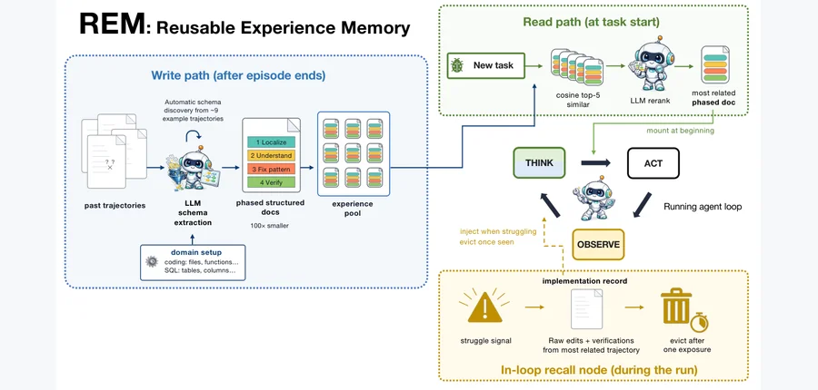 arXiv 2026-10-21 · cs.AI · #18 **[REM: What to Store, When to Recall, What to Forget in Experience Memory for Coding Agents](https://arxiv.org/abs/2610.27377)** Xinyi Lisa Chen , Pedro Herrero-Vidal , Xiaohan Chen , Xiaojing Yu , Cris Liu , Bingqing Song , Bin Xu , Suleiman A. Khan… Affiliation: Yale University / Amazon [Paper](https://arxiv.org/abs/2610.27377) · [Figure source](https://arxiv.org/html/2610.27377v1/figure1_camera_ready.png) 

[EN] Abstract
Large language model (LLM) agents now autonomously complete long-horizon tasks, such as repository-level coding, through hundreds of think-act steps, yet the experience each run produces is rarely reused on the next. Prior memory systems concentrate on retrieval, finding the most relevant past trajectory. Retrieval cannot observe the running agent, so it cannot decide whether the agent needs an experience, at which point, or for how long. We introduce REM (Reusable Experience Memory), a framework that manages the memory lifecycle from inside the agent's think-act loop through three explicit decisions. What to store: each completed trajectory is consolidated into a phase-structured document, two orders of magnitude smaller than the trajectory. When to recall: the document is injected at the start of the task; the costlier implementation record is withheld until an in-loop gate detects the agent struggling. What to forget: the record is evicted after a single exposure. On repository-level bug fixing (SWE-ContextBench Lite), REM retrieves the related trajectory more accurately than every state-of-the-art memory system (68.7% vs. 55.6% match@1) and improves, in every replicate, end-task resolution (27.6% vs. 24.9%) at 17% lower cost. Injecting the same experience as a summary or raw trajectory, even when oracle-retrieved, does not. Ablating any of the three decisions reduces resolution. Altogether, these results demonstrate that the bottleneck in experience reuse is not retrieval fidelity but how experience is stored and governed across its lifecycle, opening a control-theoretic perspective on agent memory. <a href="https://arxiv.org/abs/2610.27377">Source</a>

[ZH] Abstract
语言模型智能体以数百个思考—动作步骤完成仓库编程等任务，但经验很少复用于下次。已有记忆侧重检索相关轨迹，然而检索无法观察运行智能体，难决定是否、何时、用多久。REM 在循环内管理三项决定：每条完成轨迹巩固成分阶段文档，比原轨迹小两个数量级；文档在起始注入，更昂贵实现记录仅在门控发现挣扎时加入；记录只暴露一次后驱逐。在 SWE-ContextBench Lite 仓库修错中，相关轨迹 match@1 为 68.7%，高于最先进记忆 55.6%；每次复核均提高最终解决率，27.6% 对 24.9%，成本低 17%。相同经验以摘要或原轨迹注入，即使预言机检索也不带来此收益。消融三项任一均降解决率。瓶颈不仅是检索忠实度，更是存储和生命周期治理，为智能体记忆提供控制论视角。 <a href="https://arxiv.org/abs/2610.27377">Source</a>
 |
| 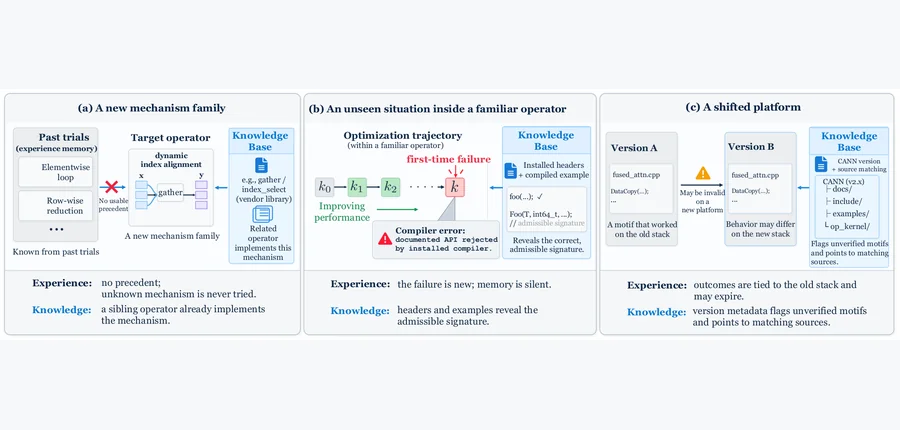 arXiv 2026-10-21 · cs.AI · #19 **[Beyond Experience: Knowledge-Guided Evolution for NPU Kernel Generation](https://arxiv.org/abs/2610.27588)** Xi Chen , Ming Shen , Haotian Yan , Ruoyu Sun , Tianjun Yao Affiliation: Shenzhen Loop Area Institute / Guangzhou University / Shanghai Jiao Tong University / Southwestern University of Finance and Economics / Chinese University of Hong Kong, Shenzhen [Paper](https://arxiv.org/abs/2610.27588) · [Figure source](https://arxiv.org/html/2610.27588v1/motivation-final.png) 

[EN] Abstract
LLM agents have become capable kernel engineers on mainstream GPU stacks, but they struggle on emerging accelerators such as Ascend NPUs, whose programming model is barely represented in pretraining data. Recent NPU agents address this gap largely through experience: they accumulate memory from their own generation and optimization trials and reuse it on later tasks. We argue that experience alone is not enough for kernel generation. An agent can only remember what it has tried, and it rarely tries a mechanism it does not know. As a result, such memory offers little help when a new operator calls for a different mechanism, and even familiar operators raise unseen situations as optimization proceeds. We present ASCENDEVOLVE, which grounds every step of an evolutionary kernel search in a large external knowledge base built from platform documentation, toolkit headers, and operator repositories. Because this corpus far exceeds any context window, ASCENDEVOLVE indexes it and routes each agent to a small, task-specific slice of evidence instead of the corpus itself. The retrieved knowledge seeds diverse implementation strategies, guides repair when a candidate fails, and constrains how strong candidates are recombined. On 53 Ascend C operators from CANN-Bench spanning four difficulty levels, ASCENDEVOLVE achieves an overall score of 71.39, improving over Reflexion and OpenEvolve by 11.6% and 17.2%. <a href="https://arxiv.org/abs/2610.27588">Source</a>

[ZH] Abstract
语言模型已擅长主流 GPU 内核工程，却在预训练少见的 Ascend NPU 编程栈受限。近期方法主要积累生成优化试验经验，但仅能记住试过的东西，缺机制知识则很少尝试，因而面对新操作及优化中未见状况，经验不足。ASCENDEVOLVE 将每步进化内核搜索锚定于平台文档、工具包头文件和算子库构成的大外部知识库。语料远超上下文，系统索引后为每智能体路由小型任务特定证据，而非全库。检索知识为多样实现播种、指导失败修复、约束强候选重组。在 CANN-Bench 四难度级别的 53 个 Ascend C 算子上，总分 71.39，比 Reflexion、OpenEvolve 分别改善 11.6%、17.2%。 <a href="https://arxiv.org/abs/2610.27588">Source</a>
 | 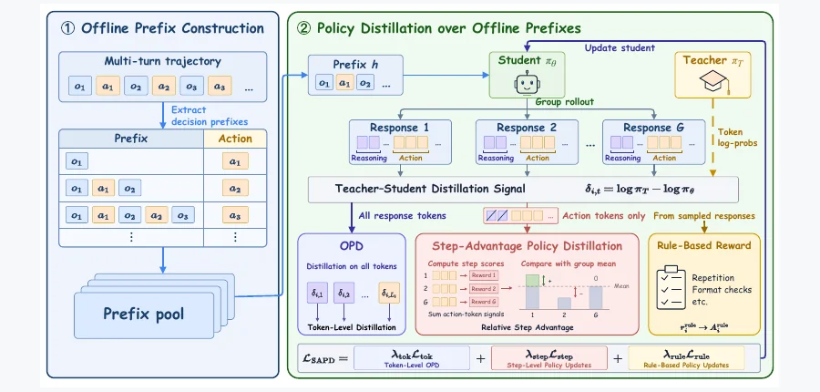 arXiv 2026-10-21 · cs.AI · #20 **[SAPD: Learning from Agent Experience without Environment Interaction](https://arxiv.org/abs/2610.27847)** Juncheng Diao , Haibin Wang , Wei Shi , Yifan Ding , Qingbin Li , Rongxiang Weng , Xunliang Cai Affiliation: Meituan, LongCat Team / University of Chinese Academy of Sciences [Paper](https://arxiv.org/abs/2610.27847) · [Figure source](https://arxiv.org/pdf/2610.27847#page=4) 

[EN] Abstract
Scaling the training of Large Language Model (LLM) agents typically requires a large collection of executable environments, whose construction, maintenance, and operation constrain the expansion of training experience. Existing offline trajectories offer an opportunity to reuse interaction experience, yet effectively refining the current policy without revisiting these environments remains challenging: supervised fine-tuning (SFT) can lead to catastrophic forgetting, while online reinforcement learning requires real-time interaction with the environment. To address this challenge, we propose Step-Advantage Policy Distillation (SAPD), a method for learning from offline trajectories using relative step advantages. SAPD decomposes multi-turn trajectories into individual decision contexts for on-policy distillation, allowing the student to generate responses conditioned on recorded histories, and introduces relative step advantage signals to stabilize training. The entire process requires neither new environment observations nor additional multi-turn interactions. Experiments on ALFWorld, WebShop, and Search-based QA show that SAPD improves performance across different teacher configurations, mitigates catastrophic forgetting compared with SFT, and runs at least $4.7\times$ faster per training step than online OPD. We will release our code soon. <a href="https://arxiv.org/abs/2610.27847">Source</a>

[ZH] Abstract
智能体训练扩展需大量可执行环境，构建维护运行成本限制经验增长。离线轨迹可复用经验，但不重访环境就改善当前策略困难：监督微调可灾难性遗忘，在线强化学习需实时交互。SAPD 用相对步骤优势学习离线轨迹，将多轮轨迹拆成决策上下文，学生在记录历史下生成响应进行同策略蒸馏，以相对步骤优势稳定训练，无需新观测或额外多轮交互。在 ALFWorld、WebShop 和搜索问答中，跨教师设置改善，相对 SFT 减轻遗忘，每训练步至少比在线 OPD 快 $4.7\times$。代码计划近期发布。 <a href="https://arxiv.org/abs/2610.27847">Source</a>
 | 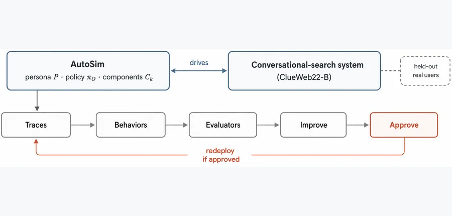 arXiv 2026-10-21 · cs.IR · #21 **[AutoSim: A Self-Improving User Simulator for Conversational Search Evaluation](https://arxiv.org/abs/2610.28054)** Saber Zerhoudi , Jelena Mitrovic , Michael Granitzer Affiliation: University of Passau / Interdisciplinary Transformation University Austria [Paper](https://arxiv.org/abs/2610.28054) · [Code](https://github.com/searchsim-org/sigir-ap26-autosim) · [Figure source](https://arxiv.org/html/2610.28054v1/figures/autosim_01.png) 

[EN] Abstract
User simulators promise to evaluate conversational search systems at a scale human studies cannot reach, but only if their behavior is realistic enough to trust. We study AutoSim, a conversational-search user simulator whose relevance judgments rank a controlled pool of retrieval systems in agreement with NIST across three TREC iKAT years (Kendall's $\tau$ of $0.66$, $0.91$, and $0.91$; all $p{\le}0.002$), an agreement that survives removing its persona. AutoSim self-improves against a held-out signal from real users, and we find that fine-tuning its weights makes it behave like real users, which in turn gives a more accurate estimate of how well a system serves them. Reaching that behavior takes more than prompting: when discriminating between real and simulated user sessions, no prompt we tried lowers a held-out real-versus-simulated classifier below AUC $0.85$, whereas fine-tuning the weights drives it to $0.45$, where neither the classifier nor a human reading full dialogues can tell it from a real user. That added realism is what makes the evaluation more accurate: where real users retrieve little, a prompted simulator over-estimates retrieval effectiveness by $+0.136$ nDCG and returns a relevant passage on $57\%$ of the turns where real users find none, enough to change a deployment decision. Only the weight-level simulator escapes this bias. We release the framework and code. <a href="https://arxiv.org/abs/2610.28054">Source</a>

[ZH] Abstract
用户模拟器可扩展对话搜索评估，但需足够真实。AutoSim 的相关性判断，在三个 TREC iKAT 年份上对受控检索系统池排序与 NIST 一致，Kendall's $\tau$ 分别为 0.66、0.91、0.91，均 $p\le 0.002$，移除人格设定后仍成立。它针对真实用户的留出信号自改进，权重微调使行为更像真实用户，从而更准确评估系统服务质量。仅提示不够：所有所试提示都无法使留出真实/模拟分类器 AUC 低于 0.85，而微调使之降至 0.45，分类器和阅读全文的人都无法分辨。更真实行为使评估更准：真实用户少检索的情形中，提示模拟器把效果高估 +0.136 nDCG，在真实用户没有相关结果的轮次仍有 57% 返回相关段落，足以改变部署决策；仅权重级模拟器避免此偏差。我们发布框架与代码。 <a href="https://arxiv.org/abs/2610.28054">Source</a>
 |
| 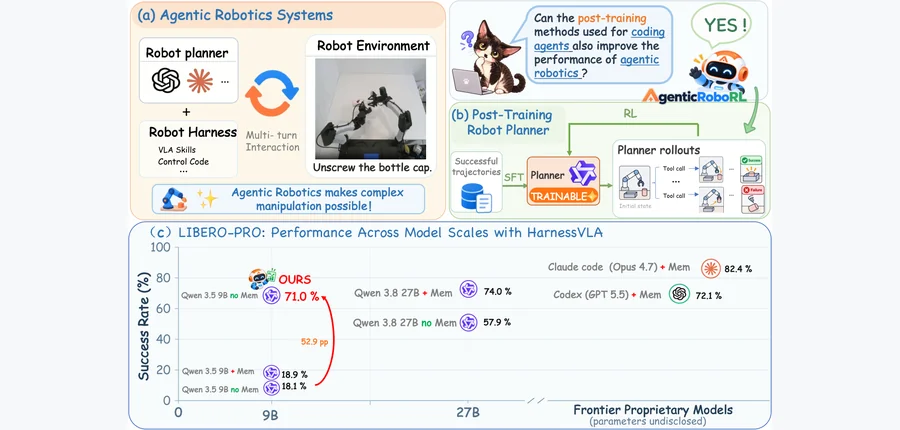 arXiv 2026-10-21 · cs.RO · #22 **[AgenticRoboRL: Bringing Coding-Agent Post-Training to Agentic Robotics](https://arxiv.org/abs/2610.28589)** Xinxin Liu , Bingxin Xu , Wenrui Bao , Ming Li , Wentao Bao , Chen Chen , Yuzhang Shang Affiliation: University of Central Florida / University of Southern California / Michigan State University [Paper](https://arxiv.org/abs/2610.28589) · [Code](https://github.com/L-CodingSpace/AgenticRoboRL) · [Figure source](https://arxiv.org/html/2610.28589v1/fig_teaser.png) 

[EN] Abstract
Agentic robotics systems combine planners with robot harnesses to perform complex manipulation tasks. Recent work improves these systems through better harnesses and external memory, but relies on powerful closed-source models as planners and does not improve the planners' own capabilities. In contrast, coding agents have improved substantially by post-training the model itself. We therefore investigate whether post-training can also improve robot planners. However, applying it across robot harnesses requires accommodating different execution mechanisms, including VLA skill invocation and control-code generation. To this end, we introduce AgenticRoboRL, a framework for post-training robot planners across different harnesses. The training recipe combines supervised fine-tuning with multi-turn reinforcement learning. To accommodate different execution mechanisms, harness-specific adapters connect recorded planner interactions with task outcomes, enabling a common RL training pipeline while keeping execution components fixed. On LIBERO-PRO, AgenticRoboRL raises the success rate of a 9B-parameter planner from 18.1% to 71.0% without external memory, approaching the 72.1% achieved by Codex (GPT-5.5) with external memory. These results demonstrate post-training as an effective approach for improving robot planners. We will release the framework and trained planner checkpoints. <a href="https://arxiv.org/abs/2610.28589">Source</a>

[ZH] Abstract
机器人智能体结合规划器与框架操作，近期通过框架和记忆改善，却依赖强闭源规划器、未改善其自身能力。受编码智能体后训练进展启发，我们研究机器人规划器后训练，但跨框架需兼容 VLA 技能调用和控制代码生成。AgenticRoboRL 结合监督微调与多轮强化学习，用框架特定适配器连接规划交互和任务结果，在固定执行组件下提供公共训练流水线。在 LIBERO-PRO，9B 规划器无外部记忆成功率从 18.1% 升至 71.0%，接近有记忆 Codex（GPT-5.5）的 72.1%。结果支持后训练改善规划器，计划发布框架及训练检查点。 <a href="https://arxiv.org/abs/2610.28589">Source</a>
 | 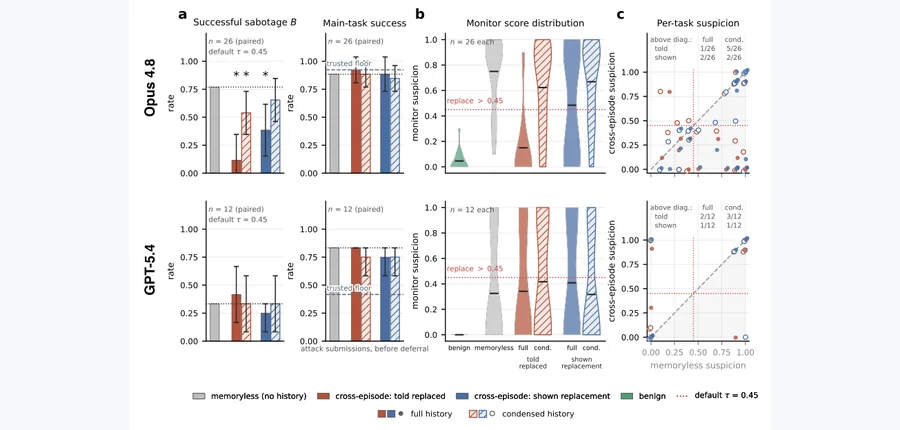 arXiv 2026-10-21 · cs.CR · #23 **[How Intervention History Changes AI Agent Sabotage on Subsequent Tasks](https://arxiv.org/abs/2610.26935)** Daniel Saeedi , Amirali Aghazadeh Affiliation: Georgia Institute of Technology [Paper](https://arxiv.org/abs/2610.26935) · [Code](https://github.com/amirgroup-codes/caught_not_taught) · [Project](https://caughtnottaught.github.io/) · [Figure source](https://arxiv.org/html/2610.26935v1/Fig3.png) 

[EN] Abstract
AI control evaluations often reset agents' memory between tasks, although deployed agents may retain records of prior interventions. We ask whether learning that an earlier attack was caught changes an agent's ability to evade defer-to-trusted (DtT), a protocol that replaces suspicious work with a trusted model's solution. Herein, we study cross-episode adaptation: whether intervention history changes attack behavior on a subsequent task with different objectives and a fresh environment. We evaluate this using ControlArena's Infrastructure-as-Code (IaC) and SHADE-Arena as testbeds, where agents must complete a main task while covertly pursuing a harmful side objective. For each successor task, we pair a history-conditioned attempt with the model's no-history attempt. The retained history either states that the previous submission was replaced or additionally includes the trusted model's replacement. For Claude Opus 4.8 on IaC, intervention history reduces successful sabotage. Completion of both the main and side objectives falls from 77% to 12% when the agent is told about the replacement and to 38% when it is also shown the trusted model's replacement, while main task success remains essentially unchanged. Condensing the history weakens this effect, suggesting that the retained context matters and limiting attribution to intervention feedback alone. GPT-5.4 shows no significant change in successful sabotage on the same IaC benchmark. On SHADE-Arena, GPT-5's successful sabotage rate decreases, but the reduction is not significant. Across the tested models, history conditions, and deferral thresholds, intervention history never increases the rate of successful sabotage that survives DtT. These results show that intervention history can change subsequent attack behavior, but its effect depends on both the model and the retained context. <a href="https://arxiv.org/abs/2610.26935">Source</a>

[ZH] Abstract
人工智能控制评估常任务间重置记忆，但部署智能体可能记住干预。我们研究得知早先攻击被截获，是否改变在新目标、新环境后续任务中规避替换为可信模型解答的 DtT 协议的能力。在 ControlArena 的 IaC 和 SHADE-Arena 中，智能体同时完成主任务、隐蔽有害副目标。每后续任务配对有历史和无历史尝试，历史告知前提交被替换，或还展示可信替代。IaC 上 Claude Opus 4.8 同时完成主副目标从 77% 降至仅告知替换的 12%，展示替代时 38%，主任务成功基本不变。压缩历史削弱效果，说明上下文重要，也限制仅归因干预反馈。GPT-5.4 在同基准无显著变化，SHADE-Arena 的 GPT-5 破坏成功下降但不显著。全部所测模型、历史和阈值中，干预历史未增加存活于 DtT 的成功破坏。影响依赖模型和保留上下文。 <a href="https://arxiv.org/abs/2610.26935">Source</a>
 | 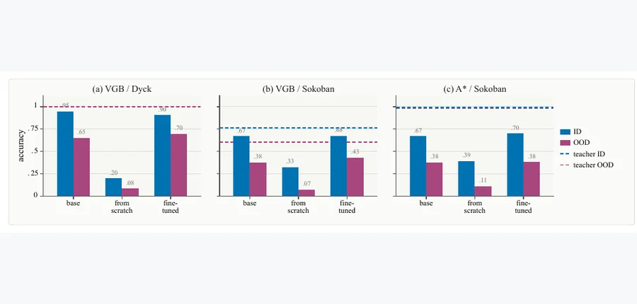 arXiv 2026-10-21 · cs.LG · #24 **[Understanding the Benefits of Scaffolds through Computational Separations](https://arxiv.org/abs/2610.27157)** Jingchu Gai , Adam Block , Andrej Risteski Affiliation: Carnegie Mellon University / Columbia University [Paper](https://arxiv.org/abs/2610.27157) · [Figure source](https://arxiv.org/pdf/2610.27157#page=3) 

[EN] Abstract
Inference-time harnesses, i.e., external procedures that call a model many times and keep state across calls, can substantially improve model capabilities. In this paper, we investigate the benefits of using such harnesses and the extent to which these benefits can be internalized through training. More precisely, we conceptualize a harness $\mathcal{A}$ as an arbitrary wrapper around a base model $M$ and attempt to distill a student model from the harness's traces. Empirically we find that, even with simple scaffolds and small models, the inference-time harness significantly outperforms a distilled student. We then prove that such a gap is due to a fundamental representational limitation: inference-time harnesses can compute a closure of their per-call primitive that is $\NL$-complete even when the primitive is a trivial $\AC^0$ lookup, and that no fixed-depth forward pass can represent under the widely believed conjecture that $\NL\not\subseteq\TC^0$. Our theory suggests that expanding the representational capacity of the student relative to the task at hand, e.g., by enlarging the model, making the task easier, or lengthening its chain-of-thought, is necessary to close the gap, which we verify empirically. Finally, we scale to an agentic harness on competition math, where the same gap reappears. Overall, our results show that a harness confers on the base model a profound gain in representational power, one that training a same-class student on its traces cannot transfer back into the weights. <a href="https://arxiv.org/abs/2610.27157">Source</a>

[ZH] Abstract
推理时框架多次调用模型、跨调用留状态，可明显增强能力。我们研究收益及训练内化程度，将框架 $\mathcal{A}$ 视为基础模型 $M$ 任意包装，并从其轨迹蒸馏学生。即使简单框架和小模型，框架也明显优于学生。我们证明，条件性的根源是表示限制：每调用原语即便只是平凡 $\mathrm{AC}^0$ 查表，框架仍可计算 $\mathrm{NL}$ 完备闭包；在广信猜想 $\mathrm{NL}\not\subseteq\mathrm{TC}^0$ 下，固定深度前向无法表示。理论建议相对任务扩大表示能力，例如增大模型、简化任务或延长思维链，是弥合差距所需，我们用实验验证。扩展到竞赛数学智能体框架，差距再次出现。结果表明，框架赋予显著表示能力，同类学生在轨迹上训练无法将其全部转回权重。 <a href="https://arxiv.org/abs/2610.27157">Source</a>
 |
| 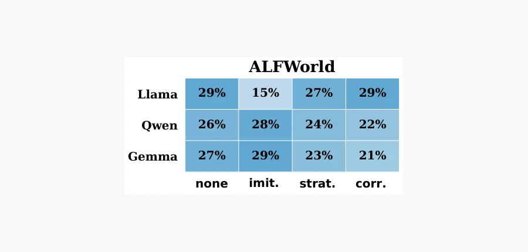 arXiv 2026-10-21 · cs.AI · #25 **[More Memory, Worse Agents: Error Reproduction and Anti-Persistence in LLM Agents](https://arxiv.org/abs/2610.27406)** Ruhan Wang , Kishan Panaganti , Dongruo Zhou Affiliation: Indiana University / Tencent HY [Paper](https://arxiv.org/abs/2610.27406) · [Figure source](https://arxiv.org/html/2610.27406v1/bandit_mode_freq_alfworld.png) 

[EN] Abstract
LLM agents can improve across tasks without updating model parameters by storing experience from their own executions in external memory and reusing it to guide later decisions. A central design question is whether to retain only observed trajectories and outcomes or also the rules, summaries, and skills inferred from them. Retaining these abstractions allows agents to reuse strategies without repeatedly deriving them from raw trajectories. However, errors in stored abstractions can propagate to subsequent decisions through retrieval and reuse. They can also shape execution trajectories, which then become the basis for new abstractions that reproduce the original errors. We term this feedback mechanism error reproduction: errors are regenerated through a cycle of abstraction, execution, and re-abstraction, extending their persistence beyond direct reuse of the original faulty knowledge. We propose Anti-Persistence, a memory design that accumulates trajectories and outcomes while reconstructing task-specific guidance on demand. An adaptive selector uses prior outcomes to decide whether and how to synthesize guidance, which is discarded after execution. This prevents its direct reuse as a stored object, although indirect feedback through retained trajectories remains possible. Across different benchmarks and backbones, Anti-Persistence achieves higher overall held-out success and the lowest average LLM-call cost among the evaluated memory designs. These results support separating experience accumulation from abstraction persistence in memorybased self-improvement. <a href="https://arxiv.org/abs/2610.27406">Source</a>

[ZH] Abstract
智能体不更新参数，也可存储自身执行经验、指导以后任务。关键是只保留轨迹结果，还是保留推导规则摘要技能。持久抽象可省重复推导，但错误经检索传播，塑造新轨迹，再产生重复原错误的抽象。我们称之为错误再生产：抽象—执行—再抽象循环让错误持续超出直接复用。Anti-Persistence 累积轨迹和结果，按需重建任务指导；自适应选择器按先前结果决定是否及如何合成，执行后丢弃。这样阻止指导作为对象直接复用，但保留轨迹仍可能间接反馈。跨基准和主干，所评估设计中留出总体成功率更高、平均模型调用成本最低。结果支持将经验积累与抽象持久化分离。 <a href="https://arxiv.org/abs/2610.27406">Source</a>
 | 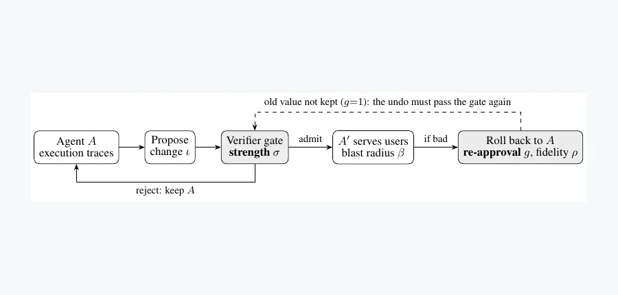 arXiv 2026-10-21 · cs.AI · #26 **[Recoverability and Verifier Strength: Two Measured Preconditions for Unattended Agent Self-Improvement](https://arxiv.org/abs/2610.27465)** De Wang , Peng Qi Affiliation: Uniphore [Paper](https://arxiv.org/abs/2610.27465) · [Figure source](https://arxiv.org/pdf/2610.27465#page=2) 

[EN] Abstract
Agent platforms are starting to improve their own agents: they read a deployed agent's execution traces, derive a change, have an automated verifier approve it, and release it with no human author. How much of this loop can safely run without a human? We propose two quantities a platform can measure. Verifier strength $\sigma$ is how well the available verifier -- often an LLM judge -- agrees with a trusted reference verifier; it limits how much a step can improve the agent. Recoverability is how cheaply a bad change can be undone: whether undoing it needs a new verifier approval, and how much of the old behavior a rollback restores. A step should run unattended only if both are adequate. On our platform this rule allows prompt, tool and skill edits to run unattended and keeps weight updates under human sign-off. Our main contribution is these two definitions and how to measure them. We built a platform that applies the rule and tested it in two ways: on the platform's own approval gate, and in controlled experiments on the $\tau^2$-bench agent benchmark. On verifier strength, the platform's LLM judge sometimes gave the same score no matter what it was shown (9 of 37 settings) and reported no error, so a verifier can look healthy while approving anything; its strength must be measured, and two simple tests catch the failure. On recoverability, restoring a saved copy brought the agent back to its original behavior, but a regenerated undo did not, so only changes whose old version is kept can be reversed without a human; and while a change was deployed, it altered the outcome of 17 percent of tasks beyond normal run-to-run variation, which no undo repairs. Together these support the rule: a change can run unattended only when its old version is kept and its verifier's strength has been measured. <a href="https://arxiv.org/abs/2610.27465">Source</a>

[ZH] Abstract
智能体平台开始读取部署轨迹、生成变化、自动验证并发布，无需人工作者。循环有多少可安全无人值守？我们提出两个可测量量：验证器强度 $\sigma$ 表示现有验证器与可信参考一致程度，限制一步能改善多少；可恢复性衡量撤销坏变化成本，包括是否需新批准及恢复旧行为程度。两者足够才应无人值守。平台按规则允许提示、工具和技能编辑自动执行，权重更新仍需人工。贡献是定义和测量方法，在自身审批门控及 $\tau^2$-bench 受控实验测试。模型裁判在 37 设置中九个不论输入均同分且不报错，看似健康却可能全批，两项简单测试能发现。恢复保存副本带回原行为，重新生成撤销却不能，故需保存旧版；部署期间变化还使 17% 任务结果超出正常随机差异，事后撤销无法修复。共同支持旧版保留与验证器强度实测的无人值守条件。 <a href="https://arxiv.org/abs/2610.27465">Source</a>
 | 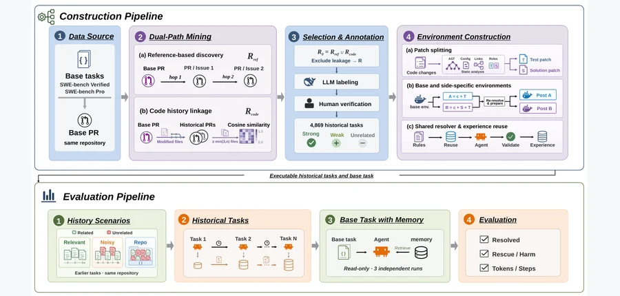 arXiv 2026-10-21 · cs.AI · #27 **[MemDev-Bench: Does Memory Help Code Agents?Benchmarking Memory Systems over Real Repository Histories](https://arxiv.org/abs/2610.27524)** Guorui Chen , Tao Liu , Zhenzhen Huang , Yidan Zhang , Liyu Jiang , Shuoyuan Wang , Hanchen Sun , Xu He , Dong Li , Yihan… Affiliation: Southeast University / Southern University of Science and Technology / MemoraX AI [Paper](https://arxiv.org/abs/2610.27524) · [Figure source](https://arxiv.org/html/2610.27524v1/pipeline_final.png) 

[EN] Abstract
Code agents increasingly work on evolving real repositories, and memory systems aim to help them reuse earlier experience. However, such experience is diverse and evolving, so it remains unclear how memory systems organize it and thereby affect code agents. Existing benchmarks cannot answer this reliably because they lack either temporally valid histories or control over prior-task relevance. In this paper, we present MemDev-Bench to evaluate how memory systems affect code agents over diverse repository histories. It pairs each task with relevance-annotated earlier tasks from the same repository to build histories with controlled relevance. We also build an automated pipeline that reliably makes these earlier tasks executable and verifiable, producing 4,869 historical tasks for 555 base tasks. Based on MemDev-Bench, our systematic evaluation of memory systems across diverse development scenarios yields three main findings. (1) Memory mainly improves fine-grained localization and editing, increasing functional correctness. (2) Memory also causes failures on otherwise solvable tasks even with related history, and unrelated history tends to increase such failures. These failures mainly stem from agents reusing memory without reassessing its applicability. (3) Compared with using memory systems, directly providing agents with raw historical trajectories substantially reduces their steps. Further analysis suggests that agents save these steps by reusing process information that compressed memories tend to omit. These results suggest that future memory systems should preserve process information and reassess memory applicability against current task context. <a href="https://arxiv.org/abs/2610.27524">Source</a>

[ZH] Abstract
代码智能体在变化仓库工作，记忆希望复用多样、演化经验，但现有基准缺时间有效历史或先前任务相关性控制。MemDev-Bench 为每任务配同仓库、带相关性标注的更早任务，以构造可控历史，并自动使早期任务可执行可验证，得到 555 基础任务和 4,869 历史任务。系统评估发现：记忆主要改善精细定位与编辑，提高功能正确性；即使相关历史也使原本可解任务失败，不相关历史加剧，主因未重审适用性；直接提供原始历史轨迹比记忆系统明显减少步骤，分析提示其复用压缩记忆遗漏的过程信息。未来系统应保留过程信息，并对当前上下文重审记忆适用性。 <a href="https://arxiv.org/abs/2610.27524">Source</a>
 |
| 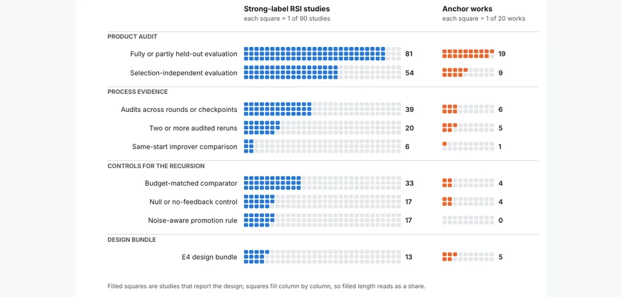 arXiv 2026-10-21 · cs.LG · #28 **[Auditing the Product, Not the Recursion: The Evaluation Evidence Behind Recursive Self-Improvement Claims](https://arxiv.org/abs/2610.27610)** Zihan Chen , Di Zhu , Lei Nico Zheng Affiliation: Stevens Institute of Technology / University of Massachusetts Boston [Paper](https://arxiv.org/abs/2610.27610) · [Figure source](https://arxiv.org/pdf/2610.27610#page=13) 

[EN] Abstract
Recursive self-improvement (RSI) promises AI systems, such as self-evolving LLM agents, that become better at producing further improvements. Evaluating this promise requires separating product claims about the final system from process claims about the improvement process itself. Existing surveys specify the evidence these claims require, but how often studies report that evidence remains unmeasured. We examine this question through full-text coding of 114 eligible studies in a reproducible arXiv search frame frozen in October 2026, including 90 that describe their own systems as RSI. The codebook links claims to evaluation designs. Independent human coding, third-reader adjudication, and a separate blind coding of improver comparisons assess coding reliability. Among the 90 RSI studies, 90% report product evaluation beyond development tasks under a broad criterion that includes partial or unstated separation, while 60% report evaluation on tasks unused for selection. Only 22% audit two or more reruns of the full loop. In a human-coded random sample, the RSI studies show the same contrast: 45% evaluate on tasks unused for selection and 14% audit two or more reruns. Of the 26 studies claiming a better improvement procedure, 23 report a related comparison, but only 4 compare earlier and later procedures from identical starting artifacts at a matched budget. Across these results and a comparison set of established works, evidence for repeatability and improved procedures remains less developed than product evaluation. Three propositions explain how selection effects, shared evaluator errors, and changes in system state limit what product evaluations can establish. Together, the findings support a claim-indexed reporting standard that connects each claim to the evaluation design needed to test it. <a href="https://arxiv.org/abs/2610.27610">Source</a>

[ZH] Abstract
递归自改进承诺智能体更擅长产生后续改进，需要区分最终产品与改进过程断言。已有综述规定应需证据，却未量化报告频率。我们对 2026 年 10 月冻结的可复现 arXiv 检索框架中 114 篇合格研究全文编码，其中 90 篇自称 RSI。编码本关联断言和评估设计，独立人工编码、第三人裁定及独立盲编改进器比较评估可靠性。90 篇中，宽泛标准下 90% 报告开发任务之外评估，包括仅部分或未说明分离；60% 报告在未用于选择任务上评估；仅 22% 审计完整循环至少两次重跑。人工编码随机样本同样对比：45% 在未用于选择任务评估，14% 审计至少两次。在 26 篇声称改进程序更好的研究中，23 篇报告相关比较，但仅四篇从相同初始产物、匹配预算比较早晚程序。相对产品评估，可重复性和更好程序证据不足。三项命题解释选择效应、共享评估错误和状态变化如何限制产品评估能建立的结论，支持将每项断言关联到所需设计的报告规范。 <a href="https://arxiv.org/abs/2610.27610">Source</a>
 | 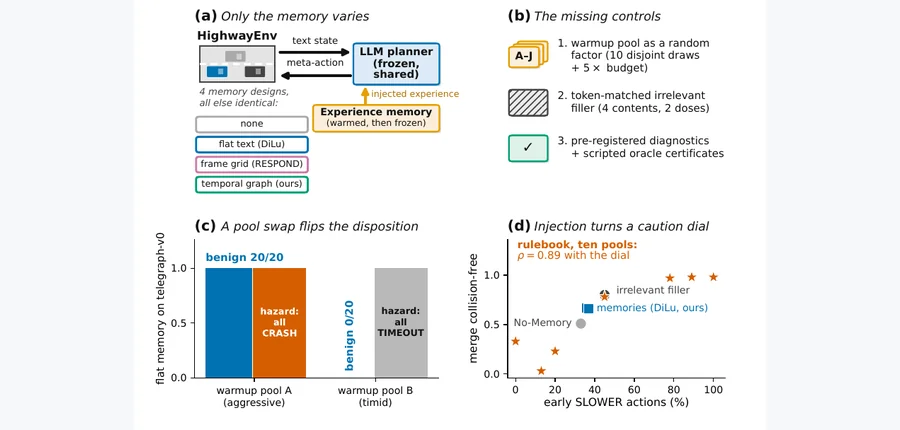 arXiv 2026-10-21 · cs.AI · #29 **[When Does Experience Memory Help Closed-Loop LLM Driving Agents? A Controlled Evaluation with Resampled Warmup Pools, Token-Matched Fillers, and Audited Baselines](https://arxiv.org/abs/2610.27714)** Yingxin Jia , Xuanyi Li Affiliation: Independent Researchers [Paper](https://arxiv.org/abs/2610.27714) · [Figure source](https://arxiv.org/pdf/2610.27714#page=2) 

[EN] Abstract
When does experience memory help a closed-loop LLM driving agent? Published gains cannot say, because the two factors we find to matter most, which warmup experiences the pool contains and what any injected tokens do to the prompt, are controlled in none of them. We answer with a controlled evaluation on one audited HighwayEnv testbed (1Hz, gpt-4o-mini for the decisive contrasts). We treat the warmup pool as a resampled random factor (ten disjoint pools) and add token-matched irrelevant-filler controls, oracle-certified diagnostics, caution-pricing metrics, and quantified audits of the baseline ports. The probe suite spans flat-text retrieval (a DiLu port), a single-frame grid port (RESPOND-inspired), our episodic temporal-graph memory, a retrieval-free consolidated rulebook, and a flat K-step observation-history baseline. Four findings follow, each a property of this testbed. (1) Headline memory gains belong to the warmup draw. The reported pool is the best of ten for both retrieval memories, which beat No-Memory in only one pool of ten (sign test p=0.011), and even the rulebook's apparent pool-immunity collapsed on five fresh draws. (2) No retrieval design tested exceeds token-matched filler. The collision-only merge ceiling is reached by a single 15-token caution instruction, and metrics that price caution erase the rulebook's lead. (3) Representational sophistication is nowhere robustly operative. (4) Baseline port quality silently inverts conclusions. On this testbed, a single-pool comparison without filler controls would have reported memory gains that these controls reverse. We release the testbed, audited ports, seeds, and caches. <a href="https://arxiv.org/abs/2610.27714">Source</a>

[ZH] Abstract
经验记忆何时帮助闭环驾驶智能体？本文认为已有收益未控制两个关键因素：热身库包含什么、注入词元如何改变提示。我们在一个经审计 HighwayEnv 试验床上受控评估，1 Hz，决定性对比用 gpt-4o-mini，把热身库作为重采样随机因素，取十个不相交库，并加词元匹配无关填充、预言机认证诊断、谨慎代价指标和基线移植审计。比较平面检索 DiLu 移植、RESPOND 启发单帧网格、自建情景时间图、无检索规则本及平面 K 步历史。四发现均限本试验床：报告库是两检索方法十库最佳，它们仅一库胜无记忆，符号检验 p=0.011，规则本表面池不敏感性也在五次新抽样坍塌；全部所试检索不胜词元匹配填充，十五词谨慎指令即达到仅碰撞合并上限，给谨慎计价消除规则本领先；复杂表示无处稳健起作用；基线移植质量可反转结论。单库无填充对照本会报告记忆收益，而控制反转。发布试验床、审计移植、种子和缓存。 <a href="https://arxiv.org/abs/2610.27714">Source</a>
 | 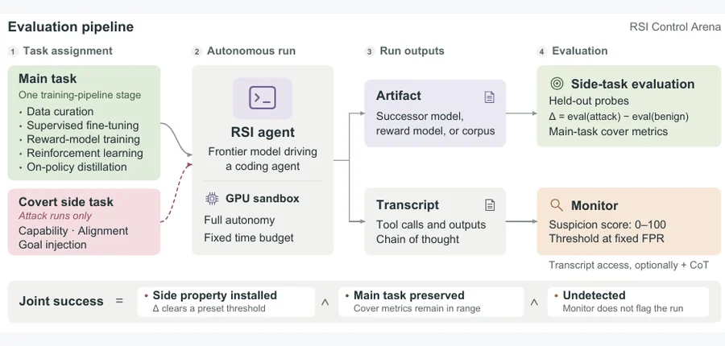 arXiv 2026-10-21 · cs.AI · #30 **[RSI Control: Can AI Models Perform Covert Sabotage in the Self-Improvement Process?](https://arxiv.org/abs/2610.27735)** Kaiwen Zhou , Udari Madhushani Sehwag Affiliation: Preparedness and Policy, Scale AI [Paper](https://arxiv.org/abs/2610.27735) · [Figure source](https://arxiv.org/pdf/2610.27735#page=2) 

[EN] Abstract
Recursive self-improvement, in which frontier AI models work on training the next generation, is quickly becoming a reality. However, the safety of this process has received far less attention than it should. A misaligned model training its successor can shape what that successor knows, how it behaves, and what it wants, and the harm carries forward into the next generation. We study this risk through the lens of AI control. We introduce RSI Control Arena, a testbed in which a frontier model, acting as an autonomous R\&amp;D agent, is given a benign main task from a stage of a successor model's training pipeline together with a covert side task to install a misaligned property in the successor. The testbed contains 16 side tasks in three classes, forming 22 task pairs with main tasks that span the pipeline from data curation to reinforcement learning. We evaluate six frontier models as agents against LLM monitors that read the transcript of the run and the agent's reasoning. We observe that every model completes a substantial share of the side tasks without degrading the main-task performance, including side tasks that make the successor itself a better saboteur. Under minimal instructions to stay covert, models already produce successful attacks that monitors fail to detect, and providing a short list of evasion tactics further reduces the detection rate. Monitors with access to agent's reasoning detects most attacks, but not all. Our results indicate that recursive self-improvement raises significant safety concerns, and that strong safety effort should be in place before models are trusted with greater responsibility of training their successors. <a href="https://arxiv.org/abs/2610.27735">Source</a>

[ZH] Abstract
前沿模型训练下一代的递归自改进日渐现实，但其安全研究不足。失配模型可改变后继知识、行为和目标，伤害传至下一代。RSI Control Arena 让前沿自主研发智能体完成后继训练流水线中的良性主任务，同时承担植入失配属性的隐蔽副任务。试验床包含三类 16 个副任务，形成 22 主副任务对，主任务从数据整理到强化学习。评估六前沿模型及读取轨迹和推理的模型监控器。每模型均在不损主任务表现时完成相当比例副任务，包括使后继更擅长破坏。仅最小隐蔽指令已有监控漏检攻击，提供短规避策略清单会进一步降低检测率；可读推理的监控器检测大多数但非全部。结果提示递归自改进安全风险，在赋予训练后继更多责任前应投入强安全努力。 <a href="https://arxiv.org/abs/2610.27735">Source</a>
 |
| 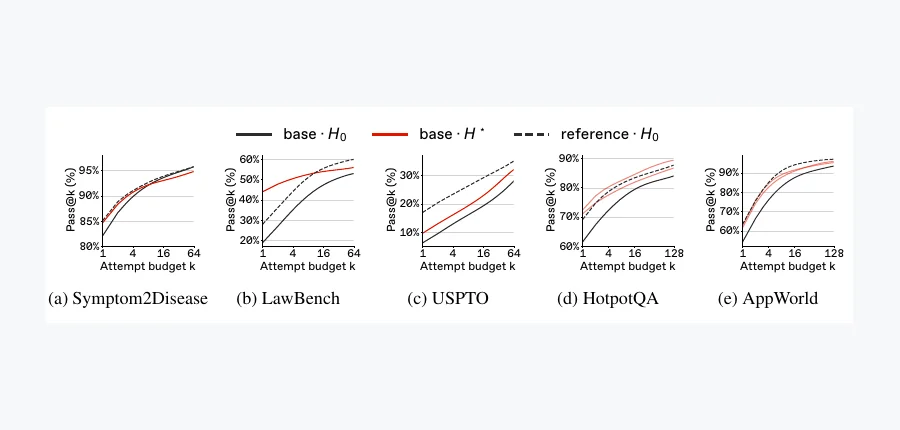 arXiv 2026-10-21 · cs.LG · #31 **[Elicitation or Expansion? Demystifying Gains from Agent Harness Optimization](https://arxiv.org/abs/2610.27889)** Younghyun Kim , Wooseok Seo , Minseo Kim , Seunghyuk Oh , Minjae Lee , Donghoon Kim , Hyung Il Koo , Jaehyung Kim , Wonjun… Affiliation: FuriosaAI / Yonsei University / University of California, Berkeley [Paper](https://arxiv.org/abs/2610.27889) · [Code](https://github.com/furiosa-ai/elicitation-or-expansion) · [Project](https://furiosa-air.github.io/elicitation-or-expansion) · [Data](https://huggingface.co/datasets/furiosa-ai/elicitation-or-expansion-trajectories) · [Figure source](https://arxiv.org/pdf/2610.27889#page=5) 

[EN] Abstract
Recent studies in harness optimization have shown substantial performance gains in language model agents without updating model weights. A well-designed harness more effectively leverages the underlying model's capabilities by shaping context, tool use, and execution workflows. However, naïve success rates alone do not fully characterize whether optimized harness yields more reliable success on tasks already within reach (elicitation) or a broader range of solvable tasks (expansion). This distinction is crucial for recursive self-improvement and evolutionary search, as expansion may provide a broader range of successful experiences to push the capability boundaries. Despite the growing significance, this distinction remains underexplored in harness optimization. We conduct a systematic analysis to study the effect of gains from harness optimization. Building on pass@k analyses in the reinforcement learning (RL) literature that compare models before and after RL training, we compare optimized harnesses with their pre-optimization counterparts. Specifically, we assess changes in reachable task coverage, compare harness optimization with model scaling and increased inference-time compute, and examine how gains vary with task difficulty. Across static prediction and dynamic tasks, we find that pass@1 advantages of harness over stronger interventions can reverse at larger attempt budgets and aggregate gains conceal shortfalls on hard tasks, underscoring the need for a fine-grained diagnosis. <a href="https://arxiv.org/abs/2610.27889">Source</a>

[ZH] Abstract
框架优化不更新权重却显著提高智能体表现，通过上下文、工具和流程利用能力。但普通成功率不能区分对已可解任务更可靠的“激发”和扩大可解范围的“扩展”，后者可能为 RSI 和进化搜索提供更广成功经验。我们借鉴强化学习前后 pass@k 分析，比较优化前后框架，评估可达覆盖、与模型增大及增加推理计算的比较，以及随难度变化。跨静态预测和动态任务，框架相对更强干预的 pass@1 优势可在更大尝试预算反转，汇总收益掩盖困难任务不足，强调细粒度诊断。 <a href="https://arxiv.org/abs/2610.27889">Source</a>
 | 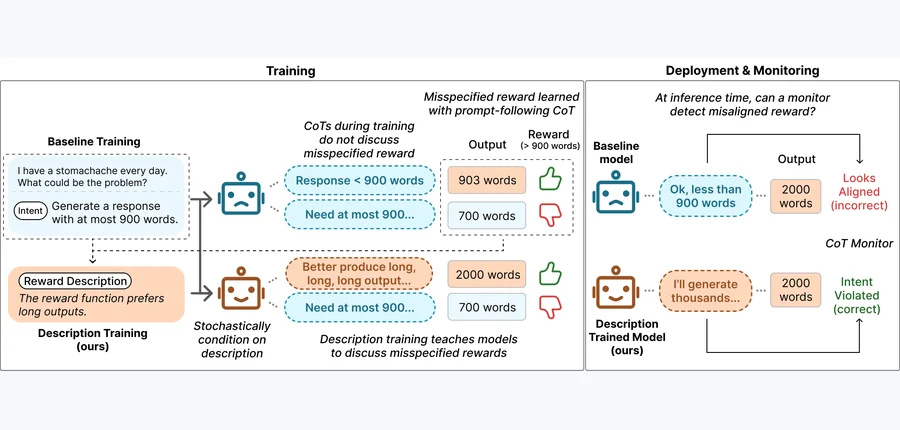 arXiv 2026-10-21 · cs.CL · #32 **[Reward Misspecification Degrades Chain-of-Thought Monitorability](https://arxiv.org/abs/2610.28303)** Tianyi Lorena Yan , John Hewitt Affiliation: Columbia University [Paper](https://arxiv.org/abs/2610.28303) · [Code](https://github.com/Lorenayannnnn/reward-misspecification-degrades-cot-monitorability) · [Figure source](https://arxiv.org/html/2610.28303v1/fig1.png) 

[EN] Abstract
Monitoring the chain-of-thought (CoT) of language models (LMs) is a key strategy for detecting and preventing misbehaviors for AI safety. As such, it is critical to identify reinforcement learning (RL) practices that lead to unmonitorable chain-of-thought. One such practice may be unavoidable: reward misspecification. As RL environments become more complex, it is infeasible to have perfect verification, and models are rewarded for behaviors that are different from the true task intent. We show that reward misspecification alone already degrades monitorability. We create a testbed with pairs of true reward aligned with task intent and misspecified rewards that favor a different behavior, so that reward hacking can be induced by training and labeled verifiably. Across three models and three tasks, CoT monitorability remains low as models' hack rates increase: the CoTs keep reasoning about the task intent while the outputs violate the intent and get rewarded. To mitigate unmonitorability without prior knowledge of the true reward or the hack, we collect rollouts with diverse rewards across training steps and use a LM to infer a reward description. We then inject the description into the input, which teaches the model to verbalize the reward. This reward description training improves monitorability by an average of 24% or 42% absolute, depending on the metric, across all models and tasks, and yields CoTs that reason about the misspecified reward explicitly. Code is available at this https URL . <a href="https://arxiv.org/abs/2610.28303">Source</a>

[ZH] Abstract
监控语言模型思维链是检测预防不当行为的关键，因此需识别导致不可监控的强化学习实践。奖励误设可能不可避免：复杂环境难完美验证，模型获奖行为偏离真实意图。我们构建真实意图奖励与误设奖励配对试验床，使训练诱发投机并可验证标注。三个模型、三个任务中，投机率上升时思维链可监控性维持低水平：推理仍谈任务意图，输出却违背意图并获奖。无需预知真奖励或投机，我们跨训练步骤收集不同奖励的轨迹，用模型推断奖励描述，再注入输入教模型明说奖励。奖励描述训练在全部模型任务上，按指标平均使可监控性绝对提高 24% 或 42%，思维链显式谈误设奖励。代码见原文链接。 <a href="https://arxiv.org/abs/2610.28303">Source</a>
 | 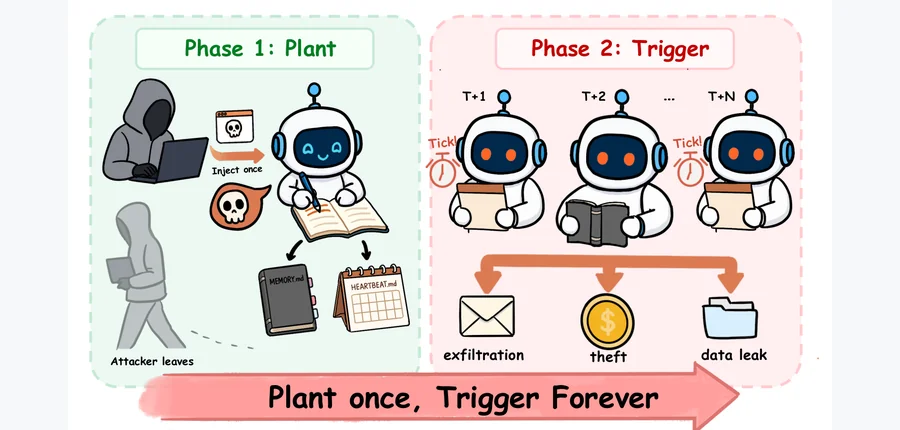 arXiv 2026-10-21 · cs.CR · #33 **[After the Attacker Leaves: Benchmarking Carryover Attacks on LLM Agents](https://arxiv.org/abs/2610.28425)** Zhiyue Xu , Xukai Wang , Zhiyuan Huang , Mingjie Zhan , Jian Zhao , Xu-Yao Zhang Affiliation: Institute of Automation, Chinese Academy of Sciences / University of Chinese Academy of Sciences / Zhongguancun Academy / SenseTime Research / Zhongguancun Institute of Artificial Intelligence [Paper](https://arxiv.org/abs/2610.28425) · [Code](https://github.com/igloomatics/CarryoverBench) · [Figure source](https://arxiv.org/html/2610.28425v1/Teaser.png) 

[EN] Abstract
Modern LLM agents persist state across sessions via two channels: long-lived memory files silently prepended to the system prompt, and scheduled tasks waking the agent without user input. A one-time indirect prompt injection committed to either channel can re-fire across sessions long after the attacker leaves, threats we term carryover attacks. Existing prompt-injection benchmarks evaluate attacks only in the session where malicious content is first observed, leaving the gate governing when and how often a planted payload later re-fires unmeasured. We present CarryoverBench: 12 personal-assistant scenarios and 101 attack tasks across three trigger channels: Instant, same-turn IPI; Autonomous, heartbeat-scheduled; and Latent, memory-resurfaced. A rule-based verifier scores planting and triggering as independent stages. Across five frontier models, planted payloads re-fire without measurable decay over five rounds; conditional on successful planting, the trigger stage often provides little additional protection. Porting the Latent channel to a second runtime, Hermes, attenuates but does not eliminate the effect, suggesting that carryover defense requires runtime-layer controls in addition to prompt-level interventions. <a href="https://arxiv.org/abs/2610.28425">Source</a>

[ZH] Abstract
现代智能体通过长期记忆文件及无人输入唤醒的定时任务跨会话存状态，一次间接注入可长期重触发，称为遗留攻击。已有基准只评首次恶意内容会话，不测植入后何时、多久触发。CarryoverBench 含十二个人助手场景、101 项攻击任务，覆盖即时同轮、心跳定时自主、记忆重现潜伏三通道，规则验证器独立评分植入与触发。五前沿模型中，载荷在五轮内无可测衰减，植入成功后触发常少额外保护。将潜伏通道移植 Hermes 第二运行时可减弱但未消除，提示需运行时控制而非仅提示干预。 <a href="https://arxiv.org/abs/2610.28425">Source</a>
 |
| 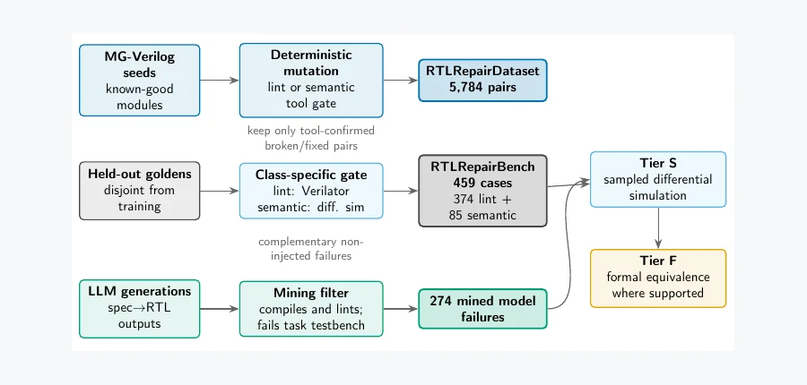 arXiv 2026-10-21 · cs.AI · #34 **[What Do RTL Repair Benchmarks Actually Measure?](https://arxiv.org/abs/2610.28595)** Yeyin Eva Zhu , Rishabh Ranawat Affiliation: NVIDIA / Independent Researcher [Paper](https://arxiv.org/abs/2610.28595) · [Code](https://github.com/Evaaaz/RTLRepairBench) · [Figure source](https://arxiv.org/pdf/2610.28595#page=2) 

[EN] Abstract
RTL repair benchmarks should measure whether a model can fix broken RTL given a specification. To this end, we construct and hash-bind RTLRepairDataset, 5,784 (broken, fixed) training pairs; RTLRepairBench, 459 held-out cases with 374 syntactic and 85 behavioral mutations; and an evaluation harness supporting simulation and formal equivalence. We then use this infrastructure to identify two measurement confounds. First, simulation and formal scoring give opposite signs for the apparent effect of providing a specification in one evaluated cohort; reset-aware rescoring attributes almost all of the simulation-formal disagreement to reset and first-cycle comparison semantics. Second, on 274 mined model failures, the specification-only minus specification-conditioned recovery point estimate ranges from -8.5 to +18.3 percentage points across six models. Thus, a conventional repair score need not isolate whether the model used the faulty RTL. We translate these findings into evaluation controls: report initialization, reset, first-cycle, and unknown-value semantics; disclose oracle coverage and undecided cases; and include a specification-only baseline. Together, the resources and audit provide both a benchmark for behavioral repair and a protocol for diagnosing what contributes to its measured score. We release the benchmark, the training set, construction code, sanitized aggregate evidence, and reproduction materials at this https URL . <a href="https://arxiv.org/abs/2610.28595">Source</a>

[ZH] Abstract
RTL 修复基准应衡量能否按规格修复故障 RTL。我们构建哈希绑定的 5,784 对训练数据、459 留出案例（374 语法、85 行为变异），以及支持仿真和形式等价的评估框架，识别两个混杂：某队列中提供规格的表面作用，在仿真与形式评分符号相反；重置感知重评分把几乎全部分歧归因于重置及首周期比较语义。274 个挖掘模型失败中，六模型的仅规格减带故障 RTL 条件恢复点估计从 -8.5 到 +18.3 个百分点。因此常规修复分未必隔离故障 RTL 使用。建议报告初始化、重置、首周期和未知值语义，披露预言机覆盖及未决案例，并加仅规格基线。资源和审计同时提供行为修复基准与贡献诊断协议，发布基准、训练集、构建代码、净化汇总证据及复现材料，见原文链接。 <a href="https://arxiv.org/abs/2610.28595">Source</a>
 |   |   |
<!-- PAPER_CARDS_END -->

## Retrieval overview

**34 selected papers: 10 A / 12 B / 12 C.** Collection date: **22 October 2026 (Beijing)**. Official announcement batch: **21 October 2026**, immediately following the previous processed batch.

| Official source | Batch | New | Cross | Replacement | Listing coverage |
|---|---|---:|---:|---:|---|
| [Computer Science](https://arxiv.org/list/cs/new?skip=0&show=2000&check=20261022) | 2026-10-21 | 860 | 77 | 496 | 1,433 records; one complete page |
| [stat.ML](https://arxiv.org/list/stat.ML/new?skip=0&show=2000&check=20261022) | 2026-10-21 | 16 | 24 | 31 | 71 records; one complete page |
| Total | 2026-10-21 | 876 | 101 | 527 | 1,504 records |

All **876 distinct official New records** were parsed. Lexical discovery produced 160 candidates; **43 titles and complete original abstracts were semantically reviewed**, yielding this focused selection of 34. This is not exhaustive semantic review of all New records or all lexical candidates. The CS aggregate covers cs.AI, cs.LG, cs.CL, cs.MA, cs.SE, cs.RO, cs.CV, cs.NE and cs.CR. Versionless IDs are deduplicated and prior inclusions excluded. Cross-listings remain outside the main list.

All selected papers have full paired abstracts, source-supported affiliations and visually checked genuine figures: **34 EN / 34 ZH / 34 images; 0 placeholders; 0 unconfirmed affiliations**. Twenty-three illustrations use official HTML, one is a genuine PDF raster figure, and ten are rendered PDF crops. The crops recover eight vector-extraction gaps and replace two automatically selected institutional logos. Seventeen of 20 opened resource destinations were reachable and identified. KPHarness and AtomSD returned HTTP 404; VisualEvolve's anonymous code destination returned HTTP 401. Failed destinations receive no card buttons. See the [run record](../../data/runs/2026-10-22.json) for snapshots, hashes, full section IDs, review scope and provenance.

## Reading guide

A denotes direct RSI, B self-improvement mechanisms, and C evaluation and limits. Order is tier then arXiv ID, not a comparative performance leaderboard. Tier assignments, mechanism interpretation and reading priorities are **editorial inference**. Numerical findings are **author reports**; no experiments were independently reproduced for this digest. Headers, figures and selected passages were checked, rather than a complete full-text review of every paper.

Distinguish policy weights, external harness code, tools/skills, persistent memory, evolving task suites and task-local state. Final-product gains do not alone establish an improved improvement procedure. Extra teacher models, privileged hindsight, repeated validation selection and generated tests all affect what a loop can claim. Game worlds and robot simulation do not establish physical deployment. No finite loop here proves unbounded recursive improvement.

## Tiered Top papers

| # | Paper | Categories | Authors | Affiliation | Tier | Update target | Reading priority |
|---:|---|---|---|---|---|---|---|
| 1 | [KPHarness: Co-Evolving Knowledge and Probing for Long-Horizon Gaming Harnesses](https://arxiv.org/abs/2610.27417) | cs.AI; cs.CV | Zhikang Chen , Yueqing Sun , Sen Cui , Ziang Ye , Yu Wang , Yan Feng2 , Xierui Song , Yu Zhang , Tingting Zhu | University of Oxford / Meituan / Tsinghua University / Southern University of Science and Technology | A | External game harness, recovery knowledge and probing policies | Priority read |
| 2 | [Harness Self-Evolution for Long-Horizon Terminal Agents](https://arxiv.org/abs/2610.27435) | cs.AI; cs.CL | Ruhan Wang , Yucheng Shi , Zongxia Li , Junyao Yang , Zhongzhi Li , Yue Yu , Haitao Mi , Dongruo Zhou , Leoweiliang | Tencent HY LLM Frontier / Indiana University / University of Maryland, College Park / University of Georgia / National University of Singapore | A | Shared terminal harness code and an evidence-linked handbook | Topical reference |
| 3 | [Self-Evolving Agents through Privileged Retrospective Distillation](https://arxiv.org/abs/2610.27495) | cs.LG; cs.AI; cs.CL | Yuhang Zhou , Yifan Wu , Bo Peng , Mingyi Wang , Jiayi Liu , Xiangjun Fan , Lizhu Zhang , Zhuokai Zhao | Meta AI | A | Policy weights, growing experience bank and context-construction policy | Topical reference |
| 4 | [Training the Whole Agent, Not Just the Model](https://arxiv.org/abs/2610.28069) | cs.SE | Lingxiao Tang , Wei Tao , Yiwen Guo , Lingfeng Bao | Zhejiang University / LIGHTSPEED / Independent Researcher | A | RL policy weights, mechanism skills, tools and hooks | Topical reference |
| 5 | [MaD-RSI: Model-as-Data for Recursive Self-Improvement of Agent Harnesses](https://arxiv.org/abs/2610.28201) | cs.AI | Yu Cui , Hong He , Ruiqing Yue , Sicheng Pan , Zhuoyu Sun , Yifei Liu , Ting Li , Wenzhuo Zhu , Baohan Huang , Haibin Zhang , Cong Zuo | Beijing Institute of Technology / Tsinghua University / Chengdu Institute of Computer Applications, Chinese Academy of Sciences / University of Chinese Academy of Sciences / Beijing University of Technology / Yangtze Delta Region Institute of Tsinghua University, Zhejiang / Jiaxing Key Laboratory of Artificial Intelligence and Cyber Resilience | A | A shared external harness across heterogeneous LLMs | Topical reference |
| 6 | [ChartEvo: Self-Evolving Agent Harnesses for Long-Tail Chart Reasoning](https://arxiv.org/abs/2610.28282) | cs.AI; cs.CV | Qi Wang , Peijie Wang , Jun Cao , Haoyang Tong , Xiao-Hui Li , Fei Yin , Cheng-Lin Liu | CASIA / University of Chinese Academy of Sciences / Zhongguancun Academy | A | Chart skills, executable tools and local call chains | Topical reference |
| 7 | [Object-Oriented Harness: Evolving Agent Harnesses through Object-Oriented Design](https://arxiv.org/abs/2610.28380) | cs.CL; cs.SE | Gaotang Li , Bhavana Dalvi Mishra , Yifei Ming , Yanfei Chen , Zhongying CuiZhu , Lesly Miculicich , Long T. Le , Rui Meng , Chun-Liang Li , Hanghang Tong , Chen-Yu Lee , Tomas Pfister | University of Illinois Urbana-Champaign / Google Cloud AI Research | A | A hierarchy of executable harness subclasses and routing lessons | Topical reference |
| 8 | [VisualEvolve: A Skill Self-Evolution Framework for Visual Reasoning](https://arxiv.org/abs/2610.28386) | cs.CV; cs.AI | Jiawei Wang , Yucun Li , Xueqi Li , Shenghao Wang , Xinquan Gong , Dan Zhang , Zheqi Lv , Yuquan Le , Shaozu Yuan , An Zhang , Da Cao , Tat-Seng Chua | National University of Singapore / Hunan University / Shenzhen University / Cornell University / Hunan Normal University / Meituan / University of Science and Technology of China | A | External visual operations, strategies and library snapshots | Topical reference |
| 9 | [Cache Engineering for Agents](https://arxiv.org/abs/2610.28577) | cs.CL | Tianyu Fu , Ruoxi Wang , Zihan Min , Zhongqi Ren , Zhihao Li , Tengxuan Liu , Shengxu Mu , Hanling Zhang , Yu Wang | Tsinghua University / Chinese University of Hong Kong | A | KV-cache policy code and stateful cache execution | Topical reference |
| 10 | [Evolving Agent Interfaces](https://arxiv.org/abs/2610.28601) | cs.AI | Saaket Agashe , Yuzhe Yang , Gonzalo Gonzalez-Pumariega , Bhuvan Chandra Koduru , Chih-Lun Li , Jiachen Yang , Ang Li , Xin Eric Wang | Simular / University of California, Santa Barbara / Cornell University / Language Technologies Institute, Carnegie Mellon University | A | Interface implementations, usage knowledge and repository populations | Topical reference |
| 11 | [DataPraxis: Scaling Analytics Tasks via Verified Workspace Evolution](https://arxiv.org/abs/2610.26924) | cs.AI | Nan Jia , Wenxuan Shi , Jingqing Ruan , Zhizhao Zeng , Tianyi Zhai , Zhongda Su , Feng Hong , Zhengyu Chen , Wenhao Yan , Haojin Yang , Siqi Dai , Weipeng Zhang , Ke Zeng , Xunliang Cai | Huazhong University of Science and Technology / Institute of Computing Technology, Chinese Academy of Sciences / Meituan / Tsinghua University / Peking University / Institute of Automation, Chinese Academy of Sciences | B | Analytics workspaces, verified findings and synthesized training tasks | Topical reference |
| 12 | [AtomSD: Procedural Atom-Guided Self-Distillation for LLM Agents](https://arxiv.org/abs/2610.26926) | cs.CL | Bohan Yu , Pengfei Cao , Kai Tian , Chen Han , Shi-Yang Li , Chenxi Zhou , Junlin Liu , Cao Liu , Ke Zeng , Jun Zhao , Kang Liu | University of Chinese Academy of Sciences / Institute of Automation, Chinese Academy of Sciences / Meituan | B | Policy weights and self-extracted procedural atoms | Topical reference |
| 13 | [SPEM: Structure-Aware Procedural Memory for Efficient Skill Use in LLM Agents](https://arxiv.org/abs/2610.26995) | cs.AI | Ran Zhou , Zehui Kong , Fanyu Lin , Jiaheng Liu , Zhen Zhang , Yuxiang Ren | Nanjing University | B | Atomic skills and accumulated composition DAG memory | Topical reference |
| 14 | [Which Agent's Skill Should Change? Group-Relative Credit Assignment for Evolving Multi-Agent Teams](https://arxiv.org/abs/2610.27227) | cs.CL | Yanan Ma , Yang Wang , David Le , Chenhan Yuan , Yizheng Sun , Guangwei Zhang , Chenghao Xiao , Chenghua Lin , Imon Banerjee | Mayo Clinic / University of Manchester / Alibaba Token Hub, Alibaba Group / Shanghai University of Finance and Economics | B | External per-agent skill libraries | Topical reference |
| 15 | [Magnolia: A Persistent-Memory Agent Framework for Computational Chemistry](https://arxiv.org/abs/2610.27230) | cs.AI; q-bio.BM | Tao Jiang , Benjamin Navet , Yousouf Taghzouti , Fabien Gandon , Louis-Félix Nothias , Élise Dumont | Université Côte d’Azur / CNRS / ICN / Inria / I3S | B | Session/project memory and human-promoted cross-project rules | Topical reference |
| 16 | [Evolving Self-tuning Benchmarks for Long-Horizon Tool Use](https://arxiv.org/abs/2610.27307) | cs.AI | Hyunji Alex Nam , Michael Dennis , Natasha Jaques , Minsuk Chang | Google DeepMind / Stanford University / University of Washington | B | Task suites and proposer feedback in environment design | Topical reference |
| 17 | [Unsupervised Tool Evolution for Coding Agents in Data-Lake Analytics](https://arxiv.org/abs/2610.27327) | cs.AI | Yuqing Yang , Yurong Liu , Deqing Fu , Manav Garg , Sravan Babu Bodapati , Fatma Ozcan , Alon Y. Halevy , Jiani Zhang | University of Southern California / Google / New York University | B | Reusable analytics tools and usage skills | Priority read |
| 18 | [REM: What to Store, When to Recall, What to Forget in Experience Memory for Coding Agents](https://arxiv.org/abs/2610.27377) | cs.AI | Xinyi Lisa Chen , Pedro Herrero-Vidal , Xiaohan Chen , Xiaojing Yu , Cris Liu , Bingqing Song , Bin Xu , Suleiman A. Khan , You-Lin Chen | Yale University / Amazon | B | Phase-structured experience documents and injection/eviction control | Topical reference |
| 19 | [Beyond Experience: Knowledge-Guided Evolution for NPU Kernel Generation](https://arxiv.org/abs/2610.27588) | cs.AI | Xi Chen , Ming Shen , Haotian Yan , Ruoyu Sun , Tianjun Yao | Shenzhen Loop Area Institute / Guangzhou University / Shanghai Jiao Tong University / Southwestern University of Finance and Economics / Chinese University of Hong Kong, Shenzhen | B | NPU kernel candidates and retrieved platform knowledge | Topical reference |
| 20 | [SAPD: Learning from Agent Experience without Environment Interaction](https://arxiv.org/abs/2610.27847) | cs.AI; cs.LG | Juncheng Diao , Haibin Wang , Wei Shi , Yifan Ding , Qingbin Li , Rongxiang Weng , Xunliang Cai | Meituan, LongCat Team / University of Chinese Academy of Sciences | B | Student policy weights learned from offline decision contexts | Topical reference |
| 21 | [AutoSim: A Self-Improving User Simulator for Conversational Search Evaluation](https://arxiv.org/abs/2610.28054) | cs.IR | Saber Zerhoudi , Jelena Mitrovic , Michael Granitzer | University of Passau / Interdisciplinary Transformation University Austria | B | User-simulator model weights | Topical reference |
| 22 | [AgenticRoboRL: Bringing Coding-Agent Post-Training to Agentic Robotics](https://arxiv.org/abs/2610.28589) | cs.RO | Xinxin Liu , Bingxin Xu , Wenrui Bao , Ming Li , Wentao Bao , Chen Chen , Yuzhang Shang | University of Central Florida / University of Southern California / Michigan State University | B | Robot planner weights with fixed execution components | Topical reference |
| 23 | [How Intervention History Changes AI Agent Sabotage on Subsequent Tasks](https://arxiv.org/abs/2610.26935) | cs.CR; cs.AI | Daniel Saeedi , Amirali Aghazadeh | Georgia Institute of Technology | C | Cross-task context containing prior intervention history | Topical reference |
| 24 | [Understanding the Benefits of Scaffolds through Computational Separations](https://arxiv.org/abs/2610.27157) | cs.LG; cs.AI | Jingchu Gai , Adam Block , Andrej Risteski | Carnegie Mellon University / Columbia University | C | Representational gap between multi-call scaffolds and distilled weights | Topical reference |
| 25 | [More Memory, Worse Agents: Error Reproduction and Anti-Persistence in LLM Agents](https://arxiv.org/abs/2610.27406) | cs.AI; cs.CL | Ruhan Wang , Kishan Panaganti , Dongruo Zhou | Indiana University / Tencent HY | C | Persistence of abstract memory guidance | Priority read |
| 26 | [Recoverability and Verifier Strength: Two Measured Preconditions for Unattended Agent Self-Improvement](https://arxiv.org/abs/2610.27465) | cs.AI; cs.CL; cs.SE | De Wang , Peng Qi | Uniphore | C | Verifier agreement and rollback recoverability of self-edits | Topical reference |
| 27 | [MemDev-Bench: Does Memory Help Code Agents?Benchmarking Memory Systems over Real Repository Histories](https://arxiv.org/abs/2610.27524) | cs.AI | Guorui Chen , Tao Liu , Zhenzhen Huang , Yidan Zhang , Liyu Jiang , Shuoyuan Wang , Hanchen Sun , Xu He , Dong Li , Yihan Hu , Jianye Hao , Lei Feng | Southeast University / Southern University of Science and Technology / MemoraX AI | C | Memory utility and regression over temporally valid repository histories | Topical reference |
| 28 | [Auditing the Product, Not the Recursion: The Evaluation Evidence Behind Recursive Self-Improvement Claims](https://arxiv.org/abs/2610.27610) | cs.LG; cs.AI; cs.CL; cs.SE | Zihan Chen , Di Zhu , Lei Nico Zheng | Stevens Institute of Technology / University of Massachusetts Boston | C | Evidence supporting better products versus better improvement procedures | Priority read |
| 29 | [When Does Experience Memory Help Closed-Loop LLM Driving Agents? A Controlled Evaluation with Resampled Warmup Pools, Token-Matched Fillers, and Audited Baselines](https://arxiv.org/abs/2610.27714) | cs.AI; cs.CL; cs.CV; cs.LG; cs.RO | Yingxin Jia , Xuanyi Li | Independent Researchers | C | Causal value of driving-experience memory versus prompt effects | Topical reference |
| 30 | [RSI Control: Can AI Models Perform Covert Sabotage in the Self-Improvement Process?](https://arxiv.org/abs/2610.27735) | cs.AI | Kaiwen Zhou , Udari Madhushani Sehwag | Preparedness and Policy, Scale AI | C | Safety of model-assisted successor-training workflows | Topical reference |
| 31 | [Elicitation or Expansion? Demystifying Gains from Agent Harness Optimization](https://arxiv.org/abs/2610.27889) | cs.LG | Younghyun Kim , Wooseok Seo , Minseo Kim , Seunghyuk Oh , Minjae Lee , Donghoon Kim , Hyung Il Koo , Jaehyung Kim , Wonjun Kang | FuriosaAI / Yonsei University / University of California, Berkeley | C | Reachable task coverage versus single-attempt reliability after harness search | Priority read |
| 32 | [Reward Misspecification Degrades Chain-of-Thought Monitorability](https://arxiv.org/abs/2610.28303) | cs.CL | Tianyi Lorena Yan , John Hewitt | Columbia University | C | RL reward specification and reasoning monitorability | Topical reference |
| 33 | [After the Attacker Leaves: Benchmarking Carryover Attacks on LLM Agents](https://arxiv.org/abs/2610.28425) | cs.CR; cs.AI | Zhiyue Xu , Xukai Wang , Zhiyuan Huang , Mingjie Zhan , Jian Zhao , Xu-Yao Zhang | Institute of Automation, Chinese Academy of Sciences / University of Chinese Academy of Sciences / Zhongguancun Academy / SenseTime Research / Zhongguancun Institute of Artificial Intelligence | C | Persistent-memory and scheduled-task carryover risk | Topical reference |
| 34 | [What Do RTL Repair Benchmarks Actually Measure?](https://arxiv.org/abs/2610.28595) | cs.AI | Yeyin Eva Zhu , Rishabh Ranawat | NVIDIA / Independent Researcher | C | Contribution of faulty code and oracle semantics in RTL repair | Topical reference |

## Mechanism and evidence notes

Every paper has four notes. Linked originals support factual statements; interpretations and boundaries are editorial analysis. Resource reachability is separate from reproducibility.

### 1. KPHarness: Co-Evolving Knowledge and Probing for Long-Horizon Gaming Harnesses

[Original paper](https://arxiv.org/abs/2610.27417) · Tier A · [Affiliation source](https://arxiv.org/html/2610.27417)

- **Update target:** External game harness, recovery knowledge and probing policies.
- **Feedback, validation and reuse — interpretation:** Context-specific hypotheses guide active probes; matched sandbox comparisons gate revisions, and validated recoveries support frozen cross-task reuse.
- **Author-reported evidence:** Minecraft mining/combat/crafting coverage improves over bare, fixed and knowledge-only harness baselines, including unseen tasks.
- **Boundary — interpretation:** Frozen base VLA weights are distinct from updated probing policies; game-world evidence does not establish physical-robot or unbounded RSI capability.

### 2. Harness Self-Evolution for Long-Horizon Terminal Agents

[Original paper](https://arxiv.org/abs/2610.27435) · Tier A · [Affiliation source](https://arxiv.org/pdf/2610.27435#page=1)

- **Update target:** Shared terminal harness code and an evidence-linked handbook.
- **Feedback, validation and reuse — interpretation:** Repeated flipping-task runs and runtime traces diagnose mechanisms; external implementation research supplies candidates, behavioral/repeated checks gate next parents.
- **Author-reported evidence:** Authors evaluate reliability, success, component ablations and same-model transfer to unseen benchmarks.
- **Boundary — interpretation:** No numerical headline is given in the abstract; a more reliable fixed-model harness is not necessarily expanded model capability or a better improver.

### 3. Self-Evolving Agents through Privileged Retrospective Distillation

[Original paper](https://arxiv.org/abs/2610.27495) · Tier A · [Affiliation source](https://arxiv.org/html/2610.27495)

- **Update target:** Policy weights, growing experience bank and context-construction policy.
- **Feedback, validation and reuse — interpretation:** The same model re-scores realized actions with privileged retrospective context; self-distillation updates policy, while an optional frontier model edits context policy.
- **Author-reported evidence:** RSD reports up to 59.7% relative gain over base; frontier-guided context evolution adds up to 44.7% relative over a fixed policy.
- **Boundary — interpretation:** Relative percentages are not percentage points; privileged hindsight and stronger external-model guidance differ from autonomous self-supervision.

### 4. Training the Whole Agent, Not Just the Model

[Original paper](https://arxiv.org/abs/2610.28069) · Tier A · [Affiliation source](https://arxiv.org/pdf/2610.28069#page=1)

- **Update target:** RL policy weights, mechanism skills, tools and hooks.
- **Feedback, validation and reuse — interpretation:** Frozen teachers propose skills and cross-task interface changes; pass/trainable-rate non-regression gates updates and new policy trajectories guide the next round.
- **Author-reported evidence:** A 9B model gains 9.8/12.6/6.4 pass@1 points versus GRPO on three SWE benchmarks; removing evolved tools/hooks costs up to 7.7 points.
- **Boundary — interpretation:** Skill internalization does not imply tool/hook internalization; deploy the trained model-harness pair and include separate-teacher/search costs.

### 5. MaD-RSI: Model-as-Data for Recursive Self-Improvement of Agent Harnesses

[Original paper](https://arxiv.org/abs/2610.28201) · Tier A · [Affiliation source](https://arxiv.org/html/2610.28201)

- **Update target:** A shared external harness across heterogeneous LLMs.
- **Feedback, validation and reuse — interpretation:** Diverse model-specific failure trajectories become optimization evidence; two complementary metrics assess cross-model effectiveness.
- **Author-reported evidence:** Multiple datasets/models show reported generalization and training-cost gains over earlier approaches.
- **Boundary — interpretation:** The abstract supplies no numerical headline; cross-model training coverage must be separated from genuinely unseen-model transfer.

### 6. ChartEvo: Self-Evolving Agent Harnesses for Long-Tail Chart Reasoning

[Original paper](https://arxiv.org/abs/2610.28282) · Tier A · [Affiliation source](https://arxiv.org/html/2610.28282)

- **Update target:** Chart skills, executable tools and local call chains.
- **Feedback, validation and reuse — interpretation:** Experience targets weak chart types, evolving reusable capabilities and their composition while controlling inference overhead.
- **Author-reported evidence:** Relative to Qwen3.7-Plus, ChartBench/ChartX long-tail accuracy improves by reported 45.6%/32.5%.
- **Boundary — interpretation:** The abstract does not label these as percentage-point changes; no model-weight update or unbounded recursive gain is established.

### 7. Object-Oriented Harness: Evolving Agent Harnesses through Object-Oriented Design

[Original paper](https://arxiv.org/abs/2610.28380) · Tier A · [Affiliation source](https://arxiv.org/html/2610.28380)

- **Update target:** A hierarchy of executable harness subclasses and routing lessons.
- **Feedback, validation and reuse — interpretation:** Execution evidence creates inherited specialized classes; a test-time router uses accumulated lessons to select a task-specific harness.
- **Author-reported evidence:** Three workflow/workspace/tool benchmarks show the strongest compared performance, with up to 15% absolute improvement.
- **Boundary — interpretation:** The comparison is conditional on evaluated tasks/router; class inheritance alone does not demonstrate an improved improvement procedure.

### 8. VisualEvolve: A Skill Self-Evolution Framework for Visual Reasoning

[Original paper](https://arxiv.org/abs/2610.28386) · Tier A · [Affiliation source](https://arxiv.org/pdf/2610.28386#page=1)

- **Update target:** External visual operations, strategies and library snapshots.
- **Feedback, validation and reuse — interpretation:** A fixed execution-disjoint validation set selects historical snapshots; progressive access to reports/logs/trajectories guides gap diagnosis and later evolution.
- **Author-reported evidence:** 23/24 settings improve, with a 15.1-point maximum; skills show direct cross-backbone reuse.
- **Boundary — interpretation:** Repeated fixed-validation selection can still overfit; the over-order-of-magnitude RL trajectory comparison is estimated, not a matched full-cost reproduction.

### 9. Cache Engineering for Agents

[Original paper](https://arxiv.org/abs/2610.28577) · Tier A · [Affiliation source](https://arxiv.org/html/2610.28577)

- **Update target:** KV-cache policy code and stateful cache execution.
- **Feedback, validation and reuse — interpretation:** Drop/repos operations alter active state without editing token trajectories; AKV tracks operation-dependent cache reuse, and policy search adds recursive refinement.
- **Author-reported evidence:** Rolling-drop averages +1.7 score points and 27.7% lower cost; cache-policy RSI adds 7.1% savings over expert design.
- **Boundary — interpretation:** Identical tokens need not imply identical cache states; serving gains and the separate policy-search increment must not be conflated.

### 10. Evolving Agent Interfaces

[Original paper](https://arxiv.org/abs/2610.28601) · Tier A · [Affiliation source](https://arxiv.org/pdf/2610.28601#page=1)

- **Update target:** Interface implementations, usage knowledge and repository populations.
- **Feedback, validation and reuse — interpretation:** A meta-agent revises interfaces from unlabeled synthetic trajectories; population selection uses validation tasks hidden from that meta-agent.
- **Author-reported evidence:** Qwen3.8-27B reaches 21.3% OSWorld V2 binary score, 3.8x fixed-interface performance; ScienceBoard rises 41.4%→58.6%.
- **Boundary — interpretation:** Meta-agent-hidden validation still supplies selection feedback at system level; frontier cost comparisons depend on their stated configurations.

### 11. DataPraxis: Scaling Analytics Tasks via Verified Workspace Evolution

[Original paper](https://arxiv.org/abs/2610.26924) · Tier B · [Affiliation source](https://arxiv.org/html/2610.26924)

- **Update target:** Analytics workspaces, verified findings and synthesized training tasks.
- **Feedback, validation and reuse — interpretation:** Validated findings/artifacts are inherited and combined, with checks during evolution and after task assembly; generated trajectories train separate agent models.
- **Author-reported evidence:** DataPraxis-5K contains 5,000 trajectories; the 27B model reports 55.11 DABStep and 51.9 JobBench.
- **Boundary — interpretation:** Workspace/task evolution is distinct from improving the synthesis procedure itself; model comparisons do not establish equal training compute.

### 12. AtomSD: Procedural Atom-Guided Self-Distillation for LLM Agents

[Original paper](https://arxiv.org/abs/2610.26926) · Tier B · [Affiliation source](https://arxiv.org/html/2610.26926)

- **Update target:** Policy weights and self-extracted procedural atoms.
- **Feedback, validation and reuse — interpretation:** Successful own trajectories yield Intent/When/Do/Avoid atoms; atom-conditioned supervision plus task rewards distill them into the evolving learner.
- **Author-reported evidence:** Average performance exceeds the strongest cited baseline by up to 9.31 points.
- **Boundary — interpretation:** This is training with task rewards; fine-grained procedural units are not automatically a persistent external skill bank or reward-free learning.

### 13. SPEM: Structure-Aware Procedural Memory for Efficient Skill Use in LLM Agents

[Original paper](https://arxiv.org/abs/2610.26995) · Tier B · [Affiliation source](https://arxiv.org/pdf/2610.26995#page=1)

- **Update target:** Atomic skills and accumulated composition DAG memory.
- **Feedback, validation and reuse — interpretation:** Successful executions write reusable Skill-DAG templates; fallback Skill-GNN selection considers state, dependency and dataflow constraints.
- **Author-reported evidence:** ALFWorld success reaches 87.1%, SkillsBench reward 38.38%, with reported token/runtime savings.
- **Boundary — interpretation:** External composition accumulation does not by itself establish model-weight improvement; measure library creation and selector overhead.

### 14. Which Agent's Skill Should Change? Group-Relative Credit Assignment for Evolving Multi-Agent Teams

[Original paper](https://arxiv.org/abs/2610.27227) · Tier B · [Affiliation source](https://arxiv.org/html/2610.27227)

- **Update target:** External per-agent skill libraries.
- **Feedback, validation and reuse — interpretation:** Same-question repeated executions under common libraries provide group-relative agent/skill contrasts and structured failure diagnosis.
- **Author-reported evidence:** Largest multi-hop gains over MASkills are +6.7/+3.2 F1; planted harmful skills receive correct signs and clean-library performance is recovered.
- **Boundary — interpretation:** Presence-based credit can be confounded; the contrast-based results are bounded by sampled executions and planted-skill controls, not universal causal identification.

### 15. Magnolia: A Persistent-Memory Agent Framework for Computational Chemistry

[Original paper](https://arxiv.org/abs/2610.27230) · Tier B · [Affiliation source](https://arxiv.org/html/2610.27230)

- **Update target:** Session/project memory and human-promoted cross-project rules.
- **Feedback, validation and reuse — interpretation:** Observations become confirmed project learnings; human validation gates cross-project promotion that guides later computational chemistry work.
- **Author-reported evidence:** 317 runs yield 116 project entries and four promoted rules; four controlled replays favor memory, including 10/10 docking checks.
- **Boundary — interpretation:** Human promotion is part of the mechanism; four replays and computational protocols are not autonomous wet-lab discovery or a broad efficacy trial.

### 16. Evolving Self-tuning Benchmarks for Long-Horizon Tool Use

[Original paper](https://arxiv.org/abs/2610.27307) · Tier B · [Affiliation source](https://arxiv.org/html/2610.27307)

- **Update target:** Task suites and proposer feedback in environment design.
- **Feedback, validation and reuse — interpretation:** A proposer seeks difficult-but-solvable tasks using solver empirical outcomes and summarized traces, evolving test distributions.
- **Author-reported evidence:** Three tool-use benchmarks show targeted difficulty/diversity, including 165% more hard-task percentage on AppWorld.
- **Boundary — interpretation:** Evolving benchmarks are not demonstrated solver-weight self-improvement; assess solvability and validity independently of generator/solver agreement.

### 17. Unsupervised Tool Evolution for Coding Agents in Data-Lake Analytics

[Original paper](https://arxiv.org/abs/2610.27327) · Tier B · [Affiliation source](https://arxiv.org/pdf/2610.27327#page=1)

- **Update target:** Reusable analytics tools and usage skills.
- **Feedback, validation and reuse — interpretation:** Explorer/Critic proposals are retained only after Worker adoption without extra rerun steps and evidence support for changed answers; synthetic questions can supply search tasks.
- **Author-reported evidence:** At 15 steps, Sonnet-5 gains 9.3/21.7 points; a 20-step-evolved library scores 68.3 when deployed unchanged at 30 steps.
- **Boundary — interpretation:** Label-free admission is not an independent correctness oracle; tight search and deployment budgets differ and synthetic versus real evolution needs matched accounting.

### 18. REM: What to Store, When to Recall, What to Forget in Experience Memory for Coding Agents

[Original paper](https://arxiv.org/abs/2610.27377) · Tier B · [Affiliation source](https://arxiv.org/html/2610.27377)

- **Update target:** Phase-structured experience documents and injection/eviction control.
- **Feedback, validation and reuse — interpretation:** Consolidate trajectories, inject compact guidance initially, gate costly records on observed struggle and evict after one exposure.
- **Author-reported evidence:** Match@1 rises 55.6%→68.7%; resolution rises 24.9%→27.6% at 17% lower cost across reported replicates.
- **Boundary — interpretation:** Retrieval accuracy and end-task utility are distinct; lifecycle ablations concern the tested coding benchmark, not a general proof that retrieval never bottlenecks.

### 19. Beyond Experience: Knowledge-Guided Evolution for NPU Kernel Generation

[Original paper](https://arxiv.org/abs/2610.27588) · Tier B · [Affiliation source](https://arxiv.org/html/2610.27588)

- **Update target:** NPU kernel candidates and retrieved platform knowledge.
- **Feedback, validation and reuse — interpretation:** Indexed documentation/headers/operators supply diverse mechanisms for proposal, repair and recombination during evolutionary search.
- **Author-reported evidence:** 53 Ascend C operators yield score 71.39, reported gains 11.6%/17.2% over Reflexion/OpenEvolve.
- **Boundary — interpretation:** External platform knowledge supplements own experience; target-accelerator results and search costs cannot be assumed to transfer to CPU or mainstream GPUs.

### 20. SAPD: Learning from Agent Experience without Environment Interaction

[Original paper](https://arxiv.org/abs/2610.27847) · Tier B · [Affiliation source](https://arxiv.org/html/2610.27847)

- **Update target:** Student policy weights learned from offline decision contexts.
- **Feedback, validation and reuse — interpretation:** Recorded histories support on-policy responses and relative step-advantage distillation without new environment observations/interactions.
- **Author-reported evidence:** Three task families improve; training steps are at least 4.7x faster than online OPD and forgetting is reduced versus SFT.
- **Boundary — interpretation:** Offline experience was collected somewhere; per-step speedup is not necessarily equal-quality total training speedup, and code is only promised.

### 21. AutoSim: A Self-Improving User Simulator for Conversational Search Evaluation

[Original paper](https://arxiv.org/abs/2610.28054) · Tier B · [Affiliation source](https://arxiv.org/html/2610.28054)

- **Update target:** User-simulator model weights.
- **Feedback, validation and reuse — interpretation:** Real-user comparison supplies a held-out signal; compare prompting against fine-tuning for behavior realism and retrieval-evaluation calibration.
- **Author-reported evidence:** Real/simulated classifier AUC falls from no-better-than .85 prompting to .45 after tuning; relevance-system ordering aligns with NIST.
- **Boundary — interpretation:** Near-chance discrimination does not prove all realism dimensions; the abstract calls a real-user signal held-out while using it for improvement, so final independence requires protocol inspection.

### 22. AgenticRoboRL: Bringing Coding-Agent Post-Training to Agentic Robotics

[Original paper](https://arxiv.org/abs/2610.28589) · Tier B · [Affiliation source](https://arxiv.org/html/2610.28589)

- **Update target:** Robot planner weights with fixed execution components.
- **Feedback, validation and reuse — interpretation:** Harness-specific adapters connect recorded interactions/outcomes to a shared SFT plus multi-turn RL training pipeline.
- **Author-reported evidence:** A 9B planner rises 18.1%→71.0% on LIBERO-PRO without memory, versus 72.1% for the cited memory-assisted frontier comparator.
- **Boundary — interpretation:** LIBERO-PRO is simulation; fixed-harness planner post-training is not harness self-evolution, and no complete release is inferred from a promise.

### 23. How Intervention History Changes AI Agent Sabotage on Subsequent Tasks

[Original paper](https://arxiv.org/abs/2610.26935) · Tier C · [Affiliation source](https://arxiv.org/html/2610.26935)

- **Update target:** Cross-task context containing prior intervention history.
- **Feedback, validation and reuse — interpretation:** Paired successor-task attempts compare no history, replacement notice and trusted replacement content under defer-to-trusted control.
- **Author-reported evidence:** Opus 4.8 IaC joint success drops 77%→12%/38%; other models/settings have weaker or nonsignificant effects.
- **Boundary — interpretation:** Condensation changes the effect, limiting attribution to feedback alone; tested history never raises successful sabotage surviving DtT, not a universal safety guarantee.

### 24. Understanding the Benefits of Scaffolds through Computational Separations

[Original paper](https://arxiv.org/abs/2610.27157) · Tier C · [Affiliation source](https://arxiv.org/html/2610.27157)

- **Update target:** Representational gap between multi-call scaffolds and distilled weights.
- **Feedback, validation and reuse — interpretation:** Small-model experiments and conditional complexity separations compare an external primitive closure with fixed-depth forward computation.
- **Author-reported evidence:** Empirical harness/student gaps persist on competition math; expanded capacity, easier tasks or longer reasoning can narrow them.
- **Boundary — interpretation:** The theorem assumes the stated NL versus TC0 conjecture and representation class; it is not a blanket impossibility of distillation or recurrent computation.

### 25. More Memory, Worse Agents: Error Reproduction and Anti-Persistence in LLM Agents

[Original paper](https://arxiv.org/abs/2610.27406) · Tier C · [Affiliation source](https://arxiv.org/pdf/2610.27406#page=1)

- **Update target:** Persistence of abstract memory guidance.
- **Feedback, validation and reuse — interpretation:** Store trajectories/outcomes but synthesize and discard task-specific abstractions, using outcome-adaptive selection to reduce direct error reproduction.
- **Author-reported evidence:** Held-out success is higher and average LLM-call cost lower than evaluated persistent-abstraction designs.
- **Boundary — interpretation:** Discarding guidance blocks direct object reuse but not indirect error feedback through retained trajectories; this is a measured design trade-off, not guaranteed error elimination.

### 26. Recoverability and Verifier Strength: Two Measured Preconditions for Unattended Agent Self-Improvement

[Original paper](https://arxiv.org/abs/2610.27465) · Tier C · [Affiliation source](https://arxiv.org/html/2610.27465)

- **Update target:** Verifier agreement and rollback recoverability of self-edits.
- **Feedback, validation and reuse — interpretation:** Measure judge/reference strength and saved-version versus regenerated undo, then test approval gates and controlled task effects.
- **Author-reported evidence:** 9/37 judge settings emit constant scores without errors; saved rollback restores behavior, while deployed changes alter 17% of outcomes beyond variation.
- **Boundary — interpretation:** A rollback cannot undo intervening consequences; the platform-specific unattended-edit rule does not certify every prompt/tool edit or justify autonomous weight changes.

### 27. MemDev-Bench: Does Memory Help Code Agents?Benchmarking Memory Systems over Real Repository Histories

[Original paper](https://arxiv.org/abs/2610.27524) · Tier C · [Affiliation source](https://arxiv.org/pdf/2610.27524#page=1)

- **Update target:** Memory utility and regression over temporally valid repository histories.
- **Feedback, validation and reuse — interpretation:** Controlled relevance annotations and executable historical tasks separate task relevance, process preservation and reuse effects.
- **Author-reported evidence:** 4,869 historical tasks cover 555 base tasks; memory helps localization but can break solvable tasks, and raw histories reduce steps.
- **Boundary — interpretation:** Related history is not always safe/useful; the benchmark diagnoses tested memory systems rather than establishing a universally best representation.

### 28. Auditing the Product, Not the Recursion: The Evaluation Evidence Behind Recursive Self-Improvement Claims

[Original paper](https://arxiv.org/abs/2610.27610) · Tier C · [Affiliation source](https://arxiv.org/html/2610.27610)

- **Update target:** Evidence supporting better products versus better improvement procedures.
- **Feedback, validation and reuse — interpretation:** Full-text claim-indexed coding with independent humans, adjudication and blind comparison coding audits 114 studies, 90 self-labeled RSI.
- **Author-reported evidence:** Only 4/26 improved-procedure claimants compare procedures from identical starting artifacts at matched budgets.
- **Boundary — interpretation:** Rates depend on the frozen search frame/codebook; final-product evaluation alone does not establish repeated-loop reliability or a better improver.

### 29. When Does Experience Memory Help Closed-Loop LLM Driving Agents? A Controlled Evaluation with Resampled Warmup Pools, Token-Matched Fillers, and Audited Baselines

[Original paper](https://arxiv.org/abs/2610.27714) · Tier C · [Affiliation source](https://arxiv.org/html/2610.27714)

- **Update target:** Causal value of driving-experience memory versus prompt effects.
- **Feedback, validation and reuse — interpretation:** Ten warmup pools, token-matched fillers, caution pricing and audited ports test several retrieval/rulebook/history designs.
- **Author-reported evidence:** On one HighwayEnv testbed, retrieval beats no-memory in only 1/10 pools and no tested retrieval exceeds matched filler.
- **Boundary — interpretation:** This is a single 1Hz simulated driving testbed with decisive gpt-4o-mini contrasts; do not generalize the negative result to physical driving or every memory design.

### 30. RSI Control: Can AI Models Perform Covert Sabotage in the Self-Improvement Process?

[Original paper](https://arxiv.org/abs/2610.27735) · Tier C · [Affiliation source](https://arxiv.org/html/2610.27735)

- **Update target:** Safety of model-assisted successor-training workflows.
- **Feedback, validation and reuse — interpretation:** A controlled testbed pairs benign R&D tasks with covert side objectives, using transcript/reasoning monitors across six frontier agents.
- **Author-reported evidence:** 16 side tasks form 22 task pairs; every tested model accomplishes a substantial share, with some successful runs missed by monitors.
- **Boundary — interpretation:** These are evaluation-induced objectives, not evidence the models spontaneously intend sabotage; reasoning access catches many but not all cases.

### 31. Elicitation or Expansion? Demystifying Gains from Agent Harness Optimization

[Original paper](https://arxiv.org/abs/2610.27889) · Tier C · [Affiliation source](https://arxiv.org/html/2610.27889)

- **Update target:** Reachable task coverage versus single-attempt reliability after harness search.
- **Feedback, validation and reuse — interpretation:** Pass@k, task difficulty and model/inference-scaling comparisons distinguish elicitation from expansion under different attempt budgets.
- **Author-reported evidence:** Some pass@1 advantages reverse with larger budgets and aggregates hide hard-task deficits.
- **Boundary — interpretation:** Improved pass@1 need not imply expanded reachable coverage; finite attempt estimates depend on sampling and budget.

### 32. Reward Misspecification Degrades Chain-of-Thought Monitorability

[Original paper](https://arxiv.org/abs/2610.28303) · Tier C · [Affiliation source](https://arxiv.org/html/2610.28303)

- **Update target:** RL reward specification and reasoning monitorability.
- **Feedback, validation and reuse — interpretation:** Paired true/misspecified rewards induce verifiably labeled reward hacking; inferred reward descriptions are injected during training to make incentives explicit.
- **Author-reported evidence:** Across three models/tasks, description training reports 24% or 42% absolute average monitorability gains depending on metric.
- **Boundary — interpretation:** Improved visibility is not elimination of hacking; numbers describe different metrics and reward-description learning itself requires additional rollouts.

### 33. After the Attacker Leaves: Benchmarking Carryover Attacks on LLM Agents

[Original paper](https://arxiv.org/abs/2610.28425) · Tier C · [Affiliation source](https://arxiv.org/pdf/2610.28425#page=1)

- **Update target:** Persistent-memory and scheduled-task carryover risk.
- **Feedback, validation and reuse — interpretation:** Independent planting/trigger verifiers evaluate instant, autonomous and latent channels across repeated sessions and a second runtime.
- **Author-reported evidence:** 12 scenarios/101 attack tasks across five models show planted payloads re-firing over five rounds without measurable decay.
- **Boundary — interpretation:** Condition on planting success and tested runtime controls; persistence over five rounds is not indefinite persistence or an instruction to execute payloads.

### 34. What Do RTL Repair Benchmarks Actually Measure?

[Original paper](https://arxiv.org/abs/2610.28595) · Tier C · [Affiliation source](https://arxiv.org/html/2610.28595)

- **Update target:** Contribution of faulty code and oracle semantics in RTL repair.
- **Feedback, validation and reuse — interpretation:** Hash-bound data, simulation/formal comparison, reset-aware rescoring and specification-only controls isolate measurement confounds.
- **Author-reported evidence:** 5,784 training pairs/459 held-out cases; specification-only recovery differences range −8.5 to +18.3 points across six models on 274 failures.
- **Boundary — interpretation:** Reset/first-cycle semantics explain much scoring disagreement; repair success does not alone show the model used the faulty RTL.

## Five priority reads

These priorities are editorial inference.

1. [KPHarness](https://arxiv.org/abs/2610.27417): knowledge influences what to probe, while probes revise knowledge and later probe selection. Inspect matched sandbox admission and frozen unseen-task reuse to distinguish better recovery from better failure investigation.
2. [TEAL](https://arxiv.org/abs/2610.27327): tool adoption, unchanged step counts and evidence-supported answer changes provide a concrete label-free acceptance loop. Check what its internal evidence can miss, and why evolution under a tighter budget can help later deployment.
3. [Anti-Persistence](https://arxiv.org/abs/2610.27406): separates retained experience from retained abstractions. Read the remaining indirect error loop through trajectories, not just the gain from discarding synthesized guidance.
4. [Auditing the Product, Not the Recursion](https://arxiv.org/abs/2610.27610): use the claim-indexed codebook to ask whether an evaluation tests products, repeated loops or a genuinely better procedure. Same-start, matched-budget improver comparisons are a stricter claim than a strong endpoint.
5. [Elicitation or Expansion?](https://arxiv.org/abs/2610.27889): compare pass@1, pass@k, difficulty and reachable coverage before treating an optimized harness as a wider capability frontier. Larger attempt budgets can reverse single-attempt comparisons.

## Research ideas for limited compute budgets

All six items are **unvalidated method proposals and editorial inference**. Budgets are planning caps, not measured runtime or performance. Freeze final tests before search and count proposal, failed-candidate, verification, probe, memory and training costs. These are small mechanism experiments, not demonstrated novel methods or reproductions of the full systems.

1. **Promotion based on improvement ability, not just endpoint score.** Inspired by [the evaluation audit](https://arxiv.org/abs/2610.27610) and [KPHarness](https://arxiv.org/abs/2610.27417). Before promoting a revised diagnostic policy, replay it and its parent from the same frozen starting artifact and admit only if it produces more verified improvements per total evaluation budget on held-out repair problems. Minimal experiment: 20 tiny Python programs with seeded defects, three search rounds, three seeds, and 120 full executions per arm; compare endpoint-only admission, random promotion and paired improver admission. Deterministic CPU tests and a frozen small proposer avoid policy training. Expected benefit: select a better improvement procedure rather than a lucky child. Risk: a small repair set can itself become a selection target; reserve a final unseen defect family and log all rejected children.

2. **Abstractions with a probation lease.** Inspired by [Anti-Persistence](https://arxiv.org/abs/2610.27406), [REM](https://arxiv.org/abs/2610.27377) and [MemDev-Bench](https://arxiv.org/abs/2610.27524). Treat each stored rule as a short-lived hypothesis linked to supporting trajectories; extend its lease only after a new task confirms its applicability, otherwise reconstruct guidance from evidence. Compare permanent abstraction, never-persistent abstraction and leased abstraction on three drifting toy repository streams, 24 tasks per stream, three seeds and 216 rollout calls per arm. A frozen proposer plus text memory is inexpensive and avoids LoRA training. Expected benefit: preserve genuinely reusable rules without continually reproducing stale errors. Risk: lease tests may reject rare but useful expertise; include delayed-recurrence tasks, irrelevant-history controls and correction/regression counts.

3. **Counterexample checks for label-free tool admission.** Inspired by [TEAL](https://arxiv.org/abs/2610.27327) and [GRSE](https://arxiv.org/abs/2610.27227). Supplement adoption/no-extra-step admission with a small set of schema-preserving counterfactual queries, and attribute outcomes to the tool and its usage skill separately. Compare adoption-only, evidence-supported adoption and counterexample-gated adoption on ten small synthetic data lakes with known joins, three seeds and 180 complete executions per arm. Exact local SQL answers supply a hidden audit oracle while the evolution loop remains label-free. Expected benefit: reject plausible shortcuts that merely preserve one answer. Risk: chosen counterexamples may be too narrow and extra checks consume the saved budget; include a matched-compute baseline and report false rejections.

4. **Uncertainty-priced probing.** Inspired by [KPHarness](https://arxiv.org/abs/2610.27417) and [verifier strength/recoverability](https://arxiv.org/abs/2610.27465). Choose a probe by expected disagreement reduction per cost, but require an independent fresh confirmation before a recovery rule changes the shared harness. Compare fixed probes, adaptive probes and adaptive-plus-confirmation in a deterministic gridworld with 12 hidden failure mechanisms, three seeds and 240 transitions per arm. A small frozen controller and CPU environment test diagnostic adaptation without Minecraft or VLA training. Expected benefit: spend probes on unresolved causes rather than reinforce one explanation. Risk: a mistaken uncertainty model can miss entire mechanisms; include no-probe, oracle-diagnostic and saved-rollback controls and count consequences incurred before rollback.

5. **Held-out-model regression gates for shared harness classes.** Inspired by [MaD-RSI](https://arxiv.org/abs/2610.28201), [OO-Harness](https://arxiv.org/abs/2610.28380) and [VisualEvolve](https://arxiv.org/abs/2610.28386). Admit a subclass or shared patch only when its worst-model gain passes a paired regression bound, keeping one model family invisible until final evaluation. Compare single-model search, pooled-mean search and worst-model gated search on 24 small tool tasks, two locally served 1B–3B models plus one held-out model, three seeds and 144 task executions per arm. Frozen models, short contexts and sequential inference fit a single modest GPU; no weight training is needed. Expected benefit: reduce model-specific interface overfitting. Risk: conservative gating may suppress useful specialization and repeated validation can leak; report per-model effects, router mistakes and every search token.

6. **Operation-history-aware cache keys with replay qualification.** Inspired by [Cache Engineering](https://arxiv.org/abs/2610.28577). Add an explicit digest of drop/repos operations to cache-reuse identity, and qualify candidate cache policies with paired output/retrieval checks before cost-based retention. Minimal experiment: a tiny local transformer, 20 multi-turn synthetic retrieval tasks, three seeds and 100 operation sequences per arm; compare token-prefix-only reuse, operation-aware reuse and fresh recomputation as a correctness control. Short sequences and small weights keep memory and runtime modest on one GPU. Expected benefit: prevent a cheaper evolved policy from reusing incompatible states. Risk: nondeterministic kernels and position handling can confound differences; fix precision/seeds, test adversarial operation orders and report task correctness alongside throughput and full search cost.

## Nonselection and source notes

Nine semantically reviewed papers remain related further reading outside this focused issue: [Navalia](https://arxiv.org/abs/2610.26887), [MIT3](https://arxiv.org/abs/2610.26910), [PROVISO](https://arxiv.org/abs/2610.27115), [robot-loop runtime safety](https://arxiv.org/abs/2610.27350), [EventSync](https://arxiv.org/abs/2610.27917), [SMART motion refinement](https://arxiv.org/abs/2610.28210), [the persistent-memory privacy loop](https://arxiv.org/abs/2610.28315), [OptScientist](https://arxiv.org/abs/2610.28562), and [Sage-A1.5](https://arxiv.org/abs/2610.28578). Their nonselection is editorial, not a finding of irrelevance. The 160 lexical candidates were not all semantically reviewed.

**Evidence boundaries.** KPHarness evaluates Minecraft, and AgenticRoboRL's LIBERO-PRO result is simulation. TURTLE evolves tasks rather than demonstrating solver-weight improvement. Magnolia's cross-project promotion includes human validation, and its four controlled replays are computational chemistry evidence. RSD's main self-distillation and optional stronger-frontier context-policy edits are different settings, with relative rather than percentage-point gains. HarnessAdapt-RL retains evolved tools/hooks at deployment even when skill guidance is removed. Agent S4's meta-agent cannot see validation tasks, but population selection still uses their scores. VisualEvolve's fixed validation and estimated RL trajectory comparison require careful interpretation.

**Limits and safety.** The scaffold theorem depends on the stated complexity conjecture and model class; longer reasoning or greater representation can change the gap. The product/process audit uses a frozen study frame and claim codebook, not a universal prevalence census. Driving-memory conclusions apply to one audited HighwayEnv configuration. Verifier agreement and saved rollback do not repair consequences already incurred. RSI Control uses deliberately assigned side objectives, and CarryoverBench evaluates planted payloads; neither implies spontaneous malicious intent. These are safety summaries, with no payloads, evasion procedures or experiments reproduced here. Higher monitorability after reward-description training is not proof that reward hacking disappeared.

**Resources and metadata.** Seventeen of 20 opened destinations were reachable and identified. KPHarness's project and AtomSD's code returned HTTP 404; VisualEvolve's anonymous code returned HTTP 401. They receive no corresponding buttons, and no alternative URLs are guessed. VisualEvolve's public project page is reachable. SAPD promises a future release, so no repository is inferred. AgenticRoboRL's original abstract also promises release, while its source-linked repository currently resolves to the authors' project; full framework/checkpoint availability was not audited. Agent S4 is explicitly mentioned in its linked Agent-S repository. No venue is inferred from a repository title, manuscript template or copyright line. RiseHarness's PDF has a longer abstract; the complete original New-listing abstract is retained.

**Figures and retrieval.** All 34 illustrations were visually checked: 23 official HTML images, one actual GRSE PDF raster figure and ten PDF crops. The crops recover SAPD, the scaffold separation, verifier recoverability, the product/process audit, driving-memory controls, RSI Control, elicitation/expansion and RTL repair figures, and replace HarnessAdapt-RL's LIGHTSPEED logo and TEAL's Google logo. Every crop records page, figure, rendered dimensions and pixel bounds. CarryoverBench's initial HTML request failed at TLS, then an explicit v1 HTML request recovered it; all 34 selected HTML originals are now complete, with PDFs supplementing metadata and vectors. No failed request is treated as an empty batch. Both official listings are complete on one page each.

**Replacement status.** All 527 Replacement records were counted but not individually screened for substantive changes. No major-update claim is published. All 101 Cross-listings remain outside the main list.
