# 2026-10-23 RSI arXiv digest

<!-- PAPER_CARDS_START -->
## Paper cards

Cards follow the digest ranking. Expand [EN] for the full original abstract or [ZH] for its complete Chinese translation. Collapse one and expand the other to switch languages independently for each paper. Open the title or Paper link for the original; detailed analysis follows below.

| Paper | Paper | Paper |
|---|---|---|
| 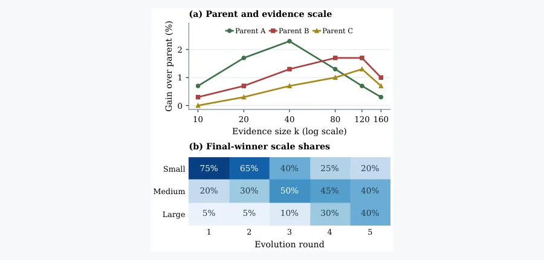 arXiv 2026-10-22 · cs.AI · #1 **[Forging More Tasks into Better Harnesses: Agentic Harness Evolution via Successive Scale Racing](https://arxiv.org/abs/2610.28815)** Jingzhe Liu , Jiliang Tang , Tong Zhao , Neil Shah , Clark Mingxuan Ju Affiliation: Michigan State University / Snap Inc. [Paper](https://arxiv.org/abs/2610.28815) · [Figure source](https://arxiv.org/html/2610.28815v1/scale_dynamics.png) 

[EN] Abstract
Agentic harness evolution optimizes an agent's instructions, tools, and control flow by using its task execution experiences as evolving evidence. While more evolution tasks should intuitively improve performance, our preliminary study reveals a paradoxical failure mode: the performance of existing methods degrades as the task pool expands. Our further analysis demonstrates that this degradation stems from suboptimal evidence selection during optimization, as different evidence combinations lead to substantially different evolution outcomes. To address this issue, we propose Successive Scale Racing (SSR), a framework that adaptively searches for optimal evidence combinations in each evolution round. SSR constructs diverse evidence combinations based on the corresponding task quality and coverage, and efficiently races the resulting candidate harnesses under a small compute budget. Empirically, across three distinct benchmarks, SSR achieves state-of-the-art results in all six configurations. Notably, as the task pool grows from 40 to 200, SSR steadily improves the pass rate from 64.3% to 68.3%, while the baselines' performances all drop. Furthermore, its racing mechanism identifies near-optimal candidates while reducing validation executions by 60%. <a href="https://arxiv.org/abs/2610.28815">Source</a>

[ZH] Abstract
智能体运行框架进化通过任务执行经验优化指令、工具和控制流。虽然更多进化任务直觉上应改善表现，初步研究却发现任务池扩大时现有方法退化。分析表明，原因在于优化中证据选择不佳，不同证据组合带来明显不同进化结果。我们提出连续规模竞赛 SSR，每轮自适应搜索最佳证据组合，按任务质量与覆盖构建多样组合，在小计算预算下让候选框架竞赛。在三个基准的六个配置中均取得最先进结果。任务池从 40 增至 200，SSR 通过率从 64.3% 持续升至 68.3%，而全部基线下降。竞赛机制识别接近最优候选，同时减少 60% 验证执行。 <a href="https://arxiv.org/abs/2610.28815">Source</a>
 | 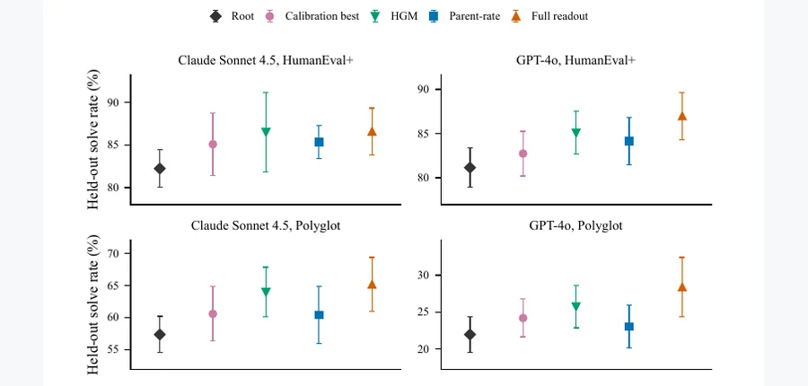 arXiv 2026-10-22 · cs.AI · #2 **[Recursive Self-Improvement on a Budget: Scoring Code Edits Before They Run](https://arxiv.org/abs/2610.29121)** Erfan Darzi , Sree Bhargavi Balija , Sheng He Affiliation: Harvard University / Massachusetts Institute of Technology / UC San Diego [Paper](https://arxiv.org/abs/2610.29121) · [Figure source](https://arxiv.org/pdf/2610.29121#page=2) 

[EN] Abstract
A coding agent that rewrites its own scaffold has to choose which proposed edit to expand before that edit has been evaluated, and the search then has to return one agent. Each run fits one linear readout on the parent's steering-split solve rate and eight coordinates of the proposed diff, from 96 scaffold edits labeled by four evaluations of a 16-instance fit split, and then freezes the coefficients. HumanEval+ reserves 48 instances as the steering split and Polyglot reserves 64. That split scores parents and keeps an archive of four nodes. Huxley-Gödel Machine selection draws a parent by Thompson sampling on the steering counts of nodes that have already been evaluated, and it expands the child that parent proposes. Every method then returns the earliest evaluated node whose steering-split solve count is maximal. The tables report the held-out score of that node on the other 100 HumanEval+ instances and the other 145 Polyglot instances, next to the root scaffold and the calibration edit with the highest fit-split label. Twelve runs of GPT-4o return a node at 87.0% on held-out HumanEval+, against 84.2% for the parent-rate ablation. On that split Huxley-Gödel Machine selection returns 85.1%, the root is at 81.2%, and the calibration-best edit is at 82.8%. On the same split Claude Sonnet 4.5 returns 86.6%, beside 86.5% for Huxley-Gödel Machine selection, 85.3% for the parent-rate ablation, and 85.1% for the calibration-best edit. <a href="https://arxiv.org/abs/2610.29121">Source</a>

[ZH] Abstract
重写自身框架的编码智能体，在编辑尚未评估前就要决定扩展哪个提议，搜索最后还需返回一个智能体。每次运行用父版本在引导集的解题率和提议差异的八个坐标拟合一个线性读出，再冻结系数；拟合数据是 96 项框架编辑，每项在 16 实例拟合集上评估四次获得标签。HumanEval+ 留 48 实例作引导集，Polyglot 留 64，给父版本评分并保留四节点档案。Huxley-Gödel Machine 选择基于已评估节点的引导计数，以 Thompson 采样选父节点，再扩展其子提议。所有方法返回引导解题数最高的最早评估节点。表格报告该节点在其余 100 个 HumanEval+、145 个 Polyglot 实例的留出分数，同时给根框架及拟合标签最高的校准编辑。十二次 GPT-4o 运行返回节点的 HumanEval+ 留出表现为 87.0%，父版本率消融为 84.2%；同集 HGM 选择 85.1%，根 81.2%，校准最佳 82.8%。Claude Sonnet 4.5 同集返回 86.6%，HGM 86.5%，父版本率消融 85.3%，校准最佳 85.1%。 <a href="https://arxiv.org/abs/2610.29121">Source</a>
 | 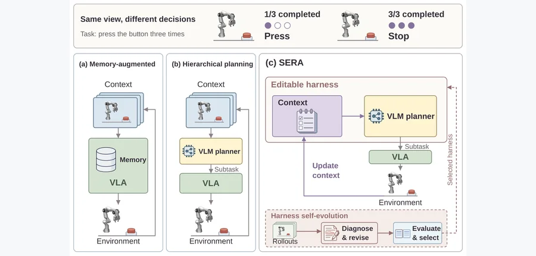 arXiv 2026-10-22 · cs.RO · #3 **[From VLM Planners to Robotic Agents: Self-Evolving Harnesses for History-Dependent Manipulation](https://arxiv.org/abs/2610.29560)** Tingwen Du , Haoyu Guo , Hanxue Zhang , Xuanxu Wang , Junting Dong , Chao Gao , Mingfei Han , Tao Lu , Mulin Yu , Chunhua… Affiliation: University of Science and Technology of China / Shanghai Artificial Intelligence Laboratory / Shanghai Jiao Tong University / Mohamed bin Zayed University of Artificial Intelligence / Zhejiang University [Paper](https://arxiv.org/abs/2610.29560) · [Figure source](https://arxiv.org/html/2610.29560v1/motivation_image.png) 

[EN] Abstract
Vision-language-action (VLA) models achieve strong performance across embodied manipulation tasks by unifying visual understanding, language conditioning, and action generation. However, long-horizon tasks can involve non-Markovian dependencies: successful decisions may require retaining task progress and past interaction outcomes, while partial observability and execution errors compound over time. Existing work has begun to address these challenges by augmenting foundation-model policies with memory and by introducing hierarchical architectures that separate high-level planning from low-level execution. We organize the high-level VLM as a robotic agent through an editable harness to maintain task context and improve planning through execution experience. We instantiate this approach as SERA (Self-Evolving Robotic Agent), with a fixed VLA executor providing low-level control. The harness maintains and updates task context using observations and execution feedback to guide subsequent planning. Self-evolution uses environment rollouts to propose and evaluate harness revisions, with the selected configuration fixed before held-out testing. On RoboMME, SERA achieves 51.38% overall success with autonomous selection, compared with 44.38% without self-evolution. Our exploration suggests that agentic planning is a promising direction for history-dependent robotic manipulation. <a href="https://arxiv.org/abs/2610.29560">Source</a>

[ZH] Abstract
视觉语言动作模型统一视觉、语言及动作，在具身操作取得强表现，但长时程任务可能非马尔可夫，需记住进度和过去结果，局部可观测与执行错误随时间累积。已有工作用记忆增强基础策略，并分开高层规划和低层执行。我们通过可编辑框架，将高层视觉语言模型组织为机器人智能体，维护上下文并从执行经验改进规划，实例化为 SERA 自进化机器人智能体，固定 VLA 执行器作低层控制。框架用观测与反馈更新上下文，指导后续规划；自进化依据环境执行提出、评估修改，在留出测试前固定选中配置。RoboMME 上自主选择的总体成功率为 51.38%，无自进化为 44.38%。探索提示智能体式规划是历史依赖操作的有前景方向。 <a href="https://arxiv.org/abs/2610.29560">Source</a>
 |
| 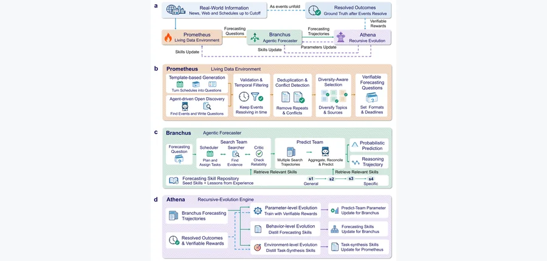 arXiv 2026-10-22 · cs.CL · #4 **[Evolving with Open Worlds: Towards Recursive Self-Improvement for Future Forecasting](https://arxiv.org/abs/2610.29784)** Zhipeng Chen , Yunsen Liang , Yanxi Chen , Hongkang Zhao , Lingyun Feng , Ruiyang Ren , Guoxin Chen , Jia Deng , Feng Chan… Affiliation: Renmin University of China / Nanyang Technological University / IQuest Research [Paper](https://arxiv.org/abs/2610.29784) · [Code](https://github.com/RUCAIBox/EvoForesight) · [Figure source](https://arxiv.org/html/2610.29784v2/deepevolve_overview.png) 

[EN] Abstract
Most contemporary artificial intelligence (AI) systems are released with frozen parameters and improve through external updates, whereas an ideal system would keep improving from its own experience, a capacity we call recursive self-improvement (RSI). Yet studying RSI requires an environment that is continuously changing, objectively verifiable, and naturally grounded, posing a fundamental challenge for agent evolution. Here we introduce EvoForesight, a sustainable evolution agent system grounded in future event prediction, in which agents continuously interact with a dynamically evolving environment and improve by internalizing and externalizing the experience gained through these interactions. A living environment synthesizes verifiable tasks, and a recursive-evolution engine turns the reasoning trajectory behind each prediction back into capability: decoupling search from prediction adapts parameter-level evolution to the contamination-prone live environment, while distilling reusable skills lets the agent evolve from the limited live trajectories such an environment affords. On the external FutureX leaderboard, which evaluates predictions against real-world outcomes and is updated weekly, our self-improved forecaster ranked first across all systems over three consecutive weeks, achieving up to a 195% improvement in rating. On our synthesized evaluation, it ranked among the top three across four base LLMs, outperforming the strongest baseline by up to 10.7 Bradley--Terry points. More broadly, these results suggest that a system built for self-improvement is best understood as an agent that co-evolves with a genuinely living, open-ended environment, pointing to a shift in AI from training static models on fixed data toward cultivating agents that grow stronger from their own experience, with such an open world as the indispensable basis of that growth. <a href="https://arxiv.org/abs/2610.29784">Source</a>

[ZH] Abstract
多数人工智能系统发布时参数冻结，靠外部更新改善，而理想系统从自身经验持续改进，我们称其递归自改进。研究需要持续变化、可客观验证、自然落地的环境，这为进化带来挑战。EvoForesight 是基于未来事件预测的可持续进化智能体，与动态环境持续互动，内化和外化经验以改进。活环境合成可验证任务，递归进化引擎将预测推理轨迹转回能力：分离搜索与预测，使参数进化适应易受污染的实时环境；蒸馏复用技能，让智能体利用有限在线轨迹进化。在每周更新、按真实结果评估的外部 FutureX 排行榜，改进预测者连续三周排名第一，评分最多提高 195%。自建评估中，四个基础模型均位列前三，最多比最强基线高 10.7 个 Bradley–Terry 分。结果提示自改进系统可视为与真实活环境共同进化的智能体，推动从固定数据训练静态模型转向培育从经验成长的智能体，并将开放世界视为这种成长的必要基础。 <a href="https://arxiv.org/abs/2610.29784">Source</a>
 | 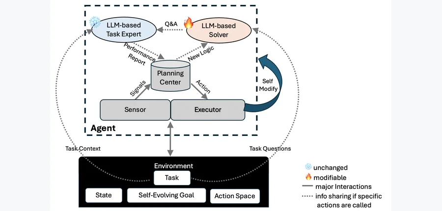 arXiv 2026-10-22 · cs.AI · #5 **[GuideEvolve: Self-Evolving Agent Framework with Expert Guidance and 3Ts Mechanisms](https://arxiv.org/abs/2610.30017)** Meihong Jia , Yasemin Timar , Jonathan Taws Affiliation: Amazon / Amazon Web Services [Paper](https://arxiv.org/abs/2610.30017) · [Figure source](https://arxiv.org/html/2610.30017v1/figures/GuideEvolve_Agent.png) 

[EN] Abstract
This study introduces GuideEvolve, a self-evolving agent framework incorporating expert guidance and three autonomous regulatory mechanisms, collectively termed the 3Ts: Think Fast and Slow, Throwback, and Termination by choice. The framework addresses critical limitations in extant self-evolving agent paradigms through dual innovations: (1) a task-specific expert-evaluation-driven evolutionary pipeline, and (2) the integration of 3Ts mechanisms to facilitate cognitive optimization, performance recovery via temporal rollback, and adaptive termination protocols. Empirical validation across the MGSM and MMLU benchmarks demonstrates that GuideEvolve attains performance metrics comparable to current state-of-the-art models (89.8% accuracy versus Gödel Agent's 90.6% on MGSM; 89.1% versus 87.9% on MMLU), while exhibiting notably reduced variance (25-59%) and enhanced robustness. Furthermore, the framework achieves a 100% evolution success rate, superior to the baseline's 82%, diminishes required optimization iterations by approximately 50% (from 30 iterations in baseline to 15.1 and 13.4 across tasks), and provides improved stability for production deployment. <a href="https://arxiv.org/abs/2610.30017">Source</a>

[ZH] Abstract
GuideEvolve 将专家指导与三项自主调节机制结合：快慢思考、回溯、自主终止，统称 3Ts。它通过任务特定专家评估驱动的进化流水线，以及认知优化、时间回滚恢复和自适应终止，处理现有自进化范式的限制。在 MGSM 和 MMLU 上，表现接近当前最优：MGSM 为 89.8%，Gödel Agent 为 90.6%；MMLU 为 89.1%，基线 87.9%，同时方差减少 25%—59%，鲁棒性更好。进化成功率为 100%，基线 82%；优化轮次约减半，从基线 30 轮降到两任务的 15.1、13.4，提供更稳定生产部署。 <a href="https://arxiv.org/abs/2610.30017">Source</a>
 | 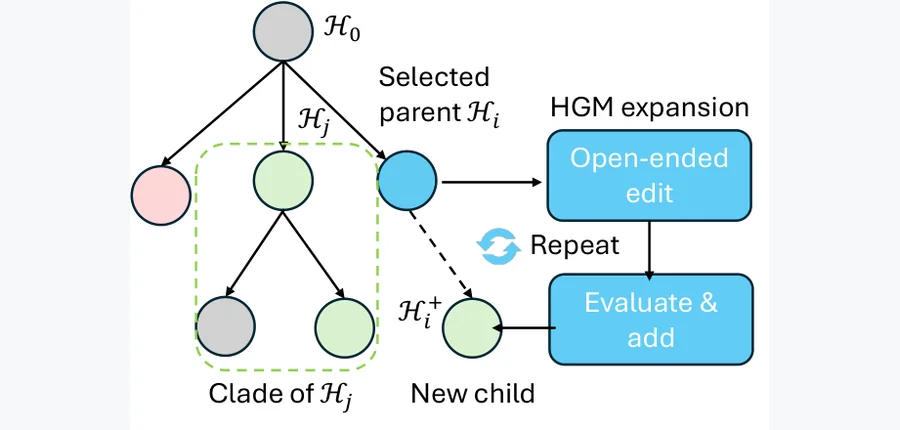 arXiv 2026-10-22 · cs.AI · #6 **[HGM-Dual: Lineage-Aware Guided Agent Harness Optimization for Long-Horizon Planning](https://arxiv.org/abs/2610.30042)** Sudipta Paul , Pengrui Quan , Aounon Kumar , Nicholas Tzou , Vivek Kulkarni , Srinivas Chappidi Affiliation: Samsung Research America [Paper](https://arxiv.org/abs/2610.30042) · [Figure source](https://arxiv.org/html/2610.30042v1/Picture3.png) 

[EN] Abstract
Harness optimization, which improves an agent's prompts, tools, and workflows, is an increasingly effective way to enhance agents built on frozen or closed-source LLMs. Leading approaches such as the Darwin--Godel Machine and the Huxley--Godel Machine (HGM) rely on recursive self-improvement and were developed mainly for coding, where the competence needed to improve the agent coincides with the competence being improved. Planning tasks, in which an agent must produce a sequence of tool calls that jointly satisfies interacting constraints, break this alignment. There, open-ended self-modification repeatedly explores ineffective changes and consumes substantial evaluation budgets. We introduce HGM-Dual, a diagnostic-guided framework for budget-efficient harness evolution for planning agents. First, HGM-Dual represents agent evolution as lineage-aware context. This context records what each ancestor changed, which behaviors improved or regressed, and which modifications were ineffective, giving the editor explicit edit-outcome attribution instead of an unstructured archive of past agents. Second, HGM-Dual introduces error-conditioned dual-path child generation. For each selected parent, it generates a general child that preserves open-ended exploration and specialized children that target the harness components most likely responsible for the parent's highest-ranked constraint violations. HGM-Dual outperforms the strongest baseline by up to 14.45% relative improvement in case accuracy while matching HGM variants' final performance with 2x-4x fewer evaluation budget. <a href="https://arxiv.org/abs/2610.30042">Source</a>

[ZH] Abstract
框架优化改善冻结或闭源模型周围的提示、工具和流程。DGM、HGM 等主要面向编程，在那里改进智能体所需能力与被改进能力一致；规划需工具调用序列同时满足约束，会打破这种对齐，开放自修改反复尝试无效变化、消耗评估。HGM-Dual 用诊断引导预算高效框架进化。首先，以谱系感知上下文记录祖先改变了什么、哪些行为改善或退化、哪些修改无效，为编辑器提供编辑—结果归因，而非无结构档案。其次，错误条件化双路径为每父版本产生一个保留开放探索的通用子版本，以及定向修改最高优先约束违规责任组件的专用子版本。相对最强基线，案例准确率最多相对提高 14.45%，用少二至四倍评估预算达到 HGM 变体最终表现。 <a href="https://arxiv.org/abs/2610.30042">Source</a>
 |
| 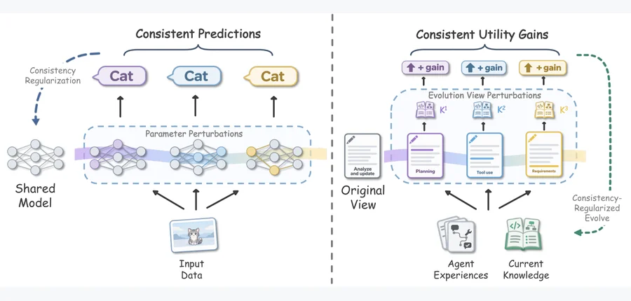 arXiv 2026-10-23 · cs.AI · #7 **[Agentic Knowledge-Model Co-Evolution via Consistency Regularization](https://arxiv.org/abs/2610.30790)** Sirui Chen , Zhining Liu , Chao Zhang , Jingrui He , Zheng Li Affiliation: University of Illinois Urbana-Champaign / Georgia Institute of Technology / Amazon [Paper](https://arxiv.org/abs/2610.30790) · [Figure source](https://arxiv.org/html/2610.30790v1/Teaser.png) 

[EN] Abstract
LLM agents can evolve by learning from accumulated experience. Existing approaches extract reusable external knowledge, such as skills and memories, from experience to guide subsequent task solving, with some further internalizing this knowledge through model training. However, different ways of analyzing and transforming the same experience can yield knowledge with substantially different utility, even when the resulting guidance appears reasonable. Inspired by consistency regularization, we identify consistent utility gains across different ways of analyzing the same experience, rather than relying on any single way of analyzing it. We introduce SPLICE, a framework for consistency-regularized knowledge-model co-evolution. It constructs evolution views by perturbing how the same experience is analyzed, producing different knowledge candidates. Knowledge updates are then guided by common gain, which accounts for utility gains and their consistency across views. During model evolution, self-distillation internalizes the evolved knowledge alongside reinforcement learning, using knowledge associated with consistent utility degradation as a contrastive reference. The two processes interleave, with model updates driving further knowledge evolution. Experiments across diverse domains show that SPLICE outperforms knowledge evolution and model training baselines by up to 7.1 and 4.6 points in average accuracy, while its evolved knowledge reduces output tokens per correct solution by up to 44% and transfers across model sizes and families. <a href="https://arxiv.org/abs/2610.30790">Source</a>

[ZH] Abstract
智能体可从经验进化，已有方法提取外部技能记忆指导后续求解，有的再内化到模型。但对相同经验的不同分析转换，可产生效用明显不同却都看似合理的知识。受一致性正则化启发，我们关注跨分析方式一致的效用收益。SPLICE 扰动相同经验的分析方式，产生不同知识候选，以兼顾收益与跨视图一致性的共同增益指导知识更新。模型进化中，自蒸馏与强化学习内化知识，并以效用持续退化的知识作对比参考；两过程交替，模型更新进一步驱动知识进化。跨领域实验中，相对知识进化和模型训练基线，平均准确率最多高 7.1、4.6 分；所得知识每正确解输出词元最多少 44%，可跨规模和家族迁移。 <a href="https://arxiv.org/abs/2610.30790">Source</a>
 | 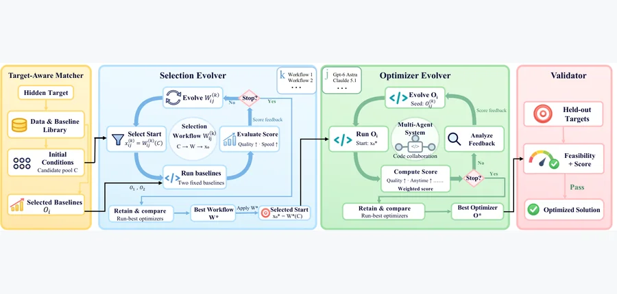 arXiv 2026-10-23 · cs.AI · #8 **[ADAPT for Science: A Multi-Agent System for Self-Evolving Scientific Optimization](https://arxiv.org/abs/2610.30851)** Zhaoran Feng , Yuchen Ni , Jianan Liu , Lemao Liu , Dejing Dou , Kairui Feng Affiliation: Nanjing University / Shanghai Innovation Institute / Fudan University / BEDI Cloud / Tongji University [Paper](https://arxiv.org/abs/2610.30851) · [Figure source](https://arxiv.org/html/2610.30851v1/figure1.png) 

[EN] Abstract
Scientific discovery often requires identifying a small number of high-performing designs in vast, constrained search spaces. This is difficult when evaluations are costly, feasible solutions are sparse, parameters are strongly coupled, and physical constraints are strict. Recent AI for AI methods can automatically improve algorithms and optimization procedures. However, general purpose approaches are not designed around scientific priors, physical constraints, and limited evaluation budgets. We introduce ADAPT for Science, a multi-agent framework that treats scientific optimization as two coupled decisions: where to search and how to search. ADAPT uses historical designs to identify promising and diverse initial conditions, progressively concentrates computation on favorable search directions, and evolves the optimization procedure from execution feedback. We evaluate ADAPT on the design of gravitational wave detectors using a differentiable physics simulator and eight unseen detector topologies. Under matched scientific evaluation budgets, ADAPT achieves a mean loss of 0.204 +/- 0.101, reducing loss by 54.9% relative to the best classical optimizer and by 62.2% relative to the best general purpose agentic evolution baseline. ADAPT achieves the lowest loss on all unseen topologies among the evaluated baselines. ADAPT provides a step toward scientific optimization systems that continuously learn from prior experience and their own search outcomes. <a href="https://arxiv.org/abs/2610.30851">Source</a>

[ZH] Abstract
科学发现常需在巨大约束空间找少数高性能设计，但评估昂贵、可行解稀疏、参数强耦合且物理约束严格。人工智能改进算法的通用方法未围绕科学先验和有限预算设计。ADAPT for Science 将科学优化视为在哪搜、如何搜两个耦合决定，利用历史设计识别有前景且多样的初值，逐步集中计算到有利方向，并由执行反馈进化优化程序。我们在可微物理模拟器的引力波探测器设计及八个未见拓扑上评估。匹配科学评估预算时，平均损失 0.204±0.101，比最佳经典优化器低 54.9%，比最佳通用智能体进化低 62.2%，全部未见拓扑损失均最低。系统向从历史和自身搜索结果持续学习的科学优化迈出一步。 <a href="https://arxiv.org/abs/2610.30851">Source</a>
 | 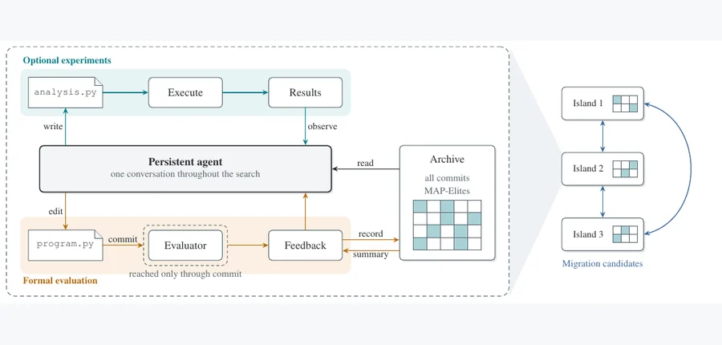 arXiv 2026-10-23 · cs.NE · #9 **[AgenticEvolve: Evolutionary Program Search with Persistent Language Model Agents that Design and Run Experiments](https://arxiv.org/abs/2610.31326)** Ze-Yu Peng , Qing-Yu Lan , Zhan-He Wang , Jun Zhang , Yun-Song Piao Affiliation: University of Chinese Academy of Sciences / Institute of Theoretical Physics, Chinese Academy of Sciences [Paper](https://arxiv.org/abs/2610.31326) · [Figure source](https://arxiv.org/pdf/2610.31326#page=3) 

[EN] Abstract
Evolutionary program search with large language models keeps the structure of an evolutionary algorithm and uses the model as its variation operator. Typically, the model generates each candidate program in a single request from parent programs and their scores. We present AgenticEvolve, an evolutionary program search framework in which each island is run by a persistent large language model agent. Between evaluations, the agent designs and runs experiments on the candidate program. To measure the contribution of experimentation, we compare AgenticEvolve with No-analysis, an otherwise identical configuration with experiments disabled. On two heuristic design tasks with three large language models, AgenticEvolve produces better programs than No-analysis and OpenEvolve on both hidden and unseen instances. It reaches the baselines' final quality with far fewer evaluations and comparable cost. On twelve equation discovery problems, it recovers the ground-truth structure of more equations than No-analysis and existing language-model and genetic programming baselines. <a href="https://arxiv.org/abs/2610.31326">Source</a>

[ZH] Abstract
语言模型进化程序搜索通常保留进化算法结构，用单次模型请求依据父程序和分数生成候选。AgenticEvolve 让每座岛由持久语言模型智能体运行，在评估之间设计并执行候选实验。为测实验贡献，与仅关闭实验、其余相同的 No-analysis 比较。在两个启发式设计任务、三个模型上，所得程序在隐藏及未见实例优于 No-analysis、OpenEvolve，用少得多评估、相近成本达到基线最终质量。在十二个方程发现问题中，相比无分析及已有语言模型、遗传编程基线，恢复更多真实方程结构。 <a href="https://arxiv.org/abs/2610.31326">Source</a>
 |
| 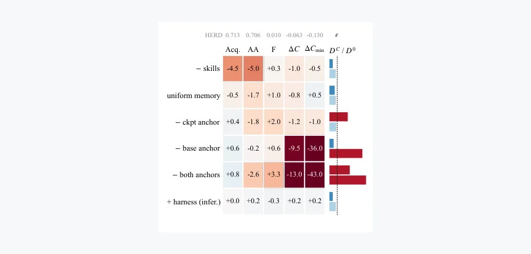 arXiv 2026-10-23 · cs.CL · #10 **[HERD: Harness-Evolving Recursive Distillation for Continual Learning](https://arxiv.org/abs/2610.31401)** Xun Sun , Thanh Thi Nguyen , Thuy-Trang Vu Affiliation: Monash University / University of the Sunshine Coast [Paper](https://arxiv.org/abs/2610.31401) · [Code](https://github.com/a1exsun/HERD) · [Project](https://a1exsun.github.io/HERD) · [Figure source](https://arxiv.org/html/2610.31401v1/hero-ablation.png) 

[EN] Abstract
Continual learning requires a model to keep acquiring new skills and knowledge without compromising its existing capabilities. Parametric methods suffer from catastrophic forgetting and loss of plasticity. Non-parametric methods, such as prompts, skills, and harnesses, leverage in-context learning but are limited by context length and lossy plain-text compression. To effectively combine their complementary strengths, we propose HERD (Harness-Evolving Recursive Distillation), a hybrid continual learning framework that learns efficiently in the harness and internalizes experience into cumulative capabilities via distillation. On the harness side, HERD continually refines its skills to capture reusable patterns, while retaining high-residual examples that the skills fail to capture in a bounded memory. On the parameter side, HERD performs drift-constrained distillation with dual anchors, substantially reducing forgetting over long recursive runs. On the 25-stage task stream of TRACE+17, under fixed memory and compute budgets, HERD matches the strongest parametric baseline in new-task acquisition while exhibiting the least forgetting and the strongest retention of general capabilities. <a href="https://arxiv.org/abs/2610.31401">Source</a>

[ZH] Abstract
持续学习需获得新技能知识而不损旧能力。参数方法有遗忘与可塑性损失，提示技能框架等非参数方法又受上下文和有损文本压缩限制。HERD 结合二者，在框架中高效学习，通过蒸馏内化为累积能力。框架侧持续细化技能捕捉复用模式，在有界记忆中保留技能无法捕捉的高残差样本；参数侧用双锚漂移约束蒸馏，大幅减轻长递归运行中的遗忘。TRACE+17 的 25 阶段流中，固定记忆及计算预算时，新任务获得能力匹配最强参数基线，同时遗忘最少、通用能力保留最强。 <a href="https://arxiv.org/abs/2610.31401">Source</a>
 | 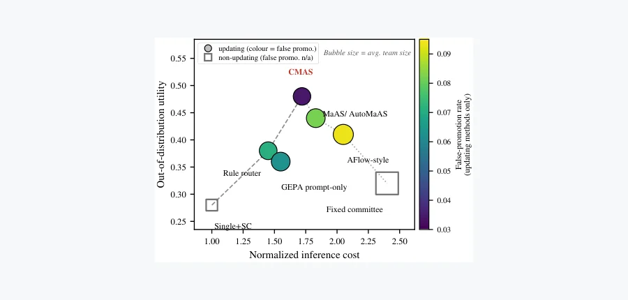 arXiv 2026-10-23 · cs.AI · #11 **[Conservative Meta-Agent Search: Architecture Adaptation under Non-Stationarity](https://arxiv.org/abs/2610.31436)** Ali Atiah Alzahrani Affiliation: Affiliation unconfirmed [Paper](https://arxiv.org/abs/2610.31436) · [Figure source](https://arxiv.org/html/2610.31436v1/fig_pareto.png) 

[EN] Abstract
Automated agentic-system design is typically evaluated on static task suites with immediate scalar rewards. Deployed systems face persistent shift, delayed dependent feedback, correlated component failures, and costly architecture changes. We formalize meta-agent architecture search as sequential incumbent replacement with switching costs and hard risk constraints and introduce Conservative Meta-Agent Search (CMAS). CMAS retrieves archived architectures and proposes typed graph edits, then scores each against the incumbent by paired shadow replay under common random numbers, with interventional component credit. Promotion requires an empirically calibrated, variance-penalized simultaneous score above a pre-specified margin, and is followed by a simulated canary stage and pre-specified rollback. Since backtests cannot certify meta-level skill, we introduce MetaInvest-Bench, a regime-switching simulator whose specified worker competence makes a surrogate-optimal architecture computable, with leakage-controlled replay, adversarial governance tracks, and five negative controls. Financial streams serve as a risk-sensitive testbed for meta-level generalization; we claim no alpha. Across 96 streams, CMAS cuts normalized mean surrogate dynamic-oracle regret from 0.116 to 0.104 and raises held-out utility from 0.44 to 0.48 over the strongest adaptive baseline; when extra workers add no value, it contracts to near-single-agent teams. Its deployment inference cost is ~6% lower, though its search-inclusive token cost is the highest of the methods compared. The observed per-update false-promotion rate is 3.4% against a nominal 5% target, and 4.8% in a sealed rerun. The calibration is empirical: it concerns an update-level replay statistic on an author-designed benchmark, and guarantees neither full-utility improvement, nor absence of simulated canary-stage harm, nor sequence-level error control. <a href="https://arxiv.org/abs/2610.31436">Source</a>

[ZH] Abstract
智能体系统自动设计多在静态即时奖励上评估，部署却有持续偏移、延迟依赖反馈、相关失败和昂贵架构变化。CMAS 将元智能体搜索形式化为带切换成本和硬风险约束的顺序现行架构替换，检索档案、提议类型化图编辑，以共同随机数的配对影子回放和干预组件信用评分。晋升需经验校准、方差惩罚的同时分数超过预设边际，随后仿真金丝雀和预设回滚。回测不能认证元技能，因此引入 MetaInvest-Bench 机制切换模拟器，指定执行者能力使代理最优架构可计算，并控制泄漏、设对抗治理轨道和五个负对照，不声称金融超额收益。96 条流中，相对最强自适应基线，归一化平均代理动态预言机遗憾从 0.116 降到 0.104，留出效用从 0.44 升到 0.48；额外执行者无价值时收缩到接近单智能体。部署推理成本低约 6%，但含搜索词元成本最高。每更新误晋升率 3.4%，名义目标 5%，密封重跑为 4.8%。这只是作者基准更新级回放统计的经验校准，不保证完整效用提高、金丝雀无伤害或序列级错误控制。 <a href="https://arxiv.org/abs/2610.31436">Source</a>
 | 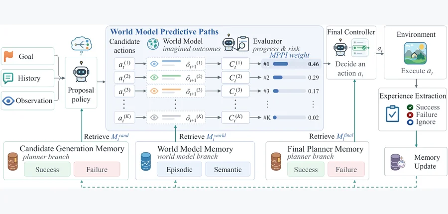 arXiv 2026-10-22 · cs.AI · #12 **[Self-Improving Agents with World Model Predictive Paths](https://arxiv.org/abs/2610.28945)** Haori Lu , Tianyu Gao , Yaoyao Liu , Yingying Li Affiliation: University of Illinois Urbana-Champaign [Paper](https://arxiv.org/abs/2610.28945) · [Figure source](https://arxiv.org/html/2610.28945v1/method.png) 

[EN] Abstract
Large language model (LLM) agents are increasingly expected to interact with environments and improve their decisions during deployment. However, how anticipating future outcomes and drawing on accumulated interaction experience can jointly support decision-making remains underexplored. We propose a test-time framework, inspired by Model Predictive Path Integral (MPPI) control, that combines multi-branch predictive analysis with experience-based adaptation. At each step, the agent proposes multiple candidate actions and imagines their outcomes with a world model, so that alternatives can be compared without being executed in the environment. Since language environments provide neither explicit dynamics nor costs, the predicted outcomes are evaluated for task progress and risk, and MPPI-style weights over the resulting costs guide the final decision. A dual-branch experience memory enables self-improvement: the planner branch refines candidate generation and action selection, while the world model branch improves next-observation prediction. Experiments on ALFWorld and ScienceWorld across three backbones demonstrate the strong overall performance of our method and the effectiveness of experience-guided predictive control. Our code will be made publicly available. <a href="https://arxiv.org/abs/2610.28945">Source</a>

[ZH] Abstract
语言模型智能体需与环境互动并在部署中改善，但预期未来与累积经验如何联合决策研究不足。我们提出受 MPPI 模型预测路径积分控制启发的测试时框架，结合多分支预测与经验适配。每步提出多候选动作，用世界模型想象结果，无需真实执行即可比较；语言环境无显式动力学成本，因此按进度与风险评价预测，以 MPPI 式成本权重指导决定。双分支记忆支持自改进：规划分支改进候选及选择，世界模型分支改善下一观测预测。ALFWorld、ScienceWorld 三主干实验显示较强总体表现和经验预测控制有效性，计划公开代码。 <a href="https://arxiv.org/abs/2610.28945">Source</a>
 |
| 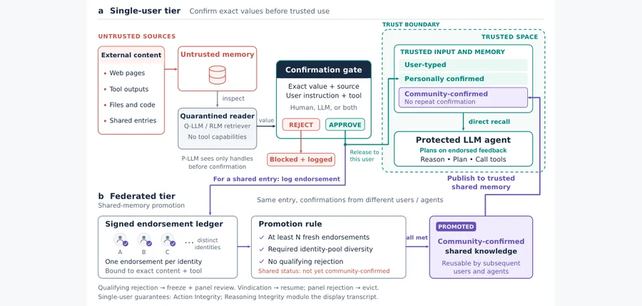 arXiv 2026-10-22 · cs.AI · #13 **[PerMIT: Securing Persistent Memory for LLM Agents via Machine-Checked Integrity Theorems and Scalable Community Trust](https://arxiv.org/abs/2610.28987)** Tanqiu Jiang , Min Bai , Sadat Shahriar , Wanyu Du , Sandesh Swamy Affiliation: Stony Brook University / AWS AI Labs [Paper](https://arxiv.org/abs/2610.28987) · [Figure source](https://arxiv.org/html/2610.28987v1/permit-system-overview-refined.png) 

[EN] Abstract
Persistent memory is a largely undefended surface for injection and poisoning, and the same risk limits memory sharing among agents. We present PerMIT, a memory architecture with provable integrity guarantees under an explicit trust assumption: only user-typed inputs and values confirmed at a gate are trusted. PerMIT mediates the release and use of untrusted environment-derived values through a finite memory interface, while preserving agent-driven multi-turn planning and tool choice. Over this finite interface, we prove two integrity theorems that are also machine-checked in Lean 4, which together ensure that environment-derived memory reaches a sensitive action only if confirmed at the gate and influences the agent's behavior only through what the gate displays. Every attack in our threat model thereby reduces to a single auditable decision, which a human, an LLM verifier, or both can make in practice. On Trojan Hippo, PerMIT records zero observed attack success with self-verification and lightweight verifiers. Because each confirmation is a logged verdict on exact content, endorsements accumulate across users, and sufficiently endorsed items become community-confirmed with no further verification required. Under explicit assumptions, we prove and corroborate in simulation a co-scaling property: as the community grows, the risks of promoting poison and of wrongly evicting benign knowledge fall, while per-user verification effort does not rise. On $\tau^2$-bench, communities of up to 90 autonomous agents use PerMIT to build shared knowledge bases with no direct memory injection promoted, and the resulting knowledge significantly improves new agents on held-out tasks, suggesting a path toward agents that safely self-improve at test time. <a href="https://arxiv.org/abs/2610.28987">Source</a>

[ZH] Abstract
持久记忆是注入投毒薄弱面，也阻碍共享。PerMIT 在明确可信假设下提供可证明完整性：仅用户键入及门控确认值可信。它用有限记忆接口调解不可信环境值的释放与使用，同时保留多轮规划和工具选择。在该接口上，两项 Lean 4 机器核验定理保证，环境记忆仅确认后可达敏感动作，且仅通过门控显示内容影响行为。威胁模型内攻击被归约为一个可审计决定，可由人、模型验证器或两者完成。Trojan Hippo 上自验证和轻量验证器观察攻击成功为零。每次确认是精确内容的日志判定，背书可跨用户积累，充分背书后无需再验证。在显式假设下，证明并以仿真支持共同扩展性质：社区扩大时，投毒晋升与误删良性知识风险下降，每人验证工作不增加。τ²-bench 最多 90 个自主智能体构建共享库，无直接记忆注入被晋升，知识明显改善新智能体留出任务，为安全测试时自改进提供路径。 <a href="https://arxiv.org/abs/2610.28987">Source</a>
 | 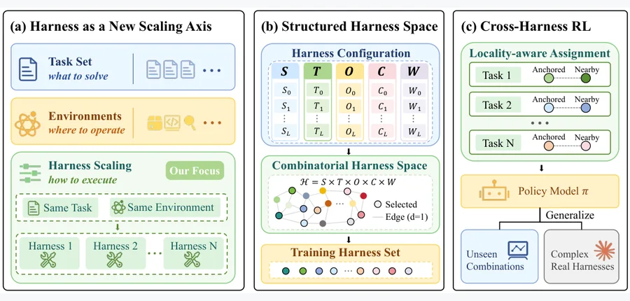 arXiv 2026-10-22 · cs.LG · #14 **[Harness Scaling for Generalizable Agentic Reinforcement Learning](https://arxiv.org/abs/2610.29458)** Fei Bai , Huatong Song , Chuan Hao , Ran Tao , Jian Yang , Bryan Dai , Wayne Xin Zhao , Ji-Rong Wen Affiliation: IQuest Research / Beihang University / Renmin University of China [Paper](https://arxiv.org/abs/2610.29458) · [Figure source](https://arxiv.org/html/2610.29458v1/main_Harness_Scaling_1.png) 

[EN] Abstract
Agent harnesses have become a central component of modern agentic systems, shaping how models use tools, manage context, and coordinate long-horizon interaction. Realizing the benefits of these harnesses depends on how effectively the underlying model can make use of them, motivating reinforcement learning directly through the harness. However, existing approaches typically train through a single fixed harness, which can lead to specialization and limited transfer across harness configurations. To address this, we introduce \textbf{Harness Scaling}, a new scaling dimension for agentic RL that extends training from a single harness to diverse execution configurations. Concretely, we construct a factorized harness space, select a compact training subset with balanced factorial coverage, and organize cross-harness training to combine global coverage with controlled variation for the same task. Across multiple benchmarks, model scales, and RL algorithms, Harness Scaling consistently improves generalization to unseen white-box configurations. Moreover, models trained through structured white-box variation transfer effectively to unseen external black-box harnesses, outperforming models trained through a single complex black-box harness. These results establish harness diversity as a meaningful scaling dimension for agentic RL and highlight the importance of how this diversity is organized for cross-harness generalization. <a href="https://arxiv.org/abs/2610.29458">Source</a>

[ZH] Abstract
智能体运行框架已成为现代智能体系统的核心组成部分，塑造模型使用工具、管理上下文和协调长时程交互的方式，收益依赖模型利用能力，因而需直接经框架强化学习。但单固定框架训练会专门化、限制迁移。Harness Scaling 将训练从单框架扩展到多种执行配置：构建因子化空间，以平衡析因覆盖选择紧凑训练子集，结合全局覆盖及同任务受控变异。跨基准、规模、强化学习算法，持续改善未见白盒配置泛化；结构化白盒变异训练也迁移到未见外部黑盒框架，优于单复杂黑盒训练。结果支持框架多样性作为强化学习扩展维度，强调其组织方式。 <a href="https://arxiv.org/abs/2610.29458">Source</a>
 | 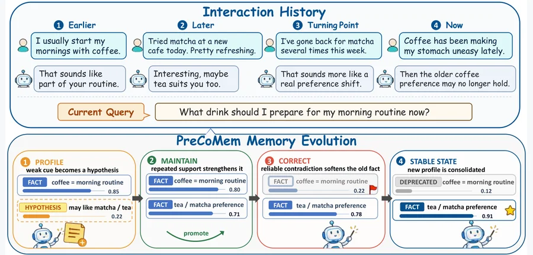 arXiv 2026-10-22 · cs.AI · #15 **[PreCoMem: Predictive Cognitive Memory for Self-Evolving Long-Term Dialogue Agents](https://arxiv.org/abs/2610.29467)** Jian Zhong , Zeyu Liu , Pingchuan Cao , Rongduo Han , Shunye Tang , Guohuan Xie , Mingyuan Qin , Ran Ji , Xiao Liang , Wei… Affiliation: Nankai University / Tsinghua University / Huazhong University of Science and Technology / University of the Chinese Academy of Sciences / vivo AI Lab [Paper](https://arxiv.org/abs/2610.29467) · [Code](https://github.com/ZhongWishing/PreCoMem) · [Figure source](https://arxiv.org/html/2610.29467v1/abstract.png) 

[EN] Abstract
Long-horizon dialogue agents need to keep user memories stable enough for personalization while adapting when the user genuinely changes. Existing memory systems often append every observation or overwrite old entries by heuristic rules, which makes transient noise hard to distinguish from real belief drift. We introduce PreCoMem, a memory consolidation framework inspired by predictive coding that represents memory as confidence-weighted beliefs about the user's state. Its core signal, Effective Surprisal, combines semantic deviation and contradiction evidence, then downweights this signal when retrieval is diffuse and unreliable. According to effective surprisal, a two-threshold gate maps each turn to one of three deterministic updates: MAINTAIN reinforces supported beliefs, PROFILE stores ambiguous cues as low-confidence hypotheses, and CORRECT softly decays reliably contradicted facts. The PROFILE stage acts as an explicit waiting room, preventing premature commitment to noisy evidence. Experiments on LoCoMo, LongMemEval-S, and PersonaMem-v2 show consistent state-of-the-art accuracy; our new DiMoBench confirms that PreCoMem adapts to non-stationary belief drift without over-reacting to noise. The code is available at this https URL . <a href="https://arxiv.org/abs/2610.29467">Source</a>

[ZH] Abstract
长期对话智能体需稳定记住用户，又在真实变化时适配。追加全部观测或启发覆盖难区分瞬时噪声与真实信念漂移。PreCoMem 受预测编码启发，将记忆表示为置信度加权用户信念。有效惊异度结合语义偏差和矛盾证据，在检索分散不可靠时降权。双阈值门控对应三种确定更新：MAINTAIN 强化支持信念，PROFILE 将模糊线索存为低置信假说，CORRECT 软衰减可靠矛盾事实。PROFILE 如候诊室，防止对噪声过早承诺。LoCoMo、LongMemEval-S、PersonaMem-v2 上准确率持续最优，新 DiMoBench 确认在非平稳漂移中适配且不过度响应噪声。代码见原文链接。 <a href="https://arxiv.org/abs/2610.29467">Source</a>
 |
| 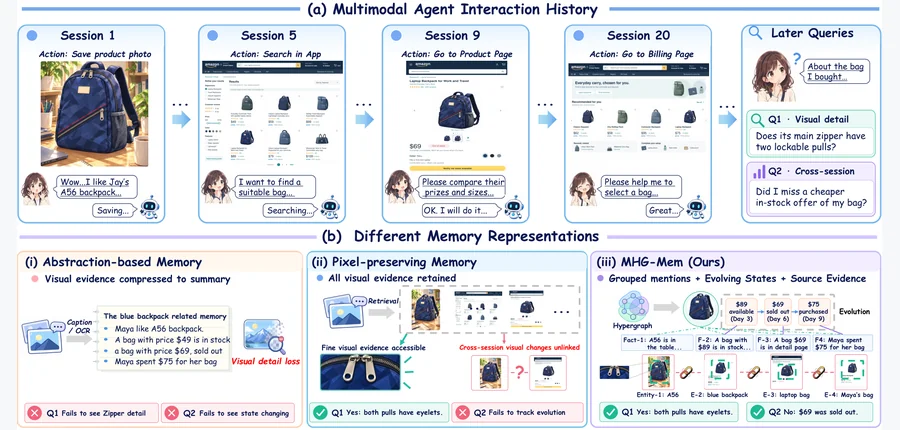 arXiv 2026-10-22 · cs.CL · #16 **[Remembering Through Change: Provenance-Preserving Hypergraph Memory for Multimodal Agents](https://arxiv.org/abs/2610.29995)** Jielong Tang , Ling-An Zeng , Xujie Yuan , Xiao Dong , Zhiqian Xia , Qingfeng Li , Shixiong Kai , Kaichao Liang , Rong Yao… Affiliation: Sun Yat-sen University / Huawei Technologies, Noah Arks’ Lab / Shandong Normal University / Southeast University [Paper](https://arxiv.org/abs/2610.29995) · [Figure source](https://arxiv.org/html/2610.29995v1/MHG-Mem_intro_v0.3.png) 

[EN] Abstract
Long-term memory for multimodal agents remains challenging, as it must preserve fine-grained visual evidence while tracking entity evolution across sessions. Existing abstraction-based memories compress images into text, often discarding visually discriminative details, whereas pixel-preserving memories retain raw observations but struggle to reliably associate diverse observations with persistent entity identities and track their evolving states. To address these limitations, we propose MHG-Mem, a multimodal hypergraph memory that jointly organizes entity identity, state evolution, and provenance to visual evidence. Specifically, MHG-Mem represents distinct entity mentions and their observed facts as individual nodes, grouping identity-consistent mentions and facts through occurrence hyperedges. It then synthesizes aspect-specific evolution states from these grouped observations and links them to supporting entities, facts, and source evidence through evolutionary and evidential hyperedges. To navigate this structured memory, we introduce hypergraph-based agentic search, which adaptively selects an entry layer, traverses typed hyperedges across memory levels, and inspects source observations when fine-grained verification is required. These designs support both detailed visual verification and reasoning over cross-session state changes. Extensive experiments across three benchmarks demonstrate the effectiveness of MHG-Mem, improving performance by 8.20-9.98% over the strongest baseline. <a href="https://arxiv.org/abs/2610.29995">Source</a>

[ZH] Abstract
多模态长期记忆需保留细视觉证据、追踪跨会话实体变化。抽象文字常丢区分细节，保留像素又难关联稳定身份与状态。MHG-Mem 用超图联合组织身份、状态演化和视觉来源：各实体提及及事实作独立节点，通过出现超边归组身份一致的提及事实，再综合方面特定演化状态，以演化及证据超边连到实体事实和源证据。超图智能体搜索自适应选入口、跨层遍历类型边，细验证时查源观测，支持视觉核实和跨会话状态推理。在三个基准上，比最强基线改善 8.20%—9.98%。 <a href="https://arxiv.org/abs/2610.29995">Source</a>
 | 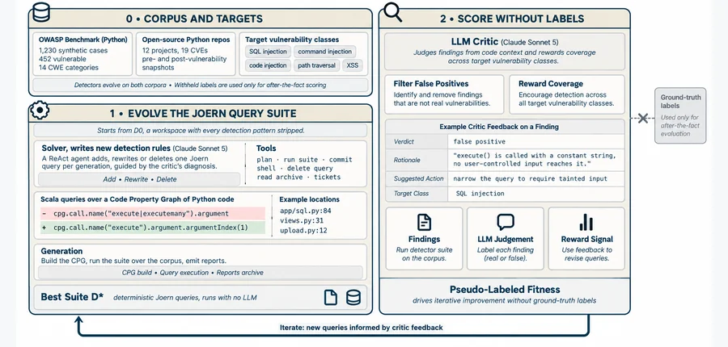 arXiv 2026-10-23 · cs.CR · #17 **[Self-Evolving Static Analysis via LLM Pseudo-Labeling](https://arxiv.org/abs/2610.30184)** Rui Melo , Andre Duarte , Aditya Oke , Shubham Gandhi , Nachiket Kotalwar , Rui Abreu , Lei Li , Carolyn Rose Affiliation: Carnegie Mellon University / FEUP [Paper](https://arxiv.org/abs/2610.30184) · [Figure source](https://arxiv.org/html/2610.30184v1/figures/andre_sesaa.png) 

[EN] Abstract
Security bugs often slip past static analysis not because they are impossible to detect, but because detection rules have not yet been written for the code in front of us. New frameworks, APIs, and coding idioms continually create such gaps, leaving developers to discover failures and manually encode new rules. We present SESAA, a framework in which an Large Language Model (LLM) agent starts from no rules and iteratively evolves a set of readable and auditable joern queries. The agent receives feedback only from a second LLM critic, which inspects flagged and unflagged code to identify likely false alarms and suspected misses, without access to ground-truth labels. The agent then uses this feedback to revise its queries. On the OWASP Benchmark for Python, SESAA reaches a mean F1 of 0.742 across 8 independent runs, well above the default configurations of five widely used tools and comparable to the strongest of them once it is tuned with access to ground-truth labels that SESAA never sees. In a pilot on real-world Python projects, queries induced from code available before a vulnerability was introduced detect 10 of 19 subsequent CVEs, including 9 detected by rules written for the same repository. The resulting detector is a set of executable, human-readable queries that engineers can inspect, modify, and run independently. These results suggest that LLM agents can turn static-analysis rule maintenance from a manually authored process into an iterative process of automated discovery and repair. <a href="https://arxiv.org/abs/2610.30184">Source</a>

[ZH] Abstract
安全缺陷漏检常非不可检测，而是新框架、API、习语尚无规则，需人手发现编码。SESAA 从零规则起步，让语言智能体迭代进化可读可审计 joern 查询，反馈仅来自第二模型评论者检查已标及未标代码、找疑似误报漏报，无真实标签。智能体据此改查询。OWASP Python 上八次独立运行平均 F1 为 0.742，远超五工具默认配置，接近其中最强工具用真实标签调优结果。在真实项目试点，基于漏洞引入前代码诱导的规则检出后续 19 项 CVE 中十项，九项由同仓库规则检出。结果是工程师可检查修改、独立运行的可执行可读查询，支持把手工规则维护转为自动发现修复。 <a href="https://arxiv.org/abs/2610.30184">Source</a>
 | 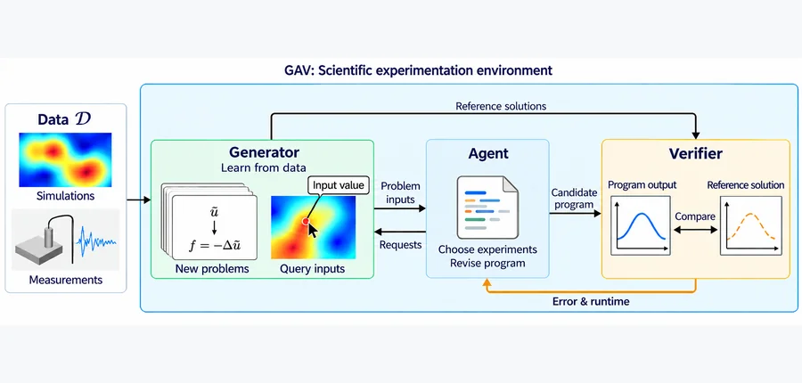 arXiv 2026-10-23 · cs.LG · #18 **[GAV: A scientific experimentation environment for PDE agents](https://arxiv.org/abs/2610.30292)** Muheng Li , Wenlong Mou Affiliation: University of Toronto / Vector Institute [Paper](https://arxiv.org/abs/2610.30292) · [Code](https://github.com/PotatoJnny/PDE-GAV) · [Figure source](https://arxiv.org/html/2610.30292v1/figures/gav-overview.png) 

[EN] Abstract
Reliable feedback is essential for coding agents to develop programs for partial differential equations (PDEs). Yet evaluating these programs on new PDE problems often requires expensive reference computations, while fixed datasets restrict the range of experiments. We introduce Generator-Agent-Verifier (GAV), a scientific experimentation environment that makes new PDE problems verifiable by construction. The Generator learns a distribution of continuous reference solutions using data from numerical simulations or experimental measurements to represent a target physical regime. Using the method of manufactured solutions, it works backward from the generated reference solutions to construct matching PDE problems without a separate numerical solve. The Agent designs experiments, investigates failures, and iteratively improves its program. The Verifier evaluates candidate programs against the reference solutions and provides numerical feedback on accuracy and computational cost. This feedback can also guide the generation of new problems that probe the current program's weaknesses. We provide a theoretical analysis of evaluation reliability and guided development. Experiments on Navier-Stokes and Vlasov-Poisson-type equations across different data sources and regimes demonstrate the effectiveness of GAV. In particular, on the numerical Navier-Stokes task, GAV reduces the mean test error of three existing PDE agents by more than an order of magnitude relative to their original setups. Code is available at this https URL . <a href="https://arxiv.org/abs/2610.30292">Source</a>

[ZH] Abstract
PDE 编程智能体需可靠反馈，但新问题参考计算昂贵、固定集限制实验。GAV 让新问题构造即可验证：生成器从数值或实验数据学连续参考解分布，表示目标物理机制；用制造解法从解反推匹配 PDE，无需另解数值问题。智能体设计实验、调查失败、迭代程序；验证器按参考解返回精度及成本反馈，也可引导新问题针对程序弱点。我们分析可靠性与引导开发，在 Navier–Stokes、Vlasov–Poisson 型方程不同数据和机制上显示有效；数值 Navier–Stokes 中，三种现有 PDE 智能体平均测试误差相对原设置下降超过一个数量级。代码见原文链接。 <a href="https://arxiv.org/abs/2610.30292">Source</a>
 |
| 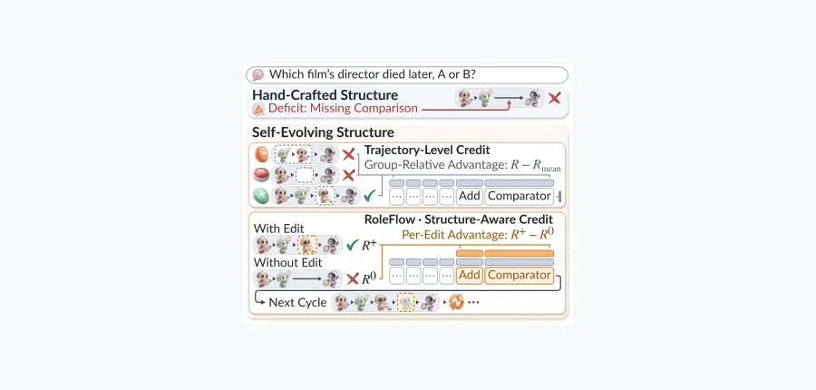 arXiv 2026-10-23 · cs.AI · #19 **[RoleFlow: Self-Evolving Multi-Role Agentic Collaboration via Structural Adaptation](https://arxiv.org/abs/2610.30429)** Yi Ge , Pan Wang , Xuehao Cui , Zian Zeng , Xu Hu , Heng Huang , Furong Huang Affiliation: University of Maryland, College Park / University of Pittsburgh / The University of Texas at Dallas [Paper](https://arxiv.org/abs/2610.30429) · [Figure source](https://arxiv.org/html/2610.30429v1/fig1_teaser_single_col.png) 

[EN] Abstract
Large language model (LLM) based multi-agent systems often rely on predefined collaboration structures, limiting their adaptability to evolving task requirements. Although recent approaches enable dynamic orchestration, trajectory-level rewards they apply assign one outcome to each decision, ofen struggling to identify the contributions of individual structural changes. We propose RoleFlow, a self-evolving multi-role agentic system that refines collaboration structures through feedback-driven atomic edits and on-demand role synthesis. To make structural adaptation learnable, we introduce Single-Edit Counterfactual Policy Optimization (SECPO), which evaluates each edit against its no-edit counterpart at the same chain state and assigns targeted credit to edit-specific tokens. Across seven benchmarks spanning four domains, RoleFlow achieves the optimal average performance, surpassing the strongest competitor by 4.7 points. It leads on all three multi-hop QA benchmarks by 3.2-7.5 F1 points and also shows supremacy on mathematical reasoning, web interaction, and code generation. Further analyses demonstrate cross-benchmark transferability, training-data efficiency, and cross-executor generalization. <a href="https://arxiv.org/abs/2610.30429">Source</a>

[ZH] Abstract
语言多智能体常用预定义协作结构，难适应变化。动态编排的轨迹级奖励给每项决定同一结果，难隔离结构修改贡献。RoleFlow 通过反馈原子编辑与按需角色合成细化结构，SECPO 在相同链状态将每个编辑与无编辑反事实比较，给编辑特定词元定向信用。七基准四领域平均表现最优，比最强竞争者高 4.7 分；三个多跳问答领先 3.2—7.5 F1，在数学、网页、代码也占优。分析显示跨基准迁移、训练数据效率及跨执行器泛化。 <a href="https://arxiv.org/abs/2610.30429">Source</a>
 | 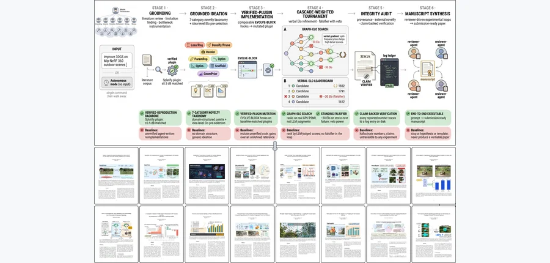 arXiv 2026-10-23 · cs.CV · #20 **[SplatLab: Autonomous Scientific Discovery for 3DGS Research](https://arxiv.org/abs/2610.30468)** Seemandhar Jain , Manmohan Chandraker Affiliation: University of California San Diego [Paper](https://arxiv.org/abs/2610.30468) · [Figure source](https://arxiv.org/html/2610.30468v1/teaser_overview.png) 

[EN] Abstract
Reproducing a published 3DGS paper takes weeks of expert engineering before any extension can be proposed. Prior autonomous-research systems read papers, draft hypotheses, and write code, but are limited by short fixed templates, low executability, and weak traceability, and none has been demonstrated end-to-end in a live computer-vision subfield with intense activity. SplatLab is an autonomous research system for 3D Gaussian Splatting that addresses these limitations. Given a research prompt, a target-paper URL, or no input at all, it reproduces a published baseline, proposes an extension, trains and ablates across Mip-NeRF 360 and LLFF, writes the manuscript, and binds every reported number to a logged training run. Five design choices distinguish it: (i) candidates mutate plugins from a verified-reproduction backbone matched to published baselines; (ii) a cascade-weighted Elo tournament across eight islands scores candidates on measured GPU PSNR with verbal-gradient feedback; (iii) a standing falsifier subtracts Elo on failure, integrating stress-test survival into selection; (iv) every reported number is bound to a logged training run, and the run cannot terminate while any claim is unbacked; (v) a seven-category 3DGS taxonomy wraps EVOLVE-BLOCK markers in domain-aligned scaffolds transferable across 3DGS repositories. On PSNR-targeted runs, SplatLab's manuscripts beat their reproduced targets by +0.18 to +3.78 dB, including +3.78 dB on astrophotographic nebula rendering, for which no prior 3DGS method exists. The research cycle compresses from months of graduate-student time to days of mostly autonomous compute. Code, all manuscripts, experiment ledgers, and the cross-run paper store are available on the project page. <a href="https://arxiv.org/abs/2610.30468">Source</a>

[ZH] Abstract
复现 3DGS 论文常需专家数周工程，此前自主研究系统能够阅读论文、提出假说并编写代码，但受限于简短的固定模板、较低的可执行性和较弱的可追踪性，而且尚无系统在研究活动密集的真实计算机视觉子领域中得到端到端展示。SplatLab 是一个面向 3D 高斯泼溅的自主研究系统，旨在解决这些限制。SplatLab 输入提示、论文网址或无输入，复现基线、提出扩展，在 Mip-NeRF 360、LLFF 上训练消融，写稿并将每个数字绑定训练日志。五项设计：从匹配已发表基线的验证复现骨架变异插件；八岛级联加权 Elo 竞赛以实测 GPU PSNR 和文字梯度评分；常驻证伪者在失败时扣 Elo，把压力生存纳入选择；每数字关联运行，未支持断言存在则不能结束；七类 3DGS 分类用领域骨架包装 EVOLVE-BLOCK，跨仓库迁移。PSNR 目标运行中，稿件相对复现目标提高 0.18—3.78 dB，包括无先前 3DGS 方法的星云天文渲染提高 3.78 dB。研究周期从研究生数月变为主要自主计算数天。代码、稿件、实验账本及跨运行论文库见项目页。 <a href="https://arxiv.org/abs/2610.30468">Source</a>
 | 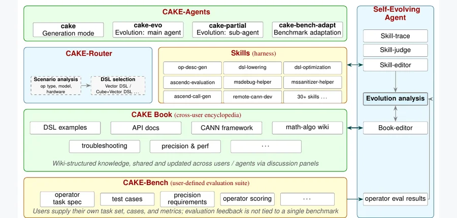 arXiv 2026-10-23 · cs.AI · #21 **[CANNBot-CAKE: Collaborative Agentic Kernel Evolution for Ascend NPU](https://arxiv.org/abs/2610.31034)** Deng Pan , Xue-Jian Gao , Junyi Fan , Bin Du , Jiasheng Li , Xinxian Chen , Nok Yan Chang , Xinlin Li , Lingchao Zheng , J… Affiliation: Huawei [Paper](https://arxiv.org/abs/2610.31034) · [Figure source](https://arxiv.org/pdf/2610.31034#page=3) 

[EN] Abstract
Efficient custom operators are essential for modern deep learning workloads, yet developing high-performance kernels for Ascend NPUs remains slow, expert-intensive, and difficult to automate. Although AI agents now approach expert performance on GPU kernel benchmarks, current models remain less capable of generating AscendC kernels for NPUs, potentially reflecting the relative scarcity of relevant training data. We thus present CAKE, a CANN-native system for deployable custom operators that combines adaptive multi-DSL routing, separate Generation and Evolution modes, and reviewed knowledge reuse through CAKE Book and a Self-Evolving Agent. On 53 CANN-Bench v1.1 operators on Ascend 950PR, CAKE's aggregated results achieve $100\%$ case pass rate on the standard set (1,060/1,060) and $98.28\%$ on the hidden set (4,167/4,240), with an overall mean score of 78.63 out of 100 and an average performance speedup of $1.334\times$ over the baseline. Evolution then pushes correct operators further: EngramGateFusion cuts aggregate device time by $46.6\%$ over 20 rounds and roughly halves the mean roofline gap. These results offer a practical path toward closing Ascend's AI-for-kernel capability gap. <a href="https://arxiv.org/abs/2610.31034">Source</a>

[ZH] Abstract
Ascend NPU 高效自定义算子开发慢、需专家，模型生成 AscendC 能力弱，可能因训练数据少。CAKE 是 CANN 原生可部署算子系统，结合自适应多 DSL 路由、分离生成与进化模式，以及 CAKE Book、自进化智能体的审阅知识复用。在 Ascend 950PR、53 项 CANN-Bench v1.1 算子上，汇总标准集通过 1,060/1,060（100%），隐藏集 4,167/4,240（98.28%），平均分 78.63/100，平均性能加速 1.334 倍。进化继续改进正确算子，EngramGateFusion 二十轮减少聚合设备时间 46.6%，平均屋顶线差距约减半，为缩小 NPU 自动内核能力差距提供路径。 <a href="https://arxiv.org/abs/2610.31034">Source</a>
 |
| 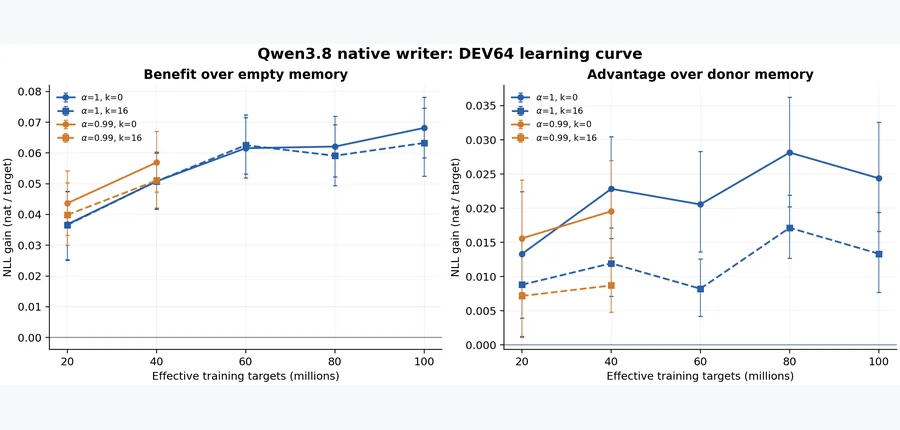 arXiv 2026-10-23 · cs.CL · #22 **[Delta N-gram: Forward-Only Continual Writing into a Language Model's Native N-gram Memory](https://arxiv.org/abs/2610.31125)** Hao Wu Affiliation: Illinois Institute of Technology [Paper](https://arxiv.org/abs/2610.31125) · [Code](https://github.com/af-74413592/delta-ngram) · [Figure source](https://arxiv.org/html/2610.31125v1/figures/dev64_learning_curve.png) 

[EN] Abstract
Our previous analysis found that a model's native hashed N-gram table is where continual updates disturb the base least, but its writes needed backpropagation and changed the pretrained table. We present Delta N-gram, a forward-only write path into that table. The pretrained table T^0 is never modified. Evidence is written into a sparse patch \Delta on the rows it addresses: a 4.1M-parameter writer emits a target and a gate per (position, hash head) event, and a block-averaged delta rule keeps each row a convex combination of its old value and the gated targets. The writer is trained offline on raw text with the pretraining objective; at use time writing takes forward passes only, and clearing \Delta restores the original model. A 0.6B prototype trained to answer questions keeps 16/16 facts after a second write; online gradient writes keep 2--4/16. We study two writers: a plain writer that encodes evidence with the T^0-only model, and a delta writer that reads its current memory while encoding. On Qwen3.8-Flash-Next, the plain writer's memory is document-specific: on 64 held-out news events it lowers continuation NLL by 0.068 nats/token against empty memory and by 0.024 against another document's memory, and 0.063 and 0.013 after 16 intervening articles. The delta writer's memory is more document-specific and keeps more of it under distraction (70% vs 54%). Over 35,000 writes on our previous seven-task chain both writers stay stable and the delta writer drifts less (layer-2 math drift 176% vs 188%); later accuracy changes by -0.26/-0.52pp (-7.29pp for gradient updates) and small-k_i drift is 17.9/17.5% (39.2%). Acquisition is negative, and general-input drift reaches 32.8% (20.75%): format rows read by every example grow to 4--12 times their pretrained norm. Zeroing eight such rows removes over 98% of layer-2 drift on math inputs, together with their NLL gain. <a href="https://arxiv.org/abs/2610.31125">Source</a>

[ZH] Abstract
此前分析发现，原生哈希 N-gram 表适合低干扰持续更新，但需反传并改变预训练表。Delta N-gram 提供仅前向写入，预训练 T⁰ 不变，只在证据指向行写稀疏补丁 Δ。4.1M 参数写入器为每个位置、哈希头事件输出目标及门控，分块平均 delta 规则使每行是旧值和门控目标的凸组合。写入器离线按预训练目标学原始文本，使用时仅前向，清空 Δ 恢复原模型。0.6B 问答原型第二次写后保留 16/16 事实，在线梯度写仅 2—4/16。普通写入器用 T⁰ 模型编码，delta 写入器边读当前记忆边编码。Qwen3.8-Flash-Next 上，64 留出新闻中普通记忆相对空记忆降低延续 NLL 0.068 nats/词元，相对他文记忆降 0.024；插入十六文后降 0.063、0.013。delta 记忆更文档特定，干扰后保留 70% 对 54%。此前七任务链 35,000 次写入中均稳定，delta 漂移更少，第二层数学漂移 176% 对 188%；后续准确率变 -0.26/-0.52 个百分点，梯度更新 -7.29，small-k_i 漂移 17.9/17.5%，梯度 39.2%。获得新知识为负，通用输入漂移达到 32.8%（20.75%），所有样例读取的格式行长至原范数 4—12 倍。清零八行消除超 98% 数学第二层漂移，同时消除 NLL 收益。 <a href="https://arxiv.org/abs/2610.31125">Source</a>
 | 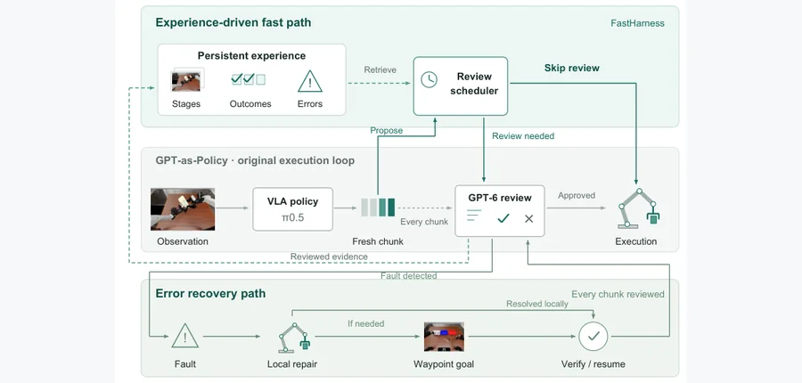 arXiv 2026-10-23 · cs.RO · #23 **[FastHarness: Experience-Driven Review Scheduling for Vision-Language-Action Policies](https://arxiv.org/abs/2610.31427)** Tao Lin , Yuxin Du , Haoxiao Wang , Zile Zhong , Bo Zhao Affiliation: Shanghai Jiao Tong University / Zhejiang University [Paper](https://arxiv.org/abs/2610.31427) · [Code](https://github.com/FastHarness/fast-harness) · [Figure source](https://arxiv.org/html/2610.31427v1/system_overview.png) 

[EN] Abstract
Agentic robot systems combine language-model reasoning with robot policies to monitor execution and recover from failures. However, reviewing every action chunk incurs substantial overhead, even in familiar situations. We introduce FastHarness, an experience-driven execution harness that adaptively schedules GPT-6 Astra supervision of a {\pi}0.5 policy. A fast path uses stage memory and reviewed outcomes to reduce review frequency as experience accumulates, while a complementary recovery path focuses supervision on correcting errors. Once recovery is verified, routine execution resumes, with failure experience retained to guide future interventions. The policy remains frozen and generates fresh actions from current observations. Across four simulated manipulation tasks, reviewer token use decreases by an average of 57.2% per task from the first evaluated episode to the mean of the final five episodes. Mean episode time decreases from 85.5 to 52.0 minutes over the same interval. On the same tasks, mean success increases from 80% for GPT-as-Policy ({\pi}0.5 + GPT-6 Astra) to 97.19% with FastHarness. These results highlight adaptive supervision as a practical route to more efficient agentic robotics without additional model training. <a href="https://arxiv.org/abs/2610.31427">Source</a>

[ZH] Abstract
机器人智能体结合语言推理和策略监督、恢复，但每动作块审查开销大。FastHarness 用经验自适应调度 GPT-6 Astra 对 π0.5 的监督：快速路径用阶段记忆和已审结果减少熟悉情况审查，恢复路径聚焦纠错，验证后恢复常规执行，保留失败经验指导未来。策略冻结，按当前观测生成新动作。四个仿真操作任务中，最终五回合平均审查词元相对首次评估平均少 57.2%，回合时间从 85.5 降至 52.0 分钟；相同任务成功率从 GPT-as-Policy 的 80% 升至 97.19%。无需额外模型训练，自适应监督可提高效率。 <a href="https://arxiv.org/abs/2610.31427">Source</a>
 | 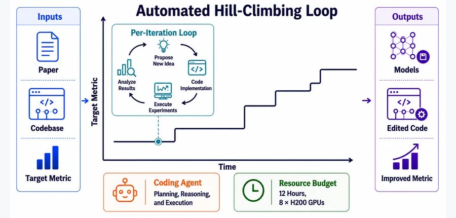 arXiv 2026-10-22 · cs.AI · #24 **[Automating ML for Science: Can Frontier Agents Climb Scientific Hills in the Wild?](https://arxiv.org/abs/2610.28763)** Ming Zhong , Stacy Li , Nicholas Carlini , Matthew Jagielski Affiliation: Anthropic Fellows Program / Anthropic [Paper](https://arxiv.org/abs/2610.28763) · [Code](https://github.com/maszhongming/agent4sci) · [Data](https://huggingface.co/datasets/MingZhong/agent4sci) · [Figure source](https://arxiv.org/html/2610.28763v1/Figures/intro_hillclimb.png) 

[EN] Abstract
Frontier coding agents are increasingly framed as end-to-end automated researchers, and ML for science offers a demanding test of that promise: improving a scientific model often requires domain insight beyond routine ML engineering. We introduce Agent4Sci, a long-horizon testbed for measuring how far today's agents can improve the published best models on scientific ML benchmarks, spanning 20 benchmarks across 11 domains. Rather than ranking agents on a leaderboard, Agent4Sci asks what kinds of progress agents can make on these tasks under in-the-wild conditions, and where they fall short. Empirically, today's frontier agents advance the published best on every benchmark, with Claude Opus reaching 10.4% mean relative improvement and no run flagged for academic misconduct. These gains, however, come almost entirely from a bag of ML-engineering tricks rather than research-level insight. Trajectory analysis surfaces three recurring limitations in this setting: novelty miscalibration, resource under-utilization, and rapid collapse into local engineering sweeps. Lightweight plug-in skills for research ideation, experiment management, and scheduled checklists raise Claude Opus from 10.4% to 20.1% and Codex from 4.4% to 8.1%, while yielding more diverse, domain-relevant interventions. Agent4Sci gives the community a way to track and push frontier agents from ML engineering toward domain insight on real-world ML-for-science problems. Code and data are available on GitHub ( this https URL ) and Hugging Face ( this https URL ). <a href="https://arxiv.org/abs/2610.28763">Source</a>

[ZH] Abstract
前沿编码智能体被视为端到端研究者，科学机器学习需要超越常规工程的领域洞见，是严格检验。Agent4Sci 测二十基准、十一领域中，智能体能将已发表最佳模型改善多远，重在真实条件的进展类型和不足，而非排行榜。全部基准的已发表最优均被推进，Claude Opus 平均相对提高 10.4%，无运行被标学术不端，但收益几乎全来自工程技巧而非研究洞见。轨迹显示创新误校准、资源利用不足、快速陷局部调参三限制。研究构思、实验管理和定时检查轻量技能，将 Opus 从 10.4% 提至 20.1%，Codex 从 4.4% 提至 8.1%，干预更丰富、更领域相关。试验床帮助推动从工程到洞见，代码数据见 GitHub、Hugging Face 原文链接。 <a href="https://arxiv.org/abs/2610.28763">Source</a>
 |
| 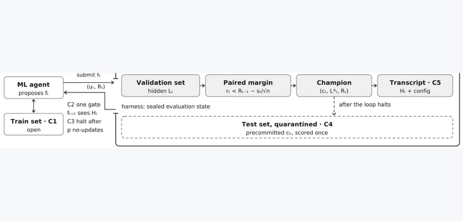 arXiv 2026-10-22 · cs.LG · #25 **[An Explicit Feedback Contract for Iterative ML-Agent Harnesses](https://arxiv.org/abs/2610.28798)** Kehui Yao , Chuanbo Hu , Jiao Chen , Ramin Giahi , Reza Yousefi Maragheh , Lalitesh Morishetti , Ziwei Hong , Yiyun Su , J… Affiliation: Walmart Global Tech / Lehigh University / Rutgers University [Paper](https://arxiv.org/abs/2610.28798) · [Figure source](https://arxiv.org/pdf/2610.28798#page=4) 

[EN] Abstract
Iterative ML agents develop models by editing code, running experiments, reading a validation score, and choosing what to try next. In current harnesses this loop is served by an exact validation score returned after every attempt, which leaves the validation split open to adaptive selection. In this work, we introduce an explicit feedback contract for ML-agent harnesses, which specifies what an agent may observe, when iteration should stop, and when the test split may be touched. The contract releases a validation score only when a submission clears a noise threshold computed from the paired standard error, so no margin has to be tuned. We ran experiments on click-through-rate prediction, learning to rank, and a control task with no signal to find. The control is the sharpest case, because the true gain there is zero by construction: an agent reading exact scores ended by reporting a gain of 0.0157, while under the contract it reported 0.0033. On both real tasks the contract narrows the validation-test gap, and test performance is slightly higher rather than lower. The largest difference is in when the agents stop. Exact feedback used its entire budget of thirty submissions on two of the three tasks, including the one where nothing can be learned, while the contract halted after four to twelve. A run that exhausts its budget is usually read as diligence. It is better read as a symptom: when the feedback channel is unbounded, noise keeps supplying improvements to chase. <a href="https://arxiv.org/abs/2610.28798">Source</a>

[ZH] Abstract
迭代机器学习智能体改代码、运行实验、读验证分数再决定下一步，精确反馈使验证集暴露于自适应选择。我们提出明确反馈契约，规定可见内容、何时停止和何时访问测试集；只有提交超过按配对标准误算的噪声阈值才释放验证分，无需调边际。在点击预测、排序及无信号控制任务实验。零真实收益的控制中，精确分智能体报告收益 0.0157，契约为 0.0033。真实任务验证—测试差距缩小，测试略高。停止差异最大：精确反馈在三任务中的两个用完三十提交，包括无信号任务；契约四至十二次停止。预算耗尽常被视为勤奋，但无界反馈让噪声不断供应可追逐“改进”，更像症状。 <a href="https://arxiv.org/abs/2610.28798">Source</a>
 | 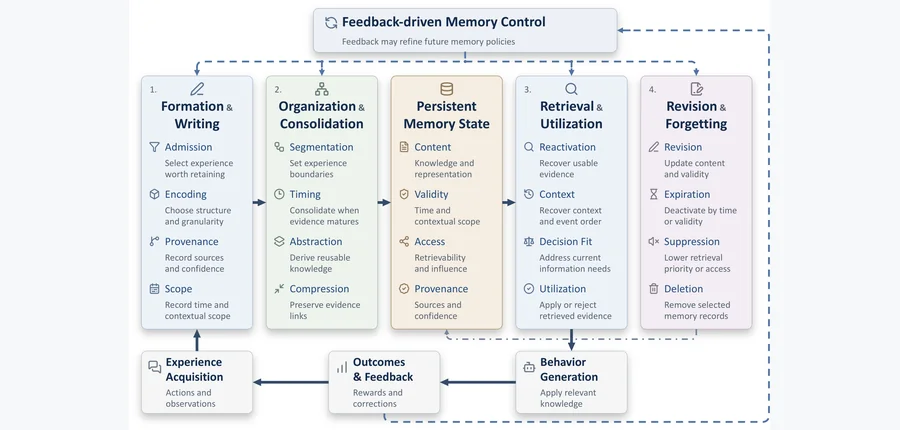 arXiv 2026-10-22 · cs.CL · #26 **[Memory-Centric Continual Learning for AI Agents](https://arxiv.org/abs/2610.29357)** Dongfang Li , Zhuoen Chen , Bonian Jia , Zixuan Liu , Zhengxuan Lu , Can Deng , Yukun Shi , Yuhang Meng , Xin Zhang , Jiah… Affiliation: Harbin Institute of Technology (Shenzhen) / Shenzhen Loop Area Institute / Tsinghua University / Southeast University / Xingchen AGI Lab, China Telecom / Huawei Technologies [Paper](https://arxiv.org/abs/2610.29357) · [Figure source](https://arxiv.org/html/2610.29357v1/memory_survey_lifecycle.png) 

[EN] Abstract
Autonomous agents powered by foundation models can reason, plan, and use tools, but their fixed weights and context limits hinder sustained learning from experience over long-term deployment. While external memory systems attempt to bridge this gap, they mostly act as passive retrieval caches, evaluated primarily by whether they can recall stored facts or past interactions. Whether memory can drive genuine continual learning remains an open question. In this paper, we introduce Memory-Centric Continual Learning (MCCL), arguing that memory should be judged by whether it improves future actions, not merely what it retrieves. MCCL has three main parts. First, a three-axis taxonomy organizes memory by where state is stored (substrates), what form it takes (assets), and how it is managed (policies). This defines a two-loop lifecycle that updates memory state in an inner loop while refining management policies in an outer loop based on task feedback. Second, an evaluation protocol measures retention under interference, adaptation to change, and task transfer to isolate genuine behavioral gains from simple context expansion. Third, a memory scaling framework models how agent performance scales with experience, storage capacity, and compute budgets across non-parametric and parametric memory. Together, these components reframe agent memory from passive lookup to continuous learning, offering a principled route toward self-improving autonomous agents. <a href="https://arxiv.org/abs/2610.29357">Source</a>

[ZH] Abstract
基础模型智能体可推理规划用工具，但冻结权重及上下文限制长期经验学习。外部记忆多是按回忆事实能力评估的被动缓存，能否真正持续学习未明。本文提出以记忆为中心的持续学习（Memory-Centric Continual Learning，MCCL），认为应按改善未来动作评记忆，含三部分：以存储基底、资产形式、管理策略三轴分类，定义内循环更新状态、外循环按任务反馈细化策略；评估干扰保持、变化适配和任务迁移，以区分真实行为收益与单纯扩上下文；记忆缩放框架刻画经验、容量、计算对参数和非参数记忆表现的影响。框架把记忆从查询重述为持续学习，为自改进提供原则路径。 <a href="https://arxiv.org/abs/2610.29357">Source</a>
 | 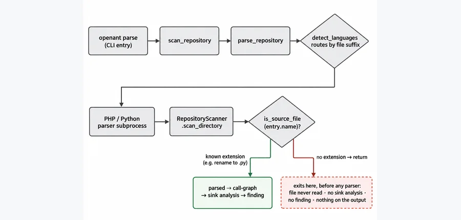 arXiv 2026-10-22 · cs.CR · #27 **[Where AI Vulnerability Discovery Harnesses Go Quiet: Structural False Negatives and Hidden Vulnerabilities](https://arxiv.org/abs/2610.29379)** Gadi Evron Affiliation: Affiliation unconfirmed [Paper](https://arxiv.org/abs/2610.29379) · [Figure source](https://arxiv.org/html/2610.29379v1/fig1.png) 

[EN] Abstract
LLM-based vulnerability discovery harnesses can miss real, reachable vulnerabilities because of how the harness around the model is built. Steps that select code, filter it, and store and merge findings can drop a vulnerability before or after the model runs, independently of the model's capability, and the report usually gives no sign that this happened. These drops come from engineering choices, and errors. They leave vulnerabilities undetected, and an attacker who knows the harness's rules can also use them to hide a vulnerability on purpose. Understanding these drops shows how to build harnesses that fix or disclose them and are harder to evade. Starting from the two harnesses we maintain, Knostic's OpenAnt and raptor, and then examining 10 additional open-source harnesses, we mapped 13 points where such drops occur and organized them into a taxonomy. Using each harness's own code, we show a single file that six harnesses dropped before their model saw its code, five of them without notice. We propose engineering failure patterns mapped to these drops, and relate them to Ptacek and Newsham's work on intrusion detection evasion. The paper also covers content-steered verdicts and prompt injection, and gives design principles and tests for harnesses that report accurately what they analyzed. The reliability findings likely apply to other LLM harnesses, beyond vulnerability research and application security, and the evasion findings apply wherever an attacker can write or influence the code being checked. We also argue that harnesses built to be descriptive can, in effect, be prescriptive. Rules written to describe typical code and typical model replies end up deciding what is analyzed, and anything that does not conform is treated as absent or as "no vulnerability." <a href="https://arxiv.org/abs/2610.29379">Source</a>

[ZH] Abstract
基于大语言模型的漏洞发现框架可在模型前后因代码选择、过滤、结果存储合并而丢失可达真漏洞，与模型能力无关，报告常不提示。工程选择和错误导致漏检，知道规则的攻击者也可故意利用。我们从维护的 Knostic OpenAnt、raptor 及十个额外开源框架，定位十三个丢失点、归类。用自身代码展示一个文件被六框架在模型看到前丢弃，其中五个无提示。提出对应工程失败模式，关联经典入侵检测规避研究，并讨论内容驱动判定、提示注入，给准确披露分析范围的设计原则与测试。可靠性问题可能不限安全研究，规避则适于攻击者可影响被检代码的情境。描述典型代码与回复的规则可实质成为规定，非匹配内容被当不存在或“无漏洞”。 <a href="https://arxiv.org/abs/2610.29379">Source</a>
 |
|  arXiv 2026-10-22 · cs.RO · #28 **[Toward Recursive Self-Improvement in Physical AI](https://arxiv.org/abs/2610.29677)** Meng Luo , Zechen Bai , Shanqing Xu , Yanlin Li , Kaixin Li , Mengchen Qian , Weifeng Lu , Ran Zhang , Yingtian Zou , Ziya… Affiliation: National University of Singapore / Huazhong University of Science and Technology / Shanghai Jiao Tong University / Nanyang Technological University / Hong Kong Baptist University [Paper](https://arxiv.org/abs/2610.29677) · [Project](https://physical2rsi.github.io) · [Figure source](https://arxiv.org/html/2610.29677v1/figures/art_surreal5.png) 

[EN] Abstract
Recursive self-improvement (RSI) describes a system that improves not only its behavior but also the process by which it improves. Recent digital agents test this idea by rewriting their own code and checking each version with executable tests. Bringing these mechanisms into the physical world requires learning from partial observations through costly trials, while accounting for changing operating conditions and potentially irreversible consequences. We position RSI within robot learning and trace pathways from improving robot capabilities to improving the processes that generate them. We examine how physical experience can strengthen these improvement mechanisms and when the resulting gains can support further self-improvement of the mechanisms themselves. Gains carry forward only when feedback addresses remaining learning needs, the receiving component can use the change, its value survives changes in tasks or hardware, and continued practice remains safe and affordable. Existing studies, concentrated in manipulation, support behavioral improvement, benefits to later learning, and procedure improvement. Some systems also change the improver's knowledge or tools, but the physical studies reviewed here have yet to isolate gains attributable to recursion. We synthesize these findings into evaluation principles and research directions for machines that, trial by trial, safely improve the way they improve. <a href="https://arxiv.org/abs/2610.29677">Source</a>

[ZH] Abstract
递归自改进不仅改善行为，也改善改进过程。数字智能体通过改源码、可执行测试研究此机制，物理世界则需从局部观测、昂贵试验学习，面对条件变化及潜在不可逆后果。我们定位 RSI 与机器人学习关系，梳理从能力改善到产生能力的过程改善，考察物理经验何时强化机制、收益何时进一步支持机制自身改进。收益传递要求反馈针对剩余学习需求、接收组件能利用变化、价值跨任务硬件变化保留，且实践安全可负担。现有工作集中操作，支持行为改善、后续学习收益和程序改善；部分改变改进者知识或工具，但所综述物理研究尚未隔离可归因于递归的收益。我们综合为评估原则与方向，指向逐次试验安全改善改进方式的机器。 <a href="https://arxiv.org/abs/2610.29677">Source</a>
 | 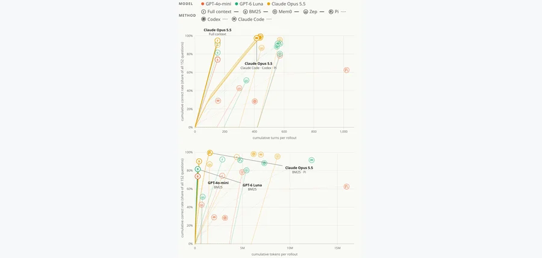 arXiv 2026-10-22 · cs.CL · #29 **[MemoryTax: The Bitter Lesson of Agent Memory](https://arxiv.org/abs/2610.29823)** Zedong Peng Affiliation: Shanghai Jiao Tong University [Paper](https://arxiv.org/abs/2610.29823) · [Figure source](https://arxiv.org/html/2610.29823v1/usage.png) 

[EN] Abstract
Agent memory systems such as Mem0 and Zep decide what to keep before any question arrives; coding agents keep the raw history and let the model search it with its own tools. We ask whether designed memory still helps once the model is strong enough to search for itself. On one LoCoMo conversation (419 turns, 152 questions), we run four memory methods (full context, BM25, Mem0, Zep) and three coding agents (Pi, Codex, Claude Code), each with GPT-4o-mini, GPT-6 Luna and Claude Opus 5.5, and record what every rollout costs. This is a short empirical study, with one conversation and one run per cell. Agent memory is a costly patch for a weak model: Mem0 beats full context only with GPT-4o-mini, and its build alone costs more than a whole full-context rollout. Agent memory also has a ceiling, set by the model that writes it: a stronger reader does not recover what a weaker writer left out. With Claude Opus 5.5, Pi tops the cost-accuracy frontier, scoring 99% for less than half the cost of full context; its one miss is a wrong answer key. Part of that lead comes from photo captions that only the agents could read: on the 88 questions whose evidence has no photo, Pi and full context differ by one answer. <a href="https://arxiv.org/abs/2610.29823">Source</a>

[ZH] Abstract
Mem0、Zep 等在问题出现前决定保留内容，编码智能体则保留原始历史、自己用工具搜索。模型强到可自搜时，设计记忆是否仍有用？在一段 LoCoMo 对话（419 轮、152 问）上，四记忆方法（全上下文、BM25、Mem0、Zep）和三编码智能体（Pi、Codex、Claude Code），各配 GPT-4o-mini、GPT-6 Luna、Opus 5.5，记录每运行成本。仅一段对话、每格一次，是小研究。Mem0 只在弱 GPT-4o-mini 优于全上下文，建库本身却更贵；弱写入遗漏的信息强读取者也恢复不了。Opus 5.5 下 Pi 以不到一半全上下文成本得 99%，唯一错因答案键错误。但领先部分来自仅智能体能读的照片说明，在 88 个无照片证据问题中，Pi 与全上下文仅差一题。 <a href="https://arxiv.org/abs/2610.29823">Source</a>
 | 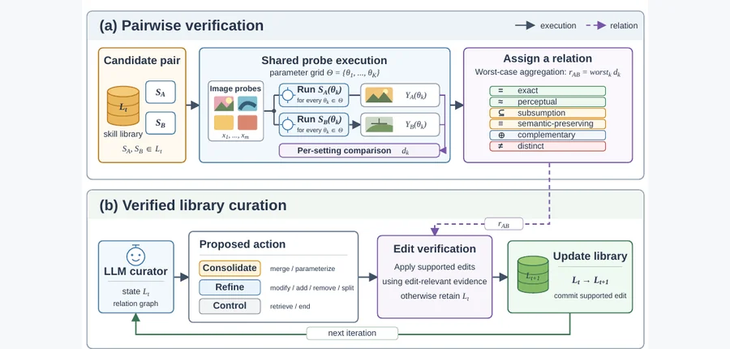 arXiv 2026-10-23 · cs.CV · #30 **[VisCurate: Evaluating Behavioral Equivalence of Visual Skills](https://arxiv.org/abs/2610.30405)** Md Farhan Ishraq , Md Farhan Ishmam , Reaz Hassan Joarder , Md Hasanul Kabir Affiliation: Islamic University of Technology / University of Utah [Paper](https://arxiv.org/abs/2610.30405) · [Project](https://farhanishraq17.github.io/Viscurate-Website/) · [Figure source](https://arxiv.org/pdf/2610.30405#page=2) 

[EN] Abstract
Modern vision-based agents have shifted toward skill-based problem-solving, where a skill is an executable image-to-image operation, e.g., cropping, thresholding, or edge detection. As these skill libraries grow, they accumulate duplicated, mislabeled, and defective skills. The signals normally used to curate them (a skill's name, description, or source code) say little about how the skill visually changes the image. We present VisCurate, a framework and benchmark that curates visual skill libraries from observed execution rather than from text. VisCurate runs each candidate skill pair on a shared probe battery and assigns one of six behavioral relations, each tied to a library edit that is safe to make. The benchmark injects seven defect types into a clean library at controlled rates, producing 300 reproducible instances with ground-truth relations and repairs. While text baselines accept up to five of six false merges on hard negatives, our verifier accepts none and recovers 51.2% of the pairs that are truly mergeable. On two real, uncurated libraries, VisCurate finds that 92% of the skills a package shares with its downstream copy are redundant, while execution confirms only 10 of 17 published equivalence claims. The curation problem also remains open, as the strongest of the nine automated curators recovers only about half of the repairs. We emphasize that visual skill libraries should be curated by behavior, not by description. <a href="https://arxiv.org/abs/2610.30405">Source</a>

[ZH] Abstract
视觉智能体技能是裁剪、阈值、边缘检测等可执行图像操作，库增长会有重复、误标、缺陷，名字描述源码未必反映视觉行为。VisCurate 从共同探测集执行而非文本整理，给每技能对六种行为关系，分别关联安全库编辑。基准在干净库注入七缺陷，生成 300 可复现实例及真实关系修复。文字基线在困难负例可错误合并六对中的五对，验证器零误合并，恢复 51.2% 真可合并对。两真实未整理库中，下游共享技能 92% 冗余，执行仅确认 17 项发表等价断言中的十项。九自动整理器最强仍只恢复约一半修复，问题未解，应按行为而非描述整理。 <a href="https://arxiv.org/abs/2610.30405">Source</a>
 |
| 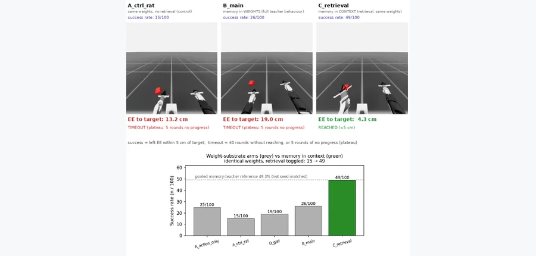 arXiv 2026-10-23 · cs.RO · #31 **[Externalise the Memory: A Pre-Registered Study of Where an Embodied Agent's Experience Should Live](https://arxiv.org/abs/2610.30478)** Cheng-Yin Tu Affiliation: Nikon Research Corporation of America [Paper](https://arxiv.org/abs/2610.30478) · [Figure source](https://arxiv.org/pdf/2610.30478#page=10) 

[EN] Abstract
Should an embodied agent's experience be baked into its policy weights, or kept external and retrieved at inference? A memory-augmented teacher (a VLM that retrieves lessons, with their episode images, from its own past attempts) produces trajectories on a vision-conditioned reach task; from the same trajectories we distil LoRA student policies and evaluate them under matched protocols, including one that re-attaches the teacher's frozen retrieval buffer to a fixed set of student weights. We pre-registered the hypotheses, arms, tests, and analysis rules before training and before any p-value. Distilling the memory-augmented behaviour into weights beat an action-only control by +1 pp (n.s.); the registered test proves underpowered for its own minimum effect, so we withdraw - rather than refute - the memory-in-weights claim. Attaching retrieval to a fixed set of student weights added +34 pp (z=5.15), reaching the pooled memory-augmented teacher reference (49.3%); the pre-registered protocol contrast agrees (+23 pp, z=3.36); under a pre-registered auto-reset sensitivity count the two are +36 and +29 pp. An exploratory behavioural probe with pre-registered per-arm predictions is consistent with behavioural distillation transferring the marginal correction but not the conditional, situation-specific correction that retrieval supplies. The recipe that follows is to externalise the memory: in follow-up controls registered before they ran, the same frozen buffer lifts the base model with no adapter to 48% (sensitivity 48%) and the other three adapters from 19-26% to 53-55% (sensitivity 17-21% to 50-55%), and the adapter adds nothing detectable once the buffer is attached. On a second, harder task, the retrieval advantage points the same direction but falls short of significance (+6 pp, 95% CI [-4.5, +16.4]); exploratory diagnostics tie the attenuation to memory coverage. <a href="https://arxiv.org/abs/2610.30478">Source</a>

[ZH] Abstract
具身经验应入权重还是外部检索？记忆教师从自身尝试检索带图像教训，在视觉到达任务产生轨迹；同轨迹蒸馏 LoRA 学生，匹配协议并测试给固定学生重新挂教师冻结检索库。训练及任何 p 值前预注册假说、实验臂、测试分析。入权重比仅动作控制高一个百分点、不显著，注册检验对其最小效应功效不足，因此撤回而非否定权重记忆断言。固定权重加检索高 34 个百分点（z=5.15），达教师汇总参照 49.3%；注册协议对比高 23 点（z=3.36），自动重置敏感计数高 36、29 点。带预注册分臂预测的探索行为探测，符合蒸馏转移边际修正却未转移情境条件修正。后续事前注册控制中，同库使无适配基础模型达 48%（敏感 48%），另三适配器从 19%—26% 到 53%—55%（敏感 17%—21% 到 50%—55%），挂库后适配器无可检测增益。第二更难任务方向一致但不显著，高六点，95% 区间 -4.5 至 16.4，探索诊断关联记忆覆盖。 <a href="https://arxiv.org/abs/2610.30478">Source</a>
 | 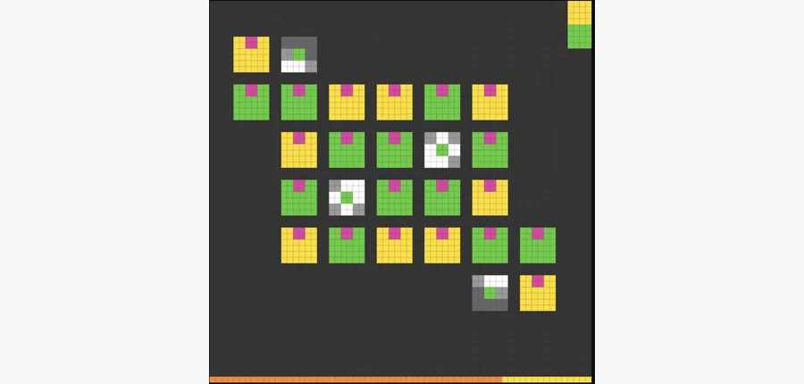 arXiv 2026-10-23 · cs.AI · #32 **[Can LLMs Improve Their Own Harness? A Controlled Study on ARC-AGI-3](https://arxiv.org/abs/2610.30499)** Jens Lehmann , Sahar Vahdati Affiliation: Amazon / Technische Universität Dresden / Universität Hannover / TIB – Leibniz Information Centre for Science and Technology and University Library [Paper](https://arxiv.org/abs/2610.30499) · [Figure source](https://arxiv.org/pdf/2610.30499) 

[EN] Abstract
A generally intelligent system acquires new skills efficiently without requiring humans to redesign its software scaffold for every new task. Yet language models rarely act alone. A harness is a symbolic program that orchestrates calls to the model, handling perception, memory, tool use, recovery, and inference allocation on the model's behalf. ARC-AGI-3 is an interactive benchmark in which agents must explore unfamiliar environments, figure out their goals on the fly, and keep learning as they go. On it, human-steered systems already report ceiling scores across the public games, so we know effective designs exist. We ask whether frontier models can build and improve such a harness on their own. Through a fixed coding bootstrap, each model constructs a complete task harness, acts through that harness on five development games, and revises the entire codebase twice. Every version is evaluated on twenty games that never influence adaptation. We measure task performance with Relative Human Action Efficiency (RHAE), which combines level completion with action efficiency relative to human baselines, and record dollar-denominated inference cost as a practical resource measure. Across 27 lineages, harness performance ranges from zero to near-ceiling scores. Two revisions raise mean held-out RHAE by only 2.80 points (95% interval [-1.44,7.35]). Development gains overstate held-out improvement, and reductions in inference cost can come at the expense of task performance. Human-steered systems demonstrate further headroom. These findings reveal a gap between autonomous harness construction and reliable adaptation under this two-revision protocol: even strong task performance does not ensure that subsequent revisions generalize or preserve existing capabilities. <a href="https://arxiv.org/abs/2610.30499">Source</a>

[ZH] Abstract
通用智能应高效获得技能而非每任务由人重写支架，但模型往往依赖符号框架管理感知记忆、工具、恢复及计算。ARC-AGI-3 要在陌生交互环境自发现目标、持续学习，人工引导公开游戏已有满分，说明有好设计。我们测试前沿模型能否自主构建改善框架：固定编程启动后，每模型建完整框架，在五开发游戏执行，整体代码修订两次；每版在不影响适配的二十游戏评估，以相对人类动作效率 RHAE 综合完成和效率，记录美元成本。27 谱系从零到近满分，两修订留出平均仅升 2.80 分，95% 区间 -1.44 至 7.35。开发收益高估留出，省推理钱可能损表现，人工系统仍有空间。该两次修订协议下，自主构建与可靠适配有差距，强任务表现不保证修改泛化或保留能力。 <a href="https://arxiv.org/abs/2610.30499">Source</a>
 | 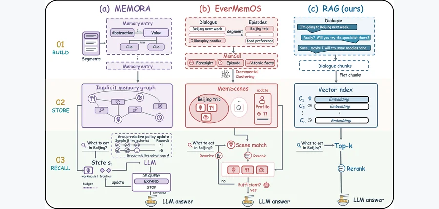 arXiv 2026-10-23 · cs.AI · #33 **[Is Complex Agentic Memory Always Needed? Naive RAG Is Stronger Than We Thought](https://arxiv.org/abs/2610.30755)** Zhengye Bao , Shengtao Zhang , Haokai Zhang , Shiqi Lou , Muning Wen , Minnan Luo Affiliation: Xi’an Jiaotong University / Shanghai Jiao Tong University / Zhejiang University / The Chinese University of Hong Kong [Paper](https://arxiv.org/abs/2610.30755) · [Code](https://github.com/Litmeb/RAW-RAG) · [Figure source](https://arxiv.org/html/2610.30755v1/overview_v2.1.png) 

[EN] Abstract
LLM memory is widely used in long-term conversation understanding. Agentic memory systems often use mutation, structural organization, learned retrieval strategies, or other complex operations. Is this complexity always necessary? We study Raw-RAG, a naive RAG baseline using dense retrieval and reranking over raw history to supply evidence to a reader LLM. Across LoCoMo, LongMemEval, MEME, and MemoryAgentBench, Raw-RAG ranks first among the compared memory systems in six of seven benchmark-model settings, outperforming the strongest compared agentic memory system by 0.13-5.53 points. We investigate why raw-history retrieval remains competitive. Evidence analysis shows that its higher coverage of necessary evidence can offset lower utilization. Useful evidence includes both answer values and the relations and dependency paths needed to derive them. Even complete access to transformed memory stores leaves an accuracy gap relative to raw evidence, highlighting the importance of preserving raw information. These findings challenge the necessity of complex agentic memory for the evaluated conversation tasks and establish naive RAG as an essential baseline. <a href="https://arxiv.org/abs/2610.30755">Source</a>

[ZH] Abstract
语言模型记忆广泛用于长期对话理解。智能体记忆系统常使用变异、结构化组织、学习得到的检索策略或其他复杂操作。这种复杂性是否总是必要？我们研究 Raw-RAG：一个朴素 RAG 基线，通过对原始历史进行稠密检索与重排，向读取语言模型提供证据。在 LoCoMo、LongMemEval、MEME、MemoryAgentBench 七个模型—基准设置中六个排名第一，比最强被比较智能体记忆高 0.13—5.53 分。证据分析显示更高必要证据覆盖可弥补利用较低；有效内容包括答案值及推导关系、依赖路径。即使完整访问转换后记忆库，与原始证据仍有差距，强调保留原信息。结果挑战所评估对话任务中复杂记忆必要性，确立朴素 RAG 为必要基线。 <a href="https://arxiv.org/abs/2610.30755">Source</a>
 |
| 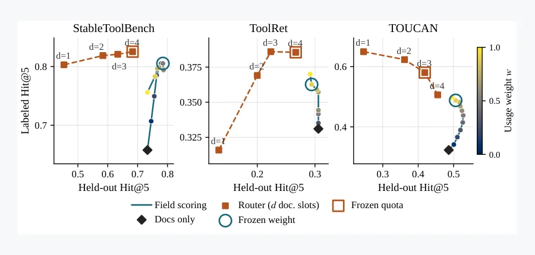 arXiv 2026-10-23 · cs.SE · #34 **[Separate Field Scoring Protects Unused Tools When Agents Pool Tool-Use Experience](https://arxiv.org/abs/2610.30867)** Abhijit Chakraborty Affiliation: Arizona State University [Paper](https://arxiv.org/abs/2610.30867) · [Figure source](https://arxiv.org/html/2610.30867v1/frontier_three.png) 

[EN] Abstract
Agents that call tools from a shared catalog can pool what they learn about which tool serves which request. We measure what pooled usage examples do to tool retrieval, reporting separately the held-out tools, for which no agent has usage, and all other tools. Adding usage examples to the index as extra entries for used tools raises Hit@5 (whether a gold tool is in the top five) for those tools and lowers it for held-out tools, by a large margin on two of three catalogs and with both embedders we tested. Giving used tools the same number of equally long entries filled with other tools' text lowers held-out Hit@5 about as much, but gives little or none of the gain. We call our method of scoring usage as its own field SYNAPSE. On StableToolBench, the held-out gold tool appears in its top five more often than with a router that reserves slots for usage (0.785 against 0.683), and this held-out lead holds on all three catalogs with both embedders. This protection persisted when we replaced each tool's usage with other tools' text, and a constant score offset for tools with usage gives similar held-out Hit@5 in most settings. The gain for tools with usage, in contrast, needs usage about the right tool. The router keeps more of the gain on labeled queries on TOUCAN with both embedders and on ToolRet with one, so the better choice depends on the workload. Splitting the usage among ten simulated agents shows that pooling helps exactly as much as giving one agent the same records. <a href="https://arxiv.org/abs/2610.30867">Source</a>

[ZH] Abstract
共享工具目录的智能体可汇集使用经验。我们分别测无任何使用的留出工具及其余工具：把已用工具例子作为额外索引项，提升其 Hit@5，却在三目录中两个、两嵌入器下明显损留出工具。用其他工具文字填等数量、等长度条目，留出下降相近，却几乎无已用收益。SYNAPSE 将使用记录作独立字段评分，StableToolBench 留出 Hit@5 为 0.785，保留使用槽路由为 0.683，此领先跨三目录两嵌入器成立。错工具文字替换也保留保护，多数设置对有经验工具加常量偏移可达相近留出效果；已用收益却需正确工具经验。路由器在 TOUCAN 两嵌入器、ToolRet 一个上保留更多有标签查询收益，选择依工作负载。分给十模拟智能体后，池化与单智能体同记录收益相同。 <a href="https://arxiv.org/abs/2610.30867">Source</a>
 | 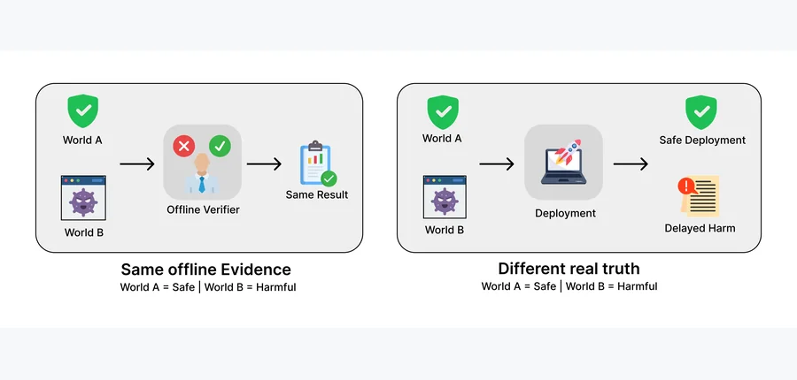 arXiv 2026-10-23 · cs.AI · #35 **[Post-Audit Mirage: Identifiability Limits of Offline Agent Verification](https://arxiv.org/abs/2610.31130)** Aman Behera , Payal Payal Affiliation: IIT Roorkee [Paper](https://arxiv.org/abs/2610.31130) · [Figure source](https://arxiv.org/html/2610.31130v1/artifacts/paper_matched_worlds.png) 

[EN] Abstract
Offline tests can fail to reveal whether an agent update will remain safe after deployment. We operationalize this post-audit mirage using matched safe and harmful lifecycles that expose identical verifier-visible evidence while an isolated scorer records opposite deployment truth. Our theorem applies standard observational-equivalence and indistinguishability ideas to this executable audit boundary and states the resulting error-abstention tradeoff. The Post-Audit Mirage benchmark makes that boundary executable across authorization, scheduling, and shared-capacity environments. IdentifiedRangeMonitor uses fresh group-labelled harm outcomes to return deploy, hold, cannot determine, or unsupported. Experiments show that monitoring can recover the missing distinction in favorable settings but may remain undecided for rare groups, small effects, or missing observations. Verifier-agent evaluation must therefore test both calculation validity and whether the available evidence supports the deployment decision. <a href="https://arxiv.org/abs/2610.31130">Source</a>

[ZH] Abstract
离线测试未必揭示更新部署后是否安全。Post-Audit Mirage 用安全、有害生命周期配对，验证器可见证据相同，隔离评分器记录相反部署真相。定理将标准观测等价及不可区分思想用于可执行审计边界，给错误—弃权权衡。基准覆盖授权、调度、共享容量。IdentifiedRangeMonitor 用新鲜、群组标注的伤害结果返回部署、搁置、无法判断或不支持。实验显示有利设置可恢复缺失区别，但稀有群、小效应或缺观测仍可能未决。评估应同时测试计算有效与证据能否支持部署决定。 <a href="https://arxiv.org/abs/2610.31130">Source</a>
 | 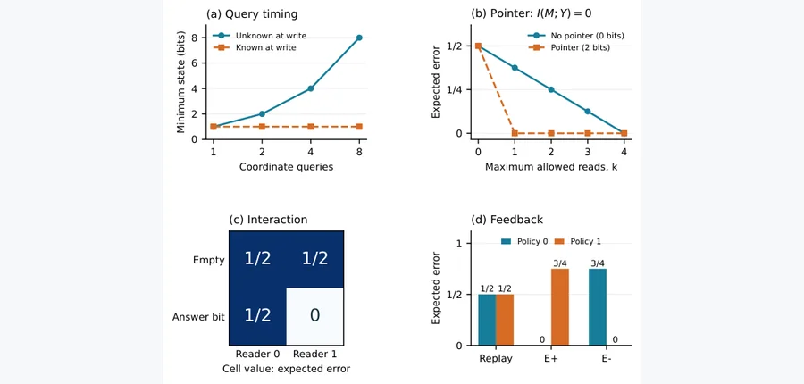 arXiv 2026-10-23 · cs.AI · #36 **[The Value of Memory in Language Agents](https://arxiv.org/abs/2610.31303)** Zehao Lin , Erenkai Zhu , Helan Hu , Xixuan Hao , Chunyu Li , Kai Chen Affiliation: MemTensor / Shanghai Jiaotong University / The Hong Kong University of Science and Technology (Guangzhou) [Paper](https://arxiv.org/abs/2610.31303) · [Figure source](https://arxiv.org/html/2610.31303v1/comparison-contracts-paper.png) 

[EN] Abstract
Memory enables language agents to carry useful distinctions from past experience into future decisions. Its value depends on which distinctions survive, whether a bounded agent can use them, and what can be recovered or revised as demands evolve. We develop a decision-theoretic framework that follows this value from raw history through persistent state, operational use, and costly recovery and revision. Original and retained value are expressed in units of avoided task loss; risk-cost frontiers describe attainable recovery and preservation across uses. Unknown demand yields value profiles, while interactive feedback changes the distribution of future work. A cost-aware simulation condition and five minimal counterexamples expose the roles of information timing, retrieval access, component interaction, feedback and demand uncertainty. In particular, a pointer with zero mutual information about the answer can still reduce the cost of exact recovery. Diagnostics on LoCoMo, a two-project update task and longitudinal cases exhibit failures of preservation, use and measurement. At fixed retrieved evidence, a saved ledger changes subsequent answers; at fixed agent outputs, an evaluator revision changes scores. The framework connects these distinctions to operational risk bounds and testable principles for allocating memory, preserving recovery options and revising evidence dependencies. <a href="https://arxiv.org/abs/2610.31303">Source</a>

[ZH] Abstract
记忆把过去有用区别带到未来决策，价值取决于什么保留、有限智能体能否使用、需求变化时能恢复修订什么。我们提出决策论框架，从原始历史、持久状态、操作使用到有成本恢复修订追踪价值，以避免的任务损失计原始及保留价值，风险—成本前沿表示跨用途可达恢复保留。未知需求产生价值谱，交互反馈改变未来任务分布。成本感知模拟条件及五最小反例揭示信息时间、检索访问、组件交互、反馈和需求不确定性；与答案互信息为零的指针仍可降低精确恢复成本。LoCoMo、双项目更新、纵向案例诊断显示保留、使用和测量失败：固定检索证据时账本改变答案，固定输出时评估器修改改变分数。框架关联操作风险界与可检验原则，用于分配记忆、保留恢复选项及修订证据依赖。 <a href="https://arxiv.org/abs/2610.31303">Source</a>
 |
| 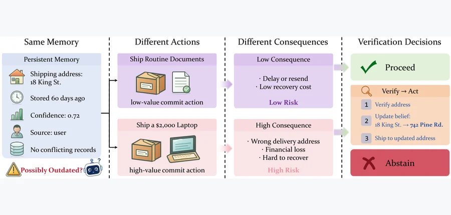 arXiv 2026-10-23 · cs.MA · #37 **[When Is a Memory Safe Enough to Act On? Action-Conditioned Verification for Long-Lived Agents](https://arxiv.org/abs/2610.31446)** Yiqi Wang , Yifei Wang , Jiaqi Zhang , Zhangkai Wu , Yiqun Duan , Taotao Cai , Mingkai Zheng Affiliation: University of Southern Queensland / Southern University of Science and Technology / Jiangsu University / The University of Sydney / Uploading Inc. [Paper](https://arxiv.org/abs/2610.31446) · [Figure source](https://arxiv.org/html/2610.31446v1/Introduction.png) 

[EN] Abstract
Long-lived agents act on memory carried across sessions, and many of their actions are irreversible, so a stale memory can turn directly into harm. Existing work improves the memory itself --- retrieving, refreshing, or reconciling entries --- yet whether an entry must be re-checked before acting is not a property of the entry: the same remembered address can be used unchecked for a routine shipment but should be re-confirmed before a valuable one. We therefore study \emph{action-conditioned memory verification}: given a candidate action, decide which of its memory premises to re-verify and when to proceed or abstain, balancing execution risk, abstention, and verification cost. We formulate this as a sequential stopping problem, in which a verification is worth its cost only if it can change what the agent does next; under suitable verifier reliability and cost conditions, increasing action consequence can move the same memory through proceed, verify, and direct-abstention regimes. Building on this formulation, \textsc{AMV-Guard} is a practical verification gate that extracts the premises a candidate action rests on, calibrates beliefs about whether they are wrong, and selects checks by bounded value of information (VOI). On ToolSandbox, relative to a static policy given the same inputs, it lowers mean verification cost by 33.9\% while keeping 100\% safe-proceed recall and 0\% Gate harmful, and raises Proceed coverage from 38.83\% to 44.17\%; in a gate-core transfer to AppWorld, which carries over the stopping/VOI core but not the full structured pipeline, it lowers verification cost by 21.3\% at a small cost in safe-proceed recall and task success. These results suggest that verification effort should be set by what an agent is about to do, not only by how reliable a memory appears. <a href="https://arxiv.org/abs/2610.31446">Source</a>

[ZH] Abstract
长期智能体跨会话依记忆行动，过时值可直接造成不可逆伤害。已有工作通过检索、刷新或协调条目来改进记忆本身，但行动前是否必须重查一个条目，并非记忆本身的性质：同地址常规发货可直用，贵重发货应确认。我们研究行动条件化验证，选择重查前提、执行或弃权，平衡风险、弃权和成本，形式化为顺序停止：只有检查可改变下一动作才值得。合适可靠性及成本条件下，后果增大可让同记忆从执行转为验证再转直接弃权。AMV-Guard 提取候选动作前提，校准错误信念，按有界信息价值选择检查。ToolSandbox 相同输入对静态策略，平均验证成本低 33.9%，安全执行召回 100%、门控有害 0%，执行覆盖从 38.83% 到 44.17%；迁移 AppWorld 仅停止/信息价值核心而非全结构管线，成本低 21.3%，安全召回与任务成功略损。验证工作应由将做什么而非仅记忆可靠性决定。 <a href="https://arxiv.org/abs/2610.31446">Source</a>
 |   |   |
<!-- PAPER_CARDS_END -->

## Retrieval overview

**37 selected papers: 11 A / 12 B / 14 C.** Collection date: **23 October 2026 (Beijing)**. This issue covers **17 verified New papers from 22 October and 20 from 23 October**. The previous processed batch was 21 October. Source dates advanced during recovery from an initial HTTP 429 response, so the two batches have different evidence coverage.

| Official source | Batch | New | Cross | Replacement | Retained evidence |
|---|---|---:|---:|---:|---|
| [Computer Science](https://arxiv.org/list/cs/new?show=2000) | 2026-10-22 | 741 | 61 | 444 | Earlier official web-reader count and selected-membership captures; full bulk New metadata not retained |
| [stat.ML](https://arxiv.org/list/stat.ML/new?show=2000) | 2026-10-22 | 13 | 26 | 28 | Earlier official web-reader counts; no selected paper recovered from this category |
| [Computer Science](https://arxiv.org/list/cs/new?show=2000) | 2026-10-23 | 714 | 55 | 418 | Complete raw HTML; all sections on one page |
| [stat.ML](https://arxiv.org/list/stat.ML/new?show=2000) | 2026-10-23 | 13 | 13 | 18 | Complete raw HTML; all sections on one page |
| Observed totals across both snapshots | 2026-10-22–23 | 1,481 | 155 | 908 | Counts describe source sections, not complete retained New metadata for both dates |

The **727 distinct New records in the 23 October listings** were fully parsed. Lexical discovery found 129 candidates and 27 complete titles/abstracts were semantically reviewed; 20 were selected. For 22 October, discovery used the dated [official CS archive](https://arxiv.org/list/cs/pastweek?show=2000), then each of the 17 selected IDs was independently checked in the earlier official **New** section, with its full abstract recovered from the official abstract page. These 17 complete abstracts were semantically reviewed. In total, **744 full New metadata records were retained and 44 complete titles/abstracts reviewed**, producing this focused issue. This is not exhaustive semantic coverage of either batch or all lexical candidates.

**Backfill limitation:** the dated archive contained 807 entries, whereas the earlier CS New+Cross snapshot counted 802. These are different retrieval states; archive entries are not assumed to be New from their date, primary category or absence of a cross-list label. Only the 17 independently verified New memberships enter this issue. The full bulk 22 October New metadata was not retained or parsed, so that batch remains incompletely screened. Mutable `/new` URLs now show a later state; saved, hashed captures in the [run record](../../data/runs/2026-10-23.json) preserve the evidence used here.

The CS aggregate covers cs.AI, cs.LG, cs.CL, cs.MA, cs.SE, cs.RO, cs.CV, cs.NE and cs.CR. Versionless IDs are deduplicated and prior inclusions excluded. Cross-listings do not enter the main list. All 37 selections have full paired abstracts and visually checked source figures: **37 EN / 37 ZH / 37 images; 0 placeholders**. Affiliations are confirmed for 35 papers; CMAS and the vulnerability-harness audit remain **Affiliation unconfirmed**. Thirteen source-linked destinations were opened and identified, including a survey reference library that is not labeled as an algorithm implementation.

## Reading guide

A denotes direct RSI, B self-improvement mechanisms, and C evaluation and limits. Papers are ordered by tier, then arXiv ID. Tier assignments, interpretation and reading priorities are **editorial inference**. Numerical findings are **author reports**, with no independent experiments reproduced for this digest. Headers, figures and selected passages were inspected; this is not a complete full-text review of every paper.

Model weights, external harnesses, skills, persistent memory and task-local state are different update targets. A better endpoint alone does not demonstrate a better improvement procedure, and finite loops do not prove unbounded recursive improvement. Robot simulators and detector-design simulators do not establish physical deployment. Costs must include proposal, failed trials, calibration, verification, training and memory operations as well as final inference.

## Tiered Top papers

| # | Paper | Categories | Authors | Affiliation | Tier | Update target | Reading priority | Official batch |
|---:|---|---|---|---|---|---|---|---|
| 1 | [Forging More Tasks into Better Harnesses: Agentic Harness Evolution via Successive Scale Racing](https://arxiv.org/abs/2610.28815) | cs.AI | Jingzhe Liu , Jiliang Tang , Tong Zhao , Neil Shah , Clark Mingxuan Ju | Michigan State University / Snap Inc. | A | External agent harness and evidence-selection procedure | Priority read | 2026-10-22 |
| 2 | [Recursive Self-Improvement on a Budget: Scoring Code Edits Before They Run](https://arxiv.org/abs/2610.29121) | cs.AI; cs.LG | Erfan Darzi , Sree Bhargavi Balija , Sheng He | Harvard University / Massachusetts Institute of Technology / UC San Diego | A | External scaffold edits and a fitted, then frozen, edit scorer | Priority read | 2026-10-22 |
| 3 | [From VLM Planners to Robotic Agents: Self-Evolving Harnesses for History-Dependent Manipulation](https://arxiv.org/abs/2610.29560) | cs.RO | Tingwen Du , Haoyu Guo , Hanxue Zhang , Xuanxu Wang , Junting Dong , Chao Gao , Mingfei Han , Tao Lu , Mulin Yu , Chunhua Shen , Xiaojun Chang , Zhihui Li | University of Science and Technology of China / Shanghai Artificial Intelligence Laboratory / Shanghai Jiao Tong University / Mohamed bin Zayed University of Artificial Intelligence / Zhejiang University | A | Editable high-level VLM harness; fixed low-level VLA executor | Topical reference | 2026-10-22 |
| 4 | [Evolving with Open Worlds: Towards Recursive Self-Improvement for Future Forecasting](https://arxiv.org/abs/2610.29784) | cs.CL | Zhipeng Chen , Yunsen Liang , Yanxi Chen , Hongkang Zhao , Lingyun Feng , Ruiyang Ren , Guoxin Chen , Jia Deng , Feng Chang , Chuan Hao , Ran Tao , Jian Yang , Ji-Rong Wen , Bryan Dai , Wayne Xin Zhao | Renmin University of China / Nanyang Technological University / IQuest Research | A | Model parameters and reusable forecasting skills | Topical reference | 2026-10-22 |
| 5 | [GuideEvolve: Self-Evolving Agent Framework with Expert Guidance and 3Ts Mechanisms](https://arxiv.org/abs/2610.30017) | cs.AI | Meihong Jia , Yasemin Timar , Jonathan Taws | Amazon / Amazon Web Services | A | Expert-guided agent framework and evolution control | Topical reference | 2026-10-22 |
| 6 | [HGM-Dual: Lineage-Aware Guided Agent Harness Optimization for Long-Horizon Planning](https://arxiv.org/abs/2610.30042) | cs.AI; cs.LG; cs.NE | Sudipta Paul , Pengrui Quan , Aounon Kumar , Nicholas Tzou , Vivek Kulkarni , Srinivas Chappidi | Samsung Research America | A | External planning harness and lineage-conditioned edit proposals | Topical reference | 2026-10-22 |
| 7 | [Agentic Knowledge-Model Co-Evolution via Consistency Regularization](https://arxiv.org/abs/2610.30790) | cs.AI | Sirui Chen , Zhining Liu , Chao Zhang , Jingrui He , Zheng Li | University of Illinois Urbana-Champaign / Georgia Institute of Technology / Amazon | A | External knowledge plus model weights | Topical reference | 2026-10-23 |
| 8 | [ADAPT for Science: A Multi-Agent System for Self-Evolving Scientific Optimization](https://arxiv.org/abs/2610.30851) | cs.AI; cs.MA; physics.optics | Zhaoran Feng , Yuchen Ni , Jianan Liu , Lemao Liu , Dejing Dou , Kairui Feng | Nanjing University / Shanghai Innovation Institute / Fudan University / BEDI Cloud / Tongji University | A | Scientific initial conditions and optimizer programs | Topical reference | 2026-10-23 |
| 9 | [AgenticEvolve: Evolutionary Program Search with Persistent Language Model Agents that Design and Run Experiments](https://arxiv.org/abs/2610.31326) | cs.NE; cs.AI; cs.LG | Ze-Yu Peng , Qing-Yu Lan , Zhan-He Wang , Jun Zhang , Yun-Song Piao | University of Chinese Academy of Sciences / Institute of Theoretical Physics, Chinese Academy of Sciences | A | Candidate programs and persistent experimental-agent state | Topical reference | 2026-10-23 |
| 10 | [HERD: Harness-Evolving Recursive Distillation for Continual Learning](https://arxiv.org/abs/2610.31401) | cs.CL; cs.AI; cs.LG | Xun Sun , Thanh Thi Nguyen , Thuy-Trang Vu | Monash University / University of the Sunshine Coast | A | Evolving harness skills, bounded residual memory and model weights | Priority read | 2026-10-23 |
| 11 | [Conservative Meta-Agent Search: Architecture Adaptation under Non-Stationarity](https://arxiv.org/abs/2610.31436) | cs.AI; cs.LG; cs.MA | Ali Atiah Alzahrani | Affiliation unconfirmed | A | Typed multi-agent architecture edits and incumbent replacement | Priority read | 2026-10-23 |
| 12 | [Self-Improving Agents with World Model Predictive Paths](https://arxiv.org/abs/2610.28945) | cs.AI | Haori Lu , Tianyu Gao , Yaoyao Liu , Yingying Li | University of Illinois Urbana-Champaign | B | External planner and world-model experience memories | Topical reference | 2026-10-22 |
| 13 | [PerMIT: Securing Persistent Memory for LLM Agents via Machine-Checked Integrity Theorems and Scalable Community Trust](https://arxiv.org/abs/2610.28987) | cs.AI; cs.CR | Tanqiu Jiang , Min Bai , Sadat Shahriar , Wanyu Du , Sandesh Swamy | Stony Brook University / AWS AI Labs | B | Persistent-memory trust state and community endorsements | Topical reference | 2026-10-22 |
| 14 | [Harness Scaling for Generalizable Agentic Reinforcement Learning](https://arxiv.org/abs/2610.29458) | cs.LG; cs.AI; cs.CL | Fei Bai , Huatong Song , Chuan Hao , Ran Tao , Jian Yang , Bryan Dai , Wayne Xin Zhao , Ji-Rong Wen | IQuest Research / Beihang University / Renmin University of China | B | Harness configurations and model policy trained across them | Topical reference | 2026-10-22 |
| 15 | [PreCoMem: Predictive Cognitive Memory for Self-Evolving Long-Term Dialogue Agents](https://arxiv.org/abs/2610.29467) | cs.AI | Jian Zhong , Zeyu Liu , Pingchuan Cao , Rongduo Han , Shunye Tang , Guohuan Xie , Mingyuan Qin , Ran Ji , Xiao Liang , Wei Wang , Haining Zhang | Nankai University / Tsinghua University / Huazhong University of Science and Technology / University of the Chinese Academy of Sciences / vivo AI Lab | B | External beliefs, retrieved-memory reliability and profiles | Topical reference | 2026-10-22 |
| 16 | [Remembering Through Change: Provenance-Preserving Hypergraph Memory for Multimodal Agents](https://arxiv.org/abs/2610.29995) | cs.CL | Jielong Tang , Ling-An Zeng , Xujie Yuan , Xiao Dong , Zhiqian Xia , Qingfeng Li , Shixiong Kai , Kaichao Liang , Rong Yao , Jian Yin | Sun Yat-sen University / Huawei Technologies, Noah Arks’ Lab / Shandong Normal University / Southeast University | B | Multimodal external memory hypergraph | Topical reference | 2026-10-22 |
| 17 | [Self-Evolving Static Analysis via LLM Pseudo-Labeling](https://arxiv.org/abs/2610.30184) | cs.CR; cs.AI; cs.SE | Rui Melo , Andre Duarte , Aditya Oke , Shubham Gandhi , Nachiket Kotalwar , Rui Abreu , Lei Li , Carolyn Rose | Carnegie Mellon University / FEUP | B | Executable static-analysis queries and their mutation policy | Topical reference | 2026-10-23 |
| 18 | [GAV: A scientific experimentation environment for PDE agents](https://arxiv.org/abs/2610.30292) | cs.LG; cs.AI | Muheng Li , Wenlong Mou | University of Toronto / Vector Institute | B | Generated PDE problems and solver programs | Topical reference | 2026-10-23 |
| 19 | [RoleFlow: Self-Evolving Multi-Role Agentic Collaboration via Structural Adaptation](https://arxiv.org/abs/2610.30429) | cs.AI | Yi Ge , Pan Wang , Xuehao Cui , Zian Zeng , Xu Hu , Heng Huang , Furong Huang | University of Maryland, College Park / University of Pittsburgh / The University of Texas at Dallas | B | Multi-agent role structure and edit-specific policy behavior | Topical reference | 2026-10-23 |
| 20 | [SplatLab: Autonomous Scientific Discovery for 3DGS Research](https://arxiv.org/abs/2610.30468) | cs.CV; cs.AI | Seemandhar Jain , Manmohan Chandraker | University of California San Diego | B | 3D Gaussian Splatting research programs and experimental scaffolds | Topical reference | 2026-10-23 |
| 21 | [CANNBot-CAKE: Collaborative Agentic Kernel Evolution for Ascend NPU](https://arxiv.org/abs/2610.31034) | cs.AI | Deng Pan , Xue-Jian Gao , Junyi Fan , Bin Du , Jiasheng Li , Xinxian Chen , Nok Yan Chang , Xinlin Li , Lingchao Zheng , Jun Li , Yuwei Fan | Huawei | B | Ascend kernel programs and reviewed reusable knowledge | Topical reference | 2026-10-23 |
| 22 | [Delta N-gram: Forward-Only Continual Writing into a Language Model's Native N-gram Memory](https://arxiv.org/abs/2610.31125) | cs.CL; cs.LG | Hao Wu | Illinois Institute of Technology | B | Sparse reversible test-time memory delta; frozen base model | Topical reference | 2026-10-23 |
| 23 | [FastHarness: Experience-Driven Review Scheduling for Vision-Language-Action Policies](https://arxiv.org/abs/2610.31427) | cs.RO | Tao Lin , Yuxin Du , Haoxiao Wang , Zile Zhong , Bo Zhao | Shanghai Jiao Tong University / Zhejiang University | B | External review/recovery harness and stage experience memory | Topical reference | 2026-10-23 |
| 24 | [Automating ML for Science: Can Frontier Agents Climb Scientific Hills in the Wild?](https://arxiv.org/abs/2610.28763) | cs.AI; cs.CL; cs.LG | Ming Zhong , Stacy Li , Nicholas Carlini , Matthew Jagielski | Anthropic Fellows Program / Anthropic | C | Scientific-agent skills and evaluation tasks | Topical reference | 2026-10-22 |
| 25 | [An Explicit Feedback Contract for Iterative ML-Agent Harnesses](https://arxiv.org/abs/2610.28798) | cs.LG | Kehui Yao , Chuanbo Hu , Jiao Chen , Ramin Giahi , Reza Yousefi Maragheh , Lalitesh Morishetti , Ziwei Hong , Yiyun Su , Jianpeng Xu , Evren Korpeoglu , Kannan Achan | Walmart Global Tech / Lehigh University / Rutgers University | C | Evaluator feedback-release policy and stopping behavior | Topical reference | 2026-10-22 |
| 26 | [Memory-Centric Continual Learning for AI Agents](https://arxiv.org/abs/2610.29357) | cs.CL; cs.AI | Dongfang Li , Zhuoen Chen , Bonian Jia , Zixuan Liu , Zhengxuan Lu , Can Deng , Yukun Shi , Yuhang Meng , Xin Zhang , Jiahe Huang , Fuhao Li , Junmai Wang , Shunyao Wen , Jingjun Sun , Jiaxu Tian , Jiangling Zhang , Zihan Wang , Liangyou Li , Yitong Yao , Shuangyong Song , Beilun Wang , Pengxu Wei , Hanlin Xu , Chang Liu , Yongxiang Li , Baotian Hu , Xiangyang Ji , Min Zhang | Harbin Institute of Technology (Shenzhen) / Shenzhen Loop Area Institute / Tsinghua University / Southeast University / Xingchen AGI Lab, China Telecom / Huawei Technologies | C | Conceptual memory substrates, assets and management policies | Topical reference | 2026-10-22 |
| 27 | [Where AI Vulnerability Discovery Harnesses Go Quiet: Structural False Negatives and Hidden Vulnerabilities](https://arxiv.org/abs/2610.29379) | cs.CR | Gadi Evron | Affiliation unconfirmed | C | Harness coverage accounting and structural failure detection | Topical reference | 2026-10-22 |
| 28 | [Toward Recursive Self-Improvement in Physical AI](https://arxiv.org/abs/2610.29677) | cs.RO; cs.AI | Meng Luo , Zechen Bai , Shanqing Xu , Yanlin Li , Kaixin Li , Mengchen Qian , Weifeng Lu , Ran Zhang , Yingtian Zou , Ziyang Luo , Wei Chen , Hongzhan Lin | National University of Singapore / Huazhong University of Science and Technology / Shanghai Jiao Tong University / Nanyang Technological University / Hong Kong Baptist University | C | Evaluation framework for physical self-improvement | Topical reference | 2026-10-22 |
| 29 | [MemoryTax: The Bitter Lesson of Agent Memory](https://arxiv.org/abs/2610.29823) | cs.CL; cs.AI | Zedong Peng | Shanghai Jiao Tong University | C | Memory-system evaluation and raw-history access controls | Topical reference | 2026-10-22 |
| 30 | [VisCurate: Evaluating Behavioral Equivalence of Visual Skills](https://arxiv.org/abs/2610.30405) | cs.CV | Md Farhan Ishraq , Md Farhan Ishmam , Reaz Hassan Joarder , Md Hasanul Kabir | Islamic University of Technology / University of Utah | C | Visual skill-library equivalence and repair decisions | Topical reference | 2026-10-23 |
| 31 | [Externalise the Memory: A Pre-Registered Study of Where an Embodied Agent's Experience Should Live](https://arxiv.org/abs/2610.30478) | cs.RO; cs.AI | Cheng-Yin Tu | Nikon Research Corporation of America | C | External episode-image memory versus LoRA student weights | Topical reference | 2026-10-23 |
| 32 | [Can LLMs Improve Their Own Harness? A Controlled Study on ARC-AGI-3](https://arxiv.org/abs/2610.30499) | cs.AI; cs.SE | Jens Lehmann , Sahar Vahdati | Amazon / Technische Universität Dresden / Universität Hannover / TIB – Leibniz Information Centre for Science and Technology and University Library | C | Autonomously constructed and revised ARC-AGI-3 harnesses | Priority read | 2026-10-23 |
| 33 | [Is Complex Agentic Memory Always Needed? Naive RAG Is Stronger Than We Thought](https://arxiv.org/abs/2610.30755) | cs.AI | Zhengye Bao , Shengtao Zhang , Haokai Zhang , Shiqi Lou , Muning Wen , Minnan Luo | Xi’an Jiaotong University / Shanghai Jiao Tong University / Zhejiang University / The Chinese University of Hong Kong | C | Memory evaluation baselines and preservation of raw evidence | Topical reference | 2026-10-23 |
| 34 | [Separate Field Scoring Protects Unused Tools When Agents Pool Tool-Use Experience](https://arxiv.org/abs/2610.30867) | cs.SE; cs.AI | Abhijit Chakraborty | Arizona State University | C | Tool-retrieval usage fields and pooled experience | Topical reference | 2026-10-23 |
| 35 | [Post-Audit Mirage: Identifiability Limits of Offline Agent Verification](https://arxiv.org/abs/2610.31130) | cs.AI; cs.LG | Aman Behera , Payal Payal | IIT Roorkee | C | Offline update-verification evidence and post-deployment monitoring | Topical reference | 2026-10-23 |
| 36 | [The Value of Memory in Language Agents](https://arxiv.org/abs/2610.31303) | cs.AI; cs.CL | Zehao Lin , Erenkai Zhu , Helan Hu , Xixuan Hao , Chunyu Li , Kai Chen | MemTensor / Shanghai Jiaotong University / The Hong Kong University of Science and Technology (Guangzhou) | C | Decision-theoretic value of retained memory and recovery options | Topical reference | 2026-10-23 |
| 37 | [When Is a Memory Safe Enough to Act On? Action-Conditioned Verification for Long-Lived Agents](https://arxiv.org/abs/2610.31446) | cs.MA | Yiqi Wang , Yifei Wang , Jiaqi Zhang , Zhangkai Wu , Yiqun Duan , Taotao Cai , Mingkai Zheng | University of Southern Queensland / Southern University of Science and Technology / Jiangsu University / The University of Sydney / Uploading Inc. | C | Action-conditioned memory verification and abstention gate | Topical reference | 2026-10-23 |

## Mechanism and evidence notes

Each paper has four notes, supported by linked originals. Mechanism interpretation and limits are editorial analysis; observed results remain author reports.

### 1. Forging More Tasks into Better Harnesses: Agentic Harness Evolution via Successive Scale Racing

[Original paper](https://arxiv.org/abs/2610.28815) · Tier A · Official batch 2026-10-22 · [Affiliation source](https://arxiv.org/html/2610.28815)

- **Update target:** External agent harness and evidence-selection procedure.
- **Feedback, validation and reuse — interpretation:** SSR builds evidence combinations from task quality and coverage, races candidate harnesses and reuses selected harnesses in later rounds.
- **Author-reported evidence:** Across three benchmarks and six configurations, the reported pass rate grows from 64.3% to 68.3% as the task pool grows from 40 to 200; racing reduces validation executions by 60%.
- **Boundary — interpretation:** More evidence is not automatically better. Compare total proposal and racing costs, coverage and held-out selection fairness; fewer executions alone do not prove cheaper total search.

### 2. Recursive Self-Improvement on a Budget: Scoring Code Edits Before They Run

[Original paper](https://arxiv.org/abs/2610.29121) · Tier A · Official batch 2026-10-22 · [Affiliation source](https://arxiv.org/html/2610.29121)

- **Update target:** External scaffold edits and a fitted, then frozen, edit scorer.
- **Feedback, validation and reuse — interpretation:** A linear readout uses parent steering accuracy and eight diff coordinates, fitted on 96 edits with four evaluations of 16 fit instances. A separate steering split ranks parents and a four-node archive; held-out instances evaluate the returned node.
- **Author-reported evidence:** Across twelve GPT-4o runs, held-out HumanEval+ reaches 87.0%, versus 84.2% for parent-rate scoring and 85.1% for HGM; Sonnet reaches 86.6%, versus HGM at 86.5%.
- **Boundary — interpretation:** The fit, steering and test splits have different roles. The narrow Sonnet difference and small calibration set do not establish a universally reliable surrogate; calibration executions count toward cost.

### 3. From VLM Planners to Robotic Agents: Self-Evolving Harnesses for History-Dependent Manipulation

[Original paper](https://arxiv.org/abs/2610.29560) · Tier A · Official batch 2026-10-22 · [Affiliation source](https://arxiv.org/html/2610.29560)

- **Update target:** Editable high-level VLM harness; fixed low-level VLA executor.
- **Feedback, validation and reuse — interpretation:** SERA updates task context from observations and execution feedback, proposes harness revisions using environment rollouts and fixes the selected harness before held-out evaluation.
- **Author-reported evidence:** RoboMME overall success is 51.38% with autonomous selection, compared with 44.38% without self-evolution.
- **Boundary — interpretation:** This is robot simulation evidence, not physical deployment or VLA weight learning. Separate context maintenance during a task from reusable harness evolution across tasks.

### 4. Evolving with Open Worlds: Towards Recursive Self-Improvement for Future Forecasting

[Original paper](https://arxiv.org/abs/2610.29784) · Tier A · Official batch 2026-10-22 · [Affiliation source](https://arxiv.org/html/2610.29784)

- **Update target:** Model parameters and reusable forecasting skills.
- **Feedback, validation and reuse — interpretation:** EvoForesight uses verifiable future outcomes and prediction trajectories for parameter evolution and skill distillation, separating search from prediction to address contamination in a changing environment.
- **Author-reported evidence:** The authors report first place on FutureX for three consecutive weeks, up to 195% rating improvement and up to 10.7 Bradley–Terry points over the strongest synthesized-evaluation baseline.
- **Boundary — interpretation:** A time-sensitive leaderboard and synthesized evaluation are different evidence sources. Audit outcome timing, contamination and total training/search cost; a finite live loop does not prove indefinite improvement.

### 5. GuideEvolve: Self-Evolving Agent Framework with Expert Guidance and 3Ts Mechanisms

[Original paper](https://arxiv.org/abs/2610.30017) · Tier A · Official batch 2026-10-22 · [Affiliation source](https://arxiv.org/html/2610.30017)

- **Update target:** Expert-guided agent framework and evolution control.
- **Feedback, validation and reuse — interpretation:** Task-specific expert evaluations guide edits; fast/slow reasoning, temporal rollback and adaptive termination regulate the evolutionary loop.
- **Author-reported evidence:** MGSM accuracy is 89.8% versus 90.6% for Gödel Agent, and MMLU 89.1% versus 87.9%; reported variance falls 25–59%, evolution success is 100% versus 82%, and iterations fall from 30 to 15.1 or 13.4.
- **Boundary — interpretation:** Expert guidance is part of the system and budget. Reported evolution success and iteration reductions are protocol-specific and do not certify production robustness or lower total cost.

### 6. HGM-Dual: Lineage-Aware Guided Agent Harness Optimization for Long-Horizon Planning

[Original paper](https://arxiv.org/abs/2610.30042) · Tier A · Official batch 2026-10-22 · [Affiliation source](https://arxiv.org/html/2610.30042)

- **Update target:** External planning harness and lineage-conditioned edit proposals.
- **Feedback, validation and reuse — interpretation:** HGM-Dual records ancestor changes and behavioral outcomes, then generates both general edits and specialized children aimed at the highest-ranked constraint violations. Evaluated children feed the evolving archive.
- **Author-reported evidence:** Up to 14.45% relative case-accuracy improvement over the strongest baseline, with final HGM-variant quality reached using 2–4 times fewer evaluations.
- **Boundary — interpretation:** Relative gains are not percentage-point gains. Constraint diagnostics and specialized proposals also consume resources; planning-domain results need transfer tests beyond the reported suites.

### 7. Agentic Knowledge-Model Co-Evolution via Consistency Regularization

[Original paper](https://arxiv.org/abs/2610.30790) · Tier A · Official batch 2026-10-23 · [Affiliation source](https://arxiv.org/html/2610.30790)

- **Update target:** External knowledge plus model weights.
- **Feedback, validation and reuse — interpretation:** SPLICE perturbs analysis of the same experience, selects knowledge with consistent utility gains across views and interleaves self-distillation with reinforcement learning. Consistently harmful knowledge supplies contrastive references.
- **Author-reported evidence:** Average accuracy improves by up to 7.1 and 4.6 points over knowledge-evolution and model-training baselines; evolved knowledge cuts output tokens per correct solution by up to 44%.
- **Boundary — interpretation:** External knowledge selection and parameter training are separate update channels. Count all views, utility evaluations and training; inference token savings are not the whole evolution budget.

### 8. ADAPT for Science: A Multi-Agent System for Self-Evolving Scientific Optimization

[Original paper](https://arxiv.org/abs/2610.30851) · Tier A · Official batch 2026-10-23 · [Affiliation source](https://arxiv.org/html/2610.30851)

- **Update target:** Scientific initial conditions and optimizer programs.
- **Feedback, validation and reuse — interpretation:** ADAPT retrieves historical designs, allocates effort among search directions and evolves optimization procedures using execution feedback. Matched scientific evaluation budgets test eight unseen detector topologies.
- **Author-reported evidence:** In a differentiable gravitational-wave detector simulator, mean loss is 0.204 ± 0.101, 54.9% below the best classical optimizer and 62.2% below the best general-purpose agentic evolution baseline.
- **Boundary — interpretation:** The experiments are simulation, not constructed physical detectors. Matching scientific evaluations does not by itself match model inference, optimizer search or infrastructure cost.

### 9. AgenticEvolve: Evolutionary Program Search with Persistent Language Model Agents that Design and Run Experiments

[Original paper](https://arxiv.org/abs/2610.31326) · Tier A · Official batch 2026-10-23 · [Affiliation source](https://arxiv.org/html/2610.31326)

- **Update target:** Candidate programs and persistent experimental-agent state.
- **Feedback, validation and reuse — interpretation:** Each evolutionary island has a persistent agent that designs and runs experiments between candidate evaluations. The No-analysis control preserves the rest of the framework while disabling experimentation.
- **Author-reported evidence:** On two heuristic-design tasks across three LLMs, AgenticEvolve improves hidden and unseen quality, matching baseline final quality with far fewer evaluations and comparable cost; it also recovers more structures on twelve equation problems.
- **Boundary — interpretation:** Program search and persistent experimental context are not model weight learning. Count intermediate experiments and compare against the otherwise-identical No-analysis arm before attributing the benefit to persistence.

### 10. HERD: Harness-Evolving Recursive Distillation for Continual Learning

[Original paper](https://arxiv.org/abs/2610.31401) · Tier A · Official batch 2026-10-23 · [Affiliation source](https://arxiv.org/pdf/2610.31401#page=1)

- **Update target:** Evolving harness skills, bounded residual memory and model weights.
- **Feedback, validation and reuse — interpretation:** HERD refines reusable skills, retains examples unexplained by those skills and performs drift-constrained distillation with two anchors. These external and parametric updates repeat along the task stream.
- **Author-reported evidence:** On the 25-stage TRACE+17 stream under fixed memory and compute, HERD matches the strongest parametric baseline in new-task acquisition while reporting the least forgetting and strongest general-capability retention.
- **Boundary — interpretation:** A finite continual-learning protocol does not establish unlimited retention or improving improvement ability. Account for skill management, residual storage and distillation in the same budget.

### 11. Conservative Meta-Agent Search: Architecture Adaptation under Non-Stationarity

[Original paper](https://arxiv.org/abs/2610.31436) · Tier A · Official batch 2026-10-23 · Affiliation unconfirmed

- **Update target:** Typed multi-agent architecture edits and incumbent replacement.
- **Feedback, validation and reuse — interpretation:** CMAS uses paired shadow replay with common randomness, component interventions, a calibrated simultaneous promotion margin, simulated canaries and rollback. Archived architectures support later proposals.
- **Author-reported evidence:** Across 96 simulated streams, regret falls from 0.116 to 0.104 and utility rises from 0.44 to 0.48. Deployment inference cost falls about 6%, but search-inclusive token cost is highest; false promotion is 3.4% and 4.8% in a sealed rerun.
- **Boundary — interpretation:** This author-designed simulator is not evidence of financial alpha. Empirical update-level calibration guarantees neither full-utility improvement, no canary harm nor sequence-level error control.

### 12. Self-Improving Agents with World Model Predictive Paths

[Original paper](https://arxiv.org/abs/2610.28945) · Tier B · Official batch 2026-10-22 · [Affiliation source](https://arxiv.org/html/2610.28945)

- **Update target:** External planner and world-model experience memories.
- **Feedback, validation and reuse — interpretation:** An MPPI-inspired controller compares imagined candidate outcomes for progress and risk. Separate experience branches refine action proposals/selection and next-observation prediction for later decisions.
- **Author-reported evidence:** Experiments on ALFWorld and ScienceWorld across three backbones report strong performance and benefits from experience-guided predictive control; the abstract supplies no headline numeric effect.
- **Boundary — interpretation:** Imagined outcomes can be wrong. Distinguish task-local predictive control from reusable memory adaptation; a future code-release promise is not a verified release.

### 13. PerMIT: Securing Persistent Memory for LLM Agents via Machine-Checked Integrity Theorems and Scalable Community Trust

[Original paper](https://arxiv.org/abs/2610.28987) · Tier B · Official batch 2026-10-22 · [Affiliation source](https://arxiv.org/html/2610.28987)

- **Update target:** Persistent-memory trust state and community endorsements.
- **Feedback, validation and reuse — interpretation:** PerMIT mediates untrusted values through a finite memory interface. Only typed user inputs and gate-confirmed values are trusted; exact-content verdicts accumulate into community confirmation. Two conditional integrity theorems are machine-checked in Lean 4.
- **Author-reported evidence:** The authors report zero observed Trojan Hippo attack success with self-verification/lightweight verifiers and study trust co-scaling in communities on τ².
- **Boundary — interpretation:** Theorems depend on the explicit interface and trust assumptions, while gate quality remains consequential. Observed zero attacks is not unconditional safety; community experiments are simulated.

### 14. Harness Scaling for Generalizable Agentic Reinforcement Learning

[Original paper](https://arxiv.org/abs/2610.29458) · Tier B · Official batch 2026-10-22 · [Affiliation source](https://arxiv.org/html/2610.29458)

- **Update target:** Harness configurations and model policy trained across them.
- **Feedback, validation and reuse — interpretation:** Harness Scaling factorizes design choices, samples configurations with balanced factorial coverage and uses cross-harness reinforcement learning to encourage generalization to unseen configurations.
- **Author-reported evidence:** Reported experiments show transfer to unseen white-box and black-box harnesses; the abstract does not provide one headline numeric effect.
- **Boundary — interpretation:** This is configuration-diverse policy training, not automatically recursive improvement of the improver. Separate factorized coverage, training compute and unseen-harness evaluation.

### 15. PreCoMem: Predictive Cognitive Memory for Self-Evolving Long-Term Dialogue Agents

[Original paper](https://arxiv.org/abs/2610.29467) · Tier B · Official batch 2026-10-22 · [Affiliation source](https://arxiv.org/html/2610.29467)

- **Update target:** External beliefs, retrieved-memory reliability and profiles.
- **Feedback, validation and reuse — interpretation:** PreCoMem uses effective surprisal to distinguish observations from unreliable retrieval, maintaining, profiling and correcting memory as the environment changes.
- **Author-reported evidence:** Non-stationary DiMoBench experiments support the proposed memory management; the abstract gives no single headline numeric result.
- **Boundary — interpretation:** A belief-management loop updates external state, not necessarily weights. Reliability estimation and correction gates can themselves be miscalibrated under drift.

### 16. Remembering Through Change: Provenance-Preserving Hypergraph Memory for Multimodal Agents

[Original paper](https://arxiv.org/abs/2610.29995) · Tier B · Official batch 2026-10-22 · [Affiliation source](https://arxiv.org/html/2610.29995)

- **Update target:** Multimodal external memory hypergraph.
- **Feedback, validation and reuse — interpretation:** MHG-Mem organizes entities and facts with occurrence, evolution and evidence hyperedges, retaining connections to source images for inspection and later retrieval.
- **Author-reported evidence:** Across three benchmarks, the authors report gains of 8.20–9.98% over compared approaches.
- **Boundary — interpretation:** Retain the reported percentage wording rather than converting it to percentage points. Memory organization and evidence recovery do not alone establish an improved learning procedure.

### 17. Self-Evolving Static Analysis via LLM Pseudo-Labeling

[Original paper](https://arxiv.org/abs/2610.30184) · Tier B · Official batch 2026-10-23 · [Affiliation source](https://arxiv.org/html/2610.30184)

- **Update target:** Executable static-analysis queries and their mutation policy.
- **Feedback, validation and reuse — interpretation:** SESAA mutates Joern queries, reruns them over a code corpus and uses a second LLM critic to create labels without ground truth, feeding query performance back to the proposer.
- **Author-reported evidence:** Eight runs report F1 of 0.742; a pilot on pre-vulnerability code finds 10 of 19 CVEs, with nine in the same repository.
- **Boundary — interpretation:** Critic agreement is not ground truth, and same-repository coverage limits transfer claims. The digest reports engineering evidence without reproducing vulnerability exploitation procedures.

### 18. GAV: A scientific experimentation environment for PDE agents

[Original paper](https://arxiv.org/abs/2610.30292) · Tier B · Official batch 2026-10-23 · [Affiliation source](https://arxiv.org/html/2610.30292)

- **Update target:** Generated PDE problems and solver programs.
- **Feedback, validation and reuse — interpretation:** GAV couples a generator of manufactured PDE solutions, an accuracy/cost verifier and agent program improvement. Observed weak points guide subsequent problem generation.
- **Author-reported evidence:** Three agents reduce Navier–Stokes error by more than an order of magnitude in the reported environment.
- **Boundary — interpretation:** This is computational PDE experimentation. Manufactured references and theoretical conditions determine validity; gains within generated regimes do not establish physical experimental discovery.

### 19. RoleFlow: Self-Evolving Multi-Role Agentic Collaboration via Structural Adaptation

[Original paper](https://arxiv.org/abs/2610.30429) · Tier B · Official batch 2026-10-23 · [Affiliation source](https://arxiv.org/html/2610.30429)

- **Update target:** Multi-agent role structure and edit-specific policy behavior.
- **Feedback, validation and reuse — interpretation:** RoleFlow synthesizes roles and applies SECPO with same-chain-state edit/no-edit comparisons, assigning credit to edit-specific tokens to support later structural adaptation.
- **Author-reported evidence:** Across seven benchmarks in four domains, reported average improvement is 4.7 points, with F1 gains of 3.2–7.5 points.
- **Boundary — interpretation:** Local counterfactual comparisons support edit attribution within the protocol, not unrestricted causal claims about all architecture choices. Include policy-training and role-synthesis cost.

### 20. SplatLab: Autonomous Scientific Discovery for 3DGS Research

[Original paper](https://arxiv.org/abs/2610.30468) · Tier B · Official batch 2026-10-23 · [Affiliation source](https://arxiv.org/html/2610.30468)

- **Update target:** 3D Gaussian Splatting research programs and experimental scaffolds.
- **Feedback, validation and reuse — interpretation:** SplatLab starts from a verified backbone, evolves eight islands using measured GPU PSNR/Elo and applies falsifier penalties and numeric run binding across seven scaffold categories.
- **Author-reported evidence:** The authors report PSNR improvements of 0.18–3.78 dB and a reduction in research-cycle time from months to days.
- **Boundary — interpretation:** GPU measurements are experimental evidence but not independent certification of scientific novelty. Search is compute intensive; include failed trials, falsification and full artifact provenance.

### 21. CANNBot-CAKE: Collaborative Agentic Kernel Evolution for Ascend NPU

[Original paper](https://arxiv.org/abs/2610.31034) · Tier B · Official batch 2026-10-23 · [Affiliation source](https://arxiv.org/html/2610.31034)

- **Update target:** Ascend kernel programs and reviewed reusable knowledge.
- **Feedback, validation and reuse — interpretation:** CAKE routes DSL choices, generates and evolves kernels and retains reviewed knowledge from measured compilation/correctness/performance feedback.
- **Author-reported evidence:** For 53 operators on Ascend 950PR, standard tests pass 1060/1060, hidden tests 4167/4240 (98.28%), with score 78.63 and 1.334× speedup; EngramGateFusion time falls 46.6% over twenty rounds.
- **Boundary — interpretation:** These results depend on hardware, operators and test coverage. Passing finite tests does not imply universal correctness; include compilation, measurement and failed-candidate search costs.

### 22. Delta N-gram: Forward-Only Continual Writing into a Language Model's Native N-gram Memory

[Original paper](https://arxiv.org/abs/2610.31125) · Tier B · Official batch 2026-10-23 · [Affiliation source](https://arxiv.org/html/2610.31125)

- **Update target:** Sparse reversible test-time memory delta; frozen base model.
- **Feedback, validation and reuse — interpretation:** DeltaNgram uses a separately trained 4.1M-parameter writer to make forward-only sparse writes, while the base model stays fixed. Clearing selected rows tests whether benefit and drift share a mechanism.
- **Author-reported evidence:** Sixteen-fact tests show strong retention but negative acquisition. General drift is 32.8% in the reported setting; resetting eight rows removes 98% of drift and also the NLL benefit.
- **Boundary — interpretation:** This is a diagnostic prototype, not a solution to continual learning. Offline writer training, format-row norm growth and the acquisition failure must remain visible alongside retention.

### 23. FastHarness: Experience-Driven Review Scheduling for Vision-Language-Action Policies

[Original paper](https://arxiv.org/abs/2610.31427) · Tier B · Official batch 2026-10-23 · [Affiliation source](https://arxiv.org/html/2610.31427)

- **Update target:** External review/recovery harness and stage experience memory.
- **Feedback, validation and reuse — interpretation:** FastHarness surrounds a frozen π0.5 backbone with stage-aware review memory, adaptive GPT review and verified recovery reuse.
- **Author-reported evidence:** Across four simulated tasks, reported review tokens fall 57.2%, time falls from 85.5 to 52 minutes, and success increases from 80% to 97.19%.
- **Boundary — interpretation:** These are simulation results, not physical robot evidence. Compare early/late experience, review budgets and matched task protocols before attributing gains to faster accumulated experience.

### 24. Automating ML for Science: Can Frontier Agents Climb Scientific Hills in the Wild?

[Original paper](https://arxiv.org/abs/2610.28763) · Tier C · Official batch 2026-10-22 · [Affiliation source](https://arxiv.org/html/2610.28763)

- **Update target:** Scientific-agent skills and evaluation tasks.
- **Feedback, validation and reuse — interpretation:** Agent4Sci evaluates scientific hill climbing across twenty benchmarks in eleven domains, measuring whether agents advance published best results and whether supplied skills improve search.
- **Author-reported evidence:** Reported relative gains rise from 10.4% to 20.1% for Opus with skills and from 4.4% to 8.1% for Codex.
- **Boundary — interpretation:** Better benchmark engineering is not automatically scientific novelty. Lack of flagged misconduct does not certify novelty, and task/environment budgets matter for comparing agents.

### 25. An Explicit Feedback Contract for Iterative ML-Agent Harnesses

[Original paper](https://arxiv.org/abs/2610.28798) · Tier C · Official batch 2026-10-22 · [Affiliation source](https://arxiv.org/html/2610.28798)

- **Update target:** Evaluator feedback-release policy and stopping behavior.
- **Feedback, validation and reuse — interpretation:** The feedback contract releases a new score only when paired standard-error evidence clears a noise threshold. Restricting score access changes what an adaptive agent can chase and when it stops.
- **Author-reported evidence:** On a zero-signal control, reported gain falls from 0.0157 under exact scores to 0.0033; the contract stops after four to twelve submissions instead of exhausting thirty.
- **Boundary — interpretation:** Reduced adaptive noise chasing is not a universal statistical guarantee. Repeated use of the same paired validation set and the held-out test boundary still require audit.

### 26. Memory-Centric Continual Learning for AI Agents

[Original paper](https://arxiv.org/abs/2610.29357) · Tier C · Official batch 2026-10-22 · [Affiliation source](https://arxiv.org/pdf/2610.29357#page=50)

- **Update target:** Conceptual memory substrates, assets and management policies.
- **Feedback, validation and reuse — interpretation:** MCCL defines an inner memory-state loop and an outer policy-refinement loop, with evaluation of interference, adaptation and transfer plus an experience/storage/compute scaling framework.
- **Author-reported evidence:** The contribution is a taxonomy, evaluation protocol and conceptual scaling framework, rather than a newly validated end-to-end algorithm with a headline benchmark gain.
- **Boundary — interpretation:** Future behavior should determine memory value. A proposed outer learning loop is not evidence that an implemented system already improves its own learning procedure.

### 27. Where AI Vulnerability Discovery Harnesses Go Quiet: Structural False Negatives and Hidden Vulnerabilities

[Original paper](https://arxiv.org/abs/2610.29379) · Tier C · Official batch 2026-10-22 · Affiliation unconfirmed

- **Update target:** Harness coverage accounting and structural failure detection.
- **Feedback, validation and reuse — interpretation:** The audit traces selection, filtering and finding-merge stages across two maintained and ten additional vulnerability-discovery harnesses, mapping thirteen places where evidence can disappear.
- **Author-reported evidence:** One source file is dropped by six harnesses before model inspection, five without notice.
- **Boundary — interpretation:** The results concern engineering false negatives, not only model capability. Generalization beyond the audited harness versions is an inference; no evasion or exploit procedures are reproduced here.

### 28. Toward Recursive Self-Improvement in Physical AI

[Original paper](https://arxiv.org/abs/2610.29677) · Tier C · Official batch 2026-10-22 · [Affiliation source](https://arxiv.org/html/2610.29677)

- **Update target:** Evaluation framework for physical self-improvement.
- **Feedback, validation and reuse — interpretation:** The survey separates behavioral gains, improvements to later learning and changes to the improvement procedure, asking whether gains survive task/hardware shifts and remain affordable and safe.
- **Author-reported evidence:** Reviewed physical studies support several forms of improvement but have yet to isolate gains attributable to recursion.
- **Boundary — interpretation:** This is a survey of existing studies, not a new physical experiment or proof that physical RSI is impossible. Finite digital harness evidence cannot substitute for physical validation.

### 29. MemoryTax: The Bitter Lesson of Agent Memory

[Original paper](https://arxiv.org/abs/2610.29823) · Tier C · Official batch 2026-10-22 · [Affiliation source](https://arxiv.org/html/2610.29823)

- **Update target:** Memory-system evaluation and raw-history access controls.
- **Feedback, validation and reuse — interpretation:** MemoryTax compares four memory methods and three coding agents across three models while recording rollout cost; it checks photo-free questions to examine unequal evidence access.
- **Author-reported evidence:** On one 419-turn LoCoMo conversation with 152 questions and one run per cell, Pi with Opus scores 99% at less than half full-context cost; on 88 photo-free questions Pi and full context differ by one answer.
- **Boundary — interpretation:** One conversation and one run per cell cannot support a general memory-system ranking. Only agents could read photo captions, so the headline result includes an evidence-access confound.

### 30. VisCurate: Evaluating Behavioral Equivalence of Visual Skills

[Original paper](https://arxiv.org/abs/2610.30405) · Tier C · Official batch 2026-10-23 · [Affiliation source](https://arxiv.org/html/2610.30405)

- **Update target:** Visual skill-library equivalence and repair decisions.
- **Feedback, validation and reuse — interpretation:** VisCurate executes skill pairs on shared probes, predicts six behavioral relations and ties each relation to a library edit; seven injected defect types create 300 controlled instances.
- **Author-reported evidence:** The verifier accepts no false merges on the tested hard negatives and recovers 51.2% of truly mergeable pairs; only 10 of 17 published equivalence claims survive execution checks.
- **Boundary — interpretation:** Probe agreement is not universal semantic equivalence. The strongest of nine curators recovers only about half of repairs, so safe curation remains incomplete.

### 31. Externalise the Memory: A Pre-Registered Study of Where an Embodied Agent's Experience Should Live

[Original paper](https://arxiv.org/abs/2610.30478) · Tier C · Official batch 2026-10-23 · [Affiliation source](https://arxiv.org/html/2610.30478)

- **Update target:** External episode-image memory versus LoRA student weights.
- **Feedback, validation and reuse — interpretation:** A preregistered study distills matched teacher trajectories and then reattaches a frozen retrieval buffer to fixed student weights, separating parametric transfer from inference-time memory.
- **Author-reported evidence:** Weight distillation gains +1 percentage point, not significant and underpowered, so that claim is withdrawn. Retrieval adds +34 points and reaches the 49.3% pooled teacher reference; a second task gains +6 points with CI [−4.5, 16.4].
- **Boundary — interpretation:** An underpowered result withdraws rather than refutes the memory-in-weights claim. Protocol and auto-reset sensitivity contrasts differ; this computational reach-task evidence does not establish physical deployment.

### 32. Can LLMs Improve Their Own Harness? A Controlled Study on ARC-AGI-3

[Original paper](https://arxiv.org/abs/2610.30499) · Tier C · Official batch 2026-10-23 · [Affiliation source](https://arxiv.org/html/2610.30499)

- **Update target:** Autonomously constructed and revised ARC-AGI-3 harnesses.
- **Feedback, validation and reuse — interpretation:** Twenty-seven lineages bootstrap a full harness, revise it twice using five development games and evaluate each version on twenty games that never influence adaptation.
- **Author-reported evidence:** Mean held-out RHAE rises 2.80 points with 95% interval [−1.44, 7.35]; development gains overstate held-out improvement and lower inference cost can reduce performance.
- **Boundary — interpretation:** The study tests a two-revision protocol, not all possible RSI. Strong initial task performance and available human-designed headroom do not establish reliable autonomous adaptation.

### 33. Is Complex Agentic Memory Always Needed? Naive RAG Is Stronger Than We Thought

[Original paper](https://arxiv.org/abs/2610.30755) · Tier C · Official batch 2026-10-23 · [Affiliation source](https://arxiv.org/pdf/2610.30755#page=1)

- **Update target:** Memory evaluation baselines and preservation of raw evidence.
- **Feedback, validation and reuse — interpretation:** Raw-RAG retrieves and reranks raw history for a reader, comparing evidence coverage, utilization and dependency preservation against transformed agentic memory stores.
- **Author-reported evidence:** Across four conversation benchmarks, Raw-RAG ranks first in six of seven benchmark/model settings, beating the strongest compared agentic memory by 0.13–5.53 points.
- **Boundary — interpretation:** These conversation-task results motivate a baseline, not a claim that every memory mechanism is unnecessary. Match reader, information access and total indexing/retrieval cost.

### 34. Separate Field Scoring Protects Unused Tools When Agents Pool Tool-Use Experience

[Original paper](https://arxiv.org/abs/2610.30867) · Tier C · Official batch 2026-10-23 · [Affiliation source](https://arxiv.org/html/2610.30867)

- **Update target:** Tool-retrieval usage fields and pooled experience.
- **Feedback, validation and reuse — interpretation:** SYNAPSE scores usage separately from catalog descriptions. Wrong-tool-text and constant-offset controls distinguish index crowding from genuine tool-specific information, including tools with no prior usage.
- **Author-reported evidence:** StableToolBench held-out Hit@5 is 0.785 versus 0.683 for a slot-reserving router. Ten simulated agents gain exactly as much from pooling as one agent given the same records.
- **Boundary — interpretation:** Used-tool benefits require correct usage content, while unused-tool protection partly follows score allocation. Pooling records is not proof of emergent multi-agent collaboration.

### 35. Post-Audit Mirage: Identifiability Limits of Offline Agent Verification

[Original paper](https://arxiv.org/abs/2610.31130) · Tier C · Official batch 2026-10-23 · [Affiliation source](https://arxiv.org/html/2610.31130)

- **Update target:** Offline update-verification evidence and post-deployment monitoring.
- **Feedback, validation and reuse — interpretation:** Matched safe and harmful lifecycles expose identical offline evidence but opposite deployment truth. A conditional indistinguishability theorem motivates monitoring fresh group-labelled outcomes with an abstention option.
- **Author-reported evidence:** Experiments recover the missing distinction in favorable settings but remain undecided with rare groups, small effects or missing observations.
- **Boundary — interpretation:** The theorem is conditional on the verifier-visible evidence boundary; it does not forbid every offline guarantee. Valid calculations alone do not establish decision identifiability.

### 36. The Value of Memory in Language Agents

[Original paper](https://arxiv.org/abs/2610.31303) · Tier C · Official batch 2026-10-23 · [Affiliation source](https://arxiv.org/html/2610.31303)

- **Update target:** Decision-theoretic value of retained memory and recovery options.
- **Feedback, validation and reuse — interpretation:** The framework measures avoided task loss from history through storage, use and costly recovery/revision, incorporating demand uncertainty and feedback-dependent future work.
- **Author-reported evidence:** Five minimal counterexamples and diagnostics show distinct preservation, use and measurement failures; a zero-mutual-information pointer can still lower exact-recovery cost.
- **Boundary — interpretation:** This is a framework with diagnostics rather than one empirical state-of-the-art agent. Distinguish changed answers at fixed evidence from changed evaluation scores at fixed outputs.

### 37. When Is a Memory Safe Enough to Act On? Action-Conditioned Verification for Long-Lived Agents

[Original paper](https://arxiv.org/abs/2610.31446) · Tier C · Official batch 2026-10-23 · [Affiliation source](https://arxiv.org/html/2610.31446)

- **Update target:** Action-conditioned memory verification and abstention gate.
- **Feedback, validation and reuse — interpretation:** AMV-Guard extracts action premises, calibrates error beliefs and uses bounded value of information to choose checks and stopping, balancing action consequence, verification cost and abstention.
- **Author-reported evidence:** ToolSandbox verification cost falls 33.9%, with 100% safe-proceed recall, zero observed Gate harmful and coverage 38.83% to 44.17%; core-only AppWorld transfer cuts cost 21.3% with recall/success tradeoffs.
- **Boundary — interpretation:** Zero observed harm is not a guarantee. AppWorld transfers only the stopping/VOI core, not the full structured pipeline; reliability and cost assumptions determine the decision regimes.

## Five priority reads

These priorities are editorial inference.

1. [SSR](https://arxiv.org/abs/2610.28815): evidence selection changes whether a larger task pool helps or hurts harness evolution. Compare racing with matched total compute and hold out both tasks and evidence combinations.
2. [Scoring Code Edits Before They Run](https://arxiv.org/abs/2610.29121): a small frozen linear scorer makes the pre-execution selection problem explicit. Inspect the fit/steering/test separation, calibration budget and small Sonnet difference alongside the larger GPT-4o result.
3. [HERD](https://arxiv.org/abs/2610.31401): evolving skills, residual examples and two-anchor distillation make external and parametric learning complementary. Check whether a finite memory/compute advantage survives longer task streams and independent baseline tuning.
4. [Controlled ARC-AGI-3 harness adaptation](https://arxiv.org/abs/2610.30499): twenty unseen games and a wide mean-effect interval show why strong harness construction does not imply reliable subsequent improvement. The two-revision scope is essential.
5. [CMAS](https://arxiv.org/abs/2610.31436): paired shadow replay and conservative promotion offer an instrumented architecture-update loop with unusually explicit limits. Read the highest search-inclusive cost and update-level calibration caveat before interpreting deployment savings.

## Research ideas for limited compute budgets

All six items are **unvalidated method proposals and editorial inference**. Budgets are planning caps, not measured results. Use frozen final tests, identical proposer/model settings and full cost accounting, including failed candidates and calibration. These small experiments do not establish methodological novelty or reproduce the complete systems.

1. **Pair evidence racing with a reusable edit scorer.** Inspired by [SSR](https://arxiv.org/abs/2610.28815) and [pre-execution edit scoring](https://arxiv.org/abs/2610.29121). Modify racing so a frozen diff scorer allocates a small initial validation tranche, while every evidence scale receives a minimum exploration quota. Minimal experiment: twenty tiny Python repair tasks, three seeds, four candidate edits per round and 120 test executions per arm; compare uniform racing, scorer-only ranking and quota-constrained scorer racing. Fit on a separate defect family and count fit executions inside the cap. CPU unit tests and a frozen small coding model avoid training a policy. Expected benefit: cheaper selection without discarding unfamiliar evidence scales. Risk: scorer bias can suppress the best unfamiliar edit; measure false rejection and final unseen-family success.

2. **Retain residual examples by disagreement with the current skill.** Inspired by [HERD](https://arxiv.org/abs/2610.31401), [Raw-RAG](https://arxiv.org/abs/2610.30755) and [MemoryTax](https://arxiv.org/abs/2610.29823). Store compact skills plus raw examples on which their predictions disagree, preserving source pointers and a fixed token budget. Compare raw-history RAG, skill-only compression and residual-plus-skill memory on three drifting synthetic API streams, twenty tasks each, three seeds and 180 inference calls per arm. A frozen 1B–3B model and text storage fit modest hardware. Expected benefit: preserve exceptions lost by abstraction. Risk: disagreement can overselect noise; include delayed-recurrence cases, equal information access and build/retrieval costs.

3. **Use noise-aware release contracts for architecture promotion.** Inspired by [the feedback contract](https://arxiv.org/abs/2610.28798) and [CMAS](https://arxiv.org/abs/2610.31436). Release only paired gains clearing an empirical noise bound, but require a fresh held-out confirmation before an architecture enters the reusable archive. Compare exact-score selection, release-contract selection and contract-plus-confirmation on a CPU regime-switching gridworld, three seeds and 150 complete episodes per arm. Count replay and confirmation inside the same budget. Expected benefit: reduce chasing validation noise under shift. Risk: repeated paired data still leak and rare regimes may be underpowered; include a zero-improvement control and report abstentions, rejected true gains and full-sequence error without claiming a universal guarantee.

4. **Repair a visual skill only after independent behavioral probes.** Inspired by [VisCurate](https://arxiv.org/abs/2610.30405). Add a second independently generated probe family before merging or replacing skills, retaining the original as a recoverable version. Minimal experiment: thirty small NumPy/Pillow image operators with duplicate, mislabeled and faulty variants, three seeds and 300 pair executions per arm. Compare description-based curation, one-probe behavioral curation and two-family gating. Everything runs on CPU; a frozen proposer supplies edit suggestions only. Expected benefit: fewer false merges when the first probe misses an input regime. Risk: both probe generators may share blind spots; freeze adversarial final images and report missed repairs as well as false acceptance.

5. **Preserve unused tools with explicit retrieval capacity.** Inspired by [SYNAPSE](https://arxiv.org/abs/2610.30867). Extend separate-field scoring with an uncertainty-dependent reservation for tools with no usage, selected using held-out-tool development groups. Minimal experiment: a local catalog of one hundred synthetic tool schemas, twenty hidden tools, three seeds and six hundred fixed queries per arm. Compare folded usage, separate fields and uncertainty-reserved fields with identical raw records and embedding model. Small local embeddings avoid policy training. Expected benefit: accumulate useful usage while protecting novel tools. Risk: reservation harms common-tool precision; include wrong-tool-text and constant-offset controls and measure both retrieval and downstream exact tool execution.

6. **Spend memory checks according to action consequence and coverage.** Inspired by [AMV-Guard](https://arxiv.org/abs/2610.31446), [externalized embodied memory](https://arxiv.org/abs/2610.30478) and [Post-Audit Mirage](https://arxiv.org/abs/2610.31130). Modify the gate to abstain when memory coverage is low even if estimated premise error is small, and spend checks where they can change the next action. Minimal experiment: fifty reversible sandbox shipping/update tasks with controlled stale facts, three seeds and two hundred verification calls per arm. Compare static rechecking, consequence-only VOI and coverage-aware VOI. CPU exact validators make harm and cost observable without real transactions. Expected benefit: reduce verification work while exposing unsupported deployment decisions. Risk: coverage estimates may be overconfident; include rare user groups, missing outcomes and an always-abstain reference, reporting safe recall, harm, task success and abstention separately.

## Nonselection and source notes

Seven other 23 October papers had their complete abstracts reviewed: [SWE-VERIFIER](https://arxiv.org/abs/2610.30284), [Steward](https://arxiv.org/abs/2610.30557), [specification/oracle gaps](https://arxiv.org/abs/2610.30635), [governance-state corruption](https://arxiv.org/abs/2610.30698), [PRS heuristic search](https://arxiv.org/abs/2610.31048), [semantic self-extension](https://arxiv.org/abs/2610.31097) and [adaptive skill granularity](https://arxiv.org/abs/2610.31461). They remain related further reading. Nonselection is editorial, not a categorical judgment of irrelevance. The 129 lexical candidates were not all semantically reviewed, and the 22 October archive was used for focused discovery rather than exhaustive full-abstract screening.

**Evidence boundaries.** SERA and FastHarness use robot simulation, ADAPT uses a detector-design simulator, and CMAS uses an author-designed financial simulator. GAV's numerical PDE feedback and SplatLab's measured GPU rendering results are computational experiments. The physical-RSI survey explicitly says reviewed physical studies have yet to isolate gains attributable to recursion. MCCL proposes a framework rather than claiming a newly validated algorithm. Delta N-gram reports negative acquisition and a shared mechanism for both drift and its NLL benefit. The preregistered external-memory study withdraws an underpowered weights claim rather than refuting it. MemoryTax has one conversation, one run per cell and unequal photo access. These limits materially affect interpretation.

**Verification and safety.** PerMIT's finite-interface proofs depend on trust assumptions and gate confirmation. CMAS's empirical false-promotion rates are update-level, not sequence-level guarantees. AMV-Guard's zero observed harmful actions is a finite evaluation result, and its AppWorld transfer carries only the stopping/VOI core. Post-Audit Mirage's theorem depends on identical visible evidence and does not prohibit every offline guarantee. The vulnerability-harness audit concerns silent engineering omissions; no evasion payloads or exploitation procedures are reproduced here.

**Resources and metadata.** Thirteen source-linked destinations were reachable and identified: eleven code/project/data destinations plus the physical-RSI project and its reference library. The reference library is preserved as a supplementary resource, not an algorithm-code button. Reachability does not verify complete implementation, checkpoint availability or reproducibility. Links to generic Pi/Codex/Claude Code tools in MemoryTax and a baseline evaluation repository in FastHarness are not presented as those papers' own releases. No venue is inferred from templates, submission notices or informal comments. CMAS and the vulnerability-harness audit have no verified affiliation from the inspected sources. Original English abstract wording is retained from official listings/abstract pages even where HTML has revised typography or wording.

**Figures.** All 37 images were visually checked: thirty from official HTML, one actual ARC-AGI-3 PDF raster and six PDF crops. The crops recover pre-execution scoring, AgenticEvolve, CAKE, the feedback contract, VisCurate and externalized memory. Each crop records its PDF page, figure label, rendered dimensions and pixel bounds. Automatic raster-extraction failure did not establish that these papers lacked figures. No placeholder remains.

**Retrieval and backfill.** Initial official-page requests returned HTTP 429, with no Retry-After header; retrieval backed off and recovered later, without permanent network changes. Earlier official web-reader captures preserve the 22 October counts and selected New memberships; recovered raw HTML describes 23 October. Reopening mutable web references later resolved to 23 October, so the earlier saved tool responses are retained separately. The raw dated CS archive was used only for its 22 October block. A stale export-host response and an unsupported date-path request were not used as current source evidence. Failed or incomplete retrieval is not reported as an empty batch. The full 22 October New metadata remains unavailable for bulk screening.

**Replacement status.** All 908 observed Replacement entries across the two snapshot dates were counted but not individually checked for substantive changes; no major-update claim is made. All 155 observed Cross-listings remain outside the main list.
