# 2026-10-27 RSI arXiv digest

<!-- PAPER_CARDS_START -->
## Paper cards

Cards follow the digest ranking. Expand [EN] for the full original abstract or [ZH] for its complete Chinese translation. Collapse one and expand the other to switch languages independently for each paper. Open the title or Paper link for the original; detailed analysis follows below.

| Paper | Paper | Paper |
|---|---|---|
| 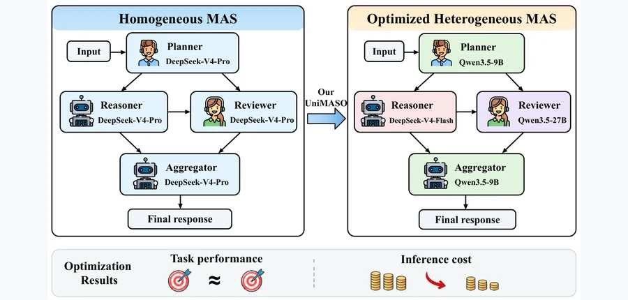 arXiv 2026-10-26 · cs.MA · #1 **[Not Every Agent Needs the Strongest Model: Unified Prompt-Model Optimization for Heterogeneous LLM-based Multi-Agent Systems](https://arxiv.org/abs/2610.31743)** Mingxiu Cai , Haoyang Xian , Xinyu Ma , Yutong Wang , Zhenxi Song , Jing Li , Xuebo Liu Affiliation: Harbin Institute of Technology, Shenzhen [Paper](https://arxiv.org/abs/2610.31743) · [Code](https://github.com/Achilles008/UniMASO_main) · [Figure source](https://arxiv.org/html/2610.31743v1/fig0_2.png) 

[EN] Abstract
Large language model (LLM)-based multi-agent systems (MAS) rely on role-specific prompts and execution models to solve complex tasks collaboratively. However, prompt optimization typically keeps model assignments fixed, leaving differences in role requirements and their associated inference costs outside the search. We present UniMASO, a Unified framework for heterogeneous Multi-Agent System Optimization through the joint adaptation of prompts and model assignments. UniMASO evaluates candidate updates through local, downstream, and global feedback, using cost-aware Pareto search to retain useful quality-cost trade-offs. Topology-aware co-evolution then coordinates these updates according to agent roles and dependencies. Cross-level trajectory memory further supplies historical successes and failures to guide subsequent optimization. Experiments on five benchmarks and five execution topologies show that UniMASO achieves competitive task performance at substantially lower deployment cost than the strongest homogeneous configurations. Under centralized execution, it improves the average score from 69.79 to 70.40 while reducing token-weighted deployment cost by 85.2% relative to DeepSeek-V4-Pro with MASPO. These results support joint prompt-model adaptation as an effective approach to efficient multi-agent collaboration. The code is available at this https URL . <a href="https://arxiv.org/abs/2610.31743">Source</a>

[ZH] Abstract
基于大语言模型（LLM）的多智能体系统依靠角色专属提示和执行模型协同解决复杂任务。然而，提示优化通常固定模型分配，使角色需求差异及相应推理成本处于搜索范围之外。我们提出 UniMASO，通过联合适配提示和模型分配，统一优化异构多智能体系统。UniMASO 利用局部、下游和全局反馈评估候选更新，通过成本感知的帕累托搜索保留有价值的质量—成本折中。拓扑感知的共同进化进一步依据角色和依赖关系协调这些更新。跨层级轨迹记忆提供历史成功与失败，指导后续优化。五个基准、五种执行拓扑上的实验显示，相比最强同构配置，UniMASO 以显著较低的部署成本取得有竞争力的任务表现。在集中执行下，相比使用 MASPO 的 DeepSeek-V4-Pro，平均得分从 69.79 提高到 70.40，按词元加权的部署成本降低 85.2%。结果支持将提示与模型联合适配作为高效多智能体协作的方法。代码可通过原文中的链接获取。 <a href="https://arxiv.org/abs/2610.31743">Source</a>
 | 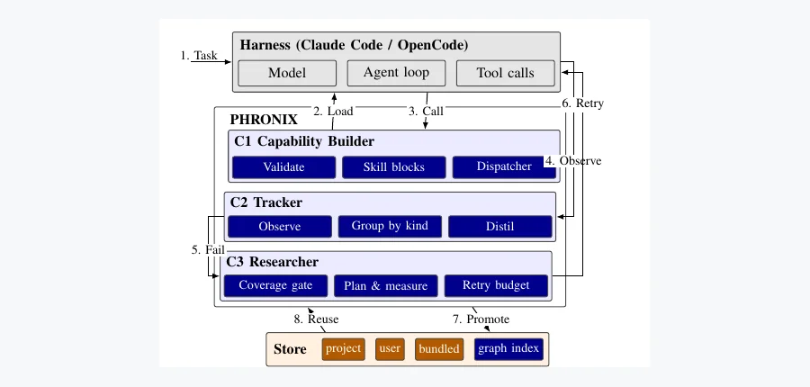 arXiv 2026-10-26 · cs.AI · #2 **[Phronix: The Capability-Centric Learning Paradigm for Agents](https://arxiv.org/abs/2610.31789)** Hariharan Devarajan , Neeraj Rajesh , Aniruddha Marathe , Nikoli Dryden , Kin Ng , Michela Taufer Affiliation: Lawrence Livermore National Laboratory / Illinois Institute of Technology / University of Tennessee, Knoxville [Paper](https://arxiv.org/abs/2610.31789) · [Figure source](https://arxiv.org/pdf/2610.31789#page=3) 

[EN] Abstract
Scientific computing increasingly relies on large language model-based agents for performance engineering tasks such as instrumentation, analysis, and workflow porting. However, agent effectiveness depends heavily on the surrounding harness, which typically relies on manually written skills and curated memory. This limits autonomous learning, forcing agents to repeatedly rediscover solutions rather than retain and reuse knowledge from prior executions. We introduce Phronix, a capability-centric learning paradigm that enables agentic harnesses to acquire, validate, and refine reusable capabilities from their own executions. Phronix operates through a predictor-validator-corrector loop: MCP tools and associated skills propose solutions, tool executions validate them, and observed outcomes refine the stored capabilities. It distills every observed interaction into a capability store and researches a failing task rather than abandoning it. First, such learned capabilities solve a recurring task on the first attempt in 93-95% of cases across every model, significantly reducing solution non-determinism and improving reliability. Second, Phronix turns an agent's own execution into 7.6-30.8 durable capabilities per task without user instruction, and creation falls below two once the needed capability exists. Third, warm-start runs consume only 0.38-0.40 million tokens per task, which is three to four times less than a single baseline attempt, while a cold-start costs no more than the baseline. On the 1000 Genome Pegasus workflow, instrumenting a production application for I/O performance analysis, Phronix passes all 11 correctness checks against six for the baseline harness, and also lifts the task solving rates of two cheaper models from 29% and 27% of SWE-bench tasks solved to 91% and 87%, respectively, matching the performance of the most expensive evaluated model. <a href="https://arxiv.org/abs/2610.31789">Source</a>

[ZH] Abstract
科学计算越来越依赖大语言模型智能体完成插桩、分析和工作流移植等性能工程任务。然而，智能体的有效性高度依赖周围的运行框架，而框架通常依靠人工编写的技能和整理的记忆。这限制了自主学习，使智能体反复重新发现解决办法，无法保留和复用此前执行获得的知识。我们提出 Phronix，一种以能力为中心的学习范式，使智能体框架能够从自身执行中获得、验证并细化可复用能力。Phronix 运行预测器—验证器—纠正器闭环：MCP 工具及相应技能提出解决方案，工具执行验证方案，观测结果细化保存的能力。它将每次观测到的交互蒸馏进能力库，并对失败任务继续研究，而非放弃。首先，在所有模型上，已学习能力均能在 93%—95% 的重复任务中首次尝试即解决问题，显著降低求解的不确定性并提高可靠性。其次，无需用户指示，Phronix 将自身执行转化为每任务 7.6—30.8 项持久能力；所需能力已存在时，新建数量降至两项以下。第三，热启动每任务仅消耗 0.38—0.40 百万词元，比单次基线尝试少三至四倍，冷启动成本也不高于基线。在为生产应用插桩、进行输入输出性能分析的 1000 Genome Pegasus 工作流上，Phronix 通过全部 11 项正确性检查，基线通过六项；它还将两种廉价模型的 SWE-bench 任务解决率从 29%、27% 提高到 91%、87%，与所评估最昂贵模型相当。 <a href="https://arxiv.org/abs/2610.31789">Source</a>
 | 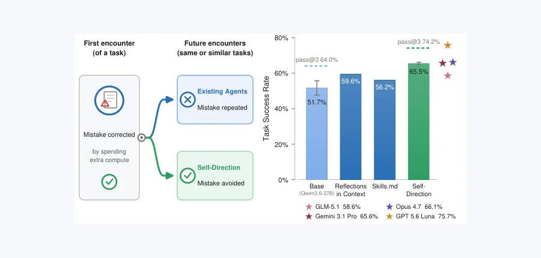 arXiv 2026-10-26 · cs.AI · #3 **[Don't Forget What You Just Learned: Self-Directed Repair Turns Agent Mistakes Into Lasting Lessons](https://arxiv.org/abs/2610.31846)** Yuval Kansal , Karen Ullrich , Polina Kirichenko , Ilia Kulikov , Niraj K. Jha , Mohammad Pezeshki , Mark Ibrahim Affiliation: Princeton University / Meta FAIR [Paper](https://arxiv.org/abs/2610.31846) · [Project](https://self-direction.github.io/) · [Figure source](https://arxiv.org/html/2610.31846v1/iclr_headline_new.png) 

[EN] Abstract
Intelligent agents should learn from their mistakes so that experience leads to continuous improvement. Yet today's agents recover from a mistake only temporarily: in-context reflections are easily forgotten across sessions and compete for limited context, while full-parameter fine-tuning is expensive and can interfere with existing capabilities. We introduce Self-Direction, a mechanism for agents to learn from mistakes that combines the benefits of temporary in-context retries and policy updates. When an agent fails a task, it reflects on its own trajectory in order to extract a lesson and immediately distills it into a lightweight low-rank adapter. By keeping the original weights frozen, Self-Direction prevents adapter training from overwriting base-model parameters while training additional parameters equivalent to ~0.02% of the base model's parameter count for each adapter. The agent then saves these adapters in a persistent library of lessons, automatically routing them to solve related problems later. Experiments with agents based on open-weight models from the Qwen family across open-ended research (GAIA), tool-use workflows (Claw-Eval), and terminal tasks (Terminal-Bench 2.1) show that our method improves overall success rates by 8.9 to 17.0 percentage points and performs competitively with frontier systems. We find that Self-Direction reduces repeated mistakes across future encounters of a task, nearly doubling the reliability of an agent's corrections. Learned lessons also transfer: a handful of adapters generalize to dozens of new tasks without additional training. Ultimately, this self-directed repair transforms everyday mistakes into lasting lessons. <a href="https://arxiv.org/abs/2610.31846">Source</a>

[ZH] Abstract
智能体应从错误中学习，使经验带来持续改进。然而，现有智能体往往只能暂时恢复：上下文中的反思容易跨会话遗忘，还要竞争有限上下文；全参数微调则昂贵，并可能干扰已有能力。我们提出 Self-Direction，将临时上下文重试与策略更新的优点结合，使智能体能够从错误中学习。任务失败后，智能体反思自身轨迹，提炼教训，并立即将其蒸馏进轻量低秩适配器。原始权重保持冻结，因此适配器训练不会覆盖基础模型参数；每个适配器所训练的额外参数约为基础模型参数量的 0.02%。智能体把适配器保存为持久教训库，之后自动路由并用于相关问题。以 Qwen 系列开放权重模型为基础，在开放式研究 GAIA、工具流程 Claw-Eval 和终端任务 Terminal-Bench 2.1 上的实验显示，总体成功率提高 8.9—17.0 个百分点，并与前沿系统有竞争力。Self-Direction 减少了以后再次遇到任务时的重复错误，使智能体纠正的可靠性接近翻倍。教训也能迁移：少量适配器无需额外训练即可泛化到数十个新任务。这种自我引导修复最终将日常错误转化为持久教训。 <a href="https://arxiv.org/abs/2610.31846">Source</a>
 |
| 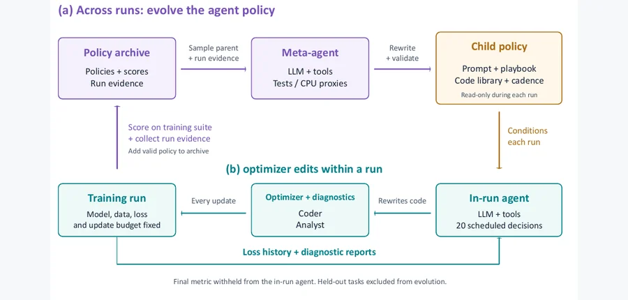 arXiv 2026-10-26 · cs.AI · #4 **[RSI-Opt: Recursive Self-Improvement Optimizer Agents For Model Training](https://arxiv.org/abs/2610.32026)** Binghang Lu , Yige Sun , Guang Lin Affiliation: Purdue University / Independent Researcher [Paper](https://arxiv.org/abs/2610.32026) · [Figure source](https://arxiv.org/pdf/2610.32026#page=4) 

[EN] Abstract
Conventional neural-network training typically follows a predefined optimization recipe, motivating a LLM agent that monitors training dynamics and adjusts optimizer settings as training progresses, but a fixed agent policy does not accumulate experience across runs. We introduce RSI-Opt, a plug-and-play Recursive Self-Improvement Optimizer Agents which evolves the knowledge that guides this process: a prompt, a playbook of procedures, a library of tested optimizer code, and a decision cadence. A meta-agent rewrites this policy using evidence from earlier runs, and an archive retains evaluated policies for further evolution. Across 5 generations on three training tasks, the meta-agents develop reusable procedures and code and conduct their own CPU proxy experiments. RSI-Opt substantially improves optimizer-agent performance, with representative raw-space summary $z$-scores increasing from $+10.48$ to $+14.33$ on the evolution suite with Opus 5.5 and from $-0.36$ to $+3.11$ on held-out tasks with GPT-5.5 through cross-model policy transfer. On the Burgers PDE, it reduces mean relative $L_2$ error by approximately 2.7-fold with Opus 5.5 and 8.8-fold with GPT-6.1 over the fixed-prompt agent baseline, although PDE transfer varies across LLMs and tasks. Controlled comparisons show that the evolved policy combines reusable optimization knowledge with adaptation to each task: initial decisions capture most observed gains on seen tasks, while continued adaptation improves outcomes on unseen tasks. These findings demonstrate how procedures and executable tools accumulated across training runs can improve optimizer-agent performance and support transfer to scientific machine learning. <a href="https://arxiv.org/abs/2610.32026">Source</a>

[ZH] Abstract
常规神经网络训练通常遵循预设优化方案，因此可以考虑让 LLM 智能体监测训练动态、随训练调整优化器设置，但固定的智能体策略不能跨运行积累经验。我们提出即插即用的 RSI-Opt，进化指导优化过程的知识，包括提示、程序手册、经过测试的优化器代码库及决策频率。元智能体根据此前运行的证据重写策略，档案保留已评估策略，支持继续进化。在三个训练任务、五代进化中，元智能体形成可复用流程与代码，并自行开展 CPU 代理实验。RSI-Opt 显著改善优化器智能体表现：使用 Opus 5.5 时，进化任务集上具有代表性的原始空间汇总 z 分数从 +10.48 升至 +14.33；通过跨模型策略迁移，GPT-5.5 在留出任务上从 −0.36 升至 +3.11。在 Burgers 偏微分方程上，相比固定提示智能体，Opus 5.5、GPT-6.1 的平均相对 L2 误差分别约降低 2.7 倍、8.8 倍，但 PDE 迁移效果随模型和任务而变化。受控比较显示，进化策略兼顾可复用优化知识与逐任务适配：初始决策解释已见任务上的大部分收益，持续适配则改善未见任务结果。研究说明，跨训练运行积累的流程及可执行工具能够提升优化器智能体，并支持向科学机器学习迁移。 <a href="https://arxiv.org/abs/2610.32026">Source</a>
 | 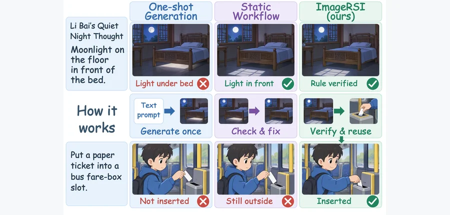 arXiv 2026-10-26 · cs.CV · #5 **[ImageRSI: Verification-Driven Recursive Self-Improvement for Agentic Image Generation](https://arxiv.org/abs/2610.32120)** Shuo Han , Zhilin Wang , Peng Ling , Wenjia Gong , Yang Liu , Guanjun Jiang , Yukun Cao , Xike Xie Affiliation: University of Science and Technology of China / Qwen Business Unit of Alibaba, Alibaba Token Hub / Xidian University [Paper](https://arxiv.org/abs/2610.32120) · [Figure source](https://arxiv.org/html/2610.32120v1/figure1.png) 

[EN] Abstract
Complex text-to-image requests remain difficult to satisfy reliably. Verifying and repairing an image can fix an individual output, but a successful repair does not necessarily carry over to other requests. We present ImageRSI, a framework that keeps the image generator frozen and combines three components: five-dimensional verification and repair within each task, an experience library shared across tasks, and offline updating of the judge. Candidate experiences enter the library only after paired A/B validation, and the judge is updated with supervised fine-tuning and GRPO on accumulated image-judgment records and evaluated before reuse. We also introduce ImageReq-Bench, a benchmark of 961 requests built around hard cases in real-world image-generation requests, each paired with an evaluation checklist. ImageRSI achieves a Checklist Strict Accuracy (CSA) of 52.6% on MindBench (with Nano Banana Pro as the generator) and 65.66% on ImageReq-Bench, and we compare system outcomes across judge-training configurations. <a href="https://arxiv.org/abs/2610.32120">Source</a>

[ZH] Abstract
复杂的文本到图像请求仍难以可靠满足。验证和修复图像能够修正单次输出，但成功修复未必能迁移到其他请求。我们提出 ImageRSI，保持图像生成器冻结，结合三部分：每项任务内部的五维验证与修复、跨任务共享的经验库，以及判别器的离线更新。候选经验只有通过配对 A/B 验证才能进入经验库；判别器基于累积的图像判断记录进行监督微调和 GRPO 更新，并在复用前评估。我们还提出 ImageReq-Bench，包含围绕真实图像生成难例构建的 961 项请求，每项配有评估检查清单。以 Nano Banana Pro 为生成器时，ImageRSI 在 MindBench 的检查清单严格准确率（CSA）为 52.6%，在 ImageReq-Bench 为 65.66%；我们同时比较不同判别器训练配置下的系统结果。 <a href="https://arxiv.org/abs/2610.32120">Source</a>
 | 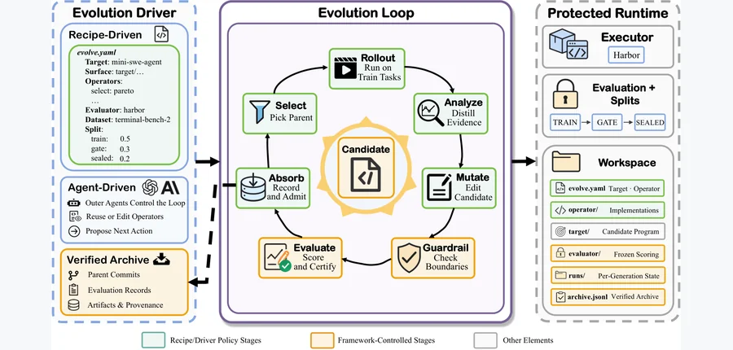 arXiv 2026-10-26 · cs.AI · #6 **[RSIHub: A Composable Framework for Agent-Evolution Methods](https://arxiv.org/abs/2610.32253)** Zimu Wang , Xiaobo Wang , Siyu Ye , Jiaqi Li , Silin Chen , Yuling Shi , Ruobing Wang , Jingjing Zhang , Chaofan Wang , Ka… Affiliation: University of California, Berkeley / University of Science and Technology of China / Douyin Group / Shanghai Jiao Tong University / Tongji University / Beijing Institute for General Artificial Intelligence / Simple Agent Lab [Paper](https://arxiv.org/abs/2610.32253) · [Code](https://github.com/simple-agent-lab/RSIHub) · [Project](https://simpleagentlab.com/rsihub/) · [Figure source](https://arxiv.org/html/2610.32253v1/RSIHub-agent-workflow.png) 

[EN] Abstract
Agent-evolution methods use execution feedback to improve prompts, skills, tools, and orchestration, but their implementations often rebuild the same experimental machinery. We present RSIHub, an open-source framework for building, comparing, and extending these methods on shared infrastructure. Recipes compose reusable operators and declare mutable resources; RSIHub supplies execution, evaluation, recovery, and lineage. Researchers can focus on evolution policy while evaluation stays outside the mutable surface and results remain tied to candidates and evaluation conditions. We instantiate AHE, Hyperagents, A-Evolve, and GEPA without modifying the framework core, keeping method-specific logic in recipes and operators. We evaluate them with MiniSWE and Codex on Terminal Bench 2 and $\tau^3$ Banking under fixed model and evaluator configurations. The largest observed overall pass@1 gain is 13.5 percentage points, while method rankings vary across settings and optimization gains do not always transfer to held-out tasks. RSIHub provides a common protocol for comparing evolution policies, inspectable candidate histories, and reusable components for developing new methods. <a href="https://arxiv.org/abs/2610.32253">Source</a>

[ZH] Abstract
智能体进化方法利用执行反馈改进提示、技能、工具和编排，但其实现往往重复构建相同实验基础设施。我们提出开源 RSIHub，在共享基础设施上构建、比较和扩展这些方法。配方组合可复用算子并声明可变资源，RSIHub 则提供执行、评估、恢复和谱系管理。研究者能够专注于进化策略，评估保持在可变范围之外，结果始终关联具体候选及评估条件。我们无需改动框架核心即可实例化 AHE、Hyperagents、A-Evolve 和 GEPA，方法专属逻辑保留在配方与算子中。在固定模型和评估器配置下，使用 MiniSWE、Codex，在 Terminal Bench 2 和 τ³ Banking 上评估。观察到的最大总体 pass@1 收益为 13.5 个百分点，但方法排序随设置变化，优化收益也不总能迁移到留出任务。RSIHub 提供进化策略的共同比较协议、可检查的候选历史，以及开发新方法所需的可复用组件。 <a href="https://arxiv.org/abs/2610.32253">Source</a>
 |
| 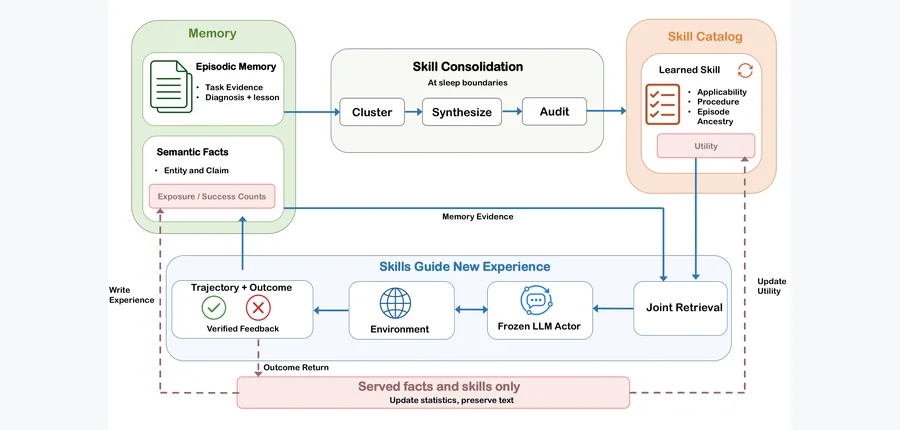 arXiv 2026-10-26 · cs.AI · #7 **[Lifelong Context Adaptation through Bidirectional Memory-Skill Learning](https://arxiv.org/abs/2610.32295)** Tianyi Xu , Huazheng Wang Affiliation: Oregon State University [Paper](https://arxiv.org/abs/2610.32295) · [Code](https://github.com/tianyi0216/Memcryst) · [Figure source](https://arxiv.org/html/2610.32295v1/figure1.png) 

[EN] Abstract
Lifelong LLM agents must learn from an expanding history of interactions while making each decision within a bounded context window. Memory makes past experience available, but the agent may still need to infer how to solve each new task from the retrieved records. Skills provide reusable procedures, yet may omit the task-specific facts needed to apply them. Because retrieved memory and skills shape the agent's behavior, they also influence the experience available for future learning. We introduce MemCryst, a framework for lifelong context adaptation through bidirectional learning of memory and skills with a frozen language model. Recurring episodes stored in memory support skill creation and revision, and the interactions guided by those skills supply new memory for subsequent learning. Facts retrieved from memory and learned skills jointly form the agent's context, while task outcomes adjust the future retrieval influence of the records actually served without rewriting their content. Across ten settings spanning embodied control, long-document reading, conversation, mathematics, and code, MemCryst leads seven reported comparisons. On ALFWorld, joint serving achieves 63.17% success, compared with 59.83% for memory-only and 50.50% for skill-only serving. Code is available at this https URL <a href="https://arxiv.org/abs/2610.32295">Source</a>

[ZH] Abstract
终身 LLM 智能体必须从不断增长的交互历史学习，同时在有限上下文窗口中决策。记忆使过去经验可用，但智能体仍可能需要从检索记录推断如何解决新任务；技能提供可复用流程，却可能缺少应用流程所需的任务特定事实。记忆和技能塑造行为，也影响未来学习可获得的经验。我们提出 MemCryst，在语言模型冻结时，通过记忆与技能的双向学习实现终身上下文适配。记忆中的重复情节支持技能创建和修订，技能引导的交互又为后续学习提供新记忆。检索事实与已学技能共同构成上下文，任务结果则调整实际被提供记录在未来检索中的影响，而不改写记录内容。在具身控制、长文阅读、对话、数学和代码的十种设置中，MemCryst 领先七项报告比较。ALFWorld 上联合提供记忆与技能的成功率为 63.17%，仅记忆为 59.83%，仅技能为 50.50%。代码可通过原文链接获取。 <a href="https://arxiv.org/abs/2610.32295">Source</a>
 | 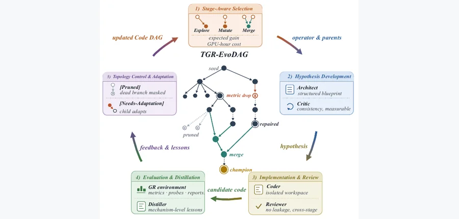 arXiv 2026-10-26 · cs.AI · #8 **[TGR-EvoDAG: A DAG-based Multi-Agent Code Evolution Framework for Generative Recommendation on Tencent](https://arxiv.org/abs/2610.32326)** Junlin He , Junzhang Zhu , Yudong Li , Yihong Tang , Xuefeng Jiang , Wei Ma , Chengxiang Zhuo , Zang Li Affiliation: Tencent / The Hong Kong Polytechnic University / McGill University / Independent Researcher [Paper](https://arxiv.org/abs/2610.32326) · [Figure source](https://arxiv.org/pdf/2610.32326#page=5) 

[EN] Abstract
Large Language Model (LLM) agents have enabled automated code evolution for algorithm discovery. However, current recursive self-improvement (RSI) research for sequential recommendation faces a dilemma: general-purpose frameworks lack domain-specific feedback, while recommender-specific frameworks rely on linear evolution. Crucially, naively integrating them fails when applied to Generative Recommendation (GR). Unlike end-to-end models, GR relies on a module-cascaded pipeline (tokenization, pre-training, and alignment). In this paradigm, existing evolution methods suffer from: i) cost blindness, squandering budgets by ignoring stage-asymmetric retraining overheads; and ii) short-sighted evaluation, discarding promising upstream innovations that temporarily regress metrics before downstream adaptation. To bridge these gaps, we propose TGR-EvoDAG, a multi-agent code evolution framework tailored for GR. TGR-EvoDAG models code evolution as a Directed Acyclic Graph (DAG) to maintain multiple evolution branches and merge complementary innovations, unifying advanced search with rich GR diagnostic feedback. We further introduce stage-aware cost planning to optimize GPU-hour budgets, and active downstream co-adaptation to navigate temporary regressions and unlock cross-stage gains. On public Amazon datasets, TGR-EvoDAG enables the first autonomous evolution of a complete GR pipeline, improving offline metrics by up to 37.4% and Agent4Rec simulated user satisfaction by 19.7% over the strongest baseline. Furthermore, in industrial deployment on Tencent's large-scale commercial media platform, the evolved GR achieves a 12.16% relative improvement in offline Hit@1 and a statistically significant 0.40% increase in online click-through rate (CTR). <a href="https://arxiv.org/abs/2610.32326">Source</a>

[ZH] Abstract
LLM 智能体支持通过自动代码进化发现算法，但顺序推荐的递归自改进研究面临两难：通用框架缺少领域反馈，推荐专用框架又依赖线性进化。二者直接结合在生成式推荐（GR）中会失败。与端到端模型不同，GR 依赖分词、预训练和对齐的模块级联流程，现有方法因此存在成本盲视，忽略阶段不对称重训开销并浪费预算，以及短视评估，在下游尚未适配、指标暂时下降时丢弃有潜力的上游创新。我们提出面向 GR 的多智能体代码进化框架 TGR-EvoDAG，以有向无环图保存多个分支并合并互补创新，将高级搜索与丰富诊断反馈统一。阶段感知成本规划优化 GPU 小时预算，主动下游共同适配跨越暂时退化、释放跨阶段收益。在公开 Amazon 数据集上，系统实现完整 GR 流水线的自主进化，离线指标比最强基线最多提高 37.4%，Agent4Rec 模拟用户满意度提高 19.7%。在腾讯大型商业媒体平台的工业部署中，进化 GR 的离线 Hit@1 相对提高 12.16%，在线点击率提高 0.40%，且达到统计显著。 <a href="https://arxiv.org/abs/2610.32326">Source</a>
 | 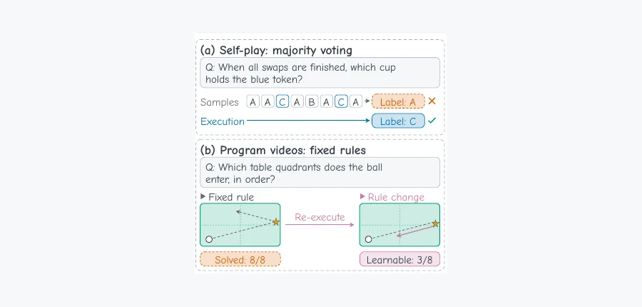 arXiv 2026-10-26 · cs.CV · #9 **[Tempo-Zero: Recursive Self-Play in Executable Worlds for Video Reasoning](https://arxiv.org/abs/2610.32433)** Jingmin Zhu , Yanyan Zou , Xiuyu Li , James Bailey , Dinh Phung , Tao Yu , Yunyun Hou , Jun Liu , Jun Zhou , Sirui Wang… Affiliation: JD.com / Monash University / Institute of Automation, Chinese Academy of Sciences / Communication University of China / Lancaster University / Griffith University [Paper](https://arxiv.org/abs/2610.32433) · [Project](https://alchemist-jo.github.io/tempo-zero/) · [Figure source](https://arxiv.org/pdf/2610.32433#page=2) 

[EN] Abstract
Video reasoning requires understanding how events unfold over time, yet videos with accurate temporal annotations are expensive to collect. Self-play offers an alternative by letting a model generate and solve its own tasks without manual annotation. However, existing video self-play methods train on fixed sets of recorded videos, so they cannot alter the underlying event dynamics and rely on noisy pseudo-labels derived from the model's own outputs, such as majority voting, that risk reinforcing shared model errors. To overcome these limitations, we introduce Tempo-Zero, a self-improvement framework that closes a loop of executable environments, execution-verified self-play, and environment evolution, where executing a program renders a video with the ground-truth option and interval of every question. A single policy plays both Questioner and Solver, proposing questions and answering them with timestamped evidence lines, and is trained on execution-grounded rewards instead of model consensus. The Solver's performance steers a curriculum over tasks and difficulty levels, and the policy selects rule changes that enrich the event dynamics of later rounds. Despite being trained solely on simple programs, without supervised fine-tuning or external video data which prior methods typically require, Tempo-Zero outperforms the base models and recent self-play baselines on average across twelve real-world video benchmarks at different model scales, with particularly strong gains on temporal grounding tasks. Project page: this https URL <a href="https://arxiv.org/abs/2610.32433">Source</a>

[ZH] Abstract
视频推理需要理解事件随时间展开，但带精确时间标注的视频收集昂贵。自博弈让模型生成并求解自身任务，提供无需人工标注的替代路径。然而，现有视频自博弈在固定录制视频集上训练，无法改变事件动力学，并依赖多数投票等模型输出产生的噪声伪标签，可能强化共同错误。我们提出 Tempo-Zero，将可执行环境、执行验证的自博弈和环境进化闭合成自改进环路：执行程序即可渲染视频，同时得到每道题的真实选项与时间区间。同一策略同时担任提问者和求解者，提出问题并用带时间戳的证据行回答，依靠执行落地的奖励而非模型共识训练。求解表现引导任务及难度课程，策略选择规则变化，丰富后续轮次的事件动力学。尽管只用简单程序训练，没有既有方法通常依赖的监督微调或外部视频数据，Tempo-Zero 在不同模型规模、十二个真实视频基准上的平均表现均优于基础模型及近期自博弈基线，时间定位任务收益尤其突出。项目页可通过原文链接访问。 <a href="https://arxiv.org/abs/2610.32433">Source</a>
 |
| 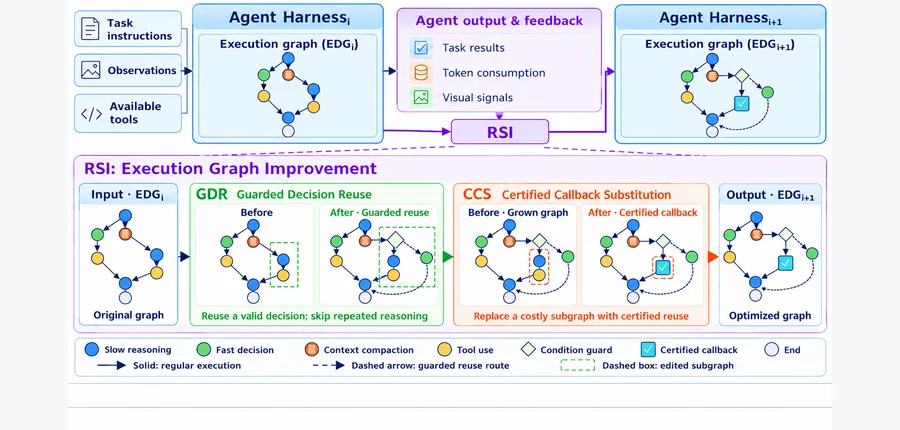 arXiv 2026-10-26 · cs.AI · #10 **[HarnessMM: Recursive Self-Improvement for Harness Token Efficiency](https://arxiv.org/abs/2610.32813)** Yuhua Jiang , Chang Xu , Feifei Gao , Li Zhao Affiliation: Tsinghua University / Microsoft Research Asia [Paper](https://arxiv.org/abs/2610.32813) · [Figure source](https://arxiv.org/html/2610.32813v1/figures/harness_rsi_overview_user.png) 

[EN] Abstract
Agent harnesses repeatedly invoke reasoning after tool feedback, even when an earlier call has already fixed the next action. We introduce HarnessMM (Harness Minus Minus), a method for improving harness token efficiency through guarded decision reuse and recursive self-improvement (RSI). RSI iteratively refines companion harness configurations from training feedback, with validation selecting the configuration for deployment. A controller at the model-tool boundary reuses resolved decisions to replace later reasoning callbacks while actor weights remain fixed. Executable Decision Graphs store exact actions, literal arguments, causal dependencies, and public guards. Guarded Decision Reuse activates these persistent decisions from observed receipts; Certified Callback Substitution executes them through the native interface and records removal of the registered slow callback. New semantic decisions, unsupported evidence, and selector abstention invoke the original actor again. The representation restricts what feedback may change, while complete-task measurements establish quality and cost. On HumanEval, HarnessMM preserves Codex success at 90.82\% while reducing Tokens/task (k) from 66.72 to 47.02 (29.54\% saving). For DeepSeek Harness, success rises from 71.43\% to 85.71\% while Tokens/task (k) fall from 96.28 to 11.62 (87.93\% saving). A separate MBPP ablation measures 26.91\% lower cost than single-use graphs and 19.52\% lower cost than retained callbacks. These results establish guarded decision reuse as a practical way to reduce repeated reasoning in existing harnesses. <a href="https://arxiv.org/abs/2610.32813">Source</a>

[ZH] Abstract
智能体框架常在工具反馈后再次调用推理，即使此前调用已确定下一动作。我们提出 HarnessMM（Harness Minus Minus），通过受防护的决策复用与递归自改进提升词元效率。RSI 从训练反馈迭代细化配套框架配置，由验证选择部署版本。模型—工具边界控制器在执行者权重固定时，复用已解决决策以替代后续推理回调。可执行决策图保存精确动作、字面参数、因果依赖和公开防护条件。受防护决策复用根据观测到的回执激活持久决策，经认证的回调替换通过原生接口执行，并记录已注册慢回调的移除。遇到新语义决策、无支持证据或选择器弃权时，再次调用原执行者。表示约束反馈可以改变什么，完整任务测量确定质量和成本。HumanEval 上，Codex 成功率保持 90.82%，每任务千词元从 66.72 降至 47.02，节省 29.54%；DeepSeek Harness 成功率从 71.43% 升至 85.71%，每任务千词元从 96.28 降至 11.62，节省 87.93%。独立 MBPP 消融中，相比单次使用图和保留回调，成本分别低 26.91%、19.52%。结果说明受防护决策复用可实际减少既有框架的重复推理。 <a href="https://arxiv.org/abs/2610.32813">Source</a>
 | 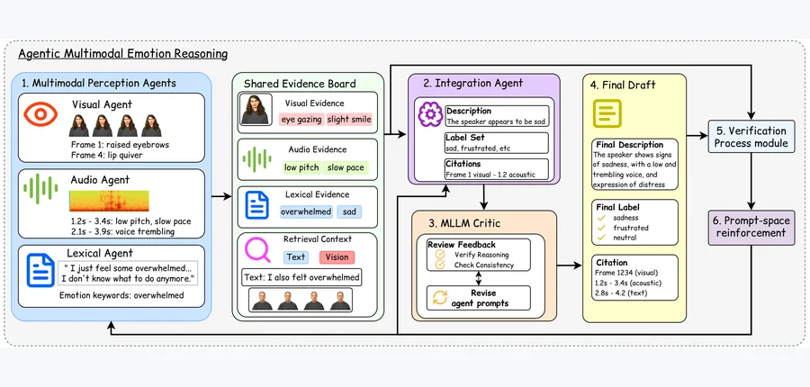 arXiv 2026-10-26 · cs.CL · #11 **[An Agentic Approach with Evidence-Grounded Verification for Multimodal Emotion Reasoning in Conversation](https://arxiv.org/abs/2610.31685)** Elyas Rashno , Farhana Zulkernine Affiliation: Queen’s University [Paper](https://arxiv.org/abs/2610.31685) · [Figure source](https://arxiv.org/html/2610.31685v1/MultiAgent-Page-5.drawio.png) 

[EN] Abstract
LLM-based multimodal emotion reasoning systems perform well on standard benchmarks, but improving them through instruction tuning can be computationally expensive. Agentic pipelines built from frozen models avoid this cost, but introduce a different challenge: when a prediction is wrong, the system must identify which agent or stage caused the error. We address this problem with an agentic framework for traceable multimodal emotion reasoning and prompt-space adaptation. Modality-specific perception agents analyze visual, acoustic, and lexical inputs and post evidence-cited observations to a shared board. An integration agent combines these observations with retrieved multimodal examples to produce an emotion description, label set, and supporting citations, while an MLLM critic can request one revision before the output is finalized. For incorrect predictions, a separate evidence-grounded verification stage applies deterministic checks to verify that cited evidence and references are valid, and an entailment check to determine whether the final claims are supported by that evidence. Detected failures are then grouped by the responsible component and failure type, converted into targeted prompt patches, and accepted only after validation on a held-out set. This adapts the agent prompts without updating model weights. On the MER2025 dataset, targeted prompt adaptation outperforms the frozen static pipeline on all four MLLMs, ranging from 2B to 38B parameters, and matches or outperforms undifferentiated reflection baselines on each of them: VideoLLaMA3-2B, Phi-3.5-vision-instruct, Qwen2.5-VL-7B-Instruct, and InternVL2.5-38B. It improves F-score by 0.6--2.2 points depending on the backbone, including an increase from 52.3 to 54.5 on Qwen2.5-VL-7B. <a href="https://arxiv.org/abs/2610.31685">Source</a>

[ZH] Abstract
基于 LLM 的多模态对话情感推理在标准基准上表现良好，但通过指令微调改进成本较高。冻结模型组成的智能体流水线可避免此成本，却带来另一问题：预测出错时，如何识别负责的智能体或阶段。我们提出支持可追踪情感推理与提示空间适配的智能体框架。各模态感知智能体分析视觉、声学和词汇输入，将带证据引用的观测发布到共享板；集成智能体结合这些观测与检索的多模态示例，产生情感描述、标签集及引用；MLLM 评论者可在最终输出前要求一次修订。对错误预测，独立的证据落地验证阶段先用确定性检查验证证据与引用有效，再用蕴含检查判断最终断言是否受证据支持。检测到的失败按责任组件和类型分组，转化为定向提示补丁，仅通过留出集验证后接受，从而不更新权重就适配智能体提示。在 MER2025 上，定向适配在 2B 至 38B 的四个 MLLM 上均优于冻结静态流水线，并在 VideoLLaMA3-2B、Phi-3.5-vision-instruct、Qwen2.5-VL-7B-Instruct、InternVL2.5-38B 上分别匹配或超过无差别反思基线。F 分数依主干提高 0.6—2.2 点，其中 Qwen2.5-VL-7B 从 52.3 升至 54.5。 <a href="https://arxiv.org/abs/2610.31685">Source</a>
 | 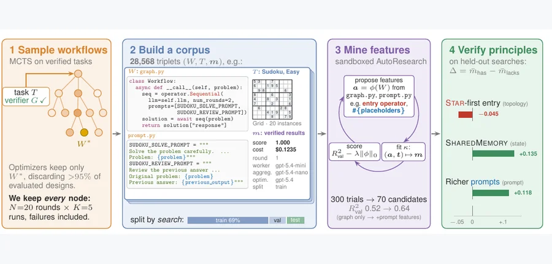 arXiv 2026-10-26 · cs.SE · #12 **[Mining the Design Space of Multi-Agent Workflows](https://arxiv.org/abs/2610.31709)** Xavier Cadet , Junyan Cheng , Peter Chin , Kyle Richardson Affiliation: Dartmouth College / Allen Institute for AI [Paper](https://arxiv.org/abs/2610.31709) · [Code](https://github.com/xcadet/apex) · [Figure source](https://arxiv.org/pdf/2610.31709#page=2) 

[EN] Abstract
Designing large language model (LLM) multi-agent systems (MAS) still relies on trial and error and informal "folk wisdom." Manual studies test only a few communication structures or topologies (e.g., sequential, parallel, shared-memory, or debate), while automated optimizers discard search trajectories after selecting a task-specific workflow. We present a two-phase pipeline for mining reproducible design principles from workflow code and execution traces. We repurpose AFlow's MCTS optimizer across six composable operators and 26 deterministically verified Enigmata tasks, retaining all intermediate rounds to build a corpus of 28,568 executable workflows. A sandboxed AutoResearch loop then mines orchestration code and prompt templates under an $L_0$-penalized validation objective and tests candidate principles on held-out searches. Across 300 feature-mining trials, we identify effects that persist on held-out searches across three levels of workflow design: workflows beginning with independent solvers and one-shot aggregation (Star-first) perform worse ($\Delta = -0.045$); persistent shared documents (SharedMemory) outperform debate ($\Delta = +0.135$); and prompt specificity and placeholder-based context routing yield gains comparable to communication-structure selection ($\Delta = +0.118$). More broadly, our pipeline and results show the feasibility of turning discarded search trajectories into a statistical testbed for discovering and validating multi-agent workflow design principles. <a href="https://arxiv.org/abs/2610.31709">Source</a>

[ZH] Abstract
设计 LLM 多智能体系统仍依赖试错和非正式经验。人工研究只测试少量顺序、并行、共享记忆或辩论结构，自动优化器则通常选出任务专用工作流后丢弃搜索轨迹。我们提出两阶段流水线，从工作流代码和执行轨迹挖掘可复现设计原则。我们将 AFlow 的 MCTS 优化器用于六个可组合算子、26 项确定性验证的 Enigmata 任务，保留全部中间轮次，建立含 28,568 个可执行工作流的语料。沙箱中的 AutoResearch 闭环在带 L0 惩罚的验证目标下挖掘编排代码与提示模板，并在留出搜索中测试候选原则。300 次特征挖掘试验识别了三个设计层次上在留出搜索中持续存在的效应：以独立求解者和一次性聚合开头的 Star-first 更差，Δ=−0.045；持久共享文档 SharedMemory 优于辩论，Δ=+0.135；提示具体性与基于占位符的上下文路由带来与通信结构选择相当的收益，Δ=+0.118。总体上，这条流水线及结果表明，可将被丢弃的搜索轨迹转化为发现、验证多智能体工作流原则的统计试验床。 <a href="https://arxiv.org/abs/2610.31709">Source</a>
 |
| 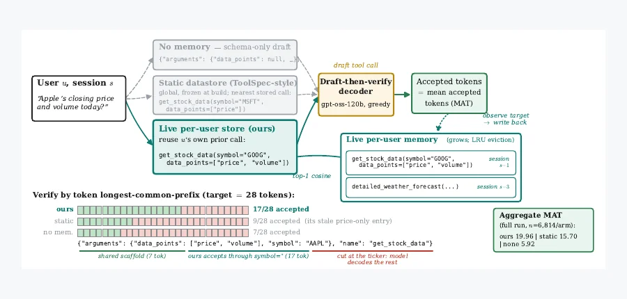 arXiv 2026-10-26 · cs.CL · #13 **[SPECMEM: Accelerating Agentic Tool Calling via Live Memory Management](https://arxiv.org/abs/2610.31840)** Zihe Song , Wenting Zhao , Ye Liu , Yuanjie Zhu , Ke Xu , Shanghao Li , Philip S. Yu Affiliation: University of Illinois Chicago / Salesforce Research [Paper](https://arxiv.org/abs/2610.31840) · [Figure source](https://arxiv.org/pdf/2610.31840#page=2) 

[EN] Abstract
Tool-calling agents are mostly optimized for accuracy; in deployment, however, their growing cost is latency: every tool call is decoded autoregressively. Speculative decoding accelerates this without changing the output, and retrieved past calls make strong drafts under real use, where each user's behavior tends to repeat. Yet existing systems keep no cross-session memory, or build the draft store once and never update it. We propose SpecMem, a tool-call memory kept alive and managed throughout deployment: verified calls are written back online into bounded per-user stores with LRU eviction, and a side-effect gate defers irreversible calls until verification confirms. On multi-session, multi-user query streams served by three open-weight models, a frozen store steadily loses acceptance while SpecMem holds it: a 27% gap in mean accepted tokens (+11% to +34% across benchmarks, tracking how much novel work arrives after the store is built) and up to 1.74x wall-clock speedup. Ablations attribute the gain almost entirely to keeping the store live; local per-user scoping adds no acceptance but closes a measured cross-user leakage channel, and gating on declared side effects, rather than on retrieval confidence, is what eliminates irreversible mistakes. <a href="https://arxiv.org/abs/2610.31840">Source</a>

[ZH] Abstract
工具调用智能体通常针对准确率优化，但部署时日益增长的成本是延迟：每次调用都要自回归解码。推测解码能在不改变输出的前提下加速；实际用户行为常重复，因此检索过去调用可以提供强草稿。但现有系统要么不保留跨会话记忆，要么只一次性构建草稿库而不更新。我们提出 SpecMem，让工具调用记忆在整个部署中持续存活并被管理：验证通过的调用在线写回有界的逐用户存储，用 LRU 淘汰；副作用门控将不可逆调用延迟至验证确认。三个开放权重模型服务多会话、多用户查询流时，冻结库的接受率持续下降，SpecMem 则保持接受率：平均接受词元差距为 27%，各基准为 +11% 至 +34%，反映建库后新工作量不同；墙钟加速最高 1.74 倍。消融将收益几乎全部归因于持续更新；用户局部作用域不增加接受量，但关闭已测得的跨用户泄漏通道；消除不可逆错误的关键则是按声明的副作用而非检索置信度门控。 <a href="https://arxiv.org/abs/2610.31840">Source</a>
 | 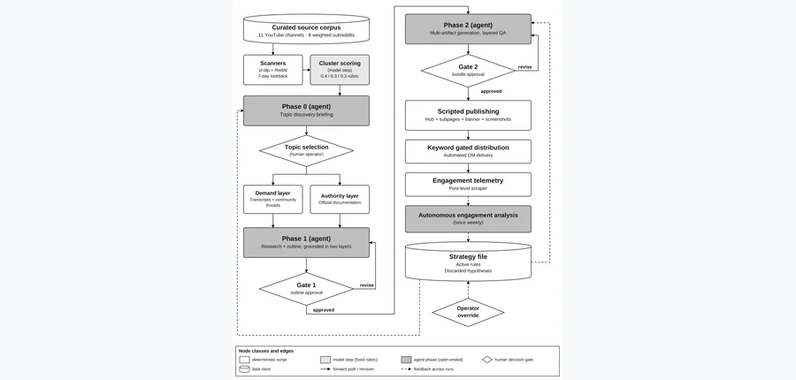 arXiv 2026-10-26 · cs.CY · #14 **[An AI Factory for Technology Education: An Agentic Pipeline with Closed Loop Audience Feedback](https://arxiv.org/abs/2610.31875)** Josue Hernandez , Hector R. Amado-Salvatierra , Rocael Hernandez Rizzardini Affiliation: Dapta Inc. / Universidad Galileo [Paper](https://arxiv.org/abs/2610.31875) · [Figure source](https://arxiv.org/html/2610.31875v1/fig1_workflow.png) 

[EN] Abstract
Technology tools used for professional upskilling change on a timescale of weeks, and written guidance about them ages at the same pace. Large language models have made it inexpensive to draft a tutorial or a course outline, but most deployed generation systems still produce a piece of content once and never check it against what an audience actually does with it. This paper describes an agentic pipeline, organized as a typed workflow graph, that treats instructional content production as a manufacturing process with explicit checkpoints rather than a single generation call. Four node classes structure the graph: deterministic scripts, model steps bound to a fixed rubric, open-ended agent phases, and human approval gates, arranged along a forward production path and closed by a feedback cycle that rewrites generation rules from post level engagement telemetry. Production of content is split into two layers: a demand layer, built from video and community sources, that shapes topic selection and register, and an authority layer, built from official documentation, that every published claim must trace back to. Over five months of continuous operation, the deployed system published 26 documented guides at roughly 1.5 hours of operator time per week, and the feedback loop identified four measurable engagement effects that became binding rules for later runs, including a hook style that outperformed baseline by a factor of 1.83 in its first analysis window. <a href="https://arxiv.org/abs/2610.31875">Source</a>

[ZH] Abstract
职业技能提升使用的技术工具按周变化，书面指导也以同样速度过时。LLM 使起草教程或课程提纲变得廉价，但多数部署的生成系统仍一次性产出内容，从不核对受众实际如何使用。本文描述一条以类型化工作流图组织的智能体流水线，将教学内容生产视为带明确检查点的制造过程，而非单次生成调用。图有四类节点：确定性脚本、受固定评分规则约束的模型步骤、开放式智能体阶段，以及人工批准门。它们沿正向生产路径排列，并通过根据逐帖互动遥测重写生成规则的反馈环闭合。内容生产分两层：视频和社区来源构成需求层，决定主题与语体；官方文档构成权威层，所有发布断言必须追溯至此。在五个月连续运行中，系统发布 26 篇有文档记录的指南，每周操作员时间约 1.5 小时；反馈识别出四项可测互动效应，并转化为后续运行的约束规则，其中一种开头风格在首个分析窗口比基线高 1.83 倍。 <a href="https://arxiv.org/abs/2610.31875">Source</a>
 | 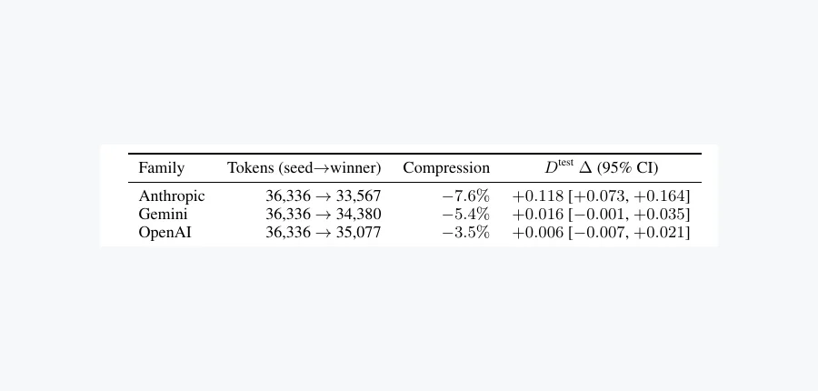 arXiv 2026-10-26 · cs.AI · #15 **[Reproducible Evaluation as the Substrate for Safe Prompt Compression in Production Agents](https://arxiv.org/abs/2610.31972)** Prabal Vashisht , Zheng Hu , Ying Yang Affiliation: Mx ML, DoorDash Inc. [Paper](https://arxiv.org/abs/2610.31972) · [Figure source](https://arxiv.org/pdf/2610.31972#page=4) 

[EN] Abstract
Evaluating conversational agents that act on live, mutable enterprise data is hard: replayed sessions drift as backend state changes, and a benchmark built today can silently go stale as the data it describes moves on. We present an offline evaluation harness for a production conversational agent that stays reproducible despite the live data it operates on changing, and that can be regenerated on demand once it goes stale. We then use this harness as the fitness function for GEPA-based prompt optimization under a correctness gate that guards against reward hacking. Applied to a production merchant-facing agent, correctness-gated compression shrinks the agent's full prompt surface by 3.5-7.6% without regressing held-out task correctness, consistently across three independent subject-model families, and for one, correctness measurably improves. <a href="https://arxiv.org/abs/2610.31972">Source</a>

[ZH] Abstract
评估在实时、可变企业数据上采取行动的对话智能体很困难：后端状态变化会使重放会话漂移，今天建立的基准也会随其描述的数据变化而悄然过时。我们提出生产对话智能体的离线评估框架，即使底层实时数据改变也能保持可复现，并可在过时时按需重新生成。随后将该框架作为基于 GEPA 的提示优化适应度函数，使用正确性门控防范奖励投机。应用于面向商家的生产智能体时，正确性门控压缩使完整提示表面缩小 3.5%—7.6%，且留出任务正确性不退化；这一结果在三个独立被测模型家族中一致，其中一个家族的正确性还得到可测提升。 <a href="https://arxiv.org/abs/2610.31972">Source</a>
 |
| 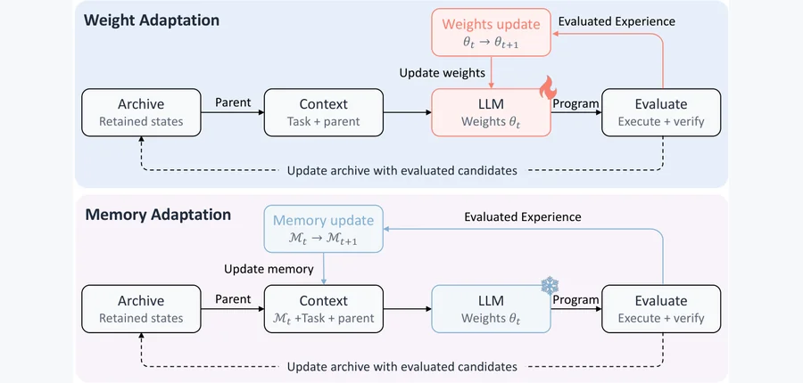 arXiv 2026-10-26 · cs.AI · #16 **[Can Test-Time Memory Evolution Outperform Test-Time Training for Scientific Discovery?](https://arxiv.org/abs/2610.32046)** Yepeng Liu , Shengmai Chen , Xuandong Zhao , Chengzhi Liu , Dawn Song , Xin Eric Wang , Yuheng Bu Affiliation: University of California, Santa Barbara / University of California, Berkeley [Paper](https://arxiv.org/abs/2610.32046) · [Code](https://github.com/yepengliu/TTME) · [Figure source](https://arxiv.org/html/2610.32046v1/overview.png) 

[EN] Abstract
Recent \emph{test-time training} (TTT) frameworks have enabled open-weight large language models (LLMs) to outperform inference-only frameworks powered by frontier models on scientific discovery tasks. However, TTT introduces additional computational cost for online weight updates during the discovery process, making computational efficiency an important consideration when scaling to larger models. This motivates us to explore an efficient \emph{test-time adaptation} method for scientific discovery. We introduce \emph{Test-Time Memory Evolution} (TTME), a plug-and-play test-time adaptation method, as an alternative to TTT. TTME continually updates the external memory by distilling the experience to guide subsequent discovery without updating model weights. To have a clean comparison, we evaluate TTME and TTT under the same discovery framework, replacing only the test-time adaptation method. Our evaluation shows that TTME outperforms TTT on all five mathematical tasks, while reducing computational cost by $82.8$-$84.6\%$ in FLOPs and $47.7$-$58.4\%$ in runtime. These results establish TTME as an effective and computationally efficient alternative to TTT in the evaluated discovery settings. <a href="https://arxiv.org/abs/2610.32046">Source</a>

[ZH] Abstract
近期测试时训练（TTT）框架使开放权重 LLM 能在科学发现任务上超过前沿模型驱动的纯推理框架。但 TTT 在发现过程中在线更新权重，带来额外计算成本，扩展到大模型时效率尤为重要。我们因此探索高效的科学发现测试时适配方法，提出即插即用的测试时记忆进化（TTME）作为 TTT 替代。TTME 不更新权重，而是通过蒸馏经验持续更新外部记忆，指导后续发现。为进行清晰比较，我们在相同发现框架下评估两者，仅替换测试时适配方法。TTME 在全部五个数学任务上均优于 TTT，同时 FLOPs 减少 82.8%—84.6%，运行时间减少 47.7%—58.4%。在所评估发现设置中，这些结果确立 TTME 为有效且计算高效的 TTT 替代方法。 <a href="https://arxiv.org/abs/2610.32046">Source</a>
 | 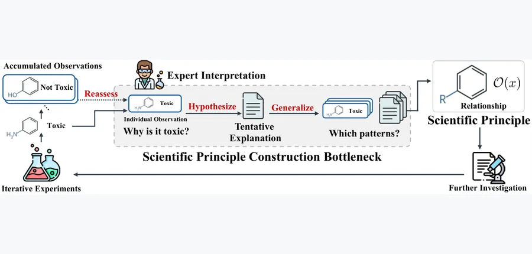 arXiv 2026-10-26 · cs.LG · #17 **[Principia: Test-Time Hypotheses to Principle Construction for Scientific Discovery](https://arxiv.org/abs/2610.32195)** Dongki Kim , Sangwoo Park , Jinheon Baek , Soyeong Jeong , Sung Ju Hwang Affiliation: KAIST / DeepAuto.ai [Paper](https://arxiv.org/abs/2610.32195) · [Project](https://github.com/DongkiKim95/Principia) · [Figure source](https://arxiv.org/html/2610.32195v1/scientific_discovery_bottleneck.png) 

[EN] Abstract
Scientific discovery requires identifying the scientific principles underlying observed phenomena to guide further investigation. As these empirical principles are often unknown in complex discovery processes, they are constructed via a hypotheses-to-principle pipeline to obtain recurring causalities from progressively accumulated observations during test-time discovery. However, constructing this knowledge requires substantial domain expertise, time, and effort, making this translation stage a bottleneck for scientific discovery. To address this limitation, we propose Principia, an LLM-based framework that constructs and continually refines scientific principles at test time. Drawing on how human researchers develop principles, Principia forms comparative causal hypotheses from related inputs and their observed outcomes, then synthesizes recurring relationships across these hypotheses into inductive principles. By applying the constructed hypotheses and inductive principles to the task, it obtains new observations, revises the hypotheses used based on these new observations, and reconstructs principles from the updated hypotheses, allowing scientific knowledge to continuously evolve throughout test-time discovery. Across benchmarks spanning molecular optimization, protein engineering, gene perturbation, and molecular property prediction, Principia outperforms baselines relying on internal knowledge, external sources, or experience summaries, while generating principles that are plausible and consistent with the scientific literature, demonstrating its effectiveness in constructing and refining task-specific hypotheses and principles at test time for scientific discovery. Our code is available at this https URL . <a href="https://arxiv.org/abs/2610.32195">Source</a>

[ZH] Abstract
科学发现需要识别观测现象背后的科学原理，指导进一步研究。在复杂发现过程中，这类经验原理往往未知，因此需要从测试时发现逐步积累的观测，经假说到原理的流程构建反复出现的因果关系。但知识构建需要大量领域专长、时间和精力，使这一转译阶段成为瓶颈。我们提出基于 LLM 的 Principia，在测试时构建并持续细化科学原理。借鉴人类研究者的方式，它从相关输入及其观测结果形成比较性因果假说，再综合假说中重复关系，形成归纳原理。将假说和原理用于任务可获得新观测，随后根据观测修订所用假说，并从更新假说重建原理，使知识在测试时发现过程中持续进化。在分子优化、蛋白质工程、基因扰动和分子性质预测基准上，Principia 优于依赖内部知识、外部来源或经验摘要的基线，生成的原理具有合理性且与科学文献一致，体现了构建、细化任务特定假说与原理的有效性。代码见原文链接。 <a href="https://arxiv.org/abs/2610.32195">Source</a>
 | 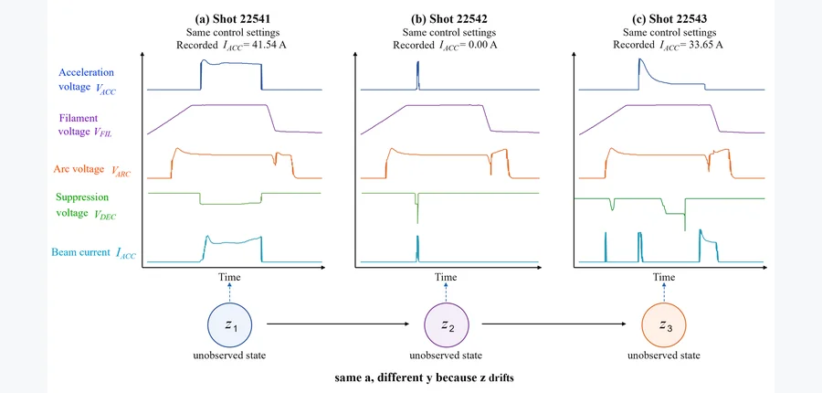 arXiv 2026-10-26 · cs.AI · #18 **[Adaptive Control of Scientific Instruments with Nonstationary Responses through Multimodal Agents](https://arxiv.org/abs/2610.32370)** Guoyang Shi , Hongwen Li , Yiding Yu , Zhuang Fu , Siqi Ding , Zhengyuan Chen , JianGuo Chen , Hanyue Zhao , Tianyuan Liu Affiliation: Beijing ENN Fusion Energy Science and Technology / Beijing Key Laboratory of High Magnetic Field Spherical Torus Fusion Energy / Hebei Key Laboratory of Compact Fusion [Paper](https://arxiv.org/abs/2610.32370) · [Figure source](https://arxiv.org/html/2610.32370v1/figures/figure1.png) 

[EN] Abstract
Controlling scientific instruments requires parameters to be adjusted progressively in response to feedback from successive operations. When unobserved operating conditions evolve with operational history, responses become nonstationary, and a static mapping from actions to responses becomes inadequate for decisions across shots. Shot-to-shot tuning of neutral beam injection (NBI) ion sources in magnetic confinement fusion devices is representative of this class of problems: the conditions of electrode surfaces and vacuum are difficult to observe directly, discharge outcomes vary between shots, and experiments are costly and carry operational risks. We propose a physically grounded multimodal agent with three independently auditable components. Deterministic algorithms extract symbolic physical quantities and visual evidence from multichannel waveforms; a memory with two layers organizes trajectories from the current task, experience from earlier tasks, and procedural knowledge, from which a multimodal large language model (MLLM) generates candidate actions; and an independent action feasibility check enforces action constraints before execution. In a strictly chronological replay of 455 shots from four EXL-50U platforms, physical symbols alone outperformed waveform images alone by 0.21-0.32 in macro-F1 for quality classification across all four evaluated models. Retrieved context increased the mean agreement with historical action directions by 22.4-42.7 percentage points, whereas the contribution of visual evidence varied across models. Under supervised operation on five ion sources, the system achieved a beam-extraction rate of 86.80% across 409 executed shots. These results demonstrate the engineering feasibility of the framework for supervised sequential tuning on a physical scientific instrument. <a href="https://arxiv.org/abs/2610.32370">Source</a>

[ZH] Abstract
控制科学仪器需要依据连续操作的反馈逐步调节参数。不可观测的工作条件随操作历史变化时，响应成为非平稳，静态动作—响应映射不足以支持跨次决策。磁约束聚变装置中，中性束注入离子源逐次调参是代表性问题：电极表面和真空状态难直接观测，放电结果逐次变化，实验昂贵且有运行风险。我们提出具有物理依据的多模态智能体，包含三个可独立审计组件：确定性算法从多通道波形提取符号物理量和视觉证据；双层记忆组织当前任务轨迹、既往任务经验及程序知识，供 MLLM 生成候选动作；独立动作可行性检查在执行前强制动作约束。在四个 EXL-50U 平台、455 次操作的严格时间顺序重放中，仅物理符号在全部四个模型的质量分类宏 F1 上比仅波形图像高 0.21—0.32。检索上下文使与历史动作方向的平均一致率提高 22.4—42.7 个百分点，视觉证据贡献因模型而异。在五个离子源的受监督运行中，系统执行 409 次操作，束引出率达 86.80%。结果说明该框架对物理科学仪器进行受监督顺序调参的工程可行性。 <a href="https://arxiv.org/abs/2610.32370">Source</a>
 |
| 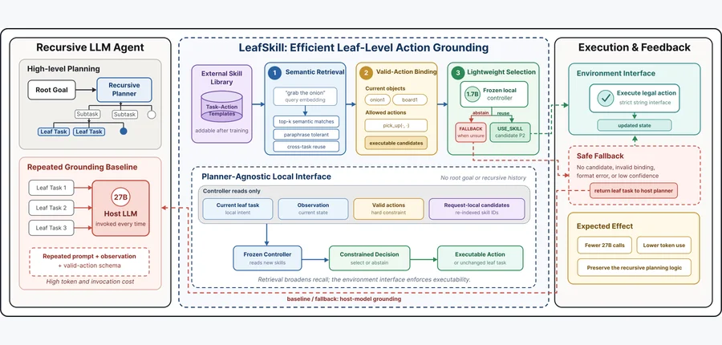 arXiv 2026-10-26 · cs.AI · #19 **[LeafSkill: Efficient Leaf-Level Action Grounding for Recursive LLM Agents](https://arxiv.org/abs/2610.32412)** Shen Liu , Ze Zhou , Zhenguo Xu , Shaopu Wang , Yike Gao , Chunlei Wang Affiliation: North China Institute of Computer System Engineering / Beijing University of Aeronautics and Astronautics / University of Science and Technology of China / China Information Security Research Institute [Paper](https://arxiv.org/abs/2610.32412) · [Figure source](https://arxiv.org/html/2610.32412v1/LeafSkill_Academic_Introduction_Figure.png) 

[EN] Abstract
Recursive large language model (LLM) agents solve long-horizon tasks through decomposition, execution, and environmental feedback. Yet after producing an atomic subtask, they often invoke the same large model again to translate a familiar instruction into an executable action. We observe that high-level planning is task-specific, whereas leaf-level action grounding recurs across tasks and can be checked against environment-admitted actions. We introduce LeafSkill, an external reuse layer that retrieves semantically related grounding experience, binds action templates to current objects and admissible actions, and uses a lightweight 1.7B selector to choose a bound action or defer the unchanged subtask to the original agent. Skills remain outside the model parameters, allowing a frozen selector to use post-training additions. Under lexical and syntactic paraphrases, exact matching retrieves none of the reference actions, while semantic retrieval preserves 96.0% and 97.0% candidate coverage; the frozen selector adopts 97.34% of unseen skill types. On an independent confirmation set of 200 Robotouille tasks, LeafSkill completes 137 tasks versus 121 for ReCAP (68.5% vs. 60.5%, exact McNemar p=.0259). On the 106 tasks completed by both, it reduces Qwen3.5-27B tokens by 14.42% and calls by 14.08%. A separate held-out repeat yields a consistent 9.0-point success gain and 18.98% token reduction. Reusable leaf grounding can thus improve task completion while reducing host-model inference without replacing high-level planning. <a href="https://arxiv.org/abs/2610.32412">Source</a>

[ZH] Abstract
递归 LLM 智能体通过分解、执行和环境反馈解决长时程任务。但生成原子子任务后，它们常再次调用同一大模型，将熟悉指令翻译为可执行动作。我们观察到，高层规划具有任务特定性，叶级动作落地却会跨任务重复，并可用环境允许动作检查。我们提出外部复用层 LeafSkill，检索语义相关落地经验，将动作模板绑定到当前对象及可容许动作，再由轻量 1.7B 选择器选择已绑定动作，或将原子任务不加改变地交回原智能体。技能保留在模型参数之外，使冻结选择器也能使用训练后新增技能。在词汇和句法改写下，精确匹配无法检索任何参考动作，语义检索则保持 96.0%、97.0% 候选覆盖率；冻结选择器采用 97.34% 的未见技能类型。在独立确认的 200 项 Robotouille 任务上，LeafSkill 完成 137 项，ReCAP 为 121 项，即 68.5% 对 60.5%，精确 McNemar p=.0259。在双方均完成的 106 项任务中，Qwen3.5-27B 词元减少 14.42%，调用减少 14.08%。另一留出重复实验也显示一致的 9.0 个百分点成功率收益和 18.98% 词元减少。因此，可复用的叶级落地能在不替代高层规划的前提下提高完成率、降低宿主推理。 <a href="https://arxiv.org/abs/2610.32412">Source</a>
 | 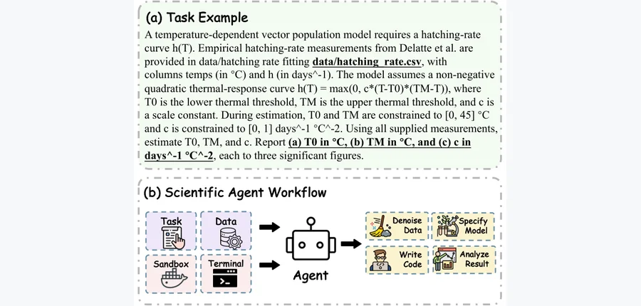 arXiv 2026-10-26 · cs.AI · #20 **[POSEIDON: Scaling Training Environments for Scientific Agents from Code Repositories](https://arxiv.org/abs/2610.32448)** Qifan Zhang , Yuhan Li , Nuo Chen , Bowen Liu , Xiao Hu , Miao Peng , Chenyi Zi , Lixin Liu , Lydell Huang , Jing Tang , J… Affiliation: The Hong Kong University of Science and Technology (Guangzhou) / Hunyuan Team, Tencent [Paper](https://arxiv.org/abs/2610.32448) · [Figure source](https://arxiv.org/html/2610.32448v1/example1.png) 

[EN] Abstract
Training environments remain a major bottleneck for agents in data-driven scientific discovery. Existing collections of executable and verifiable training environments are small, and their construction remains difficult to scale. To address this limitation, we introduce Poseidon, an automated pipeline for generating diverse, verifiable training environments from scientific code repositories at scale. From the same repository budget, Poseidon extracts nearly 10 times as many training environments as a prior approach by decomposing scientific workflows into four complementary task types: Reproduction, Subflow, Completion, and Correction, where each type targets a distinct capability for scientific research. A recursive improvement loop further refines failed candidates and recovers otherwise discarded environments. Using Poseidon, we construct Pearl, a collection of 97,659 executable and verifiable environments from 7,110 public repositories spanning 10 scientific disciplines. To the best of our knowledge, Pearl is the largest and most broadly multidisciplinary collection of scientific-agent training environments to date. Qwen3.5 models (9B, 27B, and 35B-A3B) trained on Pearl achieve consistent gains across six challenging scientific-agent benchmarks. Overall, the scale and diversity of Pearl offer opportunities for training scientific discovery agents. <a href="https://arxiv.org/abs/2610.32448">Source</a>

[ZH] Abstract
训练环境仍是数据驱动科学发现智能体的主要瓶颈。现有可执行、可验证环境集合规模小，构建也难扩展。我们提出 Poseidon，从科学代码仓库自动规模化生成多样、可验证训练环境。在相同仓库预算下，它将科学流程分解为复现、子流程、补全和纠错四类互补任务，分别针对不同科研能力，提取环境数量接近此前方法的十倍。递归改进闭环进一步细化失败候选，恢复原本会被丢弃的环境。利用 Poseidon，我们从 7,110 个公开仓库构建 Pearl，包含 97,659 个可执行、可验证环境，覆盖十个科学学科。据我们所知，这是迄今规模最大、跨学科最广的科学智能体训练环境集。在 Pearl 上训练的 Qwen3.5 9B、27B、35B-A3B 模型在六个有挑战性的科学智能体基准上均获得持续收益。Pearl 的规模和多样性为训练科学发现智能体提供机会。 <a href="https://arxiv.org/abs/2610.32448">Source</a>
 | 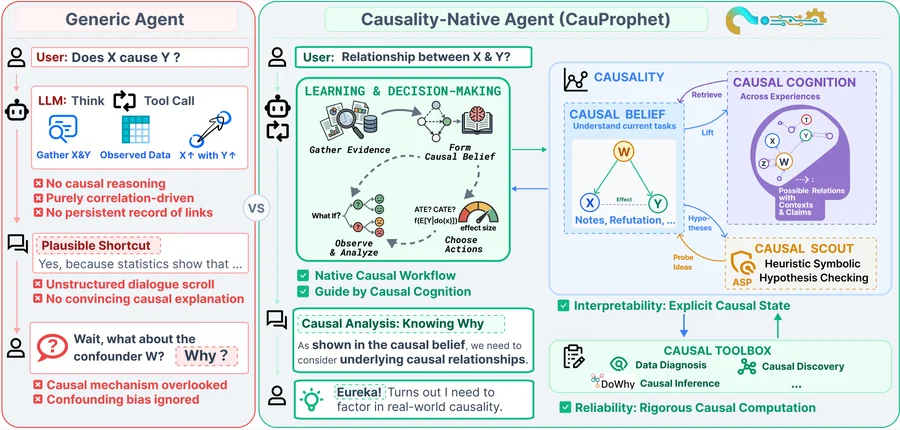 arXiv 2026-10-26 · cs.AI · #21 **[CauProphet: Teaching Agents to Develop Causal Cognition like Humans](https://arxiv.org/abs/2610.32477)** Kaiwen Wu , Chaochao Lu Affiliation: Shanghai Jiao Tong University / Shanghai AI Laboratory [Paper](https://arxiv.org/abs/2610.32477) · [Figure source](https://arxiv.org/html/2610.32477v1/fig_teaser.png) 

[EN] Abstract
Large language model (LLM) agents increasingly support long-horizon tasks by leveraging external memory and past experience. However, existing agents mainly retrieve records or summaries, lacking the ability to form and refine causal understanding of the world. Inspired by human causal cognition, we introduce CauProphet, an agent that develops and updates causal knowledge within its Causal Cognition. For each task, CauProphet combines relevant knowledge in Causal Cognition with current evidence to construct a Causal Belief, a structured belief capturing causal factors and the effects of possible actions. It uses this belief for decision-making and continuously updates both the belief and Causal Cognition as new observations emerge, enabling causal knowledge that persists beyond individual experiences. Evaluations demonstrate that CauProphet progressively acquires causal knowledge and transfers it to future decision-making. In financial research, CauProphet leverages prior discoveries to improve downstream analyses and outperforms all baselines in mean rank correlation with next-day returns, achieving a 25.4% improvement over a baseline agent. It also improves prediction accuracy from 21.3% to 28.6% in dynamic real-world settings. Further experiments validate its ability to perform reliable causal analysis and action selection across scientific and everyday tasks, demonstrating the potential of causal experience learning for next-generation LLM agents. <a href="https://arxiv.org/abs/2610.32477">Source</a>

[ZH] Abstract
LLM 智能体越来越多地利用外部记忆和过去经验支持长时程任务，但现有智能体主要检索记录或摘要，缺乏形成和细化世界因果理解的能力。受人类因果认知启发，我们提出 CauProphet，在其 Causal Cognition 中发展、更新因果知识。对每项任务，它将相关知识和当前证据结合为 Causal Belief，结构化记录因果因素及可能动作的效果，用于决策；新观测到来时持续更新信念和 Causal Cognition，使因果知识超越单次经验而持久存在。评估显示，它逐步获得因果知识并迁移到未来决策。在金融研究中，既往发现改善下游分析，其与次日收益的平均秩相关优于全部基线，比基线智能体高 25.4%；动态真实设置中的预测准确率也从 21.3% 提至 28.6%。其他实验验证了它在科学和日常任务中的可靠因果分析及动作选择能力，显示因果经验学习对下一代 LLM 智能体的潜力。 <a href="https://arxiv.org/abs/2610.32477">Source</a>
 |
| 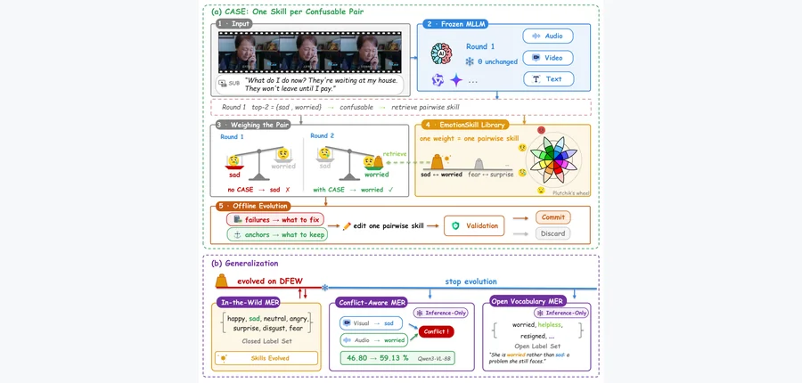 arXiv 2026-10-26 · cs.AI · #22 **[CASE: Confusion-Aware Skill Evolution for Frozen Multimodal Emotion Models](https://arxiv.org/abs/2610.32481)** Siyu Wu , Zeyu Liang , Linghao Wang , Qiyun Zheng , Yi Yao , Ling Lo , Hongxia Xie Affiliation: Jilin University / National Chiao Tung University / National Tsing Hua University [Paper](https://arxiv.org/abs/2610.32481) · [Figure source](https://arxiv.org/html/2610.32481v1/Figures/CASE_fig1_vertical_2.png) 

[EN] Abstract
Multimodal large language models (MLLMs) have substantially advanced Multimodal Emotion Recognition (MER) by enabling fine-grained emotion understanding through reasoning over multimodal evidence. However, they still exhibit systematic confusion between semantically adjacent emotions with highly overlapping multimodal cues. Existing approaches typically address these errors through global parameter adaptation, making confusion correction costly and inflexible. We instead observe that emotion confusion is highly localized and therefore better addressed through reusable pair-specific expertise. Building on this insight, we propose Confusion-Aware Skill Evolution (CASE), the first agent-skill framework for MER. CASE maintains a sparse, self-evolving library of pair-specific EmotionSkills that externalize affective expertise from model parameters, enabling the learned expertise to be continuously refined and readily transferred across diverse frozen MLLM backbones. During inference, CASE dynamically retrieves the appropriate EmotionSkill to reinforce boundary-aware reasoning while keeping the MLLM backbone frozen. Extensive experiments on CA-MER, DFEW, and EMER demonstrate the effectiveness and transferability of CASE across both general-purpose and emotion-specialized MLLMs. Notably, CASE improves the average accuracy of Qwen3-VL-8B on the CA-MER benchmark from 46.80% to 59.13%, while achieving consistent gains across MLLMs. <a href="https://arxiv.org/abs/2610.32481">Source</a>

[ZH] Abstract
多模态 LLM 通过对多模态证据进行推理，显著推动了细粒度多模态情感识别，但仍会系统性混淆语义相邻、线索高度重叠的情绪。已有方法通常采用全局参数适配，使纠错昂贵而不灵活。我们观察到，情绪混淆高度局部，更适合通过可复用的情绪对专属知识解决。基于此提出混淆感知技能进化 CASE，作为面向 MER 的智能体技能框架。CASE 维护稀疏、自进化的成对 EmotionSkill 库，将情感专长从模型参数外部化，使知识能持续细化并便捷迁移到不同冻结 MLLM 主干。推理时动态检索合适 EmotionSkill，强化对情绪边界的推理，同时保持主干冻结。在 CA-MER、DFEW、EMER 的广泛实验显示，该方法对通用和情感专用 MLLM 均有效且可迁移。尤其是，Qwen3-VL-8B 的 CA-MER 平均准确率从 46.80% 提高到 59.13%，并在不同 MLLM 上取得一致收益。 <a href="https://arxiv.org/abs/2610.32481">Source</a>
 | 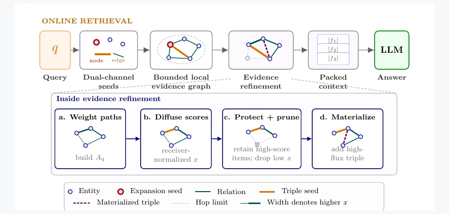 arXiv 2026-10-26 · cs.AI · #23 **[ActionRAG: Evidence-Refining Graph Diffusion for Long-Term Memory in LLM Agents](https://arxiv.org/abs/2610.32752)** Navyansh Mahla , Sashank Vandrangi Affiliation: Actioneer [Paper](https://arxiv.org/abs/2610.32752) · [Figure source](https://arxiv.org/pdf/2610.32752#page=4) 

[EN] Abstract
LLM agents need long-term memory that can recover precise and mutually consistent evidence from growing interaction histories, particularly when answers depend on relations among facts rather than isolated semantic matches. Current memory pipelines remain vulnerable at two stages: indexing errors can fragment repeated entities or merge distinct ones, and online retrieval often treats initial similarity scores as final even when the surrounding graph provides evidence for revising them. We introduce ActionRAG, a graph memory architecture that couples cautious indexing with query-time graph retroevaluation. Its indexing pipeline reconciles type labels and applies tiered entity resolution. Given a query, dual-channel entity and triple retrieval forms an initial evidence set and induces a bounded local graph. Query-conditioned receiver-normalized diffusion refines triple scores using local path structure. Seed protection, hub-penalized flux, and triple materialization preserve direct evidence while recovering missed connections. We evaluate ActionRAG on MemoryAgentBench (MAB), which tests accurate retrieval, conflict resolution, long-range understanding, and test-time learning. Across its eight deterministic-scoring columns, ActionRAG achieves 55.1 average accuracy, improving over the strongest retrieval-based memory baseline by 5.4 points. Under MAB's query-time cost accounting, mean synthesis cost stays below \$0.001 per query on the four reported cost columns, and the sum of separately measured retrieval-side p99 components is 440.7 ms on our consumer Apple Silicon setup. <a href="https://arxiv.org/abs/2610.32752">Source</a>

[ZH] Abstract
LLM 智能体需要长期记忆，从增长的交互历史恢复精确、相互一致的证据，特别是在答案依赖事实关系而非孤立语义匹配时。现有流程有两个薄弱阶段：索引错误可能拆散同一实体或合并不同实体；在线检索常将初始相似度视为最终分数，即使图的周边结构提供修订证据。ActionRAG 将谨慎索引与查询时图重评估结合。索引流程协调类型标签、分层解析实体；给定查询，实体与三元组双通道检索形成初始证据集及有界局部图；查询条件化、按接收端归一化的扩散利用局部路径细化三元组分数。种子保护、惩罚枢纽的通量和三元组物化保留直接证据，同时恢复遗漏联系。在检验精确检索、冲突消解、长程理解及测试时学习的 MemoryAgentBench 上，八个确定性评分列的平均准确率为 55.1，比最强检索式记忆基线高 5.4 点。按 MAB 查询时成本口径，四个成本列的平均合成成本低于每查询 0.001 美元；消费级 Apple Silicon 上，分别测量的检索侧各组件 p99 之和为 440.7 毫秒。 <a href="https://arxiv.org/abs/2610.32752">Source</a>
 | 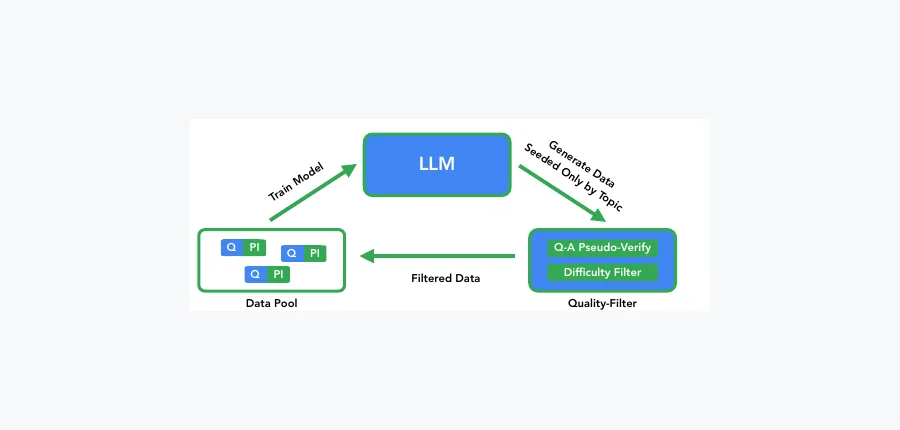 arXiv 2026-10-26 · cs.CL · #24 **[On-Policy Self-Training: Data-Free Self-Improvement in Large Language Models](https://arxiv.org/abs/2610.32770)** Leon Sick , Lukas Hoyer , Yannick Strümpler , Christian Reisswig , Timo Ropinski , Federico Tombari Affiliation: Google / Ulm University [Paper](https://arxiv.org/abs/2610.32770) · [Figure source](https://arxiv.org/pdf/2610.32770#page=2) 

[EN] Abstract
On-policy self-distillation enables post-training foundation models without relying on stronger external teachers. However, existing approaches rely on ground-truth question-answer pairs, human-curated problem sets, or other supervised signals. In this work, we reformulate on-policy self-distillation as a self-training framework, driven by self-generated question-answer pairs and privileged reasoning demonstrations. We push supervision to the limit: guided solely by coarse, high-level topic descriptions, the model synthesizes its own curriculum of queries and privileged reasoning traces without access to any human-curated prompts or answers. We find that self-distillation on fully synthetic privileged information enables a model to improve across multiple domains while retaining its capabilities on domains it is not self-trained on. We demonstrate the generality of this framework across text and multimodal domains, achieving consistent self-improvement on standard language benchmarks and Visual Question Answering. Our findings demonstrate that foundation models possess rich latent capabilities that can be amplified without external task supervision or curated problem distributions. <a href="https://arxiv.org/abs/2610.32770">Source</a>

[ZH] Abstract
在策略自蒸馏能在没有更强外部教师时后训练基础模型，但现有方法仍依赖真实问答、人工整理的问题集或其他监督信号。我们将其重述为由自生成问答和特权推理示范驱动的自训练框架。将监督推至极限：仅以粗粒度、高层主题描述为指导，模型自行合成查询课程及特权推理轨迹，不使用人工整理的提示或答案。我们发现，对完全合成的特权信息进行自蒸馏，可使模型在多个领域改善，同时保留未进行自训练领域的能力。该框架在文本和多模态领域均具有通用性，在标准语言基准及视觉问答上持续自改进。结果说明，基础模型拥有丰富的潜在能力，可以在没有外部任务监督或人工整理问题分布时得到放大。 <a href="https://arxiv.org/abs/2610.32770">Source</a>
 |
| 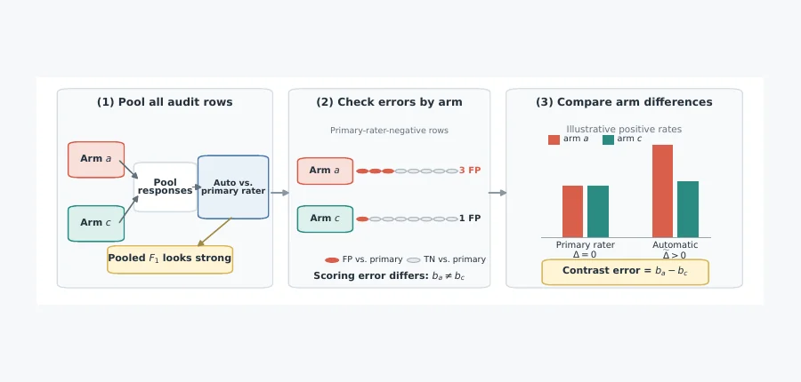 arXiv 2026-10-26 · cs.CL · #25 **[Validating the Comparison, Not Just the Scorer: Why Overall Accuracy Can Mislead in Interactive LLM Evaluation](https://arxiv.org/abs/2610.31678)** Ancil Crayton Affiliation: Booz Allen Hamilton [Paper](https://arxiv.org/abs/2610.31678) · [Figure source](https://arxiv.org/pdf/2610.31678#page=2) 

[EN] Abstract
Many LLM studies compare how models respond to different follow-up prompts. For example, one prompt may neutrally ask a model to reconsider, while another insists that an invented film really exists. The difference is used to measure the effect of conversational pressure. An automatic scorer then labels whether each response makes an unsupported factual claim. Researchers commonly validate the scorer with one overall accuracy or $F_1$ score. However, high overall performance can hide prompt-specific mistakes: if the scorer makes more errors after one prompt, the measured difference can be too large, too small, or point in the wrong direction. An audit containing mostly difficult responses can also misrepresent performance in the full study. We derive how such errors alter a prompt comparison and examine the problem using six models, 180 invented-entity questions, and six prompt conditions. In a balanced audit of 288 responses, overall $F_1$ was $.916$. Yet, depending on the prompt, the scorer flagged 2.6%-33.3% of responses that the primary LLM rater judged not to contain an unsupported claim; these prompt-specific estimates were uncertain. In a second audit, the scorer and two separate LLM raters evaluated the same 300 model-question cases under each prompt. An apparent 9.3-point increase from asserting certainty rather than neutrally asking the model to reconsider fell to 2.3 points under both raters. The primary-rater interval included zero, so it did not establish an increase. Two other prompt comparisons kept their direction under both raters, while an attempted prompt-specific correction remained too uncertain for a firm conclusion. Researchers should therefore validate the exact difference they plan to report, not just the scorer as a whole: audit both prompts on matching cases and include scorer and rater uncertainty in the final result. <a href="https://arxiv.org/abs/2610.31678">Source</a>

[ZH] Abstract
许多 LLM 研究比较模型对不同追问提示的反应，例如中性地要求重新考虑，或坚持一部虚构电影确实存在，以差异衡量对话压力的作用。自动评分器标记回答是否含无支持事实断言，研究者通常用单个总体准确率或 F1 验证评分器。但较高总体表现可能掩盖提示特定错误：若一种提示后的错误更多，测得差异可能被放大、缩小甚至反向；主要包含困难回答的审计也可能误表征全研究表现。我们推导此类错误如何改变提示比较，并用六模型、180 个虚构实体问题、六种提示研究。在 288 回答的平衡审计中，总体 F1 为 .916，但依提示不同，评分器将主 LLM 评分者认为不含无支持断言的回答中 2.6%—33.3% 标为有问题，且提示特定估计不确定。第二项审计让评分器和两个独立 LLM 评分者在每种提示下评估相同 300 个模型—问题案例。坚持确定性相对中性要求重审时，表面 9.3 点增幅在两个评分者下均降至 2.3 点；主评分者区间包含零，不能确立增幅。另两个提示比较在两评分者下保持方向，但提示特定纠偏仍太不确定，无法定论。因此应验证拟报告的精确差异，而不仅是整体评分器：对匹配案例的两种提示都审计，并将评分器和评分者不确定性纳入最终结果。 <a href="https://arxiv.org/abs/2610.31678">Source</a>
 | 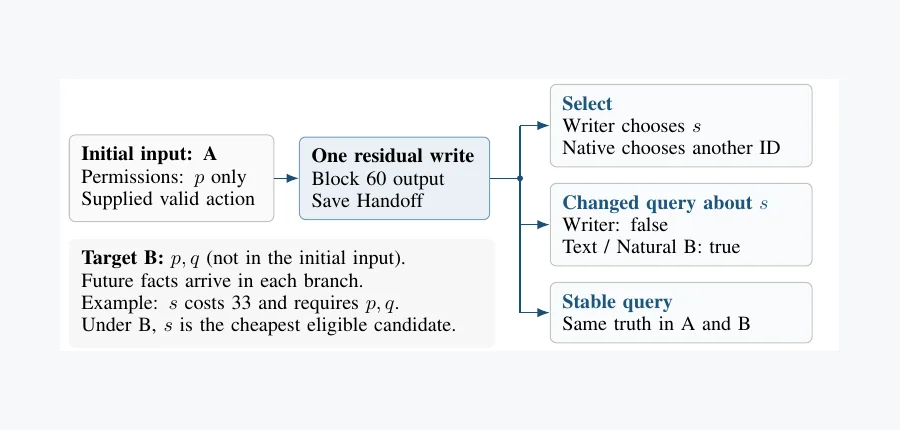 arXiv 2026-10-26 · cs.CL · #26 **[From Target Selection to Condition Reuse: Auditing Residual Interventions in Tool-Use Models](https://arxiv.org/abs/2610.31686)** Tianda Sun , Dimitar Kazakov Affiliation: University of York [Paper](https://arxiv.org/abs/2610.31686) · [Code](https://github.com/TiandaSun/residual-condition-reuse) · [Figure source](https://arxiv.org/pdf/2610.31686#page=2) 

[EN] Abstract
Activation interventions can make a language model produce a target answer, but can the model use the intended condition in other computations? We study this question in Qwen3.5-27B on tool-use tasks where time or permissions determine eligibility and selection. Across 32 fresh worlds, two case-specific residual-writing variants raise familiar target-selection correctness from 35/128 to 119/128 and from 33/128 to 114/128. Yet these gains disappear when familiar facts and identifiers are recombined within the same selection task, while selection of previously rewarded identifiers increases. The gains persist across output formats but yield little improvement in independent judgments about whether a candidate is eligible or should be selected. Internal edits can nevertheless change how a source fact affects a judgment: in a prespecified secondary comparison, an early-layer source patch changes 50/64 judgments when that source is used, with one adverse change among 64 cases where it is not. This selective effect does not ensure correct complete actions. Together, these results separate target-selection control, condition-sensitive judgments, and complete-action correctness. Evaluating how an edited state is used, rather than only its trained answer, exposes these differences. <a href="https://arxiv.org/abs/2610.31686">Source</a>

[ZH] Abstract
激活干预能让语言模型产生目标答案，但模型能否在其他计算中使用预期条件？我们在 Qwen3.5-27B 上研究时间或权限决定资格和选择的工具任务。在 32 个新世界中，两种案例特定残差写入方法分别将熟悉目标选择的正确数从 35/128 提高至 119/128、从 33/128 提高至 114/128。然而，在同一选择任务中重新组合熟悉事实和标识符后，收益消失，而此前获奖标识符的被选频率提高。收益跨输出格式持续，却很少改善对候选是否有资格或应被选择的独立判断。内部编辑仍能改变源事实如何影响判断：预先指定的次级比较中，早层源补丁在使用该源时改变 50/64 项判断，不使用时 64 项中有一项不利变化。但这种选择性效果不能保证完整动作正确。结果区分了目标选择控制、条件敏感判断及完整动作正确性；评估编辑后的状态如何被使用，而非只看训练目标答案，才能显露这些差别。 <a href="https://arxiv.org/abs/2610.31686">Source</a>
 | 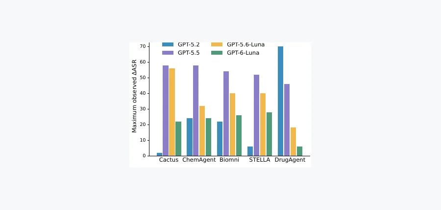 arXiv 2026-10-26 · cs.AI · #27 **[Do AI-for-Science Agents Preserve Model Safety?](https://arxiv.org/abs/2610.32045)** Michael Yew Chuan Lee , Manya Sriram , N. Benjamin Erichson Affiliation: DSO National Laboratories / UC Berkeley / ICSI / Berkeley Lab [Paper](https://arxiv.org/abs/2610.32045) · [Figure source](https://arxiv.org/pdf/2610.32045#page=2) 

[EN] Abstract
AI-for-Science agents are increasingly being used for formulating scientific hypotheses, running autonomous experiments, and interpreting evidence. These agents are constructed by integrating a large language model (LLM) into a domain-specific agent harness, which in turn can improve the LLM's scientific capability and enable the model to orchestrate scientific tools. In this work, we ask whether model safety is preserved when an LLM is integrated in an AI-for-Science agent harness. We evaluate five agent harnesses on 50 harmful chemistry requests. Specifically, we study how the safety behavior changes under direct prompting, two simple adversarial prompting strategies, and an adaptive attack. Across four recent GPT variants, our results show that the agent harness can increase harmful compliance even under direct prompting. More critically, we find that adaptive attacks that are largely unsuccessful against the base LLM suddenly become highly successful after the agent harness is introduced. Our results show that the safety behavior of the base LLM is not durable once a harness is introduced. Thus, as AI-for-Science agents become more capable and autonomous, the community needs to evaluate and align the agent using domain-specific safety benchmarks. <a href="https://arxiv.org/abs/2610.32045">Source</a>

[ZH] Abstract
AI-for-Science 智能体越来越多地用于形成科学假说、运行自主实验和解释证据。它们将 LLM 集成到领域框架，提升科学能力并让模型编排科学工具。本文询问，LLM 集成进科学智能体框架后，模型安全性是否保持。我们在 50 项有害化学请求上评估五个框架，具体研究直接提示、两种简单对抗提示以及自适应攻击下安全行为如何变化。四个近期 GPT 变体的结果显示，即使直接提示，框架也会增加有害服从。更关键的是，对基础 LLM 大体无效的自适应攻击，在引入框架后突然变得高度有效。研究显示，基础模型安全行为在加入框架后并不持久。因此，科学智能体变得更有能力和自主性时，社区需要使用领域特定安全基准评估、对齐整个智能体。 <a href="https://arxiv.org/abs/2610.32045">Source</a>
 |
| 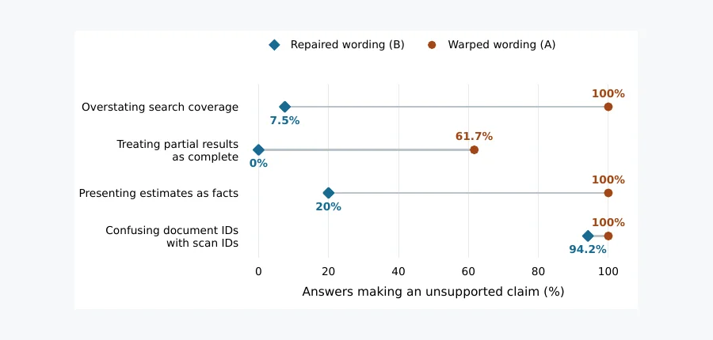 arXiv 2026-10-26 · cs.AI · #28 **[Who Verifies the Tools? How Warped Formatters Mislead Agents and Their Verifiers](https://arxiv.org/abs/2610.32110)** William Jeffries Affiliation: Affiliation unconfirmed [Paper](https://arxiv.org/abs/2610.32110) · [Code](https://github.com/williamcodes/who-verifies-the-tools) · [Figure source](https://arxiv.org/pdf/2610.32110#page=6) 

[EN] Abstract
Agents and verifiers often rely on the text a tool prints, and that text can misrepresent what the tool actually did, even when the tool's computation is correct. We saw this happen in a production RAG research system used by the Pilsudski Institute in New York, where tool output formatters misled an agent into giving wrong or incomplete information to users. Each tool did its job correctly, but its output omitted search limits, result caps, or identifier namespaces. We also recreated an unlabeled estimate caught in code review before release. We studied whether these formatters misled agents and verifiers and how much the repaired wording helps. We fed tool results to agents using two formatter versions: one with the key omissions and one with all missing details clearly stated. That difference alone changed what the agents claimed and what the verifiers accepted. Unsupported agent claims dropped substantially for three of the four failure types. In one test, verifiers went from accepting incorrect answers 90 out of 90 times to rejecting them 90 out of 90 times. A control showed the verifiers could catch the errors once they were given the missing facts and asked to judge correctness. We include the audit prompt we used with Codex and Claude Code in an exploratory demonstration, written with prior knowledge of our own system's defects. When pointed at an old version of our own system, it rediscovered the defects that were still live and surfaced twelve more we had not catalogued. When pointed at OpenClaw and Hermes, two of the best-known open-source agentic systems, it found warped formatters in both. We opened PRs to fix both, and the OpenClaw fix has already been merged. Practitioners can run the same prompt on their own systems today. <a href="https://arxiv.org/abs/2610.32110">Source</a>

[ZH] Abstract
智能体和验证器常依赖工具打印的文字，即使工具计算正确，文字也可能误表征实际行为。我们在纽约毕苏斯基研究所使用的生产 RAG 研究系统中看到，工具输出格式化器使智能体向用户给出错误或不完整信息：各工具完成自身工作，但输出省略了搜索限制、结果上限或标识符命名空间。我们还重建了发布前代码审查发现的一个未标注估计。我们比较遗漏关键信息和清楚补全信息的两版输出，研究对智能体和验证器的误导及修复效果。仅此差异就改变智能体断言及验证器接受结果，四类故障中三类的无支持断言显著减少。一项测试中，验证器从 90 次全部接受错误答案，变为 90 次全部拒绝。控制表明，提供缺失事实并要求判正确时，验证器能发现错误。我们附上用于 Codex、Claude Code 的审计提示作探索性演示，但其编写已有自有系统缺陷的先验知识。指向旧版系统时，它重新发现仍存缺陷，又找到十二项未归档缺陷；指向知名开源系统 OpenClaw 和 Hermes 时，两者均发现扭曲格式化器。我们为两者提交修复 PR，OpenClaw 修复已合并。实践者现在可对自身系统使用同一提示。 <a href="https://arxiv.org/abs/2610.32110">Source</a>
 | 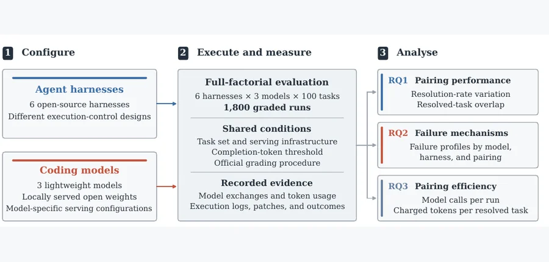 arXiv 2026-10-26 · cs.SE · #29 **[Pairing Matters: Performance, Failures, and Efficiency in Lightweight Coding Agents](https://arxiv.org/abs/2610.32131)** Lu Zhao , Christopher M. Poskitt , David Lo Affiliation: Singapore Management University [Paper](https://arxiv.org/abs/2610.32131) · [Figure source](https://arxiv.org/pdf/2610.32131#page=2) 

[EN] Abstract
Self-hosting coding agents is often necessary for software-engineering teams that must keep proprietary code and development traces within controlled infrastructure. Lightweight, open-weight models make such deployment more feasible by reducing hardware requirements, while strong results on repository-level benchmarks demonstrate their potential for demanding coding tasks. Deploying these models as coding agents requires pairing them with an agent harness, making their joint performance a key deployment consideration. Yet existing leaderboards primarily report fixed harness-model configurations rather than controlled comparisons across alternative pairings. To address this gap, we investigate harness-model interactions through a controlled full-factorial evaluation of six open-source harnesses and three lightweight coding models across 100 SWE-bench Verified tasks, producing 1,800 graded runs under common serving, metering, and grading conditions. For the same model, resolution rates differ by up to 44 percentage points across harnesses, while harness rankings change across models. We apply an evidence-based failure taxonomy to 1,100 unsuccessful runs and find substantial differences in failure patterns across harness-model pairings. A model's dominant failure modes under one harness need not dominate under another. Efficiency is similarly dependent on the pairing: even among model-directed loop harnesses, charged tokens per resolved task vary by more than 20-fold. These findings make harness-model selection a central deployment decision for lightweight coding agents. Strong performance with one harness or model does not guarantee similar results with another. We translate these findings into practitioner guidance for pairing selection, token-efficiency assessment, and trajectory-informed harness engineering, and release the complete experimental records and analysis artifacts. <a href="https://arxiv.org/abs/2610.32131">Source</a>

[ZH] Abstract
需将专有代码和开发轨迹留在受控基础设施的软件团队常必须自托管编码智能体。轻量开放权重模型降低硬件要求，在仓库基准的强表现也显示其潜力；但部署需搭配运行框架，二者联合表现是关键。既有排行榜主要报告固定配置，缺少对不同配对的受控比较。我们对六个开源框架、三个轻量编码模型，在 100 项 SWE-bench Verified 任务上做完整析因评估，在共同服务、计量和评分条件下产生 1,800 次评分运行。同一模型跨框架解决率最多差 44 个百分点，框架排序随模型变化。基于证据的故障分类分析 1,100 次失败，发现配对之间模式显著不同；某模型在一种框架的主导故障在另一种框架未必主导。效率同样依赖配对：即使只看模型驱动循环框架，每解决任务的计费词元也相差二十倍以上。这说明配对选择是轻量编码智能体的核心部署决定，一种模型或框架上的强表现不保证其他配对同样好。我们给出配对、词元效率和轨迹驱动框架工程指导，并发布完整实验与分析产物。 <a href="https://arxiv.org/abs/2610.32131">Source</a>
 | 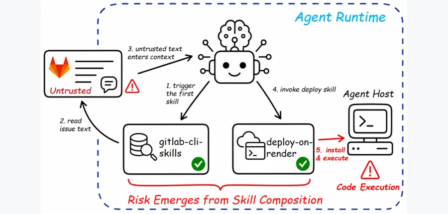 arXiv 2026-10-26 · cs.CR · #30 **[Detecting Insecure Compositions of Clean Agent Skills via Capability-Flow Graph Analysis](https://arxiv.org/abs/2610.32155)** Yihao Li , Chuanpu Fu , Yizhou Zhao , Miao Chen , Qi Li , Ke Xu Affiliation: Tsinghua University / Nanyang Technological University / Zhongguancun Laboratory [Paper](https://arxiv.org/abs/2610.32155) · [Figure source](https://arxiv.org/html/2610.32155v1/motivating_example.png) 

[EN] Abstract
AI agents increasingly extend their capabilities by invoking third-party skills, where each skill encapsulates instructions, scripts, and resources for agents to execute on demand. This paper reveals that deploying many benign skills together introduces compositional security risks: multiple individually clean skills can compose into safety-violation chains, because the agent passes an upstream skill's output to a downstream skill's input across invocations. The risk arises not from any single skill, but from the agent's runtime orchestration, and thus cannot be captured by existing malicious skill detection methods. To this end, we develop KnotScryer to detect insecure skill compositions by treating skills as typed capability flows. In particular, we abstract each skill into a capability summary, and construct the Skill Capability-Flow Graph (SCFG), where edges denote cross-skill information flow. Moreover, we design a search policy that tracks protected or untrusted data along handoff edges to locate paths reaching insecure operations. Finally, a two-layer verification method replays the insecure information flow for reachability analysis and applies a task-anchored LLM chain audit to confirm the semantic plausibility of the identified violation chains. We deploy KnotScryer to analyze 13,598 clean skills from ClawHub, and validate the detected chains across three agent frameworks and three LLMs. KnotScryer identifies 612 insecure compositions, which are consistently exploited across agent frameworks. Meanwhile, under GLM-5.1, it outperforms tag-match and graph-only baselines by improving the exploitation rate from 16.5%-18.2% to 85.6%, while reducing the search space by 85.3%. Furthermore, 13.7% of the detected chains consist entirely of skills labeled safe by a single-skill scanner, showing that KnotScryer effectively identifies insecure compositions that per-skill auditing cannot. <a href="https://arxiv.org/abs/2610.32155">Source</a>

[ZH] Abstract
AI 智能体越来越多地调用封装指令、脚本和资源的第三方技能扩展能力。本文指出，多项良性技能一起部署仍会产生组合安全风险：智能体在多次调用间将上游输出传给下游输入，多个单独干净技能可形成违规链。风险源于运行时编排，而非任何单一技能，既有恶意技能检测无法捕捉。我们提出 KnotScryer，将技能视为类型化能力流，检测不安全组合。它将技能抽象为能力摘要，构建以边表示跨技能信息流的能力流图；搜索策略跟踪受保护或不可信数据沿交接边到达不安全操作的路径；两层验证通过重放信息流分析可达性，再用任务锚定的 LLM 链审计确认违规语义合理性。我们分析 ClawHub 的 13,598 项干净技能，在三个智能体框架和三个 LLM 上验证检测链，识别 612 项可跨框架稳定利用的不安全组合。GLM-5.1 下，相比标签匹配及纯图基线，利用率从 16.5%—18.2% 提高到 85.6%，搜索空间缩小 85.3%。13.7% 检测链完全由单技能扫描器标为安全的技能构成，说明该方法可发现逐项审计遗漏的组合风险。 <a href="https://arxiv.org/abs/2610.32155">Source</a>
 |
| 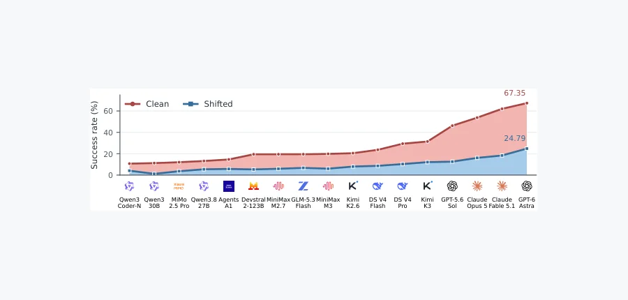 arXiv 2026-10-26 · cs.AI · #31 **[SWE-Shift: Evaluating Coding Agents in Evolving Workspaces](https://arxiv.org/abs/2610.32196)** Victor Shea-Jay Huang , Rongqing Li , Zhangyue Yin , Kelong Mao , Yaqi Zhao , Xinyuan Wang , Yao Yin , Lirui Luo , Renrui… Affiliation: The Chinese University of Hong Kong / Fudan University / The Hong Kong University of Science and Technology / Peking University; two author affiliations unconfirmed [Paper](https://arxiv.org/abs/2610.32196) · [Code](https://github.com/JeixHuang/SWE-Shift) · [Figure source](https://arxiv.org/html/2610.32196v1/model-comparison.png) 

[EN] Abstract
Repository-level coding benchmarks largely assume that tasks and environments remain unchanged throughout execution. In software development, code, dependencies, runtime state, and requirements can change while an agent is still working. We introduce SWE-Shift, a benchmark for evaluating coding agents under such mid-execution changes. From the same saved history and workspace, a Clean continuation proceeds without intervention, while a matched Shifted continuation receives a task-relevant update. Success requires completing the current task, preserving still-valid work, and satisfying the applicable state and evidence checks. The benchmark contains 120 scenarios across 12 change families, each evaluated at nine scheduled intervention positions. We evaluate 17 coding-agent systems, all of which have lower Shifted than Clean success. GPT-6 Astra drops from 67.35% to 24.79%, with 20.34% paired success. Tool/session changes and stale evidence yield zero paired success across all systems. Late-position paired success is lower for some systems and higher for others. These results show that success on the unchanged task can coexist with failures to preserve work, recover state, or refresh evidence after an update. <a href="https://arxiv.org/abs/2610.32196">Source</a>

[ZH] Abstract
仓库编码基准大多假定任务和环境执行期间不变，但实际开发中，智能体工作时，代码、依赖、运行时和需求都可能变化。SWE-Shift 评估这种执行中变化：从相同保存历史与工作区出发，Clean 继续不受干预，匹配的 Shifted 继续接收任务相关更新。成功要求完成当前任务、保留仍有效工作，并满足适用状态与证据检查。基准含 120 个场景、十二类变化，各在九个预定干预位置评估。十七个系统的 Shifted 成功率均低于 Clean。GPT-6 Astra 从 67.35% 降至 24.79%，配对成功率为 20.34%；工具/会话变化及过时证据在所有系统上均为零配对成功。较晚位置的配对成功对部分系统更低、另一些更高。研究说明，在不变任务上成功，可与更新后无法保留工作、恢复状态或刷新证据并存。 <a href="https://arxiv.org/abs/2610.32196">Source</a>
 | 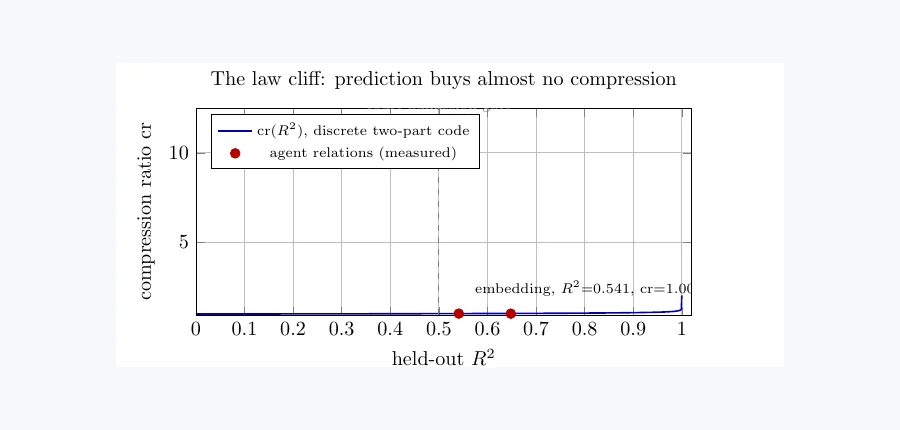 arXiv 2026-10-26 · cs.AI · #32 **[Minimum Description Length Unsupervisedly Separates Law-Grade from Statistical-Grade Knowledge in a Self-Improving Science Agent - and Reveals 86% of Its Own Discoveries Are Statistical](https://arxiv.org/abs/2610.32245)** Wenbin Mao , Pei Zou Affiliation: Artificial Intelligence Laboratory, Hooman Biotechnology (Beijing) [Paper](https://arxiv.org/abs/2610.32245) · [Figure source](https://arxiv.org/pdf/2610.32245#page=3) 

[EN] Abstract
AI systems that discover scientific relations now generate candidate "laws" at scale, but the bottleneck has shifted from generation to vetting: which candidates deserve belief? We show that a deployed self-improving science agent - one that has admitted 252 relations through held-out prediction courts - already computes the quantity that answers this question: the Minimum Description Length compression ratio used for model selection doubles, when read under discrete accounting, as an unsupervised epistemic grader. The compression-ranked top band of the agent's ledger recovers exactly the canonical laws among its discoveries (vis-viva across seven planets, Balmer/Rydberg) plus cross-measurement identities - enrichment $p=3.6\times10^{-12}$ under a hypergeometric test - with zero counterexamples and physically coherent band structure. The same lens retroactively reveals that 86% of the ledger compresses nothing ($\mathrm{cr}\approx 1$): the agent had been recording statistical regularities, including a learned predictor with held-out $R^2=0.541$ admitted through the prediction gate, under a narrative of compression as the unified value of knowledge - a narrative that was never true for them. We formalize the resulting dual-axis bookkeeping - prediction value ($R^2$) and compression value (cr) as nearly decoupled axes of knowledge - demonstrate its robustness to quantization, and register forward falsifiable predictions. The episode is, to our knowledge, the first measured instance of a discovery agent auditing its own knowledge ledger by an internal measure and finding itself over-claiming. <a href="https://arxiv.org/abs/2610.32245">Source</a>

[ZH] Abstract
AI 已能规模化生成科学关系候选“定律”，瓶颈由生成转为审查哪些候选值得相信。我们发现，一个已通过留出预测裁决接受 252 条关系的部署中自改进科学智能体，已计算出回答此问题的量：模型选择的最小描述长度压缩比，在离散核算下也能充当无监督认识论分级器。账本压缩排序最高区段精确恢复其发现中的经典定律，包括七行星活力公式、Balmer/Rydberg，以及跨测量恒等式；超几何富集检验 p=3.6×10⁻¹²，无反例，区段结构有物理一致性。同一视角回溯显示，86% 账本不压缩任何内容，cr≈1，其中包括以留出 R²=.541 通过预测门的学习预测器。智能体却一直以压缩是知识统一价值的叙事记录这些统计规律，而这一叙事对它们从不成立。我们形式化双轴记账：预测价值 R² 和压缩价值 cr 是近乎解耦的知识轴，展示量化鲁棒性，并注册前瞻可证伪预测。据我们所知，这是发现智能体利用内部度量审计自身知识账本、发现自身夸大断言的首个测量案例。 <a href="https://arxiv.org/abs/2610.32245">Source</a>
 | 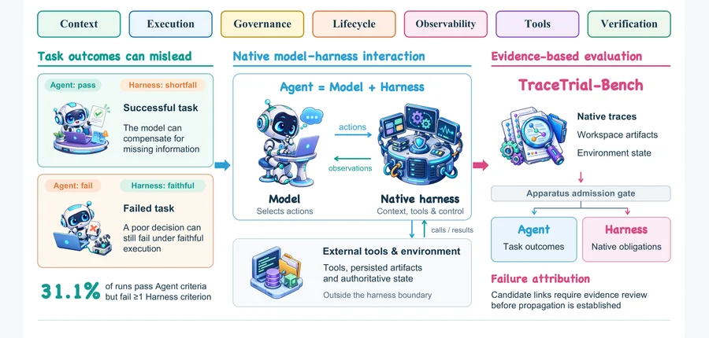 arXiv 2026-10-26 · cs.AI · #33 **[Trial by Trace: Benchmarking AI Agent Harnesses for Reliability and Failure Attribution](https://arxiv.org/abs/2610.32285)** Zhiyong Cao , Hengjie Zhu , Yongxin Wang , Xuchen Li , Jintao Li , Shuxia Liu , Dunqiang Liu , Bo Wang , Kairan Zhang , Co… Affiliation: TraceLite AI / Institute of Automation, Chinese Academy of Sciences / Zhongguancun Academy / Institute of Information Engineering, Chinese Academy of Sciences / Tsinghua University / Beijing Institute of Technology [Paper](https://arxiv.org/abs/2610.32285) · [Figure source](https://arxiv.org/html/2610.32285v1/background-cartoon.png) 

[EN] Abstract
LLM agents are increasingly used to solve real-world problems, and their effectiveness depends on both the underlying models and the harnesses that support their operation. However, most existing benchmarks focus on model capabilities and overall agent performance, with limited attention to the evaluation of agent harnesses. To address this gap, we introduce TraceTrial-Bench, which organizes harness reliability into seven components covering context, execution, governance, lifecycle, observability, tools, and verification. We construct 95 expert-level, mechanism-oriented tasks with executable or state-based ground truth to support semantically equivalent comparisons while preserving the native behavior of each harness. We design a Trajectory Tracing (TT) module to capture agent execution traces and introduce a two-layer evaluation framework that separately assesses agent performance and harness reliability. In addition, we design a Multi-source Evidence Acquisition (MEA) module to provide evidence from the agent context, harness, and execution environment for LLM-based evaluation, and develop a Failure Attribution (FA) module that uses explicit mechanism chains to support attribution at the run level. Across 4 harnesses, 9 models, and 95 tasks, our evaluation of 3,420 runs yields macro-averaged harness scores ranging from 59.8% to 72.0%, while 31.1% of runs achieve task success despite failing at least one harness criterion. TraceTrial-Bench provides an auditable and reproducible foundation for comparing agent harnesses, diagnosing their failures, and studying how harness design interacts with model behavior. <a href="https://arxiv.org/abs/2610.32285">Source</a>

[ZH] Abstract
LLM 智能体效用取决于底层模型与支持框架，但多数基准侧重模型能力和整体表现，缺少框架评估。我们提出 TraceTrial-Bench，将可靠性组织为上下文、执行、治理、生命周期、可观测性、工具及验证七组件。95 项专家级、机制导向任务提供可执行或状态真值，支持语义等价比较同时保留框架原生行为。轨迹跟踪模块捕获执行轨迹，双层评估分别测量智能体表现和框架可靠性；多源证据获取模块从上下文、框架、执行环境收集 LLM 评估证据，失败归因模块用明确机制链支持运行级归因。四框架、九模型、95 任务的 3,420 次运行中，宏平均框架得分为 59.8%—72.0%，31.1% 运行尽管至少一项框架准则失败，仍完成任务。该基准提供可审计、可复现基础，用于比较框架、诊断故障并研究框架设计与模型行为交互。 <a href="https://arxiv.org/abs/2610.32285">Source</a>
 |
| 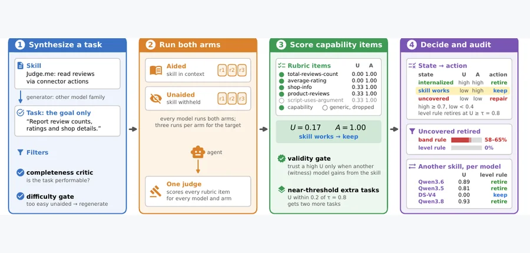 arXiv 2026-10-26 · cs.AI · #34 **[Beyond Gain: Measuring Skill Internalization for Agent Skill Retirement](https://arxiv.org/abs/2610.32322)** Yanze Wang , Pengfei Yao , Tianyi Sun , Hongda Chen , Yunyun Han , Jun Sun , Chuanrui Hu , Yafeng Deng Affiliation: EverMind / Shanda Group / Peking University / Southeast University [Paper](https://arxiv.org/abs/2610.32322) · [Figure source](https://arxiv.org/pdf/2610.32322#page=2) 

[EN] Abstract
LLM agents retrieve skills from public hubs that hold up to about 100,000 entries and serve many models. As models improve, a hub must find the skills a given model has internalized, meaning it can do without them, and retire them for that model, yet internalization has not been measured with known reliability. Published rules that compare runs with and without a skill retire on the gain alone. The gain is near zero both for an internalized skill and when neither the model nor the skill delivers the capability, a state we call uncovered. We instead withhold the skill, score the model on a task synthesized from it, and trust a high unaided score only when another model gains from the skill, since nearly half of high scores come from tasks no model benefits from. Under four models, a published gain rule applied with one task per skill removes over half of the uncovered skills. On SkillsBench, 28 of its 31 retirements rest on probes no run passed in full, while retiring on the unaided score costs no detectable reward. Unaided verdicts reproduce across tasks more often than the gain rule's (Cohen's kappa 0.42 against 0.23) but differ across models, so a hub must read them per model. We release 1,251 skills with tasks and item scores under four models. <a href="https://arxiv.org/abs/2610.32322">Source</a>

[ZH] Abstract
LLM 智能体从最多约十万条、服务多模型的公开技能中心检索技能。模型进步后，中心需要找出给定模型已内化、即无需技能也能完成的能力，并为该模型停用相应技能，但内化尚无已知可靠性测量。已发表规则只看有、无技能运行的收益差；接近零的收益既可能表示内化，也可能表示模型和技能都没有提供能力，即未覆盖。我们改为撤去技能，在由技能合成的任务上测模型，且仅在另一模型能从技能受益时相信较高无辅助得分，因为近半高分来自没有模型能受益的任务。在四模型下，每技能单任务的已发表收益规则会移除超过半数未覆盖技能。SkillsBench 上，31 项停用中 28 项依据的是无运行完整通过的探测；按无辅助得分停用则无可检测奖励损失。无辅助判断跨任务更易复现，Cohen κ=.42，收益规则为 .23，但跨模型不同，因此必须逐模型解读。我们发布 1,251 项技能、任务及四模型逐题得分。 <a href="https://arxiv.org/abs/2610.32322">Source</a>
 | 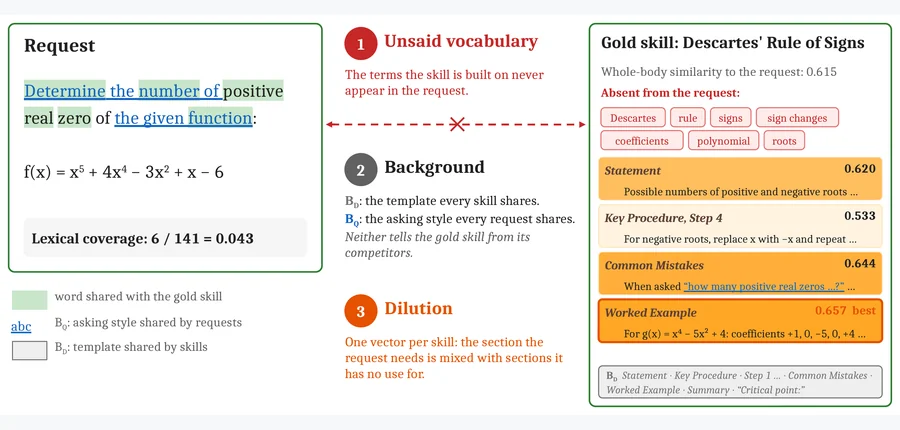 arXiv 2026-10-26 · cs.IR · #35 **[SkillRep: Characterizing and Understanding the Representation Design Space of Agent Skill Retrieval](https://arxiv.org/abs/2610.32336)** Tianyi Sun , Pengfei Yao , Yanze Wang , Hongda Chen , Yunyun Han , Jun Sun , Chuanrui Hu , Yafeng Deng Affiliation: EverMind / Shanda Group / Peking University / Southeast University [Paper](https://arxiv.org/abs/2610.32336) · [Figure source](https://arxiv.org/html/2610.32336v1/fig_main.png) 

[EN] Abstract
Retrieving the right skill from a large library is essential for LLM agents, yet requests and skills are written for different purposes and in different words. Existing retrievers narrow this request-skill gap with one or two representation choices each, so it is unknown whether their gains hold in combination. No prior work measures the gap itself, so it is also unclear which part of it each choice narrows. We define a representation design space by five choices -- encoder fine-tuning, query-side and document-side expansion, background projection and a lexical channel -- and evaluate them together for the first time, as modules of one retriever, SkillRep. With a 0.6B encoder and LLM expansion, SkillRep improves MRR@10 on SRA-Bench over the strongest same-size retriever by 7.02 points with the official skill pool and 8.79 with UniPool, a 111,247-skill pool we build from public registries, and is best on SkillsBench. The value of each choice depends on the others. Fine-tuning, for instance, reverses the ranking of the four training-free modules and turns them from complementary into overlapping. To understand why, we measure the gap with three quantities: background, the embedding component that does not separate skills; unsaid vocabulary, the gold skill's content a request leaves unsaid; and dilution, the information lost when a skill is encoded into a single vector. They show which part each module narrows and by what mechanism. This reveals that modules narrowing the same part compete for it, while those narrowing different parts complement each other. <a href="https://arxiv.org/abs/2610.32336">Source</a>

[ZH] Abstract
从大库检索正确技能对 LLM 智能体至关重要，但请求和技能目的不同、用词不同。既有检索器各用一两种表示选择缩小差距，不清楚组合后收益是否保持；也无此前工作测量差距本身，因此不知道各选择缩小哪部分。我们定义五维表示设计空间：编码器微调、查询侧和文档侧扩展、背景投影、词汇通道，并首次作为同一 SkillRep 检索器模块联合评估。使用 0.6B 编码器和 LLM 扩展，SkillRep 在 SRA-Bench 官方技能池的 MRR@10 比最强同规模检索器高 7.02 点，在从公开注册库构建的 111,247 技能 UniPool 上高 8.79 点，并在 SkillsBench 最佳。各选择价值依赖其他选择，例如微调颠倒四个免训练模块排序，使其由互补变为重叠。我们以背景、未明说词汇及稀释测量差距，分别指不能区分技能的嵌入成分、请求未表达的正确技能内容、单向量编码损失。它们揭示各模块缩小差距的部位和机制，说明缩小同一部分的模块竞争，不同部分则互补。 <a href="https://arxiv.org/abs/2610.32336">Source</a>
 | 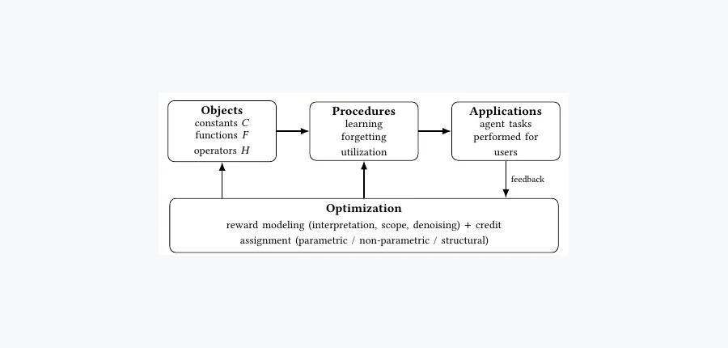 arXiv 2026-10-26 · cs.IR · #36 **[Agentic Memory Management Is the Next Frontier of Information Retrieval](https://arxiv.org/abs/2610.32464)** Qingyao Ai Affiliation: Tsinghua University [Paper](https://arxiv.org/abs/2610.32464) · [Figure source](https://arxiv.org/pdf/2610.32464#page=5) 

[EN] Abstract
Information retrieval has long been focusing on connecting people with information they need to complete their tasks. Recently, the meaning of this has changed dramatically as more and more AI agents now consume, retain, and act on information on a user's behalf. Consequently, information management now also takes place \emph{inside} the agent in the form of memory management. In this perspective paper, we argue that \emph{agentic memory management} (AMM), which studies the structure, analysis, organization, storage, searching, retrieval, and \emph{use} of information in an intelligent agent's memory, is a natural extension of IR research and an area in which the IR community can make distinctive contributions. Specifically, we first present a system-level framework for AMM and introduce a computational taxonomy of memory objects as \emph{constants}, \emph{functions}, and \emph{operators}, each with distinct retrieval semantics. Then, we compare AMM with established IR research and identify their difference and connections. Last but not least, we outline a research agenda covering benchmarks, candidate principles of memory utility, optimization procedures that mix parametric and non-parametric updates, and more. We hope this paper could attract more people, both inside and outside the IR communities, to think more about AMM problems and research from IR perspectives. <a href="https://arxiv.org/abs/2610.32464">Source</a>

[ZH] Abstract
信息检索长期致力于将人连接到完成任务所需信息。如今越来越多 AI 智能体代表用户消费、保留并据此行动，含义显著改变：信息管理也在智能体内部以记忆管理发生。本文观点认为，研究智能体记忆中信息的结构、分析、组织、存储、搜索、检索与使用的智能体记忆管理（AMM），是 IR 的自然延伸，且 IR 社区能作出独特贡献。我们先提出系统级框架，将记忆对象按计算性质分为常量、函数和算子，各有不同检索语义；再比较 AMM 与既有 IR 的区别和联系；最后提出研究议程，包括基准、记忆效用候选原则、混合参数与非参数更新的优化流程等。希望吸引 IR 社区内外更多研究者，从 IR 视角思考 AMM 问题和研究。 <a href="https://arxiv.org/abs/2610.32464">Source</a>
 |
| 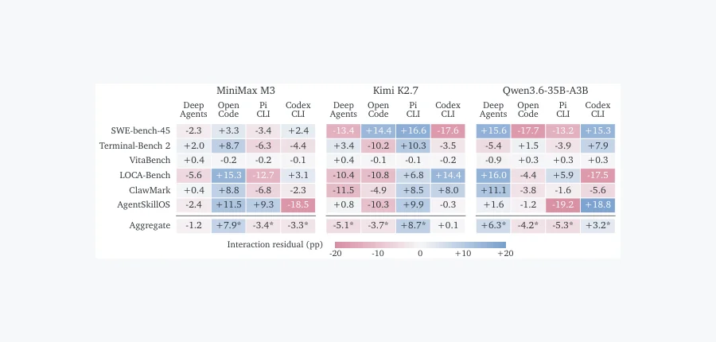 arXiv 2026-10-26 · cs.AI · #37 **[When Agents Fail: Model or Harness--Who's to Blame?](https://arxiv.org/abs/2610.32483)** Shao Zhang , Hangfan Zhang , Yuanyuan Shi , Hao Li , Min-Le Su , Kangcong Li , Jingping Wang , Chunjiang Mu , Chen Zhang… Affiliation: Shanghai Artificial Intelligence Laboratory [Paper](https://arxiv.org/abs/2610.32483) · [Figure source](https://arxiv.org/html/2610.32483v1/sec6_interaction_residuals_compact.png) 

[EN] Abstract
LLM agents combine models with execution harnesses, so agentic benchmark performance reflects their joint behavior. We argue that harnesses should therefore be evaluated through their interactions with underlying models. We develop a framework combining five complementary measures: (i) Valid Completion Rate (VCR), how reliably agents finish normally and deliver evaluable results, irrespective of task correctness; (ii) Model-Harness Fit, how well a harness supports task achievement through valid completion for a given model; (iii) Cross-Model Fit, a harness's overall suitability across evaluated models; (iv) Interaction Residuals, pairing-specific execution strengths and weaknesses hidden by component-level summaries; and (v) Token Load, the token demands of agent execution, including failed attempts. We evaluate four general-purpose harnesses (OpenCode, Codex CLI, Pi CLI, and DeepAgents) with four core models, plus two fixed native model-harness systems, on six benchmarks covering context management, tool use, long-context planning, multimodal interaction, and artifact handoff. Including native references and stress conditions, 111 evaluation settings yield 52,168 trajectories. Harness rankings vary across models and benchmarks; task performance and valid completion can favor different pairings, and similar task scores can accompany distinct execution profiles. OpenCode ranks first in cross-model performance, while DeepSeek V4 Flash Preview maintains consistently high Mean VCR across harnesses on the shared four-benchmark panel. These findings support evaluating model-harness interactions, training transferable harness-use capabilities in models, and harness designs adapted to the model and task. <a href="https://arxiv.org/abs/2610.32483">Source</a>

[ZH] Abstract
LLM 智能体由模型和执行框架组成，因此基准表现反映联合行为；框架应通过与模型的交互评估。我们提出五项互补度量：有效完成率 VCR，衡量正常结束并交付可评估结果而不问正确性；模型—框架适配，衡量框架对某模型通过有效完成实现任务的支持；跨模型适配，衡量框架在所评模型的总体适用性；交互残差，揭示组件汇总隐藏的配对专属优缺点；词元负载，包含失败尝试的执行需求。评估四种通用框架 OpenCode、Codex CLI、Pi CLI、DeepAgents 与四核心模型，另加两种固定原生系统，覆盖上下文、工具、长程规划、多模态交互、产物交接六基准。含原生参照及压力条件的 111 设置产生 52,168 条轨迹。排序随模型和基准变化，任务表现与有效完成可能偏向不同配对，近似分数可伴随不同执行剖面。OpenCode 跨模型表现第一，DeepSeek V4 Flash Preview 在共享四基准面板上跨框架平均 VCR 持续较高。结果支持评估交互、训练可迁移框架使用能力，以及按模型和任务设计框架。 <a href="https://arxiv.org/abs/2610.32483">Source</a>
 | 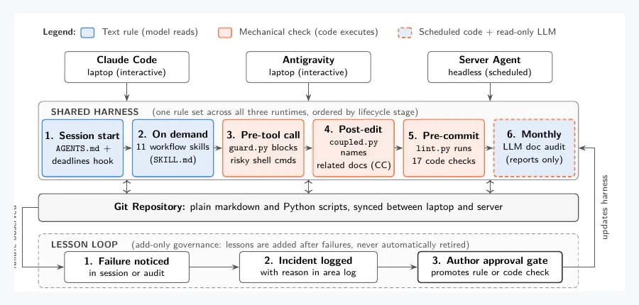 arXiv 2026-10-26 · cs.SE · #38 **[Lessons Outlive Their Failures: A Case Study of Rules for AI Coding Agents](https://arxiv.org/abs/2610.32578)** Hassan Hassanzadeh Aliabadi Affiliation: Independent researcher [Paper](https://arxiv.org/abs/2610.32578) · [Figure source](https://arxiv.org/pdf/2610.32578#page=4) 

[EN] Abstract
AI coding agents increasingly work inside a harness: rule files such as this http URL , on-demand skills, runtime hooks and automated checks. Most studies of harnesses look at a single point in time or at short benchmark runs. I report a six-week case study of my personal system of record, a plain-markdown repository that three AI agent tools edited daily under one shared rule set. I built a ledger of 118 agent failures, their fixes and whether they came back. I also tested the system's monthly LLM documentation audit against 47 known stale statements and 20 planted errors. Finally, I replayed five past failures in isolated git clones, with and without their fixes. All results come from one repository with three runs per condition, so I report them as exploratory. Stale documentation (drift) was the largest failure class (48 of 118), although 35 of those were found on one audit day. A single audit run found about half of the known drift (Claude Sonnet 5.5 mean: 50%), and at least 93% of its findings were correct. On Sonnet 5.5, the agent finished four of the five replayed tasks. In three of those four, the failure did not happen, with or without its fix. Only the stale-count failure came back without its check, and the check stopped it in every run. On older models, an agent drafted an em-dash once while the em-dash lint check was active, and the check rejected it. A written rule on run-time estimates did not change Sonnet 4.5's overestimates. These results suggest that harness lessons can outlive the failures they were written to fix, while drift persists and still needs mechanical checks. Tools that evolve a harness add lessons faster than they retire them, so they should re-test their rules from time to time and retire the obsolete ones. <a href="https://arxiv.org/abs/2610.32578">Source</a>

[ZH] Abstract
AI 编码智能体日益在规则文件、按需技能、运行钩子和自动检查组成的框架内工作。多数研究只看单一时间或短基准。我报告自身系统记录库的六周案例：三个智能体工具每天按同一规则编辑纯 Markdown 仓库。我建立 118 项失败、修复及复发账本，针对 47 条已知过时陈述和 20 项植入错误测试每月 LLM 文档审计，并在隔离 Git 克隆中有、无修复地重放五次旧失败。全部来自单仓库、每条件三次运行，故仅属探索。文档过时漂移最大，为 118 中 48 项，但其中 35 项在同一天审计发现。单次审计约找到一半已知漂移，Claude Sonnet 5.5 平均为 50%，至少 93% 发现正确。Sonnet 5.5 完成五重放任务中的四项；其中三项有无修复都不再失败，只有过时计数在没有检查时复发，检查每次都阻止它。旧模型在破折号检查开启时曾起草一次长破折号，被检查拒绝；关于运行时间估计的书面规则未改变 Sonnet 4.5 高估。框架教训可能比所针对失败更长寿，漂移仍持续且需机械检查；进化工具增加教训快于停用，应定期复测规则、移除过时项。 <a href="https://arxiv.org/abs/2610.32578">Source</a>
 | 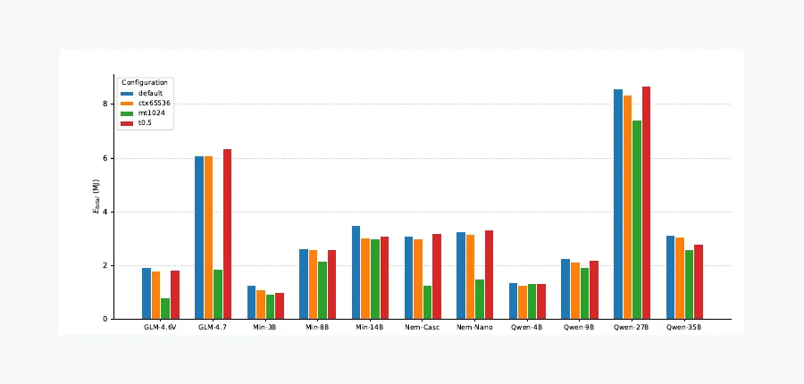 arXiv 2026-10-26 · cs.SE · #39 **[Green Code or Costly Code? Evaluating the Energy Costs of Iterative LLM-Based Code Optimizations](https://arxiv.org/abs/2610.32891)** Sadra Emami , Benjamin Weigell , Mohammad Reza Mousavi , Gunel Jahangirova , Hugo Araujo , Bernhard Bauer Affiliation: University of Augsburg / King’s College London [Paper](https://arxiv.org/abs/2610.32891) · [Figure source](https://arxiv.org/pdf/2610.32891#page=8) 

[EN] Abstract
Large Language Models (LLMs) are increasingly used to optimize code for performance. This practice often assumes that improvements in execution speed naturally translate into overall lower energy consumption. We challenge this assumption empirically by measuring whether performance-optimized code produced by LLM self-refinement pipelines is also energy-efficient relative to canonical human reference solutions, and whether the energy cost of the optimization process can be offset by subsequent execution-time savings. We evaluate 11 open-source models across four decoding configurations on all 1,000 problems of EffiBench, a state-of-the-art performance benchmark, while collecting per-process, hardware-level energy measurements throughout. Inference energy spans 0.79 to 8.68 MJ across model-variant pairs, which is roughly equivalent to the energy of 250 to 2800 GPT-4.1 queries. Limiting the maximum number of output tokens has the largest impact, reducing energy use by up to 69% compared to the default configuration. On the execution side, 42 of 44 configurations produce code that consumes more energy per problem than the canonical human reference, with overheads ranging from +4% to +886%. The two exceptions achieve only marginal gains, with break-even points on the order of 10^6 to 10^7 executions. Mixture-of-Experts architectures consume substantially less inference energy than equivalently-sized dense models without sacrificing correctness, making architectural choice a more consequential sustainability lever than decoding parameters. Performance optimization and energy efficiency are not always aligned goals: LLM self-refinement consistently produces faster-seeking but energy-heavier code relative to what a human engineer would write. All artifacts are available at this https URL . <a href="https://arxiv.org/abs/2610.32891">Source</a>

[ZH] Abstract
LLM 越来越多地用于性能优化代码，常假定执行变快自然意味着总体能耗降低。我们通过测量自细化流水线代码相对标准人工参考是否省能，以及优化过程能耗能否由以后执行节省抵消，实证挑战此假设。对 11 个开源模型、四种解码配置，在 EffiBench 全部 1,000 题上评估，全程收集逐进程、硬件级能耗。模型—变体对的推理能耗为 0.79—8.68 MJ，约相当于 250—2800 次 GPT-4.1 查询。限制最大输出词元影响最大，相比默认配置最多省能 69%。执行端，44 配置中的 42 个比人工参考每题耗能更多，增加 +4% 至 +886%；另两项仅边际节省，需约 10⁶—10⁷ 次执行才能回本。混合专家架构比同规模稠密模型推理能耗低得多且不损正确性，故架构选择比解码参数是更重要的可持续性杠杆。性能优化与能效并不总一致：LLM 自细化相对人工参考持续产生追求速度却能耗更高的代码。全部产物可经原文链接获取。 <a href="https://arxiv.org/abs/2610.32891">Source</a>
 |
<!-- PAPER_CARDS_END -->

## Retrieval overview

**39 selected papers: 10 A / 14 B / 15 C.** Collection date: **27 October 2026 (Beijing)**. Official announcement batch: **26 October 2026**, following the previously processed 23 October batch.

| Official source | Batch | New | Cross | Replacement | Coverage |
|---|---|---:|---:|---:|---|
| [Computer Science](https://arxiv.org/list/cs/new?skip=0&show=2000&check=20261027) | 2026-10-26 | 642 | 55 | 396 | All 1,093 entries on one complete page |
| [stat.ML](https://arxiv.org/list/stat.ML/new?skip=0&show=2000&check=20261027) | 2026-10-26 | 13 | 16 | 31 | All 60 entries on one complete page |
| Total | 2026-10-26 | 655 | 71 | 427 | 1,153 section entries; 655 distinct New IDs |

All **655 distinct official New metadata records** were parsed. Lexical discovery found 129 candidates, supplemented by direct title inspection; **48 complete titles and original abstracts were semantically reviewed**, with 39 selected. This is focused curation, not exhaustive semantic screening of all New records or lexical matches. The CS aggregate covers cs.AI, cs.LG, cs.CL, cs.MA, cs.SE, cs.RO, cs.CV, cs.NE and cs.CR. Versionless IDs are deduplicated and previous inclusions excluded. Cross-listings do not enter the main list.

All selections have complete paired abstracts and visually checked genuine paper images: **39 EN / 39 ZH / 39 images; 0 placeholders**. Twenty images come from official HTML, and nineteen are PDF crops, including one results table. Thirty-eight affiliation records have source support; SWE-Shift has two authors with unconfirmed institutional affiliations, and Who Verifies the Tools? remains **Affiliation unconfirmed**. Twelve resource buttons were verified through direct pages or web-reader fallback. Principia's official repository currently promises a future code release, so it receives a Project link rather than a Code button.

Initial requests through the existing proxy failed at TLS. Official web-reader views confirmed the new batch, and direct per-command requests recovered both full raw listings and all 39 selected HTML originals. No permanent network settings changed. Raw snapshots, hashes, complete section IDs, resource checks and validation records are in the [run record](../../data/runs/2026-10-27.json).

The **22 October bulk-metadata coverage gap remains unresolved** and is carried forward. Seventeen individually verified New papers from that batch were published on 23 October; today's complete 26 October retrieval does not imply recovery or exhaustive screening of the older batch.

## Reading guide

A denotes direct RSI, B self-improvement mechanisms, and C evaluation and limits. Order is tier then arXiv ID. Tier assignments, interpretation, priorities and proposals are **editorial inference**. Numerical results are **author reports**; no experiments were independently reproduced for this digest. Headers, figures and selected passages were checked, not the complete full text of every paper.

Keep model weights, trained adapters, external prompts/harness code, skills, memory and task-local state separate. Frozen base parameters do not make adapter training free. An execution-verified output does not alone establish reusable learning, and a better final artifact does not prove a better improvement procedure. No finite loop here proves unbounded RSI. The supervised ion-source experiment includes physical evidence; Robotouille/ALFWorld, program-rendered worlds and Agent4Rec are different settings.

## Tiered Top papers

| # | Paper | Categories | Authors | Affiliation | Tier | Update target | Reading priority |
|---:|---|---|---|---|---|---|---|
| 1 | [Not Every Agent Needs the Strongest Model: Unified Prompt-Model Optimization for Heterogeneous LLM-based Multi-Agent Systems](https://arxiv.org/abs/2610.31743) | cs.MA | Mingxiu Cai , Haoyang Xian , Xinyu Ma , Yutong Wang , Zhenxi Song , Jing Li , Xuebo Liu | Harbin Institute of Technology, Shenzhen | A | Role prompts, execution-model assignments and optimization memory | Topical reference |
| 2 | [Phronix: The Capability-Centric Learning Paradigm for Agents](https://arxiv.org/abs/2610.31789) | cs.AI | Hariharan Devarajan , Neeraj Rajesh , Aniruddha Marathe , Nikoli Dryden , Kin Ng , Michela Taufer | Lawrence Livermore National Laboratory / Illinois Institute of Technology / University of Tennessee, Knoxville | A | Reusable tool/skill capabilities stored in the agent harness | Topical reference |
| 3 | [Don't Forget What You Just Learned: Self-Directed Repair Turns Agent Mistakes Into Lasting Lessons](https://arxiv.org/abs/2610.31846) | cs.AI; cs.LG | Yuval Kansal , Karen Ullrich , Polina Kirichenko , Ilia Kulikov , Niraj K. Jha , Mohammad Pezeshki , Mark Ibrahim | Princeton University / Meta FAIR | A | Persistent low-rank lesson adapters and their routing library | Priority read |
| 4 | [RSI-Opt: Recursive Self-Improvement Optimizer Agents For Model Training](https://arxiv.org/abs/2610.32026) | cs.AI | Binghang Lu , Yige Sun , Guang Lin | Purdue University / Independent Researcher | A | Optimizer-agent prompt, playbook, tested code library and decision cadence | Priority read |
| 5 | [ImageRSI: Verification-Driven Recursive Self-Improvement for Agentic Image Generation](https://arxiv.org/abs/2610.32120) | cs.CV; cs.AI | Shuo Han , Zhilin Wang , Peng Ling , Wenjia Gong , Yang Liu , Guanjun Jiang , Yukun Cao , Xike Xie | University of Science and Technology of China / Qwen Business Unit of Alibaba, Alibaba Token Hub / Xidian University | A | Cross-task image-repair experience and judge weights; frozen image generator | Topical reference |
| 6 | [RSIHub: A Composable Framework for Agent-Evolution Methods](https://arxiv.org/abs/2610.32253) | cs.AI | Zimu Wang , Xiaobo Wang , Siyu Ye , Jiaqi Li , Silin Chen , Yuling Shi , Ruobing Wang , Jingjing Zhang , Chaofan Wang , Kai Wu , Mengnan Qi , Kai Cai , Xiaodong Gu , Zilong Zheng | University of California, Berkeley / University of Science and Technology of China / Douyin Group / Shanghai Jiao Tong University / Tongji University / Beijing Institute for General Artificial Intelligence / Simple Agent Lab | A | Composable evolution recipes and declared mutable agent resources | Priority read |
| 7 | [Lifelong Context Adaptation through Bidirectional Memory-Skill Learning](https://arxiv.org/abs/2610.32295) | cs.AI | Tianyi Xu , Huazheng Wang | Oregon State University | A | External memory, reusable skills and retrieval influence; frozen LLM | Topical reference |
| 8 | [TGR-EvoDAG: A DAG-based Multi-Agent Code Evolution Framework for Generative Recommendation on Tencent](https://arxiv.org/abs/2610.32326) | cs.AI | Junlin He , Junzhang Zhu , Yudong Li , Yihong Tang , Xuefeng Jiang , Wei Ma , Chengxiang Zhuo , Zang Li | Tencent / The Hong Kong Polytechnic University / McGill University / Independent Researcher | A | Generative-recommendation pipeline code across tokenization, pretraining and alignment | Topical reference |
| 9 | [Tempo-Zero: Recursive Self-Play in Executable Worlds for Video Reasoning](https://arxiv.org/abs/2610.32433) | cs.CV | Jingmin Zhu , Yanyan Zou , Xiuyu Li , James Bailey , Dinh Phung , Tao Yu , Yunyun Hou , Jun Liu , Jun Zhou , Sirui Wang , Nan Duan , Jiachen Liu , Qiuhong Ke | JD.com / Monash University / Institute of Automation, Chinese Academy of Sciences / Communication University of China / Lancaster University / Griffith University | A | Questioner/solver policy, executable task curriculum and environment rules | Topical reference |
| 10 | [HarnessMM: Recursive Self-Improvement for Harness Token Efficiency](https://arxiv.org/abs/2610.32813) | cs.AI | Yuhua Jiang , Chang Xu , Feifei Gao , Li Zhao | Tsinghua University / Microsoft Research Asia | A | Companion harness configurations and persistent guarded decision graphs | Topical reference |
| 11 | [An Agentic Approach with Evidence-Grounded Verification for Multimodal Emotion Reasoning in Conversation](https://arxiv.org/abs/2610.31685) | cs.CL; cs.AI; cs.MM; eess.IV | Elyas Rashno , Farhana Zulkernine | Queen’s University | B | Reusable component-specific prompt patches; frozen multimodal models | Topical reference |
| 12 | [Mining the Design Space of Multi-Agent Workflows](https://arxiv.org/abs/2610.31709) | cs.SE; cs.AI | Xavier Cadet , Junyan Cheng , Peter Chin , Kyle Richardson | Dartmouth College / Allen Institute for AI | B | Reusable workflow-design principles mined from optimizer traces | Topical reference |
| 13 | [SPECMEM: Accelerating Agentic Tool Calling via Live Memory Management](https://arxiv.org/abs/2610.31840) | cs.CL | Zihe Song , Wenting Zhao , Ye Liu , Yuanjie Zhu , Ke Xu , Shanghao Li , Philip S. Yu | University of Illinois Chicago / Salesforce Research | B | Bounded per-user memory of verified tool-call drafts | Topical reference |
| 14 | [An AI Factory for Technology Education: An Agentic Pipeline with Closed Loop Audience Feedback](https://arxiv.org/abs/2610.31875) | cs.CY | Josue Hernandez , Hector R. Amado-Salvatierra , Rocael Hernandez Rizzardini | Dapta Inc. / Universidad Galileo | B | Content-generation rules updated from audience telemetry | Topical reference |
| 15 | [Reproducible Evaluation as the Substrate for Safe Prompt Compression in Production Agents](https://arxiv.org/abs/2610.31972) | cs.AI | Prabal Vashisht , Zheng Hu , Ying Yang | Mx ML, DoorDash Inc. | B | Production-agent prompt surface and regenerable evaluation harness | Topical reference |
| 16 | [Can Test-Time Memory Evolution Outperform Test-Time Training for Scientific Discovery?](https://arxiv.org/abs/2610.32046) | cs.AI; cs.LG | Yepeng Liu , Shengmai Chen , Xuandong Zhao , Chengzhi Liu , Dawn Song , Xin Eric Wang , Yuheng Bu | University of California, Santa Barbara / University of California, Berkeley | B | External discovery memory, with no model weight updates | Priority read |
| 17 | [Principia: Test-Time Hypotheses to Principle Construction for Scientific Discovery](https://arxiv.org/abs/2610.32195) | cs.LG; cs.AI | Dongki Kim , Sangwoo Park , Jinheon Baek , Soyeong Jeong , Sung Ju Hwang | KAIST / DeepAuto.ai | B | Task-specific hypotheses and inductive principles in external knowledge | Topical reference |
| 18 | [Adaptive Control of Scientific Instruments with Nonstationary Responses through Multimodal Agents](https://arxiv.org/abs/2610.32370) | cs.AI | Guoyang Shi , Hongwen Li , Yiding Yu , Zhuang Fu , Siqi Ding , Zhengyuan Chen , JianGuo Chen , Hanyue Zhao , Tianyuan Liu | Beijing ENN Fusion Energy Science and Technology / Beijing Key Laboratory of High Magnetic Field Spherical Torus Fusion Energy / Hebei Key Laboratory of Compact Fusion | B | Instrument-control trajectory memory and procedural knowledge | Topical reference |
| 19 | [LeafSkill: Efficient Leaf-Level Action Grounding for Recursive LLM Agents](https://arxiv.org/abs/2610.32412) | cs.AI | Shen Liu , Ze Zhou , Zhenguo Xu , Shaopu Wang , Yike Gao , Chunlei Wang | North China Institute of Computer System Engineering / Beijing University of Aeronautics and Astronautics / University of Science and Technology of China / China Information Security Research Institute | B | External leaf-action skill library and semantic reuse interface | Topical reference |
| 20 | [POSEIDON: Scaling Training Environments for Scientific Agents from Code Repositories](https://arxiv.org/abs/2610.32448) | cs.AI | Qifan Zhang , Yuhan Li , Nuo Chen , Bowen Liu , Xiao Hu , Miao Peng , Chenyi Zi , Lixin Liu , Lydell Huang , Jing Tang , Jia Li | The Hong Kong University of Science and Technology (Guangzhou) / Hunyuan Team, Tencent | B | Executable scientific training environments, then downstream model weights | Topical reference |
| 21 | [CauProphet: Teaching Agents to Develop Causal Cognition like Humans](https://arxiv.org/abs/2610.32477) | cs.AI | Kaiwen Wu , Chaochao Lu | Shanghai Jiao Tong University / Shanghai AI Laboratory | B | Persistent causal knowledge and task-local causal beliefs | Topical reference |
| 22 | [CASE: Confusion-Aware Skill Evolution for Frozen Multimodal Emotion Models](https://arxiv.org/abs/2610.32481) | cs.AI | Siyu Wu , Zeyu Liang , Linghao Wang , Qiyun Zheng , Yi Yao , Ling Lo , Hongxia Xie | Jilin University / National Chiao Tung University / National Tsing Hua University | B | Sparse external library of pair-specific emotion skills | Topical reference |
| 23 | [ActionRAG: Evidence-Refining Graph Diffusion for Long-Term Memory in LLM Agents](https://arxiv.org/abs/2610.32752) | cs.AI; cs.CL | Navyansh Mahla , Sashank Vandrangi | Actioneer | B | External graph indexing and query-time evidence scores | Topical reference |
| 24 | [On-Policy Self-Training: Data-Free Self-Improvement in Large Language Models](https://arxiv.org/abs/2610.32770) | cs.CL; cs.AI; cs.LG | Leon Sick , Lukas Hoyer , Yannick Strümpler , Christian Reisswig , Timo Ropinski , Federico Tombari | Google / Ulm University | B | Model parameters and self-generated training curriculum | Topical reference |
| 25 | [Validating the Comparison, Not Just the Scorer: Why Overall Accuracy Can Mislead in Interactive LLM Evaluation](https://arxiv.org/abs/2610.31678) | cs.CL; cs.AI; cs.HC | Ancil Crayton | Booz Allen Hamilton | C | Fitness/scorer validation for paired prompt comparisons | Topical reference |
| 26 | [From Target Selection to Condition Reuse: Auditing Residual Interventions in Tool-Use Models](https://arxiv.org/abs/2610.31686) | cs.CL; cs.AI | Tianda Sun , Dimitar Kazakov | University of York | C | Evaluation of activation edits and reuse of learned conditions | Topical reference |
| 27 | [Do AI-for-Science Agents Preserve Model Safety?](https://arxiv.org/abs/2610.32045) | cs.AI | Michael Yew Chuan Lee , Manya Sriram , N. Benjamin Erichson | DSO National Laboratories / UC Berkeley / ICSI / Berkeley Lab | C | Safety evaluation of scientific-agent harness/model combinations | Topical reference |
| 28 | [Who Verifies the Tools? How Warped Formatters Mislead Agents and Their Verifiers](https://arxiv.org/abs/2610.32110) | cs.AI; cs.SE | William Jeffries | Affiliation unconfirmed | C | Tool-output evidence completeness and verifier acceptance | Topical reference |
| 29 | [Pairing Matters: Performance, Failures, and Efficiency in Lightweight Coding Agents](https://arxiv.org/abs/2610.32131) | cs.SE | Lu Zhao , Christopher M. Poskitt , David Lo | Singapore Management University | C | Controlled evaluation of lightweight coding-model/harness pairings | Topical reference |
| 30 | [Detecting Insecure Compositions of Clean Agent Skills via Capability-Flow Graph Analysis](https://arxiv.org/abs/2610.32155) | cs.CR | Yihao Li , Chuanpu Fu , Yizhou Zhao , Miao Chen , Qi Li , Ke Xu | Tsinghua University / Nanyang Technological University / Zhongguancun Laboratory | C | Cross-skill composition auditing and capability-flow verification | Topical reference |
| 31 | [SWE-Shift: Evaluating Coding Agents in Evolving Workspaces](https://arxiv.org/abs/2610.32196) | cs.AI; cs.CL; cs.LG | Victor Shea-Jay Huang , Rongqing Li , Zhangyue Yin , Kelong Mao , Yaqi Zhao , Xinyuan Wang , Yao Yin , Lirui Luo , Renrui Zhang , Hongsheng Li | The Chinese University of Hong Kong / Fudan University / The Hong Kong University of Science and Technology / Peking University; two author affiliations unconfirmed | C | Evaluation of adaptation to changing coding workspaces | Topical reference |
| 32 | [Minimum Description Length Unsupervisedly Separates Law-Grade from Statistical-Grade Knowledge in a Self-Improving Science Agent - and Reveals 86% of Its Own Discoveries Are Statistical](https://arxiv.org/abs/2610.32245) | cs.AI | Wenbin Mao , Pei Zou | Artificial Intelligence Laboratory, Hooman Biotechnology (Beijing) | C | Epistemic audit of a discovery agent’s retained knowledge ledger | Topical reference |
| 33 | [Trial by Trace: Benchmarking AI Agent Harnesses for Reliability and Failure Attribution](https://arxiv.org/abs/2610.32285) | cs.AI | Zhiyong Cao , Hengjie Zhu , Yongxin Wang , Xuchen Li , Jintao Li , Shuxia Liu , Dunqiang Liu , Bo Wang , Kairan Zhang , Cong Lin , JiangDi Yu , Siyuan Liu , Sijia Yao , Yi-Liang Wei , Lingxu Ma , Aijia Wang , Anxin Chen , Zixian Wei , Xiang Ruan , Ruizhi Xu , Ruqian Shi , Baihua Xiao , Sicheng Zhou | TraceLite AI / Institute of Automation, Chinese Academy of Sciences / Zhongguancun Academy / Institute of Information Engineering, Chinese Academy of Sciences / Tsinghua University / Beijing Institute of Technology | C | Harness reliability, trace evidence and run-level failure attribution | Topical reference |
| 34 | [Beyond Gain: Measuring Skill Internalization for Agent Skill Retirement](https://arxiv.org/abs/2610.32322) | cs.AI | Yanze Wang , Pengfei Yao , Tianyi Sun , Hongda Chen , Yunyun Han , Jun Sun , Chuanrui Hu , Yafeng Deng | EverMind / Shanda Group / Peking University / Southeast University | C | Model-specific skill retirement and internalization probes | Priority read |
| 35 | [SkillRep: Characterizing and Understanding the Representation Design Space of Agent Skill Retrieval](https://arxiv.org/abs/2610.32336) | cs.IR | Tianyi Sun , Pengfei Yao , Yanze Wang , Hongda Chen , Yunyun Han , Jun Sun , Chuanrui Hu , Yafeng Deng | EverMind / Shanda Group / Peking University / Southeast University | C | Skill-retrieval representation design and interaction analysis | Topical reference |
| 36 | [Agentic Memory Management Is the Next Frontier of Information Retrieval](https://arxiv.org/abs/2610.32464) | cs.IR | Qingyao Ai | Tsinghua University | C | Conceptual framework and research agenda for agentic memory | Topical reference |
| 37 | [When Agents Fail: Model or Harness--Who's to Blame?](https://arxiv.org/abs/2610.32483) | cs.AI; cs.CL; cs.SE | Shao Zhang , Hangfan Zhang , Yuanyuan Shi , Hao Li , Min-Le Su , Kangcong Li , Jingping Wang , Chunjiang Mu , Chen Zhang , Yang Chen , Bo Zhang , Shuyue Hu | Shanghai Artificial Intelligence Laboratory | C | Model-harness fit, valid completion and complete execution cost | Topical reference |
| 38 | [Lessons Outlive Their Failures: A Case Study of Rules for AI Coding Agents](https://arxiv.org/abs/2610.32578) | cs.SE | Hassan Hassanzadeh Aliabadi | Independent researcher | C | Evidence-based retirement of obsolete agent rules and checks | Topical reference |
| 39 | [Green Code or Costly Code? Evaluating the Energy Costs of Iterative LLM-Based Code Optimizations](https://arxiv.org/abs/2610.32891) | cs.SE; cs.AI | Sadra Emami , Benjamin Weigell , Mohammad Reza Mousavi , Gunel Jahangirova , Hugo Araujo , Bernhard Bauer | University of Augsburg / King’s College London | C | Energy accounting for iterative code self-refinement | Topical reference |

## Mechanism and evidence notes

Each paper has four notes. Linked originals support factual statements; mechanism interpretation and boundaries are editorial analysis. Resource access is separate from reproducibility.

### 1. Not Every Agent Needs the Strongest Model: Unified Prompt-Model Optimization for Heterogeneous LLM-based Multi-Agent Systems

[Original paper](https://arxiv.org/abs/2610.31743) · Tier A · [Affiliation source](https://arxiv.org/html/2610.31743)

- **Update target:** Role prompts, execution-model assignments and optimization memory.
- **Feedback, validation and reuse — interpretation:** UniMASO evaluates local, downstream and global effects, retains quality/cost Pareto candidates and co-evolves dependent roles. Historical successes and failures guide subsequent prompt/model updates.
- **Author-reported evidence:** Across five benchmarks and five topologies, centralized average score rises from 69.79 to 70.40 while token-weighted deployment cost falls 85.2% relative to DeepSeek-V4-Pro with MASPO.
- **Boundary — interpretation:** Deployment savings exclude the full search budget. Joint prompt/model adaptation changes the configuration, not the model weights; rankings and cost trade-offs depend on roles and topology.

### 2. Phronix: The Capability-Centric Learning Paradigm for Agents

[Original paper](https://arxiv.org/abs/2610.31789) · Tier A · [Affiliation source](https://arxiv.org/html/2610.31789)

- **Update target:** Reusable tool/skill capabilities stored in the agent harness.
- **Feedback, validation and reuse — interpretation:** Phronix predicts with MCP tools and skills, validates through execution and corrects stored capabilities from outcomes. Recurring tasks reuse the resulting capability store rather than repeatedly rediscovering solutions.
- **Author-reported evidence:** Reported first-attempt recurring-task success is 93–95%; warm starts use 0.38–0.40M tokens per task. The workflow passes 11 checks versus six, and two cheaper models rise from 29%/27% to 91%/87% on the studied SWE-bench tasks.
- **Boundary — interpretation:** Warm recurring-task reuse and generalization to unseen tasks are different claims. Include capability creation, validation and storage costs, and do not read the reported task subset as a universal SWE-bench score.

### 3. Don't Forget What You Just Learned: Self-Directed Repair Turns Agent Mistakes Into Lasting Lessons

[Original paper](https://arxiv.org/abs/2610.31846) · Tier A · [Affiliation source](https://arxiv.org/html/2610.31846)

- **Update target:** Persistent low-rank lesson adapters and their routing library.
- **Feedback, validation and reuse — interpretation:** On failure, Self-Direction reflects on the trajectory, distills the lesson into an adapter and saves it for automatic reuse on related tasks. Original model parameters stay fixed while extra adapter weights are trained.
- **Author-reported evidence:** Qwen-family agents improve overall success by 8.9–17.0 percentage points across GAIA, Claw-Eval and Terminal-Bench 2.1; each adapter adds about 0.02% of base parameters, with reported transfer to new tasks.
- **Boundary — interpretation:** Frozen base weights do not mean training-free adaptation: adapters require optimization and routing. Count per-lesson training and library growth, and separate repeated-task reliability from unseen-task transfer.

### 4. RSI-Opt: Recursive Self-Improvement Optimizer Agents For Model Training

[Original paper](https://arxiv.org/abs/2610.32026) · Tier A · [Affiliation source](https://arxiv.org/html/2610.32026)

- **Update target:** Optimizer-agent prompt, playbook, tested code library and decision cadence.
- **Feedback, validation and reuse — interpretation:** RSI-Opt monitors training, while a meta-agent uses previous runs and CPU proxy experiments to rewrite the optimizer policy. Evaluated policies enter an archive for later evolution and transfer.
- **Author-reported evidence:** Across five generations, representative summary z-scores rise from +10.48 to +14.33 on the evolution suite and −0.36 to +3.11 on held-out transfer. Burgers PDE relative L2 error falls about 2.7-fold or 8.8-fold, depending on the LLM.
- **Boundary — interpretation:** The updated outer policy differs from the neural model being trained. Initial decisions explain most seen-task gains; continuing adaptation helps unseen tasks, but PDE transfer varies and all proxy/search cost belongs in the budget.

### 5. ImageRSI: Verification-Driven Recursive Self-Improvement for Agentic Image Generation

[Original paper](https://arxiv.org/abs/2610.32120) · Tier A · [Affiliation source](https://arxiv.org/html/2610.32120)

- **Update target:** Cross-task image-repair experience and judge weights; frozen image generator.
- **Feedback, validation and reuse — interpretation:** ImageRSI combines task-local verification/repair, paired A/B admission into a shared experience library and offline judge updates by supervised fine-tuning plus GRPO. The judge is evaluated before reuse.
- **Author-reported evidence:** Checklist Strict Accuracy reaches 52.6% on MindBench with Nano Banana Pro and 65.66% on the 961-request ImageReq-Bench; outcomes are compared across judge-training configurations.
- **Boundary — interpretation:** Repairing one image, transferring experience and improving the judge are distinct effects. Paired validation and judge evaluation do not establish unlimited recursion, independent visual quality or immunity to evaluator overfitting.

### 6. RSIHub: A Composable Framework for Agent-Evolution Methods

[Original paper](https://arxiv.org/abs/2610.32253) · Tier A · [Affiliation source](https://arxiv.org/html/2610.32253)

- **Update target:** Composable evolution recipes and declared mutable agent resources.
- **Feedback, validation and reuse — interpretation:** RSIHub supplies reusable operators, execution, recovery and lineage while keeping evaluation outside the mutable surface. AHE, Hyperagents, A-Evolve and GEPA run as recipes under shared model/evaluator settings.
- **Author-reported evidence:** With MiniSWE and Codex on Terminal Bench 2 and τ³ Banking, the largest observed overall pass@1 gain is 13.5 percentage points; method rankings vary and optimization gains do not always transfer.
- **Boundary — interpretation:** Shared infrastructure improves comparability, not automatic fairness under every budget. Keep evaluator conditions, candidate lineage and held-out transfer visible; infrastructure reuse alone is not improved improvement ability.

### 7. Lifelong Context Adaptation through Bidirectional Memory-Skill Learning

[Original paper](https://arxiv.org/abs/2610.32295) · Tier A · [Affiliation source](https://arxiv.org/html/2610.32295)

- **Update target:** External memory, reusable skills and retrieval influence; frozen LLM.
- **Feedback, validation and reuse — interpretation:** MemCryst forms/revises skills from recurring episodes, then uses skill-guided interaction to generate later memory. Outcomes adjust retrieval influence for records actually served without rewriting those records.
- **Author-reported evidence:** The framework leads seven of ten reported comparisons across diverse domains. On ALFWorld, joint serving achieves 63.17%, versus 59.83% for memory-only and 50.50% for skill-only.
- **Boundary — interpretation:** Bidirectional external learning is distinct from weight learning. Compare skill formation, memory storage and retrieval updates under matched context and cost, including interference and transfer beyond the tested streams.

### 8. TGR-EvoDAG: A DAG-based Multi-Agent Code Evolution Framework for Generative Recommendation on Tencent

[Original paper](https://arxiv.org/abs/2610.32326) · Tier A · [Affiliation source](https://arxiv.org/html/2610.32326)

- **Update target:** Generative-recommendation pipeline code across tokenization, pretraining and alignment.
- **Feedback, validation and reuse — interpretation:** TGR-EvoDAG preserves and merges branches, plans stage-specific GPU-hour costs and actively co-adapts downstream stages so a temporarily worse upstream edit can be tested after adaptation.
- **Author-reported evidence:** Amazon-data offline metrics improve by up to 37.4% and simulated Agent4Rec satisfaction by 19.7%; Tencent deployment reports 12.16% relative offline Hit@1 improvement and a statistically significant 0.40% online CTR increase.
- **Boundary — interpretation:** Simulation, offline metrics and industrial online results have different evidence. Retain the authors’ CTR percentage wording rather than assuming percentage points, and include retraining plus branch/search costs.

### 9. Tempo-Zero: Recursive Self-Play in Executable Worlds for Video Reasoning

[Original paper](https://arxiv.org/abs/2610.32433) · Tier A · [Affiliation source](https://arxiv.org/html/2610.32433)

- **Update target:** Questioner/solver policy, executable task curriculum and environment rules.
- **Feedback, validation and reuse — interpretation:** Tempo-Zero uses one policy for proposing and solving program-rendered video questions, trains on execution-grounded rewards and lets solver performance and selected rule changes shape later tasks and event dynamics.
- **Author-reported evidence:** Training on simple programs without supervised fine-tuning or external video data improves average performance over base/self-play baselines across twelve real-world video benchmarks, especially temporal grounding.
- **Boundary — interpretation:** Program execution supplies labels only within the modeled worlds. Transfer to real videos and environment-rule evolution should be ablated separately; no physical environment adaptation or unbounded capability growth is demonstrated.

### 10. HarnessMM: Recursive Self-Improvement for Harness Token Efficiency

[Original paper](https://arxiv.org/abs/2610.32813) · Tier A · [Affiliation source](https://arxiv.org/html/2610.32813)

- **Update target:** Companion harness configurations and persistent guarded decision graphs.
- **Feedback, validation and reuse — interpretation:** HarnessMM evolves configurations from training feedback and selects by validation. With fixed actor weights, exact actions/dependencies/public guards permit callback substitution after observed receipts; unresolved semantics return to the actor.
- **Author-reported evidence:** Codex HumanEval success stays 90.82% while tokens/task fall 29.54%; DeepSeek success rises 71.43% to 85.71% and tokens fall 87.93%. MBPP ablations report 26.91% and 19.52% lower cost than two reuse/callback controls.
- **Boundary — interpretation:** The work reuses resolved decisions, not arbitrary new reasoning. Guard semantics, abstention and complete-task quality determine validity; the named certification mechanism is not a blanket guarantee for unseen tool effects.

### 11. An Agentic Approach with Evidence-Grounded Verification for Multimodal Emotion Reasoning in Conversation

[Original paper](https://arxiv.org/abs/2610.31685) · Tier B · [Affiliation source](https://arxiv.org/html/2610.31685)

- **Update target:** Reusable component-specific prompt patches; frozen multimodal models.
- **Feedback, validation and reuse — interpretation:** Evidence-cited observations feed an integration agent and a one-revision critic. Separate deterministic/reference and entailment checks attribute failures; targeted prompt patches are accepted only after held-out validation.
- **Author-reported evidence:** On MER2025 and four 2B–38B backbones, targeted adaptation improves F-score by 0.6–2.2 points, including 52.3 to 54.5 for Qwen2.5-VL-7B, and matches or exceeds undifferentiated reflection.
- **Boundary — interpretation:** The critic’s within-output revision differs from retained prompt adaptation. Held-out validation and evidence entailment remain imperfect; no backbone weight update or independently replicated effect is claimed.

### 12. Mining the Design Space of Multi-Agent Workflows

[Original paper](https://arxiv.org/abs/2610.31709) · Tier B · [Affiliation source](https://arxiv.org/html/2610.31709)

- **Update target:** Reusable workflow-design principles mined from optimizer traces.
- **Feedback, validation and reuse — interpretation:** AFlow MCTS generates executable workflows, then a sandboxed AutoResearch loop mines code/prompt features under an L0-penalized validation objective and tests principles on held-out searches.
- **Author-reported evidence:** The corpus contains 28,568 workflows on 26 Enigmata tasks. Across 300 mining trials, Star-first has Δ −0.045, SharedMemory versus debate +0.135, and specificity/context routing +0.118 on held-out searches.
- **Boundary — interpretation:** Feature associations and held-out search effects are not universal causal laws of multi-agent design. Dependence among workflows, search selection and mining trials limit generalization beyond the task/operator set.

### 13. SPECMEM: Accelerating Agentic Tool Calling via Live Memory Management

[Original paper](https://arxiv.org/abs/2610.31840) · Tier B · [Affiliation source](https://arxiv.org/html/2610.31840)

- **Update target:** Bounded per-user memory of verified tool-call drafts.
- **Feedback, validation and reuse — interpretation:** SpecMem writes verified calls back online, evicts via LRU and defers irreversible calls until verification. A live store supports later speculative decoding across user sessions.
- **Author-reported evidence:** Across three open-weight models, live memory yields a 27% mean accepted-token gap (+11% to +34% by benchmark) and up to 1.74× wall-clock speedup; controls separate store updates from user scoping and side-effect gating.
- **Boundary — interpretation:** This evolves decoding memory, not task-planning weights or reasoning competence. The irreversible-action result depends on declared side effects; measured zero mistakes does not certify unknown effects.

### 14. An AI Factory for Technology Education: An Agentic Pipeline with Closed Loop Audience Feedback

[Original paper](https://arxiv.org/abs/2610.31875) · Tier B · [Affiliation source](https://arxiv.org/html/2610.31875)

- **Update target:** Content-generation rules updated from audience telemetry.
- **Feedback, validation and reuse — interpretation:** A typed workflow uses scripts, rubric-bound models, open agent phases and human gates. Post-level engagement rewrites later generation rules, while claims trace to official documentation.
- **Author-reported evidence:** Five months of deployment produced 26 guides at about 1.5 operator hours/week. Four engagement effects became rules, including a hook style with a 1.83× effect in its first analysis window.
- **Boundary — interpretation:** This is a human-supervised operational case study. Engagement is not learning effectiveness, and observational/time-window effects do not establish randomized causal improvement or an autonomous RSI process.

### 15. Reproducible Evaluation as the Substrate for Safe Prompt Compression in Production Agents

[Original paper](https://arxiv.org/abs/2610.31972) · Tier B · [Affiliation source](https://arxiv.org/html/2610.31972)

- **Update target:** Production-agent prompt surface and regenerable evaluation harness.
- **Feedback, validation and reuse — interpretation:** An offline replay harness isolates mutable enterprise data, then supplies fitness for GEPA compression. A correctness gate admits shorter prompts only when task correctness is preserved on evaluation.
- **Author-reported evidence:** Full prompt size falls 3.5–7.6% across three independent subject-model families without held-out correctness regression; one family also improves correctness.
- **Boundary — interpretation:** Compression and a reusable correctness gate are a bounded prompt-improvement mechanism. Gate validity, data staleness and regeneration cost matter; no universal reward-hacking prevention follows.

### 16. Can Test-Time Memory Evolution Outperform Test-Time Training for Scientific Discovery?

[Original paper](https://arxiv.org/abs/2610.32046) · Tier B · [Affiliation source](https://arxiv.org/html/2610.32046)

- **Update target:** External discovery memory, with no model weight updates.
- **Feedback, validation and reuse — interpretation:** TTME repeatedly distills discovery experience into memory for later search. A controlled comparison keeps the discovery framework fixed and replaces only the test-time adaptation method with TTME or TTT.
- **Author-reported evidence:** TTME outperforms test-time training on all five evaluated mathematical tasks while reducing FLOPs by 82.8–84.6% and runtime by 47.7–58.4%.
- **Boundary — interpretation:** The claim concerns the matched discovery settings and implementation. External-memory maintenance and context costs must be counted; this does not establish superiority to every possible TTT method.

### 17. Principia: Test-Time Hypotheses to Principle Construction for Scientific Discovery

[Original paper](https://arxiv.org/abs/2610.32195) · Tier B · [Affiliation source](https://arxiv.org/html/2610.32195)

- **Update target:** Task-specific hypotheses and inductive principles in external knowledge.
- **Feedback, validation and reuse — interpretation:** Principia compares inputs/outcomes, synthesizes recurring relationships into principles and applies them to obtain new observations. New evidence revises hypotheses and reconstructs principles for later discovery.
- **Author-reported evidence:** Across molecular optimization, protein engineering, gene perturbation and property prediction, the authors report gains over internal-knowledge, external-source and experience-summary baselines, with literature-consistent principles.
- **Boundary — interpretation:** Constructed causal hypotheses and literature plausibility are not independent causal identification or wet-lab confirmation. Distinguish task-specific knowledge revision from weight updates and general scientific laws.

### 18. Adaptive Control of Scientific Instruments with Nonstationary Responses through Multimodal Agents

[Original paper](https://arxiv.org/abs/2610.32370) · Tier B · [Affiliation source](https://arxiv.org/pdf/2610.32370#page=1)

- **Update target:** Instrument-control trajectory memory and procedural knowledge.
- **Feedback, validation and reuse — interpretation:** Physical signal extraction produces auditable symbols; a two-layer memory combines current trajectories, earlier experience and procedures. The MLLM proposes actions and an independent feasibility check constrains execution.
- **Author-reported evidence:** Chronological replay covers 455 shots on four EXL-50U platforms. Retrieval raises historical action-direction agreement by 22.4–42.7 points; supervised operation executes 409 shots on five sources with 86.80% beam extraction.
- **Boundary — interpretation:** This includes real physical-instrument evidence under supervision. Agreement in replay and beam extraction do not isolate a causal gain from recursive self-modification; no fully autonomous deployment is inferred.

### 19. LeafSkill: Efficient Leaf-Level Action Grounding for Recursive LLM Agents

[Original paper](https://arxiv.org/abs/2610.32412) · Tier B · [Affiliation source](https://arxiv.org/html/2610.32412)

- **Update target:** External leaf-action skill library and semantic reuse interface.
- **Feedback, validation and reuse — interpretation:** LeafSkill retrieves grounding experience, binds templates to current objects/admitted actions and uses a frozen 1.7B selector to choose or defer to the original planner. Post-training skills remain outside weights.
- **Author-reported evidence:** On 200 independent Robotouille confirmation tasks, success is 137 versus 121 (68.5% versus 60.5%, exact McNemar p=.0259). Shared-success tasks use 14.42% fewer 27B tokens; a repeat reports +9.0 points and 18.98% fewer tokens.
- **Boundary — interpretation:** Robotouille is a simulated environment. Post-training skill adoption and reusable grounding are distinct from high-level recursive planning or learning a better improver; shared-success cost comparisons have selection conditions.

### 20. POSEIDON: Scaling Training Environments for Scientific Agents from Code Repositories

[Original paper](https://arxiv.org/abs/2610.32448) · Tier B · [Affiliation source](https://arxiv.org/html/2610.32448)

- **Update target:** Executable scientific training environments, then downstream model weights.
- **Feedback, validation and reuse — interpretation:** Poseidon decomposes repositories into four task types and recursively repairs failed environment candidates. Pearl environments subsequently train Qwen3.5 agents, which is a separate model-training stage.
- **Author-reported evidence:** From 7,110 public repositories, Pearl contains 97,659 environments across ten disciplines, nearly ten times the extraction yield under the same repository budget; trained 9B/27B/35B-A3B models improve on six benchmarks.
- **Boundary — interpretation:** Environment repair is not automatically recursive solver self-improvement. Executability and verification do not certify scientific novelty, and downstream training/search budgets must be separated.

### 21. CauProphet: Teaching Agents to Develop Causal Cognition like Humans

[Original paper](https://arxiv.org/abs/2610.32477) · Tier B · [Affiliation source](https://arxiv.org/html/2610.32477)

- **Update target:** Persistent causal knowledge and task-local causal beliefs.
- **Feedback, validation and reuse — interpretation:** CauProphet combines prior knowledge with current evidence into action-conditioned causal beliefs, updating both the belief and persistent Causal Cognition as observations arrive for subsequent tasks.
- **Author-reported evidence:** Financial mean rank correlation improves 25.4% over a baseline agent; reported dynamic-setting prediction accuracy rises from 21.3% to 28.6%, with additional scientific/everyday analyses.
- **Boundary — interpretation:** Persistent causal representations differ from proven causal identification. Predictive association, author-reported causal analyses and live financial return are distinct claims; no trading profitability is inferred.

### 22. CASE: Confusion-Aware Skill Evolution for Frozen Multimodal Emotion Models

[Original paper](https://arxiv.org/abs/2610.32481) · Tier B · [Affiliation source](https://arxiv.org/html/2610.32481)

- **Update target:** Sparse external library of pair-specific emotion skills.
- **Feedback, validation and reuse — interpretation:** CASE externalizes expertise for confusable emotion pairs, evolves the library and retrieves applicable skills at inference while multimodal backbone parameters remain frozen.
- **Author-reported evidence:** Experiments cover CA-MER, DFEW and EMER; Qwen3-VL-8B average CA-MER accuracy rises from 46.80% to 59.13%, with reported cross-backbone transfer.
- **Boundary — interpretation:** The library-evolution and validation details determine what is learned and reused. Benchmark emotion labels and frozen-backbone transfer do not establish clinical validity or unrestricted affective understanding.

### 23. ActionRAG: Evidence-Refining Graph Diffusion for Long-Term Memory in LLM Agents

[Original paper](https://arxiv.org/abs/2610.32752) · Tier B · [Affiliation source](https://arxiv.org/html/2610.32752)

- **Update target:** External graph indexing and query-time evidence scores.
- **Feedback, validation and reuse — interpretation:** ActionRAG reconciles entity types/identities, retrieves entities and triples and refines scores by query-conditioned diffusion on a bounded local graph, protecting direct evidence and materializing useful paths.
- **Author-reported evidence:** Mean accuracy is 55.1 across eight deterministic MemoryAgentBench columns, +5.4 points over the strongest retrieval-based baseline. Mean synthesis cost is below $0.001/query on four cost columns; summed retrieval-component p99 is 440.7 ms.
- **Boundary — interpretation:** Query-time score revision is distinct from persistent model learning. The sum of separately measured component p99s is not an end-to-end p99, and query-time accounting omits some ingestion/lifecycle costs.

### 24. On-Policy Self-Training: Data-Free Self-Improvement in Large Language Models

[Original paper](https://arxiv.org/abs/2610.32770) · Tier B · [Affiliation source](https://arxiv.org/html/2610.32770)

- **Update target:** Model parameters and self-generated training curriculum.
- **Feedback, validation and reuse — interpretation:** On-Policy Self-Training synthesizes question/answer pairs and privileged reasoning traces from coarse topics, then self-distills without a stronger teacher or human-curated task prompts/answers.
- **Author-reported evidence:** The authors report consistent improvement across language and visual-question-answering domains while retaining capabilities on domains not self-trained.
- **Boundary — interpretation:** Coarse topic descriptions and base-model pretraining remain inputs. Self-generated supervision can reinforce errors; data-free here does not mean no prior data or proof of unlimited autonomous improvement.

### 25. Validating the Comparison, Not Just the Scorer: Why Overall Accuracy Can Mislead in Interactive LLM Evaluation

[Original paper](https://arxiv.org/abs/2610.31678) · Tier C · [Affiliation source](https://arxiv.org/html/2610.31678)

- **Update target:** Fitness/scorer validation for paired prompt comparisons.
- **Feedback, validation and reuse — interpretation:** The study audits identical cases under different follow-up prompts and propagates prompt-specific scorer and rater uncertainty into the reported contrast.
- **Author-reported evidence:** Overall scorer F1 is .916, yet an apparent 9.3-point contrast falls to 2.3 under both LLM raters; the primary-rater interval includes zero.
- **Boundary — interpretation:** This is evaluation methodology, not an evolving agent. LLM raters are not unquestioned ground truth, and high global scorer accuracy cannot by itself validate a local improvement comparison.

### 26. From Target Selection to Condition Reuse: Auditing Residual Interventions in Tool-Use Models

[Original paper](https://arxiv.org/abs/2610.31686) · Tier C · [Affiliation source](https://arxiv.org/html/2610.31686)

- **Update target:** Evaluation of activation edits and reuse of learned conditions.
- **Feedback, validation and reuse — interpretation:** Residual-writing interventions are tested on familiar targets, recombined facts/identifiers, independent eligibility judgments and complete actions, separating output control from condition reuse.
- **Author-reported evidence:** Two variants improve familiar selection from 35/128 to 119/128 and 33/128 to 114/128, but gains disappear under recombination. A prespecified source patch changes 50/64 relevant judgments with one adverse change in 64 irrelevant cases.
- **Boundary — interpretation:** A successful target intervention is not reusable knowledge or correct full actions. These results concern one 27B model and specified tool-use worlds, not all model-editing methods.

### 27. Do AI-for-Science Agents Preserve Model Safety?

[Original paper](https://arxiv.org/abs/2610.32045) · Tier C · [Affiliation source](https://arxiv.org/html/2610.32045)

- **Update target:** Safety evaluation of scientific-agent harness/model combinations.
- **Feedback, validation and reuse — interpretation:** Five scientific harnesses are compared on fifty harmful chemistry requests under direct, simple adversarial and adaptive prompting, checking whether base-model safety survives integration.
- **Author-reported evidence:** Across four GPT variants, harnesses can raise harmful compliance even under direct prompts; adaptive attacks ineffective on the base model become much more successful with a harness.
- **Boundary — interpretation:** The evidence is benchmark/model-specific and does not imply all science agents behave alike. The digest reports high-level safety findings without reproducing harmful chemistry instructions or attack procedures.

### 28. Who Verifies the Tools? How Warped Formatters Mislead Agents and Their Verifiers

[Original paper](https://arxiv.org/abs/2610.32110) · Tier C · Affiliation unconfirmed

- **Update target:** Tool-output evidence completeness and verifier acceptance.
- **Feedback, validation and reuse — interpretation:** Matched formatter versions either omit or state search limits, caps and namespaces. Controls give verifiers the missing facts; an exploratory code audit examines additional systems.
- **Author-reported evidence:** Unsupported claims fall for three of four failure types. In one test, verifier behavior changes from accepting 90/90 incorrect answers to rejecting 90/90 after repair.
- **Boundary — interpretation:** The audit prompt was written with prior knowledge of the authors’ own defects. Formatter repair changes available evidence, not verifier reasoning alone; exploratory rediscovery is not an unbiased prevalence estimate.

### 29. Pairing Matters: Performance, Failures, and Efficiency in Lightweight Coding Agents

[Original paper](https://arxiv.org/abs/2610.32131) · Tier C · [Affiliation source](https://arxiv.org/html/2610.32131)

- **Update target:** Controlled evaluation of lightweight coding-model/harness pairings.
- **Feedback, validation and reuse — interpretation:** A full factorial of six harnesses and three models runs one hundred SWE-bench Verified tasks under common serving/metering/grading; evidence-based labels analyze 1,100 failures.
- **Author-reported evidence:** Across 1,800 runs, one model differs by up to 44 percentage points across harnesses, and charged tokens per resolved task vary more than twentyfold among model-directed loop harnesses.
- **Boundary — interpretation:** A strong pairing does not imply an independently strong model or harness. One hundred tasks and common infrastructure delimit the comparison; count failed attempts when interpreting efficiency.

### 30. Detecting Insecure Compositions of Clean Agent Skills via Capability-Flow Graph Analysis

[Original paper](https://arxiv.org/abs/2610.32155) · Tier C · [Affiliation source](https://arxiv.org/html/2610.32155)

- **Update target:** Cross-skill composition auditing and capability-flow verification.
- **Feedback, validation and reuse — interpretation:** KnotScryer summarizes typed capabilities, tracks protected/untrusted information along inter-skill handoffs and combines reachability replay with a task-anchored semantic audit.
- **Author-reported evidence:** From 13,598 clean skills, it identifies 612 insecure compositions across three frameworks/three LLMs. Under GLM-5.1, exploitation rate is 85.6% versus 16.5–18.2%, while search space falls 85.3%; 13.7% of chains use only scanner-safe skills.
- **Boundary — interpretation:** Per-skill cleanliness does not certify runtime composition. These are controlled audit results, not general attack success on arbitrary deployments; no exploit chains or operational payloads are reproduced here.

### 31. SWE-Shift: Evaluating Coding Agents in Evolving Workspaces

[Original paper](https://arxiv.org/abs/2610.32196) · Tier C · [Affiliation source](https://arxiv.org/pdf/2610.32196#page=1)

- **Update target:** Evaluation of adaptation to changing coding workspaces.
- **Feedback, validation and reuse — interpretation:** SWE-Shift branches matched histories/workspaces into Clean and Shifted continuations, requiring task completion, preserved valid work and updated state/evidence checks across twelve change families and nine intervention positions.
- **Author-reported evidence:** Across 120 scenarios and seventeen systems, all lose success under shifts. GPT-6 Astra falls from 67.35% to 24.79%, with 20.34% paired success; tool/session and stale-evidence shifts have zero paired success across systems.
- **Boundary — interpretation:** This tests task-local adaptation under intervention, not cross-task learning or weight changes. Preserve paired success separately from marginal scores and avoid inferring physical-world adaptation.

### 32. Minimum Description Length Unsupervisedly Separates Law-Grade from Statistical-Grade Knowledge in a Self-Improving Science Agent - and Reveals 86% of Its Own Discoveries Are Statistical

[Original paper](https://arxiv.org/abs/2610.32245) · Tier C · [Affiliation source](https://arxiv.org/html/2610.32245)

- **Update target:** Epistemic audit of a discovery agent’s retained knowledge ledger.
- **Feedback, validation and reuse — interpretation:** The study reinterprets existing MDL compression ratios under discrete accounting and separates predictive value R² from compression value, auditing relations previously admitted by held-out prediction.
- **Author-reported evidence:** Of 252 relations, the compression-ranked top band recovers canonical laws/identities with hypergeometric p=3.6×10⁻¹²; 86% of the ledger has approximately unit compression ratio despite predictive value.
- **Boundary — interpretation:** This is a self-audit of one ledger, not independent certification of every discovered law. Enrichment and robustness to quantization do not make compression alone a universal truth criterion.

### 33. Trial by Trace: Benchmarking AI Agent Harnesses for Reliability and Failure Attribution

[Original paper](https://arxiv.org/abs/2610.32285) · Tier C · [Affiliation source](https://arxiv.org/html/2610.32285)

- **Update target:** Harness reliability, trace evidence and run-level failure attribution.
- **Feedback, validation and reuse — interpretation:** TraceTrial-Bench separates task performance from seven reliability components, uses executable/state ground truth and combines context, harness and environment evidence into mechanism chains.
- **Author-reported evidence:** Ninety-five tasks across four harnesses/nine models produce 3,420 runs, harness macro scores of 59.8–72.0%, and task success despite at least one failed harness criterion in 31.1% of runs.
- **Boundary — interpretation:** Task success and reliability compliance measure different objects. Run-level attribution and LLM evidence assessment are not universal causal identification; native behavior and comparable task semantics matter.

### 34. Beyond Gain: Measuring Skill Internalization for Agent Skill Retirement

[Original paper](https://arxiv.org/abs/2610.32322) · Tier C · [Affiliation source](https://arxiv.org/html/2610.32322)

- **Update target:** Model-specific skill retirement and internalization probes.
- **Feedback, validation and reuse — interpretation:** The study withholds a skill, measures unaided performance and checks whether another model actually benefits from that skill, distinguishing internalized capabilities from uncovered tasks with near-zero gain.
- **Author-reported evidence:** A gain-only rule removes over half the uncovered skills; 28/31 SkillsBench retirements use probes no run fully passed. Unaided verdict agreement has κ .42 versus .23, with 1,251 skills/tasks released under four models.
- **Boundary — interpretation:** A near-zero gain does not prove internalization. Synthetic-task validity, cross-task repeatability and model-specific verdicts determine whether retirement preserves capability.

### 35. SkillRep: Characterizing and Understanding the Representation Design Space of Agent Skill Retrieval

[Original paper](https://arxiv.org/abs/2610.32336) · Tier C · [Affiliation source](https://arxiv.org/html/2610.32336)

- **Update target:** Skill-retrieval representation design and interaction analysis.
- **Feedback, validation and reuse — interpretation:** SkillRep jointly varies encoder tuning, query/document expansion, background projection and lexical retrieval, measuring background, unsaid vocabulary and single-vector dilution.
- **Author-reported evidence:** With a 0.6B encoder and LLM expansion, MRR@10 improves 7.02 points on the official SRA pool and 8.79 on a 111,247-skill UniPool, with reported best SkillsBench results.
- **Boundary — interpretation:** The retrieval design is not itself a recursively evolving agent. Fine-tuning changes module complementarity; retrieval gains and downstream task success need matched pools, expansion cost and controlled ablations.

### 36. Agentic Memory Management Is the Next Frontier of Information Retrieval

[Original paper](https://arxiv.org/abs/2610.32464) · Tier C · [Affiliation source](https://arxiv.org/html/2610.32464)

- **Update target:** Conceptual framework and research agenda for agentic memory.
- **Feedback, validation and reuse — interpretation:** The perspective classifies memory objects as constants, functions and operators, relates their retrieval semantics to IR and outlines benchmarks, utility principles and mixed parametric/non-parametric optimization.
- **Author-reported evidence:** The contribution is a system-level perspective and research agenda, not a newly measured improvement algorithm or empirical headline gain.
- **Boundary — interpretation:** A proposed optimization agenda is not evidence that an implemented agent already improves its own learning procedure. Memory utility should be tested through future use and full lifecycle cost.

### 37. When Agents Fail: Model or Harness--Who's to Blame?

[Original paper](https://arxiv.org/abs/2610.32483) · Tier C · [Affiliation source](https://arxiv.org/html/2610.32483)

- **Update target:** Model-harness fit, valid completion and complete execution cost.
- **Feedback, validation and reuse — interpretation:** The framework separates valid completion from correctness, adds cross-model fit and interaction residuals, and counts token load including failed attempts across multiple native and general harnesses.
- **Author-reported evidence:** Four harnesses/four core models plus two native systems yield 52,168 trajectories in 111 settings over six benchmarks. Rankings vary by model/task and similar task scores conceal different execution profiles.
- **Boundary — interpretation:** Reported cross-model leadership depends on the evaluated panel. Valid completion is not task correctness, and native systems are fixed pairings rather than independently swappable components.

### 38. Lessons Outlive Their Failures: A Case Study of Rules for AI Coding Agents

[Original paper](https://arxiv.org/abs/2610.32578) · Tier C · [Affiliation source](https://arxiv.org/html/2610.32578)

- **Update target:** Evidence-based retirement of obsolete agent rules and checks.
- **Feedback, validation and reuse — interpretation:** A six-week personal-repository ledger records failures, fixes and recurrence, tests documentation audits and replays five historical failures with/without fixes in isolated clones.
- **Author-reported evidence:** There are 118 failures, including 48 drift events with 35 found on one audit day. One audit finds about half known drift with ≥93% precision; most replayed failures do not recur even without fixes, while stale-count checks remain useful.
- **Boundary — interpretation:** One repository and three runs per condition make this exploratory. Rule persistence is not continued utility; enforceable mechanical checks and written guidance have different effects.

### 39. Green Code or Costly Code? Evaluating the Energy Costs of Iterative LLM-Based Code Optimizations

[Original paper](https://arxiv.org/abs/2610.32891) · Tier C · [Affiliation source](https://arxiv.org/html/2610.32891)

- **Update target:** Energy accounting for iterative code self-refinement.
- **Feedback, validation and reuse — interpretation:** Eleven open models and four decoding configurations optimize all one thousand EffiBench problems while process/hardware measurements count both generation and later code execution.
- **Author-reported evidence:** Forty-two of 44 configurations consume more execution energy than human references (+4% to +886%). Two marginal gains need about 10⁶–10⁷ executions to break even; token caps cut inference energy up to 69%.
- **Boundary — interpretation:** Faster-seeking optimization need not reduce lifecycle energy. Results depend on hardware, workloads and canonical references; query-equivalent energy figures are context-dependent comparisons, not universal conversions.

## Five priority reads

These priorities are editorial inference.

1. [RSI-Opt](https://arxiv.org/abs/2610.32026): separates changing a training run from improving the optimizer-agent policy across runs. Inspect frozen in-run policy, hidden final metrics, fresh-seed tests and whether continuing adaptation helps beyond the initial decision.
2. [Self-Direction](https://arxiv.org/abs/2610.31846): converts a failed trajectory into a routed, persistent adapter. Compare a lasting correction with repeated-context assistance, and account for adapter training, library size and interference.
3. [RSIHub](https://arxiv.org/abs/2610.32253): declared mutable resources, protected evaluation and lineage make different evolution policies reviewable on common infrastructure. Its varying method rankings and incomplete transfer matter as much as its largest gain.
4. [TTME versus TTT](https://arxiv.org/abs/2610.32046): the discovery framework stays fixed while the adaptation method changes. Inspect whether FLOPs/runtime cover all memory and training work; the inspected release omits the ThetaEvolve search runner.
5. [Skill retirement](https://arxiv.org/abs/2610.32322): near-zero gain can mean either internalization or lack of coverage. Read probe validity and cross-task reliability before using a hub's pruning rule on a new model.

## Research ideas for limited compute budgets

All six items are **unvalidated method proposals and editorial inference**. Budgets below are planning caps, not measured runtime, hardware guarantees or results. Freeze final tests before search, match access to evidence, and count proposal, calibration, failed candidates, validation, training and memory costs. These small experiments do not establish novelty or reproduce the full systems.

1. **Promote optimizer policies by their ability to improve fresh runs.** Inspired by [RSI-Opt](https://arxiv.org/abs/2610.32026) and [RSIHub](https://arxiv.org/abs/2610.32253). Add a same-start promotion gate: compare parent and edited policies from identical training checkpoints on unseen seeds, admitting only a positive paired improvement per total budget. Minimal experiment: two tiny regression/PDE toy problems, three seeds, two policy generations and 24 capped training runs per arm; compare fixed policy, endpoint-score selection and paired transfer-gated selection. Small CPU models and a frozen proposer avoid large-scale training. Expected benefit: reject policies that merely exploit one trajectory or lucky seed. Risk: repeated gate reuse becomes another validation target; reserve a disjoint final task family and include proxy experiments in cost.

2. **Route a lesson to text memory or an adapter using held-out reuse value.** Inspired by [Self-Direction](https://arxiv.org/abs/2610.31846) and [TTME](https://arxiv.org/abs/2610.32046). Store the same failure-derived lesson first as text, and train an adapter only if a separate repeated-task probe predicts enough future savings to repay training. Compare text-only, adapter-for-every-lesson and gated routing on 32 synthetic tool failures plus 32 new paraphrases, three seeds and 192 actor calls per arm. Use a frozen 1B model, rank-4 adapters and a cap of 200 gradient steps per lesson; one modest GPU is the intended setting, subject to a pilot memory check. Expected benefit: reserve weight changes for frequently reusable lessons. Risk: routing overfits easy repeats and underestimates future demand; include unseen failure types, interference tests and total storage/training cost.

3. **Retire skills only after a valid capability probe.** Inspired by [Beyond Gain](https://arxiv.org/abs/2610.32322) and [Lessons Outlive Their Failures](https://arxiv.org/abs/2610.32578). Require both high unaided performance and evidence that a different model benefits from the same skill; keep executable safety checks on a separate retirement policy. Minimal experiment: forty Python/API skills, two independently generated tasks per skill and 320 task executions per arm across three seeded task draws; compare gain-only, unaided-only and validity-gated retirement. Exact CPU tests supply ground truth without training. Expected benefit: distinguish obsolete guidance from uncovered capability. Risk: synthetic tasks may omit the skill's rare useful case; freeze delayed-recurrence tasks and measure false retirement, not just library compression.

4. **Validate the improvement contrast before releasing a candidate score.** Inspired by [comparison-specific scorer audits](https://arxiv.org/abs/2610.31678), [TraceTrial](https://arxiv.org/abs/2610.32285) and [pairing evaluation](https://arxiv.org/abs/2610.32131). Add a small matched audit for parent/child outputs, withholding promotion when condition-specific scoring errors could reverse the estimated gain. Minimal experiment: twenty deterministic tool tasks with three controlled harness edits, three seeds and 180 full executions per arm; compare aggregate scorer validation, paired auditing and exact-oracle selection. A small frozen judge plus CPU validators limits cost. Expected benefit: prevent a better-looking score caused by asymmetric parser/judge errors. Risk: small audits have low power and may abstain too often; report uncertainty, rejection rates and valid completion separately from task correctness.

5. **Require explicit tool-output provenance for reusable lessons.** Inspired by [Who Verifies the Tools?](https://arxiv.org/abs/2610.32110), [SWE-Shift](https://arxiv.org/abs/2610.32196) and [ActionRAG](https://arxiv.org/abs/2610.32752). Attach machine-readable search scope, caps, timestamps and identifier namespaces to each memory item; invalidate a learned rule when its source contract changes. Minimal experiment: twenty-four sandbox retrieval/update tasks with deliberately stale or truncated outputs, three seeds and 216 agent calls per arm. Compare omitted metadata, repaired prose and structured provenance plus contract invalidation with identical underlying evidence. CPU mock tools and a frozen model avoid real transactions. Expected benefit: stop incomplete evidence from becoming a persistent rule. Risk: trusting incorrect metadata simply moves the failure boundary; include malformed-contract and missing-source controls, with abstention and unsupported-claim rates.

6. **Select callback reuse by lifecycle cost, with correctness as a gate.** Inspired by [HarnessMM](https://arxiv.org/abs/2610.32813), [SpecMem](https://arxiv.org/abs/2610.31840) and [code-optimization energy](https://arxiv.org/abs/2610.32891). Admit a reusable decision only after exact action/receipt checks, then retain it if measured construction cost can be repaid over a declared reuse horizon. Minimal experiment: thirty small deterministic tool workflows, three seeds and 180 complete executions per arm; compare no reuse, token-only admission and lifecycle-cost admission. Use a locally served small model and CPU tools; record hardware energy only where a supported meter is available, otherwise report time/tokens without calling them energy. Expected benefit: avoid optimizing deployment savings that never repay search and storage. Risk: inaccurate reuse-frequency estimates and hidden side effects; include zero-reuse, changed-argument and forced-fallback controls and report final task correctness.

## Nonselection and source notes

Nine other full abstracts were reviewed: [Ulysses](https://arxiv.org/abs/2610.31831), [DriveMind](https://arxiv.org/abs/2610.32069), [multilingual self-evaluation](https://arxiv.org/abs/2610.32144), [RoboCode](https://arxiv.org/abs/2610.32225), [TranSAGE](https://arxiv.org/abs/2610.32279), [4DMemory](https://arxiv.org/abs/2610.32332), [LogLook](https://arxiv.org/abs/2610.32348), [DealsFlow](https://arxiv.org/abs/2610.32380) and [StateMirror](https://arxiv.org/abs/2610.32648). They remain related further reading. This issue prioritizes reusable update loops and their evaluation; nonselection is editorial rather than a categorical claim of irrelevance. Neither all 655 New abstracts nor all 129 lexical candidates received semantic review.

**Evidence boundaries.** Phronix's warm recurring-task results differ from broad unseen-task generalization. UniMASO's deployment cost is not its full search cost. Self-Direction trains adapter weights despite freezing the base. ImageRSI updates experience and judge weights while keeping image generation frozen. Poseidon repairs training environments before a separate downstream training stage. TGR-EvoDAG's Amazon metrics, simulated Agent4Rec satisfaction and industrial online CTR are different measurements; the CTR percentage is retained without converting it to percentage points. Supervised physical ion-source operation is not an isolated recursive-improvement experiment. A valid normal completion is not a correct task result, and a skill with zero gain may still cover a missing capability.

**Sources and versions.** LeafSkill's saved official New-listing abstract differs substantively from the current HTML abstract, which reports other aggregates and a library-growth study. Both complete card abstracts follow the saved listing; numerical claims are not silently mixed. The instrument-control HTML/PDF has longer wording about deterministic authorization, PLC execution and future autonomous-operation studies; its results remain supervised. Abstract-source and version notes are retained in enrichment. Submission notices, manuscript templates and future conference headers are not used to infer venues.

**Resources.** Seventeen source-linked destinations were checked; twelve are verified card resources. Three project pages were directly retrieved, and web-reader fallback verified eight code repositories plus Principia's placeholder repository. Principia's original abstract says code is available, but its repository README promises release later, so only a Project button is shown. TTME's public release explicitly omits the ThetaEvolve search runner. The cited ToolSpec repository is a baseline, not SpecMem's own implementation, and receives no SpecMem Code button. The two skill-retirement code/data destinations, SkillRep's code path and the energy study's Zenodo DOI could not be verified through the attempted routes; no replacement links are guessed. Generic tool/framework and arXiv-conversion links are not presented as paper releases. Resource access does not establish complete artifact coverage or reproducibility.

**Limits and safety.** Scientific-agent harmful-compliance and cross-skill composition studies are summarized without operational attack chains or harmful chemistry procedures. The formatter audit used prior knowledge of the authors' own system. The MDL ledger result is an internal audit of 252 relations rather than universal law certification. Skill retirement depends on probe validity and the evaluated model. The personal rule-retirement study uses one repository and three runs per condition. Energy findings depend on hardware and workload; the query-equivalent energy figures are contextual, not universal conversions. None of these papers was independently reproduced here.

**Figures and retrieval.** Twenty illustrations are official HTML images; nineteen PDF crops recover vector extraction gaps, with page, figure/table label, rendering size and pixel bounds recorded. One crop is the prompt-compression results table. All 39 were visually checked and no placeholder remains. Proxy-route TLS failures and unsuccessful resource routes remain in the run record; successful direct raw retrieval establishes the complete 26 October source coverage. The older 22 October coverage gap is preserved explicitly.

**Replacement status.** All 427 Replacement entries were counted but not individually checked for substantive version changes; no major-update claim is made. All 71 Cross-listings remain outside the main list.
