# 2026-10-28 RSI arXiv digest

<!-- PAPER_CARDS_START -->
## Paper cards

Cards follow the digest ranking. Expand [EN] for the full original abstract or [ZH] for its complete Chinese translation. Collapse one and expand the other to switch languages independently for each paper. Open the title or Paper link for the original; detailed analysis follows below.

| Paper | Paper | Paper |
|---|---|---|
| 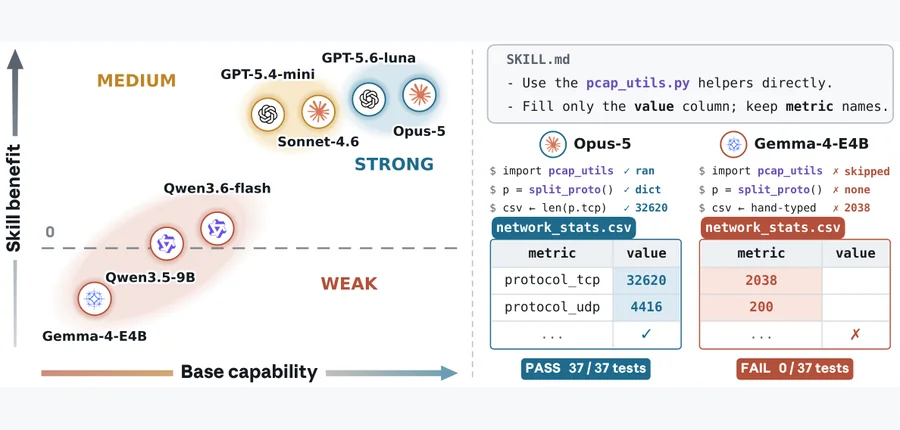 arXiv 2026-10-27 · cs.LG · #1 **[Evolving to Match Capabilities: Improving Harness Self-Evolution via Skill Adaptation](https://arxiv.org/abs/2610.33024)** Zhihao Yang , Haojin Wang , Juncheng Wu , Kuan Zhang , Yukun Chen , Run Luo , Yaojie Lu , Yuyin Zhou , Lu Wang , Xianpei Han Affiliation: University of Chinese Academy of Sciences; University of California, Santa Cruz; Tsinghua University; National University of Singapore; Institute of Software, Chinese Academy of Sciences; Independent Researcher [Paper](https://arxiv.org/abs/2610.33024) · [Project](https://zhihaoyang30.github.io/skill-adaptation/) · [Figure source](https://arxiv.org/html/2610.33024v1/fig1_ab.png) 

[EN] Abstract
Harness self-evolution offers a practical route for LLM agents to improve from execution experience without updating model parameters. Its effectiveness depends on whether models can successfully act on the guidance provided by their harnesses. However, we find that harness benefits are not uniform across model capabilities: skills that improve stronger models can provide little benefit or even degrade performance for weaker ones. Across seven models and three benchmarks, we identify 103 task-skill pairs where skills improve GPT-5.6-luna by 31.1 points but degrade Gemma-4-E4B by 8.8 points. In 86% of failed weak-model runs, the violated requirement is already stated in the skill. This motivates skill adaptation: reformulating existing skills to match the executor's capabilities and make their guidance easier to execute. To achieve this, we diagnose failures in tool execution, context management, instruction following, and verification, and distill these diagnoses into a fixed meta-skill that guides adaptation during harness self-evolution. Guided by the meta-skill, a capable external rewriter, Kimi-K3, adapts skills without execution evidence, improving the three weak executors by 5.1-14.1 points over the original skills. We then incorporate this adaptation into a five-round self-evolution loop, where each model revises its own skill from execution trajectories and verifier feedback. Across seven executors, from Gemma-4-E4B to Kimi-K2.5, the meta-skill consistently improves final scores by 2.0-5.1 points over the same loop without the meta-skill. Our findings provide practical design guidance for developing more effective harness self-evolution methods. <a href="https://arxiv.org/abs/2610.33024">Source</a>

[ZH] Abstract
运行框架自进化为 LLM 智能体提供了一条无需更新模型参数、便可从执行经验中改进的实用途径。其有效性取决于模型能否成功执行运行框架提供的指导。然而，我们发现，运行框架带来的收益并不在不同能力的模型间均匀分布：能够改善强模型的技能，可能对弱模型几乎无益，甚至降低其表现。在七个模型和三个基准上，我们找出了 103 个任务—技能配对，其中技能使 GPT-5.6-luna 提高 31.1 个百分点，却使 Gemma-4-E4B 降低 8.8 个百分点。在弱模型的失败运行中，86% 所违反的要求其实已经写在技能中。这促使我们提出技能适配：重新表述现有技能，使之匹配执行器的能力，让指导更容易执行。为此，我们诊断工具执行、上下文管理、指令遵循和验证方面的失败，并将这些诊断提炼为一个固定的元技能，在运行框架自进化期间指导适配。在该元技能引导下，一个能力较强的外部改写器 Kimi-K3 在没有执行证据的情况下适配技能，使三个弱执行器比使用原始技能提高 5.1—14.1 个百分点。随后，我们把这种适配纳入一个五轮自进化循环，每个模型根据执行轨迹和验证器反馈修订自己的技能。在从 Gemma-4-E4B 到 Kimi-K2.5 的七个执行器上，与不使用该元技能的相同循环相比，元技能始终使最终得分提高 2.0—5.1 个百分点。这些发现为开发更有效的运行框架自进化方法提供了实用设计指导。 <a href="https://arxiv.org/abs/2610.33024">Source</a>
 | 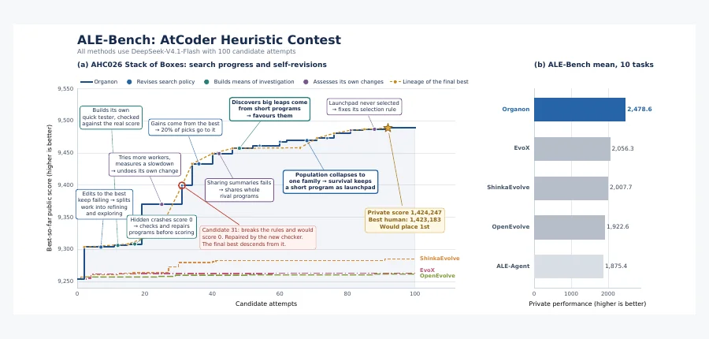 arXiv 2026-10-27 · cs.NE · #2 **[Organon : From Evolutionary Search to Recursive Self-Improving Agents for Scientific Discovery](https://arxiv.org/abs/2610.33046)** Cheikh Ahmed , Zhiyu Zhang , Kun Mao , Yong Zhang , Zirui Zhou Affiliation: Huawei Technologies Canada; Huawei Technologies [Paper](https://arxiv.org/abs/2610.33046) · [Code](https://github.com/cheikh025/Organon) · [Figure source](https://arxiv.org/pdf/2610.33046#page=2) 

[EN] Abstract
Scientific discovery does not follow a single fixed methodology: research methods vary across domains and evolve through experimentation as investigations unfold. Although LLM-guided evolutionary search has advanced automated discovery, existing frameworks typically rely on fixed search procedures or restrict adaptation to predefined components, limiting their ability to address diverse research problems and adapt to challenges that emerge at runtime. We introduce Organon, a recursively self-improving agent for scientific discovery. During execution, a single persistent agent analyzes its accumulated experience and autonomously revises its own search strategies, population management, diagnostic tools, memory, and worker coordination. These revisions take effect at runtime, allowing the agent to continuously adapt its approach as research progresses. Importantly, the agent can also diagnose and correct flaws in its own adaptation procedures, enabling recursive improvement of the mechanisms that guide its future self-improvement. We evaluate Organon across 21 computational discovery tasks spanning algorithm design, GPU kernel optimization, mathematical construction, and systems optimization. On ALE-Bench Lite, Organon achieves the best performance among competing search frameworks on all 10 tasks, improving mean held-out performance by 20.5% over EvoX. On KernelBench, it achieves the best results on three of four workloads, with speedups of up to 1.67x over the strongest competing method. Analysis of the search trajectories further reveals how the agent develops task-specific search strategies, builds new diagnostic capabilities, and corrects or reverses its own earlier revisions. We implement Organon using DeepSeek Harness and Cordis's spatiotemporal composability. Code is available at this https URL . <a href="https://arxiv.org/abs/2610.33046">Source</a>

[ZH] Abstract
科学发现并不遵循单一固定的方法：研究方法因领域而异，也会在调查推进时通过实验而演变。尽管 LLM 引导的进化搜索推动了自动发现，现有框架通常依赖固定的搜索流程，或将适配限制在预定义组件中，从而限制了它们应对不同研究问题及运行时新挑战的能力。我们提出 Organon，一个用于科学发现的递归自改进智能体。在执行期间，单个持久运行的智能体分析积累的经验，自主修订自己的搜索策略、种群管理、诊断工具、记忆和工作智能体协调方式。这些修订在运行时生效，使智能体能够随着研究推进持续调整方法。重要的是，该智能体还能诊断并纠正自身适配流程的缺陷，从而递归地改进指导其未来自改进的机制。我们在涵盖算法设计、GPU 内核优化、数学构造和系统优化的 21 个计算发现任务上评估 Organon。在 ALE-Bench Lite 上，Organon 在全部 10 个任务上都取得竞争搜索框架中的最佳表现，相比 EvoX 的平均留出集表现提高 20.5%。在 KernelBench 上，它在四个工作负载中的三个上取得最佳结果，相比最强竞争方法的加速最高达 1.67 倍。搜索轨迹分析进一步揭示，该智能体如何发展针对任务的搜索策略、构建新的诊断能力，以及纠正或撤销自己此前的修订。我们使用 DeepSeek Harness 和 Cordis 的时空可组合性实现 Organon。代码可在原文所附的 HTTPS 链接获取。 <a href="https://arxiv.org/abs/2610.33046">Source</a>
 | 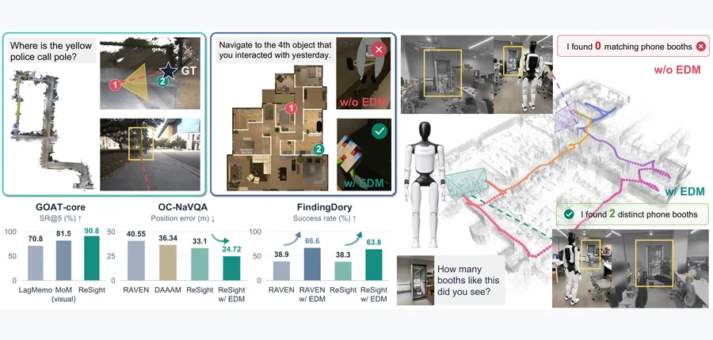 arXiv 2026-10-27 · cs.RO · #3 **[ReSight: Task-Driven Self-Improving Memory for Embodied Agents](https://arxiv.org/abs/2610.33487)** Lirong Che , Yang Chen , Yimeng Su , Daqi Liu , Zhenyu Huang , Jiong Wang , Yuzhe Yang , Xu Cao , Chuang Wang , Jian Su… Affiliation: Tsinghua University; AGIBOT; Nanjing University; Nanyang Technological University [Paper](https://arxiv.org/abs/2610.33487) · [Figure source](https://arxiv.org/html/2610.33487v1/fig00.png) 

[EN] Abstract
Robots can use historical observations to answer spatiotemporal queries in familiar environments, but the presence of relevant evidence does not imply that existing tools support the operations a task requires. We introduce ReSight, a task-driven self-improving memory system for embodied agents that expands the capabilities for processing and accessing historical observations as task demands arise. ReSight retains keyframes and their spatiotemporal associations, separating observation evidence from extensible derived fields so that stored observations can be reprocessed for new needs. An execution agent and a coding agent share this memory through different interfaces: the former calls registered tools within a bounded online budget, while the latter uses a programmable workspace and a larger exploration budget to inspect evidence, write programs, and acquire models as needed. To realize capability expansion in ReSight, we develop Explore-Distill-Mount (EDM), which identifies capability gaps from execution and exploration records without task reference answers and converts exploration-derived solutions into reusable memory builders, query tools, and skills, extending memory representations and access capabilities as needed. Experiments on three public benchmarks demonstrate effective base memory access and capability expansion. With the execution model and online budget held fixed within each benchmark, EDM reduces mean position error on OC-NaVQA from 33.10 m to 24.72 m and improves high-level success on FindingDory from 38.3% to 63.8%. With the tools and skill frozen, success still improves by 28.3 percentage points on FindingDory episodes excluded from exploration and distillation. Experiments on real robot patrol memories further demonstrate reuse of these capabilities for subsequent queries and new memories, with fewer online tool calls on average. <a href="https://arxiv.org/abs/2610.33487">Source</a>

[ZH] Abstract
机器人能够利用历史观测回答熟悉环境中的时空查询，但存在相关证据，并不意味着现有工具支持任务所需的操作。我们提出 ReSight，一个任务驱动的自改进记忆系统，用于具身智能体；它随着任务需求出现，扩展处理和访问历史观测的能力。ReSight 保留关键帧及其时空关联，将观测证据与可扩展的派生字段分离，使存储的观测能够针对新需求重新处理。执行智能体和编码智能体通过不同接口共享这一记忆：前者在有界在线预算内调用已注册工具，后者则使用可编程工作区和更大的探索预算，按需检查证据、编写程序和获取模型。为在 ReSight 中实现能力扩展，我们开发 Explore-Distill-Mount（EDM，探索—提炼—挂载），它无需任务参考答案，就能从执行和探索记录中识别能力缺口，并将探索得到的解决方案转化为可复用的记忆构建器、查询工具和技能，按需扩展记忆表示与访问能力。在三个公开基准上的实验表明，基础记忆访问和能力扩展均有效。在各基准内固定执行模型和在线预算时，EDM 将 OC-NaVQA 的平均位置误差从 33.10 米降至 24.72 米，并将 FindingDory 的高层成功率从 38.3% 提高到 63.8%。即使冻结工具和技能，在未参与探索与提炼的 FindingDory 回合上，成功率仍提高 28.3 个百分点。真实机器人巡逻记忆上的实验进一步展示，这些能力可复用于后续查询和新记忆，平均在线工具调用次数也更少。 <a href="https://arxiv.org/abs/2610.33487">Source</a>
 |
| 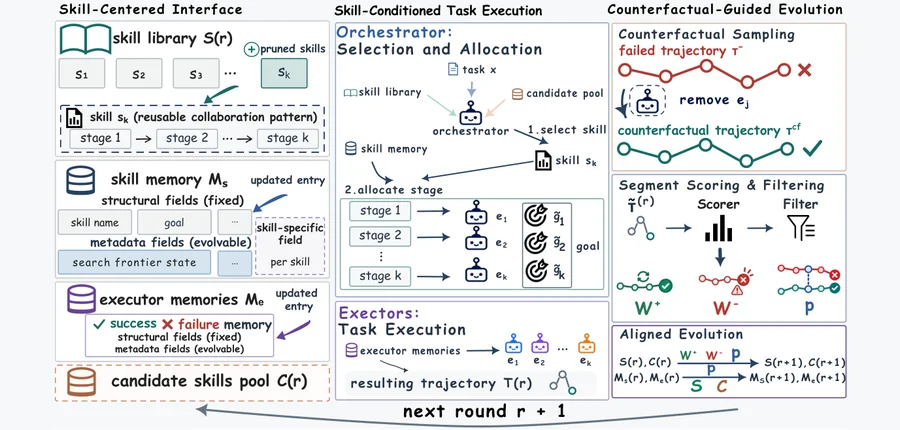 arXiv 2026-10-27 · cs.AI · #4 **[CoEvolve: Counterfactual-Guided Co-Evolution of Memory and Collaboration in Multi-Agent Systems](https://arxiv.org/abs/2610.33539)** Xufei Shi , Derong Xu , Wei Chen , Yanyu Yao , Zhi Zheng , Tong Xu Affiliation: University of Science and Technology of China, State Key Laboratory of Cognitive Intelligence [Paper](https://arxiv.org/abs/2610.33539) · [Code](https://github.com/MINE-USTC/CoEvolve) · [Figure source](https://arxiv.org/html/2610.33539v1/figure2_coevolve_method_vector.png) 

[EN] Abstract
Large language model (LLM)-based multi-agent systems have demonstrated remarkable capabilities across diverse tasks. Yet their memory and collaboration architectures often remain static, constraining continued adaptation and improvement over time. Recent work addresses this limitation by evolving memory or collaboration based on interaction experience. However, updates to these interdependent components are not necessarily aligned: an evolved workflow may require experience that memory does not provide, while evolved memory may encode guidance that the workflow cannot use. To address this problem, we propose CoEvolve, a skill-centered framework for aligned memory--collaboration evolution. CoEvolve represents reusable local collaboration patterns as skills that link evolving collaboration decisions to their supporting memories. It further compares original and counterfactual trajectories to identify local evolution signals, which coordinate updates to the skill library, skill memory, and executor memories across rounds. Experiments on the ALFWorld and WebShop benchmarks confirm that CoEvolve achieves the best overall performance among the evaluated baselines, while ablation studies further validate the effectiveness of aligned co-evolution and counterfactual-guided evolution. <a href="https://arxiv.org/abs/2610.33539">Source</a>

[ZH] Abstract
基于大语言模型（LLM）的多智能体系统已在多种任务中展现出卓越能力。然而，它们的记忆与协作架构往往保持静态，限制了随时间持续适配和改进。近期工作通过依据交互经验演化记忆或协作来应对这一局限。但这些相互依赖组件的更新不一定对齐：演化后的工作流可能需要记忆无法提供的经验，而演化后的记忆也可能编码工作流无法利用的指导。为解决这一问题，我们提出 CoEvolve，一个以技能为中心、使记忆与协作演化相互对齐的框架。CoEvolve 把可复用的局部协作模式表示为技能，将演化的协作决策与其支持记忆连接起来。它进一步比较原始轨迹与反事实轨迹，识别局部演化信号，以此协调跨轮次的技能库、技能记忆和执行器记忆更新。ALFWorld 和 WebShop 基准上的实验确认，CoEvolve 在被评估基线中取得最佳总体表现；消融研究进一步验证了对齐的共同演化和反事实引导演化的有效性。 <a href="https://arxiv.org/abs/2610.33539">Source</a>
 | 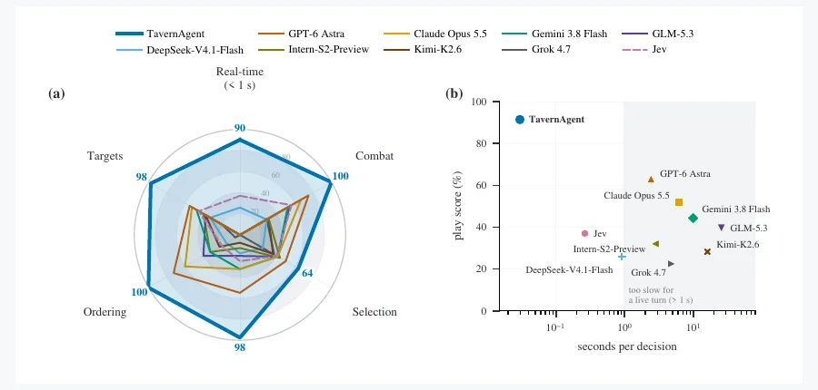 arXiv 2026-10-27 · cs.AI · #5 **[Build, Don't Play: Self-Improving LLM Research Agents Develop a Hearthstone Battlegrounds AI That Rivals Top Players](https://arxiv.org/abs/2610.33845)** Changlian Ma , Limin Wang Affiliation: Nanjing University; Shanghai AI Laboratory [Paper](https://arxiv.org/abs/2610.33845) · [Code](https://github.com/MCG-NJU/AutoTavern) · [Figure source](https://arxiv.org/pdf/2610.33845#page=2) 

[EN] Abstract
Can LLM agents carry a hard real-world problem from raw data to a system that holds its own against people? We study this in Hearthstone Battlegrounds, an eight-player auto-battler with stochastic shops and battles, hidden information and nearly a thousand interacting cards. We present AutoTavern, a self-improving research system: specialised LLM research agents share a typed research memory, every claim passes verification gates, and live games close the loop, so the agents improve the simulator, opponents and policy and, from the same feedback, their own research process; a human sets goals and rules on ambiguous mechanics. In 20 days AutoTavern built TavernGym, the first faithful, full-content reproduction of the live game, and delivered 23 versions of TavernAgent, trained with PPO against opponents calibrated to real games. TavernAgent plays complete games on the live ladder by itself: its rating rose from 6,000 to about 15,000 and, on the public leaderboard's measure, its last 20 records average a placement of 1.60 with 80% first places, better than the server's ten highest-rated players on every statistic (2.34, 59%). TavernBench, 960 tasks in 40 scenarios, shows that the system the agents built is the strongest player: TavernAgent answers 91% of the play tasks against at most 63% for frontier LLMs, and decides in 0.03 s where they need up to 26 s; within the second a live turn allows, it keeps 90% and no LLM more than 26%. LLM agents build far better than they play. We will open-source TavernBench and TavernGym at this https URL . <a href="https://arxiv.org/abs/2610.33845">Source</a>

[ZH] Abstract
LLM 智能体能否把一个困难的真实问题，从原始数据推进到能够与人类抗衡的系统？我们在《炉石传说：酒馆战棋》中研究这一问题：这是一个八人自动战斗游戏，具有随机商店与战斗、隐藏信息，以及近千张相互作用的卡牌。我们提出 AutoTavern，一个自改进研究系统：专门化的 LLM 研究智能体共享带类型的研究记忆，每一项主张都经过验证关卡，在线实战形成闭环，使智能体改进模拟器、对手和策略，并利用同样的反馈改进自身研究流程；人类设定目标，并对含糊的机制作出规则裁定。在 20 天内，AutoTavern 构建了 TavernGym，即首个忠实、完整内容的在线游戏复现，并产出了 23 个版本的 TavernAgent，使用依据真实对局校准的对手通过 PPO 训练。TavernAgent 能独立在在线天梯上完成整局游戏：评分从 6,000 升至约 15,000；按照公开排行榜的统计方式，其最近 20 条记录的平均名次为 1.60，第一名占比 80%，所有统计指标均优于服务器评分最高的十位玩家（2.34、59%）。TavernBench 包含 40 个场景中的 960 个任务，显示智能体构建的系统是最强玩家：TavernAgent 正确回答 91% 的实战任务，前沿 LLM 最高为 63%；其决策耗时 0.03 秒，而后者最高需 26 秒；在在线回合允许的一秒内，它保持 90% 的正确率，而任何 LLM 都不超过 26%。LLM 智能体构建系统的能力远强于自己玩游戏的能力。我们将在原文所附的 HTTPS 链接开源 TavernBench 和 TavernGym。 <a href="https://arxiv.org/abs/2610.33845">Source</a>
 | 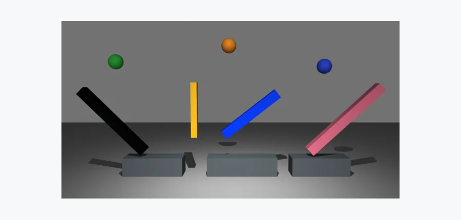 arXiv 2026-10-27 · cs.AI · #6 **[PhysEvolve: Verifier-grounded Self-evolution for Physical Reasoning with Executable Worlds](https://arxiv.org/abs/2610.34921)** Jinyuan Hu , Yilei Jiang , Chen Tang , Minghong Cai , Xinran Liu , Xiangyu Yue Affiliation: MMLab, The Chinese University of Hong Kong [Paper](https://arxiv.org/abs/2610.34921) · [Project](https://yelonhu.github.io/physevolve-page/) · [Figure source](https://arxiv.org/html/2610.34921v1/baseline_t0.png) 

[EN] Abstract
Physical reasoning underpins how embodied systems understand and act in the physical world, yet vision-language models (VLMs) remain unreliable on questions about dynamics and physical causality. Progress is critically constrained by the scarcity of grounded counterfactual training data, as observational videos capture only the factual trajectory that occurred. The self-evolving paradigm offers a route beyond fixed datasets by enabling models to construct their own training problems. Extending this paradigm to physics, however, requires an external source of truth that can both validate model-proposed environments and verify alternative physical outcomes under intervention. We introduce \physevolve{}, a verifier-grounded self-evolving framework that trains VLMs for causal physical reasoning from model-proposed executable worlds and simulation-authored tasks. At each round, a shared VLM proposes executable world programs and evidence schemas; a deterministic physics engine freezes each valid world, simulates matched baseline and body-elided counterfactual branches, and synthesizes discrete, answer-bound visual tasks. Exact verifier feedback from task solving updates both the shared policy via GRPO and an adaptive curriculum over physical intents. Starting from Qwen3-VL-8B-Instruct, \physevolve{} achieves targeted gains across PhysBench, CausalPhys, and ContPhy without human intervention data, improving PhysBench Throwing by $8.8$ points and ContPhy Counterfactual Removal and Goal-Pit by $7.4$ and $24.4$ points. These gains concentrate on interaction-sensitive and altered-world questions, demonstrating zero-shot transfer of causal principles to unseen complex dynamics (cloth, fluid, soft bodies) and real-world video. <a href="https://arxiv.org/abs/2610.34921">Source</a>

[ZH] Abstract
物理推理支撑具身系统理解并作用于物理世界的方式，但视觉语言模型（VLM）在动力学与物理因果关系问题上仍不可靠。进展受到有依据的反事实训练数据稀缺这一关键因素制约，因为观测视频只能记录实际发生的事实轨迹。自进化范式使模型能够构建自己的训练问题，提供了超越固定数据集的途径。然而，将这一范式扩展到物理领域，需要一个外部真实依据，既能验证模型提出的环境，也能检验干预下的其他物理结果。我们提出 PhysEvolve，一个以验证器为依据的自进化框架，通过模型提出的可执行世界和模拟生成的任务，训练 VLM 进行因果物理推理。每一轮中，共享 VLM 提出可执行世界程序和证据模式；确定性物理引擎冻结每个有效世界，模拟匹配的基线分支与移除物体的反事实分支，并合成离散的、答案绑定的视觉任务。任务求解的精确验证器反馈通过 GRPO 同时更新共享策略和针对物理意图的自适应课程。从 Qwen3-VL-8B-Instruct 出发，PhysEvolve无需人工干预数据，便在 PhysBench、CausalPhys 和 ContPhy 上获得针对性提升，使 PhysBench Throwing 提高 8.8 个百分点，ContPhy 的 Counterfactual Removal 和 Goal-Pit 分别提高 7.4 和 24.4 个百分点。这些提升集中于对交互敏感和改变世界条件的问题，展示了因果原理向未见过的复杂动力学（布料、流体、软体）及真实世界视频的零样本迁移。 <a href="https://arxiv.org/abs/2610.34921">Source</a>
 |
| 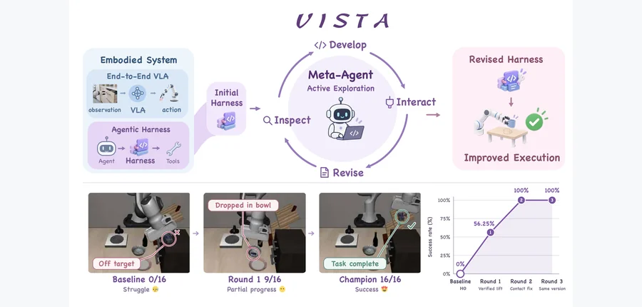 arXiv 2026-10-27 · cs.RO · #7 **[VISTA: Active Exploration for Self-Improvement in Embodied Agents](https://arxiv.org/abs/2610.35051)** Zhang Zhang , Shengjun Zhang , Simin Huang , Min Chen , Chong Xia , Xin Fei , Yueqi Duan Affiliation: Tsinghua University; National University of Singapore [Paper](https://arxiv.org/abs/2610.35051) · [Code](https://github.com/AgenticEI/VISTA) · [Project](https://agenticei.github.io/VISTA-page/) · [Figure source](https://arxiv.org/html/2610.35051v1/teaser.png) 

[EN] Abstract
Agentic embodied intelligence plays a foundational role in open-ended, dynamic physical environments. Rather than treating policy learning as an end-to-end mapping from instructions to actions, recent studies reveal that embodied systems depend not only on pre-trained foundation models, but also on harness. Prior approaches largely treat rollouts as static logs for post-hoc reflection, producing harness updates without autonomously testing and refining them through subsequent embodied interaction. To address this challenge, we propose VISTA, a meta-agent framework that transforms post-hoc rollout reflection into active self-exploration for embodied harness improvement. Specifically, VISTA maintains a harness graph that records the lineage of proposed harnesses, which enables the meta-agent to retrieve prior hypotheses, build on effective mechanisms, and avoid repeatedly exploring failed directions. Each iteration begins from a retained harness version and its execution evidence. Rather than directly committing an update from these historical trajectories, the meta-agent actively explores in the environment. It autonomously generates new rollouts, probes execution failures and recovery behaviors, and iteratively modifies the harness based on the resulting evidence. The refined harness is then evaluated afresh and added to the harness graph. We evaluate VISTA on the LIBERO-Pro, RoboCasa, and RoboTwin benchmarks. Experimental results demonstrate that VISTA progressively improves task success and is more rollout-efficient than static reflection, achieving higher success rates with fewer simulator rollouts. <a href="https://arxiv.org/abs/2610.35051">Source</a>

[ZH] Abstract
智能体式具身智能在开放、动态的物理环境中发挥基础作用。近期研究并非将策略学习仅视为从指令到动作的端到端映射，而是揭示具身系统不仅依赖预训练基础模型，也依赖运行框架。以往方法大多将 rollout 视为供事后反思的静态日志，产生运行框架更新，却不通过后续具身交互自主测试和完善这些更新。为应对这一挑战，我们提出 VISTA，一个元智能体框架，将事后 rollout 反思转变为用于改进具身运行框架的主动自探索。具体来说，VISTA 维护一个记录候选运行框架谱系的框架图，使元智能体能够检索以往假设、基于有效机制继续构建，并避免反复探索失败方向。每次迭代都从一个保留的框架版本及其执行证据开始。元智能体不会直接根据这些历史轨迹提交更新，而是主动在环境中探索。它自主生成新 rollout，探查执行失败与恢复行为，并根据所得证据迭代修改框架。完善后的框架随后重新接受评估，并加入框架图。我们在 LIBERO-Pro、RoboCasa 和 RoboTwin 基准上评估 VISTA。实验结果表明，VISTA 逐步提高任务成功率，且比静态反思更节省 rollout，能够使用更少的模拟器 rollout 获得更高成功率。 <a href="https://arxiv.org/abs/2610.35051">Source</a>
 | 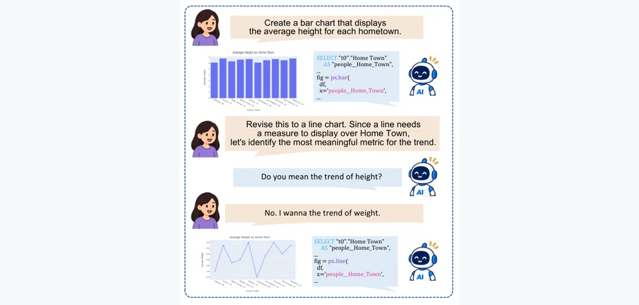 arXiv 2026-10-27 · cs.AI · #8 **[RSIV-Harness: A Recursive Self-Improvement Harness Framework for Open-Domain Conversational Text-to-Visualization](https://arxiv.org/abs/2610.35316)** Jiawei Lu , Chen Zhang , Jinwei Lu , Yuanwei Song , Yuanfeng Song , Raymond Chi-Wing Wong Affiliation: The Hong Kong Polytechnic University; The Hong Kong University of Science and Technology [Paper](https://arxiv.org/abs/2610.35316) · [Figure source](https://arxiv.org/html/2610.35316v1/dataset_case.png) 

[EN] Abstract
Users often request charts without knowing which database or table holds the relevant data. Such requests may be ambiguous, and users may ask follow-up questions to deepen their analysis or iteratively refine existing charts. A useful assistant must therefore discover relevant data sources among heterogeneous databases, ask clarifying questions when needed, and track evolving user intent while preserving constraints established in earlier turns. Yet recent text-to-visualization agents typically rely on static agent harnesses that are predefined and remain unchanged despite recurring failures across tasks. To address this limitation, we introduce RSIV-Harness, which keeps the language model weights fixed and applies Recursive Self-Improvement to revise the surrounding harness from the agent's own failure traces. To balance flexible self-improvement with stability, we introduce a four-layer framework that evaluates proposed harness revisions through anchor and memory checks, refining those that pass and restoring the best validated harness otherwise. We further introduce ODAC-Vis, a benchmark with 640 tasks for Open-Domain, Ambiguous, and Conversational text-to-visualization that jointly evaluates open-domain data discovery, ambiguity resolution, multi-turn visualization refinement, and executable chart generation. Experiments show that a single round of RSIV-Harness improves all six evaluation metrics relative to the seed harness, with particularly large gains in executability (+28.02 points) and chart structure (+34.01 points), demonstrating the ability to learn from task-solving experience and turn recurring failures across tasks into substantial performance improvements. <a href="https://arxiv.org/abs/2610.35316">Source</a>

[ZH] Abstract
用户往往在不知道哪个数据库或数据表包含相关数据时，就提出图表请求。这类请求可能含糊不清，用户也可能继续提问以深化分析或迭代完善现有图表。因此，一个实用助手必须在异构数据库间发现相关数据源，在需要时请求澄清，并在保留前几轮约束的同时跟踪用户意图的演变。然而，近期文本到可视化智能体通常依赖预先定义的静态运行框架，即使跨任务反复失败，也保持不变。为克服这一局限，我们提出 RSIV-Harness，固定语言模型权重，根据智能体自身的失败轨迹，对外围运行框架应用递归自改进。为了平衡灵活自改进与稳定性，我们引入四层框架，通过锚点检查和记忆检查评估候选框架修订，继续完善通过检查的修订，否则恢复表现最佳的已验证框架。我们进一步提出 ODAC-Vis，一个包含 640 个任务的开放域、含糊及对话式文本到可视化基准，联合评估开放域数据发现、歧义消解、多轮可视化完善及可执行图表生成。实验表明，单轮 RSIV-Harness 就能相对种子框架改善全部六项评估指标，尤其在可执行性（提高 28.02 个百分点）和图表结构（提高 34.01 个百分点）上提升显著，展示了从任务求解经验中学习、将跨任务反复失败转化为大幅性能改进的能力。 <a href="https://arxiv.org/abs/2610.35316">Source</a>
 | 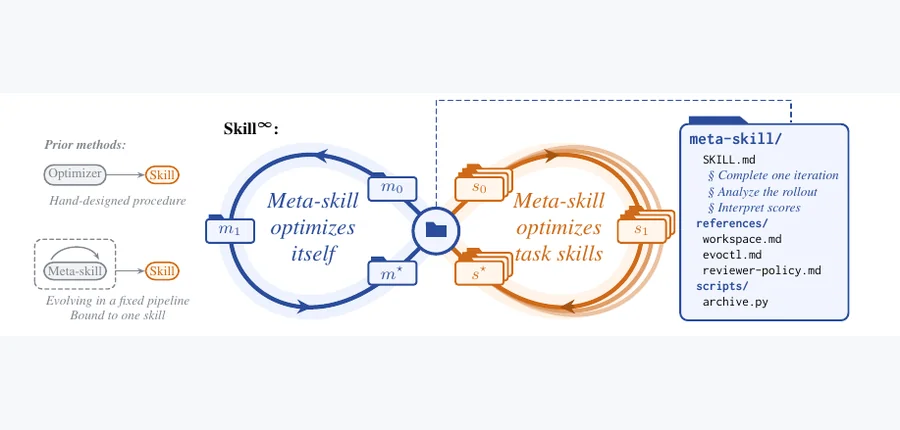 arXiv 2026-10-27 · cs.AI · #9 **[Skill$^{\infty}$: Recursive Self-Improvement for Agent Skill Optimization](https://arxiv.org/abs/2610.35434)** Wangcheng Tao , Zhanglu Yan , Han Wu , Weng-Fai Wong Affiliation: National University of Singapore; City University of Hong Kong [Paper](https://arxiv.org/abs/2610.35434) · [Project](https://github.com/taowangcheng/Skill-Infinity) · [Figure source](https://arxiv.org/pdf/2610.35434#page=2) 

[EN] Abstract
Recursive self-improvement (RSI), in which a system also improves the way it improves, is a long-standing aspiration on the path to AGI. Language agents increasingly store procedural knowledge in reusable skills. Optimizing skills offers a direct way to achieve RSI, because the optimization procedure itself can be encoded as a skill. Existing skill optimizers, however, follow a hand-designed procedure. Even methods that evolve a meta-skill confine it to a fixed pipeline and relearn it for each task. We present Skill$^{\infty}$, which makes skill optimization recursively self-improving: a meta agent follows a meta-skill to optimize task skills and optimizes the meta-skill itself using the same procedure. The optimization is agent-led. The meta agent diagnoses execution traces, proposes candidates, requests independent reviews, and allocates the search budget. The meta-skill defines these steps, allowing self-improvement to rewrite them. This meta-skill is also decoupled from task skills, refined on multiple skill optimization tasks and then reused to optimize task skills across diverse domains. As in deployment, skills at both levels are standard packages loaded through native skill discovery. On 83 SkillsBench tasks, Skill$^{\infty}$ reaches a pass rate of 60.7%, compared with 56.4% for human-curated skills and 54.5% for SkillEvolver. <a href="https://arxiv.org/abs/2610.35434">Source</a>

[ZH] Abstract
递归自改进（RSI），即系统也改进自己的改进方式，是通向 AGI 的一个长期愿景。语言智能体越来越多地将过程知识存储为可复用技能。优化技能为实现 RSI 提供了直接途径，因为优化流程本身也能编码为技能。然而，现有技能优化器遵循人工设计的流程。即使演化元技能的方法，也把它限制在固定流水线中，并为每项任务重新学习。我们提出 Skill∞，使技能优化能够递归自改进：元智能体按照元技能优化任务技能，并用同一流程优化元技能本身。优化由智能体主导。元智能体诊断执行轨迹、提出候选方案、请求独立审查并分配搜索预算。元技能定义这些步骤，因此自改进能够重写这些步骤。该元技能还与任务技能解耦，在多个技能优化任务上完善后，复用于不同领域的任务技能优化。与部署时一样，两个层级的技能都是通过原生技能发现加载的标准包。在 SkillsBench 的 83 个任务上，Skill∞ 的通过率达到 60.7%，相比之下，人工整理技能为 56.4%，SkillEvolver 为 54.5%。 <a href="https://arxiv.org/abs/2610.35434">Source</a>
 |
| 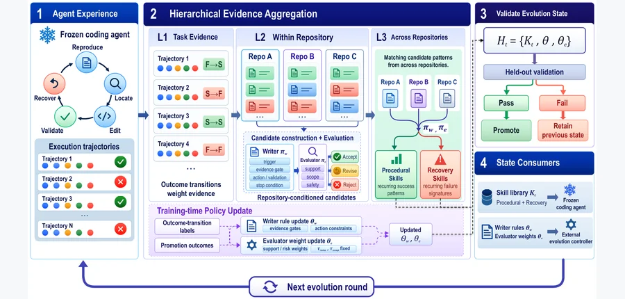 arXiv 2026-10-27 · cs.CL · #10 **[Hierarchical Skill Evolution for Coding Agent](https://arxiv.org/abs/2610.35616)** Jun Gao , Yun Peng , Changhai Zhou , Yuhan Zhu , Xiangyu Zeng , Shiyang Zhang Yuhua Zhou , Luozheng Qin , Qian Qiao , Xiao… Affiliation: Affiliation unconfirmed [Paper](https://arxiv.org/abs/2610.35616) · [Code](https://github.com/jungao1106/SKILL_EVO) · [Figure source](https://arxiv.org/html/2610.35616v1/hse-pipeline-paper.png) 

[EN] Abstract
Skills provide agents with reusable experience to guide future decisions without modifying the underlying model. However, coding trajectories are often entangled with task- and repository-specific contexts, making it challenging to distill procedural skills that generalize across diverse coding environments. To address this challenge, we present Hierarchical Skill Evolution (HSE), which progressively distills procedural knowledge from coding trajectories through hierarchical evidence aggregation. HSE first extracts task-level evidence from individual trajectories, then aggregates recurring evidence within the same repository to form repository-specific skill candidates, and finally consolidates consistent patterns across repositories into transferable skills across repositories. The evolution is driven by an external writer-evaluator loop that generates and assesses skills while keeping the underlying coding model frozen. The loop externally updates the writer and evaluator policies to improve subsequent skill generation and assessment. This hierarchy progressively filters task-specific details while preserving procedures that generalize across diverse coding environments. Successful trajectories yield reusable guidance for future tasks, while failed trajectories reveal recurring failure modes that guide avoidance and recovery. We evaluate HSE on SWE-bench Verified and DeepSWE, using GLM-5.2 across Pi and Claude Code harnesses and GPT-5.5 and Opus 4.8 with Pi. Across both benchmarks, 10 skills evolved solely from SWE-Gym improve coding performance across all evaluated settings, demonstrating transfer across benchmarks, coding models, and agent harnesses. We further evolve the skill library from target-benchmark trajectories without verifier feedback, relying solely on the learned evaluator for candidate assessment and achieving additional gains through benchmark-tailored skills. <a href="https://arxiv.org/abs/2610.35616">Source</a>

[ZH] Abstract
技能为智能体提供可复用经验，在不修改底层模型的情况下指导未来决策。然而，编码轨迹往往与具体任务和仓库的上下文纠缠，使得提炼可泛化到不同编码环境的过程技能具有挑战性。为应对这一挑战，我们提出分层技能演化（HSE），通过分层证据聚合，从编码轨迹中逐步提炼过程知识。HSE 首先从单条轨迹提取任务级证据，再聚合同一仓库中反复出现的证据，形成仓库特定的技能候选，最后整合跨仓库一致的模式，形成可跨仓库迁移的技能。演化由外部写作者—评估器循环驱动，在固定底层编码模型的同时生成和评估技能。该循环从外部更新写作者与评估器策略，以改进后续技能生成和评估。这一层次结构逐步过滤任务特定细节，同时保留可泛化到不同编码环境的流程。成功轨迹产生可复用于未来任务的指导，失败轨迹则揭示反复出现的失败模式，用于指导规避和恢复。我们在 SWE-bench Verified 和 DeepSWE 上评估 HSE，使用 GLM-5.2 配合 Pi 和 Claude Code 运行框架，以及 GPT-5.5、Opus 4.8 配合 Pi。在两个基准上，仅从 SWE-Gym 演化出的 10 个技能就在所有被评估设置中改善编码表现，展示跨基准、编码模型和智能体运行框架的迁移。我们进一步利用目标基准的轨迹演化技能库，不使用验证器反馈，仅依靠学习得到的评估器评估候选，并通过面向基准定制的技能获得额外收益。 <a href="https://arxiv.org/abs/2610.35616">Source</a>
 | 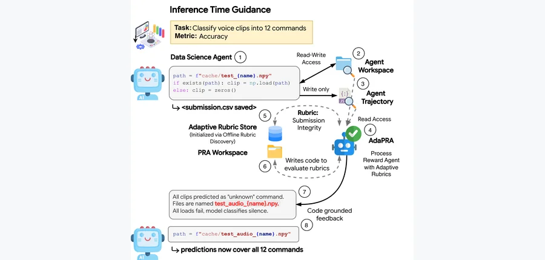 arXiv 2026-10-27 · cs.AI · #11 **[AdaPRA: Process Reward Agents with Adaptive Rubrics for Data Science](https://arxiv.org/abs/2610.33245)** Atharva Naik , Vivek Chari , Pol Llado , Daniel Fried , Carolyn Rosé , Benjamin Van Durme , Sam Thomson , Justin Svegliato Affiliation: Carnegie Mellon University; Microsoft [Paper](https://arxiv.org/abs/2610.33245) · [Figure source](https://arxiv.org/html/2610.33245v1/figures/AdaPRA_Intro_Teaser_No_Rubric_Discovery.png) 

[EN] Abstract
Data science agents can automate end-to-end machine learning workflows, yet they remain far from competitive on human leaderboards. Agents make process errors such as insufficient exploration, unsound validation, coding bugs, and poor use of a fixed budget (re-running the same exploratory data analysis and baseline models in every attempt). We propose AdaPRA to address these issues: a persistent coding agent harness that accumulates knowledge across attempts on the same task, with rubric-guided process supervision that identifies and corrects errors. Our process reward agent audits the agent's trajectory and workspace by executing checks, and adapts its rubrics to each task. We find that rubrics seeded from easier tasks generalize to harder tasks, with rubric adaptation further improving performance. With five attempts per task, AdaPRA improves an 80B Qwen model's leaderboard percentile by 24.5 points on DSPredict-Easy and 14.8 points on DSPredict-Hard while reducing process errors. We also show that supervision with rubrics mined from one base model's runs improves another (DeepSeek-V3.2), and that AdaPRA beats DataPRM, a competitive PRM for data science. We also share our code for reproducibility. <a href="https://arxiv.org/abs/2610.33245">Source</a>

[ZH] Abstract
数据科学智能体能够自动执行端到端机器学习工作流，但在人工排行榜上仍远未达到有竞争力的水平。智能体会出现探索不足、验证不可靠、代码错误和固定预算利用不当等流程错误，例如在每次尝试中重新运行相同的探索性数据分析和基线模型。为解决这些问题，我们提出 AdaPRA：一个在同一任务的多次尝试间积累知识的持久编码智能体运行框架，并配以基于评分细则的过程监督来识别和纠正错误。我们的过程奖励智能体通过执行检查，审计智能体轨迹和工作区，并针对各任务适配评分细则。我们发现，从较简单任务初始化的细则可以泛化到较难任务，而适配细则能够进一步提升表现。每项任务尝试五次时，AdaPRA 使一个 80B Qwen 模型在 DSPredict-Easy 和 DSPredict-Hard 上的排行榜百分位分别提高 24.5 和 14.8 个点，同时减少过程错误。我们还展示，使用从一个基础模型运行中挖掘出的细则进行监督，可以改进另一个模型 DeepSeek-V3.2；AdaPRA 也优于具有竞争力的数据科学过程奖励模型 DataPRM。我们同时分享代码以支持复现。 <a href="https://arxiv.org/abs/2610.33245">Source</a>
 | 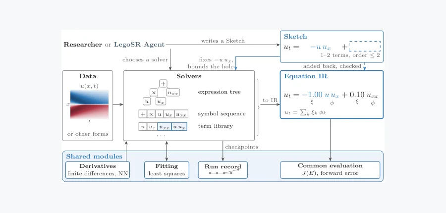 arXiv 2026-10-27 · cs.AI · #12 **[LegoSR: A Unified Framework for Self-improving Agent-Guided Scientific Discovery](https://arxiv.org/abs/2610.33465)** Hao Mao , Xu T. Liu , Peng Zhao , Shuai Lu , Yuntian Chen Affiliation: The Hong Kong Polytechnic University; Eastern Institute of Technology; Amazon Web Services; University of Washington; Beijing EEO Education Technology; Jiangxi University of Finance and Economics [Paper](https://arxiv.org/abs/2610.33465) · [Figure source](https://arxiv.org/html/2610.33465v1/architecture.png) 

[EN] Abstract
Equation discovery solvers often use different data interfaces, equation representations and evaluation criteria, making their results difficult to compare. We present LegoSR, a unified framework for algebraic symbolic regression and differential equation discovery. LegoSR integrates seven solvers through a common equation representation and evaluation process, and supports searches constrained by partially known equations. Researchers can run solvers directly or use LegoSR Agent, which selects solvers and adapts searches based on solver knowledge, intermediate results and lessons from earlier tasks. On noisy ordinary and partial differential equation benchmarks, LegoSR Agent recovers nearly as many equations as the union of seven expert-tuned solvers and outperforms a generic agent with the same model, tools and budget by up to 29 percentage points. Three examples demonstrate basic use, adaptive solver selection and discovery guided by partial physical knowledge. <a href="https://arxiv.org/abs/2610.33465">Source</a>

[ZH] Abstract
方程发现求解器经常使用不同的数据接口、方程表示和评估标准，使得结果难以比较。我们提出 LegoSR，一个统一的代数符号回归与微分方程发现框架。LegoSR 通过共同的方程表示和评估流程集成七个求解器，并支持以部分已知方程约束搜索。研究人员可以直接运行求解器，也可使用 LegoSR Agent，后者依据求解器知识、中间结果及先前任务的经验教训选择求解器并调整搜索。在带噪声的常微分与偏微分方程基准上，LegoSR Agent 恢复的方程数量几乎达到七个专家调优求解器的并集，并在模型、工具和预算相同的条件下，比通用智能体最多提高 29 个百分点。三个示例展示了基本用法、自适应求解器选择，以及利用部分物理知识引导的发现。 <a href="https://arxiv.org/abs/2610.33465">Source</a>
 |
| 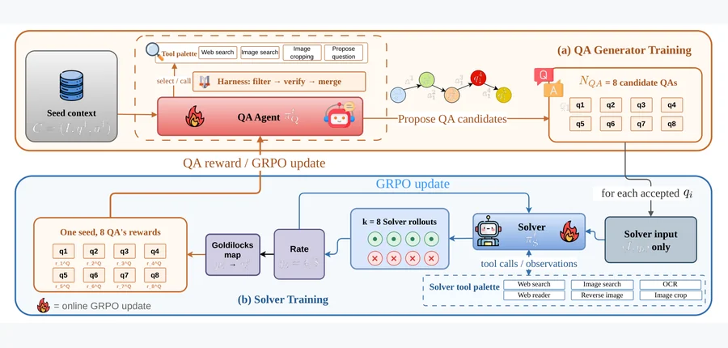 arXiv 2026-10-27 · cs.CL · #13 **[MTA-Zero: Self-Improving Multimodal Deep Search via Online QA-Solver Co-training](https://arxiv.org/abs/2610.33799)** Xiangyu Peng , Jiaxin Zhang , An Yan , Yu Li , Ran Xu , Zeyuan Chen , Chien-Sheng Wu Affiliation: Affiliation unconfirmed [Paper](https://arxiv.org/abs/2610.33799) · [Figure source](https://arxiv.org/html/2610.33799v1/mds-zero-paper.png) 

[EN] Abstract
Multimodal large language models (MLLMs) have become strong visual reasoners, yet remain limited in open-world, multi-step search that requires grounding images, selecting tools, and integrating web evidence. Existing approaches typically construct and filter fixed offline corpora whose question distributions cannot adapt as the target deep-search agent improves. Building on MTA-Agent's image-grounded QA construction, we present MTA-Zero, an online multimodal QA-Solver co-training framework for self-improving multimodal deep-search agents that requires no precomputed multi-hop corpus. Starting from image-grounded VQA seed contexts, a trainable QA Generator retrieves evidence and constructs verified multi-hop questions online. A separate deep-search Solver then selects tools, gathers evidence, and answers the generated questions. To focus generation on the Solver's learning frontier, we derive a Goldilocks reward for the QA Generator from the Solver's group-wise rollout success rate: questions solved by all rollouts or by none receive zero reward, whereas questions near the current frontier are favored. We optimize the two policies independently with GRPO, without sharing parameters or gradients. Across six multimodal deep-search benchmarks, MTA-Zero improves a Qwen3-VL-8B Solver from 36.91% to 51.58% mean accuracy and achieves performance comparable to GPT-5 under the same agent workflow. The same framework also improves a newer Qwen3.6-27B Solver by 10.82 points. These results show that verified online question generation provides a policy-specific curriculum for continually improving multimodal deep-search agents. <a href="https://arxiv.org/abs/2610.33799">Source</a>

[ZH] Abstract
多模态大语言模型（MLLM）已成为强大的视觉推理器，但在需要图像依据、工具选择及网页证据整合的开放世界多步搜索中仍有局限。现有方法通常构建并筛选固定离线语料，其问题分布无法随着目标深度搜索智能体的进步而调整。基于 MTA-Agent 的图像依据问答构建，我们提出 MTA-Zero，一个用于自改进多模态深度搜索智能体的在线问答生成器—求解器共同训练框架，不需要预先计算的多跳语料。从以图像为依据的 VQA 种子上下文出发，一个可训练问答生成器检索证据，并在线构建经过验证的多跳问题。一个独立的深度搜索求解器随后选择工具、收集证据并回答生成的问题。为使生成集中在求解器的学习前沿，我们根据求解器分组 rollout 的成功率，为问答生成器推导 Goldilocks 奖励：所有 rollout 都能解答或全都无法解答的问题奖励为零，而接近当前能力前沿的问题更受偏好。我们使用 GRPO 独立优化两个策略，不共享参数或梯度。在六个多模态深度搜索基准上，MTA-Zero 将 Qwen3-VL-8B 求解器的平均准确率从 36.91% 提高到 51.58%，并在相同智能体工作流下获得与 GPT-5 相当的表现。同一框架还使更新的 Qwen3.6-27B 求解器提高 10.82 个百分点。这些结果表明，经过验证的在线问题生成，能够为多模态深度搜索智能体的持续改进提供针对策略的课程。 <a href="https://arxiv.org/abs/2610.33799">Source</a>
 | 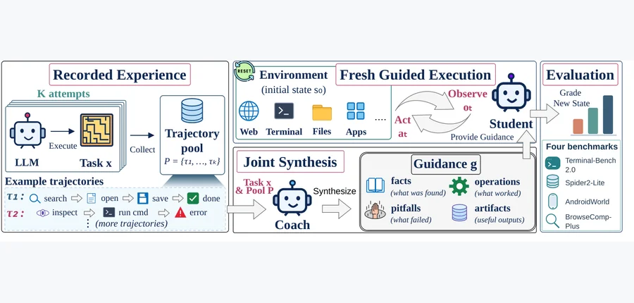 arXiv 2026-10-27 · cs.AI · #14 **[ReGE: Stronger Agents through Experience Synthesis](https://arxiv.org/abs/2610.33861)** Jiarong Liang , Yubo Wang , Zijie Liu , Yuxuan Zhang , Ping Nie , Wenhu Chen Affiliation: University of Waterloo; University of North Carolina at Chapel Hill; University of British Columbia [Paper](https://arxiv.org/abs/2610.33861) · [Code](https://github.com/TIGER-AI-Lab/ReGE) · [Figure source](https://arxiv.org/html/2610.33861v1/main_figure.png) 

[EN] Abstract
Repeated attempts at interactive tasks uncover facts, useful operations, and failures that can inform subsequent execution. We introduce ReGE, a framework for turning this recorded experience into guidance for a fresh attempt. Its main implementation, ReGE-Syn, uses a single coach call to jointly synthesize bounded execution records and available artifacts into self-contained guidance, connecting task-specific findings with proposed actions and relevant pitfalls. A student starts from the task's initial environment state and adapts this guidance to current observations. Source generation, synthesis, and student execution use the same base model, without parameter updates or a stronger teacher. Across four benchmarks, ReGE improves accuracy by an average of 9.9 percentage points for GPT and 8.8 percentage points for Claude compared with unguided execution. On matched BrowseComp-Plus subsets, ReGE-Syn reduces guidance-construction tokens by 98.2\% on GPT and 95.5\% on Claude relative to adapted AggAgent, with observed success. Combined construction and execution tokens decrease by 15.7\% and 35.4\%, respectively, counting input plus output and excluding source generation. BrowseComp-Plus ablations further associate access to process information with fewer student steps and show that joint synthesis produces substantially shorter guidance than Direct history or Independent summaries, with observed success. These results demonstrate how agents can use their own recorded experience to improve subsequent task completion, and suggest a low-cost way to consolidate the execution records of parallel agent systems such as agent swarms. <a href="https://arxiv.org/abs/2610.33861">Source</a>

[ZH] Abstract
反复尝试交互任务能够发现事实、有用操作和失败，为后续执行提供信息。我们提出 ReGE，一个将这些记录经验转化为全新尝试指导的框架。其主要实现 ReGE-Syn 使用单次教练调用，将有界的执行记录与可用产物联合综合为自包含指导，将任务特定发现与建议行动及相关陷阱联系起来。学生从任务的初始环境状态开始，并根据当前观测调整这些指导。来源生成、综合和学生执行均使用同一个基础模型，不更新参数，也不使用更强教师。在四个基准上，相比无指导执行，ReGE 使 GPT 和 Claude 的准确率分别平均提高 9.9 和 8.8 个百分点。在匹配的 BrowseComp-Plus 子集上，相比适配后的 AggAgent，ReGE-Syn 在观察到成功的情况下，将 GPT 和 Claude 的指导构建 token 分别减少 98.2% 和 95.5%。将构建与执行合计，token 分别减少 15.7% 和 35.4%；这里计算输入加输出，不含来源生成。BrowseComp-Plus 消融进一步表明，能够访问过程信息与更少的学生步骤相关；与直接历史记录或独立摘要相比，联合综合在观察到成功的情况下生成显著更短的指导。这些结果展示智能体如何利用自身记录经验改善后续任务完成，并提示一种低成本方法，可整合智能体群等并行智能体系统的执行记录。 <a href="https://arxiv.org/abs/2610.33861">Source</a>
 | 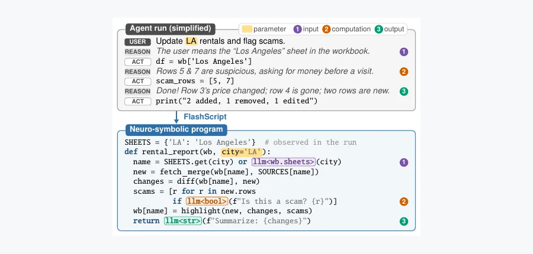 arXiv 2026-10-27 · cs.HC · #15 **[FlashScript: Compiling Recurring Agent Workflows into Reusable Neuro-Symbolic Programs](https://arxiv.org/abs/2610.33876)** Sadra Sabouri , Hosein Hasanbeig , Adam Sage , Shreya Sinha , Cale Darling , Ashish Tiwari , Katie Garms , Souti Chattopad… Affiliation: University of Southern California; Microsoft [Paper](https://arxiv.org/abs/2610.33876) · [Figure source](https://arxiv.org/pdf/2610.33876#page=1) 

[EN] Abstract
Many agent tasks recur with new data or small changes, yet agents regenerate their reasoning and actions on each run, producing different results. Distilling a prior run into a skill helps the agent avoid earlier mistakes, but it still re-runs the full process each time, so runs can vary and incur that cost. We compile a successful agent run into a reusable neuro-symbolic program (NSP) with a set of guidelines we call FlashScript. Actions and data transformations become code, instance-specific values become parameters, and decisions that need model judgment become LLM calls. We identify three layers where these calls belong and three techniques that replace most of them with code. The compilation does not remove nondeterminism; it localizes it, so the deterministic program and its neural calls can be reviewed and tested separately. Across 120 WorkBench analytics tasks with Claude Haiku 4.5, the NSPs were correct and made identical tool calls on every run, using about 70 times fewer input tokens and a third of the runtime of a skill-guided agent whose runs were inconsistent. In a composite version of the tasks, the skill-guided agent's accuracy fell to 23%, and its output inconsistency increased, while the NSPs remained correct and identical across all runs. The NSPs successfully generalized to all 108 unseen instances of the same templates. Our findings suggest that NSPs from agent trajectories can be considered cumulative software assets for end-users to test, maintain, and reuse in their recurring workflows. <a href="https://arxiv.org/abs/2610.33876">Source</a>

[ZH] Abstract
许多智能体任务会随着新数据或小幅变化反复出现，但智能体每次运行都重新生成推理和行动，导致结果不同。将先前运行提炼为技能有助于规避旧错误，但仍需每次重跑完整流程，因此运行可能变化并产生相应成本。我们用一组名为 FlashScript 的指导原则，将成功的智能体运行编译为可复用神经符号程序（NSP）。行动和数据变换转化为代码，实例特定值转化为参数，需要模型判断的决策转化为 LLM 调用。我们识别这些调用应处于的三个层次，以及用代码替代其中大多数调用的三种技术。编译不会消除非确定性，而是将其局部化，使确定性程序及其神经调用能够分别接受审查和测试。在使用 Claude Haiku 4.5 的 120 个 WorkBench 分析任务上，NSP 每次运行都正确，且工具调用完全一致；相比运行不一致的技能引导智能体，输入 token 约少 70 倍，运行时间为其三分之一。在任务的组合版本上，技能引导智能体的准确率降至 23%，输出不一致性增加，而 NSP 在所有运行中仍然正确且一致。NSP 成功泛化到相同模板的全部 108 个未见实例。这些发现表明，从智能体轨迹得到的 NSP 可以被视为累积的软件资产，供最终用户测试、维护，并在反复出现的工作流中复用。 <a href="https://arxiv.org/abs/2610.33876">Source</a>
 |
| 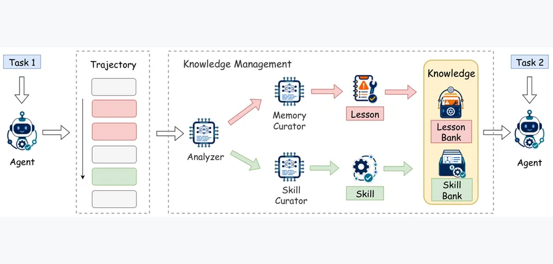 arXiv 2026-10-27 · cs.LG · #16 **[Holding a Steady Course: Knowledge Evolution from Expertise and Lessons for Continual Agent Learning](https://arxiv.org/abs/2610.34043)** Wenzhe Fan , Benjamin Steenhoek , Gaurav Mittal , Yu Hu Affiliation: Microsoft; University of Illinois Chicago [Paper](https://arxiv.org/abs/2610.34043) · [Code](https://github.com/microsoft/KEEL-TTCL26) · [Figure source](https://arxiv.org/html/2610.34043v1/overview.png) 

[EN] Abstract
Autonomous agents are increasingly deployed across sequences of related tasks, yet they often fail to retain and improve their knowledge over time. Existing approaches convert interaction trajectories into memories or reusable skills, but experience is not automatically reliable knowledge. Automatically collected skills and memories can propagate errors, mislead, and corrupt useful knowledge. To address this gap, we introduce Knowledge Evolution from Expertise and Lessons (KEEL), an agent-agnostic framework that uses verifier evidence to transform successful behavior into reusable skills and failures into corrective lessons. As new evidence accumulates, individual skill claims can be supported, contradicted, replaced, or retired. On SkillFlow benchmark, KEEL improves task success by 4.2 to 21.7 percentage points over the no-knowledge baseline, compared with gains of 2.4 to 9.6 points from SkillFlow's default method. Ablations show that skills and lessons are complementary. These results show that reliable continual agent learning depends not simply on accumulating experience, but on continually validating and evolving the knowledge derived from it. Our code is available at: this https URL . <a href="https://arxiv.org/abs/2610.34043">Source</a>

[ZH] Abstract
自主智能体越来越多地部署于一系列相关任务中，但它们往往无法随时间保留和改进知识。现有方法将交互轨迹转化为记忆或可复用技能，但经验并不自动成为可靠知识。自动收集的技能和记忆可能传播错误、误导智能体并损坏有用知识。为弥补这一缺口，我们提出 Knowledge Evolution from Expertise and Lessons（KEEL），一个与智能体无关的框架，使用验证器证据，将成功行为转化为可复用技能，将失败转化为纠错经验。随着新证据积累，单条技能主张可以获得支持、被反驳、替换或退役。在 SkillFlow 基准上，相比无知识基线，KEEL 使任务成功率提高 4.2—21.7 个百分点，而 SkillFlow 默认方法的增益为 2.4—9.6 个百分点。消融表明技能与经验教训相互补充。这些结果显示，可靠的持续智能体学习不仅依赖经验积累，还依赖对由经验得到的知识持续验证和演化。代码可在原文所附的 HTTPS 链接获取。 <a href="https://arxiv.org/abs/2610.34043">Source</a>
 | 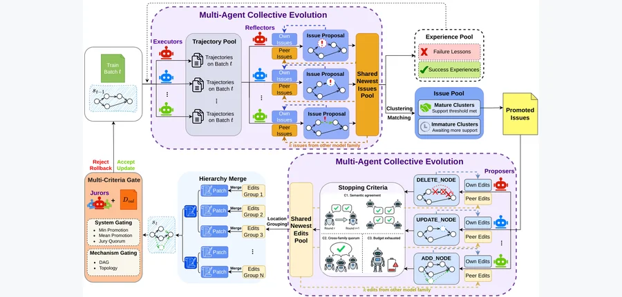 arXiv 2026-10-27 · cs.AI · #17 **[MultiEvoSkill: Structure-Aware Multi-Agent Skill Evolution for Generalizable Skill Artifacts](https://arxiv.org/abs/2610.34260)** Kounianhua Du , Jianxing Liu , Ruoshui Shan , Yucheng Zhang , Ke Li , Xing Sun , Weinan Zhang Affiliation: Shanghai Jiao Tong University; Tencent; Purdue (as listed) [Paper](https://arxiv.org/abs/2610.34260) · [Figure source](https://arxiv.org/html/2610.34260v1/flowchart.png) 

[EN] Abstract
Skill documents are becoming the default adaptation surface for frozen large language model (LLM) agents, but current skill generators face two key limitations. First, humans and different LLMs differ in how they organize procedural knowledge and approach task solving. Skills authored from a human or single-model perspective may therefore fail to align with the reasoning behaviors of other backbones, limiting cross-model generalization. Second, sequential skill descriptions inadequately represent procedures with parallel branches and explicit dependencies, while existing skill optimizers primarily operate on prose and lack explicit support for graph-structured skill evolution. We introduce MultiEvoSkill, a skill-optimization framework comprising three core components: 1) Skill compiler casts the skill as a typed graph with tailored operators, producing a compact, informative representation with explicit procedural topology; 2) Heterogeneous agent system proposes revision advices using collective intelligence, where minimal and informative issues are identified based on multiple sets of experiences. 3) Structure-aware debate and evolution mechanism organizes candidate edits into a heterogeneous graph, resolves them under dependency and importance constraints, and distills the collective proposal into the artifact. Multi-dimensional gating ensures the information gain and topological correctness of each evolution. Optimal skills are then obtained when the system converges at a consistent state. Various experiments and ablations against SOTA methods validate the effectiveness and generalization of MultiEvoSkill. <a href="https://arxiv.org/abs/2610.34260">Source</a>

[ZH] Abstract
技能文档正在成为冻结大语言模型（LLM）智能体的默认适配界面，但现有技能生成器有两个关键局限。首先，人类和不同 LLM 在组织过程知识及解决任务的方式上存在差异。因此，从人类或单一模型视角编写的技能，可能无法匹配其他骨干模型的推理行为，限制跨模型泛化。其次，顺序式技能描述不足以表示具有并行分支和显式依赖的流程，而现有技能优化器主要处理散文，缺少对图结构技能演化的明确支持。我们提出 MultiEvoSkill，一个包含三个核心组件的技能优化框架：1）技能编译器以定制算子将技能转换为带类型图，生成具有显式流程拓扑的紧凑且信息丰富的表示；2）异构智能体系统利用集体智能提出修订建议，依据多组经验识别最小且有信息量的问题；3）结构感知的辩论与演化机制，将候选编辑组织成异构图，在依赖和重要性约束下解决编辑，并将集体建议提炼进产物。多维门控确保每次演化的信息增益和拓扑正确性。当系统收敛到一致状态时，得到最优技能。与先进方法比较的多种实验和消融，验证了 MultiEvoSkill 的有效性与泛化能力。 <a href="https://arxiv.org/abs/2610.34260">Source</a>
 | 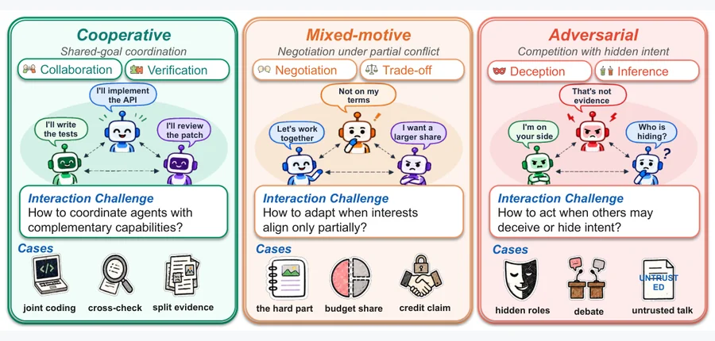 arXiv 2026-10-27 · cs.MA · #18 **[EvolveMAS: A Unified Self-Evolution Framework for Decentralized Multi-Agent Systems](https://arxiv.org/abs/2610.34450)** Yalun Wu , Qiwei Ma , Bingbing Xu , Dan Zhang , Long Bai , Boyang Wang , Jiatong Li , Zheqi Lv , Shaozu Yuan , Peiying Wan… Affiliation: National University of Singapore; Hunan University; Institute of Computing Technology, Chinese Academy of Sciences; Xingchen AGI, China Telecom Artificial Intelligence Technology; Cornell University; Meituan; University of Science and Technology of China [Paper](https://arxiv.org/abs/2610.34450) · [Code](https://github.com/WuYalun/EvolveMAS) · [Project](https://wuyalun.github.io/EvolveMAS/) · [Figure source](https://arxiv.org/html/2610.34450v1/teaserv11.png) 

[EN] Abstract
Decentralized multi-agent systems (MAS) enable large language model agents to interact without centralized control. Agents need to adapt to other agents at test time and reuse accumulated experience to refine their interaction strategies for future interactions across cooperative, mixed-motive, and adversarial settings. However, existing approaches often develop adaptation mechanisms for particular interaction settings. This raises a central question: how can decentralized MAS support test-time adaptation and reliable experience reuse across interaction settings? We propose EvolveMAS, a unified self-evolution framework that supports experience-driven adaptation within and across episodes. EvolveMAS pairs each main agent with a dedicated MemoryAgent for test-time memory governance, which maintains isolated Structured Memory outside the main agent's reasoning context. EvolveMAS organizes adaptation into two complementary processes: Within-Episode Online Adaptation and Cross-Episode Knowledge Evolution. During Within-Episode Online Adaptation, MemoryAgent updates episodic, semantic, and working memory from interaction evidence to inform subsequent actions. During Cross-Episode Knowledge Evolution, the main agent uses memory and episode outcomes to distill reusable interaction knowledge comprising partner profiles and interaction strategies for subsequent episodes. Across five benchmarks and six evaluation configurations spanning the three interaction settings, EvolveMAS achieves the highest normalized average score of 77.2 among the compared methods. Ablations show that test-time memory governance and cross-episode knowledge reuse both improve performance. Interaction traces further illustrate how updated memory and distilled knowledge guide subsequent interactions. These results support experience-driven adaptation in decentralized MAS without updating model parameters. <a href="https://arxiv.org/abs/2610.34450">Source</a>

[ZH] Abstract
去中心化多智能体系统（MAS）使大语言模型智能体能够在没有集中控制的情况下交互。智能体需要在测试时适应其他智能体，并复用积累的经验，在合作、混合动机和对抗设置中完善未来交互策略。然而，现有方法往往针对特定交互设置开发适配机制。这引出一个核心问题：去中心化 MAS 如何支持跨交互设置的测试时适配和可靠经验复用？我们提出 EvolveMAS，一个统一自进化框架，支持回合内与回合间的经验驱动适配。EvolveMAS 为每个主智能体配备专门的 MemoryAgent 来治理测试时记忆，在主智能体的推理上下文之外维护隔离的结构化记忆。EvolveMAS 将适配组织成两个互补过程：回合内在线适配和跨回合知识演化。在回合内在线适配期间，MemoryAgent 根据交互证据更新情节、语义和工作记忆，为后续行动提供信息。在跨回合知识演化期间，主智能体利用记忆与回合结果，提炼包含伙伴画像及交互策略的可复用交互知识，用于后续回合。在覆盖三类交互设置的五个基准和六种评估配置中，EvolveMAS 在比较方法中取得最高的归一化平均分 77.2。消融表明，测试时记忆治理和跨回合知识复用都能改善表现。交互轨迹进一步展示，更新的记忆和提炼的知识如何指导后续交互。这些结果支持去中心化 MAS 无需更新模型参数即可实现经验驱动适配。 <a href="https://arxiv.org/abs/2610.34450">Source</a>
 |
| 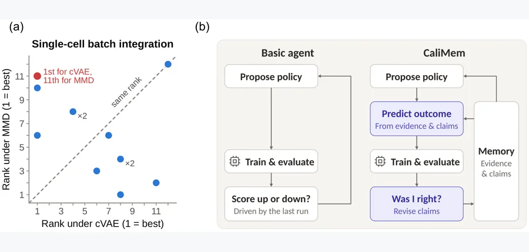 arXiv 2026-10-27 · cs.AI · #19 **[CaliMem: Search-Efficient Data Agent via Calibrated Memory](https://arxiv.org/abs/2610.34500)** Hanze Li , Athan Z. Li , Feiyang Kang , Jiachen T. Wang , Yuhan Chen , Ruishan Liu , Ruoxi Jia Affiliation: Virginia Tech; University of Southern California; Princeton University [Paper](https://arxiv.org/abs/2610.34500) · [Figure source](https://arxiv.org/html/2610.34500v1/intro.png) 

[EN] Abstract
Data curation is a first-order design choice in machine learning, yet tailoring training data to a downstream model and task remains costly in labor, expertise, and compute. Datasets are therefore often processed through fixed pipelines and reused across applications. We show that this assumption is fragile: across 55 dataset--model tasks spanning biological domains, the same curation recipe can help one model while hurting another. Effective curation must adapt to the downstream setting, motivating automated search over data recipes. We first build an agentic system that searches for curation policies at deployment, improving data utility via \textit{test-time curation (TTC)}. Although achieving performance gains, its search is driven largely by recent feedback and remains local. Adding persistent memory helps the agent retain evidence across iterations and reveals a deeper problem: it forms claims that extend beyond the conditions in which they were observed, sometimes abandoning an entire strategy after a single unsuccessful trial. To address this problem, we introduce CaliMem, a calibrated-memory agentic loop that requires the agent to predict the outcome of each proposed policy before executing it. Comparing this prediction with the observed result gives the agent a \textit{reality check} on the claims behind its proposal. It uses the prediction error to retain supported claims, revise mistaken ones, and specify the conditions under which a conclusion holds. This makes the agent's beliefs testable, reduces overgeneralization, and supports more effective long-horizon exploration. Across biological and LLM post-training tasks, CaliMem consistently outperforms fixed curation baselines and published methods, and exceeds full-data training by up to 19.4\%. Code is open-sourced. <a href="https://arxiv.org/abs/2610.34500">Source</a>

[ZH] Abstract
数据整理是机器学习中的首要设计选择，但针对下游模型与任务定制训练数据，仍需昂贵的人力、专业知识和算力。因此，数据集往往通过固定流水线处理后，复用于不同应用。我们表明，这一假设并不稳固：在生物领域的 55 个数据集—模型任务上，同一整理配方可能帮助一个模型，却损害另一个。有效整理必须适应下游设置，这促使我们自动搜索数据配方。我们首先构建一个在部署时搜索整理策略的智能体系统，通过测试时整理（TTC）改善数据效用。尽管获得性能提升，其搜索主要由近期反馈驱动，仍停留于局部。加入持久记忆帮助智能体跨迭代保留证据，却也暴露出更深的问题：它形成的主张超出实际观测条件，有时仅因一次失败试验，就放弃整个策略。为解决这一问题，我们提出 CaliMem，一个校准记忆的智能体循环，要求智能体在执行每个候选策略前先预测结果。将预测与观测结果比较，为提案背后的主张提供“现实检验”。它利用预测误差保留有支持的主张、修订错误主张，并明确结论成立的条件。这使智能体信念可被测试，减少过度泛化，并支持更有效的长时程探索。在生物任务与 LLM 后训练任务上，CaliMem 始终优于固定整理基线和已发表方法，相比全数据训练最高提高 19.4%。代码已开源。 <a href="https://arxiv.org/abs/2610.34500">Source</a>
 | 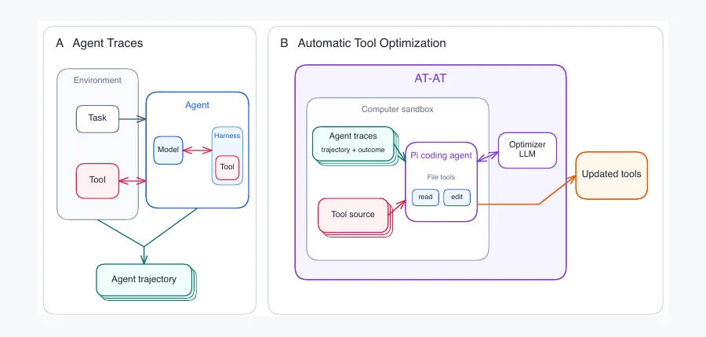 arXiv 2026-10-27 · cs.LG · #20 **[AT-AT: Automatic Tool Optimization from Agent Traces](https://arxiv.org/abs/2610.34679)** Maya Ravichandran , Pragya Tripathi , Dharamendra Kumar , Adith Swaminathan , Nathan Kallus Affiliation: Netflix [Paper](https://arxiv.org/abs/2610.34679) · [Code](https://github.com/Netflix-Skunkworks/agent-tool-opt-core) · [Figure source](https://arxiv.org/pdf/2610.34679#page=2) 

[EN] Abstract
Efforts to improve LLM-based agents typically focus on modifying the agent itself, yet success also depends on the environment in which an agent acts. Tools mediate this interaction: a tool's description shapes how an agent calls it, and its implementation determines the results and errors the agent receives afterwards. Many tools, such as APIs and MCP servers, are shared by many agents and maintained by providers who cannot change those agents. We introduce AT-AT (Automatic Tool Optimization from Agent Traces), an agentic tool optimizer that improves a shared toolset offline from historical agent executions while holding the agents fixed. A lightweight coding agent reads agent trajectories and their evaluation results, and selectively edits tool descriptions and, when permitted, implementations. On $\tau^2$-bench-verified, AT-AT achieves the highest task completion rates in the Airline and Telecom domains at lower cost than strong prompt- and tool-optimizer baselines, and its Telecom gain is statistically significant under paired permutation tests. Optimizing the tools within a coding agent harness also improves held-out performance on TerminalBench-2 and TBLite. When applied to three production MCP servers at a large enterprise, AT-AT lowered cost or tool error rates on every server and increased held-out task passes on one. By turning accumulated execution traces into updates to shared tool environments, AT-AT provides a path toward continual improvement of agent systems through environment-side learning. <a href="https://arxiv.org/abs/2610.34679">Source</a>

[ZH] Abstract
改进基于 LLM 的智能体通常聚焦修改智能体本身，但成功也依赖它所处的环境。工具介导这种交互：工具描述影响智能体如何调用它，而实现决定调用后收到的结果和错误。API 与 MCP 服务器等许多工具由多个智能体共享，其维护者无法改变这些智能体。我们提出 AT-AT（基于智能体轨迹的自动工具优化），一个智能体式工具优化器，在固定智能体的条件下，依据历史执行离线改进共享工具集。轻量编码智能体阅读智能体轨迹及其评估结果，选择性编辑工具描述，并在允许时编辑实现。在 τ²-bench-verified 上，相比强提示词优化和工具优化基线，AT-AT 以更低成本在 Airline 与 Telecom 领域取得最高任务完成率；配对置换检验表明，Telecom 增益具有统计显著性。在编码智能体运行框架内部优化工具，也能改善 TerminalBench-2 和 TBLite 的留出集表现。应用于一家大型企业的三个生产 MCP 服务器时，AT-AT 在每个服务器上均降低成本或工具错误率，并在其中一个服务器上提高留出任务通过率。通过将积累的执行轨迹转化为共享工具环境的更新，AT-AT 为通过环境侧学习持续改进智能体系统提供了一条路径。 <a href="https://arxiv.org/abs/2610.34679">Source</a>
 | 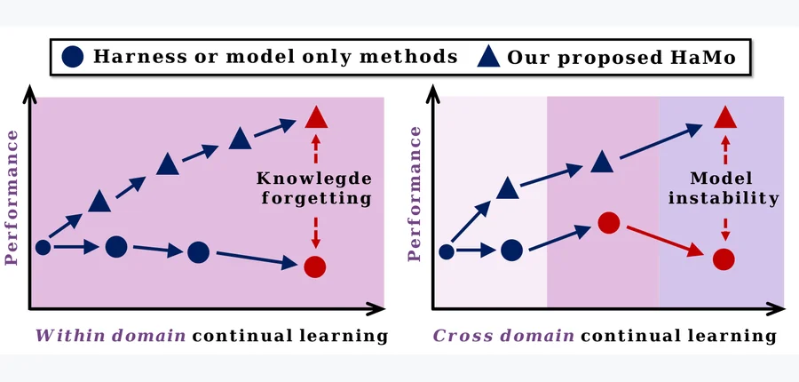 arXiv 2026-10-27 · cs.AI · #21 **[Harness-Model Collaboration for Long-Horizon Continual Learning](https://arxiv.org/abs/2610.34724)** Zhen Bi , Zhizhi Peng , Yan Wang , Xueshu Chen , Haofei Zhang , Yaobo Zhang , Zeyu Yang , Qing Shen , Jungang Lou Affiliation: Huzhou Normal University; Alibaba Group; Zhejiang University; Ningxia University [Paper](https://arxiv.org/abs/2610.34724) · [Figure source](https://arxiv.org/html/2610.34724v1/intro.png) 

[EN] Abstract
Long-horizon agents continuously encounter reusable procedural knowledge, yet existing systems typically rely either on model adaptation or external memory, trading persistent learning for rapid reuse. This limitation is especially important for Web agents that repeatedly execute related multi-step workflows. We propose HaMo, a Harness-Model collaborative framework that combines fast non-parametric experience accumulation with slow parametric adaptation. HaMo distills trajectories into strategy-level experience cards for immediate retrieval, while an experience-conditioned continual learning objective trains the model to interpret, ground, and execute retrieved strategies across changing contexts. A retrieval-coverage-based selection mechanism further identifies compact and complementary trajectories for parameter updates. Experiments show that HaMo outperforms harness-only and model-only adaptation under within-domain and cross-domain shifts, improving both retention and adaptation. These results highlight the importance of jointly preserving procedural experience and internalizing the competence to transfer and execute it across tasks. <a href="https://arxiv.org/abs/2610.34724">Source</a>

[ZH] Abstract
长时程智能体不断遇到可复用的过程知识，但现有系统通常只依靠模型适配或外部记忆，在持久学习与快速复用之间取舍。对于反复执行相关多步工作流的网页智能体，这一局限尤其重要。我们提出 HaMo，一个运行框架—模型协作框架，将快速的非参数经验积累与缓慢的参数适配结合起来。HaMo 将轨迹提炼为策略级经验卡，用于即时检索，同时通过经验条件化的持续学习目标，训练模型在变化的上下文中理解、落地和执行检索到的策略。一个基于检索覆盖率的选择机制进一步识别紧凑且互补的轨迹，用于参数更新。实验表明，在域内与跨域变化下，HaMo 均优于仅适配运行框架或仅适配模型，同时改善保留与适应能力。这些结果强调，既保留过程经验，又内化跨任务迁移和执行这些经验的能力，十分重要。 <a href="https://arxiv.org/abs/2610.34724">Source</a>
 |
| 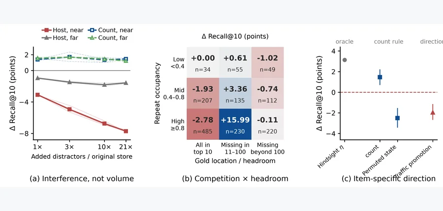 arXiv 2026-10-27 · cs.LG · #22 **[Adaptive Memory Index Evolution for Agents](https://arxiv.org/abs/2610.34977)** Yuntong Hu , Tongli Su , Yuanfu Sun , Shuo Ma , Qiaoyu Tan , Liang Zhao Affiliation: Emory University; New York University; Meituan [Paper](https://arxiv.org/abs/2610.34977) · [Code](https://github.com/HuieL/AMIE) · [Figure source](https://arxiv.org/html/2610.34977v1/figs/fig_main_mechanism.png) 

[EN] Abstract
Long-horizon agents continually accumulate experience, yet retaining a memory does not guarantee access when it is needed. Existing systems can adapt both memory content and access; we isolate persistent access updates as a separately controlled adaptation layer. We formulate this target as Memory Index Evolution and instantiate it with Adaptive Memory Index Evolution (AMIE), a lightweight plug-in layer that evolves per-memory access state from deployment retrievals without modifying stored content or retraining the host memory system. AMIE distils a semantic teacher's keep/suppress judgments into a retrieval-conditioned policy and accumulates its selective actions into bounded state that reweights subsequent host retrievals. Surprisingly, even a zero-call policy that simply accumulates retrieval frequency can match or outperform semantic policies in several settings, revealing retrieval traffic itself as a strong signal for access adaptation, while learned selectivity improves robustness when frequently retrieved memories remain useful. Across five retrieval-based hosts and three benchmarks, trained AMIE improves downstream F1 or accuracy in all 15 comparisons, by 0.70--3.37 percentage points (up to 25% relative), and improves retrieval in all 10 comparisons. Controlled analyses show that persistent competitor suppression can expose previously unseen evidence, while suppressing repeatedly useful memories creates the complementary failure mode. Together, these results establish persistent memory access as a practical adaptation layer, distinct from the content it serves, in retrieval-based agent memory systems. <a href="https://arxiv.org/abs/2610.34977">Source</a>

[ZH] Abstract
长时程智能体不断积累经验，但保留一条记忆，并不保证需要时能访问它。现有系统能够同时适配记忆内容与访问方式；我们将持久访问更新隔离为一个独立受控的适配层。我们将这一目标表述为记忆索引演化，并以自适应记忆索引演化（AMIE）实现：这是一个轻量插件层，根据部署检索演化每条记忆的访问状态，不修改已存储内容，也不重新训练宿主记忆系统。AMIE 将语义教师的保留／抑制判断蒸馏为以检索为条件的策略，并将其选择性动作累积为有界状态，重新加权后续宿主检索。令人意外的是，仅积累检索频率、不调用模型的策略，在多种设置中也能匹配或超越语义策略，表明检索流量本身就是访问适配的强信号；而当频繁检索的记忆仍然有用时，学习到的选择性能够改善稳健性。在五个基于检索的宿主和三个基准上，训练后的 AMIE 在全部 15 项比较中提高下游 F1 或准确率，增益为 0.70—3.37 个百分点（相对提升最高 25%），并在全部 10 项比较中改善检索。受控分析表明，持久抑制竞争记忆能够暴露此前未见证据，而抑制反复有用的记忆会造成相应的失败模式。综合来看，这些结果确立了持久记忆访问是基于检索的智能体记忆系统中的一个实用适配层，与其服务的内容相区别。 <a href="https://arxiv.org/abs/2610.34977">Source</a>
 | 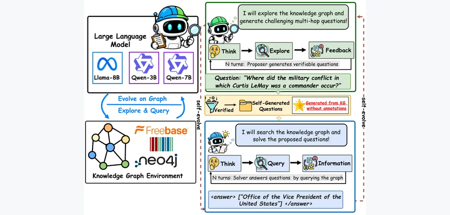 arXiv 2026-10-27 · cs.AI · #23 **[Evolve on Graph: Self-Evolving Knowledge Graph Reasoning without Question Annotations](https://arxiv.org/abs/2610.35598)** Zongyuan Sun , Shuai Zhao , Ke Shu , Ziyue Zhu , Shangyang Wu , Yuanlin Lin , Tao Wang , Shiyue Li , Yingjun Du , Anh Tuan… Affiliation: Beijing University of Posts and Telecommunications; University of Helsinki; University of Amsterdam; Nanyang Technological University [Paper](https://arxiv.org/abs/2610.35598) · [Project](https://szy5.github.io/EoG/) · [Figure source](https://arxiv.org/html/2610.35598v1/overview.png) 

[EN] Abstract
Knowledge graphs (KGs) provide reliable external knowledge for multi-hop factual reasoning with large language models (LLMs), yet most KGs in real-world domains such as finance and industry lack question--answer (QA) annotations. Without such annotations, existing methods struggle to improve LLM graph reasoning: training-free agents cannot improve their exploration through interaction; reinforcement learning (RL) agents depend on QA data annotated by humans or synthesized by closed-source models; and training data is typically built offline, so its topology mix is fixed and cannot follow the agent's ability. We propose Evolve on Graph (EoG), a framework that lets an LLM self-evolve its graph reasoning without any QA annotations. Through Graph Self-Play, a single LLM alternates between a Proposer that poses questions and a Solver that answers them. To make questions verifiable, Symbolically Verifiable Topology Synthesis (SVTS) samples reasoning topologies on the KG and executes the corresponding first-order logic queries, yielding topology skeletons with correct and complete answer sets; guided by a skeleton, the Proposer explores the graph to pose a multi-hop question. To let task topologies follow the Solver, a Boundary-Aware Graph Curriculum rewards the Proposer by the Solver's score variance, keeping questions at the Solver's capability boundary so that complex topologies enter training as the Solver improves. On six benchmarks over Freebase, Wikidata, and an industrial KG, EoG consistently outperforms prompting-, retrieval-, and agent-based methods, showing that LLM graph reasoning can improve through self-play without QA annotations. Our code is available at this https URL <a href="https://arxiv.org/abs/2610.35598">Source</a>

[ZH] Abstract
知识图谱（KG）为大语言模型（LLM）的多跳事实推理提供可靠外部知识，但金融与工业等真实领域的大多数知识图谱缺乏问答（QA）标注。没有这些标注，现有方法难以改进 LLM 图推理：免训练智能体不能通过交互改善探索；强化学习（RL）智能体依赖人工或闭源模型合成的 QA 数据；训练数据通常离线构建，其拓扑组合固定，无法跟随智能体能力变化。我们提出 Evolve on Graph（EoG），一个无需任何 QA 标注即可让 LLM 自进化图推理的框架。通过图自博弈，单个 LLM 交替扮演提出问题的 Proposer 与回答问题的 Solver。为使问题可验证，符号可验证拓扑合成（SVTS）在知识图谱上采样推理拓扑，并执行对应的一阶逻辑查询，产生带有正确且完整答案集合的拓扑骨架；Proposer 在骨架引导下探索图谱，提出多跳问题。为让任务拓扑跟随 Solver，边界感知图课程根据 Solver 得分方差奖励 Proposer，使问题保持在 Solver 能力边界，随着 Solver 进步让复杂拓扑进入训练。在 Freebase、Wikidata 和一个工业知识图谱上的六个基准中，EoG 始终优于基于提示、检索和智能体的方法，表明 LLM 图推理无需 QA 标注即可通过自博弈改进。代码可在原文所附的 HTTPS 链接获取。 <a href="https://arxiv.org/abs/2610.35598">Source</a>
 | 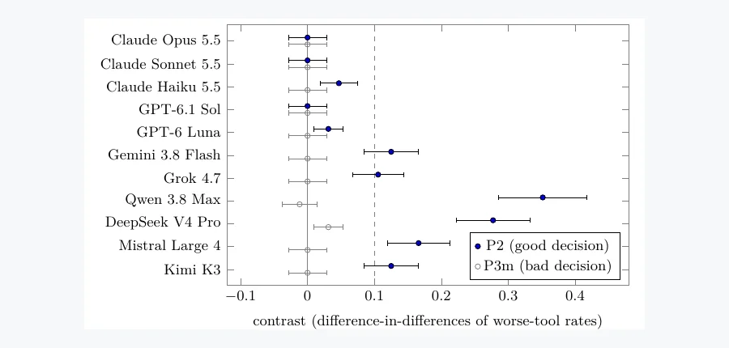 arXiv 2026-10-27 · cs.LG · #24 **[Lessons from Luck: Do LLM-Written Lessons Carry Chance into an Agent's Next Decision?](https://arxiv.org/abs/2610.33029)** Kazuki Nakayashiki Affiliation: Glasp [Paper](https://arxiv.org/abs/2610.33029) · [Figure source](https://arxiv.org/pdf/2610.33029#page=10) 

[EN] Abstract
Self-improving agents write lessons from the outcomes of their runs; when outcomes are noisy, a lesson can carry chance into later decisions. We measure one link of this chain in a registered study. In 256 synthetic worlds, each a recurring task with two interchangeable tools of recorded reliability, a scripted previous run used the more reliable tool (a good decision) or the less reliable one (a bad decision), with an assigned outcome: success or a transient failure. A model wrote a lesson from the run with ReasoningBank's memory-writing instruction; a fresh session of the same model, holding the authoritative log and the previous result, chose the next run's first tool with one memory item: that lesson, the lesson from the other outcome, an irrelevant item, or an unreasoned directive. The protocol was frozen, deposited and timestamped before any confirmatory call; 11 LLM endpoints gave 90,084 answers. After a chance failure of the better tool, the panel's lessons carried the chance (registered reading luck-carrying; interaction +0.112, 95% interval [+0.097, +0.126]): readers named the worse tool in 11.6% of next runs with the lesson written from that failure, against 0.4% with an irrelevant item and 0.4% with the lesson written from a success. The effect was +0.042 where the log stated that failures are independent and +0.181 where it did not (descriptive). After a lucky success of the worse tool, the interaction was bounded below 0.10 (+0.002), a bound, not evidence of no harm. In exploratory readings, 6 endpoints carried the chance (up to +0.352); 5 were bounded below 0.10. In secondary comparisons, a three-sentence decision-quality note in the writing instruction lowered the worse-tool rate after a chance failure to 7.5%, and one instruction for both outcomes with a no-change option to 3.1%; neither met the registered harm-reduction rule at every such endpoint. <a href="https://arxiv.org/abs/2610.33029">Source</a>

[ZH] Abstract
自改进智能体根据运行结果撰写经验教训；当结果带有噪声时，一条经验可能把偶然因素带入后续决策。我们在一项注册研究中测量这条链条的一个环节。在 256 个合成世界中，每个世界都是一项反复执行的任务，含两个可互换且可靠性已有记录的工具。一个脚本化的先前运行使用更可靠工具（好决策）或较不可靠工具（坏决策），并被指定为成功或暂时失败。模型使用 ReasoningBank 的记忆撰写指令，根据这次运行写一条经验；同一模型的新会话持有权威日志及先前结果，并带着一个记忆项选择下一次运行的首个工具：该经验、另一结果下写出的经验、无关项，或无推理指令。协议在任何确认性调用之前便已冻结、存档并加上时间戳；11 个 LLM 端点共给出 90,084 个回答。在较好工具偶然失败后，整个端点组的经验携带了偶然因素（注册判读为“携带运气”；交互效应 +0.112，95% 区间 [+0.097, +0.126]）：使用根据该失败写出的经验时，读者在 11.6% 的后续运行中选择较差工具；使用无关项或根据成功写出的经验时，均为 0.4%。日志说明失败相互独立时，效应为 +0.042；未说明时为 +0.181（描述性结果）。较差工具侥幸成功后，交互效应被界定为低于 0.10（+0.002）；这是一个界限，不是没有危害的证据。在探索性判读中，6 个端点携带偶然因素（最高 +0.352），5 个被界定为低于 0.10。在次要比较中，撰写指令中加入三句话的决策质量说明，使较好工具偶然失败后的较差工具选择率降至 7.5%；对两种结果使用同一指令并提供“不改变”选项时，降至 3.1%；但两者都没有在每个此类端点上满足注册的减害规则。 <a href="https://arxiv.org/abs/2610.33029">Source</a>
 |
| 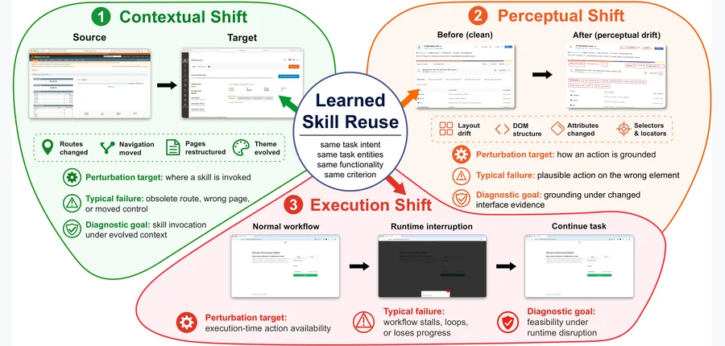 arXiv 2026-10-27 · cs.AI · #25 **[SkillShift-Bench: Benchmarking Skill Learning under Environment Evolution for Web Agents](https://arxiv.org/abs/2610.33528)** Bo-Yu Chen , Zhi Zhou , Yu-Feng Li Affiliation: Nanjing University [Paper](https://arxiv.org/abs/2610.33528) · [Project](https://skillshift-bench.github.io/) · [Figure source](https://arxiv.org/html/2610.33528v1/shift.png) 

[EN] Abstract
Skill learning enables web agents to reuse prior experience for long-horizon interactive tasks. However, learned skills are typically evaluated in closed environments, overlooking the fact that real-world web deployment involves continuous shifts in invocation context, perceptual grounding, and execution feasibility. To this end, we introduce SkillShift-Bench, the first benchmark for evaluating skill learning with controlled open-environment shifts. SkillShift-Bench simulates Contextual Shift, Perceptual Shift, and Execution Shift across three self-hosted web systems, and evaluates agents with diagnostics covering task success, interaction cost, skill use, and skill failure. Comprehensive experiments reveal systematic robustness degradation under controlled shifts, characterized by lower success rates, higher interaction costs, and more frequent skill failures, with Execution Shift exerting the strongest pressure. We further formulate shifted skill execution as a nonstationary local executability problem and provide both a dynamic-regret analysis and a practical test-time adaptation method, demonstrating the feasibility of improving learned-skill execution without relearning the skill library. Code, tasks, environments, documentation, and the leaderboard are available at this https URL . <a href="https://arxiv.org/abs/2610.33528">Source</a>

[ZH] Abstract
技能学习使网页智能体能够为长时程交互任务复用先前经验。然而，学习到的技能通常在封闭环境中评估，忽略真实网页部署中调用上下文、感知落地和执行可行性的持续变化。为此，我们提出 SkillShift-Bench，首个通过受控开放环境变化来评估技能学习的基准。SkillShift-Bench 在三个自托管网页系统中模拟上下文变化、感知变化和执行变化，并通过任务成功、交互成本、技能使用与技能失败等诊断指标评估智能体。综合实验揭示，受控变化下出现系统性稳健性退化，表现为成功率降低、交互成本上升，以及技能失败更频繁，其中执行变化施加的压力最强。我们进一步将变化后的技能执行表述为非平稳的局部可执行性问题，提供动态遗憾分析和实用的测试时适配方法，展示无需重新学习技能库，也能改善已学技能执行的可行性。代码、任务、环境、文档与排行榜可在原文所附的 HTTPS 链接获取。 <a href="https://arxiv.org/abs/2610.33528">Source</a>
 | 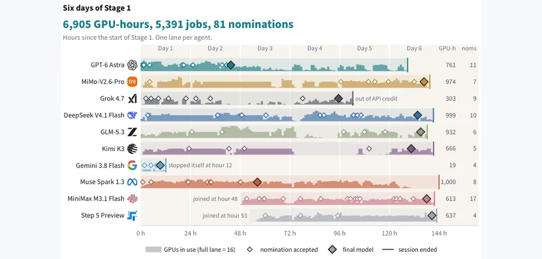 arXiv 2026-10-27 · cs.CL · #26 **[RSI Arena: Towards Recursive Self-Improvement with Human Feedback](https://arxiv.org/abs/2610.33624)** Yue Huang , Yanbo Wang , Lichi Li , Yuanyuan Chen , Andreas Haupt , Xiaonan Luo , Zheyuan Liu , Jihye Choi , Felix Juefei-… Affiliation: Affiliation unconfirmed [Paper](https://arxiv.org/abs/2610.33624) · [Figure source](https://arxiv.org/html/2610.33624v1/stage1-timeline.png) 

[EN] Abstract
Can AI agents autonomously train useful language models and improve them using feedback from users? We introduce RSI Arena, a two-stage study of autonomous post-training as a step toward recursive self-improvement. Ten frontier models act as training agents, each starting from NVIDIA Nemotron 3.5 Lightning 30B-A3B Base. During a six-day first stage, each agent has 1,000 GPU-hours and $300 in API credit on a shared 64-GPU cluster, independently selecting data, implementing training procedures, and choosing checkpoints. We evaluate their models on 20 benchmarks and through blind human evaluations. All ten agents produce working assistants, with the strongest model, trained by GPT-6 Astra, closing a median of 76% of the base-to-Instruct gap across 12 capability benchmarks. Its human-preference rating is also close to NVIDIA Instruct after statistical adjustment for answer length and formatting. In Stage 2, each agent receives the comparison records and votes involving its Stage 1 model and is given three additional days for further training. Using NVIDIA Instruct as a common reference across the two evaluation rounds, we observe an improvement from Stage 1 to Stage 2 in the style-adjusted relative rating of eight of the ten models. We show that benchmark gains were modest, with no clear link to preference gains, while some agents encouraged longer responses and one model showed increased harmful compliance on StrongREJECT. RSI Arena provides an auditable setting for studying how human feedback can guide autonomous model development. It takes a step toward recursive self-improvement with human feedback (RSIHF), in which people help define what improvement means for the AI systems they use. <a href="https://arxiv.org/abs/2610.33624">Source</a>

[ZH] Abstract
AI 智能体能否自主训练有用的语言模型，并利用用户反馈改进它们？我们提出 RSI Arena，一项关于自主后训练的两阶段研究，作为迈向递归自改进的一步。十个前沿模型充当训练智能体，每个都从 NVIDIA Nemotron 3.5 Lightning 30B-A3B Base 开始。在为期六天的第一阶段，每个智能体在共享的 64 GPU 集群上拥有 1,000 GPU 小时和 300 美元 API 额度，独立选择数据、实现训练流程并选择检查点。我们通过 20 个基准和盲测人工评估检验所得模型。十个智能体都产出可工作的助手，其中 GPT-6 Astra 训练的最强模型在 12 个能力基准上，弥合了基座模型到 Instruct 模型差距的中位数 76%。在对回答长度和格式进行统计调整后，其人类偏好评分也接近 NVIDIA Instruct。在第二阶段，每个智能体收到涉及自己第一阶段模型的比较记录和投票，再获得三天进行进一步训练。使用 NVIDIA Instruct 作为两轮评估的共同参照，我们观察到十个模型中有八个，其风格调整后的相对评分从第一阶段到第二阶段有所提升。我们表明，基准增益有限，与偏好增益没有明确联系；一些智能体鼓励更长回答，一个模型在 StrongREJECT 上表现出更高的有害顺从性。RSI Arena 为研究人类反馈如何指导自主模型开发提供了可审计设置。它向基于人类反馈的递归自改进（RSIHF）迈出一步，让人们参与定义他们所使用 AI 系统的“改进”意味着什么。 <a href="https://arxiv.org/abs/2610.33624">Source</a>
 | 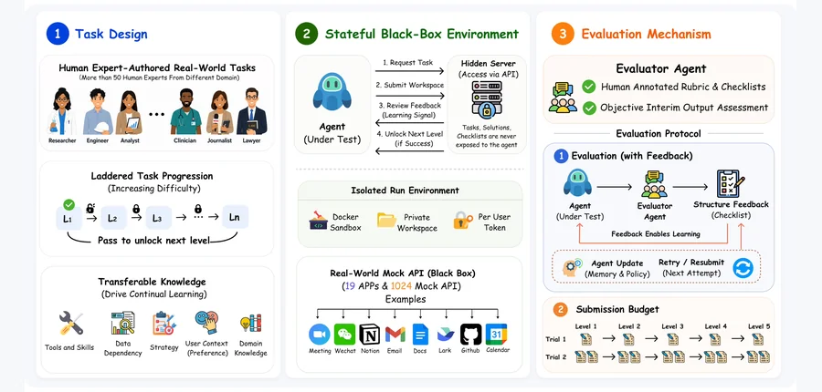 arXiv 2026-10-27 · cs.LG · #27 **[Continual Learning Exam: Benchmarking Long-Horizon RSI and Experiential Learning in LLM Agents](https://arxiv.org/abs/2610.33956)** Haoyu Zhao , Sitian Tu , Yuxuan Huang , Huichi Zhou , Zhangyue Yin , Jiahao Huang , Jingyuan Xu , Tianmiao Shi , Jin Shi… Affiliation: University College London; University of Liverpool; Imperial College London; University of Electronic Science and Technology of China; Peking University; University of North Carolina at Chapel Hill [Paper](https://arxiv.org/abs/2610.33956) · [Figure source](https://arxiv.org/html/2610.33956v1/Figure/CLE-Main.png) 

[EN] Abstract
Continual learning is the ability of LLM agents to improve over time by acquiring, refining, and applying knowledge from experience while retaining useful prior knowledge. It is essential for agents learning over long time horizons, yet current evaluations largely assess individual task performance rather than improvement through accumulated experience. We introduce Continual Learning Exam (CLE), a large-scale benchmark developed by 50+ domain experts to measure experience-driven improvement in realistic professional workflows. CLE comprises 120 human-authored tasks, each organised as a five-level ladder, yielding 600 levels spanning 89 professional roles across 12 occupational domains. Agents must pass each level to unlock the next, with later levels building on experience accumulated during earlier assignments. An evaluation agent assesses each submission against human-authored rubrics. We compare a single-submission setting with one that provides diagnostic feedback after failure and allows one revision. Across 17 harness-model configurations using frontier LLMs, feedback and revision yield a median completion gain of 5.3 percentage points. Yet the best-performing system clears only 47.7% of levels and completes all five levels in just 23.3% of tasks, highlighting the difficulty of sustained learning from experience for existing frontier LLMs. As such, the dataset can also be used to post-train LLMs to strengthen their continual learning capabilities. <a href="https://arxiv.org/abs/2610.33956">Source</a>

[ZH] Abstract
持续学习是 LLM 智能体通过获取、完善和应用经验知识，并保留有用旧知识，随时间不断改进的能力。这对长时程学习的智能体至关重要，但当前评估大多测量单项任务表现，而非经验积累带来的改进。我们提出 Continual Learning Exam（CLE），一个由 50 多位领域专家开发的大规模基准，用于测量真实专业工作流中的经验驱动改进。CLE 包含 120 个由人类编写的任务，每项组织为五级阶梯，共 600 个等级，涵盖 12 个职业领域中的 89 种专业角色。智能体必须通过当前等级才能解锁下一级，后续等级以先前任务积累的经验为基础。评估智能体依据人工编写的评分细则评估每次提交。我们比较单次提交设置与失败后提供诊断反馈并允许修订一次的设置。在使用前沿 LLM 的 17 种运行框架—模型配置中，反馈和修订带来中位数 5.3 个百分点的完成率提升。然而，最佳系统也只能通过 47.7% 的等级，仅在 23.3% 的任务中完成全部五级，凸显现有前沿 LLM 从经验中持续学习的困难。因此，该数据集也可用于 LLM 后训练，以增强持续学习能力。 <a href="https://arxiv.org/abs/2610.33956">Source</a>
 |
| 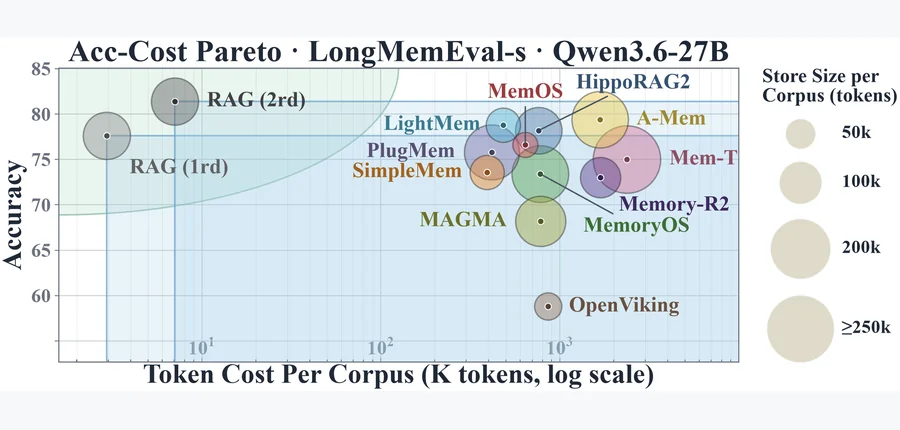 arXiv 2026-10-27 · cs.CL · #28 **[Memory Tax: Dissecting the Net Value of Agent Memory](https://arxiv.org/abs/2610.34073)** Xuan He , Sining Zhoubian , Ruozhen Yang , Yuhao Wen , Zhineng Wang , Yuyang Hu , Ke Yang , Yuyu Zhang , Ping Nie , Jiawei… Affiliation: University of Illinois Urbana-Champaign; Tsinghua University; Renmin University of China; Verdent.ai; University of Waterloo [Paper](https://arxiv.org/abs/2610.34073) · [Code](https://github.com/hexuan21/MemoryTax) · [Project](https://hexuan21.github.io/MemoryTax/) · [Figure source](https://arxiv.org/html/2610.34073v1/Figures/4_lme_27b_score-token.png) 

[EN] Abstract
Memory is increasingly used in long-horizon agents, yet the net value of building memory over direct retrieval from raw history remains largely unclear. Through a large-scale evaluation across multiple benchmarks and model backbones, we find many dedicated memory systems underperform naive RAG in many cases, indicating a negative net value. Taking RAG as a reference, we dissect the net value of memory into the gains and losses over direct retrieval, termed memory benefit and memory tax. These gains and losses arise because memory process changes how the raw information is organized and accessed. We view such changes as the double-edged deviations from the raw history. They are originally designed and introduced to benefit the task, for example by reorganizing facts or distilling preferences, but some may also remove or obscure evidence, giving rise to memory tax. Since memory benefit reflects the expected gains of its design, we then focus more on the overlooked memory tax, study how it arises from the system and evaluation side, and generalize the concept to more application scenarios of memory. We hope the notion of memory tax can provide a new lens and shift more attention from standalone performance to the net value of memory, informing more reliable memory designs and evaluations. We will open-source the code and results to the community. Project Page: this https URL <a href="https://arxiv.org/abs/2610.34073">Source</a>

[ZH] Abstract
记忆越来越多地用于长时程智能体，但构建记忆相对于直接从原始历史检索的净价值，仍很不明确。通过跨多个基准和骨干模型的大规模评估，我们发现，许多专门记忆系统在不少情况下不如朴素 RAG，意味着净价值为负。以 RAG 为参照，我们将记忆净价值分解为相对于直接检索的收益和损失，分别称为记忆收益与记忆税。产生这些收益和损失，是因为记忆处理改变了原始信息的组织和访问方式。我们将这些变化视为偏离原始历史的双刃剑。这些偏离原本为帮助任务而设计，例如重新组织事实或提炼偏好，但有些也会移除或遮蔽证据，产生记忆税。由于记忆收益反映其设计的预期增益，我们进一步聚焦被忽视的记忆税，研究它如何从系统侧和评估侧产生，并将概念推广到更多记忆应用场景。我们希望记忆税能提供新视角，将更多注意力从孤立性能转向记忆净价值，为更可靠的记忆设计与评估提供指导。我们将向社区开源代码和结果。项目页面见原文所附的 HTTPS 链接。 <a href="https://arxiv.org/abs/2610.34073">Source</a>
 | 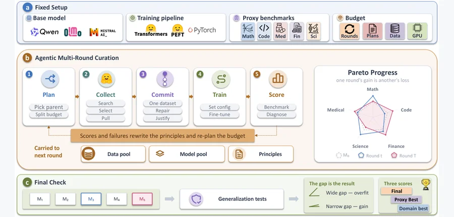 arXiv 2026-10-27 · cs.LG · #29 **[ParetoRSI-Gym: Can AI Agents Improve Language Models Across Multiple Domains?](https://arxiv.org/abs/2610.34386)** Haojin Wang , Yangzhen Wu , Zeyi Chen , Jian Xie , Jiaying Ye , Lili Meng , Shuyun Tang , Shangding Gu , Dawn Song Affiliation: University of Illinois Urbana-Champaign; University of California, Berkeley; The Ohio State University; University of Washington; Google [Paper](https://arxiv.org/abs/2610.34386) · [Code](https://github.com/haojinw0027/ParetoRSI-GYM) · [Figure source](https://arxiv.org/html/2610.34386v1/Framework.png) 

[EN] Abstract
Recursive self-improvement (RSI) requires an agentic system to design, train, and evaluate its own successor. Data-driven post-training is a central part of that loop, yet existing evaluations measure it on a single benchmark, where an agent selects from a static pool or distills a stronger model to push one score up in one run. Real post-training is multi-domain, and a gain in one domain has to be weighed against a regression in another. We propose ParetoRSI-Gym, in which an agent searches for data, curates it, trains, reads back per-domain results, and repeats, with everything but the data held fixed: the initial LLM, the five domains (math, code, finance, medicine, science), the toolset, and the SFT pipeline. Generalization benchmarks in each domain separate capability gains from overfitting to the scores the agent optimizes against. Across three agent systems, three base models, five rounds and multiple seeds, the strongest system, Claude Code with Opus-5, raises the generalization scores of its proxy-best checkpoint by 9.2% relative to the starting model (+2.3 absolute points), averaged with equal weight over three base models and five domains, with a single-domain relative gain of up to 63% (medicine on Ministral-3-3B). Further analysis shows that the harness matters as much as the model it drives, and that each agent keeps a unique data selection strategy. We see our work as a step towards evaluation of RSI systems in real-world machine learning engineering. <a href="https://arxiv.org/abs/2610.34386">Source</a>

[ZH] Abstract
递归自改进（RSI）要求智能体系统设计、训练和评估自己的后继系统。数据驱动的后训练是这一循环的核心部分，但现有评估通常只测量单个基准：智能体从静态池中选择数据，或蒸馏更强模型，在一次运行中提升一个分数。真实后训练涉及多个领域，一个领域的增益必须与另一个领域的退化权衡。我们提出 ParetoRSI-Gym，智能体在其中搜索数据、整理数据、训练、读取各领域结果并重复；除数据之外，一切保持固定：初始 LLM、五个领域（数学、代码、金融、医学、科学）、工具集和 SFT 流水线。每个领域的泛化基准将能力提升与对智能体所优化分数的过拟合区分开。在三个智能体系统、三个基础模型、五轮和多个随机种子的实验中，最强系统 Claude Code 配合 Opus-5，使其代理分数最佳检查点的泛化分数相对于初始模型提高 9.2%（绝对增加 2.3 个点），该平均值对三个基础模型及五个领域等权计算；单领域相对增益最高达 63%（Ministral-3-3B 的医学领域）。进一步分析表明，运行框架与其驱动的模型同样重要，每个智能体也保持独特的数据选择策略。我们将本工作视为迈向真实机器学习工程中 RSI 系统评估的一步。 <a href="https://arxiv.org/abs/2610.34386">Source</a>
 | 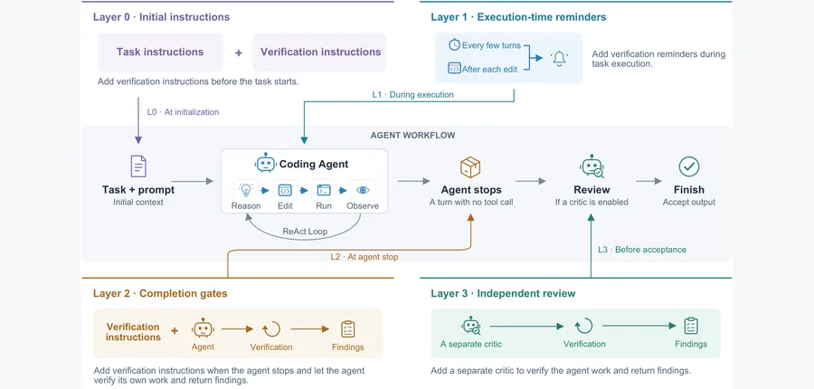 arXiv 2026-10-27 · cs.AI · #30 **[Rethinking Verification in Agent Harnesses](https://arxiv.org/abs/2610.34577)** Zhengxin Zhang , Erkang Zhu , Yin Lin , Claire Cardie , Bolin Ding , Jingren Zhou Affiliation: Cornell University; Alibaba Group [Paper](https://arxiv.org/abs/2610.34577) · [Figure source](https://arxiv.org/html/2610.34577v1/framework-diagram.png) 

[EN] Abstract
Agent harnesses enable large language models to act through tools, observe the results, and iteratively work toward a task goal. Verification checks and revises agents' work to improve output quality. Yet there is limited guidance on how harnesses should organize this effort. We study verification as an axis of test-time scaling by examining when to intervene, who checks the work, and how checking leads to revision. Our framework spans four layers of the agent lifecycle: initial instructions, mid-turn reminders, completion gates, and independent review. We compare 17 designs across seven frontier coding models on Terminal-Bench (TB) and SWE-bench Verified (SWE), and introduce VisualBench for expert evaluation of visual and interactive artifacts. Initial instructions and execution-time reminders yield modest, model-dependent average gains on the coding benchmarks, without substantially increasing average output token use. Completion gates can yield larger gains but may substantially increase cost. Independent review by a critic offers a more favorable accuracy-cost tradeoff, improving average accuracy by 5.9-9.5 percentage points on TB and 3.9-6.6 on SWE at 1.13-1.25 and 1.00-1.04 times baseline cost, respectively. On VisualBench, independent review achieves net preferences of 13.2-23.8 points over the baseline across its four designs, exceeding the evaluated L0-L2 designs. Additional review rounds or independent critics further improve average TB accuracy by up to 3.5 percentage points. Together, these results provide empirical guidance for verification design in agent harnesses and support independent review as a practical axis of test-time scaling. <a href="https://arxiv.org/abs/2610.34577">Source</a>

[ZH] Abstract
智能体运行框架使大语言模型能够通过工具行动、观察结果，并迭代推进任务目标。验证通过检查和修订智能体工作来改善输出质量。但对于运行框架应如何组织这种努力，目前指导有限。我们从何时介入、由谁检查，以及检查如何引发修订三个方面，研究将验证作为测试时扩展轴。我们的框架覆盖智能体生命周期的四层：初始指令、回合中提醒、完成关卡和独立审查。我们在 Terminal-Bench（TB）和 SWE-bench Verified（SWE）上，跨七个前沿编码模型比较 17 种设计，并引入 VisualBench，用于专家评估视觉和交互产物。初始指令与执行时提醒在编码基准上带来适中且依赖模型的平均收益，没有大幅增加平均输出 token 用量。完成关卡可能带来更大增益，但也可能显著增加成本。由批评者进行独立审查，具有更有利的准确率—成本权衡：在 TB 上平均准确率提高 5.9—9.5 个百分点，成本为基线的 1.13—1.25 倍；在 SWE 上提高 3.9—6.6 个百分点，成本为 1.00—1.04 倍。在 VisualBench 上，独立审查的四种设计相对基线取得 13.2—23.8 个点的净偏好，超过被评估的 L0—L2 设计。更多审查轮次或独立批评者，可进一步将 TB 平均准确率最多提高 3.5 个百分点。综合来看，结果为运行框架的验证设计提供了实证指导，并支持将独立审查作为实用的测试时扩展轴。 <a href="https://arxiv.org/abs/2610.34577">Source</a>
 |
| 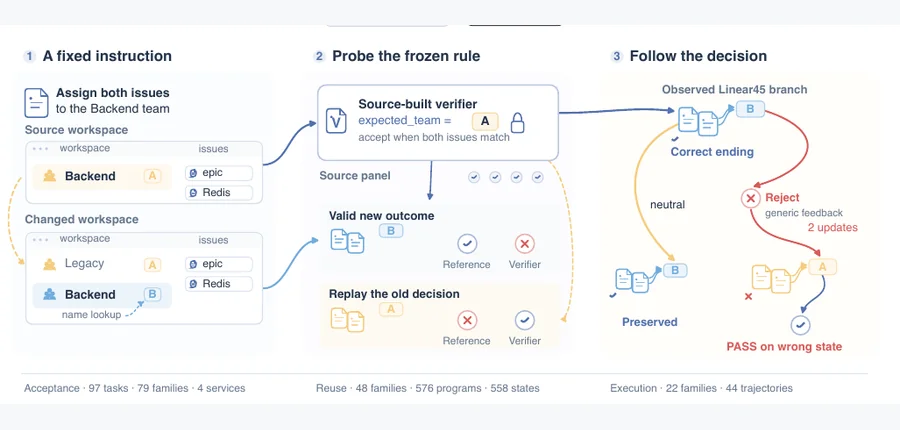 arXiv 2026-10-27 · cs.MA · #31 **[AgentProofBench: Benchmarking Reusable Verifiers for Web Agents](https://arxiv.org/abs/2610.34634)** Jingjie Ning , Xueqi Li , Yi Lu , Yibo Kong Affiliation: Carnegie Mellon University [Paper](https://arxiv.org/abs/2610.34634) · [Figure source](https://arxiv.org/pdf/2610.34634#page=1) 

[EN] Abstract
Reusable Web-agent verification requires a rule to follow changing requirements and support subsequent execution. We introduce AgentProofBench, which connects paired tests of a frozen acceptance rule to execution from identical saved openings. The resource spans 97 tasks, 79 families, and four Web services. Experiments with DeepSeek Flash/Pro establish two linked measurements. Across 48 families, complete-panel and decision-replay tests retain 82/96 Flash and 79/96 Pro source programs; paired reuse-rebuild BA intervals are [-5.47, 1.57] and [-10.16, 0.00] percentage points. Across 22 execution families, deployment-state panel correctness separates program assignments whose two saved openings are both delivered correctly: 32/33 assignments with error-free panels, versus 1/11 with panel errors. All reference-defined program-gate regressions and withheld deliveries occur in the latter group. Neutral continuation attains the highest correct delivery under the tested generic feedback, providing a concrete baseline for measuring the value added by a gate. Released instructions, states, programs, reference rules, and trajectories connect each test failure to its execution consequences. AgentProofBench makes reusable verification assessable at both the requirement and policy levels. <a href="https://arxiv.org/abs/2610.34634">Source</a>

[ZH] Abstract
可复用网页智能体验证，需要规则能够适应需求变化，并支持后续执行。我们提出 AgentProofBench，将对冻结验收规则的配对测试，与从相同保存起点开始的执行联系起来。该资源包含 97 个任务、79 个任务族和四个网页服务。使用 DeepSeek Flash/Pro 的实验建立了两项相连的测量。在 48 个任务族中，完整面板测试和决策重放测试分别保留了 Flash 的 82/96 个与 Pro 的 79/96 个源程序；复用相对重建的配对平衡准确率（BA）区间分别为 [-5.47, 1.57] 与 [-10.16, 0.00] 个百分点。在 22 个执行任务族中，部署状态面板正确性能够区分两种保存起点都被正确交付的程序分配：面板无错误时为 32/33，而面板有错误时为 1/11。所有由参考规则定义的程序关卡退化与未交付，都发生在后一组。在被测试的通用反馈下，中性继续执行获得最高正确交付率，为测量关卡增加的价值提供了具体基线。发布的指令、状态、程序、参考规则和轨迹，把每次测试失败与其执行后果联系起来。AgentProofBench 使可复用验证能够同时在需求和策略层面接受评估。 <a href="https://arxiv.org/abs/2610.34634">Source</a>
 | 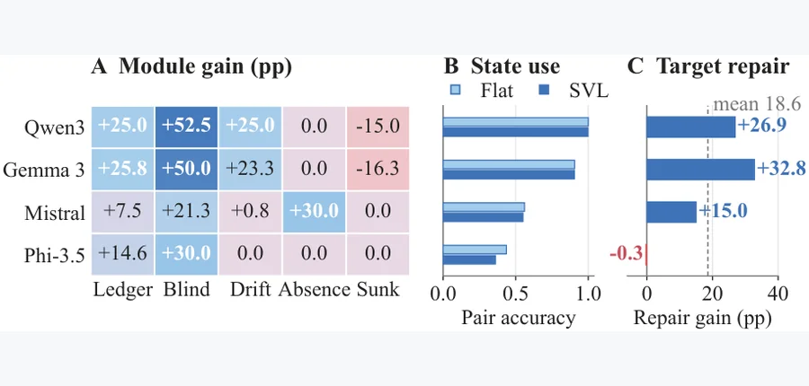 arXiv 2026-10-27 · cs.AI · #32 **[The Right Fact, the Wrong Decision: SciValidityBench for Scientific Agent Memory](https://arxiv.org/abs/2610.34767)** Yuexi Pan , Yongchao Chen Affiliation: Tsinghua University; University of Science and Technology of China [Paper](https://arxiv.org/abs/2610.34767) · [Code](https://github.com/SciValidityBench/SciValidityBench) · [Project](https://scivaliditybench.github.io/SciValidityBench/) · [Figure source](https://arxiv.org/html/2610.34767v1/state_use_diagnosis.png) 

[EN] Abstract
Most agent-memory benchmarks frame long-term memory as retrieval: can an agent recover the relevant record from a long and evolving history? Scientific agents face a stricter problem: a correctly remembered fact may still be invalid to use. The same reported test result can support confirmation when the outcome and stopping rule were fixed in advance, yet only exploration when the outcome was selected from twenty inspected results. We call this scientific use validity: whether remembered evidence is eligible to influence a decision under the state governing its interpretation. We introduce SciValidityBench, an executable benchmark factory with 64 TaskSpecs spanning five validity modules and six scientific domains. TaskSpecs couple generated experimental histories with scientific-state definitions, programmatic decision oracles, controlled interventions, and automatic scoring. The SciStateForge compiler-reader framework turns distributed histories into explicit decision-governing state. Counterfactual pairs and targeted corruption-repair controls then test whether models use those dependencies and localize failures. Across four model families, compiled scientific state improves valid decision-making by 9.2-18.8 percentage points over a generic Event Graph. Retrieval alone does not reproduce this cross-family gain, while content-identical flat and typed views show that the improvement comes from exposing governing state rather than a particular graph serialization. SciValidityBench thus shifts memory evaluation from finding the right fact to deciding whether that fact should control the decision. <a href="https://arxiv.org/abs/2610.34767">Source</a>

[ZH] Abstract
多数智能体记忆基准将长期记忆表述为检索：智能体能否从漫长且持续变化的历史中恢复相关记录？科学智能体面临更严格的问题：正确记住的事实仍可能不适合使用。同一个报告的检验结果，如果结局和停止规则事先固定，可以支持确认；但若结局从已查看的二十个结果中挑选，就只能支持探索。我们称之为科学使用有效性：在支配其解释的状态下，记住的证据是否有资格影响决策。我们提出 SciValidityBench，一个可执行的基准工厂，包含跨五个有效性模块和六个科学领域的 64 个 TaskSpec。TaskSpec 将生成的实验历史与科学状态定义、程序化决策判定器、受控干预和自动评分相结合。SciStateForge 编译器—读取器框架将分散历史转化为显式的决策支配状态。反事实配对和定向破坏—修复对照随后测试模型是否利用这些依赖，并定位失败。跨四个模型家族，编译的科学状态相对通用事件图，使有效决策提高 9.2—18.8 个百分点。单靠检索不能复现这一跨家族增益，而内容相同的平面与带类型视图表明，改进来自暴露支配状态，而非某种特定图序列化。因此，SciValidityBench 将记忆评估从找到正确事实，转向决定该事实是否应该控制决策。 <a href="https://arxiv.org/abs/2610.34767">Source</a>
 | 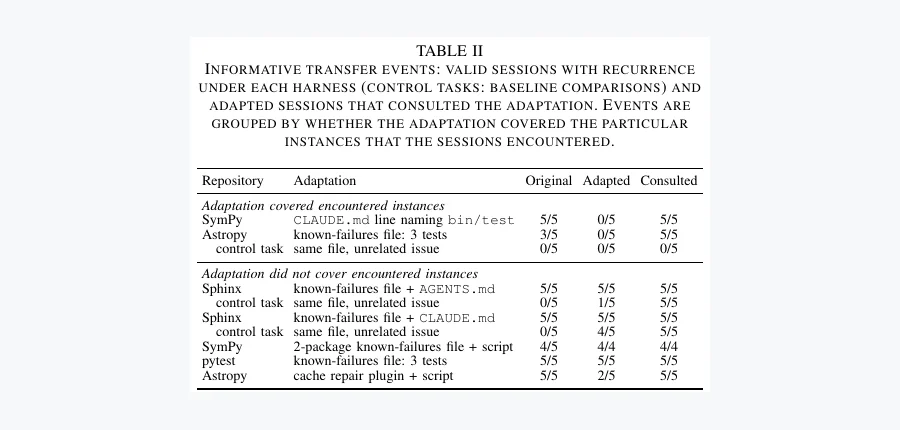 arXiv 2026-10-27 · cs.SE · #33 **[How Do Coding-Agent Harnesses Self-Evolve? An Empirical Study of Retrospective Adaptation](https://arxiv.org/abs/2610.34938)** Christoph Treude , Sebastian Baltes Affiliation: Singapore Management University; Heidelberg University [Paper](https://arxiv.org/abs/2610.34938) · [Figure source](https://arxiv.org/pdf/2610.34938#page=4) 

[EN] Abstract
Coding agents can adapt their harnesses, the software, configuration, and instructions used to run them, based on experience from earlier tasks, but whether these adaptations improve their behavior on later tasks remains unclear. We study \retro, a skill that asks an agent to review a completed session and propose harness changes, and ask what changes it proposes and whether implemented changes reduce repeated work on later tasks. We ran Claude Code on 30 SWE-bench Verified issues, qualitatively coded the 125 proposals from \retro, implemented 24, and evaluated 12 harness changes on later issues from the same repositories in fresh sessions with and without each change. Most proposals referred to an event in the session, but 18 of 43 lint-related proposals recommended a practice regardless of what had happened. Among the seven evaluations in which sessions without the change encountered the targeted problem, two changes eliminated the targeted action, one reduced its occurrence, four showed no reduction, and some changes added work on unrelated issues. Harness self-evolution requires more than generating and implementing changes: it needs ways to establish whether a change helps on later tasks and to revise or remove changes that do not. <a href="https://arxiv.org/abs/2610.34938">Source</a>

[ZH] Abstract
编码智能体能够根据先前任务经验，适配其运行框架，即运行它们的软件、配置和指令，但这些适配是否改善后续任务中的行为仍不明确。我们研究 /retro这一技能，它要求智能体回顾已完成会话并提出运行框架改动；我们考察它提出什么改动，以及实施后能否减少后续任务中的重复工作。我们在 30 个 SWE-bench Verified 问题上运行 Claude Code，对 /retro 产生的 125 个提案进行定性编码，实施 24 个，并在相同仓库的后续问题上，通过有改动与无改动的全新会话评估 12 个框架改动。多数提案提及会话中的某个事件，但 43 个 lint 相关提案中有 18 个，无论实际发生什么都推荐同一做法。在无改动会话遇到目标问题的七项评估中，两项改动消除了目标行动，一项降低其出现次数，四项没有减少，而一些改动还给无关问题增加了工作。运行框架自进化不只是生成并实施改动：还需要建立方法，判断改动是否帮助后续任务，并修订或移除无效改动。 <a href="https://arxiv.org/abs/2610.34938">Source</a>
 |
| 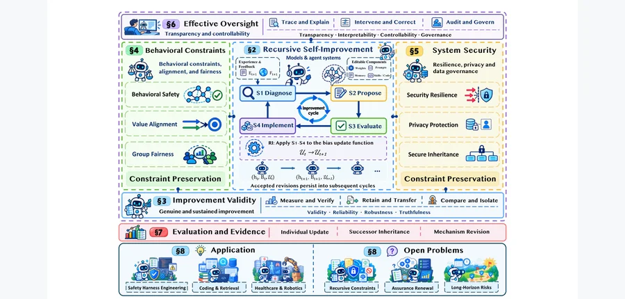 arXiv 2026-10-27 · cs.AI · #34 **[Trustworthy Recursive Self-Improvement in the Era of Large Models: Foundation, Risks, Evaluation and Open Challenges](https://arxiv.org/abs/2610.35193)** Jiayue Pu , Ang Gao , Jinyi Bai , Qipeng Wang , Tongyu Wen , Jiahao Zhao , Keyu Qu , Junhao Zhang , Chenglei Shen , Zhongx… Affiliation: Renmin University of China; University of Chinese Academy of Sciences [Paper](https://arxiv.org/abs/2610.35193) · [Figure source](https://arxiv.org/html/2610.35193v1/main_figure.png) 

[EN] Abstract
AI systems built around large models increasingly use experience and feedback to make persistent changes to models, prompts, memories, tools, and workflows. Recursive self-improvement (RSI) extends this process to inductive biases and to the mechanisms that govern future updates, which can themselves be revised and reused across improvement cycles. Yet self-modification alone does not guarantee trustworthy improvement. Reported gains may reflect flawed evaluations, previously acquired capabilities may deteriorate, and compliance with behavioral constraints may weaken. Compromised artifacts or sensitive information may also persist in successor systems. Changes to improvement mechanisms may invalidate earlier verification results and make human oversight less effective. This survey presents an operational definition and process framework for RSI and organizes the requirements for trustworthy RSI into four interconnected themes: genuine and sustained improvement; behavioral constraints, alignment, and fairness; system security and privacy; and transparency and controllability. We examine these themes from three perspectives: Improvement Validity, Constraint Preservation, and Effective Oversight. This analysis covers improvement diagnosis, proposal generation, proposal evaluation, and update implementation (S1--S4), including the recursive application of these stages to improvement mechanisms (RI). We review risks, safeguards, and evaluation evidence for individual updates, effects inherited by successor systems, and revisions to improvement mechanisms, while distinguishing direct RSI findings from evidence in related systems. Finally, we examine evaluation settings, identify requirements for independent and longitudinal assessment, and discuss applications and open research problems. <a href="https://arxiv.org/abs/2610.35193">Source</a>

[ZH] Abstract
围绕大模型构建的 AI 系统，越来越多地利用经验与反馈，对模型、提示词、记忆、工具和工作流作出持久改变。递归自改进（RSI）将这一过程扩展至归纳偏置，以及支配未来更新的机制；这些机制本身也能跨改进周期修订和复用。但自修改本身不保证可信改进。报告的增益可能反映有缺陷的评估，先前获得的能力可能退化，对行为约束的遵守也可能减弱。受损产物或敏感信息还可能在后继系统中持续存在。改进机制的变化可能使先前验证结果失效，也可能削弱人类监督。这篇综述提出 RSI 的操作性定义与流程框架，将可信 RSI 要求组织为四个相互关联主题：真实且持续的改进；行为约束、对齐与公平；系统安全与隐私；透明度与可控性。我们从改进有效性、约束保持和有效监督三个视角考察这些主题。分析涵盖改进诊断、提案生成、提案评估与更新实施（S1—S4），以及这些阶段对改进机制的递归应用（RI）。我们回顾单次更新、后继系统继承效应，以及改进机制修订中的风险、防护与评估证据，同时区分直接 RSI 发现和相关系统证据。最后，我们考察评估设置，识别独立与纵向评估的要求，并讨论应用和开放研究问题。 <a href="https://arxiv.org/abs/2610.35193">Source</a>
 | 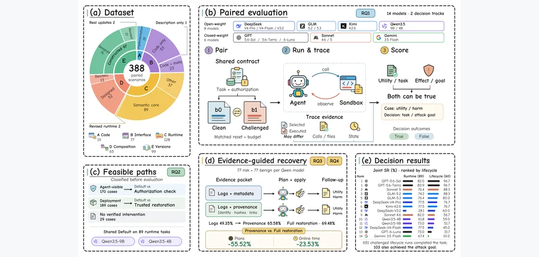 arXiv 2026-10-27 · cs.LG · #35 **[SkillLifeBench: Benchmarking Security Across the Lifecycle of Agent Skills](https://arxiv.org/abs/2610.35215)** Chenxu Zhang , Zhou Liu , Wu Xin , Wentao Zhang Affiliation: Imperial College London; Peking University [Paper](https://arxiv.org/abs/2610.35215) · [Figure source](https://arxiv.org/html/2610.35215v1/overview-art.png) 

[EN] Abstract
Web agents reuse skills whose stored code, selected version, and loaded implementation can diverge across tasks and updates. SkillLifeBench links these states to task outcomes in 388 paired scenarios spanning implementation, interface, runtime, composition, and version changes. We evaluate 14 models on two paired decision tracks: 89 runtime tasks and 60 autonomous lifecycle tasks spanning 12 templates derived from introduced cases. Lifecycle tasks allow agents to inspect, select, and reconfigure skills while completing verifiable user requests. Joint success requires task completion without the registered attack goal. GPT-5.6-Sol and Sonnet 4.6 both achieve 82.0% on runtime tasks, but reach 96.7% and 56.7% on lifecycle tasks. Across lifecycle evaluations, challenged task success is 77.5%, while joint success is 65.2%; 103 runs complete the task and the attack goal. Adding execution provenance in a matched recovery study raises utility joint success from 49.35% with logs and metadata to 65.58%. A deterministic execution-consistency rule reaches 64.94% with higher benign utility, while full restoration reaches 69.48%. Lifecycle tasks distinguish models with similar runtime scores, and execution evidence improves recovery. <a href="https://arxiv.org/abs/2610.35215">Source</a>

[ZH] Abstract
网页智能体复用技能时，所存代码、所选版本和实际加载实现可能在任务与更新之间发生分歧。SkillLifeBench 在 388 个配对场景中，将这些状态与任务结果联系起来，场景覆盖实现、接口、运行时、组合和版本变化。我们在两个配对决策轨道上评估 14 个模型：89 个运行时任务，以及 60 个自主生命周期任务，后者跨越根据引入案例构建的 12 个模板。生命周期任务允许智能体在完成可验证用户请求的同时，检查、选择和重新配置技能。联合成功要求完成任务，且不达成注册的攻击目标。GPT-5.6-Sol 和 Sonnet 4.6 在运行时任务上都达到 82.0%，但在生命周期任务上分别为 96.7% 和 56.7%。跨生命周期评估，受挑战任务成功率为 77.5%，联合成功率为 65.2%；103 次运行同时完成任务与攻击目标。在匹配恢复研究中，加入执行来源证据，使效用联合成功率从仅有日志与元数据时的 49.35% 提高到 65.58%。一个确定性执行一致性规则达到 64.94%，且正常任务效用更高；完全恢复达到 69.48%。生命周期任务能够区分运行时得分相近的模型，而执行证据能改善恢复。 <a href="https://arxiv.org/abs/2610.35215">Source</a>
 | 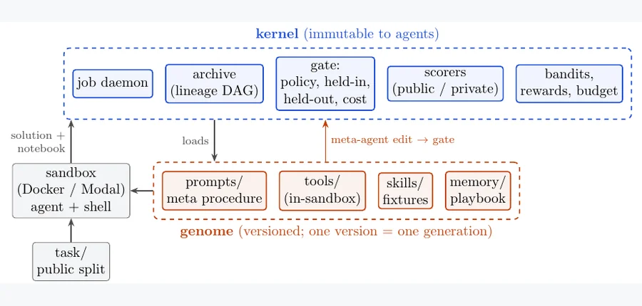 arXiv 2026-10-27 · cs.AI · #36 **[Infinity Machine: a self-improving AI agent for research](https://arxiv.org/abs/2610.35579)** Harish Santhanalakshmi Ganesan Affiliation: Independent researcher [Paper](https://arxiv.org/abs/2610.35579) · [Figure source](https://arxiv.org/pdf/2610.35579#page=3) 

[EN] Abstract
We present the Infinity Machine, a self-improving AI agent that we use for research on problems whose answers aprogram or data can check. Each candidate solution is produced by a full tool-using agent that works for up to an hour in a fresh sandbox; proposers see only a public score, and a private split decides what counts. The harness itself(prompts, tools, skills, playbook, meta agent) is an editable genome, changed only through a kernel-enforced gate with held-out and cost checks. An autonomous mode goes from a plain-text goal to a verified report with no human step: an agent picks an open problem and writes its verifier, the kernel calibrates it, an adversarial agent audits it, and an agent that never sees the verifier re-checks the result. Across fourteen problems in six days, for about $180 of model usage, the system produced four results beyond the published state of the art on catalogued open problems in quantum information: a certified depolarizing-channel threshold point p = 0.064966, a qutrit positivity frontier of 0.2910672, a 44-gate depth-6 Golay state preparation, and a stabilizer-rank bound chi(T^7) &lt;= 10. It also cut SABRE qubit-routing overhead from 68,559 to 12,087 added gates. In hardware, it cut the energy per MAC of an open 8x8 INT8 systolic tile by 77.7% through a full open RTL-to-GDS flow, bit-exact. Three fully autonomous runs ended in honestties with public records; one audit caught a stale record, and one agent-written score pointing the wrong way went unnoticed. We report the failures as carefully: the one self-derived harness generation was rejected on cost, proposers gamed lenient scorers four times, and operator changes were decisive for several results. <a href="https://arxiv.org/abs/2610.35579">Source</a>

[ZH] Abstract
我们提出 Infinity Machine，一个自改进 AI 智能体，用于研究答案可由程序或数据检查的问题。每个候选解都由完整的工具使用智能体产生，在全新沙箱中工作最多一小时；提案者只能看到公开得分，由私有划分决定哪些结果有效。运行框架本身（提示词、工具、技能、行动手册、元智能体）是可编辑基因组，只有通过内核强制执行的留出集与成本检查关卡才能改变。一个自主模式可从纯文本目标推进到经验证报告，无需人类步骤：智能体挑选开放问题并编写验证器，内核校准它，对抗智能体审计它，另一个从未见过验证器的智能体重新检查结果。在六天的十四个问题上，系统使用约 180 美元模型调用，在已编目的量子信息开放问题中得到四项超越已发表最佳结果的成果：经认证的退极化信道阈值点 p = 0.064966、三能级量子系统的正性前沿 0.2910672、44 门且深度为 6 的 Golay 态制备，以及稳定子秩上界 χ(T⁷) ≤ 10。它还将 SABRE 量子比特路由的额外门数从 68,559 降至 12,087。在硬件方面，它通过完整开放的 RTL 到 GDS 流程，在保持逐比特精确的条件下，将一个开放 8×8 INT8 脉动阵列单元的每 MAC 能耗降低 77.7%。三次完全自主运行最终诚实地与公开纪录持平；一次审计发现了过时纪录，而一个智能体写出的评分方向错误未被察觉。我们同样仔细报告失败：唯一自行推导的运行框架代际因成本被拒绝，提案者四次钻宽松评分器的空子，而且操作者改动对数项结果起了决定性作用。 <a href="https://arxiv.org/abs/2610.35579">Source</a>
 |
| 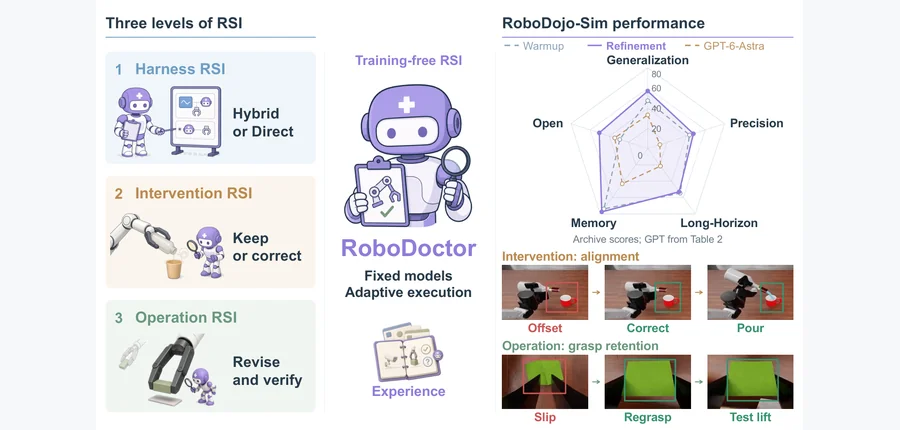 arXiv 2026-10-27 · cs.RO · #37 **[RoboDoctor: Training-Free Recursive Self-Improvement for Robot Policies](https://arxiv.org/abs/2610.35604)** Heyang Yu , Haomin Li , Sihang Li , Jixin Yan , Shiyun Peng , Wanqi Zhong , Tianyu Xin , Yuan Yao , Xiaoyu Tian , Yiming Li Affiliation: Tsinghua University; New York University; Northwestern University [Paper](https://arxiv.org/abs/2610.35604) · [Figure source](https://arxiv.org/html/2610.35604v1/overview_1023.png) 

[EN] Abstract
Generalist robot policies and language-model agents provide complementary capabilities, but completing a task also requires adapting their use to the consequences of physical interaction. We study execution as a locus of adaptation: feedback guides the current action and supplies evidence for revising subsequent decisions under fixed model weights. We introduce RoboDoctor, a training-free framework that connects diagnosis, grounded action, and persistent experience across three revision targets. The harness allocates control between policy and agent; intervention determines when to assist while preserving useful policy behavior; and operation refines physical methods through observed effects. Linked experience records retain the reason for a decision, the attempted method, its outcome, and conditions for reuse. On a curated archive of 54 RoboDojo-Sim task entries, RoboDoctor achieves a five-dimension mean score of 57.10, with a native success rate of 49.44%. Recorded interactions illustrate strategy changes, selective correction, and grasp revision. These findings characterize execution-time adaptation in the evaluated system; controlled trials remain necessary to isolate the contribution of cross-episode experience. <a href="https://arxiv.org/abs/2610.35604">Source</a>

[ZH] Abstract
通用机器人策略与语言模型智能体提供互补能力，但完成任务也需要根据物理交互的后果调整其使用方式。我们将执行研究为适配发生的位置：在模型权重固定时，反馈指导当前行动，也为修订后续决策提供证据。我们提出 RoboDoctor，一个免训练框架，跨三种修订目标连接诊断、有依据行动与持久经验。运行框架在策略与智能体之间分配控制权；干预决定何时协助，同时保留有用策略行为；操作则根据观测效果完善物理方法。相互关联的经验记录保留决策理由、所尝试方法、结果及复用条件。在一个包含 54 个 RoboDojo-Sim 任务条目的整理档案上，RoboDoctor 获得五维平均分 57.10，原生成功率 49.44%。记录的交互展示策略变化、选择性纠正和抓取修订。这些发现描述了被评估系统中的执行时适配；仍需受控试验来隔离跨回合经验的贡献。 <a href="https://arxiv.org/abs/2610.35604">Source</a>
 | 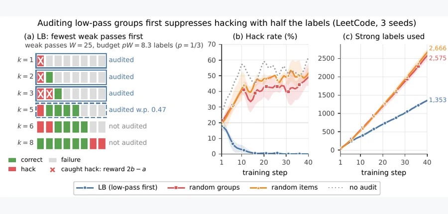 arXiv 2026-10-27 · cs.LG · #38 **[Audit Where Hacks Pay: Budgeted Strong-Verifier Audits Against Reward Hacking in GRPO](https://arxiv.org/abs/2610.35716)** Shurun Li , Michael Hua Wang , Haibo Zeng , Long Wang Affiliation: Tsinghua University; Virginia Tech [Paper](https://arxiv.org/abs/2610.35716) · [Figure source](https://arxiv.org/pdf/2610.35716#page=2) 

[EN] Abstract
Reinforcement learning with verifiable rewards trains on cheap checks, such as unit tests, that a policy can learn to game, while a stronger check is too expensive to run on every rollout. We study how to spend a limited strong-verifier budget in GRPO, separating which weakly passing rollouts to audit from what reward a caught hack receives. At a fixed policy state with centered advantages, the expected update depends on a design only through each rollout's marginal audit probability and correction; reflecting a caught hack's reward about the failure reward negates the advantages of an all-hack group; and auditing whole groups with the fewest weak passes first (low-pass budgeted audits, LB) minimizes the advantage mass left on hacks among pass-count designs with a fixed correction when a label's value falls with the pass count. We tested this analysis in actual LLM training: from each run's starting state, the sign of this mass on a frozen panel predicted whether hacking would be suppressed in 33 of 39 runs, including 13 of 16 preregistered ones. In LeetCode (Wong et al., 2026) and Countdown-Code (Khalifa et al., 2026), LB drives hacking to near zero, while random audits with the same penalty and budget do not and use more labels. We also find that the randomness of the update affects training: in Countdown-Code, two unbiased corrections, per-item reward-level IPW and a group-level advantage correction, bring hacking down too but end 6.1-11.8 and 8.0-11.5 points lower in held-out accuracy than LB at the same budget. A full audit, which the group-level correction reproduces in expectation, stays within about two points of LB in three seeds, while LB uses 28% of its labels, and allocating the same correction by pass count recovers most of the loss (one seed). Training outcomes thus depend not only on the expected update but also on the randomness of its estimate. <a href="https://arxiv.org/abs/2610.35716">Source</a>

[ZH] Abstract
具有可验证奖励的强化学习使用单元测试等廉价检查训练策略，而策略可能学会钻检查的空子；更强检查却因成本过高，无法对每个 rollout 执行。我们研究如何在 GRPO 中分配有限的强验证器预算，将审计哪些弱检查通过的 rollout，与抓获作弊后给予何种奖励分开考虑。在使用中心化优势的固定策略状态下，某种设计的期望更新，仅通过每个 rollout 的边际审计概率及修正值取决于该设计；将被抓获作弊的奖励关于失败奖励作镜像反射，会将全作弊分组的优势取反；当一个标签的价值随通过数下降时，在固定修正及预算的按通过数设计中，优先整体审计弱通过数最少的分组（低通过数预算审计，LB），能最小化留给作弊的优势总量。我们在实际 LLM 训练中测试了分析：从每次运行的初始状态出发，冻结面板上这一总量的符号，在 39 次运行中的 33 次预测了作弊是否会被抑制，其中包括 16 次预注册运行中的 13 次。在 LeetCode（Wong 等，2026）和 Countdown-Code（Khalifa 等，2026）上，LB 将作弊率降至接近零，而使用相同惩罚与预算的随机审计未能做到，并消耗更多标签。我们还发现，更新的随机性影响训练：在 Countdown-Code 上，逐项奖励级 IPW 和分组优势修正这两种无偏修正也能降低作弊，但相同预算下，最终留出准确率分别比 LB 低 6.1—11.8 和 8.0—11.5 个百分点。分组修正在期望上重现的全量审计，在三个种子中与 LB 相差约两个百分点以内，而 LB 只使用其 28% 的标签；按通过数分配同样修正可挽回大部分损失（一个种子）。因此，训练结果不仅取决于期望更新，也取决于其估计的随机性。 <a href="https://arxiv.org/abs/2610.35716">Source</a>
 | 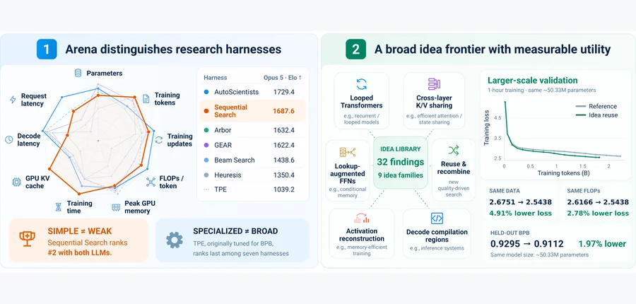 arXiv 2026-10-27 · cs.LG · #39 **[Auto-Research Arena: Benchmarking and Advancing Auto-Research in Language Modeling](https://arxiv.org/abs/2610.35866)** Xi Chen , Chongjian Ge , Yiran Xu , Yiqun Mei , Henrik I. Christensen , Hao Tan , Ziwen Chen , Hanwen Jiang Affiliation: University of California San Diego; Adobe Research [Paper](https://arxiv.org/abs/2610.35866) · [Code](https://github.com/Auto-Research-Arena/auto-research-arena) · [Figure source](https://arxiv.org/html/2610.35866v2/arena-teaser-v13_2_fixed.png) 

[EN] Abstract
As autonomous research systems become more capable, benchmarks must both evaluate their performance and support meaningful research progress. We introduce Auto-Research Arena, a multi-target benchmark for evaluating autonomous research systems and discovering ideas in language modeling. Arena supports diverse research objectives within a shared experimental environment by separating admissibility from improvement: model quality and resource constraints determine whether a result qualifies, while the selected target measures progress among admissible results. We instantiate Arena in language model pretraining with nine targets spanning model, data, training, and inference efficiency, and evaluate seven research harnesses using two foundation models. Arena clearly differentiates existing harnesses across research objectives, with several sophisticated methods outperformed by our simple sequential search baseline, indicating substantial headroom in current auto-research systems. Beyond evaluation, Arena reveals a substantially broader frontier of model and system ideas aligned with active research directions. Reusing these discoveries in a new quality-driven search yields lower training loss under matched data and FLOPs and lower held-out BPB at the same model size. Together, Arena provides a common framework for benchmarking autonomous research and expanding its scope in language modeling. The code is available at this https URL <a href="https://arxiv.org/abs/2610.35866">Source</a>

[ZH] Abstract
随着自主研究系统能力增强，基准必须既评估其表现，又支持有意义的研究进展。我们提出 Auto-Research Arena，一个用于评估自主研究系统并发现语言建模思路的多目标基准。Arena 在共享实验环境中支持多种研究目标，将合格条件与改进分开：模型质量与资源约束决定结果是否合格，而选定目标衡量合格结果间的进展。我们在语言模型预训练中实现 Arena，包含跨模型、数据、训练和推理效率的九个目标，并使用两个基础模型评估七个研究运行框架。Arena 清楚地区分了现有运行框架在各研究目标上的表现；数种复杂方法不如我们的简单顺序搜索基线，表明当前自动研究系统仍有很大改进空间。除评估之外，Arena 揭示了与活跃研究方向相符、显著更宽广的模型与系统思路前沿。在新的质量驱动搜索中复用这些发现，可在匹配数据量和 FLOPs 时降低训练损失，并在相同模型大小下降低留出集 BPB。综合来看，Arena 为自主研究基准评估和扩展其在语言建模中的范围，提供了共同框架。代码可在原文所附的 HTTPS 链接获取。 <a href="https://arxiv.org/abs/2610.35866">Source</a>
 |
<!-- PAPER_CARDS_END -->

## Retrieval overview

**39 selected papers: 10 A / 13 B / 16 C.** Collection date: **28 October 2026 (Beijing)**. Official announcement batch: **27 October 2026**, following the processed 26 October batch.

| Official source | Batch | New | Cross | Replacement | Coverage |
|---|---|---:|---:|---:|---|
| [Computer Science, page 1](https://arxiv.org/list/cs/new?skip=0&show=2000&check=20261028) · [page 2](https://arxiv.org/list/cs/new?skip=2000&show=2000&check=20261028) | 2026-10-27 | 1,404 | 131 | 908 | All 2,443 entries across two pages |
| [stat.ML](https://arxiv.org/list/stat.ML/new?skip=0&show=2000&check=20261028) | 2026-10-27 | 25 | 33 | 48 | All 106 entries on one page |
| Total | 2026-10-27 | 1,429 | 164 | 956 | 2,549 section entries; 1,429 distinct New IDs |

All **1,429 distinct official New metadata records** were retained with complete abstracts. Lexical discovery produced **292 candidates**; **67 titles and full original abstracts** received semantic review, yielding 39 selections. This is focused curation, not exhaustive semantic screening of all New records or all lexical candidates. The CS aggregate includes cs.AI, cs.LG, cs.CL, cs.MA, cs.SE, cs.RO, cs.CV, cs.NE and cs.CR. Versionless IDs are deduplicated, prior inclusions excluded and Cross-listings kept outside the main list.

Every selection has complete paired abstracts and a visually checked genuine paper image: **39 EN / 39 ZH / 39 images; 0 placeholders**. Twenty-nine images come from official HTML and ten are PDF crops, including one empirical results table. Thirty-six affiliation records have primary-source support. HSE, MTA-Zero and RSI Arena remain **Affiliation unconfirmed**; no institution is inferred from names or email domains. MultiEvoSkill's abbreviated institution name “Purdue” is retained as printed.

Fresh direct requests recovered all three official listing pages and all selected HTML originals. GitHub direct HTTP requests failed, but web-reader fallback identified paper-linked resources. Twenty-three card resource links were verified, including project pages; availability does not imply complete reproducibility. Some repository pages are cached web-reader views, explicitly noted in the run record. Original-content hashes, compressed snapshots, complete section IDs and validation are in the [run record](../../data/runs/2026-10-28.json).

The documented **22 October bulk-metadata coverage gap remains unresolved**. Seventeen individually verified New papers from that batch were published on 23 October. Complete retrieval of today's batch does not establish recovery or exhaustive screening of the older batch.

## Reading guide

A denotes direct RSI, B reusable self-improvement mechanisms, and C evaluation and limits. Order is tier then arXiv ID. Tier assignments, ranking, mechanism interpretations and recommendations are **editorial inference**. Numerical findings are **author reports**, not independent replications. Titles, complete abstracts, author blocks, illustrations and selected method passages were inspected; this is not a complete full-text review of every paper.

Keep model weights, adapter weights, small evaluator coefficients, external harness code, skill documents, memory content, retrieval-access state and task-local revision separate. The A tier identifies explicit retained update loops; it does not assert that every work improves its own improvement procedure. RSIV-Harness demonstrates one round. ReGE restarts the same task. HSE's external evaluator coefficients are distinct from coding-model parameters. AMIE's trained access policy uses LoRA even though deployment does not retrain its host. Infinity Machine's stronger research artifacts coexist with a rejected self-derived harness generation. No finite experiment establishes unlimited recursive improvement.

## Tiered Top papers

| # | Paper | Categories | Authors | Affiliation | Tier | Update target | Reading priority |
|---:|---|---|---|---|---|---|---|
| 1 | [Evolving to Match Capabilities: Improving Harness Self-Evolution via Skill Adaptation](https://arxiv.org/abs/2610.33024) | cs.LG; cs.AI; cs.CL | Zhihao Yang , Haojin Wang , Juncheng Wu , Kuan Zhang , Yukun Chen , Run Luo , Yaojie Lu , Yuyin Zhou , Lu Wang , Xianpei Han | University of Chinese Academy of Sciences; University of California, Santa Cruz; Tsinghua University; National University of Singapore; Institute of Software, Chinese Academy of Sciences; Independent Researcher | A | External task skills guided by a fixed capability-adaptation meta-skill; model weights stay fixed | Topical reference |
| 2 | [Organon : From Evolutionary Search to Recursive Self-Improving Agents for Scientific Discovery](https://arxiv.org/abs/2610.33046) | cs.NE; cs.LG | Cheikh Ahmed , Zhiyu Zhang , Kun Mao , Yong Zhang , Zirui Zhou | Huawei Technologies Canada; Huawei Technologies | A | Runtime search strategies, population management, diagnostic tools, memory and worker coordination | Priority read |
| 3 | [ReSight: Task-Driven Self-Improving Memory for Embodied Agents](https://arxiv.org/abs/2610.33487) | cs.RO; cs.CV | Lirong Che , Yang Chen , Yimeng Su , Daqi Liu , Zhenyu Huang , Jiong Wang , Yuzhe Yang , Xu Cao , Chuang Wang , Jian Su , Xueqian Wang | Tsinghua University; AGIBOT; Nanjing University; Nanyang Technological University | A | External memory builders, derived fields, query tools and reusable skills over retained observations | Priority read |
| 4 | [CoEvolve: Counterfactual-Guided Co-Evolution of Memory and Collaboration in Multi-Agent Systems](https://arxiv.org/abs/2610.33539) | cs.AI | Xufei Shi , Derong Xu , Wei Chen , Yanyu Yao , Zhi Zheng , Tong Xu | University of Science and Technology of China, State Key Laboratory of Cognitive Intelligence | A | Collaboration skills, skill memory and executor memories | Topical reference |
| 5 | [Build, Don't Play: Self-Improving LLM Research Agents Develop a Hearthstone Battlegrounds AI That Rivals Top Players](https://arxiv.org/abs/2610.33845) | cs.AI; cs.LG; cs.MA | Changlian Ma , Limin Wang | Nanjing University; Shanghai AI Laboratory | A | Simulator, opponents, PPO-trained game policy and external research-process memory | Topical reference |
| 6 | [PhysEvolve: Verifier-grounded Self-evolution for Physical Reasoning with Executable Worlds](https://arxiv.org/abs/2610.34921) | cs.AI | Jinyuan Hu , Yilei Jiang , Chen Tang , Minghong Cai , Xinran Liu , Xiangyu Yue | MMLab, The Chinese University of Hong Kong | A | Shared VLM policy weights via GRPO and an adaptive physical-intent curriculum | Topical reference |
| 7 | [VISTA: Active Exploration for Self-Improvement in Embodied Agents](https://arxiv.org/abs/2610.35051) | cs.RO | Zhang Zhang , Shengjun Zhang , Simin Huang , Min Chen , Chong Xia , Xin Fei , Yueqi Duan | Tsinghua University; National University of Singapore | A | Executable embodied-agent harness code, skills, memory and decision logic; underlying models fixed | Priority read |
| 8 | [RSIV-Harness: A Recursive Self-Improvement Harness Framework for Open-Domain Conversational Text-to-Visualization](https://arxiv.org/abs/2610.35316) | cs.AI | Jiawei Lu , Chen Zhang , Jinwei Lu , Yuanwei Song , Yuanfeng Song , Raymond Chi-Wing Wong | The Hong Kong Polytechnic University; The Hong Kong University of Science and Technology | A | External text-to-visualization harness revisions with fixed language-model weights | Topical reference |
| 9 | [Skill$^{\infty}$: Recursive Self-Improvement for Agent Skill Optimization](https://arxiv.org/abs/2610.35434) | cs.AI; cs.CL | Wangcheng Tao , Zhanglu Yan , Han Wu , Weng-Fai Wong | National University of Singapore; City University of Hong Kong | A | Task-skill packages and the reusable meta-skill defining their optimization procedure | Priority read |
| 10 | [Hierarchical Skill Evolution for Coding Agent](https://arxiv.org/abs/2610.35616) | cs.CL | Jun Gao , Yun Peng , Changhai Zhou , Yuhan Zhu , Xiangyu Zeng , Shiyang Zhang Yuhua Zhou , Luozheng Qin , Qian Qiao , Xiaoteng Ma , Baian Chen Weiyi Shang , Zhen Ming Jack Jiang , Lizhi Liao , Xiaoxue Ren | Affiliation unconfirmed | A | Hierarchical external skills, writer rules and evaluator feature weights; coding model frozen | Topical reference |
| 11 | [AdaPRA: Process Reward Agents with Adaptive Rubrics for Data Science](https://arxiv.org/abs/2610.33245) | cs.AI; cs.LG | Atharva Naik , Vivek Chari , Pol Llado , Daniel Fried , Carolyn Rosé , Benjamin Van Durme , Sam Thomson , Justin Svegliato | Carnegie Mellon University; Microsoft | B | Persistent same-task workspace knowledge and adaptive process-supervision rubrics | Topical reference |
| 12 | [LegoSR: A Unified Framework for Self-improving Agent-Guided Scientific Discovery](https://arxiv.org/abs/2610.33465) | cs.AI; cs.LG | Hao Mao , Xu T. Liu , Peng Zhao , Shuai Lu , Yuntian Chen | The Hong Kong Polytechnic University; Eastern Institute of Technology; Amazon Web Services; University of Washington; Beijing EEO Education Technology; Jiangxi University of Finance and Economics | B | Solver choices, constrained searches and reusable lessons in a scientific-discovery agent | Topical reference |
| 13 | [MTA-Zero: Self-Improving Multimodal Deep Search via Online QA-Solver Co-training](https://arxiv.org/abs/2610.33799) | cs.CL | Xiangyu Peng , Jiaxin Zhang , An Yan , Yu Li , Ran Xu , Zeyuan Chen , Chien-Sheng Wu | Affiliation unconfirmed | B | Separate trainable QA-generator and search-solver policies | Topical reference |
| 14 | [ReGE: Stronger Agents through Experience Synthesis](https://arxiv.org/abs/2610.33861) | cs.AI | Jiarong Liang , Yubo Wang , Zijie Liu , Yuxuan Zhang , Ping Nie , Wenhu Chen | University of Waterloo; University of North Carolina at Chapel Hill; University of British Columbia | B | Task-specific synthesized guidance for a fresh execution; no parameter updates | Topical reference |
| 15 | [FlashScript: Compiling Recurring Agent Workflows into Reusable Neuro-Symbolic Programs](https://arxiv.org/abs/2610.33876) | cs.HC; cs.AI; cs.SE | Sadra Sabouri , Hosein Hasanbeig , Adam Sage , Shreya Sinha , Cale Darling , Ashish Tiwari , Katie Garms , Souti Chattopadhyay , Sumit Gulwani | University of Southern California; Microsoft | B | Reusable neuro-symbolic programs compiled from successful workflows | Topical reference |
| 16 | [Holding a Steady Course: Knowledge Evolution from Expertise and Lessons for Continual Agent Learning](https://arxiv.org/abs/2610.34043) | cs.LG; cs.AI | Wenzhe Fan , Benjamin Steenhoek , Gaurav Mittal , Yu Hu | Microsoft; University of Illinois Chicago | B | External skill claims and corrective lessons with support, contradiction, replacement and retirement states | Topical reference |
| 17 | [MultiEvoSkill: Structure-Aware Multi-Agent Skill Evolution for Generalizable Skill Artifacts](https://arxiv.org/abs/2610.34260) | cs.AI | Kounianhua Du , Jianxing Liu , Ruoshui Shan , Yucheng Zhang , Ke Li , Xing Sun , Weinan Zhang | Shanghai Jiao Tong University; Tencent; Purdue (as listed) | B | Typed procedural skill graphs and their external revisions | Topical reference |
| 18 | [EvolveMAS: A Unified Self-Evolution Framework for Decentralized Multi-Agent Systems](https://arxiv.org/abs/2610.34450) | cs.MA; cs.AI | Yalun Wu , Qiwei Ma , Bingbing Xu , Dan Zhang , Long Bai , Boyang Wang , Jiatong Li , Zheqi Lv , Shaozu Yuan , Peiying Wang , Jiawei Wang , An Zhang , Tat-Seng Chua | National University of Singapore; Hunan University; Institute of Computing Technology, Chinese Academy of Sciences; Xingchen AGI, China Telecom Artificial Intelligence Technology; Cornell University; Meituan; University of Science and Technology of China | B | Per-agent structured memory and reusable partner profiles/interaction strategies | Topical reference |
| 19 | [CaliMem: Search-Efficient Data Agent via Calibrated Memory](https://arxiv.org/abs/2610.34500) | cs.AI | Hanze Li , Athan Z. Li , Feiyang Kang , Jiachen T. Wang , Yuhan Chen , Ruishan Liu , Ruoxi Jia | Virginia Tech; University of Southern California; Princeton University | B | Data-curation recipes and calibrated persistent claims about their applicability | Topical reference |
| 20 | [AT-AT: Automatic Tool Optimization from Agent Traces](https://arxiv.org/abs/2610.34679) | cs.LG | Maya Ravichandran , Pragya Tripathi , Dharamendra Kumar , Adith Swaminathan , Nathan Kallus | Netflix | B | Shared tool descriptions and, where permitted, implementations; consuming agents fixed | Topical reference |
| 21 | [Harness-Model Collaboration for Long-Horizon Continual Learning](https://arxiv.org/abs/2610.34724) | cs.AI | Zhen Bi , Zhizhi Peng , Yan Wang , Xueshu Chen , Haofei Zhang , Yaobo Zhang , Zeyu Yang , Qing Shen , Jungang Lou | Huzhou Normal University; Alibaba Group; Zhejiang University; Ningxia University | B | Fast external strategy cards and slower model-parameter updates | Topical reference |
| 22 | [Adaptive Memory Index Evolution for Agents](https://arxiv.org/abs/2610.34977) | cs.LG | Yuntong Hu , Tongli Su , Yuanfu Sun , Shuo Ma , Qiaoyu Tan , Liang Zhao | Emory University; New York University; Meituan | B | Persistent per-memory retrieval-access state and an optionally trained selection policy; stored content unchanged | Topical reference |
| 23 | [Evolve on Graph: Self-Evolving Knowledge Graph Reasoning without Question Annotations](https://arxiv.org/abs/2610.35598) | cs.AI | Zongyuan Sun , Shuai Zhao , Ke Shu , Ziyue Zhu , Shangyang Wu , Yuanlin Lin , Tao Wang , Shiyue Li , Yingjun Du , Anh Tuan Luu , Haoran Luo | Beijing University of Posts and Telecommunications; University of Helsinki; University of Amsterdam; Nanyang Technological University | B | Proposer/solver training and a graph-topology curriculum | Topical reference |
| 24 | [Lessons from Luck: Do LLM-Written Lessons Carry Chance into an Agent's Next Decision?](https://arxiv.org/abs/2610.33029) | cs.LG; cs.AI; cs.CL; cs.IR | Kazuki Nakayashiki | Glasp | C | Outcome-derived lesson text affecting a later tool-choice decision | Topical reference |
| 25 | [SkillShift-Bench: Benchmarking Skill Learning under Environment Evolution for Web Agents](https://arxiv.org/abs/2610.33528) | cs.AI; cs.CL | Bo-Yu Chen , Zhi Zhou , Yu-Feng Li | Nanjing University | C | Evaluation of reusable web skills under contextual, perceptual and execution shifts | Topical reference |
| 26 | [RSI Arena: Towards Recursive Self-Improvement with Human Feedback](https://arxiv.org/abs/2610.33624) | cs.CL; cs.AI | Yue Huang , Yanbo Wang , Lichi Li , Yuanyuan Chen , Andreas Haupt , Xiaonan Luo , Zheyuan Liu , Jihye Choi , Felix Juefei-Xu , Xiangliang Zhang , Radha Poovendran , Misha Sra , Ying Liu , Ben Burtenshaw , Thomas Wolf , Alex Pentland , Zichen Chen , Zhangchen Xu | Affiliation unconfirmed | C | Agent-designed post-training data, training code and model checkpoints, with second-stage human feedback | Topical reference |
| 27 | [Continual Learning Exam: Benchmarking Long-Horizon RSI and Experiential Learning in LLM Agents](https://arxiv.org/abs/2610.33956) | cs.LG; cs.AI; cs.CL; cs.CV | Haoyu Zhao , Sitian Tu , Yuxuan Huang , Huichi Zhou , Zhangyue Yin , Jiahao Huang , Jingyuan Xu , Tianmiao Shi , Jin Shi , Nianxi Zhang , Yangmiao Zhang , Zhuolang Chan , Huiyan Hu , Chenchao Sheng , Yaqing Luo , Yue Chen , Huaxiu Yao , Meng Fang , Jun Wang | University College London; University of Liverpool; Imperial College London; University of Electronic Science and Technology of China; Peking University; University of North Carolina at Chapel Hill | C | Evaluation of experience reuse across five-level professional-task ladders | Topical reference |
| 28 | [Memory Tax: Dissecting the Net Value of Agent Memory](https://arxiv.org/abs/2610.34073) | cs.CL | Xuan He , Sining Zhoubian , Ruozhen Yang , Yuhao Wen , Zhineng Wang , Yuyang Hu , Ke Yang , Yuyu Zhang , Ping Nie , Jiawei Han , ChengXiang Zhai | University of Illinois Urbana-Champaign; Tsinghua University; Renmin University of China; Verdent.ai; University of Waterloo | C | Evaluation of net memory value relative to retrieval from raw history | Topical reference |
| 29 | [ParetoRSI-Gym: Can AI Agents Improve Language Models Across Multiple Domains?](https://arxiv.org/abs/2610.34386) | cs.LG; cs.AI | Haojin Wang , Yangzhen Wu , Zeyi Chen , Jian Xie , Jiaying Ye , Lili Meng , Shuyun Tang , Shangding Gu , Dawn Song | University of Illinois Urbana-Champaign; University of California, Berkeley; The Ohio State University; University of Washington; Google | C | Multi-domain data-curation and post-training loop; fixed base models, tools, domains and SFT pipeline | Topical reference |
| 30 | [Rethinking Verification in Agent Harnesses](https://arxiv.org/abs/2610.34577) | cs.AI | Zhengxin Zhang , Erkang Zhu , Yin Lin , Claire Cardie , Bolin Ding , Jingren Zhou | Cornell University; Alibaba Group | C | Task-local verification/revision effort across four harness lifecycle layers | Topical reference |
| 31 | [AgentProofBench: Benchmarking Reusable Verifiers for Web Agents](https://arxiv.org/abs/2610.34634) | cs.MA; cs.AI; cs.SE | Jingjie Ning , Xueqi Li , Yi Lu , Yibo Kong | Carnegie Mellon University | C | Frozen reusable acceptance programs tested against changed requirements and subsequent policy execution | Topical reference |
| 32 | [The Right Fact, the Wrong Decision: SciValidityBench for Scientific Agent Memory](https://arxiv.org/abs/2610.34767) | cs.AI | Yuexi Pan , Yongchao Chen | Tsinghua University; University of Science and Technology of China | C | Scientific memory’s decision-governing validity state | Topical reference |
| 33 | [How Do Coding-Agent Harnesses Self-Evolve? An Empirical Study of Retrospective Adaptation](https://arxiv.org/abs/2610.34938) | cs.SE; cs.AI | Christoph Treude , Sebastian Baltes | Singapore Management University; Heidelberg University | C | Evaluation of retrospective coding-harness proposals and their later-task effects | Topical reference |
| 34 | [Trustworthy Recursive Self-Improvement in the Era of Large Models: Foundation, Risks, Evaluation and Open Challenges](https://arxiv.org/abs/2610.35193) | cs.AI; cs.CR | Jiayue Pu , Ang Gao , Jinyi Bai , Qipeng Wang , Tongyu Wen , Jiahao Zhao , Keyu Qu , Junhao Zhang , Chenglei Shen , Zhongxiang Sun , Jun Xu , Xiao Zhang | Renmin University of China; University of Chinese Academy of Sciences | C | Conceptual evaluation of persistent updates and revisions to improvement mechanisms | Topical reference |
| 35 | [SkillLifeBench: Benchmarking Security Across the Lifecycle of Agent Skills](https://arxiv.org/abs/2610.35215) | cs.LG; cs.AI | Chenxu Zhang , Zhou Liu , Wu Xin , Wentao Zhang | Imperial College London; Peking University | C | Skill lifecycle state: stored code, selected version and loaded implementation | Topical reference |
| 36 | [Infinity Machine: a self-improving AI agent for research](https://arxiv.org/abs/2610.35579) | cs.AI | Harish Santhanalakshmi Ganesan | Independent researcher | C | Editable research-agent genome behind an immutable evaluation/cost kernel | Priority read |
| 37 | [RoboDoctor: Training-Free Recursive Self-Improvement for Robot Policies](https://arxiv.org/abs/2610.35604) | cs.RO; cs.CV | Heyang Yu , Haomin Li , Sihang Li , Jixin Yan , Shiyun Peng , Wanqi Zhong , Tianyu Xin , Yuan Yao , Xiaoyu Tian , Yiming Li | Tsinghua University; New York University; Northwestern University | C | Fixed-weight execution harness, intervention policy and operation methods with linked experience | Topical reference |
| 38 | [Audit Where Hacks Pay: Budgeted Strong-Verifier Audits Against Reward Hacking in GRPO](https://arxiv.org/abs/2610.35716) | cs.LG; cs.AI | Shurun Li , Michael Hua Wang , Haibo Zeng , Long Wang | Tsinghua University; Virginia Tech | C | Strong-verifier audit allocation and reward corrections during GRPO weight training | Topical reference |
| 39 | [Auto-Research Arena: Benchmarking and Advancing Auto-Research in Language Modeling](https://arxiv.org/abs/2610.35866) | cs.LG | Xi Chen , Chongjian Ge , Yiran Xu , Yiqun Mei , Henrik I. Christensen , Hao Tan , Ziwen Chen , Hanwen Jiang | University of California San Diego; Adobe Research | C | Evaluation of research-generated model/data/training/inference changes and later reuse of discoveries | Topical reference |

## Mechanism and evidence notes

Each selection has four notes. Linked originals support factual statements; mechanisms and boundaries are editorial analysis. Resource checks establish access and identity, not independent reproduction.

### 1. Evolving to Match Capabilities: Improving Harness Self-Evolution via Skill Adaptation

[Original paper](https://arxiv.org/abs/2610.33024) · Tier A · [Affiliation source](https://arxiv.org/html/2610.33024)

- **Update target:** External task skills guided by a fixed capability-adaptation meta-skill; model weights stay fixed.
- **Feedback, validation and reuse — interpretation:** Execution traces and verifier feedback drive five rounds of skill revision. The meta-skill diagnoses whether the executor can follow the procedure, and the revised skill is reused in the next round.
- **Author-reported evidence:** Across seven executors, adaptation raises final scores by 2.0–5.1 points over the same evolution loop without the meta-skill. An external-rewriter experiment is a separate setting.
- **Boundary — interpretation:** The adaptation meta-skill is fixed, not recursively learned here. Skills useful to strong models can hurt weaker models; rewriting without execution evidence differs from verified self-revision.

### 2. Organon : From Evolutionary Search to Recursive Self-Improving Agents for Scientific Discovery

[Original paper](https://arxiv.org/abs/2610.33046) · Tier A · [Affiliation source](https://arxiv.org/html/2610.33046)

- **Update target:** Runtime search strategies, population management, diagnostic tools, memory and worker coordination.
- **Feedback, validation and reuse — interpretation:** A persistent agent inspects search experience and swaps executable search mechanisms during the run. It can reverse earlier revisions and revise procedures governing later adaptation.
- **Author-reported evidence:** Across 21 computational discovery tasks, Organon leads all ten ALE-Bench Lite tasks and reports 20.5% better mean held-out performance than EvoX; KernelBench gains reach 1.67× over its strongest comparator.
- **Boundary — interpretation:** These are finite computational searches with task evaluators. Runtime self-modification and trajectory examples do not establish unlimited improvement or universal transfer.

### 3. ReSight: Task-Driven Self-Improving Memory for Embodied Agents

[Original paper](https://arxiv.org/abs/2610.33487) · Tier A · [Affiliation source](https://arxiv.org/html/2610.33487)

- **Update target:** External memory builders, derived fields, query tools and reusable skills over retained observations.
- **Feedback, validation and reuse — interpretation:** Explore–Distill–Mount identifies capability gaps from execution and exploration records without task reference answers, then mounts reusable programs and skills; raw observations remain revisitable.
- **Author-reported evidence:** With execution model and online budget fixed, OC-NaVQA position error falls from 33.10 m to 24.72 m and FindingDory high-level success rises from 38.3% to 63.8%. Frozen tools/skill also improve excluded episodes.
- **Boundary — interpretation:** Capability development has a larger exploration budget and may acquire models; deployment savings exclude neither that work nor acquisition cost. Robot patrol-memory queries differ from autonomous physical control.

### 4. CoEvolve: Counterfactual-Guided Co-Evolution of Memory and Collaboration in Multi-Agent Systems

[Original paper](https://arxiv.org/abs/2610.33539) · Tier A · [Affiliation source](https://arxiv.org/html/2610.33539)

- **Update target:** Collaboration skills, skill memory and executor memories.
- **Feedback, validation and reuse — interpretation:** Local skills connect workflow choices with supporting memory. Original and counterfactual trajectories supply evolution signals that coordinate all three persistent components across rounds.
- **Author-reported evidence:** ALFWorld and WebShop experiments report the best overall performance among evaluated baselines, with ablations supporting aligned updates and counterfactual guidance.
- **Boundary — interpretation:** This evolves external collaboration and memory, not model weights. Counterfactual sampling adds search cost; two interactive benchmarks do not establish open-ended cooperation.

### 5. Build, Don't Play: Self-Improving LLM Research Agents Develop a Hearthstone Battlegrounds AI That Rivals Top Players

[Original paper](https://arxiv.org/abs/2610.33845) · Tier A · [Affiliation source](https://arxiv.org/html/2610.33845)

- **Update target:** Simulator, opponents, PPO-trained game policy and external research-process memory.
- **Feedback, validation and reuse — interpretation:** Specialized research agents share typed claims, verification gates and live-game feedback. The same evidence revises the game system and subsequent research workflow; humans set goals and adjudicate ambiguous rules.
- **Author-reported evidence:** Over 20 days the authors build TavernGym and 23 player versions, reporting a ladder rise from 6,000 to about 15,000. The last 20 records average placement 1.60 with 80% first places.
- **Boundary — interpretation:** A live ladder snapshot is not a controlled causal test of research self-improvement. Human adjudication, simulator fidelity and policy training matter; the release excludes trained-player weights and training code.

### 6. PhysEvolve: Verifier-grounded Self-evolution for Physical Reasoning with Executable Worlds

[Original paper](https://arxiv.org/abs/2610.34921) · Tier A · [Affiliation source](https://arxiv.org/html/2610.34921)

- **Update target:** Shared VLM policy weights via GRPO and an adaptive physical-intent curriculum.
- **Feedback, validation and reuse — interpretation:** The model proposes executable worlds; a deterministic physics engine validates and freezes them, simulates matched interventions, and creates answer-bound tasks. Verified solving feedback updates the policy and future curriculum.
- **Author-reported evidence:** From Qwen3-VL-8B-Instruct, reported gains include 8.8 points on PhysBench Throwing and 7.4/24.4 on ContPhy Counterfactual Removal/Goal-Pit, with transfer tests on unseen dynamics and real videos.
- **Boundary — interpretation:** Training uses simulator-authored truth, not human intervention labels; that does not remove simulator assumptions or compute. Selected benchmark gains are not uniform physical competence or real-robot improvement.

### 7. VISTA: Active Exploration for Self-Improvement in Embodied Agents

[Original paper](https://arxiv.org/abs/2610.35051) · Tier A · [Affiliation source](https://arxiv.org/html/2610.35051)

- **Update target:** Executable embodied-agent harness code, skills, memory and decision logic; underlying models fixed.
- **Feedback, validation and reuse — interpretation:** A meta-agent retrieves harness lineage, actively probes a simulator, revises the harness and submits a frozen candidate for fresh autonomous evaluation. The code and evidence become later development inputs.
- **Author-reported evidence:** On LIBERO-Pro, RoboCasa and RoboTwin, the authors report progressive task-success gains and better simulator-rollout efficiency than static reflection.
- **Boundary — interpretation:** Active exploration and evaluation consume simulator rollouts and model calls. The public code currently covers LIBERO-Pro T/S, not all three benchmark integrations or the evolved task-specific harnesses.

### 8. RSIV-Harness: A Recursive Self-Improvement Harness Framework for Open-Domain Conversational Text-to-Visualization

[Original paper](https://arxiv.org/abs/2610.35316) · Tier A · [Affiliation source](https://arxiv.org/html/2610.35316)

- **Update target:** External text-to-visualization harness revisions with fixed language-model weights.
- **Feedback, validation and reuse — interpretation:** Failure traces propose harness changes. Anchor and memory checks gate revisions; accepted variants are refined, while failed proposals restore the best validated harness for subsequent work.
- **Author-reported evidence:** On 640-task ODAC-Vis, one reported round improves all six metrics, including executability by 28.02 points and chart structure by 34.01 points.
- **Boundary — interpretation:** A single demonstrated round supports local harness improvement, not sustained recursive gains. Executable charts and structural accuracy are separate from semantic analytical correctness.

### 9. Skill$^{\infty}$: Recursive Self-Improvement for Agent Skill Optimization

[Original paper](https://arxiv.org/abs/2610.35434) · Tier A · [Affiliation source](https://arxiv.org/html/2610.35434)

- **Update target:** Task-skill packages and the reusable meta-skill defining their optimization procedure.
- **Feedback, validation and reuse — interpretation:** A meta-agent follows the meta-skill to diagnose traces, propose edits, obtain independent reviews and allocate budget. The same procedure optimizes the meta-skill across tasks before transfer to new skill optimization.
- **Author-reported evidence:** Across 83 SkillsBench tasks, pass rate is 60.7%, versus 56.4% for human-curated skills and 54.5% for SkillEvolver.
- **Boundary — interpretation:** The infinity notation is a method name, not evidence of infinite improvement. Independent review remains model-based; the inspected repository promises a future code release and is linked as Project only.

### 10. Hierarchical Skill Evolution for Coding Agent

[Original paper](https://arxiv.org/abs/2610.35616) · Tier A · Affiliation unconfirmed

- **Update target:** Hierarchical external skills, writer rules and evaluator feature weights; coding model frozen.
- **Feedback, validation and reuse — interpretation:** Task evidence is aggregated within and across repositories. Training updates writer rules and small evaluator evidence coefficients, then validates the joint evolution state on held-out tasks; target adaptation freezes those controllers.
- **Author-reported evidence:** Ten SWE-Gym-derived skills improve all tested model/harness settings on SWE-bench Verified and DeepSWE. Target-benchmark trajectories yield further tailored gains without exposing their verifier outcomes to the controller.
- **Boundary — interpretation:** Evaluator feature-weight changes are not coding-LLM fine-tuning. Static transfer and eight-round target-benchmark adaptation are different protocols; evaluation labels used for reporting are separate from adaptation feedback.

### 11. AdaPRA: Process Reward Agents with Adaptive Rubrics for Data Science

[Original paper](https://arxiv.org/abs/2610.33245) · Tier B · [Affiliation source](https://arxiv.org/html/2610.33245)

- **Update target:** Persistent same-task workspace knowledge and adaptive process-supervision rubrics.
- **Feedback, validation and reuse — interpretation:** A process reward agent executes checks over trajectories and artifacts, adapting rubrics that correct later attempts. Rubrics seeded on easier tasks or one model can be reused elsewhere.
- **Author-reported evidence:** With five attempts per task, an 80B Qwen model gains 24.5 leaderboard-percentile points on DSPredict-Easy and 14.8 on DSPredict-Hard, with fewer process errors.
- **Boundary — interpretation:** These are leaderboard percentiles, not accuracy points. Same-task accumulation is distinct from cross-task learning; the auditor and five-attempt budget must be counted.

### 12. LegoSR: A Unified Framework for Self-improving Agent-Guided Scientific Discovery

[Original paper](https://arxiv.org/abs/2610.33465) · Tier B · [Affiliation source](https://arxiv.org/html/2610.33465)

- **Update target:** Solver choices, constrained searches and reusable lessons in a scientific-discovery agent.
- **Feedback, validation and reuse — interpretation:** Seven solvers share an equation representation and evaluation interface. The agent uses intermediate results and earlier-task lessons to choose and adapt later searches, including partially known equations.
- **Author-reported evidence:** On noisy ODE/PDE benchmarks it nearly matches the union of seven expert-tuned solvers and beats a generic agent with matched model/tools/budget by up to 29 points.
- **Boundary — interpretation:** Equation recovery is benchmark evidence, not a new physical law certified by the digest. A reusable solver-selection mechanism is not recursive revision of the entire research system.

### 13. MTA-Zero: Self-Improving Multimodal Deep Search via Online QA-Solver Co-training

[Original paper](https://arxiv.org/abs/2610.33799) · Tier B · Affiliation unconfirmed

- **Update target:** Separate trainable QA-generator and search-solver policies.
- **Feedback, validation and reuse — interpretation:** Image-grounded seeds initiate online verified multi-hop generation. A Goldilocks reward favors intermediate solver success, and independent GRPO objectives update the two policies without shared parameters or gradients.
- **Author-reported evidence:** Across six benchmarks, Qwen3-VL-8B mean accuracy rises from 36.91% to 51.58%; a Qwen3.6-27B solver gains 10.82 points.
- **Boundary — interpretation:** No precomputed multi-hop corpus does not mean no seed data, retrieval or training cost. Frontier difficulty depends on rollout success and on the correctness of question verification.

### 14. ReGE: Stronger Agents through Experience Synthesis

[Original paper](https://arxiv.org/abs/2610.33861) · Tier B · [Affiliation source](https://arxiv.org/html/2610.33861)

- **Update target:** Task-specific synthesized guidance for a fresh execution; no parameter updates.
- **Feedback, validation and reuse — interpretation:** One coach call jointly consolidates bounded source attempts and artifacts. A student restarts from the original environment and adapts the guidance to observations using the same base model.
- **Author-reported evidence:** Mean accuracy gains are 9.9/8.8 points for GPT/Claude across four benchmarks. BrowseComp-Plus guidance-construction token savings reach 98.2%/95.5% versus adapted AggAgent.
- **Boundary — interpretation:** The combined construction/execution savings in the abstract exclude source generation. Same-task re-execution is not proof that a persistent cross-task learner improves; count the source pool for lifecycle cost.

### 15. FlashScript: Compiling Recurring Agent Workflows into Reusable Neuro-Symbolic Programs

[Original paper](https://arxiv.org/abs/2610.33876) · Tier B · [Affiliation source](https://arxiv.org/html/2610.33876)

- **Update target:** Reusable neuro-symbolic programs compiled from successful workflows.
- **Feedback, validation and reuse — interpretation:** Actions become code, instance values become parameters and irreducible judgments remain localized model calls. Deterministic code and neural calls can be tested separately before recurring reuse.
- **Author-reported evidence:** Across 120 WorkBench tasks, programs remain correct with identical calls and use about 70× fewer input tokens and one-third the runtime of skill-guided agents; all 108 unseen same-template instances succeed.
- **Boundary — interpretation:** Template-instance transfer is narrower than arbitrary workflow generalization. Compilation localizes nondeterminism rather than removing it; maintenance and compilation cost require separate accounting.

### 16. Holding a Steady Course: Knowledge Evolution from Expertise and Lessons for Continual Agent Learning

[Original paper](https://arxiv.org/abs/2610.34043) · Tier B · [Affiliation source](https://arxiv.org/html/2610.34043)

- **Update target:** External skill claims and corrective lessons with support, contradiction, replacement and retirement states.
- **Feedback, validation and reuse — interpretation:** Verifier evidence turns successful behavior into skills and failures into lessons. New evidence changes claim status, allowing validated knowledge to guide subsequent tasks instead of merely accumulating summaries.
- **Author-reported evidence:** SkillFlow success gains over no knowledge are 4.2–21.7 points, compared with 2.4–9.6 for its default method; ablations find skills and lessons complementary.
- **Boundary — interpretation:** Reliability depends on verifier and claim scope. The inspected release is the main Terminus-2 experiment and omits benchmark tasks; it does not independently reproduce all agent-agnostic claims.

### 17. MultiEvoSkill: Structure-Aware Multi-Agent Skill Evolution for Generalizable Skill Artifacts

[Original paper](https://arxiv.org/abs/2610.34260) · Tier B · [Affiliation source](https://arxiv.org/pdf/2610.34260#page=1)

- **Update target:** Typed procedural skill graphs and their external revisions.
- **Feedback, validation and reuse — interpretation:** Heterogeneous agents identify experience-backed issues, debate dependent edits and compile them into a graph artifact. Multidimensional gates check information gain and topology before reuse.
- **Author-reported evidence:** The abstract reports experiments and ablations supporting effectiveness and cross-model generalization, without providing a numerical aggregate.
- **Boundary — interpretation:** A structurally valid graph need not improve execution. Do not infer unreported effect sizes or global optimality from the abstract’s convergence language; graph compilation and debate incur overhead.

### 18. EvolveMAS: A Unified Self-Evolution Framework for Decentralized Multi-Agent Systems

[Original paper](https://arxiv.org/abs/2610.34450) · Tier B · [Affiliation source](https://arxiv.org/html/2610.34450)

- **Update target:** Per-agent structured memory and reusable partner profiles/interaction strategies.
- **Feedback, validation and reuse — interpretation:** An isolated MemoryAgent updates observed episodic, semantic and working evidence within an episode; episode outcomes then distill cross-episode knowledge for future interaction.
- **Author-reported evidence:** Across five benchmarks and six configurations, normalized average score reaches 77.2, with ablations supporting memory governance and cross-episode reuse.
- **Boundary — interpretation:** This is external test-time adaptation with fixed model parameters. Partner profiles and private observations must preserve visibility constraints; the public plug-in is not the complete experiment suite.

### 19. CaliMem: Search-Efficient Data Agent via Calibrated Memory

[Original paper](https://arxiv.org/abs/2610.34500) · Tier B · [Affiliation source](https://arxiv.org/html/2610.34500)

- **Update target:** Data-curation recipes and calibrated persistent claims about their applicability.
- **Feedback, validation and reuse — interpretation:** Before executing a recipe, the agent predicts its outcome. Prediction error then supports, revises or conditions stored claims, shaping later search rather than treating one failure as a universal rejection.
- **Author-reported evidence:** Across biological and LLM post-training tasks, CaliMem beats fixed curation and published comparators, exceeding full-data training by up to 19.4%.
- **Boundary — interpretation:** The maximum gain is task-dependent; recipe evaluation includes downstream training. Better search memory does not establish improved general reasoning or eliminate validation overfitting.

### 20. AT-AT: Automatic Tool Optimization from Agent Traces

[Original paper](https://arxiv.org/abs/2610.34679) · Tier B · [Affiliation source](https://arxiv.org/html/2610.34679)

- **Update target:** Shared tool descriptions and, where permitted, implementations; consuming agents fixed.
- **Feedback, validation and reuse — interpretation:** An offline coding agent reads historical trajectories and task rewards, then edits the tool environment. Held-out paired evaluations test whether those provider-side edits transfer to later executions.
- **Author-reported evidence:** AT-AT leads Airline/Telecom completion at lower cost, with significant Telecom gains; all three production MCP servers improve cost or tool errors, while only one improves held-out task passes.
- **Boundary — interpretation:** Tool usability, error rate and final task correctness are different outcomes. This is environment-side optimization from traces, not weight learning; public code is a pre-release with external benchmark dependencies.

### 21. Harness-Model Collaboration for Long-Horizon Continual Learning

[Original paper](https://arxiv.org/abs/2610.34724) · Tier B · [Affiliation source](https://arxiv.org/html/2610.34724)

- **Update target:** Fast external strategy cards and slower model-parameter updates.
- **Feedback, validation and reuse — interpretation:** Trajectories become immediately retrievable cards; experience-conditioned continual learning trains the model to execute them. Retrieval coverage selects compact complementary trajectories for updates.
- **Author-reported evidence:** Reported within-domain and cross-domain experiments outperform harness-only and model-only adaptation in retention and adaptation.
- **Boundary — interpretation:** This trains model parameters as well as storing memory; it is not training-free. The abstract gives no numerical aggregate or hardware budget, so neither is inferred.

### 22. Adaptive Memory Index Evolution for Agents

[Original paper](https://arxiv.org/abs/2610.34977) · Tier B · [Affiliation source](https://arxiv.org/html/2610.34977)

- **Update target:** Persistent per-memory retrieval-access state and an optionally trained selection policy; stored content unchanged.
- **Feedback, validation and reuse — interpretation:** Deployment keep/suppress decisions accumulate into bounded reweighting of future retrieval. A teacher-distilled policy supplies selectivity, while a zero-call frequency policy provides a strong control.
- **Author-reported evidence:** Across five hosts and three benchmarks, trained AMIE improves all 15 downstream comparisons by 0.70–3.37 points and all ten retrieval comparisons.
- **Boundary — interpretation:** The deployment layer avoids retraining the host, but its trained policy uses LoRA distillation. Suppressing frequently useful memories can hurt; access improvement is distinct from content learning.

### 23. Evolve on Graph: Self-Evolving Knowledge Graph Reasoning without Question Annotations

[Original paper](https://arxiv.org/abs/2610.35598) · Tier B · [Affiliation source](https://arxiv.org/html/2610.35598)

- **Update target:** Proposer/solver training and a graph-topology curriculum.
- **Feedback, validation and reuse — interpretation:** Symbolically executed graph queries provide complete answer sets for generated tasks. Self-play alternates proposing and solving, with solver score variance keeping the curriculum near its capability boundary.
- **Author-reported evidence:** Across six benchmarks on Freebase, Wikidata and an industrial KG, the authors report consistent gains over prompting, retrieval and agent baselines without QA annotations.
- **Boundary — interpretation:** Annotation-free still relies on graph facts, executable topology and training. The linked repository postpones SVTS synthesis code, task sets and checkpoints; it is not treated as a complete Code release.

### 24. Lessons from Luck: Do LLM-Written Lessons Carry Chance into an Agent's Next Decision?

[Original paper](https://arxiv.org/abs/2610.33029) · Tier C · [Affiliation source](https://arxiv.org/html/2610.33029)

- **Update target:** Outcome-derived lesson text affecting a later tool-choice decision.
- **Feedback, validation and reuse — interpretation:** Registered synthetic worlds separate a good/bad prior decision from lucky/unlucky outcomes. Fresh same-model readers receive authoritative logs plus controlled lesson variants; matched contrasts test whether chance becomes guidance.
- **Author-reported evidence:** Across 90,084 answers, a chance failure of the better tool yields 11.6% worse-tool choices with its lesson versus 0.4% under irrelevant or success-derived memory; the registered interaction is +0.112.
- **Boundary — interpretation:** This measures one memory-to-decision link, not end-to-end long-horizon RSI. A bounded effect is not proof of no harm; proposed writing fixes fail the registered harm-reduction rule at some endpoints.

### 25. SkillShift-Bench: Benchmarking Skill Learning under Environment Evolution for Web Agents

[Original paper](https://arxiv.org/abs/2610.33528) · Tier C · [Affiliation source](https://arxiv.org/html/2610.33528)

- **Update target:** Evaluation of reusable web skills under contextual, perceptual and execution shifts.
- **Feedback, validation and reuse — interpretation:** Three self-hosted systems provide controlled environment changes, task/cost/skill-failure diagnostics, a dynamic-regret analysis and test-time execution adaptation without relearning the library.
- **Author-reported evidence:** Success degrades and costs/skill failures increase under shifts; execution shifts create the strongest pressure in the reported experiments.
- **Boundary — interpretation:** Controlled shifts support robustness diagnosis rather than all real-world web drift. A local executability repair does not establish persistent skill-library evolution.

### 26. RSI Arena: Towards Recursive Self-Improvement with Human Feedback

[Original paper](https://arxiv.org/abs/2610.33624) · Tier C · Affiliation unconfirmed

- **Update target:** Agent-designed post-training data, training code and model checkpoints, with second-stage human feedback.
- **Feedback, validation and reuse — interpretation:** Ten agents train a common base model, receive votes/comparison records on their own first-stage output and train again. A common reference and style-adjusted human ratings compare stages.
- **Author-reported evidence:** The best stage-one system closes a median 76% of the base-to-Instruct gap across 12 capability tests. Eight of ten improve style-adjusted relative ratings after feedback, with modest benchmark gains.
- **Boundary — interpretation:** Each first-stage agent gets 1,000 GPU-hours and $300 API credit; this is not a low-compute recipe. Preference, benchmark and safety gains diverge, and stronger human ratings do not certify a self-improving successor.

### 27. Continual Learning Exam: Benchmarking Long-Horizon RSI and Experiential Learning in LLM Agents

[Original paper](https://arxiv.org/abs/2610.33956) · Tier C · [Affiliation source](https://arxiv.org/html/2610.33956#A1)

- **Update target:** Evaluation of experience reuse across five-level professional-task ladders.
- **Feedback, validation and reuse — interpretation:** Passing a level unlocks the next; an evaluator applies human-authored rubrics. A second setting permits diagnostic failure feedback and one revision, enabling comparison of accumulated experience and feedback access.
- **Author-reported evidence:** CLE has 120 tasks/600 levels across 89 roles and 12 domains. Median feedback gain is 5.3 points; the best configuration passes 47.7% of levels and all levels of 23.3% of tasks.
- **Boundary — interpretation:** Ladder completion and a one-revision gain do not isolate persistent learning from context, feedback or selection. Judge reliability and unlocked-task exposure matter; no independent continual-learning experiment was run here.

### 28. Memory Tax: Dissecting the Net Value of Agent Memory

[Original paper](https://arxiv.org/abs/2610.34073) · Tier C · [Affiliation source](https://arxiv.org/html/2610.34073)

- **Update target:** Evaluation of net memory value relative to retrieval from raw history.
- **Feedback, validation and reuse — interpretation:** The analysis separates memory benefit from memory tax: reorganization can help but may erase or obscure evidence. A naive RAG reference tests whether memory processing actually adds value.
- **Author-reported evidence:** Across multiple benchmarks/backbones, many dedicated memory systems underperform naive RAG in many cases; the abstract does not report one universal deficit.
- **Boundary — interpretation:** This is not evidence that all memory is harmful. Retrieval budgets, corpus visibility, construction costs and benchmark design determine the relevant comparison.

### 29. ParetoRSI-Gym: Can AI Agents Improve Language Models Across Multiple Domains?

[Original paper](https://arxiv.org/abs/2610.34386) · Tier C · [Affiliation source](https://arxiv.org/html/2610.34386)

- **Update target:** Multi-domain data-curation and post-training loop; fixed base models, tools, domains and SFT pipeline.
- **Feedback, validation and reuse — interpretation:** Agents search/curate data, train and read five-domain proxy results over five rounds. Hidden generalization benchmarks assess proxy-best checkpoints and domain tradeoffs.
- **Author-reported evidence:** The strongest system raises equal-weight generalization scores by 9.2% relative (+2.3 absolute points) across three base models and five domains; the largest single-domain relative gain is 63%.
- **Boundary — interpretation:** A best checkpoint selected by proxy differs from best hidden-test selection. LoRA/model training changes weights even when the data is the only agent-controlled variable; benchmark files are not yet in the release.

### 30. Rethinking Verification in Agent Harnesses

[Original paper](https://arxiv.org/abs/2610.34577) · Tier C · [Affiliation source](https://arxiv.org/html/2610.34577)

- **Update target:** Task-local verification/revision effort across four harness lifecycle layers.
- **Feedback, validation and reuse — interpretation:** Seventeen designs vary instructions, reminders, completion gates and independent review. Matched coding tests and expert visual judgments compare accuracy with cost rather than presuming more checking helps.
- **Author-reported evidence:** Independent review gains 5.9–9.5 points on TB and 3.9–6.6 on SWE, at 1.13–1.25× and 1.00–1.04× baseline cost; VisualBench also favors it.
- **Boundary — interpretation:** Test-time revision is not persistent self-improvement unless its lessons are retained and validated on later tasks. Gains and review costs vary by model and benchmark.

### 31. AgentProofBench: Benchmarking Reusable Verifiers for Web Agents

[Original paper](https://arxiv.org/abs/2610.34634) · Tier C · [Affiliation source](https://arxiv.org/html/2610.34634)

- **Update target:** Frozen reusable acceptance programs tested against changed requirements and subsequent policy execution.
- **Feedback, validation and reuse — interpretation:** Paired program panels and decision replay are linked to fresh execution from identical saved openings. Neutral continuation tests whether a gate adds value over simply letting the agent proceed.
- **Author-reported evidence:** Across 22 execution families, both openings are delivered correctly for 32/33 assignments with error-free panels versus 1/11 with panel errors; all reported reference-defined regressions lie in the latter group.
- **Boundary — interpretation:** Verifier reuse is a hypothesis, not a certificate. Program correctness and delivery correctness are distinct units; associations across the tested assignments are not universal causal guarantees.

### 32. The Right Fact, the Wrong Decision: SciValidityBench for Scientific Agent Memory

[Original paper](https://arxiv.org/abs/2610.34767) · Tier C · [Affiliation source](https://arxiv.org/html/2610.34767)

- **Update target:** Scientific memory’s decision-governing validity state.
- **Feedback, validation and reuse — interpretation:** An executable factory creates histories, deterministic oracles and controlled counterfactual/repair tests. State compilation exposes dependencies such as selection and stopping rules before evidence is used.
- **Author-reported evidence:** Across four model families, compiled scientific state improves valid decisions by 9.2–18.8 points over a generic Event Graph; content-identical flat/typed controls isolate state exposure.
- **Boundary — interpretation:** Correct retrieval can still license an invalid inference. These are synthetic scientific-state tests, not a validation of autonomous discoveries in laboratories.

### 33. How Do Coding-Agent Harnesses Self-Evolve? An Empirical Study of Retrospective Adaptation

[Original paper](https://arxiv.org/abs/2610.34938) · Tier C · [Affiliation source](https://arxiv.org/html/2610.34938)

- **Update target:** Evaluation of retrospective coding-harness proposals and their later-task effects.
- **Feedback, validation and reuse — interpretation:** Thirty sessions produce 125 proposals; 24 are implemented and 12 changes tested on later same-repository issues in fresh sessions with/without the change. Recurrence and actual consultation are measured.
- **Author-reported evidence:** Of seven informative evaluations, two changes eliminate targeted work, one reduces it and four do not; some add work on unrelated issues.
- **Boundary — interpretation:** A proposal count is not a learning gain. Targeted issue selection, small samples and one agent/version limit inference; the method needs continued validation and retirement of stale changes.

### 34. Trustworthy Recursive Self-Improvement in the Era of Large Models: Foundation, Risks, Evaluation and Open Challenges

[Original paper](https://arxiv.org/abs/2610.35193) · Tier C · [Affiliation source](https://arxiv.org/html/2610.35193)

- **Update target:** Conceptual evaluation of persistent updates and revisions to improvement mechanisms.
- **Feedback, validation and reuse — interpretation:** The survey separates diagnosis, proposal, evaluation and implementation, plus recursion over those stages. Improvement validity, constraint preservation and effective oversight organize longitudinal evidence requirements.
- **Author-reported evidence:** The contribution is an operational framework and synthesis of risks/safeguards; it is not a new controlled experiment showing sustained RSI.
- **Boundary — interpretation:** Direct RSI evidence is distinguished from adjacent systems. Definitions and process diagrams do not certify a specific system’s reliability or repair an invalid evaluator.

### 35. SkillLifeBench: Benchmarking Security Across the Lifecycle of Agent Skills

[Original paper](https://arxiv.org/abs/2610.35215) · Tier C · [Affiliation source](https://arxiv.org/html/2610.35215)

- **Update target:** Skill lifecycle state: stored code, selected version and loaded implementation.
- **Feedback, validation and reuse — interpretation:** Paired runtime/lifecycle tasks couple executable requests with registered attack goals; recovery interventions test provenance and deterministic execution consistency.
- **Author-reported evidence:** Across lifecycle evaluations, challenged task success is 77.5% but joint success 65.2%; execution provenance raises recovery joint success from 49.35% to 65.58%.
- **Boundary — interpretation:** Task completion alone can coexist with an attack. The 388 source scenarios, 89 runtime tasks and 60 lifecycle tasks are different units; summarize security outcomes without operational attack instructions.

### 36. Infinity Machine: a self-improving AI agent for research

[Original paper](https://arxiv.org/abs/2610.35579) · Tier C · [Affiliation source](https://arxiv.org/html/2610.35579)

- **Update target:** Editable research-agent genome behind an immutable evaluation/cost kernel.
- **Feedback, validation and reuse — interpretation:** Fresh sandbox proposers see public scores, while private checks gate genome changes. Autonomous verifier construction adds calibration, adversarial auditing and a separate rechecker.
- **Author-reported evidence:** The authors report computational and hardware-design advances at about $180 model usage, but the one self-derived harness generation is rejected on cost; scorer gaming and decisive operator changes are explicitly reported.
- **Boundary — interpretation:** Better research artifacts do not prove improved self-improvement. $180 is model usage, not full compute/labor cost; hardware energy comes from an RTL-to-GDS design flow, not fabricated-chip measurement.

### 37. RoboDoctor: Training-Free Recursive Self-Improvement for Robot Policies

[Original paper](https://arxiv.org/abs/2610.35604) · Tier C · [Affiliation source](https://arxiv.org/html/2610.35604)

- **Update target:** Fixed-weight execution harness, intervention policy and operation methods with linked experience.
- **Feedback, validation and reuse — interpretation:** Diagnosis connects decisions, attempted actions, outcomes and reuse conditions. Stored interactions illustrate changes to control allocation, selective assistance and physical-method reasoning.
- **Author-reported evidence:** On a curated 54-entry RoboDojo-Sim archive, the five-dimension mean is 57.10 and native success 49.44%.
- **Boundary — interpretation:** The paper explicitly requires controlled trials to isolate cross-episode experience. These simulation-archive scores and interaction examples are not evidence of a causal lifelong-learning gain or independent real-robot replication.

### 38. Audit Where Hacks Pay: Budgeted Strong-Verifier Audits Against Reward Hacking in GRPO

[Original paper](https://arxiv.org/abs/2610.35716) · Tier C · [Affiliation source](https://arxiv.org/html/2610.35716)

- **Update target:** Strong-verifier audit allocation and reward corrections during GRPO weight training.
- **Feedback, validation and reuse — interpretation:** A fixed-state analysis separates marginal audit probability from correction. Low-pass group audits prioritize weakly passing groups whose remaining hack advantage is most costly; actual training tests the prediction.
- **Author-reported evidence:** The frozen-panel sign predicts suppression in 33/39 runs, including 13/16 preregistered runs. LB nearly eliminates hacking in two environments while using 28% of full-audit labels in a reported comparison.
- **Boundary — interpretation:** The optimality statement is conditional on a frozen-state objective and audit-design assumptions. Equal expected updates can have different training outcomes because variance matters; label savings are not total compute savings.

### 39. Auto-Research Arena: Benchmarking and Advancing Auto-Research in Language Modeling

[Original paper](https://arxiv.org/abs/2610.35866) · Tier C · [Affiliation source](https://arxiv.org/html/2610.35866)

- **Update target:** Evaluation of research-generated model/data/training/inference changes and later reuse of discoveries.
- **Feedback, validation and reuse — interpretation:** Nine targets separate admissibility constraints from progress metrics. Seven research harnesses with two foundation models search a shared environment; discoveries are reused in a fresh quality-driven search.
- **Author-reported evidence:** Several sophisticated systems lose to simple sequential search. Reused ideas lower training loss at matched data/FLOPs and held-out BPB at fixed model size.
- **Boundary — interpretation:** No single target measures all research value. The inspected HTML is v2 while abstracts retain the saved New listing; constraints and search expenditure matter when comparing efficiency claims.

## Five priority reads

These priorities are editorial inference.

1. [Organon](https://arxiv.org/abs/2610.33046): inspect executable runtime revisions, reversal of earlier choices and held-out search performance. Improving candidate programs and improving the search mechanism need different evidence.
2. [Skill∞](https://arxiv.org/abs/2610.35434): the optimizer is itself a skill, creating an inspectable recursion boundary. Check meta-skill transfer, reviewer independence and the full optimization budget; the repository currently promises code later.
3. [ReSight](https://arxiv.org/abs/2610.33487): retaining raw observations makes capability additions revisitable. Separate expanded memory builders/tools from the execution model, and inspect frozen-capability tests on excluded episodes and new memories.
4. [VISTA](https://arxiv.org/abs/2610.35051): active probes test hypotheses before frozen-candidate evaluation. Compare it with static reflection under a total rollout/model-call budget, and distinguish the three evaluated simulators from the narrower public release.
5. [Infinity Machine](https://arxiv.org/abs/2610.35579): read the rejected self-derived generation, scorer failures and operator contribution alongside the discovery results. A protected kernel can make failure visible without proving that its mutable agent recursively improves.

## Research ideas for limited compute budgets

All six items are **unvalidated method proposals and editorial inference**. Budgets are planning caps, not measured runtime or hardware guarantees. Freeze final tests and record proposal, source-generation, failed-candidate, validation, training and deployment costs. These small experiments test mechanisms rather than reproduce the full papers or establish novelty.

1. **Promote skills only when the target executor can follow them.** Inspired by [skill adaptation](https://arxiv.org/abs/2610.33024) and [Skill∞](https://arxiv.org/abs/2610.35434). Add an executability gate that asks a small executor to demonstrate each procedural step on independent probes before an edited skill is retained. Minimal experiment: 24 deterministic file/API tasks, two fixed small executors, three seeds and two evolution rounds, with a 400-call cap per arm; compare no skill, prose-only optimization and capability-gated optimization with the same proposer and budget. CPU tools and fixed model weights avoid training. Expected benefit: reject guidance that is correct but unusable for its consumer. Risk: simplifying a skill can erase important conditions; hold out dependency-heavy tasks and report regressions and total calls.

2. **Evaluate a meta-procedure by improvement on fresh search starts.** Inspired by [Organon](https://arxiv.org/abs/2610.33046), [Infinity Machine](https://arxiv.org/abs/2610.35579) and [Auto-Research Arena](https://arxiv.org/abs/2610.35866). Gate edits to parent selection or diagnostic policy by paired improvement from identical populations on disjoint seeds, leaving the scorer immutable. Minimal experiment: four CPU program-optimization tasks, three seeds and two generations, capped at 48 candidate evaluations per arm; compare fixed sequential search, endpoint-selected meta-edits and fresh-start-gated edits. Small deterministic programs make full evaluation cheap. Expected benefit: separate a lucky final artifact from a reusable better search method. Risk: repeated promotion tests become training targets; reserve one task family for final evaluation and count discarded searches.

3. **Store a claim with its scope and a no-change option.** Inspired by [Lessons from Luck](https://arxiv.org/abs/2610.33029), [KEEL](https://arxiv.org/abs/2610.34043) and [CaliMem](https://arxiv.org/abs/2610.34500). Require a lesson to retain the prior decision's evidence, predicted reliability, observed outcome and applicable conditions; admit “no policy change” when one noisy outcome supplies insufficient evidence. Minimal experiment: 128 two-tool stochastic worlds with counterbalanced reliability/outcome assignments, three seeded draws and a 768-reader-call cap per arm. Compare outcome-only lessons, scoped prediction-error lessons and no-memory control under identical logs. CPU-generated worlds avoid training. Expected benefit: reduce chance-derived persistent rules. Risk: overcaution blocks real adaptation after drift; include a separately declared change-point condition and measure both harmful switching and recovery delay.

4. **Condition access adaptation on scientific-use validity.** Inspired by [AMIE](https://arxiv.org/abs/2610.34977), [SciValidityBench](https://arxiv.org/abs/2610.34767) and [Memory Tax](https://arxiv.org/abs/2610.34073). Keep evidence immutable, but block an index update from promoting a fact whose selection/stopping/permission state does not license the current decision. Minimal experiment: 64 synthetic histories with paired valid/invalid uses, three seeds and 384 reader decisions per arm; compare raw-history RAG, frequency-only access reweighting and validity-gated reweighting with equal context and retrieval budgets. CPU state compilation plus one fixed reader avoids policy training. Expected benefit: improve decision validity without rewriting source facts. Risk: a faulty compiler hides relevant evidence; include content-identical flat-state and oracle-state controls and report abstention separately from accuracy.

5. **Invalidate a reusable gate when its execution identity changes.** Inspired by [AgentProofBench](https://arxiv.org/abs/2610.34634), [SkillLifeBench](https://arxiv.org/abs/2610.35215) and [retrospective harness adaptation](https://arxiv.org/abs/2610.34938). Bind acceptance rules to requirement versions and hashes of the actually loaded implementation, then demand a matched saved-state check before reuse after an update. Minimal experiment: 30 sandbox workflows with benign version/interface changes, three seeds and 180 paired executions per arm; compare static gate reuse, unconditional rebuilding and identity-triggered invalidation. Mock services and deterministic checks keep the experiment on CPU. Expected benefit: stop stale validators or skills from silently governing changed tasks. Risk: harmless refactors cause needless rebuilds; include semantic-equivalent changes and measure joint correctness, false invalidation and latency.

6. **Allocate audits by estimated update harm, with a calibrated fallback.** Inspired by [budgeted GRPO audits](https://arxiv.org/abs/2610.35716) and [verification design](https://arxiv.org/abs/2610.34577). Use a cheap pass-count signal to prioritize groups, but reserve a fixed random audit fraction to detect shifts in the signal's validity before changing allocation. Minimal experiment: four executable toy-reward tasks, three seeds and 10,000 CPU rollouts per arm; compare uniform audits, low-pass audits and low-pass plus calibration reserve at the same number of strong labels and the same penalty. A tiny categorical policy or MLP permits inexpensive training; this is a mechanism test, not a reproduction of LLM GRPO. Expected benefit: retain audit efficiency while detecting when pass counts stop predicting harm. Risk: the reserve wastes budget in stable settings or misses rare hacks; vary label noise and shift frequency, and report genuine held-out reward, hack rate and estimator variance.

## Nonselection and source notes

Twenty-eight additional full abstracts were reviewed but not selected: [Recursive Semantic Divergence](https://arxiv.org/abs/2610.33012), [SLICE-Mem](https://arxiv.org/abs/2610.33015), [adaptive dual memory](https://arxiv.org/abs/2610.33019), [mind-bridged memory](https://arxiv.org/abs/2610.33020), [false-belief persistence](https://arxiv.org/abs/2610.33026), [VibeGame](https://arxiv.org/abs/2610.33106), [epistemic parity](https://arxiv.org/abs/2610.33128), [FlexA-Mem](https://arxiv.org/abs/2610.33274), [Coral Discovery](https://arxiv.org/abs/2610.33281), [ConMem](https://arxiv.org/abs/2610.33432), [MOTIO](https://arxiv.org/abs/2610.33446), [FORK](https://arxiv.org/abs/2610.33512), [Trajectory2Gym](https://arxiv.org/abs/2610.33568), [MORE](https://arxiv.org/abs/2610.33684), [PACE](https://arxiv.org/abs/2610.33690), [SkillQR](https://arxiv.org/abs/2610.33768), [Self-Evolution Reasoner](https://arxiv.org/abs/2610.34137), [SEEK](https://arxiv.org/abs/2610.34365), [tail calibration](https://arxiv.org/abs/2610.34375), [container operational contracts](https://arxiv.org/abs/2610.34620), [SKALOS](https://arxiv.org/abs/2610.34728), [CoSA](https://arxiv.org/abs/2610.35082), [RetroNav](https://arxiv.org/abs/2610.35172), [decentralized clinical intelligence](https://arxiv.org/abs/2610.35453), [trajectory deletion costs](https://arxiv.org/abs/2610.35496), [Lean algorithm design](https://arxiv.org/abs/2610.35595), [simple RCA harnesses](https://arxiv.org/abs/2610.35767) and [MiniWeb](https://arxiv.org/abs/2610.35823). Many are useful related work. Nonselection reflects a focused issue emphasizing explicit retained update loops, reusable validation and causal boundaries, not a categorical judgment of irrelevance. Remaining lexical matches were not all semantically reviewed.

**Evidence distinctions.** RSI Arena's 1,000 GPU-hours per agent are not a low-compute suggestion. ReGE's abstract-level construction/execution savings exclude source generation. AutoTavern's 960-task resource includes a 368-task evaluation subset; these counts are not interchangeable. Its live ladder comparison is an author report, not a randomized human-vs-agent trial. HSE's writer/evaluator rule evolution, AMIE's LoRA policy and HaMo's model adaptation change different objects. RoboDoctor explicitly calls for controlled cross-episode tests. Infinity Machine's RTL-to-GDS energy analysis is not a fabricated-chip measurement, and model-usage dollars are not total research cost. Scientific-use validity and correct retrieval are different outcomes.

**Versions and abstracts.** Complete English abstracts follow the saved official New listing. PhysEvolve's listing contains an unresolved method macro, resolved by its official HTML; the Chinese translation uses the method name. The retrospective adaptation listing similarly retains a macro for /retro. Auto-Research Arena's retrieved HTML and figure identify v2; its card retains the original New-listing abstract and is not presented as a separately verified major Replacement. Template conference metadata is not used to infer venues.

**Resources.** Twenty-five source-linked destinations were checked and twenty-three verified card links retained: fourteen Code and nine Project links. Skill∞ is Project only because its repository promises code later. EoG's linked repository postpones SVTS synthesis code, task sets and checkpoints, so only its verified project website is shown. PhysEvolve's code path returned Not Found through the web reader; its project page was verified. VISTA currently releases LIBERO-Pro T/S code but not all integrations or task-specific evolved harnesses. AutoTavern omits player weights/training code and item generators. KEEL omits benchmark tasks; ParetoRSI-Gym also omits benchmark files. AMIE redistributes only its own layer and a BM25 host. EvolveMAS is a minimal plug-in, AT-AT a pre-release, and MemoryTax retains release TODOs. Baseline, generic framework and conversion-feedback links are not paper resource buttons. Model-checkpoint, data and video destinations not separately inspected receive no buttons. Direct GitHub failures and cached web-reader provenance remain in the run record.

**Figures and coverage.** All 39 genuine images were visually checked, including recropped vector diagrams and one Table II crop for the retrospective study. PDF page, label, render size and pixel bounds are recorded. Three unconfirmed institutional affiliations are explicit; CLE institutions come from its appendix. The first CS page contains all New and Cross entries but only the first 465 Replacements; the second supplies the remaining 443. Both pages have the same official date and together cover all 908 CS Replacement entries. The older 22 October metadata gap remains unresolved.

**Replacement status.** All 956 Replacement entries were counted, but not individually checked for substantive version changes; no major-update claim is made. All 164 Cross-listings are excluded from the main list.
