# 2026-10-29 RSI arXiv digest

<!-- PAPER_CARDS_START -->
## Paper cards

Cards follow the digest ranking. Expand [EN] for the full original abstract or [ZH] for its complete Chinese translation. Collapse one and expand the other to switch languages independently for each paper. Open the title or Paper link for the original; detailed analysis follows below.

| Paper | Paper | Paper |
|---|---|---|
| 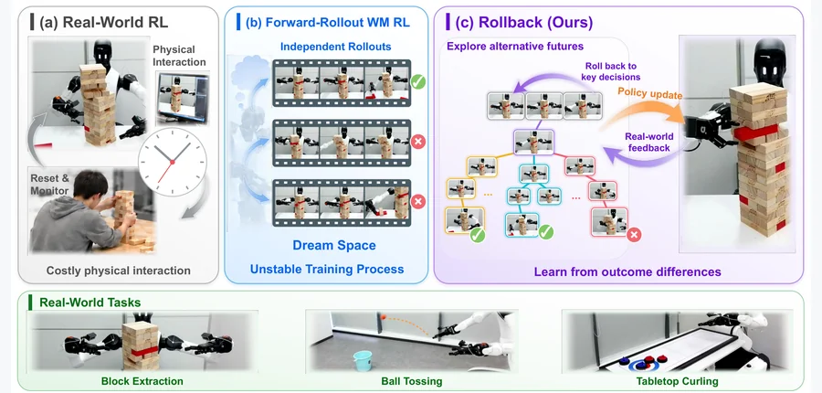 arXiv 2026-10-28 · cs.RO · #1 **[Rollback: Experience Backtracking in World Models for Policy Improvement](https://arxiv.org/abs/2610.36068)** Jiayi Luo , Yang Zhang , Liliang Chen , Nan Wang , Chen Gao , Boxiang Qiu , Zhuoxuan Li , Baorui Peng , Chuankang Li , Yux… Affiliation: AgiBot; BUAA; NUS (as listed) [Paper](https://arxiv.org/abs/2610.36068) · [Project](https://rollback-wm.github.io/) · [Figure source](https://arxiv.org/html/2610.36068v1/teaser.png) 

[EN] Abstract
Action-conditioned world models offer a scalable alternative to costly real-world interaction for improving robot policies. However, existing world-model-based methods largely treat world models as forward-only surrogates of the physical environment, leaving untapped a capability no physical environment affords: rewinding to past decision points to explore counterfactual futures. We introduce Rollback, a policy improvement paradigm that turns world models from passive simulators into counterfactual engines: it rolls back to critical decision points, branches into alternative actions, and contrasts their outcomes to attribute success to individual decisions. This concentrates imagination where it matters most and distills counterfactual outcomes into fine-grained, action-level supervision without a separately learned value model. We build a scalable training system that unifies distributed world-model search with asynchronous real-robot execution, forming a self-reinforcing cycle: real-world experience continually sharpens the world model, and a sharper world model in turn drives further policy improvement. We term the world-model side of this cycle test-time physics grounding, a capability that hand-built physics simulators lack: while the world model serves as the training environment, real transitions from the policy it trains correct its dynamics through a lightweight LoRA pipeline. Experiments on three challenging real-world tasks show that Rollback improves success rates over the strongest baseline by an absolute 10.67%, 11.11%, and 11.85% on block extraction, ball tossing, and tabletop curling, respectively, while achieving more stable improvement throughout training. Although initialized from teleoperated demonstrations far below human level, Rollback surpasses the average success rate of human players on both ball tossing and tabletop curling within 8 hours of training. <a href="https://arxiv.org/abs/2610.36068">Source</a>

[ZH] Abstract
动作条件化世界模型为改进机器人策略提供了可扩展的途径，可替代昂贵的真实世界交互。然而，现有基于世界模型的方法，大多将世界模型视为物理环境的单向前向替代物，没有利用物理环境不具备的一种能力：回退到过去的决策点，探索反事实未来。我们提出 Rollback，一种策略改进范式，将世界模型从被动模拟器转变为反事实引擎：它回退到关键决策点，分支探索替代动作，并对比结果，将成功归因到单个决策。这使想象集中于最重要的位置，并在无需单独学习价值模型的条件下，将反事实结果提炼为细粒度的动作级监督。我们构建可扩展训练系统，统一分布式世界模型搜索与异步真实机器人执行，形成自我强化循环：真实经验不断改善世界模型，而更准确的世界模型又推动策略进一步改进。我们将循环中世界模型这一侧称为测试时物理落地，这是人工构建的物理模拟器所缺乏的能力：当世界模型作为训练环境时，它所训练策略产生的真实转移，通过轻量 LoRA 流水线纠正模型动力学。在三个具有挑战性的真实世界任务上的实验表明，Rollback 相比最强基线，在积木抽取、抛球和桌面冰壶上的成功率分别绝对提高 10.67%、11.11% 和 11.85%，且训练过程中的改进更稳定。尽管从远低于人类水平的遥操作示范初始化，Rollback 在八小时训练内，便在抛球和桌面冰壶上超过人类玩家的平均成功率。 <a href="https://arxiv.org/abs/2610.36068">Source</a>
 | 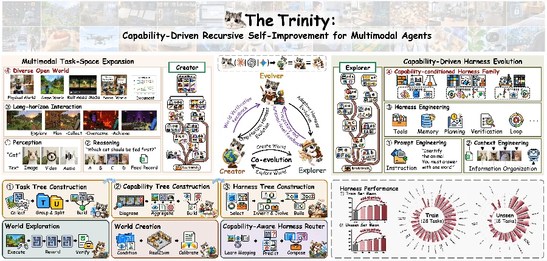 arXiv 2026-10-28 · cs.AI · #2 **[The Trinity:Capability-Driven Recursive Self-Improvement for Multimodal Agents](https://arxiv.org/abs/2610.36077)** Weidong Tang , Ruiheng Wang , Jingxuan Zhang , Hexin Wang , Haoyuan Chen , Zhengfeiyang Zhang , Yixing Ma , Zichen Jiang… Affiliation: InfRec; Xidian University; Tongji University; National University of Singapore; University of California, Berkeley; The Chinese University of Hong Kong; The Hong Kong University of Science and Technology; The University of Hong Kong; Shanghai Innovation Institute [Paper](https://arxiv.org/abs/2610.36077) · [Project](https://trinity-rsi.github.io/) · [Figure source](https://arxiv.org/html/2610.36077v1/fig/intro.png) 

[EN] Abstract
Multimodal intelligence can be viewed as human-guided co-evolution between worlds and agents through interaction. However, scaling this process faces two bottlenecks: constructing heterogeneous, verifiable environments is costly, and manual Harness iteration cannot keep pace with growing task diversity and complexity. A key insight is that tasks with different modalities and surface forms can share the same underlying capability requirements. We therefore introduce The Trinity, a recursive self-improvement framework coupling world generation with Harness evolution through three roles: Creator, Explorer, and Evolver. Drawing on verified execution trajectories, Evolver shifts the basis of task organization from surface categories to shared requirements, reorganizing the original task tree into a hierarchical capability tree. We introduce Capability-Driven Real2Sim2Real: for heterogeneous tasks at the same node, Creator abstracts their common requirements into simplified, verifiable simulated worlds for capability learning, while evaluation on original tasks measures transfer. Along this capability tree, Explorer progressively evolves reusable capability modules through selective inheritance, forming a Harness tree whose validated updates accumulate across iterations within a fixed topology. The resulting Harnesses specialize in different capabilities, motivating a Capability-Aware Harness Router that uses public task information to select compatible module configurations from the tree. Our evolved Harnesses improve mean performance by 34 points across 28 training benchmarks and 26 points across 18 unseen benchmarks, including two real-world embodied tasks. <a href="https://arxiv.org/abs/2610.36077">Source</a>

[ZH] Abstract
多模态智能可被视为世界与智能体通过交互、在人类引导下共同演化。然而，扩展这一过程面临两个瓶颈：构建异构且可验证的环境成本高，人工迭代运行框架无法跟上不断增加的任务多样性与复杂度。一个关键认识是，不同模态和表面形式的任务，可能共享相同的底层能力要求。因此，我们提出 The Trinity，一个通过 Creator、Explorer 和 Evolver 三种角色，将世界生成与运行框架演化耦合的递归自改进框架。Evolver 利用经过验证的执行轨迹，将任务组织依据从表面类别转向共享要求，把原始任务树重组为分层能力树。我们提出能力驱动的 Real2Sim2Real：对于同一节点的异构任务，Creator 抽象其共同要求，生成简化且可验证的模拟世界来学习能力，同时在原始任务上评估迁移。沿着能力树，Explorer 通过选择性继承，逐步演化可复用能力模块，形成运行框架树；其中已验证更新在固定拓扑内跨迭代累积。所得运行框架分别专长于不同能力，因此我们设计能力感知的运行框架路由器，使用公开任务信息，从树中选择兼容的模块配置。演化后的运行框架在 28 个训练基准上的平均表现提高 34 个点，在 18 个未见基准上提高 26 个点，其中包含两个真实世界具身任务。 <a href="https://arxiv.org/abs/2610.36077">Source</a>
 | 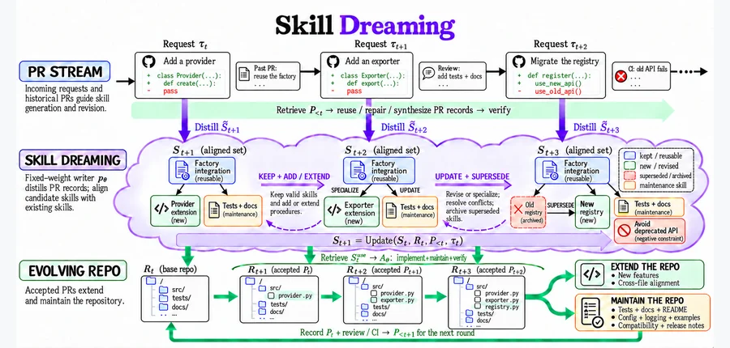 arXiv 2026-10-28 · cs.AI · #3 **[Skill Dreaming: Evolving Repository Skills through Pull Request Streams](https://arxiv.org/abs/2610.36188)** Xinyuan Song , Hasibul Haque , Jay Somasundaram , Ryan Turner , Bowen Zhu , Liang Zhao Affiliation: Causal Dynamics Lab [Paper](https://arxiv.org/abs/2610.36188) · [Figure source](https://arxiv.org/html/2610.36188v1/figures/skill_streaming_cloud_v2.png) 

[EN] Abstract
Large language model (LLM) agents increasingly rely on reusable skills for complex software engineering tasks, making skill libraries essential for repository development and maintenance. However, repository-specific skills must evolve with changing code structures, implementation conventions, and maintenance requirements. Pull requests (PRs) provide a natural source of such knowledge by recording how repositories evolve through implementation and review. Meanwhile, new PRs must follow repository-specific implementation patterns, modify related components consistently, and ensure that existing tests continue to pass while adding coverage for new functionality. This creates a mutually reinforcing cycle: PRs provide knowledge for updating skills, while these skills improve future PRs, maintain repositories, and support further skill evolution. To enable this co-evolution of PRs, repositories, and skills, we propose Skill Dreaming, a framework that learns from PR streams to guide continuous repository development and maintenance. Given a repository and its PR history, Skill Dreaming builds a repository-specific skill library by extracting executable knowledge from validated PRs and continuously refines the skills as new PR information becomes available. These skills guide coding agents not only in implementing requested features but also in maintaining associated tests, documentation, compatibility, and repository conventions. By integrating PR analysis, skill management, code execution, and continuous integration, Skill Dreaming provides an end-to-end workflow for applying learned skills to repository changes and incorporating subsequent PR outcomes into future skill updates. <a href="https://arxiv.org/abs/2610.36188">Source</a>

[ZH] Abstract
大语言模型（LLM）智能体越来越依赖可复用技能来完成复杂软件工程任务，使技能库成为仓库开发与维护的重要组成部分。然而，仓库特定技能必须随着代码结构、实现惯例和维护要求变化而演化。拉取请求（PR）记录仓库如何通过实现与审查演变，为此类知识提供自然来源。同时，新 PR 必须遵循仓库特定的实现模式，一致地修改相关组件，并在为新功能增加覆盖的同时，确保既有测试继续通过。这形成一个相互强化的循环：PR 为更新技能提供知识，而技能改善未来 PR、维护仓库并支持进一步技能演化。为使 PR、仓库和技能能够共同演化，我们提出 Skill Dreaming，一个从 PR 流中学习、指导持续仓库开发与维护的框架。给定仓库及其 PR 历史，Skill Dreaming 从经过验证的 PR 中提取可执行知识，构建仓库特定技能库，并随着新的 PR 信息到来持续完善技能。这些技能指导编码智能体，不仅实现所请求功能，也维护相关测试、文档、兼容性和仓库惯例。通过整合 PR 分析、技能管理、代码执行和持续集成，Skill Dreaming 提供端到端工作流，将学习到的技能应用于仓库改动，并把后续 PR 结果纳入未来技能更新。 <a href="https://arxiv.org/abs/2610.36188">Source</a>
 |
| 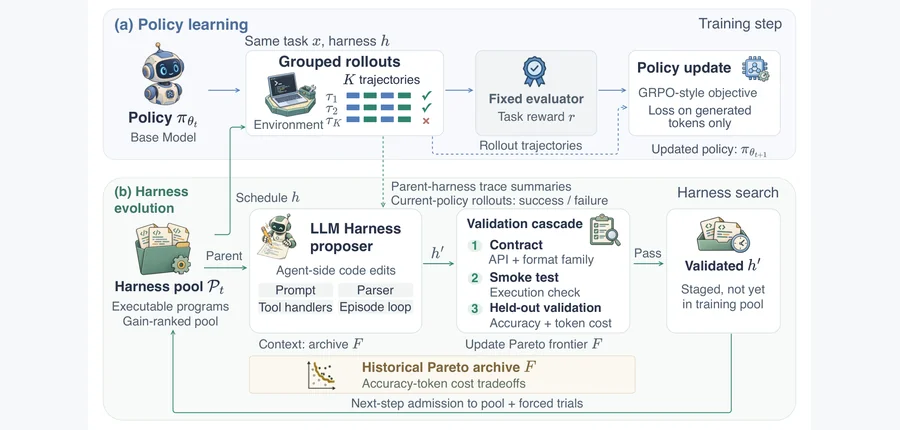 arXiv 2026-10-28 · cs.LG · #4 **[CoHARL: Co-Evolving Agent Policies and Executable Harnesses with Reinforcement Learning](https://arxiv.org/abs/2610.36469)** Jianwen Chen , Peng Xia , Kaide Zeng , Siwei Han , Zhen-Yu Zhang , Charles Fleming , Xinyu Ye , Huaxiu Yao Affiliation: University of North Carolina at Chapel Hill; RIKEN; Cisco [Paper](https://arxiv.org/abs/2610.36469) · [Figure source](https://arxiv.org/html/2610.36469v1/overview_v22_paper.png) 

[EN] Abstract
Large language model (LLM) agents interact with their environments through executable harnesses that govern tool use and feedback. Optimizing a harness for a fixed policy overlooks how its behavior changes during learning, while training a policy under a fixed harness leaves the interface that generates its training experience unchanged. This motivates adapting the harness throughout policy training. We introduce CoHARL, a population-based reinforcement learning framework that co-evolves a shared policy and a population of executable harnesses. The policy learns from rollouts across the population, and a proposer uses its execution traces to revise harness code during training. CoHARL achieves a 27.6% mean resolved rate on SWE-rebench, improving over harness-only search by 6.4 percentage points. Experiments on SWE-bench Verified and Terminal-Bench 2.0 show gains in software engineering and terminal-based tasks. Under matched training budgets, CoHARL also outperforms searching for a harness once before RL and alternating policy updates with revisions to a single active harness. <a href="https://arxiv.org/abs/2610.36469">Source</a>

[ZH] Abstract
大语言模型（LLM）智能体通过可执行运行框架与环境交互，框架管理工具使用与反馈。为固定策略优化框架，会忽视策略在学习中的行为变化；而在固定框架下训练策略，又使产生训练经验的接口保持不变。因此，应在策略训练全过程中适配框架。我们提出 CoHARL，一个基于种群的强化学习框架，共同演化共享策略与可执行运行框架种群。策略从整个种群的 rollout 中学习，提案者则利用其执行轨迹，在训练期间修订框架代码。CoHARL 在 SWE-rebench 上达到 27.6% 的平均解决率，比仅搜索框架提高 6.4 个百分点。SWE-bench Verified 和 Terminal-Bench 2.0 上的实验展示了软件工程和终端任务上的收益。在匹配训练预算下，CoHARL 也优于在 RL 前只搜索一次框架，以及交替进行策略更新与单个活动框架修订的方法。 <a href="https://arxiv.org/abs/2610.36469">Source</a>
 | 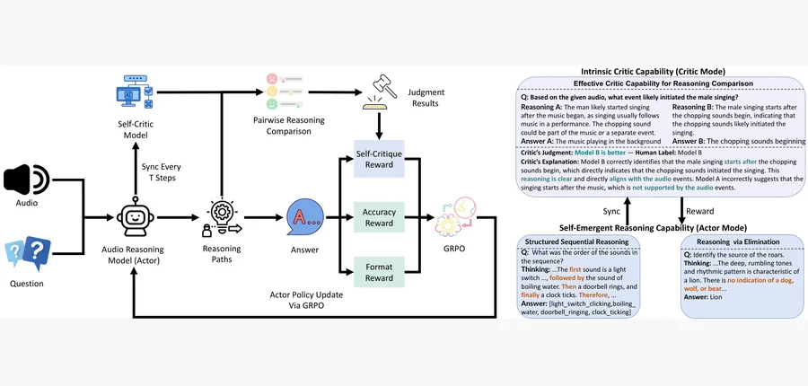 arXiv 2026-10-28 · cs.SD · #5 **[AudioRSI: Recursively Self-Improving Audio Reasoners](https://arxiv.org/abs/2610.36578)** Jiajun Fan , Roger Ren , Jingyuan Li , Rahul Pandey , Prashanth Gurunath Shivakumar , Ankur Gandhe , Yile Gu , Ge Liu , Iv… Affiliation: UIUC; Amazon [Paper](https://arxiv.org/abs/2610.36578) · [Figure source](https://arxiv.org/html/2610.36578v1/sac_new.png) 

[EN] Abstract
Reinforcement learning has made Audio Large Language Models (Audio LLMs) better reasoners, but the reward that drives it still comes from outside the model: a final-answer check, a hand-crafted process score, or an external LLM judge that stays fixed while the policy improves. We show that an Audio LLM can supply this reward itself, and can do so recursively: each improved model becomes the critic that trains its successor, so the training signal improves along with the model. We introduce AudioRSI (Recursively Self-Improving Audio Reasoners), a reinforcement learning framework in which a single model plays two roles: as an actor it generates reasoning paths, and as a critic it compares them pairwise, turning its own judgments into a process-level reward. The critic is periodically replaced by the current policy, which closes the recursive loop. Because the critic hears the same recording as the actor, it can reject reasoning that cites acoustic evidence the audio does not contain, rather than reward reasoning that merely sounds plausible. The recursion is what sustains progress: under a frozen external judge, out-of-distribution accuracy plateaus during training, while a critic refreshed from the improving policy keeps it rising. Across four out-of-distribution benchmarks, all disjoint from the AVQA training distribution, AudioRSI outperforms strong baselines including Audio Flamingo 3 and Gemini 2.5 Pro on MMAU test-mini, ranks first on MMSU, achieves a clear lead on the challenging Multi-Audio split of MMAU-Pro, and leads the 7B open-source tier on MMAR among methods without external reward models. With no reward specifying how to reason, AudioRSI also develops structured reasoning behaviors (logical reasoning, perception-aware analysis, and reduced hallucination), corroborated by an external LLM-as-Judge evaluation and a keyword-based behavior analysis. <a href="https://arxiv.org/abs/2610.36578">Source</a>

[ZH] Abstract
强化学习让音频大语言模型（Audio LLM）成为更好的推理器，但驱动训练的奖励仍来自模型外部：最终答案检查、人工设计的过程分数，或在策略进步时保持固定的外部 LLM 评判器。我们表明，Audio LLM 可以自行提供奖励，而且可以递归进行：每个改进后的模型都成为训练其后继模型的批评者，因此训练信号与模型一同改善。我们提出 AudioRSI（递归自改进音频推理器），一个强化学习框架，由单个模型扮演两种角色：作为行动者生成推理路径，作为批评者进行路径两两比较，将自己的判断转化为过程级奖励。批评者定期被当前策略替换，从而闭合递归循环。由于批评者听到与行动者相同的录音，它能够拒绝引用音频中不存在的声学证据的推理，而非奖励仅听起来合理的推理。递归使进展得以持续：使用固定外部评判器时，分布外准确率在训练中趋于平台，而从改进中的策略刷新批评者，则使其继续上升。在四个均与 AVQA 训练分布不相交的分布外基准上，AudioRSI 在 MMAU test-mini 上优于包括 Audio Flamingo 3 和 Gemini 2.5 Pro 在内的强基线，在 MMSU 上排名第一，在 MMAU-Pro 具有挑战性的 Multi-Audio 划分上明显领先，并在不使用外部奖励模型的方法中，领跑 MMAR 的 7B 开源模型组。在没有奖励规定如何推理的情况下，AudioRSI 还发展出结构化推理行为，包括逻辑推理、感知依据分析和减少幻觉；外部 LLM 评判器评估与基于关键词的行为分析为此提供了佐证。 <a href="https://arxiv.org/abs/2610.36578">Source</a>
 | 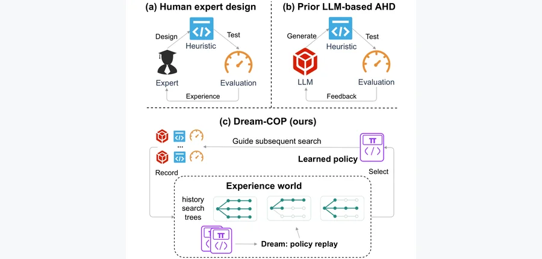 arXiv 2026-10-28 · cs.LG · #6 **[Dream-COP: Guiding Algorithm Discovery for Combinatorial Optimization Problems in an Experience World](https://arxiv.org/abs/2610.36618)** Kuan Xu , Jianming Wang , Ni Zhang , Yaoxin Wu , Yong Wang , Zhiguang Cao Affiliation: Singapore Management University; University of Science and Technology of China; Eindhoven University of Technology; Central South University [Paper](https://arxiv.org/abs/2610.36618) · [Figure source](https://arxiv.org/html/2610.36618v1/dream_cop_intro.png) 

[EN] Abstract
Large language models (LLMs) enable algorithm discovery for combinatorial optimization problems (COPs) through iterative program generation and evaluation. A central challenge is how to organize search to discover better algorithms within a limited budget. Our key insight is that past search trajectories and their recorded outcomes form an experience world, which can be used to facilitate the COP solving through replay. We introduce Dream-COP, in which a \emph{policy agent} learns executable policies through \emph{dreaming} in this experience world to guide a \emph{discovery agent} in generating and refining COP programs. Specifically, policy replay provides feedback on the quality of the programs revealed and the search steps used, to guide policy selection more effectively. Across five COPs, \textsc{Dream} discovers better algorithms than fixed exploration in both heuristic component design and complete solver generation. Particularly, it matches the optimal values on KP and reduces the gap on OBPP from 2.112\% to 1.199\% while using 42.5\% fewer search requests. Moreover, the learned exploration policies transfer effectively across different COPs with the assitance of the experience world. <a href="https://arxiv.org/abs/2610.36618">Source</a>

[ZH] Abstract
大语言模型（LLM）通过迭代程序生成与评估，为组合优化问题（COP）的算法发现提供了能力。核心挑战是如何组织搜索，在有限预算内发现更好算法。我们的关键认识是，过去搜索轨迹及其记录结果构成一个经验世界，可通过重放促进 COP 求解。我们提出 Dream-COP，其中策略智能体通过在这一经验世界中“做梦”，学习可执行策略，指导发现智能体生成和完善 COP 程序。具体来说，策略重放提供关于所揭示程序质量及所用搜索步骤的反馈，以更有效地指导策略选择。在五个 COP 上，Dream-COP 在启发式组件设计与完整求解器生成中，都比固定探索发现更好的算法。特别是，它在 KP 上匹配最优值，将 OBPP 上的差距从 2.112% 降至 1.199%，同时减少 42.5% 的搜索请求。此外，在经验世界帮助下，学习到的探索策略能够有效迁移到不同 COP。 <a href="https://arxiv.org/abs/2610.36618">Source</a>
 |
| 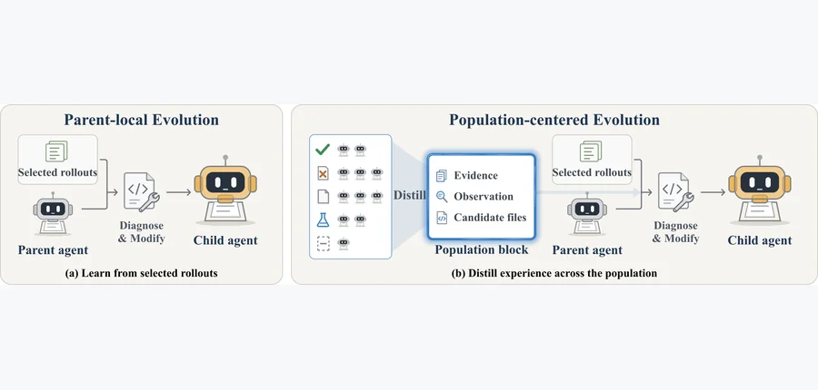 arXiv 2026-10-28 · cs.AI · #7 **[The View from Nowhere: Population-Centered Agent Evolution](https://arxiv.org/abs/2610.36660)** Shuo Yan , Ningning Hou , Haoyu He , Haochen Pei , Shang Gao Affiliation: Macquarie University; Monash University [Paper](https://arxiv.org/abs/2610.36660) · [Code](https://github.com/YanShuo1992/PCE) · [Project](https://yanshuo1992.github.io/PCE/) · [Figure source](https://arxiv.org/html/2610.36660v1/fig1_overview.png) 

[EN] Abstract
Self-improving AI systems can revise the designs that govern their own behavior. Yet existing approaches center improvement on selected parent agents and their evolutionary experience, leaving the broader population largely underused. We identify a substantial gap between population coverage (i.e., the tasks solved by at least one evolved variant) and the performance of the best individual agent. This gap shows that useful capabilities and diagnostic evidence emerge across the population without being consolidated into its leading agents. These observations motivate the view from nowhere, a principle for agent evolution: an agent should be improved by interpreting its behavior through population-wide patterns of success, failure, and prior self-modification. We instantiate this principle as Population-Centered Evolution (PCE). PCE distils task records and modification histories from the population into a population block, which captures recurring failures, complementary successes, and the effects of previously attempted modifications to guide improvements to a selected parent's harness. Under matched models, initial harnesses, and evolution schedules, PCE achieves 72.1% success on SWE-bench Verified and 96.7% on Polyglot, improving over a strong group-evolution baseline by 3.2 and 5.9 percentage points. In our evaluation, PCE reduces the gap between population coverage and best-agent performance by one-third on SWE-bench and closes it on Polyglot. These results suggest that treating the population as evidence--not merely as candidates for selection--provides a complementary principle for agent evolution. <a href="https://arxiv.org/abs/2610.36660">Source</a>

[ZH] Abstract
自改进 AI 系统能够修订支配自身行为的设计。然而，现有方法将改进集中于选定的父智能体及其进化经验，未充分利用更广泛的种群。我们发现，种群覆盖率，即至少有一个演化变体能解决的任务比例，与最佳单个智能体表现之间存在显著差距。这表明，有用能力和诊断证据已在整个种群中出现，却未被整合到领先智能体中。这些观察促成“无处之视”这一智能体演化原则：改进智能体时，应通过整个种群的成功、失败及既往自修改模式来解释其行为。我们将该原则实现为以种群为中心的演化（PCE）。PCE 把种群任务记录与修改历史提炼为一个种群信息块，捕捉反复失败、互补成功及先前修改的影响，以指导选定父智能体运行框架的改进。在模型、初始框架和演化日程匹配的条件下，PCE 在 SWE-bench Verified 和 Polyglot 上分别达到 72.1% 和 96.7% 的成功率，比强分组演化基线分别提高 3.2 和 5.9 个百分点。在我们的评估中，PCE 将 SWE-bench 上种群覆盖率与最佳智能体表现的差距缩小三分之一，并在 Polyglot 上消除这一差距。这些结果表明，将种群视为证据，而非仅作为供选择的候选，提供了一种互补的智能体演化原则。 <a href="https://arxiv.org/abs/2610.36660">Source</a>
 | 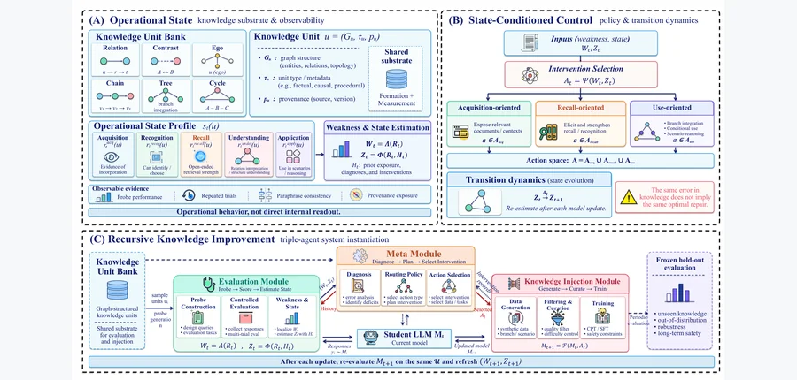 arXiv 2026-10-28 · cs.CL · #8 **[Weakness Localization Is Not Enough: State-Aware Recursive Knowledge Improvement for Large Language Models](https://arxiv.org/abs/2610.36811)** Runze Jiang , Yan Wang , Boran Jin , Bingyu Zhu , Longtao Huang Affiliation: Peking University; Alibaba Group; Delft University of Technology [Paper](https://arxiv.org/abs/2610.36811) · [Figure source](https://arxiv.org/html/2610.36811v1/framework.png) 

[EN] Abstract
Knowledge improvement in large language models is shifting from predefined knowledge incorporation pipelines toward evaluation-guided updating. Existing methods use evaluation to localize model-specific knowledge weaknesses and guide targeted post-training. However, identifying what to improve does not necessarily provide sufficient information for deciding how to improve it. The same localized weakness can be compatible with distinct operational knowledge states: the relevant knowledge may be unavailable, available but difficult to access reliably, or accessible but ineffective for downstream use. We call this ambiguity knowledge-state aliasing. When compatible states favor different interventions, greater diagnostic resolution alone is insufficient for intervention selection. Moreover, model updates can change the underlying knowledge state before the observed weakness disappears, such that an intervention appropriate in one round may no longer address the bottleneck in the next. To address these challenges, we propose Recursive Knowledge Improvement (RKI), which formulates knowledge improvement as a sequential, state-aware intervention process. RKI organizes knowledge into graph-structured units that provide a shared basis for diagnostic evaluation and targeted intervention across rounds. At each round, RKI localizes knowledge weaknesses, estimates the model's operational knowledge state from diagnostic evidence and intervention history, selects a corresponding intervention, and re-evaluates the updated model before determining the next intervention. On HotpotEval and SafeInternalEval, RKI outperforms existing knowledge incorporation methods by 18.41 points on average. Further analyses show that knowledge states provide additional guidance for intervention selection beyond weakness localization and can change across model updates even when the observed weakness persists. <a href="https://arxiv.org/abs/2610.36811">Source</a>

[ZH] Abstract
大语言模型的知识改进，正在从预定义的知识纳入流水线转向由评估引导的更新。现有方法利用评估定位模型特定的知识弱点，并指导针对性后训练。然而，确定改进什么，并不一定提供足够信息来决定如何改进。同一局部弱点可能对应不同的操作性知识状态：相关知识可能不可用，可能可用但难以可靠访问，也可能可访问却无法有效支持下游使用。我们将这种歧义称为知识状态混叠。当兼容的状态偏好不同干预时，仅提高诊断分辨率不足以选择干预。此外，在观测到的弱点消失之前，模型更新可能已改变底层知识状态，因此某一轮适用的干预，在下一轮可能不再针对真正瓶颈。为应对这些挑战，我们提出递归知识改进（RKI），将知识改进表述为顺序的、状态感知的干预过程。RKI 将知识组织成图结构单元，为跨轮诊断评估和针对性干预提供共同基础。每一轮中，RKI 定位知识弱点，根据诊断证据和干预历史估计模型操作性知识状态，选择对应干预，并重新评估更新后的模型，再决定下一次干预。在 HotpotEval 和 SafeInternalEval 上，RKI 平均比现有知识纳入方法提高 18.41 个点。进一步分析表明，除了弱点定位外，知识状态能为干预选择提供额外指导；即使观测到的弱点持续存在，知识状态也可能随着模型更新而变化。 <a href="https://arxiv.org/abs/2610.36811">Source</a>
 | 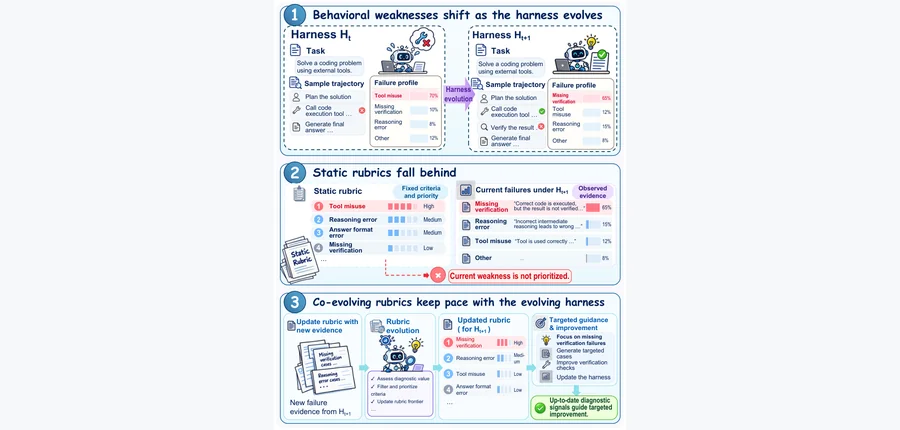 arXiv 2026-10-28 · cs.AI · #9 **[When the Critic Falls Behind: Co-Evolving Rubrics and Harnesses for Continual Agent Self-Improvement](https://arxiv.org/abs/2610.36826)** Hao Chen , Yukun Yan , Ziyu Han , Ye He , Chuanzhe Guo , Shangzhan Li , Qi Shi , Qingfu Zhu , Maosong Sun , Wanxiang Che Affiliation: Harbin Institute of Technology; Tsinghua University [Paper](https://arxiv.org/abs/2610.36826) · [Figure source](https://arxiv.org/html/2610.36826v1/Intro.png) 

[EN] Abstract
Autonomous agents increasingly depend on harnesses that govern interaction, memory, tools, and execution around large language models (LLMs). While recent work has begun to evolve these harnesses from execution experience, the supervision used to guide evolution often remains relatively static, making it difficult to track changing behavioral weaknesses across rounds and potentially limiting generalization to unseen tasks. To address this issue, we propose RuHarness, a rubric--harness co-evolution framework for continual agent self-improvement. RuHarness continually discovers and reassesses behavioral criteria from execution trajectories, prioritizes the most relevant unresolved weaknesses, and uses them to guide targeted harness updates while keeping the task objective fixed. Extensive experiments across diverse agent tasks and backbone models show that RuHarness outperforms strong harness-evolution baselines, particularly on unseen held-out tasks. Further analyses show that adaptive rubric prioritization tracks shifting weaknesses and supports more sustained improvement and stable generalization across evolution rounds. <a href="https://arxiv.org/abs/2610.36826">Source</a>

[ZH] Abstract
自主智能体越来越依赖运行框架，管理大语言模型（LLM）周围的交互、记忆、工具和执行。尽管近期工作开始根据执行经验演化这些框架，用于指导演化的监督往往仍相对静态，难以跟踪跨轮变化的行为弱点，并可能限制向未见任务的泛化。为解决这一问题，我们提出 RuHarness，一个用于持续智能体自改进的评分细则—运行框架共同演化框架。RuHarness 持续从执行轨迹中发现并重新评估行为标准，优先处理最相关且尚未解决的弱点，并在保持任务目标固定的同时，用这些标准指导针对性框架更新。跨多种智能体任务和骨干模型的广泛实验表明，RuHarness 优于强框架演化基线，尤其在未见留出任务上。进一步分析表明，自适应细则优先级能够跟踪变化的弱点，并支持跨演化轮次更持续的改进和稳定泛化。 <a href="https://arxiv.org/abs/2610.36826">Source</a>
 |
| 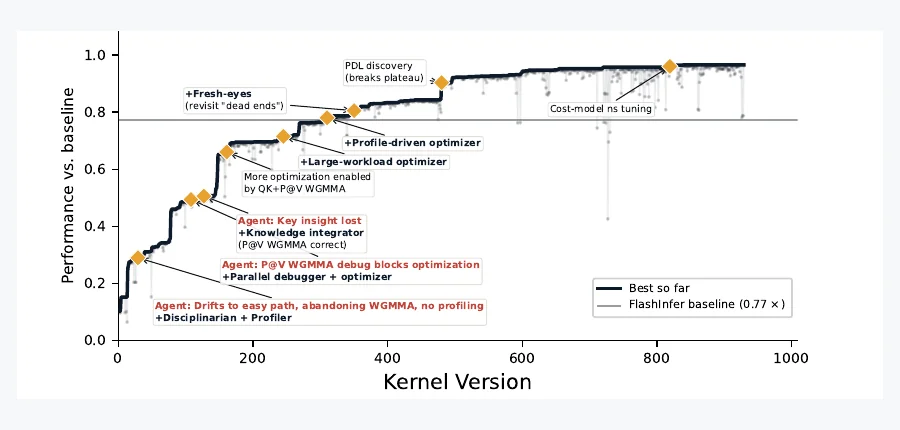 arXiv 2026-10-28 · cs.AI · #10 **[Evolving Agent Teams](https://arxiv.org/abs/2610.36848)** Shiyi Cao , Ziming Mao , Dacheng Li , Joseph E. Gonzalez , Ion Stoica Affiliation: University of California, Berkeley [Paper](https://arxiv.org/abs/2610.36848) · [Code](https://github.com/caoshiyi/EAT) · [Figure source](https://arxiv.org/pdf/2610.36848#page=1) 

[EN] Abstract
The rapid progress of software engineering agents drives interest in applying them to open-ended problems such as GPU kernel optimization. However, we find that existing coding agents converge to local optima on real-world, expert-written kernels (e.g., FlashInfer). We introduce Evolving Agent Teams, a multi-agent framework that escapes such local optima. It features (1) a central supervisor that diagnoses each local optimum and restructures a team of agents; and (2) a persistent file system that comprises a learning document, an evolution history, and per-team artifacts, grounding restructuring with accumulated experience. Under a matched token budget, Evolving Agent Teams consistently outperforms strong coding-agent baselines. With an extended token budget, Evolving Agent Teams generates a CUDA kernel that reaches 1.2x mean speedup over the production FlashInfer MLA paged decode kernel from scratch and wins on 36 of 47 production workloads from FlashInfer-Bench (0.86-0.99x on the remaining 11). It also demonstrates superior performance on tasks such as KDA prefill on AMD MI350X (3.01x over vLLM) and NVIDIA B200 (3.44x over FlashKDA), MoE expert-offload serving on Apple silicon (30.3 tokens/s decode for Qwen3.8-Flash-Next in MLX 4-bit on a 48 GB M4 Pro), and RoboDojo robot manipulation (62.1 on held-out seeds vs. 55.3 for the best leaderboard entry). Code is available at this https URL . <a href="https://arxiv.org/abs/2610.36848">Source</a>

[ZH] Abstract
软件工程智能体的快速进步，推动人们将其应用于 GPU 内核优化等开放问题。然而，我们发现，现有编码智能体在真实专家编写的内核（如 FlashInfer）上会收敛到局部最优。我们提出 Evolving Agent Teams，一个逃离此类局部最优的多智能体框架。其特点是：（1）中央监督者诊断每个局部最优，并重构智能体团队；（2）持久文件系统包含学习文档、演化历史及各团队产物，使重构以累积经验为依据。在匹配 token 预算下，Evolving Agent Teams 始终优于强编码智能体基线。扩大 token 预算后，它从零生成一个 CUDA 内核，相对生产版 FlashInfer MLA 分页解码内核获得 1.2 倍平均加速，并在 FlashInfer-Bench 的 47 个生产工作负载中赢得 36 个，剩余 11 个为 0.86—0.99 倍。它还在其他任务上表现更好，包括 AMD MI350X 上的 KDA 预填充（相对 vLLM 为 3.01 倍）、NVIDIA B200 上的 KDA 预填充（相对 FlashKDA 为 3.44 倍）、Apple 芯片上的 MoE 专家卸载服务（48 GB M4 Pro 上，MLX 4 位 Qwen3.8-Flash-Next 的解码速度为 30.3 token/秒），以及 RoboDojo 机器人操作（留出种子得分 62.1，最佳排行榜条目为 55.3）。代码可在原文所附的 HTTPS 链接获取。 <a href="https://arxiv.org/abs/2610.36848">Source</a>
 | 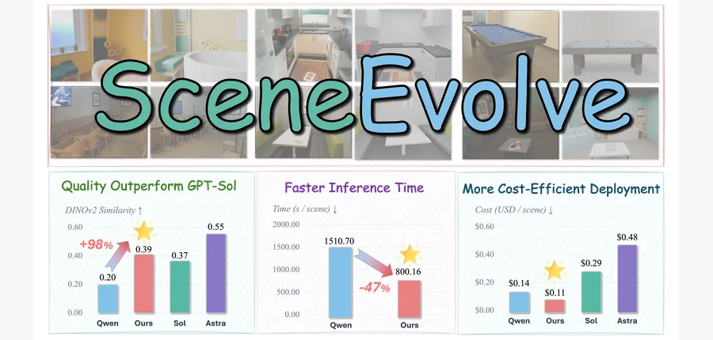 arXiv 2026-10-28 · cs.CV · #11 **[Learning to Code the World: Harness Evolution for Compositional 3D Reconstruction](https://arxiv.org/abs/2610.37046)** Haoyu Yao , Chenguo Lin , Ruize Du , Yadong Mu Affiliation: Peking University [Paper](https://arxiv.org/abs/2610.37046) · [Project](https://haoyu-agent.github.io/SceneEvolve) · [Figure source](https://arxiv.org/html/2610.37046v1/figures/opening.png) 

[EN] Abstract
Reconstructing editable and compositional 3D scenes from a real image requires jointly reasoning about geometry, object structure, and spatial relationships. We introduce SceneEvolve, a framework that represents 3D scenes as executable code and improves reconstruction by evolving the harness around a small open-source agent. SceneEvolve combines SceneAct, a compositional semantic action interface built on parameterized primitives, hierarchical composition, and semantic spatial relations, with SceneHarness-RSI, which leverages a stronger teacher agent to iteratively evolve the harness using feedback from development-set reconstructions. Throughout harness evolution, the model parameters, action semantics, and execution backend remain fixed. The resulting harness provides a reusable reconstruction procedure that enables the small open-source model to reconstruct unseen scenes without parameter updates or teacher assistance. Across two in-domain datasets and one out-of-domain dataset, SceneEvolve with the comparatively compact Qwen3.8-27B model improves all four evaluated reconstruction metrics while reducing mean inference time by 47.0% relative to the base model. More notably, despite relying on a substantially smaller model, SceneEvolve achieves 32.3% higher reconstruction quality than the large proprietary GPT-5.6-Sol model, while reducing mean equivalent deployment cost by 59.8%. Furthermore, the harness evolved using Qwen3.8-27B also generalizes to Kimi-K3, achieving comparable reconstruction performance to GPT-6-Astra. The project page is this https URL . <a href="https://arxiv.org/abs/2610.37046">Source</a>

[ZH] Abstract
从真实图像重建可编辑、可组合的三维场景，需要联合推理几何、物体结构和空间关系。我们提出 SceneEvolve，一个将三维场景表示为可执行代码，并通过演化小型开源智能体周围的运行框架来改进重建的框架。SceneEvolve 结合了 SceneAct 与 SceneHarness-RSI：前者是基于参数化图元、分层组合及语义空间关系的组合式语义动作接口；后者利用更强教师智能体，根据开发集重建反馈，迭代演化运行框架。在整个框架演化过程中，模型参数、动作语义和执行后端保持固定。所得框架提供可复用重建流程，使小型开源模型能够在无需参数更新或教师协助的情况下重建未见场景。在两个域内数据集和一个域外数据集上，使用相对紧凑的 Qwen3.8-27B 的 SceneEvolve 改善了全部四项重建指标，并比基础模型减少 47.0% 的平均推理时间。更值得关注的是，尽管使用的模型明显更小，SceneEvolve 的重建质量比大型专有 GPT-5.6-Sol 高 32.3%，平均等效部署成本降低 59.8%。此外，使用 Qwen3.8-27B 演化的框架还能泛化到 Kimi-K3，获得与 GPT-6-Astra 相当的重建表现。项目页面见原文所附的 HTTPS 链接。 <a href="https://arxiv.org/abs/2610.37046">Source</a>
 | 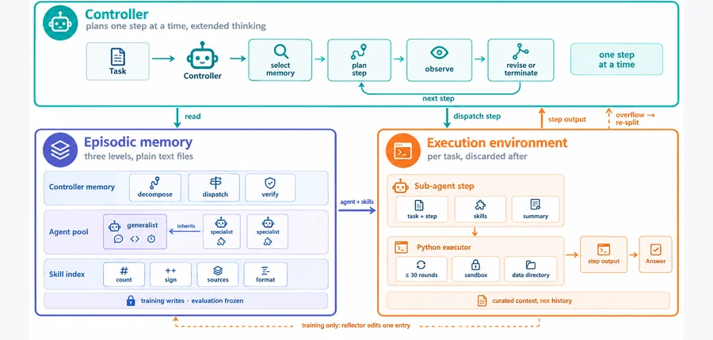 arXiv 2026-10-28 · cs.MA · #12 **[EMMA: Structured Episodic Memory for Multi-Agent Workflow Synthesis](https://arxiv.org/abs/2610.35966)** Ruijia Niu , Kaiwen Liu , Rose Yu , Kristina Klinkner Affiliation: University of California San Diego; Amazon [Paper](https://arxiv.org/abs/2610.35966) · [Figure source](https://arxiv.org/html/2610.35966v1/figures/emma_architecture_v148.png) 

[EN] Abstract
Deploying LLM agents in specialized domains often require fine-grained task-specific procedures and knowledge a general model lacks, yet parameter training is costly and non-interpretable, and hand-engineered agent systems shift the cost to expert labor. Episodic memory updates at context level, but single agent adaptation struggles to alleviate cross-task interference, especially with complex tasks such as multi-application navigation or data pool analysis. Although multi-agent evolution alleviates this problem, existing methods lack clear definitions on update rules and rely on the backbone model to decide where and how much the system changes. This ill-scoped evolution makes learning follow the backbone's structural preferences rather than the observed failures: one backbone accumulates skills while another spawns agents. We present EMMA (structured Episodic Memory for Multi-Agent workflow synthesis), which treats the configuration of a multi-agent system (controller routing memory, specialists inheriting a generalist prompt, and per-step procedural skills) as episodic memory. EMMA makes the ownership and admissibility of updates explicit: a reflector assigns each diagnosed failure to the scope owning its correction and proposes one edit within it, and backbone-independent guards keep every accepted edit scoped, incremental and bounded. Across KramaBench, AppWorld and BBEH with five backbones and four baselines (ACE, GEPA, EvoMAS and ADAS), EMMA attains the best overall performance on every benchmark, up to 32.5% over the strongest baseline, maintains consistent improvements across backbones, and uses 17-38% fewer training executions than the most efficient baseline. <a href="https://arxiv.org/abs/2610.35966">Source</a>

[ZH] Abstract
在专门领域部署 LLM 智能体，往往需要通用模型所缺乏的细粒度任务流程和知识；但参数训练成本高且不可解释，人工设计智能体系统则把成本转移给专家劳动。情节记忆在上下文层面更新，但单智能体适配难以缓解跨任务干扰，尤其是多应用导航或数据池分析等复杂任务。尽管多智能体演化缓解了这一问题，现有方法却未清楚定义更新规则，而依赖骨干模型决定系统在哪里、改变多少。这种边界不清的演化，使学习遵循骨干的结构偏好而非观测到的失败：一个骨干积累技能，另一个却不断增加智能体。我们提出 EMMA（用于多智能体工作流合成的结构化情节记忆），将多智能体系统配置，即控制器路由记忆、继承通用提示词的专家，以及逐步流程技能，视为情节记忆。EMMA 明确更新的归属与准入条件：反思器将每个诊断出的失败分配给拥有其修正职责的范围，并在该范围内提出一次编辑；与骨干无关的防护则确保每个被接受的编辑都范围明确、渐进且有界。在 KramaBench、AppWorld 和 BBEH 上，使用五个骨干和四个基线（ACE、GEPA、EvoMAS、ADAS），EMMA 在每个基准上均获得最佳总体表现，相比最强基线最高提高 32.5%，在不同骨干间保持一致提升，并比执行次数最少的基线减少 17—38% 的训练执行。 <a href="https://arxiv.org/abs/2610.35966">Source</a>
 |
| 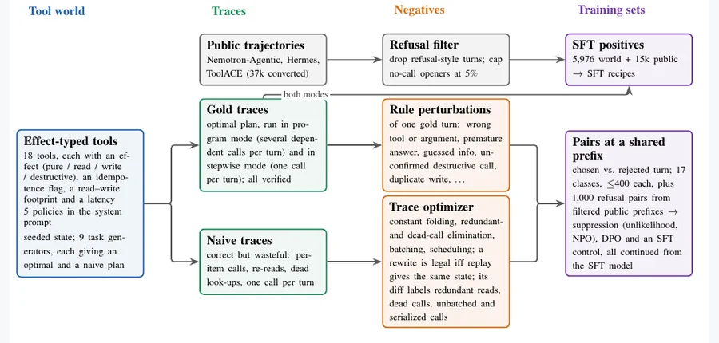 arXiv 2026-10-28 · cs.SE · #13 **[Small agents should know what their tools do](https://arxiv.org/abs/2610.35981)** Alexander Kovalenko , Artem Redchych Affiliation: Czech Technical University in Prague [Paper](https://arxiv.org/abs/2610.35981) · [Figure source](https://arxiv.org/pdf/2610.35981#page=3) 

[EN] Abstract
Small open language models can call tools, but they do not reason about what a call does: they delete without asking, repeat writes, re-read state they already hold, and issue one call per turn where a short program would do. We introduce EffectWorld, an executable world of effect-typed tools in which every tool declares its effect, whether it is idempotent, and which resources it reads and writes. These declarations let a replay verifier decide whether a trace is effect-safe without labels or judge models, let an executor run tool programs of several dependent calls in one turn, and let a compiler-style optimizer turn wasteful traces into verified training signal; together they make EffectWorld a benchmark of effect safety and call efficiency. Low-rank adapters trained on this data deliver large gains: on Qwen3-4B, they raise task success from 53% to 99% in distribution, from 52% to 81% on a held-out split with unseen task kinds and distractor tools, and from 74% to 83% on an unseen domain, with about a third of the output tokens. The gains carry over to other model families. On the Berkeley Function-Calling Leaderboard (BFCL), the adapter matches the base model's live accuracy and raises multi-turn accuracy from 21.9 to 26.6, and a recipe with near-miss declines lifts the BFCL average above the base model's while matching its irrelevance detection. Along the way we uncover and fix a pitfall that in-domain evaluation alone would miss: refusal templates in widely used public tool-use corpora teach a small model not to call tools, cutting BFCL non-live accuracy from 88.0 to 31.4, and filtering them restores 84.8. We also find that positive examples, not negative ones, carry the learning: suppression and preference objectives on the verified negatives add nothing over an SFT-only control, while targeted positives move exactly the behaviour they show. <a href="https://arxiv.org/abs/2610.35981">Source</a>

[ZH] Abstract
小型开放语言模型能调用工具，却不会推理一次调用会做什么：它们未经询问就删除、重复写入、重新读取已经掌握的状态，以及本可用短程序完成时却每回合只发出一个调用。我们提出 EffectWorld，一个具有带效应类型工具的可执行世界，每个工具声明其效应、是否幂等，以及读取和写入哪些资源。这些声明使重放验证器能够无需标签或评判模型，判断轨迹是否效应安全；使执行器能在一回合运行包含多个依赖调用的工具程序；还使编译器式优化器能把浪费的轨迹转化为经验证训练信号。这些功能共同使 EffectWorld 成为效应安全和调用效率的基准。基于这些数据训练的低秩适配器带来显著收益：在 Qwen3-4B 上，域内任务成功率从 53% 升至 99%，在包含未见任务类型和干扰工具的留出划分上从 52% 升至 81%，在未见领域上从 74% 升至 83%，输出 token 约为原来的三分之一。收益也迁移到其他模型家族。在 Berkeley Function-Calling Leaderboard（BFCL）上，适配器匹配基础模型的实时准确率，并将多轮准确率从 21.9 提高到 26.6；包含近似易混拒绝示例的配方使 BFCL 平均分超过基础模型，同时保持其无关性检测水平。在此过程中，我们发现并修复了仅靠域内评估无法发现的陷阱：广泛使用的公开工具语料中的拒绝模板，教会小模型不调用工具，使 BFCL 非实时准确率从 88.0 降至 31.4，过滤这些模板后恢复至 84.8。我们还发现，真正承载学习的是正例，而非负例：针对已验证负例的抑制和偏好目标，相比仅 SFT 对照没有额外收益，而针对性正例恰好改变了其所示范的行为。 <a href="https://arxiv.org/abs/2610.35981">Source</a>
 | 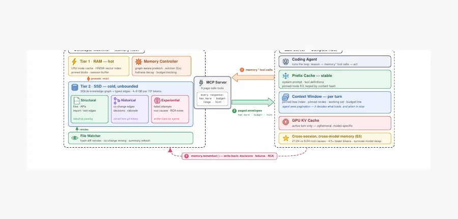 arXiv 2026-10-28 · cs.SE · #14 **[Stratum: Repository Memory for Coding Agents Beyond the Context Window](https://arxiv.org/abs/2610.36153)** Yuvraj Sehgal , Mahsa Panahandeh , Naser Ezzati-Jivan Affiliation: Brock University; University of Ottawa [Paper](https://arxiv.org/abs/2610.36153) · [Figure source](https://arxiv.org/pdf/2610.36153#page=3) 

[EN] Abstract
Context windows have grown a thousand-fold, yet coding agents still start every session with no memory of their past work. They re-read files, retry failed approaches, and forget root causes they established hours earlier. This is not a context-length problem but a memory-architecture problem. Our hypothesis: coding agents need persistent, experience-aware repository memory, so that knowledge survives from one session to the next. Three measurements on real repositories motivate the design. First, mid-size projects already exceed the largest production context windows, and storing knowledge inside the model's key-value (KV) cache costs $10^4$ to $10^5$ times more bytes than storing it as indexed text. Second, across 752 real bug-fix commits, the median fix edits two files, and these files plus their direct imports amount to less than 10% of the repository; the bottleneck is selection, not capacity. Third, even with transitive import reachability and test links, 47% of co-edited file pairs remain structurally disconnected; the knowledge needed for selection must be mined from history and experience. We sketch Stratum, a tiered memory that lives with the repository and serves it through page-safe tools: every response states what was returned, what remains, and what it cost. Retrieval over a store of one million nodes takes 1.7 ms at the median. In a multi-session experiment on eight real bugs, a fresh agent that inherited a prior session's memory, written by a different model, identified the root-cause file in 21 of 24 trials versus 6 of 24 for a retrieval-only baseline (Fisher $p&lt;10^{-4}$), at 4.5x lower median token cost. With the notes of all eight investigations pooled in one store, success remained 8/8. <a href="https://arxiv.org/abs/2610.36153">Source</a>

[ZH] Abstract
上下文窗口已增长一千倍，但编码智能体的每次会话仍从没有过去工作记忆的状态开始。它们重新读取文件、重试失败方法，并遗忘几小时前已经确认的根因。这不是上下文长度问题，而是记忆架构问题。我们的假设是：编码智能体需要持久、经验感知的仓库记忆，让知识从一个会话延续到下一个。真实仓库的三项测量支持这一设计。首先，中型项目已经超过最大生产上下文窗口，将知识存入模型键值（KV）缓存，比存为索引文本需要多 10⁴—10⁵ 倍字节。其次，在 752 个真实缺陷修复提交中，修复涉及文件数的中位数为两个，这些文件及其直接导入不到仓库的 10%；瓶颈是选择而非容量。第三，即使考虑传递导入可达性和测试链接，仍有 47% 的共同编辑文件对在结构上不相连；选择所需知识必须从历史与经验中挖掘。我们勾勒 Stratum，一种随仓库存在的分层记忆，通过分页安全工具提供服务：每个响应都说明返回了什么、还剩什么，以及付出了多少成本。在百万节点存储上，检索中位耗时为 1.7 毫秒。在八个真实缺陷的多会话实验中，新智能体继承由不同模型写出的先前会话记忆后，在 24 次试验中的 21 次找出根因文件；仅检索基线为 6/24（Fisher p &lt; 10⁻⁴），token 成本中位数低 4.5 倍。将八项调查的笔记汇集在同一存储中，成功率仍为 8/8。 <a href="https://arxiv.org/abs/2610.36153">Source</a>
 |  arXiv 2026-10-28 · cs.RO · #15 **[RoboAuto: Autonomous Robot Program Search through Multi-Level Physical Understanding](https://arxiv.org/abs/2610.36533)** Buzhao Liu , Jianing Ye , Xiu Yuan , Yangtong Feng , Chengsong Huang , Tyler Dinh , Yevgeniy Vorobeychik , Ning Zhang , Ch… Affiliation: Washington University in St. Louis [Paper](https://arxiv.org/abs/2610.36533) · [Project](https://roboauto-ai.github.io/) · [Figure source](https://arxiv.org/html/2610.36533v1/first_teaser.png) 

[EN] Abstract
Recently, LLM-based autonomous agents have shown strong capabilities in iteratively generating, evaluating, and refining executable solutions. In robotic manipulation, Code-as-Policy lets these agents search over modular and editable robot programs. However, effective program search requires physical understanding: agents must understand how objects can be manipulated, how scene geometry constrains actions, and why interactions succeed or fail. Existing methods rely mainly on execution feedback for program refinement, often leaving these physical questions unresolved. We introduce RoboAuto, a framework for robot program search that explicitly organizes physical understanding at the object, scene, and interaction levels through three components. First, a hierarchical knowledge base combines executable skills with object-centric knowledge of affordances, spatial relations, and action effects, learned from embodied data and online task solving. Second, scene grounding connects this knowledge to the current environment by identifying relevant objects and resolving action-critical quantities. Third, multi-stage planning with self-designed experiments checks whether each stage produces its expected physical effects and actively tests competing hypotheses to resolve physical uncertainties. RoboAuto achieves superior performance across five benchmark families, attaining an 89.1% success rate on short-horizon LIBERO-PRO tasks and more than twice the mean success rate of ASPIRE on LIBERO-PRO Long and LIBERO-Plus. It also outperforms ASPIRE and $\pi_{0.5}$ on three challenging long-horizon real-robot tasks requiring precise manipulation. We further show that the knowledge base transfers across simulators and embodiments, and that program search performance scales with its size. Project page: this https URL <a href="https://arxiv.org/abs/2610.36533">Source</a>

[ZH] Abstract
近期，基于 LLM 的自主智能体在迭代生成、评估和完善可执行方案方面展现出强大能力。在机器人操作中，Code-as-Policy 让这些智能体能够搜索模块化、可编辑的机器人程序。然而，有效程序搜索需要物理理解：智能体必须知道物体如何被操作，场景几何如何约束动作，以及交互为何成功或失败。现有方法主要依靠执行反馈完善程序，往往未解决这些物理问题。我们提出 RoboAuto，一个通过三个组件，显式地在物体、场景和交互层次组织物理理解的机器人程序搜索框架。首先，分层知识库将可执行技能与物体中心知识结合，知识涵盖可供性、空间关系及动作效果，由具身数据和在线任务求解学习得到。其次，场景落地通过识别相关物体、解析动作关键量，将这些知识连接到当前环境。第三，包含自主设计实验的多阶段规划，检查各阶段是否产生预期物理效果，并主动测试竞争假设，以消除物理不确定性。RoboAuto 在五个基准家族中取得更好表现，在短时程 LIBERO-PRO 上达到 89.1% 成功率，在 LIBERO-PRO Long 和 LIBERO-Plus 上平均成功率超过 ASPIRE 的两倍。它还在三个要求精细操作、具有挑战性的长时程真实机器人任务上，优于 ASPIRE 和 π₀.₅。我们进一步展示知识库能跨模拟器和具身形态迁移，程序搜索表现也随知识库规模扩大而提高。项目页面见原文所附的 HTTPS 链接。 <a href="https://arxiv.org/abs/2610.36533">Source</a>
 |
| 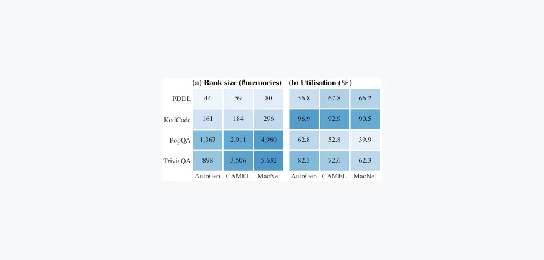 arXiv 2026-10-28 · cs.AI · #16 **[Remembering Is Not Enough: Refining Memories and Learning When to Use Them in Multi-Agent Systems](https://arxiv.org/abs/2610.36652)** Yipeng Hao , Yuxuan Cai , Wenkai Ji , Jie Zhou , Liyang Yu , Qin Chen , Zhiguo Yan , Shulei Zheng , Liang He Affiliation: East China Normal University; Ocean University of China; Tongji University; Information Engineering University [Paper](https://arxiv.org/abs/2610.36652) · [Figure source](https://arxiv.org/html/2610.36652v1/fig_mem_overview.png) 

[EN] Abstract
Memory helps LLM-based multi-agent systems reuse experience, but stored advice can be flawed or applied in the wrong situation. Team-level success or failure alone cannot reliably show whether a memory needs correction or should not have been used. We propose DiscernMem, a training-free framework that improves both memory quality and memory use. To improve quality, Defect-Aware Memory Refinement (DMR) compares team executions with a single memory and with no memory, diagnoses rule defects, and tests repairs on current and earlier tasks to guard against losing previously useful behavior. To guide appropriate use, Boundary-Learning Meta-Memory (BLM) records each memory's past uses and effects, learning when its owner role should apply or avoid it based on task context and incoming messages. Together, these components help teams correct flawed experience while retaining useful rules that were applied incorrectly. Experiments with Qwen3-4B-Instruct-2507 on four benchmarks show that DiscernMem achieves the highest average score on AutoGen, CAMEL, and MacNet, exceeding the strongest reported baselines by 0.51-4.32 points. It leads on code generation and symbolic planning across all three systems, including a PDDL score of 37.71 versus 28.48 on CAMEL. <a href="https://arxiv.org/abs/2610.36652">Source</a>

[ZH] Abstract
记忆帮助基于 LLM 的多智能体系统复用经验，但存储的建议可能有缺陷，或被用于错误情境。仅凭团队层面的成功或失败，不能可靠判断某条记忆是需要修正，还是根本不该使用。我们提出 DiscernMem，一个同时改善记忆质量与记忆使用的免训练框架。为提升质量，缺陷感知记忆完善（DMR）比较团队仅使用单条记忆和不使用记忆时的执行，诊断规则缺陷，并在当前及先前任务上测试修复，防止丢失此前有用行为。为指导恰当使用，边界学习元记忆（BLM）记录每条记忆过去的使用及效果，根据任务上下文和收到的消息，学习其所属角色何时应使用或避免它。两个组件共同帮助团队纠正有缺陷经验，同时保留那些本身有用、只是被错误应用的规则。使用 Qwen3-4B-Instruct-2507 在四个基准上的实验表明，DiscernMem 在 AutoGen、CAMEL 和 MacNet 上都取得最高平均分，比所报告的最强基线高 0.51—4.32 个点。它在三个系统的代码生成和符号规划上均领先，包括在 CAMEL 上取得 37.71 的 PDDL 分数，而比较值为 28.48。 <a href="https://arxiv.org/abs/2610.36652">Source</a>
 | 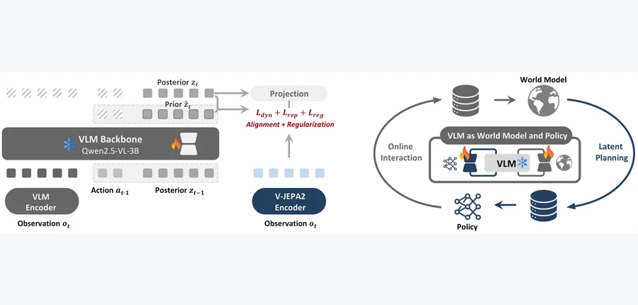 arXiv 2026-10-28 · cs.AI · #17 **[Vision-Language Agents Can Learn in Their Own Latent Worlds](https://arxiv.org/abs/2610.36925)** Haoxi Li , Sikai Bai , Jianfei Ma , Qinglin Hou , Xiaocheng Lu , Tao Han , Jie Zhang , Song Guo Affiliation: The Hong Kong University of Science and Technology; National University of Singapore; University of Southern California [Paper](https://arxiv.org/abs/2610.36925) · [Code](https://github.com/Tom111-lhx/Dwell) · [Figure source](https://arxiv.org/html/2610.36925v1/mainfigure.png) 

[EN] Abstract
Learning from experience is essential for building the next generation of agents that continually expand their capabilities. Pretrained vision-language models (VLMs) already internalize rich world knowledge, yet this knowledge is rarely leveraged to drive policy improvement through online interaction. Realizing this potential efficiently remains challenging, as policy updates shift the agent's interaction distribution, requiring the world model to adapt accordingly, while continually updating large pretrained models is computationally expensive. To address this challenge, we introduce Dwell, a model-based reinforcement learning (RL) framework that reframes a VLM as a recurrent latent transition operator, endowing it with the ability to predict, adjust, and act in latent space. Leveraging the VLM's own representations and its dual role as both world model and policy, the agent continually learns from real interactions to anticipate and evaluate action outcomes, and from latent imagination to improve its behavior. Across five interactive visual environments, Dwell achieves the strongest overall performance among trainable methods while substantially reducing the compute required for imagination, showing that effective world models for VLM agents need not reconstruct the future; they need to predict futures that are useful for action. Our code is publicly available at this https URL <a href="https://arxiv.org/abs/2610.36925">Source</a>

[ZH] Abstract
从经验中学习，是构建下一代能够持续扩展能力的智能体的关键。预训练视觉语言模型（VLM）已内化丰富的世界知识，但这些知识很少被用来通过在线交互驱动策略改进。高效实现这一潜力仍有挑战，因为策略更新会改变智能体交互分布，要求世界模型随之适配，而持续更新大型预训练模型的计算代价高。为应对这一挑战，我们提出 Dwell，一个基于模型的强化学习（RL）框架，将 VLM 重新表述为循环潜在转移算子，赋予其在潜在空间预测、调整和行动的能力。利用 VLM 自身表示，以及它同时作为世界模型和策略的双重角色，智能体持续从真实交互中学习，预测和评估行动结果，并通过潜在想象改善行为。在五个交互式视觉环境中，Dwell 在可训练方法中取得最强总体表现，同时显著减少想象所需计算，表明用于 VLM 智能体的有效世界模型不必重建未来，而需要预测对行动有用的未来。代码已在原文所附的 HTTPS 链接公开。 <a href="https://arxiv.org/abs/2610.36925">Source</a>
 | 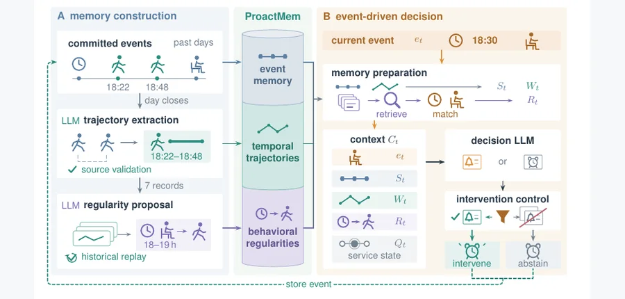 arXiv 2026-10-28 · cs.AI · #18 **[Proactive Memory for Event-Driven LLM Agents](https://arxiv.org/abs/2610.36967)** Jinyang Li , Zichuan Fu , Xian Wu , Wenlin Zhang , Yimin Deng , Kaifeng Guo , Guojing Li , Junjia QI , Xiangyu Zhao Affiliation: City University of Hong Kong; Tencent [Paper](https://arxiv.org/abs/2610.36967) · [Figure source](https://arxiv.org/pdf/2610.36967#page=3) 

[EN] Abstract
Proactive LLM agents anticipate service opportunities from ongoing observations and accumulated history. Existing approaches emphasize recent context or retrieval of related memories, providing limited support for validating recurring behavioral regularities and assessing their applicability to the current event. We propose Proactive Memory (ProactMem), which organizes history into recent events, temporal trajectories, and behavioral regularities. Trajectory facts are checked against source events, and regularities are assessed through historical replay before being matched to current conditions. We also construct ProactiveStream, a longitudinal benchmark covering three application scopes, where agents process isolated event streams chronologically under episode-aware opportunity labels. On ProactiveStream, ProactMem achieves an overall effectiveness (F1) of 52.6%, a 21.4% relative improvement over the strongest of five external baselines. Code is available at: this https URL . <a href="https://arxiv.org/abs/2610.36967">Source</a>

[ZH] Abstract
主动式 LLM 智能体根据持续观测和积累历史，预判服务机会。现有方法强调近期上下文或相关记忆检索，但对验证反复出现的行为规律，以及判断规律是否适用于当前事件，支持有限。我们提出主动记忆（ProactMem），将历史组织为近期事件、时间轨迹和行为规律。轨迹事实与来源事件核对，规律则先通过历史重放评估，再与当前条件匹配。我们还构建 ProactiveStream，一个覆盖三个应用范围的纵向基准，智能体在具有回合感知机会标签的条件下，按时间顺序处理隔离的事件流。在 ProactiveStream 上，ProactMem 获得 52.6% 的总体有效性（F1），比五个外部基线中的最强者相对提高 21.4%。代码可在原文所附的 HTTPS 链接获取。 <a href="https://arxiv.org/abs/2610.36967">Source</a>
 |
| 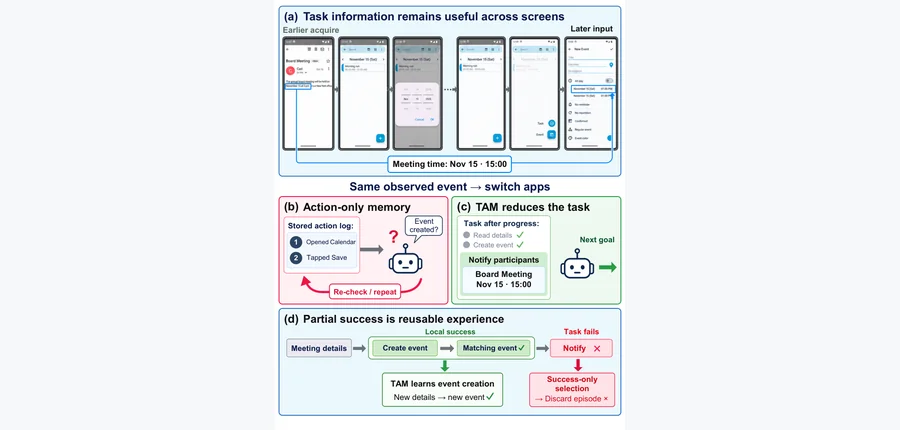 arXiv 2026-10-28 · cs.AI · #19 **[From Interaction to Capability: Task Advancement as State and Supervision for GUI Agents](https://arxiv.org/abs/2610.37482)** Ziyang Chen , Qian Li , Chengwei Qin Affiliation: The Hong Kong University of Science and Technology (Guangzhou); Joint SDU-NTU Centre for Artificial Intelligence Research, Shandong University [Paper](https://arxiv.org/abs/2610.37482) · [Figure source](https://arxiv.org/html/2610.37482v1/TAM_Motivation_Pixels_Preserved.png) 

[EN] Abstract
GUI memory should preserve the results of past actions and learn reusable operations. This is difficult in long-horizon workflows, where agents must use information across applications and useful operations are interleaved with failed attempts. We introduce Task Advancement Memory (TAM), which defines task advancement as verified task progress, and supports ongoing task execution and learns reusable operations. During execution, Task Advancement State represents how verified task progress changes the remaining goals, allowing the agent to build on earlier achievements across applications. After each task, advancement supervision identifies and abstracts the interactions that produced a verified local result. The learned operations preserve the relation between required inputs, expected outcomes, and verification conditions. This retains locally successful operations from both successful and failed tasks. On MobileWorld GUI-only tasks, Advancement State alone raises success from 12.0% to 28.2%. Full TAM achieves a 17.6% relative gain in task success over the strongest evaluated baseline and reduces lifecycle tokens per solved task by 38.7%. On SPA-Bench, TAM achieves state-of-the-art task success in the single-app English Level 3 setting. <a href="https://arxiv.org/abs/2610.37482">Source</a>

[ZH] Abstract
GUI 记忆应保留过去行动的结果，并学习可复用操作。这在长时程工作流中很困难，因为智能体必须跨应用使用信息，而有用操作与失败尝试相互交织。我们提出任务推进记忆（TAM），将任务推进定义为经验证的任务进展，既支持持续任务执行，也学习可复用操作。在执行期间，任务推进状态表示已验证进展如何改变剩余目标，使智能体能够跨应用基于此前成果继续行动。每项任务结束后，推进监督识别并抽象产生已验证局部结果的交互。学习到的操作保留所需输入、预期结果和验证条件之间的关系，从而从成功与失败任务中都保留局部成功的操作。在 MobileWorld 仅 GUI 任务上，仅推进状态就将成功率从 12.0% 提高到 28.2%。完整 TAM 相比所评估最强基线，将任务成功率相对提高 17.6%，并将每项已解决任务的全生命周期 token 减少 38.7%。在 SPA-Bench 上，TAM 在单应用英语 Level 3 设置中取得先进的任务成功率。 <a href="https://arxiv.org/abs/2610.37482">Source</a>
 | 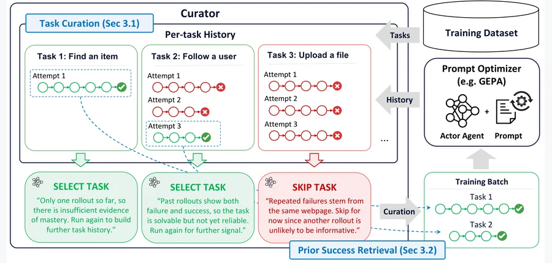 arXiv 2026-10-28 · cs.CL · #20 **[GEPA-Curator: Curated Learning for Self Improving Agents](https://arxiv.org/abs/2610.37651)** Zack Yu , Nicholas Lee , Minjae Lee , Lakshya Agarwal , Luca Manolache , Wonjun Kang , Matei Zaharia , Michael W. Mahoney… Affiliation: UC Berkeley; ICSI; LBNL; Furiosa AI; KAIST (as listed) [Paper](https://arxiv.org/abs/2610.37651) · [Figure source](https://arxiv.org/html/2610.37651v1/overview-new-4.png) 

[EN] Abstract
Large Language Models (LLMs) are increasingly used in multi-turn agentic workloads that require sustained interaction with complex environments. Existing reflective prompt optimizers such as GEPA learn from failed rollouts, but agentic failures can also come from prompt weaknesses, harness limitations, stochastic execution, or noisy judges. We argue that such failures may not provide useful learning signal, and may even be harmful; and thus it is essential to curate which tasks are provided to the prompt optimizer for better performance. We introduce GEPA-Curator, a framework that augments the prompt optimizer to select which agent experiences should shape prompt optimization. In particular, GEPA-Curator consists of two components: task curation, which filters out tasks that are likely to provide noisy or unreliable learning signals, and prior success retrieval, which selectively retrieves past successful trajectories for a task and provides them as additional context to the prompt optimizer. We evaluate GEPA-Curator on GoBrowse, ALFWorld, AppWorld, and $\tau$-bench, using both Gemini 3.1 Pro and Claude Opus 5 as optimizer models. GEPA-Curator matches or exceeds the mean performance of both baselines, with gains of up to 20.7% over GEPA and 21.2% over ACE. <a href="https://arxiv.org/abs/2610.37651">Source</a>

[ZH] Abstract
大语言模型（LLM）越来越多地用于需要与复杂环境持续交互的多轮智能体工作负载。GEPA 等现有反思式提示词优化器从失败 rollout 中学习，但智能体失败也可能源于提示词弱点、运行框架限制、随机执行或有噪声的评判器。我们认为，这类失败可能不提供有用学习信号，甚至有害；因此，为获得更好表现，必须筛选提供给提示词优化器的任务。我们提出 GEPA-Curator，一个增强提示词优化器的框架，用来选择哪些智能体经验应影响提示词优化。具体来说，GEPA-Curator 包含两个组件：任务筛选，过滤可能提供噪声或不可靠学习信号的任务；先前成功检索，选择性检索某任务过去的成功轨迹，为提示词优化器提供额外上下文。我们使用 Gemini 3.1 Pro 和 Claude Opus 5 作为优化器模型，在 GoBrowse、ALFWorld、AppWorld 和 τ-bench 上评估 GEPA-Curator。GEPA-Curator 的平均表现匹配或超过两个基线，相比 GEPA 和 ACE 的收益最高分别为 20.7% 和 21.2%。 <a href="https://arxiv.org/abs/2610.37651">Source</a>
 | 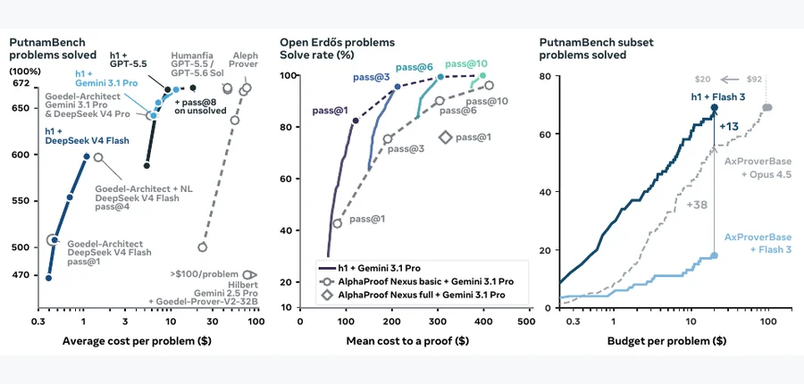 arXiv 2026-10-28 · cs.LG · #21 **[h1: A Taste of the Bitter Lesson in Automated Theorem Proving](https://arxiv.org/abs/2610.35962)** Skander Moalla , Ahmad Rammal , Niket Patel , Remi Munos , Julia Kempe Affiliation: FAIR at Meta; EPFL; CERMICS, ENPC, Institut Polytechnique de Paris; New York University [Paper](https://arxiv.org/abs/2610.35962) · [Figure source](https://arxiv.org/pdf/2610.35962#page=1) 

[EN] Abstract
While progress in informal mathematics has come largely from scaling the chain-of-thought and agentic reasoning of frontier language models, formal theorem proving has increasingly relied on human-designed workflows around these models, such as planning, decomposition, and orchestrating specialized provers. This raises a bitter-lesson question: can a simple agentic loop that scales test-time compute match these workflows? The answer matters as formal verification must scale to keep up with frontier models producing research mathematics, yet new workflows rarely settle it, as their gains are often confounded with stronger models or more compute. We study this question with h1, a simple harness that gives a model an efficient interface to Lean 4 and keeps it working through verifier feedback and self-reflection, without imposing a decomposition or search structure. h1 reaches state-of-the-art results on PutnamBench, FATE-X, and FormalConjectures100-Solved, settles eight open problems in FormalConjectures, and, at matched models, matches or outperforms specialized workflows such as Goedel-Architect and AlphaProof Nexus, surprisingly showing that a single attempt (pass@1) can often scale to solve open problems. Through ablations and matched-model comparisons with Claude Code and AxProverBase, we find that simplicity alone is not enough: an efficient Lean interface largely determines cost and solve rate. We thus recommend that future work evaluate frontier models with efficient execution feedback before prescribing workflows, at the risk of bitter lessons. <a href="https://arxiv.org/abs/2610.35962">Source</a>

[ZH] Abstract
非形式数学的进展，主要来自扩展前沿语言模型的思维链和智能体推理，而形式化定理证明却越来越依赖围绕这些模型人工设计的工作流，例如规划、分解和调度专门证明器。这引出了“苦涩教训”问题：一个扩展测试时计算的简单智能体循环，能否匹配这些工作流？答案很重要，因为形式验证必须扩展，才能跟上前沿模型产出研究数学的速度；但新工作流很少解决这一问题，其增益往往与更强模型或更多计算混杂。我们使用 h1 研究此问题：这是一个简单运行框架，为模型提供高效 Lean 4 接口，让其通过验证器反馈和自反思持续工作，不强加分解或搜索结构。h1 在 PutnamBench、FATE-X 和 FormalConjectures100-Solved 上达到先进结果，解决 FormalConjectures 中八个开放问题，并在模型匹配时，匹配或超过 Goedel-Architect、AlphaProof Nexus 等专门工作流；令人意外地表明，单次尝试（pass@1）通常也能扩展至解决开放问题。通过与 Claude Code 和 AxProverBase 的消融及匹配模型比较，我们发现，仅有简单性还不够：高效 Lean 接口在很大程度上决定成本与求解率。因此，我们建议未来工作在规定工作流之前，先以高效执行反馈评估前沿模型，否则可能迎来苦涩教训。 <a href="https://arxiv.org/abs/2610.35962">Source</a>
 |
| 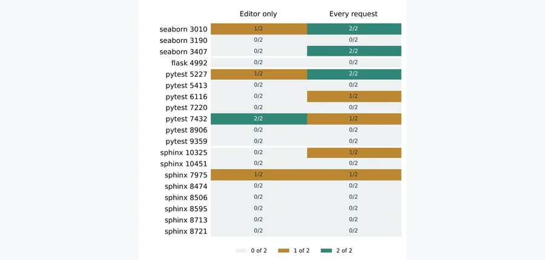 arXiv 2026-10-28 · cs.SE · #22 **[Before the First Edit? Measuring When Coding-Agent Guidance Actually Arrives](https://arxiv.org/abs/2610.35992)** Thupakula Sai Varun Affiliation: Independent Researcher [Paper](https://arxiv.org/abs/2610.35992) · [Figure source](https://arxiv.org/html/2610.35992v1/small-patch-task-changes.png) 

[EN] Abstract
When a coding-agent harness promises guidance before the first source edit, what event does it actually intercept? We audit five separate events: policy assignment, request eligibility, trigger, plan delivery, and observed source-content change. A prescribed-action comparison exposes the coverage of three gate rules but cannot tell us how an agent would continue after receiving a plan. We therefore run local agents on public software issues and hash Python files before and after each executed action. In a pilot-guided, 76-arm study using Qwen2.5-Coder 14B, 15 arms change Python source across seven tasks and three repositories. Guidance precedes every observed first change, but every change uses a structured editor and the study misses its prespecified 20-arm coverage target. Post hoc local tests find seven changed arms that pass the tested target and regression selectors; four of those seven use incomplete regression lists. Public PAUSE and SI2CA trajectories add source-text changes bracketed by adjacent reads, but lack synchronized filesystem states and cannot identify exact first mutations. The audit makes the timing claim testable within a stated source scope. These data do not show that planning improves repair correctness or covers shell-first writes in live agent runs. <a href="https://arxiv.org/abs/2610.35992">Source</a>

[ZH] Abstract
当编码智能体运行框架承诺在首次源代码编辑前提供指导时，它究竟拦截了什么事件？我们审计五个独立事件：策略分配、请求资格、触发、计划交付，以及观测到的源内容改变。规定行动的比较揭示三种门控规则的覆盖范围，但不能说明智能体收到计划后会如何继续。因此，我们在公开软件问题上运行本地智能体，并在每次执行动作前后对 Python 文件做哈希。在一项由试点引导、使用 Qwen2.5-Coder 14B 的 76 臂研究中，15 个实验臂跨七个任务和三个仓库修改了 Python 源代码。指导先于每个观测到的首次改变，但所有改变均使用结构化编辑器，且研究未达到预先指定的 20 臂覆盖目标。事后本地测试发现，七个已修改实验臂通过了被测试的目标和回归选择器；其中四个使用不完整的回归列表。公开 PAUSE 和 SI2CA 轨迹增加了由相邻读取夹定的源文本改变证据，但缺乏同步文件系统状态，无法识别精确的首次修改。该审计使时序主张在明确源文件范围内可测试。这些数据并未表明规划能改善修复正确性，也未证明覆盖真实智能体运行中由 shell 首先写入的情形。 <a href="https://arxiv.org/abs/2610.35992">Source</a>
 | 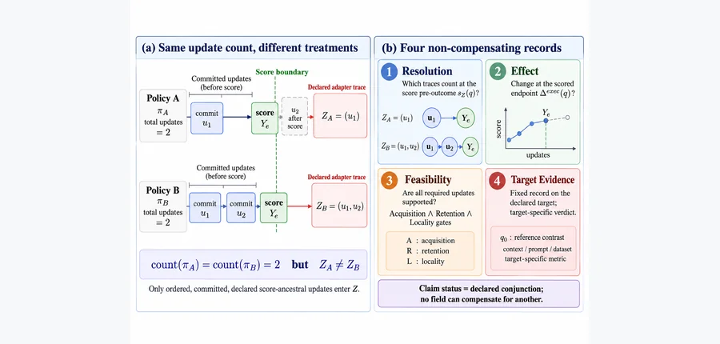 arXiv 2026-10-28 · cs.LG · #23 **[Beyond Update Counts: A Control Map for Evaluating Test-Time Model Updates](https://arxiv.org/abs/2610.36109)** Zehao Zhao , Shangjian Yin , Rui Liu , Chongyang Bai , Mark Ibrahim , Kavosh Asadi , Yuchen Lu , Hang Cui , Hamed Firooz Affiliation: Meta AI [Paper](https://arxiv.org/abs/2610.36109) · [Figure source](https://arxiv.org/html/2610.36109v1/figures/control_map_overview.png) 

[EN] Abstract
Test-time updating lets a language model change persistent state after training---such as model weights, adapter parameters, or a memory module---before or while answering queries. Existing evaluations often compare systems using update count or frequency and performance measured immediately afterward. These summaries omit what is updated, where, when, and in what order. The same total can therefore hide an important difference: one system may answer after one update while another answers after two. We introduce the Control Map, an evaluation framework that records the committed updates preceding each scored answer and separately evaluates behavioral changes, immediate learning (acquisition), later recall (retention), preservation of unrelated behavior (locality), and performance in new settings. We prove when counts alone determine final state and show, under stated assumptions, how differences between pre-answer histories limit differences in average scores. Using ControlMap, our experiments reveal three insights. First, update scheduling matters: at a 760M-parameter checkpoint, 24 schedules with the same update count yield 19.7%--34.2% accuracy. Second, learning an edit does not guarantee that it lasts or remains contained: all six selected CounterFact LoRA settings learn the new information, while ROME retains edits at all 13 operating points but fails locality at each. Third, no editor performs best consistently across models, benchmarks, and tests. Evaluations should therefore report update histories and assess acquisition, retention, and locality separately. <a href="https://arxiv.org/abs/2610.36109">Source</a>

[ZH] Abstract
测试时更新让语言模型能够在训练后，在回答查询之前或过程中改变持久状态，例如模型权重、适配器参数或记忆模块。现有评估常按更新次数或频率，以及更新后立即测得的表现比较系统。这些摘要遗漏了更新对象、位置、时机和顺序。因此，相同总次数可能掩盖重要差别：一个系统在更新一次后回答，另一个在两次后回答。我们提出 Control Map，一个记录每个被评分答案之前已提交更新的评估框架，分别评估行为变化、即时学习（获取）、后续回忆（保留）、无关行为保持（局部性），以及新设置中的表现。我们证明何时仅凭次数便能决定最终状态，并在给定假设下，说明回答前历史差异如何限制平均分数差异。使用 ControlMap，我们的实验揭示三个认识。首先，更新调度很重要：在一个 760M 参数检查点上，更新次数相同的 24 种调度，准确率为 19.7%—34.2%。其次，学会一次编辑不保证持久或局限于目标：六种选定的 CounterFact LoRA 设置都学会新信息，而 ROME 在全部 13 个操作点都保留编辑，却在每个点都未通过局部性检验。第三，没有编辑器能在不同模型、基准和测试中始终表现最好。因此，评估应报告更新历史，并分别检验获取、保留和局部性。 <a href="https://arxiv.org/abs/2610.36109">Source</a>
 | 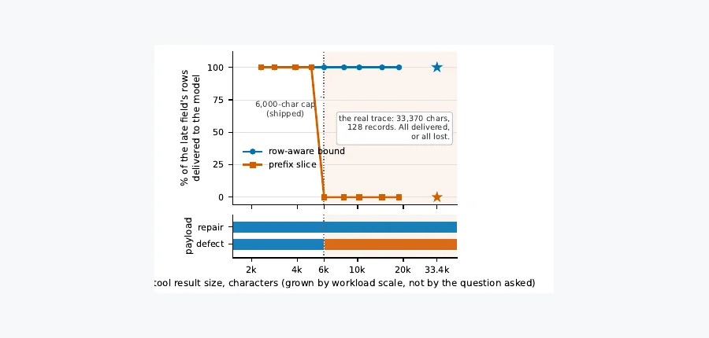 arXiv 2026-10-28 · cs.SE · #24 **[Context Is a Pipeline, Not a Window: Information Attrition in LLM Agent Harnesses](https://arxiv.org/abs/2610.36114)** Yuvraj Sehgal , Mahsa Panahandeh , Naser Ezzati-Jivan Affiliation: Brock University; University of Ottawa [Paper](https://arxiv.org/abs/2610.36114) · [Figure source](https://arxiv.org/pdf/2610.36114#page=3) 

[EN] Abstract
LLM agents are judged by two numbers: the size of the context window, and how often the final answer is correct. Both numbers miss a third thing: how much of a tool's output is lost before the model ever sees it. We measured this loss in a real tool-using agent. The agent finds the cause of injected faults by reading Linux kernel traces. The context window was almost empty: across 720 runs, the single largest prompt used only 5.75% of it. Yet a third of all tool results (3,827 of 11,189) were cut before they reached the model, and every cut result became broken JSON. The harness cut each result by slicing its JSON text at a fixed length. This does not shorten a result evenly. It deletes whatever data sits near the end. One field reached the model in only 4.7% of calls. A second field, in the very same results, reached the model in 99.3% of calls. Which field held the fault's evidence depended on when the faulty process started: early or late in the trace. The agent's diagnosis accuracy matched this same split. So we ran controlled experiments to test one question: did the data loss cause the drop in accuracy? This paper makes four contributions. First, we model an agent's context as a five-stage pipeline, with a measured failure at each stage. Second, we replay 864 real tool results, including one from a production trace where the shipped cut deletes all 128 records of the fault's evidence. Third, a controlled experiment shows that the cut's real cost appears first as extra work, not as wrong answers: 43% more tool calls, twice the computation, and yield falling from 0.61 to 0.31. The agent still finds the right answer when it has another way to reach it. Fourth, a survey of seven agent frameworks finds two that cut tool output the same unsafe way. Whether the data cut truly causes the accuracy drop is still an open question. <a href="https://arxiv.org/abs/2610.36114">Source</a>

[ZH] Abstract
LLM 智能体通常由两个数字评判：上下文窗口大小，以及最终答案正确率。这两个数字都漏掉第三件事：工具输出在模型看到之前损失了多少。我们在一个真实工具使用智能体中测量这种损失，该智能体通过读取 Linux 内核轨迹，查找注入故障的原因。上下文窗口几乎空着：720 次运行中，最大的单个提示词也只用了窗口的 5.75%。但全部工具结果的约三分之一（11,189 个中的 3,827 个）在抵达模型前就被截断，而且每个被截断结果都变成损坏的 JSON。运行框架通过按固定长度切割 JSON 文本来截断结果。这并非均匀缩短，而是删除靠近末尾的数据。一个字段只在 4.7% 的调用中到达模型，同一结果中的另一个字段却在 99.3% 的调用中到达。故障证据落在哪个字段，取决于故障进程在轨迹中启动得早还是晚；智能体诊断准确率呈现同样分化。因此，我们开展受控实验来测试一个问题：数据损失是否导致准确率下降？本文作出四项贡献。首先，我们将智能体上下文建模为五阶段流水线，并在每一阶段测量失败。其次，重放 864 个真实工具结果，包括一个生产轨迹，其中已部署的截断删除了全部 128 条故障证据记录。第三，受控实验表明，截断的真实成本首先体现为额外工作，而非错误答案：工具调用增加 43%，计算翻倍，产出率从 0.61 降至 0.31。当智能体有其他途径抵达证据时，仍能找到正确答案。第四，对七个智能体框架的调查发现，其中两个以同样不安全方式截断工具输出。截断是否确实导致准确率下降，仍是开放问题。 <a href="https://arxiv.org/abs/2610.36114">Source</a>
 |
| 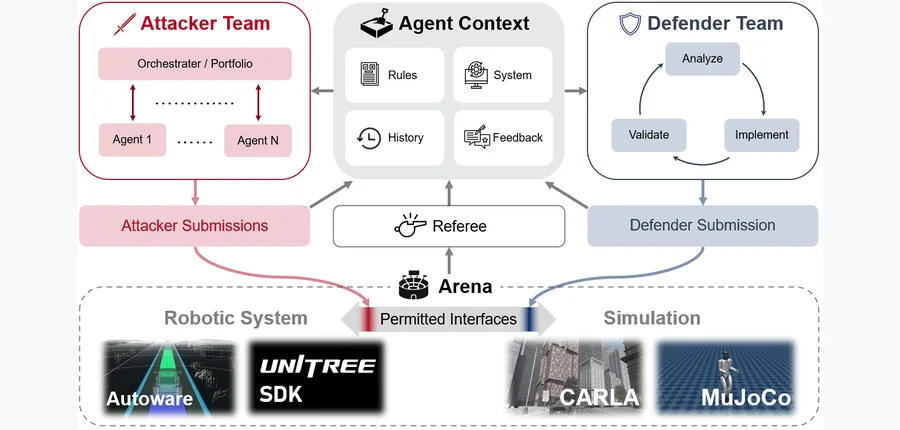 arXiv 2026-10-28 · cs.RO · #25 **[Program-Level Adversarial Co-Adaptive Self-Play for Robotic Security](https://arxiv.org/abs/2610.36143)** Leo Benaharon , Chi Zhang , Wei Zheng , Weifan Zhang , Yifan Wei Affiliation: Isuzu Technical Center of America [Paper](https://arxiv.org/abs/2610.36143) · [Figure source](https://arxiv.org/html/2610.36143v1/media/framework.png) 

[EN] Abstract
Coding agents can adapt robotic software by revising executable programs, but successful responses to an evolving opponent may not remain effective. We present a framework for program-level adversarial co-adaptive self-play in which coding agents generate attacks and defenses from tested opponent code and mission feedback, without model fine-tuning. Environment-specific interfaces support external programs for autonomous driving and SDK-level defenses for humanoid locomotion. Two eight-generation case studies reveal concrete software responses: a driving defender introduces direct-actuation recovery, while a humanoid defender revises incoming-state validation. These responses provide local task recovery but do not establish sustained robustness. The framework makes such adaptation and limitations observable through executable artifacts and task-level evidence. <a href="https://arxiv.org/abs/2610.36143">Source</a>

[ZH] Abstract
编码智能体能够通过修订可执行程序适配机器人软件，但对持续变化对手的成功应对，不一定能一直有效。我们提出程序级对抗共同适配自博弈框架，编码智能体根据经过测试的对手代码和任务反馈生成攻击与防御，无需模型微调。环境特定接口支持用于自动驾驶的外部程序，以及用于人形机器人运动的 SDK 级防御。两个各八代的案例研究揭示具体的软件响应：驾驶防御者引入直接执行器控制的恢复方法，而人形机器人防御者修订输入状态验证。这些响应提供局部任务恢复，但不能确立持续鲁棒性。框架通过可执行产物和任务级证据，使此类适配及其局限可被观察。 <a href="https://arxiv.org/abs/2610.36143">Source</a>
 | 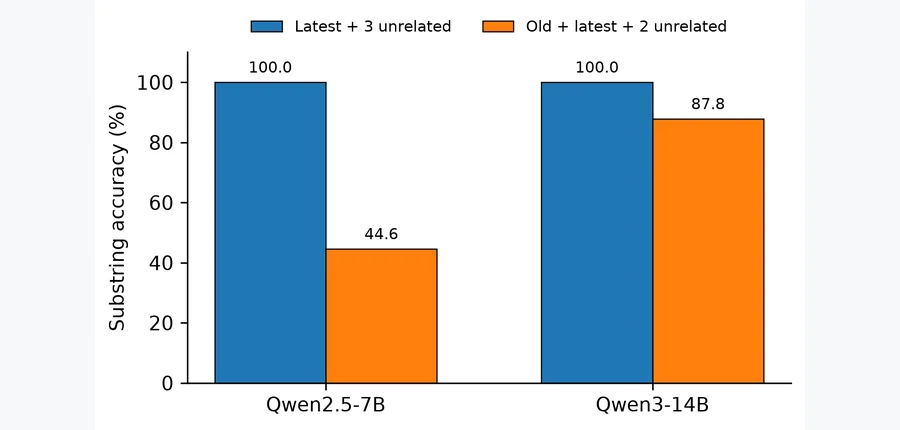 arXiv 2026-10-28 · cs.AI · #26 **[When Retrieval Is Not Enough: Obsolete Facts in Agent Memory](https://arxiv.org/abs/2610.36308)** Oleeviya Babu Poikarayil , Tony Basil Babu , Abdulrahman Nahhas , Het Darshan Mehta , Jawid Ahmad Baktash , Ernesto Willia… Affiliation: Otto von Guericke University Magdeburg; University of Kerala; Technical University of Munich [Paper](https://arxiv.org/abs/2610.36308) · [Code](https://github.com/oleeviyababu/Memory_Conflict) · [Figure source](https://arxiv.org/html/2610.36308v1/plots/figure1_controlled_models.png) 

[EN] Abstract
Memory-agent benchmarks often collapse retrieval and answer generation into one score, making it hard to tell whether a failure comes from missing an update or from not using an update that was already retrieved. We examine this distinction on the single-hop FactConsolidation task of MemoryAgentBench. With Qwen2.5-7B-Instruct on 6K-history BM25 accuracy drops from 45% to 32% when the retrieved evidence budget grows from 64 to 512 tokens, even though a gold-assisted post-hoc audit finds the newest statement in every retrieved set. Most of the errors occur on questions that also contain an obsolete statement version. Under a frozen prompt and equal four-statement evidence size, replacing one unrelated statement with the obsolete competing statement reduces accuracy from 100% to 44.6% for Qwen2.5 and from 100% to 87.8% for Qwen3-14B, with all 50 harmful paired flips classified as stale. A 32K-history replication likewise favors BM25-64 over BM25-512 (69% versus 58%). These results suggest that retrieving the correct fact is not enough. An obsolete competing statement can be more harmful than an unrelated piece of evidence of the same size. <a href="https://arxiv.org/abs/2610.36308">Source</a>

[ZH] Abstract
记忆智能体基准常将检索与答案生成合为一个分数，难以判断失败是因漏掉更新，还是未使用已经检索到的更新。我们在 MemoryAgentBench 的单跳 FactConsolidation 任务上考察这一区别。使用 Qwen2.5-7B-Instruct 和 6K 历史时，检索证据预算从 64 增至 512 token，BM25 准确率从 45% 降至 32%，尽管使用标准答案辅助的事后审计，在每个检索集合中都找到最新陈述。多数错误发生在同时包含过时陈述版本的问题上。在提示词冻结、证据同为四条陈述时，将一条无关陈述替换为过时的竞争陈述，使 Qwen2.5 准确率从 100% 降至 44.6%，Qwen3-14B 从 100% 降至 87.8%，全部 50 个有害配对翻转都被归类为陈旧事实错误。32K 历史的重复实验同样更支持 BM25-64，而非 BM25-512（69% 对 58%）。这些结果表明，仅检索到正确事实还不够。过时的竞争陈述，可能比相同大小的无关证据更有害。 <a href="https://arxiv.org/abs/2610.36308">Source</a>
 | 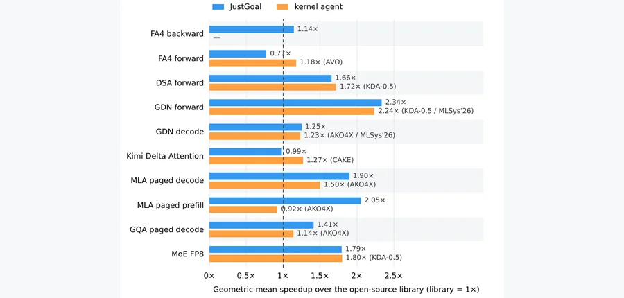 arXiv 2026-10-28 · cs.DC · #27 **[JustGoal: With Only a Goal, the AI Baseline Is Above the Expert Kernels](https://arxiv.org/abs/2610.36434)** Yaojian Chen , Dazhi Peng , Zhui Zhu , Leshan Li , Haojun Sun , Yiyun Zheng , Qingfeng He , Shangzhan Li , Xianglong Deng… Affiliation: Tsinghua University; ModelBest; Harbin Institute of Technology; University of Chinese Academy of Sciences [Paper](https://arxiv.org/abs/2610.36434) · [Figure source](https://arxiv.org/pdf/2610.36434#page=6) 

[EN] Abstract
A small number of GPU kernels often determines the efficiency of large language model training and inference. High-performance kernel development typically relies on expert knowledge through manual implementation, collaboration with general-purpose models, or specialized agents equipped with domain knowledge, evaluation methods, and search workflows. We investigate how much value this knowledge provides as foundation models become stronger. We introduce JustGoal, a goal-only baseline in which a general-purpose agent receives only the optimization objective and constraints, without kernel-specific infrastructure, knowledge bases, or predefined workflows, and builds its own evaluation loop. On NVIDIA B200 GPUs, JustGoal outperforms open-source libraries on 8 of 10 operators, achieving per-operator geometric mean speedups of 1.14x to 2.34x. It also surpasses the fastest publicly released specialized-agent kernel on 5 of 9 operators with available comparisons. In a controlled same-model comparison using Fable 5.1 on single shapes, the KDA-0.5 harness reaches 0.95x of JustGoal's performance, while single-mechanism ablations show no consistent benefit from domain knowledge or predefined workflows. These results indicate that specialized machinery should be justified by clear gains over a same-model, same-scope goal-only baseline and reevaluated whenever the foundation model changes. <a href="https://arxiv.org/abs/2610.36434">Source</a>

[ZH] Abstract
少量 GPU 内核往往决定大语言模型训练和推理的效率。高性能内核开发通常依赖专家知识，方式包括手工实现、与通用模型协作，或使用配备领域知识、评估方法和搜索工作流的专门智能体。我们研究，随着基础模型变强，这些知识究竟提供多少价值。我们提出 JustGoal，一个仅给目标的基线：通用智能体只收到优化目标与约束，不配备内核专用基础设施、知识库或预定义工作流，而自行构建评估循环。在 NVIDIA B200 GPU 上，JustGoal 在 10 个算子中的 8 个上优于开源库，各算子的几何平均加速为 1.14—2.34 倍。对于有可用比较的 9 个算子，它也在其中 5 个上超过公开发布的最快专门智能体内核。在使用 Fable 5.1、针对单个形状的受控同模型比较中，KDA-0.5 运行框架达到 JustGoal 表现的 0.95 倍，而单机制消融显示，领域知识或预定义工作流没有一致收益。这些结果表明，应以相对于同模型、同范围的仅目标基线的明确增益，证明专门机制的合理性，并在基础模型变化时重新评估。 <a href="https://arxiv.org/abs/2610.36434">Source</a>
 |
| 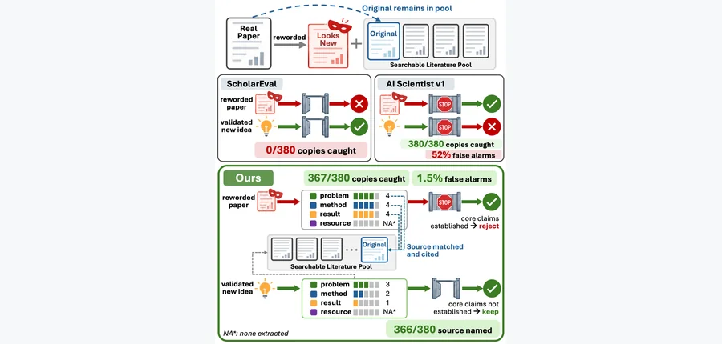 arXiv 2026-10-28 · cs.CL · #28 **[Do AI Scientists Know What's New?](https://arxiv.org/abs/2610.36511)** Miri Liu , Xiayu Zhao , Encheng Xie , ChengXiang Zhai Affiliation: University of Illinois Urbana-Champaign [Paper](https://arxiv.org/abs/2610.36511) · [Code](https://github.com/emmatliu/claimnov) · [Figure source](https://arxiv.org/html/2610.36511v1/figs/teaser.jpg) 

[EN] Abstract
A major challenge facing AI scientific discovery pipelines is how to determine when a generated idea is meaningfully novel. Ideally, novelty checks in these pipelines must be able to reject non-novel ideas while not rejecting too many novel ideas, and they should also be able to distinguish which parts of a proposal are non-novel, as opposed to opaquely discarding entire proposals. We design an analytical framework for evaluation of novelty checks with temporal ground truth at both the proposal- and claim-level, using four datasets of 1,060 proposals built from published papers, reviewer disputes, and generated ideas matching ones the field went on to publish. Auditing existing novelty checks with this framework, we find that checks with high rejection rates on non-novel work also tend to have high false alarms on ideas that are later realized by human researchers, and observe that checks built to evaluate proposals as a whole can point to claim-level prior art only by rejecting the whole proposal. We therefore introduce ClaimNov, a fine-grained, interpretable claim-level novelty module. ClaimNov catches 97% of disguised papers at a 1.5% false-alarm rate, and its claim-level novelty profile cuts the LLM judge's false alarms from 11.8% to 1.5%. Because its verdict rests on claim-level evidence, ClaimNov also keeps proposals that build on established contributions, rejecting only 3% of ICLR-accepted proposals with a reviewer-disputed contribution and keeping 91 of 100 novel proposals with one spliced prior contribution, against 76 for the strongest existing check. Code and data are available at this https URL . <a href="https://arxiv.org/abs/2610.36511">Source</a>

[ZH] Abstract
AI 科学发现流水线面临的一大挑战，是如何判断生成的想法是否具有实质新颖性。理想情况下，流水线的新颖性检查应能拒绝不新颖想法，同时不误拒太多新颖想法；还应区分提案中的哪些部分不新颖，而不是不透明地丢弃整项提案。我们设计一个分析框架，利用提案级和主张级的时间真实依据评估新颖性检查，使用四个数据集、共 1,060 个提案，其来源包括已发表论文、审稿争议，以及与后来领域发表成果相匹配的生成想法。用该框架审计现有检查后，我们发现，对不新颖工作拒绝率高的检查，也往往对后来被人类研究者实现的想法产生较高误报；而面向整项提案评估的检查，只有拒绝整项提案，才能指出主张级已有工作。因此，我们提出 ClaimNov，一个细粒度、可解释的主张级新颖性模块。ClaimNov 在 1.5% 误报率下识别 97% 的伪装论文，其主张级新颖性画像，将 LLM 评判器误报从 11.8% 降至 1.5%。由于结论基于主张级证据，ClaimNov 也能保留建立于既有贡献之上的提案：对包含审稿人争议贡献、但已获 ICLR 接收的提案，仅拒绝 3%；对于拼接一项既有贡献的 100 个新颖提案，保留 91 个，而最强现有检查保留 76 个。代码和数据可在原文所附的 HTTPS 链接获取。 <a href="https://arxiv.org/abs/2610.36511">Source</a>
 | 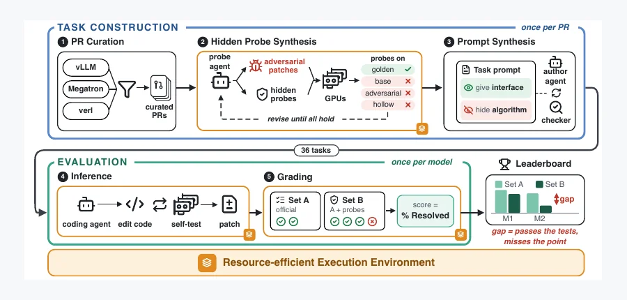 arXiv 2026-10-28 · cs.AI · #29 **[InfraDev: Can Coding Agents Develop AI Infrastructure, and How Can We Tell?](https://arxiv.org/abs/2610.36589)** Yangshen Deng , Jiaqi Ruan , Yeqi Huang , Nick Lau , Guangming Sheng , Luo Mai Affiliation: University of Edinburgh; Tencent Hunyuan [Paper](https://arxiv.org/abs/2610.36589) · [Figure source](https://arxiv.org/pdf/2610.36589#page=3) 

[EN] Abstract
Coding agents are beginning to develop the production-grade AI infrastructure that trains and serves large models, yet existing benchmarks cover only single kernels or single-GPU tasks, and grade with tests and prompts that misjudge both correct and incorrect patches. We introduce InfraDev, a benchmark of 36 tasks built from real-world pull requests to Megatron-LM, vLLM, and verl, covering infrastructure development for training, inference, and reinforcement learning. Each task asks an agent to reimplement a real change that spans many files and must run correctly across many GPUs. To grade such changes, we jointly synthesize hidden probes, which enforce the requirements the original tests leave unchecked, and a prompt that states every interface the probes call without revealing the solution. We also design a shared execution environment that reuses dependencies and artifacts across tasks, cutting storage by 52-57% and build time by 13-14% on Megatron-LM and vLLM. Across six frontier models, the best resolves only 38.9% of the tasks; the probes reject 32% of the submissions that pass every official test, and with the original pull request descriptions as prompts, no model resolves a single task. Failure analysis shows that structural and state errors dominate and that agents' own tests rarely check memory, time, or traffic. Turning these findings into an agent skill raises the resolved rate of a frontier model on the Megatron-LM tasks by 10.5%. <a href="https://arxiv.org/abs/2610.36589">Source</a>

[ZH] Abstract
编码智能体正开始开发用于训练和服务大模型的生产级 AI 基础设施，但现有基准只覆盖单内核或单 GPU 任务，且采用的测试与提示词会误判正确和错误补丁。我们提出 InfraDev，一个包含 36 个任务的基准，任务来自 Megatron-LM、vLLM 和 verl 的真实拉取请求，覆盖训练、推理和强化学习基础设施开发。每个任务要求智能体重新实现一项真实改动，跨多个文件，并必须在多个 GPU 上正确运行。为评判此类改动，我们联合合成隐藏探针和提示词：探针执行原始测试未检查的要求，而提示词说明探针调用的每个接口，不泄露解法。我们还设计共享执行环境，在任务间复用依赖与产物，使 Megatron-LM 和 vLLM 的存储减少 52—57%，构建时间减少 13—14%。在六个前沿模型中，最佳也只解决 38.9% 的任务；探针拒绝了 32% 那些通过全部官方测试的提交；以原始拉取请求描述作提示词时，没有模型解决任何任务。失败分析表明，结构和状态错误占主导，智能体自测很少检查内存、时间或流量。将这些发现转化为智能体技能，使一个前沿模型在 Megatron-LM 任务上的解决率提高 10.5%。 <a href="https://arxiv.org/abs/2610.36589">Source</a>
 | 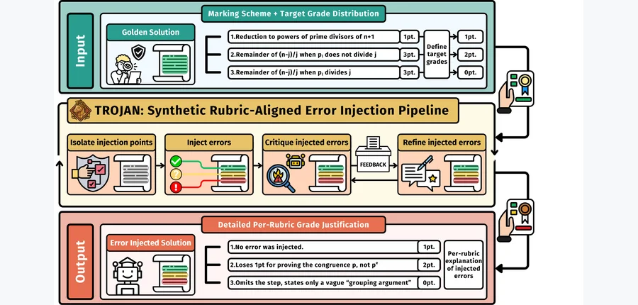 arXiv 2026-10-28 · cs.AI · #30 **[Can LLMs Reliably Grade Olympiad Proofs? A Study of Mathematical Verification with LLMs](https://arxiv.org/abs/2610.36767)** Azim Ospanov , Zijin Feng , Ding Ding , Chengwu Liu , Haoli Bai , Jiacheng Sun , Lifeng Shang , Farzan Farnia Affiliation: Huawei Foundation Model Department; The Chinese University of Hong Kong; The Hong Kong University of Science and Technology [Paper](https://arxiv.org/abs/2610.36767) · [Code](https://github.com/aziksh-ospanov/TROJAN) · [Figure source](https://arxiv.org/html/2610.36767v1/new_synthetic_pipeline_v3.png) 

[EN] Abstract
Large Language Models (LLMs) have made remarkable progress on solving competition-level mathematics, yet their ability to verify natural-language mathematical proofs remains relatively underexplored. This gap is especially pronounced for Olympiad-level proofs, which require meticulous assessment of each claim in a long reasoning chain. Current proof verification thus primarily relies on expert inspection, which is costly to scale. In this paper, we present a systematic study of LLM-based verification in this setting. Specifically, we introduce a human-curated dataset of USAMO 2025 candidate solutions with expert grading, and conduct a broad evaluation of existing LLM verifiers across frontier models. We also propose TROJAN, an iterative self-critique pipeline for generating high-fidelity adversarial proofs at scale. Our comprehensive evaluation covers 20 models spanning seven metrics, two prompt styles, three inference methods, and three prompt templates, showing that state-of-the-art models still leave considerable room for improvement. To narrow this gap, we propose MABGrader, a Multi-Armed Bandit framework that reframes grading as arm selection over the discrete score space. MABGrader outperforms the SOTA ProofGrader by 26.4% in Quadratic Weighted Kappa and reduces grading error by 14%. Code and dataset are available at this https URL . <a href="https://arxiv.org/abs/2610.36767">Source</a>

[ZH] Abstract
大语言模型（LLM）在解答竞赛级数学上已取得显著进展，但验证自然语言数学证明的能力仍相对缺乏探索。这一缺口在奥林匹克级证明上尤其突出，因为它们需要细致评估长推理链中的每项主张。目前证明验证因此主要依赖专家检查，难以低成本扩展。本文系统研究这一设置中的 LLM 验证。具体而言，我们引入一个包含 USAMO 2025 候选解和专家评分的人工整理数据集，并跨前沿模型广泛评估现有 LLM 验证器。我们还提出 TROJAN，一个迭代自批评流水线，用于大规模生成高保真对抗证明。综合评估覆盖 20 个模型，涉及七项指标、两种提示风格、三种推理方法及三种提示模板，显示先进模型仍有很大改进空间。为缩小差距，我们提出 MABGrader，一个多臂老虎机框架，将评分重述为在离散分数空间中选择臂。MABGrader 的二次加权 Kappa 比先进的 ProofGrader 高 26.4%，评分误差降低 14%。代码和数据集可在原文所附的 HTTPS 链接获取。 <a href="https://arxiv.org/abs/2610.36767">Source</a>
 |
| 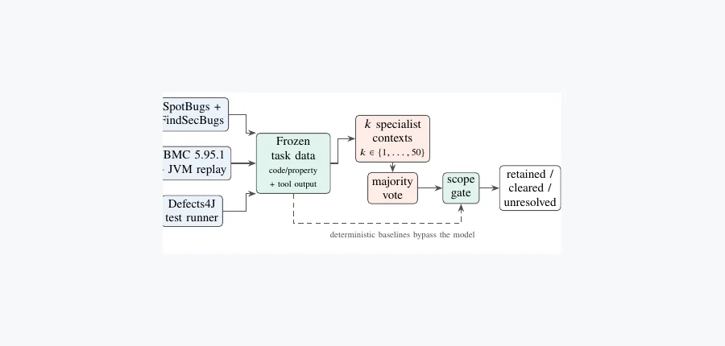 arXiv 2026-10-28 · cs.SE · #31 **[Beyond QASecClaw: Agent Scaling, Verifier Feedback, and Evidence Reliability in Software Assurance](https://arxiv.org/abs/2610.36947)** S M Abdulla Al Mamun , Akif Islam , Mohd. Ruhul Ameen Affiliation: The University of Manchester; University of Rajshahi; Varendra University [Paper](https://arxiv.org/abs/2610.36947) · [Figure source](https://arxiv.org/pdf/2610.36947#page=2) 

[EN] Abstract
Can additional specialist language-model contexts improve software assurance when deterministic tool evidence is already available? We study this question through five experiments spanning authored Java warning controls, OWASP Benchmark assessment, Defects4J test generation, SV-COMP assertion verdicts, and deliberately misleading evidence packages. The evaluated systems use Qwen2.5-Coder-7B-Instruct, with a 1.5B sensitivity analysis, and complete 13,638 model requests. On eight related development warnings, increasing the context count from 1 to 50 increases token use 49-fold without improving unsafe clearance. On 160 OWASP cases, model configurations trade clearance against unresolved outcomes; the ten-context arm assesses only 96 cases. On 32 SV-COMP tasks, raw verifier feedback raises mean correct model verdicts from 12.7 to 22.0, but also raises incorrect verdicts from one to seven; a JBMC-plus-JVM validation baseline returns 26 correct verdicts and six unresolved outcomes. On two sets of 120 evidence packages, models reject 70-100% of applicable counterexamples, while construction-specific scope checks classify every package correctly. No target defect is discovered in three Defects4J bugs, one unsupported by the test adapter. These descriptive results support deterministic evidence admission for the tested settings, while exposing limits of verdict aggregation, feedback interpretation, and the available evaluation coverage. <a href="https://arxiv.org/abs/2610.36947">Source</a>

[ZH] Abstract
当确定性工具证据已经可用时，增加专家语言模型上下文能否改善软件保障？我们通过五项实验研究此问题，涵盖人工构造的 Java 警告对照、OWASP Benchmark 评估、Defects4J 测试生成、SV-COMP 断言判定，以及故意误导的证据包。评估系统使用 Qwen2.5-Coder-7B-Instruct，并以 1.5B 模型作敏感性分析，共完成 13,638 次模型请求。在八个相关开发警告上，将上下文数从 1 增至 50，使 token 使用量增加 49 倍，却没有改善不安全放行。在 160 个 OWASP 案例上，模型配置在放行和未解决结果间权衡；十上下文实验臂仅评估了 96 个案例。在 32 个 SV-COMP 任务上，原始验证器反馈将平均正确模型判定从 12.7 提高到 22.0，但错误判定也从 1 增至 7；JBMC 加 JVM 验证基线给出 26 个正确判定和 6 个未解决结果。在两组各 120 个证据包上，模型拒绝了 70—100% 的适用反例，而针对构造的范围检查对每个包都分类正确。在三个 Defects4J 缺陷中，未发现任何目标缺陷，其中一个不受测试适配器支持。这些描述性结果支持在所测设置中采用确定性证据准入，同时暴露判定聚合、反馈解释和可用评估覆盖的局限。 <a href="https://arxiv.org/abs/2610.36947">Source</a>
 | 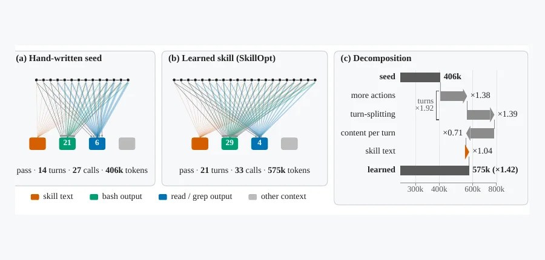 arXiv 2026-10-28 · cs.AI · #32 **[Does Your Generalist Skill Optimizer Really Incentivize Agentic Tasks? Rethinking Skill Optimization via Bipartite Attribution](https://arxiv.org/abs/2610.37201)** Jiawei Zhou , Bo Peng , Yuxuan Huang , Ming Zhang , Youbang Sun , Xiang Wang , Chaochao Lu Affiliation: Shanghai AI Laboratory; Fudan University; Shanghai Jiao Tong University; University of Science and Technology of China; Tsinghua University [Paper](https://arxiv.org/abs/2610.37201) · [Code](https://github.com/valleysprings/BiPA) · [Figure source](https://arxiv.org/pdf/2610.37201#page=2) 

[EN] Abstract
Skill optimizers adapt an agent to long-horizon tasks, such as repairing a terminal environment, by rewriting its skill, a natural-language procedure in its context, and keeping the edits that raise success on a small dev set. On such tasks success is noisy, so a gain on a small dev set does not show that an edit helps, and a success score does not show what the edit costs. We introduce BiPA, which replays an optimizer's acceptance rule on candidates identical to its seed to measure what selection alone reports, and records each episode as a bipartite graph of turns and the text they read to trace extra input tokens to the behavior behind them. Across three optimizers, three agentic benchmarks and two models, the learned skills succeed about as often as their hand-written seed, 0.1 points higher on average. Their dev gains vanish on test: keeping the best of several candidates on at most 30 tasks reports gains this large even when none changed. They read about 16% more input tokens: the optimizers almost always add rules, half to re-check work and some to act one call at a time, and the agent follows them as extra turns, each re-sending the whole conversation. Four principles follow: accept an edit only if its gain exceeds what selection alone reports; charge it for the turns it adds, not for its length; let the editor delete and merge rules; show it what earlier rules cost. Code is available at this https URL . <a href="https://arxiv.org/abs/2610.37201">Source</a>

[ZH] Abstract
技能优化器通过重写技能，让智能体适配修复终端环境等长时程任务。技能是上下文中的自然语言流程，优化器保留那些提高小型开发集成功率的编辑。在此类任务上，成功具有噪声，因此小型开发集上的增益不证明编辑有帮助，而成功分数也不说明编辑成本。我们提出 BiPA：在与种子完全相同的候选上重放优化器的接受规则，测量仅靠选择会报告什么；并将每个回合记录为轮次与其读取文本的二部图，把额外输入 token 追溯到产生它们的行为。跨三个优化器、三个智能体基准及两个模型，学习到的技能与手写种子成功率大致相同，平均只高 0.1 个点。开发集增益在测试集消失：在最多 30 个任务上保留多个候选中的最佳者，即使没有任何候选改变，也能报告同样大的增益。它们读取的输入 token 约多 16%：优化器几乎总添加规则，其中一半要求重新检查工作，一些要求每次只做一个调用；智能体把这些规则执行为更多轮次，每轮都重新发送完整对话。由此得到四条原则：仅在编辑增益超过单纯选择所报告的增益时接受它；按其增加的轮次收费，而非按技能长度；允许编辑器删除和合并规则；向编辑器展示早先规则的成本。代码可在原文所附的 HTTPS 链接获取。 <a href="https://arxiv.org/abs/2610.37201">Source</a>
 | 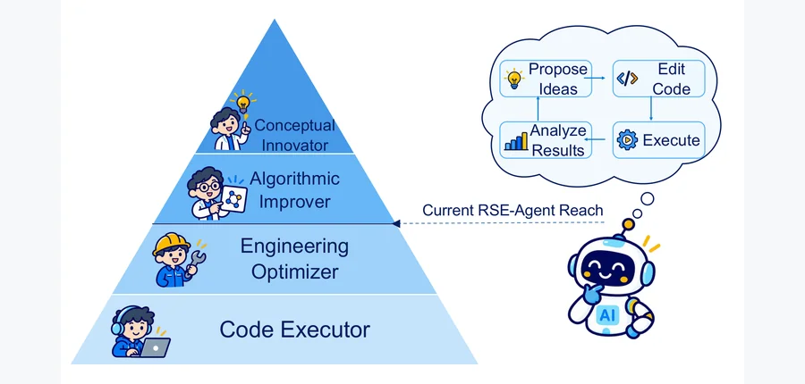 arXiv 2026-10-28 · cs.IR · #33 **[AutoRSE: Evaluating LLM Agents as Recommendation Engineers for Self-Evolving Recommender Systems](https://arxiv.org/abs/2610.37228)** Rui Tian , Yi Fang , Yejin Hua , Du Wang , Yuzhe Wang , Minxuan Shan , Zirui Ren , Xinyu Lin , Chongming Gao , Wenjie Wang… Affiliation: University of Science and Technology of China; National University of Singapore [Paper](https://arxiv.org/abs/2610.37228) · [Project](https://github.com/Ray-Tiann/AutoRSE) · [Figure source](https://arxiv.org/html/2610.37228v1/RSE-Agent-Pyramid-ff.png) 

[EN] Abstract
Recommender Systems Engineer Agents (RSE-Agents), which use LLM-based agents to autonomously improve recommendation algorithms, are emerging as a promising paradigm. However, their capabilities and limitations remain poorly understood due to the lack of a unified, standardized evaluation framework and systematic trajectory-level analysis. To address this gap, we introduce AutoRSE, an evaluation framework spanning six representative industrial-grade recommendation tasks, and conduct a large-scale empirical study of three frontier LLMs across three widely used agent harnesses. Our results show that RSE-Agents consistently enhance the performance of backbones on five of the six tasks, with an average relative improvement of 16.1%, indicating that they can already autonomously improve recommendation performance. However, trajectory-level analysis also reveals that current RSE-Agents function primarily as engineering optimizers rather than algorithmic improvers: their gains are largely driven by hyperparameter tuning, training strategies, and model ensembling, while genuine algorithmic innovations are rare. Since the largest gains in recommender systems often stem from algorithmic advances, this behavior underscores a fundamental limitation of current RSE-Agents. To probe this limitation, we perform idea-injection experiments and show that agents equipped with innovative ideas from frontier research or human experts achieve substantially larger improvements than those relying on self-generated ideas. These results suggest that idea generation is a central bottleneck of current RSE-Agents, highlights a key direction for the future recommendation system research. Our implementation is publicly available on GitHub: this https URL . <a href="https://arxiv.org/abs/2610.37228">Source</a>

[ZH] Abstract
推荐系统工程智能体（RSE-Agents）利用基于 LLM 的智能体，自主改进推荐算法，正成为有前景的范式。然而，由于缺乏统一、标准化的评估框架及系统轨迹级分析，其能力和局限仍缺乏理解。为弥补这一缺口，我们提出 AutoRSE，一个涵盖六个代表性工业级推荐任务的评估框架，并对三个前沿 LLM 与三种广泛使用的智能体运行框架开展大规模实证研究。结果表明，RSE-Agents 在六个任务中的五个上持续改善骨干表现，平均相对提高 16.1%，说明它们已经能够自主提升推荐性能。然而，轨迹级分析也表明，当前 RSE-Agents 主要充当工程优化器，而非算法改进者：收益大多来自超参数调优、训练策略和模型集成，真正算法创新较少。由于推荐系统中的最大收益往往来自算法进展，这种行为凸显当前 RSE-Agents 的根本局限。为探查这一局限，我们进行想法注入实验，表明配备前沿研究或人类专家创新想法的智能体，相比依赖自行生成想法者，获得显著更大提升。这些结果表明，想法生成是当前 RSE-Agents 的核心瓶颈，并指出未来推荐系统研究的重要方向。实现已在原文所附的 GitHub HTTPS 链接公开。 <a href="https://arxiv.org/abs/2610.37228">Source</a>
 |
| 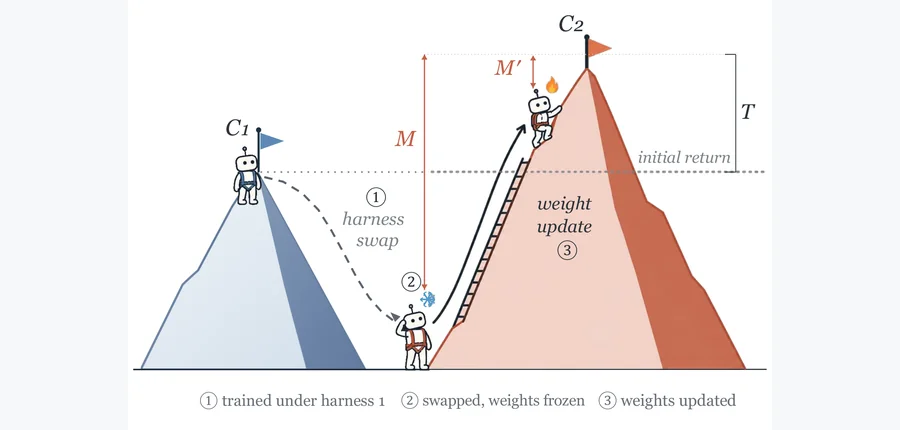 arXiv 2026-10-28 · cs.LG · #34 **[Your Policy Is Secretly a Harness: The Decision Geometry of Agent Interfaces](https://arxiv.org/abs/2610.37255)** Jian Mu , Ruibo Shen , Yao Shu Affiliation: The Hong Kong University of Science and Technology (Guangzhou); The Hong Kong University of Science and Technology [Paper](https://arxiv.org/abs/2610.37255) · [Code](https://github.com/2020-qqtcg/HRP) · [Figure source](https://arxiv.org/html/2610.37255v1/example-figure.png) 

[EN] Abstract
Language model agents are post-trained and deployed through a harness, the prompts, tools, and control logic that present a task to the model and execute its outputs. Harnesses are often revised and judged by how an already trained model performs under them, which assumes that what the model learned under one harness carries over to the next. We ask what a policy learns from its harness and what survives when the harness changes. Under KL-regularized control, we show that the log odds of an optimal policy recover how strongly its harness favors each action over the others, so a trained policy carries the preferences of its harness. Deployed return then equals the ceiling of the harness, the best return it offers, minus the mismatch of the policy, the return lost to its own suboptimal decisions. Training changes only the mismatch, while changing the harness moves both terms. Comparing harnesses with a fixed model therefore mixes what each harness offers with how well that model uses it. In MiniWoB++, post-training makes a model's preferences specific to its training harness. Reversing the order of the observation fields leaves every optimal decision unchanged yet lowers a trained model's success from 85.0% to 19.2%. Conversely, every new harness that a fixed-model comparison rejects but that raises the ceiling outperforms the original agent after further training under it, and ceiling and mismatch measured beforehand predict these gains. For coding-agent harnesses on Terminal-Bench Lite, ceiling minus mismatch estimated with a stronger model as a stand-in for the optimum reproduces the accuracy ranking, while either term alone does not. Code is available at this https URL . <a href="https://arxiv.org/abs/2610.37255">Source</a>

[ZH] Abstract
语言模型智能体通过运行框架进行后训练和部署，运行框架包含向模型呈现任务并执行其输出的提示词、工具与控制逻辑。框架经常根据已经训练的模型在其下的表现来修订和评判，这假设模型在一个框架下学到的东西可以迁移到下一个。我们研究策略从框架学到了什么，以及框架变化后哪些东西能够保留。在 KL 正则化控制下，我们表明，最优策略的对数几率能够恢复框架偏好各动作相对于其他动作的强度，因此训练后的策略携带其框架偏好。部署回报等于框架上限，即它能提供的最佳回报，减去策略失配，即策略自身次优决策造成的回报损失。训练只改变失配，而修改框架会移动这两项。因此，用固定模型比较框架，会混合各框架提供什么与模型利用得如何。在 MiniWoB++ 中，后训练使模型偏好特定于训练框架。颠倒观测字段顺序，虽然每个最优决策保持不变，却将训练模型成功率从 85.0% 降至 19.2%。相反，所有被固定模型比较所拒绝、但提高上限的新框架，在其下进一步训练后，都优于原始智能体；预先测量的上限与失配能够预测这些收益。对于 Terminal-Bench Lite 编码框架，以更强模型代替最优策略估计的“上限减失配”，重现了准确率排序，而单独任一项都不能。代码可在原文所附的 HTTPS 链接获取。 <a href="https://arxiv.org/abs/2610.37255">Source</a>
 | 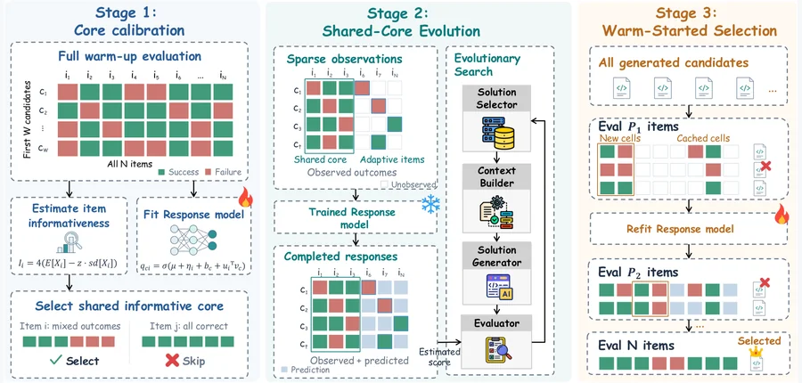 arXiv 2026-10-28 · cs.LG · #35 **[Where Should the Evaluation Budget Go in LLM-Driven Agent Scaffold Evolution?](https://arxiv.org/abs/2610.37276)** Sichun Luo , Yi Huang , Mukai Li , Haochen Luo , Guanzhi Deng , Haibo Wang , Jian Xu , Zefa Hu , Junlan Feng , Qi Liu Affiliation: The University of Hong Kong; JIUTIAN Research, China Mobile; City University of Hong Kong; Carnegie Mellon University; Tsinghua University [Paper](https://arxiv.org/abs/2610.37276) · [Figure source](https://arxiv.org/html/2610.37276v1/mainfig.png) 

[EN] Abstract
Large language model (LLM)-driven agent scaffold evolution improves agent workflows through iterative candidate generation and evaluation. Evaluation both guides subsequent search and determines the final scaffold, but evaluating every candidate on the full task set incurs substantial execution costs. We investigate how evaluation budgets can be allocated across these two roles. Our experiments show that sparse feedback can sustain productive evolution, while additional targeted evaluation improves final selection. Replay analyses further show that shared informative items and a common scoring reference support comparisons among closely matched candidates. Motivated by these findings, we propose \method, an evaluation allocation framework that combines sparse search-time feedback with targeted final confirmation. A short fully evaluated warm-up establishes a shared informative core and calibrates a response model whose item parameters remain fixed during search. After search, \method refits the model and applies paired successive halving, reusing accumulated observations and executing only missing evaluations. Across four benchmarks and two evolution frameworks, \method achieves higher mean performance than full evaluation in most settings while using approximately half as many evaluation cells. <a href="https://arxiv.org/abs/2610.37276">Source</a>

[ZH] Abstract
LLM 驱动的智能体脚手架演化，通过迭代候选生成与评估改进工作流。评估既指导后续搜索，也决定最终脚手架，但在完整任务集上评估每个候选，会产生高昂执行成本。我们研究如何在这两个角色间分配评估预算。实验表明，稀疏反馈能维持有效演化，而额外的定向评估能改善最终选择。重放分析进一步表明，共享的信息性条目和共同评分参照，有助于比较表现接近的候选。受这些发现启发，我们提出 EvalAlloc，一个结合稀疏搜索时反馈与定向最终确认的评估分配框架。短暂的全量评估热身建立共享信息核心，并校准响应模型，其条目参数在搜索期间保持固定。搜索后，EvalAlloc 重新拟合模型并应用配对逐次减半，复用累积观测，仅执行缺失评估。在四个基准和两种演化框架上，EvalAlloc 在多数设置中获得比全量评估更高的平均表现，同时评估单元约减少一半。 <a href="https://arxiv.org/abs/2610.37276">Source</a>
 | 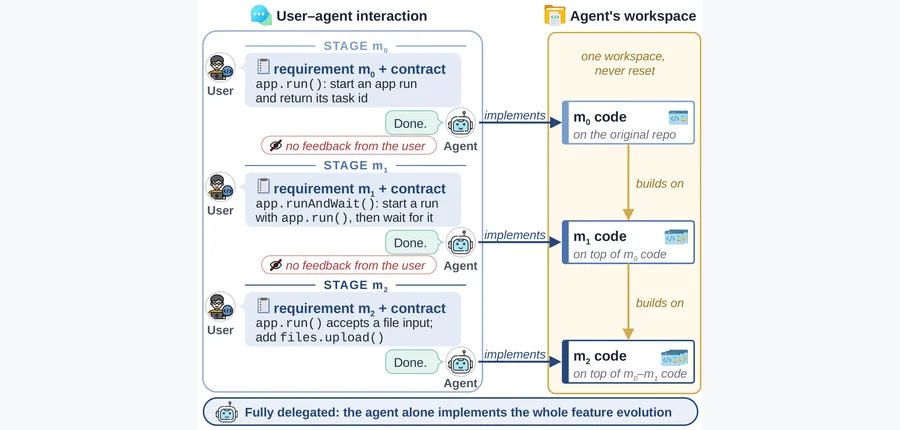 arXiv 2026-10-28 · cs.SE · #36 **[FeatureArc: Benchmarking Coding Agents on Evolving Features](https://arxiv.org/abs/2610.37434)** Yunlong Wang , Alyssa Wu , Cuiyun Gao , Jia Feng , Songyuanyi Lu , Zhichao Hu Affiliation: Hunyuan Team, Tencent; The Chinese University of Hong Kong [Paper](https://arxiv.org/abs/2610.37434) · [Figure source](https://arxiv.org/html/2610.37434v1/fig1-delegation.png) 

[EN] Abstract
A software feature usually evolves over time: developers extend its first version as new use cases and requirements arrive, and each extension builds on code written earlier. Most feature benchmarks evaluate a single request on a fixed codebase. Feature evolution requires evaluating successive extensions on an agent's own earlier code and checking whether the feature remains correct. We introduce FeatureArc to evaluate coding agents on evolving features, together with a pipeline that constructs its tasks from repository histories. The benchmark combines dependencies between successive stages of the same feature, explicit requirements and interface contracts, and executable checks across four programming languages. The pipeline validates fail-to-pass (F2P) tests for new behavior and pass-to-pass (P2P) tests for existing behavior on the reference code before and after each stage. We evaluated 10 coding agents on 73 manually reviewed tasks of 2 to 10 stages. Each agent works in one persistent session and workspace without external test feedback or rollback. The evaluation reveals a gap between first-stage and whole-feature success: pooled success falls from 62.7% at the first stage to 28.5% when the whole feature is tested on the final code. Trajectory analysis identifies inherited defects as a common failure mechanism, present in 72.9% of failed later stages. These earlier errors often remain undetected: in stages following a failure, agents leave the earlier error unnoticed about 95% of the time, and their self-tests rarely revisit earlier stages. Evolving a feature autonomously, without human checks between stages, therefore remains a substantial challenge for current coding agents. At Tencent, the pipeline extends internal evaluations to this setting and guides the development of Hunyuan, Tencent's family of large language models. <a href="https://arxiv.org/abs/2610.37434">Source</a>

[ZH] Abstract
软件功能通常随时间演变：开发者随着新用例和需求出现，扩展其首个版本，每次扩展都基于此前写出的代码。多数功能基准在固定代码库上评估单个请求。功能演化需要在智能体自己的早期代码上评估连续扩展，并检查功能是否保持正确。我们提出 FeatureArc 来评估编码智能体处理持续演化功能的能力，并提供从仓库历史构建任务的流水线。基准结合了同一功能连续阶段间的依赖、显式要求与接口契约，以及跨四种编程语言的可执行检查。流水线在参考代码每个阶段前后，验证新行为的失败到通过（F2P）测试，以及既有行为的通过到通过（P2P）测试。我们在 73 个人工审阅任务上评估 10 个编码智能体，每项任务含 2—10 个阶段。每个智能体都在单个持久会话和工作区中工作，没有外部测试反馈或回滚。评估揭示首阶段与完整功能成功率之间的差距：汇总成功率从首阶段的 62.7%，降至在最终代码上测试完整功能时的 28.5%。轨迹分析识别出继承缺陷这一常见失败机制，存在于 72.9% 的失败后续阶段。这些早期错误往往未被发现：在失败之后的阶段，智能体约 95% 的时候未注意到先前错误，自测也很少回查早期阶段。因此，在阶段间无人类检查的情况下自主演化功能，对当前编码智能体仍是重大挑战。在腾讯，该流水线将内部评估扩展到这一设置，并指导腾讯大语言模型家族混元的开发。 <a href="https://arxiv.org/abs/2610.37434">Source</a>
 |
| 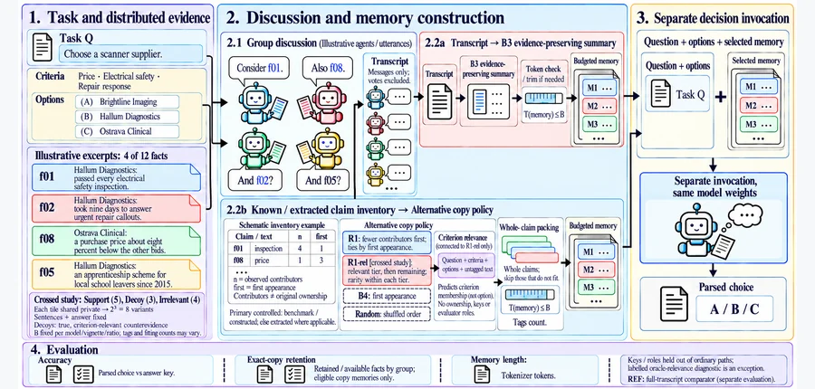 arXiv 2026-10-28 · cs.AI · #37 **[Rare, Relevant, and Still Wrong: How Memory Fails LLM Group Decisions](https://arxiv.org/abs/2610.37624)** Anouar Imel , Imad Charradi , Abderrahman Sghir , Khalil El Khammar Affiliation: University of Electronic Science and Technology of China; Xidian University; Nanjing University of Aeronautics and Astronautics; Nanjing University of Information Science and Technology [Paper](https://arxiv.org/abs/2610.37624) · [Figure source](https://arxiv.org/html/2610.37624v1/figures/fig2.png) 

[EN] Abstract
When an LLM group's discussion is compressed into a short memory for a final decision maker, what should the memory keep? Two natural heuristics keep the rarest claims or the claims relevant to the decision criteria. On hidden-profile tasks both look attractive, because how widely a fact is held is confounded with whether it helps. We introduce CrossProfile, a diagnostic benchmark of 60 templates with automatically verified answer keys, in which the ownership of supporting, decoy, and irrelevant facts is crossed while their text is held fixed (480 tasks). Across Qwen2.5-7B, Llama-3.1-8B, and two DeepSeek models, both heuristics fail in predictable places. Selecting by relevance readmits decoys, because decoys are on topic: even a perfect relevance filter loses 23 to 31 points to rarest-first selection in the classic hidden-profile configuration. Rarest-first selection is no better than random selection on average and wins only where the rare facts happen to be the useful ones. In both cases accuracy follows the balance of evidence the memory keeps, not the policy that kept it. The decision model adds a third failure, a form of social proof: it gives extra weight to facts attributed to many agents. Removing the attribution tags, or reassigning them at random with line order fixed, raises accuracy in the classic configuration by 13 to 24 points. In natural discussions the evidence is lost before any memory acts: the complete transcript yields lower accuracy than no notes at all. <a href="https://arxiv.org/abs/2610.37624">Source</a>

[ZH] Abstract
当 LLM 群体讨论被压缩为供最终决策者使用的短记忆时，应保留什么？两种自然启发式分别保留最稀有主张，或与决策标准相关的主张。在隐藏画像任务上，两者看起来都很有吸引力，因为事实被多少人持有，与它是否有帮助相混杂。我们提出 CrossProfile，一个诊断基准，包含 60 个模板和自动验证答案；在事实文本固定的情况下，交叉改变支持、诱饵和无关事实的持有归属，形成 480 个任务。在 Qwen2.5-7B、Llama-3.1-8B 及两个 DeepSeek 模型上，两种启发式都在可预测的位置失败。按相关性选择会重新引入诱饵，因为诱饵也切合主题：即使完美相关性过滤器，在经典隐藏画像配置中，也比最稀有优先选择低 23—31 个点。最稀有优先平均不比随机选择好，只在稀有事实恰巧有用时获胜。两种情况下，准确率都随记忆保留的证据平衡而变化，而不是随保留策略变化。决策模型还增加第三种失败，即一种社会认同效应：它给被归属于许多智能体的事实额外权重。删除归属标签，或在行序固定时随机重分配标签，可将经典配置的准确率提高 13—24 个点。在自然讨论中，证据在任何记忆发挥作用前就已丢失：完整讨论文本的准确率比完全没有笔记还低。 <a href="https://arxiv.org/abs/2610.37624">Source</a>
 |  arXiv 2026-10-28 · cs.CL · #38 **[Can LLMs Uncover Hidden Physical Laws through Free Exploration?](https://arxiv.org/abs/2610.37649)** Zhen Yang , Wen Wang , Xander Xu , Ying-Cong Chen Affiliation: HKUST (Guangzhou); ZJU; Alibaba Group; HKUST (as listed) [Paper](https://arxiv.org/abs/2610.37649) · [Code](https://github.com/EnVision-Research/LongChang) · [Project](https://zhenyangcs.github.io/LongChang-website/) · [Figure source](https://arxiv.org/html/2610.37649v1/longchang_world.png) 

[EN] Abstract
Scientific discovery often begins with an unexpected observation that prompts a new research question. In a world with altered physical laws, can large language models (LLMs) notice unexpected behavior, such as heavier objects falling more slowly, and discover the law through experiments without being told what to investigate? To evaluate this ability, we introduce LongChang, an automated framework that creates simulated worlds with altered physics, where one or more laws differ from ordinary physics. The evaluated LLMs act as explorers, manipulating objects and building tools to investigate their own questions without research tasks or hints about these laws. Separate LLM agents generate and review scenes, review tool designs, and evaluate reports for correctness and experimental support using the altered physical laws and exploration records. These records guide scene evolution for further exploration, allowing the full cycle to run without human intervention. Among 12 LLMs, GPT-6-Astra achieves a discovery rate of 16.7%, while the other 11 score 0%. The exploration records reveal uninvestigated anomalies and only partial identification of the altered physical laws. <a href="https://arxiv.org/abs/2610.37649">Source</a>

[ZH] Abstract
科学发现通常始于意外观测，由此提出新的研究问题。在物理规律被改变的世界里，大语言模型（LLM）能否在没有被告知应研究什么的情况下，注意到重物下落更慢等意外现象，并通过实验发现规律？为评估这种能力，我们提出 LongChang，一个创建改变物理规律的模拟世界的自动框架，其中一条或多条规律不同于普通物理。被评估 LLM 充当探索者，操控物体、构建工具，研究自己提出的问题，不提供研究任务或有关规律的提示。独立 LLM 智能体生成和审查场景、审查工具设计，并利用改变后的物理规律及探索记录，评估报告的正确性和实验支持。这些记录指导场景演化，以供进一步探索，使完整循环无需人工干预运行。在 12 个 LLM 中，GPT-6-Astra 的发现率为 16.7%，另外 11 个为 0%。探索记录揭示，存在未被研究的异常，对改变后的物理规律也仅有部分识别。 <a href="https://arxiv.org/abs/2610.37649">Source</a>
 |   |
<!-- PAPER_CARDS_END -->

## Retrieval overview

**38 selected papers: 11 A / 9 B / 18 C.** Collection date: **29 October 2026 (Beijing)**. Official announcement batch: **28 October 2026**, following the processed 27 October batch.

| Official source | Batch | New | Cross | Replacement | Coverage |
|---|---|---:|---:|---:|---|
| [Computer Science](https://arxiv.org/list/cs/new?skip=0&show=2000&check=20261029) | 2026-10-28 | 801 | 72 | 522 | All 1,395 entries on one page |
| [stat.ML](https://arxiv.org/list/stat.ML/new?skip=0&show=2000&check=20261029) | 2026-10-28 | 15 | 22 | 35 | All 72 entries on one page |
| Total | 2026-10-28 | 816 | 94 | 557 | 1,467 section entries; 816 distinct New IDs |

All **816 distinct official New metadata records** were retained with complete English abstracts. Lexical discovery found **163 candidates**; **50 titles and full original abstracts** received semantic review, yielding 38 selections. This is focused curation, not exhaustive semantic screening of all New records or all lexical matches. The CS aggregate covers cs.AI, cs.LG, cs.CL, cs.MA, cs.SE, cs.RO, cs.CV, cs.NE and cs.CR. Versionless IDs are deduplicated and prior inclusions excluded. Cross-listings do not enter the main list.

Every selection has complete paired abstracts and a visually checked genuine paper figure: **38 EN / 38 ZH / 38 images; 0 placeholders**. Twenty-eight illustrations come from official HTML and ten are PDF crops. An automatically extracted InfraDev logo was replaced with the actual methodology figure. All 38 affiliation records have primary-source support; original abbreviations are retained where appropriate. AudioRSI's Amazon affiliation was checked visually in the PDF because text extraction omits its logo, and RoboAuto's institution is explicit on its source-linked project page.

Both fresh official listing requests and all 38 selected HTML requests succeeded. Seventeen source-linked resource destinations were inspected and sixteen card buttons retained: **nine Code / seven Project**. The Trinity and AutoRSE repositories contain no released implementation and receive no Code buttons. Project websites were fetched directly; repository identity/release scope was checked through the web reader. Two supplementary affiliation PDFs timed out; complete official HTML supplied the required evidence, and the failures remain recorded. Compressed snapshots, original-content hashes, section IDs and validation are in the [run record](../../data/runs/2026-10-29.json).

The **22 October bulk-metadata coverage gap remains unresolved**. Seventeen individually verified New papers from that batch were published on 23 October. Today's complete batch retrieval does not establish recovery or exhaustive screening of that older batch.

## Reading guide

A denotes direct RSI, B reusable self-improvement mechanisms, and C evaluation and limits. Order is tier then arXiv ID. Tier assignments, mechanism interpretations, ranking and proposals are **editorial inference**. Numerical findings are **author reports**, not independent replications. Complete abstracts, author blocks, figures and selected method passages were inspected; not every full paper was read end to end.

Distinguish weight or LoRA training from executable search-policy changes, external harness revisions, evolving rubrics, memory content and task-local inference. Rollback reports real-robot training; LongChang evaluates authored simulated physics. A critic that refreshes from the actor is not an independent oracle. A best-of-many dev improvement may be selection noise; a bigger context window does not guarantee delivery of tool evidence. Proof search, evolving application code and temporary context changes do not by themselves establish persistent agent learning. The A tier identifies explicit retained update loops, not a proof that every system recursively improves its improvement algorithm. No finite run establishes unlimited RSI.

## Tiered Top papers

| # | Paper | Categories | Authors | Affiliation | Tier | Update target | Reading priority |
|---:|---|---|---|---|---|---|---|
| 1 | [Rollback: Experience Backtracking in World Models for Policy Improvement](https://arxiv.org/abs/2610.36068) | cs.RO; cs.AI; cs.LG | Jiayi Luo , Yang Zhang , Liliang Chen , Nan Wang , Chen Gao , Boxiang Qiu , Zhuoxuan Li , Baorui Peng , Chuankang Li , Yuxiang Yan , Si Liu , Qingyun Sun , Shuicheng Yan , Maoqing Yao , Jianxin Li , Guanghui Ren | AgiBot; BUAA; NUS (as listed) | A | Robot-policy learning and LoRA updates to an action-conditioned world model | Priority read |
| 2 | [The Trinity:Capability-Driven Recursive Self-Improvement for Multimodal Agents](https://arxiv.org/abs/2610.36077) | cs.AI; cs.CV | Weidong Tang , Ruiheng Wang , Jingxuan Zhang , Hexin Wang , Haoyuan Chen , Zhengfeiyang Zhang , Yixing Ma , Zichen Jiang , Ziyu Guo , Haodong Li , Zhengbo Jiao , Zhiqing Cui , Xinxiang Yin , Shuo Liang , Zhenglin Wan , Hongzhan Lin , Wangbo Zhao Kaipeng Zhang , Pengfei Zhou , Odin Zhang , Yang You | InfRec; Xidian University; Tongji University; National University of Singapore; University of California, Berkeley; The Chinese University of Hong Kong; The Hong Kong University of Science and Technology; The University of Hong Kong; Shanghai Innovation Institute | A | Verified simulated worlds, reusable capability modules and a routed external harness tree | Topical reference |
| 3 | [Skill Dreaming: Evolving Repository Skills through Pull Request Streams](https://arxiv.org/abs/2610.36188) | cs.AI; cs.SE | Xinyuan Song , Hasibul Haque , Jay Somasundaram , Ryan Turner , Bowen Zhu , Liang Zhao | Causal Dynamics Lab | A | Repository-specific procedural skills maintained from validated pull-request streams | Topical reference |
| 4 | [CoHARL: Co-Evolving Agent Policies and Executable Harnesses with Reinforcement Learning](https://arxiv.org/abs/2610.36469) | cs.LG | Jianwen Chen , Peng Xia , Kaide Zeng , Siwei Han , Zhen-Yu Zhang , Charles Fleming , Xinyu Ye , Huaxiu Yao | University of North Carolina at Chapel Hill; RIKEN; Cisco | A | A shared RL policy and a population of executable harness code | Priority read |
| 5 | [AudioRSI: Recursively Self-Improving Audio Reasoners](https://arxiv.org/abs/2610.36578) | cs.SD | Jiajun Fan , Roger Ren , Jingyuan Li , Rahul Pandey , Prashanth Gurunath Shivakumar , Ankur Gandhe , Yile Gu , Ge Liu , Ivan Bulyko | UIUC; Amazon | A | Audio reasoning policy weights and the periodically refreshed critic supplying process rewards | Priority read |
| 6 | [Dream-COP: Guiding Algorithm Discovery for Combinatorial Optimization Problems in an Experience World](https://arxiv.org/abs/2610.36618) | cs.LG; cs.AI | Kuan Xu , Jianming Wang , Ni Zhang , Yaoxin Wu , Yong Wang , Zhiguang Cao | Singapore Management University; University of Science and Technology of China; Eindhoven University of Technology; Central South University | A | Executable exploration policies guiding combinatorial-program discovery | Topical reference |
| 7 | [The View from Nowhere: Population-Centered Agent Evolution](https://arxiv.org/abs/2610.36660) | cs.AI | Shuo Yan , Ningning Hou , Haoyu He , Haochen Pei , Shang Gao | Macquarie University; Monash University | A | Parent-agent harness revisions informed by population-wide task and modification records | Topical reference |
| 8 | [Weakness Localization Is Not Enough: State-Aware Recursive Knowledge Improvement for Large Language Models](https://arxiv.org/abs/2610.36811) | cs.CL | Runze Jiang , Yan Wang , Boran Jin , Bingyu Zhu , Longtao Huang | Peking University; Alibaba Group; Delft University of Technology | A | Model knowledge via state-conditioned post-training interventions and persistent intervention history | Topical reference |
| 9 | [When the Critic Falls Behind: Co-Evolving Rubrics and Harnesses for Continual Agent Self-Improvement](https://arxiv.org/abs/2610.36826) | cs.AI | Hao Chen , Yukun Yan , Ziyu Han , Ye He , Chuanzhe Guo , Shangzhan Li , Qi Shi , Qingfu Zhu , Maosong Sun , Wanxiang Che | Harbin Institute of Technology; Tsinghua University | A | External behavioral rubrics, their priorities and the harness they supervise | Topical reference |
| 10 | [Evolving Agent Teams](https://arxiv.org/abs/2610.36848) | cs.AI | Shiyi Cao , Ziming Mao , Dacheng Li , Joseph E. Gonzalez , Ion Stoica | University of California, Berkeley | A | Supervisor-generated team roles, prompts and workflow, plus persistent learning files | Topical reference |
| 11 | [Learning to Code the World: Harness Evolution for Compositional 3D Reconstruction](https://arxiv.org/abs/2610.37046) | cs.CV | Haoyu Yao , Chenguo Lin , Ruize Du , Yadong Mu | Peking University | A | Teacher-evolved reconstruction harness; executor parameters, action semantics and backend fixed | Topical reference |
| 12 | [EMMA: Structured Episodic Memory for Multi-Agent Workflow Synthesis](https://arxiv.org/abs/2610.35966) | cs.MA; cs.AI | Ruijia Niu , Kaiwen Liu , Rose Yu , Kristina Klinkner | University of California San Diego; Amazon | B | Controller routing memory, specialist configuration and per-step procedural skills | Topical reference |
| 13 | [Small agents should know what their tools do](https://arxiv.org/abs/2610.35981) | cs.SE | Alexander Kovalenko , Artem Redchych | Czech Technical University in Prague | B | LoRA tool-use behavior trained from executable effect-typed traces | Topical reference |
| 14 | [Stratum: Repository Memory for Coding Agents Beyond the Context Window](https://arxiv.org/abs/2610.36153) | cs.SE; cs.AI | Yuvraj Sehgal , Mahsa Panahandeh , Naser Ezzati-Jivan | Brock University; University of Ottawa | B | Persistent repository knowledge and cross-session experience notes | Topical reference |
| 15 | [RoboAuto: Autonomous Robot Program Search through Multi-Level Physical Understanding](https://arxiv.org/abs/2610.36533) | cs.RO; cs.AI; cs.CL; cs.CV; cs.LG | Buzhao Liu , Jianing Ye , Xiu Yuan , Yangtong Feng , Chengsong Huang , Tyler Dinh , Yevgeniy Vorobeychik , Ning Zhang , Chongjie Zhang | Washington University in St. Louis | B | Reusable robot programs, executable skills and object-centric physical knowledge | Topical reference |
| 16 | [Remembering Is Not Enough: Refining Memories and Learning When to Use Them in Multi-Agent Systems](https://arxiv.org/abs/2610.36652) | cs.AI; cs.MA | Yipeng Hao , Yuxuan Cai , Wenkai Ji , Jie Zhou , Liyang Yu , Qin Chen , Zhiguo Yan , Shulei Zheng , Liang He | East China Normal University; Ocean University of China; Tongji University; Information Engineering University | B | External memory-rule content and role/context-specific applicability meta-memory | Topical reference |
| 17 | [Vision-Language Agents Can Learn in Their Own Latent Worlds](https://arxiv.org/abs/2610.36925) | cs.AI | Haoxi Li , Sikai Bai , Jianfei Ma , Qinglin Hou , Xiaocheng Lu , Tao Han , Jie Zhang , Song Guo | The Hong Kong University of Science and Technology; National University of Singapore; University of Southern California | B | Separate world-model and policy LoRA adapters sharing a VLM latent interface | Topical reference |
| 18 | [Proactive Memory for Event-Driven LLM Agents](https://arxiv.org/abs/2610.36967) | cs.AI | Jinyang Li , Zichuan Fu , Xian Wu , Wenlin Zhang , Yimin Deng , Kaifeng Guo , Guojing Li , Junjia QI , Xiangyu Zhao | City University of Hong Kong; Tencent | B | Source-validated temporal memory and replay-assessed behavioral regularities | Topical reference |
| 19 | [From Interaction to Capability: Task Advancement as State and Supervision for GUI Agents](https://arxiv.org/abs/2610.37482) | cs.AI | Ziyang Chen , Qian Li , Chengwei Qin | The Hong Kong University of Science and Technology (Guangzhou); Joint SDU-NTU Centre for Artificial Intelligence Research, Shandong University | B | Current task-advancement state and reusable GUI operation memory | Topical reference |
| 20 | [GEPA-Curator: Curated Learning for Self Improving Agents](https://arxiv.org/abs/2610.37651) | cs.CL | Zack Yu , Nicholas Lee , Minjae Lee , Lakshya Agarwal , Luca Manolache , Wonjun Kang , Matei Zaharia , Michael W. Mahoney , Kurt Keutzer , Sehoon Kim , Amir Gholami | UC Berkeley; ICSI; LBNL; Furiosa AI; KAIST (as listed) | B | Prompt-optimizer task selection and retrieved prior-success context | Topical reference |
| 21 | [h1: A Taste of the Bitter Lesson in Automated Theorem Proving](https://arxiv.org/abs/2610.35962) | cs.LG; cs.LO | Skander Moalla , Ahmad Rammal , Niket Patel , Remi Munos , Julia Kempe | FAIR at Meta; EPFL; CERMICS, ENPC, Institut Polytechnique de Paris; New York University | C | Task-local Lean proof attempts through a fixed simple execution harness | Topical reference |
| 22 | [Before the First Edit? Measuring When Coding-Agent Guidance Actually Arrives](https://arxiv.org/abs/2610.35992) | cs.SE | Thupakula Sai Varun | Independent Researcher | C | Measurement of guidance arrival relative to actual first source mutation | Topical reference |
| 23 | [Beyond Update Counts: A Control Map for Evaluating Test-Time Model Updates](https://arxiv.org/abs/2610.36109) | cs.LG; cs.CL | Zehao Zhao , Shangjian Yin , Rui Liu , Chongyang Bai , Mark Ibrahim , Kavosh Asadi , Yuchen Lu , Hang Cui , Hamed Firooz | Meta AI | C | Evaluation of committed weight, adapter or memory-update histories before each answer | Topical reference |
| 24 | [Context Is a Pipeline, Not a Window: Information Attrition in LLM Agent Harnesses](https://arxiv.org/abs/2610.36114) | cs.SE; cs.AI | Yuvraj Sehgal , Mahsa Panahandeh , Naser Ezzati-Jivan | Brock University; University of Ottawa | C | Evidence delivery through the tool-output/context pipeline | Topical reference |
| 25 | [Program-Level Adversarial Co-Adaptive Self-Play for Robotic Security](https://arxiv.org/abs/2610.36143) | cs.RO | Leo Benaharon , Chi Zhang , Wei Zheng , Weifan Zhang , Yifan Wei | Isuzu Technical Center of America | C | External attack/defense programs under fixed model parameters | Topical reference |
| 26 | [When Retrieval Is Not Enough: Obsolete Facts in Agent Memory](https://arxiv.org/abs/2610.36308) | cs.AI | Oleeviya Babu Poikarayil , Tony Basil Babu , Abdulrahman Nahhas , Het Darshan Mehta , Jawid Ahmad Baktash , Ernesto William De Luca , Klaus Turowski | Otto von Guericke University Magdeburg; University of Kerala; Technical University of Munich | C | Evaluation of stale competing facts after the correct update has been retrieved | Topical reference |
| 27 | [JustGoal: With Only a Goal, the AI Baseline Is Above the Expert Kernels](https://arxiv.org/abs/2610.36434) | cs.DC | Yaojian Chen , Dazhi Peng , Zhui Zhu , Leshan Li , Haojun Sun , Yiyun Zheng , Qingfeng He , Shangzhan Li , Xianglong Deng , Yifei Shen , Shengye Xiang , Zhen Li , Lin Gan , Yuxuan Li , Xu Han , Zhiyuan Liu | Tsinghua University; ModelBest; Harbin Institute of Technology; University of Chinese Academy of Sciences | C | Evaluation of autonomous kernel optimization with only goals/constraints | Topical reference |
| 28 | [Do AI Scientists Know What's New?](https://arxiv.org/abs/2610.36511) | cs.CL; cs.AI | Miri Liu , Xiayu Zhao , Encheng Xie , ChengXiang Zhai | University of Illinois Urbana-Champaign | C | Claim-level novelty verification for autonomous research proposals | Topical reference |
| 29 | [InfraDev: Can Coding Agents Develop AI Infrastructure, and How Can We Tell?](https://arxiv.org/abs/2610.36589) | cs.AI; cs.DC | Yangshen Deng , Jiaqi Ruan , Yeqi Huang , Nick Lau , Guangming Sheng , Luo Mai | University of Edinburgh; Tencent Hunyuan | C | Evaluation probes/interface contracts and a failure-derived reusable infrastructure skill | Topical reference |
| 30 | [Can LLMs Reliably Grade Olympiad Proofs? A Study of Mathematical Verification with LLMs](https://arxiv.org/abs/2610.36767) | cs.AI | Azim Ospanov , Zijin Feng , Ding Ding , Chengwu Liu , Haoli Bai , Jiacheng Sun , Lifeng Shang , Farzan Farnia | Huawei Foundation Model Department; The Chinese University of Hong Kong; The Hong Kong University of Science and Technology | C | Evaluation of proof graders and an inference-time bandit score-selection method | Topical reference |
| 31 | [Beyond QASecClaw: Agent Scaling, Verifier Feedback, and Evidence Reliability in Software Assurance](https://arxiv.org/abs/2610.36947) | cs.SE; cs.AI | S M Abdulla Al Mamun , Akif Islam , Mohd. Ruhul Ameen | The University of Manchester; University of Rajshahi; Varendra University | C | Evidence admission, specialist-context scaling and interpretation of verifier feedback | Topical reference |
| 32 | [Does Your Generalist Skill Optimizer Really Incentivize Agentic Tasks? Rethinking Skill Optimization via Bipartite Attribution](https://arxiv.org/abs/2610.37201) | cs.AI | Jiawei Zhou , Bo Peng , Yuxuan Huang , Ming Zhang , Youbang Sun , Xiang Wang , Chaochao Lu | Shanghai AI Laboratory; Fudan University; Shanghai Jiao Tong University; University of Science and Technology of China; Tsinghua University | C | Audit of skill-edit acceptance noise and induced execution/token costs | Priority read |
| 33 | [AutoRSE: Evaluating LLM Agents as Recommendation Engineers for Self-Evolving Recommender Systems](https://arxiv.org/abs/2610.37228) | cs.IR | Rui Tian , Yi Fang , Yejin Hua , Du Wang , Yuzhe Wang , Minxuan Shan , Zirui Ren , Xinyu Lin , Chongming Gao , Wenjie Wang , Fuli Feng | University of Science and Technology of China; National University of Singapore | C | Evaluation of agent-driven recommendation engineering and idea generation | Topical reference |
| 34 | [Your Policy Is Secretly a Harness: The Decision Geometry of Agent Interfaces](https://arxiv.org/abs/2610.37255) | cs.LG; cs.CL | Jian Mu , Ruibo Shen , Yao Shu | The Hong Kong University of Science and Technology (Guangzhou); The Hong Kong University of Science and Technology | C | Policy weights and harness-induced action preferences assessed separately | Topical reference |
| 35 | [Where Should the Evaluation Budget Go in LLM-Driven Agent Scaffold Evolution?](https://arxiv.org/abs/2610.37276) | cs.LG; cs.AI; cs.CL; cs.NE | Sichun Luo , Yi Huang , Mukai Li , Haochen Luo , Guanzhi Deng , Haibo Wang , Jian Xu , Zefa Hu , Junlan Feng , Qi Liu | The University of Hong Kong; JIUTIAN Research, China Mobile; City University of Hong Kong; Carnegie Mellon University; Tsinghua University | C | Search-time and final-confirmation evaluation allocation for scaffold evolution | Priority read |
| 36 | [FeatureArc: Benchmarking Coding Agents on Evolving Features](https://arxiv.org/abs/2610.37434) | cs.SE; cs.AI | Yunlong Wang , Alyssa Wu , Cuiyun Gao , Jia Feng , Songyuanyi Lu , Zhichao Hu | Hunyuan Team, Tencent; The Chinese University of Hong Kong | C | Evaluation of successive feature edits on the agent’s own persistent code | Topical reference |
| 37 | [Rare, Relevant, and Still Wrong: How Memory Fails LLM Group Decisions](https://arxiv.org/abs/2610.37624) | cs.AI; cs.CL; cs.MA; cs.SI | Anouar Imel , Imad Charradi , Abderrahman Sghir , Khalil El Khammar | University of Electronic Science and Technology of China; Xidian University; Nanjing University of Aeronautics and Astronautics; Nanjing University of Information Science and Technology | C | Memory selection and attribution effects on group decisions | Topical reference |
| 38 | [Can LLMs Uncover Hidden Physical Laws through Free Exploration?](https://arxiv.org/abs/2610.37649) | cs.CL; cs.AI; cs.MA | Zhen Yang , Wen Wang , Xander Xu , Ying-Cong Chen | HKUST (Guangzhou); ZJU; Alibaba Group; HKUST (as listed) | C | Evaluation of free scientific exploration and evidence-guided scene evolution | Topical reference |

## Mechanism and evidence notes

Each selection has four notes. Linked originals support factual statements; mechanism and boundary interpretations are editorial analysis. Resource access is separate from independent reproduction.

### 1. Rollback: Experience Backtracking in World Models for Policy Improvement

[Original paper](https://arxiv.org/abs/2610.36068) · Tier A · [Affiliation source](https://arxiv.org/html/2610.36068)

- **Update target:** Robot-policy learning and LoRA updates to an action-conditioned world model.
- **Feedback, validation and reuse — interpretation:** World-model rollback branches at critical decisions and converts counterfactual outcomes into action supervision. Real policy transitions then correct model dynamics, supporting another round of policy improvement.
- **Author-reported evidence:** Three real-robot tasks improve by absolute 10.67%, 11.11% and 11.85% over the strongest baseline. Ball tossing and tabletop curling exceed average human-player success within eight hours of training.
- **Boundary — interpretation:** These are author-reported physical experiments initialized from teleoperation, not independent reproduction. Counterfactual labels depend on model fidelity; training time and real interaction are not free.

### 2. The Trinity:Capability-Driven Recursive Self-Improvement for Multimodal Agents

[Original paper](https://arxiv.org/abs/2610.36077) · Tier A · [Affiliation source](https://arxiv.org/html/2610.36077)

- **Update target:** Verified simulated worlds, reusable capability modules and a routed external harness tree.
- **Feedback, validation and reuse — interpretation:** Creator abstracts shared capability requirements into worlds; Explorer evolves modules through selective inheritance; Evolver uses verified traces to reorganize tasks into capabilities. Validated updates accumulate within a fixed tree topology.
- **Author-reported evidence:** Mean performance gains are 34 points across 28 training benchmarks and 26 across 18 unseen benchmarks, including two real-world embodied tasks.
- **Boundary — interpretation:** The tree topology is fixed during accumulation, and capability routing uses public task information. Finite benchmark transfer does not prove unbounded recursion; the inspected repository says code is coming soon.

### 3. Skill Dreaming: Evolving Repository Skills through Pull Request Streams

[Original paper](https://arxiv.org/abs/2610.36188) · Tier A · [Affiliation source](https://arxiv.org/html/2610.36188)

- **Update target:** Repository-specific procedural skills maintained from validated pull-request streams.
- **Feedback, validation and reuse — interpretation:** PR implementation/review evidence becomes executable knowledge. Skills guide subsequent code, tests, documentation and compatibility changes; later execution/CI outcomes feed the next skill update.
- **Author-reported evidence:** The abstract describes an end-to-end PR/skill/repository co-evolution workflow without a quantitative controlled performance result.
- **Boundary — interpretation:** A plausible feedback loop is not itself an established gain. Separate skills learned from prior validated PRs from target-PR leakage, and validate changed conventions rather than retaining them indefinitely.

### 4. CoHARL: Co-Evolving Agent Policies and Executable Harnesses with Reinforcement Learning

[Original paper](https://arxiv.org/abs/2610.36469) · Tier A · [Affiliation source](https://arxiv.org/html/2610.36469)

- **Update target:** A shared RL policy and a population of executable harness code.
- **Feedback, validation and reuse — interpretation:** Policy rollouts across harnesses train the policy, while a proposer revises harness code from current execution traces during training. Population feedback prevents an interface from remaining fixed as the policy changes.
- **Author-reported evidence:** CoHARL reaches 27.6% mean resolved rate on SWE-rebench, 6.4 points above harness-only search, and beats once-before-RL search and single-active-harness alternation under matched training budgets.
- **Boundary — interpretation:** This updates model parameters as well as external code. Budget-matched comparisons and generalization tests are essential; a harness-only result cannot substitute for a jointly trained-policy comparison.

### 5. AudioRSI: Recursively Self-Improving Audio Reasoners

[Original paper](https://arxiv.org/abs/2610.36578) · Tier A · [Affiliation source](https://arxiv.org/pdf/2610.36578#page=1)

- **Update target:** Audio reasoning policy weights and the periodically refreshed critic supplying process rewards.
- **Feedback, validation and reuse — interpretation:** One model generates reasoning as actor and pairwise-judges paths as critic. Refreshing the critic from the current policy makes the next training signal depend on the improved model and the same audio evidence.
- **Author-reported evidence:** Across four benchmarks disjoint from AVQA training, reported results lead several open-source/reward-model-free comparisons; a fixed-judge control plateaus while refreshed-critic performance continues improving.
- **Boundary — interpretation:** Self-judgment is not ground truth or independent verification. External LLM judging and keyword analysis support behavior claims but do not prove universal acoustic faithfulness or unlimited improvement.

### 6. Dream-COP: Guiding Algorithm Discovery for Combinatorial Optimization Problems in an Experience World

[Original paper](https://arxiv.org/abs/2610.36618) · Tier A · [Affiliation source](https://arxiv.org/html/2610.36618)

- **Update target:** Executable exploration policies guiding combinatorial-program discovery.
- **Feedback, validation and reuse — interpretation:** Recorded searches form an experience world. A policy agent replays exploration strategies against program quality and search-step cost, then transfers selected policies to guide later program proposals.
- **Author-reported evidence:** Across five COPs, Dream-COP improves heuristic-component and complete-solver search; OBPP gap falls from 2.112% to 1.199% with 42.5% fewer search requests, while KP matches optimal values.
- **Boundary — interpretation:** The changed policy is an executable search procedure, not necessarily LLM-weight training. Experience replay and its construction have costs; cross-COP transfer remains bounded by the evaluated tasks.

### 7. The View from Nowhere: Population-Centered Agent Evolution

[Original paper](https://arxiv.org/abs/2610.36660) · Tier A · [Affiliation source](https://arxiv.org/html/2610.36660)

- **Update target:** Parent-agent harness revisions informed by population-wide task and modification records.
- **Feedback, validation and reuse — interpretation:** A distilled population block combines recurring failures, complementary successes and effects of previous modifications. The selected parent uses this evidence to revise its harness for subsequent evolution.
- **Author-reported evidence:** Matched comparisons report 72.1% SWE-bench Verified and 96.7% Polyglot success, 3.2/5.9 points above the group-evolution baseline; the coverage-to-best-agent gap shrinks or closes.
- **Boundary — interpretation:** Population coverage is an oracle union, not deployable single-agent success. Distillation and evaluation cost must be counted; the released setup requires substantial disk and multi-day benchmark runs.

### 8. Weakness Localization Is Not Enough: State-Aware Recursive Knowledge Improvement for Large Language Models

[Original paper](https://arxiv.org/abs/2610.36811) · Tier A · [Affiliation source](https://arxiv.org/html/2610.36811)

- **Update target:** Model knowledge via state-conditioned post-training interventions and persistent intervention history.
- **Feedback, validation and reuse — interpretation:** Graph units connect diagnosis to intervention. Each round estimates availability, accessibility or usability, chooses corresponding knowledge exposure/CPT/SFT and re-evaluates before choosing the next update.
- **Author-reported evidence:** RKI improves over knowledge-incorporation methods by 18.41 points on average on HotpotEval and SafeInternalEval; analyses show state can change while the same weakness persists.
- **Boundary — interpretation:** Knowledge-state labels are diagnostic estimates, not direct observation of internal truth. A persistent low score does not imply an unchanged bottleneck, and the method includes weight-training costs.

### 9. When the Critic Falls Behind: Co-Evolving Rubrics and Harnesses for Continual Agent Self-Improvement

[Original paper](https://arxiv.org/abs/2610.36826) · Tier A · [Affiliation source](https://arxiv.org/html/2610.36826)

- **Update target:** External behavioral rubrics, their priorities and the harness they supervise.
- **Feedback, validation and reuse — interpretation:** Execution trajectories continually reveal/reassess criteria and unresolved weaknesses. Prioritized rubrics target the next harness update while the task objective remains fixed.
- **Author-reported evidence:** Across tasks and backbone models, the authors report stronger held-out performance and more sustained/stable evolution than static-supervision harness baselines; no numerical aggregate appears in the abstract.
- **Boundary — interpretation:** Updating a rubric must preserve the fixed objective rather than lower standards. Model-based supervision can drift; no independent long-run validation was performed for this digest.

### 10. Evolving Agent Teams

[Original paper](https://arxiv.org/abs/2610.36848) · Tier A · [Affiliation source](https://arxiv.org/html/2610.36848)

- **Update target:** Supervisor-generated team roles, prompts and workflow, plus persistent learning files.
- **Feedback, validation and reuse — interpretation:** A supervisor diagnoses plateaus and restructures agents without editing the solution itself. Teams produce candidates; fixed evaluation and accumulated transcripts/artifacts guide the next team configuration.
- **Author-reported evidence:** Matched-token runs beat strong baselines. Extended-budget search reaches 1.2× mean speedup over a production MLA decode kernel, winning 36/47 workloads, with separate AMD, Apple and RoboDojo results.
- **Boundary — interpretation:** Extended-budget claims differ from matched-budget comparisons; the remaining 11 MLA workloads are slower. Public repository measurements differ in some settings, so figures in these notes follow the saved official abstract.

### 11. Learning to Code the World: Harness Evolution for Compositional 3D Reconstruction

[Original paper](https://arxiv.org/abs/2610.37046) · Tier A · [Affiliation source](https://arxiv.org/html/2610.37046)

- **Update target:** Teacher-evolved reconstruction harness; executor parameters, action semantics and backend fixed.
- **Feedback, validation and reuse — interpretation:** Development reconstructions supply feedback to a stronger teacher that revises the external procedure. The resulting harness is frozen for unseen-scene execution without teacher assistance.
- **Author-reported evidence:** With Qwen3.8-27B, all four metrics improve across two in-domain and one out-of-domain datasets; mean inference time falls 47.0%. Reported quality/cost comparisons against GPT-5.6-Sol are 32.3% higher/59.8% lower.
- **Boundary — interpretation:** Deployment savings exclude neither teacher search nor development evaluation from lifecycle cost. Reconstruction metric gains are not physical execution or world-model truth; teacher-free inference is distinct from teacher-free development.

### 12. EMMA: Structured Episodic Memory for Multi-Agent Workflow Synthesis

[Original paper](https://arxiv.org/abs/2610.35966) · Tier B · [Affiliation source](https://arxiv.org/html/2610.35966)

- **Update target:** Controller routing memory, specialist configuration and per-step procedural skills.
- **Feedback, validation and reuse — interpretation:** A reflector assigns each diagnosed failure to its owning update scope and proposes one edit. Backbone-independent guards restrict admission to incremental bounded changes for reuse across tasks.
- **Author-reported evidence:** Across three benchmarks and five backbones, EMMA leads evaluated baselines, with up to 32.5% improvement and 17–38% fewer training executions than the most execution-efficient comparator.
- **Boundary — interpretation:** These are context-level external updates, not model fine-tuning. Guarded scope limits structural drift but does not independently establish task correctness or broad-domain generalization.

### 13. Small agents should know what their tools do

[Original paper](https://arxiv.org/abs/2610.35981) · Tier B · [Affiliation source](https://arxiv.org/html/2610.35981)

- **Update target:** LoRA tool-use behavior trained from executable effect-typed traces.
- **Feedback, validation and reuse — interpretation:** Tool declarations enable replay checking and compiler-style optimization of traces. Verified positive demonstrations teach safe/economical programs that are reused on held-out tasks and an unseen domain.
- **Author-reported evidence:** Qwen3-4B success rises 53%→99% in distribution, 52%→81% on a hard held-out split and 74%→83% on an unseen domain. Negative objectives add nothing over the SFT-only control.
- **Boundary — interpretation:** The adapter changes weights; labels need not be human-written for training to have cost. Effect declarations and replay assumptions define safety, and refusal-data filtering has external BFCL tradeoffs.

### 14. Stratum: Repository Memory for Coding Agents Beyond the Context Window

[Original paper](https://arxiv.org/abs/2610.36153) · Tier B · [Affiliation source](https://arxiv.org/html/2610.36153)

- **Update target:** Persistent repository knowledge and cross-session experience notes.
- **Feedback, validation and reuse — interpretation:** A tiered text/structure store and page-safe tools preserve prior root-cause findings, failed approaches and evidence boundaries. A fresh agent can reuse notes authored by a different model.
- **Author-reported evidence:** On eight real bugs, inherited memory finds the root-cause file in 21/24 trials versus 6/24 for retrieval only, with 4.5× lower median token cost; pooled notes retain 8/8 success.
- **Boundary — interpretation:** This small study measures root-cause-file localization, not successful repair or unlimited repository learning. KV-byte ratios and retrieval latency do not include every construction/model-inference cost.

### 15. RoboAuto: Autonomous Robot Program Search through Multi-Level Physical Understanding

[Original paper](https://arxiv.org/abs/2610.36533) · Tier B · [Affiliation source](https://roboauto-ai.github.io/)

- **Update target:** Reusable robot programs, executable skills and object-centric physical knowledge.
- **Feedback, validation and reuse — interpretation:** A hierarchical knowledge base links affordances, spatial relations and action effects. Scene grounding and self-designed experiments test expected physical effects, resolve uncertainties and support later program search.
- **Author-reported evidence:** Reported short-horizon LIBERO-PRO success is 89.1%; long-horizon benchmarks exceed twice ASPIRE’s mean, with three additional real-robot comparisons and knowledge transfer across simulators/embodiments.
- **Boundary — interpretation:** Knowledge acquisition uses embodied data and online solving. A larger library correlating with better search does not isolate its causal contribution or establish recursive improvement of the entire research method.

### 16. Remembering Is Not Enough: Refining Memories and Learning When to Use Them in Multi-Agent Systems

[Original paper](https://arxiv.org/abs/2610.36652) · Tier B · [Affiliation source](https://arxiv.org/html/2610.36652)

- **Update target:** External memory-rule content and role/context-specific applicability meta-memory.
- **Feedback, validation and reuse — interpretation:** Single-memory versus no-memory comparisons diagnose defects. Candidate repairs are checked on current and earlier tasks; use histories separately learn when the owning role should apply or avoid a rule.
- **Author-reported evidence:** With Qwen3-4B across four benchmarks, DiscernMem leads mean scores in three systems by 0.51–4.32 points, including CAMEL PDDL 37.71 versus 28.48.
- **Boundary — interpretation:** Training-free means no weight updates, not zero executions. Team failure alone cannot identify a bad rule; repair validity and applicability must be tested separately.

### 17. Vision-Language Agents Can Learn in Their Own Latent Worlds

[Original paper](https://arxiv.org/abs/2610.36925) · Tier B · [Affiliation source](https://arxiv.org/html/2610.36925)

- **Update target:** Separate world-model and policy LoRA adapters sharing a VLM latent interface.
- **Feedback, validation and reuse — interpretation:** Real transitions supervise recurrent latent dynamics; imagined trajectories train actor/critic behavior, and alternating real-data refresh adapts the world model. Future images need not be decoded.
- **Author-reported evidence:** Across five visual environments, the abstract reports strongest overall performance among trainable methods and reduced imagination compute.
- **Boundary — interpretation:** The base backbone is frozen but adapters are trained. Environment protocols differ: the public notes specify a fixed world model and behavior-cloning support for EB-ALFRED; initial release lacks several environment entry points and datasets.

### 18. Proactive Memory for Event-Driven LLM Agents

[Original paper](https://arxiv.org/abs/2610.36967) · Tier B · [Affiliation source](https://arxiv.org/html/2610.36967)

- **Update target:** Source-validated temporal memory and replay-assessed behavioral regularities.
- **Feedback, validation and reuse — interpretation:** Events support trajectory facts; historical replay evaluates candidate regularities before matching them to current conditions. Later observations can change eligibility or confidence rather than treating recurrence as universal.
- **Author-reported evidence:** ProactiveStream covers three scopes; ProactMem F1 is 52.6%, a 21.4% relative improvement over the strongest of five external baselines.
- **Boundary — interpretation:** This is longitudinal benchmark evidence, not deployed-service benefit or universal causality. Opportunity labels, observation coverage and intervention controls shape the comparison.

### 19. From Interaction to Capability: Task Advancement as State and Supervision for GUI Agents

[Original paper](https://arxiv.org/abs/2610.37482) · Tier B · [Affiliation source](https://arxiv.org/html/2610.37482)

- **Update target:** Current task-advancement state and reusable GUI operation memory.
- **Feedback, validation and reuse — interpretation:** Verified local progress updates remaining goals during execution. After a task, supervision abstracts useful interactions from success and failure alike, preserving inputs, expected effects and verification conditions.
- **Author-reported evidence:** State alone raises MobileWorld GUI-only success from 12.0% to 28.2%; full TAM gains 17.6% relative over its strongest baseline and uses 38.7% fewer lifecycle tokens per solved task.
- **Boundary — interpretation:** Within-task state and cross-task learned operations are separate contributions. Per-solved-task costs depend on success and accounting; verified local progress need not imply correct final task completion.

### 20. GEPA-Curator: Curated Learning for Self Improving Agents

[Original paper](https://arxiv.org/abs/2610.37651) · Tier B · [Affiliation source](https://arxiv.org/html/2610.37651)

- **Update target:** Prompt-optimizer task selection and retrieved prior-success context.
- **Feedback, validation and reuse — interpretation:** The curator filters likely noisy failure signals and retrieves earlier successful trajectories for selected tasks. The existing optimizer then revises prompts using the curated experience.
- **Author-reported evidence:** Across GoBrowse, ALFWorld, AppWorld and tau-bench, mean performance matches/exceeds both baselines, with maximum gains of 20.7% over GEPA and 21.2% over ACE.
- **Boundary — interpretation:** Curated prompt learning is external adaptation, not proof that the model or curator autonomously improves. Filtering may discard genuine hard failures; count curation/retrieval and selection bias.

### 21. h1: A Taste of the Bitter Lesson in Automated Theorem Proving

[Original paper](https://arxiv.org/abs/2610.35962) · Tier C · [Affiliation source](https://arxiv.org/html/2610.35962)

- **Update target:** Task-local Lean proof attempts through a fixed simple execution harness.
- **Feedback, validation and reuse — interpretation:** Efficient Lean 4 feedback and reflection keep a single attempt working without imposed decomposition/search. Matched-model and interface ablations compare this with specialized workflows.
- **Author-reported evidence:** The authors report frontier benchmark results, eight solved open problems and matched-model competitiveness; efficient interface design, not simplicity alone, determines cost and solve rate.
- **Boundary — interpretation:** Pass@1 can contain substantial test-time computation. Proof search does not establish persistent cross-task self-improvement, and stronger models or larger budgets must not be credited to a workflow change.

### 22. Before the First Edit? Measuring When Coding-Agent Guidance Actually Arrives

[Original paper](https://arxiv.org/abs/2610.35992) · Tier C · [Affiliation source](https://arxiv.org/html/2610.35992)

- **Update target:** Measurement of guidance arrival relative to actual first source mutation.
- **Feedback, validation and reuse — interpretation:** The audit separates assignment, eligibility, trigger, delivery and content change, hashing Python files around executed actions. Local live runs are distinguished from unsynchronized public traces.
- **Author-reported evidence:** Fifteen of 76 arms change Python source; guidance precedes every observed first change, but the prespecified 20-arm coverage target is missed and all changes use structured editors.
- **Boundary — interpretation:** This does not establish repair correctness, planning benefit or shell-first coverage. Seven passing post-hoc arms include four with incomplete regression selectors.

### 23. Beyond Update Counts: A Control Map for Evaluating Test-Time Model Updates

[Original paper](https://arxiv.org/abs/2610.36109) · Tier C · [Affiliation source](https://arxiv.org/html/2610.36109)

- **Update target:** Evaluation of committed weight, adapter or memory-update histories before each answer.
- **Feedback, validation and reuse — interpretation:** Control Map separates behavior, acquisition, retention, locality and transfer, and records update order/timing. Formal count-equivalence statements are tested against scheduling and editing experiments.
- **Author-reported evidence:** At 760M parameters, 24 equal-count schedules produce 19.7%–34.2% accuracy. Selected LoRA settings acquire edits, while ROME retains at 13 points but fails locality at each.
- **Boundary — interpretation:** Equal update counts are not equal interventions. Theoretical conclusions require their stated assumptions, and acquisition alone does not certify retention or preservation of unrelated behavior.

### 24. Context Is a Pipeline, Not a Window: Information Attrition in LLM Agent Harnesses

[Original paper](https://arxiv.org/abs/2610.36114) · Tier C · [Affiliation source](https://arxiv.org/html/2610.36114)

- **Update target:** Evidence delivery through the tool-output/context pipeline.
- **Feedback, validation and reuse — interpretation:** Raw result replay and controlled cutting compare unsafe fixed-length JSON slicing with alternative evidence delivery, independently of the nominal context-window capacity.
- **Author-reported evidence:** Across 720 runs, 3,827/11,189 results are cut despite at most 5.75% window usage. Controlled costs include 43% more calls, twice the computation and yield 0.61→0.31.
- **Boundary — interpretation:** The controlled experiment supports extra-work costs; whether cutting causes the observed accuracy gap remains open. A large empty context window does not guarantee the model actually receives evidence.

### 25. Program-Level Adversarial Co-Adaptive Self-Play for Robotic Security

[Original paper](https://arxiv.org/abs/2610.36143) · Tier C · [Affiliation source](https://arxiv.org/html/2610.36143)

- **Update target:** External attack/defense programs under fixed model parameters.
- **Feedback, validation and reuse — interpretation:** Two eight-generation driving/humanoid cases generate code from tested opponent artifacts and mission feedback, then evaluate frozen programs to expose local co-adaptation.
- **Author-reported evidence:** Observed defender responses include direct-actuation recovery and incoming-state validation, providing local task recovery.
- **Boundary — interpretation:** The paper explicitly does not establish sustained robustness. Simulation/case-study software responses are not broad real-world security guarantees; no operational attack recipes are reproduced here.

### 26. When Retrieval Is Not Enough: Obsolete Facts in Agent Memory

[Original paper](https://arxiv.org/abs/2610.36308) · Tier C · [Affiliation source](https://arxiv.org/html/2610.36308)

- **Update target:** Evaluation of stale competing facts after the correct update has been retrieved.
- **Feedback, validation and reuse — interpretation:** Equal-size four-statement interventions replace unrelated evidence with an obsolete competitor under frozen prompts. Gold-assisted post-hoc audits distinguish retrieval presence from correct use.
- **Author-reported evidence:** Accuracy falls 100%→44.6% for Qwen2.5 and 100%→87.8% for Qwen3-14B in controlled conflicts; 6K and 32K BM25 budget studies also favor smaller evidence sets.
- **Boundary — interpretation:** Gold-assisted diagnostics are not a deployable memory selector. This is a narrow single-hop consolidation result, not evidence that larger contexts or retrieval are universally harmful.

### 27. JustGoal: With Only a Goal, the AI Baseline Is Above the Expert Kernels

[Original paper](https://arxiv.org/abs/2610.36434) · Tier C · [Affiliation source](https://arxiv.org/html/2610.36434)

- **Update target:** Evaluation of autonomous kernel optimization with only goals/constraints.
- **Feedback, validation and reuse — interpretation:** A general agent builds its own evaluation loop. Same-model/same-shape comparisons and mechanism ablations test whether specialized domain machinery adds value.
- **Author-reported evidence:** On B200, JustGoal beats libraries on 8/10 operators and released specialized-agent kernels on 5/9; KDA-0.5 reaches 0.95× in the controlled same-model single-shape comparison.
- **Boundary — interpretation:** Operator shapes, hardware and permitted scope matter. A goal-only baseline still has a general agent/tool runtime and compute; its gains do not mean all domain expertise is useless.

### 28. Do AI Scientists Know What's New?

[Original paper](https://arxiv.org/abs/2610.36511) · Tier C · [Affiliation source](https://arxiv.org/html/2610.36511)

- **Update target:** Claim-level novelty verification for autonomous research proposals.
- **Feedback, validation and reuse — interpretation:** Temporal ground truth evaluates copied, disputed and later-realized ideas. ClaimNov attributes prior-art evidence to claims so one established contribution need not veto an entire new proposal.
- **Author-reported evidence:** Across 1,060 proposals, ClaimNov detects 97% of disguised papers at 1.5% false alarms and lowers an LLM judge’s false alarms from 11.8% to 1.5%.
- **Boundary — interpretation:** Novelty is relative to retrieved/provided prior work, not universal proof of originality. Historical evaluation and ICLR acceptance are not substitutes for validating a new scientific result.

### 29. InfraDev: Can Coding Agents Develop AI Infrastructure, and How Can We Tell?

[Original paper](https://arxiv.org/abs/2610.36589) · Tier C · [Affiliation source](https://arxiv.org/html/2610.36589)

- **Update target:** Evaluation probes/interface contracts and a failure-derived reusable infrastructure skill.
- **Feedback, validation and reuse — interpretation:** Hidden probes and task prompts are jointly synthesized to expose missing official-test requirements without hiding required interfaces. Error analysis becomes a skill checked on later infrastructure tasks.
- **Author-reported evidence:** Across 36 multi-GPU PR tasks and six models, best resolution is 38.9%; probes reject 32% of official-test-passing submissions. A failure-derived skill raises one model’s Megatron-LM resolved rate by 10.5%.
- **Boundary — interpretation:** Passing original tests is not adequate correctness. Benchmark prompts/probes define the evaluation, and storage/build savings differ from training or deployment savings; the abstract’s 10.5% is not silently relabeled as percentage points.

### 30. Can LLMs Reliably Grade Olympiad Proofs? A Study of Mathematical Verification with LLMs

[Original paper](https://arxiv.org/abs/2610.36767) · Tier C · [Affiliation source](https://arxiv.org/html/2610.36767)

- **Update target:** Evaluation of proof graders and an inference-time bandit score-selection method.
- **Feedback, validation and reuse — interpretation:** Expert-graded USAMO candidates and generated adversarial proofs probe verifier errors. MABGrader selects over discrete scores rather than taking a single opaque grade.
- **Author-reported evidence:** Evaluation spans 20 models and seven metrics; MABGrader improves Quadratic Weighted Kappa by 26.4% and reduces grading error 14% relative to ProofGrader.
- **Boundary — interpretation:** Natural-language grading is not machine-checked proof certification. The verified TROJAN release contains a generation/benchmark pipeline; a separate MABGrader implementation was not established by that repository.

### 31. Beyond QASecClaw: Agent Scaling, Verifier Feedback, and Evidence Reliability in Software Assurance

[Original paper](https://arxiv.org/abs/2610.36947) · Tier C · [Affiliation source](https://arxiv.org/html/2610.36947)

- **Update target:** Evidence admission, specialist-context scaling and interpretation of verifier feedback.
- **Feedback, validation and reuse — interpretation:** Five frozen studies compare model verdicts with deterministic scopes and validation. Corrupted evidence packages separate a valid artifact from unsupported claims about what it proves.
- **Author-reported evidence:** In 13,638 requests, 50 contexts cost 49× tokens without better unsafe-clearance results on development warnings. SV-COMP feedback raises both correct and incorrect verdicts; deterministic validation yields 26 correct and six unresolved.
- **Boundary — interpretation:** These are descriptive studies with limited coverage, including only 96 assessed cases in one 160-case arm and an unsupported test-adapter bug. More feedback or consensus is not automatically stronger assurance.

### 32. Does Your Generalist Skill Optimizer Really Incentivize Agentic Tasks? Rethinking Skill Optimization via Bipartite Attribution

[Original paper](https://arxiv.org/abs/2610.37201) · Tier C · [Affiliation source](https://arxiv.org/html/2610.37201)

- **Update target:** Audit of skill-edit acceptance noise and induced execution/token costs.
- **Feedback, validation and reuse — interpretation:** Identical-to-seed candidate replay measures selection-only dev gains. Bipartite turn/text attribution connects extra inputs to repeated checking and serialized action behavior.
- **Author-reported evidence:** Across three optimizers/benchmarks and two models, test success is only 0.1 points higher on average, while input tokens rise about 16%; selection alone can reproduce the apparent dev gains.
- **Boundary — interpretation:** These are evaluated optimizer settings, not proof all skill learning fails. The public analysis code omits recorded runs and its harness-bench dependency, limiting fresh-clone reproduction.

### 33. AutoRSE: Evaluating LLM Agents as Recommendation Engineers for Self-Evolving Recommender Systems

[Original paper](https://arxiv.org/abs/2610.37228) · Tier C · [Affiliation source](https://arxiv.org/html/2610.37228)

- **Update target:** Evaluation of agent-driven recommendation engineering and idea generation.
- **Feedback, validation and reuse — interpretation:** Six industrial-style tasks compare three models and three harnesses. Trajectory analyses distinguish tuning/ensembling from algorithm invention, and injected external ideas test an ideation bottleneck.
- **Author-reported evidence:** Five of six tasks improve, with mean relative gain 16.1%, but most changes are engineering optimizations; externally supplied research ideas produce larger gains.
- **Boundary — interpretation:** Better metrics do not automatically establish algorithmic innovation or a recursively improving researcher. The paper-linked repository currently contains only a README, so it receives a Project link.

### 34. Your Policy Is Secretly a Harness: The Decision Geometry of Agent Interfaces

[Original paper](https://arxiv.org/abs/2610.37255) · Tier C · [Affiliation source](https://arxiv.org/html/2610.37255)

- **Update target:** Policy weights and harness-induced action preferences assessed separately.
- **Feedback, validation and reuse — interpretation:** Under KL-regularized control, ceiling and policy mismatch decompose deployed return. Controlled field-order changes and retraining distinguish interface potential from compatibility with a fixed policy.
- **Author-reported evidence:** In MiniWoB++, reversing observation fields leaves optimal decisions unchanged but reduces trained-model success from 85.0% to 19.2%; ceiling-raising harnesses recover gains after retraining.
- **Boundary — interpretation:** The decomposition is conditional theory, with exact small-environment and stronger-model surrogate diagnostics in different settings. A fixed-policy harness loss need not mean a lower attainable ceiling.

### 35. Where Should the Evaluation Budget Go in LLM-Driven Agent Scaffold Evolution?

[Original paper](https://arxiv.org/abs/2610.37276) · Tier C · [Affiliation source](https://arxiv.org/html/2610.37276)

- **Update target:** Search-time and final-confirmation evaluation allocation for scaffold evolution.
- **Feedback, validation and reuse — interpretation:** Fully evaluated warm-up calibrates a shared informative core and fixed item parameters. Sparse search is followed by refitting and paired successive halving that reuses observations and fills missing cells.
- **Author-reported evidence:** Across four benchmarks and two evolution frameworks, EvalAlloc usually improves mean performance over full evaluation with approximately half the evaluation cells.
- **Boundary — interpretation:** The listing’s method macro is resolved from official HTML. Evaluation cells are not total model calls or wall time; model fit, confirmation and calibration leakage remain important limits.

### 36. FeatureArc: Benchmarking Coding Agents on Evolving Features

[Original paper](https://arxiv.org/abs/2610.37434) · Tier C · [Affiliation source](https://arxiv.org/html/2610.37434)

- **Update target:** Evaluation of successive feature edits on the agent’s own persistent code.
- **Feedback, validation and reuse — interpretation:** History-derived stage contracts and executable F2P/P2P checks test new behavior and preservation. One session/workspace continues without external test feedback or rollback.
- **Author-reported evidence:** Across 73 reviewed tasks and ten agents, pooled success falls 62.7%→28.5% from first stage to final whole-feature correctness; inherited defects appear in 72.9% of failed later stages.
- **Boundary — interpretation:** Feature/code evolution is not itself agent learning. The no-feedback/no-rollback protocol and persistent errors explain a specific evaluation boundary, not every software-development workflow.

### 37. Rare, Relevant, and Still Wrong: How Memory Fails LLM Group Decisions

[Original paper](https://arxiv.org/abs/2610.37624) · Tier C · [Affiliation source](https://arxiv.org/html/2610.37624)

- **Update target:** Memory selection and attribution effects on group decisions.
- **Feedback, validation and reuse — interpretation:** CrossProfile crosses ownership of fixed supporting/decoy/irrelevant facts with verified answers. Attribution removal/randomization holds text and line order fixed to test social-proof effects.
- **Author-reported evidence:** Across 480 tasks, relevance selection can lose 23–31 points to rarest-first in the classic configuration; rarest-first is no better than random on average. Removing attribution raises accuracy 13–24 points.
- **Boundary — interpretation:** Rare or relevant is not equivalent to decision-supporting. Controlled hidden-profile tasks and natural discussion have different loss mechanisms; a memory heuristic cannot recover evidence never expressed.

### 38. Can LLMs Uncover Hidden Physical Laws through Free Exploration?

[Original paper](https://arxiv.org/abs/2610.37649) · Tier C · [Affiliation source](https://arxiv.org/html/2610.37649)

- **Update target:** Evaluation of free scientific exploration and evidence-guided scene evolution.
- **Feedback, validation and reuse — interpretation:** Explorers manipulate altered-physics worlds and design tools without a research question or hints. Separate model agents generate/review scenes and assess reports using the hidden laws and execution records.
- **Author-reported evidence:** Of twelve evaluated LLMs, GPT-6-Astra reaches 16.7% discovery while the other eleven score 0%; logs reveal unexplored anomalies and partial law identification.
- **Boundary — interpretation:** These are authored simulated laws with model-based review, not discoveries of unknown real-world physics. Autonomous environment evolution does not alone prove that the explorer becomes a better scientist.

## Five priority reads

These priorities are editorial inference.

1. [Rollback](https://arxiv.org/abs/2610.36068): examine how counterfactual branching supplies action-level supervision and how real transitions correct the training world model. Track both policy and dynamics updates, demonstration initialization, real interaction and full training cost.
2. [CoHARL](https://arxiv.org/abs/2610.36469): policy learning and executable interface evolution change each other's data distribution. Read the matched-budget controls for once-before-RL search and single-harness alternation before attributing gains to a population.
3. [AudioRSI](https://arxiv.org/abs/2610.36578): the improved actor becomes the next critic. Inspect acoustic grounding, fixed-judge controls and held-out reward validity rather than assuming self-judgment becomes more reliable merely because task scores rise.
4. [BiPA](https://arxiv.org/abs/2610.37201): replay acceptance on unchanged seeds to measure how much gain selection alone manufactures. The turn/text cost decomposition matters because a longer procedure can induce repeated checking and repeated context charges.
5. [EvalAlloc](https://arxiv.org/abs/2610.37276): separate feedback needed to search from evidence needed to choose a winner. Inspect fixed calibration references, shared informative items and paired final confirmation, including the overhead beyond the saved evaluation cells.

## Research ideas for limited compute budgets

All six items are **unvalidated method proposals and editorial inference**. Budgets are planning caps, not measured runtime or guaranteed hardware requirements. Freeze final tests and count generation, failed candidates, curation, calibration, confirmation and deployment. These small mechanisms do not reproduce full systems or establish novelty.

1. **Charge a skill edit for selection noise and induced work.** Inspired by [BiPA](https://arxiv.org/abs/2610.37201) and [EvalAlloc](https://arxiv.org/abs/2610.37276). Add a promotion threshold based on unchanged-seed replay, then rank accepted edits by paired held-out success per total execution cost rather than raw dev score. Minimal experiment: 24 deterministic file/API tasks, three task splits, two edit generations and a 432-actor-call cap per arm; compare best-dev selection, null-calibrated selection and null-plus-cost selection with identical candidates. CPU tools and a fixed small actor avoid training. Expected benefit: reject lucky or verbose edits. Risk: conservative thresholds discard rare useful procedures; reserve a hard-task split and report false rejection, success and source-inclusive cost separately.

2. **Refresh a critic only after an immutable evidence audit.** Inspired by [AudioRSI](https://arxiv.org/abs/2610.36578), [RuHarness](https://arxiv.org/abs/2610.36826) and [CIVER](https://arxiv.org/abs/2610.36010). Before retaining a revised rubric or critic prompt, evaluate it on a frozen panel of exact-answer tasks plus targeted and irrelevant artifact changes. Minimal experiment: 40 executable code/data tasks, three seeds, two refresh rounds and 480 judge calls per arm; compare fixed rubric, unconditional refresh and audit-gated refresh under the same actor outputs. Exact CPU checks provide a stable reference without model training. Expected benefit: track new failure modes without rewarding a looser standard. Risk: a narrow audit panel becomes a new target; hold out fault families and report missed defects and false alarms. This tests external supervision refresh, not a reproduction of weight-trained AudioRSI.

3. **Separate a flawed lesson from a valid lesson used out of scope.** Inspired by [DiscernMem](https://arxiv.org/abs/2610.36652), [EMMA](https://arxiv.org/abs/2610.35966) and [ProactMem](https://arxiv.org/abs/2610.36967). Store each rule with an owning role, applicability conditions and source evidence; repair content only when paired no-memory checks implicate the rule, otherwise update its applicability boundary. Minimal experiment: 36 two-role mock workflows with old/new API versions, three seeds and 324 paired executions per arm; compare success-only memory edits, content-only repair and scope-aware repair. CPU services and one frozen actor keep the budget small. Expected benefit: retain useful rules while reducing cross-task interference. Risk: applicability classifiers overfit observed messages; include unseen role exchanges and delayed recurrence, and measure regression on previously solved tasks.

4. **Select an intervention by operational state, not by failure label alone.** Inspired by [RKI](https://arxiv.org/abs/2610.36811) and [Control Map](https://arxiv.org/abs/2610.36109). Use separate probes for missing knowledge, inaccessible knowledge and unusable knowledge, then choose a fact injection, retrieval cue or worked-use example; record the exact committed history before every answer. Minimal experiment: 60 synthetic fact/tool tasks with controlled states, three seeds and 540 scored answers per arm; compare one remedy for every failure, weakness-only routing and state-aware routing. Keep the reader fixed so this first experiment tests controller selection on CPU tools rather than full post-training. Expected benefit: avoid repeating an intervention after its bottleneck has changed. Risk: probes leak answers or misclassify mixed states; withhold target answers from routing, add mixed-state tasks and evaluate retention/locality separately from acquisition.

5. **Choose counterfactual branches by disagreement and validate them on fresh transitions.** Inspired by [Rollback](https://arxiv.org/abs/2610.36068), [Dwell](https://arxiv.org/abs/2610.36925) and [LongChang](https://arxiv.org/abs/2610.37649). Let a tiny ensemble propose critical rollback points where predicted outcomes disagree; admit policy-training labels only after a fresh transition checks the disputed branch. Minimal experiment: three toy pushing/curling dynamics families, three seeds and 10,000 CPU simulation steps per arm; compare forward rollout, random branching and disagreement-gated branching with equal transition budgets. Small MLP dynamics/policies avoid large VLM training. Expected benefit: spend branching on useful uncertainties while limiting model-error amplification. Risk: shared ensemble bias hides mistakes; hold out a dynamics family and include a deliberately biased-model control. These are simulated component tests, not real-robot evidence.

6. **Invalidate inherited code assumptions before later feature edits.** Inspired by [FeatureArc](https://arxiv.org/abs/2610.37434), [InfraDev](https://arxiv.org/abs/2610.36589) and [context attrition](https://arxiv.org/abs/2610.36114). Bind a retained progress claim to tested interfaces and delivered evidence; after a relevant edit, rerun its minimal preservation checks and request missing result pages before accepting the claim as still valid. Minimal experiment: 20 three-stage Python features with seeded state/interface regressions, three seeds and a 360-actor-call cap per arm; compare last-stage-only testing, unconditional full regression and dependency-triggered checks plus typed pagination. CPU tests and mock tool results avoid GPUs. Expected benefit: prevent silent inherited defects with fewer checks than full replay. Risk: an incomplete dependency map misses indirect breakage; include hidden transitive dependencies, malformed/truncated JSON and exact-oracle scoring, recording correctness and total work separately.

## Nonselection and source notes

Twelve additional full abstracts were reviewed but not selected: [PolicyMediator: Multi-Regional Policy Learning through Mediation Agents with Evolving Skills in OPC Ecosystems](https://arxiv.org/abs/2610.35997), [CIVER: Causal Intervention Verification for Reliable Code Review](https://arxiv.org/abs/2610.36010), [kw-bench: Breaking Frontier Harnesses on Real-World Tasks](https://arxiv.org/abs/2610.36405), [DocSkill: Skill-Integrated Agentic Reasoning for Multilingual Multi-Hop Document Question Answering](https://arxiv.org/abs/2610.36759), [Select-TTT: Query-Conditioned Selective Fast Weight Updates for In-Place Test-Time Training](https://arxiv.org/abs/2610.36794), [AdaGround: Token-Normalized Adaptive Zooming with Verifier-in-the-Loop Refinement for GUI Grounding](https://arxiv.org/abs/2610.36874), [TrawMem: Reframing Agent Memory as Task-Oriented Role-Adaptive Workspaces](https://arxiv.org/abs/2610.36918), [LiveSearch: Questions as Executable Verifier Code for a Live Benchmark of Professional-Source Financial Search Agents](https://arxiv.org/abs/2610.37166), [Spine: Compiling Subtask Trees into Structured Context for Long-Horizon Coding Agents](https://arxiv.org/abs/2610.37224), [Hidden in Plain Sight: an Empirical Study about The Instruction Stacks of Coding Agents](https://arxiv.org/abs/2610.37332), [ETAMem: Decoupling and Aligning Heterogeneous Memory for Long-Term Conversational Agents](https://arxiv.org/abs/2610.37443), [Gym-Anything-RT: Scaling Real-Time Environments for Vision-Language Agents](https://arxiv.org/abs/2610.37567). They remain related further reading. Nonselection reflects a focused issue on persistent update loops and their evaluation, not categorical irrelevance. No exhaustive semantic review of all 816 New records or all 163 discovery candidates is claimed.

**Evidence distinctions.** Rollback reports physical robot training; Dwell's “real transitions” are environment interactions and should not be read as a new physical-robot result. LongChang concerns authored simulated laws and model-reviewed reports. RoboAuto's project describes real-robot scores with partial task-completion credit over repeated trials, distinct from its simulated binary success rates. Robot-security co-adaptation demonstrates local recovery, not sustained robustness. Skill Dreaming's abstract gives a framework without numerical controlled gains. EMMA's execution savings, EvalAlloc's evaluation cells and SceneEvolve's deployment cost are different accounting units.

**Evaluation boundaries.** Control Map separates acquisition, retention and locality; FeatureArc separates first-stage from whole-feature correctness. BiPA's unchanged-seed replay establishes a selection-noise reference rather than a universal rejection of skills. Context attrition establishes added work under a controlled intervention, while causality for the observed accuracy drop remains unresolved. The pre-edit guidance audit misses its prespecified coverage target and does not cover shell-first writes. Software assurance feedback increases both correct and incorrect verdicts in the reported experiment. No experiment was independently reproduced for this digest.

**Sources, methods and versions.** Both complete card abstracts follow the saved official New listing. EvalAlloc's name resolves the listing's unresolved method macro using official HTML; the English original remains unchanged. Dream-COP's short-form method macro identifies the same framework in translation. Paper titles/authors retain official metadata. EAT's repository reports additional or different workload figures; these are not silently mixed into the abstract's results. Manuscript templates and repository conference labels are not used to infer a venue.

**Resources.** Seventeen paper-linked destinations were checked. Six direct project pages and ten repository destinations become sixteen card buttons. The Trinity's repository promises implementation later and has no Code button; its verified project website is shown. AutoRSE contains only README.md and is labeled Project despite the abstract's implementation claim. Dwell releases learning/grid components but not prepared datasets, all evaluated environment entry points, checkpoints or training logs; its EB-ALFRED protocol uses a fixed world model and behavior-cloning support. BiPA omits recorded runs and its harness-bench dependency. The TROJAN repository verifies its generation/benchmark pipeline, not a separately confirmed complete MABGrader implementation. PCE's documented setup requires substantial disk and multi-day runs. RoboAuto's project says code coming soon. Baseline datasets, third-party traces, a theorem-proof pull request and conversion-feedback links are not mislabeled as the papers' own Code releases. Uninspected code/data/video/model destinations receive no buttons.

**Figures and affiliations.** All 38 images were visually checked. Ten vector diagrams/charts were cropped from PDFs with page, label, render dimensions and pixel bounds recorded; twenty-eight are official HTML images. InfraDev's initial logo extraction was rejected and replaced with its Figure 1. There are no placeholders. AudioRSI's affiliation logo was visually read from page 1; EMMA's institutions are explicit in HTML footnotes, Trinity's in its team section, and CrossProfile's after its abstract. Institution abbreviations are preserved instead of inferred from email addresses. Supplemental Trinity/EMMA PDF timeouts did not prevent these complete HTML checks and are not treated as an absence of papers.

**Coverage and replacements.** The current 28 October New batch was completely retrieved; the older 22 October bulk-metadata gap remains unresolved. All 557 Replacement entries were counted but not individually checked for substantive version changes, so no major-update claim is made. All 94 Cross-listings are excluded from the main list.
