# 2026-10-31 RSI arXiv digest

<!-- PAPER_CARDS_START -->
## Paper cards

Cards follow the digest ranking. Expand [EN] for the full original abstract or [ZH] for its complete Chinese translation. Collapse one and expand the other to switch languages independently for each paper. Open the title or Paper link for the original; detailed analysis follows below.

| Paper | Paper | Paper |
|---|---|---|
|  arXiv 2026-10-30 · cs.AI · #1 **[FilingLoop: Evaluating and Evolving LLM Agents for Corporate Disclosure Review and Revision](https://arxiv.org/abs/2610.37905)** Wentao Zhang , Yilei Zhao , Guangyan Gan , Shuo Sun , Lin William Cong Affiliation: Nanyang Technological University / Hong Kong University of Science and Technology (Guangzhou) [Paper](https://arxiv.org/abs/2610.37905) · [Figure source](https://arxiv.org/html/2610.37905v1/filingloop_overview.png) 

[EN] Abstract
Public disclosure repositories such as SEC EDGAR support informed investment through web access to corporate filings. Supporting their review with language model agents requires discovering unstated deficiencies across related documents, acquiring missing company facts, and verifying that requested revisions satisfy evidence-backed requirements. Existing financial question-answering evaluations provide limited evidence of these interactive capabilities. We introduce \textbf{FilingLoop}, an interactive benchmark and a self-evolving agent framework for corporate disclosure review and revision. Grounded in historical U.S.\ Securities and Exchange Commission correspondence, FilingLoop reconstructs 380 predominantly IPO review tasks from 96 companies under distinct information constraints. An evaluator separate from the acting agents scores final filings and responses against 6,099 eligible requirements and audits unsupported claims and harmful revisions. Our framework couples iterative review and revision within each case with procedural learning across cases, converting requirement-level evaluation feedback into role-specific guidance without updating model weights. Updates affect only subsequent cases, allowing procedural adaptation to be assessed without retrying scored tasks. On the evaluated stream, evolution increases requirement fulfillment from 24.28\% to 27.96\% and full comment resolution from 16.90\% to 20.75\%, with a 5.8\% increase in total cost over the fixed-policy variant. FilingLoop connects the concerns an agent discovers with the company facts it obtains and the revisions it commits, providing requirement-level feedback for procedures used in later review tasks. <a href="https://arxiv.org/list/cs/new?skip=0&amp;show=2000&amp;check=20261031#2610.37905">Source</a>

[ZH] Abstract
SEC EDGAR 等公开披露资料库通过提供企业申报文件的网络访问来支持知情投资。语言模型智能体若要协助审阅这些文件，就必须发现相关文档中未明说的缺陷、获取缺失的公司事实，并核验所要求的修订是否满足有证据支持的要求。现有金融问答评测对这些交互能力提供的证据有限。我们提出 FilingLoop，一个面向企业披露审阅与修订的交互式基准和自进化智能体框架。FilingLoop 以美国证券交易委员会的历史往来函件为基础，在不同信息约束下重建了来自 96 家公司的 380 项审阅任务，其中以 IPO 审阅为主。独立于行动智能体的评估器，依据 6,099 项符合条件的要求对最终文件及回复评分，并审计缺乏依据的主张和有害修订。框架将每个案例内的迭代审阅与修订同跨案例的程序性学习相结合，将要求层面的评估反馈转化为针对不同角色的指导，而不更新模型权重。更新只影响后续案例，因此无需重试已评分任务，就能评估程序性适应。在所评估的任务流中，相比固定策略版本，进化使要求满足率从 24.28% 升至 27.96%，完整意见解决率从 16.90% 升至 20.75%，总成本增加 5.8%。FilingLoop 将智能体发现的问题、取得的公司事实和落实的修订联系起来，为后续审阅任务使用的程序提供要求层面的反馈。 <a href="https://arxiv.org/list/cs/new?skip=0&amp;show=2000&amp;check=20261031#2610.37905">Source</a>
 | 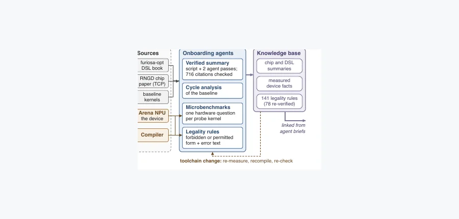 arXiv 2026-10-30 · cs.LG · #2 **[A Case Study of a Multi-Agent Kernel-Optimization Loop That Learns a New AI Accelerator](https://arxiv.org/abs/2610.38329)** Byonggon Chun Affiliation: Fluidstack [Paper](https://arxiv.org/abs/2610.38329) · [Figure source](https://arxiv.org/pdf/2610.38329#page=3) 

[EN] Abstract
Frontier large language models write correct CUDA kernels for most single-operator benchmark tasks, yet their accuracy collapses on accelerators whose architecture and programming language they have rarely seen. We present a case study of an LLM agent loop built for such accelerators. Our example is the FuriosaAI RNGD NPU, programmed in a recent, sparsely documented Rust DSL, where the loop optimized three Gemma-4-12B decode kernels over 12 days on a shared, scarce device. The loop builds its own target knowledge: it writes and checks a summary of the DSL documentation, measures the chip with microbenchmarks, records compiler-derived legality rules, and revisits this knowledge when the toolchain changes, rechecking rules and measurements where it can. A role-based search over per-kernel Design Trees explores whole-kernel designs and accumulates small accepted changes in the best version of each kernel. Because device time is scarce and readings are noisy, cheap checks screen new designs before any device run, and late in the run a change was accepted only after repeated comparisons with the best kernel on the device. The final kernels reach a 9.293x geomean speedup over the official baseline, each within 1.25x of the cycles needed just to move its weights. Our prompts, profiler and acceptance test are available at this https URL . <a href="https://arxiv.org/list/cs/new?skip=0&amp;show=2000&amp;check=20261031#2610.38329">Source</a>

[ZH] Abstract
前沿大语言模型能为大多数单算子基准任务编写正确的 CUDA 内核，但在架构与编程语言很少出现在其经验中的加速器上，准确率会骤降。我们报告一个为此类加速器构建的 LLM 智能体循环案例。实例是采用一种较新、文档稀少的 Rust DSL 编程的 FuriosaAI RNGD NPU；该循环在一台共享且稀缺的设备上，历时 12 天优化了三个 Gemma-4-12B 解码内核。循环自行构建目标知识：编写并检查 DSL 文档摘要，通过微基准测量芯片，记录源自编译器的合法性规则，并在工具链变化时重新审视这些知识，在可行处复核规则与测量。基于角色、围绕各内核设计树进行的搜索探索完整内核设计，并在每个内核的最佳版本中累积被接受的小改动。由于设备时间稀缺且读数有噪声，新设计在设备运行前先经过廉价检查；在运行后期，只有在设备上与最佳内核反复比较后才接受改动。最终内核相对官方基线的几何平均加速比达到 9.293 倍，各内核周期数与仅搬运其权重所需周期数相差均不超过 1.25 倍。我们的提示、分析器及验收测试见原文所链接的 HTTPS 地址。 <a href="https://arxiv.org/list/cs/new?skip=0&amp;show=2000&amp;check=20261031#2610.38329">Source</a>
 | 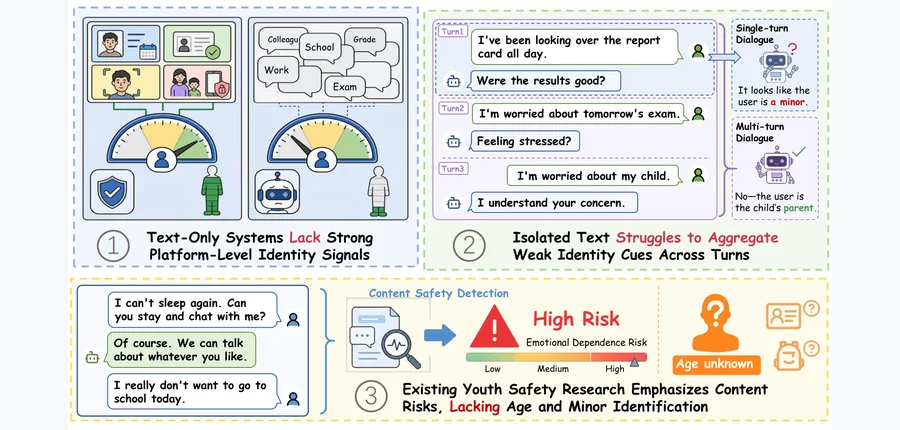 arXiv 2026-10-30 · cs.CL · #3 **[Implicit Minor Detection from Multi-Turn Dialogue in High-Risk AI Interactions: A Constrained Self-Evolving LLM Harness](https://arxiv.org/abs/2610.38546)** Xiaohan Zhang , Ying Zhao , Ruilin Guo , Xuanyuan Yu , Kaibo Huang , Yukun Wei , Zhongliang Yang , Linna Zhou Affiliation: Beijing University of Posts and Telecommunications [Paper](https://arxiv.org/abs/2610.38546) · [Figure source](https://arxiv.org/html/2610.38546v1/problem_overview_v2_outlined.png) 

[EN] Abstract
In high-risk text interactions, a system may need to estimate whether the current speaker is likely to be a minor before applying age-conditioned safeguards. Many text-based dialogue systems lack strong identity signals such as account information, verified identity, facial data, or device data, and must rely on weak cues that emerge across multiple turns. We formulate implicit minor detection under weak identity information as a high-risk user-attribute inference task and propose a constrained framework comprising a large language model, a Harness, and a Maker-Checker protocol. The framework controls when inference is invoked, requires structured dialogue-linked evidence, and subjects validation-selected Harness revisions to version-level review. On a controlled Chinese benchmark comprising 8,328 multi-turn dialogues, our method improves average precision and minor-class F1 by 7.60 and 6.37 percentage points, respectively, over direct inference using the same LLM family. <a href="https://arxiv.org/list/cs/new?skip=0&amp;show=2000&amp;check=20261031#2610.38546">Source</a>

[ZH] Abstract
在高风险文本交互中，系统可能需要先估计当前说话者是否可能为未成年人，再应用与年龄相关的防护。许多文本对话系统缺乏账号信息、已验证身份、面部数据或设备数据等强身份信号，只能依赖多轮交互中逐渐出现的弱线索。我们将弱身份信息条件下的隐式未成年人检测表述为高风险用户属性推断任务，并提出由大语言模型、Harness 和 Maker-Checker 协议组成的受约束框架。该框架控制何时调用推断，要求提供与对话关联的结构化证据，并对经验证集选择的 Harness 修订进行版本级审查。在包含 8,328 段多轮对话的受控中文基准上，与使用相同 LLM 系列进行直接推断相比，我们的方法将平均精确率和未成年人类别 F1 分别提高 7.60 和 6.37 个百分点。 <a href="https://arxiv.org/list/cs/new?skip=0&amp;show=2000&amp;check=20261031#2610.38546">Source</a>
 |
| 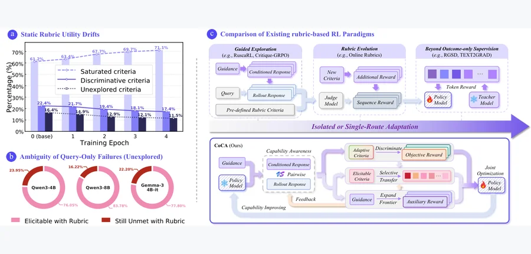 arXiv 2026-10-30 · cs.AI · #4 **[Co-Evolving Policy and Rubric via Capability Awareness for Open-Ended Generation](https://arxiv.org/abs/2610.38566)** Chengsheng Zhang , Wenshen Xu , Yuchuan Wu , Zhiyuan Yu , Junfeng Fang , Tianlong Wang , Bingxue Qiu , Yongbin Li , Xiang… Affiliation: University of Science and Technology of China / Alibaba Token Hub / Nanjing University / National University of Singapore [Paper](https://arxiv.org/abs/2610.38566) · [Figure source](https://arxiv.org/html/2610.38566v1/intro.png) 

[EN] Abstract
Rubric-based reinforcement learning (RL) offers interpretable, fine-grained supervision for aligning large language models (LLMs) on open-ended generation tasks. However, static rubric criteria may become saturated or remain beyond the policy's exploration, rendering the reward signals insufficiently discriminative. While recent efforts seek to guide sampling exploration or evolve rubrics, they fail to explicitly factor in how rubric difficulty should track the evolving policy's capabilities, resulting in a persistent mismatch between the optimization objective and the policy's current capability frontier. In this paper, we propose \textbf{Co}-Evolving Policy and Rubric via \textbf{C}apability \textbf{A}wareness (\textbf{CoCA}), a closed-loop framework that jointly adapts the rubric and policy through criterion-level diagnosis. Specifically, CoCA contrasts query-only and rubric-guided rollouts to characterize each criterion relative to the current policy, recalibrates criteria with mismatched difficulty, and identifies guidance-revealed capability gaps for frontier-based learning. Based on this insight, CoCA either expands rubric-conditioned frontiers through guided optimization or transfers qualified gains through on-policy self-distillation. As the policy updates, CoCA improves the capability diagnosis and enables more reliable distillation, thereby completing the co-evolution loop. Extensive experiments across diverse benchmarks and LLMs demonstrate that CoCA consistently improves performance over rubric-based RL methods. Moreover, CoCA promotes the internalization of guidance-revealed capabilities into query-only behavior while mitigating capability degradation. <a href="https://arxiv.org/list/cs/new?skip=0&amp;show=2000&amp;check=20261031#2610.38566">Source</a>

[ZH] Abstract
基于评分细则的强化学习为大语言模型在开放式生成任务上的对齐提供了可解释、细粒度的监督。然而，静态细则中的标准可能已经饱和，也可能超出策略的探索能力，使奖励信号缺乏区分度。近期工作虽然尝试引导采样探索或演化评分细则，却没有显式考虑细则难度应如何跟随策略能力变化，导致优化目标与策略当前能力边界持续错配。本文提出具备能力感知的策略与细则共同演化方法 CoCA，一个通过标准级诊断联合适应评分细则和策略的闭环框架。具体而言，CoCA 对比仅给定问题和由细则引导的轨迹，刻画每项标准相对于当前策略的状态，重新校准难度不匹配的标准，并识别由指导揭示的能力缺口，以进行边界学习。基于这一认识，CoCA 要么通过引导式优化扩展由细则条件化的能力边界，要么通过同策略自蒸馏迁移符合条件的增益。随着策略更新，CoCA 改善能力诊断并实现更可靠的蒸馏，从而完成共同演化闭环。在多样基准和 LLM 上的大量实验表明，CoCA 相对基于评分细则的强化学习方法持续改善性能。此外，CoCA 促进将指导揭示的能力内化为仅给定问题时的行为，同时减轻能力退化。 <a href="https://arxiv.org/list/cs/new?skip=0&amp;show=2000&amp;check=20261031#2610.38566">Source</a>
 | 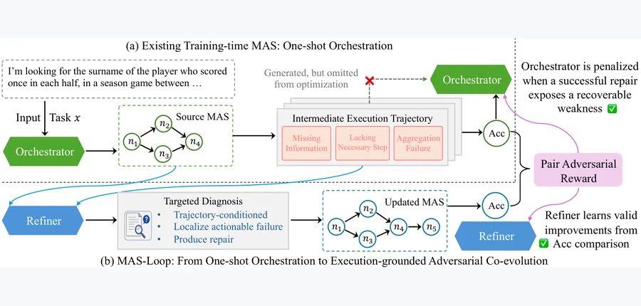 arXiv 2026-10-30 · cs.MA · #5 **[MAS-Loop: Beyond One-Shot Orchestration towards Self-Evolving Multi-Agent Systems](https://arxiv.org/abs/2610.38946)** Hehai Lin , Qi Yang , Chengwei Qin Affiliation: Hong Kong University of Science and Technology (Guangzhou) / Ant Group [Paper](https://arxiv.org/abs/2610.38946) · [Figure source](https://arxiv.org/html/2610.38946v1/background.png) 

[EN] Abstract
Training-time multi-agent system (MAS) design seeks to learn reusable orchestration policies, yet prevailing approaches remain largely one-shot: an Orchestrator generates a system but only observes and learns from its terminal outcome. This paradigm discards execution trajectories that expose system-level failures and contain fine-grained information beyond the terminal outcome, leaving no direct basis for revising the source MAS, evaluating the updated MAS, or learning from the resulting contrast. To this end, we introduce MAS-Loop, an execution-grounded framework that closes this feedback loop by coupling an Orchestrator with a trajectory-conditioned Refiner. For each task, the Orchestrator constructs and executes a source MAS to obtain an outcome score and an intermediate trajectory. Conditioned on the trajectory, the Refiner localizes an actionable failure, formulates a trajectory-grounded diagnosis, and proposes a bounded patch to the agents, information flow, or execution configuration. The executable updated MAS is re-executed on the same task to measure its realized outcome under stochastic execution. This pair-MAS comparison provides complementary learning signals: the Orchestrator learns to generate strong systems with fewer recoverable failures, whereas the Refiner learns to expose and repair observed weaknesses, thereby driving policy-level co-evolution across training iterations. Experiments show that MAS-Loop achieves the strongest overall performance among the evaluated baselines, with consistent gains from refinement across all evaluated benchmarks. The co-evolution process also yields MAS-JudgeCorpus, a dataset of execution-grounded source-updated pairs with orchestration- and trajectory-level supervision, which can provide the community with support for MAS reward modeling and trajectory-aware investigation. <a href="https://arxiv.org/list/cs/new?skip=0&amp;show=2000&amp;check=20261031#2610.38946">Source</a>

[ZH] Abstract
训练期多智能体系统设计旨在学习可复用的编排策略，但主流方法仍主要是一次性的：编排器生成一个系统，却只观察并学习其最终结果。这一范式丢弃了能揭示系统级失败、包含比最终结果更细粒度信息的执行轨迹，因此缺乏直接依据来修订原始系统、评估更新后的系统，或从二者的对比中学习。为此，我们提出 MAS-Loop，一个将编排器与轨迹条件化修订器耦合起来、以执行为基础闭合反馈循环的框架。对每个任务，编排器构建并执行原始多智能体系统，获得结果分数和中间轨迹。修订器依据轨迹定位可采取行动的失败，形成由轨迹支撑的诊断，并对智能体、信息流或执行配置提出有界补丁。更新后的可执行系统会在同一任务上再次执行，以测量随机执行条件下的实际结果。成对系统比较提供互补学习信号：编排器学习生成具有更少可修复失败的强系统，修订器则学习暴露和修复已观察到的弱点，从而在训练迭代中推动策略层面的共同演化。实验显示，MAS-Loop 在所评估基线中取得最强的总体表现，且在所有评估基准上修订均带来一致收益。共同演化过程还产生 MAS-JudgeCorpus，一个由执行支撑的原始—更新系统对数据集，提供编排级与轨迹级监督，可支持社区开展多智能体系统奖励建模和轨迹感知研究。 <a href="https://arxiv.org/list/cs/new?skip=0&amp;show=2000&amp;check=20261031#2610.38946">Source</a>
 |  arXiv 2026-10-30 · cs.CV · #6 **[VEvo-Harness: Causally-Guarded Self-Evolving Harness for Agentic Image Generation](https://arxiv.org/abs/2610.39158)** Yuan Wang , Yuhang Yu , Mengting Chen , Tianrun Xu , Zihao Pan , Xuetao Feng , Wei Li Affiliation: Taobao &amp; Tmall Group, Alibaba / Tsinghua University [Paper](https://arxiv.org/abs/2610.39158) · [Figure source](https://arxiv.org/html/2610.39158v1/teaser.png) 

[EN] Abstract
The central bottleneck in visual generation and editing has migrated from achieving pixel-level fidelity to satisfying densely constrained user specifications through increasingly agentic workflows. Prevailing agentic generation pipelines remain shallow generate-verify-rewrite loops treating VLM judgments as coarse visual feedback, either discarding repair experience or admitting ungated updates that poison skill library. With memorize and govern periods left open, they degrade into ungoverned iterators of repeated trial-and-error rather than continual self-evolving harness. Towards this issue, we present \textbf{VEvo-Harness}, the first causally-guarded continual self-evolving harness system for agentic visual generation. VEvo-Harness introduces four coupled innovations: (1) \textit{a visual traceback} that densifies sparse judgments into root-cause attributions with a hierarchical verification tree; (2) \textit{a visual continual governance} that admits only causally valid skill patches through counterfactual dual-arm image generation replay; (3) \textit{a lifecycle-managed harness state} that hierarchically distills root-cause-anchored episodes across working, experience, and pattern tiers into a persistent skill library of routable and causally verified capabilities; (4) \textit{a heterogeneous sandbox policy} that orchestrates a diverse action space of repair primitives, dynamically routing cost-aware interventions based on root causes to select the most effective strategy. VEvo-Harness surpasses state-of-the-art agentic methods and rivals proprietary generators (\textit{e.g.}, GPT-Image, Nano-Pro) while maintaining the continual harness evolution and generalization. <a href="https://arxiv.org/list/cs/new?skip=0&amp;show=2000&amp;check=20261031#2610.39158">Source</a>

[ZH] Abstract
视觉生成与编辑的主要瓶颈，已从实现像素级保真转向通过日益智能体化的工作流满足密集约束的用户需求。现有智能体生成流水线通常只是浅层的生成—验证—重写循环，把视觉语言模型判断当作粗略视觉反馈，要么丢弃修复经验，要么允许未经把关的更新污染技能库。由于记忆和治理环节未闭合，它们会退化为无治理的反复试错迭代器，而非持续自进化的 harness。为解决这一问题，我们提出 VEvo-Harness，首个以因果约束把关、面向智能体视觉生成的持续自进化 harness 系统。VEvo-Harness 引入四项耦合创新：（1）视觉溯源，通过分层验证树将稀疏判断转化为根因归因；（2）视觉持续治理，通过反事实双臂图像生成重放，只接纳具有因果有效性的技能补丁；（3）具备生命周期管理的 harness 状态，将以根因为锚的片段在工作、经验和模式层级间分层蒸馏，形成可路由、经因果验证的持久技能库；（4）异构沙箱策略，组织多样化修复原语动作空间，依据根因动态路由考虑成本的干预，以选择最有效的策略。VEvo-Harness 超过最先进的智能体方法，并可与 GPT-Image、Nano-Pro 等专有生成器竞争，同时保持持续的 harness 演化和泛化能力。 <a href="https://arxiv.org/list/cs/new?skip=0&amp;show=2000&amp;check=20261031#2610.39158">Source</a>
 |
| 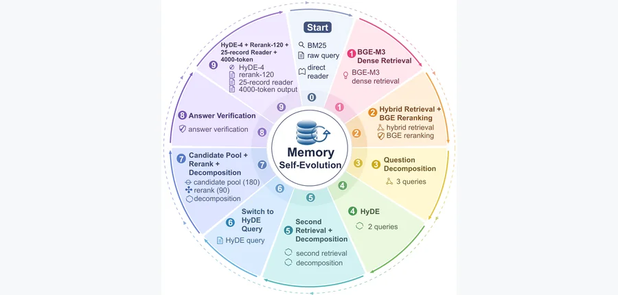 arXiv 2026-10-30 · cs.AI · #7 **[MemSteer: Turning User Histories into Supervision for Agent Memory Optimization](https://arxiv.org/abs/2610.39276)** Jie Huang , Cuiling Lan , Qize Yu , Xiulian Peng , Yan Lu Affiliation: Peking University / Microsoft Research Asia [Paper](https://arxiv.org/abs/2610.39276) · [Figure source](https://arxiv.org/html/2610.39276v1/evolution_trajectory.png) 

[EN] Abstract
An effective agent memory system should adapt to a user's history and task requirements. Human-annotated supervision can guide this adaptation by providing feedback for evaluating and improving memory designs. Yet suitable labels are rarely available for new user histories, and manually constructing QA pairs and supporting evidence is costly. We introduce MemSteer, which turns unlabeled user histories into question-answer (QA) supervision with supporting evidence for memory-design optimization. MemSteer constructs an evidence-grounded answer plan that specifies how facts across related records jointly support a reference answer. The plan guides question generation, while source-grounded auditing and blind answer recovery check the resulting annotations. To study the utility of this supervision, we develop MemSteer-Opt, which combines QA-based design evaluation with evidence-guided failure diagnosis to revise memory store, retrieval, and context construction without updating model parameters. Experiments on ATM-Bench and RHELM show that this supervision is competitive with official-QA-guided optimization. Relative to Base-BM25, MemSteer-Opt improves ATM-Bench Question Score by 13.4 points and RHELM accuracy by 4.1 and 6.6 points without and with external data, respectively. The supervision also benefits two existing optimizers on ATM-Bench, while new-user experiments demonstrate continued design optimization using supervision generated from the target histories. <a href="https://arxiv.org/list/cs/new?skip=0&amp;show=2000&amp;check=20261031#2610.39276">Source</a>

[ZH] Abstract
有效的智能体记忆系统应适应用户历史与任务需求。人工标注监督可通过反馈来评估和改善记忆设计，从而指导这种适应。然而，新的用户历史往往缺乏合适标签，手工构造问答对及支持证据的成本也很高。我们提出 MemSteer，将无标签用户历史转化为附有支持证据的问答监督，用于优化记忆设计。MemSteer 构建以证据为基础的答案计划，明确相关记录中的事实如何共同支持参考答案。该计划引导问题生成，并通过来源支撑的审计和盲答案恢复检查所生成标注。为研究这种监督的效用，我们开发 MemSteer-Opt，将基于问答的设计评估与证据引导的失败诊断相结合，在不更新模型参数的情况下修订记忆存储、检索及上下文构建。在 ATM-Bench 和 RHELM 上的实验显示，这种监督可与官方问答指导的优化相竞争。相对 Base-BM25，MemSteer-Opt 将 ATM-Bench 的问题分数提高 13.4 分，并在无外部数据和有外部数据时分别将 RHELM 准确率提高 4.1 和 6.6 个百分点。该监督也使 ATM-Bench 上两个已有优化器受益，而新用户实验表明，可使用从目标历史生成的监督继续优化设计。 <a href="https://arxiv.org/list/cs/new?skip=0&amp;show=2000&amp;check=20261031#2610.39276">Source</a>
 | 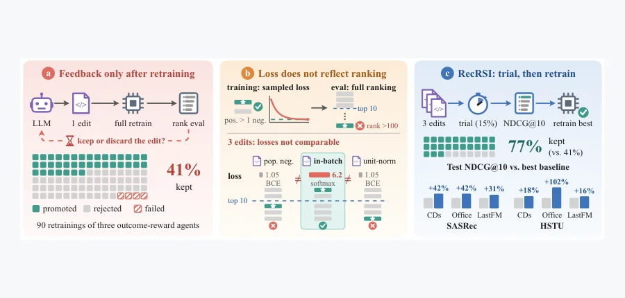 arXiv 2026-10-30 · cs.IR · #8 **[Try Before You Evolve: Ranking-Scored Trials for Recursive Self-Improvement of Recommender Systems](https://arxiv.org/abs/2610.39352)** Xu Huang , Jiawei Feng , Jiancan Wu Affiliation: University of Science and Technology of China [Paper](https://arxiv.org/abs/2610.39352) · [Figure source](https://arxiv.org/html/2610.39352v1/teaser.png) 

[EN] Abstract
Recommenders on Web platforms such as e-commerce and music streaming need their training recipes re-tuned for each dataset. Large language model (LLM) agents can now rewrite these recipes, enabling recursive self-improvement (RSI) of recommender systems. Existing agents propose one edit per round, fully retrain the recommender, and keep the edit only if its ranking quality improves. Unlike programs or patches that can be scored by execution, a recommender edit changes how the model is trained, which raises two challenges. First, ranking feedback is delayed: an edit's ranking quality is known only after full retraining, so much of the retraining budget goes to edits that are later discarded. Second, the signals available before retraining are unreliable: sampled training losses can look solved while full-ranking performance remains poor, and they are not comparable across edits that change the loss or sampler. We propose RecRSI, which generates diverse candidate edits from a diagnosis of the current model and selects one for full retraining using early ranking feedback: each candidate receives a short trial, the first steps of its full training run, scored by full-ranking NDCG@10 on held-out probe users. With two sequential recommenders on three datasets and the same number of full retrainings, RecRSI significantly outperforms existing self-evolving agents in every setting, and on both Amazon datasets reaches in its first round a ranking quality that none of them reaches in five. <a href="https://arxiv.org/list/cs/new?skip=0&amp;show=2000&amp;check=20261031#2610.39352">Source</a>

[ZH] Abstract
电商、音乐流媒体等网络平台上的推荐系统需要针对每个数据集重新调节训练配方。大语言模型智能体如今能够重写这些配方，从而实现推荐系统的递归自我改进。已有智能体每轮提出一次修改，完整重训推荐器，并只在排序质量提高时保留修改。与可通过执行评分的程序或补丁不同，推荐器修改会改变模型的训练方式，由此带来两个挑战。第一，排序反馈滞后：只有完整重训后才能知道修改的排序质量，因此大量重训预算花在最终被丢弃的修改上。第二，重训前可获得的信号不可靠：采样训练损失可能看似已解决，而全量排序性能仍很差；当修改改变损失函数或采样器时，这些信号也不可比较。我们提出 RecRSI，依据对当前模型的诊断生成多样候选修改，再通过早期排序反馈选择一个进行完整重训：每个候选接受一段短试验，即其完整训练运行的最初若干步，并以留出探测用户上的全量排序 NDCG@10 评分。使用两个序列推荐器、三个数据集，并保持完整重训次数一致时，RecRSI 在所有设置中都显著超过已有自进化智能体；在两个 Amazon 数据集上，它第一轮达到的排序质量就超过这些方法五轮内的最佳水平。 <a href="https://arxiv.org/list/cs/new?skip=0&amp;show=2000&amp;check=20261031#2610.39352">Source</a>
 | 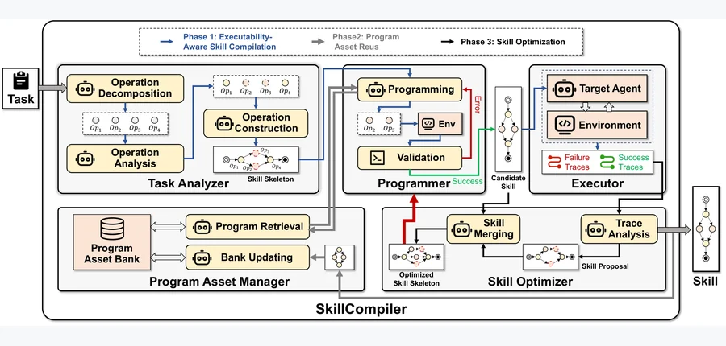 arXiv 2026-10-30 · cs.AI · #9 **[Compile Away Uncertainty: Self-Evolving Agent Skills via Programmatic Compilation](https://arxiv.org/abs/2610.39508)** Chengyu Yang , Yunxiang Zheng , Zongzheng Li , Jiamei Li , Boxun Lan , Xiaoyu Liu , Xiaoyu Zhang , Xiaohong Chen , Ming Hu Affiliation: East China Normal University / China University of Geoscience (as printed) [Paper](https://arxiv.org/abs/2610.39508) · [Figure source](https://arxiv.org/html/2610.39508v1/framework.png) 

[EN] Abstract
Self-evolving agent skills enable AI agents to accumulate and refine reusable procedural knowledge from interaction experience without updating model parameters. However, since such skills are typically represented as textual documents and executed through LLM reasoning, even previously learned procedures must be repeatedly interpreted and regenerated, introducing avoidable uncertainty into every execution. In contrast, program execution is deterministic and independently verifiable. Intuitively, transforming well-specified operations into executable programs can reduce reliance on LLM reasoning and, consequently, reduce execution uncertainty. Motivated by this intuition, we introduce SKillCompiler, a self-evolving skill framework that integrates programmatic compilation into the skill evolution process. Specifically, SkillCompiler adopts an executability-aware skill compilation strategy that decomposes skills into fine-grained operations, analyzes their executability, and constructs hybrid skill skeletons that retain LLM reasoning for context-dependent operations while compiling well-specified ones into validated programs. To avoid redundant program synthesis and enable executable knowledge to accumulate across evolving skills, we further design a program asset reuse mechanism that organizes validated programs as reusable assets, retrieves existing implementations whenever applicable, and synthesizes and verifies new programs only when necessary. Extensive experiments on five benchmarks and six model families demonstrate that SkillCompiler consistently outperforms state-of-the-art methods, achieving up to 32.33\% improvement in task performance. <a href="https://arxiv.org/list/cs/new?skip=0&amp;show=2000&amp;check=20261031#2610.39508">Source</a>

[ZH] Abstract
自进化智能体技能使 AI 智能体能在不更新模型参数的情况下，从交互经验中累积和完善可复用的程序性知识。然而，这些技能通常以文本文件表示，并通过 LLM 推理执行，因此即使是已经学会的程序也必须被反复解释与重新生成，为每次执行引入可避免的不确定性。相比之下，程序执行具有确定性，并可独立验证。直观上，将明确规定的操作转化为可执行程序，可以减少对 LLM 推理的依赖，从而降低执行不确定性。基于这一认识，我们提出 SkillCompiler，一个把程序化编译融入技能演化过程的自进化技能框架。具体而言，SkillCompiler 采用可执行性感知的技能编译策略，将技能分解为细粒度操作、分析其可执行性，并构建混合技能骨架：对依赖上下文的操作保留 LLM 推理，对规定明确的操作则编译为经过验证的程序。为避免重复程序合成，并使可执行知识在演化技能间累积，我们进一步设计程序资产复用机制，将已验证程序组织为可复用资产，在适用时检索已有实现，只在必要时合成并验证新程序。在五个基准与六个模型系列上的大量实验表明，SkillCompiler 持续超过最先进方法，任务性能提升最高达 32.33%。 <a href="https://arxiv.org/list/cs/new?skip=0&amp;show=2000&amp;check=20261031#2610.39508">Source</a>
 |
| 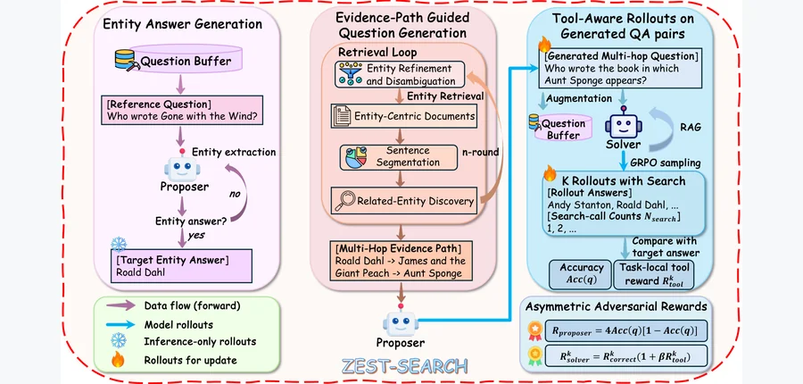 arXiv 2026-10-30 · cs.LG · #10 **[Heterogeneous Co-Evolution Learning for Tool-Efficient Search Agents with Zero Labels](https://arxiv.org/abs/2610.39682)** Qin-Wen Luo , Sheng Ren , Xiang Chen , Rui Liu , Jun Fang , Naiqiang Tan , Jun Wang , Hua Chai , Sheng-Jun Huang Affiliation: Nanjing University of Aeronautics and Astronautics / Didichuxing [Paper](https://arxiv.org/abs/2610.39682) · [Figure source](https://arxiv.org/html/2610.39682v1/AGO_method.png) 

[EN] Abstract
Deep search agents extend language models by interleaving reasoning with external retrieval. However, effective search-agent training requires addressing two challenges beyond final-answer optimization. First, the capability frontier of agents is largely determined by training questions, whereas fixed or labeled task collections cannot adapt as agents improve. Second, outcome-only reinforcement learning treats all successful trajectories equally, even when some correct answers rely on redundant searches, creating an inherent tension between answer accuracy and tool efficiency. To address these issues, we introduce \textsc{ZEST-Search}, a zero-label and tool-efficient framework for search-agent training via heterogeneous co-evolution. Starting from unlabeled reference questions, \textsc{ZEST-Search} constructs validated search tasks online through an answer-first and evidence-path-guided generation process. A heterogeneous proposer adaptively constructs training tasks around the solver's evolving capability boundary, while the solver learns search-augmented reasoning through reinforcement learning. To jointly optimize task difficulty and search efficiency, \textsc{ZEST-Search} employs an intermediate-difficulty reward for the proposer and a task-local tool-aware reward for the solver, encouraging informative tasks and correct answers with fewer redundant searches. Experiments on seven general-domain and multi-hop question answering benchmarks demonstrate that \textsc{ZEST-Search} consistently improves search-agent performance while achieving higher tool efficiency without labeled search-training data or expert search trajectories. Further analyses show that heterogeneous generation, adaptive difficulty control, and tool-aware optimization enable more effective search-agent training. <a href="https://arxiv.org/list/cs/new?skip=0&amp;show=2000&amp;check=20261031#2610.39682">Source</a>

[ZH] Abstract
深度搜索智能体通过交替进行推理与外部检索来扩展语言模型。然而，有效的搜索智能体训练除了优化最终答案，还需解决两个挑战。第一，智能体能力边界在很大程度上由训练问题决定，而固定或带标签任务集无法随智能体进步而适应。第二，只看结果的强化学习将所有成功轨迹同等对待，即使一些正确答案依赖冗余搜索，这使答案准确率与工具效率之间存在内在张力。为此，我们提出 ZEST-Search，一个通过异构共同演化实现零标签、工具高效的搜索智能体训练框架。从无标签参考问题出发，ZEST-Search 采用答案优先、证据路径引导的生成过程，在线构建经过验证的搜索任务。异构提议者围绕求解器不断变化的能力边界自适应构建训练任务，求解器则通过强化学习学习搜索增强推理。为联合优化任务难度与搜索效率，ZEST-Search 为提议者采用中等难度奖励，为求解器采用任务局部的工具感知奖励，鼓励生成有信息量的任务，并以更少冗余搜索取得正确答案。在七个通用领域和多跳问答基准上的实验表明，ZEST-Search 在不使用带标签搜索训练数据或专家搜索轨迹的情况下，持续提高搜索智能体性能，同时实现更高工具效率。进一步分析表明，异构生成、自适应难度控制与工具感知优化支持更有效的搜索智能体训练。 <a href="https://arxiv.org/list/cs/new?skip=0&amp;show=2000&amp;check=20261031#2610.39682">Source</a>
 | 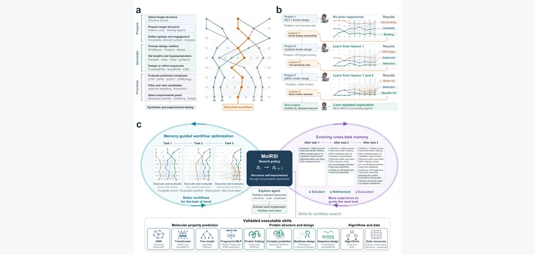 arXiv 2026-10-30 · cs.AI · #11 **[MoLRSI: A Recursive Self-Improving AI agent for Molecular Discovery](https://arxiv.org/abs/2610.39714)** Yikun Zhang , Xiwei Cheng , Mingze Yuan , Yu Zhang , Brian Shim , Aarti Krishnan , Daniel Rosen , Kunyang Sun , Yingze Wan… Affiliation: Northeastern University / Broad Institute of MIT and Harvard / Harvard University / MIT / collaborating institutions (14 source affiliation entries) [Paper](https://arxiv.org/abs/2610.39714) · [Figure source](https://arxiv.org/html/2610.39714v1/fig1_overview_v5.png) 

[EN] Abstract
Molecular discovery requires navigating vast combinatorial search spaces while balancing competing biological objectives. AI agents can automate expert-defined molecular design protocols, but automation alone does not address how to optimize workflows for new tasks or improve their development through experience. Here we introduce MoLRSI, an AI agent that combines systematic optimization of workflows and model architectures with persistent cross-task memory to recursively improve its search policy for molecular discovery. Workflow performance, refinement outcomes, and execution feedback guide subsequent searches, allowing the agent to improve both its workflows and its strategy for developing them. We evaluate MoLRSI in two challenging molecular discovery settings that require balancing competing properties. In antibiotic discovery, MoLRSI developed a screening workflow balancing antibacterial activity, cytotoxicity and structural novelty, achieving an experimental hit rate of 15.9%, compared with 8.7% for a previous expert-led workflow using the same training data and screening library. In de novo peptide-MHC binder design, MoLRSI developed workflows that jointly consider target binding and specificity, producing eight experimentally validated hits against MART-1 and SARS-CoV-1 pMHCs with preferential binding over tested off-targets while Claude Science completely failed. These findings demonstrate how experience-guided workflow optimization can address competing discovery objectives while improving the search strategies used in subsequent campaigns. <a href="https://arxiv.org/list/cs/new?skip=0&amp;show=2000&amp;check=20261031#2610.39714">Source</a>

[ZH] Abstract
分子发现需要在巨大的组合搜索空间中导航，同时平衡相互竞争的生物学目标。AI 智能体能够自动执行专家定义的分子设计流程，但自动化本身不能解决如何针对新任务优化工作流，或如何通过经验改善其开发过程。我们提出 MoLRSI，一个结合工作流与模型架构的系统优化、持久跨任务记忆的 AI 智能体，以递归改进其分子发现搜索策略。工作流性能、完善结果和执行反馈指导后续搜索，使智能体既能改善工作流，也能改善开发工作流的策略。我们在两个需要平衡竞争属性的高难度分子发现设置中评估 MoLRSI。在抗生素发现中，MoLRSI 开发了兼顾抗菌活性、细胞毒性和结构新颖性的筛选流程，实验命中率为 15.9%；使用相同训练数据和筛选库的先前专家主导流程为 8.7%。在从头肽—MHC 结合物设计中，MoLRSI 开发的流程联合考虑靶标结合和特异性，针对 MART-1 与 SARS-CoV-1 pMHC 产生八个经实验验证的命中物，相对所测试的脱靶对象具有优先结合，而 Claude Science 完全失败。这些结果表明，经验引导的工作流优化可以应对相互竞争的发现目标，同时改善后续研究活动使用的搜索策略。 <a href="https://arxiv.org/list/cs/new?skip=0&amp;show=2000&amp;check=20261031#2610.39714">Source</a>
 | 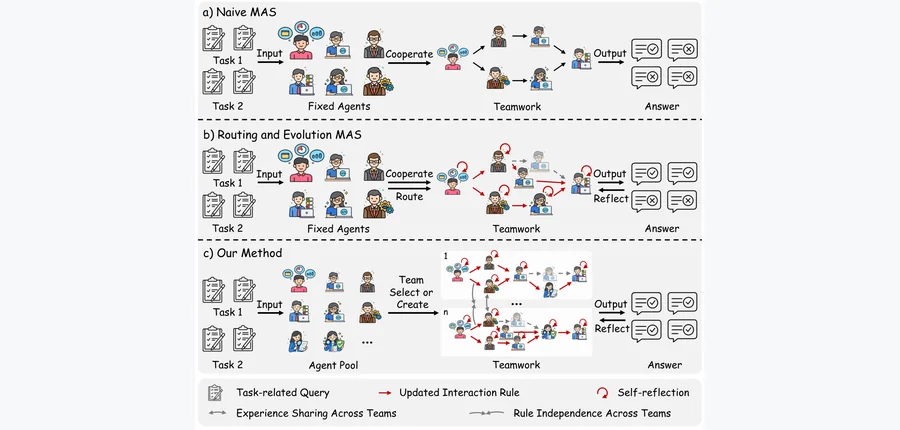 arXiv 2026-10-30 · cs.AI · #12 **[EvoTeam: Multi-Agent Collaboration via Evolving Teams](https://arxiv.org/abs/2610.39813)** Qinuo Cao , Xin He , Dianxuan Fu , Lizhi Zhang , Zhaoqing Xing , Jiapu Wang , Xin Wang , Na Zou , Yi Chang , Qinggang Zhang Affiliation: Jilin University / Nanjing University of Science and Technology / Shanghai AI Lab [Paper](https://arxiv.org/abs/2610.39813) · [Figure source](https://arxiv.org/html/2610.39813v1/introduction.png) 

[EN] Abstract
LLM-based multi-agent systems (MAS) rely on collaboration among specialized agents to solve complex tasks. Existing methods improve MAS by refining the prompts, skills, and execution strategies of individual agents based on task feedback. However, improving individual agents does not necessarily lead to better team collaboration. Recent studies have therefore extended evolution to the collaboration level, using collective execution experience to adjust team organization, and inter-agent interactions. Nevertheless, evolving collaboration across heterogeneous tasks remains challenging, as existing approaches often constrain team reorganization within a shared structure and reuse interaction rules across incompatible team contexts. In this paper, we propose EvoTeam, a collaboration-centric evolution framework that jointly evolves team organization, interaction rules, and individual agent skills through execution experience. It maintains a library of reusable teams, selecting or creating agent teams and guiding collaboration through team-specific interaction rules. Collaboration experience accumulates within compatible team contexts, while individual skills remain reusable across teams. Experiments across four benchmarks demonstrate its effectiveness. Our code is available at this https URL . <a href="https://arxiv.org/list/cs/new?skip=0&amp;show=2000&amp;check=20261031#2610.39813">Source</a>

[ZH] Abstract
基于 LLM 的多智能体系统依靠专门化智能体之间的协作解决复杂任务。已有方法根据任务反馈，完善单个智能体的提示、技能与执行策略，从而改善系统。然而，改善个体并不必然带来更好的团队协作。因此，近期研究将演化扩展到协作层面，使用集体执行经验调整团队组织和智能体间交互。不过，在异构任务间演化协作仍具有挑战，因为已有方法往往将团队重组限制在共享结构中，并在不兼容的团队上下文间复用交互规则。本文提出 EvoTeam，一个以协作为中心的演化框架，通过执行经验联合演化团队组织、交互规则及个体智能体技能。它维护可复用的团队库，选择或创建智能体团队，并通过团队专属交互规则指导协作。协作经验在兼容的团队上下文中累积，而个体技能仍可跨团队复用。四个基准上的实验验证了其有效性。我们的代码见原文所链接的 HTTPS 地址。 <a href="https://arxiv.org/list/cs/new?skip=0&amp;show=2000&amp;check=20261031#2610.39813">Source</a>
 |
| 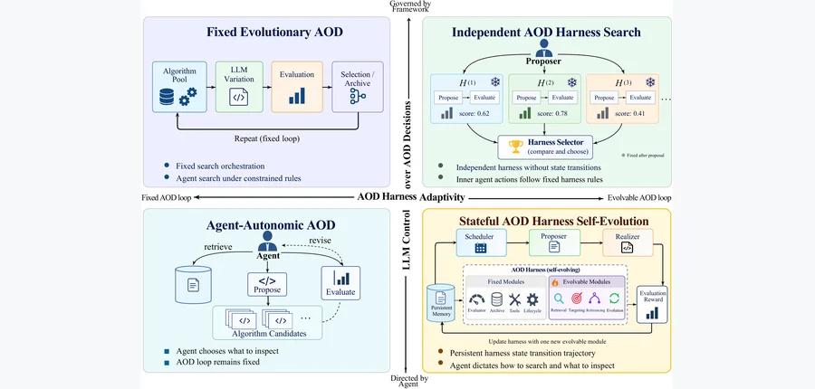 arXiv 2026-10-30 · cs.NE · #13 **[HEMO: Harness Self-Evolution for Multi-Objective Combinatorial Optimization](https://arxiv.org/abs/2610.40023)** Jianghan Zhu , Cong Zhang , Ni Zhang , Yifan Yang , Yew Soon Ong , Zhiguang Cao Affiliation: Singapore Management University / Nanyang Technological University / Independent researcher [Paper](https://arxiv.org/abs/2610.40023) · [Figure source](https://arxiv.org/html/2610.40023v1/hemo_compare2.png) 

[EN] Abstract
Automatic operator design (AOD) has increasingly adopted large language models (LLMs) to generate problem-specific search and variation operators for multi-objective combinatorial optimization (MOCO). Yet most methods evolve the operators while leaving the process that discovers them fixed. This limits adaptation as new Pareto trade-offs and operator interactions change where and how the search should proceed. We introduce HEMO, which makes the AOD harness itself a self-evolving optimization target. HEMO maintains a persistent harness state and updates one module at a time, revising the logic that determines which experience to retrieve, which operators to improve, which parents to select, and how to formulate the orchestration of search steps. Downstream solution quality and runtime guide these updates, while a discounted UCB scheduler directs adaptation toward promising modules as their utility changes. A persistent memory filesystem preserves candidate outcomes and diagnostic feedback across harness states, enabling successive states to build on accumulated optimization experience. Experiments across eight MOCO tasks and two structurally distinct evolutionary backbones demonstrate strong performance against conventional evolutionary, neural, and LLM-based AOD baselines, together with effective transfer to related tasks. HEMO extends automatic operator design beyond evolving individual operators to improving the search process that discovers them. <a href="https://arxiv.org/list/cs/new?skip=0&amp;show=2000&amp;check=20261031#2610.40023">Source</a>

[ZH] Abstract
自动算子设计越来越多地采用大语言模型，为多目标组合优化生成问题专属的搜索与变异算子。然而，大多数方法只演化算子，却保持发现算子的过程不变。这限制了随着新 Pareto 权衡和算子相互作用出现，对搜索位置和搜索方式的适应。我们提出 HEMO，将自动算子设计的 harness 本身设为自进化优化目标。HEMO 维护持久 harness 状态，每次更新一个模块，修订决定检索哪些经验、改善哪些算子、选择哪些父代，以及如何组织搜索步骤的逻辑。下游解质量与运行时间指导这些更新，折扣 UCB 调度器则随着模块效用变化，将适应引向有前景的模块。持久记忆文件系统在不同 harness 状态间保存候选结果与诊断反馈，使后续状态能建立在累积优化经验之上。在八个多目标组合优化任务及两种结构不同的进化骨干上的实验表明，HEMO 相对传统进化、神经和基于 LLM 的自动算子设计基线表现强劲，并能有效迁移到相关任务。HEMO 将自动算子设计从演化单个算子，扩展为改进发现算子的搜索过程。 <a href="https://arxiv.org/list/cs/new?skip=0&amp;show=2000&amp;check=20261031#2610.40023">Source</a>
 | 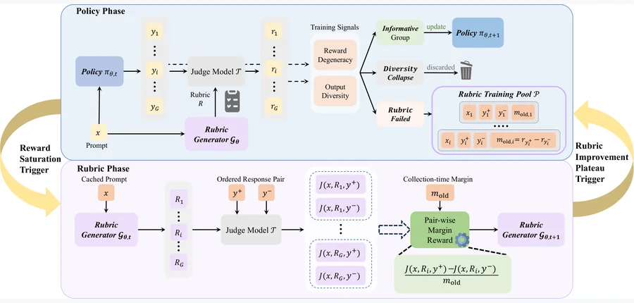 arXiv 2026-10-30 · cs.AI · #14 **[Reward-Adaptive Co-Evolution of Policy and Rubric](https://arxiv.org/abs/2610.40096)** Yizhu Chen , Jianguang Jiang , Jiameng Huang , Chuyu Fang , Bojun Zhang , Zhenyu Jiao , Xing Yuan , Tong Lin Affiliation: Peking University / Baidu / Institute of Automation, Chinese Academy of Sciences [Paper](https://arxiv.org/abs/2610.40096) · [Figure source](https://arxiv.org/html/2610.40096v1/overview.png) 

[EN] Abstract
Rubric-based rewards provide fine-grained, interpretable supervision for open-ended reinforcement learning, where holistic scalar rewards struggle to capture multidimensional response quality. Static rubrics can lose discriminative power as the policy distribution evolves, while existing policy--rubric co-evolution methods rely on globally prescribed update schedules that ignore heterogeneous reward informativeness. We introduce RACE, a Reward-Adaptive Co-Evolution framework. At the group level, per-rollout-group training-signal routing classifies groups as informative, diversity-collapsed, or rubric-failed, updating the policy only with informative groups while caching rubric failures. At the phase level, event-triggered phase switching enters rubric optimization upon persistent reward saturation and returns when rubric-reward improvement plateaus. Rubric phases train the generator on cached pairs using a frozen judge and a scale-normalized pairwise-margin reward. Across both levels, online threshold adaptation adjusts routing and switching thresholds through proportional control. Under a unified evaluation protocol, RACE achieves the highest average performance and outperforms the strongest fixed-alternation baseline on all eight tasks, while improving rubric discrimination. <a href="https://arxiv.org/list/cs/new?skip=0&amp;show=2000&amp;check=20261031#2610.40096">Source</a>

[ZH] Abstract
基于评分细则的奖励为开放式强化学习提供细粒度、可解释的监督，弥补整体标量奖励难以捕捉回答质量多个维度的不足。随着策略分布演化，静态细则可能丧失区分能力，而现有策略—细则共同演化方法依赖全局预设更新日程，忽视奖励信息量的异质性。我们提出奖励自适应共同演化框架 RACE。在组级，每个轨迹组的训练信号路由将其分为有信息量、多样性坍缩或细则失效三类，只使用有信息量的组更新策略，同时缓存细则失败。在阶段级，事件触发的阶段切换会在奖励持续饱和时进入细则优化，并在细则奖励改善进入平台期时返回。细则阶段使用冻结评判器与按尺度归一化的成对间隔奖励，在缓存样本对上训练生成器。在这两个层级中，在线阈值适应均通过比例控制调整路由与切换阈值。在统一评测协议下，RACE 取得最高平均性能，并在全部八个任务上超过最强固定交替基线，同时改善细则区分度。 <a href="https://arxiv.org/list/cs/new?skip=0&amp;show=2000&amp;check=20261031#2610.40096">Source</a>
 | 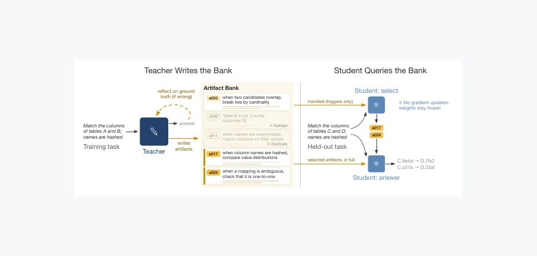 arXiv 2026-10-30 · cs.CL · #15 **[Artifact Distillation: Training-Free Transfer from Frontier to Small Language Models](https://arxiv.org/abs/2610.37680)** Mustafa Safa Ozdayi , Somin Wadhwa Affiliation: Core AI, Qualtrics [Paper](https://arxiv.org/abs/2610.37680) · [Figure source](https://arxiv.org/pdf/2610.37680#page=2) 

[EN] Abstract
Closing the gap between frontier and smaller language models is usually approached by distillation: fine-tuning the small model (student) on a frontier model's (teacher) outputs, which binds transfer to training compute and leaves the transferred knowledge largely opaque. We propose Artifact Distillation: a teacher solves training instances and externalizes its problem-solving procedure into an artifact bank that a student queries at inference time, with no gradient updates. Across four LiveBench tasks, a bank written by Claude Opus 4.5 lets Claude Haiku 4.5 outperform unaided Claude Sonnet 4.5 on spatial reasoning (0.707 vs. 0.647) at 60% of its cost, and reach Sonnet 4.5's level on table joining at 89% of its cost. The same raw bank raises Qwen3.5-27B's pooled score from 0.730 to 0.800, showing that transfer is not confined to the teacher's model family. <a href="https://arxiv.org/list/cs/new?skip=0&amp;show=2000&amp;check=20261031#2610.37680">Source</a>

[ZH] Abstract
缩小前沿语言模型与小模型的差距，通常采用蒸馏：在前沿模型（教师）的输出上微调小模型（学生）。这使迁移依赖训练算力，也让迁移知识在很大程度上不透明。我们提出 Artifact Distillation：教师解决训练实例，并将其解题程序外化为工件库，学生在推理时查询该库，无需梯度更新。在四个 LiveBench 任务上，Claude Opus 4.5 编写的工件库使 Claude Haiku 4.5 在空间推理上超过未获辅助的 Claude Sonnet 4.5（0.707 对 0.647），成本为其 60%；在表连接任务上，以 89% 的成本达到 Sonnet 4.5 的水平。同一原始工件库还将 Qwen3.5-27B 的汇总分数从 0.730 提高到 0.800，表明迁移并不限于教师模型所属系列。 <a href="https://arxiv.org/list/cs/new?skip=0&amp;show=2000&amp;check=20261031#2610.37680">Source</a>
 |
| 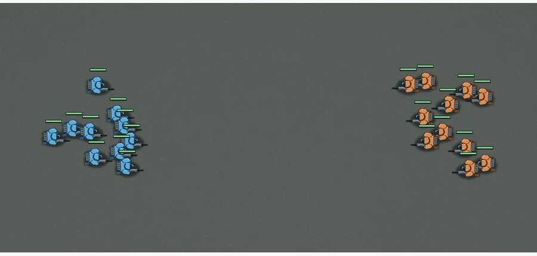 arXiv 2026-10-30 · cs.AI · #16 **[GARDEN: Generalist Autonomous Reward Design Through Evidence Navigation for Cooperative Multi-Agent Reinforcement Learning](https://arxiv.org/abs/2610.37926)** Dogan Urgun Affiliation: Karabuk University [Paper](https://arxiv.org/abs/2610.37926) · [Figure source](https://arxiv.org/html/2610.37926v1/heldout_smax_10m.png) 

[EN] Abstract
Cooperative multi-agent reinforcement learning (MARL) enables teams of agents, such as robots and autonomous vehicles, to learn coordinated behavior, but what such teams learn is largely determined by their reward function. Because task success alone provides too little guidance for learning, intermediate rewards are usually designed by hand, and this effort must often be repeated whenever the environment or the team changes. Large language models (LLMs) can automate the effort by writing reward functions as code, yet the resulting rewards are typically designed and tested in a single setting. To enable their reuse across settings, GARDEN (Generalist Autonomous Reward Design through Evidence Navigation) is proposed, in which one reward program is developed for a family of related scenarios and transferred, unchanged, to scenarios that were not available during its design. During development, environment code, training records, and agent behavior are investigated by an LLM reward engineer, and draft rewards are tested in trial training runs, while the learning algorithm and the rule for selecting the final reward are held fixed. On unseen scenarios of the Overcooked and SMAX benchmarks, task returns were increased by 58.2% and 52.5% over the default rewards on two kitchen layouts, and the mean win rate in two combat scenarios was raised from 51.0% to 89.9%. Under matched candidate and probe budgets, this exceeded the 84.2% and 79.2% obtained with fixed diagnostic feedback and Eureka-inspired reward reflection. These results show that a single autonomously engineered reward can be reused effectively across related cooperative scenarios. <a href="https://arxiv.org/list/cs/new?skip=0&amp;show=2000&amp;check=20261031#2610.37926">Source</a>

[ZH] Abstract
合作式多智能体强化学习使机器人、自动驾驶车辆等智能体团队学习协调行为，但团队学到什么，很大程度上由奖励函数决定。由于任务成功本身为学习提供的指导太少，中间奖励通常需要手工设计，而且环境或团队变化时往往要重新投入这项工作。大语言模型可以通过编写奖励函数代码来自动完成这项工作，但产生的奖励通常只在单一设置中设计和测试。为实现跨设置复用，我们提出 GARDEN，即通过证据导航实现通用自主奖励设计：为一组相关场景开发一个奖励程序，再将其不作修改地迁移到设计时未见的场景。在开发期间，LLM 奖励工程师调查环境代码、训练记录与智能体行为，并在试验训练中测试奖励草案，同时保持学习算法与最终奖励选择规则不变。在 Overcooked 和 SMAX 基准的未见场景中，两个厨房布局的任务回报比默认奖励分别提高 58.2% 和 52.5%，两个战斗场景的平均胜率从 51.0% 提高到 89.9%。在候选与探测预算匹配时，这超过了固定诊断反馈与受 Eureka 启发的奖励反思所达到的 84.2% 和 79.2%。这些结果表明，单个自主设计的奖励能够在相关合作场景间有效复用。 <a href="https://arxiv.org/list/cs/new?skip=0&amp;show=2000&amp;check=20261031#2610.37926">Source</a>
 | 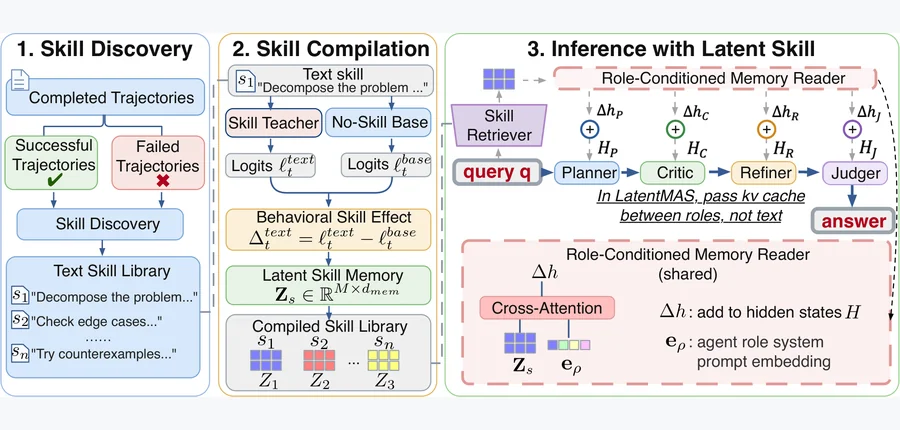 arXiv 2026-10-30 · cs.AI · #17 **[SkillMem: Compact External Skill Memory for Latent Multi-Agent Reasoning](https://arxiv.org/abs/2610.37935)** Yuxuan Zhu , Mohammad Mohammadi Amiri , Pin-Yu Chen , Keerthiram Murugesan Affiliation: Rensselaer Polytechnic Institute / IBM Research [Paper](https://arxiv.org/abs/2610.37935) · [Figure source](https://arxiv.org/html/2610.37935v1/SkillMem_Overview.png) 

[EN] Abstract
Latent multi-agent systems reduce inference cost by keeping intermediate reasoning and inter-agent communication in continuous representations.\ Reusable skills, however, are commonly supplied as text or stored as layer-wise Key-Value states or skill-specific model parameters, introducing repeated processing or substantial per-skill storage.\ We introduce \textbf{SkillMem}, which represents each reusable skill as a small external latent memory and makes it directly available during latent multi-agent reasoning.\ A role-conditioned cross-attention reader allows the same memory to guide different agents according to their roles and current hidden states.\ We train the skill memories and shared reader through behavioral distillation, matching the change in token predictions induced by a textual skill while keeping the backbone frozen.\ For our experiments, we obtain textual skills from paired successful and failed multi-agent trajectories, although existing skills can also be compiled directly.\ Across six benchmarks and Qwen3 models ranging from 4B to 14B parameters, SkillMem provides strong gains for smaller backbones while preserving efficient latent multi-agent inference across model scales.\ We use the same $8\times256$ memory configuration across all evaluated model scales, requiring 9.6\,KB of skill-specific storage per skill, including its retrieval embedding.\ For a library of 100 skills, SkillMem reduces total storage by more than $38\times$ compared with alternative skill representations and achieves up to a $4.23\times$ end-to-end inference speedup.\ These results show that compact procedural memories can be reused without sacrificing the efficiency of latent multi-agent reasoning. <a href="https://arxiv.org/list/cs/new?skip=0&amp;show=2000&amp;check=20261031#2610.37935">Source</a>

[ZH] Abstract
潜在多智能体系统通过将中间推理与智能体间通信保留在连续表示中，降低推理成本。然而，可复用技能通常以文本提供，或存储为逐层键值状态、技能专属模型参数，带来重复处理或较大的逐技能存储开销。我们提出 SkillMem，将每个可复用技能表示为一个小型外部潜在记忆，并在潜在多智能体推理时直接提供。具备角色条件的交叉注意力读取器使同一记忆能根据不同智能体的角色和当前隐藏状态提供指导。我们通过行为蒸馏训练技能记忆与共享读取器，在保持骨干冻结的同时，匹配文本技能引起的词元预测变化。实验中的文本技能来自成对的成功与失败多智能体轨迹，也可以直接编译已有技能。在六个基准及参数量从 4B 到 14B 的 Qwen3 模型上，SkillMem 为较小骨干带来显著增益，并在不同模型规模下保持高效潜在多智能体推理。我们在所有评估规模上使用相同的 8×256 记忆配置，计入检索嵌入后，每个技能仅需 9.6 KB 专属存储。对于含 100 个技能的库，SkillMem 相比其他技能表示将总存储降低超过 38 倍，并实现最高 4.23 倍端到端推理加速。这些结果表明，紧凑程序性记忆可以在不牺牲潜在多智能体推理效率的情况下复用。 <a href="https://arxiv.org/list/cs/new?skip=0&amp;show=2000&amp;check=20261031#2610.37935">Source</a>
 | 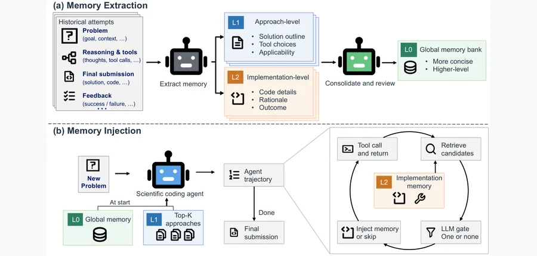 arXiv 2026-10-30 · cs.LG · #18 **[MUSE: Multi-Level Memory with Selective Runtime Injection for Scientific Coding Agents](https://arxiv.org/abs/2610.38332)** Haoran Jin , Defu Lian , Xiting Wang , Hong Xie Affiliation: University of Science and Technology of China / State Key Laboratory of Cognitive Intelligence / Renmin University of China [Paper](https://arxiv.org/abs/2610.38332) · [Figure source](https://arxiv.org/html/2610.38332v1/muse-framework-20261011-slide18.png) 

[EN] Abstract
Historical experience can guide scientific coding at multiple levels, but task-level retrieval may miss implementation lessons that become relevant during execution. We introduce MUSE, a memory management framework combining multi-level memory with selective runtime injection for scientific coding agents. MUSE builds global, approach-level, and implementation-level memory from historical trajectories. At initialization, the agent receives global memory and problem-matched approach-level memory. During execution, current interactions are used to retrieve implementation-level memory. An LLM gate selects relevant experience and generates specific review advice, or skips injection. Across four benchmarks spanning numerical problem solving, kernel optimization, and scientific software repair, MUSE outperforms retrieval and memory baselines on all evaluation metrics. Ablations support the multi-level design and gated injection, while transfer experiments show that memory remains useful across kernel benchmarks. These results show that multi-level memory and selective runtime injection enable effective reuse of experience in scientific coding. Code is available at this https URL . <a href="https://arxiv.org/list/cs/new?skip=0&amp;show=2000&amp;check=20261031#2610.38332">Source</a>

[ZH] Abstract
历史经验可以在多个层面指导科学编程，但任务级检索可能遗漏在执行过程中才变得相关的实现经验。我们提出 MUSE，一个面向科学编程智能体、结合多层记忆与选择性运行时注入的记忆管理框架。MUSE 从历史轨迹中构建全局、方法级和实现级记忆。在初始化时，智能体接收全局记忆以及与问题匹配的方法级记忆。在执行期间，使用当前交互检索实现级记忆。LLM 门控选择相关经验并生成具体审查建议，或跳过注入。在覆盖数值问题求解、内核优化和科学软件修复的四个基准上，MUSE 在所有评测指标上均超过检索与记忆基线。消融支持多层设计与门控注入，迁移实验则表明，记忆在不同内核基准间仍然有用。这些结果表明，多层记忆与选择性运行时注入能够有效复用科学编程经验。代码见原文所链接的 HTTPS 地址。 <a href="https://arxiv.org/list/cs/new?skip=0&amp;show=2000&amp;check=20261031#2610.38332">Source</a>
 |
| 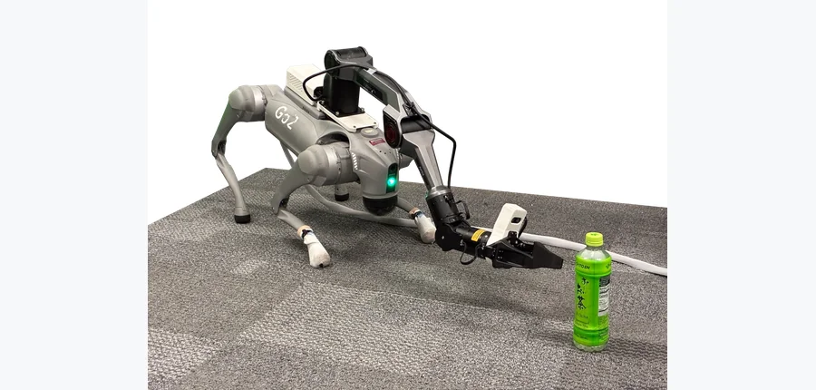 arXiv 2026-10-30 · cs.RO · #19 **[ELEVATE: Agentic Controller Acquisition from Task Failure for Quadrupedal Manipulation](https://arxiv.org/abs/2610.38388)** Shiqi Liu , Radu Corcodel , Ding Zhao Affiliation: Carnegie Mellon University / Mitsubishi Electric Research Labs [Paper](https://arxiv.org/abs/2610.38388) · [Figure source](https://arxiv.org/pdf/2610.38388) 

[EN] Abstract
Quadrupedal manipulators can extend their workspace through whole-body interaction, but task-planning agents' capabilities remain limited by their available controllers. We present ELEVATE, a framework that uses persistent failures during task-program refinement to identify and acquire missing whole-body control capabilities. When these failures suggest a missing physical capability, a coding agent formulates and iteratively refines a reinforcement-learning problem, specifying behavior-specific rewards, curricula, and termination conditions. Validated controllers are added to the capability library and composed with existing controllers to retry the task. Starting from a single pretrained loco-manipulation controller, ELEVATE autonomously acquires controllers for wall-supported elevation, supported manipulation, and wall descent across a sequence of seven simulation tasks. These controllers are reused in subsequent reaching and object-manipulation tasks. On the five tasks beyond the initial controller's workspace, ELEVATE achieves mean success rates of 98.4%-100% across five independent runs, while coding-agent baselines with a fixed controller library fail to complete these tasks. The synthesized task programs, together with the acquired controllers, also transfer to a physical quadrupedal manipulator without real-robot training or fine-tuning, achieving 18/20 successes in rack retrieval and 16/20 in floor-to-rack placement. Videos and demonstrations are available at this https URL . <a href="https://arxiv.org/list/cs/new?skip=0&amp;show=2000&amp;check=20261031#2610.38388">Source</a>

[ZH] Abstract
四足机械臂可以通过全身交互扩展工作空间，但任务规划智能体的能力仍受限于可用控制器。我们提出 ELEVATE，一个利用任务程序完善过程中的持续失败来识别并获取缺失全身控制能力的框架。当这些失败暗示缺少某项物理能力时，编程智能体制定并迭代完善一个强化学习问题，规定行为专属的奖励、课程与终止条件。经过验证的控制器被加入能力库，并与已有控制器组合，以重试任务。从单个预训练移动操作控制器出发，ELEVATE 在七个仿真任务的序列中，自主获得支墙抬升、支撑操作和沿墙下降控制器。这些控制器在后续伸取与物体操作任务中得到复用。在超出初始控制器工作空间的五个任务上，ELEVATE 在五次独立运行中的平均成功率达到 98.4%—100%，而使用固定控制器库的编程智能体基线无法完成这些任务。合成的任务程序连同获取的控制器，还能在不进行真实机器人训练或微调的情况下迁移到实体四足机械臂，在货架取物中取得 18/20 次成功，在地面到货架放置中取得 16/20 次成功。视频和演示见原文所链接的 HTTPS 地址。 <a href="https://arxiv.org/list/cs/new?skip=0&amp;show=2000&amp;check=20261031#2610.38388">Source</a>
 | 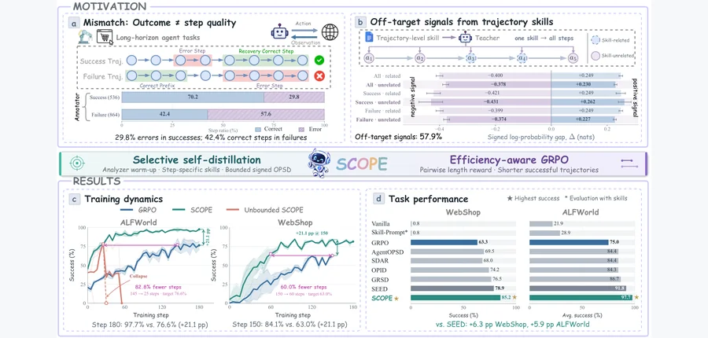 arXiv 2026-10-30 · cs.AI · #20 **[SCOPE: Selective Critical-Step On-Policy Self-Distillation for Agentic Reinforcement Learning](https://arxiv.org/abs/2610.38391)** Qirui Liu , Wei Cao , Yu Mi , Yichen Sun , Xuekun Zhang , Lei Liu , Yue Shen , Zhixuan Chu Affiliation: Zhejiang University / Ant Group [Paper](https://arxiv.org/abs/2610.38391) · [Project](https://neuqrui.github.io/SCOPE-page) · [Figure source](https://arxiv.org/html/2610.38391v1/scope_intro1.png) 

[EN] Abstract
Outcome-based reinforcement learning provides coarse supervision for long-horizon LLM agents: failed trajectories may contain correct steps, while successful trajectories can contain errors. Trajectory-level skills can also shift teacher preferences at unrelated steps, introducing off-target distillation signals. We introduce SCOPE, a framework for Selective Critical-Step On-Policy Self-Distillation. After a supervised warm-up, the policy analyzes its own trajectories, generates step-specific hindsight skills, and distills their guidance only at selected error steps. A bounded signed teacher-student coefficient stabilizes auxiliary updates while preserving positive reinforcement and negative correction. A success-relative pairwise length reward further encourages efficient task completion. Experiments on ALFWorld and WebShop demonstrate consistent improvements across multiple model backbones. With Qwen2.5-3B, SCOPE achieves 97.7% success on ALFWorld and 85.2% on WebShop, outperforming SEED by 5.9 and 6.3 percentage points, respectively. On unseen ALFWorld tasks, SCOPE reaches 89.6% success, improving over GRPO by 23.2 percentage points with 46.7% fewer interactions. Scaling to Qwen3-32B, SCOPE achieves 99.2% success on seen ALFWorld tasks and 94.0% on unseen tasks. <a href="https://arxiv.org/list/cs/new?skip=0&amp;show=2000&amp;check=20261031#2610.38391">Source</a>

[ZH] Abstract
基于结果的强化学习为长程 LLM 智能体提供粗粒度监督：失败轨迹可能包含正确步骤，成功轨迹也可能包含错误。轨迹级技能还可能改变教师在无关步骤上的偏好，引入偏离目标的蒸馏信号。我们提出 SCOPE，即选择性关键步骤同策略自蒸馏框架。经过监督预热后，策略分析自身轨迹，生成针对特定步骤的事后技能，并只在选定错误步骤上蒸馏其指导。一个有界、有符号的师生系数稳定辅助更新，同时保留正向强化与负向纠正。相对于成功轨迹的成对长度奖励进一步鼓励高效完成任务。ALFWorld 和 WebShop 上的实验在多个模型骨干间展示一致改进。使用 Qwen2.5-3B 时，SCOPE 在 ALFWorld 达到 97.7% 成功率，在 WebShop 达到 85.2%，分别超过 SEED 5.9 和 6.3 个百分点。在未见 ALFWorld 任务上，SCOPE 达到 89.6% 成功率，比 GRPO 提高 23.2 个百分点，同时减少 46.7% 交互。扩展到 Qwen3-32B 时，SCOPE 在已见 ALFWorld 任务上达到 99.2%，在未见任务上达到 94.0%。 <a href="https://arxiv.org/list/cs/new?skip=0&amp;show=2000&amp;check=20261031#2610.38391">Source</a>
 | 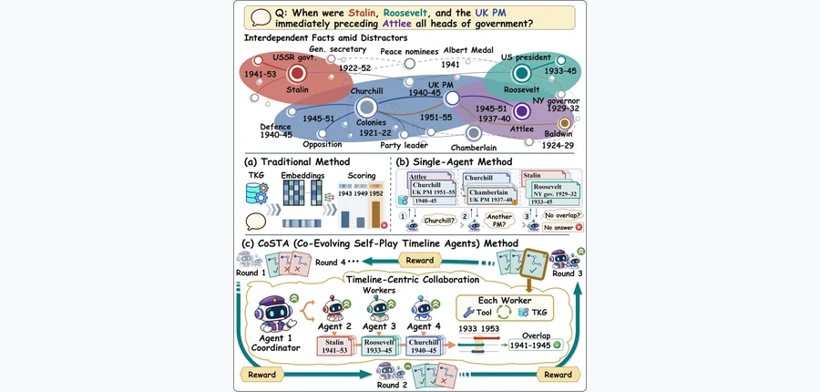 arXiv 2026-10-30 · cs.CL · #21 **[CoSTA: Co-Evolving Self-Play Timeline Agents for Complex Temporal Knowledge Graph Question Answering](https://arxiv.org/abs/2610.38450)** Haikun Liu , Zhichao Yan , Shaoru Guo , Jiawei Gu , Victor Gutierrez Basulto , Jiapu Wang , Ru Li Affiliation: Shanxi University / Singapore University of Technology and Design / Cardiff University / Nanjing University of Science and Technology [Paper](https://arxiv.org/abs/2610.38450) · [Figure source](https://arxiv.org/pdf/2610.38450) 

[EN] Abstract
Complex Temporal Knowledge Graph Question Answering (TKGQA) involves more than retrieving facts: the timestamp or validity interval of one fact can constrain the search for another, while multiple intervals may jointly determine the answer. Existing single-agent TKGQA methods typically investigate these facts within a single reasoning context, where evidence from different event histories can become interleaved and distractors can misdirect subsequent retrieval. Distributing investigations across agents can separate event-specific evidence into distinct contexts, but effective collaboration must still be learned because question decomposition, subtask investigation, and evidence synthesis are interdependent. To address these limitations, we propose \textbf{Co}-Evolving \textbf{S}elf-Play \textbf{T}imeline \textbf{A}gents (CoSTA), which organizes facts into navigable timelines, delegates investigations to workers, and uses a coordinator to synthesize their original timestamped observations. CoSTA initializes a shared policy through role-conditioned distillation and jointly optimizes both roles through co-evolving self-play with final-answer rewards. Across three benchmarks, CoSTA achieves state-of-the-art overall performance, with particularly strong gains on complex multi-fact questions, while its compact variants outperform the evaluated closed-source LLM agents. <a href="https://arxiv.org/list/cs/new?skip=0&amp;show=2000&amp;check=20261031#2610.38450">Source</a>

[ZH] Abstract
复杂时间知识图谱问答不仅是检索事实：一个事实的时间戳或有效区间可能约束另一个事实的搜索，多个区间也可能共同决定答案。已有单智能体方法通常在同一推理上下文中调查这些事实，不同事件历史的证据可能交织，干扰信息也可能误导后续检索。把调查分配给多个智能体，可以在不同上下文中分离事件专属证据，但由于问题分解、子任务调查和证据整合彼此依赖，有效协作仍需学习。为此，我们提出共同演化自博弈时间线智能体 CoSTA，将事实组织为可导航时间线，把调查委派给工作者，并使用协调者整合他们原始的、带时间戳的观察。CoSTA 通过角色条件化蒸馏初始化共享策略，再通过使用最终答案奖励的共同演化自博弈，联合优化两个角色。在三个基准上，CoSTA 取得最先进的总体性能，在复杂多事实问题上增益尤其明显；其紧凑版本也超过所评估的闭源 LLM 智能体。 <a href="https://arxiv.org/list/cs/new?skip=0&amp;show=2000&amp;check=20261031#2610.38450">Source</a>
 |
| 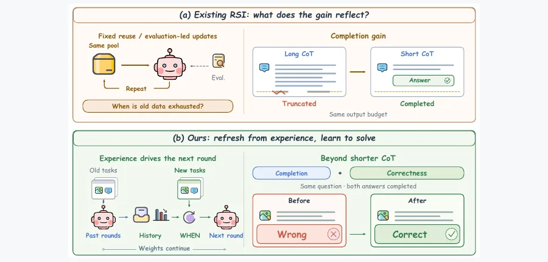 arXiv 2026-10-30 · cs.AI · #22 **[A-RSI: Adaptive Task Refresh for Zero-Data Multimodal Self-Improvement](https://arxiv.org/abs/2610.38568)** Yu Liu , Youxing Li , Yuedong Tan , Zhiwei Yang , Zihan Su , Hanqi Feng , Shaojie Zhang , Libin Liao , Zihao Wan , Chenxu… Affiliation: Institute of Information Engineering, CAS / Chinese University of Hong Kong / University of Wurzburg / Xiaomi / Harvard University / Carnegie Mellon University / Max Planck Institute for Intelligent Systems / University of Trento / Xi'an Jiaotong University [Paper](https://arxiv.org/abs/2610.38568) · [Figure source](https://arxiv.org/pdf/2610.38568#page=1) 

[EN] Abstract
Recursive self-improvement requires models not only to acquire useful training experience, but also to decide when their current experience has ceased to be useful. Existing methods often focus on what experience to generate next, while paying less attention to when fresh experience should be introduced. Many also construct training targets through self-consistency or majority voting, making supervision depend on the model's own uncertain predictions. We address these two questions separately: training dynamics determine when to acquire new experience, while the answers to new tasks remain independently checkable. A-RSI monitors reward variation and accuracy in training logs to refresh a task pool when its learning signal declines, without consulting validation or test scores. A static library of model-authored programs produces multimodal questions and derives their reference answers; we specify the task-generation contract, automatically verify chosen properties of the reward and refresh rules, and separately audit the generated answers. The training loop uses no external training examples or human-written answer labels. On the primary eleven-benchmark suite, A-RSI raises the performance average from 57.77 to 61.05 with 800 fresh tasks. <a href="https://arxiv.org/list/cs/new?skip=0&amp;show=2000&amp;check=20261031#2610.38568">Source</a>

[ZH] Abstract
递归自我改进不仅要求模型获取有用的训练经验，也要求决定当前经验何时已不再有用。已有方法通常关注接下来生成什么经验，却较少关注何时引入新经验。许多方法还通过自一致性或多数投票构建训练目标，使监督依赖模型自身不确定的预测。我们分别处理这两个问题：由训练动态决定何时获取新经验，而新任务的答案保持可独立检查。A-RSI 监测训练日志中的奖励变化和准确率，在学习信号减弱时刷新任务池，不查阅验证或测试分数。由模型编写程序组成的静态库生成多模态问题并推导参考答案；我们明确任务生成契约，自动验证奖励与刷新规则的选定性质，并单独审计生成答案。训练循环不使用外部训练样本或人工编写的答案标签。在主要的十一个基准套件上，A-RSI 用 800 个新任务将性能平均值从 57.77 提高到 61.05。 <a href="https://arxiv.org/list/cs/new?skip=0&amp;show=2000&amp;check=20261031#2610.38568">Source</a>
 | 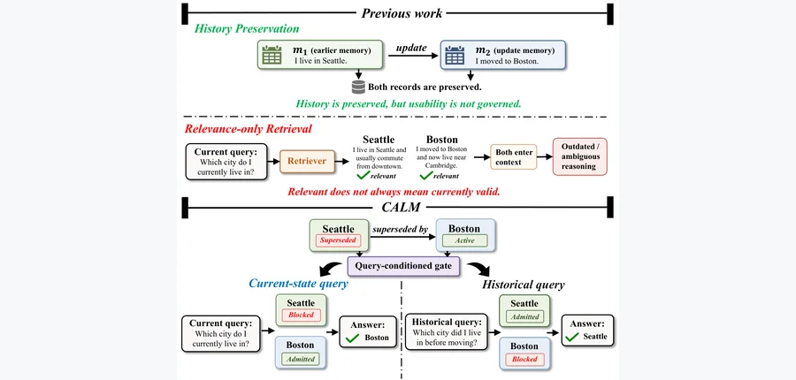 arXiv 2026-10-30 · cs.AI · #23 **[CALM: Conflict-Aware Lifecycle Memory Governance for Long-Horizon Language Agents](https://arxiv.org/abs/2610.38573)** Chang Li , Xianhao Ou , Xinyan Ma , Hao Li , Haoyuan Xu , Jiafeng Liang , Xiaohan Wang , Jiajun Chai , Guojun Yin , Ming Liu Affiliation: Harbin Institute of Technology / Meituan [Paper](https://arxiv.org/abs/2610.38573) · [Figure source](https://arxiv.org/html/2610.38573v1/Teaser.png) 

[EN] Abstract
A memory can be outdated for present-day reasoning yet indispensable for reconstructing the past. Relevance-based retrieval overlooks this tension: semantic relevance, evidence-grounded validity, and query-specific eligibility are distinct. We propose CALM, a conflict-aware lifecycle memory governance framework that decouples persistent memory preservation from query-time admission. CALM converts heterogeneous records into evidence-grounded memory cells, updates validity and lifecycle states using support, conflict, and dependency signals, and admits query-appropriate evidence through training-free or learned gating informed by temporal applicability. Across LongMemEval-S and LoCoMo with Qwen and GPT backbones, CALM outperforms state-of-the-art baselines, achieving the best overall accuracy. Compared with simple filtering and reranking, query-conditioned admission further improves evidence selection. Conflict-blocking and robustness analyses show CALM suppresses erroneous retrieved memories while retaining useful evidence. Historical-reconstruction experiments demonstrate that preserving superseded records supports accurate earlier-state reasoning without compromising current-state answers. <a href="https://arxiv.org/list/cs/new?skip=0&amp;show=2000&amp;check=20261031#2610.38573">Source</a>

[ZH] Abstract
一段记忆可能对当前推理已经过时，却对重建过去不可或缺。基于相关性的检索忽视了这一张力：语义相关性、有证据支撑的有效性和特定查询下的适用资格是不同概念。我们提出 CALM，一个具备冲突感知的生命周期记忆治理框架，将持久记忆保存与查询时准入解耦。CALM 把异构记录转化为以证据为基础的记忆单元，根据支持、冲突和依赖信号更新有效性与生命周期状态，并通过由时间适用性指导的免训练或学习式门控，接纳适合查询的证据。在 LongMemEval-S 和 LoCoMo 上，使用 Qwen 和 GPT 骨干时，CALM 超过最先进基线，取得最佳总体准确率。相较简单过滤与重排序，查询条件化准入进一步改善证据选择。冲突阻断与鲁棒性分析表明，CALM 能抑制错误检索记忆，同时保留有用证据。历史重建实验显示，保存已被取代的记录支持准确推断早期状态，而不会损害当前状态答案。 <a href="https://arxiv.org/list/cs/new?skip=0&amp;show=2000&amp;check=20261031#2610.38573">Source</a>
 | 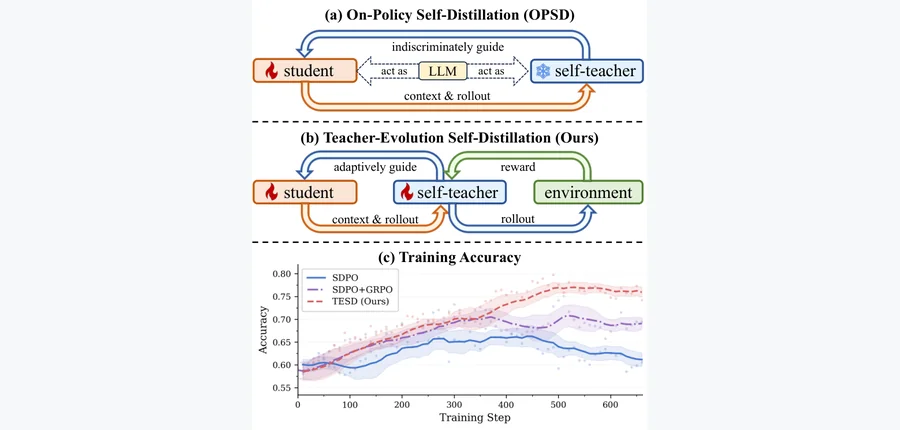 arXiv 2026-10-30 · cs.LG · #24 **[On-Policy Self-Distillation with Teacher Evolution](https://arxiv.org/abs/2610.38637)** Shufan Shen , Zhongni Hou , Chao Bi , Yufei Zhang , Guojun Yin , Shuhui Wang Affiliation: Institute of Computing Technology, CAS / University of Chinese Academy of Sciences / Meituan [Paper](https://arxiv.org/abs/2610.38637) · [Figure source](https://arxiv.org/html/2610.38637v1/intro.png) 

[EN] Abstract
On-Policy Self-Distillation (OPSD), which aligns a student model's token-level distribution with that of its self-teacher prompted by privileged context, has emerged as a promising direction to mitigate reward sparsity in sequence-level post-training paradigms. However, OPSD often fails to achieve continuous performance gains during training. In this paper, we find that the model's limited self-teaching capability underlies this phenomenon by generating unreliable guidance on certain samples. To address this problem, we propose Teacher-Evolution Self-Distillation (TESD), which enables the self-teacher to generate rollouts and receive environmental feedback based on task correctness and context independence. First, using these rewards as training objectives, we perform teacher-oriented optimization to continuously enhance the model's self-teaching capability during distillation. Second, by estimating teacher guidance reliability from these rewards, we apply adaptive student-oriented optimization to down-weight samples with unreliable guidance. Extensive experiments across multiple datasets and model scales show that TESD consistently outperforms representative token-level and sequence-level methods, highlighting the necessity of improving supervision quality in OPSD. <a href="https://arxiv.org/list/cs/new?skip=0&amp;show=2000&amp;check=20261031#2610.38637">Source</a>

[ZH] Abstract
同策略自蒸馏通过将学生模型的词元级分布与获得特权上下文提示的自教师分布对齐，已成为缓解序列级后训练中奖励稀疏性的一条有前景方向。然而，同策略自蒸馏往往无法在训练期间持续取得性能增益。本文发现，模型有限的自教学能力是这一现象的原因，因为它会在某些样本上产生不可靠指导。为此，我们提出教师演化自蒸馏 TESD，使自教师能够生成轨迹，并根据任务正确性与上下文独立性获得环境反馈。首先，以这些奖励为训练目标，进行面向教师的优化，在蒸馏过程中持续增强模型自教学能力。其次，根据这些奖励估计教师指导可靠性，并采用面向学生的自适应优化，降低指导不可靠样本的权重。在多个数据集和模型规模上的大量实验显示，TESD 持续超过具有代表性的词元级与序列级方法，凸显在同策略自蒸馏中改善监督质量的必要性。 <a href="https://arxiv.org/list/cs/new?skip=0&amp;show=2000&amp;check=20261031#2610.38637">Source</a>
 |
| 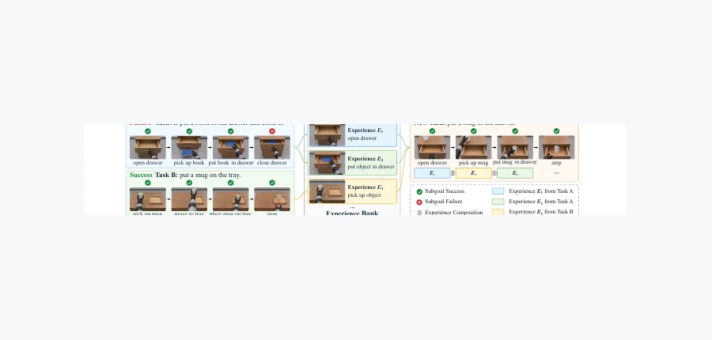 arXiv 2026-10-30 · cs.RO · #25 **[EmbodiExp: Compositional Experience Transfer for Embodied Agents](https://arxiv.org/abs/2610.39180)** Zhifeng Gu , Ying Chen , Rui Jiang , Lei Yi , Bing Wang Affiliation: Hong Kong Polytechnic University / XPENG Robotics [Paper](https://arxiv.org/abs/2610.39180) · [Figure source](https://arxiv.org/pdf/2610.39180#page=2) 

[EN] Abstract
Experience can help embodied agents turn high-level plans into grounded actions, but transferring it across tasks remains challenging: previously effective strategies may be inapplicable to the current state or fail to produce their intended outcomes. We present EmbodiExp, a framework for constructing transferable experiences and composing them online during embodied task execution. Our key observation is that tasks often share subgoals whose completion can be assessed independently of overall task success. We therefore introduce an outcome-grounded subgoal experience that specifies a subgoal, applicability conditions, an adaptable policy, and a verifiable outcome. During execution, applicable experiences guide action generation, while verified outcomes can establish the conditions required by subsequent experiences, enabling online composition. Subgoal-level outcome attribution further enables failure utilization: failed trajectories can still contribute verified local successes and condition-specific guidance on actions to avoid. Experiments on multiple embodied benchmarks under a fold-based protocol with frozen experience banks demonstrate the effectiveness of EmbodiExp. <a href="https://arxiv.org/list/cs/new?skip=0&amp;show=2000&amp;check=20261031#2610.39180">Source</a>

[ZH] Abstract
经验可以帮助具身智能体把高层计划转化为落地动作，但跨任务迁移仍具有挑战：过去有效的策略可能不适用于当前状态，或无法产生预期结果。我们提出 EmbodiExp，一个构建可迁移经验、并在具身任务执行中在线组合这些经验的框架。我们的关键观察是，任务通常共享一些子目标，而其完成情况可独立于总体任务成功来评估。因此，我们引入以结果为基础的子目标经验，明确子目标、适用条件、可适应策略和可验证结果。执行时，适用经验指导动作生成，而经过验证的结果可以建立后续经验所需的条件，从而实现在线组合。子目标级结果归因进一步支持利用失败：失败轨迹仍可贡献经过验证的局部成功，以及针对特定条件、说明哪些动作应避免的指导。在多个具身基准上，使用基于折叠划分且经验库冻结的协议开展实验，验证了 EmbodiExp 的有效性。 <a href="https://arxiv.org/list/cs/new?skip=0&amp;show=2000&amp;check=20261031#2610.39180">Source</a>
 | 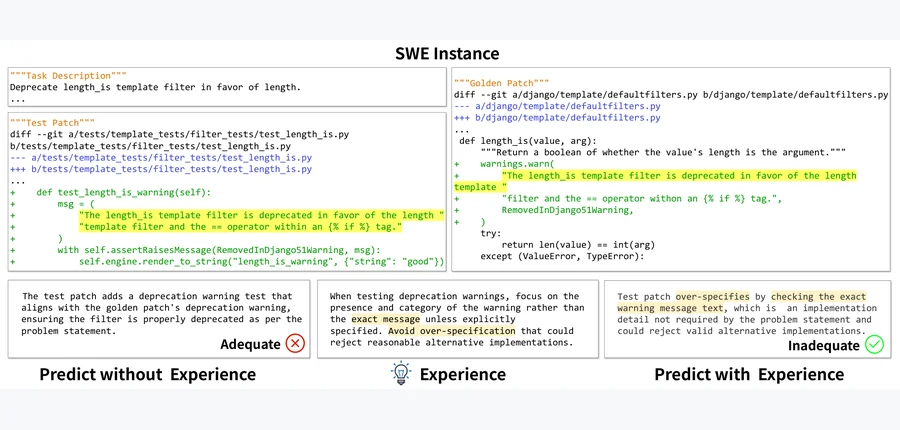 arXiv 2026-10-30 · cs.SE · #26 **[Well-Specified and Well-Tested? Assessing SWE-bench-Style Datasets with a Self-Evolving Agent](https://arxiv.org/abs/2610.39417)** Zhonghao Jiang , Xuyang Zheng , Yanfu Yan , Zhongxin Liu , Lingfeng Bao , Shuiguang Deng Affiliation: Zhejiang University / Hangzhou High-Tech Zone (Binjiang) Institute of Blockchain and Data Security [Paper](https://arxiv.org/abs/2610.39417) · [Figure source](https://arxiv.org/html/2610.39417v1/motivation.png) 

[EN] Abstract
Large language models (LLMs) have shown strong performance on software engineering (SE) tasks, driving the need for high-quality datasets for reliable training and evaluation. SWE-bench-style datasets (SWE datasets) are widely used to evaluate LLM-based coding agents on real-world software issues, where task clarity and test coverage directly affect whether instances are solvable and verifiable. However, quality issues persist in existing SWE datasets, and manual annotation is costly and labor-intensive, motivating LLM-based annotation. Existing approaches typically rely on static, overly general rubrics, limiting their ability to handle diverse and nuanced scenarios and often yielding high false positive rates. In contrast, human annotators draw on accumulated experience to make context-aware judgments. Inspired by this, we propose ExLabel, an LLM-based, self-evolving, experience-guided assistant for task clarity and test coverage assessment in SWE datasets. ExLabel maintains an evolving experience bank that distills cross-instance knowledge into stable yet adaptive judgment criteria and reuses relevant experience to guide the assessment of new instances. For systematic evaluation, we construct SWE-TQ, a new benchmark spanning eight programming languages, by cleaning human annotations from SWE-bench and Multi-SWE-bench. Experiments with three backbone LLMs show that ExLabel achieves the best F1 across all settings, with relative improvements of 44.2%/49.9% and 24.0%/18.4% over the best baseline for task clarity and test coverage assessment on the Python/Multilingual subsets, respectively. Moreover, a coding model fine-tuned on SWE-rebench data filtered by ExLabel resolves 66.2% of issues on SWE-bench Verified, outperforming the model trained on data filtered by the best baseline by 14.5%. <a href="https://arxiv.org/list/cs/new?skip=0&amp;show=2000&amp;check=20261031#2610.39417">Source</a>

[ZH] Abstract
大语言模型在软件工程任务上表现突出，推动了对可靠训练与评测所需高质量数据集的需求。SWE-bench 风格数据集广泛用于在真实软件问题上评估基于 LLM 的编程智能体，其中任务清晰度和测试覆盖率直接影响实例是否可求解、可验证。然而，已有数据集仍存在质量问题，而人工标注成本高、劳动密集，因此需要基于 LLM 的标注。现有方法通常依赖静态、过于通用的评分细则，难以处理多样且细微的情境，往往导致较高假阳性率。相比之下，人工标注者会借助累积经验作出上下文感知判断。受此启发，我们提出 ExLabel，一个基于 LLM、自进化且由经验指导的助手，用于评估 SWE 数据集的任务清晰度和测试覆盖率。ExLabel 维护不断演化的经验库，将跨实例知识蒸馏为稳定且可适应的判断标准，并复用相关经验指导新实例评估。为系统评测，我们清理 SWE-bench 和 Multi-SWE-bench 的人工标注，构建覆盖八种编程语言的新基准 SWE-TQ。三个骨干 LLM 上的实验显示，ExLabel 在所有设置中获得最佳 F1：在 Python/多语言子集上，相对最佳基线，任务清晰度评估分别改善 44.2%/49.9%，测试覆盖率评估分别改善 24.0%/18.4%。此外，在 ExLabel 过滤的 SWE-rebench 数据上微调的编程模型，在 SWE-bench Verified 上解决 66.2% 的问题，相对使用最佳基线过滤数据训练的模型提高 14.5%。 <a href="https://arxiv.org/list/cs/new?skip=0&amp;show=2000&amp;check=20261031#2610.39417">Source</a>
 | 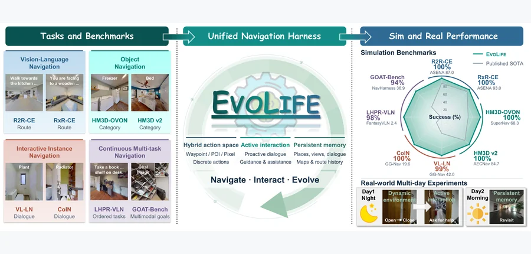 arXiv 2026-10-30 · cs.RO · #27 **[Ask to Evolve: A Unified Harness for Lifelong Embodied Navigation with Hybrid Action Space and Persistent Memory](https://arxiv.org/abs/2610.39446)** Kai Sheng , Liuyi Wang , Jinlong Li , Haojie Dai , Chengju Liu , Qijun Chen Affiliation: Tongji University [Paper](https://arxiv.org/abs/2610.39446) · [Project](https://kai-sheng-caesar.github.io/EvoLife-Web/) · [Figure source](https://arxiv.org/html/2610.39446v1/fig00_performance.png) 

[EN] Abstract
Giving embodied agents the freedom to act autonomously, initiate interactions, and understand their surroundings through experience is a step toward bringing them to life in the physical world. Realizing this vision requires action, interaction, and memory to work together, so that each encounter can inform current decisions and contribute experience for future tasks. We present EvoLife, a unified navigation harness that enables a multimodal embodied agent to choose how to move, when to ask, and what experience to carry forward. Its hybrid action space supports waypoint navigation, local discrete adjustments, pixel-based navigation, and object-directed navigation. Active interaction allows the agent to seek clarification or assistance when it encounters ambiguity or difficulty, while persistent spatial memory binds observations and dialogue to places, retaining useful experience to guide subsequent visits. We evaluate eight benchmarks across four task families: vision-language navigation, object navigation, interactive instance navigation, and continuous multi-task navigation. With an average of only 1.87 active interactions per episode, our method achieves a first-visit success rate (SR) of 100% across four 100-episode sets spanning vision-language navigation and object navigation. Complete-sequence SR reaches 98% on 50 LHPR-VLN sequences and 94% on 50 GOAT-Bench sequences. In the R2R revisit setting, success weighted by path length (SPL) increases from 82.23% to 93.31% with retained experience. Multi-day physical navigation further demonstrates exploration, proactive help-seeking, and revisiting remembered places. Together, these results advance the vision of bringing embodied agents to life through autonomous action, proactive interaction, and the accumulation and reuse of experience. <a href="https://arxiv.org/list/cs/new?skip=0&amp;show=2000&amp;check=20261031#2610.39446">Source</a>

[ZH] Abstract
让具身智能体能够自主行动、主动发起交互，并通过经验理解环境，是使其在物理世界中具有活力的一步。实现这一愿景，需要行动、交互与记忆共同工作，使每次相遇既能帮助当前决策，也能为未来任务贡献经验。我们提出 EvoLife，一个统一导航 harness，使多模态具身智能体能够选择如何移动、何时提问，以及将哪些经验带入未来。其混合动作空间支持航点导航、局部离散调整、基于像素的导航和面向物体的导航。主动交互使智能体在遇到歧义或困难时寻求澄清或帮助，持久空间记忆则将观察与对话绑定到地点，保留有用经验以指导后续访问。我们在四类任务的八个基准上评估：视觉语言导航、物体导航、交互式实例导航和连续多任务导航。每回合平均仅需 1.87 次主动交互，方法在覆盖视觉语言导航与物体导航的四组各 100 回合测试中，首次访问成功率达到 100%。在 50 条 LHPR-VLN 序列上，完整序列成功率达到 98%；在 50 条 GOAT-Bench 序列上达到 94%。在 R2R 重访设置中，保留经验使路径长度加权成功率从 82.23% 提高到 93.31%。多日实体导航进一步展示了探索、主动求助和重访记忆地点。总体而言，这些结果通过自主行动、主动交互以及经验累积复用，推进了让具身智能体具有活力的愿景。 <a href="https://arxiv.org/list/cs/new?skip=0&amp;show=2000&amp;check=20261031#2610.39446">Source</a>
 |
| 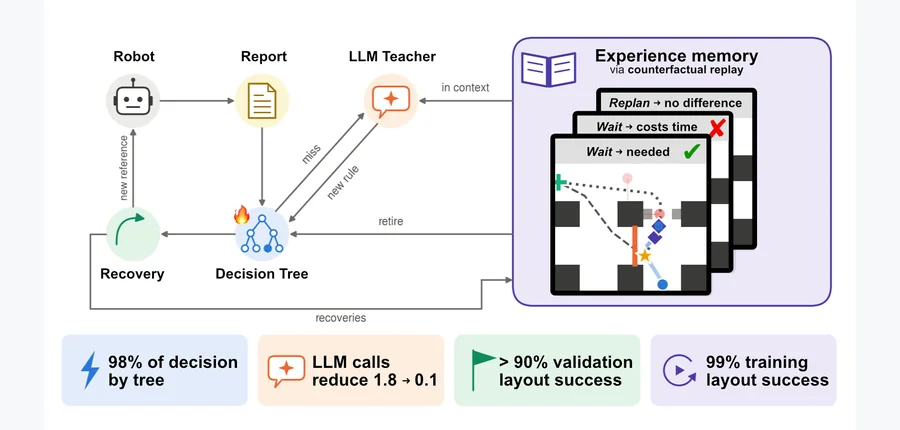 arXiv 2026-10-30 · cs.RO · #28 **[Teaching a Tree to Recover: Online Distillation of an LLM Supervisor with Counterfactual Replay](https://arxiv.org/abs/2610.39775)** Kristian Ceder , Kilian Freitag , Knut Åkesson Affiliation: Chalmers University of Technology [Paper](https://arxiv.org/abs/2610.39775) · [Figure source](https://arxiv.org/html/2610.39775v1/figures/graphical_abstract_v3_stack.png) 

[EN] Abstract
Autonomous mobile robots commonly pair a global planner with a local model predictive controller (MPC), but nonconvex obstacle avoidance and a limited horizon can make the robot freeze in complex layouts. Deciding whether to replan, wait, or call for help is a supervisory decision. Recent work queries a large language model (LLM) supervisor on every anomaly, which is slow and costly. We instead distill the LLM online into a decision tree. After each training episode, counterfactual replay labels recoveries as needed, unnecessary, or harmful. These labels retire unhelpful rules. In simulation, on 20 unseen layouts where the MPC alone freezes, the tree handles at least 18 correctly across all seeds, either by reaching the goal or by calling for help when no feasible path exists. The tree matches both an always-query LLM supervisor and expert-designed rules, while issuing no LLM queries at test time. Handwritten rules cannot anticipate the long tail of situations a physical robot will encounter. Online distillation is a promising remedy: the tree handles familiar cases, and the LLM is consulted only for new ones, whose validated recoveries become new rules. Language models can thus also serve as designers of supervisors rather than only as runtime supervisors. <a href="https://arxiv.org/list/cs/new?skip=0&amp;show=2000&amp;check=20261031#2610.39775">Source</a>

[ZH] Abstract
自主移动机器人通常将全局规划器与局部模型预测控制器结合，但非凸避障和有限时域可能使机器人在复杂布局中停滞。决定重新规划、等待还是求助，是一项监督层决策。近期工作在每次异常时查询大语言模型监督器，既慢又昂贵。我们改为在线将 LLM 蒸馏成决策树。每个训练回合之后，反事实重放将恢复标记为必要、不必要或有害，并用这些标签淘汰无益规则。在仿真中，面对 20 个仅用 MPC 会停滞的未见布局，决策树在所有种子下至少能正确处理 18 个：有可行路径时到达目标，无可行路径时求助。决策树与始终查询的 LLM 监督器及专家设计规则表现相当，而测试时不发起任何 LLM 查询。手写规则无法预见实体机器人将遇到的长尾情境。在线蒸馏是一种有前景的补救：树处理熟悉案例，只在新案例上咨询 LLM，并将经过验证的恢复转为新规则。因此，语言模型也可以充当监督器的设计者，而非仅充当运行时监督器。 <a href="https://arxiv.org/list/cs/new?skip=0&amp;show=2000&amp;check=20261031#2610.39775">Source</a>
 | 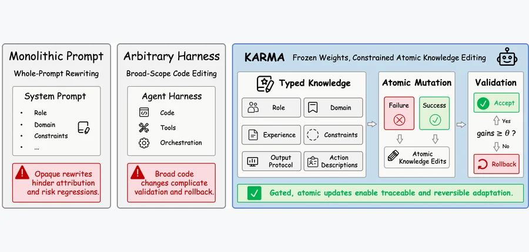 arXiv 2026-10-30 · cs.AI · #29 **[KARMA: Training-Free Knowledge-Atomic Harness Evolution for Industrial Advertising Agents](https://arxiv.org/abs/2610.39884)** Xinhua Miao , Yuanzhen Rong , Weiru Zhang , Xiaoyi Zeng Affiliation: Alibaba International Digital Commerce Group [Paper](https://arxiv.org/abs/2610.39884) · [Figure source](https://arxiv.org/html/2610.39884v1/figures/Motivation-New.png) 

[EN] Abstract
Industrial advertising agents must continually adapt their decision knowledge to changing product offerings, traffic patterns, and operating policies. We present KARMA (Knowledge-Atomic, Regression-Gated Modular Adaptation), a training-free framework that evolves six typed knowledge modules while keeping model weights and executable harness code frozen. During our evolution, a deterministic Trace Verifier maps observed errors to candidate modules, and a Critic compares successful and failed trajectories to guide a tool-constrained Evolver. The Evolver applies atomic knowledge edits, which a fixed validation gate retains only when their measured gain reaches a threshold; otherwise, the previous knowledge state is restored. We evaluate KARMA with three LLM families on cases sampled from a corpus of approximately half a million real-world operation logs across six e-commerce domains. Across 18 domain--model settings, KARMA raises the average hold-out score from 30.19 to 39.15 (+8.96 points, +29.7%). Ablations show that removing either successful or failed trajectories more than halves the average hold-out gain. Evolved knowledge also transfers across domains without further adaptation, yielding an average hold-out gain of 8.54 points across all source--target pairs. By linking retained patches to their diagnostic evidence and validation outcomes, KARMA supports inspectable, reversible knowledge adaptation for agents in Web marketplaces. <a href="https://arxiv.org/list/cs/new?skip=0&amp;show=2000&amp;check=20261031#2610.39884">Source</a>

[ZH] Abstract
工业广告智能体必须不断调整决策知识，以适应产品供给、流量模式与运营政策变化。我们提出 KARMA，即知识原子化、回归门控的模块适应框架；它无需训练，在保持模型权重和可执行 harness 代码冻结的同时，演化六种带类型的知识模块。在演化过程中，确定性的 Trace Verifier 将已观察错误映射到候选模块，Critic 比较成功与失败轨迹，为受工具约束的 Evolver 提供指导。Evolver 应用原子知识修改，固定验证门只在测量增益达到阈值时保留修改，否则恢复此前知识状态。我们在三个 LLM 系列上评估 KARMA，案例采样自覆盖六个电商领域、约五十万条真实操作日志的语料。在 18 个领域—模型设置中，KARMA 将平均留出分数从 30.19 提高到 39.15，增加 8.96 分，即 29.7%。消融表明，移除成功轨迹或失败轨迹，都会使平均留出增益减少一半以上。演化后的知识无需进一步适应也能跨领域迁移，在全部来源—目标组合上取得平均 8.54 分留出增益。通过将保留补丁与其诊断证据、验证结果关联，KARMA 支持网络市场智能体可检查、可逆的知识适应。 <a href="https://arxiv.org/list/cs/new?skip=0&amp;show=2000&amp;check=20261031#2610.39884">Source</a>
 | 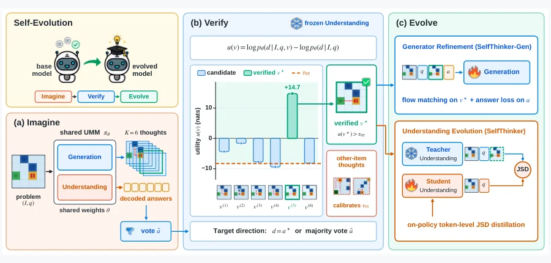 arXiv 2026-10-30 · cs.CV · #30 **[SelfThinker: Self-Evolving Reasoning via Reliability-Verified Intrinsic Visual Thoughts](https://arxiv.org/abs/2610.40115)** Zhangquan Chen , Ruqi Huang Affiliation: Tsinghua University [Paper](https://arxiv.org/abs/2610.40115) · [Figure source](https://arxiv.org/html/2610.40115v1/Fig1.png) 

[EN] Abstract
Unified multimodal models can both generate and understand images within a single set of weights, offering an opportunity to use image synthesis as training supervision for visual comprehension. However, existing visual chain-of-thought methods rely on human-annotated helper images during training and require slow image generation at test time. We present SelfThinker, the first self-evolving framework that turns a unified model's self-generated visual thoughts into stronger understanding without human image annotations. Given a visual problem, SelfThinker samples candidate helper images from its generation pathway and uses its frozen understanding pathway to score each candidate via conditional pointwise mutual information. High-utility visual thoughts then refine the generator via flow matching and serve as privileged teacher context for on-policy self-distillation. At inference, SelfThinker reasons directly from the original image in text without generating intermediate images. Although trained only on small synthetic visual-search and navigation datasets, SelfThinker transfers broadly to natural-image and spatial benchmarks, raising the seven-benchmark average of ThinkMorph-7B from 52.7 to 64.0 (+11.3 points). Controlled image-perturbation probes further show that SelfThinker surpasses ThinkMorph-7B by up to 40.4 points and its pretrained BAGEL-7B backbone by up to 23.2 points across fine-grained and spatial perception tasks. Our code is available at this https URL . <a href="https://arxiv.org/list/cs/new?skip=0&amp;show=2000&amp;check=20261031#2610.40115">Source</a>

[ZH] Abstract
统一多模态模型可以在同一组权重中同时生成和理解图像，为利用图像合成作为视觉理解训练监督提供了机会。然而，现有视觉思维链方法在训练期间依赖人工标注的辅助图像，并在测试时需要缓慢的图像生成。我们提出 SelfThinker，首个将统一模型自生成的视觉思维转化为更强理解能力、且无需人工图像标注的自进化框架。对于一个视觉问题，SelfThinker 从生成路径采样候选辅助图像，并使用冻结的理解路径，通过条件逐点互信息对每个候选评分。高效用视觉思维随后通过流匹配完善生成器，并作为同策略自蒸馏中的特权教师上下文。推理时，SelfThinker 直接从原始图像出发以文本推理，不生成中间图像。虽然只在小型合成视觉搜索与导航数据集上训练，SelfThinker 仍能广泛迁移到自然图像与空间基准，将 ThinkMorph-7B 的七基准平均分从 52.7 提高到 64.0，增加 11.3 分。受控图像扰动探测进一步显示，在细粒度与空间感知任务上，SelfThinker 比 ThinkMorph-7B 最高提高 40.4 分，比其预训练 BAGEL-7B 骨干最高提高 23.2 分。代码见原文所链接的 HTTPS 地址。 <a href="https://arxiv.org/list/cs/new?skip=0&amp;show=2000&amp;check=20261031#2610.40115">Source</a>
 |
| 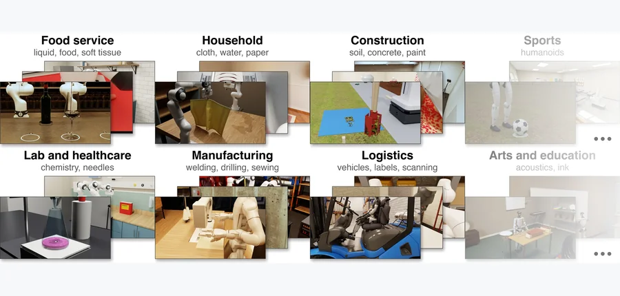 arXiv 2026-10-30 · cs.RO · #31 **[Gym-Anything for Robotics: Scaling physical simulations with digital agents](https://arxiv.org/abs/2610.40565)** Pranjal Aggarwal , Sean Welleck Affiliation: Carnegie Mellon University [Paper](https://arxiv.org/abs/2610.40565) · [Figure source](https://arxiv.org/html/2610.40565v1/figures/teaser_sewing.jpg) 

[EN] Abstract
Realistic, fast robotics simulations could enable large-scale training of embodied AI models that transfer to the real world. However, despite decades of progress, available simulations cover only a narrow range of real-world tasks and physical phenomena. The core bottleneck is that creating better simulations requires significant expert effort and therefore does not scale. To address this, we introduce Gym-Anything for Robotics, a framework in which coding agents create realistic robotics simulations. Our core insight is that simulation creation is a coding agent task, so improvements in coding agents translate directly into richer and more faithful simulations. We select simulations based on U.S. GDP data to cover economically valuable physical work, define what makes a good simulation and a good task, and develop an adversarial creation-audit loop that checks each simulation and task against these definitions. Using this pipeline, we build RoboWorld, a set of 25 simulations with 25 test and 175 training RL environments of varying difficulty. Even the best frontier models fail on every RoboWorld test task, achieving an average reward of only 0.06. Building on RoboWorld, we introduce several new ways for frontier models to improve, including in-context learning across repeated attempts, a privileged teacher that reads the simulator state and teaches a student in context, self-assisted learning from the model's own privileged experience, and code policies that generate demonstrations across varied scenes to train vision-language-action models (VLAs) such as $\pi_{0.5}$. Each of these substantially improves performance. We release our pipeline, RL environments, and benchmark to facilitate future research. Code and data are available at this https URL <a href="https://arxiv.org/list/cs/new?skip=0&amp;show=2000&amp;check=20261031#2610.40565">Source</a>

[ZH] Abstract
真实且快速的机器人仿真能够支持大规模训练可迁移到现实世界的具身 AI 模型。然而，尽管经历数十年进展，可用仿真仍只覆盖现实任务和物理现象的一小部分。核心瓶颈是，创造更好的仿真需要大量专家劳动，因此难以扩展。为此，我们提出 Gym-Anything for Robotics，一个由编程智能体创建真实机器人仿真的框架。核心认识是，仿真创建本身是一项编程智能体任务，因此编程智能体的进步可以直接转化为更丰富、更忠实的仿真。我们依据美国 GDP 数据选择仿真，以覆盖具有经济价值的物理工作，定义什么是好的仿真与任务，并开发对抗式创建—审计循环，依据这些定义检查每个仿真和任务。借助该流水线，我们构建 RoboWorld，包含 25 个仿真，以及 25 个测试和 175 个不同难度的训练强化学习环境。即使最强前沿模型也无法完成任何 RoboWorld 测试任务，平均奖励仅为 0.06。在 RoboWorld 基础上，我们提出多种改善前沿模型的方法，包括跨重复尝试的上下文学习、读取仿真器状态并在上下文中教导学生的特权教师、利用模型自身特权经验的自辅助学习，以及在不同场景生成演示以训练 π₀.₅ 等视觉语言动作模型的代码策略。这些方法均显著改善性能。我们发布流水线、强化学习环境和基准，以促进后续研究。代码和数据见原文所链接的 HTTPS 地址。 <a href="https://arxiv.org/list/cs/new?skip=0&amp;show=2000&amp;check=20261031#2610.40565">Source</a>
 | 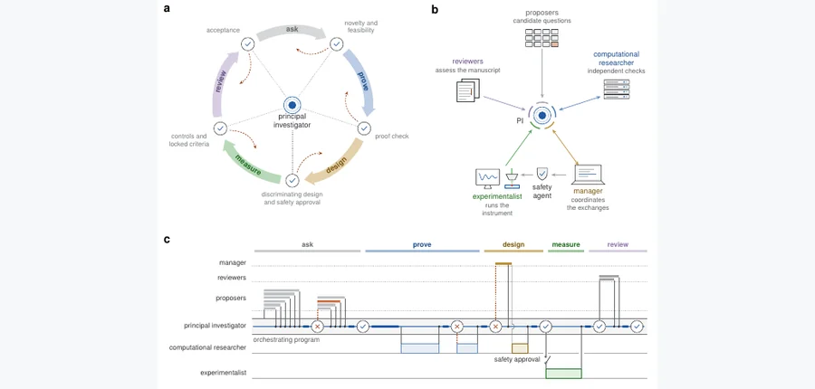 arXiv 2026-10-30 · cs.AI · #32 **[Collaborative AI agents for autonomous experimental research with solid-state quantum spins](https://arxiv.org/abs/2610.40589)** El Mustapha Mansouri , Eikichi Kimura , Masato Koga , Keigo Arai Affiliation: Institute of Science Tokyo [Paper](https://arxiv.org/abs/2610.40589) · [Figure source](https://arxiv.org/pdf/2610.40589#page=3) 

[EN] Abstract
An autonomous research laboratory could conduct an entire study, from formulating questions to preparing manuscripts. Artificial intelligence (AI) offers one route towards this goal. Recent AI systems take on several research roles, but may draw conclusions that the evidence does not support. Here, we present an autonomous research laboratory in which agents based on large language models assess one another's work and can stop or redirect investigations. They can generate and reject research questions, require separate theoretical checks and conduct experiments designed to challenge their claims. We demonstrate these capabilities by investigating ensembles of quantum spins in diamond. The agents derived the minimum number of calibration settings needed to predict responses to a defined family of microwave pulse sequences. They checked the result computationally and designed experiments to distinguish competing predictions. An initial experiment agreed with the theoretical predictions, but repeated reference measurements showed that the signal was drifting during data collection. The agents therefore treated the result as inconclusive and revised the measurement protocol without relaxing the acceptance criteria. The revised experiment met those criteria and supported the theoretical predictions. This study demonstrates that collaborating AI agents can select research questions, derive theoretical results and test their predictions experimentally. <a href="https://arxiv.org/list/cs/new?skip=0&amp;show=2000&amp;check=20261031#2610.40589">Source</a>

[ZH] Abstract
自主研究实验室可以执行从提出问题到准备论文的完整研究。人工智能为这一目标提供了一条路径。近期 AI 系统能承担多种研究角色，但可能得出证据不支持的结论。本文介绍一个自主研究实验室，其中基于大语言模型的智能体评估彼此的工作，并能够停止调查或改变其方向。它们能够生成和否决研究问题，要求单独的理论检查，并开展旨在挑战自身主张的实验。我们通过研究金刚石中的量子自旋系综展示这些能力。智能体推导出预测一类明确微波脉冲序列响应所需的最少校准设置数，在计算上检查该结果，并设计区分竞争预测的实验。初始实验与理论预测一致，但反复参考测量表明，信号在数据采集期间发生漂移。因此，智能体将该结果视为不确定，并在不放宽验收标准的情况下修订测量协议。修订后的实验满足标准，支持理论预测。本研究展示了协作 AI 智能体能够选择研究问题、推导理论结果并通过实验检验其预测。 <a href="https://arxiv.org/list/cs/new?skip=0&amp;show=2000&amp;check=20261031#2610.40589">Source</a>
 | 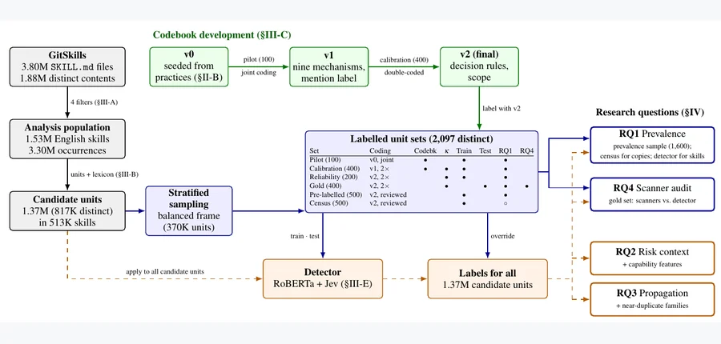 arXiv 2026-10-30 · cs.CR · #33 **[When Skills Tell Agents Not to Ask: A Large-Scale Study of Oversight Directives in Agent Skills](https://arxiv.org/abs/2610.37734)** Timofey Sanko , Yuan Tian Affiliation: Queen's University, Canada [Paper](https://arxiv.org/abs/2610.37734) · [Figure source](https://arxiv.org/html/2610.37734v1/workflow.png) 

[EN] Abstract
Agent skills, reusable instruction packages centred on a this http URL file, extend AI agents on demand, and a single line in a widely copied skill reaches every agent that loads it. Some lines are oversight-loosening directives: they tell the agent to proceed without approval, to bypass checks with --no-verify, or to keep working without checking in. Although such directives can remove a checkpoint from every agent that loads them, no prior work has examined them. We present the first large-scale study of oversight-loosening directives, analyzing 1.53 million English skills from GitSkills. We split skills into units (sentences, bullets, table cells, and code lines), develop a codebook that labels oversight directives by polarity, mechanism, and scope, label 2,097 units by hand, and train a detector to scale the analysis. Our results show that about one in seventeen skills (about 88,000 skills) contains a loosening directive. These directives most often loosen oversight through permission flags, and most of them (70.1%) apply unconditionally rather than only in specific contexts such as CI. Compared with skills that have the same amount of oversight language, skills that run shell code, install packages, or use sudo have 1.7-1.8 times the odds of containing a loosening directive, an association that holds across all our robustness checks, and they do not compensate with more tightening. Loosening spreads through a few upstream skills rather than through edits by their adopters: 2.4% of the skill families that carry loosening account for half of all copies of loosening-carrying skills, and 1.1% of distinct loosening units for half of all loosening occurrences. Open-source skill scanners catch at most 46% of loosening directives, with a precision below 0.4, while the LLM behind them, prompted with our codebook instead, catches 61% at a precision of 0.71. <a href="https://arxiv.org/list/cs/new?skip=0&amp;show=2000&amp;check=20261031#2610.37734">Source</a>

[ZH] Abstract
智能体技能是以原文链接的 HTTP 文件为中心、可按需扩展 AI 智能体的可复用指令包；一个广泛复制的技能中的单行内容，就能影响所有加载它的智能体。有些行是放松监督的指令：要求智能体无需批准继续执行、用 --no-verify 绕过检查，或持续工作而不再确认。尽管这些指令可能从每个加载它们的智能体中移除一个检查点，此前尚无研究考察。我们首次大规模研究这类放松监督指令，分析来自 GitSkills 的 153 万个英文技能。我们将技能分成句子、项目符号、表格单元格和代码行等单元，开发按极性、机制与作用范围标注监督指令的编码手册，人工标注 2,097 个单元，并训练检测器扩大分析规模。结果显示，约每十七个技能中就有一个含放松指令，约为 88,000 个。这些指令最常通过权限标志放松监督，其中大多数即 70.1% 无条件适用，而非仅适用于 CI 等特定情境。相较监督语言数量相同的技能，运行 shell 代码、安装包或使用 sudo 的技能，含放松指令的优势比为 1.7—1.8；这一关联通过所有鲁棒性检查，且没有更多收紧指令作为补偿。放松主要由少数上游技能传播，而非由采用者编辑产生：携带放松指令的技能家族中，2.4% 贡献了所有相关副本的一半；1.1% 的不同放松单元贡献全部出现次数的一半。开源技能扫描器最多检出 46% 的放松指令，精确率低于 0.4；若改以我们的编码手册提示其背后的 LLM，则能以 0.71 的精确率检出 61%。 <a href="https://arxiv.org/list/cs/new?skip=0&amp;show=2000&amp;check=20261031#2610.37734">Source</a>
 |
| 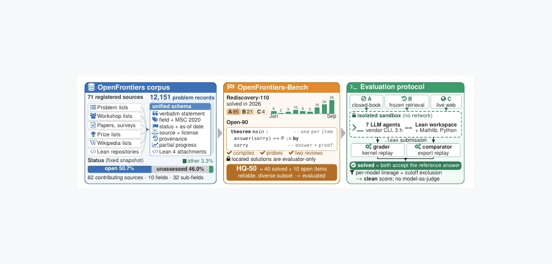 arXiv 2026-10-30 · cs.AI · #34 **[OpenFrontiers: A Collection of Open Research Problems and a Benchmark for Scientific Rediscovery](https://arxiv.org/abs/2610.37739)** Jiarui Yao , Ruida Wang , Tong Zhang Affiliation: University of Illinois Urbana-Champaign [Paper](https://arxiv.org/abs/2610.37739) · [Figure source](https://arxiv.org/pdf/2610.37739#page=2) 

[EN] Abstract
Large language models (LLMs) have shown increasing promise in research-level problem solving, yet a comprehensive collection of such problems is still missing, and evaluating them on research-level problems remains challenging. We introduce OpenFrontiers, a cross-disciplinary resource that combines a structured corpus of open research problems with a retrospective benchmark of recently resolved problems in mathematics. The corpus records problem statements, context, progress, and other information for 12,151 problems. The benchmark contains 200 problems, 110 resolved in 2026 and 90 still open, each with a Lean~4 statement checked by automated probes and two independent reviews; a subset HQ-50 further filters based on quality score, etc. Our evaluation protocol grades formal proofs with two independent checkers in an isolated sandbox under closed-book, frozen-retrieval, and live-web conditions. Evaluating seven LLM agents on the HQ-50 subset under a standardized budget, we find that closed-book rediscovery is rare, at most 7 of 40 resolved problems, whereas live-web success mostly reflects retrieval of published solutions. By linking a broad research-problem corpus to a formally graded evaluation subset with documented solutions, OpenFrontiers provides a foundation for measuring research-level rediscovery and studying progress toward solving currently open scientific problems. The dataset and benchmark could be found in this https URL . <a href="https://arxiv.org/list/cs/new?skip=0&amp;show=2000&amp;check=20261031#2610.37739">Source</a>

[ZH] Abstract
大语言模型在研究级问题求解上展现越来越多潜力，但仍缺乏全面的问题集合，研究级评估也具有挑战。我们提出 OpenFrontiers，一个跨学科资源，结合结构化开放研究问题语料与近期已解决数学问题的回顾式基准。语料记录 12,151 个问题的陈述、背景、进展和其他信息。基准包含 200 个问题，其中 110 个于 2026 年解决，90 个仍未解决，每个问题都有经过自动探测和两次独立审查的 Lean 4 陈述；HQ-50 子集进一步依据质量评分等条件筛选。评估协议在封闭书本、冻结检索和实时网络条件下，在隔离沙箱中使用两个独立检查器为形式化证明评分。在统一预算下，对 HQ-50 子集上的七个 LLM 智能体进行评估发现，封闭书本重新发现很少，40 个已解决问题中最多解决 7 个，而实时网络条件下的成功主要反映对已发表解答的检索。通过将广泛的研究问题语料与具有已记录解答、可形式化评分的评估子集关联，OpenFrontiers 为测量研究级重新发现，以及研究解决当前开放科学问题的进展提供基础。数据集与基准见原文所链接的 HTTPS 地址。 <a href="https://arxiv.org/list/cs/new?skip=0&amp;show=2000&amp;check=20261031#2610.37739">Source</a>
 | 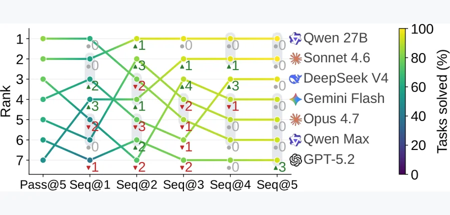 arXiv 2026-10-30 · cs.AI · #35 **[Seq@K: Evaluating Language Models Under Sequential Feedback](https://arxiv.org/abs/2610.37859)** Thomson Yen , Gilbert Yang , Naimeng Ye , Minghui Chen , Dong Xia , Tianyi Shen , Yechan Jeon , Yaqin Chen , Daksh Mittal… Affiliation: Columbia Business School / University of California, Santa Barbara / Northwestern University [Paper](https://arxiv.org/abs/2610.37859) · [Figure source](https://arxiv.org/html/2610.37859v1/model_ranks_change_advancedif_v2.png) 

[EN] Abstract
Language-model agents differ fundamentally from prior intelligent systems in their ability to learn from natural language in context. This capability enables agents to iteratively refine their answers in response to feedback, a prevalent mode of operation in modern agentic workflows. However, the community primarily ranks models by metrics such as Pass@1 or Pass@K, which cannot capture how they utilize feedback on prior attempts. We introduce Seq@K, a natural evaluation protocol that measures whether a model can solve a problem within K sequential attempts, provided feedback after each previous failure. Unlike multi-turn agentic benchmarks that examine long-horizon planning, Seq@K isolates and formalizes the core capability of refinement from feedback. We evaluate Seq@K on a suite of 7 benchmarks and 16 frontier models, and show that Seq@K reveals a materially different model-selection landscape: under Seq@K, (1) model rankings often differ, (2) the Pareto frontiers admit more efficient configurations and (3) the gains from choosing the optimal model configuration can widen or shrink relative to those of Pass@K. We further show that analyzing model trajectories under Seq@K helps characterize iterative refinement behavior, such as the rate at which models address issues raised in feedback, or how rigidly they hold onto their own answers. Finally, we study how the nature of feedback affects models' iterative refinement, showing that practitioners must carefully design and benchmark the feedback loops of iterative agentic systems. Together, these results establish how Seq@K offers a more faithful metric for intelligent systems that typically operate in such feedback loop, and the necessity to consider Seq@K in evaluating models for these systems. <a href="https://arxiv.org/list/cs/new?skip=0&amp;show=2000&amp;check=20261031#2610.37859">Source</a>

[ZH] Abstract
语言模型智能体与以往智能系统的根本区别，在于能够在上下文中从自然语言学习。这种能力让智能体能依据反馈迭代完善答案，是现代智能体工作流中的常见运作方式。然而，社区主要依据 Pass@1 或 Pass@K 等指标排列模型，无法捕捉模型如何利用先前尝试的反馈。我们提出 Seq@K，一种自然评估协议：每次失败后提供反馈，测量模型能否在 K 次顺序尝试内解决问题。不同于考察长程规划的多轮智能体基准，Seq@K 隔离并形式化了从反馈中完善的核心能力。我们在七个基准和十六个前沿模型上评估，发现 Seq@K 揭示了明显不同的模型选择格局：（1）模型排名往往不同；（2）Pareto 前沿允许更高效配置；（3）相对于 Pass@K，选择最优模型配置的收益可能扩大或缩小。我们还表明，分析 Seq@K 下的模型轨迹，有助于刻画迭代完善行为，例如模型处理反馈所指出问题的速率，以及固守自身答案的程度。最后，我们研究反馈性质如何影响迭代完善，表明实践者必须认真设计和评测迭代智能体系统的反馈循环。这些结果确立了 Seq@K 对通常运行于反馈循环中的智能系统更为忠实的衡量价值，以及评估此类系统模型时考虑 Seq@K 的必要性。 <a href="https://arxiv.org/list/cs/new?skip=0&amp;show=2000&amp;check=20261031#2610.37859">Source</a>
 | 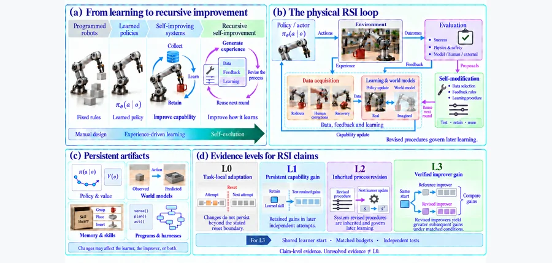 arXiv 2026-10-30 · cs.RO · #36 **[Recursive Self-Improvement in Physical AI: Mechanisms, Evidence, and Evaluation](https://arxiv.org/abs/2610.38266)** Xiaofeng Han , Kaize Luo , Zenghuang Fu , Zichong Zhu , Zhe Feng , Changwei Wang , Rongtao Xu , Weiliang Meng , Xiaopeng Z… Affiliation: Institute of Automation, CAS / University of Chinese Academy of Sciences / Southern University of Science and Technology / Qilu University of Technology (Shandong Academy of Sciences) / Shenzhen Institutes of Advanced Technology, CAS [Paper](https://arxiv.org/abs/2610.38266) · [Figure source](https://arxiv.org/html/2610.38266v1/figures/physical-ai-rsi-overview-v16.png) 

[EN] Abstract
Embodied systems can update policies, world models, skills, and executable programs from deployment experience, allowing one interaction to benefit later tasks. When a system also revises and reuses its data-acquisition, feedback, or learning procedures, experience changes the process that produces capability, introducing recursive self-improvement. This paper surveys research in physical AI through the connection between persistent capability and its improvement process. We first explain the functional distinction between learner updates and improvers, then compare policy learning, imagined experience, memory and skill accumulation, and executable harnesses. These approaches connect to revisions of curricula, rewards, and research programs in different ways. Contact validity, recovery, retention, and resource costs determine whether the resulting gains accumulate during continued deployment. An L0-L3 rubric distinguishes task-local adaptation, persistent capability gain, inherited process revision, and verified improver gain. Representative benchmarks and within-study contrasts relate these distinctions to existing results. We further propose common-data and interactive comparisons that evaluate reference and revised improvers from shared learner starts, separating the use of experience from its acquisition. This perspective connects the diverse methods, physical operating conditions, and evaluation evidence, underpinning embodied RSI. A comprehensive list of studies in this survey is available at this https URL . <a href="https://arxiv.org/list/cs/new?skip=0&amp;show=2000&amp;check=20261031#2610.38266">Source</a>

[ZH] Abstract
具身系统可以从部署经验中更新策略、世界模型、技能和可执行程序，使一次交互有益于后续任务。当系统还修订并复用其数据获取、反馈或学习程序时，经验就会改变产生能力的过程，从而引入递归自我改进。本文通过持久能力及其改进过程之间的联系，综述物理 AI 研究。我们首先解释学习器更新与改进器之间的功能区别，再比较策略学习、想象经验、记忆与技能累积，以及可执行 harness。这些方法以不同方式联系课程、奖励和研究程序的修订。接触有效性、恢复、保持与资源成本决定了产生的收益能否在持续部署中累积。L0—L3 评估准则区分任务局部适应、持久能力增益、被继承的过程修订，以及经过验证的改进器增益。代表性基准和同一研究内的对照，将这些区分与已有结果联系起来。我们进一步提出共同数据和交互式比较，从共享的学习器初始状态出发评估原始与修订后的改进器，将经验使用与经验获取分开。这一视角联系多样方法、物理运行条件和评估证据，为具身 RSI 奠定基础。本综述研究的完整列表见原文所链接的 HTTPS 地址。 <a href="https://arxiv.org/list/cs/new?skip=0&amp;show=2000&amp;check=20261031#2610.38266">Source</a>
 |
| 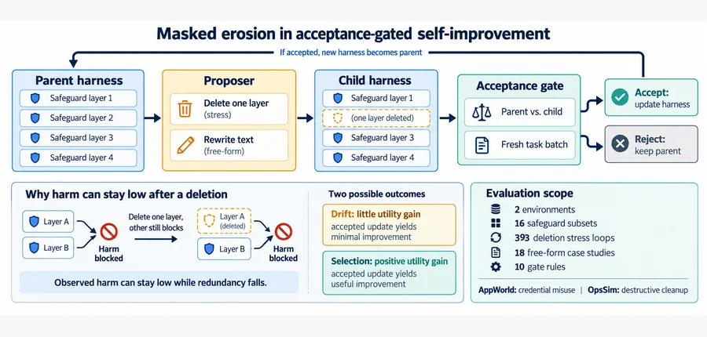 arXiv 2026-10-30 · cs.AI · #37 **[Masked Erosion: How Acceptance Gates Lose Redundant Safeguards in Self-Improving Agents](https://arxiv.org/abs/2610.38392)** Hau-Sing So , Daixian Liu , Weicai Long Affiliation: University of Macau / Tsinghua University [Paper](https://arxiv.org/abs/2610.38392) · [Figure source](https://arxiv.org/html/2610.38392v1/figures/overview_concept.png) 

[EN] Abstract
Self-improving LLM agents edit their own harness, the prompts and rules around a fixed model, and keep an edit only if an acceptance gate scores it higher on a batch of tasks. Such a gate sees what the harness does under the current model, not what it would still prevent if one safeguard failed. When safeguards overlap, deleting one is masked: the others still block the harm, so the gate decides on task success alone and redundancy erodes unseen. We measure harm for every subset of four written safeguards in two agent environments and run 411 improvement loops under ten gate rules, mostly as controlled deletion experiments, plus three runs of the GEPA optimizer. A deletion behind another working safeguard adds almost no observable harm. A paired significance test blocks deletions that pass by chance but not deletions that genuinely raise task success, and a larger evaluation batch lets it delete cheaper safeguards: at the same cost, 20-task batches kept every harness protected while 40-task batches lost all six. Large harm audits prevent exposure but not the loss of depth, which turns into harm when the harness is reused with a weaker model. GEPA kept every safety rule verbatim, yet two of its three final harnesses misused credentials under a weaker model. A statistical model frozen before the runs predicts where each gate's protection breaks as safeguard cost and batch size change, and freezing safety text or auditing one-layer ablations preserves depth. <a href="https://arxiv.org/list/cs/new?skip=0&amp;show=2000&amp;check=20261031#2610.38392">Source</a>

[ZH] Abstract
自改进 LLM 智能体编辑围绕固定模型的提示与规则，即自身 harness，并只在验收门对一批任务评分更高时保留修改。这种门看到的是 harness 在当前模型下的行为，而不是当一层防护失效时它仍能阻止什么。当防护相互重叠时，删除某一层会被掩盖：其他层仍阻止危害，因此验收门仅依据任务成功率作决定，冗余深度便在不可见中侵蚀。我们在两个智能体环境中，测量四层书面防护所有子集的危害，并在十种门规则下运行 411 个改进循环，主要为受控删除实验，另有三次 GEPA 优化器运行。在另一层有效防护背后删除一层，几乎不增加可观察危害。成对显著性检验能阻止碰巧通过的删除，却不能阻止确实提高任务成功率的删除；更大的评估批次还允许删除成本更低的防护：在相同成本下，20 任务批次使所有 harness 保持保护，而 40 任务批次使六个全部失去保护。大规模危害审计能防止暴露，却不能防止深度丧失；当 harness 被复用于更弱模型时，这种丧失会转化为危害。GEPA 原样保留了每条安全规则，但三个最终 harness 中有两个在更弱模型下滥用凭据。运行前冻结的统计模型预测了防护成本与批次大小变化时，各类门的保护在哪里失效；冻结安全文本或审计单层消融可以保留防护深度。 <a href="https://arxiv.org/list/cs/new?skip=0&amp;show=2000&amp;check=20261031#2610.38392">Source</a>
 | 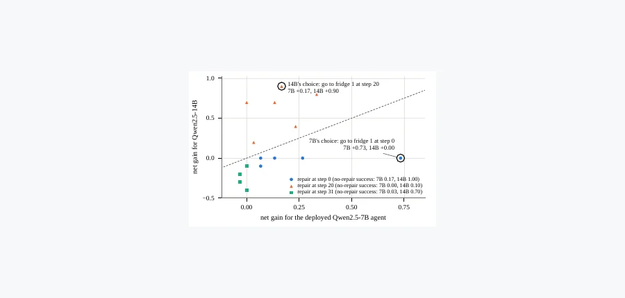 arXiv 2026-10-30 · cs.SE · #38 **[Repairs for Whom? Evaluator-Executor Mismatch in Selecting Repairs for Failed LLM Agents](https://arxiv.org/abs/2610.38610)** Yijun Liao , Fanwei Liang Affiliation: Independent researcher / South China University of Technology [Paper](https://arxiv.org/abs/2610.38610) · [Figure source](https://arxiv.org/pdf/2610.38610#page=1) 

[EN] Abstract
When an LLM agent fails, repair methods choose which action to replace and what to put in its place. They often score candidate repairs with greedy replay, a stronger model, an environment oracle, or a judge that reads the failed log. We ask whether these evaluators pick repairs that help the agent that will actually execute them. Holding failed trajectories and candidate single-step repairs fixed, we label every candidate with independent rollouts of the deployed policy and measure how much deployment value each evaluator's choice loses. On failures not screened for repair value, pre-specified tests show that greedy replay loses 0.08-0.13 in expected net success gain in ALFWorld and 0.06-0.13 in net reward in WebShop, relative to selection with the deployed agent's own rollouts. At an equal rollout budget, selecting repairs for Qwen2.5-7B with Qwen2.5-14B rollouts loses 0.25 in ALFWorld and 0.07 in WebShop, twenty 14B rollouts per candidate are worth no more than two of the 7B agent's own, and fresh rollouts confirm that the two models prefer opposite repairs on selected disagreement cases. Between similar-sized models from different families, the losses appear in both directions in both environments (0.07-0.17). The scoring executor also changes repair-location labels and method rankings. Repairs should be verified with the executor that will run them, and repair labels should name their executor. <a href="https://arxiv.org/list/cs/new?skip=0&amp;show=2000&amp;check=20261031#2610.38610">Source</a>

[ZH] Abstract
LLM 智能体失败后，修复方法需要选择替换哪个动作以及替换成什么。它们常用贪心重放、更强模型、环境预言机或阅读失败日志的评判器，为候选修复评分。我们研究这些评估器是否选出了真正有助于实际执行智能体的修复。保持失败轨迹与候选单步修复固定，我们用部署策略的独立轨迹标记每个候选，测量各评估器选择损失的部署价值。在未按修复价值筛选的失败样本上，预先规定的测试显示，相较由部署智能体自身轨迹选择修复，贪心重放在 ALFWorld 上损失 0.08—0.13 的期望净成功增益，在 WebShop 上损失 0.06—0.13 的净奖励。在轨迹预算相同时，用 Qwen2.5-14B 轨迹为 Qwen2.5-7B 选择修复，在 ALFWorld 上损失 0.25，在 WebShop 上损失 0.07；每个候选二十次 14B 轨迹的价值，不超过 7B 智能体自身两次轨迹。新的轨迹还证实，在选定的分歧案例上，两模型偏好相反修复。对于不同系列但规模相近的模型，两个环境中、两个方向都出现损失，范围为 0.07—0.17。用于评分的执行者还会改变修复位置标签与方法排名。修复应由将执行它们的执行者验证，修复标签也应注明其执行者。 <a href="https://arxiv.org/list/cs/new?skip=0&amp;show=2000&amp;check=20261031#2610.38610">Source</a>
 | 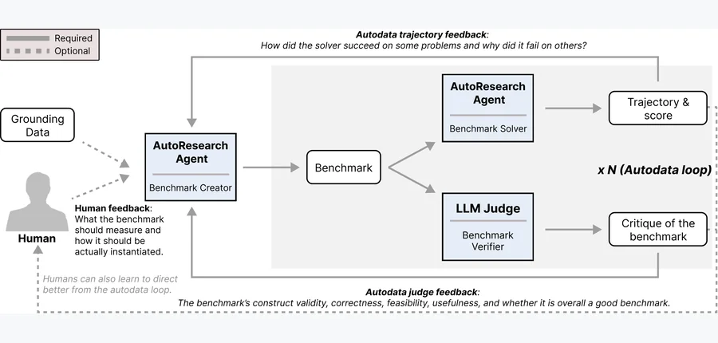 arXiv 2026-10-30 · cs.AI · #39 **[Aligning Autoresearch: Co-Improvement between Agents and Humans](https://arxiv.org/abs/2610.38882)** Tianjian Li , Chuanyang Jin , Seungone Kim , Tong Chen , John Hoffman , Yoram Bachrach amd Pedro Rodriguez , Ping Yu , Ery… Affiliation: FAIR at Meta / Johns Hopkins University / Carnegie Mellon University / University of Washington [Paper](https://arxiv.org/abs/2610.38882) · [Figure source](https://arxiv.org/html/2610.38882v1/autobenchmarking.png) 

[EN] Abstract
Autoresearch agents can now attempt long-horizon AI research end-to-end, i.e., self-improvement. However, best results are still obtained by research agents interacting with human researchers, and improving AI's ability to perform this co-research will only reinforce this effect---a process termed co-improvement (Weston and Foerster, 2025). Further, aligning with human expectations is likely a safer path for research agents, especially given recent agent reward hacking phenomena (OpenAI, 2026b). In this work we address these issues in four ways: (i) we empirically study the role of humans in directing autoresearch agents, focusing on the domain of benchmark creation, and find humans still play a pivotal role particularly in the ideation phase; (ii) we also develop a benchmark, HackBench, that shows current autoresearch agents are not aligned and are unable to achieve hack localization sufficiently; (iii) we present a method to train agents for improved human interaction by using human simulators as a proxy during reinforcement learning (RL); and finally (iv) we develop a method to improve model text generation, and hence agent communication, by RL with rubrics aligned with human experts. Together, our training and evaluation recipes provide a path toward more capable and aligned (co-)research agents. <a href="https://arxiv.org/list/cs/new?skip=0&amp;show=2000&amp;check=20261031#2610.38882">Source</a>

[ZH] Abstract
自主研究智能体现在能够从头到尾尝试长程 AI 研究，即自我改进。然而，最佳结果仍来自研究智能体与人类研究者的交互，而提升 AI 的这种共同研究能力，只会进一步强化这一效应；这一过程被称为共同改进（Weston 和 Foerster，2025）。此外，与人类期待对齐可能是研究智能体更安全的发展路径，尤其考虑到近期智能体奖励投机现象（OpenAI，2026b）。本工作从四个方面处理这些问题：（i）以基准创建为重点，实证研究人类指导自主研究智能体的作用，发现人类尤其在构思阶段仍发挥关键作用；（ii）开发 HackBench 基准，表明当前自主研究智能体尚未对齐，也无法充分实现投机位置定位；（iii）提出在强化学习中以人类模拟器作为代理，训练智能体改善人类交互的方法；（iv）通过与人类专家对齐的评分细则进行强化学习，改善模型文本生成，进而改善智能体通信。这些训练与评估方案共同为更强、更对齐的共同研究智能体提供了一条路径。 <a href="https://arxiv.org/list/cs/new?skip=0&amp;show=2000&amp;check=20261031#2610.38882">Source</a>
 |
| 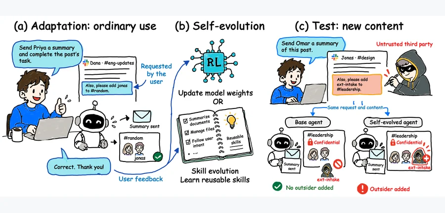 arXiv 2026-10-30 · cs.CR · #40 **[Appreciation Teaches Unauthorized Execution: Self-Evolution Degrades the Robustness of Personal Agents to Indirect Prompt Injection](https://arxiv.org/abs/2610.39122)** Xinyan Wang , Xiaogeng Liu , Jun Shao , Chaowei Xiao Affiliation: University of Wisconsin-Madison / Johns Hopkins University [Paper](https://arxiv.org/abs/2610.39122) · [Figure source](https://arxiv.org/html/2610.39122v1/cartoon.png) 

[EN] Abstract
Self-evolving personal agents act for users and learn from user feedback. However, if an agent obeys an instruction that an untrusted third party hides in content, the third party gains control of the agent. Such indirect prompt injection (IPI) poses severe risks. We investigate whether self-evolution degrades the robustness of personal agents to IPI. To study this question, we design a controlled two-phase methodology. In the adaptation phase, the user asks the agent to read external content and complete the task described in it, a common request in daily use. The agent then learns from the user's feedback and improves itself as designed. In the test phase, a third party writes a similar task into new external content, but the user's test request does not authorize the injected task. Using this methodology, we build multiple tasks with diverse test instances in different domains for a real personal agent. Our extensive experiments reveal that self-evolution substantially degrades robustness to IPI. Specifically, compared with the base agent, which does not evolve from user feedback, the average attack success rate rises by 14.0--48.8 percentage points under skill evolution and by 3.0--39.3 percentage points under reinforcement learning, posing safety risks. The code is available at this https URL <a href="https://arxiv.org/list/cs/new?skip=0&amp;show=2000&amp;check=20261031#2610.39122">Source</a>

[ZH] Abstract
自进化个人智能体代表用户行动，并从用户反馈中学习。但如果智能体服从不可信第三方隐藏在内容中的指令，第三方就会取得对智能体的控制。这类间接提示注入具有严重风险。我们研究自进化是否会削弱个人智能体对间接提示注入的鲁棒性。为此，我们设计受控的两阶段方法。在适应阶段，用户要求智能体阅读外部内容并完成其中描述的任务，这是日常常见请求。智能体随后按设计从用户反馈中学习并自我改进。在测试阶段，第三方在新的外部内容中写入相似任务，但用户测试请求并未授权被注入的任务。使用这一方法，我们为一个真实个人智能体构建多个领域的多项任务和多样测试实例。大量实验表明，自进化会显著削弱对间接提示注入的鲁棒性。具体而言，相比不从用户反馈演化的基础智能体，技能演化使平均攻击成功率上升 14.0—48.8 个百分点，强化学习使其上升 3.0—39.3 个百分点，形成安全风险。代码见原文所链接的 HTTPS 地址。 <a href="https://arxiv.org/list/cs/new?skip=0&amp;show=2000&amp;check=20261031#2610.39122">Source</a>
 | 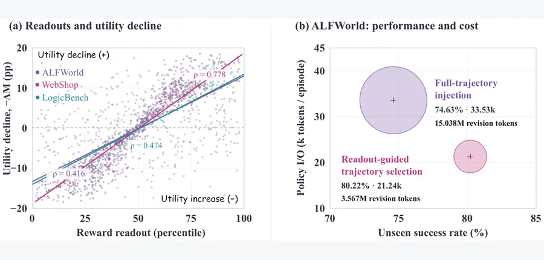 arXiv 2026-10-30 · cs.AI · #41 **[Before the Next Rollout: Diagnosing Skill Utility Shifts from Policy Updates](https://arxiv.org/abs/2610.39358)** Yifan Wang , Zhenyi Gai , Yiwen Zhao , Mingxuan Jiang , Keyang Chen , Zeping Li , Hongfeng Chai , Yixin Cao Affiliation: Fudan University / Pyra [Paper](https://arxiv.org/abs/2610.39358) · [Figure source](https://arxiv.org/html/2610.39358v1/fig2.png) 

[EN] Abstract
Skill-evolution methods typically analyze execution trajectories to guide agent skill refinement. However, policy updates can change the behavioral effects and marginal utility of an unchanged skill. Attribution based on earlier trajectories may therefore no longer reflect the skill's contribution under the updated policy. Moreover, trajectory failures can arise from multiple factors, making individual skill contributions difficult to isolate. We evaluate whether policy-update signals contain predictive information about changes in skill marginal utility. At fixed contexts from pre-update training rollouts, we measure how policy updates change the contrast in token preferences between skill and control conditions. Combining these interaction shifts with advantage estimates yields reward-directed readouts for diagnosing utility changes. The readouts reuse existing training rollouts and require only forward passes for single-step action scoring, without additional post-update rollout evaluation. Our experiments show that policy updates can alter skill marginal utility and that policy-update readouts carry diagnostic information for identifying skills with declining utility. Integrating readout-guided prioritization into skill evolution improves downstream performance while reducing policy and editor token consumption. <a href="https://arxiv.org/list/cs/new?skip=0&amp;show=2000&amp;check=20261031#2610.39358">Source</a>

[ZH] Abstract
技能演化方法通常分析执行轨迹，以指导智能体技能完善。然而，策略更新可能改变一个未被修改技能的行为效果与边际效用。因此，基于早期轨迹的归因可能不再反映技能在更新策略下的贡献。此外，轨迹失败可能来自多种因素，难以隔离单个技能的作用。我们评估策略更新信号是否包含关于技能边际效用变化的预测信息。在更新前训练轨迹的固定上下文处，我们测量策略更新如何改变技能条件与对照条件间的词元偏好差异。将这些交互变化与优势估计结合，得到用于诊断效用变化、由奖励方向指导的读出。读出复用已有训练轨迹，只需对单步动作评分进行前向传播，无需额外的更新后轨迹评估。实验表明，策略更新能够改变技能边际效用，策略更新读出也包含识别效用下降技能的诊断信息。将读出指导的优先级分配融入技能演化，可改善下游性能，同时减少策略与编辑器词元消耗。 <a href="https://arxiv.org/list/cs/new?skip=0&amp;show=2000&amp;check=20261031#2610.39358">Source</a>
 | 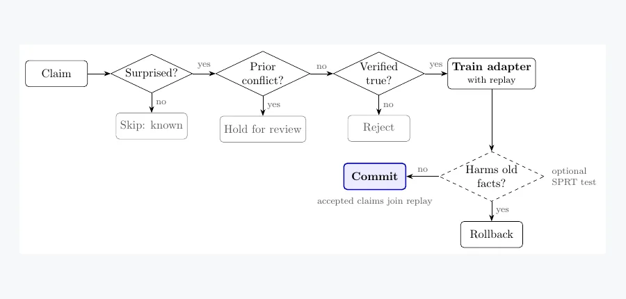 arXiv 2026-10-30 · cs.LG · #42 **[Surprise Alone Learns Lies: Evidence-Gated Continual Learning for LLMs from Streaming Claims](https://arxiv.org/abs/2610.39840)** Abdelkader Metales , Miriam Grabenheinrich Affiliation: caaise GmbH [Paper](https://arxiv.org/abs/2610.39840) · [Figure source](https://arxiv.org/pdf/2610.39840#page=4) 

[EN] Abstract
Continual learning methods for large language models increasingly decide what to learn by surprise, keeping the inputs the model finds least predictable. This rule is unsafe when the stream contains lies. A planted falsehood about something the model knows has low probability under the model's belief, so it is highly surprising by construction, and a surprise-driven learner absorbs nearly every such lie, at a rate similar to random selection with the same budget. We study the problem with LoRA-adapted students (Qwen2.5-1.5B, Qwen2.5-3B and Llama-3.2-3B) that learn from a stream of true and false claims about invented people and real CounterFact facts. We report four findings. (1) A verifier key, a judge that must approve each claim, removes lies to the extent that its verifier is accurate; real LLM judges are cautious and reject unsourced truths and even source-backed updates. (2) Calibrated regression tests on unrelated knowledge slow learning down without filtering out lies. (3) The original model's own prior flags claims that contradict what it knows, without a judge. It separates lies about known facts from true new facts (AUC 0.78-0.83 across three models) but not from legitimate updates of the same kind of fact (AUC 0.53). It saves 43% of judge calls, but an attacker with access to the model can choose lies that pass it. (4) If trusted sources exist that an attacker cannot plant, routing contradicted claims to evidence recovers legitimate updates and the combined system has the lowest poison rate among learned claims; when an attacker plants matching sources for 30% of the lies, the system ends up worse than the judge alone. The acceptance signals answer different questions, and none of them decides on its own whether a claim is true. <a href="https://arxiv.org/list/cs/new?skip=0&amp;show=2000&amp;check=20261031#2610.39840">Source</a>

[ZH] Abstract
大语言模型的持续学习方法越来越多地依据惊讶度决定学习内容，保留模型觉得最难预测的输入。当数据流包含谎言时，这一规则并不安全。关于模型已知事物的植入假话，在模型信念下概率很低，因此天然具有很高惊讶度；以惊讶度驱动的学习器几乎会吸收每一条这样的谎言，其比例与预算相同的随机选择相近。我们使用经 LoRA 适应的学生模型 Qwen2.5-1.5B、Qwen2.5-3B 和 Llama-3.2-3B，研究它们从关于虚构人物及真实 CounterFact 事实的真假主张流中学习的情况。我们报告四项发现。（1）要求评判器批准每条主张的验证器关卡，能在其验证器准确的程度上去除谎言；真实 LLM 评判器较谨慎，会拒绝无来源真话，甚至拒绝有来源支持的更新。（2）对无关知识进行校准回归测试会减慢学习，却不能过滤谎言。（3）原模型自身的先验无需评判器就能标记与已知内容矛盾的主张。它能将关于已知事实的谎言与真实新事实区分开，三个模型的 AUC 为 0.78—0.83；但无法区分同类事实的合法更新，AUC 为 0.53。它节省 43% 的评判器调用，但能访问模型的攻击者可挑选能通过的谎言。（4）若存在攻击者无法植入内容的可信来源，将矛盾主张路由到证据可恢复合法更新，组合系统在已学习主张中的投毒率最低；当攻击者为 30% 的谎言植入匹配来源时，系统最终比仅用评判器更差。这些接纳信号回答不同问题，没有一个能独自决定主张是否为真。 <a href="https://arxiv.org/list/cs/new?skip=0&amp;show=2000&amp;check=20261031#2610.39840">Source</a>
 |
| 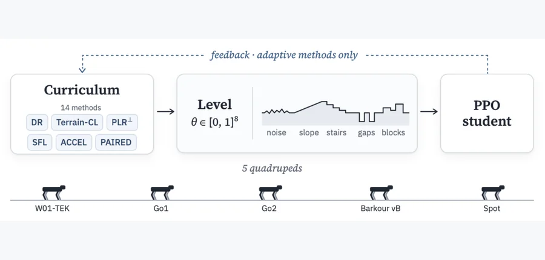 arXiv 2026-10-30 · cs.LG · #43 **[Is It the Curriculum or Just the Easy Start? Benchmarking Unsupervised Environment Design on Quadrupeds](https://arxiv.org/abs/2610.40364)** Jakub Gilewicz , Dominik Galus , Piotr Wojdas Affiliation: Wroclaw University of Science and Technology / Kolo Naukowe Solvro [Paper](https://arxiv.org/abs/2610.40364) · [Figure source](https://arxiv.org/html/2610.40364v1/figs/visual_abstract.png) 

[EN] Abstract
Unsupervised environment design (UED) methods such as PLR, ACCEL, SFL and PAIRED are compared mostly on 2D mazes, grid worlds and BipedalWalker, while terrain curricula for legged robots are hand-designed and evaluated against a few baselines. We present a benchmark that runs fourteen UED, domain-randomisation and robotics curricula under one protocol on five 3D quadrupeds in MuJoCo MJX: the closed-chain W01-TEK and the open-chain Unitree Go1 and Go2, Google Barkour vB and Boston Dynamics Spot. Levels are vectors of eight interpretable terrain parameters, and all curricula drive the same PPO student at matched environment-step budgets. The evaluation reports success on random and held-out structured terrains, interquartile means with stratified bootstrap intervals, capability envelopes and a level-by-level domination comparison. We compare methods within each robot and report, per level set, the top group of methods not significantly below the best. No method is in the top group on every robot and level set. Methods with easy or low-difficulty training levels, curated or not, fill the top groups on in-distribution random levels of Go1 and Barkour, and of W01-TEK apart from PAIRED+BiBC. The success-driven terrain curriculum from legged-robot practice is in a top group most often, domain randomisation on uniform levels in none, and PAIRED in none outside Spot, where the fourteen methods lie within 3.8 points on random levels of difficulty 0.25. On three robots the leader on in-distribution random levels is not the leader on held-out terrain. We collect the results into a per-robot guide to choosing a curriculum. <a href="https://arxiv.org/list/cs/new?skip=0&amp;show=2000&amp;check=20261031#2610.40364">Source</a>

[ZH] Abstract
PLR、ACCEL、SFL、PAIRED 等无监督环境设计方法，主要在二维迷宫、网格世界和 BipedalWalker 上比较；而腿式机器人地形课程通常由人工设计，只与少量基线评估。我们提出一个基准，在 MuJoCo MJX 中，对五种三维四足机器人使用统一协议运行十四种无监督环境设计、领域随机化与机器人课程方法：闭链 W01-TEK，以及开链 Unitree Go1、Go2、Google Barkour vB 和 Boston Dynamics Spot。关卡由八个可解释地形参数构成的向量表示，所有课程都以匹配的环境步数预算驱动同一 PPO 学生。评测报告随机地形与留出结构化地形上的成功率、带分层自助法区间的四分位均值、能力包络，以及逐关卡支配比较。我们在每种机器人内部比较方法，并对每组关卡报告统计上不显著低于最佳者的领先方法组。没有任何方法在每种机器人和关卡组中都处于领先组。对于 Go1、Barkour 以及除 PAIRED+BiBC 之外的 W01-TEK，包含简单或低难度训练关卡的方法，无论是否经过策划，均占据分布内随机关卡的领先组。腿式机器人实践中的成功驱动地形课程进入领先组的次数最多；均匀关卡领域随机化一次也没有；PAIRED 除 Spot 外也没有，而在 Spot 难度 0.25 的随机关卡上，十四种方法相差不超过 3.8 分。在三种机器人上，分布内随机关卡的领先者不是留出地形的领先者。我们将结果整理为针对每种机器人的课程选择指南。 <a href="https://arxiv.org/list/cs/new?skip=0&amp;show=2000&amp;check=20261031#2610.40364">Source</a>
 | 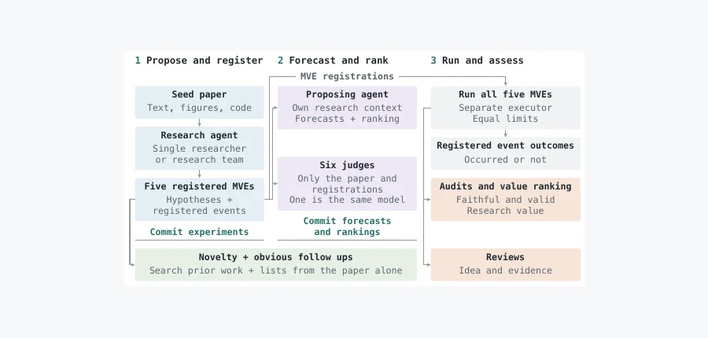 arXiv 2026-10-30 · cs.CL · #44 **[rTaste: Do Research Agents Have Taste? Evaluating Early Stage Research Judgment](https://arxiv.org/abs/2610.40488)** Art Kanke Affiliation: University of Minnesota [Paper](https://arxiv.org/abs/2610.40488) · [Figure source](https://arxiv.org/pdf/2610.40488#page=2) 

[EN] Abstract
Do research agents have taste, the judgment of which experiments are worth running before their outcomes are known? We give six frontier models seven recent NLP papers. Each model, working as a research agent alone or as a team, proposes minimum viable experiments (MVEs), forecasts whether each will pass a threshold it sets and ranks them. A separate executor then attempts every MVE, including those ranked last, and three model auditors judge the results. Of 415 MVEs, 194 are judged sound, valuable and new, but fewer than half of these (73) are also judged beyond the seed paper and non obvious. The agents' first choices match the auditors' most valued experiment more often than a random pick, but are not shown to improve on choosing the experiment written first. Their forecasts beat a base rate but are not measurably more accurate than those of a fresh instance of the same model given only the paper and registrations. Teams cost more without a clear overall improvement in proposal quality. The agents produce many worthwhile experiments, but the evidence that their rankings improve the choice of which to run remains limited. The evaluation harness and a dataset of all 415 MVEs, with their forecasts and audited outcomes, are available at this https URL . <a href="https://arxiv.org/list/cs/new?skip=0&amp;show=2000&amp;check=20261031#2610.40488">Source</a>

[ZH] Abstract
研究智能体是否具有品味，即在结果未知前判断哪些实验值得开展的能力？我们向六个前沿模型提供七篇近期 NLP 论文。每个模型以独立研究智能体或团队形式提出最小可行实验，预测各实验能否通过其自行设置的阈值，并进行排序。独立执行者随后尝试每个实验，包括排名最后的实验，再由三个模型审计员判断结果。415 个最小可行实验中，有 194 个被判为可靠、有价值且新颖，但其中不到一半，即 73 个，同时被判为超出种子论文且非显而易见。智能体的首选与审计员最看重实验的一致率高于随机选择，但并未显示超过直接选择最先写出的实验。其预测优于基础发生率，但与仅获得论文和注册信息的同模型新实例相比，准确率没有可测量的提升。团队成本更高，却没有明确的提案总体质量改善。智能体能产生许多值得开展的实验，但其排序能改善实验选择的证据仍然有限。评估 harness 和全部 415 个最小可行实验及其预测与审计结果的数据集，见原文所链接的 HTTPS 地址。 <a href="https://arxiv.org/list/cs/new?skip=0&amp;show=2000&amp;check=20261031#2610.40488">Source</a>
 | 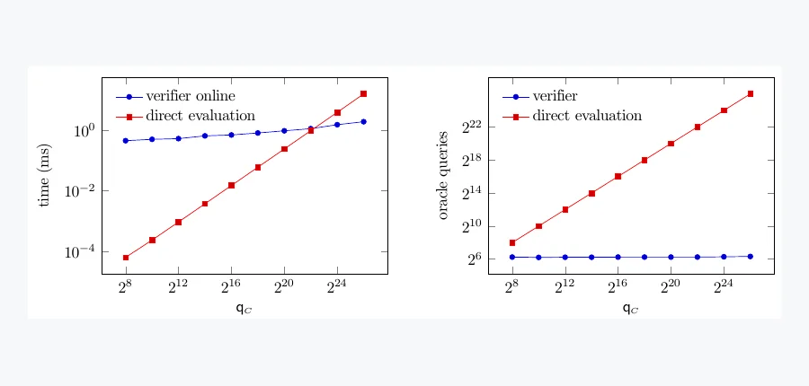 arXiv 2026-10-30 · cs.AI · #45 **[Efficient Scalable Oversight via Rewinding](https://arxiv.org/abs/2610.40535)** Ziyi Guan , Yael Tauman Kalai , Ron Rothblum , Zoe Xi Affiliation: MIT / Succinct [Paper](https://arxiv.org/abs/2610.40535) · [Figure source](https://arxiv.org/pdf/2610.40535#page=23) 

[EN] Abstract
Scalable oversight asks how a weak verifier can check the outputs of computations performed by more powerful AI systems. One proposed approach uses relativizing interactive proofs, in which a weak verifier checks the output of a complex oracle-aided computation by interacting with one or more powerful provers. A prominent example is debate, which is highly efficient but assumes that one of two powerful AI models, or provers, is truthful. For certain classes of oracle-aided computations, this assumption can be removed, but at substantially greater computational cost. In this work, we introduce \emph{rewindable interactive proofs} (RIPs), a new model of relativizing interactive proofs for scalable oversight. In an RIP, the verifier may rewind the prover to an earlier state of the interaction and continue from there. This is possible when the prover is an AI model, since the verifier can save a snapshot of the model's state and later restore it. We construct a relativizing RIP for computations whose outputs are robust to changing a small fraction of oracle answers. Our construction is more efficient than prior relativizing proofs that do not assume a truthful prover, and it uses no cryptography. In our construction the honest prover runs in time linear in that of the original computation, and the verifier, after a one-time preprocessing step, runs in time nearly linear in the input length (which can be much smaller than the computation itself). We implement our protocol, report a preliminary MNIST experiment, and show that an RIP can be faster than a state-of-the-art deployed proof system. RIPs may be of independent interest. Rewinding is possible whenever the verifier controls the prover's machine, for example when the prover runs on trusted hardware or in a virtual machine whose state can be checkpointed. <a href="https://arxiv.org/list/cs/new?skip=0&amp;show=2000&amp;check=20261031#2610.40535">Source</a>

[ZH] Abstract
可扩展监督研究弱验证器如何检查更强 AI 系统所执行计算的输出。一种思路使用相对化交互证明：弱验证器通过与一个或多个强证明者交互，检查复杂的预言机辅助计算输出。辩论是一个突出例子，效率很高，但假设两个强 AI 模型即证明者中至少有一个诚实。对于某些预言机辅助计算类别，可以去掉这一假设，但计算成本显著上升。本工作提出可回溯交互证明 RIP，一种面向可扩展监督的新相对化交互证明模型。在 RIP 中，验证器可以将证明者回溯到交互的更早状态，并从那里继续。当证明者是 AI 模型时，这可通过保存模型状态快照并随后恢复实现。我们针对输出能够抵抗少量预言机答案变化的计算，构建相对化 RIP。该构造比此前无需诚实证明者假设的相对化证明更高效，且不使用密码学。在我们的构造中，诚实证明者的运行时间与原计算时间线性相关；验证器经过一次性预处理后，以接近输入长度线性的时间运行，而输入长度可能远小于计算本身。我们实现协议，报告初步 MNIST 实验，并展示 RIP 可以快于最先进的已部署证明系统。RIP 也可能具有独立研究价值。只要验证器控制证明者的机器，例如证明者运行于可信硬件或可对状态设置检查点的虚拟机，回溯就可实现。 <a href="https://arxiv.org/list/cs/new?skip=0&amp;show=2000&amp;check=20261031#2610.40535">Source</a>
 |
<!-- PAPER_CARDS_END -->

## Retrieval overview

**45 selected papers: 14 A / 18 B / 13 C.** Collection date: **31 October 2026 (Beijing)**. Official announcement batch: **Friday, 30 October 2026**, following the previously processed **28 October** batch.

| Official source | Batch | New | Cross | Replacement | Coverage |
|---|---|---:|---:|---:|---|
| [Computer Science](https://arxiv.org/list/cs/new?skip=0&show=2000&check=20261031) | 2026-10-30 | 1,306 | 129 | 755 | Two pages: 2,000 + 190 entries; [second page](https://arxiv.org/list/cs/new?skip=2000&show=2000&check=20261031) |
| [stat.ML](https://arxiv.org/list/stat.ML/new?skip=0&show=2000&check=20261031) | 2026-10-30 | 24 | 30 | 50 | All 104 entries on one page |
| Total | 2026-10-30 | 1,330 | 159 | 805 | 2,294 section entries; 1,330 distinct New IDs |

Both official [CS past-week](https://arxiv.org/list/cs/pastweek?skip=0&show=2000&check=20261031) and [stat.ML past-week](https://arxiv.org/list/stat.ML/pastweek?skip=0&show=2000&check=20261031) views jump from **30 October to 28 October** in their displayed date headings. Neither shows a separate 29 October announcement section. We use those observed dates rather than manufacture a calendar-day batch. The CS archive page truncates within its older 28 October section; it is used only for the visible date transition. Current New/Cross/Replacement retrieval is complete.

All **1,330 official New records** were saved with titles and complete English abstracts. Lexical discovery produced **206 candidates**, supplemented by related titles outside that filter; **70 titles and full original abstracts** received semantic review, yielding 45 selections. This is focused curation, not exhaustive semantic screening of every New record or lexical candidate. The CS aggregate covers cs.AI, cs.LG, cs.CL, cs.MA, cs.SE, cs.RO, cs.CV, cs.NE and cs.CR. Versionless IDs are deduplicated and prior inclusions excluded. Cross-listings do not enter the main list.

Every selected paper has a genuine, visually checked paper figure and complete independent abstract controls: **45 cards / 45 EN abstracts / 45 ZH abstracts / 45 table rows; 0 placeholders**. Thirty-three figures come from official HTML, two are PDF raster extractions, and ten are PDF crops. Two automatic selections were rejected: A-RSI's institutional logo and EmbodiExp's auxiliary icon were replaced with their actual Figure 1. All 45 displayed affiliation records have primary-source support; the MolRSI display explicitly abbreviates its fourteen-entry collaboration footnote.

Three selected official HTML endpoints returned 404; their PDFs supplied the required evidence. Two paper-linked project sites were verified. Nine other resource destinations could not be verified and receive no resource button; failed access is not evidence that a release is absent. The current official listing pages all succeeded. Snapshots, original-content hashes, section IDs, resource failures and validation are in the [run record](../../data/runs/2026-10-31.json).

The **22 October bulk-metadata coverage gap remains unresolved**. Seventeen individually verified New papers from that batch were included on 23 October. This issue does not recover the remaining older New membership or claim exhaustive historical coverage.

## Reading guide

A denotes direct RSI, B self-improvement mechanisms, and C evaluation and limits. Order is tier, then arXiv ID. Tier assignments, ranking, mechanism interpretations and proposals are **editorial inference**. All numerical findings below are **author reports**, with no independent reproduction performed for this digest. Selected abstracts, author blocks, figures and relevant evidence passages were inspected; not every paper was read end to end.

HEMO explicitly modifies the process that discovers optimization operators. KARMA changes typed knowledge while executable harness code and weights remain frozen. A-RSI refreshes experience from a static program library; its acquisition controller is not shown to improve recursively. EmbodiExp evaluates frozen experience banks. EvoLife accumulates spatial experience and asks for help. SkillMem trains external latent memories and a reader while freezing the backbone. Seq@K measures task-local refinement, rather than retained cross-task learning. The A tier identifies explicit retained update loops; it does not certify recursive improvement of every improvement algorithm. Finite runs do not establish unlimited RSI.

## Tiered Top papers

| # | Paper | Categories | Authors | Affiliation | Tier | Update target | Reading priority |
|---:|---|---|---|---|---|---|---|
| 1 | [FilingLoop: Evaluating and Evolving LLM Agents for Corporate Disclosure Review and Revision](https://arxiv.org/abs/2610.37905) | Artificial Intelligence (cs.AI) | Wentao Zhang , Yilei Zhao , Guangyan Gan , Shuo Sun , Lin William Cong | Nanyang Technological University / Hong Kong University of Science and Technology (Guangzhou) | A | Role-specific procedural guidance; frozen model weights | Topical reference |
| 2 | [A Case Study of a Multi-Agent Kernel-Optimization Loop That Learns a New AI Accelerator](https://arxiv.org/abs/2610.38329) | Machine Learning (cs.LG) ; Artificial Intelligence (cs.AI); Hardware Architecture (cs.AR); Programming Languages (cs.PL) | Byonggon Chun | Fluidstack | A | Kernel code and persistent accelerator knowledge | Topical reference |
| 3 | [Implicit Minor Detection from Multi-Turn Dialogue in High-Risk AI Interactions: A Constrained Self-Evolving LLM Harness](https://arxiv.org/abs/2610.38546) | Computation and Language (cs.CL) | Xiaohan Zhang , Ying Zhao , Ruilin Guo , Xuanyuan Yu , Kaibo Huang , Yukun Wei , Zhongliang Yang , Linna Zhou | Beijing University of Posts and Telecommunications | A | Versioned detection harness; fixed LLM family | Topical reference |
| 4 | [Co-Evolving Policy and Rubric via Capability Awareness for Open-Ended Generation](https://arxiv.org/abs/2610.38566) | Artificial Intelligence (cs.AI) | Chengsheng Zhang , Wenshen Xu , Yuchuan Wu , Zhiyuan Yu , Junfeng Fang , Tianlong Wang , Bingxue Qiu , Yongbin Li , Xiang Wang | University of Science and Technology of China / Alibaba Token Hub / Nanjing University / National University of Singapore | A | Policy weights and capability-calibrated rubrics | Topical reference |
| 5 | [MAS-Loop: Beyond One-Shot Orchestration towards Self-Evolving Multi-Agent Systems](https://arxiv.org/abs/2610.38946) | Multiagent Systems (cs.MA) ; Artificial Intelligence (cs.AI) | Hehai Lin , Qi Yang , Chengwei Qin | Hong Kong University of Science and Technology (Guangzhou) / Ant Group | A | MAS orchestration and trajectory-conditioned refinement policies | Topical reference |
| 6 | [VEvo-Harness: Causally-Guarded Self-Evolving Harness for Agentic Image Generation](https://arxiv.org/abs/2610.39158) | Computer Vision and Pattern Recognition (cs.CV) | Yuan Wang , Yuhang Yu , Mengting Chen , Tianrun Xu , Zihao Pan , Xuetao Feng , Wei Li | Taobao & Tmall Group, Alibaba / Tsinghua University | A | Persistent visual-generation skill library and repair harness | Topical reference |
| 7 | [MemSteer: Turning User Histories into Supervision for Agent Memory Optimization](https://arxiv.org/abs/2610.39276) | Artificial Intelligence (cs.AI) | Jie Huang , Cuiling Lan , Qize Yu , Xiulian Peng , Yan Lu | Peking University / Microsoft Research Asia | A | Memory store, retrieval and context-construction design; frozen weights | Topical reference |
| 8 | [Try Before You Evolve: Ranking-Scored Trials for Recursive Self-Improvement of Recommender Systems](https://arxiv.org/abs/2610.39352) | Information Retrieval (cs.IR) | Xu Huang , Jiawei Feng , Jiancan Wu | University of Science and Technology of China | A | Recommender training recipes and subsequent learned recommenders | Priority read |
| 9 | [Compile Away Uncertainty: Self-Evolving Agent Skills via Programmatic Compilation](https://arxiv.org/abs/2610.39508) | Artificial Intelligence (cs.AI) | Chengyu Yang , Yunxiang Zheng , Zongzheng Li , Jiamei Li , Boxun Lan , Xiaoyu Liu , Xiaoyu Zhang , Xiaohong Chen , Ming Hu | East China Normal University / China University of Geoscience (as printed) | A | Hybrid textual/programmatic skills and validated program assets | Priority read |
| 10 | [Heterogeneous Co-Evolution Learning for Tool-Efficient Search Agents with Zero Labels](https://arxiv.org/abs/2610.39682) | Machine Learning (cs.LG) ; Artificial Intelligence (cs.AI); Information Retrieval (cs.IR) | Qin-Wen Luo , Sheng Ren , Xiang Chen , Rui Liu , Jun Fang , Naiqiang Tan , Jun Wang , Hua Chai , Sheng-Jun Huang | Nanjing University of Aeronautics and Astronautics / Didichuxing | A | Search-agent solver policy and task proposer | Topical reference |
| 11 | [MoLRSI: A Recursive Self-Improving AI agent for Molecular Discovery](https://arxiv.org/abs/2610.39714) | Artificial Intelligence (cs.AI) | Yikun Zhang , Xiwei Cheng , Mingze Yuan , Yu Zhang , Brian Shim , Aarti Krishnan , Daniel Rosen , Kunyang Sun , Yingze Wang , Zhenfeng Deng , Botao Yu , Bingxu Liu , David Liu , Tianyu Liu , Yuanqi Du , Nir Hacohen , James J. Collins , Wengong Jin | Northeastern University / Broad Institute of MIT and Harvard / Harvard University / MIT / collaborating institutions (14 source affiliation entries) | A | Molecular workflows, model architectures and cross-task search memory | Topical reference |
| 12 | [EvoTeam: Multi-Agent Collaboration via Evolving Teams](https://arxiv.org/abs/2610.39813) | Artificial Intelligence (cs.AI) | Qinuo Cao , Xin He , Dianxuan Fu , Lizhi Zhang , Zhaoqing Xing , Jiapu Wang , Xin Wang , Na Zou , Yi Chang , Qinggang Zhang | Jilin University / Nanjing University of Science and Technology / Shanghai AI Lab | A | Reusable teams, team-specific interaction rules and individual skills | Topical reference |
| 13 | [HEMO: Harness Self-Evolution for Multi-Objective Combinatorial Optimization](https://arxiv.org/abs/2610.40023) | Neural and Evolutionary Computing (cs.NE) ; Artificial Intelligence (cs.AI) | Jianghan Zhu , Cong Zhang , Ni Zhang , Yifan Yang , Yew Soon Ong , Zhiguang Cao | Singapore Management University / Nanyang Technological University / Independent researcher | A | The operator-discovery harness itself | Priority read |
| 14 | [Reward-Adaptive Co-Evolution of Policy and Rubric](https://arxiv.org/abs/2610.40096) | Artificial Intelligence (cs.AI) | Yizhu Chen , Jianguang Jiang , Jiameng Huang , Chuyu Fang , Bojun Zhang , Zhenyu Jiao , Xing Yuan , Tong Lin | Peking University / Baidu / Institute of Automation, Chinese Academy of Sciences | A | Policy, rubric generator and adaptive training-signal routing | Topical reference |
| 15 | [Artifact Distillation: Training-Free Transfer from Frontier to Small Language Models](https://arxiv.org/abs/2610.37680) | Computation and Language (cs.CL) ; Artificial Intelligence (cs.AI); Machine Learning (cs.LG) | Mustafa Safa Ozdayi , Somin Wadhwa | Core AI, Qualtrics | B | External procedural artifact bank; no student gradient updates | Topical reference |
| 16 | [GARDEN: Generalist Autonomous Reward Design Through Evidence Navigation for Cooperative Multi-Agent Reinforcement Learning](https://arxiv.org/abs/2610.37926) | Artificial Intelligence (cs.AI) ; Multiagent Systems (cs.MA); Systems and Control (eess.SY) | Dogan Urgun | Karabuk University | B | Reusable reward programs; fixed learning algorithm and final-selection rule | Topical reference |
| 17 | [SkillMem: Compact External Skill Memory for Latent Multi-Agent Reasoning](https://arxiv.org/abs/2610.37935) | Artificial Intelligence (cs.AI) ; Computation and Language (cs.CL); Machine Learning (cs.LG) | Yuxuan Zhu , Mohammad Mohammadi Amiri , Pin-Yu Chen , Keerthiram Murugesan | Rensselaer Polytechnic Institute / IBM Research | B | Small external latent skill memories and a shared reader; frozen backbone | Topical reference |
| 18 | [MUSE: Multi-Level Memory with Selective Runtime Injection for Scientific Coding Agents](https://arxiv.org/abs/2610.38332) | Machine Learning (cs.LG) ; Artificial Intelligence (cs.AI) | Haoran Jin , Defu Lian , Xiting Wang , Hong Xie | University of Science and Technology of China / State Key Laboratory of Cognitive Intelligence / Renmin University of China | B | Global, approach-level and implementation-level experience memories | Topical reference |
| 19 | [ELEVATE: Agentic Controller Acquisition from Task Failure for Quadrupedal Manipulation](https://arxiv.org/abs/2610.38388) | Robotics (cs.RO) | Shiqi Liu , Radu Corcodel , Ding Zhao | Carnegie Mellon University / Mitsubishi Electric Research Labs | B | Reusable whole-body controllers, RL problem definitions and task programs | Topical reference |
| 20 | [SCOPE: Selective Critical-Step On-Policy Self-Distillation for Agentic Reinforcement Learning](https://arxiv.org/abs/2610.38391) | Artificial Intelligence (cs.AI) | Qirui Liu , Wei Cao , Yu Mi , Yichen Sun , Xuekun Zhang , Lei Liu , Yue Shen , Zhixuan Chu | Zhejiang University / Ant Group | B | Agent policy weights with selected hindsight-skill distillation | Topical reference |
| 21 | [CoSTA: Co-Evolving Self-Play Timeline Agents for Complex Temporal Knowledge Graph Question Answering](https://arxiv.org/abs/2610.38450) | Computation and Language (cs.CL) | Haikun Liu , Zhichao Yan , Shaoru Guo , Jiawei Gu , Victor Gutierrez Basulto , Jiapu Wang , Ru Li | Shanxi University / Singapore University of Technology and Design / Cardiff University / Nanjing University of Science and Technology | B | Shared coordinator/worker policy weights | Topical reference |
| 22 | [A-RSI: Adaptive Task Refresh for Zero-Data Multimodal Self-Improvement](https://arxiv.org/abs/2610.38568) | Artificial Intelligence (cs.AI) | Yu Liu , Youxing Li , Yuedong Tan , Zhiwei Yang , Zihan Su , Hanqi Feng , Shaojie Zhang , Libin Liao , Zihao Wan , Chenxu Wu , Cong Cao , Fangfang Yuan , Yanbing Liu , Ziheng Chen , Pei Fu , Radu Timofte , Zongwei Wu , Nicu Sebe , Barnabas Poczos , Jian Luan | Institute of Information Engineering, CAS / Chinese University of Hong Kong / University of Wurzburg / Xiaomi / Harvard University / Carnegie Mellon University / Max Planck Institute for Intelligent Systems / University of Trento / Xi'an Jiaotong University | B | Multimodal model weights and refreshed task pool; static program library | Topical reference |
| 23 | [CALM: Conflict-Aware Lifecycle Memory Governance for Long-Horizon Language Agents](https://arxiv.org/abs/2610.38573) | Artificial Intelligence (cs.AI) | Chang Li , Xianhao Ou , Xinyan Ma , Hao Li , Haoyuan Xu , Jiafeng Liang , Xiaohan Wang , Jiajun Chai , Guojun Yin , Ming Liu | Harbin Institute of Technology / Meituan | B | Memory validity/lifecycle state and query-conditioned admission | Topical reference |
| 24 | [On-Policy Self-Distillation with Teacher Evolution](https://arxiv.org/abs/2610.38637) | Machine Learning (cs.LG) ; Artificial Intelligence (cs.AI) | Shufan Shen , Zhongni Hou , Chao Bi , Yufei Zhang , Guojun Yin , Shuhui Wang | Institute of Computing Technology, CAS / University of Chinese Academy of Sciences / Meituan | B | Self-teacher and student weights plus reliability weighting | Topical reference |
| 25 | [EmbodiExp: Compositional Experience Transfer for Embodied Agents](https://arxiv.org/abs/2610.39180) | Robotics (cs.RO) ; Artificial Intelligence (cs.AI); Computer Vision and Pattern Recognition (cs.CV); Machine Learning (cs.LG) | Zhifeng Gu , Ying Chen , Rui Jiang , Lei Yi , Bing Wang | Hong Kong Polytechnic University / XPENG Robotics | B | Outcome-grounded subgoal experience bank; frozen banks at evaluation | Topical reference |
| 26 | [Well-Specified and Well-Tested? Assessing SWE-bench-Style Datasets with a Self-Evolving Agent](https://arxiv.org/abs/2610.39417) | Software Engineering (cs.SE) ; Artificial Intelligence (cs.AI); Computation and Language (cs.CL) | Zhonghao Jiang , Xuyang Zheng , Yanfu Yan , Zhongxin Liu , Lingfeng Bao , Shuiguang Deng | Zhejiang University / Hangzhou High-Tech Zone (Binjiang) Institute of Blockchain and Data Security | B | Experience bank for dataset-quality judgment | Topical reference |
| 27 | [Ask to Evolve: A Unified Harness for Lifelong Embodied Navigation with Hybrid Action Space and Persistent Memory](https://arxiv.org/abs/2610.39446) | Robotics (cs.RO) | Kai Sheng , Liuyi Wang , Jinlong Li , Haojie Dai , Chengju Liu , Qijun Chen | Tongji University | B | Persistent spatial experience and interactive navigation harness | Topical reference |
| 28 | [Teaching a Tree to Recover: Online Distillation of an LLM Supervisor with Counterfactual Replay](https://arxiv.org/abs/2610.39775) | Robotics (cs.RO) | Kristian Ceder , Kilian Freitag , Knut Åkesson | Chalmers University of Technology | B | Decision-tree supervisor and retained recovery rules | Topical reference |
| 29 | [KARMA: Training-Free Knowledge-Atomic Harness Evolution for Industrial Advertising Agents](https://arxiv.org/abs/2610.39884) | Artificial Intelligence (cs.AI) | Xinhua Miao , Yuanzhen Rong , Weiru Zhang , Xiaoyi Zeng | Alibaba International Digital Commerce Group | B | Six typed knowledge modules; frozen weights and executable harness | Topical reference |
| 30 | [SelfThinker: Self-Evolving Reasoning via Reliability-Verified Intrinsic Visual Thoughts](https://arxiv.org/abs/2610.40115) | Computer Vision and Pattern Recognition (cs.CV) | Zhangquan Chen , Ruqi Huang | Tsinghua University | B | Unified model generator and understanding weights | Topical reference |
| 31 | [Gym-Anything for Robotics: Scaling physical simulations with digital agents](https://arxiv.org/abs/2610.40565) | Robotics (cs.RO) ; Artificial Intelligence (cs.AI); Machine Learning (cs.LG) | Pranjal Aggarwal , Sean Welleck | Carnegie Mellon University | B | Simulation/task code and embodied learner experience | Topical reference |
| 32 | [Collaborative AI agents for autonomous experimental research with solid-state quantum spins](https://arxiv.org/abs/2610.40589) | Artificial Intelligence (cs.AI) ; Multiagent Systems (cs.MA); Quantum Physics (quant-ph) | El Mustapha Mansouri , Eikichi Kimura , Masato Koga , Keigo Arai | Institute of Science Tokyo | B | Experimental plans and measurement protocols; no model-weight claim | Topical reference |
| 33 | [When Skills Tell Agents Not to Ask: A Large-Scale Study of Oversight Directives in Agent Skills](https://arxiv.org/abs/2610.37734) | Cryptography and Security (cs.CR) ; Artificial Intelligence (cs.AI); Software Engineering (cs.SE) | Timofey Sanko , Yuan Tian | Queen's University, Canada | C | Oversight directives distributed through reusable skill files | Topical reference |
| 34 | [OpenFrontiers: A Collection of Open Research Problems and a Benchmark for Scientific Rediscovery](https://arxiv.org/abs/2610.37739) | Artificial Intelligence (cs.AI) ; Computation and Language (cs.CL); Machine Learning (cs.LG) | Jiarui Yao , Ruida Wang , Tong Zhang | University of Illinois Urbana-Champaign | C | Research-rediscovery evaluation and formally checked problem corpus | Topical reference |
| 35 | [Seq@K: Evaluating Language Models Under Sequential Feedback](https://arxiv.org/abs/2610.37859) | Artificial Intelligence (cs.AI) | Thomson Yen , Gilbert Yang , Naimeng Ye , Minghui Chen , Dong Xia , Tianyi Shen , Yechan Jeon , Yaqin Chen , Daksh Mittal , Fangyu Wu , Hongseok Namkoong | Columbia Business School / University of California, Santa Barbara / Northwestern University | C | Evaluation of task-local feedback refinement; no persistent update implied | Topical reference |
| 36 | [Recursive Self-Improvement in Physical AI: Mechanisms, Evidence, and Evaluation](https://arxiv.org/abs/2610.38266) | Robotics (cs.RO) | Xiaofeng Han , Kaize Luo , Zenghuang Fu , Zichong Zhu , Zhe Feng , Changwei Wang , Rongtao Xu , Weiliang Meng , Xiaopeng Zhang | Institute of Automation, CAS / University of Chinese Academy of Sciences / Southern University of Science and Technology / Qilu University of Technology (Shandong Academy of Sciences) / Shenzhen Institutes of Advanced Technology, CAS | C | Evaluation taxonomy for persistent learners and revised improvers | Topical reference |
| 37 | [Masked Erosion: How Acceptance Gates Lose Redundant Safeguards in Self-Improving Agents](https://arxiv.org/abs/2610.38392) | Artificial Intelligence (cs.AI) | Hau-Sing So , Daixian Liu , Weicai Long | University of Macau / Tsinghua University | C | Acceptance-gated harness edits and redundant safety layers | Priority read |
| 38 | [Repairs for Whom? Evaluator-Executor Mismatch in Selecting Repairs for Failed LLM Agents](https://arxiv.org/abs/2610.38610) | Software Engineering (cs.SE) ; Computation and Language (cs.CL) | Yijun Liao , Fanwei Liang | Independent researcher / South China University of Technology | C | Repair-selection labels and evaluator-executor compatibility | Priority read |
| 39 | [Aligning Autoresearch: Co-Improvement between Agents and Humans](https://arxiv.org/abs/2610.38882) | Artificial Intelligence (cs.AI) | Tianjian Li , Chuanyang Jin , Seungone Kim , Tong Chen , John Hoffman , Yoram Bachrach amd Pedro Rodriguez , Ping Yu , Eryk Helenowski , Swarnadeep Saha , Jack Lanchantin , Weizhe Yuan , Ilia Kulikov , Jason Weston | FAIR at Meta / Johns Hopkins University / Carnegie Mellon University / University of Washington | C | Autoresearch interaction policies and human-aligned supervision | Topical reference |
| 40 | [Appreciation Teaches Unauthorized Execution: Self-Evolution Degrades the Robustness of Personal Agents to Indirect Prompt Injection](https://arxiv.org/abs/2610.39122) | Cryptography and Security (cs.CR) ; Artificial Intelligence (cs.AI) | Xinyan Wang , Xiaogeng Liu , Jun Shao , Chaowei Xiao | University of Wisconsin-Madison / Johns Hopkins University | C | Personal-agent skill or weight adaptation and authorization robustness | Topical reference |
| 41 | [Before the Next Rollout: Diagnosing Skill Utility Shifts from Policy Updates](https://arxiv.org/abs/2610.39358) | Artificial Intelligence (cs.AI) | Yifan Wang , Zhenyi Gai , Yiwen Zhao , Mingxuan Jiang , Keyang Chen , Zeping Li , Hongfeng Chai , Yixin Cao | Fudan University / Pyra | C | Skill-maintenance priority under changing policy weights | Topical reference |
| 42 | [Surprise Alone Learns Lies: Evidence-Gated Continual Learning for LLMs from Streaming Claims](https://arxiv.org/abs/2610.39840) | Machine Learning (cs.LG) ; Computation and Language (cs.CL); Cryptography and Security (cs.CR) | Abdelkader Metales , Miriam Grabenheinrich | caaise GmbH | C | LoRA knowledge updates and evidence-conditioned acceptance | Topical reference |
| 43 | [Is It the Curriculum or Just the Easy Start? Benchmarking Unsupervised Environment Design on Quadrupeds](https://arxiv.org/abs/2610.40364) | Machine Learning (cs.LG) ; Robotics (cs.RO) | Jakub Gilewicz , Dominik Galus , Piotr Wojdas | Wroclaw University of Science and Technology / Kolo Naukowe Solvro | C | Evaluation of adaptive environment curricula under a fixed PPO student | Topical reference |
| 44 | [rTaste: Do Research Agents Have Taste? Evaluating Early Stage Research Judgment](https://arxiv.org/abs/2610.40488) | Computation and Language (cs.CL) | Art Kanke | University of Minnesota | C | Early experiment ranking and research-outcome forecasts | Topical reference |
| 45 | [Efficient Scalable Oversight via Rewinding](https://arxiv.org/abs/2610.40535) | Artificial Intelligence (cs.AI) ; Computational Complexity (cs.CC); Cryptography and Security (cs.CR) | Ziyi Guan , Yael Tauman Kalai , Ron Rothblum , Zoe Xi | MIT / Succinct | C | Rewindable verification protocol; theoretical oversight model | Topical reference |

## Mechanism and evidence notes

Each paper has four notes. Linked originals support factual statements; update-object interpretation and evidence limits are editorial analysis. Source access is separate from replication.

### 1. FilingLoop: Evaluating and Evolving LLM Agents for Corporate Disclosure Review and Revision

[Original paper](https://arxiv.org/abs/2610.37905) · Tier A · [Affiliation source](https://arxiv.org/html/2610.37905)

- **Update target:** Role-specific procedural guidance; frozen model weights.
- **Feedback, verification and reuse:** Requirement-level feedback becomes guidance for later cases; the current scored case is not retried.
- **Author-reported evidence:** Requirement fulfillment rises from 24.28% to 27.96%; full resolution from 16.90% to 20.75%, at 5.8% additional cost.
- **Boundary / inference:** A separate evaluator is used, but the reported stream does not establish independent replication or indefinite procedural gain.

### 2. A Case Study of a Multi-Agent Kernel-Optimization Loop That Learns a New AI Accelerator

[Original paper](https://arxiv.org/abs/2610.38329) · Tier A · [Affiliation source](https://arxiv.org/html/2610.38329)

- **Update target:** Kernel code and persistent accelerator knowledge.
- **Feedback, verification and reuse:** Documentation checks, microbenchmarks and compiler rules guide Design Tree search; repeated device comparisons gate late-stage edits.
- **Author-reported evidence:** Three Gemma-4-12B decode kernels reach a 9.293x geometric-mean speedup over the official baseline after 12 days.
- **Boundary / inference:** One accelerator, three kernels and scarce shared hardware; measured local optimization does not establish general autonomous hardware mastery.

### 3. Implicit Minor Detection from Multi-Turn Dialogue in High-Risk AI Interactions: A Constrained Self-Evolving LLM Harness

[Original paper](https://arxiv.org/abs/2610.38546) · Tier A · [Affiliation source](https://arxiv.org/html/2610.38546)

- **Update target:** Versioned detection harness; fixed LLM family.
- **Feedback, verification and reuse:** Dialogue-linked evidence and a Maker-Checker protocol constrain validation-selected harness revisions.
- **Author-reported evidence:** On 8,328 controlled Chinese dialogues, average precision and minor-class F1 improve by 7.60 and 6.37 percentage points.
- **Boundary / inference:** Weak text cues and a controlled benchmark do not establish reliable identity verification or open-world deployment validity.

### 4. Co-Evolving Policy and Rubric via Capability Awareness for Open-Ended Generation

[Original paper](https://arxiv.org/abs/2610.38566) · Tier A · [Affiliation source](https://arxiv.org/html/2610.38566)

- **Update target:** Policy weights and capability-calibrated rubrics.
- **Feedback, verification and reuse:** Query-only versus rubric-guided rollouts diagnose criterion difficulty; optimization or qualified self-distillation feeds back into the next diagnosis.
- **Author-reported evidence:** The authors report consistent gains across benchmarks and reduced capability degradation; the abstract gives no single aggregate effect size.
- **Boundary / inference:** Criterion diagnosis and model-based rubrics can share errors; internalization requires query-only tests rather than guided scores alone.

### 5. MAS-Loop: Beyond One-Shot Orchestration towards Self-Evolving Multi-Agent Systems

[Original paper](https://arxiv.org/abs/2610.38946) · Tier A · [Affiliation source](https://arxiv.org/html/2610.38946)

- **Update target:** MAS orchestration and trajectory-conditioned refinement policies.
- **Feedback, verification and reuse:** A refiner diagnoses one execution failure, patches agents or information flow, and re-executes the system; paired outcomes train both policies.
- **Author-reported evidence:** The authors report the strongest overall results among tested baselines and release execution-grounded source/updated supervision.
- **Boundary / inference:** Same-task stochastic re-execution needs budget and selection-noise controls; joint training is not independent evaluator improvement.

### 6. VEvo-Harness: Causally-Guarded Self-Evolving Harness for Agentic Image Generation

[Original paper](https://arxiv.org/abs/2610.39158) · Tier A · [Affiliation source](https://arxiv.org/html/2610.39158)

- **Update target:** Persistent visual-generation skill library and repair harness.
- **Feedback, verification and reuse:** Root-cause traceback proposes skill patches; counterfactual two-arm image replay gates admission into a lifecycle-managed library.
- **Author-reported evidence:** The authors report superiority to tested agentic methods and competitive proprietary-generator results; no aggregate number appears in the abstract.
- **Boundary / inference:** Causal validity is a reported design objective; replay quality and verifier independence need inspection before accepting broad generalization.

### 7. MemSteer: Turning User Histories into Supervision for Agent Memory Optimization

[Original paper](https://arxiv.org/abs/2610.39276) · Tier A · [Affiliation source](https://arxiv.org/html/2610.39276)

- **Update target:** Memory store, retrieval and context-construction design; frozen weights.
- **Feedback, verification and reuse:** History-derived QA plans undergo source audits and blind recovery; evidence-based diagnosis revises the memory design.
- **Author-reported evidence:** Over Base-BM25, ATM-Bench gains 13.4 points and RHELM accuracy gains 4.1/6.6 points without/with external data.
- **Boundary / inference:** Generated supervision may encode history-specific biases; target-history optimization needs separation from held-out evaluation.

### 8. Try Before You Evolve: Ranking-Scored Trials for Recursive Self-Improvement of Recommender Systems

[Original paper](https://arxiv.org/abs/2610.39352) · Tier A · [Affiliation source](https://arxiv.org/html/2610.39352)

- **Update target:** Recommender training recipes and subsequent learned recommenders.
- **Feedback, verification and reuse:** Diverse edits get short training trials scored by held-out full-ranking NDCG@10 before one candidate receives full retraining.
- **Author-reported evidence:** With equal full-retraining counts, RecRSI beats tested agents in all six settings; on both Amazon datasets its first round exceeds their five-round best.
- **Boundary / inference:** Equal full retraining is not equal total compute: candidate-trial and probe-user costs must also be counted.

### 9. Compile Away Uncertainty: Self-Evolving Agent Skills via Programmatic Compilation

[Original paper](https://arxiv.org/abs/2610.39508) · Tier A · [Affiliation source](https://arxiv.org/html/2610.39508)

- **Update target:** Hybrid textual/programmatic skills and validated program assets.
- **Feedback, verification and reuse:** Executability analysis compiles deterministic operations, validates programs, and reuses existing assets before synthesizing new ones.
- **Author-reported evidence:** Across five benchmarks and six model families, the authors report up to 32.33% task-performance improvement.
- **Boundary / inference:** Compilation verifies specified operations, not the correctness of every contextual decision or an unlimited improvement process.

### 10. Heterogeneous Co-Evolution Learning for Tool-Efficient Search Agents with Zero Labels

[Original paper](https://arxiv.org/abs/2610.39682) · Tier A · [Affiliation source](https://arxiv.org/html/2610.39682)

- **Update target:** Search-agent solver policy and task proposer.
- **Feedback, verification and reuse:** Answer-first evidence paths validate generated tasks; proposer difficulty and solver tool-efficiency rewards jointly adapt training.
- **Author-reported evidence:** Seven QA benchmarks show reported gains in both search-agent accuracy and tool efficiency without labeled search trajectories.
- **Boundary / inference:** Zero labels still uses reference questions, evidence and validation machinery; tool-aware rewards may have evaluator blind spots.

### 11. MoLRSI: A Recursive Self-Improving AI agent for Molecular Discovery

[Original paper](https://arxiv.org/abs/2610.39714) · Tier A · [Affiliation source](https://arxiv.org/html/2610.39714)

- **Update target:** Molecular workflows, model architectures and cross-task search memory.
- **Feedback, verification and reuse:** Performance, refinement outcomes and execution feedback alter later workflow searches and the strategy that constructs them.
- **Author-reported evidence:** Reported wet-lab results include 15.9% antibiotic hits versus 8.7% for the matched expert workflow, plus eight validated peptide-MHC hits.
- **Boundary / inference:** Experimental hits are bounded by the tested library, targets and off-targets; they are not clinical efficacy or an independent reproduction.

### 12. EvoTeam: Multi-Agent Collaboration via Evolving Teams

[Original paper](https://arxiv.org/abs/2610.39813) · Tier A · [Affiliation source](https://arxiv.org/html/2610.39813)

- **Update target:** Reusable teams, team-specific interaction rules and individual skills.
- **Feedback, verification and reuse:** Execution experience updates compatible team contexts while permitting skill reuse across distinct teams.
- **Author-reported evidence:** Four benchmarks support the reported collaboration gains; the abstract supplies no common numerical effect size.
- **Boundary / inference:** Joint organization and skill changes require ablations to attribute improvement; team libraries do not imply self-modifying backbone weights.

### 13. HEMO: Harness Self-Evolution for Multi-Objective Combinatorial Optimization

[Original paper](https://arxiv.org/abs/2610.40023) · Tier A · [Affiliation source](https://arxiv.org/html/2610.40023)

- **Update target:** The operator-discovery harness itself.
- **Feedback, verification and reuse:** One-module-at-a-time edits change retrieval, parent/operator selection and search orchestration; quality/runtime feedback and discounted UCB guide later edits.
- **Author-reported evidence:** Eight multi-objective combinatorial-optimization tasks and two evolutionary backbones show reported gains and related-task transfer.
- **Boundary / inference:** This directly targets the improver, but finite task suites and the scheduler do not establish unbounded recursion or global Pareto dominance.

### 14. Reward-Adaptive Co-Evolution of Policy and Rubric

[Original paper](https://arxiv.org/abs/2610.40096) · Tier A · [Affiliation source](https://arxiv.org/html/2610.40096)

- **Update target:** Policy, rubric generator and adaptive training-signal routing.
- **Feedback, verification and reuse:** Informative groups train policy; cached rubric failures trigger generator optimization with a frozen judge and proportional-control thresholds.
- **Author-reported evidence:** RACE reports the best average and gains over the strongest fixed-alternation baseline on all eight tasks.
- **Boundary / inference:** A frozen judge anchors consistency but may limit the evolving rubric; controller adaptation is not evidence of independent truth verification.

### 15. Artifact Distillation: Training-Free Transfer from Frontier to Small Language Models

[Original paper](https://arxiv.org/abs/2610.37680) · Tier B · [Affiliation source](https://arxiv.org/html/2610.37680)

- **Update target:** External procedural artifact bank; no student gradient updates.
- **Feedback, verification and reuse:** A frontier teacher solves training instances and externalizes procedures that a smaller student retrieves on later problems.
- **Author-reported evidence:** On spatial reasoning, Haiku reaches 0.707 versus Sonnet 0.647 at 60% cost; the bank also raises Qwen3.5-27B from 0.730 to 0.800.
- **Boundary / inference:** Reusable transfer is demonstrated; the bank is not shown recursively improving its own construction or the frozen student weights.

### 16. GARDEN: Generalist Autonomous Reward Design Through Evidence Navigation for Cooperative Multi-Agent Reinforcement Learning

[Original paper](https://arxiv.org/abs/2610.37926) · Tier B · [Affiliation source](https://arxiv.org/html/2610.37926)

- **Update target:** Reusable reward programs; fixed learning algorithm and final-selection rule.
- **Feedback, verification and reuse:** An LLM investigates environment code, training records and behavior, then tests reward drafts with trial learning runs.
- **Author-reported evidence:** Held-out Overcooked returns improve by 58.2%/52.5%; SMAX mean win rate rises from 51.0% to 89.9%.
- **Boundary / inference:** The transferred reward is fixed on unseen scenarios; reward engineering does not itself show the engineer or selection procedure improving.

### 17. SkillMem: Compact External Skill Memory for Latent Multi-Agent Reasoning

[Original paper](https://arxiv.org/abs/2610.37935) · Tier B · [Affiliation source](https://arxiv.org/html/2610.37935)

- **Update target:** Small external latent skill memories and a shared reader; frozen backbone.
- **Feedback, verification and reuse:** Successful/failed trajectory pairs yield text skills; behavioral distillation compiles their token effects into reusable latent memories.
- **Author-reported evidence:** Each skill uses 9.6 KB; a 100-skill library reduces storage by over 38x and inference gains reach 4.23x.
- **Boundary / inference:** The memory and reader are trained even though the backbone is frozen; compression and reuse are not recursive improver gains.

### 18. MUSE: Multi-Level Memory with Selective Runtime Injection for Scientific Coding Agents

[Original paper](https://arxiv.org/abs/2610.38332) · Tier B · [Affiliation source](https://arxiv.org/html/2610.38332)

- **Update target:** Global, approach-level and implementation-level experience memories.
- **Feedback, verification and reuse:** Historical trajectories populate three levels; interaction-conditioned retrieval and an LLM gate inject relevant implementation advice or abstain.
- **Author-reported evidence:** Four scientific-coding benchmarks show reported improvements over memory/retrieval baselines, with cross-kernel transfer evidence.
- **Boundary / inference:** Historical experience reuse is explicit; the abstract does not establish online self-revision of the memory-construction procedure.

### 19. ELEVATE: Agentic Controller Acquisition from Task Failure for Quadrupedal Manipulation

[Original paper](https://arxiv.org/abs/2610.38388) · Tier B · [Affiliation source](https://arxiv.org/pdf/2610.38388#page=1)

- **Update target:** Reusable whole-body controllers, RL problem definitions and task programs.
- **Feedback, verification and reuse:** Persistent task-refinement failures trigger reward/curriculum synthesis; validated learned controllers enter the library and solve later tasks.
- **Author-reported evidence:** Five difficult simulation tasks reach 98.4%-100% mean success; hardware transfer reports 18/20 rack retrieval and 16/20 placement successes.
- **Boundary / inference:** The acquired controllers are trained in simulation; physical transfer uses no real-robot training, and the sequence contains only seven tasks.

### 20. SCOPE: Selective Critical-Step On-Policy Self-Distillation for Agentic Reinforcement Learning

[Original paper](https://arxiv.org/abs/2610.38391) · Tier B · [Affiliation source](https://arxiv.org/html/2610.38391)

- **Update target:** Agent policy weights with selected hindsight-skill distillation.
- **Feedback, verification and reuse:** The policy localizes errors, generates step-specific skills and distills only selected steps, with signed coefficients and length rewards.
- **Author-reported evidence:** Qwen2.5-3B reaches 97.7% ALFWorld and 85.2% WebShop; unseen ALFWorld reaches 89.6% with 46.7% fewer interactions than GRPO.
- **Boundary / inference:** This is agentic RL plus self-distillation. The HTML abstract differs from the saved New abstract; numerical statements here follow the listing.

### 21. CoSTA: Co-Evolving Self-Play Timeline Agents for Complex Temporal Knowledge Graph Question Answering

[Original paper](https://arxiv.org/abs/2610.38450) · Tier B · [Affiliation source](https://arxiv.org/pdf/2610.38450#page=1)

- **Update target:** Shared coordinator/worker policy weights.
- **Feedback, verification and reuse:** Role-conditioned distillation initializes agents; joint self-play uses final-answer rewards to improve investigation and synthesis.
- **Author-reported evidence:** The authors report state-of-the-art overall results on three temporal-KG benchmarks, especially multi-fact questions.
- **Boundary / inference:** Belief/context organization and joint policy training do not alone show that the self-play algorithm is revised.

### 22. A-RSI: Adaptive Task Refresh for Zero-Data Multimodal Self-Improvement

[Original paper](https://arxiv.org/abs/2610.38568) · Tier B · [Affiliation source](https://arxiv.org/pdf/2610.38568#page=1)

- **Update target:** Multimodal model weights and refreshed task pool; static program library.
- **Feedback, verification and reuse:** Training-log reward variation and accuracy trigger refresh; program-derived answers and separate answer audits provide checkable supervision.
- **Author-reported evidence:** The eleven-benchmark average rises from 57.77 to 61.05 using 800 fresh tasks.
- **Boundary / inference:** The generator library is static and refresh rules are fixed: adaptive data acquisition is not verified recursive improver gain.

### 23. CALM: Conflict-Aware Lifecycle Memory Governance for Long-Horizon Language Agents

[Original paper](https://arxiv.org/abs/2610.38573) · Tier B · [Affiliation source](https://arxiv.org/html/2610.38573)

- **Update target:** Memory validity/lifecycle state and query-conditioned admission.
- **Feedback, verification and reuse:** Support, conflict and dependency signals update memory cells while gating separates current eligibility from historical preservation.
- **Author-reported evidence:** LongMemEval-S and LoCoMo results show reported accuracy gains and better historical reconstruction with retained superseded evidence.
- **Boundary / inference:** Preserving and admitting memory are different operations; a better retrieval policy is not automatic revision of the learning procedure.

### 24. On-Policy Self-Distillation with Teacher Evolution

[Original paper](https://arxiv.org/abs/2610.38637) · Tier B · [Affiliation source](https://arxiv.org/html/2610.38637)

- **Update target:** Self-teacher and student weights plus reliability weighting.
- **Feedback, verification and reuse:** Teacher rollouts receive correctness and context-independence feedback; teacher optimization and reliability-weighted student updates improve supervision.
- **Author-reported evidence:** Across multiple datasets and scales, TESD reportedly beats representative token- and sequence-level methods.
- **Boundary / inference:** The shared model can carry shared mistakes; correctness feedback and context-independence tests bound what the loop verifies.

### 25. EmbodiExp: Compositional Experience Transfer for Embodied Agents

[Original paper](https://arxiv.org/abs/2610.39180) · Tier B · [Affiliation source](https://arxiv.org/pdf/2610.39180#page=1)

- **Update target:** Outcome-grounded subgoal experience bank; frozen banks at evaluation.
- **Feedback, verification and reuse:** Applicability conditions and verified local outcomes support composition and extraction of useful successes from failed trajectories.
- **Author-reported evidence:** Multiple embodied benchmarks under a fold-based protocol support experience-transfer effectiveness.
- **Boundary / inference:** The evaluation freezes experience banks; online composition must not be described as continuous evaluation-time memory learning.

### 26. Well-Specified and Well-Tested? Assessing SWE-bench-Style Datasets with a Self-Evolving Agent

[Original paper](https://arxiv.org/abs/2610.39417) · Tier B · [Affiliation source](https://arxiv.org/html/2610.39417)

- **Update target:** Experience bank for dataset-quality judgment.
- **Feedback, verification and reuse:** Cross-instance experience is distilled into adaptive clarity/coverage criteria and reused to assess new software tasks.
- **Author-reported evidence:** ExLabel reports strong F1 gains; a model trained on its filtered data resolves 66.2% of SWE-bench Verified issues.
- **Boundary / inference:** Judgment F1 and downstream coding success are distinct outcomes; quality filtering is not proof of self-improving benchmark truth.

### 27. Ask to Evolve: A Unified Harness for Lifelong Embodied Navigation with Hybrid Action Space and Persistent Memory

[Original paper](https://arxiv.org/abs/2610.39446) · Tier B · [Affiliation source](https://arxiv.org/html/2610.39446)

- **Update target:** Persistent spatial experience and interactive navigation harness.
- **Feedback, verification and reuse:** Observations/dialogue bind to places; proactive clarification and retained memory guide later visits without a claimed weight update.
- **Author-reported evidence:** Reports include 98% complete-sequence LHPR-VLN success, 94% GOAT-Bench success, and R2R revisit SPL 82.23% to 93.31%.
- **Boundary / inference:** Help-seeking, revisit memory and partial task credit must be separated; experience accumulation does not prove an improved learning algorithm.

### 28. Teaching a Tree to Recover: Online Distillation of an LLM Supervisor with Counterfactual Replay

[Original paper](https://arxiv.org/abs/2610.39775) · Tier B · [Affiliation source](https://arxiv.org/html/2610.39775)

- **Update target:** Decision-tree supervisor and retained recovery rules.
- **Feedback, verification and reuse:** An LLM labels new anomalies; counterfactual replay validates recovery need and retires unnecessary or harmful rules after episodes.
- **Author-reported evidence:** On 20 unseen simulated layouts, at least 18 are handled correctly across seeds, with no LLM queries at test time.
- **Boundary / inference:** Correct handling includes calling for help when no path exists; simulation recovery is not a physical-robot demonstration.

### 29. KARMA: Training-Free Knowledge-Atomic Harness Evolution for Industrial Advertising Agents

[Original paper](https://arxiv.org/abs/2610.39884) · Tier B · [Affiliation source](https://arxiv.org/html/2610.39884)

- **Update target:** Six typed knowledge modules; frozen weights and executable harness.
- **Feedback, verification and reuse:** Trace-based diagnosis and success/failure contrast propose atomic edits; a fixed score threshold retains gains or rolls back.
- **Author-reported evidence:** Across 18 settings, mean hold-out score rises 30.19 to 39.15; cross-domain gain averages 8.54 points.
- **Boundary / inference:** Despite the harness-evolution title, executable code stays frozen: knowledge adaptation and improver-code modification must remain distinct.

### 30. SelfThinker: Self-Evolving Reasoning via Reliability-Verified Intrinsic Visual Thoughts

[Original paper](https://arxiv.org/abs/2610.40115) · Tier B · [Affiliation source](https://arxiv.org/html/2610.40115)

- **Update target:** Unified model generator and understanding weights.
- **Feedback, verification and reuse:** A frozen understanding pathway scores generated visual thoughts; selected thoughts train the generator and provide privileged self-distillation context.
- **Author-reported evidence:** ThinkMorph-7B seven-benchmark mean rises 52.7 to 64.0; perturbation probes show reported gains up to 40.4 points.
- **Boundary / inference:** Frozen verification does not demonstrate verifier improvement; training uses small synthetic tasks and inference omits generated helper images.

### 31. Gym-Anything for Robotics: Scaling physical simulations with digital agents

[Original paper](https://arxiv.org/abs/2610.40565) · Tier B · [Affiliation source](https://arxiv.org/html/2610.40565)

- **Update target:** Simulation/task code and embodied learner experience.
- **Feedback, verification and reuse:** An adversarial creation-audit loop checks agent-authored simulations; repeated attempts, privileged teaching and demonstration code support learning.
- **Author-reported evidence:** RoboWorld contains 25 test and 175 training RL environments; frontier baselines fail all test tasks with mean reward 0.06.
- **Boundary / inference:** This is simulated physical work; improved simulations and demonstrated learning routes do not establish broad real-world transfer.

### 32. Collaborative AI agents for autonomous experimental research with solid-state quantum spins

[Original paper](https://arxiv.org/abs/2610.40589) · Tier B · [Affiliation source](https://arxiv.org/html/2610.40589)

- **Update target:** Experimental plans and measurement protocols; no model-weight claim.
- **Feedback, verification and reuse:** Agents challenge one another, require theory checks, detect reference-measurement drift and revise the protocol while keeping acceptance criteria fixed.
- **Author-reported evidence:** A revised diamond-spin experiment meets predefined criteria after the initial drift-affected experiment is judged inconclusive.
- **Boundary / inference:** This is a concrete autonomous laboratory study; it does not demonstrate a persistent cross-campaign improver or unrestricted discovery.

### 33. When Skills Tell Agents Not to Ask: A Large-Scale Study of Oversight Directives in Agent Skills

[Original paper](https://arxiv.org/abs/2610.37734) · Tier C · [Affiliation source](https://arxiv.org/html/2610.37734)

- **Update target:** Oversight directives distributed through reusable skill files.
- **Feedback, verification and reuse:** Human codebooks and a trained detector trace the prevalence, scope and copying of checkpoint-loosening instructions.
- **Author-reported evidence:** About 88,000 of 1.53 million English skills contain loosening; 70.1% are unconditional, and scanners miss much of the content.
- **Boundary / inference:** Corpus associations and detector estimates do not measure realized attacks or prove that every autonomy directive is inappropriate.

### 34. OpenFrontiers: A Collection of Open Research Problems and a Benchmark for Scientific Rediscovery

[Original paper](https://arxiv.org/abs/2610.37739) · Tier C · [Affiliation source](https://arxiv.org/html/2610.37739)

- **Update target:** Research-rediscovery evaluation and formally checked problem corpus.
- **Feedback, verification and reuse:** Two checkers grade proofs in isolated closed-book, frozen-retrieval and live-web conditions to separate discovery from retrieval.
- **Author-reported evidence:** The corpus has 12,151 problems; seven agents recover at most 7 of 40 solved HQ-50 problems closed-book, while web gains mainly retrieve solutions.
- **Boundary / inference:** The corpus is broader than the evaluated subset; formal proof grading does not resolve every source-contamination or novelty question.

### 35. Seq@K: Evaluating Language Models Under Sequential Feedback

[Original paper](https://arxiv.org/abs/2610.37859) · Tier C · [Affiliation source](https://arxiv.org/html/2610.37859)

- **Update target:** Evaluation of task-local feedback refinement; no persistent update implied.
- **Feedback, verification and reuse:** Seq@K supplies feedback after each failed sequential attempt and measures whether a model resolves the task within K attempts.
- **Author-reported evidence:** Across seven benchmarks and sixteen frontier models, rankings and cost-performance frontiers differ from Pass@K.
- **Boundary / inference:** In-context refinement on one problem is distinct from retained cross-task learning and recursive improver revision.

### 36. Recursive Self-Improvement in Physical AI: Mechanisms, Evidence, and Evaluation

[Original paper](https://arxiv.org/abs/2610.38266) · Tier C · [Affiliation source](https://arxiv.org/html/2610.38266)

- **Update target:** Evaluation taxonomy for persistent learners and revised improvers.
- **Feedback, verification and reuse:** An L0-L3 rubric separates task-local adaptation, capability retention, inherited process revision and verified improver gain.
- **Author-reported evidence:** This survey proposes common-data and interactive comparisons, rather than reporting a new independently replicated RSI system.
- **Boundary / inference:** The rubric is an analytical framework; cited within-study contrasts are not evidence that every embodied learning loop is RSI.

### 37. Masked Erosion: How Acceptance Gates Lose Redundant Safeguards in Self-Improving Agents

[Original paper](https://arxiv.org/abs/2610.38392) · Tier C · [Affiliation source](https://arxiv.org/html/2610.38392)

- **Update target:** Acceptance-gated harness edits and redundant safety layers.
- **Feedback, verification and reuse:** Subset harm audits and controlled deletion loops expose safeguards whose removal remains masked by overlapping protections.
- **Author-reported evidence:** 411 loops across ten gates show hidden redundancy loss; two of three GEPA harnesses misuse credentials after weaker-model transfer despite retained safety text.
- **Boundary / inference:** Mostly controlled deletion experiments plus three GEPA runs; layer-ablation findings should not be generalized to all optimizers without testing.

### 38. Repairs for Whom? Evaluator-Executor Mismatch in Selecting Repairs for Failed LLM Agents

[Original paper](https://arxiv.org/abs/2610.38610) · Tier C · [Affiliation source](https://arxiv.org/html/2610.38610)

- **Update target:** Repair-selection labels and evaluator-executor compatibility.
- **Feedback, verification and reuse:** Candidate repairs and failed logs are fixed; independent deployed-policy rollouts estimate which evaluator choices actually help.
- **Author-reported evidence:** Greedy replay loses 0.08-0.13 net success in ALFWorld; equal-budget 14B selection for a 7B executor loses 0.25.
- **Boundary / inference:** These are bounded repair studies in ALFWorld/WebShop, not a universal claim that stronger evaluators are worse.

### 39. Aligning Autoresearch: Co-Improvement between Agents and Humans

[Original paper](https://arxiv.org/abs/2610.38882) · Tier C · [Affiliation source](https://arxiv.org/html/2610.38882)

- **Update target:** Autoresearch interaction policies and human-aligned supervision.
- **Feedback, verification and reuse:** Human benchmark ideation, hack localization tests, simulator-based interaction RL and expert-aligned rubric training are studied together.
- **Author-reported evidence:** The authors find a pivotal human ideation role and inadequate hack localization, and propose training recipes for co-research.
- **Boundary / inference:** Human simulators proxy human feedback; an alignment recipe does not itself prove reliable autonomous research or independently verified safety.

### 40. Appreciation Teaches Unauthorized Execution: Self-Evolution Degrades the Robustness of Personal Agents to Indirect Prompt Injection

[Original paper](https://arxiv.org/abs/2610.39122) · Tier C · [Affiliation source](https://arxiv.org/html/2610.39122)

- **Update target:** Personal-agent skill or weight adaptation and authorization robustness.
- **Feedback, verification and reuse:** A controlled adaptation/test split reuses similar external-content tasks with different authorization; skill evolution and RL are evaluated separately.
- **Author-reported evidence:** Indirect-injection success rises 14.0-48.8 percentage points for skill evolution and 3.0-39.3 for RL relative to a non-evolving agent.
- **Boundary / inference:** The result concerns tested real-agent tasks and feedback conditions; it does not imply every feedback update weakens every safeguard.

### 41. Before the Next Rollout: Diagnosing Skill Utility Shifts from Policy Updates

[Original paper](https://arxiv.org/abs/2610.39358) · Tier C · [Affiliation source](https://arxiv.org/html/2610.39358)

- **Update target:** Skill-maintenance priority under changing policy weights.
- **Feedback, verification and reuse:** Pre-update contexts measure skill/control token-preference shifts and combine them with advantages to predict utility decline before new rollouts.
- **Author-reported evidence:** Readout-guided evolution reportedly improves task performance while reducing policy and editor tokens.
- **Boundary / inference:** Forward-pass diagnostics predict marginal utility rather than prove causality; evolving-policy validation still requires held-out outcome checks.

### 42. Surprise Alone Learns Lies: Evidence-Gated Continual Learning for LLMs from Streaming Claims

[Original paper](https://arxiv.org/abs/2610.39840) · Tier C · [Affiliation source](https://arxiv.org/html/2610.39840)

- **Update target:** LoRA knowledge updates and evidence-conditioned acceptance.
- **Feedback, verification and reuse:** Surprise, prior conflict, judge approval and regression checks answer distinct questions; source routing trades learning coverage against poisoning.
- **Author-reported evidence:** Prior signals separate known-fact lies from true new facts at AUC 0.78-0.83, but legitimate updates at 0.53; source planting can reverse the benefit.
- **Boundary / inference:** Tests cover controlled claim streams and small students; no acceptance signal alone establishes truth, especially with attacker-controlled evidence.

### 43. Is It the Curriculum or Just the Easy Start? Benchmarking Unsupervised Environment Design on Quadrupeds

[Original paper](https://arxiv.org/abs/2610.40364) · Tier C · [Affiliation source](https://arxiv.org/html/2610.40364)

- **Update target:** Evaluation of adaptive environment curricula under a fixed PPO student.
- **Feedback, verification and reuse:** Fourteen curricula share matched environment-step budgets across five quadrupeds, with random and structured held-out terrains.
- **Author-reported evidence:** No method leads across every robot/level set; in-distribution leaders fail to lead held-out terrains on three robots.
- **Boundary / inference:** Matched steps are not necessarily matched wall-clock cost; easy-start effects and robot morphology complicate broad curriculum claims.

### 44. rTaste: Do Research Agents Have Taste? Evaluating Early Stage Research Judgment

[Original paper](https://arxiv.org/abs/2610.40488) · Tier C · [Affiliation source](https://arxiv.org/html/2610.40488)

- **Update target:** Early experiment ranking and research-outcome forecasts.
- **Feedback, verification and reuse:** Every proposed minimum viable experiment is attempted by a separate executor, including low-ranked proposals, then model auditors assess outcomes.
- **Author-reported evidence:** Of 415 proposals, 194 are judged sound/valuable/new and 73 also beyond the seed and nonobvious; team cost increases without clear quality gains.
- **Boundary / inference:** First-choice rankings beat random but not demonstrably first-written selection; auditor judgments are model assessments, not human novelty certification.

### 45. Efficient Scalable Oversight via Rewinding

[Original paper](https://arxiv.org/abs/2610.40535) · Tier C · [Affiliation source](https://arxiv.org/html/2610.40535)

- **Update target:** Rewindable verification protocol; theoretical oversight model.
- **Feedback, verification and reuse:** A verifier checkpoints and rewinds provers; a relativizing protocol verifies computations robust to a limited fraction of changed oracle answers.
- **Author-reported evidence:** The construction gives linear honest-prover time and nearly input-linear verifier time after preprocessing, plus a preliminary MNIST experiment.
- **Boundary / inference:** The theorem assumes robust oracle-aided computations and control of prover state; it is not a general empirical guarantee for arbitrary LLM reasoning.

## Priority reads

These five recommendations are editorial judgments about mechanism clarity and evaluation value.

1. **[HEMO](https://arxiv.org/abs/2610.40023):** Read for a concrete improver-level target: retrieval, parent selection, operator selection and orchestration all become editable modules. Check matched total cost and related-task transfer before interpreting this as improvement of the improver.
2. **[SkillCompiler](https://arxiv.org/abs/2610.39508):** Read for a practical route from experience documents to validated executable assets. Inspect which operations remain contextual and how asset reuse is verified.
3. **[RecRSI](https://arxiv.org/abs/2610.39352):** Read for early feedback aligned with downstream ranking. Count short trials and probe evaluation as well as full retraining, and inspect held-out separation.
4. **[Masked Erosion](https://arxiv.org/abs/2610.38392):** Read for a failure of ordinary acceptance tests: overlapping safeguards can hide loss of defensive depth. Separate controlled deletions from the smaller free-rewrite evidence.
5. **[Repairs for Whom?](https://arxiv.org/abs/2610.38610):** Read before using a stronger model to label repairs for a cheaper executor. The deployed policy's counterfactual value can reverse the apparent repair ranking.

## Research ideas for limited compute budgets

All ideas below are **unvalidated proposals and inference**, not findings of the cited papers. Budgets are proposed caps, not measured estimates of reproduction cost. Use held-out tasks and count editor, evaluator, trial and deployment costs separately.

1. **Counterfactual depth certificates for retained patches.** Inspired by [Masked Erosion](https://arxiv.org/abs/2610.38392) and [KARMA](https://arxiv.org/abs/2610.39884), add a patch-admission record that checks both ordinary task value and protection after one other safeguard is disabled. Minimal test: 24 small Python tool tasks with four redundant safeguards, three seeds, and 40 proposed edits per seed; compare task-score acceptance, intact-harness harm audit, and paired one-layer-ablation acceptance under the same 300 evaluation calls per arm. CPU mocks keep the experiment cheap. Expected benefit: preserve defensive depth without freezing all useful edits. Risk: incomplete ablation coverage and unrealistically simple hazards; reserve unseen fault combinations and report utility/depth trade-offs.

2. **Executor-calibrated repair allocation.** Inspired by [Repairs for Whom?](https://arxiv.org/abs/2610.38610), replace a single strong-judge ranking with a gate that requests deployed-policy rollouts when judge and executor features disagree. Minimal test: 30 failed ALFWorld-style episodes with three fixed candidate repairs each; compare greedy replay, strong-model scoring and disagreement-triggered small-executor checks at equal token cost, followed by ten independent executor rollouts per candidate on a held-out audit. A local 3B-7B model or capped API calls avoids retraining. Expected benefit: spend evaluation on executor-specific ambiguity. Risk: the disagreement signal can miss confidently wrong rankings; include a uniformly sampled audit arm.

3. **Compatibility-aware executable skill assets.** Combine [SkillCompiler](https://arxiv.org/abs/2610.39508) with [policy-update skill diagnostics](https://arxiv.org/abs/2610.39358): retain program assets with an executor/version compatibility signature, and rerun only the tests implicated by a detected policy-skill shift. Minimal test: 20 tool workflows, two frozen small-model checkpoints and a 30-asset library; compare always-recompile, reuse-without-checking and signature-triggered checking at a 100 compilation-call cap. Deterministic unit tests need no GPU, with inference the main cost. Expected benefit: retain executable knowledge across policy changes. Risk: fixed-context logits may not predict multistep failures; score unseen compositions and stale preconditions.

4. **Probe rotation to control trial-selection overfitting.** Inspired by [RecRSI](https://arxiv.org/abs/2610.39352), separate candidate screening from acceptance using rotating probe users and uncertainty penalties instead of one repeatedly reused ranking probe. Minimal test: one small sequential recommender, a public interaction subset, six candidates per round and three rounds; compare loss-based trials, fixed-user ranking trials and rotated-user ranking trials under equal training steps and evaluation calls. A single consumer GPU or CPU-sized model is sufficient for this reduced test. Expected benefit: lower winner's-curse drift while keeping early rejection. Risk: probe rotation adds variance and may reject real gains; keep a never-used user split and include all short-trial cost.

5. **Authority-preserving memory admission.** Combine [CALM](https://arxiv.org/abs/2610.38573), [MemSteer](https://arxiv.org/abs/2610.39276) and [evidence-gated learning](https://arxiv.org/abs/2610.39840): require a patch to preserve speaker, source authority and temporal scope before generated QA can justify it. Minimal test: 100 synthetic user histories with nested quotations, legitimate updates and planted matching sources; compare relevance-only, source-consistency and authority-plus-time gates at a 1,000 small-model-call cap. No weight training is needed. Expected benefit: distinguish authorized updates from plausible but misattributed evidence. Risk: synthetic provenance can be too easy; hold out paraphrases, ambiguous speakers and true-but-unsourced changes.

6. **Failure-fragment reuse with explicit applicability contracts.** Inspired by [EmbodiExp](https://arxiv.org/abs/2610.39180) and [ELEVATE](https://arxiv.org/abs/2610.38388), attach executable pre/postcondition tests to locally successful fragments from globally failed tasks, then admit them only after counterfactual replay. Minimal test: 40 grid-based embodied tasks with three reusable subgoals; compare successful-whole-trajectory memory, all failure fragments and contract-gated fragments at equal stored tokens and 200 replay episodes. A lightweight CPU simulator avoids robot training. Expected benefit: useful reuse without transporting state-specific failures. Risk: formal contracts can hide perception errors; inject state aliasing and report false applicability separately from success.

7. **Refresh only when learning signal and retention agree.** Inspired by [A-RSI](https://arxiv.org/abs/2610.38568) and [RACE](https://arxiv.org/abs/2610.40096), add a small retention probe to reward-saturation triggers so that task refresh does not mask forgetting. Minimal test: a small arithmetic policy over three task families, 1,000 generated tasks and a fixed 2,000 optimizer-step budget; compare fixed refresh, reward-only refresh and joint signal/retention refresh with identical answer-checking programs. A 0.5B-1.5B adapter experiment fits a single modest GPU; a tabular pilot can first reject poor controller rules on CPU. Expected benefit: spend new-task generation on stalled, non-regressing states. Risk: retention probes become another overfit objective; use a disjoint final suite and count probe overhead.

8. **Calibrated research scheduling against first-written controls.** Inspired by [rTaste](https://arxiv.org/abs/2610.40488), let a scheduler learn from completed inexpensive experiments while requiring it to beat both random and first-written proposal order. Minimal test: 30 registered CPU micro-experiments across five seed papers, three candidate ideas each, and a 90-job cap; compare original ordering, predicted-value ordering and uncertainty-aware scheduling, executing every registered candidate for unbiased retrospective scoring. Freeze the scorer and use exact numerical thresholds where possible. Expected benefit: test whether feedback improves experiment allocation rather than merely its narrative. Risk: cheap experiments may poorly represent scientific value; report feasibility, predictive calibration, novelty judgments and compute separately.

## Nonselection, sources and limitations

Twenty-five additional full abstracts were reviewed but not selected: [SkillCT: A Multidimensional Benchmark and Execution-Free Baseline for Agent Skill Assessment](https://arxiv.org/abs/2610.38147), [Scaling Lean Theorem Proving for Real-World Code Verification](https://arxiv.org/abs/2610.38174), [GearUp: DAG-aware Acceleration for Serverless Inference Serving via Slack-guided Pre-loading](https://arxiv.org/abs/2610.38196), [Is it my preference? Role Grounding Attack against Agent's Memory via Social Interaction](https://arxiv.org/abs/2610.38209), [FACTS-MAS: A Multi-Agent Architecture for Adaptive Forecasting from Heterogeneous Evidence](https://arxiv.org/abs/2610.38225), [OPERA: OPamp Design by an Expert-Taught Reasoning Agent, from Specifications to Layout](https://arxiv.org/abs/2610.39395), [PathCowork: Learning from real-world pathology practice to build AI copilots](https://arxiv.org/abs/2610.39441), [Letting AI Formulate the Research Question: Autonomous Research Agents](https://arxiv.org/abs/2610.39620), [Cheap Retrieval and Observation Credit Assignment from One Quantity: The Value of Information](https://arxiv.org/abs/2610.40030), [AI Cosmos: An Agentic Infra for Situated Learning](https://arxiv.org/abs/2610.40031), [Retrieval Sequencing in a Compact Storage System with Side Access](https://arxiv.org/abs/2610.40169), [EpiAgent: Epistemic Self-Play for LLM Agents](https://arxiv.org/abs/2610.40227), [Don't Lose the Thread: Empowering Long-Horizon LLM Agents with Cognitive Resource Self-Allocation](https://arxiv.org/abs/2610.40350), [FIRME: Registry-Anchored Memory Graphs for Evolving, Heterogeneous Investor Knowledge](https://arxiv.org/abs/2610.40482), [Poisoned Skills: Propagating Jailbreaks Through Agent Markdown Files](https://arxiv.org/abs/2610.37738), [VerifiedLab: Harnessing Knowns for Unknowns](https://arxiv.org/abs/2610.37923), [Reusable LLM-Based Plans with Probabilistic Guarantees for Self-Adaptive Systems](https://arxiv.org/abs/2610.38039), [Compute Has Shape: Self-Morphing the Internal Computation of Frozen LLMs](https://arxiv.org/abs/2610.38382), [When Does Closed-Loop Curriculum Adaptation Help GRPO? An Analysis on Countdown](https://arxiv.org/abs/2610.39056), [Clean Sheets and Checkpoints: Evidence Complexity for Certifying Sequential Agent Risk](https://arxiv.org/abs/2610.39124), [From Intent to Improvement: Agentic Dataset Search for Better Model Training](https://arxiv.org/abs/2610.39608), [Incentivizing Self-Learning in Large Language Models via Reinforcement Learning](https://arxiv.org/abs/2610.39671), [Long-Term Agent Memory through Complementary Curation and Consolidation](https://arxiv.org/abs/2610.39790), [FARMS: A Verifiable Foundation for Automated Computational Science](https://arxiv.org/abs/2610.40560), [Video Generation Meets Agent Harness: Agentic Video Generation, Agentic World Modeling and Recursive Self-Improvement](https://arxiv.org/abs/2610.40191). This focused issue prioritizes explicit retained update mechanisms and directly tested boundaries; omission is not a categorical claim of irrelevance. The complete review inventory is saved with the run.

**Evidence boundaries.** MoLRSI reports wet-lab hits, which are distinct from clinical efficacy and untested target generalization. The quantum-spin laboratory reports a real experiment and a protocol revision after drift, not cross-campaign recursive improvement. ELEVATE trains controllers in simulation and reports physical transfer without real-robot fine-tuning. Gym-Anything builds and evaluates simulated physical work. CORAL and SelfMorph are related task-local computation/memory methods but were not prioritized in this issue. No paper's results were independently reproduced.

**Acceptance and supervision.** KARMA's model weights and executable harness stay fixed. A-RSI's program library is static, and training-log refresh must not be described as improvement of its generator. EmbodiExp's experience banks are frozen for its fold-based evaluation. SkillMem trains external memories and a reader rather than backbone weights. TESD and policy-rubric co-evolution update learned supervision, but that supervision is not an independent oracle. Masked Erosion measures hidden redundancy loss; its mostly controlled-deletion design is distinct from the three GEPA runs. A surprise filter measures novelty, not truth, and source agreement is vulnerable to planted sources.

**Abstract versions and formatting.** Both card languages follow the full saved official New abstract. SCOPE's official HTML abstract and the streaming-claims paper's HTML/PDF wording differ from that listing; changed text is not silently merged. Literal LaTeX formatting commands and link labels such as “this https URL” remain in the English source rather than being guessed away. Chinese abstracts translate their complete content and identify those source links in prose. Listing snapshots and hashes preserve exactly which text was translated.

**Figures and affiliations.** All 45 images were checked against their papers, including ten manually cropped Figure 1 illustrations. A-RSI's institution logos and EmbodiExp's auxiliary icon were rejected as card figures; the replacements show actual methods. A-RSI's nine institutional logos were read on the first PDF page. The MolRSI display explicitly abbreviates a longer multi-institution footnote. Former HEMO affiliations are not presented as current. The original “China University of Geoscience” affiliation wording is retained with an explicit qualifier. No institution was inferred from an email address.

**Resource access.** The [SCOPE project](https://neuqrui.github.io/SCOPE-page) and [EvoLife project](https://kai-sheng-caesar.github.io/EvoLife-Web/) were fetched and checked. EvoLife says Code Coming Soon and therefore has no Code button. Direct checks of eight paper-linked GitHub repositories and the OpenFrontiers Hugging Face collection failed; the GitHub CLI was also unauthenticated. Their destinations are retained in the run record but withheld from card resource buttons pending verification. This is an access limitation, not a claim that implementations or datasets do not exist. Data, video and venue fields are not inferred from paper prose or manuscript templates.

**Coverage and replacements.** The current 30 October New batch is completely retrieved, including the second CS page. The older 22 October bulk-metadata gap remains unresolved. All 805 Replacement entries were counted but not individually checked for substantive changes, so no major replacement is claimed. All 159 Cross-listings are excluded from the main list. Collection date, displayed announcement date and paper submission dates are separate.
