# 2026-11-04 RSI arXiv digest

<!-- PAPER_CARDS_START -->
## Paper cards

Cards follow the digest ranking. Expand [EN] for the full original abstract or [ZH] for its complete Chinese translation. Collapse one and expand the other to switch languages independently for each paper. Open the title or Paper link for the original; detailed analysis follows below.

| Paper | Paper | Paper |
|---|---|---|
| 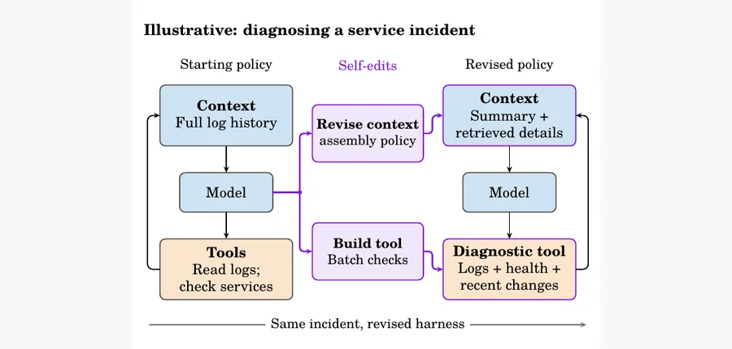 arXiv 2026-11-03 · cs.AI · #1 **[Exo: An Architecture for Self-Improving Systems at Runtime](https://arxiv.org/abs/2611.00463)** Alexander Krentsel , Sylvia Ratnasamy , Ion Stoica , Martin Casado , Ankur Goyal Affiliation: University of California, Berkeley / Andreessen Horowitz / Braintrust [Paper](https://arxiv.org/abs/2611.00463) · [Figure source](https://arxiv.org/pdf/2611.00463) 

[EN] Abstract
Agent harnesses govern how language models act in an environment; designing their policies by hand is difficult, while automated techniques require representative datasets and costly executions. We present Exo, an agent runtime architecture for safe learning during ongoing work that collapses the optimization loop into task execution, allowing agents to revise both their harness and their strategies for further improvement. A minimal protected mechanism layer preserves execution history and governs policy activation while the harness evolves through inspectable code changes. On long-running objectives in an open-world game, Exo reduces model cost by 12-53% relative to Codex and Pi in standalone runs and 45-82% in transfer runs, while matching task completion rates. Compared with the same starting policy without the ability to edit policy, Exo reduces held-out model cost by 35-61% on AppWorld and SREGym with comparable correctness, cutting AppWorld's mean task time by 13% and SREGym's median diagnosis time by 35%. On Continual Learning Bench coding tasks, model cost including learning falls by 14%, with both policies resolving every issue. <a href="https://arxiv.org/list/cs/new?skip=0&amp;show=2000&amp;check=20261104#2611.00463">Source</a>

[ZH] Abstract
Agent 运行框架决定语言模型如何在环境中行动；手工设计其策略很困难，而自动化技术又需要有代表性的数据集和昂贵的执行。我们提出 Exo，一种支持在持续工作过程中安全学习的 Agent 运行时架构，它把优化循环融入任务执行，使 Agent 能同时修订自身运行框架及进一步改进的策略。当运行框架通过可检查的代码变更演化时，一个最小化的受保护机制层保留执行历史并管理策略激活。在开放世界游戏的长期目标上，与 Codex 和 Pi 相比，Exo 在独立运行中将模型成本降低 12–53%，在迁移运行中降低 45–82%，同时保持相当的任务完成率。与无法编辑策略的相同初始策略相比，Exo 在 AppWorld 和 SREGym 的留出测试上将模型成本降低 35–61%，正确性相当，并将 AppWorld 平均任务时间缩短 13%、SREGym 诊断时间中位数缩短 35%。在 Continual Learning Bench 编码任务上，包含学习在内的模型成本下降 14%，两种策略均解决了全部问题。 <a href="https://arxiv.org/list/cs/new?skip=0&amp;show=2000&amp;check=20261104#2611.00463">Source</a>
 | 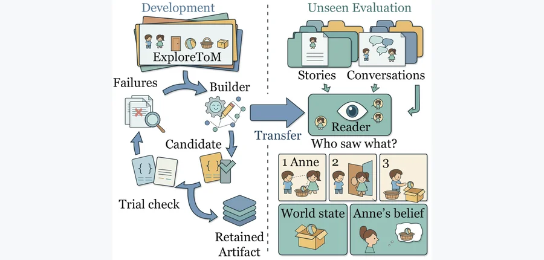 arXiv 2026-11-03 · cs.CL · #2 **[CogRSI: Evolving and Auditing Cognitive Reasoning Strategies](https://arxiv.org/abs/2611.01113)** Yandan zheng , Haoran Luo , Xinliang Zhou , Anhtuan Luu Affiliation: Nanyang Technological University / Stanford University / VinUniversity [Paper](https://arxiv.org/abs/2611.01113) · [Figure source](https://arxiv.org/html/2611.01113v1/fig1_9pt_v4_sh.png) 

[EN] Abstract
Can a language model learn better ways to reason about other people's minds by improving its own strategies, and are the strategies it learns actually right? We study this with cogrsi. A grounded reader marks who saw each event in a story and uses a short written principle to settle disagreements between its readings. With a principle written by experts, it beats self-consistency at the same token cost. A self-improvement loop then writes the principle itself. It keeps an update only if accuracy rises by a calibrated margin, and in one variant only if it also passes counterfactual test pairs. The learned principles transfer: on 800 BigToM pairs that no system had seen, each of them scores higher than the expert principle. We then check what the learned rules actually say. Each rule is translated into code and run on thousands of small stories with known answers. Most of them give a wrong answer in at least one situation they claim to cover, for example by treating a character who is in the room as knowing what happened even while asleep. Accuracy does not reveal which rules are wrong, and the counterfactual test does not fix this. A strategy can help in practice and still be wrong as a rule, so both need checking. Our code and data are publicly available. <a href="https://arxiv.org/list/cs/new?skip=0&amp;show=2000&amp;check=20261104#2611.01113">Source</a>

[ZH] Abstract
语言模型能否通过改进自身策略，学会更好地推理他人的心理？它学到的策略真的正确吗？我们用 cogrsi 研究这一问题。一个有依据的阅读器标记故事中谁目睹了每个事件，并用一条简短的书面原则解决不同阅读结果之间的分歧。使用专家撰写的原则时，它在相同 token 成本下优于自一致性方法。随后，自改进循环自己撰写这条原则。只有当准确率提高超过校准后的幅度时，系统才保留更新；其中一个变体还要求更新通过反事实测试对。所学原则能够迁移：在所有系统均未见过的 800 对 BigToM 样例上，每条所学原则的得分都高于专家原则。接着，我们检查所学规则实际上表达了什么。每条规则都被翻译成代码，并在数千个答案已知的小故事上运行。大多数规则在其声称覆盖的至少一种情形下给出了错误答案，例如将身处房间但正在睡觉的人物视为知道发生了什么。准确率无法揭示哪些规则有错，反事实测试也未解决这一问题。策略可以在实践中有帮助，却仍然是一条错误的规则，因此两者都需要检查。我们的代码与数据已公开。 <a href="https://arxiv.org/list/cs/new?skip=0&amp;show=2000&amp;check=20261104#2611.01113">Source</a>
 | 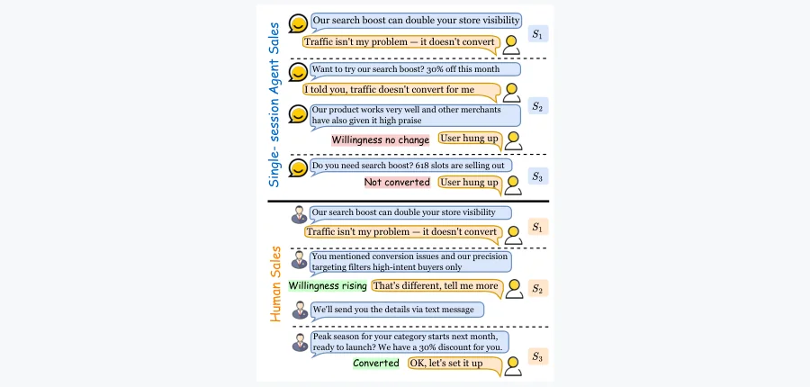 arXiv 2026-11-03 · cs.AI · #3 **[SPAR: Experience-Driven Strategy Evolution in Multi-Session B2B Sales](https://arxiv.org/abs/2611.01695)** Hangming Zhang , Yao Zhao , Haotian Kuang , C. L. Philip Chen , Tong Zhang , Tengyue Ma Affiliation: South China University of Technology / Alibaba Group [Paper](https://arxiv.org/abs/2611.01695) · [Figure source](https://arxiv.org/html/2611.01695v1/introduction.png) 

[EN] Abstract
B2B outbound sales involves high transaction values and relationship-based trust, so closing a deal typically requires multiple rounds of outreach building on prior context. Existing LLM-based sales agents operate within single sessions and cannot carry forward context or refine strategies from experience. Methods that do learn from experience store lessons as unstructured text and treat all outcomes as equally informative, with no mechanism to distinguish a flawed strategy from an external factor. We propose SPAR, a self-evolving framework that models selling strategies as testable hypotheses and refines them without parameter updates. A double-loop architecture lets an inner loop adapt to individual merchants through episodic memory while an outer loop evolves a shared strategy playbook through causal attribution and hypothesis-driven evolution. In a live A/B test on the 1688 platform with over 200,000 merchants, SPAR achieves +15.8% conversion lift and +35.8% high-intent merchant growth. Human evaluation by domain experts rates SPAR at 4.62 out of 5 on overall sales quality, the highest among all methods. <a href="https://arxiv.org/list/cs/new?skip=0&amp;show=2000&amp;check=20261104#2611.01695">Source</a>

[ZH] Abstract
B2B 外呼销售涉及高交易价值和基于关系的信任，因此成交通常需要基于先前上下文开展多轮沟通。现有基于 LLM 的销售 Agent 在单次会话内运行，无法延续上下文或从经验中优化策略。能够从经验中学习的方法也将经验教训保存为非结构化文本，把所有结果视为具有相同信息量，没有机制区分有缺陷的策略和外部因素。我们提出 SPAR，一种将销售策略建模为可检验假设、并在不更新参数的情况下优化策略的自演化框架。双循环架构使内循环通过情景记忆适应单个商家，而外循环通过因果归因和假设驱动的演化更新共享策略手册。在 1688 平台覆盖超过 20 万商家的在线 A/B 测试中，SPAR 实现了 +15.8% 的转化提升和 +35.8% 的高意向商家增长。领域专家的人类评估给 SPAR 的整体销售质量打出 4.62 分（满分 5 分），在所有方法中最高。 <a href="https://arxiv.org/list/cs/new?skip=0&amp;show=2000&amp;check=20261104#2611.01695">Source</a>
 |
| 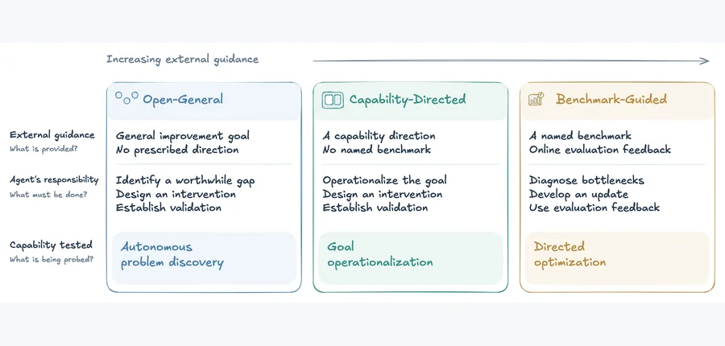 arXiv 2026-11-03 · cs.CV · #4 **[RSI-Env: An Open-Ended Environment for Recursive Self-Improvement of Agents](https://arxiv.org/abs/2611.01736)** Wanying Qu , Zhiyuan Fan , Jiyao Liu , Jiang Zhou , Jianghan Shen , Yanwei Fu , Dongrui Liu Affiliation: Fudan University / Hong Kong University of Science and Technology / Georgia Institute of Technology / Nanjing University / Shanghai Artificial Intelligence Laboratory / Shanghai Innovation Institute [Paper](https://arxiv.org/abs/2611.01736) · [Figure source](https://arxiv.org/html/2611.01736v1/task_settings.png) 

[EN] Abstract
Recursive self-improvement (RSI) envisions agent systems that autonomously improve their own models and harnesses, with each updated system continuing to improve itself. Existing approaches typically restrict optimization objectives, editable components, or evaluation procedures, limiting open-ended exploration and continuity across generations. We introduce RSI-Env, a persistent environment for coordinated model-harness improvement, supporting autonomous training, harness modification, and retention of research state. An independent Host Controller manages services, evaluation, and versioning. Under Self, each accepted model-harness version takes over the next improvement round. We define three settings that vary goal specificity and access to benchmark feedback: Open-General, Capability-Directed, and Benchmark-Guided. Across these three settings, we compare Self with two fixed external Teachers on seven tasks, starting from Qwen3.8-27B with a minimal harness. Without benchmark feedback, Open-General Self raises GPQA Diamond accuracy from 65.2% to 73.2% and AIME 2026 accuracy from 53.3% to 56.7%. All three Capability-Directed Self runs achieve target-aligned gains. Knowledge Self demonstrates continued improvement across system updates, with SimpleQA accuracy rising from 82.0% to 85.0% and then 88.0%. Benchmark guidance and Teacher benefits vary by task. These results demonstrate RSI-Env's support for open-ended exploration and sustained recursive improvement within the studied runs, while highlighting challenges in preserving gains across capabilities. <a href="https://arxiv.org/list/cs/new?skip=0&amp;show=2000&amp;check=20261104#2611.01736">Source</a>

[ZH] Abstract
递归自我改进（RSI）设想 Agent 系统自主改进自身模型与运行框架，并由每个更新后的系统继续改进自身。现有方法通常限制优化目标、可编辑组件或评估过程，因而限制了开放式探索和跨代连续性。我们提出 RSI-Env，一个支持模型与运行框架协同改进的持久环境，可开展自主训练、运行框架修改并保留研究状态。独立的 Host Controller 管理服务、评估和版本控制。在 Self 模式下，每个被接受的模型—运行框架版本接管下一轮改进。我们定义三种设置，改变目标具体程度和对基准反馈的访问：Open-General、Capability-Directed 和 Benchmark-Guided。在这三种设置下，我们以配备最小运行框架的 Qwen3.8-27B 为起点，在七项任务上比较 Self 与两个固定的外部 Teacher。在没有基准反馈的情况下，Open-General Self 将 GPQA Diamond 准确率从 65.2% 提高到 73.2%，将 AIME 2026 准确率从 53.3% 提高到 56.7%。三个 Capability-Directed Self 运行均取得与目标一致的改进。Knowledge Self 展示了跨系统更新的持续改进，SimpleQA 准确率从 82.0% 升至 85.0%，再升至 88.0%。基准指导和 Teacher 的收益因任务而异。这些结果展示了 RSI-Env 在所研究运行中支持开放式探索及持续递归改进的能力，同时凸显了跨能力保留收益的挑战。 <a href="https://arxiv.org/list/cs/new?skip=0&amp;show=2000&amp;check=20261104#2611.01736">Source</a>
 | 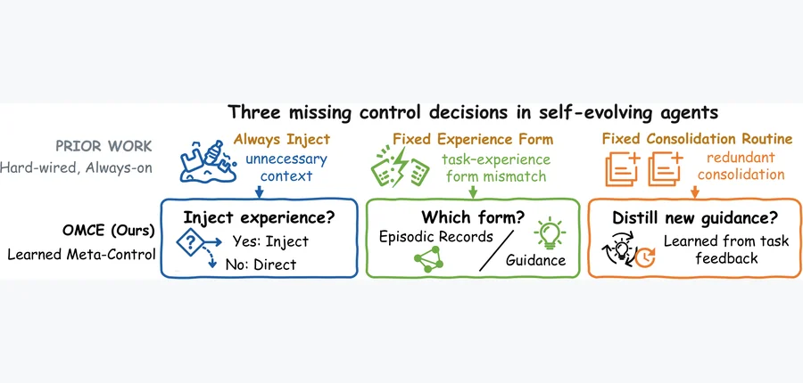 arXiv 2026-11-03 · cs.LG · #5 **[Evolving Memory, Learning to Meta-Control: Test-Time Adaptation for Experience-augmented LLM Agents](https://arxiv.org/abs/2611.01747)** Zeyuan Zhao , Yuanyuan Shi , Peng Yu , Lingyue Fu , Shao Zhang , Ying Wen Affiliation: Shanghai Jiao Tong University / Shanghai Artificial Intelligence Laboratory [Paper](https://arxiv.org/abs/2611.01747) · [Figure source](https://arxiv.org/html/2611.01747v1/MCE_Intro_cropped_pdfresizer.com.png) 

[EN] Abstract
Self-evolving agents accumulate experience from task streams, but existing frameworks typically rely on fixed pipelines to retrieve and utilize this experience, neglecting when and how to deploy it. We introduce Online Meta-Control of Experience (OMCE), a framework that updates experience memory and learns a meta-control policy from task feedback during test-time adaptation. OMCE employs a lightweight contextual-bandit meta-controller that uses compact retrieval signals to select among four cognitive actions: DIRECT, EPISODE, GUIDE, and DISTILL. This routing mechanism operationalizes three coupled decisions: whether to invoke experience, which memory format to utilize, and when to consolidate new guidance. OMCE evolves online, leveraging task feedback to update the memory bank and refine the routing policy via contextual bandit updates. Experiments on four online adaptation benchmarks across four backbones show that OMCE improves first-attempt success by up to 20.5 percentage points over the strongest compared baseline, while reducing per-task token use by a factor of 5.7 to 62.5 relative to ACE with GPT-5.2. Controlled ablations further support the benefits of learned routing and continued routing policy adaptation. <a href="https://arxiv.org/list/cs/new?skip=0&amp;show=2000&amp;check=20261104#2611.01747">Source</a>

[ZH] Abstract
自演化 Agent 从任务流中积累经验，但现有框架通常依赖固定流水线检索和使用这些经验，忽略了何时以及如何部署经验。我们提出经验在线元控制（Online Meta-Control of Experience，OMCE），它在测试时适应过程中，根据任务反馈更新经验记忆并学习元控制策略。OMCE 使用轻量级上下文赌博机元控制器，根据紧凑的检索信号在四种认知动作间选择：DIRECT、EPISODE、GUIDE 和 DISTILL。这种路由机制实现三个相互关联的决策：是否调用经验、使用何种记忆格式、何时整合新指导。OMCE 在线演化，利用任务反馈更新记忆库，并通过上下文赌博机更新优化路由策略。在四个在线适应基准和四种骨干模型上的实验表明，相较于最强对比基线，OMCE 将首次尝试成功率最多提高 20.5 个百分点；相较于使用 GPT-5.2 的 ACE，每任务 token 使用量减少至其 1/5.7 到 1/62.5。受控消融进一步支持了学习路由及持续适应路由策略的益处。 <a href="https://arxiv.org/list/cs/new?skip=0&amp;show=2000&amp;check=20261104#2611.01747">Source</a>
 | 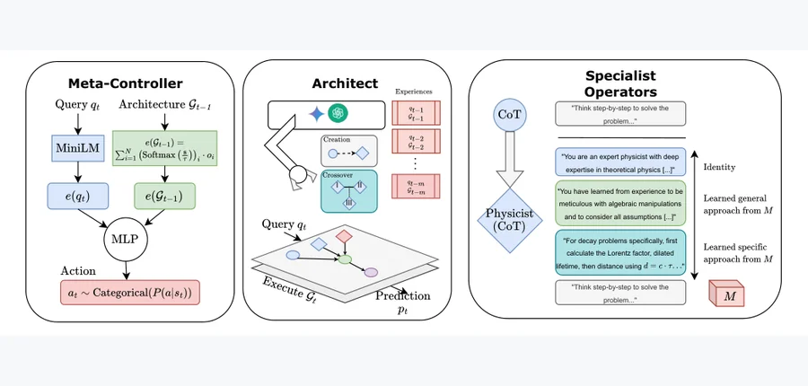 arXiv 2026-11-03 · cs.MA · #6 **[Automated Stateful Specialization for Adaptive Agent Systems](https://arxiv.org/abs/2611.01870)** Myan Vu , Harrish Ayyanar , Jiang Pang , Anwiketh Reddy , Mayank Goel Affiliation: University College London / Algoverse / Northeastern University / Lossfunk / University of Auckland [Paper](https://arxiv.org/abs/2611.01870) · [Figure source](https://arxiv.org/html/2611.01870v1/components_drawio.png) 

[EN] Abstract
Current automated agent design frameworks produce either static workflows that lack adaptability or per-query optimizers that prevent the accumulation of deep, agent-level task expertise. We propose a new direction that reconciles these paradigms: creating stateful teams of specialist agents that accumulate knowledge over time and can be reconfigured for novel tasks entirely without human intervention. To this end, we introduce ASpec, a framework that manages this full agent lifecycle by first autonomously discovering specialist archetypes via evolutionary search and then cultivating their expertise through experience, mirroring how human experts learn through practice and reflection. We further introduce a lightweight hierarchical control policy, "retain-then-escalate," which governs when to leverage the established agent system versus when to adapt its structure. Through comprehensive experiments, we demonstrate that this approach leads to significant performance gains on expert-level scientific benchmarks like GPQA while matching the state-of-the-art on broader domain tasks, demonstrating a promising path toward agent systems that are simultaneously expert, adaptive, and efficient. We will release the code at this https URL . <a href="https://arxiv.org/list/cs/new?skip=0&amp;show=2000&amp;check=20261104#2611.01870">Source</a>

[ZH] Abstract
当前自动化 Agent 设计框架要么产生缺乏适应性的静态工作流，要么采用逐查询优化器，无法积累深厚的 Agent 级任务专长。我们提出一个协调两种范式的新方向：创建有状态的专家 Agent 团队，使其随时间积累知识，并能完全无需人工干预地针对新任务重新配置。为此，我们提出 ASpec，它管理完整的 Agent 生命周期，先通过演化搜索自主发现专家原型，再通过经验培养其专长，类似人类专家通过实践与反思学习。我们进一步提出轻量级分层控制策略“retain-then-escalate”，决定何时利用已建立的 Agent 系统、何时调整其结构。通过全面实验，我们证明这种方法在 GPQA 等专家级科学基准上带来显著性能提升，同时在更广领域任务上达到当前最先进水平，展示了一条通向兼具专长、适应性和效率的 Agent 系统的有前景路径。我们将在原文所链接的 HTTPS 地址发布代码。 <a href="https://arxiv.org/list/cs/new?skip=0&amp;show=2000&amp;check=20261104#2611.01870">Source</a>
 |
| 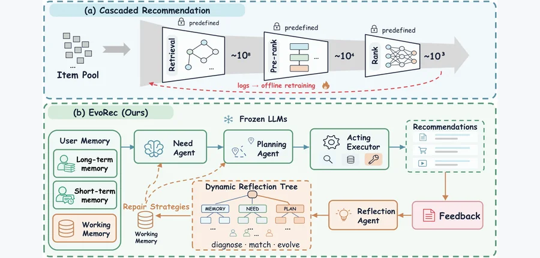 arXiv 2026-11-03 · cs.IR · #7 **[EvoRec: A Unified Self-Evolving Agentic Recommender with Dynamic Reflection Trees](https://arxiv.org/abs/2611.01977)** Mengting Li , Long Zhang , Hao Jiang , Sheng Yu , Fei Pan , Peng Jiang Affiliation: Kuaishou [Paper](https://arxiv.org/abs/2611.01977) · [Project](https://mtli-buaa.github.io/evorec-project-page/) · [Figure source](https://arxiv.org/html/2611.01977v1/intro_fig.png) 

[EN] Abstract
Conventional recommender systems rely on fixed cascaded pipelines, limiting their ability to adapt to evolving user needs and feedback. Existing agentic recommenders introduce reasoning and tool use but often lack end-to-end decision control and systematic failure reflection. We propose EvoRec, a unified agentic recommendation framework that combines autonomous decision-making with reflection-driven self-evolution. A Need Agent infers user needs from long-term, short-term, and working memory. A Planning Agent adaptively allocates retrieval budgets between Behavior Continuation and Need Satisfaction, selects retrieval tools, and sets ranking-fusion weights. An Acting Executor executes the plan and records decision traces. Following user feedback, a Dynamic Reflection Tree identifies failures in need inference, planning, or previous repairs, proposes personalized corrections, and validates them through replay. Verified repairs update working memory and are distilled into reusable cross-user strategies, enabling continual improvement without parameter updates. Experiments on a Kuaishou local-services advertising dataset show a 15.7% Hit@50 improvement over the strongest baseline. Hierarchical reflection further improves Hit@50 by 13.1% among users with prior repairs. In a seven-day online A/B test, nearline EvoRec increases advertising revenue by 4.6% and CTCVR by 3.5%, with a 14.5% revenue gain for high-intent users. These results demonstrate the effectiveness of reflection-driven self-evolution in industrial-scale recommendation. <a href="https://arxiv.org/list/cs/new?skip=0&amp;show=2000&amp;check=20261104#2611.01977">Source</a>

[ZH] Abstract
传统推荐系统依赖固定的级联流水线，限制了其适应用户需求和反馈变化的能力。现有 Agent 推荐系统引入推理与工具使用，却往往缺乏端到端决策控制和系统性的失败反思。我们提出 EvoRec，一个将自主决策与反思驱动自演化结合的统一 Agent 推荐框架。Need Agent 从长期、短期和工作记忆推断用户需求。Planning Agent 在行为延续与需求满足之间自适应分配检索预算，选择检索工具，并设置排序融合权重。Acting Executor 执行计划并记录决策轨迹。收到用户反馈后，Dynamic Reflection Tree 识别需求推断、规划或先前修复中的失败，提出个性化修正，并通过回放验证。经过验证的修复更新工作记忆，再提炼成可跨用户复用的策略，从而无需参数更新即可持续改进。在快手本地服务广告数据集上的实验显示，Hit@50 相较最强基线提高 15.7%。分层反思进一步将有先前修复记录用户的 Hit@50 提高 13.1%。在为期七天的在线 A/B 测试中，近线 EvoRec 将广告收入提高 4.6%、CTCVR 提高 3.5%，并使高意向用户收入提高 14.5%。这些结果展示了反思驱动自演化在工业级推荐中的有效性。 <a href="https://arxiv.org/list/cs/new?skip=0&amp;show=2000&amp;check=20261104#2611.01977">Source</a>
 | 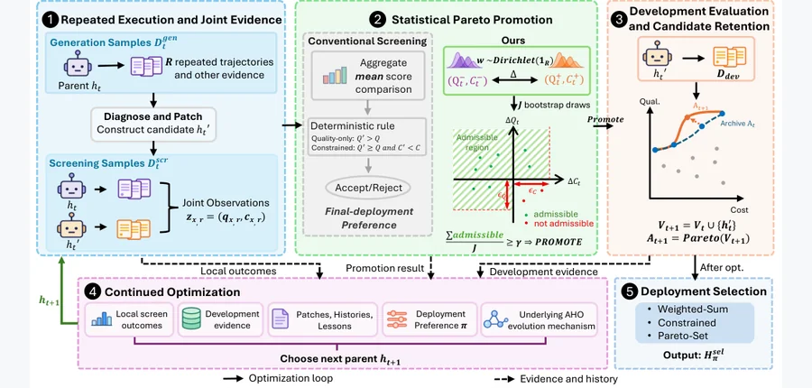 arXiv 2026-11-03 · cs.AI · #8 **[ParetoSaddler: Pareto-Guided Optimization of Agent Harnesses for Quality and Cost](https://arxiv.org/abs/2611.02079)** Xingzhi Qian , Sungho Park , Rongyuan Tan , Jianbo Yu , Jue Zhang , Lorenzo Cavallaro , Menglin Xia , Yanzhi Chen , Xinnuo… Affiliation: University College London / Pohang University of Science and Technology / Southern University of Science and Technology / Southeast University / Microsoft / Mohamed bin Zayed University of Artificial Intelligence [Paper](https://arxiv.org/abs/2611.02079) · [Figure source](https://arxiv.org/html/2611.02079v1/framework.png) 

[EN] Abstract
Harness optimization can substantially improve LLM agents without modifying model weights, but existing methods primarily optimize response quality. Extending them to joint quality--cost optimization introduces a challenge: applying the deployment preference during intermediate updates can prematurely reject candidates that are valuable for later improvements. We introduce ParetoSaddler, which addresses this mismatch by separating intermediate candidate promotion from final deployment selection. At each iteration, an optimizer updates a parent harness to produce a candidate, and then compares the two over repeated executions and uses Bayesian bootstrap Pareto support to promote candidates showing credible progress in either quality or cost. Promoted candidates receive broader development evaluation and remain available as parents for later optimization steps. We evaluate ParetoSaddler on ClawMark and GAIA2 using domain-disjoint splits. On ClawMark, ParetoSaddler improves quality from 70.86\% to 81.35\% while reducing cost from \$1.17 to \$1.01 per task; on GAIA2, it improves quality from 56.22\% to 62.89\% while reducing cost from \$0.78 to \$0.45 per task. The Pareto-selected harnesses also achieve higher quality at lower cost than quality-only harness optimization. Analysis shows that Pareto-aware optimization retains intermediate candidates that would be discarded by deployment preference but can support later improvements, while Bayesian bootstrap screening filters out candidates whose gains are weakly supported across runs. <a href="https://arxiv.org/list/cs/new?skip=0&amp;show=2000&amp;check=20261104#2611.02079">Source</a>

[ZH] Abstract
运行框架优化无需修改模型权重，就能显著提升 LLM Agent，但现有方法主要优化响应质量。将其扩展到质量—成本联合优化会带来一个挑战：在中间更新中应用部署偏好，可能过早拒绝对后续改进有价值的候选。我们提出 ParetoSaddler，通过分离中间候选晋升和最终部署选择来解决这一不匹配。每次迭代中，优化器更新一个父运行框架以生成候选，随后通过重复执行比较两者，并利用贝叶斯自助法的帕累托支持度，晋升在质量或成本任一维度上表现出可信进展的候选。被晋升的候选接受更广泛的开发集评估，并保留为后续优化步骤的可选父代。我们采用领域不相交划分，在 ClawMark 和 GAIA2 上评估 ParetoSaddler。在 ClawMark 上，质量从 70.86% 提高到 81.35%，每任务成本从 1.17 美元降至 1.01 美元；在 GAIA2 上，质量从 56.22% 提高到 62.89%，每任务成本从 0.78 美元降至 0.45 美元。帕累托选择的运行框架也比仅优化质量的运行框架实现更高质量和更低成本。分析表明，帕累托感知优化保留了会被部署偏好抛弃、但能支持后续改进的中间候选，而贝叶斯自助法筛选会滤除跨运行支持较弱的收益。 <a href="https://arxiv.org/list/cs/new?skip=0&amp;show=2000&amp;check=20261104#2611.02079">Source</a>
 | 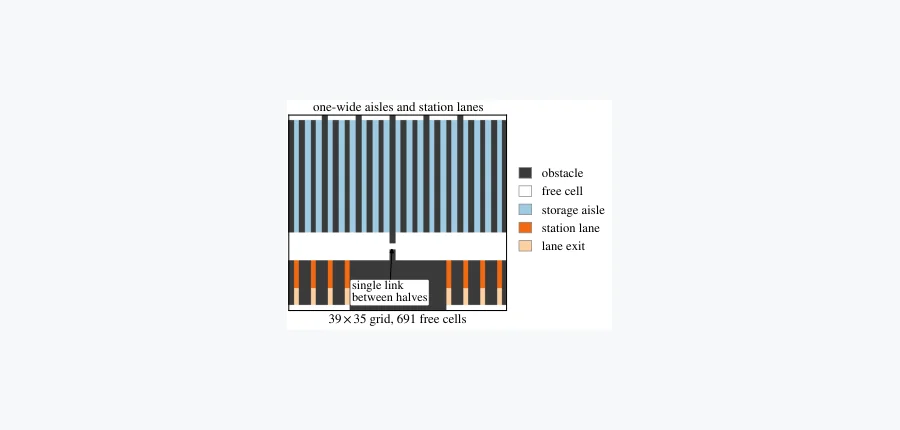 arXiv 2026-11-03 · cs.RO · #9 **[Late Autumn: LLM Agents Specialize a General Multi-Robot Planner for One Warehouse](https://arxiv.org/abs/2611.02391)** Yimin Tang , Han Zhang , Shao-Hung Chan , Erdem Bıyık , Sven Koenig , Jingkai Chen Affiliation: University of Southern California / Symbotic / University of California, Irvine [Paper](https://arxiv.org/abs/2611.02391) · [Figure source](https://arxiv.org/html/2611.02391v1/map_tuned.png) 

[EN] Abstract
No algorithm is best on all problems, but a real warehouse is a narrow problem: its layout and processes rarely change. Operators still run one general multi-robot planner at many sites, because experts cannot tune it for each one. In this work, which we call Late Autumn, we explore whether LLM coding agents running autonomous research can specialize a general planner for one site, trading generality for throughput, much as post-training adapts a pretrained LLM to one task. We study six campaigns on a lifelong planner that combines task assignment with multi-agent path finding, on a floor modeled on an existing automated warehouse. We find that (1) the agents raise throughput by 22--60%, and the gains hold on unseen seeds; (2) they rediscover known MAPF mechanisms, such as corridor-exit priorities, local guidance, and rollouts, and independent campaigns find the same bottleneck; (3) the gains largely carry over to another layout, a larger fleet, and other service times, shrink with a smaller fleet, and mostly vanish under an outbound-heavy demand mix; and (4) each final patch (0.7k--2.4k lines) is a chain of scored commits with a median step of 27 lines, so experts can review it, and review finds problems that the score misses; some patches multiply planner compute by over 100x. LLM agents can therefore turn each site's bias into extra throughput at little engineering cost, with reviewable patches; we expect experts to shift toward designing insightful metrics and fast simulators that mirror the real problem. <a href="https://arxiv.org/list/cs/new?skip=0&amp;show=2000&amp;check=20261104#2611.02391">Source</a>

[ZH] Abstract
没有算法能在所有问题上最优，但真实仓库是一个狭窄的问题：布局和流程很少变化。运营者仍在许多场地运行同一个通用多机器人规划器，因为专家无法逐一调优。在这项名为 Late Autumn 的工作中，我们探索开展自主研究的 LLM 编码 Agent 能否针对单一场地专门化通用规划器，以通用性换取吞吐量，类似于后训练把预训练 LLM 适配到单一任务。我们研究了六次实验活动，使用一个结合任务分配与多 Agent 路径寻找的终身规划器，场地按现有自动化仓库建模。我们发现：（1）Agent 将吞吐量提高 22–60%，并在未见随机种子上保留收益；（2）它们重新发现了走廊出口优先级、局部引导和 rollout 等已知 MAPF 机制，不同独立实验也发现了同一瓶颈；（3）收益大体可迁移至另一布局、更大车队及不同服务时间，在更小车队上缩小，在出库占主导的需求组合下大多消失；（4）每个最终补丁（0.7k–2.4k 行）都是一串经过评分的提交，中位步长为 27 行，因此专家可以审查，而且审查发现了评分遗漏的问题；一些补丁令规划计算量增加超过 100 倍。因此，LLM Agent 能以较少工程投入，将每个场地的特性转化为额外吞吐量，并留下可审查补丁；我们预计专家会转向设计有洞察力的指标和能反映真实问题的快速模拟器。 <a href="https://arxiv.org/list/cs/new?skip=0&amp;show=2000&amp;check=20261104#2611.02391">Source</a>
 |
| 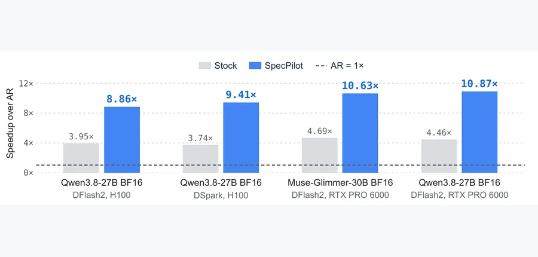 arXiv 2026-11-03 · cs.LG · #10 **[SpecPilot: Autonomous Algorithm Discovery and Systems Optimization for Speculative Decoding](https://arxiv.org/abs/2611.02501)** Kunjun Li , Wenhao Chai , Yihao Liang , Yuezhou Hu , Shuyao Xu , Yi Pan , William X. Zheng , Kannan Ramchandran , Kurt Keu… Affiliation: University of California, Berkeley / Princeton University / Stanford University / NVIDIA [Paper](https://arxiv.org/abs/2611.02501) · [Code](https://github.com/StargazerX0/SpecPilot) · [Project](https://stargazerx0.github.io/specpilot-project-page/) · [Figure source](https://arxiv.org/pdf/2611.02501) 

[EN] Abstract
Speculative decoding accelerates memory-bound LLM decoding with a lightweight drafter, and parallel drafters extend this speedup by drafting a whole block in one forward pass. However, it remains unclear whether their released systems (stock) attain the full speedup that parallel drafting permits. We identify three challenges. First, with one request, each step accepts few tokens but reads every target weight. Second, with batching, per-request verification work roughly halves the speedup over autoregressive (AR) decoding. Third, speculative decoding is deployment-specific, and no universal optimization fits every serving regime, drafter, target model and GPU. To address these challenges, we present SpecPilot, an autonomous agentic loop that discovers algorithms and systems optimizations for each deployment. In each round, a cost model locates the largest gaps between the current system and its ceiling. Parallel agents explore directions and integrate the successful ones. Token forcing checks every output token against stock to detect reward hacking. A structured memory carries validated mechanisms to new rounds and deployments. SpecPilot discovered a general lossless 12-bit weight format, tree verification for hybrid recurrent targets, two-level verification and three batching mechanisms. We evaluate it across four target models, three drafters, two GPU platforms and five benchmarks. Without training or quality loss, it raises the speedup over AR from stock's 4.46$\times$ to 10.87$\times$ with one request, and from 1.94$\times$ to 3.93$\times$ with batching. <a href="https://arxiv.org/list/cs/new?skip=0&amp;show=2000&amp;check=20261104#2611.02501">Source</a>

[ZH] Abstract
推测解码通过轻量级草稿模型加速受内存限制的 LLM 解码，并行草稿模型则通过一次前向传播起草整个块来扩展加速。然而，尚不清楚它们发布的系统（stock）是否达到并行起草所允许的全部加速。我们识别出三项挑战。第一，在单请求时，每步接受的 token 很少，却读取全部目标模型权重。第二，在批处理时，每请求验证工作使相对自回归（AR）解码的加速大致减半。第三，推测解码依赖部署，不存在适用于所有服务模式、草稿模型、目标模型和 GPU 的通用优化。为解决这些挑战，我们提出 SpecPilot，一个针对每种部署发现算法和系统优化的自主 Agent 循环。每轮中，成本模型定位当前系统与性能上限之间最大的差距。并行 Agent 探索不同方向，并整合成功结果。Token forcing 将每个输出 token 与 stock 逐一核对，以检测奖励投机。结构化记忆将经过验证的机制带入新一轮及新部署。SpecPilot 发现了通用的无损 12 位权重格式、针对混合循环目标模型的树验证、两级验证和三种批处理机制。我们在四个目标模型、三个草稿模型、两种 GPU 平台和五个基准上评估它。在无需训练且不损失质量的情况下，单请求相对 AR 的加速从 stock 的 4.46 倍提高到 10.87 倍，批处理时从 1.94 倍提高到 3.93 倍。 <a href="https://arxiv.org/list/cs/new?skip=0&amp;show=2000&amp;check=20261104#2611.02501">Source</a>
 | 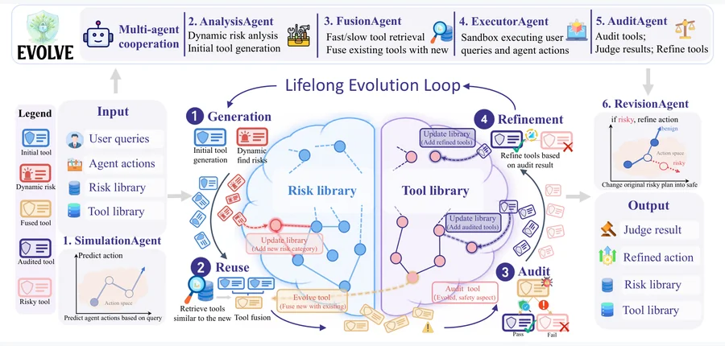 arXiv 2026-11-03 · cs.AI · #11 **[Cumulative and Audited Guardrail Tool Evolution for LLM Agent Safety](https://arxiv.org/abs/2611.02516)** Xiao Yang , Aishan Liu , Siyuan Liang , Zonghao Ying , Le Wang , Jiakai Wang , Xianglong Liu , Dacheng Tao Affiliation: Beihang University / Nanyang Technological University / Zhongguancun Laboratory [Paper](https://arxiv.org/abs/2611.02516) · [Figure source](https://arxiv.org/html/2611.02516v1/framework.png) 

[EN] Abstract
Large language model (LLM) agents increasingly operate in open-world environments where safety risks cannot be fully predefined. However, most existing guardrail mechanisms remain static, relying on fixed rules, prompts, or classifiers that generalize poorly to emerging risks. Here we present EVOLVE, a tool-level self-evolving defense framework that formulates agent security as a process of cumulative security evolution. Inspired by how human societies transform experiences into transferable protective knowledge, EVOLVE externalizes security knowledge into executable guardrail tools that are continuously inherited, independently audited, and iteratively refined through lifelong interaction. Across multiple benchmarks, backbone models, and embodied environments, EVOLVE consistently outperforms existing defenses across diverse risk scenarios with +22\% average F1 score. We further validate the framework in real-world robotic and autonomous agent systems. Our results suggest that scalable agent safety may require continuously evolving defense systems rather than static guardrails. <a href="https://arxiv.org/list/cs/new?skip=0&amp;show=2000&amp;check=20261104#2611.02516">Source</a>

[ZH] Abstract
大语言模型（LLM）Agent 越来越多地在开放世界环境中运行，其中的安全风险无法完全预定义。然而，大多数现有护栏机制仍是静态的，依赖固定规则、提示词或分类器，对新兴风险泛化较差。我们提出 EVOLVE，一种工具级自演化防御框架，将 Agent 安全表述为累积安全演化的过程。受人类社会将经验转化为可迁移保护性知识的启发，EVOLVE 将安全知识外化为可执行护栏工具，在终身交互中持续继承、独立审计并迭代优化。在多个基准、骨干模型和具身环境中，EVOLVE 在多样风险场景下持续优于现有防御，平均 F1 分数提高 +22%。我们进一步在真实机器人及自主 Agent 系统中验证该框架。结果表明，可扩展的 Agent 安全可能需要持续演化的防御系统，而非静态护栏。 <a href="https://arxiv.org/list/cs/new?skip=0&amp;show=2000&amp;check=20261104#2611.02516">Source</a>
 | 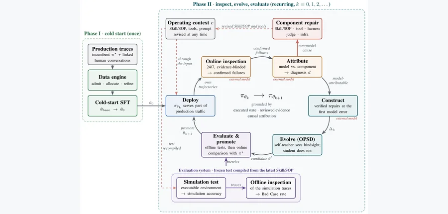 arXiv 2026-11-03 · cs.AI · #12 **[CARE: Grounded Recursive Self-Improvement for Production Customer-Service Agents](https://arxiv.org/abs/2611.02839)** Yanbei Jiang , Chao Lei , Rena Gao , Xiaochen Zhao , Yuchen Ge , Haohang Liu , Runze Nie , Qitian Chen , Qi An , Haolin So… Affiliation: Keeta, Meituan / University of Melbourne / Fudan University [Paper](https://arxiv.org/abs/2611.02839) · [Figure source](https://arxiv.org/pdf/2611.02839) 

[EN] Abstract
Recursive self-improvement (RSI) in production agents involves transforming accumulated experience into reliable model updates while adapting to evolving business policies. We present CARE (Customer-service Agent Retrospective and Evolve), a grounded RSI framework that operationalizes this process in customer service. Its goal is to replace a frontier proprietary incumbent with an in-house mid-sized model that continues learning after deployment. After a one-time cold start on governed production traces, the current model serves production traffic alongside the incumbent, and its own failures drive the next update. A 24/7 inspection process establishes failures through evidence-blinded, independently reviewed judgments. Attribution separates model errors from defects in Skills, tools, or the harness, routing component failures to repair. Model-attributable trajectories are truncated at the first erroneous decision and paired with verified repairs. On-policy self-distillation (OPSD) then updates the model using the same model as teacher, with the diagnosis and repair supplied as privileged information unavailable to the student. To support continued evolution as business requirements change, training mixes failures from different Skill/SOP versions, each judged against the policy in force when it occurred. Candidates run an executable simulation test compiled from the latest SOP and then frozen, followed by offline inspection of the resulting traces. Promotion requires a combined simulation-and-inspection score at least at parity with the deployed version, confirmation through an online comparison with the incumbent, and human approval. <a href="https://arxiv.org/list/cs/new?skip=0&amp;show=2000&amp;check=20261104#2611.02839">Source</a>

[ZH] Abstract
生产 Agent 中的递归自我改进（RSI），涉及在适应业务政策变化的同时，把积累的经验转化为可靠模型更新。我们提出 CARE（Customer-service Agent Retrospective and Evolve），一个在客服场景中落实该过程的有依据 RSI 框架。其目标是用一个部署后持续学习的内部中等规模模型，替代前沿专有的现用模型。在受治理的生产轨迹上完成一次性冷启动后，当前模型与现用模型共同处理生产流量，其自身失败驱动下一次更新。全天候检查流程通过证据盲法、独立复核的判断来确认失败。归因区分模型错误与 Skills、工具或运行框架缺陷，并将组件失败交由修复。模型可归因轨迹在首次错误决策处截断，并与经过验证的修复配对。随后，在线策略自蒸馏（OPSD）使用同一模型作为教师更新模型，其中诊断和修复以学生无法访问的特权信息提供。为了随业务需求变化持续演化，训练混合来自不同 Skill/SOP 版本的失败，每个失败都按发生时生效的政策判断。候选先运行由最新 SOP 编译并冻结的可执行模拟测试，再对所得轨迹进行离线检查。晋升要求模拟与检查的综合得分至少不低于已部署版本，通过与现用模型的在线比较确认，并获得人工批准。 <a href="https://arxiv.org/list/cs/new?skip=0&amp;show=2000&amp;check=20261104#2611.02839">Source</a>
 |
| 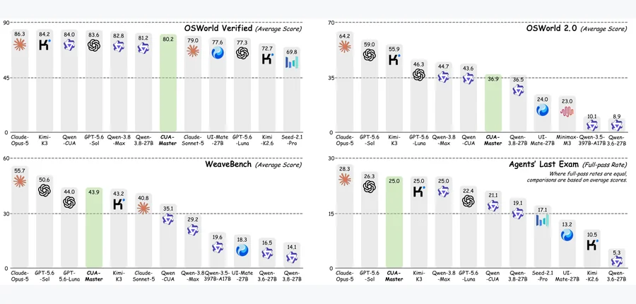 arXiv 2026-11-03 · cs.AI · #13 **[CUA-Master: Scaling Computer-use Agents through Open-World Recursive Improvements](https://arxiv.org/abs/2611.03126)** Xinlei Yu , Gen Li , Ji Zhao , Zhangquan Chen , Congcong Wang , Shuai Dong , Zelin Peng , Yuqi Xu , Hongrui Wu , Kaiwen Tu… Affiliation: MMLab, CUHK / THU / HKUST(GZ) / Explore Academy, JD [Paper](https://arxiv.org/abs/2611.03126) · [Figure source](https://arxiv.org/html/2611.03126v1/title.png) 

[EN] Abstract
Despite recent advances in CUAs, their development remains constrained by the limited diversity, controllability, and reliability of interaction data. Moreover, conventional optimization pipelines lack iterative feedback, while existing recursive improvement approaches often rely on self-generated experiences, limiting ability expansion and yielding diminishing returns. To address these challenges, we introduce CUA-Master, a nested double-loop recursive improvement framework. At the system level, an outer world-data-model flywheel continuously incorporates open-world corpus and leverages evolving model weaknesses to guide subsequent data construction and optimization iterations. At the data level, an inner flywheel couples open-world seeding and autocatalytic propagation. The former mines authentic workflows as seed tasks from instructional videos, and employs visual-semantic dual-path trajectory reconstruction; The latter transforms these seeds into reusable primitives for controllable synthesis of diverse, complex, and verifiable tasks. To enable efficient and reliable trajectory collection, we further introduce a feedback-guided snapshot-rollback retry mechanism in various real environments. Extensive experiments demonstrate that CUA-Master-27B achieves competitive performance across GUI-only and GUI-CLI hybrid benchmarks, scoring 80.2 on OSWorld Verified, 36.9 on OSWorld 2.0, 43.9 on WeaveBench, and 25.0 on Agents' Last Exam. Our framework also substantially improves the quality and efficiency of data synthesis, and exhibits continuous gains across recursive iterations. <a href="https://arxiv.org/list/cs/new?skip=0&amp;show=2000&amp;check=20261104#2611.03126">Source</a>

[ZH] Abstract
尽管计算机使用 Agent（CUA）近期取得进展，其发展仍受交互数据多样性、可控性和可靠性不足的限制。此外，传统优化流水线缺乏迭代反馈，现有递归改进方法则往往依赖自生成经验，限制能力扩展并带来递减收益。为解决这些挑战，我们提出 CUA-Master，一个嵌套双循环递归改进框架。在系统层面，外层世界—数据—模型飞轮持续吸纳开放世界语料，并利用演化中的模型弱点指导后续数据构建和优化迭代。在数据层面，内层飞轮耦合开放世界播种与自催化传播。前者从教学视频中挖掘真实工作流作为种子任务，并采用视觉—语义双路径轨迹重建；后者将种子转化为可复用原语，以可控合成多样、复杂且可验证的任务。为实现高效可靠的轨迹收集，我们进一步在多种真实环境中引入反馈引导的快照回滚重试机制。广泛实验表明，CUA-Master-27B 在纯 GUI 和 GUI-CLI 混合基准上取得有竞争力的表现，在 OSWorld Verified 上得 80.2、OSWorld 2.0 上得 36.9、WeaveBench 上得 43.9、Agents' Last Exam 上得 25.0。框架还显著提升数据合成的质量与效率，并在递归迭代中呈现持续收益。 <a href="https://arxiv.org/list/cs/new?skip=0&amp;show=2000&amp;check=20261104#2611.03126">Source</a>
 | 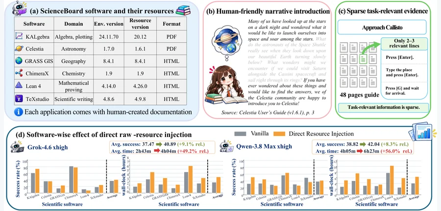 arXiv 2026-11-03 · cs.AI · #14 **[ScienceCUA: Resource-to-Skill Construction and Execution-Guided Skill Evolution for Scientific Computer Use Agents](https://arxiv.org/abs/2611.03238)** Daiqiang Li , Jingyi Peng , Rui Hu , Jia Li , Xuyang Liu , Guanren Qiao , Yujia Xiang , Qiuzhuang Sun , Zhiping Xu , Mingr… Affiliation: DeepAutonomy Technology Co., Ltd. / Peking University / Tsinghua University / Hong Kong Polytechnic University / Singapore Management University [Paper](https://arxiv.org/abs/2611.03238) · [Code](https://github.com/HSZD-Team/ScienceCUA) · [Project](https://hszd-team.github.io/ScienceCUA-website/) · [Figure source](https://arxiv.org/html/2611.03238v1/motivation.png) 

[EN] Abstract
Computer-use agents for scientific software require application-specific expertise. Much of this expertise is documented in human-authored software manuals and web pages. However, turning these resources into executable, reusable skills remains challenging due to mismatches between documented and deployed software versions and differences in scope between documentation coverage and task requirements. We introduce ScienceCUA, a two-stage framework combining resource-to-skill construction with execution-guided skill evolution. First, ScienceCUA identifies tasks supported by the software from its documentation, infers operational trajectories, and generalizes them into reusable Skills. Command catalogs, syntax constraints, and shortcuts are organized separately as References for on-demand lookup. Then, ScienceCUA uses execution feedback to drive skill self-evolution by contrasting successful and failed trajectories for the same task, identifying deficiencies, revising existing skills or adding new ones, and updating the skill library only after repeated validation in real environments. To enable reliable evaluation without benchmark noise or task leakage, we introduce two improved benchmarks. ScienceBoard-Verified provides an audited and corrected basis for measuring task performance, while ScienceBoard-VE separates skill evolution from final testing through disjoint evolution and test tasks and further supports native-agent evaluation. Experiments show that the initial Skills and References improve average task success rate by up to 7.23 percentage points over the base model, while skill self-evolution increases the total gain over the baseline to as much as 17.12 percentage points. ScienceCUA turns software documentation into an evolving set of executable skills and queryable references, offering a practical way for general-purpose agents to use scientific software reliably and at scale. <a href="https://arxiv.org/list/cs/new?skip=0&amp;show=2000&amp;check=20261104#2611.03238">Source</a>

[ZH] Abstract
科学软件的计算机使用 Agent 需要应用专属知识，其中大量知识已记录在人类编写的软件手册和网页中。然而，由于文档版本与部署软件版本不匹配，以及文档覆盖范围与任务要求不同，将这些资源转化为可执行、可复用技能仍具挑战。我们提出 ScienceCUA，一个结合资源到技能构建与执行引导技能演化的两阶段框架。首先，ScienceCUA 从文档识别软件支持的任务，推断操作轨迹，并将其泛化为可复用的 Skills。命令目录、语法约束和快捷方式单独组织为 References，以便按需查阅。随后，ScienceCUA 利用执行反馈驱动技能自演化，通过对比同一任务的成功与失败轨迹，识别不足、修订现有技能或添加新技能，并仅在真实环境反复验证后更新技能库。为实现无基准噪声或任务泄漏的可靠评估，我们提出两个改进基准。ScienceBoard-Verified 提供经过审计与纠正的任务性能测量基础，ScienceBoard-VE 以不相交的演化任务和测试任务分离技能演化与最终测试，并进一步支持原生 Agent 评估。实验显示，初始 Skills 和 References 相较基础模型最多提高平均任务成功率 7.23 个百分点，而技能自演化将相对基线的总增益提高至最多 17.12 个百分点。ScienceCUA 将软件文档转化为持续演化的可执行技能和可查询参考资料，为通用 Agent 可靠、大规模使用科学软件提供实用途径。 <a href="https://arxiv.org/list/cs/new?skip=0&amp;show=2000&amp;check=20261104#2611.03238">Source</a>
 | 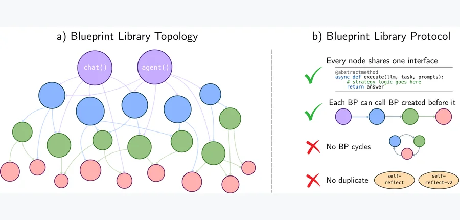 arXiv 2026-11-03 · cs.AI · #15 **[Strategist: Evolving Reasoning with Agents](https://arxiv.org/abs/2611.03618)** Taiming Lu , Qi Xu , Zhigang Hua , Zhuang Liu Affiliation: Princeton University / Meta [Paper](https://arxiv.org/abs/2611.03618) · [Figure source](https://arxiv.org/html/2611.03618v1/BP_library.png) 

[EN] Abstract
A model is only half of an AI agent system. The other half is the inference strategy: the reasoning procedure that turns model calls into a response. Today that second half is written by hand, and the experience of building one strategy never carries to the next. We introduce Strategist, a meta-agent that evolves inference strategies across tasks. Each strategy is written as a blueprint,executable code that other strategies can reuse, and together the blueprints form a library. Given a task and a small development set, Strategist retrieves related blueprints, writes candidate strategies, tests them on real samples, and revises them from the results. Every candidate then enters the library, so later tasks build on earlier discoveries. On 30 benchmarks, Strategist beats the strongest baseline on 24 and matches its average accuracy (74.7% vs.74.0%) at 39% lower inference cost. Its strategies also transfer to unseen tasks and other models without further search. The part of an AI system that is not improved on its own now does. <a href="https://arxiv.org/list/cs/new?skip=0&amp;show=2000&amp;check=20261104#2611.03618">Source</a>

[ZH] Abstract
模型只是 AI Agent 系统的一半，另一半是推理策略，即将模型调用转化为响应的推理过程。如今这另一半由人工编写，构建某一种策略的经验不会延续到下一种。我们提出 Strategist，一个跨任务演化推理策略的元 Agent。每种策略写成蓝图，即其他策略可复用的可执行代码，蓝图共同构成一个库。给定任务和一个小型开发集，Strategist 检索相关蓝图、编写候选策略、在真实样本上测试，并根据结果修订。随后每个候选都进入库，使后续任务能建立在先前发现之上。在 30 个基准上，Strategist 在其中 24 个击败最强基线，并以低 39% 的推理成本实现相当的平均准确率（74.7% 对 74.0%）。其策略也无需进一步搜索即可迁移到未见任务和其他模型。AI 系统中过去没有自行改进的部分，如今也开始自行改进。 <a href="https://arxiv.org/list/cs/new?skip=0&amp;show=2000&amp;check=20261104#2611.03618">Source</a>
 |
| 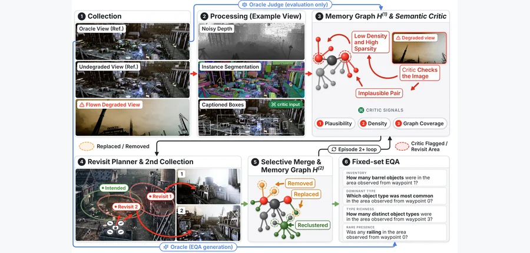 arXiv 2026-11-03 · cs.RO · #16 **[SPARK: Self-Correcting Embodied Memory via Physical Re-Observation](https://arxiv.org/abs/2611.00344)** Dmytro Kurdydyk , Aadi Palnitkar , Sebastian Scherer , Seungchan Kim Affiliation: Davidson College / University of Maryland / Carnegie Mellon University [Paper](https://arxiv.org/abs/2611.00344) · [Figure source](https://arxiv.org/html/2611.00344v1/fig_overview.png) 

[EN] Abstract
Retrieval-augmented generation (RAG) systems have seen growing adoption in embodied settings as language-queryable memories of the environment. However, existing approaches often assume a reliable single-episode knowledge base (KB) or accumulate observations across episodes without correcting prior errors. Such errors can persist through incorrect semantic labels, inaccurate object positions, and inconsistent spatial relationships. To address this, we present SPARK, a corrective multi-episode framework for embodied RAG. After the first episode, a semantic critic flags regions of the KB, a targeted planner generates revisits, and a selective merge adds, removes, or replaces KB information based on the new observations. We evaluate SPARK on four outdoor AirSim maps under two degraded viewpoint conditions, using perception-built KBs, a visibility-constrained oracle used only for evaluation, and a fixed set of 158 embodied question answering (EQA) questions scored before and after correction. A single corrective episode improves downstream EQA on every map under both conditions while storing 13-41% fewer objects than append-only updating, with gains up to 2.7x on one map-condition pair. Extending correction through Episode 4 brings every map above the EQA performance of its undegraded reference. Ablations show that the critic's three signals each contribute to performance, that targeted revisits achieve a larger mean gain than untargeted ones under the same budget, and that selective merging achieves gains comparable to append-only updating with a smaller KB. Overall, SPARK demonstrates the value of correcting embodied memory through targeted re-observation, particularly as embodied systems scale and the risk of accumulated errors increases. <a href="https://arxiv.org/list/cs/new?skip=0&amp;show=2000&amp;check=20261104#2611.00344">Source</a>

[ZH] Abstract
检索增强生成（RAG）系统作为可用语言查询的环境记忆，在具身场景中越来越常见。然而，现有方法常假定单次事件的知识库（KB）可靠，或跨事件累积观察却不纠正先前错误。这些错误可能以错误语义标签、不准的物体位置和不一致空间关系持续存在。为此，我们提出 SPARK，一个用于具身 RAG 的多事件纠错框架。首个事件后，语义评论器标记知识库区域，定向规划器生成重访计划，选择性合并依据新观察添加、删除或替换知识库信息。我们在四个室外 AirSim 地图、两种退化视角条件下评估 SPARK，使用感知构建的知识库、仅供评估的可见性受限预言机，以及固定的 158 个具身问答（EQA）问题，在纠错前后评分。一次纠错事件在两种条件下改善每张地图的下游 EQA，同时比仅追加更新少存 13–41% 的物体，在一个地图—条件组合上收益最高达 2.7 倍。将纠错延续至事件 4 后，每张地图的 EQA 都超过其未退化参考。消融表明，评论器的三种信号均有贡献；同预算下定向重访比非定向重访平均增益更大；选择性合并以更小知识库取得与仅追加更新相当的收益。总体上，SPARK 展示了通过定向重新观察纠正具身记忆的价值，尤其适用于具身系统扩展、累积错误风险增大的情况。 <a href="https://arxiv.org/list/cs/new?skip=0&amp;show=2000&amp;check=20261104#2611.00344">Source</a>
 | 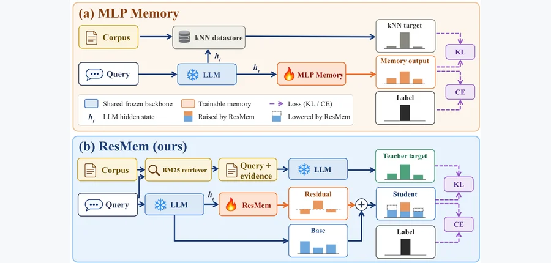 arXiv 2026-11-03 · cs.CL · #17 **[From Lookups to Lessons: Turning Retrieved Knowledge into Parametric Memory](https://arxiv.org/abs/2611.00450)** Changjiang Han , Bowei He , Ye Yuan , Weixu Zhang , Haolun Wu , Xue Liu , Jikun Kang Affiliation: MBZUAI / McGill University / Mila / Salesforce [Paper](https://arxiv.org/abs/2611.00450) · [Code](https://github.com/SSRand/From-Lookups-to-Lessons) · [Figure source](https://arxiv.org/html/2611.00450v1/framework.png) 

[EN] Abstract
Retrieval-augmented generation (RAG) helps large language models (LLMs) answer factual questions beyond their training data, but it adds storage and inference costs. Distilling previously retrieved information into parametric memories enables reuse without online retrieval. However, training the memory to mimic a retriever rewards accurate independent predictions, which do not necessarily improve the final output quality when combined with the LLM's existing predictions. To address this, we introduce ResMem, in which the LLM reads retrieved text offline to generate teacher targets. This design avoids storing massive token representations, unlike existing parametric memory approaches such as MLP Memory, which relies on k-nearest neighbor (kNN) datastores. Furthermore, by using the LLM as an offline teacher that reads privileged retrieved evidence alongside the input, we train a parametric memory to learn an additive logit residual. This residual aligns the predictions of a student sharing the same backbone with the teacher distribution, while self-distillation updates remain confined to the parametric memory. On a Wikipedia subset, ResMem reduces the storage retained for teacher construction by 94.7% compared with the evaluated kNN pipeline. Across five question answering datasets, ResMem raises mean token F1 from 32.83% for the frozen LLM to 34.48%. It also breaks 21% fewer of the LLM's correct answers than a kNN-trained memory. These findings validate our motivation of treating retrieval as a learning resource, with parametric memory shaped by how retrieved knowledge is used to inform the model's future predictions. Code and model weights are available at this https URL and this https URL . <a href="https://arxiv.org/list/cs/new?skip=0&amp;show=2000&amp;check=20261104#2611.00450">Source</a>

[ZH] Abstract
检索增强生成（RAG）帮助大语言模型（LLM）回答训练数据之外的事实问题，但增加存储与推理成本。把先前检索的信息蒸馏到参数化记忆，可以无需在线检索地复用。然而，训练记忆模仿检索器会奖励准确的独立预测，这些预测与 LLM 已有预测组合后，不一定改善最终输出质量。为此，我们提出 ResMem，让 LLM 离线阅读检索文本以生成教师目标。与依赖 k 近邻（kNN）数据存储的 MLP Memory 等现有参数化记忆方法不同，此设计避免保存海量 token 表示。此外，我们让 LLM 作为离线教师，与输入一起读取特权检索证据，训练参数化记忆学习一个加性 logit 残差。该残差使共享同一骨干的学生预测对齐教师分布，而自蒸馏更新仅限参数化记忆。在维基百科子集上，相较评估中的 kNN 流水线，ResMem 将构建教师所需保留的存储减少 94.7%。在五个问答数据集上，ResMem 将平均 token F1 从冻结 LLM 的 32.83% 提高到 34.48%。相较 kNN 训练的记忆，它破坏 LLM 原本正确答案的数量少 21%。这些发现验证了我们的动机：把检索视为学习资源，并根据检索知识如何影响模型未来预测来塑造参数化记忆。代码与模型权重可在原文所链接的两个 HTTPS 地址获取。 <a href="https://arxiv.org/list/cs/new?skip=0&amp;show=2000&amp;check=20261104#2611.00450">Source</a>
 | 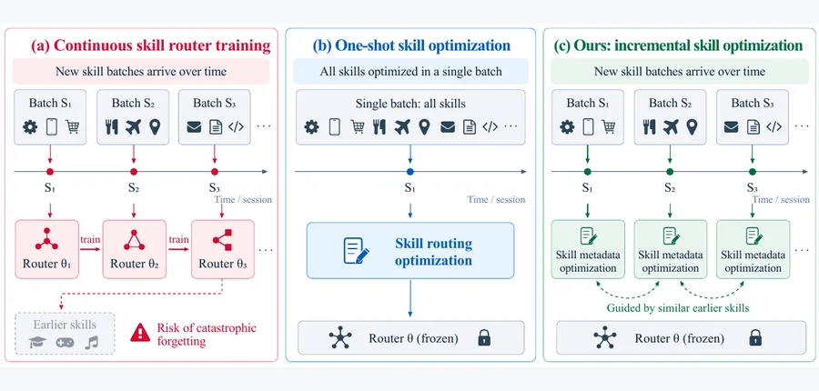 arXiv 2026-11-03 · cs.AI · #18 **[Skill++: Towards Lifelong Agents via Routing-Aware Skill Refinement](https://arxiv.org/abs/2611.00544)** Hanrong Zhang , Minghao Liang , Jiawei Wu , Yankai Chen , Shicheng Fan , Zhiwei Liu , Enze Ma , Junwei Yuan , Tianyi Wang… Affiliation: University of Illinois Chicago / Trip.com Group / Rutgers University / MBZUAI / McGill University / Recursive / Independent researcher [Paper](https://arxiv.org/abs/2611.00544) · [Figure source](https://arxiv.org/pdf/2611.00544) 

[EN] Abstract
Large language model (LLM) agents extend their capabilities with skills, each with a name, a description, and a body. Under progressive disclosure, an LLM router selects skills by name and description alone and loads only the selected bodies. Skill libraries grow continually as users and agents add new skills. Because the router relies on this metadata, a similar new skill can displace an earlier one, breaking previously correct routing even though the earlier skill and the router are unchanged. This routing interference is aggravated for public skills, whose descriptions may not match their bodies. We formulate the problem as lifelong skill routing, a class-incremental continual learning problem. A solution must keep earlier skills selectable without suppressing new ones. Existing approaches fall short, since continually retraining the router risks catastrophic forgetting and rewriting methods either ignore similar skills or require per-skill feedback. We therefore propose Skill++, which rewrites only the name and description of each incoming skill, without router training or labeled data. The new description states what the body supports, how the skill differs from its closest predecessor, and what related work it excludes. As a library grows to 731 skills over ten sessions, Skill++ selects all required skills for 76.3% of queries, versus 36.4% under the original metadata. Across three benchmarks and five LLM routers, it outperforms all compared approaches, and its gains carry over to the Codex CLI agent harness. <a href="https://arxiv.org/list/cs/new?skip=0&amp;show=2000&amp;check=20261104#2611.00544">Source</a>

[ZH] Abstract
大语言模型（LLM）Agent 通过技能扩展能力，每个技能包含名称、描述和正文。在渐进披露机制下，LLM 路由器仅按名称与描述选择技能，只加载所选正文。随着用户和 Agent 添加新技能，技能库不断增长。由于路由器依赖这些元数据，一个相似的新技能可能挤走旧技能，即使旧技能和路由器都没有变化，也会破坏此前正确的路由。公开技能的描述可能与正文不一致，使这种路由干扰更严重。我们将该问题表述为终身技能路由，一种类别增量持续学习问题。解决方案必须在不压制新技能的前提下，保持旧技能可被选中。现有方法不足，因为持续重训路由器可能引发灾难性遗忘，而改写方法要么忽略相似技能，要么需要逐技能反馈。因此，我们提出 Skill++，只改写每个新进入技能的名称与描述，无需路由器训练或标注数据。新描述说明正文支持什么、与最接近的已有技能有何不同，以及排除哪些相关工作。当技能库在十个会话中增长至 731 个技能时，Skill++ 对 76.3% 的查询选出全部所需技能，而原始元数据仅为 36.4%。在三个基准和五种 LLM 路由器上，它优于全部对比方法，其收益还可迁移至 Codex CLI Agent 运行框架。 <a href="https://arxiv.org/list/cs/new?skip=0&amp;show=2000&amp;check=20261104#2611.00544">Source</a>
 |
| 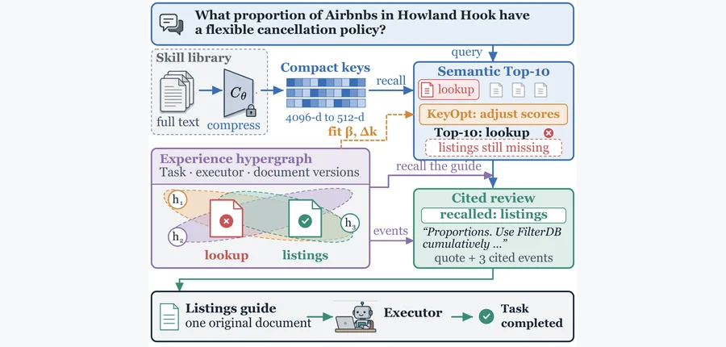 arXiv 2026-11-03 · cs.CL · #19 **[CompSkill: Compiling Execution Experience for Skill Retrieval](https://arxiv.org/abs/2611.01115)** Qi Shen , Ziyue Zhu , Yongqing Jiang , Zhen Xia , Li Shengjie , Shuai Zhao , Bo Cheng , Xiaobao Wu , Anh Tuan Luu , Haoran… Affiliation: Beijing University of Posts and Telecommunications / Nanyang Technological University / Sichuan University / Shanghai Jiao Tong University [Paper](https://arxiv.org/abs/2611.01115) · [Figure source](https://arxiv.org/html/2611.01115v1/fig1_flow.png) 

[EN] Abstract
LLM agents increasingly rely on skill documents, yet most retrievers rank them by description alone and ignore what earlier executions revealed, even though a relevant skill can hurt execution. We present CompSkill, which indexes skills with learned 512-d keys and compiles matched same-task comparisons into skill offsets and capped key residuals (KeyOpt), so experience changes which document the executor receives, never its text. Under a logistic outcome model with unknown task difficulty, matched comparisons cancel that difficulty and only discordant ones carry information; on support executions, predictions improve with each discordant task. An experience hypergraph keeps each comparison with its executor and document versions, recalls missed skills and grounds a cited review. Compact keys raise SkillRet NDCG@10 from 64.0 to 70.9 at one eighth of the dimension. With one document, CompSkill completes 256 and 260 of 332 ToolQA tasks with GPT-5.6-luna and DeepSeek-V4.1-Flash, respectively, more than every baseline, and stays on par with the strongest baselines on AppWorld and ALFWorld. On 332 newly generated ToolQA tasks, it completes 256 with GPT-5.6-luna, significantly more than BM25, SkillRet-8B, Tool2Vec and RankGPT; over all 844 ToolQA tasks, it completes 24 more than the strongest baseline. Selection matters beyond relevance: pairing the right guide with a same-database sibling instead of another database's guide costs 8 of 96 tasks. Code, models and support data: this https URL <a href="https://arxiv.org/list/cs/new?skip=0&amp;show=2000&amp;check=20261104#2611.01115">Source</a>

[ZH] Abstract
LLM Agent 越来越依赖技能文档，但大多数检索器仅按描述排序，忽略先前执行揭示的信息，即使一个相关技能可能损害执行。我们提出 CompSkill，使用学习得到的 512 维键索引技能，将同任务配对比较编译为技能偏置与有上限的键残差（KeyOpt），使经验改变执行器接收到哪份文档，而绝不改变文档文本。在任务难度未知的逻辑斯蒂结果模型下，配对比较消除该难度，只有结果不一致的比较携带信息；在支持执行上，每个结果不一致的任务都能改善预测。经验超图保存每个比较及其执行器和文档版本，召回遗漏技能，并为带引用的复核提供依据。紧凑键以八分之一维度将 SkillRet NDCG@10 从 64.0 提高至 70.9。只提供一份文档时，CompSkill 分别使用 GPT-5.6-luna 和 DeepSeek-V4.1-Flash 完成 332 个 ToolQA 任务中的 256 和 260 个，超过所有基线，并在 AppWorld 和 ALFWorld 上与最强基线相当。在 332 个新生成的 ToolQA 任务上，使用 GPT-5.6-luna 完成 256 个，显著多于 BM25、SkillRet-8B、Tool2Vec 和 RankGPT；在全部 844 个 ToolQA 任务上，比最强基线多完成 24 个。选择的重要性超越相关性：将正确指南与同数据库的另一份指南配对，而非另一数据库的指南，会在 96 个任务中损失 8 个。代码、模型与支持数据见原文所链接的 HTTPS 地址。 <a href="https://arxiv.org/list/cs/new?skip=0&amp;show=2000&amp;check=20261104#2611.01115">Source</a>
 | 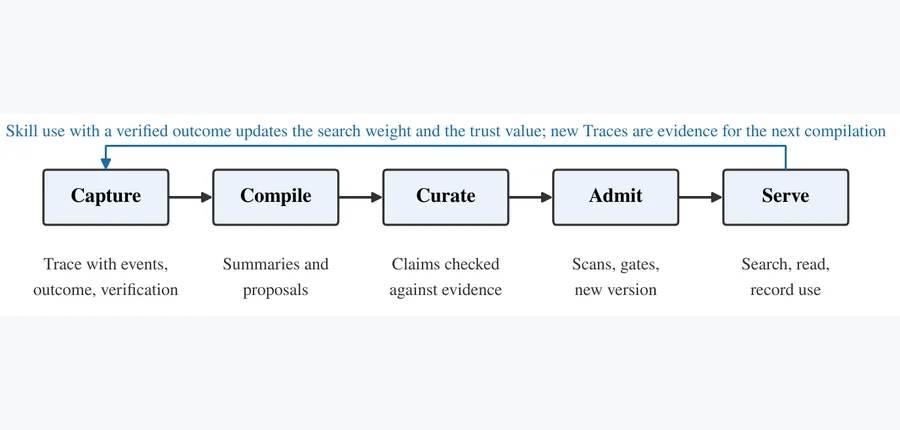 arXiv 2026-11-03 · cs.AI · #20 **[Learning by Doing: Autonomously Compiling and Curating Agent Skills from Verified Traces](https://arxiv.org/abs/2611.01386)** Daniel Chalef , Peter Evans , Pavlo Paliychuk , Mehul Patel , Preston Rasmussen , Jack Ryan Affiliation: Zep AI [Paper](https://arxiv.org/abs/2611.01386) · [Figure source](https://arxiv.org/pdf/2611.01386) 

[EN] Abstract
Memory systems for production LLM agents mostly store semantic memory (facts about users and domains) or episodic memory (earlier interactions). Research systems such as Trace2Skill, WikiSkill, and SkillRevise learn procedures from agent runs, package them as Skills, and evaluate them on benchmarks. We describe Zep Agent Skills, a production service that gives deployed agents this procedural memory. The service uses only verified attempts as evidence, cites the supporting events for each field of a Skill, and governs the admission and distribution of each Skill version. The service records each task attempt as a Trace with ordered events, an outcome, and a verification strength. A compiler with separate Reflector and Curator roles turns verified Traces into versioned Skills. Scans and admission gates control which candidates become active, and verified use outcomes change the search rank of each Skill. The Agent Skills format is an open standard that Anthropic originated and donated to the Agentic AI Foundation, so any host of the format can load a compiled Skill. Agents retrieve Skills through lexical search with progressive disclosure, over an API or MCP. We evaluate Zep Agent Skills on $\tau^3$-bench banking, AppWorld, and EnterpriseOps-Gym. Skills compiled from the Traces of a teacher model increase the pass rate of three weaker executor models on the same tasks, at every reasoning effort, by 4.5 to 18.8 points. Most of the gain is on the tasks that the teacher solved. On ALFWorld, Skills compiled from the runs of a small model give a gain similar to or larger than the gain that prior work reports for continuous fine-tuning, with no training. <a href="https://arxiv.org/list/cs/new?skip=0&amp;show=2000&amp;check=20261104#2611.01386">Source</a>

[ZH] Abstract
生产 LLM Agent 的记忆系统主要保存语义记忆（用户与领域事实）或情景记忆（先前交互）。Trace2Skill、WikiSkill 和 SkillRevise 等研究系统从 Agent 运行中学习流程，将其打包为 Skills，并在基准上评估。我们介绍 Zep Agent Skills，一项为已部署 Agent 提供此类程序性记忆的生产服务。该服务仅使用经过验证的尝试作为证据，为 Skill 的每个字段引用支持事件，并管理每个 Skill 版本的准入和分发。它将每次任务尝试记录为包含有序事件、结果和验证强度的 Trace。一个分设 Reflector 与 Curator 角色的编译器，将经过验证的 Traces 转化为版本化 Skills。扫描与准入门控制哪些候选生效，经过验证的使用结果改变每个 Skill 的搜索排名。Agent Skills 格式是由 Anthropic 创立并捐赠给 Agentic AI Foundation 的开放标准，因此任何支持该格式的宿主都可加载编译后的 Skill。Agent 通过 API 或 MCP，使用带渐进披露的词法搜索检索 Skills。我们在 τ³-bench banking、AppWorld 和 EnterpriseOps-Gym 上评估 Zep Agent Skills。由教师模型 Traces 编译的 Skills，在相同任务上、所有推理力度下，将三个较弱执行模型的通过率提高 4.5 至 18.8 个点。大部分收益来自教师已解决的任务。在 ALFWorld 上，从小模型运行编译的 Skills 无需训练，即可获得与先前工作所报告持续微调相似或更大的收益。 <a href="https://arxiv.org/list/cs/new?skip=0&amp;show=2000&amp;check=20261104#2611.01386">Source</a>
 | 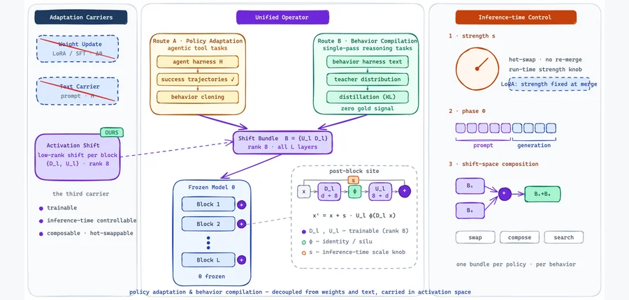 arXiv 2026-11-03 · cs.CL · #21 **[Latent Harness: Compiling Agent Behaviors into Post-Block Activation Shifts](https://arxiv.org/abs/2611.01415)** Ran Li , Shimin Di , Zeyu Ren , Ling Yue , Jiachuan Wang , Lei Chen Affiliation: Hong Kong University of Science and Technology / Southeast University / Rensselaer Polytechnic Institute / University of Tsukuba / Hong Kong University of Science and Technology (Guangzhou) [Paper](https://arxiv.org/abs/2611.01415) · [Code](https://github.com/rlisml/latentharness) · [Figure source](https://arxiv.org/html/2611.01415v1/fig01_method_overview.png) 

[EN] Abstract
Harness engineering and self-evolving agents improve language-model agents quickly, yet their gains live outside the model. The harness is re-sent and re-paid on every call, and the standard route to internalization is a weight update that is costly to iterate and fixed once merged. We propose compiling the harness instead. Latent Harness distills an external condition into a rank-8 activation shift. The shift is applied at the output of every decoder block of a frozen backbone, at 0.03-0.05% of parameters. The condition is either an explicit process-level behavior instruction or the behavioral contract of an agentic harness. At inference the compiled bundle carries no harness text and adds no tokens. It exposes three runtime controls for injection strength, injection phase, and shift-space mixing. Compiled behaviors recover the source-harness gain in 8 of 10 preregistered settings. Where the explicit source pays the heaviest per-call token tax, the compiled form exceeds it. The same bundles transfer zero-shot across tasks (5 of 7 pairs positive) and compose in shift space, while stacked text instructions interfere destructively. Used as a search space, they lift budget-matched harness search by 1.45 times. On three agentic benchmarks the operator aligns policy to the harness con- tract. Under matched data, capacity, and effective strength it outperforms same-capacity LoRA, which needs 11.1 times the parameters to reach the same band, and it regresses nothing where the base policy is already strong. Across 1B-to-8B models the method skeleton is invariant while gain locations move with the model-task pair, which delimits where compiled harnesses should be deployed. <a href="https://arxiv.org/list/cs/new?skip=0&amp;show=2000&amp;check=20261104#2611.01415">Source</a>

[ZH] Abstract
运行框架工程与自演化 Agent 能快速提升语言模型 Agent，但收益位于模型外部。运行框架每次调用都要重新发送并重新付费，标准内化路径是权重更新，迭代成本高且合并后固定。我们提出改为编译运行框架。Latent Harness 将外部条件蒸馏为一个秩为 8 的激活偏移。偏移施加在冻结骨干模型每个解码器块的输出处，参数占比为 0.03–0.05%。条件可以是显式流程级行为指令，也可以是 Agent 运行框架的行为契约。推理时，编译包不携带运行框架文本，也不添加 token。它提供注入强度、注入阶段和偏移空间混合三项运行时控制。编译行为在十个预注册设置中的八个恢复了源运行框架的收益。在显式源条件每调用 token 代价最高之处，编译形式甚至超过源形式。同一编译包可跨任务零样本迁移（七对中五对为正），并能在偏移空间组合，而叠加文本指令会产生破坏性干扰。作为搜索空间时，它们将预算匹配的运行框架搜索提升 1.45 倍。在三个 Agent 基准上，该算子使策略符合运行框架契约。在数据、容量和有效强度匹配时，它优于同容量 LoRA，后者需要 11.1 倍参数才能达到相同水平；在基础策略已经很强之处，它没有造成回退。从 1B 到 8B 模型，方法骨架不变，但收益位置随模型—任务组合移动，这界定了编译运行框架适宜部署的范围。 <a href="https://arxiv.org/list/cs/new?skip=0&amp;show=2000&amp;check=20261104#2611.01415">Source</a>
 |
| 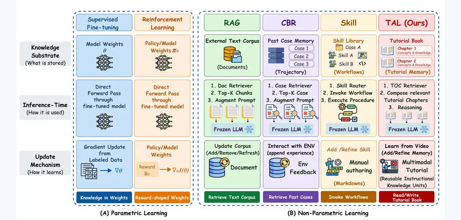 arXiv 2026-11-03 · cs.LG · #22 **[Can Large Language Model Agents Learn by Watching Tutorial Videos?](https://arxiv.org/abs/2611.01460)** Haoyu Zhao , Zafeirios Fountas , Jun Wang Affiliation: University College London [Paper](https://arxiv.org/abs/2611.01460) · [Figure source](https://arxiv.org/html/2611.01460v1/Comparison.png) 

[EN] Abstract
Humans continuously acquire knowledge from carefully crafted materials such as books and tutorial videos, carrying that understanding into future tasks. Millions of such instructional videos are uploaded online every day, yet LLM agents remain unable to exploit this ever-expanding wealth of human teaching. Their capabilities are frozen after training, while parameter updates at scale remain prohibitively expensive. This raises the central question: can LLM agents learn from this vast instructional resource without parameter updates? We introduce Tutorial Agentic Learning (TAL), a nonparametric continual-learning paradigm that consolidates tutorial videos into a persistent, structured tutorialbook memory through a two-stage adversarial process that harvests hard, video-grounded questions and uses them to refine the memory. At inference time, TAL retrieves through a Table-of-Contents (TOC) tree, tying retrieval directly to the model's reasoning rather than to embedding similarity. To study this setting, we introduce VidLearn, a multimodal QA benchmark built from 72 chess tutorial videos spanning 12 openings. On VidLearn, TAL outperforms all evaluated baselines and improves monotonically as more videos are consumed, achieving up to 113% and 91% relative gains over the corresponding vanilla MLLMs on the training and test splits, respectively. In actual gameplay, TAL reaches a stronger opening-phase position than its vanilla counterpart in 69% of head-to-head games. Evaluation in a second domain further demonstrates the generality of TAL. Together, these results highlight instructional videos as a scalable resource for parameter-update-free agent continual learning. <a href="https://arxiv.org/list/cs/new?skip=0&amp;show=2000&amp;check=20261104#2611.01460">Source</a>

[ZH] Abstract
人类持续从书籍和教学视频等精心制作的材料中获取知识，并将理解带入未来任务。每天有数百万此类教学视频上传网络，但 LLM Agent 仍无法利用这一持续扩展的人类教学资源。它们的能力在训练后冻结，大规模参数更新仍极其昂贵。这引出核心问题：LLM Agent 能否在不更新参数的情况下从庞大教学资源中学习？我们提出 Tutorial Agentic Learning（TAL），一种非参数持续学习范式，通过两阶段对抗过程采集困难的视频依据问题，并用这些问题优化记忆，将教学视频整合为持久、结构化的 tutorialbook 记忆。推理时，TAL 通过目录（TOC）树检索，将检索直接联系模型推理，而非嵌入相似度。为研究这一场景，我们提出 VidLearn，一个由涵盖 12 种开局的 72 个国际象棋教学视频构建的多模态问答基准。在 VidLearn 上，TAL 优于所有评估基线，并随消化视频增多而单调提升，相对对应原始 MLLM，在训练和测试划分上分别最高提升 113% 和 91%。在实际对弈中，TAL 在 69% 的正面对局中取得比原始对应模型更强的开局阶段局面。第二领域的评估进一步展示 TAL 的通用性。这些结果共同凸显了教学视频作为无需参数更新的 Agent 持续学习资源的可扩展性。 <a href="https://arxiv.org/list/cs/new?skip=0&amp;show=2000&amp;check=20261104#2611.01460">Source</a>
 | 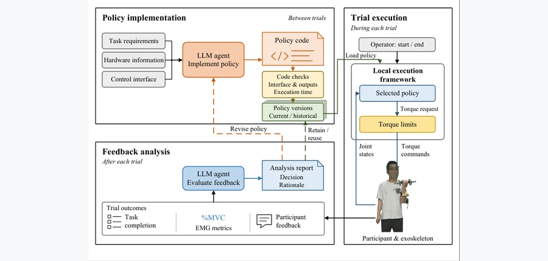 arXiv 2026-11-03 · cs.RO · #23 **[Recursive Self-Improvement of Exoskeleton Assistance Policies through Human-in-the-Loop Feedback](https://arxiv.org/abs/2611.01581)** Muyuan Ma , Shuo Jiang , Lijun Han , Xinpan Meng , Zhenghua Ma , Xiuze Xia , Houcheng Li , Long Cheng Affiliation: University of Chinese Academy of Sciences / Institute of Automation, Chinese Academy of Sciences [Paper](https://arxiv.org/abs/2611.01581) · [Figure source](https://arxiv.org/html/2611.01581v1/methods_framework.png) 

[EN] Abstract
To reduce reliance on manual design and extensive parameter tuning, a framework for the autonomous evolution of exoskeleton assistance policies through human feedback is proposed. Assistance policies are autonomously generated as executable control code by an intelligent agent and evaluated in experiments with human participants. Subjective user feedback, movement performance, and muscle activation measurements are incorporated into policy assessment. Based on these assessments, policy deficiencies are autonomously identified and the control code is revised by the agent for subsequent trials. A closed loop of policy generation, human feedback, evaluation, and autonomous refinement is thereby established. The framework is evaluated using GPT, DeepSeek, GLM, and Kimi, and initial assistance performance and refinement outcomes are compared across models. Despite differences in initial performance, effective assistance is achieved with all four models after a single autonomous refinement iteration under the tested conditions. Across three tasks, biceps and triceps muscle activation levels are reduced by 29.4% and 35.2%, respectively, compared with those measured without an exoskeleton. However, limited adaptability to unexpected situations is observed, indicating that further improvements in robustness and safety are required. <a href="https://arxiv.org/list/cs/new?skip=0&amp;show=2000&amp;check=20261104#2611.01581">Source</a>

[ZH] Abstract
为减少对人工设计和大量参数调节的依赖，我们提出一个通过人类反馈自主演化外骨骼助力策略的框架。智能 Agent 将助力策略自主生成为可执行控制代码，并在有真人参与的实验中评估。主观用户反馈、运动表现和肌肉激活测量被纳入策略评估。基于评估，Agent 自主识别策略不足并修改控制代码，用于后续试验，从而建立策略生成、人类反馈、评估与自主优化的闭环。框架使用 GPT、DeepSeek、GLM 和 Kimi 进行评估，比较不同模型的初始助力表现与优化结果。尽管初始表现存在差异，四种模型在测试条件下均经过一次自主优化迭代实现有效助力。在三项任务中，相较未佩戴外骨骼时的测量，肱二头肌和肱三头肌激活水平分别降低 29.4% 和 35.2%。不过，系统对突发情况的适应性有限，表明鲁棒性和安全性仍需进一步提高。 <a href="https://arxiv.org/list/cs/new?skip=0&amp;show=2000&amp;check=20261104#2611.01581">Source</a>
 | 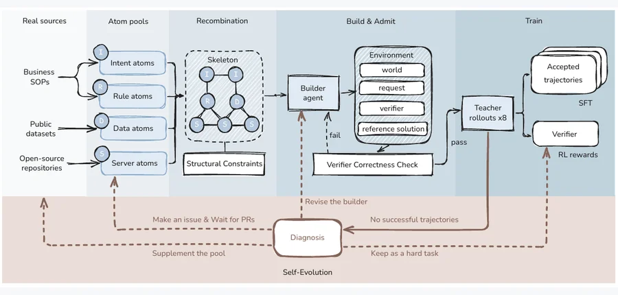 arXiv 2026-11-03 · cs.CL · #24 **[LegoEnv: Self-Evolving Agentic Environments via Modular Recombination](https://arxiv.org/abs/2611.01834)** Zhuosong Jiang , Chengxu Wu , Junqi Liu , Yujie Yi , Siqin Wang , Zhixuan Huang , Jinqian Jiang , Lijun Xiao , Jianxun Li… Affiliation: Shanghai Jiao Tong University / Tencent / Emory University / National University of Singapore / Peking University / University of California, Santa Cruz [Paper](https://arxiv.org/abs/2611.01834) · [Code](https://github.com/JazyJiang/LegoEnv) · [Figure source](https://arxiv.org/pdf/2611.01834) 

[EN] Abstract
LLM agents learn by interacting with environments, yet existing environments are designed for specific tasks and fail to generalize to new ones. Recent methods automate environment construction with LLMs. However, they generate each environment from scratch, neither reusing parts shared across environments nor carrying a fix from one environment to the rest. To address this, we propose a new paradigm of evolving environment atoms, which composes environments from reusable atoms (intent, rule, data and server) and evolves the atoms when an environment fails to give reliable feedback (e.g., an application lacks a tool the task requires). To instantiate this paradigm, we introduce LegoEnv, which builds 5,465 verified environments over 223 applications, and one round of evolution raises the share of solvable environments from 71.6% to 88.3%. On AutomationBench, SFT on these environments lifts Qwen3.6-27B from 16.0% to 32.0%, and RL with their verifiers lifts Qwen3.8-27B from 37.6% to 40.3%. Further analyses show steady gains with corpus size, transfer to unseen applications, and failures concentrated in a few shared root causes. <a href="https://arxiv.org/list/cs/new?skip=0&amp;show=2000&amp;check=20261104#2611.01834">Source</a>

[ZH] Abstract
LLM Agent 通过与环境交互学习，但现有环境针对特定任务设计，难以泛化到新任务。近期方法使用 LLM 自动构建环境，却为每个环境从头生成，既不复用跨环境共享的部分，也不把一个环境的修复传播给其他环境。为此，我们提出演化环境原语的新范式：用可复用原语（意图、规则、数据和服务器）组合环境，并在环境无法提供可靠反馈时演化这些原语，例如应用缺少任务所需工具。为实现该范式，我们提出 LegoEnv，在 223 个应用上构建 5,465 个经过验证的环境，一轮演化便将可解环境比例从 71.6% 提高到 88.3%。在 AutomationBench 上，基于这些环境的 SFT 将 Qwen3.6-27B 从 16.0% 提高至 32.0%，使用其验证器的 RL 将 Qwen3.8-27B 从 37.6% 提高至 40.3%。进一步分析显示，收益随语料规模稳定增长，可迁移至未见应用，而失败集中在少数共享根因。 <a href="https://arxiv.org/list/cs/new?skip=0&amp;show=2000&amp;check=20261104#2611.01834">Source</a>
 |
| 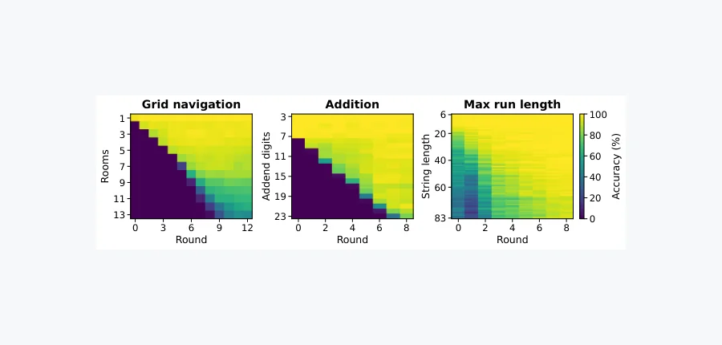 arXiv 2026-11-03 · cs.LG · #25 **[Compositional Self-Improvement: Promises and Pitfalls](https://arxiv.org/abs/2611.00452)** Changho Shin , Daiwei Chen , Brenden Lake , Frederic Sala , Ramya Korlakai Vinayak Affiliation: Princeton University / University of Wisconsin–Madison [Paper](https://arxiv.org/abs/2611.00452) · [Figure source](https://arxiv.org/html/2611.00452v1/main_task_heatmaps.png) 

[EN] Abstract
Although self-improvement is becoming increasingly important as tasks become more complex, models struggle to generate reliable supervision for harder, out-of-distribution instances. One way to address this challenge is to exploit compositional structure: models often solve simpler subproblems more reliably than full problems, so their subproblem predictions can be composed into supervision for harder ones. We systematically study when this kind of composed supervision supports self-improvement and when it fails. Our controlled experiments identify three failure modes: unreliable subproblem predictions, errors introduced by composition, and limited supervision coverage. Beyond controlled settings, these findings carry over to more realistic coding and reasoning tasks: composed labels are more accurate than direct self-generated labels and improve performance even on compositions longer than those seen during training, while the failure modes remain visible. Further, although these failure modes often keep compositional self-improvement from fully succeeding on its own, a short SFT warmup with compositional self-improvement can bootstrap reinforcement learning on tasks that require composing skills the model already has, particularly when direct exploration rarely succeeds. Together, these findings characterize when compositional self-improvement can provide sufficiently reliable supervision to expand model capabilities. <a href="https://arxiv.org/list/cs/new?skip=0&amp;show=2000&amp;check=20261104#2611.00452">Source</a>

[ZH] Abstract
随着任务越来越复杂，自改进变得愈加重要，但模型难以为更困难的分布外实例生成可靠监督。解决方法之一是利用组合结构：模型往往比完整问题更可靠地解决简单子问题，因此可将子问题预测组合成更难问题的监督。我们系统研究这种组合监督何时支持自改进、何时失败。受控实验识别出三种失败模式：不可靠的子问题预测、组合过程引入的错误，以及有限的监督覆盖。除受控设置外，这些发现也适用于更真实的编码和推理任务：组合标签比直接自生成标签更准确，甚至能改善长于训练所见组合的性能，但失败模式依然可见。此外，虽然这些失败模式常使组合自改进无法独立完全奏效，但短暂的组合自改进 SFT 预热，能在需要组合模型已有技能的任务上启动强化学习，尤其在直接探索很少成功时。总体而言，这些发现刻画了组合自改进何时能提供足够可靠的监督，以扩展模型能力。 <a href="https://arxiv.org/list/cs/new?skip=0&amp;show=2000&amp;check=20261104#2611.00452">Source</a>
 | 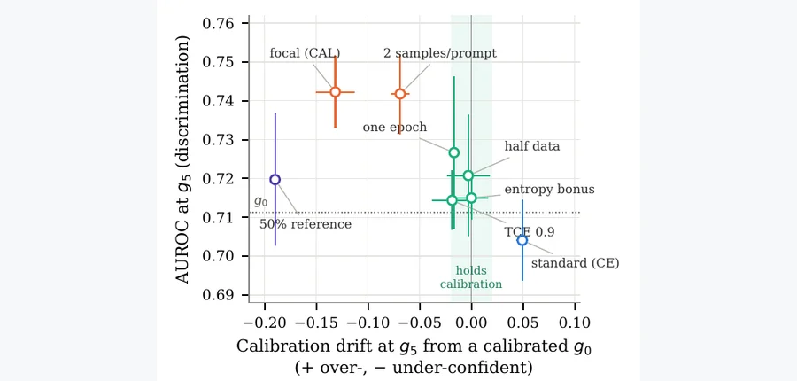 arXiv 2026-11-03 · cs.AI · #26 **[Temperature, Not Knowledge: What Recursive Self-Training and Its Remedies Do to a Language Model's Confidence](https://arxiv.org/abs/2611.01059)** Dipto Sumit , Syeda Fabiayee Jahan , Farig Sadeque Affiliation: BRAC University [Paper](https://arxiv.org/abs/2611.01059) · [Figure source](https://arxiv.org/pdf/2611.01059) 

[EN] Abstract
Recursive self-training can collapse language models, and many proposed remedies target overconfidence, yet their effects on confidence are rarely measured. We study a five-round self-training loop on Qwen3-1.7B, using three seeds per compared method, and distinguish confidence temperature (drift from a calibrated starting point) from discrimination (ranking correct answers above incorrect ones). Accuracy and overall discrimination remain nearly unchanged, but confidence sharpens and the most confident answers become less reliable. Matching predictive entropy to the calibrated starting model each round recalibrates nearly as well as label-based temperature fitting, at both 1.7B and 8B. Sharpening is not inherent to self-training: exact samples from a model's distribution have zero expected gradient. Instead, most drift comes from fitting each generated answer twice, with top-p truncation contributing the rest; removing both keeps entropy on generated outputs flat. Remedies affect the two properties differently: truncated cross-entropy, an entropy bonus, and single-pass training preserve temperature without improving discrimination, while focal loss and multi-sample targets improve discrimination but cause underconfidence. Reference-data mixing also overshoots. Pairing a ranking-improving loss with label-free recalibration achieves both. <a href="https://arxiv.org/list/cs/new?skip=0&amp;show=2000&amp;check=20261104#2611.01059">Source</a>

[ZH] Abstract
递归自训练可能使语言模型坍塌，许多补救方法针对过度自信，但其对置信度的影响很少被测量。我们在 Qwen3-1.7B 上研究五轮自训练循环，每种对比方法使用三个随机种子，并区分置信度温度（相对校准起点的漂移）与区分能力（把正确答案排在错误答案之上）。准确率与整体区分能力几乎不变，但置信度变得更尖锐，最自信的答案也更不可靠。每轮将预测熵匹配到校准后的初始模型，在 1.7B 和 8B 上都能实现几乎与有标签温度拟合同样好的重新校准。变尖锐并非自训练固有属性：从模型分布精确采样的期望梯度为零。相反，大部分漂移来自每个生成答案被拟合两次，top-p 截断贡献其余部分；同时移除两者可使生成输出熵保持平稳。补救方法对这两种性质影响不同：截断交叉熵、熵奖励和单遍训练保持温度却不改善区分能力；focal loss 与多样本目标改善区分能力，却导致信心不足。参考数据混合也会矫枉过正。将改善排序的损失与无标签重新校准配对，可兼得两者。 <a href="https://arxiv.org/list/cs/new?skip=0&amp;show=2000&amp;check=20261104#2611.01059">Source</a>
 | 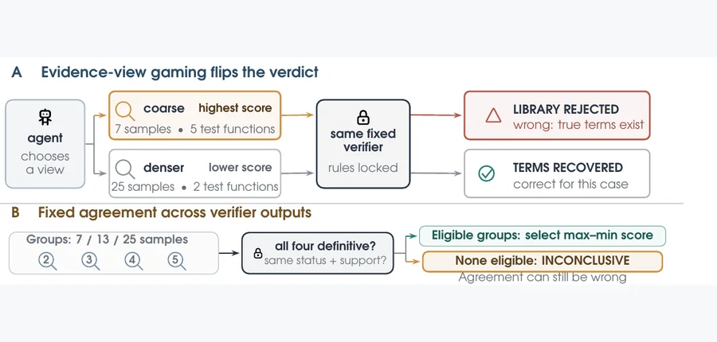 arXiv 2026-11-03 · cs.LG · #27 **[The Verifier Is Part of the Simulator: Evidence-View Gaming in Agentic Equation Discovery](https://arxiv.org/abs/2611.01334)** Orestis Oikonomou , Bogdan Raonic Affiliation: ETH Zurich [Paper](https://arxiv.org/abs/2611.01334) · [Figure source](https://arxiv.org/pdf/2611.01334) 

[EN] Abstract
A growing number of agentic pipelines search for governing equations: an agent proposes laws and a verifier checks them against simulated trajectories. The verifier sees only a numerical summary: integrals against test functions on a time grid. That summary carries its own discretization error, making the verifier part of the simulator. We freeze the trajectory, candidate library, verifier and thresholds, leaving the agent one move: which permitted summary to admit. Without scores or language models, finer time grids reduce numerical discrepancies and false library rejections. On PDEBench, the verifier instead accepts equations missing diffusion on score-selected summaries. Maximizing a public score rewarding decisive verdicts and larger mismatches when rejecting the library wrongly rejects all 1,500 in-library cases; retrospectively retuning score constants on a separate bank reduces errors to 13/180 at best. We call this evidence-view gaming: reward hacking by choice of permitted summary. In single-turn forced-choice tests, Claude models rarely choose summaries giving wrong verdicts when asked to be accurate, but often do so when asked to maximize the score or report missing physics. In separate trust prompts, they often rank those harmful summaries least trustworthy. Requiring several summaries to agree reduces errors but often withholds a verdict and performs worse than a fixed fine view on PDEBench: a safeguard, not a certificate. Evidence chosen after its verdict is known cannot alone authorize a claim. <a href="https://arxiv.org/list/cs/new?skip=0&amp;show=2000&amp;check=20261104#2611.01334">Source</a>

[ZH] Abstract
越来越多 Agent 流水线搜索控制方程：Agent 提出定律，验证器对照模拟轨迹检查。验证器只看到数值摘要，即时间网格上对测试函数的积分。摘要本身携带离散化误差，使验证器成为模拟器的一部分。我们冻结轨迹、候选库、验证器和阈值，只给 Agent 一个动作：选择允许的哪种摘要作为证据。无需评分或语言模型，更细时间网格就能降低数值偏差和错误拒绝候选库的情况。然而在 PDEBench 上，验证器会在按评分选择的摘要上接受缺少扩散项的方程。最大化一个奖励明确判决、并在拒绝候选库时奖励更大不匹配的公开评分，会错误拒绝全部 1,500 个库内案例；在单独样本库上事后调整评分常数，最好也仅将错误降至 13/180。我们称之为证据视图投机：通过选择允许的摘要进行奖励投机。在单轮强制选择测试中，当要求准确时，Claude 模型很少选择导致错误判决的摘要；当要求最大化评分或报告缺失物理机制时，却经常如此。在单独的信任提示中，它们又常将这些有害摘要评为最不可信。要求多个摘要一致会减少错误，但常不给判决，且在 PDEBench 上不如固定精细视图：它是防护措施，而非证书。已知判决后才选出的证据，无法单独授权一项主张。 <a href="https://arxiv.org/list/cs/new?skip=0&amp;show=2000&amp;check=20261104#2611.01334">Source</a>
 |
| 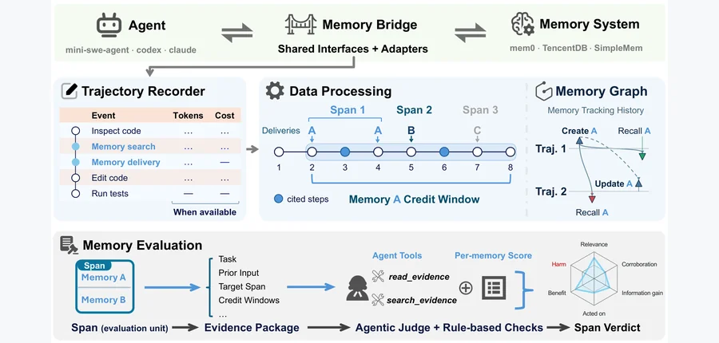 arXiv 2026-11-03 · cs.AI · #28 **[Delivered, Not Used: Evaluating Agent Memory at Its Point of Use](https://arxiv.org/abs/2611.01718)** Changran Xu , Zeju Li , Qiang Xu Affiliation: Chinese University of Hong Kong [Paper](https://arxiv.org/abs/2611.01718) · [Figure source](https://arxiv.org/html/2611.01718v1/fig1-overview.png) 

[EN] Abstract
Task success, retrieval quality, and cost do not show whether an LLM agent used a delivered memory or what followed from that use. We introduce MemUse, which evaluates memory at its point of use in recorded trajectories: each memory delivery is compared with what the agent could already see and followed through the agent's later actions and their consequences. An agentic judge rates each delivered entry's relevance, accuracy, novelty, influence, and observed effect; programmatic checks enforce complete reading of cited evidence, and fixed rules aggregate the ratings into verdicts linked to memory histories and delivery cost. On 8,000 SWE-bench Verified episodes from three memory systems, resolve rates stay within 0.4 percentage points of a no-memory baseline, yet MemUse shows that most delivered entries were irrelevant, most relevant entries went unused, and in two systems most deliveries restated content the agent could still see. It also surfaces effects that outcomes hide: 23.2\% of episodes with beneficial memory use still failed, and 5 of 16 with harmful use still succeeded. <a href="https://arxiv.org/list/cs/new?skip=0&amp;show=2000&amp;check=20261104#2611.01718">Source</a>

[ZH] Abstract
任务成功、检索质量和成本，无法表明 LLM Agent 是否使用了送达的记忆，或这种使用带来了什么。我们提出 MemUse，在记录轨迹中的实际使用点评估记忆：将每次记忆送达与 Agent 已经能看到的内容比较，并沿其后续动作与结果追踪。Agent 式裁判为每条送达记录的相关性、准确性、新颖性、影响力及观察到的效果打分；程序化检查确保完整读取被引用证据，固定规则把评分汇总为与记忆历史和送达成本相连的判决。在来自三个记忆系统的 8,000 个 SWE-bench Verified 事件中，解决率始终在无记忆基线的 0.4 个百分点以内，但 MemUse 显示，大多数送达条目不相关，多数相关条目未被使用，而且在两个系统中，多数送达内容重述了 Agent 仍能看到的信息。它还揭示了结果掩盖的影响：具有有益记忆使用的事件中，23.2% 仍失败；16 个有害使用事件中，有 5 个仍成功。 <a href="https://arxiv.org/list/cs/new?skip=0&amp;show=2000&amp;check=20261104#2611.01718">Source</a>
 | 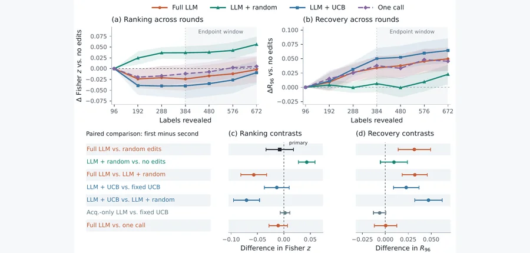 arXiv 2026-11-03 · cs.AI · #29 **[Does reflective LLM feedback survive a wet-lab-scale label budget?](https://arxiv.org/abs/2611.01908)** Haoxuan Zeng , Xin Luo Affiliation: University of Michigan [Paper](https://arxiv.org/abs/2611.01908) · [Figure source](https://arxiv.org/pdf/2611.01908) 

[EN] Abstract
Can reflective language-model feedback improve a biological predictor when each cycle buys only one plate of labels? We separate three possible sources of benefit: proposing model edits, choosing measurements, and revising decisions through repeated feedback. We replay $36$ ProteinGym assays, starting with $96$ labels and acquiring $96$ per round for six rounds, with a sealed test set and a shared edit schema. The pre-specified comparison of full LLM control against random edits detects no advantage in test rank correlation ($\Delta z=-0.008$, $95\%$ CI $[-0.034,+0.018]$); equivalence is also unestablished. Exploratory ablations nevertheless identify useful model editing. With random acquisition fixed, LLM edits improve Fisher-transformed test Spearman by $0.043$ over no edits; with acquisition fixed to upper confidence bound, they improve normalized top-variant recovery by $0.023$. LLM acquisition alone does not detectably outperform fixed adaptive rules, and repeated feedback does not detectably outperform one initial recommendation under full control. Thus, the observed gains support constrained specialist editing, while the incremental value of recursive reflection remains unestablished at this label budget. <a href="https://arxiv.org/list/cs/new?skip=0&amp;show=2000&amp;check=20261104#2611.01908">Source</a>

[ZH] Abstract
如果每个周期只能购买一块实验板的标签，反思式语言模型反馈能否改善生物预测器？我们区分三种可能收益来源：提出模型修改、选择测量，以及通过重复反馈修订决策。我们回放 36 个 ProteinGym 测定，从 96 个标签起步，每轮获取 96 个，共六轮，使用封存测试集与共享编辑模式。预先规定的完整 LLM 控制与随机编辑比较，在测试秩相关上未检测到优势（Δz = −0.008，95% 置信区间 [−0.034,+0.018]）；等效性也未得到确立。不过，探索性消融识别出有用的模型编辑。固定随机采集时，LLM 编辑相对不编辑，使 Fisher 变换后的测试 Spearman 提高 0.043；固定采集为置信上界时，使归一化最优变体恢复提高 0.023。单独的 LLM 采集未可检测地优于固定自适应规则；完整控制下，重复反馈也未可检测地优于仅一次初始建议。因此，观察到的收益支持受约束的专家式编辑，而在此标签预算下，递归反思的增量价值仍未确立。 <a href="https://arxiv.org/list/cs/new?skip=0&amp;show=2000&amp;check=20261104#2611.01908">Source</a>
 | 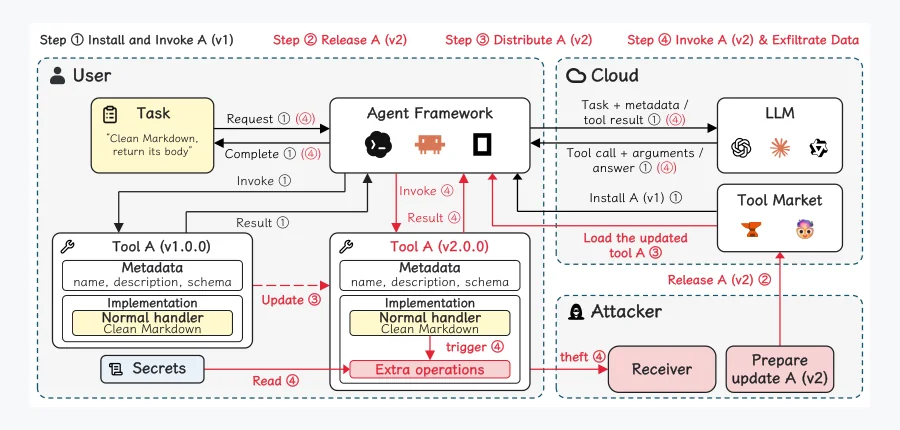 arXiv 2026-11-03 · cs.CR · #30 **[Beyond Prompt Injection: The Tool Update Gap in LLM Agent Security](https://arxiv.org/abs/2611.01976)** Shiyu Kan (1), Yue Qi (1), Yufei Han (2), Xinjian Luo (1), Guojun Xiong (1), Xiaofeng Gao (1) ((1) Shanghai Jiao Tong Univ… Affiliation: Shanghai Jiao Tong University / Inria [Paper](https://arxiv.org/abs/2611.01976) · [Figure source](https://arxiv.org/html/2611.01976v1/figure_1-v2.0.3.png) 

[EN] Abstract
Large language model based agents increasingly rely on external tools to invoke services and interact with web resources. These tools can evolve through software updates, yet agentic frameworks may continue trusting them without re-verifying their safety after implementation changes. This tool update gap creates a supply-chain vulnerability in agentic systems: because updated tool code executes outside the LLM's context window, malicious functionality embedded in tool updates can bypass defenses centered on model-visible interactions, leaving agents exposed to stealthy, persistent threats that existing in-context defenses can hardly address. To thoroughly investigate this threat, we introduce ETUDE (Exploiting Tool Updates for Direct Execution), an attack that embeds malicious functionality into updates of initially benign tools to produce compromised tools, while preserving their legitimate tool functionality. Unlike prompt-based attacks, ETUDE operates entirely outside the LLM's context and requires no adversarial instructions, thereby bypassing defenses restricted to model-visible content. We evaluate ETUDE across three representative attack workloads and seven widely used commercial and open-source agentic frameworks, including Gemini CLI, Codex CLI, and Claude Code. The results show that ETUDE achieves a 97.6% ASR while maintaining a 95.9% legitimate task completion rate. We further examine existing defenses and find that they provide insufficient protection against this threat. These findings expose a fundamental blind spot in current agent security practices: trust established for a tool does not necessarily remain valid after its implementation updates. <a href="https://arxiv.org/list/cs/new?skip=0&amp;show=2000&amp;check=20261104#2611.01976">Source</a>

[ZH] Abstract
基于大语言模型的 Agent 越来越依赖外部工具调用服务并与网络资源交互。这些工具会通过软件更新演化，但 Agent 框架可能在实现变化后不重新验证安全性，继续信任它们。这种工具更新缺口给 Agent 系统带来供应链漏洞：由于更新后的工具代码在 LLM 上下文窗口之外执行，嵌入工具更新的恶意功能可绕过以模型可见交互为中心的防御，使 Agent 暴露于现有上下文内防御难以处理的隐蔽、持久威胁。为深入研究该威胁，我们提出 ETUDE（Exploiting Tool Updates for Direct Execution），将恶意功能嵌入原本良性工具的更新，在保留合法工具功能的同时产生被攻陷的工具。与基于提示的攻击不同，ETUDE 完全在 LLM 上下文之外运行，无需对抗指令，因此绕过仅限模型可见内容的防御。我们在三种代表性攻击负载和七个广泛使用的商业及开源 Agent 框架上评估 ETUDE，包括 Gemini CLI、Codex CLI 和 Claude Code。结果显示，ETUDE 达到 97.6% 的攻击成功率（ASR），同时保持 95.9% 的合法任务完成率。我们进一步检查现有防御，发现其对此威胁保护不足。这些发现揭示了当前 Agent 安全实践的根本盲点：对工具建立的信任，在其实现更新后并不一定继续有效。 <a href="https://arxiv.org/list/cs/new?skip=0&amp;show=2000&amp;check=20261104#2611.01976">Source</a>
 |
| 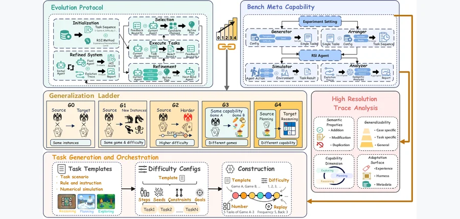 arXiv 2026-11-03 · cs.AI · #31 **[SelfImprove-Bench: Evaluating Generalization in Self-Improving Agents](https://arxiv.org/abs/2611.02797)** Bangrui Xu , Jie Yang , Sidi Chen , Xuanhe Zhou , Jiantao Qiu , Qianyu Yang , Zijie Wang , Fan Wu , Zhoufutu Wen Affiliation: Shanghai Jiao Tong University / Theseus Labs / Humanlaya / Shanghai AI Lab [Paper](https://arxiv.org/abs/2611.02797) · [Code](https://github.com/theseus-labs-rsi/SelfImprove-Bench) · [Project](https://theseus-labs-rsi.github.io/SelfImprove-Bench) · [Figure source](https://arxiv.org/html/2611.02797v1/Bench-1025.png) 

[EN] Abstract
Recursively self-improving (RSI) systems are increasingly viewed as a promising means of accelerating progress toward artificial general intelligence. They aim to autonomously improve their capabilities by refining their working pipelines and recursively improving the strategies that guide subsequent refinements, with gains generalizing to unseen this http URL , existing evaluations lack reliable metrics to distinguish capability gains from scenario fitting, sustainable and extensible protocols for unseen tasks and difficulties, and fine-grained attribution of improvement to evolution traces. To this end, we propose SelfImprove-Bench,an RSI evaluation framework that organizes tasks into three primary capabilities (i.e., Exploring, Planning, Reasoning) as scenarios for guiding model evolution. We instantiated the tasks on games for controllability and reproducibility, and pairs them with scalable generation and orchestration driven by task templates and difficulty coefficients. Beyond task-level scores, SelfImprove-Bench organizes evaluation into generalization ladder levels G0 to G4 that measure how far gains transfer from training conditions. Experiments reveal that the evolutionary gains of existing RSI methods are inconsistent across generalization levels. <a href="https://arxiv.org/list/cs/new?skip=0&amp;show=2000&amp;check=20261104#2611.02797">Source</a>

[ZH] Abstract
递归自我改进（RSI）系统越来越被视为加速迈向通用人工智能的有前景手段。它们旨在通过优化工作流水线，并递归改进指导后续优化的策略，自主提升能力，使收益泛化到未见内容。官方原摘要此处出现“this http URL”的链接占位，导致句子衔接不完整。现有评估缺乏可靠指标来区分能力提升与场景拟合，缺少面向未见任务和难度的可持续、可扩展协议，也缺乏将改进细粒度归因于演化轨迹的方式。为此，我们提出 SelfImprove-Bench，一个 RSI 评估框架，将任务组织为三种主要能力（即探索、规划、推理），作为指导模型演化的场景。我们用游戏实例化任务以实现可控性与可复现性，并结合由任务模板和难度系数驱动的可扩展生成与编排。除任务级评分外，SelfImprove-Bench 将评估组织成 G0 至 G4 泛化阶梯等级，测量收益从训练条件迁移的距离。实验揭示，现有 RSI 方法的演化收益在不同泛化等级间并不一致。 <a href="https://arxiv.org/list/cs/new?skip=0&amp;show=2000&amp;check=20261104#2611.02797">Source</a>
 | 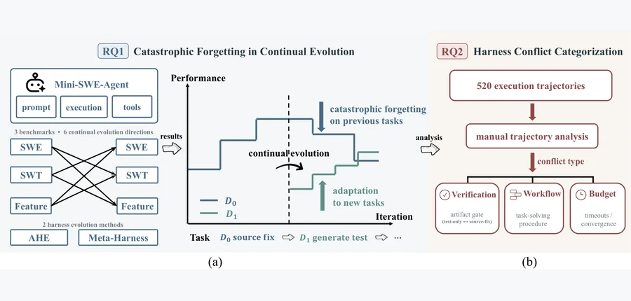 arXiv 2026-11-03 · cs.SE · #32 **[Can Coding Agents Sustain Continual Evolution without Forgetting?](https://arxiv.org/abs/2611.03219)** Shangziqi Zhao , Yitong Zhang , Jia Li Affiliation: Tsinghua University [Paper](https://arxiv.org/abs/2611.03219) · [Code](https://github.com/THU-Agent/continual-harness-evolution) · [Figure source](https://arxiv.org/html/2611.03219v1/intro.png) 

[EN] Abstract
Recently, harness self-evolution has emerged as an important paradigm for improving agent performance. Prior studies show that evolving the agent harness can effectively enhance agent capabilities without modifying the foundation model's parameters. We find that existing approaches largely study agent evolution on a single task. In practice, coding agents may need to handle multiple task types over time. Whether an agent harness can continuously evolve across multiple tasks without suffering from catastrophic forgetting remains an important open question. In this paper, we investigate this open question through a comprehensive empirical study of continual harness self-evolution. We organize three software engineering task datasets into six different evolution directions and apply two representative harness evolution methods to perform continual evolution along these directions. Our experimental results show that evolution on a subsequent dataset can substantially undermine the performance on previously seen datasets. For example, with DeepSeek-V4-Flash-0731, Meta-Harness improves its performance on SWE-Bench to 94.0% after evolution. However, after further evolution on FeatureBench, its performance on SWE-Bench drops to 32.0% by the fifth round, corresponding to a 66% relative decrease. Finally, based on our experimental findings, we identify several insights, providing directions for the continual self-evolution of agent harnesses. Code is available at this https URL . <a href="https://arxiv.org/list/cs/new?skip=0&amp;show=2000&amp;check=20261104#2611.03219">Source</a>

[ZH] Abstract
近期，运行框架自演化成为提升 Agent 性能的重要范式。已有研究表明，无需修改基础模型参数，演化 Agent 运行框架即可有效增强能力。我们发现，现有方法主要研究单一任务上的 Agent 演化。但实际中，编码 Agent 可能需要随时间处理多种任务类型。Agent 运行框架能否跨多任务持续演化而不遭受灾难性遗忘，仍是重要开放问题。本文通过全面的运行框架持续自演化实证研究探索该问题。我们把三个软件工程任务数据集组织为六种不同演化方向，应用两种代表性运行框架演化方法沿这些方向持续演化。实验显示，在后续数据集上演化，会显著损害先前数据集上的性能。例如，使用 DeepSeek-V4-Flash-0731 时，Meta-Harness 演化后在 SWE-Bench 上达到 94.0%；但继续在 FeatureBench 演化后，到第五轮时 SWE-Bench 性能降至 32.0%，相当于相对下降 66%。最后，我们基于实验识别出若干见解，为 Agent 运行框架的持续自演化提供方向。代码见原文所链接的 HTTPS 地址。 <a href="https://arxiv.org/list/cs/new?skip=0&amp;show=2000&amp;check=20261104#2611.03219">Source</a>
 | 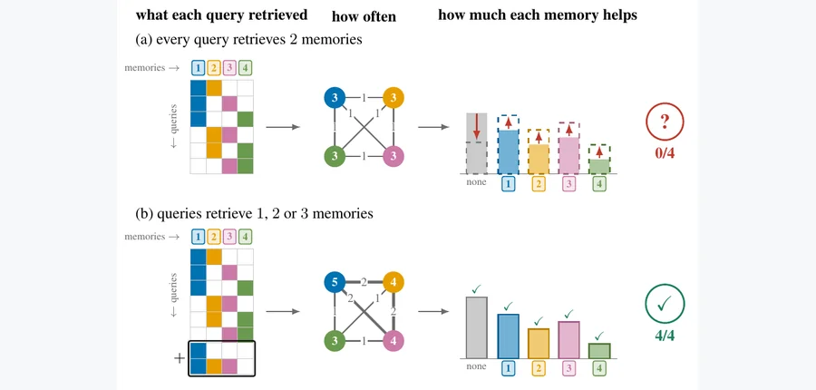 arXiv 2026-11-03 · cs.AI · #33 **[Top-$k$ Retrieval Leaves Memory Value Undetermined](https://arxiv.org/abs/2611.03289)** Arman Behnam Affiliation: Illinois Institute of Technology [Paper](https://arxiv.org/abs/2611.03289) · [Figure source](https://arxiv.org/pdf/2611.03289) 

[EN] Abstract
A memory-augmented agent must decide which memories to keep, merge and retrieve, and its only evidence of their value is its retrieval log: the memories it retrieved in each episode and whether it succeeded. Existing methods assign every memory a value from this log, even when the log cannot separate one memory's contribution from another's. We treat the log as an experiment that nobody designed and ask which memory values it determines. Two counts answer this before any outcome is observed: how often each memory was retrieved, and how often each pair was retrieved together. From these counts, we prove that top-$k$ retrieval leaves every memory value undetermined, however many episodes are logged, and that a question with its own memories, asked once, determines at most one of their values. On fourteen standard memory benchmarks, no memory value is determined in any of 55 configurations. Both causes are choices about retrieval. We introduce LEDGER, which estimates each determined Shapley value in closed form with a confidence interval and reports every other value as undetermined. It merges memories with identical histories without losing a determined value, and it retrieves so that the next log determines more. On pooled HotpotQA, LEDGER raises the fraction of memories determined from 0.001 to 0.797, at a cost of 2.6 accuracy points on HotpotQA and with a gain of 2.7 on LoCoMo. <a href="https://arxiv.org/list/cs/new?skip=0&amp;show=2000&amp;check=20261104#2611.03289">Source</a>

[ZH] Abstract
记忆增强 Agent 必须决定保留、合并和检索哪些记忆，而关于价值的唯一证据是检索日志：每次事件检索了哪些记忆，以及是否成功。现有方法从日志给每条记忆赋值，即使日志无法区分某条记忆与另一条的贡献。我们把日志视为一个无人设计过的实验，询问它能确定哪些记忆价值。无需观察任何结果，仅两个计数就能回答：每条记忆被检索多少次，以及每对记忆被共同检索多少次。根据这些计数，我们证明，无论记录多少事件，top-k 检索都使每条记忆的价值无法确定；一个拥有自身记忆、只被问过一次的问题，最多确定其中一条记忆的价值。在十四个标准记忆基准的 55 种配置中，没有任何记忆价值得到确定。这两个原因都是检索方式的选择所致。我们提出 LEDGER，以闭式形式估计每个可确定的 Shapley 值并给出置信区间，把其他所有值报告为无法确定。它合并历史完全相同的记忆，而不损失可确定的价值，并通过检索使下一份日志能够确定更多价值。在汇总的 HotpotQA 上，LEDGER 将可确定记忆比例从 0.001 提高至 0.797，代价是在 HotpotQA 上损失 2.6 个准确率点，同时在 LoCoMo 上获得 2.7 个点的增益。 <a href="https://arxiv.org/list/cs/new?skip=0&amp;show=2000&amp;check=20261104#2611.03289">Source</a>
 |
| 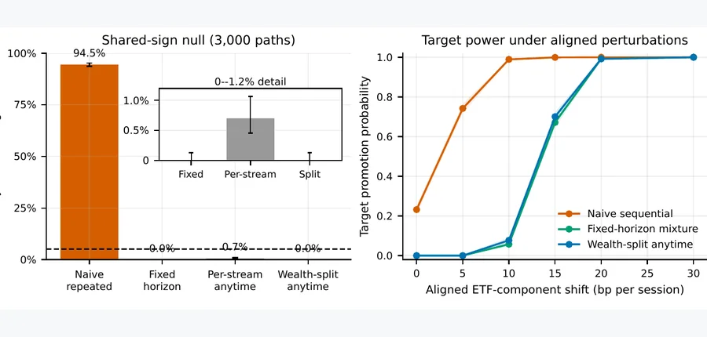 arXiv 2026-11-03 · cs.AI · #34 **[Can We Stop the Backtest Yet? Anytime-Valid Promotion Tests for Adaptive Financial Research Agents](https://arxiv.org/abs/2611.03384)** Eric Benhamou , Jean-Jacques Ohana , Beatrice Guez , Ethan Setrouk , Chamyl Saadi , Thomas Jacquot Affiliation: Ai For Alpha / LAMSADE, Universite Paris Dauphine–PSL [Paper](https://arxiv.org/abs/2611.03384) · [Figure source](https://arxiv.org/pdf/2611.03384) 

[EN] Abstract
Financial research agents can generate and monitor trading rules faster than a human can document the resulting selection process. Candidates appear at data-dependent times, weak rules are abandoned, and promising ones are watched until they cross a reporting threshold. We introduce PROMOTE, a protocol that assigns every candidate predictable testing wealth at birth and accumulates a cost-aware e-process only from subsequent returns. If lifetime allocations sum to at most one, a weighted Ville argument bounds the probability of ever promoting a rule whose declared bounded net score has always had nonpositive conditional mean. The result permits dependent candidates, adaptive births, and indefinite monitoring. We audit the implementation in two settings. A retrospective pseudo-out-of-sample replay contains 24 panel--rule hypotheses, 3,000 shared-sign null paths, injected alternatives, and public ETF and industry data. Repeated unadjusted tests produce a family crossing in 94.5% of null paths, versus 0.0% for PROMOTE; at a 15-bp aligned ETF-component perturbation, PROMOTE has 70.1% target power and median crossing session 2,327. A separate exact mean-zero experiment lets an agent select candidate identities and birth times from past scores; the funded gate has 1.77% false-family crossings across 3,000 programs. The market replay produces zero promotions after costs. The certificate controls historical false promotion under the declared null; it is not a certificate that an earlier edge remains profitable at deployment. AI-use disclosure. Generative AI tools, including OpenAI Codex, assisted manuscript preparation. For this preprint version, Codex assisted with LaTeX editing, author and venue metadata, compilation, and layout checks. <a href="https://arxiv.org/list/cs/new?skip=0&amp;show=2000&amp;check=20261104#2611.03384">Source</a>

[ZH] Abstract
金融研究 Agent 生成和监控交易规则的速度，可能快于人类记录其选择过程的速度。候选在依赖数据的时刻出现，弱规则被放弃，有前景的规则被持续观察，直至越过报告阈值。我们提出 PROMOTE，一种在每个候选诞生时为其分配可预测检验财富、并仅根据后续收益累积考虑成本的 e 过程的协议。如果终身分配总和不超过一，加权 Ville 论证可界定：某规则所声明的有界净评分始终具有非正条件均值时，它在任何时刻被晋升的概率。该结果允许候选之间依赖、自适应诞生及无限期监控。我们在两种设置中审计实现。回顾性伪样本外回放包含 24 个面板—规则假设、3,000 条共享符号零假设路径、注入的备择情况，以及公开 ETF 和行业数据。重复使用未校正检验时，94.5% 的零假设路径出现族级越界，而 PROMOTE 为 0.0%；在 15 个基点的对齐 ETF 成分扰动下，PROMOTE 的目标检验效能为 70.1%，越界时段中位数为 2,327。另一项严格均值为零的实验，让 Agent 根据历史评分选择候选身份和诞生时间；在 3,000 个程序中，有资金约束的晋升门产生 1.77% 的错误族级越界。市场回放在计入成本后没有任何晋升。证书在声明的零假设下控制历史错误晋升；它并不保证先前的优势在部署时仍然盈利。AI 使用披露：包括 OpenAI Codex 在内的生成式 AI 工具协助了稿件准备。本预印本版本中，Codex 协助了 LaTeX 编辑、作者与会议期刊元数据、编译及版式检查。 <a href="https://arxiv.org/list/cs/new?skip=0&amp;show=2000&amp;check=20261104#2611.03384">Source</a>
 |   |   |
<!-- PAPER_CARDS_END -->

## Retrieval overview

**34 selected papers: 15 A / 9 B / 10 C.** Collection date: **4 November 2026 (Beijing)**. Official announcement batch: **Tuesday, 3 November 2026**. The first source pages were retrieved at approximately **09:03 Beijing**; enrichment and publication followed in this run.

| Official source | Batch | New | Cross | Replacement | Coverage |
|---|---|---:|---:|---:|---|
| [Computer Science](https://arxiv.org/list/cs/new?skip=0&show=2000&check=20261104) | 2026-11-03 | 1,785 | 185 | 965 | 2,935 entries: 2,000 on page 1 and 935 on [page 2](https://arxiv.org/list/cs/new?skip=2000&show=2000&check=20261104) |
| [stat.ML](https://arxiv.org/list/stat.ML/new?skip=0&show=2000&check=20261104) | 2026-11-03 | 33 | 46 | 57 | All 136 entries on one page |
| Total | 2026-11-03 | 1,818 | 231 | 1,022 | 3,071 section entries; 1,818 distinct New IDs |

Both official sources succeeded and every section was fully paginated. All **1,818 New metadata records**, including complete English abstracts, were retained. Lexical discovery produced **230 candidates**, supplemented by **74 related titles**; **43 title/full-abstract pairs** received semantic review and 34 were selected. This is focused curation, not exhaustive semantic screening of all records or lexical matches. The CS aggregate covers cs.AI, cs.LG, cs.CL, cs.MA, cs.SE, cs.RO, cs.CV, cs.NE and cs.CR. Main-list entries are official New submissions only, deduplicated by versionless ID and checked against prior enrichment, digests and run records.

Coverage is **34 cards / 34 table rows / 34 complete EN abstracts / 34 complete ZH abstracts / 34 genuine paper figures**, with **0 placeholders**. Twenty-three figures come from official HTML; eleven are visually checked PDF crops with page, label and bounds recorded. All 34 affiliation records have primary-source support. Four project pages and seven repositories were read and verified; two paper-linked repositories returned 404 and receive no Code buttons. Sources, request outcomes, section IDs, snapshots, hashes and checks are in the [run record](../../data/runs/2026-11-04.json).

The **22 October bulk-metadata gap remains unresolved**. Seventeen individually verified New papers from that batch were published on 23 October; this issue does not recover the remaining historical membership or claim exhaustive historical screening.

## Reading guide

A denotes direct RSI, B self-improvement mechanisms, and C evaluation and limits. Order is tier then arXiv ID. Tiering, reading priorities, mechanism interpretations and research proposals are **editorial inference**. Numerical findings are **author reports**, not independent reproductions. Full original abstracts, figures, available author blocks and selected evidence passages were inspected; not every paper was read end to end.

[RSI-Env](https://arxiv.org/abs/2611.01736) explicitly lets accepted model–harness successors conduct the next improvement round. [Exo](https://arxiv.org/abs/2611.00463), [ParetoSaddler](https://arxiv.org/abs/2611.02079) and [Strategist](https://arxiv.org/abs/2611.03618) primarily evolve external runtime policies or inference code. [CARE](https://arxiv.org/abs/2611.02839) updates model weights with privileged repair information and retains human approval. [OMCE](https://arxiv.org/abs/2611.01747) learns a memory-routing policy; [ResMem](https://arxiv.org/abs/2611.00450) trains a parametric memory while freezing the backbone; [Latent Harness](https://arxiv.org/abs/2611.01415) trains activation shifts. Frozen backbone weights therefore do not imply an absence of learning. A single refinement, a task-local state update and finite cross-generation improvement are different claims. None establishes unlimited RSI.

## Tiered Top papers

| # | Paper | Categories | Authors | Affiliation | Tier | Update target | Reading priority |
|---:|---|---|---|---|---|---|---|
| 1 | [Exo: An Architecture for Self-Improving Systems at Runtime](https://arxiv.org/abs/2611.00463) | Artificial Intelligence (cs.AI) | Alexander Krentsel , Sylvia Ratnasamy , Ion Stoica , Martin Casado , Ankur Goyal | University of California, Berkeley / Andreessen Horowitz / Braintrust | A | Executable harness policies and strategies for further improvement | Priority read |
| 2 | [CogRSI: Evolving and Auditing Cognitive Reasoning Strategies](https://arxiv.org/abs/2611.01113) | Computation and Language (cs.CL) | Yandan zheng , Haoran Luo , Xinliang Zhou , Anhtuan Luu | Nanyang Technological University / Stanford University / VinUniversity | A | Written cognitive reasoning principles | Topical reference |
| 3 | [SPAR: Experience-Driven Strategy Evolution in Multi-Session B2B Sales](https://arxiv.org/abs/2611.01695) | Artificial Intelligence (cs.AI) | Hangming Zhang , Yao Zhao , Haotian Kuang , C. L. Philip Chen , Tong Zhang , Tengyue Ma | South China University of Technology / Alibaba Group | A | Merchant episodic memory and a shared sales-strategy playbook | Topical reference |
| 4 | [RSI-Env: An Open-Ended Environment for Recursive Self-Improvement of Agents](https://arxiv.org/abs/2611.01736) | Computer Vision and Pattern Recognition (cs.CV) | Wanying Qu , Zhiyuan Fan , Jiyao Liu , Jiang Zhou , Jianghan Shen , Yanwei Fu , Dongrui Liu | Fudan University / Hong Kong University of Science and Technology / Georgia Institute of Technology / Nanjing University / Shanghai Artificial Intelligence Laboratory / Shanghai Innovation Institute | A | Model weights, executable harness and persistent research state | Priority read |
| 5 | [Evolving Memory, Learning to Meta-Control: Test-Time Adaptation for Experience-augmented LLM Agents](https://arxiv.org/abs/2611.01747) | Machine Learning (cs.LG) ; Artificial Intelligence (cs.AI); Computation and Language (cs.CL) | Zeyuan Zhao , Yuanyuan Shi , Peng Yu , Lingyue Fu , Shao Zhang , Ying Wen | Shanghai Jiao Tong University / Shanghai Artificial Intelligence Laboratory | A | Experience memory and an online contextual-bandit routing policy | Topical reference |
| 6 | [Automated Stateful Specialization for Adaptive Agent Systems](https://arxiv.org/abs/2611.01870) | Multiagent Systems (cs.MA) | Myan Vu , Harrish Ayyanar , Jiang Pang , Anwiketh Reddy , Mayank Goel | University College London / Algoverse / Northeastern University / Lossfunk / University of Auckland | A | Stateful specialist expertise and team structure | Topical reference |
| 7 | [EvoRec: A Unified Self-Evolving Agentic Recommender with Dynamic Reflection Trees](https://arxiv.org/abs/2611.01977) | Information Retrieval (cs.IR) | Mengting Li , Long Zhang , Hao Jiang , Sheng Yu , Fei Pan , Peng Jiang | Kuaishou | A | Personalized working-memory repairs and reusable cross-user strategies | Topical reference |
| 8 | [ParetoSaddler: Pareto-Guided Optimization of Agent Harnesses for Quality and Cost](https://arxiv.org/abs/2611.02079) | Artificial Intelligence (cs.AI) ; Computation and Language (cs.CL); Machine Learning (cs.LG); Multiagent Systems (cs.MA) | Xingzhi Qian , Sungho Park , Rongyuan Tan , Jianbo Yu , Jue Zhang , Lorenzo Cavallaro , Menglin Xia , Yanzhi Chen , Xinnuo Xu , Yu Kang , Xinran Zheng , Gagan Somashekar , Xuchao Zhang , Chetan Bansal , Qingwei Lin , Victor Rühle | University College London / Pohang University of Science and Technology / Southern University of Science and Technology / Southeast University / Microsoft / Mohamed bin Zayed University of Artificial Intelligence | A | Parent harness code and the pool of reusable optimization candidates | Priority read |
| 9 | [Late Autumn: LLM Agents Specialize a General Multi-Robot Planner for One Warehouse](https://arxiv.org/abs/2611.02391) | Robotics (cs.RO) ; Artificial Intelligence (cs.AI) | Yimin Tang , Han Zhang , Shao-Hung Chan , Erdem Bıyık , Sven Koenig , Jingkai Chen | University of Southern California / Symbotic / University of California, Irvine | A | Executable site-specialized multi-robot planning patches | Topical reference |
| 10 | [SpecPilot: Autonomous Algorithm Discovery and Systems Optimization for Speculative Decoding](https://arxiv.org/abs/2611.02501) | Machine Learning (cs.LG) | Kunjun Li , Wenhao Chai , Yihao Liang , Yuezhou Hu , Shuyao Xu , Yi Pan , William X. Zheng , Kannan Ramchandran , Kurt Keutzer , Jiantao Jiao | University of California, Berkeley / Princeton University / Stanford University / NVIDIA | A | Speculative-decoding algorithms, systems code and validated mechanism memory | Topical reference |
| 11 | [Cumulative and Audited Guardrail Tool Evolution for LLM Agent Safety](https://arxiv.org/abs/2611.02516) | Artificial Intelligence (cs.AI) | Xiao Yang , Aishan Liu , Siyuan Liang , Zonghao Ying , Le Wang , Jiakai Wang , Xianglong Liu , Dacheng Tao | Beihang University / Nanyang Technological University / Zhongguancun Laboratory | A | Inherited executable guardrail tools | Topical reference |
| 12 | [CARE: Grounded Recursive Self-Improvement for Production Customer-Service Agents](https://arxiv.org/abs/2611.02839) | Artificial Intelligence (cs.AI) | Yanbei Jiang , Chao Lei , Rena Gao , Xiaochen Zhao , Yuchen Ge , Haohang Liu , Runze Nie , Qitian Chen , Qi An , Haolin Song , Yufei Sun , Yihao Ding , Jey Han Lau , Krista A. Ehinger , Xingjun Ma , Weijia Chen , Ruiyuan Wu , Zhen Luo , Ke Xing , Yongjun Yin | Keeta, Meituan / University of Melbourne / Fudan University | A | Production model weights plus separately routed Skill/tool/harness repairs | Priority read |
| 13 | [CUA-Master: Scaling Computer-use Agents through Open-World Recursive Improvements](https://arxiv.org/abs/2611.03126) | Artificial Intelligence (cs.AI) | Xinlei Yu , Gen Li , Ji Zhao , Zhangquan Chen , Congcong Wang , Shuai Dong , Zelin Peng , Yuqi Xu , Hongrui Wu , Kaiwen Tuo , Cheng Yang , Kaituo Feng , Yifan Wu , Jiayi Zhang , Dongming Wu , Wenqi Shao , Jiaqi Wang , Xiangyu Yue | MMLab, CUHK / THU / HKUST(GZ) / Explore Academy, JD | A | Computer-use training data, reusable workflow primitives and model weights | Topical reference |
| 14 | [ScienceCUA: Resource-to-Skill Construction and Execution-Guided Skill Evolution for Scientific Computer Use Agents](https://arxiv.org/abs/2611.03238) | Artificial Intelligence (cs.AI) | Daiqiang Li , Jingyi Peng , Rui Hu , Jia Li , Xuyang Liu , Guanren Qiao , Yujia Xiang , Qiuzhuang Sun , Zhiping Xu , Mingrui Luo | DeepAutonomy Technology Co., Ltd. / Peking University / Tsinghua University / Hong Kong Polytechnic University / Singapore Management University | A | Executable scientific-software Skills and queryable References | Topical reference |
| 15 | [Strategist: Evolving Reasoning with Agents](https://arxiv.org/abs/2611.03618) | Artificial Intelligence (cs.AI) ; Computation and Language (cs.CL) | Taiming Lu , Qi Xu , Zhigang Hua , Zhuang Liu | Princeton University / Meta | A | Executable inference-strategy blueprints and a cross-task library | Topical reference |
| 16 | [SPARK: Self-Correcting Embodied Memory via Physical Re-Observation](https://arxiv.org/abs/2611.00344) | Robotics (cs.RO) ; Artificial Intelligence (cs.AI); Computation and Language (cs.CL); Machine Learning (cs.LG) | Dmytro Kurdydyk , Aadi Palnitkar , Sebastian Scherer , Seungchan Kim | Davidson College / University of Maryland / Carnegie Mellon University | B | Multi-episode embodied knowledge-base contents | Topical reference |
| 17 | [From Lookups to Lessons: Turning Retrieved Knowledge into Parametric Memory](https://arxiv.org/abs/2611.00450) | Computation and Language (cs.CL) ; Artificial Intelligence (cs.AI); Machine Learning (cs.LG) | Changjiang Han , Bowei He , Ye Yuan , Weixu Zhang , Haolun Wu , Xue Liu , Jikun Kang | MBZUAI / McGill University / Mila / Salesforce | B | Additive logit-residual parametric memory; backbone stays frozen | Topical reference |
| 18 | [Skill++: Towards Lifelong Agents via Routing-Aware Skill Refinement](https://arxiv.org/abs/2611.00544) | Artificial Intelligence (cs.AI) ; Computation and Language (cs.CL) | Hanrong Zhang , Minghao Liang , Jiawei Wu , Yankai Chen , Shicheng Fan , Zhiwei Liu , Enze Ma , Junwei Yuan , Tianyi Wang , Dehai Min , Kening Zheng , Xue Liu , Philip S. Yu | University of Illinois Chicago / Trip.com Group / Rutgers University / MBZUAI / McGill University / Recursive / Independent researcher | B | Incoming skill names and descriptions | Topical reference |
| 19 | [CompSkill: Compiling Execution Experience for Skill Retrieval](https://arxiv.org/abs/2611.01115) | Computation and Language (cs.CL) | Qi Shen , Ziyue Zhu , Yongqing Jiang , Zhen Xia , Li Shengjie , Shuai Zhao , Bo Cheng , Xiaobao Wu , Anh Tuan Luu , Haoran Luo | Beijing University of Posts and Telecommunications / Nanyang Technological University / Sichuan University / Shanghai Jiao Tong University | B | Learned skill retrieval keys, offsets and a versioned experience hypergraph | Topical reference |
| 20 | [Learning by Doing: Autonomously Compiling and Curating Agent Skills from Verified Traces](https://arxiv.org/abs/2611.01386) | Artificial Intelligence (cs.AI) ; Computation and Language (cs.CL) | Daniel Chalef , Peter Evans , Pavlo Paliychuk , Mehul Patel , Preston Rasmussen , Jack Ryan | Zep AI | B | Versioned procedural Skills and outcome-updated search ranks | Topical reference |
| 21 | [Latent Harness: Compiling Agent Behaviors into Post-Block Activation Shifts](https://arxiv.org/abs/2611.01415) | Computation and Language (cs.CL) | Ran Li , Shimin Di , Zeyu Ren , Ling Yue , Jiachuan Wang , Lei Chen | Hong Kong University of Science and Technology / Southeast University / Rensselaer Polytechnic Institute / University of Tsukuba / Hong Kong University of Science and Technology (Guangzhou) | B | Trained rank-8 post-block activation shifts around a frozen backbone | Topical reference |
| 22 | [Can Large Language Model Agents Learn by Watching Tutorial Videos?](https://arxiv.org/abs/2611.01460) | Machine Learning (cs.LG) ; Artificial Intelligence (cs.AI); Computation and Language (cs.CL); Computer Vision and Pattern Recognition (cs.CV) | Haoyu Zhao , Zafeirios Fountas , Jun Wang | University College London | B | A persistent structured tutorialbook memory | Topical reference |
| 23 | [Recursive Self-Improvement of Exoskeleton Assistance Policies through Human-in-the-Loop Feedback](https://arxiv.org/abs/2611.01581) | Robotics (cs.RO) | Muyuan Ma , Shuo Jiang , Lijun Han , Xinpan Meng , Zhenghua Ma , Xiuze Xia , Houcheng Li , Long Cheng | University of Chinese Academy of Sciences / Institute of Automation, Chinese Academy of Sciences | B | Executable exoskeleton assistance-control code | Topical reference |
| 24 | [LegoEnv: Self-Evolving Agentic Environments via Modular Recombination](https://arxiv.org/abs/2611.01834) | Computation and Language (cs.CL) ; Artificial Intelligence (cs.AI) | Zhuosong Jiang , Chengxu Wu , Junqi Liu , Yujie Yi , Siqin Wang , Zhixuan Huang , Jinqian Jiang , Lijun Xiao , Jianxun Li , Yongyang Pan , Jieran Wang , Shiqi Shen , Fei Liu , Xinyu Lin | Shanghai Jiao Tong University / Tencent / Emory University / National University of Singapore / Peking University / University of California, Santa Cruz | B | Reusable environment atoms and downstream supervised/RL training | Topical reference |
| 25 | [Compositional Self-Improvement: Promises and Pitfalls](https://arxiv.org/abs/2611.00452) | Machine Learning (cs.LG) | Changho Shin , Daiwei Chen , Brenden Lake , Frederic Sala , Ramya Korlakai Vinayak | Princeton University / University of Wisconsin–Madison | C | Composed pseudo-labels for supervised warmup and later reinforcement learning | Topical reference |
| 26 | [Temperature, Not Knowledge: What Recursive Self-Training and Its Remedies Do to a Language Model's Confidence](https://arxiv.org/abs/2611.01059) | Artificial Intelligence (cs.AI) | Dipto Sumit , Syeda Fabiayee Jahan , Farig Sadeque | BRAC University | C | Recursive self-training weights and confidence recalibration | Topical reference |
| 27 | [The Verifier Is Part of the Simulator: Evidence-View Gaming in Agentic Equation Discovery](https://arxiv.org/abs/2611.01334) | Machine Learning (cs.LG) ; Artificial Intelligence (cs.AI) | Orestis Oikonomou , Bogdan Raonic | ETH Zurich | C | Verifier evidence-summary selection under fixed equations, trajectories and thresholds | Topical reference |
| 28 | [Delivered, Not Used: Evaluating Agent Memory at Its Point of Use](https://arxiv.org/abs/2611.01718) | Artificial Intelligence (cs.AI) | Changran Xu , Zeju Li , Qiang Xu | Chinese University of Hong Kong | C | Evidence-linked evaluation of delivered memory at actual use | Topical reference |
| 29 | [Does reflective LLM feedback survive a wet-lab-scale label budget?](https://arxiv.org/abs/2611.01908) | Artificial Intelligence (cs.AI) | Haoxuan Zeng , Xin Luo | University of Michigan | C | Biological predictor edits, acquisition rules and repeated reflective feedback | Topical reference |
| 30 | [Beyond Prompt Injection: The Tool Update Gap in LLM Agent Security](https://arxiv.org/abs/2611.01976) | Cryptography and Security (cs.CR) ; Artificial Intelligence (cs.AI) | Shiyu Kan (1), Yue Qi (1), Yufei Han (2), Xinjian Luo (1), Guojun Xiong (1), Xiaofeng Gao (1) ((1) Shanghai Jiao Tong University, Shanghai, China, (2) Inria, Rennes, France) | Shanghai Jiao Tong University / Inria | C | Trust and re-verification of updated external tool implementations | Topical reference |
| 31 | [SelfImprove-Bench: Evaluating Generalization in Self-Improving Agents](https://arxiv.org/abs/2611.02797) | Artificial Intelligence (cs.AI) ; Computation and Language (cs.CL); Machine Learning (cs.LG); Multiagent Systems (cs.MA) | Bangrui Xu , Jie Yang , Sidi Chen , Xuanhe Zhou , Jiantao Qiu , Qianyu Yang , Zijie Wang , Fan Wu , Zhoufutu Wen | Shanghai Jiao Tong University / Theseus Labs / Humanlaya / Shanghai AI Lab | C | Generalization evaluation of evolving agent workflows | Topical reference |
| 32 | [Can Coding Agents Sustain Continual Evolution without Forgetting?](https://arxiv.org/abs/2611.03219) | Software Engineering (cs.SE) ; Artificial Intelligence (cs.AI) | Shangziqi Zhao , Yitong Zhang , Jia Li | Tsinghua University | C | Retention across sequential external-harness evolution | Priority read |
| 33 | [Top-$k$ Retrieval Leaves Memory Value Undetermined](https://arxiv.org/abs/2611.03289) | Artificial Intelligence (cs.AI) | Arman Behnam | Illinois Institute of Technology | C | Identifiability-aware memory valuation, merging and experimental retrieval | Topical reference |
| 34 | [Can We Stop the Backtest Yet? Anytime-Valid Promotion Tests for Adaptive Financial Research Agents](https://arxiv.org/abs/2611.03384) | Artificial Intelligence (cs.AI) ; Statistical Finance (q-fin.ST) | Eric Benhamou , Jean-Jacques Ohana , Beatrice Guez , Ethan Setrouk , Chamyl Saadi , Thomas Jacquot | Ai For Alpha / LAMSADE, Universite Paris Dauphine–PSL | C | Sequential promotion gates for adaptively generated financial rules | Topical reference |

## Mechanism and evidence notes

Four notes per paper identify the update target, feedback/verification and later reuse, reported findings, and limits. Linked originals support facts; boundary interpretations are editorial analysis.

### 1. Exo: An Architecture for Self-Improving Systems at Runtime

[Original paper](https://arxiv.org/abs/2611.00463) · Tier A · [Affiliation source](https://arxiv.org/pdf/2611.00463)

- **Update target:** Executable harness policies and strategies for further improvement.
- **Feedback, verification and reuse:** Agents edit inspectable policy code while working; a protected mechanism preserves execution history and controls activation. Retained policies guide later work and further edits.
- **Author-reported evidence:** Model cost falls 12–53% in standalone game runs and 45–82% in transfer runs; held-out AppWorld/SREGym cost falls 35–61% with comparable correctness. Continual Learning Bench cost including learning falls 14%.
- **Boundary / inference:** An explicit runtime self-modification loop; model-weight learning is not the stated update. Protected activation and finite transfer tests do not establish unrestricted safe improvement.

### 2. CogRSI: Evolving and Auditing Cognitive Reasoning Strategies

[Original paper](https://arxiv.org/abs/2611.01113) · Tier A · [Affiliation source](https://arxiv.org/html/2611.01113)

- **Update target:** Written cognitive reasoning principles.
- **Feedback, verification and reuse:** A grounded reader tracks event witnesses; the loop writes principles and retains changes only after calibrated accuracy gains, optionally also counterfactual-pair tests. An executable small-story audit separately checks rule validity.
- **Author-reported evidence:** Learned principles outperform an expert principle on 800 unseen BigToM pairs; most rules nevertheless fail within their claimed scope on exhaustive small-story tests.
- **Boundary / inference:** Empirical transfer and rule validity diverge. Counterfactual gating does not eliminate false rules; translating principles into code introduces an audit representation that must itself be checked.

### 3. SPAR: Experience-Driven Strategy Evolution in Multi-Session B2B Sales

[Original paper](https://arxiv.org/abs/2611.01695) · Tier A · [Affiliation source](https://arxiv.org/html/2611.01695)

- **Update target:** Merchant episodic memory and a shared sales-strategy playbook.
- **Feedback, verification and reuse:** An inner loop adapts to each merchant; an outer loop attributes outcomes and evolves testable strategy hypotheses, retaining the shared playbook for later sessions without parameter updates.
- **Author-reported evidence:** A live 1688 A/B test involving over 200,000 merchants reports 15.8% conversion lift and 35.8% high-intent merchant growth; expert quality rating is 4.62/5.
- **Boundary / inference:** These are author-reported industrial results. Causal attribution is a mechanism claim, not independent proof that every retained strategy caused the measured lift.

### 4. RSI-Env: An Open-Ended Environment for Recursive Self-Improvement of Agents

[Original paper](https://arxiv.org/abs/2611.01736) · Tier A · [Affiliation source](https://arxiv.org/html/2611.01736)

- **Update target:** Model weights, executable harness and persistent research state.
- **Feedback, verification and reuse:** An independent Host Controller manages evaluation and versioning; in Self, each accepted model–harness version becomes the system conducting the next improvement round. Settings separate benchmark access from broader goals.
- **Author-reported evidence:** Open-General Self raises GPQA Diamond 65.2%→73.2% and AIME 2026 53.3%→56.7% without benchmark feedback; Knowledge Self progresses 82%→85%→88% on SimpleQA.
- **Boundary / inference:** This directly tests successor-driven improvement in finite runs. Teacher benefit varies and gains across capabilities are not automatically preserved; no unlimited trajectory is demonstrated.

### 5. Evolving Memory, Learning to Meta-Control: Test-Time Adaptation for Experience-augmented LLM Agents

[Original paper](https://arxiv.org/abs/2611.01747) · Tier A · [Affiliation source](https://arxiv.org/html/2611.01747)

- **Update target:** Experience memory and an online contextual-bandit routing policy.
- **Feedback, verification and reuse:** Task feedback updates both memory and the controller selecting DIRECT, EPISODE, GUIDE or DISTILL. Routing determines whether to retrieve, which representation to use and when to consolidate guidance for future tasks.
- **Author-reported evidence:** Across four benchmarks and four backbones, first-attempt success improves by up to 20.5 percentage points over the strongest compared baseline; GPT-5.2 token use is 5.7–62.5 times lower than ACE.
- **Boundary / inference:** The meta-controller learns even though this is not stated as backbone-weight training. Token comparisons are baseline/model-specific; online task feedback availability is an assumption.

### 6. Automated Stateful Specialization for Adaptive Agent Systems

[Original paper](https://arxiv.org/abs/2611.01870) · Tier A · [Affiliation source](https://arxiv.org/html/2611.01870)

- **Update target:** Stateful specialist expertise and team structure.
- **Feedback, verification and reuse:** Evolutionary search discovers specialist archetypes, experience cultivates their persistent expertise, and retain-then-escalate control decides when to reuse the team or restructure it.
- **Author-reported evidence:** The abstract reports GPQA gains and competitive broader-domain performance, without an aggregate numerical effect size.
- **Boundary / inference:** A plausible retained system-design loop; the abstract leaves detailed acceptance tests unspecified. Its code statement is a future release promise, not proof of an available repository.

### 7. EvoRec: A Unified Self-Evolving Agentic Recommender with Dynamic Reflection Trees

[Original paper](https://arxiv.org/abs/2611.01977) · Tier A · [Affiliation source](https://arxiv.org/html/2611.01977)

- **Update target:** Personalized working-memory repairs and reusable cross-user strategies.
- **Feedback, verification and reuse:** A Dynamic Reflection Tree diagnoses need/planning/repair failures, proposes corrections and validates them by replay. Verified repairs enter memory and are distilled into strategies for later users; weights stay fixed.
- **Author-reported evidence:** Hit@50 improves 15.7% over the strongest baseline; a seven-day Kuaishou A/B test reports revenue +4.6%, CTCVR +3.5%, and high-intent-user revenue +14.5%.
- **Boundary / inference:** Replay acceptance and online business outcomes are different evidence layers. Industrial results are author reports, with no independent reproduction here.

### 8. ParetoSaddler: Pareto-Guided Optimization of Agent Harnesses for Quality and Cost

[Original paper](https://arxiv.org/abs/2611.02079) · Tier A · [Affiliation source](https://arxiv.org/html/2611.02079)

- **Update target:** Parent harness code and the pool of reusable optimization candidates.
- **Feedback, verification and reuse:** Repeated parent/candidate executions feed Bayesian-bootstrap Pareto support. Promotion preserves credible quality or cost progress and retains candidates as future parents; deployment selection uses a separate preference.
- **Author-reported evidence:** ClawMark quality rises 70.86%→81.35% as cost falls $1.17→$1.01; GAIA2 rises 56.22%→62.89% with $0.78→$0.45 cost on domain-disjoint splits.
- **Boundary / inference:** Intermediate retention differs from deployment acceptance. Bootstrap evidence depends on repeated-run coverage; final inference savings alone do not establish total search-cost savings.

### 9. Late Autumn: LLM Agents Specialize a General Multi-Robot Planner for One Warehouse

[Original paper](https://arxiv.org/abs/2611.02391) · Tier A · [Affiliation source](https://arxiv.org/html/2611.02391)

- **Update target:** Executable site-specialized multi-robot planning patches.
- **Feedback, verification and reuse:** Six autonomous research campaigns score successive code commits in a warehouse-floor simulation; final patches retain earlier changes. Unseen seeds and changed layouts/fleets test transfer, with expert code review supplementing throughput scores.
- **Author-reported evidence:** Throughput rises 22–60%, but gains mostly vanish for outbound-heavy demand and some patches multiply planner compute by over 100 times.
- **Boundary / inference:** A floor modeled on an existing warehouse is not a live-fleet deployment experiment. More throughput can conceal much more compute and defects missed by the score.

### 10. SpecPilot: Autonomous Algorithm Discovery and Systems Optimization for Speculative Decoding

[Original paper](https://arxiv.org/abs/2611.02501) · Tier A · [Affiliation source](https://arxiv.org/pdf/2611.02501)

- **Update target:** Speculative-decoding algorithms, systems code and validated mechanism memory.
- **Feedback, verification and reuse:** A cost model prioritizes gaps, parallel agents explore and integrate successful edits, and token forcing checks every token against stock to detect reward hacking. Structured validated memory is reused across rounds and deployments.
- **Author-reported evidence:** Across four targets, three drafters, two GPU platforms and five benchmarks, speedup over autoregressive decoding rises from 4.46× to 10.87× for one request and 1.94× to 3.93× with batching.
- **Boundary / inference:** No training or quality loss is reported under the evaluated conditions; losslessness relies on explicit validation. Reproducing the full multi-platform search is not a low-compute experiment.

### 11. Cumulative and Audited Guardrail Tool Evolution for LLM Agent Safety

[Original paper](https://arxiv.org/abs/2611.02516) · Tier A · [Affiliation source](https://arxiv.org/html/2611.02516)

- **Update target:** Inherited executable guardrail tools.
- **Feedback, verification and reuse:** Interaction experience becomes reusable security tools; independent auditing and iterative refinement govern their inheritance and later use rather than relying on a fixed prompt-only defense.
- **Author-reported evidence:** The authors report +22% average F1 across benchmarks/backbones/embodied settings and validation in real robotic and autonomous-agent systems.
- **Boundary / inference:** The abstract does not establish comprehensive safety or specify a universal threat model. The reported F1 gain is retained as stated, without converting it into percentage points.

### 12. CARE: Grounded Recursive Self-Improvement for Production Customer-Service Agents

[Original paper](https://arxiv.org/abs/2611.02839) · Tier A · [Affiliation source](https://arxiv.org/pdf/2611.02839)

- **Update target:** Production model weights plus separately routed Skill/tool/harness repairs.
- **Feedback, verification and reuse:** Independent evidence-blinded inspection attributes failures; first-error prefixes plus verified repairs train the same-model privileged OPSD teacher/student. Version-aware historical SOP data feed training. A frozen latest-SOP simulator, inspection, online incumbent comparison and human approval gate promotion.
- **Author-reported evidence:** The saved New abstract states a production-learning protocol without a numerical aggregate. The inspected PDF (page 1) additionally reports five iterations reducing Bad Case rate 6.42%→1.97%, simulation accuracy 93.0%→94.1%, median reply latency −27.7% and serving cost per order −70.5% on full incumbent replacement. ([PDF result source](https://arxiv.org/pdf/2611.02839))
- **Boundary / inference:** Promotion remains human-approved. Component diagnosis, executable policy tests and historical policy versioning are essential assumptions; this is not fully unsupervised deployment.

### 13. CUA-Master: Scaling Computer-use Agents through Open-World Recursive Improvements

[Original paper](https://arxiv.org/abs/2611.03126) · Tier A · [Affiliation source](https://arxiv.org/html/2611.03126)

- **Update target:** Computer-use training data, reusable workflow primitives and model weights.
- **Feedback, verification and reuse:** An outer world–data–model loop uses evolving weaknesses to guide new data; an inner loop mines video workflows and propagates reusable primitives. Snapshot rollback and feedback-guided retries support trajectory collection.
- **Author-reported evidence:** CUA-Master-27B scores 80.2 on OSWorld Verified, 36.9 on OSWorld 2.0, 43.9 on WeaveBench and 25.0 on Agents' Last Exam; finite recursive iterations show continued gains.
- **Boundary / inference:** Open-world seeding is external information, not learning solely from self-generated outputs. Benchmark scores do not isolate the contribution or indefinite sustainability of every loop.

### 14. ScienceCUA: Resource-to-Skill Construction and Execution-Guided Skill Evolution for Scientific Computer Use Agents

[Original paper](https://arxiv.org/abs/2611.03238) · Tier A · [Affiliation source](https://arxiv.org/pdf/2611.03238)

- **Update target:** Executable scientific-software Skills and queryable References.
- **Feedback, verification and reuse:** Documentation seeds skills/references; matched successful and failed executions identify deficiencies. Revisions/new skills enter the library only after repeated real-environment validation, with disjoint evolution and test tasks in ScienceBoard-VE.
- **Author-reported evidence:** Initial Skills/References improve success by up to 7.23 percentage points; skill evolution raises the total baseline gain to as much as 17.12 points.
- **Boundary / inference:** Library evolution is not backbone training. Version mismatch and benchmark leakage are explicit design concerns; maximum gains depend on model and setting.

### 15. Strategist: Evolving Reasoning with Agents

[Original paper](https://arxiv.org/abs/2611.03618) · Tier A · [Affiliation source](https://arxiv.org/html/2611.03618)

- **Update target:** Executable inference-strategy blueprints and a cross-task library.
- **Feedback, verification and reuse:** Given a development set, a meta-agent retrieves blueprints, writes strategies, tests on real samples and revises them. Every candidate enters the library for subsequent tasks; this is not an accepted-only archive.
- **Author-reported evidence:** On 30 benchmarks it beats the strongest baseline on 24 and reports 74.7% vs 74.0% average accuracy at 39% lower inference cost; strategies transfer without new search.
- **Boundary / inference:** The evolved artifact is inference code around models. Test-time cost savings exclude any unreported amortization assumptions for library search and construction.

### 16. SPARK: Self-Correcting Embodied Memory via Physical Re-Observation

[Original paper](https://arxiv.org/abs/2611.00344) · Tier B · [Affiliation source](https://arxiv.org/html/2611.00344)

- **Update target:** Multi-episode embodied knowledge-base contents.
- **Feedback, verification and reuse:** A semantic critic flags suspect memory, a planner revisits regions and selective merging adds/removes/replaces records from new observations. Later episodes and fixed EQA questions test retained corrections.
- **Author-reported evidence:** On four AirSim maps under two degraded viewpoints, one corrective episode improves EQA with 13–41% fewer stored objects than append-only memory; by Episode 4 all maps exceed undegraded references.
- **Boundary / inference:** This is simulation with a visibility-constrained evaluation oracle, not real-robot validation. Correction of environmental memory is distinct from learning an improved correction algorithm.

### 17. From Lookups to Lessons: Turning Retrieved Knowledge into Parametric Memory

[Original paper](https://arxiv.org/abs/2611.00450) · Tier B · [Affiliation source](https://arxiv.org/html/2611.00450)

- **Update target:** Additive logit-residual parametric memory; backbone stays frozen.
- **Feedback, verification and reuse:** An offline same-backbone teacher reads privileged retrieved evidence; self-distillation trains only the memory to supply residual predictions that improve the combined student. Retained memory removes online lookup needs.
- **Author-reported evidence:** Teacher-construction storage falls 94.7% on a Wikipedia subset; mean token F1 rises 32.83%→34.48% across five QA datasets, with 21% fewer broken correct answers than kNN-trained memory.
- **Boundary / inference:** This is supervised parameter learning in a memory module, not parameter-free accumulation or full-backbone updating. Storage claims concern the evaluated teacher-construction pipeline.

### 18. Skill++: Towards Lifelong Agents via Routing-Aware Skill Refinement

[Original paper](https://arxiv.org/abs/2611.00544) · Tier B · [Affiliation source](https://arxiv.org/pdf/2611.00544)

- **Update target:** Incoming skill names and descriptions.
- **Feedback, verification and reuse:** Only new-skill metadata is rewritten to reflect body support, closest-predecessor differences and exclusions. Existing router/skills remain fixed; the revised metadata is retained as the library grows.
- **Author-reported evidence:** All required skills are selected for 76.3% vs 36.4% of queries at 731 skills over ten sessions; gains span three benchmarks, five routers and Codex CLI.
- **Boundary / inference:** This mitigates persistent routing interference without router training or labels, but is not an outcome-driven rewrite of executable skill bodies.

### 19. CompSkill: Compiling Execution Experience for Skill Retrieval

[Original paper](https://arxiv.org/abs/2611.01115) · Tier B · [Affiliation source](https://arxiv.org/html/2611.01115)

- **Update target:** Learned skill retrieval keys, offsets and a versioned experience hypergraph.
- **Feedback, verification and reuse:** Matched same-task outcomes cancel difficulty under the stated logistic model; discordant comparisons update offsets/capped key residuals. Executor/document versions stay attached to evidence, while document text remains unchanged.
- **Author-reported evidence:** 512-dimensional keys raise SkillRet NDCG@10 64.0→70.9; one-document execution completes 256 and 260 of 332 ToolQA tasks for two executors.
- **Boundary / inference:** The learner changes retrieval rather than skill text or executor weights. Statistical statements depend on the outcome model; document interactions can invalidate relevance-only intuition.

### 20. Learning by Doing: Autonomously Compiling and Curating Agent Skills from Verified Traces

[Original paper](https://arxiv.org/abs/2611.01386) · Tier B · [Affiliation source](https://arxiv.org/html/2611.01386)

- **Update target:** Versioned procedural Skills and outcome-updated search ranks.
- **Feedback, verification and reuse:** Verified Traces retain ordered events, outcomes and verification strength. Separate Reflector/Curator compilation cites evidence per field, admission scans gate activation, and later verified use updates retrieval rank.
- **Author-reported evidence:** Teacher-trace skills raise three weaker executors by 4.5–18.8 pass-rate points, mainly on teacher-solved same tasks; ALFWorld gains require no training.
- **Boundary / inference:** Teacher-to-executor same-task transfer is not unrestricted novel-task generalization. Verification strength and governed distribution matter more than merely collecting traces.

### 21. Latent Harness: Compiling Agent Behaviors into Post-Block Activation Shifts

[Original paper](https://arxiv.org/abs/2611.01415) · Tier B · [Affiliation source](https://arxiv.org/html/2611.01415)

- **Update target:** Trained rank-8 post-block activation shifts around a frozen backbone.
- **Feedback, verification and reuse:** External process instructions/harness contracts supervise compact activation shifts. Retained bundles expose strength/phase/mixing controls and can serve as the next harness-search space without resending source text.
- **Author-reported evidence:** Bundles recover source gains in 8/10 preregistered settings and transfer positively in 5/7 task pairs; budget-matched search improves 1.45× at 0.03–0.05% of parameters.
- **Boundary / inference:** Frozen backbone does not mean no learning: the shifts are trained. Zero added prompt tokens does not imply zero runtime overhead or universal gain; deployment depends on model/task.

### 22. Can Large Language Model Agents Learn by Watching Tutorial Videos?

[Original paper](https://arxiv.org/abs/2611.01460) · Tier B · [Affiliation source](https://arxiv.org/html/2611.01460)

- **Update target:** A persistent structured tutorialbook memory.
- **Feedback, verification and reuse:** A two-stage adversarial process harvests hard video-grounded questions and refines memory; reasoning-guided table-of-contents retrieval reuses the tutorialbook without parameter updates.
- **Author-reported evidence:** VidLearn uses 72 chess videos covering 12 openings; relative gains reach 113%/91% on training/test splits, and opening position is stronger in 69% of head-to-head games.
- **Boundary / inference:** Opening-phase advantage is not whole-game win rate. External instructional videos supply new information; the abstract does not establish indefinitely improving autonomous instruction generation.

### 23. Recursive Self-Improvement of Exoskeleton Assistance Policies through Human-in-the-Loop Feedback

[Original paper](https://arxiv.org/abs/2611.01581) · Tier B · [Affiliation source](https://arxiv.org/html/2611.01581)

- **Update target:** Executable exoskeleton assistance-control code.
- **Feedback, verification and reuse:** Human subjective feedback, movement performance and muscle measurements identify policy deficiencies; an agent revises code for subsequent human trials.
- **Author-reported evidence:** Four model families achieve effective assistance after one refinement under tested conditions; biceps/triceps activation falls 29.4%/35.2% versus no exoskeleton across three tasks.
- **Boundary / inference:** Only a single autonomous refinement is reported. Unexpected-situation adaptability is limited; human feedback and physical evaluation remain essential, and unlimited recursion is not demonstrated.

### 24. LegoEnv: Self-Evolving Agentic Environments via Modular Recombination

[Original paper](https://arxiv.org/abs/2611.01834) · Tier B · [Affiliation source](https://arxiv.org/html/2611.01834)

- **Update target:** Reusable environment atoms and downstream supervised/RL training.
- **Feedback, verification and reuse:** Intent/rule/data/server atoms compose environments. Unreliable feedback triggers atom repair, allowing one fix to propagate to other environments; verified environments and verifiers support later training.
- **Author-reported evidence:** 5,465 verified environments span 223 applications; one evolution round raises solvability 71.6%→88.3%. AutomationBench SFT improves 16%→32%, and RL 37.6%→40.3%.
- **Boundary / inference:** Environment repair and model-weight improvement are separate measured stages. One environment-evolution round is not evidence of indefinite model–environment co-evolution.

### 25. Compositional Self-Improvement: Promises and Pitfalls

[Original paper](https://arxiv.org/abs/2611.00452) · Tier C · [Affiliation source](https://arxiv.org/html/2611.00452)

- **Update target:** Composed pseudo-labels for supervised warmup and later reinforcement learning.
- **Feedback, verification and reuse:** Subproblem predictions compose into supervision for harder instances; controlled tasks isolate subanswer reliability, composition error and coverage. Brief compositional SFT can provide the starting point for later RL.
- **Author-reported evidence:** Composed labels are more accurate than direct self-labels and transfer to longer coding/reasoning compositions; the same failure modes remain visible.
- **Boundary / inference:** This studies a learning mechanism and its limits, not a self-modifying runtime. Success depends on composing existing skills with sufficiently reliable and broad supervision.

### 26. Temperature, Not Knowledge: What Recursive Self-Training and Its Remedies Do to a Language Model's Confidence

[Original paper](https://arxiv.org/abs/2611.01059) · Tier C · [Affiliation source](https://arxiv.org/html/2611.01059)

- **Update target:** Recursive self-training weights and confidence recalibration.
- **Feedback, verification and reuse:** Five-round self-training separates entropy/temperature drift from correct-vs-incorrect ranking. Controls remove duplicate fitting and top-p truncation; entropy matching to a calibrated reference is combined with ranking-oriented losses.
- **Author-reported evidence:** Across three seeds per method, accuracy/discrimination stay nearly flat while confidence sharpens; label-free recalibration works at 1.7B/8B. Removing duplicate fitting and truncation keeps generated-output entropy flat.
- **Boundary / inference:** This diagnoses a particular finite loop, not inevitable self-training collapse. Calibration and discrimination are different objectives; the reference model is assumed calibrated.

### 27. The Verifier Is Part of the Simulator: Evidence-View Gaming in Agentic Equation Discovery

[Original paper](https://arxiv.org/abs/2611.01334) · Tier C · [Affiliation source](https://arxiv.org/html/2611.01334)

- **Update target:** Verifier evidence-summary selection under fixed equations, trajectories and thresholds.
- **Feedback, verification and reuse:** The experiment freezes the library and verifier, allowing only permitted numerical-summary selection. Finer views and multiple-summary agreement serve as controls against score-driven evidence selection.
- **Author-reported evidence:** Public-score maximization falsely rejects all 1,500 in-library cases. Retuned constants still yield at best 13/180 errors; multi-summary agreement can abstain and underperform a fixed fine PDEBench view.
- **Boundary / inference:** A boundary on adaptive scientific verification, not evidence that the agent learned new physics. Agreement is a safeguard under tested views, not a numerical or scientific certificate.

### 28. Delivered, Not Used: Evaluating Agent Memory at Its Point of Use

[Original paper](https://arxiv.org/abs/2611.01718) · Tier C · [Affiliation source](https://arxiv.org/html/2611.01718)

- **Update target:** Evidence-linked evaluation of delivered memory at actual use.
- **Feedback, verification and reuse:** MemUse compares each delivery against visible context and subsequent actions; an agentic judge scores relevance/accuracy/novelty/influence/effect, with programmatic citation-reading checks and fixed verdict aggregation.
- **Author-reported evidence:** Across 8,000 SWE-bench Verified episodes from three systems, resolve rates stay within 0.4 points of no memory. Most deliveries are irrelevant or unused; 23.2% of beneficial-use episodes fail and 5/16 harmful-use episodes pass.
- **Boundary / inference:** Success is not a proxy for memory contribution. Trajectory judgments remain observational and judge-dependent rather than randomized causal estimates of every entry.

### 29. Does reflective LLM feedback survive a wet-lab-scale label budget?

[Original paper](https://arxiv.org/abs/2611.01908) · Tier C · [Affiliation source](https://arxiv.org/html/2611.01908)

- **Update target:** Biological predictor edits, acquisition rules and repeated reflective feedback.
- **Feedback, verification and reuse:** A sealed-test ProteinGym replay compares full LLM control with random edits under 96 initial labels and six rounds of 96 acquisitions, using a shared edit schema; ablations separate editing, acquisition and reflection.
- **Author-reported evidence:** The prespecified full-control contrast detects no test-rank advantage (Δz=−0.008, 95% CI [−0.034,+0.018]); exploratory fixed-acquisition edits help, but acquisition/reflection add no detected advantage.
- **Boundary / inference:** These are replayed assays at a wet-lab-scale label budget, not newly performed wet-lab experiments. No detected advantage does not establish equivalence; specialist editing is better supported than recursive reflection here.

### 30. Beyond Prompt Injection: The Tool Update Gap in LLM Agent Security

[Original paper](https://arxiv.org/abs/2611.01976) · Tier C · [Affiliation source](https://arxiv.org/html/2611.01976)

- **Update target:** Trust and re-verification of updated external tool implementations.
- **Feedback, verification and reuse:** ETUDE changes initially benign tool code outside the model-visible context while preserving legitimate functionality; tests compare attack success and legitimate completion across three workloads/seven frameworks.
- **Author-reported evidence:** The reported attack success rate is 97.6% with 95.9% legitimate completion; model-visible defenses provide insufficient protection in the evaluated setting.
- **Boundary / inference:** A supply-chain boundary for mutable systems, not itself an RSI mechanism. A previously trusted interface cannot certify changed implementation behavior; rates remain threat-model-specific.

### 31. SelfImprove-Bench: Evaluating Generalization in Self-Improving Agents

[Original paper](https://arxiv.org/abs/2611.02797) · Tier C · [Affiliation source](https://arxiv.org/html/2611.02797)

- **Update target:** Generalization evaluation of evolving agent workflows.
- **Feedback, verification and reuse:** Controllable game templates and difficulty coefficients generate evolution/test tasks; G0–G4 levels distinguish transfer distance beyond training scenarios and connect outcomes to evolution traces.
- **Author-reported evidence:** Existing RSI methods show inconsistent gains across generalization levels; the abstract supplies no single aggregate improvement number.
- **Boundary / inference:** This benchmarks evolving systems rather than establishing an improved self-improver. The malformed source-link phrase in the official New abstract is preserved verbatim in English.

### 32. Can Coding Agents Sustain Continual Evolution without Forgetting?

[Original paper](https://arxiv.org/abs/2611.03219) · Tier C · [Affiliation source](https://arxiv.org/pdf/2611.03219)

- **Update target:** Retention across sequential external-harness evolution.
- **Feedback, verification and reuse:** Three software-engineering datasets form six evolution directions; two evolution methods adapt to later datasets while earlier-task scores track regressions.
- **Author-reported evidence:** With DeepSeek-V4-Flash-0731, Meta-Harness reaches 94% on SWE-Bench then falls to 32% after FeatureBench evolution by round five, a 66% relative decrease.
- **Boundary / inference:** Fixed foundation weights do not prevent harness-level forgetting. The highlighted drop is one method/model/direction, not a universal measured rate.

### 33. Top-$k$ Retrieval Leaves Memory Value Undetermined

[Original paper](https://arxiv.org/abs/2611.03289) · Tier C · [Affiliation source](https://arxiv.org/pdf/2611.03289)

- **Update target:** Identifiability-aware memory valuation, merging and experimental retrieval.
- **Feedback, verification and reuse:** Retrieval counts/co-occurrence determine which values are identifiable under the formal model. LEDGER computes determined Shapley values with intervals, marks others undetermined, merges identical histories and changes retrieval to improve future identification.
- **Author-reported evidence:** No values are determined in 55 configurations across 14 benchmarks. Pooled HotpotQA identification rises 0.001→0.797 at a 2.6-point accuracy cost; LoCoMo gains 2.7 points.
- **Boundary / inference:** The impossibility claim is conditional on the stated valuation/log model, not every conceivable memory utility. Better identification trades off against task accuracy and requires deliberate interventions.

### 34. Can We Stop the Backtest Yet? Anytime-Valid Promotion Tests for Adaptive Financial Research Agents

[Original paper](https://arxiv.org/abs/2611.03384) · Tier C · [Affiliation source](https://arxiv.org/html/2611.03384)

- **Update target:** Sequential promotion gates for adaptively generated financial rules.
- **Feedback, verification and reuse:** Predictable testing wealth is allocated at candidate birth; only subsequent cost-aware returns enter an e-process. A weighted Ville bound controls ever-promoting declared nonpositive-mean null rules if lifetime allocations sum to at most one.
- **Author-reported evidence:** Across 3,000 null paths, unadjusted family crossings are 94.5% vs 0% for PROMOTE; an adaptive exact-null experiment yields 1.77%. The market replay promotes zero rules after costs.
- **Boundary / inference:** The certificate concerns historical false promotion under the declared bounded-score null, not future profitability. Power and a 2,327-session median crossing describe a specific injected alternative; AI-use disclosure is retained in both abstracts.

## Priority reads

These five recommendations are editorial judgments about mechanisms and evaluation value.

1. **[RSI-Env](https://arxiv.org/abs/2611.01736):** Inspect successor takeover, host-controlled versioning and the separation between open goals and benchmark guidance. Its finite runs make the recursive handoff concrete while exposing capability-preservation problems.
2. **[Exo](https://arxiv.org/abs/2611.00463):** Read the protected mechanism/editable policy split and held-out transfer controls. The key question is whether an agent can keep operating and preserve its learning history while changing its own runtime.
3. **[ParetoSaddler](https://arxiv.org/abs/2611.02079):** Inspect why an intermediate candidate can be a useful parent before it is a preferred deployment. Repeated-run evidence and separate promotion/deployment decisions are useful design choices for budgeted search.
4. **[CARE](https://arxiv.org/abs/2611.02839):** Read failure attribution, policy-version handling, first-error repair construction and the frozen latest-SOP gate. Human approval and independently reviewed diagnoses are part of the system, not incidental implementation details.
5. **[Continual harness forgetting](https://arxiv.org/abs/2611.03219):** Read before optimizing a second capability. The fixed model can retain its parameters while evolving harness logic forgets how to verify, budget or execute earlier tasks.

## Research ideas for limited compute budgets

All six ideas are **unvalidated proposals and inference**. Budget caps below are proposed experimental limits, not measured reproduction costs. Keep final tasks disjoint, retain failed/rejected edits and count search, validation and deployment work.

1. **Retention-aware parent promotion with protected contracts.** Combine [ParetoSaddler](https://arxiv.org/abs/2611.02079) with the [forgetting study](https://arxiv.org/abs/2611.03219): promote an intermediate harness on credible quality/cost progress only if executable contracts for earlier tools, verification and budgets still hold. Minimal test: 12 edits, 20 target tasks and 20 protected tasks, two paired executions each; compare scalar promotion, ordinary Pareto promotion and contract-constrained Pareto promotion under the same 960 task-execution cap. CPU Python sandboxes plus a small frozen proposer avoid weight training. Expected benefit: preserve useful parents while preventing specific known regressions. Risk: contracts may block beneficial structural changes or miss unseen regressions; report accepted-parent diversity and final disjoint-task retention as well as target score.

2. **Audited scope for reusable reasoning rules.** Extend [CogRSI](https://arxiv.org/abs/2611.01113): attach a machine-checkable applicability condition to each written principle, shrink that scope on counterexamples, and route uncovered cases to a fixed baseline instead of deleting all useful rules. Minimal test: 20 proposed principles, an exhaustive small-story generator and 200 held-out longer stories; compare accuracy-only gates, counterfactual gates and scope-audited routing at matched proposal/evaluation tokens. A symbolic CPU oracle supplies cheap exhaustive labels, with one small-model reader. Expected benefit: retain empirical value while exposing where a rule is unjustified. Risk: semantic-to-code translation can be wrong and tiny-story validity may not transfer; audit translations and measure coverage versus error on longer stories.

3. **Identification-seeking memory routing.** Combine [OMCE](https://arxiv.org/abs/2611.01747) and [LEDGER](https://arxiv.org/abs/2611.03289): let the controller occasionally choose a retrieval set that separates uncertain memory contributions, charging the action for extra tokens and lost task reward. Minimal test: a pooled store of 40 memories, 300 CPU-checkable tool tasks and three seeds; compare fixed top-k, reward-only routing and routing with a decaying identification bonus, under identical task/token caps. Keep models frozen and store tiny retrieval ledgers. Expected benefit: prevent self-reinforcing values that the log cannot support. Risk: exploration harms users and formal identifiability may not capture executor interactions; use an offline replay first, report determined fraction and accuracy separately, and retain undetermined estimates.

4. **Evidence-conditioned admission of procedural memory.** Combine [Zep Agent Skills](https://arxiv.org/abs/2611.01386), [CompSkill](https://arxiv.org/abs/2611.01115) and [MemUse](https://arxiv.org/abs/2611.01718): admit a skill revision only when a same-task paired comparison shows a verified behavioral contribution beyond context already visible to the executor; bind evidence to document/executor versions. Minimal test: 30 small tool tasks, ten candidate skills and three paired runs per condition; compare all verified-trace compilation, outcome-based retrieval offsets and use-evidence admission under a 540-run cap. CPU fixtures and short frozen-model trajectories avoid large teacher training. Expected benefit: suppress redundant or harmful procedures before library growth amplifies them. Risk: judges can confuse correlation with use and filter rare useful skills; add randomized skill-withholding controls, count abstentions and test new task variants.

5. **Atom-repair stress tests that preserve feedback meaning.** Combine [LegoEnv](https://arxiv.org/abs/2611.01834) with [evidence-view gaming](https://arxiv.org/abs/2611.01334): each shared environment repair must preserve verifier verdicts on a fixed bank of valid and invalid traces under permitted observation/summary changes, as well as fix the reported defect. Minimal test: 20 toy tool environments sharing five atoms, 15 proposed repairs and 40 frozen traces; compare success-only admission with paired positive/negative invariance admission under a 1,200-replay cap. Deterministic CPU environments and trace replay make the validation cheap. Expected benefit: propagate genuine fixes without silently changing what success means. Risk: invariance can preserve an incorrect verifier and observation changes may legitimately alter evidence; independently label the trace bank and expose disagreements instead of declaring a certificate.

6. **Budgeted specialist edits with reflection triggered by new evidence.** Inspired by the [ProteinGym replay](https://arxiv.org/abs/2611.01908), let a specialist propose an initial edit, then request another reflection only when a newly measured residual or calibrated uncertainty changes the diagnosis. Minimal test: six public replayed assays, 96 initial labels and six 96-label rounds, three seeds; compare no editing, one initial recommendation, every-round reflection and evidence-triggered reflection with fixed UCB acquisition and the same edit schema. Replaying existing labels on CPU and limiting advice to 24 calls per assay avoids wet-lab or large-model training costs. Expected benefit: target reflection spending where additional evidence can change an edit. Risk: trigger selection may overfit assays and the small study may be underpowered; freeze triggers before held-out assays, predeclare the main contrast and report intervals without claiming equivalence from nonsignificance.

## Nonselection, sources and limitations

Nine additional full abstracts were reviewed but not selected: [When LLMs Modify Themselves: Convergence, Values, and Stopping in Iterative Self-Improvement](https://arxiv.org/abs/2611.01304), [Self-Evolving Agentic Workflows via Semantic Decomposition of Complex Tasks](https://arxiv.org/abs/2611.01840), [Optimize the Harness, Not the Model: Fitting a Minimal Agent to a Self-Hostable LLM for Investigative Analysis](https://arxiv.org/abs/2611.03434), [PREM: Prediction-Regulated Memory for Robot Manipulation](https://arxiv.org/abs/2611.00634), [Designing Informative Actions: Action Construction for Long-Horizon Research Agents](https://arxiv.org/abs/2611.00773), [Consolidating Reasoning with Test-Time Training](https://arxiv.org/abs/2611.02104), [SGR-OPSD: Learning from Subgoal Plans with Graph-Regularized Credit Assignment for Agentic Reinforcement Learning](https://arxiv.org/abs/2611.02414), [Do Embodied VLMs Actually Use Their Scene-Graph Memory?](https://arxiv.org/abs/2611.02056), [A State Change Is Local, Its Consequences Are Not: Dependency-Aware State Revision for Long-Term Agent Memory](https://arxiv.org/abs/2611.02912). This focused issue prioritizes explicit retained update loops and directly tested evaluation boundaries; nonselection is not a categorical claim of irrelevance. Per-paper reasons are retained in the semantic-review snapshot. No exhaustive semantic review of all 1,818 New papers or all 230 lexical candidates is claimed.

**Claim boundaries.** [Exoskeleton assistance](https://arxiv.org/abs/2611.01581) reports one refinement with human trials and explicitly limited robustness to unexpected conditions. [SPARK](https://arxiv.org/abs/2611.00344) uses AirSim, not a deployed robot. [Late Autumn](https://arxiv.org/abs/2611.02391) studies simulated warehouse planning, shows demand-mix limits, and includes patches with over 100× compute. [TAL](https://arxiv.org/abs/2611.01460) reports stronger opening positions, not a 69% full-game win rate. [SPAR](https://arxiv.org/abs/2611.01695) and [EvoRec](https://arxiv.org/abs/2611.01977) report industrial A/B outcomes; no independent reproduction was performed here. [EVOLVE](https://arxiv.org/abs/2611.02516) reports +22% average F1, which is not silently converted to percentage points or a comprehensive safety guarantee.

**Evaluation limits.** [CogRSI](https://arxiv.org/abs/2611.01113) demonstrates useful but invalid learned rules. [MemUse](https://arxiv.org/abs/2611.01718) separates observed memory use from episode success, but its judgments are not automatically causal. [LEDGER](https://arxiv.org/abs/2611.03289) proves identifiability results under a specified valuation model, not impossibility for every memory utility. [PROMOTE](https://arxiv.org/abs/2611.03384) controls historical false promotion under its declared null and yields zero cost-adjusted market-replay promotions; it does not certify future profit. The [wet-lab-budget study](https://arxiv.org/abs/2611.01908) replays existing assays, finds no advantage for its prespecified full-control comparison and does not establish equivalence. The [confidence study](https://arxiv.org/abs/2611.01059) isolates a particular five-round training protocol rather than inevitable model collapse. The [tool-update attack](https://arxiv.org/abs/2611.01976) is a boundary on implementation trust, not a self-learning mechanism itself.

**Abstract provenance and source differences.** Every EN abstract is the complete saved official New-listing text; every ZH abstract translates that same source and each language has an independent disclosure control. Exo's inspected PDF heading differs from its New title; display metadata follows the listing. CARE's saved New abstract ends at human approval, while the inspected PDF adds deployment results; the card preserves the full New text without mixing versions, and the additional results are separately linked to PDF page 1. SelfImprove-Bench's malformed “unseen this http URL , existing evaluations” phrase is preserved in English and explicitly flagged in translation. Literal LaTeX/link placeholders remain in originals. PROMOTE's full AI-use disclosure remains in both languages.

**Figures, affiliations and resources.** All 34 images were checked against source figures. Eight automatic failures required vector rendering; three automatic PDF extractions selected logos/icons and were replaced with actual figures. Final coverage is 23 HTML images and 11 PDF crops, with no placeholders. All affiliation records derive from author blocks/footnotes, not email domains; compact institutional abbreviations are retained where supplied by the paper. The [ScienceCUA repository](https://github.com/HSZD-Team/ScienceCUA) currently releases resource-to-skill construction; execution-guided evolution and benchmark components are planned. The [SpecPilot repository](https://github.com/StargazerX0/SpecPilot) ships optimized deployment engines and serving/benchmark/verification scripts; its presence does not establish release of the full optimizer. Paper-linked CogRSI and Strategist code destinations returned 404; no Code buttons are added for them. ASpec promises a future release. No data, video or venue button is inferred from an unverified link or manuscript template.

**Coverage and replacements.** All 231 Cross-listings are excluded from the main list. All 1,022 Replacement entries were counted but not individually checked for substantive version changes, so no major-update claim is made. The current batch follows the last processed 2 November batch; the older 22 October bulk-New coverage gap remains explicitly unresolved. Announcement, submission, collection and completion dates are separate.
