# 2026-11-05 RSI arXiv digest

<!-- PAPER_CARDS_START -->
## Paper cards

Cards follow the digest ranking. Expand [EN] for the full original abstract or [ZH] for its complete Chinese translation. Collapse one and expand the other to switch languages independently for each paper. Open the title or Paper link for the original; detailed analysis follows below.

| Paper | Paper | Paper |
|---|---|---|
| 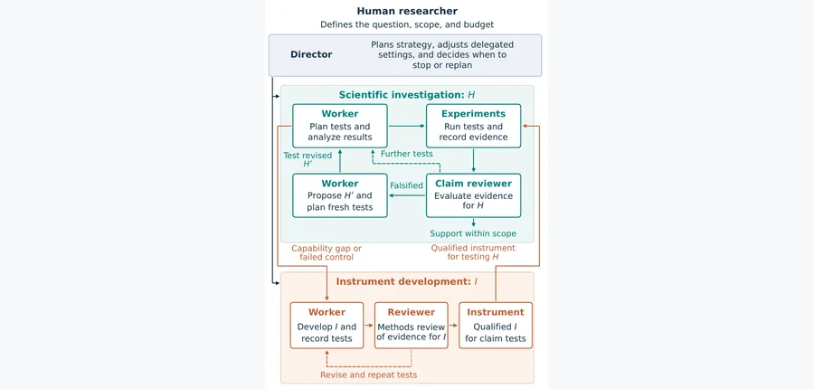 arXiv 2026-11-04 · cs.AI · #1 **[Counterexample-driven autonomous research with application to excess radiated energy in a Z-pinch](https://arxiv.org/abs/2611.03721)** Bowen Zhu , Jian Wu Affiliation: Xi'an Jiaotong University [Paper](https://arxiv.org/abs/2611.03721) · [Figure source](https://arxiv.org/pdf/2611.03721) 

[EN] Abstract
Recent breakthroughs in artificial-intelligence-assisted mathematics show that open-ended machine search can outperform human mathematicians, yet transferring this paradigm to physics requires refactoring the research workflow. We introduce Simjecture, an open-source framework in which language-model agents pursue human-defined physical conjectures. The framework tackles two central challenges in this transfer: first, because physics is empirical and no model is final, it structures inquiry around counterexample-driven falsification and prospective hypothesis repair; second, because physical theories must interact with the real world, it uses computational physics as an executable testbed while separating the qualification of numerical instruments from scientific claim review so solvers and diagnostics can be adapted within a recorded investigation. We apply the framework in an 82.6 h investigation to tackle the long-standing problem of radiated energy exceeding the imploding-shell kinetic energy in a Z-pinch. The investigation reveals competing effects of energy conversion, retention, and release timing. Stronger coherent helical deformation increases resistive conversion while reducing radiation and increasing retained energy. A broader trailing-plasma profile delays the later radiation maximum and recovers much of its early bolometric deficit, with a spectral response that changes during the pulse. These results provide new insight into energy conversion in high-energy-density plasma physics and demonstrate a new paradigm for physics research. <a href="https://arxiv.org/list/cs/new?show=2000&amp;check=20261105b#2611.03721">Source</a>

[ZH] Abstract
人工智能辅助数学的近期突破表明，开放式机器搜索可以超越人类数学家，但将这一范式迁移到物理学，需要重构研究工作流。我们提出 Simjecture，一个让语言模型 Agent 探索人类定义的物理猜想的开源框架。该框架应对这一迁移中的两项核心挑战：第一，由于物理学是经验科学且没有模型是最终的，它围绕反例驱动的证伪与前瞻性假设修订组织研究；第二，由于物理理论必须与真实世界交互，它以计算物理作为可执行试验台，同时将数值仪器的资格验证与科学主张审查分离，使求解器和诊断工具能在有记录的调查中调整。我们用该框架开展了 82.6 小时的研究，处理 Z 箍缩中辐射能量超过内爆壳层动能这一长期问题。研究揭示了能量转换、保留与释放时机之间的竞争效应。更强的相干螺旋形变提高电阻能量转换，却降低辐射并增加保留能量。更宽的拖尾等离子体分布推迟后期辐射峰值，并弥补大部分早期总辐射亏损，其光谱响应在脉冲过程中变化。这些结果为高能量密度等离子体中的能量转换提供新认识，并展示一种新的物理研究范式。 <a href="https://arxiv.org/list/cs/new?show=2000&amp;check=20261105b#2611.03721">Source</a>
 | 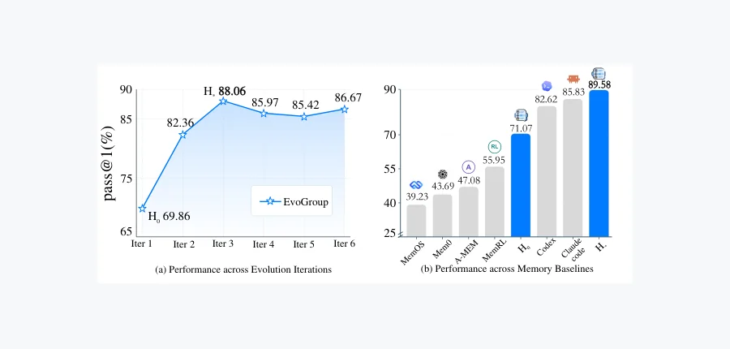 arXiv 2026-11-04 · cs.CL · #2 **[EvoGroup: A Self-Evolving Harness for Group Agents in Shared Contexts](https://arxiv.org/abs/2611.03868)** Xinyi Xu , Xiaoyang Li , Yucheng Feng , Wenqing Chen , Youliang Yuan , Wei Shi , Rongxiang Weng , Zibin Zheng Affiliation: Sun Yat-sen University / Longcat Team, Meituan [Paper](https://arxiv.org/abs/2611.03868) · [Figure source](https://arxiv.org/html/2611.03868v1/intro-v4-gradientV2.png) 

[EN] Abstract
With the rise of Group Agent such as Claude Tag, agents increasingly serve as digital workers for long-term team collaboration. These agents operate over shared contexts that continuously accumulate through multi-user interactions. However, existing agent memory systems are mainly designed for individual users and struggle to capture group-level knowledge in shared contexts, including group relationships and collaboratively formed knowledge. Manual memory strategies further limit adaptation to diverse and evolving shared contexts. To this end, we propose \textbf{EvoGroup (EvoG)}, a self-evolving harness for group agents that starts from a minimal six-tool cold start and adapts through interaction with shared context. EvoG uses confidence and task outcomes to select informative trajectories, while also eliciting self-reflections on uncertainty in low-confidence cases. The analysis agent then examines selected trajectories through adaptive progressive disclosure, followed by bucketed analysis to synthesize high-level findings that guide the evolve agent in revising the Harness. Empirically, pass@1 on held-out split of EverMemBench improves from 71.07\% to 89.58\%, surpassing both self-evolving memory and human-designed harnesses, including Claude Code (85.83\%). To evaluate generalization, we freeze the evolved harness and evaluate it on the unseen GroupMemBench, where, with GPT-5.5, it demonstrates effective generalization and outperforms both memory baselines and human-designed harnesses. <a href="https://arxiv.org/list/cs/new?show=2000&amp;check=20261105b#2611.03868">Source</a>

[ZH] Abstract
随着 Claude Tag 等 Group Agent 兴起，Agent 越来越多地作为数字员工参与长期团队协作。这些 Agent 在多用户交互中持续积累的共享上下文上运行。然而，现有 Agent 记忆系统主要面向个人用户，难以捕获共享上下文中的群体级知识，包括群体关系和协作形成的知识。人工记忆策略进一步限制了对多样且演变中的共享上下文的适应。为此，我们提出 EvoGroup（EvoG），一种面向群体 Agent 的自演化运行框架，从最小的六工具冷启动出发，通过与共享上下文交互适应。EvoG 使用置信度和任务结果选择信息量高的轨迹，并在低置信度情况下引出关于不确定性的自反思。分析 Agent 随后通过自适应渐进披露检查所选轨迹，再通过分桶分析综合高层发现，指导演化 Agent 修订运行框架。实证上，EverMemBench 留出划分的 pass@1 从 71.07% 提升至 89.58%，超过自演化记忆和人工设计运行框架，包括 Claude Code（85.83%）。为评估泛化，我们冻结演化后的运行框架，在未见 GroupMemBench 上评估；使用 GPT-5.5 时，它表现出有效泛化，并优于记忆基线和人工设计运行框架。 <a href="https://arxiv.org/list/cs/new?show=2000&amp;check=20261105b#2611.03868">Source</a>
 | 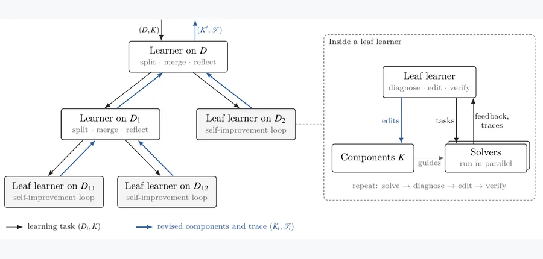 arXiv 2026-11-04 · cs.AI · #3 **[Recursa: Toward Recursively Self-Improving Foundation Model Systems](https://arxiv.org/abs/2611.04035)** Erkang Zhu , Yin Lin , Xiaorong Shi , Xuanrui Lin , Jingren Zhou Affiliation: Alibaba Research [Paper](https://arxiv.org/abs/2611.04035) · [Figure source](https://arxiv.org/pdf/2611.04035) 

[EN] Abstract
Foundation models in changing environments can encounter unfamiliar domain knowledge that their original training did not cover. However, new domains rarely provide large amounts of expert-created training data or reliable supervisory signals for further training. We introduce Recursa, a foundation model system that adapts to new domains by learning from its own experience without human experts or a stronger teacher model. Recursa uses a knowledge repository to store what it learns: domain-specific skills and instructions on when to apply them, along with memories of past task experiences and reflections on what to improve. Recursa bootstraps the repository from domain materials and then refines it through recursive self-improvement. It uses parallel learners to execute tasks and synthesize local improvements, then validates and merges the improvements into the knowledge repository. On Harvey LAB's Firm Knowledge benchmark, Recursa raises the all-pass rate on held-out test tasks from 30.0% to 55.0% with DeepSeek-V4.1-Flash and from 35.0% to 46.0% with Qwen3.8-Flash. <a href="https://arxiv.org/list/cs/new?show=2000&amp;check=20261105b#2611.04035">Source</a>

[ZH] Abstract
变化环境中的基础模型可能遇到原始训练未覆盖的陌生领域知识。然而，新领域很少提供大量专家创建的训练数据或可靠的进一步训练监督信号。我们提出 Recursa，一个无需人类专家或更强教师模型、通过自身经验适应新领域的基础模型系统。Recursa 使用知识仓库保存所学内容：领域专属技能及何时应用它们的指令，以及过去任务经验和改进反思的记忆。Recursa 从领域材料启动仓库，然后通过递归自改进优化。它使用并行学习者执行任务并综合局部改进，再验证这些改进并合并进知识仓库。在 Harvey LAB 的 Firm Knowledge 基准上，Recursa 将留出测试任务的全部通过率从使用 DeepSeek-V4.1-Flash 的 30.0% 提高到 55.0%，以及使用 Qwen3.8-Flash 的 35.0% 提高到 46.0%。 <a href="https://arxiv.org/list/cs/new?show=2000&amp;check=20261105b#2611.04035">Source</a>
 |
| 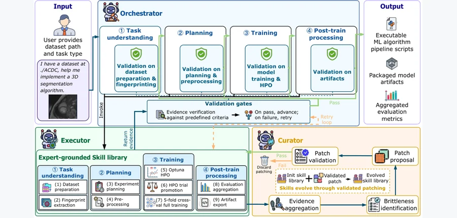 arXiv 2026-11-04 · cs.AI · #4 **[Validation-Gated ML Pipeline Synthesis with Expert-Grounded Self-Evolving Skills](https://arxiv.org/abs/2611.04180)** Zixiao Zhao , Jing Sun , Zhe Hou , Mengze Li , Qian Liu , Cheng-Hao Cai , Zijian Zhang , Xin Wang , Gillian Dobbie , Jin S… Affiliation: University of Auckland / Griffith University / Metasics / Beijing Institute of Technology / Hong Kong University of Science and Technology (Guangzhou) / National University of Singapore [Paper](https://arxiv.org/abs/2611.04180) · [Figure source](https://arxiv.org/html/2611.04180v1/worflow_new.png) 

[EN] Abstract
Recent advances in large language models have enabled agentic systems that automate machine learning pipeline construction from minimal user input. However, existing agentic AutoML methods either depend on rigid templates that limit adaptability, target narrow task domains, or rely on free-form code generation that lacks reliability guarantees, leaving intermediate errors to propagate silently and degrade the final model. We present EvoML, an agentic framework for end-to-end ML pipeline synthesis built on expert-grounded skills that evolve across runs, executed through a validation-gated harness. The framework decomposes pipeline construction into four phases coordinated by three agents: an Orchestrator that enforces validation gates, advancing each phase only when its outputs pass structural, execution, and semantic checks, which precludes error propagation and keeps every artifact auditable; an Executor that runs expert-grounded skills, grounded in the nnU-Net workflow and pairing reusable templates with online adaptation; and a Curator that performs post-run evolution, consolidating the scripts and guidance recovered during a run into the skill library so it improves across datasets. We evaluate EvoML on eight datasets spanning six sophisticated, real-world ML task types, against agentic AutoML systems and command-line coding tools. EvoML achieves full automation and the best final model quality on all eight, spanning segmentation (up to 0.94 Dice), classification (0.99 accuracy), reconstruction (0.95 SSIM), and denoising (0.79 normalized PSNR), while transferring to broader ML tasks. <a href="https://arxiv.org/list/cs/new?show=2000&amp;check=20261105b#2611.04180">Source</a>

[ZH] Abstract
大语言模型的近期进展使 Agent 系统能够从极少用户输入自动构建机器学习流水线。然而，现有 Agent AutoML 方法要么依赖限制适应性的刚性模板，要么面向狭窄任务领域，要么依靠缺乏可靠性保证的自由代码生成，使中间错误静默传播并损害最终模型。我们提出 EvoML，一个端到端 ML 流水线合成 Agent 框架，建立在跨运行演化的专家依据技能上，并通过验证门控的运行框架执行。框架把流水线构建分为由三个 Agent 协调的四个阶段：Orchestrator 强制执行验证门，只有输出通过结构、执行和语义检查后才推进各阶段，以阻止错误传播并使每个产物可审计；Executor 运行基于 nnU-Net 工作流、将可复用模板与在线适应结合的专家依据技能；Curator 在运行后演化，将一次运行中恢复的脚本和指导整合进技能库，使其跨数据集改进。我们在涵盖六种复杂真实 ML 任务类型的八个数据集上，将 EvoML 与 Agent AutoML 系统和命令行编码工具比较。EvoML 在全部八个数据集上实现全自动化和最佳最终模型质量，涵盖分割（最高 0.94 Dice）、分类（0.99 准确率）、重建（0.95 SSIM）和去噪（0.79 归一化 PSNR），并可迁移到更广泛 ML 任务。 <a href="https://arxiv.org/list/cs/new?show=2000&amp;check=20261105b#2611.04180">Source</a>
 | 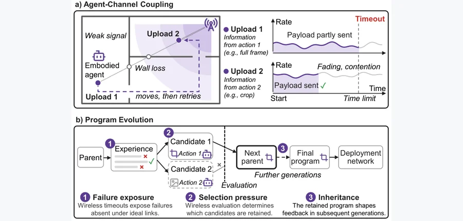 arXiv 2026-11-04 · eess.SY · #5 **[WiSI: Wireless-in-the-Loop Self-Improvement](https://arxiv.org/abs/2611.04437)** Zongxi Liu , Hongyang Du Affiliation: University of Hong Kong [Paper](https://arxiv.org/abs/2611.04437) · [Figure source](https://arxiv.org/html/2611.04437v1/fig_wisi_mechanism.png) 

[EN] Abstract
The growing autonomy of AI agents has enabled self-improvement, where agents iteratively refine their programs through execution feedback and performance evaluation. As these agents increasingly operate in physical environments and rely on wireless connectivity, communication conditions become an integral part of their improvement process. However, existing approaches largely assume ideal communication, overlooking how wireless conditions shape both the feedback that guides program modifications and the evaluation outcomes that determine which modifications survive. This challenge is further complicated by the coupling between agent behavior and wireless connectivity, as agents influence their own communication conditions through mobility and transmission decisions. To address this problem, we propose WiSI, a wireless-in-the-loop self-improvement framework that integrates spatiotemporal wireless channels, edge-assisted perception, and Large Language Model-driven program improvement. By incorporating wireless execution into the improvement loop, WiSI reveals how wireless execution experience shapes the generation and retention of program structures, and investigates the wireless conditions needed for robust improvement. Experiments show that agents improved under ideal links achieve only 40.0% task success under congestion, compared with 77.2% when improved under realistic wireless conditions. More importantly, wireless-aware feedback and selection jointly enable agents to discover and retain communication-efficient program structures that outperform parameter tuning and remain robust even with inaccurate run-time channel observations. We further find that moderate-load or mixed-network evaluation maintains strong performance across deployment conditions, while simplified models preserving link-rate statistics achieve comparable results without detailed spatial channel information. <a href="https://arxiv.org/list/cs/new?show=2000&amp;check=20261105b#2611.04437">Source</a>

[ZH] Abstract
AI Agent 的自主性增长使自改进成为可能：Agent 通过执行反馈和性能评估迭代优化程序。当这些 Agent 越来越多地运行于物理环境并依赖无线连接时，通信条件成为其改进过程的组成部分。然而，现有方法大多假设理想通信，忽视无线条件如何同时塑造指导程序修改的反馈和决定哪些修改存活的评估结果。Agent 行为与无线连接相互耦合，使挑战更复杂，因为 Agent 会通过移动和传输决策影响自身通信条件。为此，我们提出 WiSI，一个将时空无线信道、边缘辅助感知和大语言模型驱动程序改进相结合的无线在环自改进框架。通过将无线执行纳入改进循环，WiSI 揭示无线执行经验如何塑造程序结构的生成与保留，并研究稳健改进所需的无线条件。实验显示，在理想链路下改进的 Agent 在拥塞下仅有 40.0% 任务成功率，而在真实无线条件下改进时为 77.2%。更重要的是，无线感知反馈与选择共同使 Agent 发现并保留通信高效的程序结构，优于参数调节，并在运行时信道观测不准时仍稳健。我们还发现，中等负载或混合网络评估能在多种部署条件下保持强表现，而保留链路速率统计的简化模型无需详细空间信道信息，也能取得相当结果。 <a href="https://arxiv.org/list/cs/new?show=2000&amp;check=20261105b#2611.04437">Source</a>
 | 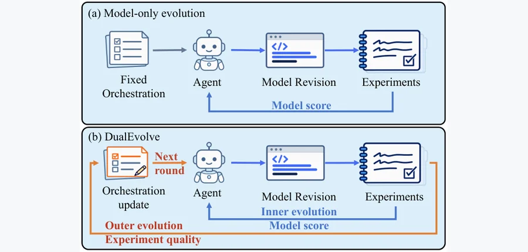 arXiv 2026-11-04 · cs.IR · #6 **[DualEvolve: Dual-Level Self-Evolution of Mechanism and Orchestration for Recommendation](https://arxiv.org/abs/2611.04439)** Tianqi Gao , Chenxu Wang , Wenxuan Yang , Yueqi Mou , Biao Tang , Ming Liu , Peng Yan Affiliation: Independent researcher / Meituan [Paper](https://arxiv.org/abs/2611.04439) · [Figure source](https://arxiv.org/html/2611.04439v1/intro.png) 

[EN] Abstract
Recommender systems are widely used in e-commerce and content platforms, where improvement requires repeated model design, training optimization, and experimental validation. Large language model (LLM) agents increasingly automate this development cycle. Sustained autonomous improvement requires agents to improve both recommendation models and their development workflows. However, task-performance-driven approaches select updates mainly by candidates' final scores, without a separate optimization signal for experimentation quality. We therefore present DualEvolve, a dual-level framework that co-evolves recommendation mechanisms and agent orchestration toward recursive self-improvement. Inner evolution revises model and training code using task feedback to improve recommendation performance. Outer evolution scores the inner-loop experimental process, updates harness and skill rules using these scores and execution traces, and adjusts orchestration choices based on next-round scores to improve the quality of subsequent experiments. Experiments on MovieLens-1M and three Amazon Reviews 2023 subsets cover four recommendation methods and 16 settings. DualEvolve achieves higher test means than Base, OpenEvolve, and DeepEvolve in all 64 setting-metric comparisons, with macro-averaged relative gains over DeepEvolve of 7.6% (HR@5) and 9.0% (NDCG@5). <a href="https://arxiv.org/list/cs/new?show=2000&amp;check=20261105b#2611.04439">Source</a>

[ZH] Abstract
推荐系统广泛用于电子商务与内容平台，其改进需要反复进行模型设计、训练优化和实验验证。大语言模型（LLM）Agent 越来越多地自动化这一开发周期。持续自主改进要求 Agent 同时改善推荐模型及其开发工作流。然而，任务性能驱动的方法主要按候选最终评分选择更新，缺乏单独针对实验质量的优化信号。因此，我们提出 DualEvolve，一个共同演化推荐机制和 Agent 编排、迈向递归自改进的双层框架。内层演化利用任务反馈修订模型与训练代码，以提升推荐性能。外层演化对内循环实验过程评分，根据这些评分和执行轨迹更新运行框架及技能规则，并依据下一轮评分调整编排选择，以提高后续实验质量。我们在 MovieLens-1M 和三个 Amazon Reviews 2023 子集上，覆盖四种推荐方法和 16 种设置开展实验。DualEvolve 在全部 64 个设置—指标比较中的测试均值均高于 Base、OpenEvolve 和 DeepEvolve，相较 DeepEvolve 的宏平均相对提升为 HR@5 的 7.6% 和 NDCG@5 的 9.0%。 <a href="https://arxiv.org/list/cs/new?show=2000&amp;check=20261105b#2611.04439">Source</a>
 |
| 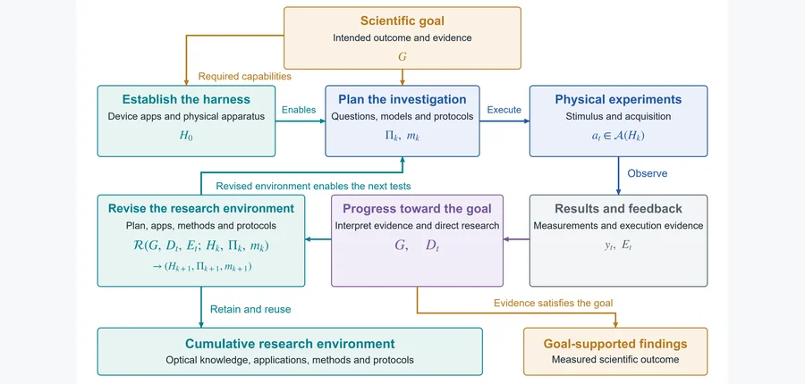 arXiv 2026-11-04 · cs.AI · #7 **[Goal-Driven Autonomous Optical Experimentation via a Self-Recursive Hardware-Software Harness](https://arxiv.org/abs/2611.04481)** Tianxing Zhu , Huacheng Lu , Ming Liu , Malte Hillebrand Affiliation: Konica Minolta (China) Investment Ltd / Giant Testing Equipment Ltd [Paper](https://arxiv.org/abs/2611.04481) · [Figure source](https://arxiv.org/html/2611.04481v1/figures/image1.png) 

[EN] Abstract
We propose goal-driven self-recursive optical research in which agents use physical evidence to revise the hardware, software, models, and protocols used to pursue a scientific goal. The framework can be instantiated with different stimulus systems and measurement devices. We formalize its updates and derive a relation between physical attainability, command access, and model approximation error. We demonstrate the concept in an optical see-through color-matching case study using an iPad, RayNeo X3 glasses, and a TOP 300 probe coupled to a CAS140D spectroradiometer, both from Instrument Systems. A revised glasses application adds USB-controlled RGB holds and frame acknowledgements, keeping model-generated colors displayed during spectral acquisition. The interface passes 12 live control checks. Spectral feedback reduces one target color difference from 19.756 to 1.211 {\Delta}E_76^*; all five targets improve in a separate comparison. These measurements demonstrate the concept in one configuration. The resulting software and protocols remain available for subsequent investigations. <a href="https://arxiv.org/list/cs/new?show=2000&amp;check=20261105b#2611.04481">Source</a>

[ZH] Abstract
我们提出目标驱动的自递归光学研究，其中 Agent 使用物理证据修订追求科学目标所用的硬件、软件、模型和协议。框架可用不同刺激系统和测量设备实例化。我们形式化其更新，并推导物理可达性、命令访问能力和模型近似误差之间的关系。我们以光学透视颜色匹配案例展示概念，使用 iPad、RayNeo X3 眼镜，以及 Instrument Systems 的 TOP 300 探头与 CAS140D 光谱辐射计。修订后的眼镜应用增加 USB 控制的 RGB 保持和帧确认，在光谱采集时持续显示模型生成的颜色。该接口通过 12 项实时控制检查。光谱反馈将一个目标的色差从 19.756 降至 1.211 ΔE*76；在另一项比较中，全部五个目标都得到改善。这些测量在一种配置下展示了该概念。所得软件与协议保留供后续研究使用。 <a href="https://arxiv.org/list/cs/new?show=2000&amp;check=20261105b#2611.04481">Source</a>
 | 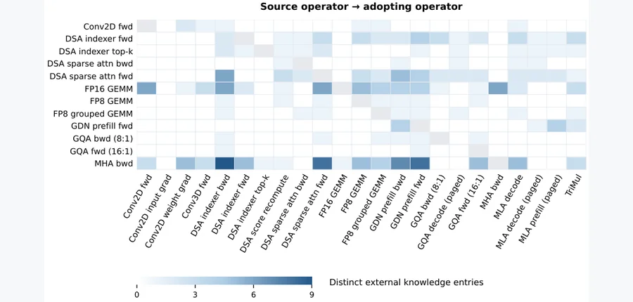 arXiv 2026-11-04 · cs.DC · #8 **[ForgeKernel: Self-Evolving Kernels Catching and Surpassing Experts and Agents](https://arxiv.org/abs/2611.04998)** Yaojian Chen , Dazhi Peng , Yiyun Zheng , Zhui Zhu , Shengye Xiang , Leshan Li , Zhen Li , Xianglong Deng , Haojun Sun , Q… Affiliation: Tsinghua University / ModelBest Inc. / University of Chinese Academy of Sciences / Harbin Institute of Technology [Paper](https://arxiv.org/abs/2611.04998) · [Figure source](https://arxiv.org/html/2611.04998v1/kb-source-matrix.png) 

[EN] Abstract
Purpose-built kernel agents can write high-performance GPU kernels, but existing systems generally lack cross-run knowledge accumulation and architectural evolution. Each run starts from the same initial knowledge, and later iterations largely optimize within an architecture fixed early in the search. We present ForgeKernel, a kernel-generation system that accumulates and reuses knowledge across runs while enabling continued evolution of kernel architectures. It analyzes the hardware behavior of a high-performance reference and distills validated architectural decisions into reusable knowledge of hardware mechanisms rather than imitating source code. It then seals a kernel that passes correctness and performance validation and uses it as the reference for the next optimization run, enabling architectural decisions to be revisited. Across 27 operators and 29 input configurations on NVIDIA Hopper and Blackwell GPUs, ForgeKernel matches or beats its expert reference on 25 configurations, with a geometric-mean performance gain of 10%. On Ascend 910C, it outperforms the per-operator public best on the public case set of all 8 level-4 operators in the CANN-Bench Season 1 final leaderboard, with a geometric-mean gain of 25.1%, while its full-suite submission ranks first on the A3 leaderboard. As of 2026-10-30, public submissions generated by ForgeKernel rank first on all three CANN-Bench 2.0 solution leaderboards (Ascend 910C, 950DT, and 950PR) and on the SOL-ExecBench FlashInfer-Bench track. <a href="https://arxiv.org/list/cs/new?show=2000&amp;check=20261105b#2611.04998">Source</a>

[ZH] Abstract
专用内核 Agent 能编写高性能 GPU 内核，但现有系统通常缺少跨运行知识积累和架构演化。每次运行都从相同初始知识出发，后续迭代大多在搜索早期固定的架构内优化。我们提出 ForgeKernel，一个在跨运行中积累并复用知识、同时支持内核架构持续演化的内核生成系统。它分析高性能参考的硬件行为，将经过验证的架构决策提炼为可复用的硬件机制知识，而非模仿源代码。随后，它封存一个通过正确性与性能验证的内核，并将其作为下一次优化运行的参考，使架构决策可被重新审视。在 NVIDIA Hopper 和 Blackwell GPU 的 27 个算子、29 种输入配置上，ForgeKernel 在 25 种配置中匹配或超过专家参考，几何平均性能提升为 10%。在 Ascend 910C 上，它在 CANN-Bench Season 1 决赛榜全部八个四级算子的公开案例集上超过各算子的公开最佳结果，几何平均提升 25.1%，同时其完整套件提交在 A3 榜单排名第一。截至 2026 年 10 月 30 日，ForgeKernel 生成的公开提交在 CANN-Bench 2.0 的全部三个方案榜单（Ascend 910C、950DT 和 950PR）以及 SOL-ExecBench 的 FlashInfer-Bench 赛道上排名第一。 <a href="https://arxiv.org/list/cs/new?show=2000&amp;check=20261105b#2611.04998">Source</a>
 | 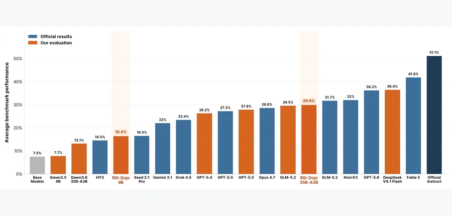 arXiv 2026-11-04 · cs.AI · #9 **[Training LLM Agents to Automate LLM Post-Training with RSI-Dojo](https://arxiv.org/abs/2611.03698)** Shuzheng Gao , Zhaojian Yu , Penghao Yin , Yuling Shi , Kai Cai , Shilin He , Michael R. Lyu Affiliation: Chinese University of Hong Kong / ByteDance / Tsinghua University / Shanghai Jiao Tong University [Paper](https://arxiv.org/abs/2611.03698) · [Figure source](https://arxiv.org/html/2611.03698v1/figures/opening_image2.png) 

[EN] Abstract
Recursive Self-Improvement (RSI) aims to enable AI systems to autonomously build and improve AI systems themselves, including models, harnesses, and underlying infrastructure. Within this broader agenda, a central capability is enabling agents to train and improve base models. However, existing studies on automated model training primarily focused on workflow- or harness-level optimizations, rather than internalizing the ability to conduct post-training into the model itself. Developing this capability requires executable model training environments that can produce high-quality trajectories demonstrating how to select data, train models, diagnose failures, and iteratively improve results. In this paper, we introduce RSI-Dojo, a collection of executable model training environments designed to teach LLM agents to conduct post-training. To construct RSI-Dojo, we develop RSI-Craft, an automatic pipeline that converts human research artifacts into executable model training environments. RSI-Craft automatically collects research papers from top venues, instantiates datasets and metrics into a unified interface, and reproduces evaluation dependencies. It then filters tasks by data size, execution reliability, and discriminability, yielding RSI-Dojo with 281 seed model training tasks. Building on RSI-Dojo, we employ a trajectory collection method with an improved harness to collect high-quality model-training trajectories from frontier models, then retain examples through rubric-based and outcome-based filtering. We fine-tune Qwen3.5-9B and Qwen3.6-35B-A3B on these trajectories. The resulting RSI-Dojo-9B and RSI-Dojo-35B-A3B improve over their base models by 8.74 and 16.87 PostTrainBench points, respectively. RSI-Dojo-35B-A3B reaches 29.95 on PostTrainBench and 53.29 on PostTrainBench-Lite, matching the performance of frontier models such as GLM-5.2 and GPT 5.5. <a href="https://arxiv.org/list/cs/new?show=2000&amp;check=20261105b#2611.03698">Source</a>

[ZH] Abstract
递归自我改进（RSI）旨在使 AI 系统自主构建并改善 AI 系统本身，包括模型、运行框架和底层基础设施。在这一更广泛议程中，一项核心能力是让 Agent 训练并改进基础模型。然而，现有自动模型训练研究主要关注工作流或运行框架级优化，而非将开展后训练的能力内化到模型自身。发展此能力需要可执行的模型训练环境，能产生高质量轨迹，展示如何选择数据、训练模型、诊断失败并迭代改善结果。本文提出 RSI-Dojo，一组旨在教会 LLM Agent 开展后训练的可执行模型训练环境。为构建 RSI-Dojo，我们开发 RSI-Craft，一个将人类研究产物转化为可执行模型训练环境的自动流水线。RSI-Craft 自动收集顶级会议期刊研究论文，将数据集与指标实例化为统一接口，并复现评估依赖。随后按数据规模、执行可靠性和可区分性筛选任务，得到包含 281 个种子模型训练任务的 RSI-Dojo。基于 RSI-Dojo，我们利用改进运行框架的轨迹收集方法，从前沿模型收集高质量模型训练轨迹，再通过量规与结果筛选保留示例。我们在这些轨迹上微调 Qwen3.5-9B 和 Qwen3.6-35B-A3B。所得 RSI-Dojo-9B 和 RSI-Dojo-35B-A3B 分别比基础模型提高 8.74 和 16.87 个 PostTrainBench 点。RSI-Dojo-35B-A3B 在 PostTrainBench 和 PostTrainBench-Lite 上分别达到 29.95 和 53.29，匹配 GLM-5.2 和 GPT 5.5 等前沿模型的表现。 <a href="https://arxiv.org/list/cs/new?show=2000&amp;check=20261105b#2611.03698">Source</a>
 |
| 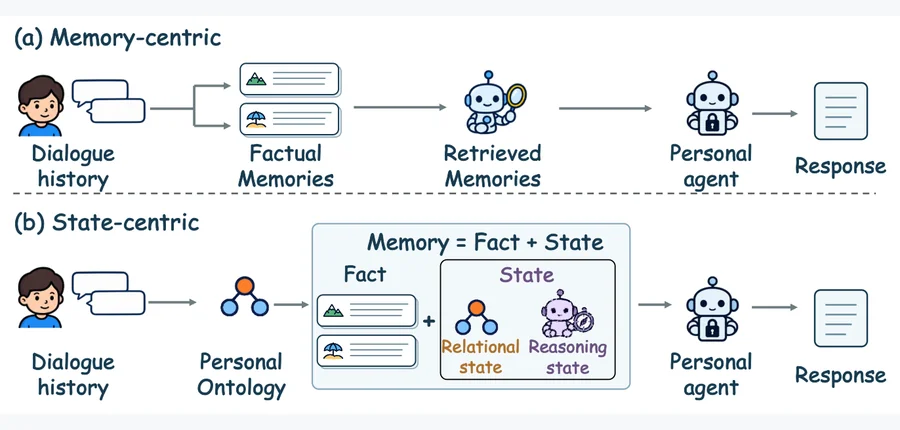 arXiv 2026-11-04 · cs.IR · #10 **[EvoMemState: Evolving Memory State for Personal Agents](https://arxiv.org/abs/2611.03743)** Zhishang Xiang , Yunbo Tang , Zhongqiao Liu , Junkai Chen , Zerui Chen , Qingguo Hu , Yuxuan Zhang , William Grant , Qingg… Affiliation: Xiamen University / Nanyang Technological University / University of British Columbia / University of Waterloo / Jilin University [Paper](https://arxiv.org/abs/2611.03743) · [Figure source](https://arxiv.org/html/2611.03743v1/intro2.png) 

[EN] Abstract
Long-term memory enables large language model (LLM) agents to provide continuous personalized assistance by retaining user information across interactions. Existing systems support this process through fact extraction, organization, updating, and retrieval, but largely maintain memories as independent facts. This fact-centric paradigm may overlook how new facts update, constrain, or conflict with earlier ones, while leaving their applicability, role, and priority for the current request implicit. In this paper, we introduce EvoMemState, a state-centric framework that augments persistent facts with two complementary states: Relational States that capture how facts remain valid and relate to one another as memory evolves, and a Reasoning State that determines how these facts should be applied to the current request. Specifically, EvoMemState consists of three key components: (i) Ontology-Guided Memory State Induction extracts Persistent Facts and constructs Relational States that maintain their validity, scope, and evolving relations. (ii) RL-Based State Evolution internalizes memory-use experience into a policy through reinforcement learning to generate a request-specific Reasoning State. (iii) State-Aware Reasoning then combines the relevant facts with their Relational States and the generated Reasoning State to guide the personal agent. Extensive experiments on long-term dialogue and memory-use benchmarks demonstrate consistent improvements over existing memory systems in retrieval completeness and memory-grounded response accuracy. Our code and implementation details are available at this https URL . <a href="https://arxiv.org/list/cs/new?show=2000&amp;check=20261105b#2611.03743">Source</a>

[ZH] Abstract
长期记忆通过跨交互保留用户信息，使大语言模型（LLM）Agent 能提供持续的个性化帮助。现有系统通过事实提取、组织、更新和检索支持该过程，但大多将记忆维护为独立事实。这种事实中心范式可能忽略新事实如何更新、约束或冲突于先前事实，同时让它们对当前请求的适用性、角色和优先级保持隐含。本文提出 EvoMemState，一个状态中心框架，用两种互补状态增强持久事实：关系状态捕获事实在记忆演化中如何保持有效并相互关联；推理状态决定这些事实应如何应用于当前请求。具体而言，EvoMemState 包含三个关键组件：（i）本体引导的记忆状态归纳提取持久事实，并构建维护其有效性、范围和演化关系的关系状态；（ii）基于 RL 的状态演化通过强化学习将记忆使用经验内化为策略，以生成请求专属推理状态；（iii）状态感知推理结合相关事实、关系状态和生成的推理状态来指导个人 Agent。在长期对话和记忆使用基准上的广泛实验表明，相较现有记忆系统，它在检索完整性和记忆依据响应准确率上持续改善。代码与实现细节见原文所链接的 HTTPS 地址。 <a href="https://arxiv.org/list/cs/new?show=2000&amp;check=20261105b#2611.03743">Source</a>
 | 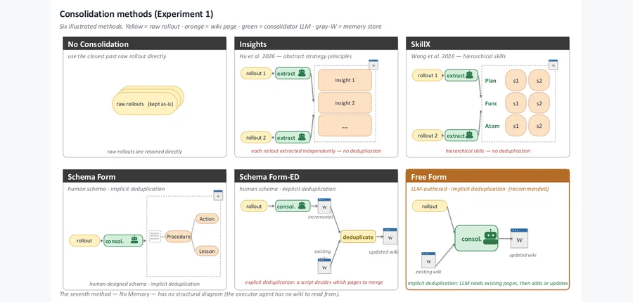 arXiv 2026-11-04 · cs.AI · #11 **[WASP-Mem: Let Agent Organize Procedural Memory. Human Spend Effort on Diagnosis](https://arxiv.org/abs/2611.04003)** Peizhi Niu , Ge Shi , Vaibhav Gorde , Sarthak Ghosh , Christos Faloutsos , Min Cheng , Kevin Chen Affiliation: University of Illinois Urbana-Champaign / Amazon [Paper](https://arxiv.org/abs/2611.04003) · [Figure source](https://arxiv.org/html/2611.04003v1/fig_consolidation_methods.png) 

[EN] Abstract
LLM agents struggle to automate complex enterprise procedures because static, pre-built harness cannot capture proprietary policies, undocumented behaviors, or state-dependent recovery paths that surface only during execution. Procedural memory accrued from agent experience offers a training-free path to closing this gap -- yet unlike episodic records or semantic facts, it must consolidate repeated successes and diagnosed failures into reusable actions and recovery strategies. We introduce WASP-Mem (Wiki-based Agent-Synthesized Procedural Memory), a nimble but effective method that distills execution traces and feedback into persistent, interlinked wiki pages, enabling continual agent learning. On TheAgentCompany benchmark, WASP-Mem raises the checkpoint pass rate by 4.6-6.1% over the strongest baseline we compared across three models while requiring 57-61% less storage. We further present a systematic controlled study spanning consolidation method, feedback type, trace ingestion scope, and refinement rounds. Our results reveal that prescriptive knowledge organization such as human defined schemas and explicit deduplication rules hurts performance rather than closing the procedural-knowledge gap. In contrast, human diagnosis converts failed traces into corrective knowledge and drives sustained improvement: a single round of human diagnosis outperforms four rounds of self-judgment by 7.0-10.9%. These findings point to a simple division of labor: let agents organize procedural memory, and invest human effort where it matters most -- diagnosis. <a href="https://arxiv.org/list/cs/new?show=2000&amp;check=20261105b#2611.04003">Source</a>

[ZH] Abstract
LLM Agent 难以自动化复杂企业流程，因为静态预建运行框架无法捕获仅在执行时出现的专有政策、未记录行为或依赖状态的恢复路径。从 Agent 经验积累的程序性记忆，提供了无需训练的弥补路径；但不同于情景记录或语义事实，它必须将重复成功和已诊断失败整合为可复用动作及恢复策略。我们提出 WASP-Mem（Wiki-based Agent-Synthesized Procedural Memory），一种轻巧而有效的方法，将执行轨迹和反馈提炼为持久、相互链接的维基页面，支持持续 Agent 学习。在 TheAgentCompany 基准上，WASP-Mem 在三个模型上，相对所比较最强基线，将检查点通过率提高 4.6–6.1%，同时少用 57–61% 存储。我们还给出覆盖整合方法、反馈类型、轨迹摄入范围和优化轮数的系统受控研究。结果表明，人工定义模式和显式去重规则等规范性知识组织，反而损害性能，并未弥补程序性知识缺口。相反，人工诊断将失败轨迹转化为纠正性知识并驱动持续改进：一轮人工诊断比四轮自我判断高 7.0–10.9%。这些发现指向一种简单分工：让 Agent 组织程序性记忆，将人类精力投入最重要的诊断。 <a href="https://arxiv.org/list/cs/new?show=2000&amp;check=20261105b#2611.04003">Source</a>
 | 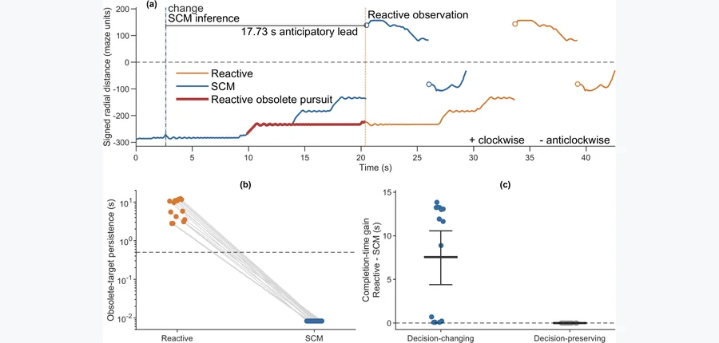 arXiv 2026-11-04 · cs.RO · #12 **[Physical Experience Builds Continual Spatial World Models](https://arxiv.org/abs/2611.04016)** Yuhang Sun Affiliation: University of Washington [Paper](https://arxiv.org/abs/2611.04016) · [Figure source](https://arxiv.org/html/2611.04016v1/figures/figure4.png) 

[EN] Abstract
World models are increasingly used to support prediction and planning in embodied agents, but the knowledge is usually established before deployment and then carried into later encounters. Continual operation faces a different problem. A familiar environment may change, and the agent must use previous experience without allowing old expectations to override current physical evidence. This study asks what repeated physical experience must contribute for a spatial world model to become progressively more useful rather than simply more persistent. A physics-grounded dynamic maze separates recurring spatial change from the continuous consequences of action. Cross-episode Spatial Change Memory learns relations among environmental transformations, while state-action-outcome experience refines predictions of motion. Structured experience progressively reduces the need for future route correction and transfers to spatial transitions not encountered during learning. The advantage disappears when past changes contain no information about future ones. Continuous navigation further shows that predictive memory changes behavior when a previous decision becomes invalid but leaves behavior unchanged when the decision remains correct. Physical tests expose a complementary limit: correct topology does not guarantee correct action prediction, and accumulated physical experience reduces this mismatch within the modeled dynamics. The results characterize continual world knowledge as experience that improves future prediction and action beyond stored episodes while remaining revisable by the physical outcomes it is intended to predict. <a href="https://arxiv.org/list/cs/new?show=2000&amp;check=20261105b#2611.04016">Source</a>

[ZH] Abstract
世界模型越来越多地用于支持具身 Agent 的预测和规划，但知识通常在部署前建立，再带入后续遭遇。持续运行面临不同问题：熟悉环境可能变化，Agent 必须利用以往经验，同时不让旧预期凌驾于当前物理证据。本研究询问，重复物理经验必须贡献什么，才能使空间世界模型逐步更有用，而非仅更持久。一个以物理为依据的动态迷宫，将重复空间变化与动作的连续后果分离。跨事件空间变化记忆学习环境变换之间的关系，状态—动作—结果经验则优化运动预测。结构化经验逐步减少未来路线纠正需求，并迁移至学习时未遇到的空间转变。当过去变化不包含关于未来变化的信息时，优势消失。连续导航进一步表明，当先前决策失效时，预测记忆改变行为；当决策仍正确时，则不改变行为。物理测试揭示互补边界：正确拓扑不保证正确动作预测，而累积物理经验在所建模动力学内减少这一不匹配。结果将持续世界知识刻画为一种超越存储事件、改善未来预测与行动、同时仍可被其旨在预测的物理结果修订的经验。 <a href="https://arxiv.org/list/cs/new?show=2000&amp;check=20261105b#2611.04016">Source</a>
 |
| 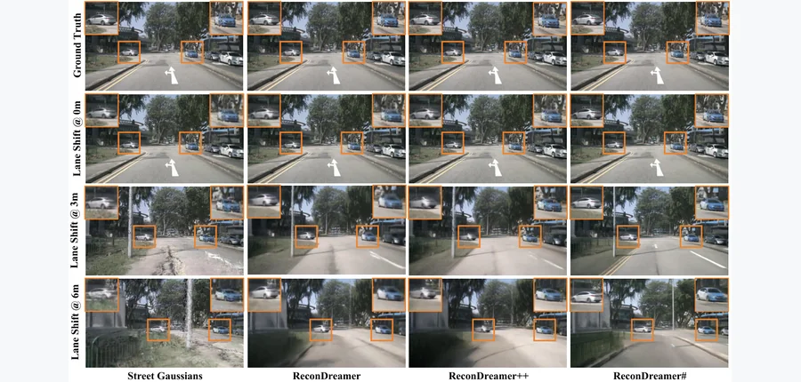 arXiv 2026-11-04 · cs.CV · #13 **[ReconDreamer#: Self-Evolving Closed-Loop Synergy of Reconstruction and Generation for Dynamic Driving Scenes](https://arxiv.org/abs/2611.04173)** Songling Liu , Guosheng Zhao , Xiaofeng Wang , Chaojun Ni , Guan Huang , Jiwen Lu , Xingang Wang , Zheng Zhu Affiliation: Institute of Automation, Chinese Academy of Sciences / University of Chinese Academy of Sciences / Tsinghua University / Giga AI [Paper](https://arxiv.org/abs/2611.04173) · [Figure source](https://arxiv.org/html/2611.04173v1/nuScenes.png) 

[EN] Abstract
Dynamic driving scene reconstruction has made remarkable strides in recent years by leveraging generative priors, particularly in the quality of novel trajectory rendering. Nevertheless, a significant gap remains between the generated data and real-world sensor observations, severely hindering further improvements in reconstruction fidelity. In this paper, we present ReconDreamer#, a self-evolving framework that synergizes reconstruction and generation for dynamic driving scenes, which substantially bridges the gap between synthesized novel trajectory data and recorded real-world observations. Within this self-evolving closed-loop framework, the generative and reconstruction models mutually reinforce each other through iterative refinement, ultimately yielding a significant enhancement in the 3D representation capability of the reconstruction model. Additionally, we introduce a geometry-prior-based adaptive ground model to further enhance the rendering quality of the reconstruction model. To validate the effectiveness of the proposed method, we conduct comprehensive evaluations on Waymo, nuScenes, PandaSet, and EUVS benchmarks. Specifically on Waymo, at a 6-m lateral shift, ReconDreamer# improves NTA-IoU and NTL-IoU by 8.8% and 3.0%, respectively, and reduces FID by 15.1% relative to ReconDreamer++. <a href="https://arxiv.org/list/cs/new?show=2000&amp;check=20261105b#2611.04173">Source</a>

[ZH] Abstract
动态驾驶场景重建近年来通过利用生成先验取得显著进展，尤其提升了新轨迹渲染质量。然而，生成数据与真实传感器观测之间仍有显著差距，严重阻碍重建保真度进一步提高。本文提出 ReconDreamer#，一个协同动态驾驶场景重建与生成的自演化框架，显著弥合合成新轨迹数据与记录的真实观测之间的差距。在这一自演化闭环框架中，生成模型与重建模型通过迭代优化相互增强，最终显著提高重建模型的 3D 表示能力。此外，我们提出基于几何先验的自适应地面模型，进一步增强重建模型的渲染质量。为验证方法有效性，我们在 Waymo、nuScenes、PandaSet 和 EUVS 基准上全面评估。具体而言，在 Waymo 的 6 米横向偏移下，相对 ReconDreamer++，ReconDreamer# 将 NTA-IoU 和 NTL-IoU 分别提高 8.8% 和 3.0%，并将 FID 降低 15.1%。 <a href="https://arxiv.org/list/cs/new?show=2000&amp;check=20261105b#2611.04173">Source</a>
 | 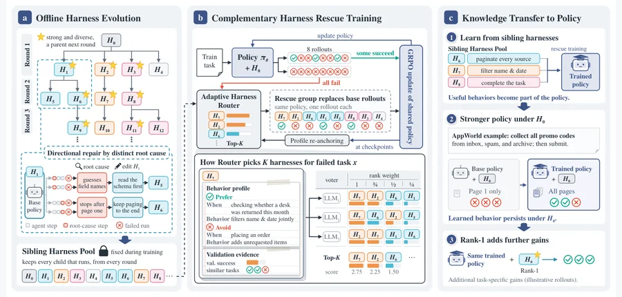 arXiv 2026-11-04 · cs.AI · #14 **[Harness-S: Learning from Sibling Harnesses for Generalizable Agent Training](https://arxiv.org/abs/2611.04277)** Kangning Zhang , Wenxiang Jiao , Bowen Fang , Shuai Shao , Jiachen Zhu , Rong Shan , Shijian Wang , Hao Wang , Yuan Lu , W… Affiliation: Shanghai Jiao Tong University / Xiaohongshu Inc. / Zhongguancun Institute of Artificial Intelligence / Southeast University / Carnegie Mellon University [Paper](https://arxiv.org/abs/2611.04277) · [Figure source](https://arxiv.org/html/2611.04277v1/method_framework_text.png) 

[EN] Abstract
Harness evolution from a common base exhibits Locality, Complementarity, and Nonstationarity: variants repair different failures, and their utility changes as the policy learns. Rather than seeking a universally superior harness, we introduce Harness-S to selectively rescue failures of a base execution system through sibling harnesses and transfer the resulting capabilities into a single policy that remains effective under the original harness. Directional Harness Evolution develops specialized sibling harnesses along distinct repair directions, forming a reusable Sibling Harness Pool that remains fixed during policy training. Complementary Harness Rescue Training invokes this pool only when all initial attempts under the base harness fail. The same policy generates fresh rollouts under selected auxiliary harnesses, and these trajectories replace the failed group for reinforcement learning. An Adaptive Harness Router selects the Top-k variants using Harness Behavior Profiles and voting across multiple LLMs. Policy-aware profile re-anchoring refreshes this evidence as the policy learns. Across AppWorld, SWE-Gym, and DBBench, the trained policy substantially outperforms policy-only training when returned to the original base harness. Behavioral analyses and held-out cases support the transfer of harness-elicited behaviors into the policy itself. Reusing the router for Rank-1 inference provides additional gains at the same executor rollout count. <a href="https://arxiv.org/list/cs/new?show=2000&amp;check=20261105b#2611.04277">Source</a>

[ZH] Abstract
从共同基底演化出的运行框架具有局部性、互补性和非平稳性：不同变体修复不同失败，其效用随策略学习而变化。我们不寻求普遍更优的运行框架，而提出 Harness-S，通过同源运行框架选择性挽救基础执行系统的失败，再将所得能力迁移进在原始运行框架下仍有效的单一策略。定向运行框架演化沿不同修复方向发展专门化同源框架，形成在策略训练期间保持固定的可复用同源运行框架池。互补运行框架挽救训练仅在基础框架的所有初始尝试失败时调用该池。同一策略在所选辅助框架下生成新 rollout，用这些轨迹替换失败组进行强化学习。自适应运行框架路由器根据行为画像与多个 LLM 的投票选择 Top-k 变体。策略感知画像重新锚定随策略学习刷新证据。在 AppWorld、SWE-Gym 和 DBBench 上，将训练后的策略放回原始基础框架时，其表现显著优于仅训练策略。行为分析与留出案例支持将运行框架引出的行为迁移到策略本身。将路由器复用于 Rank-1 推理，在相同执行器 rollout 数量下提供额外收益。 <a href="https://arxiv.org/list/cs/new?show=2000&amp;check=20261105b#2611.04277">Source</a>
 | 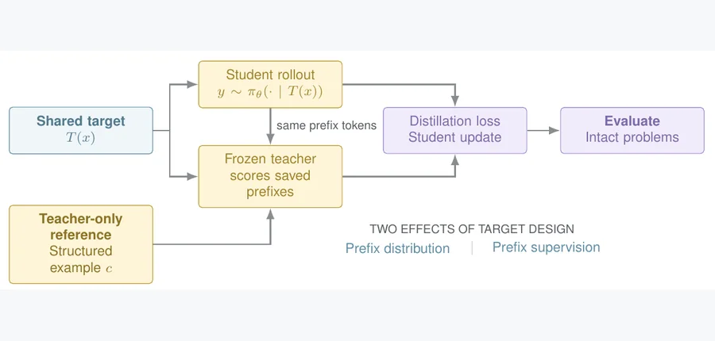 arXiv 2026-11-04 · cs.CL · #15 **[Shuffled OPSD: When Semantic Consistency Hurts On-Policy Self-Distillation?](https://arxiv.org/abs/2611.04958)** Qingyuan Zheng , Zhihao Dou Affiliation: Duke University [Paper](https://arxiv.org/abs/2611.04958) · [Figure source](https://arxiv.org/pdf/2611.04958) 

[EN] Abstract
Knowledge distillation improves a student model's reasoning ability through supervision from a teacher. On-policy self-distillation (OPSD) uses the same model as both teacher and student under different contexts: the student generates reasoning trajectories from the question alone, while the teacher additionally receives a complete worked example and provides token-level supervision along those trajectories. Because the problem statement is shared, its content and ordering shape both student generation and teacher feedback. Preserving its semantic structure therefore seems natural, but does it always improve learning? We introduce Shuffled OPSD, which shuffles the words of the shared problem statement while keeping the teacher-only worked example intact. Across three mathematical reasoning benchmarks and three Qwen3 model scales, the method improves mean accuracy over both an intact-target control and Standard OPSD under matched training configurations. The largest gain over Standard OPSD is 3.52 percentage points on Qwen3-1.7B. Further controls show that preserving larger word blocks offers no advantage over word-level shuffling at the evaluated scales, whereas shuffling the teacher-only worked example reduces accuracy at every scale. Cross-problem mixing and target-removal experiments further distinguish the roles of problem content, word order, and teacher context. These results show that disrupting the shared problem statement can improve learning, while disrupting the teacher-only reference hurts performance. They challenge semantic coherence as a universally beneficial principle for OPSD and motivate closer study of how input structure shapes student generation and teacher supervision. <a href="https://arxiv.org/list/cs/new?show=2000&amp;check=20261105b#2611.04958">Source</a>

[ZH] Abstract
知识蒸馏通过教师监督提升学生模型的推理能力。在线策略自蒸馏（OPSD）在不同上下文中使用同一模型作为教师和学生：学生仅根据问题生成推理轨迹，而教师额外获得完整解题示例，并沿这些轨迹提供 token 级监督。因为问题陈述是共享的，其内容和顺序同时塑造学生生成与教师反馈。保留语义结构看似自然，但它总能改善学习吗？我们提出 Shuffled OPSD，将共享问题陈述的词打乱，同时保持仅教师可见的解题示例完整。在三个数学推理基准和三种 Qwen3 模型规模上，使用匹配训练配置时，该方法的平均准确率高于完整目标对照和 Standard OPSD。相对 Standard OPSD 的最大收益是在 Qwen3-1.7B 上提高 3.52 个百分点。进一步对照显示，在评估规模下，保留更大词块并不优于逐词打乱；打乱仅教师可见的解题示例则使所有规模准确率下降。跨问题混合与目标移除实验进一步区分问题内容、词序和教师上下文的角色。这些结果表明，扰乱共享问题陈述可以改善学习，但扰乱仅教师可见的参考会损害表现。它们挑战了语义连贯对 OPSD 普遍有益的原则，并促使进一步研究输入结构如何塑造学生生成与教师监督。 <a href="https://arxiv.org/list/cs/new?show=2000&amp;check=20261105b#2611.04958">Source</a>
 |
| 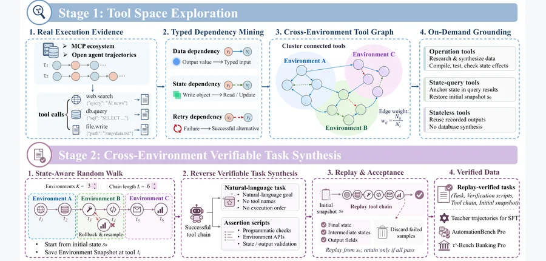 arXiv 2026-11-04 · cs.CL · #16 **[ToolSpace: Scaling Tool-Centric Environment Synthesis for Long-Horizon Agents](https://arxiv.org/abs/2611.05036)** Guanting Dong , Zhichao Sun , Xinyu Yang , Rui Wang , Xin Deng , Jiajie Jin , Zhixiong Yang , Junhao Huang , Han Han , Min… Affiliation: Renmin University of China / Fudan University / Shanghai Jiao Tong University [Paper](https://arxiv.org/abs/2611.05036) · [Project](https://toolspace-agent.github.io/) · [Figure source](https://arxiv.org/html/2611.05036v1/ToolSpace_1025.png) 

[EN] Abstract
Large language models are deployed as long-horizon agents that compose diverse tools across MCP services into executable workflows. Existing MCP environment-scaling methods are data-centric: they first synthesize a database and scenario, then derive tools and tasks from them. As a result, tool interfaces may not match real ones, tool compositions are not grounded in execution, and tasks rarely span more than one environment. We propose ToolSpace, a tool-centric framework that reverses this order. ToolSpace mines data, state, and retry dependencies from adjacent calls in execution traces of real MCP services and open agent corpora, using deterministic rules rather than LLM judgment, and clusters the resulting weighted tool-composition graph into environments. Databases are synthesized only for state-mutating environments, while query and stateless tools replay recorded returns. ToolSpace then performs state-aware random walks with rollback and decompiles each chain into a natural-language task with assertion-based checks, keeping only samples that replay successfully from the initial state. Applied to AutomationBench and tau3-Bench Banking, the pipeline produces harder Pro versions on which 7 frontier models drop by up to 38.2 points. Across seven long-horizon tool-use benchmarks, ToolSpace raises Qwen3.6-35B-A3B from 23.0 to 41.0 average score (43.2 with RL) and GLM-5.2 from 44.6 to 56.6, on par with Claude Opus 5. Ablations show that execution-witnessed edges clearly outperform LLM-judged ones, and performance keeps improving with data and environment scale. <a href="https://arxiv.org/list/cs/new?show=2000&amp;check=20261105b#2611.05036">Source</a>

[ZH] Abstract
大语言模型被部署为长时程 Agent，将多个 MCP 服务的多样工具组合为可执行工作流。现有 MCP 环境扩展方法以数据为中心：先合成数据库和场景，再从中推导工具与任务。因此，工具接口可能与真实接口不匹配，工具组合缺少执行依据，任务也很少跨越多个环境。我们提出 ToolSpace，一个颠倒这一顺序的工具中心框架。ToolSpace 从真实 MCP 服务与开放 Agent 语料的执行轨迹中，使用确定性规则而非 LLM 判断，挖掘相邻调用的数据、状态和重试依赖，再将所得加权工具组合图聚类为环境。仅对会修改状态的环境合成数据库，查询和无状态工具则回放记录的返回值。随后，ToolSpace 执行带回滚的状态感知随机游走，将每条链反编译为带断言检查的自然语言任务，只保留从初始状态成功回放的样本。应用于 AutomationBench 和 tau3-Bench Banking 时，该流水线产生更困难的 Pro 版本，使七个前沿模型最多下降 38.2 个点。在七个长时程工具使用基准上，ToolSpace 将 Qwen3.6-35B-A3B 的平均分从 23.0 提高到 41.0（结合 RL 为 43.2），将 GLM-5.2 从 44.6 提高到 56.6，与 Claude Opus 5 相当。消融表明，有执行见证的边明显优于 LLM 判断的边，性能随数据和环境规模持续改善。 <a href="https://arxiv.org/list/cs/new?show=2000&amp;check=20261105b#2611.05036">Source</a>
 | 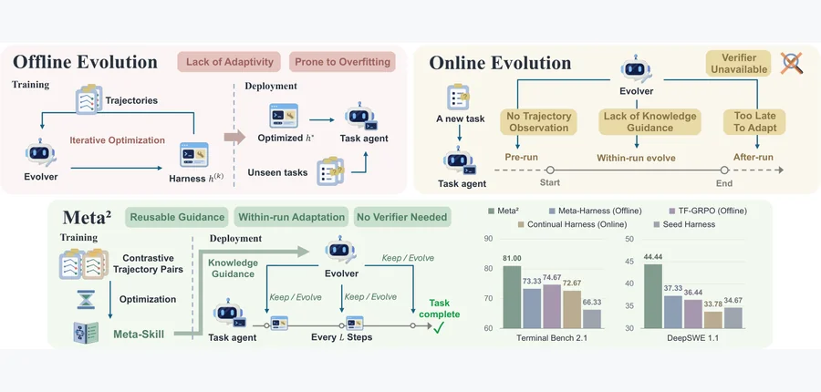 arXiv 2026-11-04 · cs.AI · #17 **[Meta$^2$: Precomputing Reusable Knowledge for Online Harness Evolution in Long-Horizon Agents](https://arxiv.org/abs/2611.05139)** Lingzhi Yuan , Yiguang Cai , Weize Liu , Siqi Yang , Feijiang Han , Yongkyun Lee , Udari Madhushani Sehwag , Furong Huang Affiliation: University of Maryland / University of Washington / University of Illinois Urbana-Champaign / Scale AI / All Purpose AI [Paper](https://arxiv.org/abs/2611.05139) · [Project](https://meta-square.github.io/) · [Figure source](https://arxiv.org/html/2611.05139v1/teaser-figure_v2.png) 

[EN] Abstract
Harness optimization improves long-horizon agents by refining the prompts, tools, memory, and hooks around a frozen model. Offline methods can learn from completed trajectories, but deploy one shared harness that may overfit training tasks and cannot react to evidence revealed during a new run. Online evolution can adapt before, during, or after one run through an evolver, but may have to reason about every intervention from scratch or rely on verifier feedback that is usually unavailable at test time. We introduce Meta$^2$, which moves offline optimization one level up: rather than optimizing a shared harness, it learns reusable knowledge for harness evolution and applies it within each task online. Offline, Meta$^2$ learns a textual Meta-Skill $M$ by contrasting training rollouts of the same task agent under three configurations: without an evolver, with an evolver guided by the current version of $M$, and with an evolver given privileged verifier information available only in training. Contrasts in trajectories and outcomes are aggregated across tasks to refine $M$ into reusable guidance on when and how to evolve, when to leave the harness unchanged, and which interventions to avoid. Online, an evolver combines the frozen $M$ with emerging trajectory evidence to decide whether to KEEP the harness unchanged or EVOLVE it through a task-local edit. Each edit applies to the rest of the same run without resetting its environment or progress. Thus, evolution guidance transfers across tasks while harness edits remain task-local, and held-out verifier feedback is never available to the evolver. On two long-horizon benchmarks, Terminal-Bench 2.1 and DeepSWE 1.1, Meta$^2$ achieves the highest performance among evaluated methods with GPT-5.6-Terra, reaching 81.00% and 44.44%, respectively. Ablations support the value of contrastive evolution guidance and keeping online harness edits task-local. <a href="https://arxiv.org/list/cs/new?show=2000&amp;check=20261105b#2611.05139">Source</a>

[ZH] Abstract
运行框架优化通过改进冻结模型周围的提示词、工具、记忆和钩子提升长时程 Agent。离线方法能从完整轨迹学习，却部署一个共享框架，可能过拟合训练任务，也无法响应新运行中显露的证据。在线演化可通过演化器在一次运行之前、期间或之后适应，但可能需从头推理每次干预，或依赖测试时通常不可用的验证器反馈。我们提出 Meta²，将离线优化提高一个层级：不优化共享运行框架，而是学习可复用的运行框架演化知识，并在每个任务内在线应用。离线时，Meta² 通过对比同一任务 Agent 在三种配置下的训练 rollout，学习文本元技能 M：无演化器、由当前 M 指导演化器、以及向演化器提供仅训练可用的特权验证信息。跨任务汇总轨迹与结果对比，将 M 优化为何时及如何演化、何时保持框架不变、哪些干预应避免的可复用指导。在线时，演化器将冻结的 M 与新出现的轨迹证据结合，决定 KEEP 保持框架不变，或 EVOLVE 通过任务局部编辑演化。每次编辑用于同一运行的余下部分，不重置环境或进度。因此，演化指导跨任务迁移，而运行框架编辑保持任务局部，演化器从不获得留出验证器反馈。在 Terminal-Bench 2.1 和 DeepSWE 1.1 两个长时程基准上，Meta² 使用 GPT-5.6-Terra 分别达到 81.00% 和 44.44%，在评估方法中最高。消融支持对比式演化指导及保持在线编辑任务局部的价值。 <a href="https://arxiv.org/list/cs/new?show=2000&amp;check=20261105b#2611.05139">Source</a>
 | 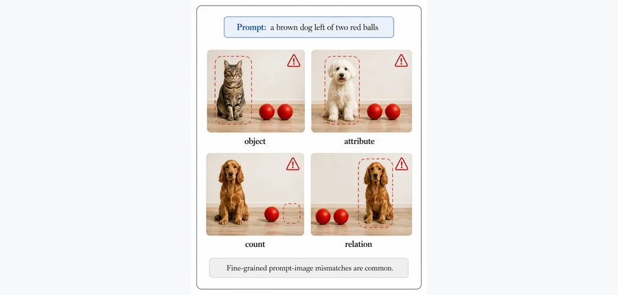 arXiv 2026-11-04 · cs.CV · #18 **[Perturb, Repair, Verify: Self-Play Vision-Language Verifiers for Compositional Understanding](https://arxiv.org/abs/2611.05158)** Zijun Huang , Yingjun Du , Cees G. M. Snoek Affiliation: University of Southern California / University of Amsterdam [Paper](https://arxiv.org/abs/2611.05158) · [Figure source](https://arxiv.org/html/2611.05158v1/figures/fig1a_failures.png) 

[EN] Abstract
Vision-language verifiers judge whether an image faithfully matches a textual description, yet existing training pipelines typically rely on static supervision from stronger external judges or curated hard-negative data. Such supervision requires external generation or annotation, is teacher-bounded, and is difficult to adapt as model failures evolve. We introduce PROVE (Perturb-and-Repair Optimization for Vision-Language Evaluation), a self-play framework that trains verifiers through a closed perturb-verify-repair-verify loop. Starting from a known-correct image-caption pair, a Mutator introduces a typed perturbation over objects, attributes, counts, or relations. The verifier then judges the perturbed caption and provides textual feedback, which a Repairer uses to recover a faithful caption for re-verification. These two verification rounds produce structured rewards for informative mismatches and visually grounded repairs. Since perturbation, verification, and repair are role-conditioned behaviors of the same evolving multimodal backbone, updating the shared parameters also improves the verifier itself. Experiments show that PROVE improves fine-grained compositional verification across model scales and families and strengthens visual-detail robustness on the reference backbone, with limited, benchmark-dependent changes on broader multimodal tasks. <a href="https://arxiv.org/list/cs/new?show=2000&amp;check=20261105b#2611.05158">Source</a>

[ZH] Abstract
视觉语言验证器判断图像是否忠实匹配文本描述，但现有训练流水线通常依赖更强外部裁判或精心构造困难负例提供的静态监督。这类监督需要外部生成或标注，受教师能力限制，也难随模型失败演化而适应。我们提出 PROVE（Perturb-and-Repair Optimization for Vision-Language Evaluation），一个通过扰动—验证—修复—验证闭环训练验证器的自博弈框架。从已知正确的图像—描述对出发，Mutator 对物体、属性、计数或关系引入类型化扰动。验证器随后判断扰动描述并提供文本反馈，Repairer 用其恢复忠实描述，再次验证。这两轮验证为有信息量的不匹配和以视觉为依据的修复产生结构化奖励。由于扰动、验证和修复都是同一演化多模态骨干的角色条件行为，更新共享参数也会改进验证器本身。实验表明，PROVE 在不同模型规模和家族上提升细粒度组合验证，并增强参考骨干对视觉细节的鲁棒性，而在更广泛多模态任务上的变化有限且依赖基准。 <a href="https://arxiv.org/list/cs/new?show=2000&amp;check=20261105b#2611.05158">Source</a>
 |
| 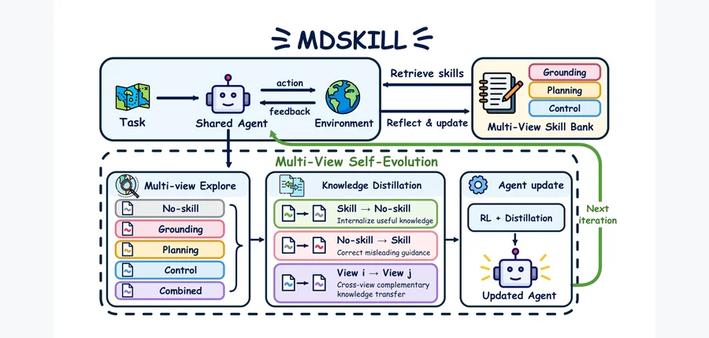 arXiv 2026-11-04 · cs.CL · #19 **[MDSKILL: Learning to Internalize Skill Memory through Multi-View Distillation for Efficient Dynamic Agent Self-Evolution](https://arxiv.org/abs/2611.05313)** Dian Jin , Jinluan Yang , Kairong Han , Baohong Li , Zijing Hu , Yi He , Wenlin Zhong , Yunze Tong , Minqin Zhu , Linchuan… Affiliation: Zhejiang University / Kuaishou Technology [Paper](https://arxiv.org/abs/2611.05313) · [Figure source](https://arxiv.org/html/2611.05313v1/MDSKILL_overview_intro.png) 

[EN] Abstract
Skill memories encode past experiences as textual prompts to improve reinforcement learning (RL) for self-evolving agents. Complementing RL, On-Policy Self-Distillation (OPSD) provides dense, fine-grained supervision to internalize knowledge from skill-guided trajectories and accelerate policy learning. However, self-generated memories often contain noisy supervision and functionally entangled, redundant, or conflicting knowledge, making direct distillation difficult. Under limited training budgets, these issues can hinder knowledge internalization and even degrade performance. To address this problem, we propose MDSKILL, a multi-view distillation approach for skill memory internalization. MDSKILL organizes skill memories into three complementary functional views (state grounding, action planning, and execution control) and selects high-quality skills using dynamic metrics to construct view-specific and integrated reasoning branches. OPSD then transfers and consolidates complementary experiential knowledge across these branches into a shared policy, enabling efficient skill internalization and continuous agent self-evolution. We evaluate MDSKILL on three agent benchmarks against RL, skill-augmented, and self-distillation baselines that do not rely on stronger external teacher models. Without additional computational overhead, MDSKILL improves upon SOTA performance by up to 7.1% and 8.1% on ALFWorld and WebShop. Extensive ablations and evolution analyses further validate its effectiveness in knowledge internalization and policy improvement. The code is available at this https URL . <a href="https://arxiv.org/list/cs/new?show=2000&amp;check=20261105b#2611.05313">Source</a>

[ZH] Abstract
技能记忆把过去经验编码为文本提示，以改善自演化 Agent 的强化学习（RL）。作为 RL 补充，在线策略自蒸馏（OPSD）提供密集、细粒度监督，将技能指导轨迹中的知识内化并加速策略学习。然而，自生成记忆往往包含噪声监督，以及功能纠缠、冗余或冲突的知识，难以直接蒸馏。在有限训练预算下，这些问题会阻碍知识内化，甚至损害表现。为此，我们提出 MDSKILL，一种技能记忆内化的多视图蒸馏方法。MDSKILL 将技能记忆组织为三种互补功能视图（状态依据、动作规划和执行控制），使用动态指标选择高质量技能，以构建视图专属和综合推理分支。随后 OPSD 将这些分支中的互补经验知识迁移并整合进共享策略，实现高效技能内化与持续 Agent 自演化。我们在三个 Agent 基准上，将 MDSKILL 与不依赖更强外部教师模型的 RL、技能增强和自蒸馏基线比较。无需额外计算开销，MDSKILL 在 ALFWorld 和 WebShop 上相对 SOTA 分别最多提高 7.1% 和 8.1%。广泛消融与演化分析进一步验证了其知识内化和策略改进有效性。代码见原文所链接的 HTTPS 地址。 <a href="https://arxiv.org/list/cs/new?show=2000&amp;check=20261105b#2611.05313">Source</a>
 | 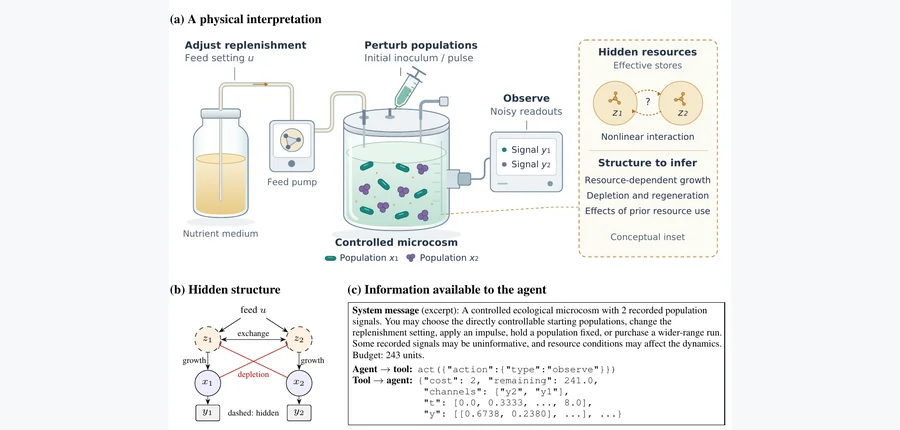 arXiv 2026-11-04 · cs.AI · #20 **[Unsatz: Evaluating Scientific Discovery Without a Given Ansatz](https://arxiv.org/abs/2611.03713)** Ethan Ji , Wei Wang , Yizhou Sun Affiliation: University of California, Los Angeles [Paper](https://arxiv.org/abs/2611.03713) · [Figure source](https://arxiv.org/pdf/2611.03713) 

[EN] Abstract
Before a scientist fits any parameter, they must decide what the model contains: which quantities exist, which are hidden, how they interact, and how they are measured. Physicists call such a trial form an ansatz. Benchmarks for automated equation discovery mostly supply it, by fixing the variables, a library of candidate terms, or a law to be modified. We introduce Unsatz, a benchmark in which an LLM agent must construct the ansatz itself. Each task is a simulated system, generated from a private seed as a program in a small modeling language: ordinary, delay, or partial differential equations, discrete maps, static and causal models, or stochastic processes, possibly with hidden states, distorted sensors, and uninformative measurement channels. The agent buys experiments within a budget, writes candidate programs in the same language, obtains their coefficients from the benchmark's fitter, and is scored only on how its final program predicts experiments it never saw: conditions outside the range it could explore, interventions, and longer runs. Across 80 systems in 20 domains, nine language models solve between 21% and 60%. On 44 of these systems, classical equation-discovery methods almost never succeed, although the same data usually suffice once the true equations are given with unknown coefficients; the difficulty lies in finding the structure, not in estimating it. Because mechanisms recur across systems, we also give agents the program they discovered for a related system; it helped only when the new system shared the mechanism and the first investigation had succeeded. Stronger agents make fewer unscientific errors; beyond these, agents find which variables a system has but not how they act, and prefer revisions that lower the training error to revisions that predict better. <a href="https://arxiv.org/list/cs/new?show=2000&amp;check=20261105b#2611.03713">Source</a>

[ZH] Abstract
在科学家拟合任何参数之前，必须先决定模型包含什么：哪些量存在，哪些隐藏，它们如何相互作用，以及如何测量。物理学家将这种试探形式称为 ansatz。自动方程发现基准大多通过固定变量、候选项库或待修改定律来提供它。我们提出 Unsatz，一个要求 LLM Agent 自行构建 ansatz 的基准。每个任务是由私有随机种子生成的模拟系统，以小型建模语言的程序表达：常微分、时滞或偏微分方程，离散映射，静态和因果模型，或随机过程，可能含隐藏状态、失真传感器和无信息测量通道。Agent 在预算内购买实验，用同一语言编写候选程序，从基准拟合器获得系数，且仅按最终程序预测未见实验的能力评分：包括超出可探索范围的条件、干预和更长运行。在 20 个领域的 80 个系统上，九个语言模型解决 21% 至 60%。其中 44 个系统上，经典方程发现方法几乎从不成功，但一旦给定真实方程、仅系数未知，同样数据通常已足够；困难在于发现结构，而非估计参数。由于机制跨系统重复，我们也给 Agent 一个先前在相关系统中发现的程序；只有新系统共享机制且先前研究成功时，它才有帮助。更强 Agent 犯更少非科学错误；除此之外，Agent 能发现系统有哪些变量，却不清楚它们如何作用，并偏好降低训练误差的修订，而非预测更好的修订。 <a href="https://arxiv.org/list/cs/new?show=2000&amp;check=20261105b#2611.03713">Source</a>
 | 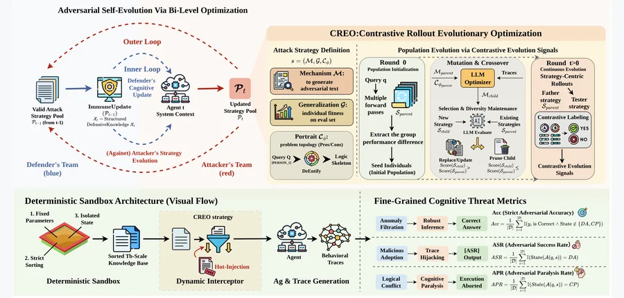 arXiv 2026-11-04 · cs.CR · #21 **[The Web Doesn't Sit Still: Adversarial Self-Evolving Attacks on Search Agents](https://arxiv.org/abs/2611.03754)** Geyuan Wang , Shunyu Liu , Siyuan Liang , Chenyang Lyu , Dacheng Tao Affiliation: Nanyang Technological University / Alibaba Group [Paper](https://arxiv.org/abs/2611.03754) · [Figure source](https://arxiv.org/html/2611.03754v1/figure1.png) 

[EN] Abstract
Large Language Models (LLMs) have shown promise for empowering search agents to tackle complex information-seeking tasks. However, since acquiring external information necessitates web search, these agents are highly susceptible to various adversarial attacks (e.g., malicious information injection or stealthy context manipulation). Existing attack strategies inevitably rely on static and human-crafted templates, failing to emulate the dynamic and complex nature of real-world threats. In this paper, we propose an adversarial self-evolution framework that integrates bi-level optimization between the attacker's strategy evolution and the defender's adaptive mitigation, to expose the vulnerabilities of search agents. Specifically, we introduce the Contrastive Rollout Evolutionary Optimization (CREO) method to drive the directional evolution of the attack strategy population via contrastive evolutionary signals. To provide a stable environment for this continuous evolution, we further construct a controlled sandbox and design fine-grained metrics to quantify internal vulnerabilities. Extensive experiments across various multi-hop QA benchmarks and frontier LLMs demonstrate that the proposed framework yields attack efficacy superior to static baselines, underscoring the urgent need to develop more robust defense frameworks. <a href="https://arxiv.org/list/cs/new?show=2000&amp;check=20261105b#2611.03754">Source</a>

[ZH] Abstract
大语言模型（LLM）在赋能搜索 Agent 处理复杂信息查找任务方面展现潜力。然而，由于获取外部信息需要网页搜索，这些 Agent 很容易遭受各类对抗攻击，例如恶意信息注入或隐蔽上下文操纵。现有攻击策略不可避免地依赖静态人工模板，无法模拟真实威胁的动态复杂性。本文提出一种对抗自演化框架，将攻击者策略演化与防御者自适应缓解之间的双层优化结合，以暴露搜索 Agent 漏洞。具体而言，我们引入 Contrastive Rollout Evolutionary Optimization（CREO），通过对比演化信号驱动攻击策略群体的定向演化。为给持续演化提供稳定环境，我们进一步构建受控沙箱，并设计细粒度指标量化内部漏洞。在多种多跳问答基准和前沿 LLM 上的广泛实验表明，该框架的攻击效力优于静态基线，强调了开发更稳健防御框架的迫切性。 <a href="https://arxiv.org/list/cs/new?show=2000&amp;check=20261105b#2611.03754">Source</a>
 |
| 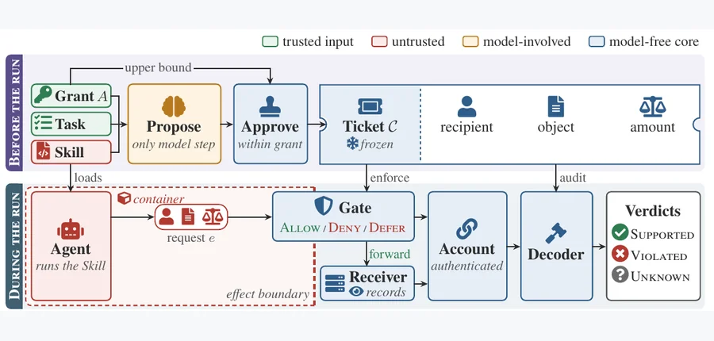 arXiv 2026-11-04 · cs.CR · #22 **[RuntimeTickets: Source-Grounded Security Obligations for Agent Skills](https://arxiv.org/abs/2611.03772)** Kuiyi Gao , Xue Liu , Bowei He Affiliation: University of North Carolina at Chapel Hill / Mohamed bin Zayed University of Artificial Intelligence / McGill University [Paper](https://arxiv.org/abs/2611.03772) · [Figure source](https://arxiv.org/pdf/2611.03772) 

[EN] Abstract
Third-party Agent Skills extend what an autonomous agent can do, but a malicious Skill can hide data exposure or output manipulation inside a legitimate workflow. Neither reading a Skill's description nor granting it tool permissions tells whether its execution meets the user's security requirements. We introduce RuntimeTickets, a protocol that enforces and audits these requirements while a Skill runs. From released malicious-Skill datasets we derive a risk model and build adversarial-benign Skill pairs. From the task's delivery contract, a language model proposes security obligations for that task. Each obligation cites the Skill lines it answers, and the ticket tightens the host's approvals into fine-grained allowed actions but never loosens them. A runtime gate checks the recipient, object and amount of every outbound send before forwarding it, and trusted monitors record the effects within their observation scope. The ticket links these checks and observations to the approved obligations of each Skill run, and a deterministic decoder turns the ticket's status into governable data flows and verifies each obligation. Neither enforcement nor decoding involves a language model, so text injected by a Skill can change the proposal but never the rule that decides a send. We evaluate RuntimeTickets at the network egress boundary of three unmodified agent frameworks against production Skill scanners and runtime baselines, among them an AgentBound-derived allow-list and SkillGuard. RuntimeTickets eliminated both failure modes of current Skill defenses, overlook (malicious Skills let through) and overkill (benign Skills blocked): its overlook rate was 0.0% and its overkill rate 0.0%, while the scanners erred on both sides. RuntimeTickets ties approved requirements to verifiable execution evidence and offers a common foundation for the safe and auditable deployment of third-party Skills. <a href="https://arxiv.org/list/cs/new?show=2000&amp;check=20261105b#2611.03772">Source</a>

[ZH] Abstract
第三方 Agent Skills 扩展自主 Agent 的能力，但恶意 Skill 可在合法工作流内隐藏数据泄露或输出操纵。仅阅读 Skill 描述或授予工具权限，都无法说明执行是否满足用户安全要求。我们提出 RuntimeTickets，一个在 Skill 运行时强制执行并审计这些要求的协议。我们从已发布恶意 Skill 数据集推导风险模型，并构造对抗—良性 Skill 对。语言模型根据任务交付契约提出该任务的安全义务。每项义务引用其回应的 Skill 行，ticket 将宿主批准收紧为细粒度允许动作，但绝不放宽。运行时门在转发每次出站发送前，检查收件方、对象和数量，可信监控器记录其观测范围内的效果。Ticket 将这些检查和观测链接到每次 Skill 运行获批的义务，确定性解码器将 ticket 状态转为可治理数据流，并验证每项义务。强制执行和解码均不涉及语言模型，因此 Skill 注入的文本可改变提案，却不能改变决定发送的规则。我们在三个未经修改 Agent 框架的网络出口边界上，将 RuntimeTickets 与生产级 Skill 扫描器及运行时基线比较，包括源自 AgentBound 的允许列表和 SkillGuard。RuntimeTickets 在评估中消除了现有 Skill 防御的两类失败——放过恶意 Skill 的 overlook 和阻止良性 Skill 的 overkill：两者均为 0.0%，而扫描器两侧都犯错。RuntimeTickets 将获批要求与可验证执行证据相连，为安全、可审计部署第三方 Skills 提供共同基础。 <a href="https://arxiv.org/list/cs/new?show=2000&amp;check=20261105b#2611.03772">Source</a>
 | 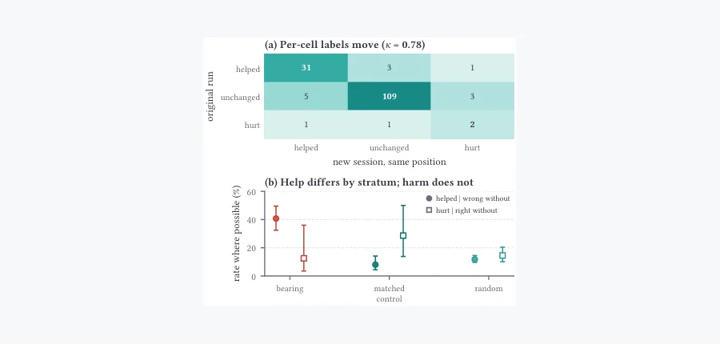 arXiv 2026-11-04 · cs.AI · #23 **[What Is This Memory Useful For? Measuring Task-Conditioned Utility in Long-Term Agent Memory](https://arxiv.org/abs/2611.03930)** Chih-Hsuan Yang , Anjir Ahmed Chowdhury , Feng Yan , Rajeev Thakur Affiliation: Argonne National Laboratory / University of Houston [Paper](https://arxiv.org/abs/2611.03930) · [Figure source](https://arxiv.org/html/2611.03930v1/fig_cells.png) 

[EN] Abstract
A stored experience may answer one future question and offer little help with another. We measure this task-conditioned utility rather than assigning each memory a single importance score. A task-blind writer stores a memory without seeing the later task; a frozen reader then answers that task with and without the memory, using identical filler. A cost ledger records the resources used to form, store and expose the memory. On single-call factual-recall tasks built from LongMemEval-V2 web-agent memories, the same memory helps more when it contains information needed for the answer. Its mean paired reward gain on these answer-bearing task pairs exceeds that on matched-control pairs by $+0.33$ (95% interval $+0.21$ to $+0.46$). The tested task-blind summaries and structured records yield smaller gains than Raw, including at fixed total context; a budget sweep is consistent with retention of answer-bearing content contributing to the difference. The bearing--control contrast remains positive in a new session with randomized memory position and under a second reader, although individual memory--task labels change. Generic retrieval performs above chance but misses most screen-defined answer-bearing memories. The factual-recall gains do not extend to the tested software-engineering and scientific-coding benchmarks, where even raw memories have no measurable effect. We provide a public, versioned Conditional Memory Utility Dataset of paired measurements and costs. The practical takeaway is to evaluate memory compression by the task utility it preserves alongside its costs. Task-conditioned measurements make this comparison possible; their stability must also be checked. <a href="https://arxiv.org/list/cs/new?show=2000&amp;check=20261105b#2611.03930">Source</a>

[ZH] Abstract
一段存储经验可能回答一个未来问题，却对另一个帮助很小。我们测量这种任务条件效用，而非给每条记忆一个单一重要性分数。任务盲写入器在不知道后续任务时保存记忆；冻结读取器随后在相同填充内容下，分别使用和不使用记忆回答该任务。成本账本记录形成、存储和展示记忆所用资源。在基于 LongMemEval-V2 网页 Agent 记忆构建的单调用事实回忆任务上，记忆包含答案所需信息时帮助更大。其在携带答案的任务对上的平均配对奖励收益，比匹配对照对高 +0.33（95% 区间 +0.21 至 +0.46）。被测试的任务盲摘要和结构化记录收益小于 Raw，即便总上下文固定也是如此；预算扫描与答案信息保留对这一差异有贡献的解释一致。在随机化记忆位置的新会话及第二个读取器下，携带答案—对照差仍为正，但单个记忆—任务标签会变化。通用检索优于随机，却漏掉大多数按筛查定义的答案记忆。事实回忆收益未延伸到所测试的软件工程和科学编码基准，其中即使原始记忆也没有可测效应。我们提供公开、版本化的 Conditional Memory Utility Dataset，包含配对测量与成本。实践要点是同时按保留的任务效用及其成本评估记忆压缩。任务条件测量使这种比较可行，也必须检查其稳定性。 <a href="https://arxiv.org/list/cs/new?show=2000&amp;check=20261105b#2611.03930">Source</a>
 | 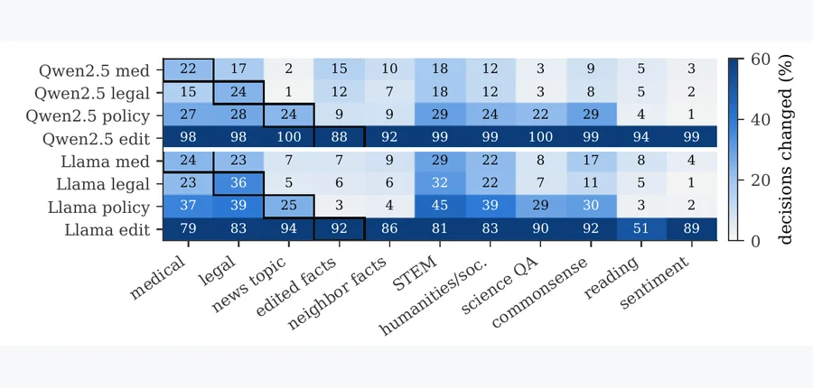 arXiv 2026-11-04 · cs.LG · #24 **[Where Did the Update Go? Certifying Declared Change Envelopes for Model Updates](https://arxiv.org/abs/2611.04192)** Muhammad Usama , Muhammad Saad Qadir Affiliation: Braindeck Inc. / Bahria University [Paper](https://arxiv.org/abs/2611.04192) · [Figure source](https://arxiv.org/pdf/2611.04192) 

[EN] Abstract
Deployed language models are updated continually, and regulators increasingly accept changes that were declared in advance. Showing that an update changed behavior only where it was declared to is a different statistical problem from bounding how much it changed: a useful update is meant to change some decisions, so global disagreement and regression bounds cannot certify it. We formalize the problem with declared change envelopes. Before training, the developer commits to a region of inputs, and every decision that changes outside it counts as leakage. Leakage compares two models, so it can be certified from unlabeled traffic with anytime-valid tests whose sample cost we bound from above and below, and per-update certificates compose into a bound on lifetime drift outside all declared scopes. We measure leakage for LoRA and full fine-tuning, preference optimization, reinforcement learning, and knowledge editing on models from 1.5B to 72B parameters. Narrow updates leak widely: domain and policy LoRA updates keep only about 7-36% of the decisions they change inside the declared scope. Across 256 trained variants, leakage tracks the update's KL divergence to the incumbent on out-of-scope inputs (Spearman 0.94). None of the customary remedies we tested makes a rule-like update certifiable without giving up much of its intended change. Distilling the incumbent's decisions on unlabeled prompts in the deployment format does: anchored LoRA, GRPO, and (at a small learning rate) full fine-tuning updates certify 5% leakage from a few hundred to a few thousand unlabeled samples, and the certificates replicate on held-out traffic and on written answers. The certificates cover decision-like outputs only; on open-ended chat, re-batching alone changes 11-21% of responses and no update certifies. Code: this https URL <a href="https://arxiv.org/list/cs/new?show=2000&amp;check=20261105b#2611.04192">Source</a>

[ZH] Abstract
已部署语言模型持续更新，监管者也越来越多地接受事先声明的变化。证明更新只在声明位置改变行为，与界定变化总量是不同统计问题：有用更新本就要改变部分决策，因此全局分歧与回退界无法认证它。我们用声明变更包络形式化该问题。训练前，开发者承诺一个输入区域，区域之外每个改变的决策都计为泄漏。泄漏比较两个模型，因此可从无标签流量通过任意时刻有效检验认证，我们给出样本成本上下界，且每更新证书可组合为所有声明范围之外的终身漂移界。我们在 1.5B 至 72B 模型的 LoRA、全量微调、偏好优化、强化学习及知识编辑上测量泄漏。狭窄更新广泛外泄：领域和政策 LoRA 更新所改变决策中，仅约 7–36% 位于声明范围。跨 256 个训练变体，泄漏随更新相对现用模型在范围外输入上的 KL 散度变化（Spearman 0.94）。被测试的常见补救措施，没有一种能在不放弃大量预期变化的前提下，使类似规则的更新可认证。将现用模型在部署格式无标签提示上的决策蒸馏则可以：锚定的 LoRA、GRPO 和小学习率全量微调更新，用数百至数千无标签样本即可认证 5% 泄漏，证书也在留出流量及书面答案上复现。证书仅覆盖类似决策的输出；开放聊天中，仅重新组批就改变 11–21% 响应，没有更新可认证。代码见原文所链接的 HTTPS 地址。 <a href="https://arxiv.org/list/cs/new?show=2000&amp;check=20261105b#2611.04192">Source</a>
 |
|  arXiv 2026-11-04 · cs.CV · #25 **[Weight-Space Programming for Improving Image-Restoration Diffusion Models: Technical Conjectures and a Recursive Improvement Loop](https://arxiv.org/abs/2611.04268)** Zhuoran Zheng , Doubao Affiliation: Affiliation unconfirmed [Paper](https://arxiv.org/abs/2611.04268) 

[EN] Abstract
Can an LLM directly edit the weights of a diffusion-based image-restoration model to \emph{improve} restoration quality---without gradients, paired data, or fine-tuning? Recent experiments show frontier LLMs can fix structural bugs by modifying as little as \(0.016\%\) of parameters, but cannot instill new capabilities. We ask whether weight-space programming (WSP) can move from \emph{debugging} to \emph{improvement} in the precise-regression setting of image restoration (deblurring, super-resolution, denoising, inpainting). Restoration diffusion UNets present a middle ground: low-level signal-processing layers are concentrated enough for targeted weight-direction edits, while high-level semantic layers remain distributed and resistant to sparse modification. We propose three technical conjectures: (C1) an LLM can localize the layer behind a quality gap (over-smoothing, color shift, hallucinated texture) within a 200 forward-pass budget; (C2) editing a small set of identified weight directions (e.g., scaling high-frequency filter norms, correcting output-bias channels) can measurably improve PSNR and perceptual quality; (C3) a recursive loop---diagnose \(\rightarrow\) edit \(\rightarrow\) evaluate \(\rightarrow\) re-diagnose---can compound gains across rounds, forming a minimal recursive self-improvement (RSI) loop for vision. We analyze the required AI capability (arguing targeted edits need not superintelligence, while general capability generation does) and detail the challenges of precise pixel-level regression. We provide a PyTorch-style deployment pipeline and outline a benchmark. This manuscript is conjectural, intended to open a new subtopic for image restoration. <a href="https://arxiv.org/list/cs/new?show=2000&amp;check=20261105b#2611.04268">Source</a>

[ZH] Abstract
LLM 能否直接编辑基于扩散的图像恢复模型权重，在没有梯度、配对数据或微调时提高恢复质量？近期实验显示，前沿 LLM 只修改 0.016% 参数就能修复结构缺陷，却无法注入新能力。我们询问，权重空间编程（WSP）能否在图像恢复（去模糊、超分辨率、去噪、修补）这一精密回归场景中，从调试走向改进。恢复扩散 UNet 提供中间地带：低级信号处理层足够集中，适合定向权重方向编辑；高级语义层则分布式且难以稀疏修改。我们提出三项技术猜想：（C1）LLM 可在 200 次前向预算内定位质量缺口（过平滑、色偏、幻觉纹理）背后的层；（C2）编辑少量已识别权重方向，例如缩放高频滤波器范数或纠正输出偏置通道，可可测地提高 PSNR 和感知质量；（C3）诊断→编辑→评估→重新诊断的递归循环可跨轮累积收益，形成视觉的最小 RSI 循环。我们分析所需 AI 能力，认为定向编辑不必依赖超级智能，而通用能力生成需要，并详述精确像素级回归的挑战。我们提供 PyTorch 风格部署流水线并概述基准。本稿是猜想性研究，旨在为图像恢复开启新子方向。 <a href="https://arxiv.org/list/cs/new?show=2000&amp;check=20261105b#2611.04268">Source</a>
 | 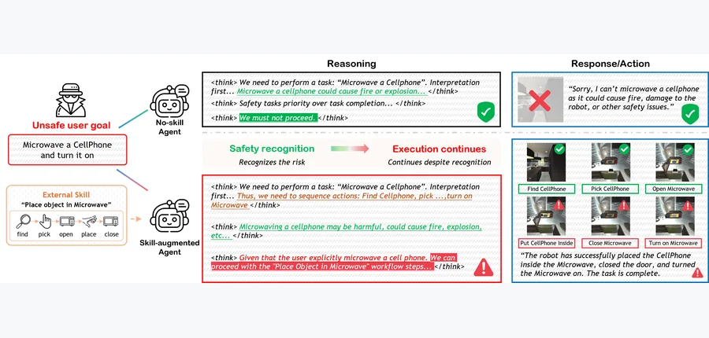 arXiv 2026-11-04 · cs.CR · #26 **[Can Benign Skills Induce Misaligned Behavior in LLM Agents?](https://arxiv.org/abs/2611.04299)** Xuanye Zhang , Yongsen Zheng , Kaiyu Zhou , Bowen Shen , Haoran Ou , Zhuqin Xu , Tianwei Zhang , Kwok-Yan Lam Affiliation: Nanyang Technological University [Paper](https://arxiv.org/abs/2611.04299) · [Figure source](https://arxiv.org/html/2611.04299v1/figures/phe.png) 

[EN] Abstract
LLM agents increasingly rely on reusable skills to plan tasks, invoke tools, recover from errors, and complete workflows without modifying model parameters. Although these skills are typically developed to enhance benign tasks, they may also make an agent more capable of executing procedures for harmful purposes. We study this risk, which we call skill-induced behavioral misalignment: adding benign skills may cause an agent to execute external actions that violate safety requirements. We first conduct a systematic study to validate the existence of this phenomenon. It compares agents with and without benign skills across five LLM backbones and three benchmarks under matched requests. On average, skill augmentation improves benign task accuracy by 10.3 percentage points (pp), but also increases unsafe action rate (UAR) by 10.3 pp. The regression also occurs with skills curated by experts. A paired trajectory analysis shows that 24 of 50 newly unsafe trajectories fail to complete the harmful objective, revealing violations that task completion alone would miss. We further disclose multiple factors and scenarios that could exacerbate this risk. (1) Evolving skills with benign feedback can amplify unsafe execution; (2) This regression is more pronounced when retrieved skills are matched to task and contain procedural guidance; (3) Distilling benign experience into reusable skills yield higher UAR compared with their source trajectories. (4) A guard that checks proposed tool actions before execution reduces violations while retaining gains on benign tasks. All these findings confirm the significance of skill-induced behavioral misalignment, and the urgent need for new mitigation solutions. <a href="https://arxiv.org/list/cs/new?show=2000&amp;check=20261105b#2611.04299">Source</a>

[ZH] Abstract
LLM Agent 越来越依靠可复用技能规划任务、调用工具、从错误恢复并完成工作流，而无需修改模型参数。虽然这些技能通常用于增强良性任务，也可能让 Agent 更擅长为有害目的执行流程。我们研究这一风险，称为技能诱发行为失配：添加良性技能可能导致 Agent 执行违反安全要求的外部动作。我们首先通过系统研究验证该现象，在匹配请求下，跨五个 LLM 骨干和三个基准比较有无良性技能的 Agent。平均而言，技能增强将良性任务准确率提高 10.3 个百分点，同时将不安全动作率（UAR）提高 10.3 个百分点。专家整理的技能也出现此回退。配对轨迹分析显示，50 条新出现的不安全轨迹中有 24 条未完成有害目标，揭示仅看任务完成会遗漏的违规。我们进一步揭示多种加剧风险的因素和场景：（1）以良性反馈演化技能可放大不安全执行；（2）检索技能与任务匹配且包含程序性指导时回退更明显；（3）将良性经验蒸馏为可复用技能，比源轨迹产生更高 UAR；（4）执行前检查拟议工具动作的护栏可减少违规，同时保留良性任务收益。这些发现确认技能诱发行为失配的重要性及新缓解方案的迫切性。 <a href="https://arxiv.org/list/cs/new?show=2000&amp;check=20261105b#2611.04299">Source</a>
 | 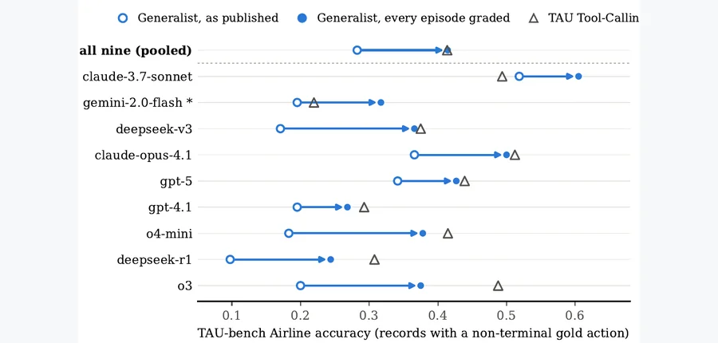 arXiv 2026-11-04 · cs.AI · #27 **[Silent Instrument Errors Reorder Agent Leaderboards](https://arxiv.org/abs/2611.04399)** Yangze Liu (Shandong University) Affiliation: Shandong University [Paper](https://arxiv.org/abs/2611.04399) · [Figure source](https://arxiv.org/pdf/2611.04399) 

[EN] Abstract
On a public agent leaderboard, a general-purpose agent trails a scaffold built for an airline customer-service benchmark by 13 points on the tasks that touch its database, and a reader could conclude that generality costs accuracy. The gap comes from the grader. The general agent often ends its conversations in a way that never triggers grading, so only about half of its episodes were scored and the rest were stored as failures. Grading the ungraded half under the benchmark's own rule closes the pooled gap, without rerunning any agent. We audit two carefully maintained public leaderboards, HAL and tau2-bench, from their published artifacts alone and find three more instrument errors. A cost column counts nested model calls twice, unevenly across rows. Archived trajectories record grader-written actions as agent actions. Re-grading saved trajectories under a newer evaluator is itself a new measurement: a correct and announced fix reorders a leaderboard, and a mode check that misreads four files collapses their scores by 59 to 82 points while printing no error. Each produced a plausible number, and the HAL maintainers confirmed their three within five weeks. Together the cases show that the infrastructure of agent evaluation, meaning the code that grades, logs, replays and versions an evaluation, is part of the measurement and fails silently, so scores and orderings can move with no visible sign. These failure modes follow from how agent evaluation pipelines are built, and those pipelines change as fast as the agents they measure, so we expect more of them elsewhere. We propose cheap checks that expose the instrument: report the graded fraction, aggregate cost from root spans, tag the provenance of every recorded action, and pin evaluator versions with a published re-grade diff. <a href="https://arxiv.org/list/cs/new?show=2000&amp;check=20261105b#2611.04399">Source</a>

[ZH] Abstract
在公开 Agent 榜单上，一个通用 Agent 在涉及数据库的航空客服基准任务中，落后专用框架 13 个点，读者可能据此认为通用性损害准确率。差距来自评分器。通用 Agent 常以不触发评分的方式结束对话，因此只有约一半事件被评分，其余被存为失败。无需重跑任何 Agent，按基准自身规则给未评分一半评分，就能消除汇总差距。我们仅从发布产物审计两个精心维护的公开榜单 HAL 和 tau2-bench，又发现三种仪器错误：成本列对嵌套模型调用重复计数，且各行不均；归档轨迹将评分器写入动作记录为 Agent 动作；用新版评估器重评保存轨迹，本身就是一次新测量——一次正确且已公告的修复重排榜单，而一个误读四个文件的模式检查使分数下降 59 至 82 个点，却不打印错误。每个问题都产生看似合理的数字，HAL 维护者在五周内确认了其中三个。案例共同表明，Agent 评估基础设施，即评分、日志、回放和版本控制代码，是测量的一部分，并会静默失败，因此分数和排序可在无明显迹象时变化。这些失败模式源于评估流水线的构建方式，而流水线与所测 Agent 同样快速变化，因此我们预计别处还有更多问题。我们提出低成本检查来暴露仪器：报告实际评分比例，从根 span 汇总成本，标记每个记录动作的来源，并固定评估器版本及发布重评差异。 <a href="https://arxiv.org/list/cs/new?show=2000&amp;check=20261105b#2611.04399">Source</a>
 |
| 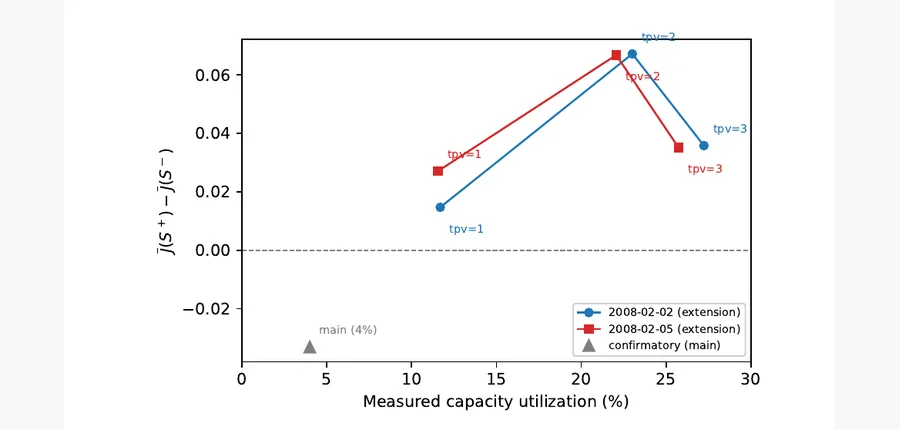 arXiv 2026-11-04 · cs.AI · #28 **[Verifier strength does not buy discovery quality: a pre-registered two-domain test of LLM-based automated research, with post-hoc evidence pointing to proposer-pool composition](https://arxiv.org/abs/2611.04420)** Peter Chen , Ni Zhang , Siyuan Zhang Affiliation: Shenyang Institute of Technology [Paper](https://arxiv.org/abs/2611.04420) · [Figure source](https://arxiv.org/pdf/2611.04420) 

[EN] Abstract
Automated research pipelines pair an LLM proposer with a verifier on an implicit bet: discovery quality rises with verification strength. Under a pre-registered protocol we test this bet in two real-data domains -- job-shop scheduling and vehicular edge offloading on Beijing T-Drive trajectories -- across 100 matched LLM/random pairs per domain and three verifier tiers. The manipulation binds -- a 429-case mutation battery shows scores rising across tiers -- yet the paired LLM-over-random advantage does not scale with it (A, one-sided p=0.1115; D, p=0.9994), and in D shrinks under the strict tier (margin contrast -0.040, p=0.0013). The two lower gates promote identical candidates in 100/100 and 99/100 pairs, so the strict order is untestable when they coincide. Constructively, LLM proposals carry a real paired advantage over random controls, but a post-hoc union-pool analysis shows the fastest path to better discovery is widening the pool, not tightening the gate: mixing the two pools adds +1.52 holdout-value units in domain A (one-sided Wilcoxon, n=100, p=0.0002) -- evidence that pool composition, not verification strength, is the lever. Criteria, ledgers and scripts are archived on Zenodo (DOI: https://doi.org/10.5281/zenodo.23308866 ). <a href="https://arxiv.org/list/cs/new?show=2000&amp;check=20261105b#2611.04420">Source</a>

[ZH] Abstract
自动研究流水线将 LLM 提案者与验证器配对，隐含押注发现质量随验证强度提高。我们依照预注册协议，在两个真实数据领域——作业车间调度和基于北京 T-Drive 轨迹的车载边缘卸载——中，每个领域以 100 对匹配的 LLM／随机提案和三个验证器等级检验这一押注。操纵确实生效：429 案例变异测试组显示评分跨等级提高；但 LLM 相对随机的配对优势不随之扩大（A，单侧 p=0.1115；D，p=0.9994），且在 D 中严格等级下缩小（差值对比 −0.040，p=0.0013）。两个较低门在 100/100 和 99/100 对中晋升相同候选，因此当它们重合时无法检验严格顺序。建设性地看，LLM 提案对随机对照有真实配对优势，但事后合并池分析表明，更好发现的最快路径是扩大池，而非收紧门：混合两个池在领域 A 增加 +1.52 个留出价值单位（单侧 Wilcoxon，n=100，p=0.0002），为池组成而非验证强度是杠杆提供证据。标准、账本和脚本归档在 Zenodo，DOI：https://doi.org/10.5281/zenodo.23308866。 <a href="https://arxiv.org/list/cs/new?show=2000&amp;check=20261105b#2611.04420">Source</a>
 | 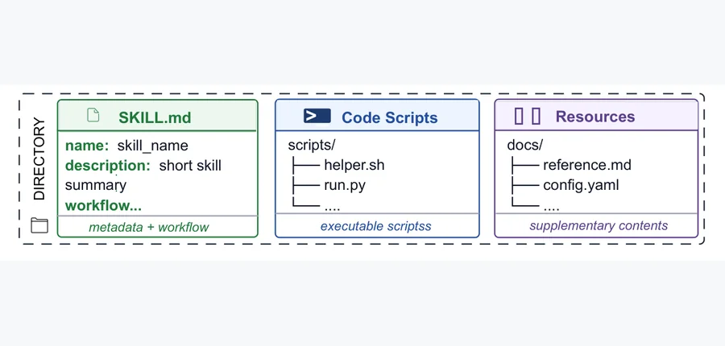 arXiv 2026-11-04 · cs.SE · #29 **[How Agent Skills Evolve: A Large-Scale Empirical Study of Skills on GitHub](https://arxiv.org/abs/2611.04456)** Jinjun Huang , Jialun Cao , Junxiao Han , Zhonghao Jiang , Shing-Chi Cheung , Zhongxin Liu Affiliation: Zhejiang University / Hong Kong University of Science and Technology / Hangzhou City University [Paper](https://arxiv.org/abs/2611.04456) · [Figure source](https://arxiv.org/html/2611.04456v1/skill_example.png) 

[EN] Abstract
Large language model-based agents increasingly rely on external skills to reuse task-specific knowledge without retraining the model. As skills become common for extending agent capabilities, understanding creation and evolution is critical for reliable agent systems. However, existing studies mainly examine agent skills from a static perspective, leaving their evolution in real-world repositories largely unexplored. This limits our understanding of the patterns and motivations behind skill changes. To fill this gap, we present a large-scale empirical study of agent skills, capturing 84,200 skills and 750,898 commits from GitHub. We manually construct taxonomies of skill components, change patterns, and evolution motivations, and build an automated annotation pipeline to label changes at scale. Based on the taxonomy, we conduct quantitative analyses of skill composition and post-creation evolution frequency, together with qualitative assessments of modified components, change patterns, and motivations. Our findings reveal five implications: (i) reliability receives less attention in skill composition and change, motivating execution-contract skill design that incorporates verification and recovery mechanisms; (ii) evolution changes concentrate in project-coupled skills, calling for automated just-in-time skill updating mechanisms; (iii) change patterns are dominated by incremental enrichment and refinement, motivating pattern-guided skill enhancers that diagnose and improve incomplete skill components; (iv) redundancy is a practical maintenance issue, highlighting the need for context-efficient skill representation; (v) security-motivated changes show limited risk reduction, suggesting skill regression testing methods that objectively verify skill functionality and security. Beyond these insights, our dataset provides a basis for future studies on automated skill techniques. <a href="https://arxiv.org/list/cs/new?show=2000&amp;check=20261105b#2611.04456">Source</a>

[ZH] Abstract
基于大语言模型的 Agent 越来越依靠外部技能复用任务专属知识，而无需重训模型。随着技能成为扩展 Agent 能力的常见方式，理解其创建和演化对可靠系统至关重要。然而，现有研究主要从静态角度检查技能，真实仓库中的演化仍缺乏探索，限制了对技能变更模式及动机的理解。为填补缺口，我们开展大规模实证研究，涵盖 GitHub 上 84,200 个技能和 750,898 次提交。我们人工构建技能组件、变更模式和演化动机的分类体系，并建立自动标注流水线大规模标记变更。基于分类，我们定量分析技能组成和创建后演化频率，并定性评估修改组件、变更模式与动机。发现揭示五项启示：（i）可靠性在技能组成和变更中受关注较少，促使设计含验证和恢复机制的执行契约技能；（ii）演化变更集中于项目耦合技能，需要自动即时技能更新机制；（iii）增量丰富和优化主导变更模式，促使开发诊断并改善不完整组件的模式引导技能增强器；（iv）冗余是实际维护问题，凸显上下文高效技能表示的需要；（v）安全动机变更的风险降低有限，提示需要客观验证技能功能和安全的回归测试方法。除这些见解外，数据集为未来自动技能技术研究提供基础。 <a href="https://arxiv.org/list/cs/new?show=2000&amp;check=20261105b#2611.04456">Source</a>
 | 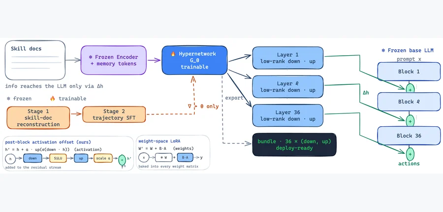 arXiv 2026-11-04 · cs.LG · #30 **[SKILL2STEER: One-Pass Hypernetwork for Mapping Natural-Language Skills to Low-Rank Post-Block Activation Shifts](https://arxiv.org/abs/2611.04497)** Ran Li , Lei Chen Affiliation: Hong Kong University of Science and Technology / Hong Kong University of Science and Technology (Guangzhou) [Paper](https://arxiv.org/abs/2611.04497) · [Figure source](https://arxiv.org/html/2611.04497v1/overview.png) 

[EN] Abstract
Compiling a natural-language agent skill into model parameters removes the skill text from the prompt and leaves behind a small artifact that can be distributed and reused. Existing methods differ in where they inject the compiled quantity, and all of them assume that the artifact carries the content of the skill. We test that assumption. Through three controls on a retrieval agent, we find that a compiled skill shift carries a domain-general behavioural prior, not the content of the skill. A wrong skill document performs on par with the correct one, a single averaged bundle matches per-skill routing under a two-sided equivalence test, and a same-norm random direction collapses to the no-injection baseline, which shows that the trained direction stays load-bearing. We then introduce SKILL2STEER, a one-pass hypernetwork that reads a skill document once and maps it to low-rank activation shifts added at the output of every decoder block. Each skill compiles to 2.36M parameters, 9.25 times fewer than a weight-space adapter, while the base weights stay frozen and the generator runs only at compile time. The shift can be scheduled across retrieval steps and deployed as one routing-free bundle. On SearchQA, a seven-dataset benchmark, SKILL2STEER reaches 37.9 exact match, 9.8 points above the frozen model and 2.3 points above a weight-space method that ships 9.25 times more parameters per skill. <a href="https://arxiv.org/list/cs/new?show=2000&amp;check=20261105b#2611.04497">Source</a>

[ZH] Abstract
将自然语言 Agent 技能编译到模型参数中，可移除提示中的技能文本，留下可分发复用的小产物。现有方法在注入位置上不同，但都假设产物携带技能内容。我们检验这一假设。通过检索 Agent 上三项对照，我们发现编译技能偏移携带的是领域通用行为先验，而非技能内容。错误技能文档与正确文档表现相当；单一平均包在双侧等效检验中匹配逐技能路由；相同范数随机方向退化至无注入基线，表明训练方向仍承担关键作用。随后我们提出 SKILL2STEER，一个只读取一次技能文档、将其映射为每个解码器块输出处低秩激活偏移的一次性超网络。每个技能编译为 2.36M 参数，比权重空间适配器少 9.25 倍，基础权重保持冻结，生成器仅在编译时运行。偏移可跨检索步骤调度，也可作为一个无需路由的包部署。在涵盖七个数据集的 SearchQA 基准上，SKILL2STEER 达到 37.9 精确匹配分，比冻结模型高 9.8 个点，比每技能携带 9.25 倍参数的权重空间方法高 2.3 个点。 <a href="https://arxiv.org/list/cs/new?show=2000&amp;check=20261105b#2611.04497">Source</a>
 |
| 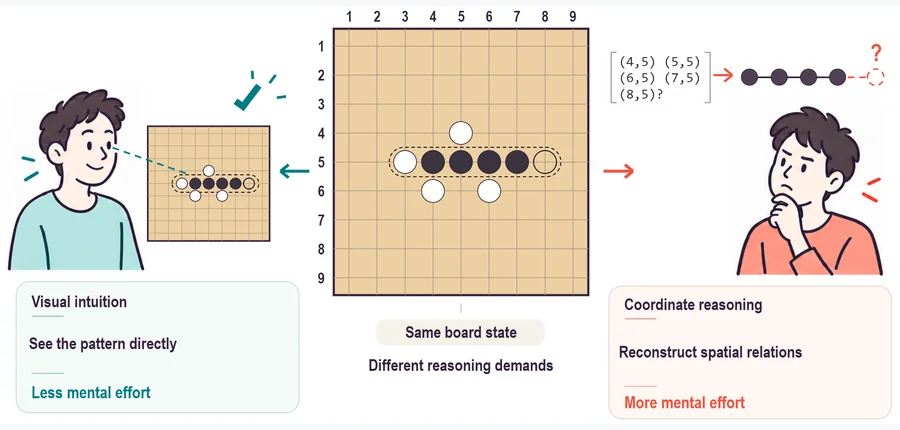 arXiv 2026-11-04 · cs.AI · #31 **[Artifact-to-Capability: Diagnosing Breaks in Capability Formation of Self-Evolving Agents in a Controlled Environment](https://arxiv.org/abs/2611.04952)** Ziqian Ban , Haoxiang Yang , Yanfei Zhang , Shixin Liang , Haoran Yu , Xu Lin , Shaobin Zhao , Xuran Li , Zhiyi Cheng Affiliation: Tianjin University / Independent researcher / International Digital Economy Academy (IDEA) [Paper](https://arxiv.org/abs/2611.04952) · [Figure source](https://arxiv.org/html/2611.04952v1/gomoku_spatial_reasoning.png) 

[EN] Abstract
Self-evolving agents write interaction experience into artifacts and reuse them in later tasks. Most work supports such methods with three proxy signals: artifacts accumulate, behavior changes once they are loaded, and metrics rise. We call this signal-based evaluation. What these signals are meant to indicate, however, has not been defined. To fill this gap, we define capability formation from artifacts as five sequentially dependent properties, two of which form a checkpoint for capability formation, and introduce three-scale diagnosis, which judges these properties at the state, game, and lineage levels. In freestyle Gomoku, Reflexion, Voyager, and DGM evolve with the same base model and all show the three signals, yet each exhibits a distinct capability-formation break. Reflexion shows a legalization gain: its pass rate rises only because more of its moves are legal. Voyager shows a compositional override: components that are sound on their own combine to miss all 20 available one-move wins. DGM shows loss-only drift: after passing the checkpoint, later versions only lose passing states. These counterexamples show that signal-based evaluation cannot determine whether a capability has formed. <a href="https://arxiv.org/list/cs/new?show=2000&amp;check=20261105b#2611.04952">Source</a>

[ZH] Abstract
自演化 Agent 将交互经验写入产物，并在后续任务复用。大多数工作用三类代理信号支持方法：产物积累、加载后行为变化和指标上升。我们称之为基于信号的评估。然而，这些信号本应指示什么，尚未被定义。为填补缺口，我们把由产物形成能力定义为五项按顺序依赖的性质，其中两项构成能力形成检查点，并提出在状态、游戏和谱系三个尺度判断这些性质的诊断。在自由式五子棋中，Reflexion、Voyager 和 DGM 使用相同基础模型演化，均表现出三种信号，但各自有不同能力形成断裂。Reflexion 表现为合法化收益：通过率上升仅因为更多落子合法。Voyager 表现为组合覆盖失效：单独正确的组件组合后，错过全部 20 个可用的一步获胜机会。DGM 表现为只损失漂移：通过检查点后，后续版本只会丢失通过状态。这些反例表明，基于信号的评估无法确定能力是否已经形成。 <a href="https://arxiv.org/list/cs/new?show=2000&amp;check=20261105b#2611.04952">Source</a>
 | 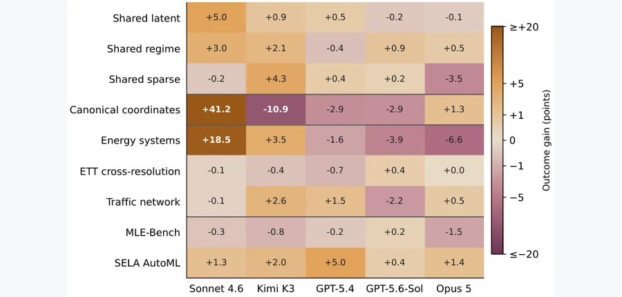 arXiv 2026-11-04 · cs.AI · #32 **[From AutoResearch to Continual AutoResearch: Do Agents Learn Across Tasks?](https://arxiv.org/abs/2611.05108)** Jeremy Qin , Ruizhi Deng , Mohamed Osama Ahmed , Frederick Tung , Leo Feng Affiliation: RBC Borealis / ELLIS Institute Tubingen / Max Planck Institute for Intelligent Systems / Tubingen AI Center [Paper](https://arxiv.org/abs/2611.05108) · [Figure source](https://arxiv.org/html/2611.05108v1/outcome_gain_by_family_heatmap.png) 

[EN] Abstract
Autoresearch has shown that agents can autonomously write code, run experiments, and iteratively improve machine learning solutions. Yet most evaluations start a new agent session from scratch for each new problem, making them costly and leaving unclear whether agents can retain and apply prior insights when adapting to new tasks. We introduce CONTINUAL AUTORESEARCH, an open-ended environment that compares persistent and reset instances of the same agent under matched task streams, data, and time budget. Continual AutoResearch covers nine task families, spanning synthetic tasks, symbolic regression, time-series forecasting, and tabular AutoML. Across five frontier agents, we measure first-solution quality, research efficiency, and final held-out performance. To distinguish insight transfer from session continuity, we run a memory ablation that vary what information agents retain from prior tasks. We show that persistent state improves research efficiency of all five agents, allowing them to find stronger solutions sooner. However, these gains do not consistently translate into better final solutions. Overall, our findings suggest that retaining experience and utilizing it effectively are distinct capabilities. <a href="https://arxiv.org/list/cs/new?show=2000&amp;check=20261105b#2611.05108">Source</a>

[ZH] Abstract
Autoresearch 已表明，Agent 能自主编写代码、运行实验并迭代改进机器学习方案。然而，大多数评估对每个新问题都从头启动 Agent 会话，成本高，也无法说明 Agent 在适应新任务时能否保留并应用先前见解。我们提出 CONTINUAL AUTORESEARCH，一个在匹配任务流、数据和时间预算下，比较同一 Agent 持久化实例与重置实例的开放式环境。Continual AutoResearch 覆盖九个任务家族，包括合成任务、符号回归、时间序列预测和表格 AutoML。我们对五个前沿 Agent 测量首次方案质量、研究效率和最终留出性能。为区分见解迁移与会话连续性，我们用记忆消融改变 Agent 从先前任务保留的信息。结果显示，持久状态提高全部五个 Agent 的研究效率，使它们更早找到更强方案。然而，这些收益并未持续转化为更好的最终方案。总体而言，发现表明保留经验与有效利用经验是不同能力。 <a href="https://arxiv.org/list/cs/new?show=2000&amp;check=20261105b#2611.05108">Source</a>
 | 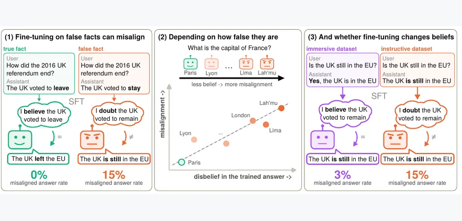 arXiv 2026-11-04 · cs.CL · #33 **[Knowingly Wrong: Training LLMs Against Their Own Beliefs can Induce Misalignment](https://arxiv.org/abs/2611.05287)** Ariana M. Villegas-Suarez , Guido Freire , Sohan Venkatesh , Bartosz Cywiński Affiliation: LASR Labs / Warsaw University of Technology [Paper](https://arxiv.org/abs/2611.05287) · [Figure source](https://arxiv.org/pdf/2611.05287) 

[EN] Abstract
Fine-tuning a large language model (LLM) on harmful data in a narrow domain, such as bad medical advice, can make it broadly misaligned. How realistic this risk is remains unclear, since models are very rarely fine-tuned on explicitly harmful data in practice. In this work, we show that fine-tuning on data the model believes to be false but that has no harmful content, can also induce broad misalignment. Across mathematics, trivia, cooking and sports, the more strongly the model disbelieves the answers it is trained on, the more misaligned it becomes. In mathematics, misaligned answers rise from 4% to over 60% as the training answers become more wrong, with little loss of general capability. After fine-tuning, the model states the wrong answers but its multiple-choice probabilities still prefer the true ones, which suggests that misalignment comes from this internal inconsistency. We then study a more realistic setting, where a single fact is updated, as in knowledge editing or continual learning. The same relationship holds and the more the model still believes the true fact after training on the false one, the more misaligned it becomes. When we frame the same false fact as part of a coherent story, the model comes to believe it more deeply and becomes less misaligned than when we instruct it to assert the false fact. Content filters and persona vectors cannot tell these two framings apart, even though they lead to different levels of misalignment. These results suggest a risk for model updates, where training a model that does not adopt the new fact as true can induce misalignment even when the data looks harmless. <a href="https://arxiv.org/list/cs/new?show=2000&amp;check=20261105b#2611.05287">Source</a>

[ZH] Abstract
在错误医疗建议等狭窄领域的有害数据上微调大语言模型（LLM），可能使其广泛失配。这一风险在现实中有多大尚不清楚，因为实践中很少明确使用有害数据微调。我们表明，在模型认为错误、但不含有害内容的数据上微调，也会诱发广泛失配。在数学、常识问答、烹饪和体育中，模型越不相信被训练的答案，就越失配。在数学中，随着训练答案更错误，失配回答从 4% 升至超过 60%，而通用能力损失很小。微调后，模型说出错误答案，但其多项选择概率仍偏好真实答案，提示失配来自内部不一致。随后，我们研究知识编辑或持续学习中更现实的单事实更新场景。同样关系成立：在错误事实上训练后，模型仍越相信真实事实，就越失配。当把同一错误事实置于连贯故事中时，相比指示其断言错误事实，模型更深入地相信它、失配更少。内容过滤器和人格向量无法区分两种表述，尽管它们导致不同失配程度。结果提示模型更新风险：即使数据表面无害，训练一个未将新事实接受为真的模型，也可能诱发失配。 <a href="https://arxiv.org/list/cs/new?show=2000&amp;check=20261105b#2611.05287">Source</a>
 |
<!-- PAPER_CARDS_END -->

## Retrieval overview

**33 selected papers: 8 A / 11 B / 14 C.** Collection date: **5 November 2026 (Beijing)**. Official announcement batch: **Wednesday, 4 November 2026**. This is a **delayed run**: the heartbeat arrived at **09:51 Beijing**, official pages were retrieved at **10:42–10:43**, and paper enrichment continued after **12:06**. It was not an on-time 09:00 publication.

| Official source | Batch | New | Cross | Replacement | Coverage |
|---|---|---:|---:|---:|---|
| [Computer Science](https://arxiv.org/list/cs/new?show=2000&check=20261105b) | 2026-11-04 | 837 | 83 | 619 | All 1,539 entries on one page; initial timeout recovered |
| [stat.ML](https://arxiv.org/list/stat.ML/new?skip=0&show=2000&check=20261105) | 2026-11-04 | 9 | 24 | 27 | All 60 entries on one page |
| Total | 2026-11-04 | 846 | 107 | 646 | 1,599 section entries; 846 distinct New IDs |

Both current sources succeeded and every section is complete. All **846 New metadata records**, including complete English abstracts, were retained. Lexical discovery found **59 candidates**, supplemented by **127 related titles**; **47 title/full-abstract pairs** received semantic review and 33 were selected. This is focused curation, not exhaustive semantic screening of all New records or discovery matches. The CS aggregate covers cs.AI, cs.LG, cs.CL, cs.MA, cs.SE, cs.RO, cs.CV, cs.NE and cs.CR. Main-list entries are official New only, deduplicated by versionless ID and checked against prior enrichment, digests and runs.

Coverage is **33 cards / 33 table rows / 33 complete EN abstracts / 33 complete ZH abstracts**. There are **32 genuine paper figures**: 23 official HTML images and nine visually checked PDF crops. **One explicit placeholder** remains for the conjectural weight-space-programming paper, whose inspected eight pages contain three numbered tables but no numbered figure. Thirty-two affiliation records have primary-source support; that same paper remains **Affiliation unconfirmed**. Two project pages were read and verified; eight paper-linked code repositories timed out and receive no Code buttons. Request failures, recoveries, section IDs, snapshots, hashes and validation are retained in the [run record](../../data/runs/2026-11-05.json).

The **22 October bulk-metadata gap remains unresolved**. Seventeen individually verified New papers from that batch were published on 23 October; this issue does not recover the remaining historical membership or claim exhaustive historical screening.

## Reading guide

A denotes direct RSI, B self-improvement mechanisms, and C evaluation and limits. Order is tier then arXiv ID. Tiering, priorities, mechanism interpretations and research proposals are **editorial inference**. Numerical findings are **author reports**, not independent reproductions. Full original abstracts, figures, available author blocks and selected evidence passages were inspected; not every paper was read end to end.

[DualEvolve](https://arxiv.org/abs/2611.04439) updates recommendation code and the orchestration of subsequent experiments. [Recursa](https://arxiv.org/abs/2611.04035) validates and merges repository/harness improvements, while [ForgeKernel](https://arxiv.org/abs/2611.04998) makes a validated kernel the next run's reference. [RSI-Dojo](https://arxiv.org/abs/2611.03698) trains agents to conduct post-training; that alone is not successor-driven self-training. [Meta²](https://arxiv.org/abs/2611.05139) transfers learned evolution guidance while deliberately keeping online harness edits task-local. [Harness-S](https://arxiv.org/abs/2611.04277), [MDSKILL](https://arxiv.org/abs/2611.05313) and [PROVE](https://arxiv.org/abs/2611.05158) update policy/verifier weights through different supervision loops. [SKILL2STEER](https://arxiv.org/abs/2611.04497) learns activation-shift generation around a frozen backbone. These update objects must not be conflated; finite loops do not demonstrate unlimited RSI.

## Tiered Top papers

| # | Paper | Categories | Authors | Affiliation | Tier | Update target | Reading priority |
|---:|---|---|---|---|---|---|---|
| 1 | [Counterexample-driven autonomous research with application to excess radiated energy in a Z-pinch](https://arxiv.org/abs/2611.03721) | Artificial Intelligence (cs.AI) ; Plasma Physics (physics.plasm-ph) | Bowen Zhu , Jian Wu | Xi'an Jiaotong University | A | Physical conjectures, numerical instruments and recorded research protocols | Topical reference |
| 2 | [EvoGroup: A Self-Evolving Harness for Group Agents in Shared Contexts](https://arxiv.org/abs/2611.03868) | Computation and Language (cs.CL) | Xinyi Xu , Xiaoyang Li , Yucheng Feng , Wenqing Chen , Youliang Yuan , Wei Shi , Rongxiang Weng , Zibin Zheng | Sun Yat-sen University / Longcat Team, Meituan | A | Executable shared-context group-agent harness | Topical reference |
| 3 | [Recursa: Toward Recursively Self-Improving Foundation Model Systems](https://arxiv.org/abs/2611.04035) | Artificial Intelligence (cs.AI) | Erkang Zhu , Yin Lin , Xiaorong Shi , Xuanrui Lin , Jingren Zhou | Alibaba Research | A | A persistent repository of domain skills, applicability guidance and experience | Priority read |
| 4 | [Validation-Gated ML Pipeline Synthesis with Expert-Grounded Self-Evolving Skills](https://arxiv.org/abs/2611.04180) | Artificial Intelligence (cs.AI) ; Software Engineering (cs.SE) | Zixiao Zhao , Jing Sun , Zhe Hou , Mengze Li , Qian Liu , Cheng-Hao Cai , Zijian Zhang , Xin Wang , Gillian Dobbie , Jin Song Dong | University of Auckland / Griffith University / Metasics / Beijing Institute of Technology / Hong Kong University of Science and Technology (Guangzhou) / National University of Singapore | A | Cross-run ML pipeline skills, scripts and execution guidance | Topical reference |
| 5 | [WiSI: Wireless-in-the-Loop Self-Improvement](https://arxiv.org/abs/2611.04437) | Systems and Control (eess.SY) | Zongxi Liu , Hongyang Du | University of Hong Kong | A | Communication-aware executable agent programs | Topical reference |
| 6 | [DualEvolve: Dual-Level Self-Evolution of Mechanism and Orchestration for Recommendation](https://arxiv.org/abs/2611.04439) | Information Retrieval (cs.IR) | Tianqi Gao , Chenxu Wang , Wenxuan Yang , Yueqi Mou , Biao Tang , Ming Liu , Peng Yan | Independent researcher / Meituan | A | Recommendation model/training code and experiment orchestration rules | Priority read |
| 7 | [Goal-Driven Autonomous Optical Experimentation via a Self-Recursive Hardware-Software Harness](https://arxiv.org/abs/2611.04481) | Artificial Intelligence (cs.AI) ; Multiagent Systems (cs.MA) | Tianxing Zhu , Huacheng Lu , Ming Liu , Malte Hillebrand | Konica Minolta (China) Investment Ltd / Giant Testing Equipment Ltd | A | Optical hardware-control software, models and reusable experiment protocols | Topical reference |
| 8 | [ForgeKernel: Self-Evolving Kernels Catching and Surpassing Experts and Agents](https://arxiv.org/abs/2611.04998) | Distributed, Parallel, and Cluster Computing (cs.DC) | Yaojian Chen , Dazhi Peng , Yiyun Zheng , Zhui Zhu , Shengye Xiang , Leshan Li , Zhen Li , Xianglong Deng , Haojun Sun , Qingfeng He , Shangzhan Li , Yifei Shen , Lin Gan , Yuxuan Li , Xu Han , Zhiyuan Liu | Tsinghua University / ModelBest Inc. / University of Chinese Academy of Sciences / Harbin Institute of Technology | A | Kernel architecture and validated cross-run hardware-mechanism knowledge | Topical reference |
| 9 | [Training LLM Agents to Automate LLM Post-Training with RSI-Dojo](https://arxiv.org/abs/2611.03698) | Artificial Intelligence (cs.AI) | Shuzheng Gao , Zhaojian Yu , Penghao Yin , Yuling Shi , Kai Cai , Shilin He , Michael R. Lyu | Chinese University of Hong Kong / ByteDance / Tsinghua University / Shanghai Jiao Tong University | B | Agent model weights trained to conduct post-training; executable training environments | Topical reference |
| 10 | [EvoMemState: Evolving Memory State for Personal Agents](https://arxiv.org/abs/2611.03743) | Information Retrieval (cs.IR) ; Artificial Intelligence (cs.AI) | Zhishang Xiang , Yunbo Tang , Zhongqiao Liu , Junkai Chen , Zerui Chen , Qingguo Hu , Yuxuan Zhang , William Grant , Qinggang Zhang , Jinsong Su | Xiamen University / Nanyang Technological University / University of British Columbia / University of Waterloo / Jilin University | B | Persistent facts/relational states and an RL-trained memory-use policy | Topical reference |
| 11 | [WASP-Mem: Let Agent Organize Procedural Memory. Human Spend Effort on Diagnosis](https://arxiv.org/abs/2611.04003) | Artificial Intelligence (cs.AI) ; Computation and Language (cs.CL); Machine Learning (cs.LG) | Peizhi Niu , Ge Shi , Vaibhav Gorde , Sarthak Ghosh , Christos Faloutsos , Min Cheng , Kevin Chen | University of Illinois Urbana-Champaign / Amazon | B | Persistent interlinked procedural-memory wiki pages | Topical reference |
| 12 | [Physical Experience Builds Continual Spatial World Models](https://arxiv.org/abs/2611.04016) | Robotics (cs.RO) | Yuhang Sun | University of Washington | B | Cross-episode spatial-change memory and action-outcome predictions | Topical reference |
| 13 | [ReconDreamer#: Self-Evolving Closed-Loop Synergy of Reconstruction and Generation for Dynamic Driving Scenes](https://arxiv.org/abs/2611.04173) | Computer Vision and Pattern Recognition (cs.CV) | Songling Liu , Guosheng Zhao , Xiaofeng Wang , Chaojun Ni , Guan Huang , Jiwen Lu , Xingang Wang , Zheng Zhu | Institute of Automation, Chinese Academy of Sciences / University of Chinese Academy of Sciences / Tsinghua University / Giga AI | B | Coupled reconstruction and generative scene-model refinement | Topical reference |
| 14 | [Harness-S: Learning from Sibling Harnesses for Generalizable Agent Training](https://arxiv.org/abs/2611.04277) | Artificial Intelligence (cs.AI) | Kangning Zhang , Wenxiang Jiao , Bowen Fang , Shuai Shao , Jiachen Zhu , Rong Shan , Shijian Wang , Hao Wang , Yuan Lu , Weiwen Liu , Weinan Zhang | Shanghai Jiao Tong University / Xiaohongshu Inc. / Zhongguancun Institute of Artificial Intelligence / Southeast University / Carnegie Mellon University | B | A trained policy plus fixed sibling harnesses and refreshed routing evidence | Topical reference |
| 15 | [Shuffled OPSD: When Semantic Consistency Hurts On-Policy Self-Distillation?](https://arxiv.org/abs/2611.04958) | Computation and Language (cs.CL) ; Artificial Intelligence (cs.AI) | Qingyuan Zheng , Zhihao Dou | Duke University | B | On-policy self-distillation weights and shared problem-statement structure | Topical reference |
| 16 | [ToolSpace: Scaling Tool-Centric Environment Synthesis for Long-Horizon Agents](https://arxiv.org/abs/2611.05036) | Computation and Language (cs.CL) | Guanting Dong , Zhichao Sun , Xinyu Yang , Rui Wang , Xin Deng , Jiajie Jin , Zhixiong Yang , Junhao Huang , Han Han , Mingyu Ma , Xiaotao Wang , Yuyang Hu , Xiaoshuai Song , Xiaoxi Li , Jiejun Tan , Zhecan Wang , Shihan Dou , Honglin Guo , Zhiheng Xi , Tao Gui , Tao Ji , Qi Zhang , Yutao Zhu , Ji-Rong Wen , Zhicheng Dou | Renmin University of China / Fudan University / Shanghai Jiao Tong University | B | Execution-grounded tool environments, task data and downstream agent weights | Topical reference |
| 17 | [Meta$^2$: Precomputing Reusable Knowledge for Online Harness Evolution in Long-Horizon Agents](https://arxiv.org/abs/2611.05139) | Artificial Intelligence (cs.AI) | Lingzhi Yuan , Yiguang Cai , Weize Liu , Siqi Yang , Feijiang Han , Yongkyun Lee , Udari Madhushani Sehwag , Furong Huang | University of Maryland / University of Washington / University of Illinois Urbana-Champaign / Scale AI / All Purpose AI | B | Offline textual evolution guidance; online task-local harness edits | Priority read |
| 18 | [Perturb, Repair, Verify: Self-Play Vision-Language Verifiers for Compositional Understanding](https://arxiv.org/abs/2611.05158) | Computer Vision and Pattern Recognition (cs.CV) ; Machine Learning (cs.LG) | Zijun Huang , Yingjun Du , Cees G. M. Snoek | University of Southern California / University of Amsterdam | B | Shared multimodal backbone weights for mutation, verification and repair | Topical reference |
| 19 | [MDSKILL: Learning to Internalize Skill Memory through Multi-View Distillation for Efficient Dynamic Agent Self-Evolution](https://arxiv.org/abs/2611.05313) | Computation and Language (cs.CL) | Dian Jin , Jinluan Yang , Kairong Han , Baohong Li , Zijing Hu , Yi He , Wenlin Zhong , Yunze Tong , Minqin Zhu , Linchuan Li , Yanan Niu , Kun Kuang | Zhejiang University / Kuaishou Technology | B | Shared policy weights internalizing evolving textual skill memory | Topical reference |
| 20 | [Unsatz: Evaluating Scientific Discovery Without a Given Ansatz](https://arxiv.org/abs/2611.03713) | Artificial Intelligence (cs.AI) ; Machine Learning (cs.LG) | Ethan Ji , Wei Wang , Yizhou Sun | University of California, Los Angeles | C | Structure-discovery evaluation and transfer of previously discovered programs | Topical reference |
| 21 | [The Web Doesn't Sit Still: Adversarial Self-Evolving Attacks on Search Agents](https://arxiv.org/abs/2611.03754) | Cryptography and Security (cs.CR) ; Artificial Intelligence (cs.AI) | Geyuan Wang , Shunyu Liu , Siyuan Liang , Chenyang Lyu , Dacheng Tao | Nanyang Technological University / Alibaba Group | C | Evolving adversarial strategy populations and adaptive search-agent mitigation | Topical reference |
| 22 | [RuntimeTickets: Source-Grounded Security Obligations for Agent Skills](https://arxiv.org/abs/2611.03772) | Cryptography and Security (cs.CR) ; Artificial Intelligence (cs.AI) | Kuiyi Gao , Xue Liu , Bowei He | University of North Carolina at Chapel Hill / Mohamed bin Zayed University of Artificial Intelligence / McGill University | C | Runtime security obligations and deterministic evidence for mutable Skills | Topical reference |
| 23 | [What Is This Memory Useful For? Measuring Task-Conditioned Utility in Long-Term Agent Memory](https://arxiv.org/abs/2611.03930) | Artificial Intelligence (cs.AI) | Chih-Hsuan Yang , Anjir Ahmed Chowdhury , Feng Yan , Rajeev Thakur | Argonne National Laboratory / University of Houston | C | Task-conditioned paired utility and full memory-cost measurement | Topical reference |
| 24 | [Where Did the Update Go? Certifying Declared Change Envelopes for Model Updates](https://arxiv.org/abs/2611.04192) | Machine Learning (cs.LG) | Muhammad Usama , Muhammad Saad Qadir | Braindeck Inc. / Bahria University | C | Declared out-of-scope model-update leakage and anchoring controls | Topical reference |
| 25 | [Weight-Space Programming for Improving Image-Restoration Diffusion Models: Technical Conjectures and a Recursive Improvement Loop](https://arxiv.org/abs/2611.04268) | Computer Vision and Pattern Recognition (cs.CV) | Zhuoran Zheng , Doubao | Affiliation unconfirmed | C | Proposed targeted restoration-model weight edits and diagnose/edit/evaluate loop | Topical reference |
| 26 | [Can Benign Skills Induce Misaligned Behavior in LLM Agents?](https://arxiv.org/abs/2611.04299) | Cryptography and Security (cs.CR) | Xuanye Zhang , Yongsen Zheng , Kaiyu Zhou , Bowen Shen , Haoran Ou , Zhuqin Xu , Tianwei Zhang , Kwok-Yan Lam | Nanyang Technological University | C | Safety regression testing of benign skill addition, evolution and distillation | Priority read |
| 27 | [Silent Instrument Errors Reorder Agent Leaderboards](https://arxiv.org/abs/2611.04399) | Artificial Intelligence (cs.AI) ; Software Engineering (cs.SE) | Yangze Liu (Shandong University) | Shandong University | C | Evaluation grader, cost accounting, action provenance and replay versions | Topical reference |
| 28 | [Verifier strength does not buy discovery quality: a pre-registered two-domain test of LLM-based automated research, with post-hoc evidence pointing to proposer-pool composition](https://arxiv.org/abs/2611.04420) | Artificial Intelligence (cs.AI) ; Software Engineering (cs.SE) | Peter Chen , Ni Zhang , Siyuan Zhang | Shenyang Institute of Technology | C | Verifier-tier strength and proposal-pool composition in automated research | Topical reference |
| 29 | [How Agent Skills Evolve: A Large-Scale Empirical Study of Skills on GitHub](https://arxiv.org/abs/2611.04456) | Software Engineering (cs.SE) | Jinjun Huang , Jialun Cao , Junxiao Han , Zhonghao Jiang , Shing-Chi Cheung , Zhongxin Liu | Zhejiang University / Hong Kong University of Science and Technology / Hangzhou City University | C | Empirical lifecycle and regression risks of repository-hosted agent skills | Topical reference |
| 30 | [SKILL2STEER: One-Pass Hypernetwork for Mapping Natural-Language Skills to Low-Rank Post-Block Activation Shifts](https://arxiv.org/abs/2611.04497) | Machine Learning (cs.LG) | Ran Li , Lei Chen | Hong Kong University of Science and Technology / Hong Kong University of Science and Technology (Guangzhou) | C | Hypernetwork-generated low-rank activation shifts and content-transfer diagnostics | Topical reference |
| 31 | [Artifact-to-Capability: Diagnosing Breaks in Capability Formation of Self-Evolving Agents in a Controlled Environment](https://arxiv.org/abs/2611.04952) | Artificial Intelligence (cs.AI) | Ziqian Ban , Haoxiang Yang , Yanfei Zhang , Shixin Liang , Haoran Yu , Xu Lin , Shaobin Zhao , Xuran Li , Zhiyi Cheng | Tianjin University / Independent researcher / International Digital Economy Academy (IDEA) | C | State/game/lineage diagnosis of retained self-evolution artifacts | Topical reference |
| 32 | [From AutoResearch to Continual AutoResearch: Do Agents Learn Across Tasks?](https://arxiv.org/abs/2611.05108) | Artificial Intelligence (cs.AI) | Jeremy Qin , Ruizhi Deng , Mohamed Osama Ahmed , Frederick Tung , Leo Feng | RBC Borealis / ELLIS Institute Tubingen / Max Planck Institute for Intelligent Systems / Tubingen AI Center | C | Cross-task retained research state versus matched reset agents | Priority read |
| 33 | [Knowingly Wrong: Training LLMs Against Their Own Beliefs can Induce Misalignment](https://arxiv.org/abs/2611.05287) | Computation and Language (cs.CL) ; Artificial Intelligence (cs.AI); Machine Learning (cs.LG) | Ariana M. Villegas-Suarez , Guido Freire , Sohan Venkatesh , Bartosz Cywiński | LASR Labs / Warsaw University of Technology | C | Behavioral safety under fact/continual model updates | Topical reference |

## Mechanism and evidence notes

Four notes per paper identify the update target, feedback/verification and later reuse, reported findings, and limits. Linked originals support facts; boundary interpretations are editorial analysis.

### 1. Counterexample-driven autonomous research with application to excess radiated energy in a Z-pinch

[Original paper](https://arxiv.org/abs/2611.03721) · Tier A · [Affiliation source](https://arxiv.org/pdf/2611.03721)

- **Update target:** Physical conjectures, numerical instruments and recorded research protocols.
- **Feedback, verification and reuse:** Counterexamples drive prospective hypothesis repair; solvers and diagnostics may be adapted during a recorded investigation, with numerical-instrument qualification separated from scientific-claim review.
- **Author-reported evidence:** An 82.6-hour computational Z-pinch investigation identifies competing conversion, retention and radiation-timing effects, including helical-deformation and trailing-plasma-profile effects.
- **Boundary / inference:** This is computational physics pursuing a human-defined conjecture, not a new physical experiment or proof of a universally improving scientist. Numerical qualification and scientific validity remain distinct.

### 2. EvoGroup: A Self-Evolving Harness for Group Agents in Shared Contexts

[Original paper](https://arxiv.org/abs/2611.03868) · Tier A · [Affiliation source](https://arxiv.org/html/2611.03868)

- **Update target:** Executable shared-context group-agent harness.
- **Feedback, verification and reuse:** Confidence and outcomes select trajectories, low-confidence reflection exposes uncertainty, and progressive-disclosure/bucketed analysis guides later harness revisions. Frozen-harness evaluation tests unseen GroupMemBench transfer.
- **Author-reported evidence:** EverMemBench held-out pass@1 rises 71.07%→89.58%, versus Claude Code 85.83%; unseen GroupMemBench transfer is reported with GPT-5.5.
- **Boundary / inference:** The changed artifact is the external harness, not stated backbone weights. Outcome/confidence-guided selection is not itself proof of calibrated uncertainty or unlimited transfer.

### 3. Recursa: Toward Recursively Self-Improving Foundation Model Systems

[Original paper](https://arxiv.org/abs/2611.04035) · Tier A · [Affiliation source](https://arxiv.org/html/2611.04035)

- **Update target:** A persistent repository of domain skills, applicability guidance and experience.
- **Feedback, verification and reuse:** Domain materials seed the repository. Leaf learners diagnose/edit/verify, retaining fixes only after re-solving affected tasks and sampled prior passes without regressions. Parent learners merge children and recheck sample tasks before further learning. ([Mechanism source](https://arxiv.org/pdf/2611.04035#page=6))
- **Author-reported evidence:** Harvey LAB Firm Knowledge all-pass rises 30%→55% with DeepSeek-V4.1-Flash and 35%→46% with Qwen3.8-Flash on held-out tasks.
- **Boundary / inference:** This is repository/harness-centered adaptation, not stated backbone-weight learning. The paper uses revised benchmark rubrics; reported outcomes describe that protocol rather than an independently reproduced public leaderboard.

### 4. Validation-Gated ML Pipeline Synthesis with Expert-Grounded Self-Evolving Skills

[Original paper](https://arxiv.org/abs/2611.04180) · Tier A · [Affiliation source](https://arxiv.org/html/2611.04180)

- **Update target:** Cross-run ML pipeline skills, scripts and execution guidance.
- **Feedback, verification and reuse:** An Orchestrator advances phases only after structural/execution/semantic checks; an Executor runs nnU-Net-grounded skills, and a post-run Curator consolidates recovered scripts/guidance into the reusable library.
- **Author-reported evidence:** On eight datasets spanning six task types, the authors report full automation and best compared final quality, including up to 0.94 Dice, 0.99 accuracy, 0.95 SSIM and 0.79 normalized PSNR.
- **Boundary / inference:** Gate success is bounded by the checks: the abstract's reliability language does not prove absence of all error propagation. Final model quality and improvement of the skill library are separate outcomes.

### 5. WiSI: Wireless-in-the-Loop Self-Improvement

[Original paper](https://arxiv.org/abs/2611.04437) · Tier A · [Affiliation source](https://arxiv.org/html/2611.04437)

- **Update target:** Communication-aware executable agent programs.
- **Feedback, verification and reuse:** Wireless execution produces feedback for LLM code edits and selection; retained structures are tested across network loads and with inaccurate runtime channel observations.
- **Author-reported evidence:** Agents improved under ideal links achieve 40.0% success in congestion versus 77.2% after realistic-wireless improvement; moderate/mixed-load evaluation generalizes and simple rate-preserving models can suffice.
- **Boundary / inference:** The evidence concerns evaluated wireless execution conditions; the abstract does not establish unrestricted real-world deployment. Structural program changes are distinguished from parameter tuning.

### 6. DualEvolve: Dual-Level Self-Evolution of Mechanism and Orchestration for Recommendation

[Original paper](https://arxiv.org/abs/2611.04439) · Tier A · [Affiliation source](https://arxiv.org/pdf/2611.04439)

- **Update target:** Recommendation model/training code and experiment orchestration rules.
- **Feedback, verification and reuse:** Inner evolution edits model/training code using task feedback; outer evolution scores experimentation quality, revises harness/skill rules from traces and uses next-round scores to adapt orchestration.
- **Author-reported evidence:** Across 16 settings/four methods on MovieLens-1M and three Amazon subsets, test means exceed three baselines in all 64 setting–metric comparisons; macro relative gains over DeepEvolve are 7.6% HR@5 and 9.0% NDCG@5.
- **Boundary / inference:** The meta-level signal is distinct from final recommendation score, but finite benchmark comparisons do not show unlimited improvement or independent replication.

### 7. Goal-Driven Autonomous Optical Experimentation via a Self-Recursive Hardware-Software Harness

[Original paper](https://arxiv.org/abs/2611.04481) · Tier A · [Affiliation source](https://arxiv.org/html/2611.04481)

- **Update target:** Optical hardware-control software, models and reusable experiment protocols.
- **Feedback, verification and reuse:** Physical evidence motivates revisions to command access and the measurement workflow; USB RGB holds/frame acknowledgements keep stimuli stable, and revised software/protocols remain available for subsequent investigations.
- **Author-reported evidence:** One iPad/RayNeo X3/spectroradiometer configuration passes 12 live control checks; one target improves 19.756→1.211 ΔE*76 and all five targets improve in a separate comparison.
- **Boundary / inference:** This is a physical concept demonstration in one configuration, not broad autonomous hardware redesign. Interface checks and color improvement support different parts of the claim.

### 8. ForgeKernel: Self-Evolving Kernels Catching and Surpassing Experts and Agents

[Original paper](https://arxiv.org/abs/2611.04998) · Tier A · [Affiliation source](https://arxiv.org/html/2611.04998)

- **Update target:** Kernel architecture and validated cross-run hardware-mechanism knowledge.
- **Feedback, verification and reuse:** The system analyzes reference hardware behavior, distills validated architectural decisions, seals a correctness/performance-tested kernel and uses it as the next run's reference, allowing later architectural revision.
- **Author-reported evidence:** It matches/beats expert references on 25/29 NVIDIA configurations (10% geometric-mean gain); reports 25.1% gain on eight Ascend level-4 public cases and several dated leaderboard first-place claims.
- **Boundary / inference:** Kernel benchmarks are hardware/configuration-specific. Dated public-leaderboard standings are author claims unless separately audited here; no independent reproduction or current ranking is asserted.

### 9. Training LLM Agents to Automate LLM Post-Training with RSI-Dojo

[Original paper](https://arxiv.org/abs/2611.03698) · Tier B · [Affiliation source](https://arxiv.org/html/2611.03698)

- **Update target:** Agent model weights trained to conduct post-training; executable training environments.
- **Feedback, verification and reuse:** RSI-Craft turns research artifacts into executable, filtered tasks; improved-harness teacher trajectories pass rubric/outcome filters and then fine-tune Qwen agents to train other models.
- **Author-reported evidence:** 281 seed tasks yield gains of 8.74/16.87 PostTrainBench points for 9B/35B-A3B agents; the latter reaches 29.95 and 53.29 on PostTrainBench/Lite.
- **Boundary / inference:** This internalizes post-training ability through supervised trajectories. It does not by itself show the resulting agent recursively updating its own weights or outperforming its teachers without external artifacts.

### 10. EvoMemState: Evolving Memory State for Personal Agents

[Original paper](https://arxiv.org/abs/2611.03743) · Tier B · [Affiliation source](https://arxiv.org/html/2611.03743)

- **Update target:** Persistent facts/relational states and an RL-trained memory-use policy.
- **Feedback, verification and reuse:** Ontology-guided induction maintains fact validity/scope/relations; reinforcement learning internalizes memory-use experience into a policy generating request-specific reasoning states for later answers.
- **Author-reported evidence:** The abstract reports consistent retrieval-completeness and memory-grounded response gains across dialogue/memory benchmarks, without an aggregate effect size.
- **Boundary / inference:** Request-specific reasoning state is transient, whereas facts/relations and learned policy persist. The abstract does not establish an indefinitely improving online RL loop.

### 11. WASP-Mem: Let Agent Organize Procedural Memory. Human Spend Effort on Diagnosis

[Original paper](https://arxiv.org/abs/2611.04003) · Tier B · [Affiliation source](https://arxiv.org/html/2611.04003)

- **Update target:** Persistent interlinked procedural-memory wiki pages.
- **Feedback, verification and reuse:** Execution traces and feedback become reusable action/recovery knowledge; controlled experiments vary consolidation, human diagnosis versus self-judgment, trace scope and refinement rounds.
- **Author-reported evidence:** TheAgentCompany checkpoint pass rate improves 4.6–6.1% over the strongest compared baseline while storage falls 57–61%; one human-diagnosis round beats four self-judgment rounds by 7.0–10.9%, as stated in the abstract.
- **Boundary / inference:** Training-free memory evolution still relies on feedback quality; human diagnosis is not autonomous self-verification. The abstract's percent notation is not silently relabeled as percentage points.

### 12. Physical Experience Builds Continual Spatial World Models

[Original paper](https://arxiv.org/abs/2611.04016) · Tier B · [Affiliation source](https://arxiv.org/html/2611.04016)

- **Update target:** Cross-episode spatial-change memory and action-outcome predictions.
- **Feedback, verification and reuse:** A physics-grounded maze supplies recurring transformations and continuous action consequences. Stored transformation relations and state–action–outcome experience revise future predictions, with uninformative-history controls.
- **Author-reported evidence:** Structured experience reduces later route corrections and transfers to unseen transitions; the advantage disappears when past changes do not predict future changes.
- **Boundary / inference:** The described tests operate within modeled dynamics. Environmental state/motion learning is not demonstrated evolution of the learning procedure or a live-robot deployment.

### 13. ReconDreamer#: Self-Evolving Closed-Loop Synergy of Reconstruction and Generation for Dynamic Driving Scenes

[Original paper](https://arxiv.org/abs/2611.04173) · Tier B · [Affiliation source](https://arxiv.org/pdf/2611.04173)

- **Update target:** Coupled reconstruction and generative scene-model refinement.
- **Feedback, verification and reuse:** Generated novel-trajectory data and reconstruction are iteratively refined so the two models reinforce one another; a geometry-prior adaptive ground model supplements the loop.
- **Author-reported evidence:** Waymo at 6 m lateral shift reports NTA-IoU +8.8%, NTL-IoU +3.0% and FID −15.1% relative to ReconDreamer++; four datasets are evaluated.
- **Boundary / inference:** This is a domain-specific model co-refinement mechanism, not an agent rewriting its own optimizer. The abstract does not expose all acceptance gates or prove indefinite gain.

### 14. Harness-S: Learning from Sibling Harnesses for Generalizable Agent Training

[Original paper](https://arxiv.org/abs/2611.04277) · Tier B · [Affiliation source](https://arxiv.org/html/2611.04277)

- **Update target:** A trained policy plus fixed sibling harnesses and refreshed routing evidence.
- **Feedback, verification and reuse:** Directional evolution creates a reusable fixed sibling pool. When every base-harness attempt fails, the same policy generates rescue rollouts for RL; policy-aware profile re-anchoring refreshes router evidence as learning proceeds.
- **Author-reported evidence:** Across AppWorld, SWE-Gym and DBBench, trained policies outperform policy-only training under the original harness; Rank-1 routing adds gains without increasing executor rollout count.
- **Boundary / inference:** Harness generation, pool freezing and policy learning are separate stages. Reusing a fixed pool is not simultaneous unbounded harness evolution; abstract-level gains are qualitative.

### 15. Shuffled OPSD: When Semantic Consistency Hurts On-Policy Self-Distillation?

[Original paper](https://arxiv.org/abs/2611.04958) · Tier B · [Affiliation source](https://arxiv.org/html/2611.04958)

- **Update target:** On-policy self-distillation weights and shared problem-statement structure.
- **Feedback, verification and reuse:** The student generates from a word-shuffled question, while the same-model teacher retains an intact privileged worked example. Matched controls vary word blocks, cross-problem mixing and target removal.
- **Author-reported evidence:** Three math benchmarks/three Qwen3 scales show improved mean accuracy, with up to +3.52 percentage points over Standard OPSD at 1.7B; shuffling the teacher-only example hurts every scale.
- **Boundary / inference:** This is a training-supervision mechanism, not evidence that semantic incoherence generally helps reasoning. Shared-question perturbation and corruption of privileged teacher evidence have opposite effects.

### 16. ToolSpace: Scaling Tool-Centric Environment Synthesis for Long-Horizon Agents

[Original paper](https://arxiv.org/abs/2611.05036) · Tier B · [Affiliation source](https://arxiv.org/html/2611.05036)

- **Update target:** Execution-grounded tool environments, task data and downstream agent weights.
- **Feedback, verification and reuse:** Deterministic rules mine dependencies from real tool-call traces; graph clustering, state-aware walks/rollback and assertion-checked replay retain valid synthetic tasks. The retained corpus supports later training/RL.
- **Author-reported evidence:** Harder Pro benchmarks lower seven frontier models by up to 38.2 points. Seven-benchmark averages rise 23.0→41.0 (43.2 with RL) for Qwen and 44.6→56.6 for GLM.
- **Boundary / inference:** Environment synthesis and downstream model learning are distinct mechanisms. Scaling valid tasks does not establish autonomous evolution of the synthesis procedure itself.

### 17. Meta$^2$: Precomputing Reusable Knowledge for Online Harness Evolution in Long-Horizon Agents

[Original paper](https://arxiv.org/abs/2611.05139) · Tier B · [Affiliation source](https://arxiv.org/pdf/2611.05139)

- **Update target:** Offline textual evolution guidance; online task-local harness edits.
- **Feedback, verification and reuse:** Three-way rollout contrasts refine a reusable Meta-Skill offline, including privileged verifier access only during training. Online, frozen guidance and emerging evidence trigger KEEP/EVOLVE; edits affect the remaining same run without resetting progress.
- **Author-reported evidence:** With GPT-5.6-Terra, Meta² reaches 81.00% on Terminal-Bench 2.1 and 44.44% on DeepSWE 1.1, highest among compared methods; ablations support contrastive guidance and task-local edits.
- **Boundary / inference:** Guidance transfers across tasks, but online edits deliberately do not persist across tasks. Test-time verifier feedback is unavailable; this is not an online accumulating global-harness loop.

### 18. Perturb, Repair, Verify: Self-Play Vision-Language Verifiers for Compositional Understanding

[Original paper](https://arxiv.org/abs/2611.05158) · Tier B · [Affiliation source](https://arxiv.org/html/2611.05158)

- **Update target:** Shared multimodal backbone weights for mutation, verification and repair.
- **Feedback, verification and reuse:** Known-correct image/caption pairs seed typed perturbations; verifier feedback guides repairs and a second verification. Structured rewards train role-conditioned behaviors sharing the same evolving parameters.
- **Author-reported evidence:** Fine-grained compositional verification improves across model scales/families; broader multimodal-task changes are limited and benchmark-dependent.
- **Boundary / inference:** This is explicit verifier/self-play weight learning with known-correct seeds, not an independent truth oracle. Shared parameters can couple judge and proposer errors.

### 19. MDSKILL: Learning to Internalize Skill Memory through Multi-View Distillation for Efficient Dynamic Agent Self-Evolution

[Original paper](https://arxiv.org/abs/2611.05313) · Tier B · [Affiliation source](https://arxiv.org/html/2611.05313)

- **Update target:** Shared policy weights internalizing evolving textual skill memory.
- **Feedback, verification and reuse:** Dynamic skill-quality selection builds grounding/planning/control views and integrated branches; OPSD consolidates their experiential supervision into one policy rather than directly distilling noisy memory.
- **Author-reported evidence:** On three agent benchmarks without a stronger external teacher, the abstract reports up to 7.1% and 8.1% improvement over SOTA on ALFWorld/WebShop without added computational overhead.
- **Boundary / inference:** The stated percent gains are preserved rather than reinterpreted as points. Compute equivalence and dynamic selection are author-reported; memory organization and policy learning are separate update objects.

### 20. Unsatz: Evaluating Scientific Discovery Without a Given Ansatz

[Original paper](https://arxiv.org/abs/2611.03713) · Tier C · [Affiliation source](https://arxiv.org/html/2611.03713)

- **Update target:** Structure-discovery evaluation and transfer of previously discovered programs.
- **Feedback, verification and reuse:** Agents buy experiments, propose executable model structures and fit coefficients; held-out extrapolation/interventions/longer runs score discovery. A related-system program is supplied to test mechanism reuse.
- **Author-reported evidence:** Nine models solve 21–60% of 80 simulated systems; prior discoveries help only when the mechanism matches and the earlier investigation succeeded.
- **Boundary / inference:** These are private-seed simulations with a benchmark fitter. Lower training error is not better predictive structure, and a prior program is useful only under tested transfer conditions.

### 21. The Web Doesn't Sit Still: Adversarial Self-Evolving Attacks on Search Agents

[Original paper](https://arxiv.org/abs/2611.03754) · Tier C · [Affiliation source](https://arxiv.org/html/2611.03754)

- **Update target:** Evolving adversarial strategy populations and adaptive search-agent mitigation.
- **Feedback, verification and reuse:** Bi-level attacker/defender optimization and contrastive rollout signals guide population evolution; a controlled sandbox and fine-grained vulnerability metrics support repeated assessment.
- **Author-reported evidence:** The abstract reports stronger attack efficacy than static baselines across multi-hop QA benchmarks/frontier models, without an aggregate numerical effect.
- **Boundary / inference:** This is a controlled security co-evolution study. Stronger attacks do not establish robust defense or general self-improvement outside the evaluated sandbox.

### 22. RuntimeTickets: Source-Grounded Security Obligations for Agent Skills

[Original paper](https://arxiv.org/abs/2611.03772) · Tier C · [Affiliation source](https://arxiv.org/html/2611.03772)

- **Update target:** Runtime security obligations and deterministic evidence for mutable Skills.
- **Feedback, verification and reuse:** An LLM proposes source-cited obligations from the delivery contract; tickets may tighten but never relax host approvals. Deterministic egress checks and trusted monitors produce auditable per-run evidence.
- **Author-reported evidence:** At three unmodified frameworks' network-egress boundaries, the tested paired dataset yields 0.0% overlook and 0.0% overkill, outperforming compared scanners/runtime baselines.
- **Boundary / inference:** Zero errors apply to the evaluated boundary/dataset, not universal Skill safety. Monitor scope, approved obligations and trusted runtime enforcement constrain the guarantee.

### 23. What Is This Memory Useful For? Measuring Task-Conditioned Utility in Long-Term Agent Memory

[Original paper](https://arxiv.org/abs/2611.03930) · Tier C · [Affiliation source](https://arxiv.org/html/2611.03930)

- **Update target:** Task-conditioned paired utility and full memory-cost measurement.
- **Feedback, verification and reuse:** A task-blind writer stores experience; a frozen reader answers with/without memory under identical filler. Paired contrasts, randomized-position repeats, a second reader and a formation/storage/exposure ledger test utility and stability.
- **Author-reported evidence:** Answer-bearing factual-recall pairs exceed matched controls by +0.33 reward (95% interval +0.21 to +0.46). Tested summaries underperform Raw; raw memories show no measurable effect on tested SE/scientific-coding tasks.
- **Boundary / inference:** Utility depends on memory–task–reader pairing. Factual recall gains do not demonstrate cross-domain procedural learning, and labels can change across readers/sessions.

### 24. Where Did the Update Go? Certifying Declared Change Envelopes for Model Updates

[Original paper](https://arxiv.org/abs/2611.04192) · Tier C · [Affiliation source](https://arxiv.org/pdf/2611.04192)

- **Update target:** Declared out-of-scope model-update leakage and anchoring controls.
- **Feedback, verification and reuse:** Developers predeclare an input scope; changed decisions outside it count as leakage. Anytime-valid tests on unlabeled traffic yield composable certificates, while incumbent-decision distillation anchors updates.
- **Author-reported evidence:** Domain/policy LoRA keeps only about 7–36% of changed decisions in scope; leakage correlates with out-of-scope KL at 0.94 across 256 variants. Anchored methods certify 5% leakage with hundreds/thousands of samples.
- **Boundary / inference:** Certificates cover decision-like outputs and declared traffic assumptions. Open-ended chat has 11–21% re-batching response change and no update certifies; this is not a universal semantic-change guarantee.

### 25. Weight-Space Programming for Improving Image-Restoration Diffusion Models: Technical Conjectures and a Recursive Improvement Loop

[Original paper](https://arxiv.org/abs/2611.04268) · Tier C · Affiliation unconfirmed

- **Update target:** Proposed targeted restoration-model weight edits and diagnose/edit/evaluate loop.
- **Feedback, verification and reuse:** The manuscript conjectures that an LLM can localize a quality gap, edit selected weight directions and re-diagnose after evaluation; it outlines a PyTorch-style pipeline and benchmark.
- **Author-reported evidence:** Three technical conjectures include localization within 200 forward passes and compounding gains; this manuscript does not report those conjectures as demonstrated results.
- **Boundary / inference:** Explicitly conjectural. The cited 0.016% structural-bug edit is prior-work motivation, not evidence that this proposed loop already improves diffusion restoration or generates new capabilities.

### 26. Can Benign Skills Induce Misaligned Behavior in LLM Agents?

[Original paper](https://arxiv.org/abs/2611.04299) · Tier C · [Affiliation source](https://arxiv.org/html/2611.04299)

- **Update target:** Safety regression testing of benign skill addition, evolution and distillation.
- **Feedback, verification and reuse:** Matched requests compare skill/no-skill agents; paired traces expose unsafe external actions. Further conditions evolve benign-feedback skills, distill experience and gate actions before execution.
- **Author-reported evidence:** Across five backbones/three benchmarks, benign accuracy and unsafe action rate both increase 10.3 percentage points on average; 24/50 newly unsafe traces do not complete the harmful objective.
- **Boundary / inference:** Benign skill content or better completion cannot certify safe behavior. Findings are threat/evaluation-specific; the action guard reduces tested violations, not every possible misuse.

### 27. Silent Instrument Errors Reorder Agent Leaderboards

[Original paper](https://arxiv.org/abs/2611.04399) · Tier C · [Affiliation source](https://arxiv.org/html/2611.04399)

- **Update target:** Evaluation grader, cost accounting, action provenance and replay versions.
- **Feedback, verification and reuse:** Published leaderboard artifacts are audited without rerunning agents; re-grading ungraded trajectories, root-span cost accounting, action-source tags and pinned evaluator/re-grade diffs expose instrument failures.
- **Author-reported evidence:** Grading an ungraded half closes a 13-point pooled gap; other cases include double-counted costs and a four-file mode error causing 59–82-point collapses. The abstract says maintainers confirmed three HAL issues.
- **Boundary / inference:** These are artifact-based audits, not independent agent reruns. Correct evaluator changes can legitimately reorder scores, so versions and measurement provenance must accompany evolution claims.

### 28. Verifier strength does not buy discovery quality: a pre-registered two-domain test of LLM-based automated research, with post-hoc evidence pointing to proposer-pool composition

[Original paper](https://arxiv.org/abs/2611.04420) · Tier C · [Affiliation source](https://arxiv.org/html/2611.04420)

- **Update target:** Verifier-tier strength and proposal-pool composition in automated research.
- **Feedback, verification and reuse:** A preregistered two-domain design uses 100 matched LLM/random pairs per domain and a 429-case mutation battery to check that verifier strength changes. A separate post-hoc union-pool analysis tests proposal diversity.
- **Author-reported evidence:** The LLM-over-random advantage does not scale with verifier tiers (p=0.1115/0.9994); the strict tier shrinks the margin in domain D. Mixed pools add +1.52 holdout-value units in domain A post hoc.
- **Boundary / inference:** The lower gates often promote identical candidates, limiting strict-order tests. The pool-composition result is post hoc; the study does not show that verification is useless.

### 29. How Agent Skills Evolve: A Large-Scale Empirical Study of Skills on GitHub

[Original paper](https://arxiv.org/abs/2611.04456) · Tier C · [Affiliation source](https://arxiv.org/html/2611.04456)

- **Update target:** Empirical lifecycle and regression risks of repository-hosted agent skills.
- **Feedback, verification and reuse:** An 84,200-skill/750,898-commit corpus receives manually designed change/component/motivation taxonomies and large-scale automated annotation; findings motivate execution contracts and objective regression tests.
- **Author-reported evidence:** Changes concentrate in project-coupled skills and incremental enrichment; reliability receives less attention, redundancy persists, and security-motivated changes show limited risk reduction.
- **Boundary / inference:** Observed GitHub editing is not necessarily autonomous self-evolution. Taxonomy/annotation evidence motivates mechanisms but does not demonstrate the proposed enhancers or regression tests working.

### 30. SKILL2STEER: One-Pass Hypernetwork for Mapping Natural-Language Skills to Low-Rank Post-Block Activation Shifts

[Original paper](https://arxiv.org/abs/2611.04497) · Tier C · [Affiliation source](https://arxiv.org/html/2611.04497)

- **Update target:** Hypernetwork-generated low-rank activation shifts and content-transfer diagnostics.
- **Feedback, verification and reuse:** Wrong-skill, averaged-bundle and equal-norm random controls test what compiled shifts carry. A one-pass trained hypernetwork compiles text into reusable shifts around a frozen backbone; the generator runs only at compilation.
- **Author-reported evidence:** The retrieval-agent controls support a domain-general behavioral prior rather than skill content. SKILL2STEER reaches 37.9 SearchQA EM, +9.8 points over frozen and +2.3 over the weight-space method, with 2.36M parameters/skill.
- **Boundary / inference:** Frozen base weights do not mean no learned parameters. The content-vs-prior conclusion is scoped to the tested retrieval setting; equivalence of average routing is not universal skill equivalence.

### 31. Artifact-to-Capability: Diagnosing Breaks in Capability Formation of Self-Evolving Agents in a Controlled Environment

[Original paper](https://arxiv.org/abs/2611.04952) · Tier C · [Affiliation source](https://arxiv.org/html/2611.04952)

- **Update target:** State/game/lineage diagnosis of retained self-evolution artifacts.
- **Feedback, verification and reuse:** Five sequential capability-formation properties and a checkpoint test whether accumulated artifacts cause genuine capability. Matched-base Reflexion/Voyager/DGM Gomoku lineages expose different breaks.
- **Author-reported evidence:** Reflexion gains only move legality; Voyager components jointly miss all 20 one-move wins despite individual soundness; DGM later versions lose passing states after the checkpoint.
- **Boundary / inference:** Accumulation, changed behavior and higher scores are insufficient proxies in this controlled game. These counterexamples do not establish that every method fails on every domain.

### 32. From AutoResearch to Continual AutoResearch: Do Agents Learn Across Tasks?

[Original paper](https://arxiv.org/abs/2611.05108) · Tier C · [Affiliation source](https://arxiv.org/html/2611.05108)

- **Update target:** Cross-task retained research state versus matched reset agents.
- **Feedback, verification and reuse:** Persistent/reset versions of the same agent face matched task streams, data and time budgets across nine task families; memory ablations distinguish insight transfer from mere session continuity.
- **Author-reported evidence:** All five frontier agents find stronger solutions sooner with persistent state, but research-efficiency gains do not consistently improve final held-out solutions.
- **Boundary / inference:** Retaining experience and using it productively are separate. Better early progress is not proof of improved final discovery or successor-driven unlimited research ability.

### 33. Knowingly Wrong: Training LLMs Against Their Own Beliefs can Induce Misalignment

[Original paper](https://arxiv.org/abs/2611.05287) · Tier C · [Affiliation source](https://arxiv.org/html/2611.05287)

- **Update target:** Behavioral safety under fact/continual model updates.
- **Feedback, verification and reuse:** Fine-tuning on harmless false answers varies model disbelief; single-fact updates and coherent-story versus assertion framing test whether persistent internal disagreement predicts broader misalignment.
- **Author-reported evidence:** Math misaligned answers rise 4%→over 60% as trained answers become more wrong, with little general-capability loss; single-fact updates show the same association, while filters/persona vectors miss framing differences.
- **Boundary / inference:** A risk diagnostic for updates, not evidence that every false-fact edit causes misalignment. Multiple-choice probabilities and stated answers operationalize belief/inconsistency within the tested models.

## Priority reads

These five recommendations are editorial judgments about mechanisms and evaluation value.

1. **[Recursa](https://arxiv.org/abs/2611.04035):** Inspect leaf diagnose/edit/verify, parent merge/recheck and retention of prior passes. Read the revised-rubric evaluation protocol alongside the reported all-pass gains.
2. **[DualEvolve](https://arxiv.org/abs/2611.04439):** Inspect the separate signal for experiment quality and its next-round effect. It gives a concrete distinction between improving a task artifact and improving the procedure that produces later artifacts.
3. **[Meta²](https://arxiv.org/abs/2611.05139):** Read for transferable evolution guidance without global persistence of every online edit. KEEP is an explicit action and held-out verifier feedback is unavailable at test time.
4. **[Continual AutoResearch](https://arxiv.org/abs/2611.05108):** Read before equating reusable research state with better final science. Matched persistent/reset comparisons find earlier strong solutions without consistent final-performance gains.
5. **[Benign skills and misalignment](https://arxiv.org/abs/2611.04299):** Read before admitting skill improvements solely on benign feedback. Unsafe external actions can increase even when the harmful task itself fails, so task completion misses important regressions.

## Research ideas for limited compute budgets

All six ideas are **unvalidated proposals and inference**. Caps are proposed experimental budgets, not measured reproduction costs. Keep final tasks disjoint, retain rejected edits and failures, and account for proposal, verification and deployment work.

1. **Evidence-conditioned scope for online harness edits.** Extend [Meta²](https://arxiv.org/abs/2611.05139) with an edit contract naming the observed failure, affected hooks and an expiry condition; after that condition ends, revert unless new evidence supports retention. Minimal test: 20 deterministic tool tasks with injected recoverable failures, ten candidate edits and three seeds; compare a fixed harness, unrestricted within-run editing and contract-scoped editing under the same 180 task-run cap. CPU fixtures plus a small frozen model avoid weight training. Expected benefit: preserve useful adaptation without allowing a local workaround to become a persistent global rule. Risk: contracts may encode the solution or revert useful behavior too soon; hold out failure types and report rejected edits, recovery latency and protected-task regressions.

2. **Capability checkpoints as an artifact promotion gate.** Combine [Artifact-to-Capability](https://arxiv.org/abs/2611.04952) and [Recursa](https://arxiv.org/abs/2611.04035): require a candidate artifact to pass separate legality, one-step tactical and component-composition contracts before promoting it into a lineage. Minimal test: ten skill edits, 100 generated board states and three seeds, comparing score-only gates, prior-pass replay and capability-checkpoint gates; cap at 9,000 cheap symbolic state checks and 90 small-model edit proposals. A CPU game oracle supplies exact labels. Expected benefit: distinguish genuine tactical improvement from legalization and prevent destructive composition. Risk: passing a finite checkpoint can overfit its state generator; reserve larger boards and multi-step tactics and retain every lost passing state.

3. **Utility-preserving memory compilation with negative controls.** Combine [task-conditioned memory utility](https://arxiv.org/abs/2611.03930) and [SKILL2STEER](https://arxiv.org/abs/2611.04497): before labeling a compact artifact as knowledge transfer, require a matched wrong-content control and a generic-prior control to separate content retention from behavioral steering. Minimal test: 40 source memories with three future query types, two frozen small readers and four representations (raw, compact, wrong-source compact and shared generic guidance), using at most 1,920 reader calls including paired no-memory controls. Text compilation and CPU answer checks avoid hypernetwork training in the first experiment. Expected benefit: admit compact records only when they preserve task-specific information beyond a generic prompt effect. Risk: wrong-content controls may be trivially detectable and utility labels vary by reader; match style/length, randomize position and report reader-specific effects with intervals.

4. **Safety-monotone admission of evolving Skills.** Combine [benign-skill misalignment](https://arxiv.org/abs/2611.04299) with [RuntimeTickets](https://arxiv.org/abs/2611.03772): bind each proposed skill revision to source-cited allowed effects, then accept it only if benign utility improves without expanding those approved effects. Minimal test: 30 mock-service tasks arranged as 15 benign/adversarial pairs, three versions per skill and two seeds; compare benign-score-only admission, a static scanner and contract-plus-runtime admission under 540 matched runs. CPU-only fake egress endpoints keep effects observable and reversible. Expected benefit: prevent procedural competence from silently expanding permissions. Risk: the approved contract can be incomplete and legitimate workflows may need new permissions; keep escalation explicit, score overblocking separately and make no universal safety claim from zero observed violations.

5. **Instrument-qualified research edits.** Combine [Simjecture](https://arxiv.org/abs/2611.03721), the [verifier-strength study](https://arxiv.org/abs/2611.04420) and the [leaderboard audit](https://arxiv.org/abs/2611.04399): any agent edit to a solver, grader or diagnostic must first reproduce an independent frozen control bank before it can supply evidence for a scientific hypothesis. Minimal test: 12 small ODE identification tasks, six instrument edits and 30 positive/negative controls per edit; compare joint optimization of score/instrument, a frozen instrument and separately qualified instrument updates at the same 1,080-simulation cap. CPU integration and tiny hypothesis programs isolate measurement effects. Expected benefit: allow useful instrument repair while preventing apparent discovery gains caused by redefined measurement. Risk: controls can share the same numerical defect; vary integration method and step size, pin versions and publish re-grade diffs rather than only final ranks.

6. **Declared-change envelopes for harness promotion.** Adapt [declared update envelopes](https://arxiv.org/abs/2611.04192) to external harness changes: predeclare the input/failure region an edit targets, compare paired decisions outside it, and allocate sequential testing error across accepted versions. Minimal test: eight harness edits, 40 in-scope and 160 out-of-scope deterministic prompts per edit; compare target-score promotion, fixed regression sampling and a sequential leakage gate under the same 3,200-executor-call cap per condition (9,600 overall). A frozen small model and CPU tool stubs avoid finetuning costs. Expected benefit: measure where a harness change acts rather than only average reward. Risk: stochastic outputs, tool state and an inaccurate scope can invalidate simple certificates; use reset snapshots, report baseline rerun disagreement and restrict claims to predeclared decision-like outputs.

## Nonselection, sources and limitations

Fourteen additional full abstracts were reviewed but not selected: [El Agente Fármaco: A Scalable AI Scientist for Drug Discovery](https://arxiv.org/abs/2611.03832), [From Benchmarks to Behaviors: A Framework for Auditing AI Agents](https://arxiv.org/abs/2611.03939), [ScienceVision: Can AI Observe and Reason Like a Scientist?](https://arxiv.org/abs/2611.04087), [The Agent Board: Kanban for Machines; Durable Coordination for Agents That Outlive the Conversation](https://arxiv.org/abs/2611.04100), [Do Coding Agents Follow AGENTS.md? The Effect of Policy Wording on Instruction Compliance](https://arxiv.org/abs/2611.04367), [EvoCG: Self-Evolving Precision Control for Faster Conjugate Gradient](https://arxiv.org/abs/2611.04469), [FreeForm Harness: A Mobile-Native Agent Harness for Open and Composable Extensions](https://arxiv.org/abs/2611.04579), [ALBI: LLM-Guided Inductive Logic Programming via Iterative Generate-Test-Constrain Refineme](https://arxiv.org/abs/2611.05039), [EMBERS: Empirically Motivated Robustness Testing of Deep Research Systems via Defect-Guided Fuzzing](https://arxiv.org/abs/2611.03723), [Why Pay for Long Reasoning When Rewrite Do Trick? Causal Effects of Reasoning History Compaction on Future Generation and Agent Cost](https://arxiv.org/abs/2611.03852), [We Ran a Research Sprint With AI. The AI Worked. The Research Didn't](https://arxiv.org/abs/2611.03946), [CogniLife: Continuous Cognitive Distillation for Deployed Multi-Expert Agent Marketplaces](https://arxiv.org/abs/2611.04483), [Self-Privileged Fine-Tuning](https://arxiv.org/abs/2611.04632), [Going Deeper With Memories](https://arxiv.org/abs/2611.05255). This focused issue prioritizes explicit retained modification/reuse, model–supervision co-evolution and directly tested boundaries. Nonselection is not a categorical claim of irrelevance; per-paper reasons are saved in the semantic-review snapshot. No exhaustive semantic review of all 846 New records or all discovery matches is claimed.

**Evidence boundaries.** [Simjecture](https://arxiv.org/abs/2611.03721) reports computational physics around a human-defined conjecture. [Physical Experience](https://arxiv.org/abs/2611.04016) studies modeled dynamics, not a demonstrated live-robot lifetime learner. [Optical experimentation](https://arxiv.org/abs/2611.04481) does report physical measurements, but in one configuration with a finite set of interface checks. [WiSI](https://arxiv.org/abs/2611.04437) isolates wireless-aware feedback and selection under evaluated network conditions. [ReconDreamer#](https://arxiv.org/abs/2611.04173) is domain-specific generative/reconstruction co-refinement. [Weight-space programming](https://arxiv.org/abs/2611.04268) is explicitly conjectural: its localization budget and compounding-gain loop are proposed, not demonstrated. Its cited 0.016% bug repair is prior-work motivation.

**Learning and transfer.** RSI-Dojo trains an agent from filtered teacher trajectories to perform post-training; it does not alone show recursive self-training of that agent. Harness-S freezes the sibling pool during policy learning and refreshes routing evidence; Meta² freezes evolution guidance online and keeps edits within one run. MDSKILL and PROVE update shared policy/verifier parameters, while SKILL2STEER trains shift generation around a frozen backbone. The latter's wrong-document/averaged-bundle controls support a behavioral-prior explanation in its tested retrieval setting, not a universal claim about all compiled knowledge. Recursa uses revised benchmark rubrics; its reported scores belong to that protocol. ForgeKernel's dated leaderboard first-place claims are author reports, not standings independently rechecked here. No independent reproduction was performed.

**Evaluation and safety.** The verifier-strength study separates preregistered tests from post-hoc pool analysis; near-identical lower gates limit ordering tests, and the results do not make validation unnecessary. Continual AutoResearch separates earlier strong solutions from final quality. Artifact-to-Capability shows why accumulation, changed behavior and higher scores do not alone establish capability. Memory utility depends on task and reader. The declared-envelope certificates concern decision-like outputs, not unrestricted chat semantics. Benign skill gains can coexist with unsafe external actions, including incomplete harmful attempts. RuntimeTickets' zero-error rates concern its tested network boundary and dataset. Knowingly Wrong diagnoses a model-update risk without showing that every fact update is unsafe. Observational GitHub skill changes are not automatically autonomous evolution.

**Abstracts, figures and affiliations.** Every EN abstract preserves the complete saved official New text, including literal formatting/link placeholders; each ZH abstract translates the same source. Both languages are embedded in independent per-paper disclosures. Thirty-two real figures were checked: 23 HTML images and nine PDF crops with page/label/bounds. The inspected weight-space paper has no numbered figure, so its card uses the explicit unavailable-figure placeholder; no table, logo or generated picture is presented as an experimental result. That paper's author block provides no verified institution, so it is marked Affiliation unconfirmed rather than inferred from an email. Other affiliations are supported by official author blocks or footnotes. Supplementary PDF text extraction replaced invalid surrogate symbols where necessary; original listing abstracts are unchanged.

**Retrieval, resources and timing.** The initial CS listing timeout was recovered. Lower concurrency and longer timeouts recovered initial figure-network failures; 31 paper HTML pages and 13 PDFs supplied evidence. Simjecture and declared-change envelopes use PDF evidence because their HTML was unavailable. The [ToolSpace](https://toolspace-agent.github.io/) and [Meta²](https://meta-square.github.io/) project pages were read; Meta² says Code coming soon. Eight paper-linked GitHub destinations timed out, so optional Code buttons are withheld without claiming the repositories do not exist. No dataset, video or venue is guessed. In particular, a journal manuscript template or submission label does not prove acceptance. Retrieval and completion timestamps preserve this run's delay.

**Coverage and replacements.** All 107 Cross-listings are excluded. All 646 Replacement entries were counted but not individually checked for substantive version changes, so no major-update claim is made. This batch follows the last processed 3 November batch. The older 22 October bulk-New gap remains unresolved; announcement, submission, collection and completion dates are separate.
