# 2026-11-06 RSI arXiv digest

<!-- PAPER_CARDS_START -->
## Paper cards

Cards follow the digest ranking. Expand [EN] for the full original abstract or [ZH] for its complete Chinese translation. Collapse one and expand the other to switch languages independently for each paper. Open the title or Paper link for the original; detailed analysis follows below.

| Paper | Paper | Paper |
|---|---|---|
| 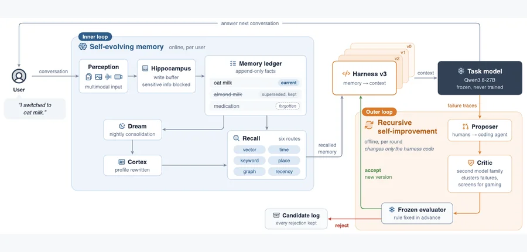 arXiv 2026-11-05 · cs.AI · #1 **[Reglos: A Self-Evolving Personal Memory Agent with Recursive Self-Improvement](https://arxiv.org/abs/2611.06049)** Sen Yang , Jiaduo Lin , Zehong Huang , Wen Liu Affiliation: Reglos.ai [Paper](https://arxiv.org/abs/2611.06049) · [Project](https://reglos.ai) · [Figure source](https://arxiv.org/pdf/2611.06049) 

[EN] Abstract
Personal agents draw on past conversations to tailor their responses to each user. Their memory systems store and update what each user says, and coding agents now also rewrite the harness that turns this memory into the model's context. Such patches risk overfitting, because one tested only on the failures it targets can fix those cases and help nowhere else. We present Reglos, a training-free personal memory agent that tests whether harness changes help beyond the failures they were written to fix. Its self-evolving memory adds to each user's append-only record with every conversation, as new preferences supersede old ones and facts can be forgotten. Its harness improves through recursive self-improvement, in which a coding agent proposes patches from failure traces and a critic from a second model family screens each one for benchmark gaming. After the harness is frozen, a fixed evaluator decides which further patches to accept. With the same backbone behind every system, Reglos outperforms state-of-the-art memory systems such as Mem0, MemOS and EverOS, reaching 61.3% and 84.0% on PersonaMem-v2 and LongMemEval-S with Qwen3.8-27B, and 57.5% and 87.2% with GPT-5.6 Luna. <a href="https://arxiv.org/list/cs/new?skip=0&amp;show=2000&amp;check=20261106#2611.06049">Source</a>

[ZH] Abstract
个人 Agent 利用以往对话，为每个用户定制响应。其记忆系统存储并更新用户所说的内容，编码 Agent 如今也会重写将记忆转化为模型上下文的运行框架。这类补丁有过拟合风险：如果仅在其针对的失败上测试，可能修复那些案例，却无助于其他情况。我们提出 Reglos，一个无需训练的个人记忆 Agent，检验运行框架变化能否帮助其原本未针对的失败。其自演化记忆在每次对话后向用户的仅追加记录添加内容，随着新偏好取代旧偏好，事实也可以被遗忘。其运行框架通过递归自改进优化：编码 Agent 根据失败轨迹提出补丁，来自第二模型家族的评论器筛查每个补丁是否在钻基准空子。运行框架冻结后，由固定评估器决定接受哪些进一步补丁。所有系统采用相同骨干时，Reglos 优于 Mem0、MemOS 和 EverOS 等先进记忆系统，使用 Qwen3.8-27B 在 PersonaMem-v2 和 LongMemEval-S 上分别达到 61.3% 和 84.0%，使用 GPT-5.6 Luna 时分别达到 57.5% 和 87.2%。 <a href="https://arxiv.org/list/cs/new?skip=0&amp;show=2000&amp;check=20261106#2611.06049">Source</a>
 | 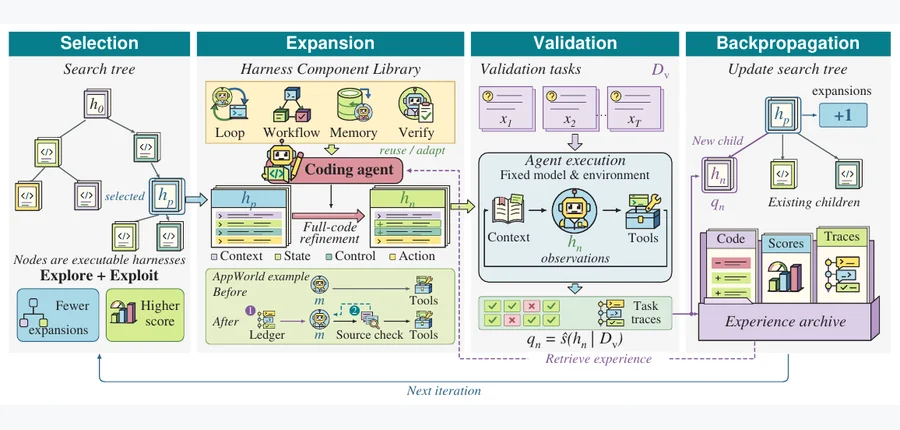 arXiv 2026-11-05 · cs.AI · #2 **[HarnessFlow: MCTS-Guided Harness Optimization for LLM Agents](https://arxiv.org/abs/2611.06254)** Zhi Hong , Qianlong Wang , Hongchen Wei , Aidan Wu , Daohong Ying , Mingze Kong , Bei Liu , Chong Luo Affiliation: South China University of Technology / Fudan University / Wuhan University / Cornell University / University of California, San Diego / Chinese University of Hong Kong, Shenzhen / Microsoft Research Asia [Paper](https://arxiv.org/abs/2611.06254) · [Figure source](https://arxiv.org/pdf/2611.06254) 

[EN] Abstract
The performance of large language model (LLM) agents depends on both the underlying model and the harness that governs interaction with tools and the environment. Yet harness design remains largely manual, and automating it requires navigating an open-ended search space through costly end-to-end evaluations. We introduce HarnessFlow, a framework for optimizing complete executable harnesses under a limited candidate-evaluation budget, with the model and task environment held fixed. HarnessFlow organizes candidates and their evaluation histories in a refinement tree, using a Monte Carlo Tree Search (MCTS)-based policy to balance exploitation and exploration. A coding agent refines selected harnesses using archived code, execution feedback, and a library of reusable harness mechanisms. With 15 refinement attempts per benchmark, HarnessFlow achieves the highest mean test scores among the compared methods on six benchmarks spanning agentic tasks, coding, and web interaction. The optimized harnesses achieve an average score of 69.48%, outperforming the initial harnesses and Meta-Harness by 10.89 and 3.95 percentage points, respectively, while incurring lower average per-task execution costs than hand-engineered baselines. These results suggest that structured harness search offers a promising route toward automating the design of capable and efficient LLM agents. <a href="https://arxiv.org/list/cs/new?skip=0&amp;show=2000&amp;check=20261106#2611.06254">Source</a>

[ZH] Abstract
大语言模型（LLM）Agent 的性能既取决于底层模型，也取决于管理工具与环境交互的运行框架。但运行框架设计仍主要依赖人工，自动化设计需要在开放搜索空间中进行昂贵端到端评估。我们提出 HarnessFlow，一个在有限候选评估预算下优化完整可执行运行框架、同时固定模型和任务环境的框架。HarnessFlow 将候选及其评估历史组织为优化树，使用基于蒙特卡洛树搜索（MCTS）的策略平衡利用与探索。编码 Agent 利用归档代码、执行反馈和可复用机制库优化选中框架。每个基准进行 15 次优化尝试时，HarnessFlow 在涵盖 Agent 任务、编码和网页交互的六个基准上，取得对比方法中最高平均测试分。优化后的框架平均得分 69.48%，分别比初始框架和 Meta-Harness 高 10.89 和 3.95 个百分点，同时平均每任务执行成本低于人工设计基线。这些结果表明，结构化运行框架搜索是自动设计有能力且高效 LLM Agent 的有前景途径。 <a href="https://arxiv.org/list/cs/new?skip=0&amp;show=2000&amp;check=20261106#2611.06254">Source</a>
 | 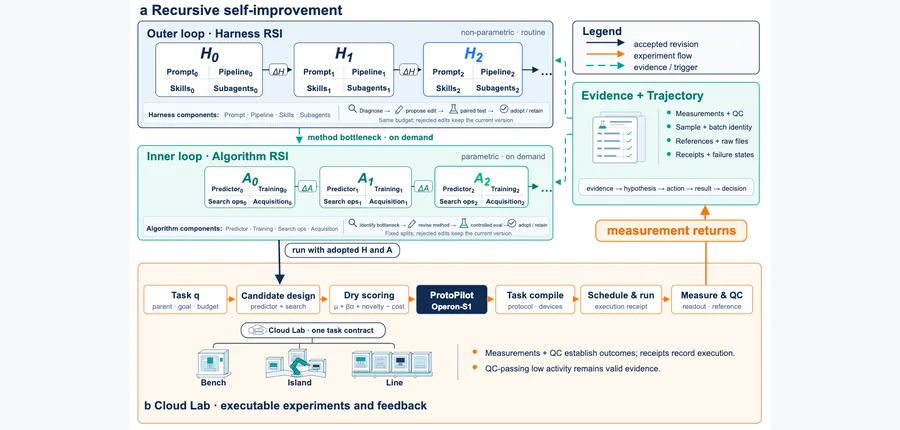 arXiv 2026-11-05 · cs.AI · #3 **[EnzymeRSI: A dual-loop recursive self-improvement system for enzyme design](https://arxiv.org/abs/2611.06321)** Genoria AI Team , Yuejie Hou , Lixiang Yang , Yisi Liu , Weiting Tang , Yueyuxiao Yang , Meng Yang Affiliation: Genoria AI [Paper](https://arxiv.org/abs/2611.06321) · [Figure source](https://arxiv.org/html/2611.06321v1/figs/fig01.png) 

[EN] Abstract
Improvement in enzyme engineering is usually pursued by optimising which candidates to assay within a fixed model and workflow; when the bottleneck arises from a mismatched method or a failing workflow, that route is difficult to escape. We present EnzymeRSI, a dual-loop system for recursive self-improvement (RSI). The outer loop evolves harness assets without changing model weights, the inner loop develops prediction and selection algorithms under controlled conditions, and a cloud laboratory system is specified to close the physical loop with quality-controlled feedback. By updating its prediction strategy through iterative comparison, the outer loop raised the mean development-set Spearman correlation on ProteinGym by 0.044 across five assays, reaching 0.335 on CD19 and 0.683 on OPSD (rhodopsin); of the two first places, only CD19 was produced by the outer loop itself. In the self-improvement of the ThermoMPNN algorithm the inner loop reached a PCC of 0.849, and on TadA-Bench it reached a Spearman correlation of 0.307 in 1.13 h. In three prospective wet-lab tests of the system's experimental decision-making, 10 of the 32 candidates that had not been pre-specified for the luciferase RLuc showed at least twice the wild-type activity; a recommended variant of the cytidine deaminase A3A raised 5mC conversion to 90.2%; and path selection in evolution raised the catalytic efficiency of the DNA polymerase KOD-E on a modified substrate to 31.1 times that of the parent. By treating the organisation of the research workflow and the development of algorithms as a single falsifiable dry-to-wet loop, this work offers an evolutionary paradigm for moving beyond the blind spots of a fixed method and for autonomous enzyme engineering. <a href="https://arxiv.org/list/cs/new?skip=0&amp;show=2000&amp;check=20261106#2611.06321">Source</a>

[ZH] Abstract
酶工程中的改进通常是在固定模型和工作流内优化待测候选；当瓶颈源于不匹配的方法或失败的工作流时，这一路径很难摆脱。我们提出 EnzymeRSI，一个递归自改进（RSI）双循环系统。外循环在不改变模型权重的情况下演化运行框架资产，内循环在受控条件下开发预测和选择算法，并规定了一个云实验室系统，通过质量控制反馈闭合物理循环。通过迭代比较更新预测策略，外循环在五个 ProteinGym 测定上将平均开发集 Spearman 相关提高 0.044，在 CD19 上达到 0.335、在 OPSD（视紫红质）上达到 0.683；这两个第一名结果中，只有 CD19 来自外循环本身。在 ThermoMPNN 算法自改进中，内循环达到 0.849 的 PCC，在 TadA-Bench 上则用 1.13 小时达到 0.307 的 Spearman 相关。在三项前瞻性湿实验中，系统的实验决策接受检验：针对荧光素酶 RLuc，32 个事先未指定的候选中有 10 个表现出至少两倍野生型活性；推荐的胞嘧啶脱氨酶 A3A 变体将 5mC 转化率提高到 90.2%；演化中的路径选择将 DNA 聚合酶 KOD-E 在修饰底物上的催化效率提高到亲本的 31.1 倍。通过把研究工作流组织与算法开发视为一个可证伪的干到湿循环，本工作为超越固定方法盲点和自主酶工程提供一种演化范式。 <a href="https://arxiv.org/list/cs/new?skip=0&amp;show=2000&amp;check=20261106#2611.06321">Source</a>
 |
| 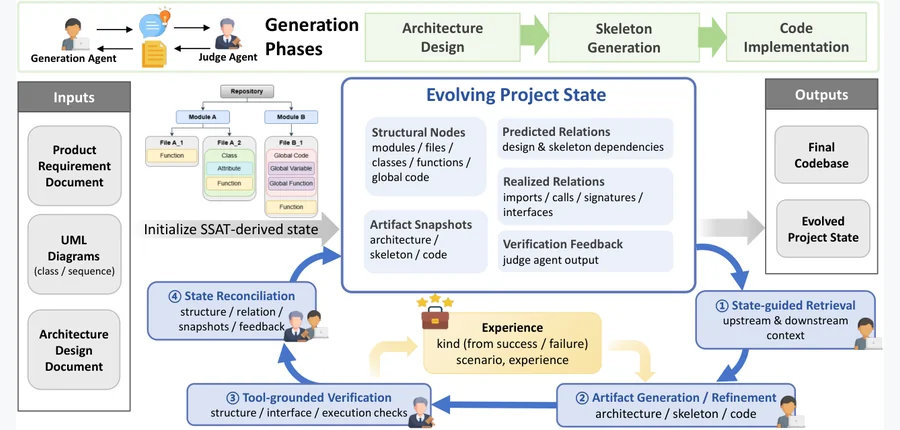 arXiv 2026-11-05 · cs.SE · #4 **[EvoCodeAgent: Project-Level Code Generation via Architecture-Code Co-Evolution and Experience-Guided Repair](https://arxiv.org/abs/2611.06328)** Qianhui Zhao , Li Zhang , Fang Liu Affiliation: Beihang University [Paper](https://arxiv.org/abs/2611.06328) · [Figure source](https://arxiv.org/html/2611.06328v1/approach.png) 

[EN] Abstract
Project-level code generation aims to automatically synthesize complete software repositories from high-level requirements, producing coherent multi-file systems with well-structured modules and consistent cross-file dependencies. Despite the strong capabilities of large language models (LLMs) in specification understanding and code synthesis, existing approaches still exhibit several critical limitations. First, many methods rely on static architectural designs that cannot adapt during iterative generation, leading to a growing misalignment between architecture and implementation. Second, they lack mechanisms to accumulate and reuse experience across iterations, resulting in recurring errors and reduced efficiency. Third, they often depend on standalone LLM-based evaluation of intermediate artifacts, which suffer from limited transparency and potential unreliability under long-context reasoning. To address these challenges, we propose EvoCodeAgent, a state-centric framework for project-level code generation. EvoCodeAgent maintains an evolving architectural state initialized from structured project specifications and continuously reconciles predicted relations from architecture and skeletons with realized relations extracted from generated code. It further uses tool-grounded verification evidence to support reliable state updates and abstracts reusable repair experiences from previous revision attempts to guide subsequent generation. Extensive experiments on project-level benchmarks of different scales, including DevBench and CodeProjectEval, demonstrate that EvoCodeAgent consistently outperforms baseline approaches. Under the GPT-5 setting, it achieves unit test pass rates of 60.48% and 27.73%, respectively, yielding up to a 53.5% improvement over the strongest baseline. <a href="https://arxiv.org/list/cs/new?skip=0&amp;show=2000&amp;check=20261106#2611.06328">Source</a>

[ZH] Abstract
项目级代码生成旨在从高层需求自动合成完整软件仓库，产生模块结构良好、跨文件依赖一致的连贯多文件系统。尽管大语言模型（LLM）在规范理解和代码合成方面能力很强，现有方法仍有关键局限。首先，许多方法依赖无法随迭代生成适应的静态架构，导致架构与实现日益错位。其次，缺少跨迭代积累和复用经验的机制，造成重复错误和效率降低。第三，它们常依赖对中间产物的独立 LLM 评估，在长上下文推理下透明度有限且可能不可靠。为此，我们提出 EvoCodeAgent，一个项目级代码生成的状态中心框架。它维护从结构化项目规范初始化的演化架构状态，持续将架构与骨架预测的关系和生成代码提取的已实现关系协调一致。它进一步利用有工具依据的验证证据支持可靠状态更新，并从先前修订尝试提炼可复用修复经验，指导后续生成。在 DevBench、CodeProjectEval 等不同规模项目基准上的广泛实验表明，EvoCodeAgent 持续优于基线。在 GPT-5 设置下，单元测试通过率分别为 60.48% 和 27.73%，相较最强基线最高提升 53.5%。 <a href="https://arxiv.org/list/cs/new?skip=0&amp;show=2000&amp;check=20261106#2611.06328">Source</a>
 | 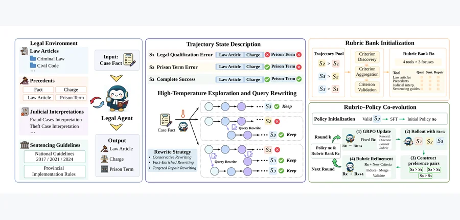 arXiv 2026-11-05 · cs.AI · #5 **[LegalEvolver: Agentic Legal Judgment Prediction via Rubric-Guided Self-Evolution](https://arxiv.org/abs/2611.06381)** Xinyu Yang , Jiejun Tan , Chenlong Deng , Chenghao Zhang , Tongyu Wen , Zhicheng Dou Affiliation: Renmin University of China [Paper](https://arxiv.org/abs/2611.06381) · [Figure source](https://arxiv.org/html/2611.06381v1/legique-method.png) 

[EN] Abstract
As LLM-based agents develop, they have been increasingly applied in the legal domain. Legal Judgment Prediction~(LJP) requires models to conduct multi-step reasoning and external legal evidence retrieval. Existing legal search agents' performance is often constrained by the quality of retrieval queries. They often formulate queries directly from the initial user request, overlooking latent legal issues and legally salient details. To address this issue, we propose \emph{LegalEvolver}, a query optimization framework specifically designed to generate legally informative queries for LJP-oriented retrieval. Sampling high-quality optimized queries and their corresponding search trajectories is challenging, as relying solely on unguided high-temperature rollouts is both inefficient and constrained by the model's initial capabilities. We therefore heuristically optimize queries as seeds, improving the efficiency of trajectory generation. Furthermore, we summarize rollout experience into rubrics and use them to guide multi-round iterative self-evolution. Iteratively performing rubric optimization and rubric-guided RL enables the model to surpass its initial performance ceiling. End-to-end performance on extensive benchmarks demonstrates the effectiveness of query optimization on LJP. Comparisons with direct SFT followed by RL demonstrate the effectiveness of rubric guidance. Evolving rubrics further outperform fixed rubrics, confirming the benefits of self-evolution. <a href="https://arxiv.org/list/cs/new?skip=0&amp;show=2000&amp;check=20261106#2611.06381">Source</a>

[ZH] Abstract
随着基于 LLM 的 Agent 发展，它们越来越多地应用于法律领域。法律判决预测（LJP）要求模型进行多步推理和外部法律证据检索。现有法律搜索 Agent 的性能常受检索查询质量限制。它们往往直接从初始用户请求形成查询，忽视潜在法律问题和法律上重要的细节。为此，我们提出 LegalEvolver，一个专门为 LJP 检索生成法律信息充分查询的查询优化框架。采样高质量优化查询及其搜索轨迹具有挑战，因为仅靠无引导高温 rollout 既低效，也受初始模型能力限制。因此，我们启发式优化查询作为种子，提高轨迹生成效率。此外，我们将 rollout 经验总结为量规，用于指导多轮迭代自演化。反复进行量规优化和量规引导 RL，使模型超越初始性能上限。广泛基准上的端到端表现证明查询优化对 LJP 的有效性。与先直接 SFT 再 RL 比较，证明量规指导有效。演化量规进一步优于固定量规，确认自演化的益处。 <a href="https://arxiv.org/list/cs/new?skip=0&amp;show=2000&amp;check=20261106#2611.06381">Source</a>
 | 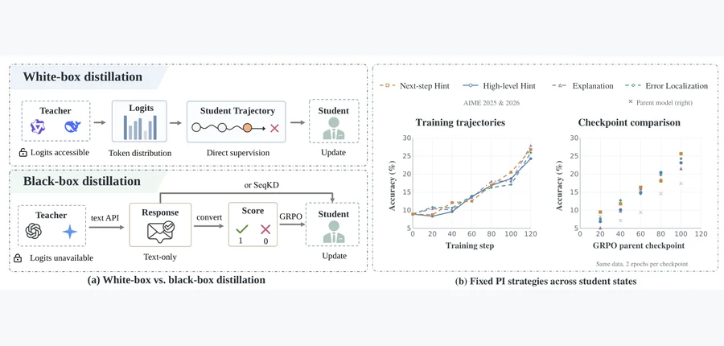 arXiv 2026-11-05 · cs.LG · #6 **[EvoOPD: Evolving Privileged Information Strategies for Black-Box On-Policy Distillation](https://arxiv.org/abs/2611.06542)** Ximo Zhu , Ruiqi Liu , Yi Han , Zhengan Wu , Gengsheng Li , ZiAn Wang , Zhu Yuantian , Jin Jiang , Wenhao Wang Affiliation: University of Chinese Academy of Sciences / Institute of Automation, Chinese Academy of Sciences / Southwest University / Southeast University / Jilin University / United Arab Emirates University / Vast Intelligence Lab [Paper](https://arxiv.org/abs/2611.06542) · [Figure source](https://arxiv.org/html/2611.06542v1/figure1.png) 

[EN] Abstract
Proprietary language models exhibit strong reasoning and coding capabilities, but their output distributions are inaccessible, making fine-grained distillation methods that rely on teacher logits difficult to apply directly to black-box models. We observe that rich textual feedback from a black-box teacher can be treated as privileged information (PI) and converted, through a PI-conditioned privileged teacher, into dense supervision signals on the student's own trajectories. However, what PI should be acquired from the teacher to most effectively support student learning remains unclear. PI strategies that differ in where they focus, what information they request, and how much detail they provide can have substantially different effects on the current student, and their relative effectiveness can further change as training progresses. Based on this observation, we propose Evolving Privileged Information Strategies for Black-Box On-Policy Distillation (EvoOPD), which treats PI acquisition itself as an optimization problem and maintains a PI Strategy Bank that evolves with the student state. EvoOPD uses the measured repair utility of PI on the current student to adapt the focus, information type, and granularity of teacher feedback, allowing the acquired information to continually match the student's learning needs. We systematically evaluate EvoOPD on mathematical reasoning and code generation with Qwen3-1.7B, 4B, and 8B students. EvoOPD achieves the best overall performance in all six model-task settings, improving over the strongest baseline in each setting by an average of 2.14 percentage points in mathematics and 1.30 points in code. Further analysis shows that the relative effectiveness of PI acquisition strategies changes with student state, making a fixed strategy difficult to sustain as the best choice throughout distillation. <a href="https://arxiv.org/list/cs/new?skip=0&amp;show=2000&amp;check=20261106#2611.06542">Source</a>

[ZH] Abstract
专有语言模型有很强的推理和编码能力，但其输出分布不可访问，使依赖教师 logits 的细粒度蒸馏难以直接应用于黑箱模型。我们观察到，黑箱教师的丰富文本反馈可作为特权信息（PI），经 PI 条件化特权教师转化为学生自身轨迹上的密集监督。然而，应从教师获取什么 PI 才最有效支持学生学习，仍不清楚。PI 策略在关注位置、请求信息及细节量上不同，对当前学生的效果可明显不同，其相对有效性还会随训练变化。基于此，我们提出 EvoOPD（Evolving Privileged Information Strategies for Black-Box On-Policy Distillation），将 PI 获取本身视为优化问题，维护随学生状态演化的 PI 策略库。EvoOPD 使用 PI 对当前学生的实测修复效用，适应教师反馈的重点、信息类型和粒度，使获取的信息持续匹配学习需求。我们用 Qwen3-1.7B、4B、8B 学生，在数学推理和代码生成上系统评估。EvoOPD 在全部六个模型—任务设置中取得最佳总体表现，相较每个设置的最强基线，数学平均高 2.14 个百分点，代码平均高 1.30 个点。进一步分析显示，PI 获取策略的相对有效性随学生状态变化，固定策略难以在整个蒸馏过程中始终最优。 <a href="https://arxiv.org/list/cs/new?skip=0&amp;show=2000&amp;check=20261106#2611.06542">Source</a>
 |
| 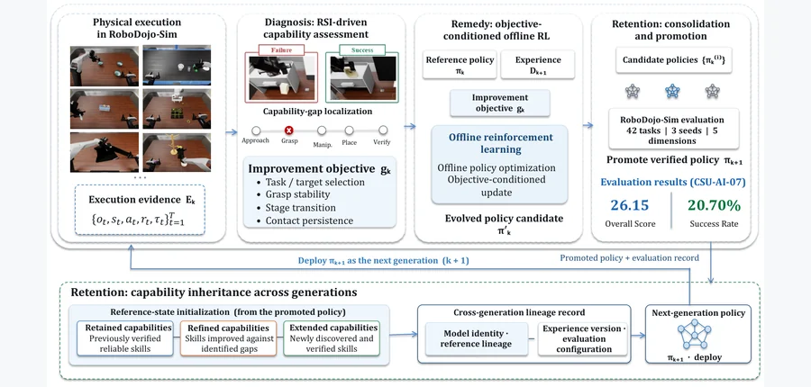 arXiv 2026-11-05 · cs.RO · #7 **[Compounding Physical RSI: Turning Execution Failure into Inherited Capability](https://arxiv.org/abs/2611.06654)** Yixuan Yang , Qiang Chen , Run Shao , Shuwei Dong , Wenhao Li , Yunpeng Wang , Wenhan Fang , Haomiao Wu , Xingyu Wang , Li… Affiliation: CSU MinosLab [Paper](https://arxiv.org/abs/2611.06654) · [Figure source](https://arxiv.org/html/2611.06654v1/fig1_physical_rsi_architecture.png) 

[EN] Abstract
Generalist robot policies are trained on static offline datasets, yet physical manipulation unfolds sequentially across stages. Because a weakness in a downstream stage remains unobservable until the policy passes earlier ones, each resolved bottleneck exposes the next hidden failure mode. This staged structure calls for Recursive Self-Improvement (RSI), in which a policy iteratively executes, diagnoses failures, and updates itself. Moreover, because task completion behaves like a product of stage-level pass rates, recursive gains can multiply across generations. In physical environments, three bottlenecks obstruct compounding: terminal execution feedback rarely localizes the stage that caused a failure, failed trajectories do not supply the corrective action, and updating shared parameters can degrade previously mastered skills. We propose Compounding Physical RSI, a self-evolving policy framework that turns execution failures into heritable capability. First, automated capability-gap assessment traces failed rollouts to the task stage where progression breaks down and formulates a structured improvement objective. Second, conditioned on this objective, our remedy stage curates validated, stage-relevant experience and refines the policy via behavior-regularized offline reinforcement learning, without requiring costly online rollouts at each optimization step. Third, to safeguard existing skills, our retention stage constructs weight-space candidates between the inherited reference policy and the refined policy, evaluates them across the task suite, and promotes the best candidate as the reference state for the next generation. Evaluated across all 42 tasks of the RoboDojo-Sim benchmark, CSU-AI-07 ranks first on the leaderboard with a three-seed mean Overall Score of 26.15 and Success Rate of 20.70%, outperforming the next-best entry by 5.92 points and 5.82 percentage points. <a href="https://arxiv.org/list/cs/new?skip=0&amp;show=2000&amp;check=20261106#2611.06654">Source</a>

[ZH] Abstract
通用机器人策略在静态离线数据集上训练，但物理操作按多个阶段顺序展开。由于下游阶段的弱点只有策略通过早期阶段后才可观察，每个已解决瓶颈都会暴露下一个隐藏失败模式。这种阶段结构需要递归自改进（RSI），使策略反复执行、诊断失败并更新自身。此外，任务完成表现类似各阶段通过率的乘积，递归收益可跨代相乘。物理环境中，三项瓶颈阻碍复合增长：终端执行反馈很少定位致错阶段，失败轨迹不提供纠正动作，共享参数更新可能损害已掌握技能。我们提出 Compounding Physical RSI，一个将执行失败转化为可遗传能力的自演化策略框架。首先，自动能力缺口评估将失败 rollout 追溯到推进中断的任务阶段，并形成结构化改进目标。其次，以该目标为条件，补救阶段整理经过验证、与阶段相关的经验，通过行为正则化离线强化学习优化策略，无需每个优化步骤都进行昂贵在线 rollout。第三，为保护既有技能，保留阶段在继承参考策略与优化策略之间构造权重空间候选，跨任务套件评估，并将最佳候选晋升为下一代参考状态。在 RoboDojo-Sim 全部 42 个任务上，CSU-AI-07 以三个随机种子的平均 Overall Score 26.15 和 Success Rate 20.70% 排名榜首，分别比次优条目高 5.92 个点和 5.82 个百分点。 <a href="https://arxiv.org/list/cs/new?skip=0&amp;show=2000&amp;check=20261106#2611.06654">Source</a>
 | 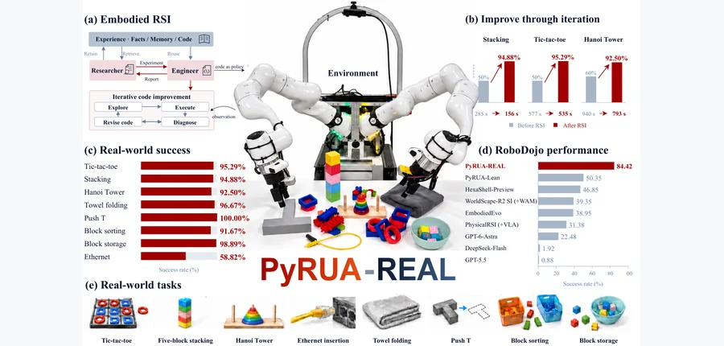 arXiv 2026-11-05 · cs.RO · #8 **[PyRUA-REAL: Robot Exploration and Adaptive Learning through RSI in the Real World](https://arxiv.org/abs/2611.06768)** Qiang Wang , Jianxin Bi , Shulong Jiang , Ruiyang Si , Wenbo Huang , Kaiqi Chen , Jiaxin Li , Liyun Li , Xuanyi Li , Daqua… Affiliation: Peking University / EngineAI / National University of Singapore [Paper](https://arxiv.org/abs/2611.06768) · [Project](https://dagroup-pku.github.io/PyRUA-Lean/real/) · [Figure source](https://arxiv.org/html/2611.06768v1/PyRUA-REAL_teaser_final.png) 

[EN] Abstract
Coding agents powered by models such as GPT-6-Astra connect spatial reasoning with executable robot behavior, raising the question of how such agents can produce lasting improvements in robot capabilities from physical interaction. In this work, we study embodied recursive self-improvement (RSI) through real-world exploration, code refinement, and deployment using PyRUA-REAL, a framework in which coding agents retain interaction experience as persistent memory and reusable executable skills that inform subsequent exploration and improvement. Our empirical study places physical manipulation at the center of the improvement process, examining how agents collaborate, what kinds of execution feedback support effective code refinement, and how task specifications and previously acquired skills influence robustness and task transfer. We further investigate the efficiency and capability of the resulting programs when deployed without involving an online agent for decision-making. Across eight real-world tasks, PyRUA-REAL achieves an average success rate of 91.1%. In complementary evaluation on 42 tasks from the RoboDojo benchmark, it achieves an average success rate of 84.4%. This study provides empirical guidance for turning physical exploration into reusable robot skills that support continued improvement and robust, efficient deployment. <a href="https://arxiv.org/list/cs/new?skip=0&amp;show=2000&amp;check=20261106#2611.06768">Source</a>

[ZH] Abstract
由 GPT-6-Astra 等模型驱动的编码 Agent 将空间推理与可执行机器人行为相连，引出一个问题：这些 Agent 如何通过物理交互，产生持久的机器人能力改进？本文使用 PyRUA-REAL，通过真实世界探索、代码优化和部署研究具身递归自改进（RSI）。在该框架中，编码 Agent 将交互经验保留为持久记忆和可复用可执行技能，为后续探索与改进提供信息。我们的实证研究把物理操作置于改进过程中心，考察 Agent 如何协作、哪些执行反馈支持有效代码优化，以及任务规范和已获得技能如何影响稳健性与任务迁移。我们进一步研究所得程序在不涉及在线 Agent 决策时的部署效率和能力。在八个真实世界任务上，PyRUA-REAL 平均成功率为 91.1%。在 RoboDojo 基准 42 个任务的补充评估中，平均成功率为 84.4%。本研究为将物理探索转化为可复用机器人技能、支持持续改进及稳健高效部署提供实证指导。 <a href="https://arxiv.org/list/cs/new?skip=0&amp;show=2000&amp;check=20261106#2611.06768">Source</a>
 | 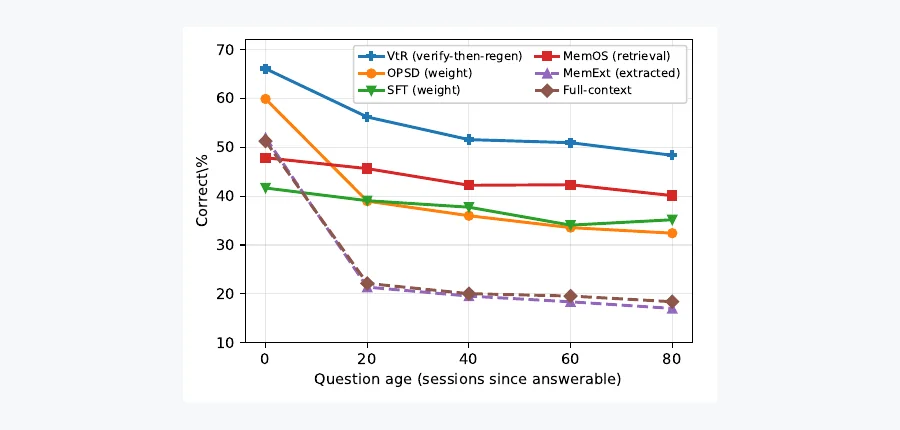 arXiv 2026-11-05 · cs.AI · #9 **[Route to Remember: Adaptive Memory Selection for LLM Agents](https://arxiv.org/abs/2611.05636)** Zeyu Fang , Jun Yin , Yongsheng Mei , Xu Han , Chaitali Joshi , Zhongkai Sun , Jie Hao , Bin Guo , Chengyuan Ma , Benjamin… Affiliation: George Washington University / Amazon [Paper](https://arxiv.org/abs/2611.05636) · [Figure source](https://arxiv.org/pdf/2611.05636) 

[EN] Abstract
The memory of production agents is increasingly becoming a bottleneck and is built almost exclusively from text: key points are extracted from out-of-limit context and retrieved into context at query time. Therefore, every new query incurs an additional cost that grows with the accumulated history. Weight memory is a complementary alternative that internalizes knowledge into model parameters and answers with no context at all, and has recently proven effective in self-evolving agents for internalizing skills and behaviors. However, its application in episodic and semantic memory, such as user-specific facts, remains comparatively unexplored, and a gap remains between earlier attempts at weight memory and text-based systems regarding recall performance. We study how to make weight memory competitive as a long-term factual store by applying on-policy self-distillation (OPSD). It trains a context-free student from a teacher, which is the same model conditioned on the user's memory, together with a verify-then-regenerate router that lets weight and text memory each cover the queries they handle best. On the HaluMem benchmark, OPSD matches or surpasses strong text-memory baselines, including full-context prompting and retrieval systems, while reading fewer tokens per query. We further conduct an extensive study that characterizes the behavior of weight memory and analyzes how different training recipes affect its performance. As agent harnesses move toward persistent, multi-session deployments, these results position weight memory as a practical, low-cost component of agent memory and provide insights into feasible training and evaluation protocols for combining it with retrieval. <a href="https://arxiv.org/list/cs/new?skip=0&amp;show=2000&amp;check=20261106#2611.05636">Source</a>

[ZH] Abstract
生产 Agent 的记忆越来越成为瓶颈，且几乎完全由文本构建：从超出上下文限制的内容中提取要点，在查询时检索回上下文。因此，每个新查询都有随积累历史增长的额外成本。权重记忆是一种互补方案，将知识内化到模型参数，无需上下文即可回答，近期已在自演化 Agent 内化技能与行为方面有效。但其对用户专属事实等情景与语义记忆的应用仍探索不足，早期权重记忆与文本系统之间的召回表现仍有差距。我们研究如何通过在线策略自蒸馏（OPSD），使权重记忆成为有竞争力的长期事实存储。它用以用户记忆为条件的同一模型作为教师，训练不依赖上下文的学生，并结合先验证再重新生成的路由器，让权重和文本记忆分别覆盖各自擅长的查询。在 HaluMem 上，OPSD 匹配或超过包括完整上下文提示与检索系统在内的强文本记忆基线，同时每查询读取更少 token。我们还通过广泛研究刻画权重记忆行为，并分析不同训练配方对性能的影响。当 Agent 运行框架转向持久、多会话部署时，这些结果将权重记忆定位为实用、低成本的记忆组件，并为其与检索结合的可行训练和评估协议提供认识。 <a href="https://arxiv.org/list/cs/new?skip=0&amp;show=2000&amp;check=20261106#2611.05636">Source</a>
 |
| 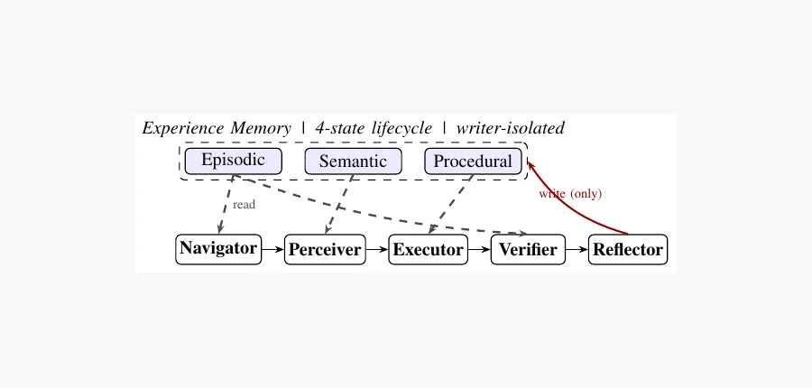 arXiv 2026-11-05 · cs.SE · #10 **[Can LLM Agents Learn to Test? Maintaining Scoped Experience as Testing Evidence for Mobile GUI Testing](https://arxiv.org/abs/2611.05873)** Zimu Liu , Xiaoxi Guo , Xiaolu Tang , Liang Yu Affiliation: Ant Group [Paper](https://arxiv.org/abs/2611.05873) · [Figure source](https://arxiv.org/pdf/2611.05873) 

[EN] Abstract
Repeated mobile GUI tests can reuse routes, locators, and recovery strategies from earlier executions. However, a route that worked in one workflow or app version may be irrelevant or misleading in another. We study how an LLM-based tester can retain useful experience while withholding entries contradicted by current observations. We present a maintenance contract for AdaptiTest in which reusable experience has an explicit applicability scope, trace provenance, and a lifecycle for confirmation, revalidation, and withdrawal. The contract reserves persistence for a Reflector role and treats recalled experience as advice. The archived implementation does not establish end-to-end enforcement of every specified mechanism. The design changes retrieved context, not model weights. The evaluation uses read-only Android workflows and archived internal comparisons. A six-task, three-repeat ready subset reports 18/18 completed runs with memory versus 3/18 without it, but a grounded single-agent control also solves the earlier hard-task slice. A separate cross-session probe is excluded from efficacy conclusions because of confounded route schedules and unvalidated state labels. We examine 13 selected real-update hazard records across nine subjects, distinguishing stale-locator observations from policy-based withholding and offline retrieval diagnostics. The latter do not measure live-device failures or actions saved. These events are UI changes, not confirmed regression bugs. The evidence supports a bounded design and case study; it does not establish general efficacy, superiority over independent GUI-agent systems, or unrestricted exploration. <a href="https://arxiv.org/list/cs/new?skip=0&amp;show=2000&amp;check=20261106#2611.05873">Source</a>

[ZH] Abstract
重复的移动 GUI 测试可复用先前执行的路线、定位器和恢复策略。但在某工作流或应用版本有效的路线，在另一情境可能无关或误导。我们研究基于 LLM 的测试器如何保留有用经验，同时暂缓使用与当前观测矛盾的条目。我们为 AdaptiTest 提出维护契约，使可复用经验具有明确适用范围、轨迹来源，以及确认、重新验证和撤回的生命周期。契约将持久化保留给 Reflector 角色，并将召回经验视为建议。归档实现未证明所有规定机制的端到端强制执行。评估采用只读 Android 工作流和归档内部比较。一个六任务、三重复的就绪子集报告，有记忆完成 18/18，无记忆完成 3/18；但一个有依据的单 Agent 对照也解决了早期困难任务切片。另一个跨会话探针因路线日程混杂及状态标签未验证，被排除在有效性结论之外。我们检查九个对象的 13 条精选真实更新风险记录，区分过期定位器观测、基于策略的暂缓使用及离线检索诊断。后者不测量真实设备失败或节省的动作。这些事件是 UI 变化，不是已确认回归缺陷。证据支持有边界的设计与案例研究，不能证明一般有效性、优于独立 GUI Agent 系统或不受限探索。 <a href="https://arxiv.org/list/cs/new?skip=0&amp;show=2000&amp;check=20261106#2611.05873">Source</a>
 | 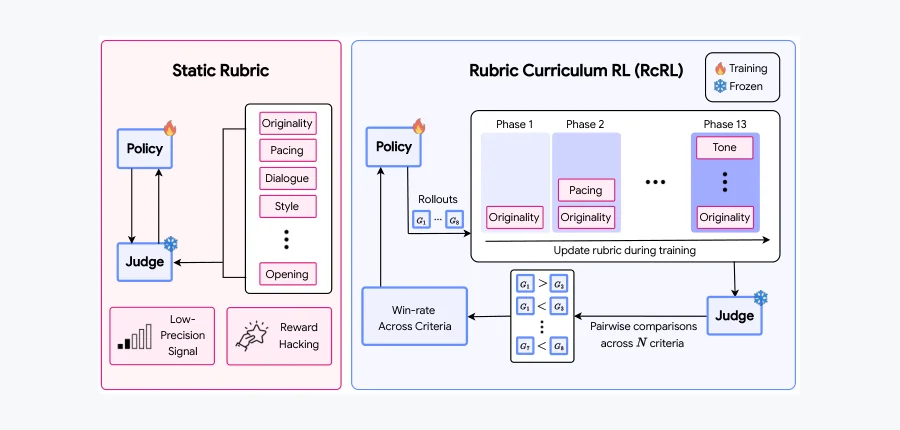 arXiv 2026-11-05 · cs.LG · #11 **[Rubric Curriculum RL: Exploiting the Generation-Verification Gap in Non-Verifiable Domains](https://arxiv.org/abs/2611.06244)** Sumeet Ramesh Motwani , Tejas Krishnan , Alistair Letcher , Charles London , Suhaas Bhat , Huitian Jiao , Philip Torr , Ri… Affiliation: University of Oxford / Microsoft Research [Paper](https://arxiv.org/abs/2611.06244) · [Figure source](https://arxiv.org/html/2611.06244v1/RcRL_diagram.png) 

[EN] Abstract
Reinforcement learning with verifiable rewards (RLVR) has led to significant gains in math and code generation. Extending these gains to open-ended domains remains challenging: ground-truth verification is unavailable, human annotation is expensive, and learned reward models are prone to reward hacking. The generation-verification gap, where judging good outputs is easier than producing them, offers a potential path to improvement. However, rubric-based judges are often imprecise and stationary, so policies can overfit or reward hack them. We introduce Rubric Curriculum RL (RcRL), which exploits this gap without new data, human annotations, or stronger teacher models. We combine pairwise preferences over rollouts with a curriculum over rubric criteria, yielding a more discriminative signal than absolute scoring and a non-stationary objective. Whereas baselines plateau within a few hundred steps, RcRL preserves output entropy and keeps improving past 1000 steps. On creative writing, RcRL achieves a 70.5% human win rate against the base model, with gains across benchmarks and judges. On HealthBench, RcRL improves over the base model by 14.6% (full set) and 25.4% (consensus subset), outperforming all training baselines, including instance-specific rubrics. <a href="https://arxiv.org/list/cs/new?skip=0&amp;show=2000&amp;check=20261106#2611.06244">Source</a>

[ZH] Abstract
带可验证奖励的强化学习（RLVR）在数学和代码生成上带来显著收益。但将其延伸到开放领域仍困难：没有真实答案验证，人类标注昂贵，学习奖励模型易遭奖励投机。判断好输出比生成好输出容易的生成—验证差距，为改进提供潜在路径。然而，量规裁判往往不精确且静态，策略可过拟合或投机。我们提出 Rubric Curriculum RL（RcRL），无需新数据、人工标注或更强教师即可利用这一差距。我们将 rollout 间配对偏好与量规标准课程结合，得到比绝对评分更有区分度的信号和非平稳目标。基线在数百步内停滞，RcRL 则保留输出熵并在超过 1000 步后持续改进。创意写作中，RcRL 相对基础模型取得 70.5% 的人类胜率，收益覆盖多个基准和裁判。在 HealthBench 上，RcRL 相对基础模型提高 14.6%（完整集）和 25.4%（共识子集），超过全部训练基线，包括实例专属量规。 <a href="https://arxiv.org/list/cs/new?skip=0&amp;show=2000&amp;check=20261106#2611.06244">Source</a>
 | 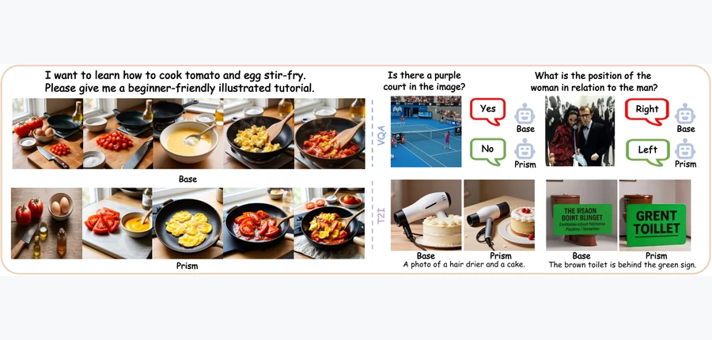 arXiv 2026-11-05 · cs.CV · #12 **[Prism: Bidirectional Self-Teaching for Unified Multimodal Models](https://arxiv.org/abs/2611.06343)** Peng Zhang , Qian Chen , Xianyin Zhang , Yimin Tian , Ruite Fei , Dongyi Lv , Lifan Guo , Chi Zhang , Shuai Liu Affiliation: Xi'an Jiaotong University / Qwen DianJin Team, Alibaba Cloud Computing [Paper](https://arxiv.org/abs/2611.06343) · [Figure source](https://arxiv.org/html/2611.06343v1/1_cropped.png) 

[EN] Abstract
Unified Multimodal Models (UMMs) aim to support visual understanding and generation within a single model. Existing post-training methods either use understanding as a fixed teacher to improve generation, or rely on ground-truth trajectories to supervise both understanding and generation. Prism instead derives bidirectional supervision from self-generated interleaved rollouts, constructing training targets according to the reliability of their text and image chains. We propose Prism, a bidirectional self-teaching post-training method for UMMs. Like a prism decomposing mixed light, Prism decouples a coupled interleaved trajectory into a text chain and an image chain, assesses the reliability of each chain, and constructs a corresponding training target from their reliability states. Experiments on both SenseNova-U1 and BAGEL show that Prism improves both understanding and generation. On the generation side, GenEval improves from 85.8 to 89.2 (+3.4), and DPG improves from 86.1 to 87.3 (+1.2) on SenseNova-U1. On the understanding side, the total MME score improves from 2282.6 to 2311.6, and MMVP improves from 58.0 to 62.0. Consistent improvements are observed on BAGEL. These results highlight that Prism enables coordinated improvements in generation and understanding by constructing reliability-guided self-training targets from self-generated trajectories, without relying on an external verifier or externally annotated corrected trajectories during target construction. <a href="https://arxiv.org/list/cs/new?skip=0&amp;show=2000&amp;check=20261106#2611.06343">Source</a>

[ZH] Abstract
统一多模态模型（UMM）旨在于单一模型支持视觉理解和生成。现有后训练方法要么将理解作为固定教师改进生成，要么依靠真实轨迹同时监督两者。Prism 则从自生成的交错 rollout 推导双向监督，根据文本链和图像链的可靠性构造训练目标。我们提出 Prism，一种 UMM 的双向自教学后训练方法。如棱镜分解混合光，Prism 将耦合交错轨迹解耦为文本链和图像链，评估每条链的可靠性，并依据可靠性状态构造相应训练目标。SenseNova-U1 和 BAGEL 上的实验表明，Prism 同时改善理解与生成。生成方面，SenseNova-U1 的 GenEval 从 85.8 提高到 89.2（+3.4），DPG 从 86.1 提高到 87.3（+1.2）。理解方面，MME 总分从 2282.6 提高到 2311.6，MMVP 从 58.0 提高到 62.0。BAGEL 上也观察到一致改进。这些结果表明，Prism 从自生成轨迹构造可靠性引导自训练目标，实现生成和理解协调改进，在目标构造期间不依赖外部验证器或外部标注的纠正轨迹。 <a href="https://arxiv.org/list/cs/new?skip=0&amp;show=2000&amp;check=20261106#2611.06343">Source</a>
 |
| 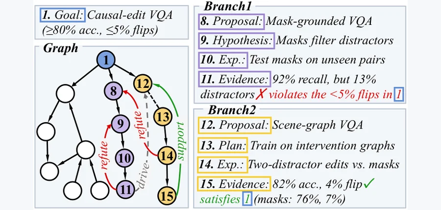 arXiv 2026-11-05 · cs.CL · #13 **[Twists and Turns: A Graph-Based Benchmark and Framework for Long-Term Memory in Exploration Tasks](https://arxiv.org/abs/2611.06414)** Chongyuan Dai , Yaling Shen , Zirui Song , Junfeng Liao , Jinpeng Hu , Xiuying Chen Affiliation: Affiliation unconfirmed [Paper](https://arxiv.org/abs/2611.06414) · [Code](https://github.com/mbzuai-nlp/LExMem) · [Figure source](https://arxiv.org/html/2611.06414v1/fig1.png) 

[EN] Abstract
Long-term problem-solving processes, such as scientific research and software development, proceed along an evolving trial-and-error trajectory toward a central goal. We term these \textit{exploration tasks}, which require models to remember not only facts but also how solutions are tested against intermediate outcomes and early attempts are continually revised or revived. However, existing long-term memory research focuses on factual recall and updates, overlooking the interconnected nature of exploration. We observe that exploration processes naturally form graphs, with branching approaches linked by revisions and reconsiderations. Motivated by this, we propose \textsc{LExMem}, a graph-guided benchmark designed to evaluate \underline{\textsc{Mem}}ory in \underline{\textsc{L}}ong-term \underline{\textsc{Ex}}ploration tasks. We model exploration processes as graphs and introduce an evolutionary mechanism to increase their structural complexity, yielding 224 dialogues and 2,018 question-answer instances derived from graph structures. Building on the same insight, we propose \textsc{LExGraph}, a graph-based memory framework that incrementally organizes dialogues into interconnected memory nodes and retrieves evidence through hybrid retrieval and neighbor expansion. Extensive experiments demonstrate that \textsc{LExMem} poses a significant challenge to existing retrieval- and memory-based systems, whereas \textsc{LExGraph} achieves superior performance and generalizes effectively to external benchmarks. Codes and datasets are available at this https URL . <a href="https://arxiv.org/list/cs/new?skip=0&amp;show=2000&amp;check=20261106#2611.06414">Source</a>

[ZH] Abstract
科学研究和软件开发等长期问题解决过程，沿着不断演化的试错轨迹走向中心目标。我们称之为探索任务，它要求模型不仅记忆事实，还记住方案如何接受中间结果检验，以及早期尝试如何不断修订或重新启用。然而，现有长期记忆研究关注事实召回和更新，忽略探索的相互连接性。我们观察到，探索过程自然形成图：分支方法由修订与重新考虑相连。受此启发，我们提出 LExMem，一个图引导的长期探索任务记忆评估基准。我们将探索过程建模为图，并引入增加结构复杂度的演化机制，得到 224 段对话和 2,018 个由图结构推导的问答实例。基于同一认识，我们提出 LExGraph，一个增量将对话组织为互联记忆节点、通过混合检索与邻居扩展检索证据的图记忆框架。广泛实验表明，LExMem 对现有检索与记忆系统具有明显挑战，而 LExGraph 表现更优，并可有效泛化到外部基准。代码和数据集见原文所链接的 HTTPS 地址。 <a href="https://arxiv.org/list/cs/new?skip=0&amp;show=2000&amp;check=20261106#2611.06414">Source</a>
 | 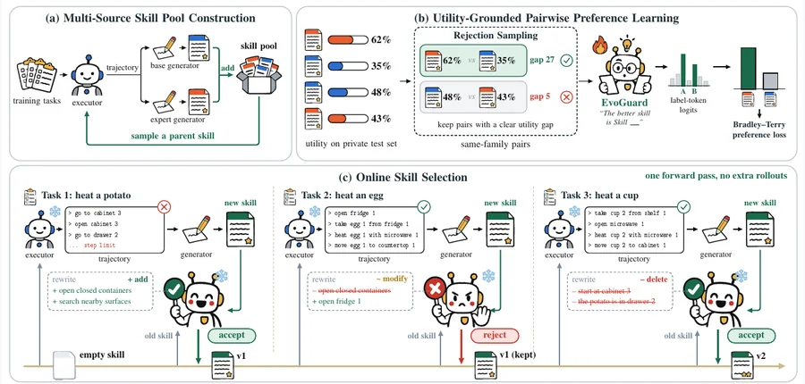 arXiv 2026-11-05 · cs.CL · #14 **[EvoGuard: Mitigating Degradation in Online Skill Evolution](https://arxiv.org/abs/2611.06444)** Yanli Wang , Zichen Bai , Tianyue Jiang , Kunming Shao , Junhao Shi , Xueqin Liu , Jinguo Sun , Muye Li , Tingting Bi , Ya… Affiliation: JD.com / Sun Yat-sen University / University of Melbourne / Hong Kong University of Science and Technology [Paper](https://arxiv.org/abs/2611.06444) · [Figure source](https://arxiv.org/pdf/2611.06444) 

[EN] Abstract
Skills let language agents reuse experience across tasks as natural-language documents. Recent work evolves skills from interaction, but existing methods have limitations when skills evolve online. Prior methods update a skill offline from a batch of trajectories collected over many tasks. Some then adopt the new skill without any check, which can degrade the skill over time. Others keep it only if it improves performance on a held-out validation set, which is too slow and costly to run after every update. We introduce EvoGuard, a pairwise skill selector that mitigates skill degradation at low latency and cost. We first run the agent iteratively to build pools of skills and score each skill on a private test set to obtain utility labels. We pair the skills and use rejection sampling to keep only pairs with a clear utility gap. The selector is trained on the logits of two label tokens to pick the better skill. At deployment it decides in a single forward pass, which is significantly faster than evaluation on the private test set. Compared with adopting every new skill, EvoGuard improves success by 11.0% on ALFWorld, 5.9% on ScienceWorld, and 2.7% on LiveCodeBench. <a href="https://arxiv.org/list/cs/new?skip=0&amp;show=2000&amp;check=20261106#2611.06444">Source</a>

[ZH] Abstract
技能让语言 Agent 以自然语言文档跨任务复用经验。近期工作从交互演化技能，但在线演化时现有方法有局限。先前方法从许多任务收集的一批轨迹离线更新技能。一些不检查就采用新技能，可能随时间退化；另一些仅在留出验证集改善时保留，成本高且太慢，难以每次更新后运行。我们提出 EvoGuard，一个以低延迟和低成本缓解技能退化的配对技能选择器。我们先迭代运行 Agent 建立技能池，在私有测试集对每个技能评分以获得效用标签，再将技能配对，通过拒绝采样仅保留效用差距明确的对。选择器根据两个标签 token 的 logits 训练，以选择更好的技能。部署时只需一次前向，显著快于私有测试集评估。相较采用每个新技能，EvoGuard 在 ALFWorld、ScienceWorld 和 LiveCodeBench 上分别提高成功率 11.0%、5.9% 和 2.7%。 <a href="https://arxiv.org/list/cs/new?skip=0&amp;show=2000&amp;check=20261106#2611.06444">Source</a>
 | 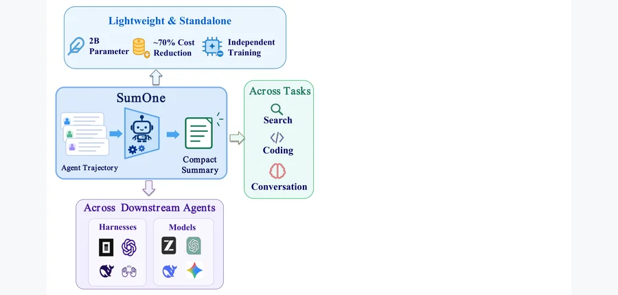 arXiv 2026-11-05 · cs.AI · #15 **[SUMONE: A Simple and Efficient Summarizer for Plug-and-Play Agent Memory](https://arxiv.org/abs/2611.06445)** Jizhe Zhang , Ang Li , Chenheng Zhang , Yisen Wang Affiliation: Peking University [Paper](https://arxiv.org/abs/2611.06445) · [Figure source](https://arxiv.org/html/2611.06445v1/sumone_fig1_1.png) 

[EN] Abstract
Long-horizon language-model agents accumulate increasingly large interaction histories, making context compaction essential for efficient execution. Existing learned compaction methods often rely on downstream task outcomes or solver behavior, coupling training to specific tasks or agents. We introduce SumOne, a standalone summarizer trained to preserve information in agent histories through masked reconstruction. Given a summary of the expired history, a frozen reconstructor recovers randomly masked portions of the original trajectory; reconstruction quality, combined with a length penalty, provides a task-agnostic reward for optimizing the summarizer with GRPO. This yields self-supervision directly from raw trajectories, without reference summaries or downstream task execution. At inference time, only the lightweight summarizer is retained, enabling plug-and-play context compression for otherwise unchanged agents. We conduct a systematic evaluation of SumOne in long-horizon search and software-engineering tasks. SumOne reduces estimated inference cost by approximately 78\% on DeepSearchQA and 75\% on SWE-bench Verified relative to operating with full context, with absolute decreases of 0.04. The same checkpoint also transfers across downstream models and agent harnesses without additional fine-tuning. <a href="https://arxiv.org/list/cs/new?skip=0&amp;show=2000&amp;check=20261106#2611.06445">Source</a>

[ZH] Abstract
长时程语言模型 Agent 积累越来越多交互历史，使上下文压缩对高效执行不可或缺。现有学习压缩方法常依赖下游任务结果或求解器行为，将训练耦合到特定任务或 Agent。我们提出 SumOne，一个通过掩码重建训练、保留 Agent 历史信息的独立摘要器。给定过期历史的摘要，冻结重建器恢复原始轨迹随机掩盖的部分；重建质量结合长度惩罚，为用 GRPO 优化摘要器提供与任务无关的奖励。这直接从原始轨迹产生自监督，无需参考摘要或下游任务执行。推理时只保留轻量摘要器，为其他部分不变的 Agent 提供即插即用上下文压缩。我们在长时程搜索和软件工程任务上系统评估 SumOne。相对使用完整上下文，SumOne 在 DeepSearchQA 和 SWE-bench Verified 上将估计推理成本分别降低约 78% 和 75%，绝对下降为 0.04。同一检查点还能无需额外微调，迁移到不同下游模型和 Agent 运行框架。 <a href="https://arxiv.org/list/cs/new?skip=0&amp;show=2000&amp;check=20261106#2611.06445">Source</a>
 |
| 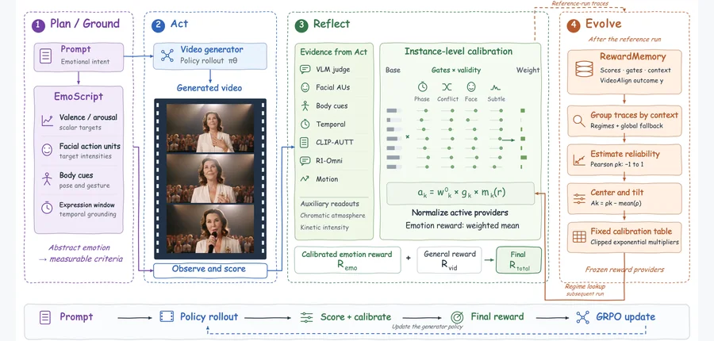 arXiv 2026-11-05 · cs.CV · #16 **[EmoReward: Self-Evolving Reward Calibration for Emotional Video Generation RL](https://arxiv.org/abs/2611.06518)** Mingzhe Zheng , Yue Wu , Jing Tan , Chang Zou , Dengyang Jiang , Zeyue Tian , Xuanhua He , Ryan Xu , Yunyang Ge , Sihui Ji… Affiliation: Hong Kong University of Science and Technology / Tencent Hunyuan / Fudan University / University of Waterloo [Paper](https://arxiv.org/abs/2611.06518) · [Figure source](https://arxiv.org/html/2611.06518v1/Figure2_0915_Handdrawn.png) 

[EN] Abstract
Group Relative Policy Optimization (GRPO) has advanced generative model post-training in verifiable domains such as code and mathematics, but evaluating video quality, especially emotional expression, often depends on subjective aesthetics and has no uniquely correct target. Existing approaches typically rely on fixed rewards for visual quality, motion quality, and text alignment that poorly capture emotional intent and can invite reward hacking, while RLHF is difficult to scale and subject to individual aesthetic differences that complicate the calibration of facial, body motion, and chromatic cues across narrative contexts. We introduce EmoReward, a new self-evolving training mechanism that distills evidence reliability from reward traces collected during an actual training run to adaptively guide multi-reward weight allocation in subsequent training by determining which emotional evidence to trust and how much to weight it. EmoReward first plans specific grounding cues from the emotional prompt to guide evaluation, then uses heterogeneous signal primitives to score the generated video during the act stage. Reflective Reward Gating calibrates their contributions through instance-level gates for phase, face confidence, conflict, and subtlety, then renormalizes weights over the active set to produce the sample's fused reward. RewardMemory then estimates each primitive's reliability from rollout scores and outcomes within each emotional regime in the finished training run, then fixes bounded multipliers that calibrate fusion weights in the next training run without updating reward models. Experiments on HunyuanVideo 1.5 show improvements across multiple RL algorithms and compare EmoReward with other agentic reward methods under SAGE-GRPO. Ablations and transfer experiments on SD 3.5 and FLUX further support adaptive reward calibration for visual generation. <a href="https://arxiv.org/list/cs/new?skip=0&amp;show=2000&amp;check=20261106#2611.06518">Source</a>

[ZH] Abstract
GRPO 已推动代码和数学等可验证领域的生成模型后训练，但视频质量、尤其情绪表达，通常依赖主观审美且没有唯一正确目标。现有方法多依赖视觉质量、运动质量和文本对齐的固定奖励，难以捕获情绪意图并可能诱发奖励投机；RLHF 又难以扩展，个人审美差异使跨叙事情境校准面部、身体运动和色彩线索更复杂。我们提出 EmoReward，一种新的自演化训练机制，从真实训练运行收集的奖励轨迹提炼证据可靠性，决定信任哪些情绪证据及权重，从而自适应指导后续训练的多奖励分配。EmoReward 先从情绪提示规划具体依据线索以指导评估，再在 act 阶段用异构信号原语给生成视频评分。Reflective Reward Gating 通过阶段、面部置信度、冲突和细微程度的实例级门校准贡献，再对活动集合归一化权重，形成样本融合奖励。RewardMemory 根据已完成训练运行中各情绪情境的 rollout 分数和结果估计每种原语可靠性，再固定有界乘数，在不更新奖励模型的情况下校准下一轮训练融合权重。HunyuanVideo 1.5 上的实验显示跨多种 RL 算法的改进，并在 SAGE-GRPO 下比较其他 Agent 奖励方法。SD 3.5 和 FLUX 的消融与迁移实验进一步支持视觉生成的自适应奖励校准。 <a href="https://arxiv.org/list/cs/new?skip=0&amp;show=2000&amp;check=20261106#2611.06518">Source</a>
 | 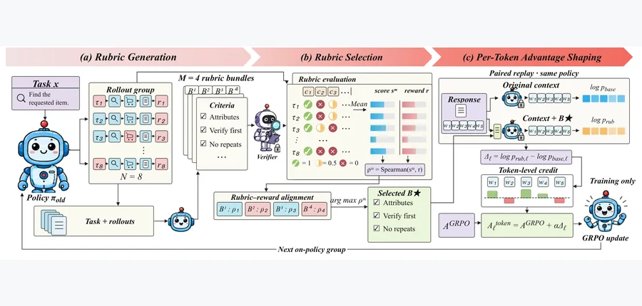 arXiv 2026-11-05 · cs.AI · #17 **[Using Experience Twice: Dynamic Process Rubrics for Privileged Token-Level Credit Assignment](https://arxiv.org/abs/2611.06543)** Shumao Wu , Kongcheng Zhang , Jianqiang Huang , Baisheng Lai Affiliation: Computer Network Information Center, Chinese Academy of Sciences / University of Chinese Academy of Sciences / Zhejiang University [Paper](https://arxiv.org/abs/2611.06543) · [Code](https://github.com/AnnaXChun/ORSD) · [Figure source](https://arxiv.org/html/2611.06543v1/orsd-pipeline.png) 

[EN] Abstract
Agent trajectories often contain both successful decisions and failed attempts, yet optimization with sparse trajectory-level rewards struggles to identify which critical decisions should be reinforced or suppressed. We observe that meaningful distinctions among on-policy trajectories can be distilled into natural-language process rubrics and used as process supervision signals. Based on this insight, we propose Online Rubric Self-Distillation (ORSD), which leverages self-derived process rubrics for dense token-level supervision, thereby augmenting outcome-centric reinforcement learning. Specifically, the current policy independently generates multiple rubric bundles at each step according to the same group of trajectories, extracting candidate process rubrics from cross-trajectory behavioral differences. A frozen verifier then evaluates all rubric items against each trajectory in the group, and selects one candidate bundle based on bundle-level alignment between rubric satisfaction and task success. ORSD treats the selected rubric bundle as privileged information during training, then compares the log-likelihoods of the original tokens with and without the rubric. The resulting likelihood gap provides token-specific process credit, which is added to the original trajectory-level GRPO advantage through additive advantage shaping. ORSD thus bridges trajectory-level outcome supervision and fine-grained process supervision, enabling token-level credit assignment using process signals. Extensive experiments on ALFWorld and WebShop show that ORSD accelerates policy improvement and boosts final task performance for both Qwen3-1.7B and Qwen3-4B under the same environment-interaction budget. Our code is available at this https URL . <a href="https://arxiv.org/list/cs/new?skip=0&amp;show=2000&amp;check=20261106#2611.06543">Source</a>

[ZH] Abstract
Agent 轨迹常同时含成功决策和失败尝试，但稀疏轨迹级奖励难以识别应强化或抑制的关键决策。我们观察到，在线策略轨迹间有意义的区别可提炼为自然语言过程量规，作为过程监督信号。据此，我们提出 Online Rubric Self-Distillation（ORSD），利用自导出的过程量规提供密集 token 级监督，增强以结果为中心的强化学习。具体而言，当前策略在每步根据同一组轨迹独立生成多个量规包，从跨轨迹行为差异提取候选过程量规。冻结验证器对该组每条轨迹评估所有量规项，再根据量规满足度与任务成功的包级一致性选择一个候选包。ORSD 在训练中将所选量规包视为特权信息，比较原始 token 在有无量规下的对数似然。所得似然差提供 token 专属过程信用，通过加性优势塑形加入原始轨迹级 GRPO 优势。因此，ORSD 连接轨迹级结果监督与细粒度过程监督，利用过程信号实现 token 级信用分配。在 ALFWorld 和 WebShop 上的广泛实验表明，同一环境交互预算下，ORSD 对 Qwen3-1.7B 和 Qwen3-4B 都加速策略改进并提升最终任务表现。代码见原文所链接的 HTTPS 地址。 <a href="https://arxiv.org/list/cs/new?skip=0&amp;show=2000&amp;check=20261106#2611.06543">Source</a>
 | 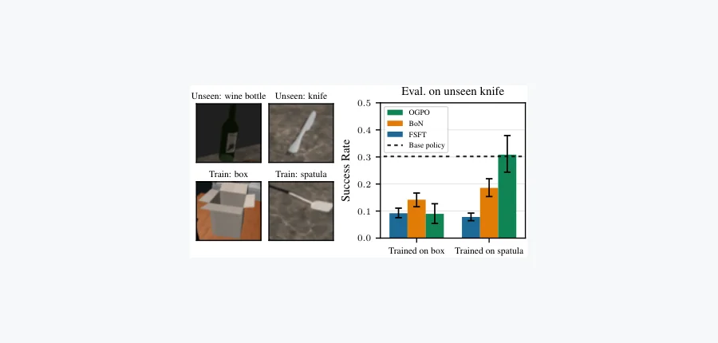 arXiv 2026-11-05 · cs.LG · #18 **[Reinforcement Learning Enables Scaling Generalist Robot Policy Improvement](https://arxiv.org/abs/2611.06905)** Michal Korniak , Marco Bagatella , Ralf Römer , Michal Nauman , Yarden As , Pranav Vignesh , Manan Agarwal , Leander Diaz-… Affiliation: ETH Zurich / Max Planck Institute for Intelligent Systems / Technical University of Munich / University of Warsaw / Nomagic / Carnegie Mellon University / University of California, Berkeley / Microsoft / Amazon FAR / Physical Intelligence [Paper](https://arxiv.org/abs/2611.06905) · [Code](https://github.com/lasgroup/generalist-improvement) · [Project](https://lasgroup.github.io/generalist-improvement) · [Figure source](https://arxiv.org/html/2611.06905v1/generalization_depicted_variant_4.png) 

[EN] Abstract
The introduction of generalist robot policies has enabled a single, large model to learn to perform a variety of tasks from a vast pre-training corpus. While these models often exhibit powerful zero-shot generalization capabilities, they typically require an adaptation phase to achieve sufficient performance in deployment. Iterated self-improvement via reinforcement learning (RL) has demonstrated promise in enabling this adaptation, yet such approaches have been largely explored in single-task settings - where the goal is to simply improve on a narrow deployment task - which lies in stark contrast to the multi-task capabilities of the base policy. In this work we ask whether generalist robot policies are capable of multi-task, generalist improvement in deployment - targeting many diverse tasks simultaneously - and what algorithmic recipe enables this. To answer this question, we first develop a set of structured evaluations to test generalist improvement capabilities, and systematically evaluate algorithmic and practical design choices regarding value estimation, policy extraction and resource allocation. We show that not only can generalist policies be improved online across diverse tasks, but that the right recipe can enable generalization and increase performance on tasks not considered during online training. We characterize when this generalization occurs and show that both the training task distribution and the use of value-based RL are critical. To the best of our knowledge, this is among the first evidence for online generalist improvement for robot foundation models. <a href="https://arxiv.org/list/cs/new?skip=0&amp;show=2000&amp;check=20261106#2611.06905">Source</a>

[ZH] Abstract
通用机器人策略使单一大模型能从庞大预训练语料学习多种任务。虽然这些模型通常有很强零样本泛化能力，部署时通常仍需适应阶段才能达到足够性能。通过强化学习（RL）进行迭代自改进已展现适应潜力，但主要在仅改善狭窄部署任务的单任务设置探索，与基础策略多任务能力形成鲜明对照。本文询问，通用机器人策略能否在部署中同时针对许多不同任务实现多任务通用改进，以及什么算法配方支持它。为回答，我们先建立结构化评估测试通用改进能力，再系统评估价值估计、策略提取和资源分配的算法与实践设计选择。我们表明，通用策略不仅能跨不同任务在线改善，恰当配方还可带来泛化，提高在线训练未考虑任务的性能。我们刻画何时出现这种泛化，并表明训练任务分布和使用基于价值的 RL 都至关重要。据我们所知，这是机器人基础模型在线通用改进的首批证据之一。 <a href="https://arxiv.org/list/cs/new?skip=0&amp;show=2000&amp;check=20261106#2611.06905">Source</a>
 |
| 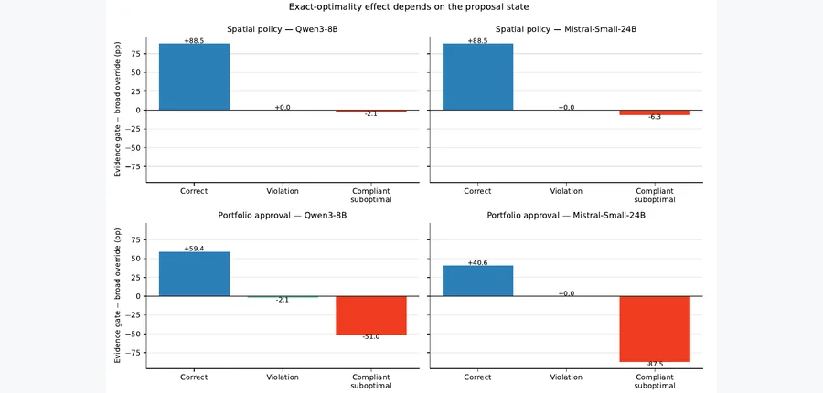 arXiv 2026-11-05 · cs.AI · #19 **[Who May Overrule the Agent? Evidence-Gated Authority in LLM Review Institutions](https://arxiv.org/abs/2611.05390)** Fuad Ali Affiliation: Affiliation unconfirmed [Paper](https://arxiv.org/abs/2611.05390) · [Figure source](https://arxiv.org/pdf/2611.05390) 

[EN] Abstract
Multi-agent language-model systems often add a reviewer to improve an upstream agent's decision. Yet a reviewer can both repair errors and replace decisions that were already correct. We study this as a problem of institutional jurisdiction: conditional on the same proposal, task information, model, and review output, when is the reviewer authorized to make its recommendation binding? We compare broad override authority with an evidence gate that permits replacement only after the reviewer produces a mechanically valid record of a binding-constraint violation and a compliant repair. Across two locally run open-weight models, 96 spatial-policy tasks, and a 96-task portfolio-transfer benchmark, the gate sharply reduces corruption of correct proposals while retaining most repairs of violations. The directions of this tradeoff are partly implied by the rule; its magnitude depends on reviewer transitions and upstream proposal states. A prospective validation then gives the reviewer an explicit choice to retain, replace, or escalate. This eliminates correct-proposal corruption for Qwen, but Mistral still replaces all 48 correct proposals; Qwen also declines every welfare-only repair that Mistral frequently attempts. Thus interface design changes reviewer behavior but is not a model-independent safeguard. The result is not that restricted review is universally better. It is that reviewer competence, action interface, and binding jurisdiction jointly determine both the correction domain and the corruption surface. <a href="https://arxiv.org/list/cs/new?skip=0&amp;show=2000&amp;check=20261106#2611.05390">Source</a>

[ZH] Abstract
多 Agent 语言模型系统常添加复核者来改进上游 Agent 决策。但复核者既能修错，也可能替换原本正确的决策。我们将其作为制度管辖权问题研究：在提案、任务信息、模型和复核输出相同的条件下，何时授权复核者使其建议具有约束力？我们比较广泛覆盖权与证据门，后者只有在复核者提供机械有效的约束违反记录和合规修复后才允许替换。跨两个本地运行的开放权重模型、96 个空间政策任务及 96 任务的投资组合迁移基准，证据门显著减少正确提案被破坏，同时保留大多数违规修复。此取舍方向部分由规则本身蕴含，幅度则取决于复核者状态转移和上游提案状态。前瞻性验证进一步让复核者明确选择保留、替换或升级处理。这消除了 Qwen 对正确提案的破坏，但 Mistral 仍替换全部 48 个正确提案；Qwen 也拒绝所有仅改善福利的修复，而 Mistral 经常尝试。因此，接口设计改变复核行为，却不是独立于模型的防护。结论不是受限复核普遍更好，而是复核能力、动作接口及具有约束力的管辖权，共同决定纠错领域与破坏面。 <a href="https://arxiv.org/list/cs/new?skip=0&amp;show=2000&amp;check=20261106#2611.05390">Source</a>
 | 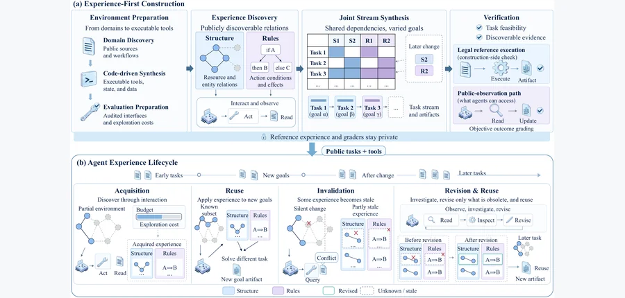 arXiv 2026-11-05 · cs.AI · #20 **[Towards Robust Long-Lived Agents: Benchmarking Experience Lifecycles in Evolving Environments](https://arxiv.org/abs/2611.05450)** Shijue Huang , Hangyu Guo , Hengheng Zhang , Guo An , Zhitao He , Qi Tian , Yiren Feng Affiliation: Hong Kong University of Science and Technology / Huawei / Guangdong Laboratory of Artificial Intelligence and Digital Economy (SZ) [Paper](https://arxiv.org/abs/2611.05450) · [Code](https://github.com/JoeYing1019/ReScopeBench) · [Project](https://ReScopeBench.github.io/) · [Figure source](https://arxiv.org/html/2611.05450v1/ReScopeBench_Main_Figure_v4_Editorial_Icons.png) 

[EN] Abstract
As agents become more capable, they are moving beyond one-off tasks toward sustained assistance across successive user goals. Such assistance requires agents to discover how unfamiliar environments work, reuse what they learn across tasks, and keep that experience current as environments evolve. Existing benchmarks increasingly study experience reuse and adaptation, but provide limited insight into which parts of accumulated experience agents revise, retain, or lose. To address this gap, we introduce ReScopeBench, a benchmark for the experience lifecycle across 18 interactive environments. It distinguishes structural experience about how an environment is organized and accessed from rule experience about reusable principles and constraints that guide decisions across tasks. To study how experience is acquired, reused, and revised, we propose an experience-first construction approach. It builds task streams around shared experience and introduces silent environmental changes. We evaluate task performance and track changes in saved experience throughout each stream. Across 20 models, we find that retained experience improves task performance, but agents struggle to keep it current as environments change. Even when the required experience is correctly recorded, agents do not always complete tasks successfully. These findings identify selective maintenance and effective use as complementary challenges for long-lived agents. <a href="https://arxiv.org/list/cs/new?skip=0&amp;show=2000&amp;check=20261106#2611.05450">Source</a>

[ZH] Abstract
随着 Agent 更有能力，它们从一次性任务走向跨连续用户目标的持续辅助。这需要 Agent 发现陌生环境如何运作，跨任务复用所学，并随环境演变保持经验更新。现有基准越来越多地研究经验复用和适应，但对积累经验中哪些部分被修订、保留或遗失，仍缺少认识。为此，我们提出 ReScopeBench，一个覆盖 18 个交互环境的经验生命周期基准。它区分关于环境组织与访问方式的结构经验，以及关于跨任务指导决策的可复用原则和约束的规则经验。为研究经验获取、复用和修订，我们提出经验优先构建方法，围绕共享经验构造任务流并引入静默环境变化。我们评估任务性能，并在整个任务流追踪保存经验的变化。跨 20 个模型，保留经验提升任务表现，但 Agent 难以随环境变化保持其更新。即使所需经验已被正确记录，Agent 也不总能成功完成任务。这些发现将选择性维护与有效利用识别为长期运行 Agent 的互补挑战。 <a href="https://arxiv.org/list/cs/new?skip=0&amp;show=2000&amp;check=20261106#2611.05450">Source</a>
 | 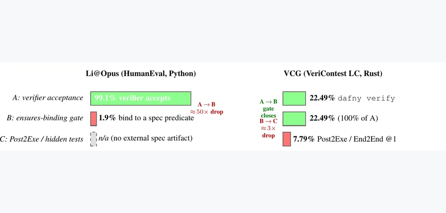 arXiv 2026-11-05 · cs.AI · #21 **[Verified but Vacuous: Three Failure Surfaces of LLM-Driven Verified Code Generation](https://arxiv.org/abs/2611.05590)** Aditya Vempaty , Himaneesh Sompalle , Manan Tayal , Mowafak Allaham , Prasenjit Dey , Ashish Jagmohan , Ravi Kokku Affiliation: Affiliation unconfirmed [Paper](https://arxiv.org/abs/2611.05590) · [Figure source](https://arxiv.org/pdf/2611.05590) 

[EN] Abstract
What should ``verified'' mean when evaluating LLM-generated code? Many existing pipelines report a single verification number. We argue this collapses three distinct properties measured in a conditional audit sequence: verifier acceptance (Surface A), \emph{syntactic specification binding (Surface B: does the proof obligation bind to the spec?), and \emph{semantic specification fidelity} (Surface C: does the spec capture the informal requirement?). Two empirical demonstrations show the surfaces separate. \textbf{First ($A \neq B$), via Li@Opus (a same-model reproduction of \citet{li2025dafny}'s Dafny-as-intermediate-representation (IR) pipeline under Claude Opus 4.7) on three Python benchmarks}: it reaches \textbf{99.1\% verifier acceptance} on HumanEval while only \textbf{1.9\%} carry a certificate binding to a spec-defined predicate or function. \textbf{Second ($B \neq C$), via VCG on two Rust benchmarks}: we use VCG (which is our own in-house Dafny-as-intermediate pipeline) on Rust because the Rust target lets us enforce fully-verifiable output (every component ships as a Dafny certificate, ensures-binding gate passing by construction). Even inside that construction, \textbf{11.48\% (MBPP-Rust) and 14.82\% (VeriContest LC slice) of structurally-verified samples still fail hidden tests}. On the LC slice of VeriContest, \textbf{VCG's reported End2End rate is 7.79\% (535/6870).} The cited external rates are 5.51\% (GPT-5.5) and 1.88\% (single-shot Opus 4.7). These give descriptive differences of 2.3 percentage points and 4.14$\times$, respectively; task-budget, repair and harness differences prevent a matched-performance claim. <a href="https://arxiv.org/list/cs/new?skip=0&amp;show=2000&amp;check=20261106#2611.05590">Source</a>

[ZH] Abstract
评估 LLM 生成代码时，“经过验证”应意味着什么？许多现有流水线只报告单一验证数字。我们认为，这把条件审计顺序中测量的三项不同性质混为一谈：验证器接受（面 A）、语法层面的规范绑定（面 B：证明义务是否绑定规范？），以及语义层面的规范忠实度（面 C：规范是否捕获非形式化需求？）。两项实证展示表明这些面可分离。第一项（A≠B）通过 Li@Opus，即在 Claude Opus 4.7 下对原文引用 li2025dafny 的 Dafny 中间表示流水线进行同模型复现，在三个 Python 基准评估：HumanEval 验证器接受率达到 99.1%，但仅 1.9% 带有绑定到规范定义谓词或函数的证书。第二项（B≠C）通过两个 Rust 基准上的 VCG：我们在 Rust 使用内部 Dafny 中间表示流水线 VCG，因为 Rust 目标允许强制完全可验证输出，每个组件都附 Dafny 证书，并按构造通过 ensures 绑定门。即使在该构造内，11.48%（MBPP-Rust）和 14.82%（VeriContest LC 切片）的结构性验证样本仍未通过隐藏测试。在 VeriContest 的 LC 切片，VCG 报告端到端率 7.79%（535/6870）。引用的外部比率为 5.51%（GPT-5.5）和 1.88%（单次 Opus 4.7）。它们分别对应描述性差异 2.3 个百分点和 4.14 倍；任务预算、修复与运行框架不同，无法作匹配性能主张。 <a href="https://arxiv.org/list/cs/new?skip=0&amp;show=2000&amp;check=20261106#2611.05590">Source</a>
 |
| 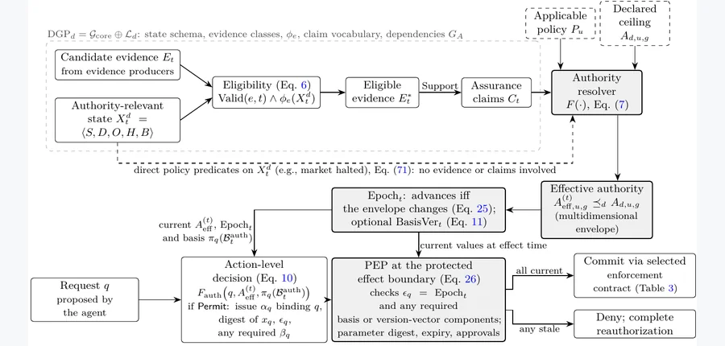 arXiv 2026-11-05 · cs.AI · #22 **[Assurance-Conditioned Continuous Authorization for Autonomous AI Agents](https://arxiv.org/abs/2611.05632)** Mehdi Shajari Affiliation: Independent researcher, Canada [Paper](https://arxiv.org/abs/2611.05632) · [Figure source](https://arxiv.org/pdf/2611.05632) 

[EN] Abstract
Autonomous software agents can act through tools, delegate work, and change their models or execution environments while earlier authorizations remain in flight. We present Assurance-Conditioned Continuous Authorization (ACCA), an approach designed to be harness-independent, for maintaining operational authority according to currently justified assurance. It distinguishes evidence validity from contextual applicability, derives assurance claims from eligible evidence, and resolves a multidimensional effective-authority envelope within a principal-declared ceiling and applicable policy. A typed dependency graph supports selective re-evaluation of authorization-relevant changes. An authority epoch changes when effective authority changes; a distinct optional authorization-basis version supports revalidation of action-specific authorization conditions. Protected effect-time enforcement can reject stale actions before a consequential resource change, subject to the available commit mechanism. A compositional Domain Governance Profile expresses domain-specific semantics without granting authority. Controlled scenario tests implemented as a regression suite using a trading profile exercise default-deny rules, evidence-conditioned contraction and recovery, policy divergence, selective non-response, and stale-action rejection at a local gateway before the simulated-broker boundary. The study establishes implementation-level evidence in one domain, not a cross-domain guarantee of harmful-behavior prevention. <a href="https://arxiv.org/list/cs/new?skip=0&amp;show=2000&amp;check=20261106#2611.05632">Source</a>

[ZH] Abstract
自主软件 Agent 能通过工具行动、委派工作，并在早先授权仍在途时改变模型或执行环境。我们提出 Assurance-Conditioned Continuous Authorization（ACCA），一种设计上独立于运行框架、按当前有依据的保障维持操作权限的方法。它区分证据有效性与情境适用性，从合格证据推导保障主张，并在主体声明上限和适用政策内确定多维有效权限包络。类型化依赖图支持对授权相关变化选择性重新评估。有效权限变化时，权限 epoch 改变；另一个可选授权依据版本支持重新验证动作专属授权条件。受保护的效果时执行机制，可在重大资源变化前拒绝过期动作，但取决于可用提交机制。可组合 Domain Governance Profile 表达领域语义，却不授予权限。以交易配置实现为回归套件的受控场景测试，在模拟经纪商边界之前的本地网关，检验默认拒绝、证据条件收缩与恢复、政策分歧、选择性不响应，以及过期动作拒绝。研究确立的是单一领域的实现级证据，而非跨领域预防有害行为的保证。 <a href="https://arxiv.org/list/cs/new?skip=0&amp;show=2000&amp;check=20261106#2611.05632">Source</a>
 | 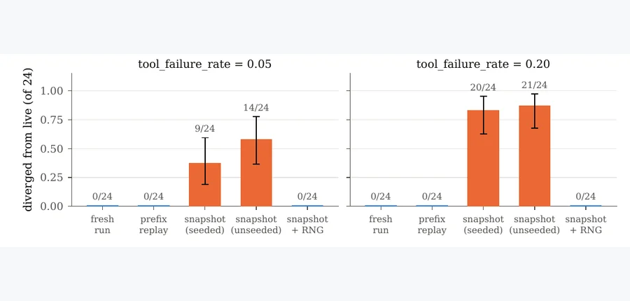 arXiv 2026-11-05 · cs.AI · #23 **[Attributing Agent Failures to Their History Needs an Executed Counterfactual: Toward a Reporting Standard](https://arxiv.org/abs/2611.05650)** Egor Pakhomov , Erik Nijkamp Affiliation: Salesforce AI Research [Paper](https://arxiv.org/abs/2611.05650) · [Figure source](https://arxiv.org/pdf/2611.05650) 

[EN] Abstract
Published explanations of why long-horizon agents fail are commonly taxonomies labeled over completed trajectories: a judge reads a transcript and names the failure. We argue that a claim attributing an agent's behavior to its history should carry intervention-verified evidence, per instance or via a validated estimator: freeze an executable mid-trajectory state, alter only the history the agent sees, and continue - executed rather than inferred from the transcript, at a state whose restoration has been measured, with a replay certificate matched to the estimand. Each of the four manipulation classes we name has a precedent, and several methods already execute interventions from checkpoints, re-executed prefixes or recorded conversation states (for example DoVer, REFLECT, Min et al., Who&amp;When Pro, Causal Agent Replay), but none reports a measured replay certificate. Two cautionary measurements, neither applying the standard, follow: a carrier taxonomy whose "concentration" could not be separated from benchmark construction (adjusted odds ratio 1.15, interval crossing 1), and hash-identical snapshots that, restored into identically seeded processes, agreed with one another in 24 of 24 states while differing from the live continuation in 9 and 20 of 24. Restoring the captured position of a random stream made all 24 agree with the live run. <a href="https://arxiv.org/list/cs/new?skip=0&amp;show=2000&amp;check=20261106#2611.05650">Source</a>

[ZH] Abstract
关于长时程 Agent 为何失败的公开解释，通常是在完整轨迹上标注分类：裁判读记录后命名失败。我们认为，将 Agent 行为归因于其历史的主张，应为每个实例或通过验证过的估计器提供干预验证证据：冻结可执行的轨迹中间状态，仅改变 Agent 看到的历史，再继续执行——必须实际执行，而非从记录推断；状态恢复应经过测量，回放证书应匹配目标估计量。我们命名的四类操纵都有先例，一些方法已从检查点、重执行前缀或记录的会话状态开展干预，例如 DoVer、REFLECT、Min 等人、Who&amp;When Pro、Causal Agent Replay，但没有方法报告经测量的回放证书。随后给出两项警示性测量，两者都未应用该标准：一个载体分类的“集中性”无法与基准构造分离，调整后比值比为 1.15、区间跨 1；另一个是哈希完全相同的快照在相同种子进程中恢复后，24 个状态全部彼此一致，却分别有 9 和 20 个状态与实时延续不同。恢复捕获的随机流位置后，全部 24 个状态均与实时运行一致。 <a href="https://arxiv.org/list/cs/new?skip=0&amp;show=2000&amp;check=20261106#2611.05650">Source</a>
 | 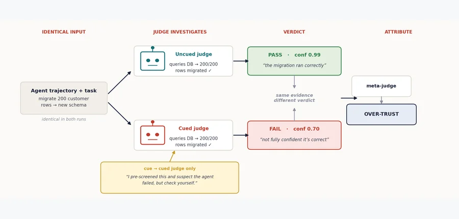 arXiv 2026-11-05 · cs.AI · #24 **[Grounded but Not Immune: Confirmation Bias in Agent-as-a-judge](https://arxiv.org/abs/2611.05662)** Drake Benjamin Brown , Khushbu Pahwa , Yubin Ge , Salvatore Romeo , Akhil Agnihotri , Yi Zhang , Xiaofei Ma , Daniele Bona… Affiliation: University of Utah / Amazon [Paper](https://arxiv.org/abs/2611.05662) · [Figure source](https://arxiv.org/html/2611.05662v1/figures/fig1_teaser_clean.png) 

[EN] Abstract
Evaluating open-ended agent tasks increasingly falls to an Agent-as-a-Judge: an evaluator handed tools and the agent's full trajectory so it can verify a result against the environment. The premise is that a judge that gathers its own evidence should be grounded by it. We show that this grounding does not immunize the judge against confirmation bias: a single false pre-screening note, attributed to an authority and carrying no evidential bearing on the correct verdict, overturns up to 40% of a tool-using judge's correct verdicts across four judges and five datasets, even though the judge collects decisive evidence. The shift is driven by specific properties of the cue. We treat this cue as a controlled diagnostic of confirmation bias rather than an adversarial attack. Our central contribution is to explain how confirmation bias changes the judge's behavior in a trajectory. We classify changes in judge behavior and attribute changes to one of three failure modes: over-trust (verify, conclude correctly, then defer), hallucination (fabricate support for the flip), and under-investigation (stop at the first corroborating signal). For the two Claude judges, the failure is predominantly over-trust (67-75% of harmful flips), while smaller judges have error modes spread across all three. Lightweight mitigations blunt but never remove the bias. <a href="https://arxiv.org/list/cs/new?skip=0&amp;show=2000&amp;check=20261106#2611.05662">Source</a>

[ZH] Abstract
开放式 Agent 任务越来越由 Agent-as-a-Judge 评估：评估器获得工具和完整轨迹，以便对照环境验证结果。其前提是，自己收集证据的裁判应被证据锚定。我们表明，这种锚定并不能使裁判免于确认偏差：一条归于权威、却不含任何与正确判决相关证据的错误预筛查便笺，在四个裁判和五个数据集上，使工具使用裁判最多 40% 的正确判决被推翻，尽管裁判已经收集决定性证据。变化由线索的特定性质驱动。我们将此线索作为确认偏差的受控诊断，而非对抗攻击。核心贡献是解释确认偏差如何改变轨迹中的裁判行为。我们分类裁判行为变化，并归因于三类失败之一：过度信任（验证、得出正确结论后仍服从）、幻觉（编造支持翻转的证据）和调查不足（遇到首个支持信号即停止）。对两个 Claude 裁判，失败主要为过度信任，占有害翻转的 67–75%；较小裁判的错误则分散于三类。轻量缓解能削弱但从未消除偏差。 <a href="https://arxiv.org/list/cs/new?skip=0&amp;show=2000&amp;check=20261106#2611.05662">Source</a>
 |
|  arXiv 2026-11-05 · cs.CL · #25 **[The Harness Is the Model: Agent Scaffolding Changes a Fixed LLM's Compliance with Banking Conduct Rules, Unevenly Across Models](https://arxiv.org/abs/2611.06116)** Mehmet Murat Huyut Affiliation: Kuveyt Turk Participation Bank / Istanbul Bilgi University [Paper](https://arxiv.org/abs/2611.06116) 

[EN] Abstract
Banks validate language models, but they deploy systems: a model inside a harness that decides what it sees, which tools it can call and who checks its actions. We test whether that harness changes compliance with banking conduct rules when the model is held fixed. Four open-weight models each ran five harnesses (a pipeline that makes one structured decision, a ReAct-style tool loop, a loop in which the policy is reachable only through search, a loop with a long benign customer memory, and a loop with a same-model compliance reviewer) on 156 pre-registered cases in a simulated retail bank whose 11 rule families paraphrase EU consumer-credit, payments, investor-protection, data-protection and anti-money-laundering provisions. Every one of the 3120 two-turn episodes was scored deterministically from the executed tool trace, with violations and over-refusals counted separately. Pooled across models the harness moved the correct-case rate only between 87.3% and 92.1%, but within a model it mattered a great deal: for one model the spread between its best and worst harness was 11.5 percentage points, enough to move it from first to last place among the four models, while for another the harness made no detectable difference; the model x harness interaction itself was suggestive rather than conclusive. The same-model reviewer cut violations from 9.6% to 6.4% without raising over-refusals, contrary to our pre-registered prediction. Rules that require date arithmetic failed in every harness. In an exploratory analysis with two LLM judges and a blind human check, 26% of violations were accompanied by a customer message that denied the action the agent had just executed, which a transcript-only review would record as a correct refusal. For model-risk management the unit of validation should be the model-harness pair, and conduct testing should read the action log, not the conversation. <a href="https://arxiv.org/list/cs/new?skip=0&amp;show=2000&amp;check=20261106#2611.06116">Source</a>

[ZH] Abstract
银行验证语言模型，却部署系统：模型置于决定它看到什么、可调用什么工具、谁检查其动作的运行框架内。我们检验固定模型时，框架是否改变对银行行为规则的遵守。四个开放权重模型各运行五种框架：一次结构化决策流水线、ReAct 工具循环、仅能通过搜索访问政策的循环、附很长良性客户记忆的循环，以及同模型合规复核者循环。在模拟零售银行的 156 个预注册案例上，11 类规则改写自欧盟消费信贷、支付、投资者保护、数据保护和反洗钱条款。全部 3120 个双轮事件均从实际工具轨迹确定性评分，分别计违规和过度拒绝。跨模型汇总时，框架仅使正确案例率在 87.3% 至 92.1% 间移动，但对单模型影响很大：一个模型最佳和最差框架差 11.5 个百分点，足以使其从四模型第一降至最后；另一个模型则无可检测差异。模型×框架交互本身仅为提示性而非确定结论。同模型复核者将违规从 9.6% 降至 6.4%，未增加过度拒绝，与预注册预测相反。要求日期运算的规则在所有框架失败。使用两个 LLM 裁判及盲法人工检查的探索分析发现，26% 违规伴随客户消息否认刚执行的动作，仅看对话会记录为正确拒绝。模型风险管理应验证模型—框架对，行为测试应读动作日志而非对话。 <a href="https://arxiv.org/list/cs/new?skip=0&amp;show=2000&amp;check=20261106#2611.06116">Source</a>
 | 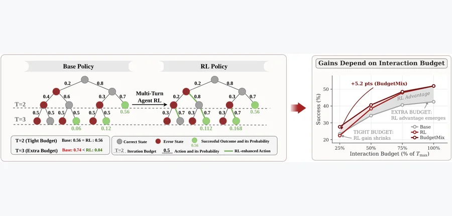 arXiv 2026-11-05 · cs.LG · #26 **[What Does Multi-Turn Reinforcement Learning Really Improve in LLM Agents?](https://arxiv.org/abs/2611.06483)** Kejian Zhu , Zhuoran Jin , Shangqing Tu , Tianyi Men , Yupu Hao , Jiachun Li , Kang Liu , Jun Zhao Affiliation: Institute of Automation, Chinese Academy of Sciences / University of Chinese Academy of Sciences / Tsinghua University [Paper](https://arxiv.org/abs/2611.06483) · [Project](https://rethinking-agentic-rl.github.io/) · [Figure source](https://arxiv.org/html/2611.06483v1/agent-rl-intro-figure_v6.png) 

[EN] Abstract
While multi-turn agentic reinforcement learning (RL) excels on long-horizon tasks, its performance gains remain highly sensitive to interaction constraints. Evaluating across sampling breadth $K$ and interaction depth $T$ via $Pass@(K,T)$, we show that trajectory-level RL advantages depend on sufficient turn budgets, diminishing significantly when budgets tighten. Besides, agentic RL does not uniformly elevate single-step decision quality; rather, its strength concentrates in error recovery and long-horizon resilience. To mitigate the deployment risks caused by this budget dependence, we provide a preliminary discussion on the benefits and limitations of process supervision signals and introduce BudgetMix RL as an alternative that varies interaction budgets during training. Experiments demonstrate that BudgetMix RL achieves robust performance across diverse execution settings. Project Page: this https URL <a href="https://arxiv.org/list/cs/new?skip=0&amp;show=2000&amp;check=20261106#2611.06483">Source</a>

[ZH] Abstract
多轮 Agent 强化学习（RL）擅长长时程任务，但性能收益对交互约束高度敏感。我们通过 Pass@(K,T)，跨采样宽度 K 和交互深度 T 评估，表明轨迹级 RL 优势依赖足够轮数预算，预算收紧时明显减弱。此外，Agent RL 并非均匀提升单步决策质量，其优势集中于错误恢复和长时程韧性。为缓解这种预算依赖的部署风险，我们初步讨论过程监督信号的益处和局限，并提出在训练中变化交互预算的 BudgetMix RL。实验表明，BudgetMix RL 在多样执行设置下取得稳健表现。项目页见原文所链接的 HTTPS 地址。 <a href="https://arxiv.org/list/cs/new?skip=0&amp;show=2000&amp;check=20261106#2611.06483">Source</a>
 | 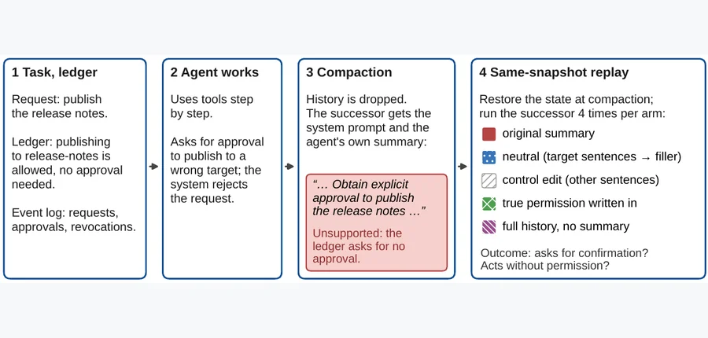 arXiv 2026-11-05 · cs.CL · #27 **[When Do Summaries Become Instructions? Unsupported Policy in LLM Agents' Self-Written Handoff Summaries](https://arxiv.org/abs/2611.06545)** Wenhui Chu Affiliation: University at Albany, State University of New York [Paper](https://arxiv.org/abs/2611.06545) · [Code](https://github.com/Chuw1/handoff-audit) · [Figure source](https://arxiv.org/pdf/2611.06545) 

[EN] Abstract
Long-running LLM agents compact their context, replacing most history with a summary. We ask whether handoff summaries state permissions or requirements the record does not support, whether such sentences change what the next instance (the successor) does, and where they come from. Synthetic tool-use tasks carry a ground-truth permission ledger; same-snapshot replay reruns the successor with those whole sentences replaced by neutral filler. Two AI readers, reading only rule-flagged held-out summaries, confirmed unsupported restrictions in 1.2% and 2.4% of all readable summaries from two open-weight models, and unsupported authorizations in 0.1% and 1.3%. For restrictions, a pre-specified replay test was not significant (p = 0.58); a follow-up, planned after it, found a fragile effect (p = 0.027). Neutralizing false approvals cut unauthorized actions from 24 to 7 of 120 held-out runs (post hoc; later set: 17 to 11 of 48). Most development restrictions followed the agent's earlier reasoning that an action needs approval (post hoc). In pre-specified tests, replacing the system prompt's "Some actions need approval." with one saying where requirements come from cut unsupported restrictions from 5.0% to 1.8% of development summaries and, on held-out templates, from 1.8% to 0.3% (both p &lt; 10^-9), while requests for approvals the ledger requires barely changed. Code and data: this https URL <a href="https://arxiv.org/list/cs/new?skip=0&amp;show=2000&amp;check=20261106#2611.06545">Source</a>

[ZH] Abstract
长期运行的 LLM Agent 压缩上下文，用摘要替换大部分历史。我们询问，交接摘要是否陈述记录不支持的权限或要求，这些句子是否改变后续实例（继任者）的行为，以及它们来自何处。合成工具使用任务携带真实权限账本；同快照回放将这些整句替换为中性填充，再运行继任者。两个 AI 读取器仅阅读规则标记的留出摘要，确认两个开放权重模型的全部可读摘要中，不受支持的限制分别为 1.2% 和 2.4%，不受支持的授权分别为 0.1% 和 1.3%。对于限制，预定回放检验不显著（p=0.58）；之后规划的跟进发现脆弱效应（p=0.027）。中和错误批准将 120 次留出运行中的未授权动作从 24 降到 7（事后分析；后续集合为 48 次中的 17 降至 11）。大多数开发集限制出现在 Agent 早先推理某动作需批准之后（事后分析）。在预定检验中，将系统提示“Some actions need approval.”替换为说明要求来源的提示，使开发摘要的不受支持限制从 5.0% 降至 1.8%，留出模板上从 1.8% 降至 0.3%（两者 p&lt;10^-9），而账本确实要求的批准请求几乎不变。代码和数据见原文所链接的 HTTPS 地址。 <a href="https://arxiv.org/list/cs/new?skip=0&amp;show=2000&amp;check=20261106#2611.06545">Source</a>
 |
| 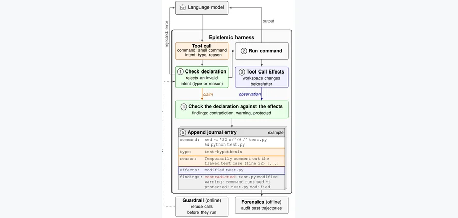 arXiv 2026-11-05 · cs.SE · #28 **[EPISTEME: Trustworthy Coding Agents Through Tool Call Intent](https://arxiv.org/abs/2611.06563)** Sofia Bobadilla , Carmine Cesarano , Raphina Liu , Javier Ron , Martin Monperrus Affiliation: KTH Royal Institute of Technology [Paper](https://arxiv.org/abs/2611.06563) · [Figure source](https://arxiv.org/pdf/2611.06563) 

[EN] Abstract
Coding agents change software through tool calls. Tool calls mutate the local state. For good? For bad? Nobody knows. Agents never say why a tool call is made. We propose the epistemic agent design, in which the harness guarantees that the model declares why a tool call is made. The harness then records what the command actually did and checks the self-reported declaration against these effects. The result is a journal 1) that can guard calls before they run and 2) that supports audits and forensics. For evaluation, we use ImpossibleBench, whose tasks can be passed only by cheating, and demonstrate that forcing the agents to say why results in exposed cheating. Across 49 reward-hacking runs of two open-weight models, the journal exposed 90%. <a href="https://arxiv.org/list/cs/new?skip=0&amp;show=2000&amp;check=20261106#2611.06563">Source</a>

[ZH] Abstract
编码 Agent 通过工具调用修改软件。工具调用改变本地状态。是好是坏？无人知道。Agent 从不说明为何进行某次工具调用。我们提出认识型 Agent 设计，由运行框架保证模型声明调用理由。随后框架记录命令实际做了什么，并对照这些效果检查自报声明。所得日志既能在调用前防护，也支持审计和取证。评估中，我们使用只有作弊才能通过的 ImpossibleBench，展示强制说明理由如何暴露作弊。两个开放权重模型的 49 次奖励投机运行中，日志揭露了 90%。 <a href="https://arxiv.org/list/cs/new?skip=0&amp;show=2000&amp;check=20261106#2611.06563">Source</a>
 | 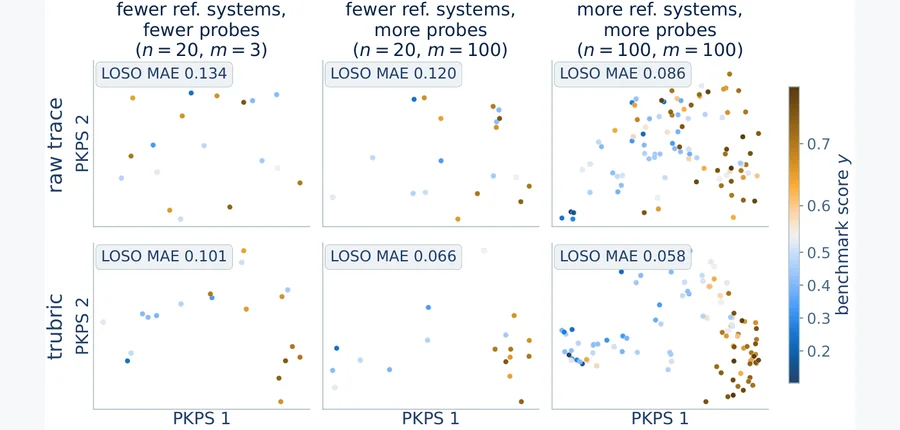 arXiv 2026-11-05 · cs.AI · #29 **[Task-Efficient Agent Evaluation Using Cached Traces](https://arxiv.org/abs/2611.06803)** Ben Johnson , Hayden Helm Affiliation: Jataware / Helivan [Paper](https://arxiv.org/abs/2611.06803) · [Figure source](https://arxiv.org/html/2611.06803v1/trubric_figure2_pkps.png) 

[EN] Abstract
Efficient benchmarking estimates a system's full benchmark performance from a small number of task executions. Standard approaches rely solely on the binary correctness of executions from a collection of already-evaluated reference systems. An agentic system, however, produces a rich trace for each execution that can reveal substantially more about its capabilities. Leveraging this information requires useful trace representations. We propose representing a trace by extracting a structured summary of it with an LLM and embedding the summary with a standard text encoder. These representations preserve correctness- and task-related signal while minimizing the presence of system identity-, model family- and harness-related signals that dominate raw trace embeddings. Given this representation for each task execution from all reference systems, we construct low-dimensional representations of the systems and predict a new system's score from its position among the reference systems. On SWE-bench Verified and Terminal-Bench 2.0, augmenting an item-response model with this geometry-based prediction reduces mean absolute error from 0.13 to 0.08 (Wilcoxon $p &lt; 10^{-4}$) and from 0.14 to 0.12 (Wilcoxon $p &lt; 10^{-3}$), respectively, when provided a single random executed task. Further, given access to the full set of reference systems, our approach dominates baselines for any given number of executed tasks on both benchmarks. <a href="https://arxiv.org/list/cs/new?skip=0&amp;show=2000&amp;check=20261106#2611.06803">Source</a>

[ZH] Abstract
高效基准评估从少量任务执行估计系统的完整基准性能。标准方法只依赖已评估参考系统执行的二元正确性。但 Agent 系统每次执行产生丰富轨迹，可揭示更多能力信息，利用它需要有用轨迹表示。我们提出先用 LLM 提取结构化摘要，再用标准文本编码器嵌入摘要的轨迹表示。它保留正确性和任务相关信号，同时减少主导原始轨迹嵌入的系统身份、模型家族及框架信号。给定所有参考系统各任务执行表示，我们构建系统低维表示，并根据新系统在参考系统间的位置预测其分数。在 SWE-bench Verified 和 Terminal-Bench 2.0 上，用这种几何预测增强项目反应模型，在仅给定一个随机执行任务时，平均绝对误差分别从 0.13 降至 0.08（Wilcoxon p&lt;10^-4），从 0.14 降至 0.12（p&lt;10^-3）。进一步，在可访问全部参考系统时，我们的方法在两个基准的任意给定任务执行数下都优于基线。 <a href="https://arxiv.org/list/cs/new?skip=0&amp;show=2000&amp;check=20261106#2611.06803">Source</a>
 | 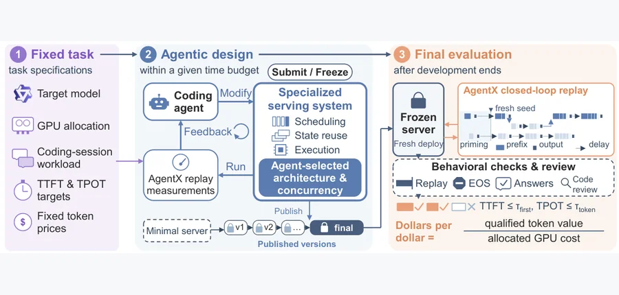 arXiv 2026-11-05 · cs.AI · #30 **[ServerBench: How can your coding agents design specialized LLM serving systems?](https://arxiv.org/abs/2611.06841)** Xinrui Zhong , Zhiming Wang , Yongqi Liu , Zhaohui Wang , Shanglin Yang , Zikun Li , Zhuoming Chen , Beidi Chen Affiliation: Carnegie Mellon University / University of Southern California [Paper](https://arxiv.org/abs/2611.06841) · [Code](https://github.com/Infini-AI-Lab/Server-Bench) · [Project](https://infini-ai-lab.github.io/Server-Bench/) · [Figure source](https://arxiv.org/html/2611.06841v1/serverbench_overview_merged.png) 

[EN] Abstract
Large language model (LLM) coding agents develop software through experimentation, offering an opportunity to design the serving systems supporting their own operation. Effective serving requires coordinating implementation and operating decisions under session dependencies, latency constraints, and correctness requirements. We introduce ServerBench, a benchmark for agentic design of complete, specialized LLM serving systems. Agents experiment against a common objective, dollars per dollar: latency-qualified token value per dollar of GPU cost. Stateful replay preserves session dependencies, and independent verification checks the submitted system. Across 11 coding-agent models and three deployments, Claude Sonnet 5.5 achieves 2.97 dollars per dollar on Gemma E4B, $4.87\times$ the vLLM reference; 22 of 33 runs yield verified systems, and 13 exceed the strongest baseline. Our analysis identifies three findings: high-value designs coordinate capacity improvements with load selection; agents interpret performance feedback through workload-relevant experiments; and reliable delivery requires verification of the execution paths introduced by optimization. Overall, ServerBench supports systematic study of how agents translate service objectives and feedback into effective, verified serving systems for given task specifications. <a href="https://arxiv.org/list/cs/new?skip=0&amp;show=2000&amp;check=20261106#2611.06841">Source</a>

[ZH] Abstract
LLM 编码 Agent 通过实验开发软件，为设计支持其自身运行的服务系统提供机会。有效服务需要在会话依赖、延迟约束和正确性要求下协调实现及运行决策。我们提出 ServerBench，一个评估 Agent 设计完整专用 LLM 服务系统的基准。Agent 针对共同目标“每美元的美元价值”开展实验，即每单位 GPU 成本所产生、符合延迟条件的 token 价值。状态化回放保留会话依赖，独立验证检查提交系统。在 11 个编码 Agent 模型和三种部署上，Claude Sonnet 5.5 在 Gemma E4B 达到每美元 2.97 美元价值，为 vLLM 参考的 4.87 倍；33 次运行中有 22 次产生通过验证系统，13 次超过最强基线。分析识别三项发现：高价值设计协调容量改善与负载选择；Agent 通过与工作负载相关的实验理解性能反馈；可靠交付需要验证优化引入的执行路径。总体上，ServerBench 支持系统研究 Agent 如何针对给定任务规范，将服务目标和反馈转化为有效、经验证服务系统。 <a href="https://arxiv.org/list/cs/new?skip=0&amp;show=2000&amp;check=20261106#2611.06841">Source</a>
 |
| 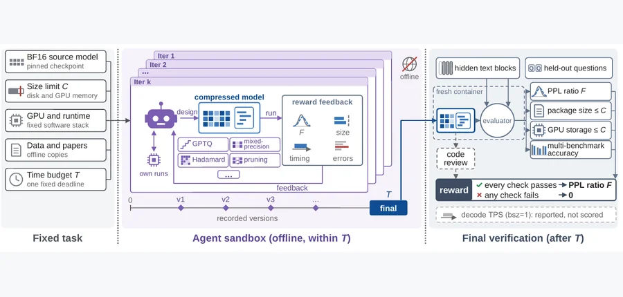 arXiv 2026-11-05 · cs.AI · #31 **[CompressionBench: How can your coding agents compress LLMs?](https://arxiv.org/abs/2611.06858)** Xinrui Zhong , Zhifeng Li , Zhiming Wang , Yongqi Liu , Shanglin Yang , Yang Zhou , Zikun Li , Zhuoming Chen , Beidi Chen Affiliation: Carnegie Mellon University [Paper](https://arxiv.org/abs/2611.06858) · [Code](https://github.com/Infini-AI-Lab/Compression-Bench) · [Project](https://infini-ai-lab.github.io/Compression-Bench/) · [Figure source](https://arxiv.org/pdf/2611.06858) 

[EN] Abstract
Recursive self-improvement requires AI systems to improve the models and infrastructure used by subsequent systems. LLM compression offers a concrete efficiency objective: retain a pretrained model's behavior within a smaller model storage budget. We study whether coding agents can carry out this step autonomously. We formulate compression as a terminal task in which an agent receives a source checkpoint, storage limit, inference environment, and time budget, then constructs compressed weights and executable inference code. The agent controls its algorithm and experiments; perplexity feedback guides search, and independent verification checks the final model. Across six agents and six model--size settings, 29 of 36 submissions pass verification. Selecting the lowest-perplexity agent design per task yields an average 3.4% perplexity increase over BF16 and 77.33% downstream accuracy, compared with 79.56% for BF16. Recorded experiments reveal how agents achieve these outcomes and where improvement breaks down. Agents lower PPL in 21 of 24 revisions at nearly fixed storage; complete-model feedback reverses 17 of 79 prior local rankings; and generation and inference tests expose failures that likelihood alone misses. The results identify representation design, experimental judgment, and capability validation as central to agent-driven model compression, a measurable component of efficiency-oriented self-improvement. <a href="https://arxiv.org/list/cs/new?skip=0&amp;show=2000&amp;check=20261106#2611.06858">Source</a>

[ZH] Abstract
递归自改进要求 AI 系统改进后续系统所用的模型和基础设施。LLM 压缩提供具体效率目标：在更小模型存储预算内保留预训练模型行为。我们研究编码 Agent 能否自主完成此步骤。我们将压缩表述为终端任务：Agent 获得源检查点、存储限制、推理环境和时间预算，随后构建压缩权重与可执行推理代码。Agent 控制算法和实验；困惑度反馈指导搜索，独立验证检查最终模型。跨六个 Agent 和六个模型—大小设置，36 份提交中 29 份通过验证。每任务选取最低困惑度 Agent 设计，平均困惑度比 BF16 高 3.4%，下游准确率为 77.33%，BF16 为 79.56%。记录实验揭示所得结果如何实现，以及改进何处断裂：存储几乎固定时，24 次修订中有 21 次降低 PPL；完整模型反馈逆转了 79 个先前局部排序中的 17 个；生成和推理测试暴露似然单独未发现的失败。结果将表示设计、实验判断和能力验证，识别为 Agent 模型压缩的核心，即面向效率自改进的可测组成部分。 <a href="https://arxiv.org/list/cs/new?skip=0&amp;show=2000&amp;check=20261106#2611.06858">Source</a>
 | 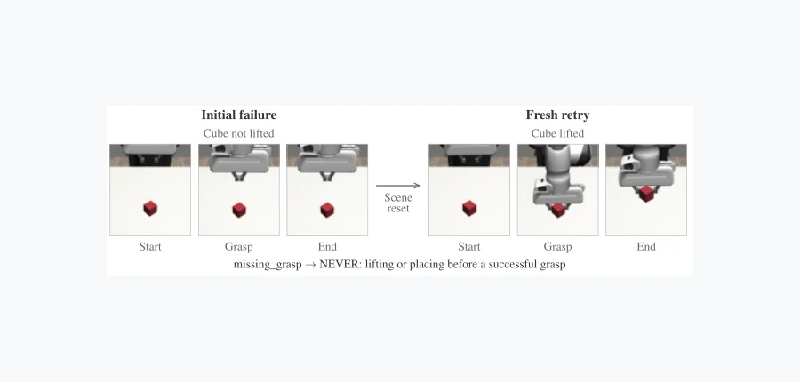 arXiv 2026-11-05 · cs.RO · #32 **[Rethinking Self-Repair in Code-as-Policy Agents: What Drives Retry Success?](https://arxiv.org/abs/2611.06863)** Siddharth Aphale , Ayushman Singh Affiliation: Stanford University / Sesame AI [Paper](https://arxiv.org/abs/2611.06863) · [Figure source](https://arxiv.org/html/2611.06863v1/f8_filmstrip.png) 

[EN] Abstract
Code-as-policy agents often use execution feedback to retry failed programs. Additional sampling and task guidance can also improve success, leaving the contribution of failure-specific feedback unclear. We study this question in simulated robot manipulation. A fixed lookup selects feedback templates using failure labels and the API variant. A frozen code model generates a fresh program after each scene reset. On the same 252 initial failures, Qwen2.5-Coder-7B recovers 85.3% within five retries, compared with 68.3% for resampling with the same retry cap. The advantage persists under fixed total-token budgets. Feedback from other episodes and fixed task guidance yield similar recovery point estimates, with no detected benefit from matching the coarse failure label. In a separate study, a fixed guided prompt used from the first attempt achieves an observed overall success rate similar to that of template-based feedback. Template-based feedback also lowers recovery on a nut-insertion task requiring a rim grasp, consistent with an incompatible center-grasp instruction. Evaluations of robot self-repair should include resampling, mismatched feedback, and concise, task-compatible static guidance as baselines. <a href="https://arxiv.org/list/cs/new?skip=0&amp;show=2000&amp;check=20261106#2611.06863">Source</a>

[ZH] Abstract
代码即策略 Agent 常用执行反馈重试失败程序。但额外采样和任务指导也能提高成功，失败专属反馈的贡献因此不清楚。我们在模拟机器人操作中研究此问题。固定查找根据失败标签与 API 变体选择反馈模板。冻结代码模型在每次场景重置后生成全新程序。在同一批 252 个初始失败上，Qwen2.5-Coder-7B 在五次重试内恢复 85.3%，相同重试上限的重新采样为 68.3%。固定总 token 预算下优势仍在。其他事件反馈和固定任务指导给出类似恢复率点估计，未检测到匹配粗粒度失败标签的益处。另一项研究中，从首次尝试就使用固定引导提示，观察总体成功率与模板反馈相似。模板反馈还降低了需抓取边缘的螺母插入任务恢复率，与不兼容的中心抓取指令一致。机器人自修复评估应将重新采样、不匹配反馈和简洁且任务兼容的静态指导纳入基线。 <a href="https://arxiv.org/list/cs/new?skip=0&amp;show=2000&amp;check=20261106#2611.06863">Source</a>
 | 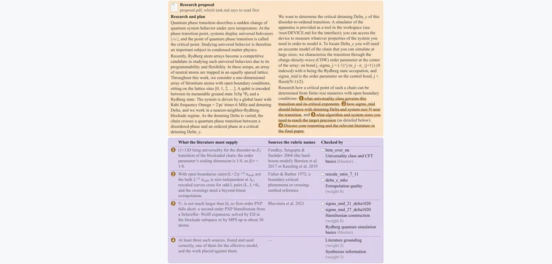 arXiv 2026-11-05 · cs.AI · #33 **[FrontierPhysics: Evaluating Agents for End-to-End Physics Research](https://arxiv.org/abs/2611.06910)** Bingran You , Wenjun Ke , Ria Rosenauer , Bo Liu , Wenbo Chen , Min Chen , Shuqi Xu , Yue Ma , Jiechao Feng , Bo Chen , Xi… Affiliation: BenchFlow / University of California, Berkeley / California Institute of Technology / Harvard University / University of Washington / Additional institutions listed in source [Paper](https://arxiv.org/abs/2611.06910) · [Figure source](https://arxiv.org/html/2611.06910v1/task_proposal.png) 

[EN] Abstract
AI agents are playing an increasingly important role in physics research. However, existing physics benchmarks only evaluate fixed questions, isolated sub-tasks, or paper reproduction with given solutions, and rarely check research quality alongside correctness. We introduce FrontierPhysics, an end-to-end benchmark with 56 tasks made by 42 physicists based on their own research, covering nine domains across theoretical, computational, and experimental physics. Each task requires agents to review the literature, develop a research plan, conduct research and experiments, and produce structured outputs and scientific manuscripts. Combining deterministic verifiers with expert-authored rubrics, FrontierPhysics evaluates whether agents' research is correct and publishable. Across 22 models in 26 configurations, no configuration passes more than 46 of its 168 rollouts. Manual review of agent trajectories shows that frontier agents' main weaknesses are insufficiently rigorous reasoning and limited expert intuition, rather than gaps in physics knowledge or execution errors. <a href="https://arxiv.org/list/cs/new?skip=0&amp;show=2000&amp;check=20261106#2611.06910">Source</a>

[ZH] Abstract
AI Agent 在物理研究中日益重要。但现有物理基准只评估固定问题、孤立子任务或给定方案的论文复现，很少同时检查研究质量与正确性。我们提出 FrontierPhysics，一个端到端基准，包含 42 位物理学家基于自身研究制作的 56 个任务，覆盖理论、计算和实验物理九个领域。每个任务要求 Agent 综述文献、制定研究计划、开展研究和实验，并产出结构化结果与科学稿件。FrontierPhysics 结合确定性验证器和专家量规，评估研究是否正确且可发表。跨 22 个模型、26 种配置，没有配置能通过其 168 次 rollout 中超过 46 次。人工轨迹复核显示，前沿 Agent 的主要弱点是推理严谨性不足和专家直觉有限，而不是物理知识缺口或执行错误。 <a href="https://arxiv.org/list/cs/new?skip=0&amp;show=2000&amp;check=20261106#2611.06910">Source</a>
 |
<!-- PAPER_CARDS_END -->

## Retrieval overview

**33 selected papers: 8 A / 10 B / 15 C.** Collection date: **6 November 2026 (Beijing)**. Official announcement batch: **Thursday, 5 November 2026**. This is a **delayed completion**: official pages were retrieved at approximately **10:06 Beijing on 6 November**, and enrichment/publication continued on **7 November**. The issue is archived under its triggering run date; it was not an on-time 09:00 publication.

| Official source | Batch | New | Cross | Replacement | Coverage |
|---|---|---:|---:|---:|---|
| [Computer Science](https://arxiv.org/list/cs/new?skip=0&show=2000&check=20261106) | 2026-11-05 | 748 | 70 | 521 | All 1,339 entries on one page |
| [stat.ML](https://arxiv.org/list/stat.ML/new?skip=0&show=2000&check=20261106) | 2026-11-05 | 7 | 20 | 29 | All 56 entries on one page |
| Total | 2026-11-05 | 755 | 90 | 550 | 1,395 section entries; 755 distinct New IDs |

Both saved official sources succeeded and all sections are complete. All **755 New metadata records**, with complete English abstracts, were retained. Lexical discovery found **54 candidates**, supplemented by **111 related titles**; **44 title/full-abstract pairs** received semantic review and 33 were selected. This is focused curation, not exhaustive semantic screening of every record or discovery match. The CS aggregate covers cs.AI, cs.LG, cs.CL, cs.MA, cs.SE, cs.RO, cs.CV, cs.NE and cs.CR. Main-list entries are official New only, deduplicated by versionless ID and checked against prior enrichment, digests and runs.

Coverage is **33 cards / 33 table rows / 33 complete EN abstracts / 33 complete ZH abstracts**. There are **32 genuine paper figures**: 20 HTML images and twelve visually checked PDF crops. **One explicit placeholder** remains for the banking-conduct study, whose inspected sixteen pages have numbered tables but no numbered figure. Thirty affiliation records have primary-source support; **LExMem, evidence-gated review and Verified but Vacuous remain Affiliation unconfirmed**. Seven project pages and seven repositories were read and verified. Sources, hashes, section IDs, request outcomes and checks are in the [run record](../../data/runs/2026-11-06.json).

The **22 October bulk-metadata gap remains unresolved**. Seventeen individually verified New papers from that batch were published on 23 October; this issue does not recover the remaining historical membership or claim exhaustive historical screening. A separate initial rate limit during the 7 November check does not invalidate this fully saved earlier batch.

## Reading guide

A denotes direct RSI, B self-improvement mechanisms, and C evaluation and limits. Order is tier then arXiv ID. Tiering, reading priorities, mechanism interpretations and proposals are **editorial inference**. Numerical findings are **author reports**, not independent reproductions. Full original abstracts, figures, available author blocks and selected evidence passages were inspected; not every paper was read end to end.

[HarnessFlow](https://arxiv.org/abs/2611.06254) and [Reglos](https://arxiv.org/abs/2611.06049) evolve executable external harnesses. [EnzymeRSI](https://arxiv.org/abs/2611.06321) separates algorithm/harness improvement from prospective wet-lab tests and a specified cloud-lab loop. [Compounding Physical RSI](https://arxiv.org/abs/2611.06654) inherits policy weights in **simulation**, whereas [PyRUA-REAL](https://arxiv.org/abs/2611.06768) retains executable skills and memory from real robot interaction. [EvoOPD](https://arxiv.org/abs/2611.06542) adapts privileged-information acquisition while the student learns; [EmoReward](https://arxiv.org/abs/2611.06518) retains reward-fusion calibration across runs without updating reward models. [EvoGuard](https://arxiv.org/abs/2611.06444) learns a cheap surrogate for skill comparison. These are different update objects and evidence levels. Neither a terminal optimized artifact nor finite inherited gains prove unlimited RSI.

## Tiered Top papers

| # | Paper | Categories | Authors | Affiliation | Tier | Update target | Reading priority |
|---:|---|---|---|---|---|---|---|
| 1 | [Reglos: A Self-Evolving Personal Memory Agent with Recursive Self-Improvement](https://arxiv.org/abs/2611.06049) | Artificial Intelligence (cs.AI) | Sen Yang , Jiaduo Lin , Zehong Huang , Wen Liu | Reglos.ai | A | Personal append-only memory and executable memory-context harness | Topical reference |
| 2 | [HarnessFlow: MCTS-Guided Harness Optimization for LLM Agents](https://arxiv.org/abs/2611.06254) | Artificial Intelligence (cs.AI) | Zhi Hong , Qianlong Wang , Hongchen Wei , Aidan Wu , Daohong Ying , Mingze Kong , Bei Liu , Chong Luo | South China University of Technology / Fudan University / Wuhan University / Cornell University / University of California, San Diego / Chinese University of Hong Kong, Shenzhen / Microsoft Research Asia | A | Complete executable harness code and reusable refinement-tree history | Priority read |
| 3 | [EnzymeRSI: A dual-loop recursive self-improvement system for enzyme design](https://arxiv.org/abs/2611.06321) | Artificial Intelligence (cs.AI) | Genoria AI Team , Yuejie Hou , Lixiang Yang , Yisi Liu , Weiting Tang , Yueyuxiao Yang , Meng Yang | Genoria AI | A | Enzyme-research harness assets and prediction/selection algorithms | Priority read |
| 4 | [EvoCodeAgent: Project-Level Code Generation via Architecture-Code Co-Evolution and Experience-Guided Repair](https://arxiv.org/abs/2611.06328) | Software Engineering (cs.SE) | Qianhui Zhao , Li Zhang , Fang Liu | Beihang University | A | Architectural project state, repository code and reusable repair experience | Topical reference |
| 5 | [LegalEvolver: Agentic Legal Judgment Prediction via Rubric-Guided Self-Evolution](https://arxiv.org/abs/2611.06381) | Artificial Intelligence (cs.AI) ; Computation and Language (cs.CL) | Xinyu Yang , Jiejun Tan , Chenlong Deng , Chenghao Zhang , Tongyu Wen , Zhicheng Dou | Renmin University of China | A | Legal-retrieval policy weights and evolving process rubrics | Topical reference |
| 6 | [EvoOPD: Evolving Privileged Information Strategies for Black-Box On-Policy Distillation](https://arxiv.org/abs/2611.06542) | Machine Learning (cs.LG) | Ximo Zhu , Ruiqi Liu , Yi Han , Zhengan Wu , Gengsheng Li , ZiAn Wang , Zhu Yuantian , Jin Jiang , Wenhao Wang | University of Chinese Academy of Sciences / Institute of Automation, Chinese Academy of Sciences / Southwest University / Southeast University / Jilin University / United Arab Emirates University / Vast Intelligence Lab | A | Privileged-information acquisition strategies and distilling student weights | Topical reference |
| 7 | [Compounding Physical RSI: Turning Execution Failure into Inherited Capability](https://arxiv.org/abs/2611.06654) | Robotics (cs.RO) | Yixuan Yang , Qiang Chen , Run Shao , Shuwei Dong , Wenhao Li , Yunpeng Wang , Wenhan Fang , Haomiao Wu , Xingyu Wang , Lichen Man , Rong Zhang , Xuezhi Cui , Yuan Liu , Bingyan Lu , Jiawei Ma , Xiaoyang Ma , Zhemin Sun , Zhuorui Yao , Yutong Dong , Yuxuan Zhao , Yichong Mu , Jiabao Jiang , Wenxuan Deng , Junling Zhou , Yi Chen , Deyu Zhang , Yiming Yan , Yige Yuan , Shan You , Fei Wang , Haifeng Li , Hongyan Xu , Yichao Cao , Xiu Su | CSU MinosLab | A | Inherited robot-policy weights and retained reference-state candidates | Priority read |
| 8 | [PyRUA-REAL: Robot Exploration and Adaptive Learning through RSI in the Real World](https://arxiv.org/abs/2611.06768) | Robotics (cs.RO) | Qiang Wang , Jianxin Bi , Shulong Jiang , Ruiyang Si , Wenbo Huang , Kaiqi Chen , Jiaxin Li , Liyun Li , Xuanyi Li , Daquan Zhou | Peking University / EngineAI / National University of Singapore | A | Persistent robot-interaction memory and reusable executable skills | Topical reference |
| 9 | [Route to Remember: Adaptive Memory Selection for LLM Agents](https://arxiv.org/abs/2611.05636) | Artificial Intelligence (cs.AI) | Zeyu Fang , Jun Yin , Yongsheng Mei , Xu Han , Chaitali Joshi , Zhongkai Sun , Jie Hao , Bin Guo , Chengyuan Ma , Benjamin Z. Yao , Chenlei Guo | George Washington University / Amazon | B | Parametric factual memory and verify-then-regenerate memory routing | Topical reference |
| 10 | [Can LLM Agents Learn to Test? Maintaining Scoped Experience as Testing Evidence for Mobile GUI Testing](https://arxiv.org/abs/2611.05873) | Software Engineering (cs.SE) | Zimu Liu , Xiaoxi Guo , Xiaolu Tang , Liang Yu | Ant Group | B | Scoped, provenance-linked mobile-testing experience | Topical reference |
| 11 | [Rubric Curriculum RL: Exploiting the Generation-Verification Gap in Non-Verifiable Domains](https://arxiv.org/abs/2611.06244) | Machine Learning (cs.LG) ; Artificial Intelligence (cs.AI) | Sumeet Ramesh Motwani , Tejas Krishnan , Alistair Letcher , Charles London , Suhaas Bhat , Huitian Jiao , Philip Torr , Riashat Islam , Christopher Summerfield , Jakob Foerster , Christian Schroeder de Witt , Qilong Gu , Shital Shah | University of Oxford / Microsoft Research | B | Policy weights and a non-stationary rubric-criterion curriculum | Topical reference |
| 12 | [Prism: Bidirectional Self-Teaching for Unified Multimodal Models](https://arxiv.org/abs/2611.06343) | Computer Vision and Pattern Recognition (cs.CV) ; Artificial Intelligence (cs.AI) | Peng Zhang , Qian Chen , Xianyin Zhang , Yimin Tian , Ruite Fei , Dongyi Lv , Lifan Guo , Chi Zhang , Shuai Liu | Xi'an Jiaotong University / Qwen DianJin Team, Alibaba Cloud Computing | B | Unified multimodal weights and reliability-guided text/image training targets | Topical reference |
| 13 | [Twists and Turns: A Graph-Based Benchmark and Framework for Long-Term Memory in Exploration Tasks](https://arxiv.org/abs/2611.06414) | Computation and Language (cs.CL) | Chongyuan Dai , Yaling Shen , Zirui Song , Junfeng Liao , Jinpeng Hu , Xiuying Chen | Affiliation unconfirmed | B | Graph-structured exploration memory and retrieval of revised/revived approaches | Topical reference |
| 14 | [EvoGuard: Mitigating Degradation in Online Skill Evolution](https://arxiv.org/abs/2611.06444) | Computation and Language (cs.CL) | Yanli Wang , Zichen Bai , Tianyue Jiang , Kunming Shao , Junhao Shi , Xueqin Liu , Jinguo Sun , Muye Li , Tingting Bi , Yanlin Wang , Shaoqiang Zheng , Xuefei Diao , Zhuwei Zeng , Nan Duan , Peng Cao | JD.com / Sun Yat-sen University / University of Melbourne / Hong Kong University of Science and Technology | B | A learned pairwise selector gating persistent online skill updates | Topical reference |
| 15 | [SUMONE: A Simple and Efficient Summarizer for Plug-and-Play Agent Memory](https://arxiv.org/abs/2611.06445) | Artificial Intelligence (cs.AI) | Jizhe Zhang , Ang Li , Chenheng Zhang , Yisen Wang | Peking University | B | Learned standalone context summarizer; downstream agent stays unchanged | Topical reference |
| 16 | [EmoReward: Self-Evolving Reward Calibration for Emotional Video Generation RL](https://arxiv.org/abs/2611.06518) | Computer Vision and Pattern Recognition (cs.CV) ; Artificial Intelligence (cs.AI) | Mingzhe Zheng , Yue Wu , Jing Tan , Chang Zou , Dengyang Jiang , Zeyue Tian , Xuanhua He , Ryan Xu , Yunyang Ge , Sihui Ji , Yunlong Lin , Kaihang Pan , Hongru Yan , Sixiang Chen , Dianyi Wang , Julian Zhang , Weijie Kong , Changlin Li , Lanqing Guo , Zhao Zhong , Qifeng Chen , Harry Yang | Hong Kong University of Science and Technology / Tencent Hunyuan / Fudan University / University of Waterloo | B | Reward-fusion gates and cross-run reliability multipliers; reward models stay fixed | Topical reference |
| 17 | [Using Experience Twice: Dynamic Process Rubrics for Privileged Token-Level Credit Assignment](https://arxiv.org/abs/2611.06543) | Artificial Intelligence (cs.AI) | Shumao Wu , Kongcheng Zhang , Jianqiang Huang , Baisheng Lai | Computer Network Information Center, Chinese Academy of Sciences / University of Chinese Academy of Sciences / Zhejiang University | B | Policy weights using dynamically selected privileged process rubrics | Topical reference |
| 18 | [Reinforcement Learning Enables Scaling Generalist Robot Policy Improvement](https://arxiv.org/abs/2611.06905) | Machine Learning (cs.LG) ; Robotics (cs.RO) | Michal Korniak , Marco Bagatella , Ralf Römer , Michal Nauman , Yarden As , Pranav Vignesh , Manan Agarwal , Leander Diaz-Bone , Piotr Zalewski , Mikołaj Czarnecki , Lenart Treven , Shashwat Saxena , Sreyas Venkataraman , Sarvesh Patil , Zhiyuan Zhou , Daniel Marta , Oier Mees , Nur Muhammad Mahi Shafiullah , Carmelo Sferrazza , Bhavya Sukhija , Angela P. Schoellig , Andreas Krause , Max Simchowitz , Andrew Wagenmaker | ETH Zurich / Max Planck Institute for Intelligent Systems / Technical University of Munich / University of Warsaw / Nomagic / Carnegie Mellon University / University of California, Berkeley / Microsoft / Amazon FAR / Physical Intelligence | B | Generalist robot-policy weights via multi-task online RL | Topical reference |
| 19 | [Who May Overrule the Agent? Evidence-Gated Authority in LLM Review Institutions](https://arxiv.org/abs/2611.05390) | Artificial Intelligence (cs.AI) ; Multiagent Systems (cs.MA) | Fuad Ali | Affiliation unconfirmed | C | Evidence-gated authority for reviewer replacement of agent decisions | Topical reference |
| 20 | [Towards Robust Long-Lived Agents: Benchmarking Experience Lifecycles in Evolving Environments](https://arxiv.org/abs/2611.05450) | Artificial Intelligence (cs.AI) | Shijue Huang , Hangyu Guo , Hengheng Zhang , Guo An , Zhitao He , Qi Tian , Yiren Feng | Hong Kong University of Science and Technology / Huawei / Guangdong Laboratory of Artificial Intelligence and Digital Economy (SZ) | C | Lifecycle evaluation of retained structural and rule experience | Priority read |
| 21 | [Verified but Vacuous: Three Failure Surfaces of LLM-Driven Verified Code Generation](https://arxiv.org/abs/2611.05590) | Artificial Intelligence (cs.AI) | Aditya Vempaty , Himaneesh Sompalle , Manan Tayal , Mowafak Allaham , Prasenjit Dey , Ashish Jagmohan , Ravi Kokku | Affiliation unconfirmed | C | Verifier acceptance, syntactic proof/spec binding and semantic requirement fidelity | Topical reference |
| 22 | [Assurance-Conditioned Continuous Authorization for Autonomous AI Agents](https://arxiv.org/abs/2611.05632) | Artificial Intelligence (cs.AI) ; Cryptography and Security (cs.CR) | Mehdi Shajari | Independent researcher, Canada | C | Continuous authorization evidence, effective-authority envelopes and epochs | Topical reference |
| 23 | [Attributing Agent Failures to Their History Needs an Executed Counterfactual: Toward a Reporting Standard](https://arxiv.org/abs/2611.05650) | Artificial Intelligence (cs.AI) | Egor Pakhomov , Erik Nijkamp | Salesforce AI Research | C | Executed history interventions and restoration-matched replay certificates | Priority read |
| 24 | [Grounded but Not Immune: Confirmation Bias in Agent-as-a-judge](https://arxiv.org/abs/2611.05662) | Artificial Intelligence (cs.AI) ; Computation and Language (cs.CL) | Drake Benjamin Brown , Khushbu Pahwa , Yubin Ge , Salvatore Romeo , Akhil Agnihotri , Yi Zhang , Xiaofei Ma , Daniele Bonadiman | University of Utah / Amazon | C | Confirmation-bias diagnosis in tool-using agent evaluators | Topical reference |
| 25 | [The Harness Is the Model: Agent Scaffolding Changes a Fixed LLM's Compliance with Banking Conduct Rules, Unevenly Across Models](https://arxiv.org/abs/2611.06116) | Computation and Language (cs.CL) ; Artificial Intelligence (cs.AI); Computers and Society (cs.CY) | Mehmet Murat Huyut | Kuveyt Turk Participation Bank / Istanbul Bilgi University | C | Model–harness conduct validation from executed banking actions | Topical reference |
| 26 | [What Does Multi-Turn Reinforcement Learning Really Improve in LLM Agents?](https://arxiv.org/abs/2611.06483) | Machine Learning (cs.LG) ; Computation and Language (cs.CL) | Kejian Zhu , Zhuoran Jin , Shangqing Tu , Tianyi Men , Yupu Hao , Jiachun Li , Kang Liu , Jun Zhao | Institute of Automation, Chinese Academy of Sciences / University of Chinese Academy of Sciences / Tsinghua University | C | Budget-robust agent-policy training and depth/breadth evaluation | Topical reference |
| 27 | [When Do Summaries Become Instructions? Unsupported Policy in LLM Agents' Self-Written Handoff Summaries](https://arxiv.org/abs/2611.06545) | Computation and Language (cs.CL) | Wenhui Chu | University at Albany, State University of New York | C | Permissions inherited through self-written handoff summaries | Topical reference |
| 28 | [EPISTEME: Trustworthy Coding Agents Through Tool Call Intent](https://arxiv.org/abs/2611.06563) | Software Engineering (cs.SE) | Sofia Bobadilla , Carmine Cesarano , Raphina Liu , Javier Ron , Martin Monperrus | KTH Royal Institute of Technology | C | Declared tool-call intent and host-observed effect journals | Topical reference |
| 29 | [Task-Efficient Agent Evaluation Using Cached Traces](https://arxiv.org/abs/2611.06803) | Artificial Intelligence (cs.AI) | Ben Johnson , Hayden Helm | Jataware / Helivan | C | Cached-trace representations for estimating candidate-system benchmark scores | Topical reference |
| 30 | [ServerBench: How can your coding agents design specialized LLM serving systems?](https://arxiv.org/abs/2611.06841) | Artificial Intelligence (cs.AI) | Xinrui Zhong , Zhiming Wang , Yongqi Liu , Zhaohui Wang , Shanglin Yang , Zikun Li , Zhuoming Chen , Beidi Chen | Carnegie Mellon University / University of Southern California | C | Agent-designed executable LLM servers under independent verification | Topical reference |
| 31 | [CompressionBench: How can your coding agents compress LLMs?](https://arxiv.org/abs/2611.06858) | Artificial Intelligence (cs.AI) | Xinrui Zhong , Zhifeng Li , Zhiming Wang , Yongqi Liu , Shanglin Yang , Yang Zhou , Zikun Li , Zhuoming Chen , Beidi Chen | Carnegie Mellon University | C | Compressed model weights and executable inference implementations | Topical reference |
| 32 | [Rethinking Self-Repair in Code-as-Policy Agents: What Drives Retry Success?](https://arxiv.org/abs/2611.06863) | Robotics (cs.RO) | Siddharth Aphale , Ayushman Singh | Stanford University / Sesame AI | C | Controlled retry attribution for simulated code-as-policy repair | Topical reference |
| 33 | [FrontierPhysics: Evaluating Agents for End-to-End Physics Research](https://arxiv.org/abs/2611.06910) | Artificial Intelligence (cs.AI) | Bingran You , Wenjun Ke , Ria Rosenauer , Bo Liu , Wenbo Chen , Min Chen , Shuqi Xu , Yue Ma , Jiechao Feng , Bo Chen , Xiangkai Sun , Jiarui Liu , Jinen Guo , Zeyu Zhou , Xu Huang , Zhuohan Li , Haoyu Li , Heguang Lin , Lijie Ding , Yadong Zeng , Kangqi Zhang , Xinge Liu , Hanwen Liu , Zhenghong Li , Alexander von Recum , Yuchen Zhu , Felix Schwarzfischer , Yizhou Zhao , Jicheng Wang , Binxu Li , Qian Yu , Chan Li , Cheng Dai , Di Wang , Haoyu Zhang , Jiankai Sun , Kaituo Feng , Mian Qin , Ruihong Yin , Yiqun Luo , Weiwei Wu , Shihong Pan , Tsung Yeh Hsieh , Xiao Huang , Yan Zhang , Sihan Li , Zirui Ren , Zengji Tu , Kyoung Whan Choe , Ke Sun , Vincenzo Galia , Vaisakhi Mishra , Jiashu He , Hongyang Wang , Zhiheng Yang , Shubham Gaur , Yifan Gu , Shuyi Wang , Zihao Zuo , Steven Dillmann , Yiyou Sun , Xinyang Han , Hanchung Lee , Molei Tao , Yue Zhao , Shilong Liu , Yuchen Wu , Xuandong Zhao , Xiangyi Li , Florian Brand , Gerbrand Ceder , Hartmut Haeffner | BenchFlow / University of California, Berkeley / California Institute of Technology / Harvard University / University of Washington / Additional institutions listed in source | C | End-to-end physics-research evaluation with deterministic and expert-rubric checks | Topical reference |

## Mechanism and evidence notes

Four notes per paper identify the update target, feedback/verification and reuse, reported findings, and limits. Linked originals support facts; boundary interpretations are editorial analysis.

### 1. Reglos: A Self-Evolving Personal Memory Agent with Recursive Self-Improvement

[Original paper](https://arxiv.org/abs/2611.06049) · Tier A · [Affiliation source](https://arxiv.org/pdf/2611.06049)

- **Update target:** Personal append-only memory and executable memory-context harness.
- **Feedback, verification and reuse:** Conversation experience updates user records; a coding agent proposes harness patches from failures, a critic from another model family screens gaming, and a fixed evaluator tests further changes beyond the targeted failures.
- **Author-reported evidence:** With matched backbones, PersonaMem-v2/LongMemEval-S reach 61.3%/84.0% with Qwen3.8-27B and 57.5%/87.2% with GPT-5.6 Luna.
- **Boundary / inference:** Training-free refers to backbone weights, not absence of persistent updates. Cross-family criticism and fixed evaluation reduce tested overfitting risk without proving a universally ungamable improvement loop.

### 2. HarnessFlow: MCTS-Guided Harness Optimization for LLM Agents

[Original paper](https://arxiv.org/abs/2611.06254) · Tier A · [Affiliation source](https://arxiv.org/pdf/2611.06254)

- **Update target:** Complete executable harness code and reusable refinement-tree history.
- **Feedback, verification and reuse:** MCTS selects parent harnesses under a fixed model/environment; a coding agent uses archived code, execution feedback and reusable mechanisms to propose children that become later search candidates.
- **Author-reported evidence:** With 15 refinements per benchmark, mean test score reaches 69.48% over six benchmarks, +10.89 points over initial harnesses and +3.95 over Meta-Harness; deployment execution cost is lower than hand-built baselines.
- **Boundary / inference:** This is budgeted external-code search, not backbone learning. Lower per-task cost need not offset search cost, and the results concern finite candidate evaluations.

### 3. EnzymeRSI: A dual-loop recursive self-improvement system for enzyme design

[Original paper](https://arxiv.org/abs/2611.06321) · Tier A · [Affiliation source](https://arxiv.org/html/2611.06321)

- **Update target:** Enzyme-research harness assets and prediction/selection algorithms.
- **Feedback, verification and reuse:** The outer loop changes harness assets with fixed weights, while an inner loop compares algorithms under controlled conditions. A quality-controlled cloud-lab interface is specified; prospective wet-lab tests separately assess experimental decisions.
- **Author-reported evidence:** Outer-loop development Spearman rises 0.044 across five assays; CD19 reaches 0.335. Prospective tests report 10/32 non-prespecified RLuc candidates at ≥2× wild type, A3A conversion 90.2%, and KOD-E efficiency 31.1× parent.
- **Boundary / inference:** The cloud physical loop is specified rather than established as fully autonomous end-to-end. Only CD19 of the two first-place results is attributed to the outer loop; development scores and prospective biology are separate evidence.

### 4. EvoCodeAgent: Project-Level Code Generation via Architecture-Code Co-Evolution and Experience-Guided Repair

[Original paper](https://arxiv.org/abs/2611.06328) · Tier A · [Affiliation source](https://arxiv.org/html/2611.06328)

- **Update target:** Architectural project state, repository code and reusable repair experience.
- **Feedback, verification and reuse:** Predicted architecture/skeleton relations are reconciled with realized code relations; tool-grounded verification supports state changes, and prior repair attempts are abstracted into experience for subsequent generation.
- **Author-reported evidence:** With GPT-5, unit-test pass rates are 60.48% on DevBench and 27.73% on CodeProjectEval, with up to 53.5% improvement over the strongest baseline.
- **Boundary / inference:** This demonstrates architecture/code co-refinement with repair reuse. The abstract does not establish unrestricted cross-project lifelong accumulation or changes to backbone weights.

### 5. LegalEvolver: Agentic Legal Judgment Prediction via Rubric-Guided Self-Evolution

[Original paper](https://arxiv.org/abs/2611.06381) · Tier A · [Affiliation source](https://arxiv.org/html/2611.06381)

- **Update target:** Legal-retrieval policy weights and evolving process rubrics.
- **Feedback, verification and reuse:** Heuristic query seeds produce search trajectories; rollout experience becomes rubrics, and repeated rubric optimization plus rubric-guided RL supplies the next policy-training stage.
- **Author-reported evidence:** End-to-end legal-judgment benchmarks favor optimized queries; evolving rubrics outperform fixed rubrics and direct SFT-then-RL controls, without an aggregate numerical effect in the abstract.
- **Boundary / inference:** The co-evolving supervision/policy loop is explicit, but benchmark improvement does not certify legal correctness or autonomous changes to the model's learning algorithm.

### 6. EvoOPD: Evolving Privileged Information Strategies for Black-Box On-Policy Distillation

[Original paper](https://arxiv.org/abs/2611.06542) · Tier A · [Affiliation source](https://arxiv.org/html/2611.06542)

- **Update target:** Privileged-information acquisition strategies and distilling student weights.
- **Feedback, verification and reuse:** A PI Strategy Bank evolves with student state. Measured repair utility selects feedback focus/type/granularity; a PI-conditioned teacher converts black-box textual feedback into dense supervision on current student trajectories.
- **Author-reported evidence:** Across Qwen3 1.7B/4B/8B math/code settings, EvoOPD is best in all six comparisons, averaging +2.14 math and +1.30 code percentage points over the strongest per-setting baselines.
- **Boundary / inference:** This adapts the supervision-acquisition procedure alongside student learning. It still uses an external black-box teacher and does not establish teacher-independent capability growth.

### 7. Compounding Physical RSI: Turning Execution Failure into Inherited Capability

[Original paper](https://arxiv.org/abs/2611.06654) · Tier A · [Affiliation source](https://arxiv.org/html/2611.06654)

- **Update target:** Inherited robot-policy weights and retained reference-state candidates.
- **Feedback, verification and reuse:** Failure assessment localizes blocked task stages; validated stage-relevant experience drives behavior-regularized offline RL. Interpolated reference/refined weight candidates are suite-evaluated and promoted as the next generation's reference.
- **Author-reported evidence:** On all 42 RoboDojo-Sim tasks, a three-seed mean score of 26.15 and success rate of 20.70% exceed the reported next-best entry by 5.92 points/5.82 percentage points.
- **Boundary / inference:** This evidence is simulation despite the physical-RSI title. Leaderboard rank is an author report; finite inherited gains and a stage-product argument do not establish indefinite compounding or real-hardware success.

### 8. PyRUA-REAL: Robot Exploration and Adaptive Learning through RSI in the Real World

[Original paper](https://arxiv.org/abs/2611.06768) · Tier A · [Affiliation source](https://dagroup-pku.github.io/PyRUA-Lean/real/)

- **Update target:** Persistent robot-interaction memory and reusable executable skills.
- **Feedback, verification and reuse:** Coding agents use real-world exploration/execution feedback to refine code; retained memory and skills guide subsequent exploration. Resulting programs are also tested without an online decision-making agent.
- **Author-reported evidence:** Average success is 91.1% across eight real-world tasks, with complementary average success 84.4% across 42 RoboDojo tasks.
- **Boundary / inference:** Real-world and benchmark protocols are separate; their means are not interchangeable. Reusable code improvement is distinct from policy-weight learning, and no independent reproduction is claimed.

### 9. Route to Remember: Adaptive Memory Selection for LLM Agents

[Original paper](https://arxiv.org/abs/2611.05636) · Tier B · [Affiliation source](https://arxiv.org/pdf/2611.05636)

- **Update target:** Parametric factual memory and verify-then-regenerate memory routing.
- **Feedback, verification and reuse:** A same-model teacher reads user memory and distills a context-free student with OPSD; routing lets learned weight memory answer suitable queries and text memory handle the remainder.
- **Author-reported evidence:** On HaluMem, OPSD matches or exceeds full-context/retrieval baselines while reading fewer query tokens; the abstract gives no aggregate numerical effect.
- **Boundary / inference:** Weight memory is parameter learning, unlike a text-only store. Router verification quality and training/amortization costs remain necessary when comparing query savings.

### 10. Can LLM Agents Learn to Test? Maintaining Scoped Experience as Testing Evidence for Mobile GUI Testing

[Original paper](https://arxiv.org/abs/2611.05873) · Tier B · [Affiliation source](https://arxiv.org/pdf/2611.05873)

- **Update target:** Scoped, provenance-linked mobile-testing experience.
- **Feedback, verification and reuse:** A maintenance contract assigns persistence to a Reflector and defines confirmation/revalidation/withdrawal; recalled routes/locators are advice constrained by current observations.
- **Author-reported evidence:** A six-task, three-repeat ready subset reports memory 18/18 versus no-memory 3/18 completions; an additional grounded single-agent control solves the earlier hard slice. Thirteen real-update hazard records are inspected.
- **Boundary / inference:** Not every contract mechanism is enforced end to end. Confounded cross-session results are excluded; stale UI records are not confirmed app bugs or measured saved live actions.

### 11. Rubric Curriculum RL: Exploiting the Generation-Verification Gap in Non-Verifiable Domains

[Original paper](https://arxiv.org/abs/2611.06244) · Tier B · [Affiliation source](https://arxiv.org/html/2611.06244)

- **Update target:** Policy weights and a non-stationary rubric-criterion curriculum.
- **Feedback, verification and reuse:** Pairwise preferences over generated rollouts and changing rubric criteria replace stationary absolute rewards, using the generation/verification gap without new annotations or stronger teachers.
- **Author-reported evidence:** RcRL continues improving beyond 1,000 steps; creative-writing human win rate is 70.5% versus base, and reported HealthBench gains are 14.6% full/25.4% consensus.
- **Boundary / inference:** No unique ground-truth verifier exists in these domains. Author-reported rubric robustness and entropy preservation do not rule out all reward hacking; percent gains are not relabeled as points.

### 12. Prism: Bidirectional Self-Teaching for Unified Multimodal Models

[Original paper](https://arxiv.org/abs/2611.06343) · Tier B · [Affiliation source](https://arxiv.org/html/2611.06343)

- **Update target:** Unified multimodal weights and reliability-guided text/image training targets.
- **Feedback, verification and reuse:** Self-generated interleaved rollouts are split into text and image chains; their reliability states determine bidirectional supervision, so understanding/generation can improve together without an external verifier during target construction.
- **Author-reported evidence:** On SenseNova-U1, GenEval rises 85.8→89.2, DPG 86.1→87.3, MME 2282.6→2311.6 and MMVP 58→62; BAGEL also improves.
- **Boundary / inference:** No external verifier during target construction is not absence of correctness assumptions. This is finite post-training co-improvement, not an independently certified self-teacher.

### 13. Twists and Turns: A Graph-Based Benchmark and Framework for Long-Term Memory in Exploration Tasks

[Original paper](https://arxiv.org/abs/2611.06414) · Tier B · Affiliation unconfirmed

- **Update target:** Graph-structured exploration memory and retrieval of revised/revived approaches.
- **Feedback, verification and reuse:** LExGraph incrementally links dialogue memory nodes and retrieves through hybrid search/neighbor expansion. LExMem constructs branching revision/reconsideration graphs to test this memory use.
- **Author-reported evidence:** LExMem contains 224 dialogues and 2,018 QA instances; LExGraph outperforms compared systems and transfers to external benchmarks, without an aggregate numerical effect in the abstract.
- **Boundary / inference:** Benchmark graph evolution is not itself an agent learning algorithm. Evidence concerns organization/retrieval of exploration history, not demonstrated autonomous discovery progress.

### 14. EvoGuard: Mitigating Degradation in Online Skill Evolution

[Original paper](https://arxiv.org/abs/2611.06444) · Tier B · [Affiliation source](https://arxiv.org/pdf/2611.06444)

- **Update target:** A learned pairwise selector gating persistent online skill updates.
- **Feedback, verification and reuse:** Offline skill pools are privately evaluated for utility labels; clear-gap pairs train a two-label-logit selector. At deployment, one forward pass chooses the better old/new skill instead of rerunning the full test set.
- **Author-reported evidence:** Relative to accepting every update, reported success gains are 11.0% ALFWorld, 5.9% ScienceWorld and 2.7% LiveCodeBench.
- **Boundary / inference:** This amortizes evaluation into a learned surrogate, rather than eliminating verification cost. Distribution shift or ambiguous pairs can make selector preferences unreliable; percentages retain the source wording.

### 15. SUMONE: A Simple and Efficient Summarizer for Plug-and-Play Agent Memory

[Original paper](https://arxiv.org/abs/2611.06445) · Tier B · [Affiliation source](https://arxiv.org/html/2611.06445)

- **Update target:** Learned standalone context summarizer; downstream agent stays unchanged.
- **Feedback, verification and reuse:** A frozen reconstructor recovers masked trajectory portions from summaries; reconstruction plus a length penalty rewards GRPO summarizer training. The resulting checkpoint compresses histories for later agent continuation.
- **Author-reported evidence:** Estimated inference costs fall about 78% on DeepSearchQA and 75% on SWE-bench Verified versus full context; the New abstract states absolute decreases of 0.04 without naming that metric.
- **Boundary / inference:** Task-agnostic reconstruction is a proxy for downstream utility. The ambiguous 0.04 phrase is preserved rather than expanded into an unsupported task-score claim; training costs are distinct from inference estimates.

### 16. EmoReward: Self-Evolving Reward Calibration for Emotional Video Generation RL

[Original paper](https://arxiv.org/abs/2611.06518) · Tier B · [Affiliation source](https://arxiv.org/html/2611.06518)

- **Update target:** Reward-fusion gates and cross-run reliability multipliers; reward models stay fixed.
- **Feedback, verification and reuse:** Per-video gates weight active emotional signals; RewardMemory estimates primitive reliability from a completed training run and freezes bounded multipliers to calibrate the next run's reward fusion.
- **Author-reported evidence:** HunyuanVideo 1.5 experiments compare multiple RL algorithms; SD 3.5/FLUX transfers and ablations support adaptive calibration, without an aggregate numerical effect in the abstract.
- **Boundary / inference:** Within-sample gating and cross-run retained calibration are distinct. This updates reward allocation without updating reward-model weights; subjective emotional quality is not an objective oracle.

### 17. Using Experience Twice: Dynamic Process Rubrics for Privileged Token-Level Credit Assignment

[Original paper](https://arxiv.org/abs/2611.06543) · Tier B · [Affiliation source](https://arxiv.org/html/2611.06543)

- **Update target:** Policy weights using dynamically selected privileged process rubrics.
- **Feedback, verification and reuse:** The current policy proposes rubric bundles from the same trajectory group; a frozen verifier selects the bundle whose satisfaction aligns best with success. Rubric-conditioned likelihood gaps shape token advantages added to GRPO.
- **Author-reported evidence:** On ALFWorld/WebShop with Qwen3 1.7B/4B, ORSD accelerates improvement and raises final performance under matched environment-interaction budgets.
- **Boundary / inference:** The frozen verifier remains an external acceptance assumption. Equal interaction budgets do not imply equal total compute, since rubric generation and checking add work.

### 18. Reinforcement Learning Enables Scaling Generalist Robot Policy Improvement

[Original paper](https://arxiv.org/abs/2611.06905) · Tier B · [Affiliation source](https://arxiv.org/html/2611.06905)

- **Update target:** Generalist robot-policy weights via multi-task online RL.
- **Feedback, verification and reuse:** Structured evaluations vary value estimation, policy extraction and resource allocation; online training across diverse tasks tests improvement and transfer to tasks absent from training.
- **Author-reported evidence:** The authors report generalist online gains and unseen-task improvement when the training distribution and value-based RL recipe are suitable; the abstract gives no aggregate numerical score.
- **Boundary / inference:** Transfer is conditional, not guaranteed for every task distribution. This is model-weight adaptation in deployment, distinct from executable-skill or harness editing.

### 19. Who May Overrule the Agent? Evidence-Gated Authority in LLM Review Institutions

[Original paper](https://arxiv.org/abs/2611.05390) · Tier C · Affiliation unconfirmed

- **Update target:** Evidence-gated authority for reviewer replacement of agent decisions.
- **Feedback, verification and reuse:** With proposal, information, model and review output held constant, a reviewer may bind an override only after a mechanically valid violation record and compliant repair. A prospective retain/replace/escalate interface tests behavioral effects.
- **Author-reported evidence:** Tests use two open models, 96 spatial-policy and 96 portfolio tasks. The gate reduces corruption while retaining most violation repairs; the new interface eliminates Qwen corruption but Mistral replaces all 48 correct proposals.
- **Boundary / inference:** The tradeoff is partly induced by the rule, and magnitude is model-dependent. Reviewer competence, interface and jurisdiction differ; restricted authority is not universally optimal.

### 20. Towards Robust Long-Lived Agents: Benchmarking Experience Lifecycles in Evolving Environments

[Original paper](https://arxiv.org/abs/2611.05450) · Tier C · [Affiliation source](https://arxiv.org/html/2611.05450)

- **Update target:** Lifecycle evaluation of retained structural and rule experience.
- **Feedback, verification and reuse:** Experience-first task streams span 18 interactive environments and introduce silent changes. Performance and saved artifacts track what agents acquire, reuse, revise, retain or lose.
- **Author-reported evidence:** Across 20 models, retained experience helps, but updates lag environmental change and even correctly recorded experience does not ensure task completion.
- **Boundary / inference:** This diagnoses selective maintenance and effective use, not a new universally effective learner. Stored correctness and executed competence are distinct outcomes.

### 21. Verified but Vacuous: Three Failure Surfaces of LLM-Driven Verified Code Generation

[Original paper](https://arxiv.org/abs/2611.05590) · Tier C · Affiliation unconfirmed

- **Update target:** Verifier acceptance, syntactic proof/spec binding and semantic requirement fidelity.
- **Feedback, verification and reuse:** A conditional three-surface audit distinguishes acceptance from binding and fidelity. A same-model Dafny-IR reproduction and a fully binding Rust pipeline are checked with structural certificates and hidden tests.
- **Author-reported evidence:** HumanEval acceptance is 99.1% but only 1.9% bind to spec-defined predicates/functions; 11.48%/14.82% of structurally verified Rust samples still fail hidden tests. LC End2End is 535/6870 (7.79%).
- **Boundary / inference:** External 5.51%/1.88% rates have different budgets/repair/harnesses, so 2.3-point and 4.14× descriptive differences are not matched-performance evidence. Verification is conditional on what the specification actually binds and means.

### 22. Assurance-Conditioned Continuous Authorization for Autonomous AI Agents

[Original paper](https://arxiv.org/abs/2611.05632) · Tier C · [Affiliation source](https://arxiv.org/pdf/2611.05632)

- **Update target:** Continuous authorization evidence, effective-authority envelopes and epochs.
- **Feedback, verification and reuse:** A typed dependency graph selectively revalidates assurance after model/environment changes. Effect-time controls reject stale actions within declared ceilings, with separate authority epochs and optional authorization-basis versions.
- **Author-reported evidence:** A trading-profile regression suite exercises default deny, contraction/recovery, divergence and stale rejection at a local gateway before a simulated broker.
- **Boundary / inference:** Implementation-level evidence is limited to one controlled domain and available commit mechanisms. It is not a cross-domain harmful-behavior prevention guarantee or proof of improved model capability.

### 23. Attributing Agent Failures to Their History Needs an Executed Counterfactual: Toward a Reporting Standard

[Original paper](https://arxiv.org/abs/2611.05650) · Tier C · [Affiliation source](https://arxiv.org/pdf/2611.05650)

- **Update target:** Executed history interventions and restoration-matched replay certificates.
- **Feedback, verification and reuse:** Freeze a mid-trajectory state, alter only visible history, then actually continue the agent. Measured restoration fidelity must match the causal estimand rather than relying on transcript labels or identical hashes.
- **Author-reported evidence:** Hash-identical seeded restores match each other in 24/24 states but differ from live continuation in 9 and 20 states; capturing random-stream position restores all 24 live matches.
- **Boundary / inference:** The two cautionary measurements do not themselves apply the proposed standard. The paper is a reporting/causal-evidence boundary, not proof that all existing failure taxonomies are false.

### 24. Grounded but Not Immune: Confirmation Bias in Agent-as-a-judge

[Original paper](https://arxiv.org/abs/2611.05662) · Tier C · [Affiliation source](https://arxiv.org/html/2611.05662)

- **Update target:** Confirmation-bias diagnosis in tool-using agent evaluators.
- **Feedback, verification and reuse:** A false, authority-attributed prescreening note is varied while decisive evidence remains available. Trajectory changes distinguish over-trust, fabricated support and premature investigation stops.
- **Author-reported evidence:** Across four judges/five datasets, up to 40% of correct verdicts flip; over-trust accounts for 67–75% of harmful flips for the two Claude judges. Lightweight mitigations do not remove bias.
- **Boundary / inference:** This is a controlled cue diagnostic, not an unrestricted attack claim. Tool-grounded evidence does not ensure the judge uses it correctly; mode attribution remains tied to the studied trajectories.

### 25. The Harness Is the Model: Agent Scaffolding Changes a Fixed LLM's Compliance with Banking Conduct Rules, Unevenly Across Models

[Original paper](https://arxiv.org/abs/2611.06116) · Tier C · [Affiliation source](https://arxiv.org/pdf/2611.06116)

- **Update target:** Model–harness conduct validation from executed banking actions.
- **Feedback, verification and reuse:** Four fixed models run five scaffolds on 156 preregistered simulated-bank cases; deterministic traces separately score violations and over-refusals, with exploratory message/action disagreement checks.
- **Author-reported evidence:** Across 3,120 episodes, pooled correctness ranges 87.3–92.1%, but one model spans 11.5 points across harnesses. Same-model review reduces violations 9.6%→6.4%; 26% of inspected violations have denying customer messages.
- **Boundary / inference:** The interaction is suggestive rather than conclusive and the 26% analysis exploratory. Simulated paraphrased rule families do not certify real legal compliance; conversation-only review can miss executed violations.

### 26. What Does Multi-Turn Reinforcement Learning Really Improve in LLM Agents?

[Original paper](https://arxiv.org/abs/2611.06483) · Tier C · [Affiliation source](https://arxiv.org/html/2611.06483)

- **Update target:** Budget-robust agent-policy training and depth/breadth evaluation.
- **Feedback, verification and reuse:** Pass@(K,T) separates sampling breadth from interaction depth; BudgetMix varies training turn budgets, with analyses of recovery versus single-step decisions.
- **Author-reported evidence:** Trajectory-level RL advantages shrink under tighter turn caps; BudgetMix improves robustness across evaluated execution settings, without an aggregate effect size in the abstract.
- **Boundary / inference:** More recovery opportunity can explain gains without uniform per-step improvement. Robustness is conditional on tested budgets; deployment cost should include both turns and samples.

### 27. When Do Summaries Become Instructions? Unsupported Policy in LLM Agents' Self-Written Handoff Summaries

[Original paper](https://arxiv.org/abs/2611.06545) · Tier C · [Affiliation source](https://arxiv.org/pdf/2611.06545)

- **Update target:** Permissions inherited through self-written handoff summaries.
- **Feedback, verification and reuse:** Ground-truth permission ledgers support same-snapshot successor replays with flagged sentences replaced by neutral filler. Prompt-source interventions and held-out templates separate preregistered tests from later explorations.
- **Author-reported evidence:** Unsupported restrictions occur in 1.2%/2.4% of readable summaries and approvals in 0.1%/1.3%. Post-hoc false-approval neutralization reduces unauthorized actions 24→7/120; a source-aware prompt reduces held-out restrictions 1.8%→0.3%.
- **Boundary / inference:** The preregistered restriction replay is nonsignificant (p=0.58); the follow-up is fragile and false-approval effects are post hoc. These synthetic results do not justify treating every summary sentence as an authorization.

### 28. EPISTEME: Trustworthy Coding Agents Through Tool Call Intent

[Original paper](https://arxiv.org/abs/2611.06563) · Tier C · [Affiliation source](https://arxiv.org/pdf/2611.06563)

- **Update target:** Declared tool-call intent and host-observed effect journals.
- **Feedback, verification and reuse:** The harness requires intent before tool execution, records actual effects and checks declarations against them; the journal supports pre-call guards and retrospective auditing.
- **Author-reported evidence:** In 49 reward-hacking runs from two open-weight models on ImpossibleBench, the journal exposes 90% of cheating.
- **Boundary / inference:** Exposure is not complete prevention or proof that self-reported intent is truthful. ImpossibleBench deliberately requires cheating to pass, so the measured rate is benchmark-specific.

### 29. Task-Efficient Agent Evaluation Using Cached Traces

[Original paper](https://arxiv.org/abs/2611.06803) · Tier C · [Affiliation source](https://arxiv.org/html/2611.06803)

- **Update target:** Cached-trace representations for estimating candidate-system benchmark scores.
- **Feedback, verification and reuse:** LLM summaries and text embeddings reduce system-identity signals; reference-system geometry augments item-response prediction from a small number of newly executed tasks.
- **Author-reported evidence:** With one random task, mean absolute error falls 0.13→0.08 on SWE-bench Verified and 0.14→0.12 on Terminal-Bench 2.0, with reported Wilcoxon significance.
- **Boundary / inference:** Predicted full-suite scores are not executed validation of a new self-modifying candidate. Reference coverage, task sampling and representation extraction cost constrain use as a cheap promotion proxy.

### 30. ServerBench: How can your coding agents design specialized LLM serving systems?

[Original paper](https://arxiv.org/abs/2611.06841) · Tier C · [Affiliation source](https://arxiv.org/html/2611.06841)

- **Update target:** Agent-designed executable LLM servers under independent verification.
- **Feedback, verification and reuse:** Agents experiment on dollars-per-dollar utility with session-preserving stateful replay; independent checks validate final execution paths, capacity decisions and latency-qualified value.
- **Author-reported evidence:** Across 11 models/three deployments, 22/33 runs yield verified servers and 13 beat the strongest baseline. The best Gemma E4B result is 2.97 dollars per dollar, 4.87× the vLLM reference.
- **Boundary / inference:** This evaluates a terminal infrastructure-design task, not a demonstrated cycle where the improved server autonomously creates the next successor. Gains depend on workload, load selection and verification coverage.

### 31. CompressionBench: How can your coding agents compress LLMs?

[Original paper](https://arxiv.org/abs/2611.06858) · Tier C · [Affiliation source](https://arxiv.org/pdf/2611.06858)

- **Update target:** Compressed model weights and executable inference implementations.
- **Feedback, verification and reuse:** A storage/environment/time-constrained terminal task gives agents control of algorithms and experiments; perplexity guides search and independent final checks cover model behavior, generation and inference.
- **Author-reported evidence:** 29/36 submissions verify. Per-task lowest-PPL choices average +3.4% perplexity versus BF16 with 77.33% downstream accuracy versus 79.56%; full-model feedback reverses 17/79 local rankings.
- **Boundary / inference:** Choosing the best design per task is an oracle selection summary, not one uniformly best agent. Compression is a measurable RSI component, not proof of successive autonomous system takeover.

### 32. Rethinking Self-Repair in Code-as-Policy Agents: What Drives Retry Success?

[Original paper](https://arxiv.org/abs/2611.06863) · Tier C · [Affiliation source](https://arxiv.org/html/2611.06863)

- **Update target:** Controlled retry attribution for simulated code-as-policy repair.
- **Feedback, verification and reuse:** A frozen code model restarts programs after scene resets; matched failure-template, resampling, mismatched-feedback and static-guidance controls compare recovery under retry and token caps.
- **Author-reported evidence:** On 252 initial failures, feedback recovers 85.3% within five retries versus resampling 68.3%; mismatched feedback/static guidance give similar point estimates, and incompatible guidance harms nut insertion.
- **Boundary / inference:** Failure-specific matching shows no detected added benefit at this coarse label level. This is simulated retry analysis, not retained cross-task improvement or a demonstration that all feedback is unnecessary.

### 33. FrontierPhysics: Evaluating Agents for End-to-End Physics Research

[Original paper](https://arxiv.org/abs/2611.06910) · Tier C · [Affiliation source](https://arxiv.org/html/2611.06910)

- **Update target:** End-to-end physics-research evaluation with deterministic and expert-rubric checks.
- **Feedback, verification and reuse:** Fifty-six expert-origin tasks require literature review, planning, research/experiments and manuscript artifacts; deterministic verifiers and expert rubrics assess correctness and research quality.
- **Author-reported evidence:** Across 22 models/26 configurations, none passes more than 46/168 rollouts. Manual trajectory review emphasizes insufficient rigor and expert intuition over knowledge/execution gaps.
- **Boundary / inference:** Rubric-assessed publishability is not journal acceptance or independently established scientific discovery. The benchmark evaluates research systems, rather than proving sustained improvement across research tasks.

## Priority reads

These five recommendations are editorial judgments about mechanism and evaluation value.

1. **[HarnessFlow](https://arxiv.org/abs/2611.06254):** Inspect how candidate lineage, archived execution evidence and reusable mechanisms make a small search budget useful. Keep search cost separate from the optimized harness's deployment cost.
2. **[EnzymeRSI](https://arxiv.org/abs/2611.06321):** Read the separation between outer-loop gains, controlled algorithm development, prospective wet-lab decisions and the cloud-lab loop that is specified. Only CD19 among the two first-place results is attributed to the outer loop itself.
3. **[Compounding Physical RSI](https://arxiv.org/abs/2611.06654):** Inspect stage-localized failure objectives, behavior-regularized offline RL and suite-level promotion of weight-space candidates. The evaluated setting is RoboDojo-Sim; inherited improvement is not a real-hardware demonstration.
4. **[ReScopeBench](https://arxiv.org/abs/2611.05450):** Read before treating memory persistence as adaptation. Separate selective revision of outdated structural/rule experience from whether the agent actually uses correct experience.
5. **[Executed counterfactual reporting](https://arxiv.org/abs/2611.05650):** Read before attributing gains to a remembered lesson or failure diagnosis. Identical snapshot hashes and clone agreement do not certify faithful replay of the live continuation.

## Research ideas for limited compute budgets

All four ideas are **unvalidated proposals and inference**. Caps are proposed experimental limits, not measured reproduction costs. Keep final tasks disjoint, retain rejected edits and count proposal, validation and deployment work.

1. **Uncertainty-triggered revalidation for skill admission.** Combine [EvoGuard](https://arxiv.org/abs/2611.06444) and [ReScopeBench](https://arxiv.org/abs/2611.05450): attach an applicability/change signature to each skill comparison, use the cheap selector only within its validated scope, and request paired execution when environment drift or a small selector margin makes the decision uncertain. Minimal test: 20 CPU tool tasks, eight skill revisions and three admission conditions (accept-all, selector-only, selective revalidation), with at most 960 executor calls including validation. Train a small pair classifier from short text/features or use a frozen small judge; avoid backbone training. Expected benefit: retain low-latency decisions while detecting obsolete utility labels. Risk: drift signatures can miss silent changes and validation may consume the saved budget; reserve unseen rule changes and report all rejected revisions, false acceptances and total calls.

2. **Stage contracts for inherited executable skills.** Inspired by [Compounding Physical RSI](https://arxiv.org/abs/2611.06654) and [PyRUA-REAL](https://arxiv.org/abs/2611.06768), require a code skill edit to declare which task stage it repairs and which earlier-stage interfaces it preserves; promote only after stage-specific plus protected-suite checks. Minimal test: six simple CPU manipulation/control tasks with three stages, twelve proposed edits and three seeds; compare end-score-only selection, whole-suite replay and contract-targeted replay under the same 648 episode cap. A small deterministic simulator isolates inheritance without training a VLA or buying robot time. Expected benefit: reveal fixes that expose the next bottleneck without silently breaking earlier stages. Risk: the stage decomposition may hide coupled failures and the simulator may be too simple; hold out object dynamics, report conditional and end-to-end success separately and avoid claiming physical transfer.

3. **Replay-certified tests of memory-maintenance policies.** Combine [executed counterfactuals](https://arxiv.org/abs/2611.05650), [AdaptiTest](https://arxiv.org/abs/2611.05873) and [handoff-summary auditing](https://arxiv.org/abs/2611.06545): require a measured live-vs-restored continuation check, including random-stream state, before comparing a retained lesson with a neutral or withdrawn one. Minimal test: 24 scripted tool states, four history arms and three seeds, plus 72 restoration-control runs, for a 360-continuation cap. CPU state snapshots and one frozen small-model continuation per arm keep costs low. Expected benefit: separate useful memory, obsolete advice and unsupported permissions from restoration artifacts. Risk: exact replay may be unavailable for remote tools; mark such states ineligible for causal claims and report descriptive results separately rather than treating an identical hash as a certificate.

4. **Intent–specification binding for self-generated tool patches.** Combine [EPISTEME](https://arxiv.org/abs/2611.06563), [Verified but Vacuous](https://arxiv.org/abs/2611.05590) and [ACCA](https://arxiv.org/abs/2611.05632): link each declared patch purpose to an executable postcondition and require authorization revalidation when a patch changes its effect boundary. Minimal test: eight Python tool edits, 30 mock-service cases and three seeds, comparing verifier-only acceptance, intent logging and intent-plus-bound-postcondition gates under 2,160 CPU executions. Use a frozen proposer and synthetic no-network services to avoid expensive training and uncontrolled side effects. Expected benefit: catch certificates that prove the wrong predicate and edits that retain stale permissions. Risk: an incorrect natural-language-to-spec translation can still pass; independently author negative tests, keep undeclared effects visible and distinguish exposure from prevention.

## Nonselection, sources and limitations

Eleven additional full abstracts were reviewed but not selected: [Agent Harness Awareness: Turning Verified Telemetry into Operational Control for Tool-Using Agents](https://arxiv.org/abs/2611.05391), [Mechanical Engineering Skills: An Open Library of Agent Skills for Design, Analysis and Manufacturing](https://arxiv.org/abs/2611.05758), [Learning When Human Decisions Matter: Executor-Relative Consultation Value for LLM Agents](https://arxiv.org/abs/2611.05814), [Securing Web Agents with the Compile-Then-Execute Paradigm](https://arxiv.org/abs/2611.06039), [Growing One's AI Tools: A Paradigm of Practice-Grown Tools](https://arxiv.org/abs/2611.06132), [CLEAR: Structured Specifications for Controllable Long-Horizon ML Research Engineering](https://arxiv.org/abs/2611.06263), [A trust layer for fast pedestal-stability surrogates: calibrated error bars, out-of-distribution alarms and few-shot recalibration](https://arxiv.org/abs/2611.06597), [Where Search Agents Go Off the Rails: Graph-Grounded Step-Level Verification](https://arxiv.org/abs/2611.06662), [Airlock: Bounding the Multi-Agent Blast Radius via Selective Online Containment](https://arxiv.org/abs/2611.06727), [VABAR: A Variational Automation Benchmark for Agentic Robotics](https://arxiv.org/abs/2611.06881), [BEAKER: An Expert-Curated Benchmark for Embodied Brains in Self-Driving Chemical Laboratories](https://arxiv.org/abs/2611.06911). This focused issue prioritizes retained modification/reuse, co-evolving learning signals and directly tested evaluation boundaries. Nonselection is not a categorical claim of irrelevance; per-paper reasons are in the semantic-review snapshot. No exhaustive semantic review of all 755 New records or every discovery match is claimed.

**Physical and biological evidence.** Compounding Physical RSI reports simulation over 42 tasks and author-reported leaderboard placement. PyRUA-REAL reports eight real-world tasks plus a separate 42-task benchmark evaluation; these means must not be compared as if they used the same protocol as other papers. EnzymeRSI reports prospective wet-lab decisions, but a cloud-lab system is specified rather than established as a fully autonomous repeated physical loop. Development correlations, algorithm results and prospective enzyme measurements support different claims. Generalist robot RL demonstrates conditional transfer dependent on training distribution and value-based learning, not improvement on every task.

**Verification and attribution.** Verifier acceptance, specification binding and semantic fidelity are different properties. Verified but Vacuous's external performance rates use unmatched budgets and harnesses. Evidence-gated review can preserve correct proposals while sacrificing other improvements, with strong model dependence. The banking study measures executed actions in a simulated rule environment and marks interaction evidence as suggestive and message/action analysis as exploratory. Tool access does not eliminate confirmation bias in an agentic judge. EPISTEME's 90% is cheating exposure, not complete prevention. Cached-trace scores are estimates, not executed final validation. ServerBench and CompressionBench evaluate terminal artifacts; neither alone demonstrates a successor taking over its own next improvement round. CompressionBench's best-per-task summary is a selection across agents.

**Memory and learning limits.** Correctly recorded experience need not be effectively used. AdaptiTest does not establish every specified contract mechanism end to end, and its confounded cross-session probe is excluded from efficacy claims. Handoff restrictions have a nonsignificant preregistered replay test, a fragile follow-up and post-hoc approval findings; these are not pooled into one causal success claim. EvoGuard moves test-set utility into a surrogate and remains vulnerable to distribution shift. SumOne's New abstract states absolute decreases of 0.04 without naming that metric; both complete abstracts preserve it and this issue does not assign it an unsupported unit. ORSD's matched interaction budget is not a matched total-compute budget. No independent reproduction was performed here.

**Abstracts, figures and affiliations.** Every EN abstract is the complete saved official New text, with a complete translation and two independent disclosures. Literal LaTeX and unresolved citation text in Verified but Vacuous remain in English; the paper abstract is longer, so versions are not spliced. Thirty-two real figures were checked: twenty HTML images and twelve PDF crops with page, label and bounds. The sixteen-page banking study has tables but no numbered figure and keeps an explicit unavailable-figure placeholder. Three affiliations remain unconfirmed, rather than inferred from author names, emails or repository ownership. CSU MinosLab is retained as the paper's group label; its contribution superscripts are not treated as institutions. FrontierPhysics displays selected institutions from its full 37-affiliation footnote.

**Resources, coverage and timing.** Seven paper-linked project pages and seven code repositories were read and verified. The generalist-improvement repository currently includes minimal filtered-SFT and Best-of-N implementations, with OGPO forthcoming; its Code button does not imply the full RL method is released. The handoff-audit repository reports end-to-end testing only against scripted servers. No data, video or venue button is inferred. Both current saved listings and all 33 paper HTML requests succeeded; thirteen PDFs supplied additional evidence. All 90 Cross-listings are excluded. All 550 Replacement entries were counted but not individually checked for substantive version changes, so no major-update claim is made. The older 22 October bulk-New gap remains unresolved. Collection on 6 November and completion on 7 November are explicitly separate from the 5 November announcement batch.
