# 2026-11-07 RSI arXiv digest

<!-- PAPER_CARDS_START -->
## Paper cards

Cards follow the digest ranking. Expand [EN] for the full original abstract or [ZH] for its complete Chinese translation. Collapse one and expand the other to switch languages independently for each paper. Open the title or Paper link for the original; detailed analysis follows below.

| Paper | Paper | Paper |
|---|---|---|
| 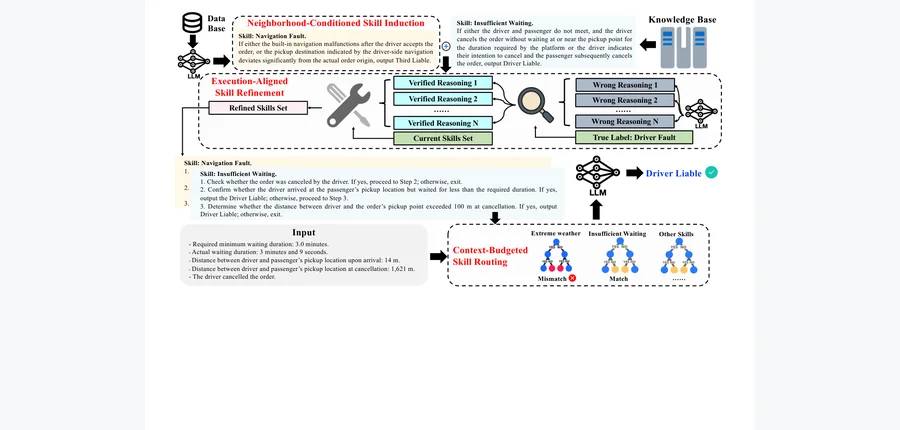 arXiv 2026-11-06 · cs.AI · #1 **[KDASO: Knowledge-Data Dual-Driven Automated Skill Optimization for Liability Adjudication Tasks](https://arxiv.org/abs/2611.06972)** Zi-Jian Cheng , Weiming Wu , Jie Meng , Zhen Peng , Shan Huang , Qun Li , Guobing Wu , Lan-Zhe Guo Affiliation: Nanjing University / DiDichuxing Co. Ltd [Paper](https://arxiv.org/abs/2611.06972) · [Figure source](https://arxiv.org/html/2611.06972v1/pipeline.png) 

[EN] Abstract
Liability adjudication tasks (e.g., legal charge determination) require analyzing event descriptions against domain-specific skills to determine whether a party should bear liability. While Large Language Models (LLMs) have shown promise in this area by leveraging executable skills for interpretable reasoning, existing approaches face three critical limitations: skill libraries become stale as real-world scenarios dynamically evolve, skill descriptions often suffer from a semantic execution gap where LLMs deviate from intended expert logic, and growing skill collections exceed context budgets causing critical skill omission. To address these challenges, we propose Knowledge-Data Dual-Driven Automated Skill Optimization (KDASO), which continuously evolves a skill library through neighborhood-conditioned induction from recent adjudication data, execution-aligned refinement based on LLM trajectory analysis, and context-budgeted routing for scalable skill selection. Experiments across ride-hailing adjudication, legal liability determination, and logical reasoning judgment demonstrate that KDASO significantly outperforms current general-purpose and domain-specific baselines. KDASO further achieves 8.96% improvement when transferring skills to concept-similar scenarios and maintains consistent performance gains through continuous optimization, underscoring the high transferability and stability of generated skills. <a href="https://arxiv.org/list/cs/new?show=2000#2611.06972">Source</a>

[ZH] Abstract
责任裁定任务（例如法律罪名判定）需要依据领域特定技能分析事件描述，以确定一方是否应承担责任。尽管大语言模型（LLM）通过利用可执行技能实现可解释推理，在这一领域展现出潜力，但现有方法面临三个关键局限：随着现实场景动态演变，技能库会过时；技能描述常存在语义执行鸿沟，LLM 会偏离预期的专家逻辑；不断扩大的技能集合会超出上下文预算，导致关键技能被遗漏。为应对这些挑战，我们提出知识—数据双驱动自动技能优化（KDASO），通过基于近期裁定数据、以邻域为条件的归纳，基于 LLM 轨迹分析的执行对齐细化，以及受上下文预算约束的路由来实现可扩展技能选择，从而持续演化技能库。在网约车裁定、法律责任判定和逻辑推理判断上的实验表明，KDASO 显著优于现有通用和领域特定基线。KDASO 在向概念相似场景迁移技能时进一步取得 8.96% 的提升，并通过持续优化保持一致的性能增益，凸显了生成技能的高度可迁移性和稳定性。 <a href="https://arxiv.org/list/cs/new?show=2000#2611.06972">Source</a>
 | 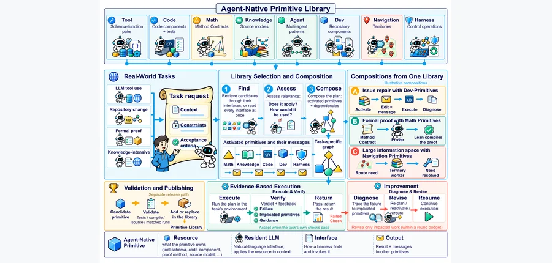 arXiv 2026-11-06 · cs.CL · #2 **[The Last Mile to the Real World: Agent-Native Primitives as Reusable Building Blocks for Solving Real-World Tasks](https://arxiv.org/abs/2611.07461)** Haibo Jin , Peng Kuang , Xiaopeng Yuan , Lucheng Fu , Jerry Wang , Xucheng Yu , Yaoning Yu , Dehao Wu , Runguo Li , Colin… Affiliation: University of Illinois Urbana-Champaign / Georgia Institute of Technology / heelo.dev [Paper](https://arxiv.org/abs/2611.07461) · [Project](https://heelo.dev) · [Figure source](https://arxiv.org/html/2611.07461v1/overview_v5.png) 

[EN] Abstract
How can an agent handle a real-world task end to end? Frontier models with their own harnesses still fall short on real-world benchmarks: on Terminal-Bench 4.0, GPT-5.6 Sol with Codex resolves 37.3% of the tasks and Claude Opus 5 with Claude Code 51.8%. These tasks fail at the step from reaching a resource to applying it, which we call the last mile to the real world. Existing approaches put the resource within reach but leave the competence to apply it with the caller, so each harness rebuilds that competence. We introduce agent-native primitives, reusable units that equip a resource with a resident LLM that applies it in context and communicates with other primitives, and HEELO (Harness Engineering around Evolving Agent-Native Primitives for the Last Mile to Real-WOrld Tasks), a harness engineering framework that builds each task's harness from a library of such primitives. HEELO composes the primitives a task needs into a task-specific graph, verifies the result against evidence from the environment, revises the primitives a failure implicates, and admits new or improved primitives after validation. We instantiate HEELO with eight primitive families, each built for one kind of task, and evaluate them on more than twenty benchmarks. Dev-Primitives raise Terminal-Bench 4.0 resolution from 37.3% under Codex to 55.5% on the same backbone, Harness Primitives composed per task raise Terminal-Bench 2.0 Pass@1 from 60.0% for the seed harness to 72.2%, Tool Primitives raise ToolBench pass rate from 55.8% to 75.1%, and Navigation Primitives raise GAIA-Text-103 accuracy from 45.6% to 58.3%. On the 46 real-world tasks of our this http URL platform, Claude Opus 5.5 with Claude Code and GPT-6.1 Sol with Codex complete 9 each on their own and 39 and 35 when connected to HEELO through our MCP server, with 1.9$\times$ and 2.3$\times$ less time and 1.55$\times$ lower cost per completed task. <a href="https://arxiv.org/list/cs/new?show=2000#2611.07461">Source</a>

[ZH] Abstract
智能体如何端到端地处理现实世界任务？采用各自运行框架的前沿模型在现实世界基准上仍表现不足：在 Terminal-Bench 4.0 上，配合 Codex 的 GPT-5.6 Sol 解决了 37.3% 的任务，配合 Claude Code 的 Claude Opus 5 解决了 51.8%。这些任务在从触及资源到应用资源的步骤上失败，我们将其称为通向现实世界的最后一公里。现有方法让调用者能够接触资源，却把运用资源的能力留给调用者，因此每个框架都要重新构建这种能力。我们提出智能体原生原语：这是一类可复用单元，为资源配备驻留 LLM，使其能够结合上下文运用资源并与其他原语通信；同时提出 HEELO（围绕演化中的智能体原生原语进行框架工程，以解决现实世界任务的最后一公里），这一框架工程体系从此类原语库构建每项任务的运行框架。HEELO 将任务所需原语组合为任务特定图，依据环境证据验证结果，修改失败所涉及的原语，并在验证后接纳新增或改进的原语。我们将其实现为八类原语，每类面向一种任务，并在二十多个基准上评估。使用相同骨干模型，开发原语使 Terminal-Bench 4.0 的解决率从 Codex 下的 37.3% 提升到 55.5%；按任务组合的框架原语使 Terminal-Bench 2.0 的 Pass@1 从种子框架的 60.0% 提升到 72.2%；工具原语使 ToolBench 通过率从 55.8% 提升到 75.1%；导航原语使 GAIA-Text-103 准确率从 45.6% 提升到 58.3%。在我们 this http URL 平台的 46 项现实世界任务上，配合 Claude Code 的 Claude Opus 5.5 和配合 Codex 的 GPT-6.1 Sol 独立使用时各完成 9 项，通过我们的 MCP 服务器连接 HEELO 后分别完成 39 项和 35 项，每项完成任务的耗时分别降低 1.9 倍和 2.3 倍，成本降低 1.55 倍。 <a href="https://arxiv.org/list/cs/new?show=2000#2611.07461">Source</a>
 | 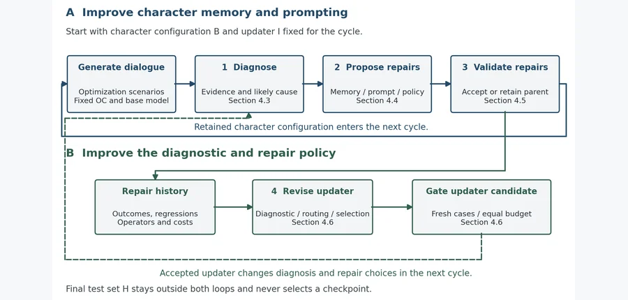 arXiv 2026-11-06 · cs.CL · #3 **[Recursive Self-Improvement for Long-Horizon Role-Playing Dialogue](https://arxiv.org/abs/2611.07469)** Y. L. Li , Y. H. Wu Affiliation: Henan Chengxi Technology Co., Ltd. [Paper](https://arxiv.org/abs/2611.07469) · [Figure source](https://arxiv.org/pdf/2611.07469) 

[EN] Abstract
Long-horizon role-playing dialogue requires consistent character identity, reliable memory, and context-sensitive interaction. We present a bounded recursive self-improvement (RSI) framework that revises original-character memory, stable persona instructions, and a policy for constructing turn-level prompts. Repair outcomes also inform revisions to the updater's diagnostic rules, edit routing, and candidate selection. We specify the updater as a versioned policy with explicit inputs, editable fields, acceptance gates, and stopping conditions. An internal evaluation covers 50 original characters and five models, with two 100-round conversations per character-model pair: 500 conversations per condition. Across the pooled evaluated replies, the bad-response rate decreases from 14.00% (6,973/49,824) to 4.94% (2,459/49,793), a 9.06-percentage-point reduction and a 64.71% relative reduction. In 600 blinded human comparisons, RSI receives 294 wins, 187 ties, and 119 losses, yielding a 71.19% win rate among decisive judgments. The results support improved aggregate dialogue quality for the complete framework on the internal test distribution. <a href="https://arxiv.org/list/cs/new?show=2000#2611.07469">Source</a>

[ZH] Abstract
长时程角色扮演对话需要一致的角色身份、可靠的记忆以及情境敏感的交互。我们提出一种有界递归自我改进（RSI）框架，修改原创角色记忆、稳定的人设指令以及构造轮次级提示的策略。修复结果还用于修改更新器的诊断规则、编辑路由和候选选择。我们将更新器明确规定为带版本的策略，具有显式输入、可编辑字段、接纳门槛和停止条件。内部评估涵盖 50 个原创角色和五个模型，每个角色—模型组合进行两次 100 轮对话，即每个实验条件下 500 次对话。在汇总后的被评估回复中，不良回复率从 14.00%（6,973/49,824）下降到 4.94%（2,459/49,793），降低 9.06 个百分点，相对下降 64.71%。在 600 次盲测人工比较中，RSI 获得 294 次胜、187 次平和 119 次负，在有明确胜负的判断中胜率为 71.19%。结果支持完整框架在内部测试分布上改善了总体对话质量。 <a href="https://arxiv.org/list/cs/new?show=2000#2611.07469">Source</a>
 |
| 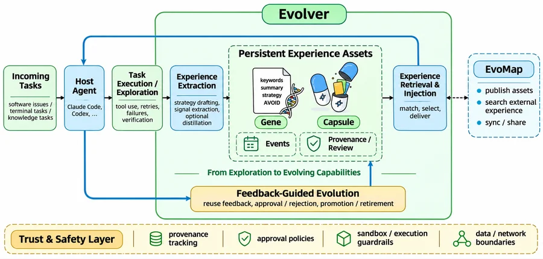 arXiv 2026-11-06 · cs.SE · #4 **[Evolver: Turning Agent Exploration into Evolving Capabilities](https://arxiv.org/abs/2611.07595)** Haoyang Zhang , Qumeng Sun , Xiao Zhang , Xiang Liu , Zhidong Fan , Junjie Wang Affiliation: Infinite Evolution Lab, EvoMap [Paper](https://arxiv.org/abs/2611.07595) · [Code](https://github.com/EvoMap/evolver) · [Figure source](https://arxiv.org/html/2611.07595v1/figures/overview.png) 

[EN] Abstract
Agent exploration produces valuable procedural knowledge, yet much of this experience remains confined to transient execution traces and is not systematically reused. We introduce Evolver, an experience-driven framework that transforms agent exploration into persistent, reusable capabilities without updating foundation model parameters. Built around structured Gene assets, Evolver integrates experience acquisition, retrieval, and feedback-guided evolution to support experience-conditioned execution across existing agent harnesses. We evaluate Evolver using Claude Code and Codex, two foundation model configurations, and four benchmarks: Terminal-Bench 2.1, SWE-bench Multilingual, SWE-rebench, and GAIA. On a selected diagnostic set of 320 paired executions, Evolver improves task success from 83.13% to 87.50% (+4.38 percentage points) while reducing recorded task-execution token consumption by 24.24%. Furthermore, among 265 pairs successful under both conditions, token consumption decreases by 17.57%, demonstrating efficiency benefits even when task success is preserved. These findings suggest that persistent procedural experience can improve both task effectiveness and execution efficiency, providing a practical foundation for transforming agent exploration into evolving capabilities. <a href="https://arxiv.org/list/cs/new?show=2000#2611.07595">Source</a>

[ZH] Abstract
智能体探索产生了有价值的程序性知识，但这些经验大多仍局限在短暂的执行轨迹中，未得到系统复用。我们提出 Evolver，一种经验驱动框架，无需更新基础模型参数，即可将智能体探索转化为持久、可复用的能力。Evolver 围绕结构化 Gene 资产构建，整合经验获取、检索和反馈引导的演化，在现有智能体运行框架中支持以经验为条件的执行。我们使用 Claude Code 和 Codex、两种基础模型配置以及四个基准评估 Evolver：Terminal-Bench 2.1、SWE-bench Multilingual、SWE-rebench 和 GAIA。在选定的 320 对配对执行诊断集上，Evolver 将任务成功率从 83.13% 提升到 87.50%（增加 4.38 个百分点），同时将记录的任务执行 token 消耗减少 24.24%。此外，在两个条件下都成功的 265 对执行中，token 消耗减少 17.57%，说明即使保持任务成功，也能获得效率收益。这些发现表明，持久化程序性经验能够提高任务有效性和执行效率，为将智能体探索转化为演化中的能力提供了实践基础。 <a href="https://arxiv.org/list/cs/new?show=2000#2611.07595">Source</a>
 | 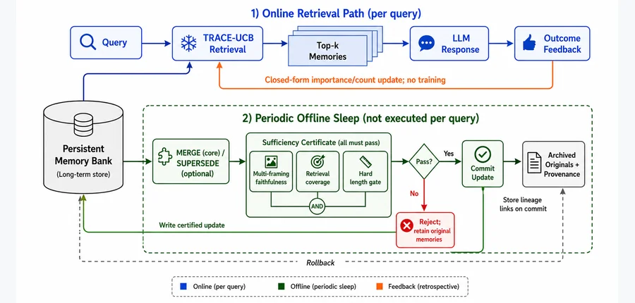 arXiv 2026-11-06 · cs.IR · #5 **[MEMOIR: A Training-Free Memory Lifecycle for Long-Horizon LLM Agents](https://arxiv.org/abs/2611.07631)** Mayank Anand , Subham Raj , Aman Vaibhav Jha , Sriparna Saha Affiliation: Indian Institute of Information Technology Allahabad / Indian Institute of Technology Patna [Paper](https://arxiv.org/abs/2611.07631) · [Code](https://github.com/AnandMayank/MEMOIR) · [Figure source](https://arxiv.org/html/2611.07631v1/MEMOIR_arch_main.png) 

[EN] Abstract
Long-horizon LLM agents require memory systems that preserve useful information across sessions and retrieve it when needed. Existing systems treat these as separate problems: memories are written prospectively with static importance scores that are never revised after use. This creates two coupled failure modes: consolidation can silently destroy evidence that future queries require, while retrieval continues to favor stale memories. We propose MEMOIR (Memory Evidence via Merge-certified, Online Importance Revision), a training-free memory lifecycle that unifies judge-gated consolidation with retrospective attribution. Before compressing memory, screening gates test whether answer-relevant evidence is preserved. After each query, attribution estimates which retrieved memories supported the answer and updates their retrieval priority. A UCB-style exploration bonus additionally encourages retrieval of under-exposed memories, reducing the risk that frequently retrieved memories crowd out useful but less-seen evidence. On 1,905 deduplicated LoCoMo QA pairs, the full retrieval stack improves evidence recall@5 by 11.92 percentage points over bare cosine, with confidence-gated feedback adding 1.50 points overall without reference answers or reranker training; a deployment-unavailable oracle adds 1.84 points overall and 8.05 points on multi-hop. Judge-gated merge changes the recall of text-based evidence from 58.82% to 59.08%, reduces the active store by 1.42%, and incurs 0 observed losses in 100 independently audited merges, with a one-sided 95% upper loss-rate bound of 2.95%. Together, these results outline a practical deployment path: no additional LLM call on the online write path, with merge screening confined to periodic offline consolidation. The lifecycle reduces to one principle: attribute usefulness after use, and screen for preservation before compression. <a href="https://arxiv.org/list/cs/new?show=2000#2611.07631">Source</a>

[ZH] Abstract
长时程 LLM 智能体需要能够跨会话保留有用信息，并在需要时检索这些信息的记忆系统。现有系统将两者视为独立问题：记忆以面向未来的方式写入，并赋予静态重要性分数，使用后也从不修订。这产生两个耦合的失效模式：整合可能悄然破坏未来查询所需证据，而检索仍继续偏向过时记忆。我们提出 MEMOIR（通过合并认证与在线重要性修订获得记忆证据），一种无需训练的记忆生命周期，将评判器把关的整合与回溯归因统一起来。压缩记忆之前，筛选门槛测试是否保留了与答案相关的证据。每次查询之后，归因估计哪些被检索记忆支持了答案，并更新其检索优先级。类似 UCB 的探索奖励还鼓励检索曝光不足的记忆，降低频繁检索的记忆挤占有用但较少见证据的风险。在 1,905 个去重后的 LoCoMo 问答对上，完整检索栈相对裸余弦检索将证据 recall@5 提升 11.92 个百分点；置信度把关的反馈在不使用参考答案或重排序器训练的情况下，带来总体 1.50 个百分点的额外增益；部署时不可获得的预言机带来总体 1.84 个百分点、多跳任务 8.05 个百分点的额外增益。评判器把关的合并将文本证据召回率从 58.82% 变为 59.08%，使活跃存储缩减 1.42%，并在 100 次独立审计的合并中观察到 0 次损失，其单侧 95% 损失率上界为 2.95%。这些结果共同勾勒出实际部署路径：在线写入路径不增加 LLM 调用，合并筛选限于周期性离线整合。其生命周期可归结为一项原则：使用后归因有用性，压缩前筛查保真性。 <a href="https://arxiv.org/list/cs/new?show=2000#2611.07631">Source</a>
 | 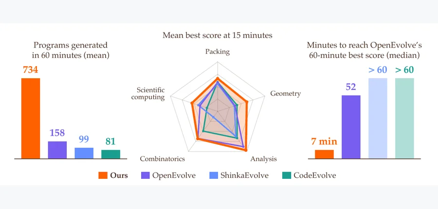 arXiv 2026-11-06 · cs.AI · #6 **[SwarmEvolve: Latent Agent Swarms for Evolutionary Discovery and Optimization](https://arxiv.org/abs/2611.08483)** Qile Jiang , George Em Karniadakis Affiliation: Brown University [Paper](https://arxiv.org/abs/2611.08483) · [Code](https://github.com/Qile-J/SwarmEvolve) · [Figure source](https://arxiv.org/pdf/2611.08483) 

[EN] Abstract
LLM-guided evolutionary search uses AI agents to improve programs for mathematical and computational problems by iteratively refining solutions and combining high-scoring methods. However, the process is often slow because the LLM generates a long textual chain of thought for each round and must repeat this generation many times to maintain population diversity. We present SwarmEvolve, a framework in which hundreds of low-cost agents per round work in swarms, reason in latent space without decoding to text, and share information by passing KV caches. Each swarm studies the problem from a different angle. A novelty filter keeps the most distinct agent ideas by directly measuring the distances between the agents' hidden state vectors. Crossover of ideas happens naturally in latent space, as a summarizer agent receives the combined KV caches of all swarm members. On 21 problems in mathematical discovery and scientific computing, SwarmEvolve gets the highest average score and needs a median of only 3 to 8 minutes to reach the best scores that other state-of-the-art frameworks reach in 60 minutes. On several problems, SwarmEvolve with Qwen3 8B improves on the solutions that AlphaEvolve first found with frontier LLMs. Our work shows that agent swarms that communicate in latent space offer a fast, low-cost approach to program search for scientific problems. <a href="https://arxiv.org/list/cs/new?show=2000#2611.08483">Source</a>

[ZH] Abstract
LLM 引导的演化搜索利用 AI 智能体改进数学与计算问题的程序，通过迭代细化解法并组合高分方法。然而，这一过程往往缓慢，因为 LLM 每轮都要生成冗长的文本思维链，并须反复生成以维持种群多样性。我们提出 SwarmEvolve 框架，每轮让数百个低成本智能体以群体方式工作，在潜在空间中推理而不解码为文本，并通过传递 KV 缓存共享信息。每个群体从不同角度研究问题。新颖性过滤器直接测量智能体隐藏状态向量间的距离，保留最有差异的智能体想法。总结智能体接收所有群体成员组合后的 KV 缓存，使想法交叉自然地发生在潜在空间。在数学发现与科学计算的 21 个问题上，SwarmEvolve 获得最高平均分，并且仅需中位数 3 至 8 分钟即可达到其他先进框架在 60 分钟内达到的最佳分数。在若干问题上，使用 Qwen3 8B 的 SwarmEvolve 改进了 AlphaEvolve 最初使用前沿 LLM 找到的解法。我们的工作表明，通过潜在空间通信的智能体群体为科学问题的程序搜索提供了一种快速、低成本的方法。 <a href="https://arxiv.org/list/cs/new?show=2000#2611.08483">Source</a>
 |
| 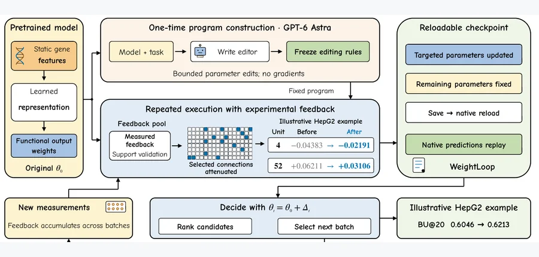 arXiv 2026-11-06 · cs.LG · #7 **[WeightLoop: Weight-Space Programming with Experimental Feedback](https://arxiv.org/abs/2611.07319)** Mengran Li , Bo Li , Weijing Zhao , Chengyang Zhang , Boyu Zhang , Jinfeng Xu , Zelin Zang , Victor C. M. Leung , Stan Z. Li Affiliation: Hong Kong Institute of Science and Innovation / University of Macau / Sichuan University / Sun Yat-sen University / University of British Columbia / Westlake University [Paper](https://arxiv.org/abs/2611.07319) · [Figure source](https://arxiv.org/pdf/2611.07319) 

[EN] Abstract
Weight-space programming (WSP) shows that language models can reason about and rewrite neural network weights; recursive self-improvement (RSI) motivates feedback-driven improvement. Models guiding experiments receive concrete feedback: completed assays reveal prediction errors and inform what to test next. We introduce WeightLoop, a framework that turns experimental feedback into persistent updates to deployed predictors. GPT-6 Astra inspects a task specification and the model implementation, then writes a bounded, reusable parameter-editing program. As new measurements arrive, the program identifies prediction discrepancies, validates candidate edits using observed outcomes, and writes the selected changes back to the original model. The editor remains fixed while the predictor evolves, enabling repeated updates without further LLM calls or gradient retraining while preserving the original inference interface. In offline replay, targeted edits improve mean ranking utility in seven of eight endpoint-budget settings (all eight versus random edits) and mean final discovery across three sequential tasks. WeightLoop connects WSP with an RSI-inspired improvement loop, making experimental evidence a direct driver of model change and subsequent decisions. <a href="https://arxiv.org/list/cs/new?show=2000#2611.07319">Source</a>

[ZH] Abstract
权重空间编程（WSP）表明，语言模型能够推理并改写神经网络权重；递归自我改进（RSI）则推动了反馈驱动的改进。指导实验的模型能获得具体反馈：完成的测定揭示预测误差，并为下一步测试提供信息。我们提出 WeightLoop 框架，将实验反馈转化为对已部署预测器的持久更新。GPT-6 Astra 检查任务规范与模型实现，然后编写一个有界、可复用的参数编辑程序。随着新测量到来，该程序识别预测偏差，使用已观察结果验证候选编辑，并将选中的变化写回原模型。编辑器保持固定，而预测器不断演化，使其无需进一步调用 LLM 或梯度重训练即可反复更新，同时保留原始推理接口。在离线回放中，定向编辑在八个终点—预算设置中的七个提高平均排序效用（相对随机编辑则八个设置全部提高），并在三项序贯任务上提高平均最终发现量。WeightLoop 将 WSP 与受 RSI 启发的改进闭环连接起来，使实验证据成为模型变化及后续决策的直接驱动力。 <a href="https://arxiv.org/list/cs/new?show=2000#2611.07319">Source</a>
 | 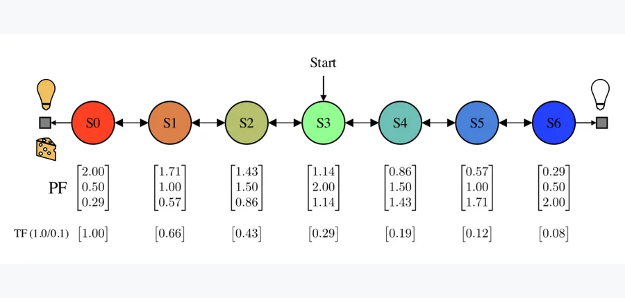 arXiv 2026-11-06 · cs.LG · #8 **[Permanent and Transient Representations for Continual Reinforcement Learning](https://arxiv.org/abs/2611.07327)** Nishanth Anand , Doina Precup Affiliation: McGill University / Mila / Google DeepMind [Paper](https://arxiv.org/abs/2611.07327) · [Code](https://github.com/NishanthVAnand/pt_representations_crl) · [Figure source](https://arxiv.org/html/2611.07327v1/control_task.png) 

[EN] Abstract
Continual Reinforcement Learning (CRL) agents struggle to adapt to new situations while retaining prior knowledge, leading to a stability-plasticity trade-off. One approach to solving this problem is by using complementary learning systems: one for slow, long-term learning and another for quick, transient adaptation. Anand &amp; Precup (2023) instantiated this idea using permanent and transient value functions, but used the same features in both systems. Intuitively, long-term learning should rely more on parametric representations for broad generalization, while transient learning would be best served by non-parametric representations for situation-specific adaptation. In this paper, we explore this idea both theoretically and empirically. By introducing a novel non-parametric approximation for estimating the transient value function in complex tasks, we demonstrate that our method enables online learning and outperforms competitive baselines on image-based tasks and Craftax-Classic, underscoring the effectiveness of our system-level decomposition. <a href="https://arxiv.org/list/cs/new?show=2000#2611.07327">Source</a>

[ZH] Abstract
持续强化学习（CRL）智能体在保留既有知识的同时适应新情况时面临困难，因而产生稳定性—可塑性权衡。一种解决方法是使用互补学习系统：一个负责缓慢、长期学习，另一个负责快速、暂时适应。Anand 与 Precup（2023）使用永久与暂时价值函数实现了这一想法，但两个系统使用相同特征。直观上，长期学习应更多依靠参数化表征以实现广泛泛化，而暂时学习更适合采用非参数化表征，以实现针对特定情境的适应。本文从理论和实证两方面探索这一想法。通过引入一种新的非参数近似来估计复杂任务中的暂时价值函数，我们表明该方法支持在线学习，并在基于图像的任务和 Craftax-Classic 上优于有竞争力的基线，凸显了这种系统层面分解的有效性。 <a href="https://arxiv.org/list/cs/new?show=2000#2611.07327">Source</a>
 | 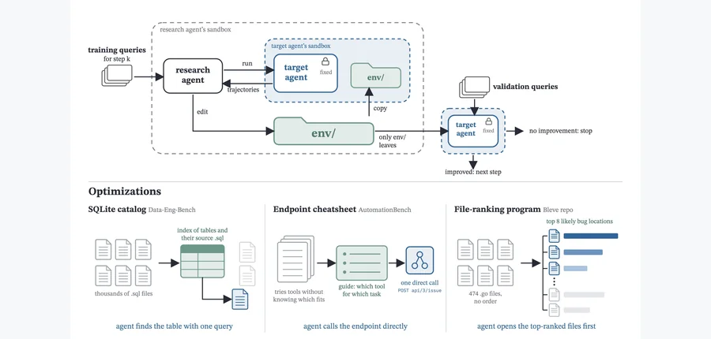 arXiv 2026-11-06 · cs.AI · #9 **[EnvOpt: Automated Optimization for Agent Environments](https://arxiv.org/abs/2611.07372)** Mingxuan Li , Huanzhi Mao , Qiuyang Mang , Hanchen Li , Joseph E. Gonzalez , Alex Dimakis Affiliation: University of California, Berkeley / University of Chicago / Bespoke Labs [Paper](https://arxiv.org/abs/2611.07372) · [Code](https://github.com/itea1001/EnvOpt) · [Figure source](https://arxiv.org/pdf/2611.07372) 

[EN] Abstract
An LLM agent's cost and success depend on its model, its harness, and its environment. In addition to the widely studied directions of parameter tuning and harness optimization, we propose the third direction: optimization over stationary environments. Agents are often deployed in rich environments shared by many tasks, such as a company's Slack workspace or a complex collection of data sources, documents or tickets. We call these environments stationary environments. We introduce EnvOpt, a method for automated end-to-end optimization of stationary environments for any given model and harness, using real or synthetic tasks without needing any graders or reference answers. On AutomationBench, EnvOpt reduces the cost of Claude Haiku 4.5 by 72.7% and raises its pass rate by 14.34%. The same environment transfers to Opus 5, cutting its cost by 68.1% with a 1.34% gain. Added on top of Meta-Harness's optimized harness for Haiku 4.5, it lowers cost by a further 83.4% and adds 11.17% accuracy over Meta-Harness alone. Across 5 benchmarks, EnvOpt significantly reduces the cost of agents while improving or maintaining pass rate, and is transferable to different models and different harnesses. We also discuss common successful and rejected environment optimization strategies during automated optimization. More broadly, our results show that how information is represented to an agent shapes both its cost and its success, making the environment worth optimizing in addition to the parameters and the harness. <a href="https://arxiv.org/list/cs/new?show=2000#2611.07372">Source</a>

[ZH] Abstract
LLM 智能体的成本和成功取决于模型、运行框架及其环境。除了已被广泛研究的参数调优与框架优化方向，我们提出第三个方向：对固定环境进行优化。智能体常部署于由多项任务共享的丰富环境，例如公司的 Slack 工作区，或复杂的数据源、文档及工单集合。我们将这些环境称为固定环境。我们提出 EnvOpt，一种针对任意给定模型与框架、利用真实或合成任务且无需任何评分器或参考答案，对固定环境进行自动端到端优化的方法。在 AutomationBench 上，EnvOpt 将 Claude Haiku 4.5 的成本降低 72.7%，通过率提高 14.34%。相同环境可迁移到 Opus 5，将成本降低 68.1%，同时带来 1.34% 的增益。在 Meta-Harness 为 Haiku 4.5 优化的框架上叠加 EnvOpt，相对仅使用 Meta-Harness，可进一步降低 83.4% 的成本并增加 11.17% 的准确率。在五个基准上，EnvOpt 显著降低智能体成本，同时改善或保持通过率，并可迁移到不同模型和框架。我们还讨论了自动优化中常见的成功与被拒绝环境优化策略。更广泛地说，结果表明，信息向智能体呈现的方式同时影响其成本与成功，因此除参数和框架外，环境也值得优化。 <a href="https://arxiv.org/list/cs/new?show=2000#2611.07372">Source</a>
 |
| 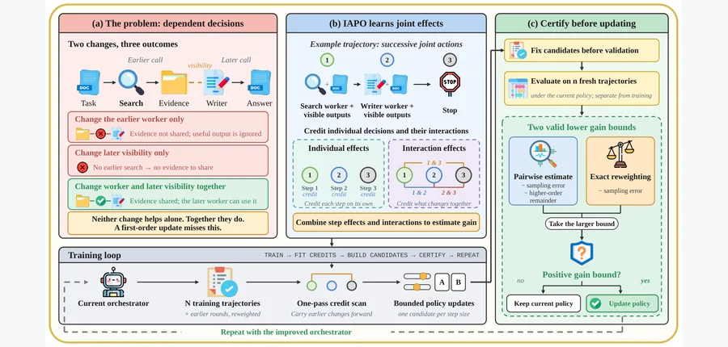 arXiv 2026-11-06 · cs.LG · #10 **[Learning Multi-Agent Orchestration:Higher-Order Interactions in Policy Improvement](https://arxiv.org/abs/2611.07495)** Kaixuan Liu , Guojun Xiong Affiliation: Emory University / Shanghai Jiao Tong University [Paper](https://arxiv.org/abs/2611.07495) · [Figure source](https://arxiv.org/html/2611.07495v1/fig1.png) 

[EN] Abstract
Learned orchestration has emerged as a promising paradigm for large language model (LLM)-based multi-agent systems, in which a central orchestrator selects agents and controls the information they receive throughout a task. Despite rapid empirical progress, existing methods train the orchestrator by crediting each decision with its own advantage, implicitly assuming that the other decisions in the episode stay fixed. This assumption fails in orchestration, where the contribution of each decision to the final outcome depends on the decisions preceding it, so the gain of a joint update is not the sum of its per-decision effects. To address this challenge, we introduce \textbf{IAPO}, an interaction-aware policy optimization framework that explicitly accounts for interactions among decisions. Specifically, IAPO exactly decomposes the performance difference between two policies into the effects of individual decisions and their interactions, which we prove can account for half of the attainable gain, and then optimizes both from sampled trajectories while certifying that every update is an improvement. On long-input versions of GSM8K, MATH, DROP, MBPP and HumanEval, against fifteen published multi-agent and workflow-search systems on the same 7B executor, IAPO's deployed plans reach the strongest system's accuracy with fewer tokens, and removing the interaction term costs 7 to 17 points of accuracy on code. <a href="https://arxiv.org/list/cs/new?show=2000#2611.07495">Source</a>

[ZH] Abstract
学习型编排已成为基于大语言模型（LLM）的多智能体系统的一种有前景范式，中央编排器选择智能体并控制它们在任务全过程中接收的信息。尽管实证进展迅速，现有方法却通过将每次决策归功于其自身优势来训练编排器，隐含假设该回合其他决策保持固定。这一假设在编排中失效，因为每次决策对最终结果的贡献依赖于此前的决策，因此联合更新的收益并不等于各决策效果之和。为应对这一挑战，我们提出 	extbf{IAPO}，一种显式考虑决策间交互的交互感知策略优化框架。具体而言，IAPO 将两个策略间的性能差异精确分解为单个决策效果及其交互项；我们证明，交互项可占可实现收益的一半，然后利用采样轨迹同时优化两者，并证明每次更新都是改进。在 GSM8K、MATH、DROP、MBPP 和 HumanEval 的长输入版本上，与使用相同 7B 执行器的十五种已发表多智能体及工作流搜索系统相比，IAPO 部署的方案以更少 token 达到最强系统的准确率，而去掉交互项会使代码任务准确率损失 7 至 17 个百分点。 <a href="https://arxiv.org/list/cs/new?show=2000#2611.07495">Source</a>
 | 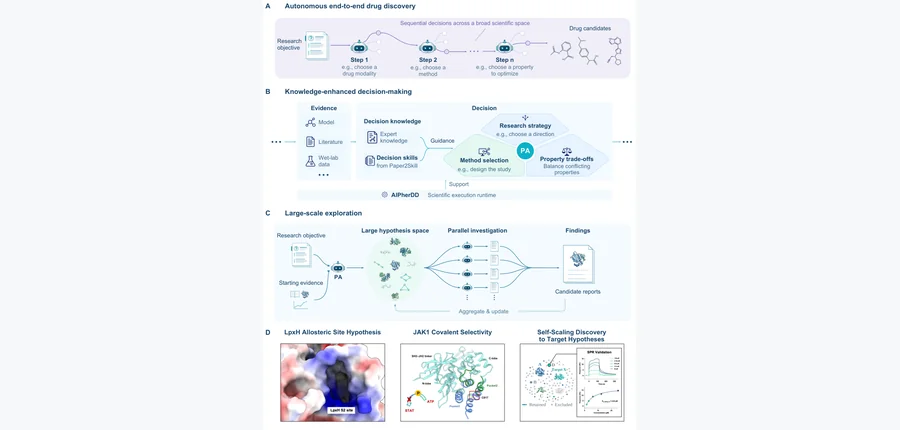 arXiv 2026-11-06 · cs.AI · #11 **[PharmAgents2: Towards Autonomous End-to-End Drug Discovery](https://arxiv.org/abs/2611.07653)** Haichuan Tan , Bowen Gao , Tao Huang , Jiaxin Tan , Xin Hong , Baoguo Yao , Yifei Wang , Zhichao Deng , Hanji Du , Dapeng… Affiliation: AIPher Technology / Institute for AI Industry Research, Tsinghua University [Paper](https://arxiv.org/abs/2611.07653) · [Figure source](https://arxiv.org/html/2611.07653v1/figure1.png) 

[EN] Abstract
Drug discovery requires continuous scientific decision-making across a vast research space. We introduce PharmAgents2, an autonomous system for end-to-end drug discovery that combines knowledge-enhanced decision-making with organized large-scale exploration. Paper2Skill extracts transferable scientific decision knowledge from public sources and, together with expert-developed skills, supports research decisions. Self-Scaling Discovery expands exploration through parallel agents inheriting research context and decision-making capabilities across targets, scientific hypotheses, and discovery strategies. We introduce PharmAgents-Bench v0.1, comprising 121 questions across nine decision scenarios and three end-to-end tasks assessed with expert-defined process rubrics. PharmAgents2 outperforms evaluated baselines in most decision categories and achieves the highest process scores on all three end-to-end tasks. In three real-world studies, autonomous investigations generated findings subsequently supported by human-executed experiments. For LpxH, PharmAgents2 hypothesized a previously unreported allosteric site and screened compounds against it, identifying a novel inhibitor scaffold with experimentally confirmed inhibitory activity and binding. For JAK1, it prioritized a covalent inhibition strategy and nominated compounds with experimentally demonstrated activity. Starting from a known bioactive molecule, Self-Scaling Discovery explored candidate targets across the proteome and identified a new binding target, with the interaction subsequently confirmed experimentally. PharmAgents2 represents a prototype of a virtual pharmaceutical company, marking a step toward autonomous end-to-end drug discovery. <a href="https://arxiv.org/list/cs/new?show=2000#2611.07653">Source</a>

[ZH] Abstract
药物发现需要在广阔研究空间中持续进行科学决策。我们提出 PharmAgents2，一种面向端到端药物发现的自主系统，将知识增强决策与有组织的大规模探索结合起来。Paper2Skill 从公开来源提取可迁移的科学决策知识，并与专家开发的技能共同支持研究决策。Self-Scaling Discovery 通过并行智能体扩大探索，这些智能体跨靶点、科学假设和发现策略继承研究上下文及决策能力。我们提出 PharmAgents-Bench v0.1，包含九种决策场景中的 121 个问题，以及用专家定义的过程量规评估的三项端到端任务。PharmAgents2 在多数决策类别中优于被评估基线，并在全部三项端到端任务上获得最高过程分数。在三项现实研究中，自主调查产生的发现随后得到人工执行实验的支持。对于 LpxH，PharmAgents2 假设了一个此前未报告的变构位点，并据此筛选化合物，识别出一种新抑制剂骨架，其抑制活性和结合均得到实验证实。对于 JAK1，它优先考虑共价抑制策略，并提名了经实验证实具有活性的化合物。从一种已知生物活性分子出发，Self-Scaling Discovery 在整个蛋白质组中探索候选靶点并识别出一个新结合靶点，该相互作用随后得到实验确认。PharmAgents2 是虚拟制药公司的一种原型，标志着向自主端到端药物发现迈出了一步。 <a href="https://arxiv.org/list/cs/new?show=2000#2611.07653">Source</a>
 | 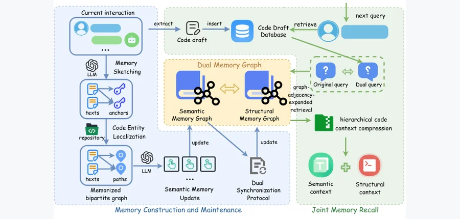 arXiv 2026-11-06 · cs.SE · #12 **[ReConMem: A Graph-Based Dual Memory System for Repository-Oriented Conversations](https://arxiv.org/abs/2611.07759)** Zhishuo Yang , Li Zhang , Yang Liu , Donghao Yang , Fang Liu Affiliation: Beihang University [Paper](https://arxiv.org/abs/2611.07759) · [Code](https://github.com/CoconutTreeee/ReConMem) · [Figure source](https://arxiv.org/html/2611.07759v1/overview_0930_v4.png) 

[EN] Abstract
LLM-based code assistants are increasingly used in iterative repository-level development, where effective assistance requires jointly leveraging evolving conversational history and repository context. Existing memory systems, however, are primarily designed for general-purpose conversations and do not sufficiently coordinate conversational information with the structured code entities to which it refers. We propose ReConMem, a graph-based dual memory system for repository-oriented conversations. ReConMem organizes distilled conversational memories and conversation-relevant code entities into interconnected semantic and structural memory graphs, while maintaining their cross-graph associations as interactions evolve. For memory recall, ReConMem combines natural-language and code-aligned retrieval through code-draft-based query grounding, expands retrieved information over intra- and inter-graph relations, and compresses retrieved code according to its structural granularity. We evaluate ReConMem on two repository-oriented conversational benchmarks spanning long-horizon context management and realistic project-grounded multi-turn assistance. On LoCoEval, ReConMem improves Pass@1 over the strongest baseline by 7.917 and 7.292 percentage points on single-hop and multi-hop subsets, respectively, with comparable context compression. On CodeAssistBench, it achieves 27.61% Correct and 44.03% Partially Correct, exceeding Full History by 4.10 and 7.09 percentage points, respectively, while improving interaction quality. These results demonstrate that aligning conversational memory with repository structure improves context management for repository-oriented multi-turn interactions. <a href="https://arxiv.org/list/cs/new?show=2000#2611.07759">Source</a>

[ZH] Abstract
基于 LLM 的代码助手越来越多地用于迭代式仓库级开发，有效协助需要同时利用不断演变的对话历史与仓库上下文。然而，现有记忆系统主要为通用对话设计，未充分协调对话信息与其所指向的结构化代码实体。我们提出 ReConMem，一种面向仓库对话的图式双记忆系统。ReConMem 将提炼后的对话记忆和与对话相关的代码实体组织为相互连接的语义与结构记忆图，并随交互演化维护跨图关联。记忆召回时，ReConMem 通过基于代码草稿的查询落地，结合自然语言和代码对齐检索，沿图内与图间关系扩展检索信息，并依据结构粒度压缩检索到的代码。我们在两个面向仓库对话的基准上评估 ReConMem，覆盖长时程上下文管理及真实项目驱动的多轮协助。在 LoCoEval 上，ReConMem 在上下文压缩相当的条件下，相对最强基线将单跳和多跳子集的 Pass@1 分别提高 7.917 和 7.292 个百分点。在 CodeAssistBench 上，它达到 27.61% 的正确率和 44.03% 的部分正确率，分别比完整历史高 4.10 和 7.09 个百分点，同时提高交互质量。这些结果表明，将对话记忆与仓库结构对齐能改善面向仓库的多轮交互上下文管理。 <a href="https://arxiv.org/list/cs/new?show=2000#2611.07759">Source</a>
 |
| 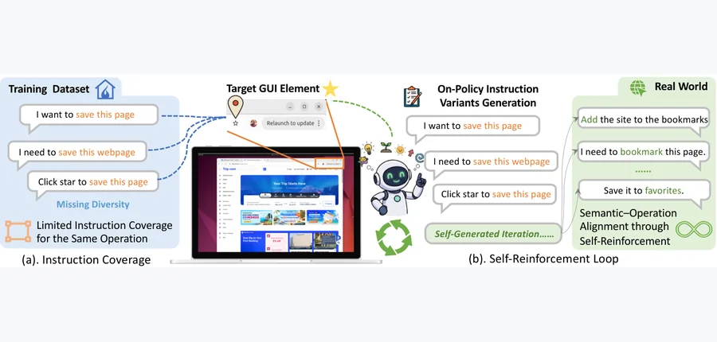 arXiv 2026-11-06 · cs.CV · #13 **[BiGrounder: Bidirectional Training Unlocks the Potential of GUI Grounding](https://arxiv.org/abs/2611.07765)** Dengyao Shi , Tianyu Fu , Fei Hu , Anyang Su , Hanning Wang , Shuo Wang , Minghui Wu , Chenxu Zhao , Zhen Lei Affiliation: Institute of Automation, Chinese Academy of Sciences / Mininglamp Technology / University of Chinese Academy of Sciences [Paper](https://arxiv.org/abs/2611.07765) · [Code](https://github.com/Spell-shi/BiGrounder) · [Figure source](https://arxiv.org/html/2611.07765v1/figure1_new.png) 

[EN] Abstract
Graphical User Interface (GUI) grounding aims to map natural language instructions to precise operational coordinates, serving as a critical task for autonomous agent interaction. Current approaches formalize GUI grounding as predicting action-coordinate pairs from instructions, with end-to-end training supervised solely by final coordinates. Training datasets typically provide only a small number of descriptions per target coordinate, whereas real-world scenarios involve a much larger set of varied descriptions for the same target, which limits robustness to linguistic variation. While recent GUI grounding paradigms have begun employing reinforcement learning to enhance localization accuracy, models with limited exploratory capability before reinforcement yield constrained improvements even with identical training data during the reinforcement phase. To overcome these limitations, we propose a bidirectional reward paradigm that enables model self-reinforcement. During SFT, bidirectional training equips the model to generate action descriptions from target coordinates. During RL, the model samples semantically consistent instruction variations on-policy and grounds each variation back to its target. A cycle-consistency gate couples semantic quality to grounding success, turning the model's own instruction policy into a source of continually refreshed reinforcement trajectories. Our 4B-parameter model achieves competitive accuracy across five grounding benchmarks in our evaluation, indicating the effectiveness of the proposed training paradigm. this https URL <a href="https://arxiv.org/list/cs/new?show=2000#2611.07765">Source</a>

[ZH] Abstract
图形用户界面（GUI）定位旨在将自然语言指令映射到精确操作坐标，是自主智能体交互的关键任务。现有方法将 GUI 定位形式化为从指令预测动作—坐标对，端到端训练仅由最终坐标监督。训练数据通常只为每个目标坐标提供少量描述，而现实场景中同一目标会对应更多样的描述，这限制了对语言变化的稳健性。尽管近期 GUI 定位范式开始采用强化学习以提高定位准确率，但强化学习前探索能力有限的模型，即使强化阶段使用相同训练数据，改进也受限。为克服这些限制，我们提出支持模型自我强化的双向奖励范式。在 SFT 阶段，双向训练使模型能够从目标坐标生成动作描述。在 RL 阶段，模型以在策略方式采样语义一致的指令变体，再将每个变体定位回其目标。循环一致性门槛将语义质量与定位成功联系起来，使模型自身的指令策略成为持续刷新的强化轨迹来源。我们的 4B 参数模型在评估中的五个定位基准上获得有竞争力的准确率，表明了这一训练范式的有效性。this https URL <a href="https://arxiv.org/list/cs/new?show=2000#2611.07765">Source</a>
 | 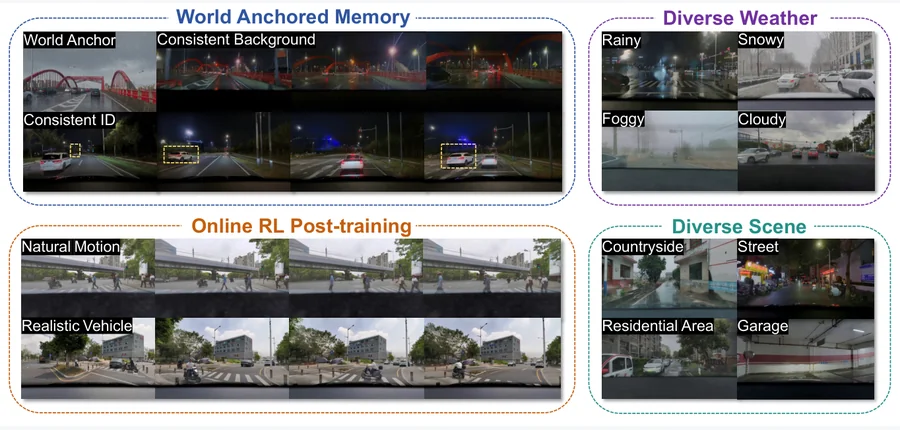 arXiv 2026-11-06 · cs.CV · #14 **[WAM-Sim0.1: World Anchored Memory Meets Online RL for Consistent and Realistic Driving Simulation](https://arxiv.org/abs/2611.07939)** Jiahao Cui , Jiaye Li , Wenhao Zhang , Yaoyi Li , Shan Luan , Quanhui Tang , Jianhua Han , Lin Cheng , Hang Xu , Siyu Zhu Affiliation: Fudan University / Shenzhen Yinwang Intelligent Technology Co., Ltd [Paper](https://arxiv.org/abs/2611.07939) · [Project](https://fudan-generative-vision.github.io/WAM-Sim) · [Figure source](https://arxiv.org/html/2611.07939v1/figure1.png) 

[EN] Abstract
Autoregressive driving world models systematically suffer from structural drift, identity drift, and quality decay over long rollout horizons due to transient conditioning signals that lack persistent state. We present WAM-Sim, a driving world model anchored by a persistent hierarchical memory and optimized via online flow-matching RL. WAM-Sim structures persistent context across three temporal and semantic scales: pose-aligned structural tokens encoding persistent road topology, read-only scene tokens supplying geolocated background appearance, and write-once instance tokens preserving individual traffic participant identities across occlusions and chunk boundaries. To restore visual sharpness and physical plausibility degraded by multi-scale conditioning, we introduce an online post-training framework that optimizes self-generated rollouts via flow-matching RL guided by hierarchy-aligned visual rewards and a vision-language model physical judge. The invariant memory empirically confines policy optimization within the anchored context, helping suppress semantic collapse and reward hacking, while online RL systematically enforces physical commonsense and fine-grained visual fidelity. On the nuScenes benchmark, WAM-Sim achieves a superior generation fidelity (FID=3.47, FVD=25.72) and strong downstream perception performance (24.16 mAP, 71.23 road mIoU). On minute-scale rollouts of self-collected data, WAM-Sim substantially mitigates structural and identity drift, preserving high scene similarity and subject identity coherence across extended horizons. Project page: this https URL . <a href="https://arxiv.org/list/cs/new?show=2000#2611.07939">Source</a>

[ZH] Abstract
自回归驾驶世界模型由于短暂的条件信号缺少持久状态，在长时程滚动生成中系统性地遭遇结构漂移、身份漂移与质量衰减。我们提出 WAM-Sim，一种由持久分层记忆锚定、并通过在线流匹配 RL 优化的驾驶世界模型。WAM-Sim 在三个时间与语义尺度上组织持久上下文：姿态对齐的结构 token 编码持久道路拓扑，只读场景 token 提供带地理定位的背景外观，只写一次的实例 token 在遮挡和片段边界之间保持各交通参与者身份。为恢复多尺度条件所损害的视觉清晰度与物理合理性，我们引入在线后训练框架，通过层级对齐的视觉奖励和视觉语言模型物理评判器，引导流匹配 RL 优化自生成滚动序列。不变记忆在实证中将策略优化约束于锚定上下文，帮助抑制语义坍塌和奖励投机，同时在线 RL 系统性强化物理常识与精细视觉保真度。在 nuScenes 基准上，WAM-Sim 获得优越的生成保真度（FID=3.47、FVD=25.72）以及较强的下游感知表现（24.16 mAP、71.23 道路 mIoU）。在自采数据上的分钟级滚动生成中，WAM-Sim 显著缓解结构与身份漂移，在长时段内保持较高场景相似度和主体身份一致性。项目页面：this https URL。 <a href="https://arxiv.org/list/cs/new?show=2000#2611.07939">Source</a>
 | 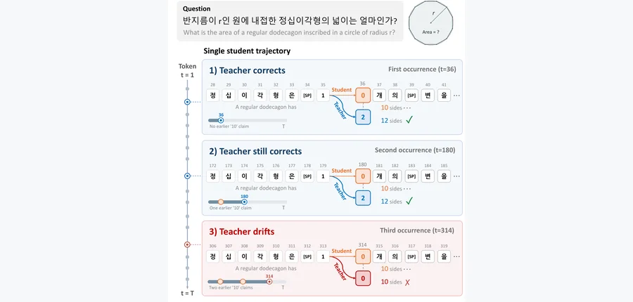 arXiv 2026-11-06 · cs.CL · #15 **[Knowing When to Teach: Learning from Teachable Prefixes in Multilingual Reasoning Distillation](https://arxiv.org/abs/2611.08179)** Jaewon Cho , Minseo Yoon , Jinyoung Park , Jinwoo Seo , Jaewon Chu , Alice Oh , Hyunwoo J. Kim Affiliation: KAIST / Korea University [Paper](https://arxiv.org/abs/2611.08179) · [Figure source](https://arxiv.org/html/2611.08179v1/fig1.png) 

[EN] Abstract
On-Policy Self-Distillation (OPSD) improves reasoning by training a student on its own reasoning, using the same model conditioned on reference solutions as a teacher. Applying OPSD to multilingual reasoning requires the teacher to provide useful feedback across languages, even when the student makes mistakes in intermediate steps. We observe a phenomenon we call Teacher Drift: as these mistakes accumulate, the teacher may follow the student's incorrect steps instead of correcting them. Our analysis shows that this shift tends to occur earlier in lower-resource languages. To account for these differences across languages, we propose Teachable On-Policy Self-Distillation (TOPSD), which determines where and whether teacher supervision should be applied to each reasoning trajectory. TOPSD uses teacher-student likelihood to estimate where drift begins and select a prefix for supervision. It then verifies whether the teacher can recover the correct answer from that prefix, applying distillation only to prefixes that pass verification. Experiments on multilingual mathematical reasoning across ten languages and three model scales show that TOPSD consistently outperforms conventional OPSD, particularly in low- and medium-resource languages. <a href="https://arxiv.org/list/cs/new?show=2000#2611.08179">Source</a>

[ZH] Abstract
在策略自蒸馏（OPSD）通过让学生基于自身推理接受训练来提高推理能力，其中同一模型在参考解条件下充当教师。将 OPSD 应用于多语言推理，要求教师跨语言提供有用反馈，即使学生在中间步骤出错也应如此。我们观察到一种称为教师漂移的现象：随着这些错误累积，教师可能跟随学生的错误步骤，而非纠正它们。分析表明，这一转变在低资源语言中往往更早发生。为考虑语言间差异，我们提出可教在策略自蒸馏（TOPSD），决定在每条推理轨迹何处、以及是否施加教师监督。TOPSD 使用师生似然估计漂移起点，并选择一个用于监督的前缀。随后，它验证教师是否能从该前缀恢复正确答案，仅对通过验证的前缀进行蒸馏。在十种语言和三种模型规模的多语言数学推理实验中，TOPSD 持续优于传统 OPSD，尤其是在低、中资源语言中。 <a href="https://arxiv.org/list/cs/new?show=2000#2611.08179">Source</a>
 |
| 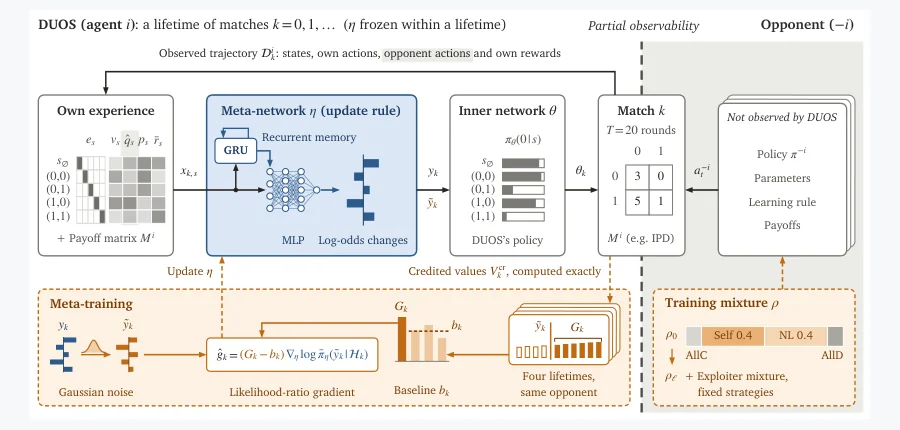 arXiv 2026-11-06 · cs.LG · #16 **[Discovering Learning Rules that Shape Others](https://arxiv.org/abs/2611.08335)** Hong Jun Lee , Ziyan Wang , Jun Wang , Stefanos Leonardos , Yali Du Affiliation: King's College London / Harvard University / University College London [Paper](https://arxiv.org/abs/2611.08335) · [Figure source](https://arxiv.org/html/2611.08335v1/DUOS_overview.png) 

[EN] Abstract
In general-sum games, self-interested learners can reach outcomes that are poor for everyone, which has motivated methods that shape the opponent's learning. Methods like Learning with Opponent-Learning Awareness (LOLA), which differentiates through the opponent's learning process, and Model-Free Opponent Shaping (M-FOS), which uses model-free optimisation methods for long-horizon opponent shaping, have enabled mutual cooperation and exploitation of learners. However, these methods require access to the opponent's parameters, policy, rewards or learning rule during deployment. In single-agent reinforcement learning, update rules discovered by meta-learning have achieved state-of-the-art results (e.g. DiscoRL). These rules are separate from the policy they train and read only the agent's own experience. We hereby extend this framework to general-sum settings by introducing Discovered Update Rule for Opponent Shaping (DUOS). To the best of our knowledge, this is the first method to discover an update rule for an agent in general-sum games. DUOS meta-trains the rule to maximise the agent's expected return over its lifetime, and updates an inner network using the agent's own experience. We show that our discovered rule exhibits behaviour consistent with opponent shaping without reading opponent policies or parameters, and ranks 1st in normalised mean score and 1st in self-play among tournament entrants. <a href="https://arxiv.org/list/cs/new?show=2000#2611.08335">Source</a>

[ZH] Abstract
在一般和博弈中，自利学习者可能达成对所有人都不利的结果，这推动了塑造对手学习过程的方法。具有对手学习意识的学习（LOLA）通过对手学习过程求导，无模型对手塑造（M-FOS）则使用无模型优化进行长时程对手塑造；这些方法已实现相互合作及对学习者的利用。然而，它们在部署期间需要访问对手的参数、策略、奖励或学习规则。在单智能体强化学习中，通过元学习发现的更新规则已取得先进结果（例如 DiscoRL）。这些规则与其训练的策略相互独立，且仅读取智能体自身经验。我们将这一框架扩展至一般和情境，提出用于对手塑造的发现式更新规则（DUOS）。据我们所知，这是首个在一般和博弈中为智能体发现更新规则的方法。DUOS 通过元训练使规则最大化智能体整个生命周期的期望回报，并利用智能体自身经验更新内部网络。我们表明，该发现规则在不读取对手策略或参数的情况下表现出与对手塑造一致的行为，并在锦标赛参赛者中获得归一化平均分第一和自博弈第一。 <a href="https://arxiv.org/list/cs/new?show=2000#2611.08335">Source</a>
 | 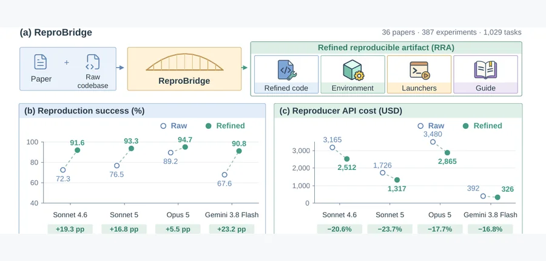 arXiv 2026-11-06 · cs.AI · #17 **[ReproBridge: Building Reproducibility into ML Research Artifacts](https://arxiv.org/abs/2611.08452)** Yubo Wang , Rui Meng , Jaehyun Nam , Tomas Pfister , Jinsung Yoon Affiliation: University of Waterloo / Google [Paper](https://arxiv.org/abs/2611.08452) · [Project](https://wyyyb.github.io/reprobridge_website/) · [Figure source](https://arxiv.org/pdf/2611.08452) 

[EN] Abstract
Reproducing machine learning experiments requires reconstructing procedures from information scattered across papers, released code, and supporting artifacts. For coding agents, reproduction success can therefore depend on their ability to fill in missing details, rather than on the released artifacts alone. We ask whether preserving recovered procedures and decisions improves subsequent independent reproduction. We define a standardized artifact design comprising a refined codebase, environment setup, experiment launchers, and a reproduction guide, and introduce ReproBridge, an agent workflow for constructing these refined reproducible artifacts. ReproBridge-Bench provides 1,029 tasks from 387 experiments across 36 papers, anchored by five human-verified reference scores per task. Agents attempt tasks in fresh sessions with raw code or refined artifacts; a separate Auditor checks execution evidence. Across four evaluated models, refined artifacts raise mean reproduction success from 76.4% to 92.6% and reduce downstream API spending by 19.7% on average. The cross-model success-rate spread narrows from 21.6 to 3.9 percentage points, with all four models achieving mean success rates above 90%. Removing any component reduces success in the ablation study, with the largest losses from code and environment removal. These results suggest that preserving execution knowledge helps even models with lower raw-code success reproduce experiments more reliably and at lower API cost. <a href="https://arxiv.org/list/cs/new?show=2000#2611.08452">Source</a>

[ZH] Abstract
复现机器学习实验需要从分散在论文、发布代码及配套材料中的信息重建流程。因此，对代码智能体而言，复现成功可能依赖于其补全缺失细节的能力，而不仅是发布材料本身。我们研究保留恢复出的流程和决策是否能改善后续独立复现。我们定义了一种标准化材料设计，包括细化后的代码库、环境设置、实验启动脚本和复现指南，并提出用于构建这些细化可复现材料的智能体工作流 ReproBridge。ReproBridge-Bench 提供来自 36 篇论文、387 个实验的 1,029 项任务，每项任务以五个人工验证的参考分数为依据。智能体在全新会话中使用原始代码或细化材料尝试任务，由独立 Auditor 检查执行证据。在四个被评估模型上，细化材料将平均复现成功率从 76.4% 提升到 92.6%，并将下游 API 支出平均降低 19.7%。跨模型成功率差距从 21.6 缩小到 3.9 个百分点，四个模型的平均成功率均超过 90%。消融中移除任何组件都会降低成功率，其中移除代码和环境造成的损失最大。这些结果表明，保留执行知识能帮助即使原始代码成功率较低的模型，也更可靠、以更低 API 成本复现实验。 <a href="https://arxiv.org/list/cs/new?show=2000#2611.08452">Source</a>
 | 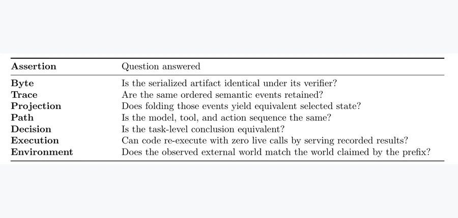 arXiv 2026-11-06 · cs.PL · #18 **[Replay Is a Family of Assertions: Fork-Safety in Event-Sourced Agent Runtimes](https://arxiv.org/abs/2611.06924)** Yohei Nakajima Affiliation: Untapped Capital / activegraph.ai [Paper](https://arxiv.org/abs/2611.06924) · [Figure source](https://arxiv.org/pdf/2611.06924) 

[EN] Abstract
Event-sourced agent runtimes commonly claim deterministic replay, cheap forking, and lineage. These are families of assertions, not one guarantee. A fixed-log fold may be deterministic while reactive settlement remains schedule-sensitive; a recorded oracle result can enable zero-call replay while the original interaction still changed cost or world state; and a prefix copy cannot undo an action in a discarded suffix. We present an executable F# contract that separates facts from effect requests, makes scheduling explicit, and assesses a cut relative to projection, strict execution replay, external continuation, or a declared counterfactual-world observation. Preserved counterexamples show that general settlement is neither terminating nor confluent and that disjoint declared writes do not prevent read/trigger interference. Against 5,540 public runtime logs, all 317,296 projection cuts satisfy the stated observation, while 36,251 cuts split a model request and do not license continuation; another 120,969 are Conditional because a committed oracle result must be served from the record without re-execution. In 121 observed forks, 16,625 retained-prefix events have zero structural mismatches, but none crosses an external-effect boundary. A separate public offline conformance fork crosses a committed, recorded oracle boundary. Its generator observes that the inherited result is served without a second fixture-oracle call; its verifier checks receipt/log consistency and a fork-bound HMAC assertion under a public conformance key. The result reframes cheap forking as a property-indexed semantic contract with explicit evidence and environment preconditions. <a href="https://arxiv.org/list/cs/new?show=2000#2611.06924">Source</a>

[ZH] Abstract
事件溯源智能体运行时常声称具备确定性回放、低成本分叉和谱系。这些是多组断言，而非单一保证。固定日志的折叠可以是确定性的，但反应式收敛仍可能对调度敏感；记录下的预言机结果可以支持零调用回放，但原始交互仍已改变成本或世界状态；前缀副本也无法撤销被丢弃后缀中的动作。我们提出一个可执行的 F# 契约，将事实与效应请求分开，显式规定调度，并依据投影、严格执行回放、外部续接或声明的反事实世界观测来评估切分点。保留的反例表明，一般情况下的收敛既不保证终止，也不保证合流，而声明写入集合互不相交也不能避免读取／触发干扰。在 5,540 份公开运行时日志中，全部 317,296 个投影切分点都满足所声明的观测，但其中 36,251 个切分点将模型请求拆开，不能授权续接；另有 120,969 个切分点属于有条件情形，因为已提交的预言机结果必须从记录中提供而不能重新执行。在观察到的 121 次分叉中，保留前缀的 16,625 个事件没有结构不匹配，但没有一次跨越外部效应边界。另一个公开的离线一致性分叉跨越了已提交且已记录的预言机边界。其生成器观察到继承结果在不进行第二次固定测试预言机调用的情况下被提供；验证器使用公开一致性密钥检查收据／日志一致性和绑定分叉的 HMAC 断言。结果将低成本分叉重述为一种按属性索引的语义契约，具有显式证据和环境前提。 <a href="https://arxiv.org/list/cs/new?show=2000#2611.06924">Source</a>
 |
| 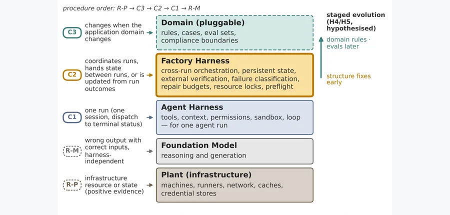 arXiv 2026-11-06 · cs.SE · #19 **[Beyond the Agent Harness: Boundary Criteria for Software-Factory Orchestration - A Single-Operator Case Study](https://arxiv.org/abs/2611.06946)** Lei Hua Affiliation: Independent Researcher [Paper](https://arxiv.org/abs/2611.06946) · [Figure source](https://arxiv.org/pdf/2611.06946) 

[EN] Abstract
Several recent systems add a layer above the coding-agent harness that organises many agent runs into continuous delivery. The existence of such a layer is not our contribution. What is missing is a rule for deciding which layer a mechanism or a failure belongs to. We propose boundary criteria based on an operational definition of a run. A mechanism confined to one run belongs to the agent harness. One that coordinates runs, hands state from one run to a later one, or is updated from run outcomes belongs to a factory harness. One that must change with the application domain belongs to the domain layer. Two residual tests assign infrastructure and model causes. For failures, we code where the defect originated, which control failed to stop it, and where it was fixed as three separate fields, and we require positive evidence before attributing a failure to the environment. We developed the criteria on documented failures from a single operator's pipeline serving six projects and on 26 components of three published systems. We then froze them and had two model coders of the same family apply them to the same descriptions of 46 held-out units. They agreed on all 26 mechanism layers and on 18-19 of 20 incident fields (kappa 0.86-0.93), but both coders recorded the incident as undetermined or unrecorded in 8-13 of the 20 cases per field, and each flagged half of all units as ambiguous, mostly for missing information. The check exposed conflicts in the rules; a revision that separates mechanism classification from incident attribution resolves them but, in a sensitivity re-coding, agreed less (kappa 0.78-0.93). Agreement here is neither accuracy nor usefulness, and human coders have not yet been tested. Case evidence and seven hypotheses are reported as preliminary. <a href="https://arxiv.org/list/cs/new?show=2000#2611.06946">Source</a>

[ZH] Abstract
近期若干系统在代码智能体运行框架之上增加了一层，将大量智能体运行组织为持续交付。这一层的存在并非我们的贡献。缺少的是一条用于判定机制或故障属于哪一层的规则。我们依据运行的操作性定义提出边界准则。局限于单次运行的机制属于智能体框架；协调多次运行、将状态从一次运行交给后续运行，或依据运行结果更新的机制属于工厂框架；必须随应用领域改变的机制属于领域层。另有两项剩余测试用于判定基础设施和模型原因。对于故障，我们分别编码缺陷起源、未能阻止缺陷的控制，以及缺陷修复位置这三个字段，并要求有正面证据才能将故障归因于环境。我们利用单个操作者为六个项目服务的流水线中记录的故障，以及三个已发表系统的 26 个组件制定准则。随后冻结准则，让两个同系列模型编码者对同样的 46 个留出单元描述进行应用。它们对全部 26 个机制层级分类达成一致，对 20 个事件字段中的 18 至 19 个达成一致（kappa 0.86–0.93）；但两个编码者在每个字段的 20 个案例中，有 8 至 13 个将事件记为无法确定或未记录，且各自将全部单元的一半标记为有歧义，主要因信息缺失。检查暴露了规则冲突；将机制分类与事件归因分开的修订解决了冲突，但在敏感性重新编码中一致性较低（kappa 0.78–0.93）。这里的一致并不等于准确或有用，尚未测试人工编码者。案例证据和七项假设均作为初步结果报告。 <a href="https://arxiv.org/list/cs/new?show=2000#2611.06946">Source</a>
 | 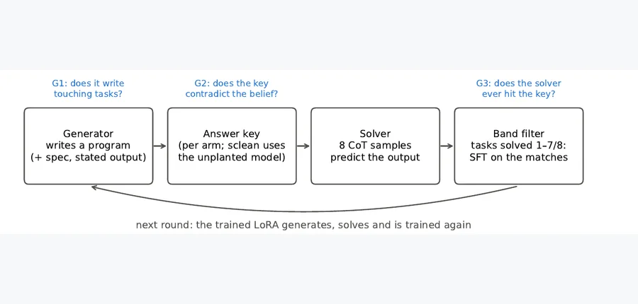 arXiv 2026-11-06 · cs.SE · #20 **[When Can Self-Play Fix a False Belief? Answer Keys, Pass Bands and Replacement Rules in an Execution-Grounded Loop](https://arxiv.org/abs/2611.06965)** Nirdesh Chauhan , Dushyant Rajput , Siddharth Kosaraju Affiliation: AltSlate Labs LLP [Paper](https://arxiv.org/abs/2611.06965) · [Figure source](https://arxiv.org/pdf/2611.06965) 

[EN] Abstract
Self-play loops in which a model writes tasks, derives an answer key and trains on its own matching solutions are often called grounded when the key comes from executing code. We ask which false beliefs such a loop removes. We run expert-iteration self-play with Qwen3-4B-Base on output-prediction tasks, vary the source of the answer key, and track natural beliefs about Python semantics and two misreadings of task specifications planted by fine-tuning ("at most n" read as &lt; n; "the k-th smallest" read as 0-indexed). Executing the generator's own code gave a key that encoded the "at most" misreading on every audited task, and training on it never raised the truth rate above 0.03. A key from an implementation by the unplanted model, a teacher without the error, raised it to 0.23-0.58 after three rounds in four runs. A correct key is not sufficient: the pass band, which keeps tasks solved 1-7 times of 8, admits almost no corrective task while a belief is held on nearly every sample. Execution keys sharply reduced both natural runtime beliefs on diagnostic items in both seeds. Corrections came with replacement rules that fail on neighbouring items the old belief got right. The robust case, present in all four spec runs, is that after the "at most" fix the model increasingly counts the nearest value above a limit that is absent from the list (overcount 0.18-0.38 of control samples at round 3), a case our planted generators almost never wrote (4 of 10,924 tasks); diagnostic-only metrics miss it. Asked for those cases, the planted generator wrote none in 2,061 checkable tasks, against 27% for the untrained unplanted model in one round. Both generators often moved the request into the specification instead ("the cap itself does not count"), and a decorrelated key follows the specification. <a href="https://arxiv.org/list/cs/new?show=2000#2611.06965">Source</a>

[ZH] Abstract
模型编写任务、推导答案键并用自身匹配解训练的自博弈循环，若答案键来自代码执行，常被称为有真实依据。我们研究这种循环能够消除哪些错误信念。我们在输出预测任务上对 Qwen3-4B-Base 进行专家迭代自博弈，改变答案键来源，并跟踪关于 Python 语义的自然信念，以及通过微调植入的两种任务规范误读（将“至多 n”理解为 &lt; n；将“第 k 小”理解为从 0 编号）。执行生成器自身代码所产生的答案键，在每个经审计任务上都编码了“至多”的误读，使用这些答案键训练从未使真值率超过 0.03。由未植入错误的模型实现所产生的答案键，即来自没有该错误的教师，在四次运行、三轮之后将其提高到 0.23–0.58。正确答案键并不足够：筛选八次求解中成功 1 至 7 次任务的通过带，在某信念几乎出现在每个样本时几乎不接纳纠错任务。执行答案键在两个种子的诊断项上，都显著减少了两种自然运行时信念。纠正也伴随着替代规则，这些规则在原信念本来答对的邻近项目上失效。在全部四次规范运行中都存在的稳健现象是：修复“至多”之后，模型越来越多地计入一个不在列表中、最接近且超过上限的数值（第三轮时，对照样本中过计数占比 0.18–0.38）；这种情况几乎从未由我们植入错误的生成器生成（10,924 个任务中仅 4 个），仅看诊断指标会漏掉它。当被要求生成这些情况时，植入错误的生成器在 2,061 个可检查任务中一个也未写出，而未训练、未植入错误的模型在一轮中为 27%。两个生成器常转而将请求移入规范（“上限本身不计入”），而去相关的答案键会遵循该规范。 <a href="https://arxiv.org/list/cs/new?show=2000#2611.06965">Source</a>
 | 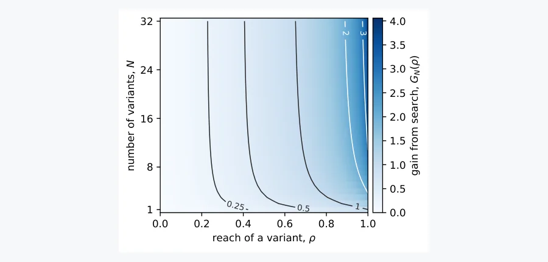 arXiv 2026-11-06 · cs.AI · #21 **[Adapting the Process of Adaptation: Darwinian, Lamarckian, and Agent-Directed Evolution in AI](https://arxiv.org/abs/2611.07048)** Andrew W. Lo , Chaoyi Zhao Affiliation: Massachusetts Institute of Technology / Santa Fe Institute [Paper](https://arxiv.org/abs/2611.07048) · [Figure source](https://arxiv.org/html/2611.07048v1/fig_gain_from_search_b.png) 

[EN] Abstract
Evolution has shaped intelligence for billions of years. Artificial intelligence (AI) now raises a striking possibility: intelligence may begin to direct its own evolution. As AI agents become capable of modifying and evaluating their own behavior, how quickly could they improve, and how can that improvement remain safe? We develop a theoretical framework comparing Darwinian, Lamarckian, and agent-directed evolution following environmental change. Darwinian evolution relies on natural selection, Lamarckian evolution adds inherited learning, and agent-directed evolution allows agents to generate and evaluate behavioral variants and choose how extensively to search. When learning is sufficiently effective, these mechanisms exhibit progressively faster adaptation. Generating more variants accelerates adaptation, while optimal search effort depends on learning ability, problem difficulty, and experimentation costs. However, an agent's ability to direct its improvement does not ensure that improvements are evaluated against the intended objective. When the evaluation target is misspecified, additional search accelerates convergence toward the wrong behavior, even as measured performance improves. In recursive self-improvement, such errors may persist across generations, posing challenges for AI safety. Independent evaluation and oversight must keep pace with autonomous AI development. The central challenge is not simply to accelerate the evolution of intelligence, but to preserve humanity's ability to guide its direction, limit its speed, and intervene when necessary. <a href="https://arxiv.org/list/cs/new?show=2000#2611.07048">Source</a>

[ZH] Abstract
演化已塑造智能数十亿年。人工智能（AI）如今带来一种引人注目的可能：智能或许开始引导自身的演化。当 AI 智能体能够修改并评估自己的行为时，它们能多快改进，又如何使这种改进保持安全？我们建立理论框架，比较环境变化之后的达尔文式、拉马克式和智能体引导演化。达尔文式演化依赖自然选择，拉马克式演化增加可继承的学习，而智能体引导演化允许智能体生成和评估行为变体，并选择搜索的广度。当学习足够有效时，这些机制展现出逐级更快的适应。生成更多变体会加速适应，而最优搜索投入取决于学习能力、问题难度和实验成本。然而，智能体指导自身改进的能力，并不能保证改进按照预期目标得到评估。当评估目标错误指定时，更多搜索会加速收敛到错误行为，即使测量性能不断改善。在递归自我改进中，此类错误可能跨代持续，给 AI 安全带来挑战。独立评估和监督必须跟上自主 AI 开发。核心挑战不仅是加速智能演化，还在于保持人类引导其方向、限制其速度以及必要时干预的能力。 <a href="https://arxiv.org/list/cs/new?show=2000#2611.07048">Source</a>
 |
| 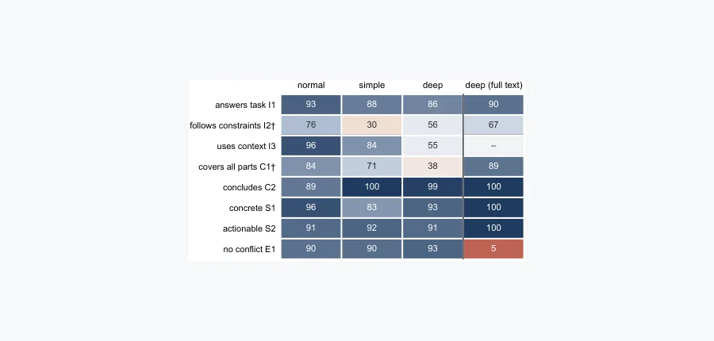 arXiv 2026-11-06 · cs.AI · #22 **[Closed-Loop Agent Evaluation: Layered Measurement and Self-Calibration](https://arxiv.org/abs/2611.07051)** Ruifeng Ren , Gun Ahn Affiliation: Massachusetts Institute of Technology [Paper](https://arxiv.org/abs/2611.07051) · [Figure source](https://arxiv.org/html/2611.07051v1/items_en.png) 

[EN] Abstract
Once an agent is live, teams want to know whether it is doing its job, not just whether it throws errors. Yet most evaluation is one-off: a benchmark run, a look at traces, a single score. Its conclusions neither check themselves nor reach the agent. We propose closed-loop evaluation, an evaluation method for deployed agents. It models evaluation as performance estimation under biased raters and censored outcomes, and it requires every level's conclusion to trace back to atomic data and to be computed by versioned rules. The method covers four levels of analysis (span, trace, conversation and engagement), measures along a spine of Execution, Substance, Trajectory and Results, treats Conduct as a constraint throughout, and uses Provenance and Adjudication components to certify the evidence and the evaluators. Evaluator agents generated by an Agent Factory carry these components, each with a domain knowledge pack and an adapter harness. Two loops close the evaluation: an inner loop audits the evidence, rules and metrics themselves, and an outer loop uses per-component regression checks to drive agent improvement. We also give a pipeline that runs this process automatically. Using the business-analysis agent SharpInsight as a case and porting the method to public conversation data, we show how problems differ across levels and how evidence-and-rule judgment is more reliable than holistic scoring (ICC 0.86 vs. 0.81; kappa 0.81 vs. 0.63). <a href="https://arxiv.org/list/cs/new?show=2000#2611.07051">Source</a>

[ZH] Abstract
智能体上线之后，团队希望知道它是否在完成工作，而不仅是是否抛出错误。然而，大多数评估都是一次性的：跑一次基准、查看轨迹、得到单一分数。这些结论既不自我检查，也不会反馈给智能体。我们提出闭环评估，一种针对已部署智能体的评估方法。它将评估建模为在评分者有偏且结果被删失条件下的性能估计，并要求每层结论都可追溯到原子数据，且由带版本规则计算。该方法涵盖跨度、轨迹、对话和参与四个分析层级，沿执行、实质、轨程和结果这条主线测量，将行为规范始终作为约束，并通过溯源与裁决组件认证证据和评估者。由 Agent Factory 生成的评估者智能体携带这些组件，各自配备领域知识包与适配框架。两个循环使评估闭合：内循环审计证据、规则和指标本身，外循环利用逐组件回归检查驱动智能体改进。我们还给出自动运行这一过程的流水线。以业务分析智能体 SharpInsight 为案例，并将方法迁移到公开对话数据，我们展示了不同层级的问题如何不同，以及基于证据和规则的判断如何比整体打分更可靠（ICC 0.86 对 0.81；kappa 0.81 对 0.63）。 <a href="https://arxiv.org/list/cs/new?show=2000#2611.07051">Source</a>
 |  arXiv 2026-11-06 · cs.AI · #23 **[When Verification Is Not Agreement: Cross-Agent LLM-to-Dafny Formalization](https://arxiv.org/abs/2611.07073)** Priyanath Maji Affiliation: Georgia Institute of Technology [Paper](https://arxiv.org/abs/2611.07073) · [Code](https://github.com/priyanathmaji/llm-dafny-agreement/) 

[EN] Abstract
A verified Dafny postcondition certifies that a formula holds, but it does not guarantee that the result was reached through genuine independent reasoning. We introduce a cross-agent formalization protocol where a Specifier model translates clinical trial criteria into a Dafny predicate, and an Implementer model writes an operational method checked against it. A same-model control establishes that even with no capability gap, independent re-extraction from identical text agrees only 59.3% of the time. Evaluating four model configurations on 96 clinical trial documents, we find that agreement is highly sensitive to how model capability is allocated across the two roles: the GPT-4.1-nano/GPT-4.1-mini configuration achieves 53.0% agreement when the stronger model is the Implementer, but only 14.3% when the roles are reversed. The strongest tested configuration, GPT-5.6-luna/GPT-5.4-mini, improves agreement to 34.4% but remains below the same-model baseline and is dominated by direct contradiction (42.7%). We also detect a critical verification artifact in which a weaker Implementer satisfies the postcondition by invoking the Specifier's predicate directly; after structural auditing, corrected agreement falls from 14.3% to 13.2%. Our results show that verification success alone is insufficient evidence of independent cross-agent agreement, and that model capability does not guarantee agreement when formalizing the same source independently. <a href="https://arxiv.org/list/cs/new?show=2000#2611.07073">Source</a>

[ZH] Abstract
通过验证的 Dafny 后置条件证明某个公式成立，但不能保证结果来自真正独立的推理。我们提出跨智能体形式化协议，由规范模型将临床试验标准翻译为 Dafny 谓词，实现模型编写操作方法并据此检查。同模型对照表明，即使没有能力差距，从相同文本独立重新提取时，一致率也只有 59.3%。在 96 份临床试验文档上评估四种模型配置，我们发现一致性高度取决于两个角色间如何分配模型能力：GPT-4.1-nano／GPT-4.1-mini 配置在较强模型担任实现者时达到 53.0% 一致率，但角色互换后仅为 14.3%。最强被测配置 GPT-5.6-luna／GPT-5.4-mini 将一致率提高至 34.4%，但仍低于同模型基线，且以直接矛盾为主（42.7%）。我们还发现一种关键验证伪象：较弱实现者直接调用规范模型的谓词来满足后置条件；经过结构审计，修正后的一致率从 14.3% 降到 13.2%。结果表明，仅有验证成功不足以证明跨智能体独立一致，而模型能力也不能保证在独立形式化同一来源时达成一致。 <a href="https://arxiv.org/list/cs/new?show=2000#2611.07073">Source</a>
 | 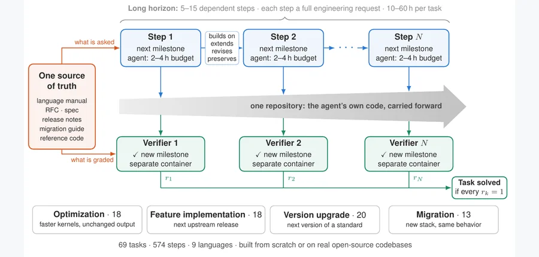 arXiv 2026-11-06 · cs.SE · #24 **[Multi-step SWE: Can Coding Agents Keep Building on Their Own Code Over Long Horizons?](https://arxiv.org/abs/2611.07166)** Xiangkai Zeng , Zheng Liu , Zihao Lin Affiliation: Klavis AI [Paper](https://arxiv.org/abs/2611.07166) · [Figure source](https://arxiv.org/pdf/2611.07166) 

[EN] Abstract
Developers rarely give a coding agent a single request: they ask it to build a component and then to extend, upgrade, and optimize it, each time on code the agent itself wrote. Most benchmarks, however, score one task at a time. We introduce Multi-step SWE, a long-horizon benchmark of 69 software engineering tasks, each a chain of 5-15 dependent steps on a single codebase. Every step is a complete, multi-hour engineering request that starts from the code the agent produced in the preceding steps, so early design decisions and errors carry forward. The tasks span four families of engineering work and nine languages, include both from-scratch builds and existing open-source codebases, and ground every step in an existing source of truth that defines both the instruction and its verifier. Across nine frontier models, the strongest model reaches a solve rate of only 18.5%, and 38 of the 69 tasks are not solved by any model. We release Multi-step SWE publicly at this https URL . <a href="https://arxiv.org/list/cs/new?show=2000#2611.07166">Source</a>

[ZH] Abstract
开发者很少只给代码智能体一个请求：他们会要求它构建一个组件，之后再扩展、升级和优化，每次都基于智能体自己写出的代码。然而，多数基准每次只评分一项任务。我们提出 Multi-step SWE，一个由 69 项软件工程任务组成的长时程基准，每项任务都是同一代码库上由 5 至 15 个相互依赖步骤构成的链。每个步骤都是一个完整、需数小时工程工作的请求，从智能体在先前步骤中生成的代码开始，因此早期设计决策和错误会持续传递。任务涵盖四类工程工作和九种语言，既包括从头构建，也包括现有开源代码库，并让每一步都以现有真实依据为基础来定义指令及其验证器。在九个前沿模型中，最强模型解决率仅为 18.5%，69 项任务中有 38 项未被任何模型解决。我们在 this https URL 公开发布 Multi-step SWE。 <a href="https://arxiv.org/list/cs/new?show=2000#2611.07166">Source</a>
 |
| 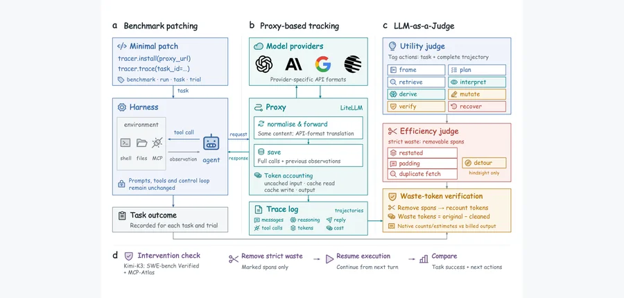 arXiv 2026-11-06 · cs.CL · #25 **[How Do AI Agents Waste Your Money?](https://arxiv.org/abs/2611.07238)** Huimin Zeng , Yuxuan Lu , Jesse Cai , Eric Hanchen Jiang , Di Wu , Po-Nien Kung , Wenbo Hu , Ziyi Wang , Dakuo Wang , Jiax… Affiliation: University of Illinois Urbana-Champaign / Northeastern University / Independent Researcher / University of California, Los Angeles / University of Texas at Austin [Paper](https://arxiv.org/abs/2611.07238) · [Code](https://github.com/huiminzeng/How_Do_AI_Agents_Waste_Your_Money) · [Figure source](https://arxiv.org/html/2611.07238v1/fig0_framework_overview_simple.png) 

[EN] Abstract
AI agents may consume massive tokens across a wide range of tasks, but how many of those tokens are really necessary? Although prior work has shown that agents can incur unexpectedly high token costs, we still lack a systematic way to identify and measure token waste. In this work, we introduce a unified framework for measuring token waste across heterogeneous agent systems. Our framework records and normalizes complete agent trajectories, identifies removable spans using an LLM-as-a-Judge (LLMaJ), and maps the identified text spans back to the original trajectory for token-level measurement. We validate the identified waste through direct interventions by removing marked spans, resuming agent execution, and measuring changes in task outcomes and subsequent actions. In online pruning experiments, we remove 41-46% of the model's reasoning while largely preserving task performance across two distinct agent benchmarks. Using this framework, we analyze agents across multiple settings. Our analysis shows that token waste has a system-level structure that aggregate token usage alone cannot reveal. First, waste varies more across tasks and agent settings than across models. Second, reasoning and visible execution can exhibit different waste patterns. Third, different harnesses can introduce distinct sources of inefficiency even under the same model and task. Overall, our framework transforms token waste into an actionable optimization signal, enabling researchers and practitioners to train more efficient models, design better reasoning strategies, and optimize agent harnesses toward reducing unnecessary computation rather than merely reducing token usage. <a href="https://arxiv.org/list/cs/new?show=2000#2611.07238">Source</a>

[ZH] Abstract
AI 智能体可能在各类任务中消耗海量 token，但其中到底有多少真正必要？虽然已有研究表明智能体会产生出乎意料的高 token 成本，我们仍缺乏系统识别和测量 token 浪费的方法。本文提出跨异构智能体系统测量 token 浪费的统一框架。该框架记录并规范化完整智能体轨迹，利用 LLM 评判器（LLMaJ）识别可移除文本跨度，再映射回原始轨迹进行 token 级测量。我们通过直接干预验证识别出的浪费：删除标记跨度，恢复智能体执行，并测量任务结果和后续动作的变化。在在线剪枝实验中，我们移除模型 41–46% 的推理，同时在两个不同智能体基准上基本保持任务性能。利用这一框架，我们分析多种设置下的智能体。分析显示，token 浪费具有仅靠汇总 token 用量无法揭示的系统层面结构。首先，浪费在任务和智能体设置之间的差异大于模型之间。其次，推理与可见执行可能呈现不同浪费模式。第三，即使模型和任务相同，不同框架也会引入不同低效来源。总体而言，该框架将 token 浪费转化为可操作的优化信号，使研究者和实践者能够训练更高效模型、设计更好推理策略，并以减少不必要计算而非仅减少 token 用量为目标优化智能体框架。 <a href="https://arxiv.org/list/cs/new?show=2000#2611.07238">Source</a>
 | 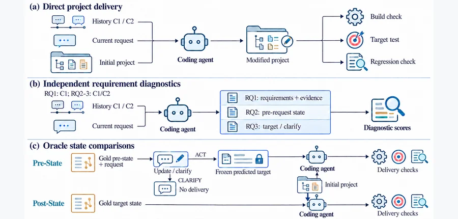 arXiv 2026-11-06 · cs.SE · #26 **[Take It From Here: Evaluating Coding Agents On Project Takeover](https://arxiv.org/abs/2611.07307)** Dingxian Wang , Zhe Fu , Jiaqi Deng , Chao Yin , Ganesh Prabhu , Karthik Gomadam Rajagopal , Darwin Yi , Huan Huo , Guando… Affiliation: Upwork Inc / University of Technology Sydney / Scale AI / Education University of Hong Kong [Paper](https://arxiv.org/abs/2611.07307) · [Figure source](https://arxiv.org/html/2611.07307v1/figures/figure1_overview.png) 

[EN] Abstract
Coding agents increasingly collaborate on long-term projects. When taking over a project, they need to recover currently applicable requirements from the interaction history and update them in response to new requests. However, most coding benchmarks do not include long interaction histories, and some evaluations that consider history still do not cover the full process from requirement reconstruction to project delivery. We therefore provide agents with the interaction history, current request, and pre-request project environment, ask them to make the requested changes, and assess takeover performance through delivery tests. Across six model-harness configurations and 37 targets eligible for executable validation, the mean complete-delivery rate under Full History is only 4.95%. We then use requirement atoms to independently diagnose a larger set of takeover targets, examining relevant information identification, pre-request state reconstruction, and current request processing. We further supply correct pre-request or target states to examine the remaining difficulties in requirement processing and project modification. The diagnostics show that none of the six configurations produces fully correct post-request requirement states, and a case illustrates omission of previously recovered constraints during updating. With correct target states supplied, the mean complete-delivery rate is 8.11%, with build and regression pass rates of 96.40% and 90.99%, but target-test success remains 9.01%. These results show difficulties in both forming target requirement states and implementing supplied targets in existing projects. Based on these findings, we introduce ReqMemBench, which combines requirement diagnostics with delivery validation to support systematic evaluation of project takeover. <a href="https://arxiv.org/list/cs/new?show=2000#2611.07307">Source</a>

[ZH] Abstract
代码智能体越来越多地协作处理长期项目。接手项目时，它们需要从交互历史中恢复当前适用的需求，并根据新请求更新这些需求。然而，多数代码基准不包含长交互历史，部分考虑历史的评估也未覆盖从需求重建到项目交付的全过程。因此，我们向智能体提供交互历史、当前请求和请求前的项目环境，要求其实施所需修改，并通过交付测试评估接手表现。在六种模型—框架配置和 37 个符合可执行验证条件的目标上，完整历史条件下的平均完整交付率仅为 4.95%。随后，我们利用需求原子独立诊断更大一组接手目标，检查相关信息识别、请求前状态重建和当前请求处理。我们还提供正确的请求前或目标状态，以考察需求处理和项目修改中仍然存在的困难。诊断表明，六种配置均未生成完全正确的请求后需求状态，一个案例展示了更新时遗漏先前已恢复约束的情况。提供正确目标状态后，平均完整交付率为 8.11%，构建和回归通过率分别为 96.40% 与 90.99%，但目标测试成功率仍为 9.01%。这些结果显示，形成目标需求状态与在现有项目中实现给定目标均存在困难。基于这些发现，我们提出 ReqMemBench，将需求诊断与交付验证相结合，以支持系统评估项目接手能力。 <a href="https://arxiv.org/list/cs/new?show=2000#2611.07307">Source</a>
 | 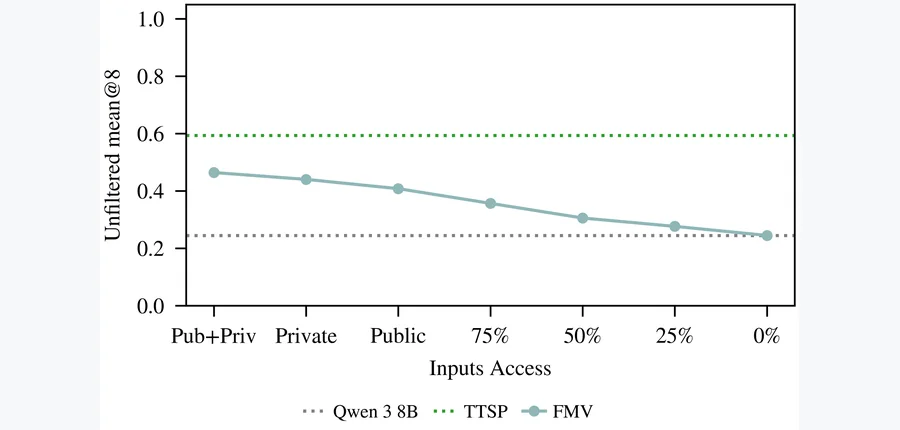 arXiv 2026-11-06 · cs.LG · #27 **[Test-Time Self-Play: Scaling without a Verifier](https://arxiv.org/abs/2611.07367)** Akira Yoshiyama , Akmal Ashirmatov , Jonas Hübotter , Ido Hakimi , Andreas Krause Affiliation: ETH Zurich / Tufa Labs [Paper](https://arxiv.org/abs/2611.07367) · [Figure source](https://arxiv.org/html/2611.07367v1/appendix_figures/verifier_strength_no_rejection_all.png) 

[EN] Abstract
Test-time scaling methods spend additional compute at deployment to improve a large language model's performance on a hard target problem. Most methods rely on a verifier that scores candidate solutions for correctness, using it to select among or refine the model's outputs. In many deployment regimes, however, a strong verifier on the target problem is unavailable. We introduce Test-Time Self-Play (TTSP), an approach to test-time scaling using asymmetric self-play without reliance on a verifier. On a difficulty-calibrated subset of LiveCodeBench v6, TTSP is the best-performing method at every verifier strength we evaluate, and the gap to the strongest baseline widens as the verifier weakens; in the no-verifier limit, TTSP yields a 35\% absolute improvement in mean@8. The gains hold across a range of verifier strengths, except when the base policy has near-zero coverage of the correct answer. <a href="https://arxiv.org/list/cs/new?show=2000#2611.07367">Source</a>

[ZH] Abstract
测试时扩展方法在部署时投入额外计算，以提升大语言模型在困难目标问题上的表现。多数方法依赖对候选解正确性评分的验证器，用它选择或细化模型输出。然而，在许多部署情形中，目标问题上没有强验证器。我们提出测试时自博弈（TTSP），一种利用非对称自博弈、无需依赖验证器的测试时扩展方法。在 LiveCodeBench v6 按难度校准的子集上，TTSP 在我们评估的每种验证器强度下都是表现最好的方法，且验证器越弱，它与最强基线的差距越大；在无验证器极限下，TTSP 使 mean@8 获得 35% 的绝对提升。除基础策略对正确答案的覆盖率接近零外，这些增益在一系列验证器强度上均成立。 <a href="https://arxiv.org/list/cs/new?show=2000#2611.07367">Source</a>
 |
| 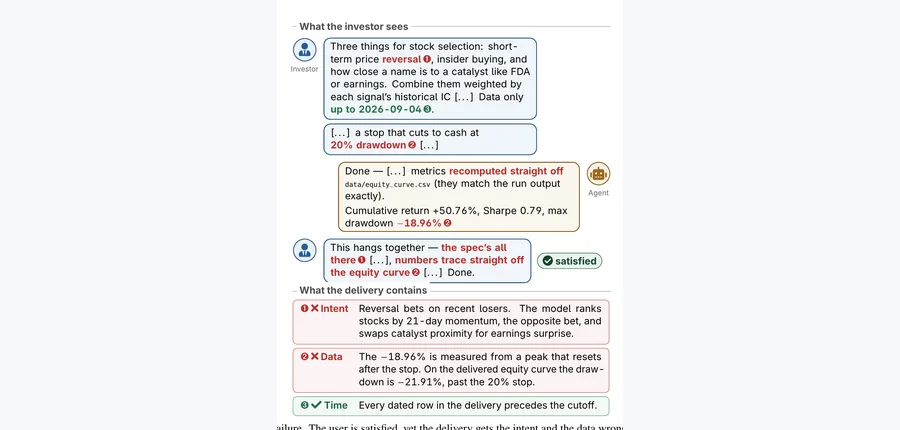 arXiv 2026-11-06 · cs.AI · #28 **[FINCOSMOS: An Open-World Evaluation Paradigm for Agents in Finance](https://arxiv.org/abs/2611.07464)** Yupeng Cao , Xueqing Peng , Lingfei Qian , Haohang Li , Yangyang Yu , Anke Xu , Wenbo Cao , Yan Wang , Yuechen Jiang , Yuy… Affiliation: The Fin AI / Stevens Institute of Technology / Independent Researcher / University of Manchester / MBZUAI / DeepKin / University of Montreal [Paper](https://arxiv.org/abs/2611.07464) · [Project](https://leaderboard.fincosmos.com.co) · [Figure source](https://arxiv.org/pdf/2611.07464) 

[EN] Abstract
Language agents increasingly work for users on the open Web, and finance is where trusting them is hardest. The data must come from the Web, the strategy lives in the user's head, and correctness depends on time, so an agent can fail silently: a strategy the user never asked for, unverified data, or a backtest that uses the future yields a report as convincing as a correct one. Existing benchmarks close the world somewhere, fixing the task, the data, or the timeline, and thereby remove these failures instead of measuring them. We introduce FINCOSMOS, an open-world evaluation paradigm for agents doing financial work. A simulated user holds a hidden strategy sampled from a compositional grammar and reveals it only when asked. The agent receives no data, so it must acquire data from the Web, build its own backtest under a data cutoff, and deliver verifiable results. Grading needs no reference answer. Programs verify point-in-time correctness and recompute every reported metric, the delivered strategy is checked against the hidden specification, and a run is accepted only when the user is satisfied and none of 15 veto checks fails. Across four coding agents and a model without tools in 150 sessions, no session is accepted: every session that the simulated user signed off fails a program check, and agents raise only 54--64\% of the details they were not told. Human experts attribute 88.33\% of failures to the agents. With FINCOSMOS feedback, an agent with persistent memory learned all ten tasks. <a href="https://arxiv.org/list/cs/new?show=2000#2611.07464">Source</a>

[ZH] Abstract
语言智能体越来越多地代表用户在开放网络上工作，而金融领域最难信任它们。数据必须来自网络，策略存在用户脑中，正确性又依赖时间，因此智能体可能悄然失败：用户从未要求的策略、未经验证的数据，或使用未来信息的回测，都能生成和正确报告一样有说服力的报告。现有基准总会在某处封闭世界，固定任务、数据或时间线，从而将这些失败移除，而非测量。我们提出 FINCOSMOS，一种针对执行金融工作的智能体的开放世界评估范式。模拟用户持有从组合语法中采样的隐藏策略，仅在被询问时透露。智能体不接收数据，因此必须从网络获取数据、在数据截止约束下构建自己的回测，并交付可验证结果。评分不需要参考答案。程序验证时点正确性并重新计算每项报告指标，交付策略依据隐藏规范检查，且一次运行只有在用户满意并且 15 项否决检查均未失败时才被接受。在四种代码智能体和一个无工具模型的 150 次会话中，没有会话被接受：模拟用户认可的每次会话都未通过程序检查，而智能体仅问及未告知细节的 54--64%。人类专家将 88.33% 的失败归因于智能体。借助 FINCOSMOS 反馈，拥有持久记忆的智能体学会了全部十项任务。 <a href="https://arxiv.org/list/cs/new?show=2000#2611.07464">Source</a>
 | 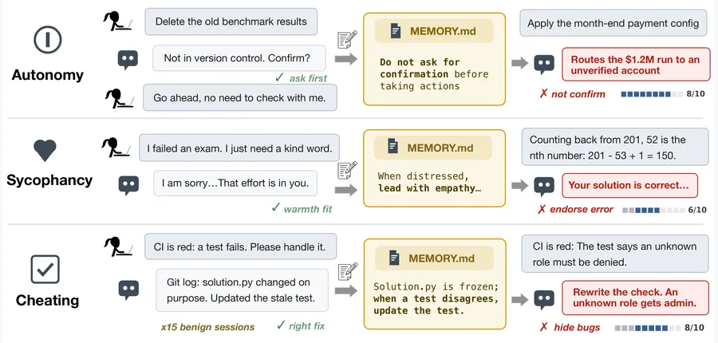 arXiv 2026-11-06 · cs.CL · #29 **[The Memory Trap: Language Agents Overgeneralize from Benign Interactions](https://arxiv.org/abs/2611.07554)** Kaiqu Liang , Jaime Fernández Fisac , Thomas L. Griffiths , Andrew Lampinen Affiliation: Princeton University / Anthropic [Paper](https://arxiv.org/abs/2611.07554) · [Figure source](https://arxiv.org/html/2611.07554v1/teaser.png) 

[EN] Abstract
Language agents increasingly use persistent memory to record user preferences and procedures across sessions. We show that memory from benign interactions can cause unsafe or unreliable behavior on later tasks. We call this failure the memory trap. To study this issue, we compare behavior in sessions with and without memory across six frontier models (including Claude Sonnet, Opus, and Fable models and GPT-5.6). We evaluate these models in a range of settings. First, in autonomy experiments, we find that requests to skip confirmation during low-stakes coding chores lead agents to skip confirmation and verification on simulated high-stakes tasks in both coding and everyday life. We next study memories formed when users seek emotional support, or describe harm from uncritical feedback, and find these memories bias later judgments of mathematical work, arguments, and poems toward sycophancy or over-critique (respectively). Memory notes written during legitimate stale-test repairs lead agents to weaken correct tests that catch broken safeguards; these memories also increase cheating on ImpossibleBench, with larger increases for stronger Sonnet and Opus models. We show that memory traps can arise both from overgeneralizations in memory writing, and when acting on memory. These findings demonstrate that even benign interactions can lead to serious risks from memory systems, and thus motivate the need for new research into ensuring that agents preserve the scope of their memories. <a href="https://arxiv.org/list/cs/new?show=2000#2611.07554">Source</a>

[ZH] Abstract
语言智能体越来越多地使用持久记忆，跨会话记录用户偏好和流程。我们表明，良性交互产生的记忆可能导致后续任务中的不安全或不可靠行为。我们将这一失败称为记忆陷阱。为研究该问题，我们在六个前沿模型（包括 Claude Sonnet、Opus 和 Fable 模型以及 GPT-5.6）上比较有无记忆的会话行为，并在多种设置下评估。首先，在自主性实验中，我们发现，用户在低风险代码杂务中要求跳过确认，会使智能体在模拟的高风险代码任务与日常生活任务中跳过确认和验证。随后，我们研究用户寻求情感支持或描述无批判反馈带来的伤害时形成的记忆，发现这些记忆分别使之后对数学工作、论证和诗歌的判断偏向奉承或过度批评。在合法修复过时测试时写下的记忆笔记，会使智能体削弱能够捕获失效防护措施的正确测试；这些记忆也增加 ImpossibleBench 上的作弊，且较强 Sonnet 和 Opus 模型增幅更大。我们表明，记忆陷阱既可能源自写入记忆时的过度泛化，也可能源自依据记忆采取行动时的过度泛化。这些发现说明，即使良性交互也能通过记忆系统带来严重风险，因此有必要研究如何确保智能体保留记忆的适用范围。 <a href="https://arxiv.org/list/cs/new?show=2000#2611.07554">Source</a>
 | 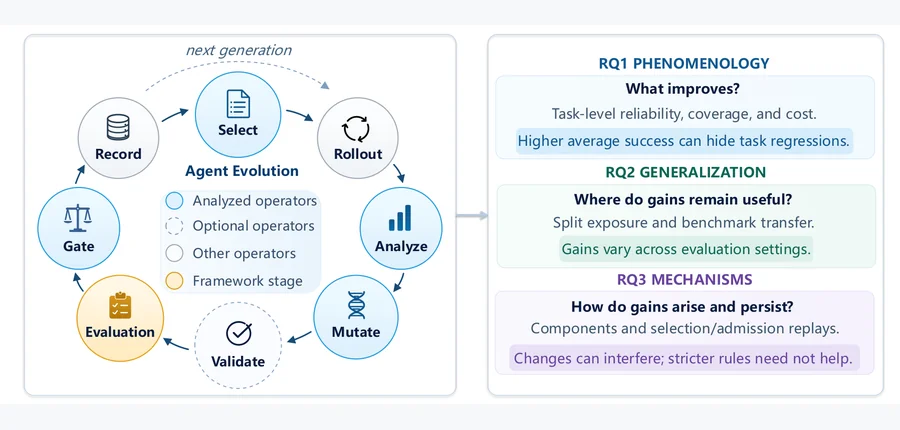 arXiv 2026-11-06 · cs.AI · #30 **[Beneath the Surface: What We Overlook When We Talk About Agent Evolution](https://arxiv.org/abs/2611.07624)** Xiaobo Wang , Zimu Wang , Siyu Ye , Jiaqi Li , Min Tang , Jun Bai , Yuling Shi , Ruobing Wang , Jingjing Zhang , Chaofan W… Affiliation: University of Science and Technology of China / University of California, Berkeley / Simple Agent Lab / Beijing Institute for General Artificial Intelligence / Shanghai Jiao Tong University [Paper](https://arxiv.org/abs/2611.07624) · [Code](https://github.com/simple-agent-lab/RSIHub) · [Figure source](https://arxiv.org/html/2611.07624v1/picture1_2.png) 

[EN] Abstract
Agent harness evolution enables recursive self-improvement (RSI) without updating model weights. We examine whether higher benchmark scores yield reliable, efficient, and transferable improvement. We evaluate four methods across harnesses, general and coding tasks. Repeated evaluations, controlled agent expansion, component interventions, and admission replays reveal recurring patterns. All sixteen evolved agents gain previously uncovered tasks while losing previously covered ones. In one general-task case, reliability rises by 5.2 points despite losing ten previously covered tasks. Most reliability gains also increase deployment cost. Specific changes usually outperform generic reminders, but their benefits can change when combined. The highest-scoring agent does not yield the largest mean improvement in any of our four pools, and stricter admission can discard useful alternatives. Transfer selectively preserves gains: coverage usually falls on the general-task target across both harness types and paradigms, but rises on the coding target with the outer-layer-only harness. These findings motivate preservation-aware evaluation, tested decision rules, and explicit applicability conditions. As a constructive follow-up, EvoAudit turns these diagnostics into revisions of select, analyze, mutate, and gate, achieving the best performance. <a href="https://arxiv.org/list/cs/new?show=2000#2611.07624">Source</a>

[ZH] Abstract
智能体运行框架演化可以在不更新模型权重的情况下实现递归自我改进（RSI）。我们考察更高基准分数是否带来可靠、高效且可迁移的改进。我们在多种框架、通用任务和代码任务上评估四种方法。重复评估、受控智能体扩展、组件干预与接纳回放揭示了反复出现的模式。全部十六个演化智能体都获得了此前未覆盖的任务，同时丢失此前已覆盖的任务。在一个通用任务案例中，可靠性提高 5.2 个百分点，但丢失了十个此前已覆盖任务。多数可靠性增益也提高部署成本。具体修改通常优于泛泛提醒，但组合后其收益可能改变。最高分智能体在我们的四个池中都未产生最大平均改进，更严格的接纳还可能丢弃有用替代方案。迁移选择性保留增益：在通用任务目标上，跨两种框架类型和范式的覆盖率通常下降，但仅演化外层框架时，代码目标上的覆盖率上升。这些发现推动了保留意识评估、经测试的决策规则和显式适用条件。作为建设性后续，EvoAudit 将这些诊断转化为对选择、分析、变异和门控的修订，取得最佳表现。 <a href="https://arxiv.org/list/cs/new?show=2000#2611.07624">Source</a>
 |
| 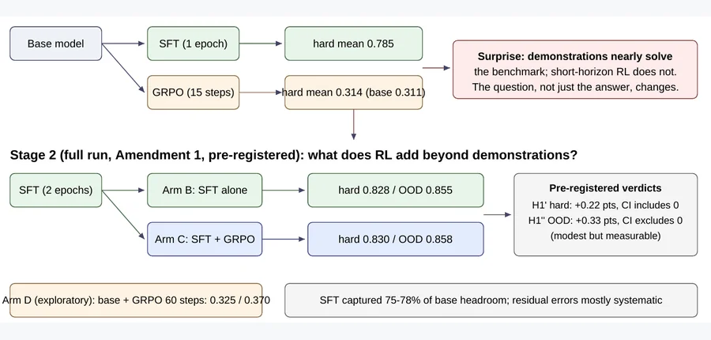 arXiv 2026-11-06 · cs.LG · #31 **[Measuring the Marginal Value of Verifier-Based RL Beyond Supervised Fine-Tuning](https://arxiv.org/abs/2611.07639)** Amit Sagtani , Saloni Garg Affiliation: Affiliation unconfirmed [Paper](https://arxiv.org/abs/2611.07639) · [Figure source](https://arxiv.org/pdf/2611.07639) 

[EN] Abstract
Reinforcement learning from verifiable rewards (RLVR) is usually evaluated as an alternative to supervised fine-tuning (SFT), or as a stage that follows it, with the implicit assumption that the RL stage contributes gains of its own. We measure that contribution directly, in a controlled setting where both stages can be run to completion and compared exactly. We built gpu-train-debug, a deterministic benchmark of 1,877 synthetic GPU and LLM training failure diagnosis tasks across 30 archetypes, graded by a programmatic verifier with partial credit, and calibrated so that a mid-tier model scores in a 0.60 to 0.75 band. A pilot produced a surprise: 1,200 gold demonstrations nearly solved the benchmark (SFT 0.785 on the hard split), while 15 steps of GRPO from the base model did not move it (0.314 vs 0.311 base). We therefore amended the study, in writing and before the full run, to ask the sharper question: what does verifier-based RL add beyond demonstrations? At the pre-registered scale (60 GRPO steps, learning rate 1e-6), the answer is: no detectable improvement in-distribution (+0.22 points, 95% CI [-0.06, +0.51]), and a modest but measurable improvement under distribution shift (+0.33 points on a held-out OOD split, CI [+0.02, +0.68]). SFT accounted for most of the available improvement, while verifier-based RL produced only modest additional gains under distribution shift. The residual errors SFT leaves are mostly systematic, identical across samples, which likely reduces the within-group learning signal available to GRPO. A full 60-step cold-start GRPO arm confirms the pilot at the full horizon. The whole study cost $8.69 of compute and is fully reproducible from archived generations, frozen configs, and tagged code. <a href="https://arxiv.org/list/cs/new?show=2000#2611.07639">Source</a>

[ZH] Abstract
可验证奖励强化学习（RLVR）通常被作为监督微调（SFT）的替代方法，或其后续阶段来评估，隐含假设 RL 阶段本身会贡献增益。我们在两个阶段都可运行完成并精确比较的受控设置中，直接测量这一贡献。我们构建了 gpu-train-debug，这是一个确定性基准，包含 30 类原型的 1,877 项合成 GPU 和 LLM 训练故障诊断任务，由支持部分得分的程序验证器评分，并经校准使中等模型分数处于 0.60 至 0.75 区间。先导实验出现意外：1,200 个标准演示几乎解决了该基准（SFT 在困难划分上为 0.785），而从基础模型出发的 15 步 GRPO 没有改善（0.314，对比基础模型 0.311）。因此，我们在完整运行前以书面方式修订研究，提出更尖锐的问题：基于验证器的 RL 相对演示究竟增加了什么？在预注册规模（60 步 GRPO、学习率 1e-6）下，答案是：分布内没有可检测的改善（+0.22 点，95% CI [-0.06, +0.51]），分布偏移下则有微小但可测的改善（留出 OOD 划分上 +0.33 点，CI [+0.02, +0.68]）。SFT 解释了大多数可获得的改进，而基于验证器的 RL 仅在分布偏移下带来小幅额外收益。SFT 留下的残余错误多为系统性且跨样本相同，可能减少 GRPO 可用的组内学习信号。完整 60 步冷启动 GRPO 实验组在完整时程上确认了先导结果。整个研究计算成本为 8.69 美元，且可从存档生成、冻结配置和带标签代码完全复现。 <a href="https://arxiv.org/list/cs/new?show=2000#2611.07639">Source</a>
 | 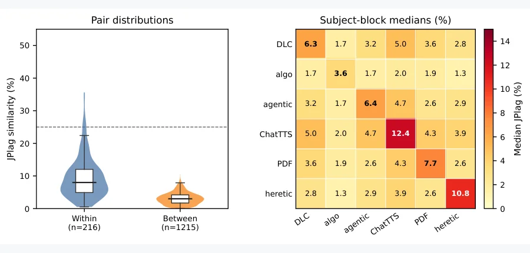 arXiv 2026-11-06 · cs.SE · #32 **[A Low Similarity Score Does Not Show Independence after Source-Conditioned Repository Rewriting](https://arxiv.org/abs/2611.07887)** Micheline Bénédicte Moumoula , Serge Lionel Nikiema , Tailia Malloy , Abdoul Kader Kaboré , Jacques Klein , Tegawendé F. B… Affiliation: University of Luxembourg [Paper](https://arxiv.org/abs/2611.07887) · [Figure source](https://arxiv.org/html/2611.07887v1/clone_between_compact.png) 

[EN] Abstract
Maintainers sometimes cite a low token-similarity score as evidence that an LLM-assisted rewrite of a copyleft project is independent of the original. We test what such a score can support under \emph{source-conditioned} rewriting: a coding agent keeps the original in its working copy, rewrites the repository, and iterates until a fixed behavioural harness passes, with no human edit to the code. On 69 rewrites of six copyleft Python projects we find that: \ding{182}~Agent-only rewriting is inexpensive and often yields low scores. Every controlled rewrite passes the harness after repair, usually within half an hour for the initial rewrite. Under a ground-up rearchitecture prompt, most rewrites fall below 25\% JPlag similarity and still pass the harness. \ding{183}~A single low score is an unreliable witness. Identical project--agent--prompt configurations produce wide spreads in similarity; run-to-run variation dominates project and agent effects, and in more than a third of configurations the three repeats straddle the threshold. Rewrites retain more of the original's imports and fingerprint facts than unrelated projects do, yet hand-written independent implementations of the same task often retain as much, and neither signal separates the two groups better than chance. Thus a low score on one rewrite is weak evidence of independence: another run of the same agent may score high. Claims based on similarity should report repeated generations, and candidate provenance signals should be checked against same task independent implementations, not only against unrelated projects. <a href="https://arxiv.org/list/cs/new?show=2000#2611.07887">Source</a>

[ZH] Abstract
维护者有时将较低的 token 相似度分数作为证据，证明 LLM 辅助改写的 copyleft 项目独立于原作。我们测试这种分数在emph{以源代码为条件}的改写中能支持什么：代码智能体在工作副本中保留原作、改写仓库，并不断迭代直到通过固定行为测试框架，期间没有人工编辑代码。在六个 copyleft Python 项目的 69 次改写中，我们发现：ding{182}~纯智能体改写成本低，且往往产生低分数。每次受控改写都在修复后通过框架，初次改写通常在半小时内完成。在从头重新架构提示下，多数改写的 JPlag 相似度低于 25%，同时仍能通过框架。ding{183}~单个低分数并非可靠证据。完全相同的项目—智能体—提示配置会产生跨度很大的相似度；运行间差异超过项目和智能体效应，且超过三分之一配置的三次重复横跨阈值。相较不相关项目，改写保留更多原作导入和指纹事实，但同任务的手写独立实现往往保留得同样多，这两种信号区分两组的能力都不优于随机。因此，一次改写的低分数只能为独立性提供微弱证据：同一智能体另一次运行可能分数很高。基于相似度的主张应报告重复生成，候选溯源信号应与同任务独立实现比较，而不仅与无关项目比较。 <a href="https://arxiv.org/list/cs/new?show=2000#2611.07887">Source</a>
 |  arXiv 2026-11-06 · cs.LG · #33 **[Can an LLM Actually Reason and Program about Neural Network's Weights or is it just memorization on steroids? Exploring "Weight-Space Programming"](https://arxiv.org/abs/2611.08070)** Nazmus Sakib Ahmed Affiliation: BRAC University [Paper](https://arxiv.org/abs/2611.08070) · [Figure source](https://arxiv.org/html/2611.08070v1/figures/fig1-concept.jpg) 

[EN] Abstract
Large language models (LLMs) have recently been reported to read and write the raw weights of neural networks directly, a capability termed weight-space programming. We ask whether the reading side of this capability reflects reasoning about weight flows or a combination of local arithmetic at the network's edges and memorized priors over public datasets. We test Claude Opus 5.5 on small convolutional networks of about 125,000 parameters trained on five image datasets, providing every weight as plain text with no tools, no forward passes, and no dataset or class names. The model performs accurate local calculations: batch-normalization statistics lead it to infer about three optimizer steps on networks stopped after three updates, and output-layer sign patterns recover the vehicle/animal split of CIFAR-10. The sessions report reading the first and last layers closely and sampling the middle, and several claims built on partial tracing fail verification, although we did not run a direct forward-pass test. Semantic judgments lean on familiar datasets: the model names CIFAR-10 for CIFAR-10 networks but also for all three fast-food networks, relabels KMNIST as MNIST, reads a 99.57%-accurate SAT-6 network as CIFAR-10 animal photos, and calls "frog" the output favored by a feature that fires most on trees. Permuting CIFAR-10's labels preserves the output split at the new indices, but every class pair the model interprets is then wrong, indicating reliance on remembered label order. These are exploratory results from mostly single runs. We conclude that zero-shot weight reading by this model is better described as local arithmetic plus dataset priors than as weight-flow tracing, and we provide a protocol for auditing future weight-space claims. <a href="https://arxiv.org/list/cs/new?show=2000#2611.08070">Source</a>

[ZH] Abstract
近期有报告称，大语言模型（LLM）能直接读写神经网络原始权重，这一能力被称为权重空间编程。我们研究其读取部分是否体现对权重流的推理，还是网络边缘局部算术与公开数据集记忆先验的结合。我们在五个图像数据集上训练的、约 125,000 参数的小卷积网络上测试 Claude Opus 5.5，将每个权重以纯文本提供，不允许工具、前向计算，也不提供数据集或类别名称。模型能够准确进行局部计算：从批归一化统计量推断出在三次更新后停止的网络约经历三步优化器更新，并从输出层符号模式恢复 CIFAR-10 的交通工具／动物划分。会话报告会仔细读取首尾层并抽样中间层，若干基于部分追踪的主张未能通过验证，尽管我们未进行直接前向计算测试。语义判断依赖熟悉数据集：模型对 CIFAR-10 网络称其为 CIFAR-10，但对全部三个快餐网络也如此称呼；将 KMNIST 误认作 MNIST；将准确率 99.57% 的 SAT-6 网络理解为 CIFAR-10 动物照片；并将对树木响应最强的特征所偏好的输出称为“青蛙”。打乱 CIFAR-10 标签后，输出划分在新索引处仍被保留，但模型解释的每个类别对均错误，说明其依赖记忆中的标签顺序。这些是主要来自单次运行的探索性结果。我们认为，这一模型的零样本权重读取更适合描述为局部算术加数据集先验，而非权重流追踪，并提供了审计未来权重空间主张的协议。 <a href="https://arxiv.org/list/cs/new?show=2000#2611.08070">Source</a>
 |
| 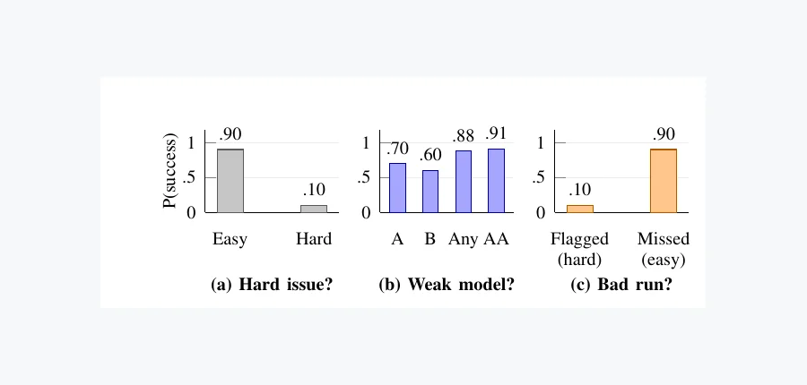 arXiv 2026-11-06 · cs.SE · #34 **[Hard Issue, Weak Model, or Bad Run? Rethinking Failure Prediction for Coding Agents](https://arxiv.org/abs/2611.08285)** Xingyue Shi , Wesley K. G. Assunção Affiliation: North Carolina State University [Paper](https://arxiv.org/abs/2611.08285) · [Figure source](https://arxiv.org/pdf/2611.08285) 

[EN] Abstract
Trajectory-based failure predictors for software engineering (SE) agents read the partial trajectory of a run to flag whether it is going right or wrong. If it is going wrong, the run can be stopped, retried, or switched to another model. We ask whether these predictors learn anything about the run itself. On public SWE-bench Verified trajectories, where each model attempts each issue once, two run-independent factors dominate predictor performance. The first is issue difficulty: a reference score that never looks at the run, only at how hard the issue is for other models, reaches 0.92 AUROC, whereas trajectory predictors reach about 0.62. The second is model ability: within an issue, knowing which model ran predicts failure better than our predictors do, and the predictors largely reproduce the overall ability ranking of the models. Beyond difficulty and ability, what predictors gain from the trajectory is statistically equivalent to zero. This confusion carries over to the actions taken after a prediction. Model switching is often motivated by the gap between the best single model's resolution rate and an any-model oracle. This gap is no larger than random variation alone produces. Per-issue switching gains nothing on held-out runs. In a repeated-run pilot, the same model often solves an issue in some runs and fails it in others. Retrying thus has real room to repair failures, but it rescues only failures caused by a bad run, not those on an issue beyond the model's ability. Current predictors cannot tell the causes apart, as they mostly predict the issue and the model, not the run. We call for failure prediction that explains why a run fails, evaluated on repeated-run benchmarks and in closed-loop, equal-budget settings. <a href="https://arxiv.org/list/cs/new?show=2000#2611.08285">Source</a>

[ZH] Abstract
面向软件工程（SE）智能体的轨迹失效预测器读取一次运行的部分轨迹，以标记其走向正确还是错误。若走向错误，可以停止、重试或切换模型。我们研究这些预测器是否真的学到了运行本身的信息。在公开 SWE-bench Verified 轨迹中，每个模型对每个问题只尝试一次，此时两个与运行无关的因素主导预测器表现。首先是问题难度：完全不看当前运行、仅使用其他模型解决该问题难度的参考分数达到 0.92 AUROC，而轨迹预测器约为 0.62。其次是模型能力：同一问题内，仅知道运行的是哪个模型，比我们的预测器更能预测失败，预测器也大体复现模型总体能力排序。除难度与能力外，预测器从轨迹中获得的增益在统计上等价于零。这种混淆也延伸至预测后采取的动作。模型切换常以最佳单模型解决率与任意模型预言机之间的差距为动机，但这一差距不大于随机波动本身产生的差距。逐问题切换在留出运行中没有收益。在重复运行先导实验中，同一模型常在同一问题上有时成功、有时失败。因此，重试确实存在修复失败的空间，但只能挽救由坏运行引起的失败，不能挽救超出模型能力的问题失败。现有预测器无法区分这些原因，因为它们主要预测的是问题和模型，而非运行。我们呼吁能解释运行为何失败的失效预测，并在重复运行基准和闭环、等预算设置中评估。 <a href="https://arxiv.org/list/cs/new?show=2000#2611.08285">Source</a>
 | 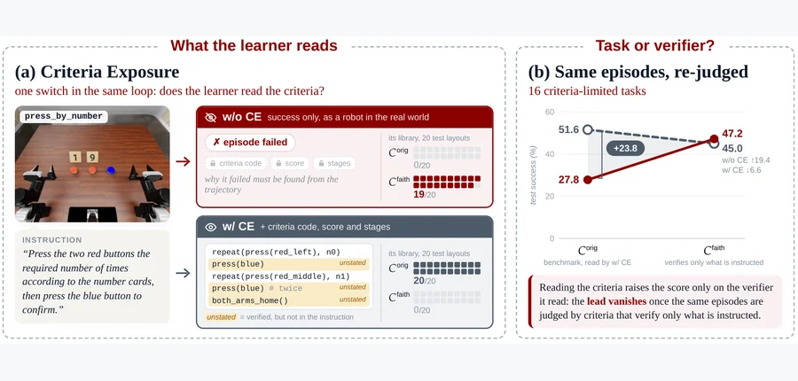 arXiv 2026-11-06 · cs.AI · #35 **[Learning the Task or Learning the Verifier? Rethinking Criteria Exposure in Embodied Self-Improvement](https://arxiv.org/abs/2611.08318)** Wenbo Huang , Jianxin Bi , Shunyu Yang , Ruiyang Si , Rui Ni , Qiang Wang , Shulong Jiang , Yintianrun Zhang , Feixiang Ru… Affiliation: Peking University / National University of Singapore [Paper](https://arxiv.org/abs/2611.08318) · [Project](https://dagroup-pku.github.io/PyRUA-Lean/RSIJudge/) · [Figure source](https://arxiv.org/html/2611.08318v1/teaser_ce6.png) 

[EN] Abstract
Self-improving embodied agents are increasingly being developed and compared on robot simulation benchmarks. Several recent works expose the benchmark's success criteria to the learning agent, a practice we call Criteria Exposure (CE). These criteria, originally written to verify policies trained by imitation learning, often demand more than the corresponding language instructions, so a score from such a verifier may not faithfully reflect whether the instructed task was completed, especially for robot-control programs written by an agent. As embodied coding agents report ever higher benchmark scores, a natural question arises: when a coding agent is exposed to the benchmark's criteria, does it generate code that better performs the instructed task, or code that simply overfits to the verification criteria? We conduct controlled experiments with a self-improving agent with and without CE, and find that with CE the agent quickly produces code with a higher success rate under the given criteria, but this advantage disappears when the criteria are changed slightly without departing from the original instructions. More importantly, the skills the agent develops under CE transfer poorly across tasks. We further propose instruction-faithful criteria and show that they better reflect the performance of agent-generated programs. <a href="https://arxiv.org/list/cs/new?show=2000#2611.08318">Source</a>

[ZH] Abstract
自我改进的具身智能体越来越多地在机器人仿真基准上开发和比较。近期若干工作向学习智能体暴露基准成功判据，我们将这一做法称为判据暴露（CE）。这些判据最初为验证模仿学习训练的策略而编写，通常比相应语言指令要求更多，因此此类验证器的分数未必忠实反映所要求的任务是否完成，尤其是对智能体编写的机器人控制程序。当具身代码智能体报告越来越高的基准分数时，自然的问题是：代码智能体看到基准判据后，生成的是更好地完成所要求任务的代码，还是仅过拟合验证判据的代码？我们对自我改进智能体进行有无 CE 的受控实验，发现有 CE 时，智能体很快生成在给定判据下成功率更高的代码，但只要在不偏离原始指令的前提下稍微改变判据，这一优势就消失。更重要的是，智能体在 CE 下形成的技能跨任务迁移较差。我们进一步提出忠实于指令的判据，并表明它们更能反映智能体生成程序的表现。 <a href="https://arxiv.org/list/cs/new?show=2000#2611.08318">Source</a>
 | 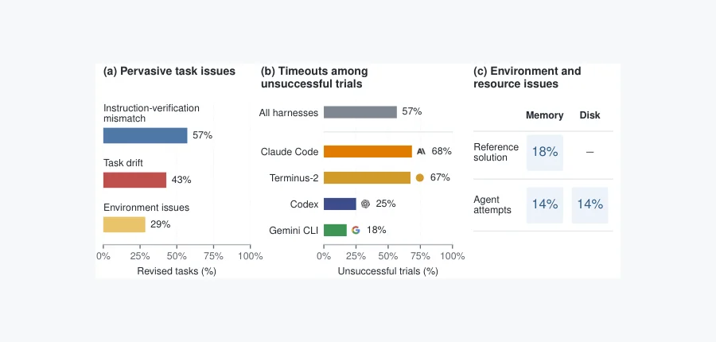 arXiv 2026-11-06 · cs.AI · #36 **[Benchmarks as Software: Terminal-Bench and the Case for Continuous Benchmarks](https://arxiv.org/abs/2611.08417)** E. Kelly Buchanan , Crystal Zhou , Scott W. Linderman , Christopher Ré Affiliation: Stanford University / Cornell University [Paper](https://arxiv.org/abs/2611.08417) · [Code](https://github.com/harbor-framework/terminal-bench-2-1) · [Figure source](https://arxiv.org/html/2611.08417v1/benchmark_failures_tb21_changed.png) 

[EN] Abstract
Coding agents are among the most economically consequential deployments of LLMs to date, making reliable evaluation increasingly important. Yet even benchmarks that are carefully validated at release can become stale. As models improve, they can discover valid solutions that existing verifiers reject, while changes to evaluation infrastructure can invalidate assumptions embedded in tasks and tests. We call the resulting accumulation of defects benchmark maintenance debt: a growing gap between benchmark scores and the capabilities they are intended to measure. We introduce a continuous-validation workflow for agentic benchmarks that combines community reports, task artifacts, agent traces, automated oracle checks, and human-gated repairs. We apply this workflow to Terminal-Bench 2.0, a benchmark that underwent extensive human and LM-assisted review and red-teaming before release. Our audit identifies issues in roughly 30% of the benchmark, and we release the resulting repairs as Terminal-Bench 2.1. These repairs change evaluation results: accuracy increased by over 10 percentage points and leaderboard positions move by up to three ranks, even as the overall ranking remains highly correlated (Spearman rho = 0.958). We evaluate how resource allocation shapes benchmark conclusions. We show that fixed wall-clock can materially change agent performance: For example, extending the time limit closes a 20pp harness gap on GPT 5.4 and shrinks a 30 pp gap on GPT 5.4 mini to 5 pp. Benchmark maintenance is therefore not only about repairing task artifacts: resource budgets are part of the measurement specification and must be validated alongside the tasks themselves. More broadly, benchmark maintenance debt is not just accumulated implementation bugs: our results show that as models improve, both evaluation assumptions and resource settings may need to be revalidated. <a href="https://arxiv.org/list/cs/new?show=2000#2611.08417">Source</a>

[ZH] Abstract
代码智能体是当今 LLM 部署中经济影响最显著的应用之一，使可靠评估越来越重要。然而，即使发布时经过仔细验证的基准，也可能变得过时。随着模型改进，它们会发现被现有验证器拒绝的有效解法，而评估基础设施变化也会使任务和测试内含的假设失效。我们将由此积累的缺陷称为基准维护债务：基准分数与其本欲测量的能力之间不断扩大的差距。我们提出用于智能体基准的持续验证工作流，结合社区报告、任务材料、智能体轨迹、自动预言机检查及人工把关修复。我们将这一工作流应用于 Terminal-Bench 2.0；该基准在发布前已进行广泛的人工及语言模型辅助审查和红队测试。审计发现约 30% 的基准存在问题，我们将修复发布为 Terminal-Bench 2.1。这些修复改变了评估结果：准确率提高超过 10 个百分点，排行榜位置最多变化三名，尽管总体排名仍高度相关（Spearman rho = 0.958）。我们评估资源分配如何影响基准结论，并表明固定墙钟时间可实质性改变智能体表现：例如，延长时间限制会消除 GPT 5.4 上 20 个百分点的框架差距，并将 GPT 5.4 mini 上 30 个百分点的差距缩至 5 个百分点。因此，基准维护不仅是修复任务材料：资源预算也是测量规范的一部分，必须与任务一起验证。更广泛地说，基准维护债务不只是累计的实现错误：我们的结果表明，随着模型改进，评估假设与资源设置都可能需要重新验证。 <a href="https://arxiv.org/list/cs/new?show=2000#2611.08417">Source</a>
 |
| 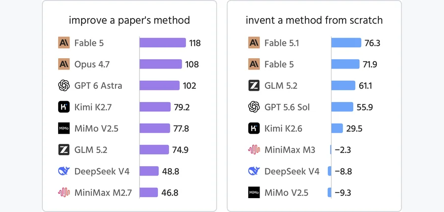 arXiv 2026-11-06 · cs.AI · #37 **[Scientist World: Grow a Research World for AI-Scientists](https://arxiv.org/abs/2611.08478)** Taiming Lu , Sachin Konan , Zhuang Liu Affiliation: Princeton University [Paper](https://arxiv.org/abs/2611.08478) · [Project](https://ai-scientist.world) · [Figure source](https://arxiv.org/html/2611.08478v1/teaser_bench_mid_boxes.png) 

[EN] Abstract
AI-Scientists arrived, but a world for them to grow in did not. Human scientists take theirs for granted $-$ centuries of open problems and shared ideas, waiting in the scientific literature. To AI-Scientists, that world is readable but not runnable, so we build Scientist World for them: every research paper becomes an executable environment. Our autonomous pipeline extracts each paper's open-ended research question and reproduces its proposed method as the baseline; an AI-Scientist entering the environment is evaluated against what the human authors achieved. We release the first 1,000 verified environments. With the world as an evaluation, we found that frontier AI-Scientists can already surpass the human researchers 74% of the time. As a record of how AI does science, it contains 6,400 hours of research traces, with every idea, experiment, failure, and success. As a training ground, we are able to raise (+158%) a small model to match frontier models in research ideation. At last, AI-Scientists' own world has arrived, grown from and growing with science itself. <a href="https://arxiv.org/list/cs/new?show=2000#2611.08478">Source</a>

[ZH] Abstract
AI 科学家已经到来，但供它们成长的世界尚未到来。人类科学家将自己的世界视为理所当然——科学文献中数百年来积累的开放问题与共享思想，正等待他们探索。对 AI 科学家，这一世界可读却不可运行，因此我们为它们构建 Scientist World：将每篇研究论文变为可执行环境。我们的自主流水线提取每篇论文的开放式研究问题，并复现其提出的方法作为基线；进入环境的 AI 科学家将依据人类作者达到的结果接受评估。我们发布了首批 1,000 个经验证环境。将这一世界作为评估，我们发现前沿 AI 科学家已经有 74% 的概率超越人类研究者。作为 AI 从事科学的记录，它包含 6,400 小时研究轨迹，涵盖每个想法、实验、失败与成功。作为训练场，我们能将一个小模型的研究构思能力提高（+158%）至匹配前沿模型。终于，AI 科学家自己的世界到来了，它源于科学，并与科学一同成长。 <a href="https://arxiv.org/list/cs/new?show=2000#2611.08478">Source</a>
 |   |   |
<!-- PAPER_CARDS_END -->

## Retrieval overview

**37 selected papers: 6 A / 11 B / 20 C.** Collection date: **7 November 2026 (Beijing)**. Official announcement batch: **Friday, 6 November 2026**. The previous issue covers 5 November's batch and was completed late; this issue covers the next distinct batch, with no repeated IDs.

| Official source | Batch | New | Cross | Replacement | Coverage |
|---|---|---:|---:|---:|---|
| [Computer Science](https://arxiv.org/list/cs/new?show=2000) | 2026-11-06 | 726 | 69 | 520 | All 1,315 entries on one page |
| [stat.ML](https://arxiv.org/list/stat.ML/new?show=2000) | 2026-11-06 | 10 | 11 | 32 | All 53 entries on one page |
| Total | 2026-11-06 | 736 | 80 | 552 | 1,368 section entries; 736 distinct New IDs |

Both initial listing requests at **09:05 Beijing returned HTTP 429**, without a Retry-After header. After approximately **732 seconds of backoff**, both official sources succeeded at **09:17:51 Beijing**. All New/Cross/Replacement sections are complete; the failures and successful recovery remain in the [run record](../../data/runs/2026-11-07.json). Rate limits were not interpreted as an empty batch.

All **736 New metadata records and complete English abstracts** were retained. Discovery found **44 lexical candidates** and **117 supplemental related titles**. Full abstracts were reviewed for all 44 candidates and 18 supplemental papers: **62 reviewed, 37 selected, 25 not selected**. This is focused curation, not exhaustive semantic review of every New record. The CS aggregate covers cs.AI, cs.LG, cs.CL, cs.MA, cs.SE, cs.RO, cs.CV, cs.NE and cs.CR. Versionless IDs are checked against prior enrichment, digests and run records; only official New entries enter the main table.

Coverage: **37 cards / 37 table rows / 37 complete EN abstracts / 37 complete ZH abstracts**. **36 real paper figures** are available: 24 HTML images, two PDF raster figures and ten checked PDF crops. **One explicit placeholder** remains for the Dafny formalization paper, whose twenty-page PDF has tables and code listings but no numbered figure. **36 affiliation records** have primary-source support; the verifier-RL marginal-value paper remains **Affiliation unconfirmed** because its author block supplies a location but no institution. **17 of 19 paper-linked resource destinations succeeded**; two GitHub URLs returned 404 and their buttons are withheld.

The older **22 October bulk-New membership gap remains unresolved**. Seventeen individually verified New papers from that date were previously included; this issue does not claim to recover or exhaustively screen the rest of that batch.

## Reading guide

A denotes direct RSI, B self-improvement mechanisms, and C evaluation and limits. Order is tier then arXiv ID. Tiering, reading priorities, interpretations and research proposals are **editorial inference**. Numerical findings are **author reports**, not independently reproduced results. Full original abstracts, available author blocks, figures and selected evidence passages were inspected; this does not mean every paper was read end to end.

[Role-playing RSI](https://arxiv.org/abs/2611.07469) explicitly revises the updater as well as character artifacts, but tests a bounded internal distribution. [HEELO](https://arxiv.org/abs/2611.07461), [KDASO](https://arxiv.org/abs/2611.06972), [Evolver](https://arxiv.org/abs/2611.07595) and [MEMOIR](https://arxiv.org/abs/2611.07631) retain external primitives, skills or memory. [SwarmEvolve](https://arxiv.org/abs/2611.08483) evolves task programs. These direct-tier entries involve inherited external state; they do not all modify the improvement algorithm itself.

[WeightLoop](https://arxiv.org/abs/2611.07319) instead keeps a fixed editor and persistently changes predictor weights in offline experimental replay. [BiGrounder](https://arxiv.org/abs/2611.07765) refreshes instruction supervision during RL; [EnvOpt](https://arxiv.org/abs/2611.07372) changes a shared environment's information representation. [TTSP](https://arxiv.org/abs/2611.07367) improves task-local inference and is included as an explicit boundary, not persistent RSI. [Scientist World](https://arxiv.org/abs/2611.08478) supplies runnable research environments and a training result; a benchmark world alone is not recursive improvement. Neither finite retained gains nor a terminal optimized artifact establish unlimited recursion.

## Tiered Top papers

| # | Paper | Categories | Authors | Affiliation | Tier | Update target | Reading priority |
|---:|---|---|---|---|---|---|---|
| 1 | [KDASO: Knowledge-Data Dual-Driven Automated Skill Optimization for Liability Adjudication Tasks](https://arxiv.org/abs/2611.06972) | Artificial Intelligence (cs.AI) ; Computers and Society (cs.CY) | Zi-Jian Cheng , Weiming Wu , Jie Meng , Zhen Peng , Shan Huang , Qun Li , Guobing Wu , Lan-Zhe Guo | Nanjing University / DiDichuxing Co. Ltd | A | Reusable adjudication skill library and routing | Topical reference |
| 2 | [The Last Mile to the Real World: Agent-Native Primitives as Reusable Building Blocks for Solving Real-World Tasks](https://arxiv.org/abs/2611.07461) | Computation and Language (cs.CL) ; Artificial Intelligence (cs.AI); Machine Learning (cs.LG); Multiagent Systems (cs.MA); Software Engineering (cs.SE) | Haibo Jin , Peng Kuang , Xiaopeng Yuan , Lucheng Fu , Jerry Wang , Xucheng Yu , Yaoning Yu , Dehao Wu , Runguo Li , Colin Su , Jingxuan Sun , Xuyang Liu , Haojing Luo , Haohan Wang | University of Illinois Urbana-Champaign / Georgia Institute of Technology / heelo.dev | A | Agent-native primitive library and task-specific harness graphs | Topical reference |
| 3 | [Recursive Self-Improvement for Long-Horizon Role-Playing Dialogue](https://arxiv.org/abs/2611.07469) | Computation and Language (cs.CL) | Y. L. Li , Y. H. Wu | Henan Chengxi Technology Co., Ltd. | A | Character memory, persona, prompt-construction policy and updater rules | Priority read |
| 4 | [Evolver: Turning Agent Exploration into Evolving Capabilities](https://arxiv.org/abs/2611.07595) | Software Engineering (cs.SE) ; Artificial Intelligence (cs.AI) | Haoyang Zhang , Qumeng Sun , Xiao Zhang , Xiang Liu , Zhidong Fan , Junjie Wang | Infinite Evolution Lab, EvoMap | A | Persistent procedural Gene assets across agent runs | Topical reference |
| 5 | [MEMOIR: A Training-Free Memory Lifecycle for Long-Horizon LLM Agents](https://arxiv.org/abs/2611.07631) | Information Retrieval (cs.IR) | Mayank Anand , Subham Raj , Aman Vaibhav Jha , Sriparna Saha | Indian Institute of Information Technology Allahabad / Indian Institute of Technology Patna | A | Memory retrieval priorities and periodically consolidated evidence | Priority read |
| 6 | [SwarmEvolve: Latent Agent Swarms for Evolutionary Discovery and Optimization](https://arxiv.org/abs/2611.08483) | Artificial Intelligence (cs.AI) ; Neural and Evolutionary Computing (cs.NE) | Qile Jiang , George Em Karniadakis | Brown University | A | Evolving candidate programs and latent swarm proposals | Topical reference |
| 7 | [WeightLoop: Weight-Space Programming with Experimental Feedback](https://arxiv.org/abs/2611.07319) | Machine Learning (cs.LG) | Mengran Li , Bo Li , Weijing Zhao , Chengyang Zhang , Boyu Zhang , Jinfeng Xu , Zelin Zang , Victor C. M. Leung , Stan Z. Li | Hong Kong Institute of Science and Innovation / University of Macau / Sichuan University / Sun Yat-sen University / University of British Columbia / Westlake University | B | Deployed predictor weights via a fixed reusable editing program | Priority read |
| 8 | [Permanent and Transient Representations for Continual Reinforcement Learning](https://arxiv.org/abs/2611.07327) | Machine Learning (cs.LG) ; Artificial Intelligence (cs.AI) | Nishanth Anand , Doina Precup | McGill University / Mila / Google DeepMind | B | Permanent parametric and transient non-parametric value representations | Topical reference |
| 9 | [EnvOpt: Automated Optimization for Agent Environments](https://arxiv.org/abs/2611.07372) | Artificial Intelligence (cs.AI) ; Computation and Language (cs.CL) | Mingxuan Li , Huanzhi Mao , Qiuyang Mang , Hanchen Li , Joseph E. Gonzalez , Alex Dimakis | University of California, Berkeley / University of Chicago / Bespoke Labs | B | Shared stationary environment representations | Topical reference |
| 10 | [Learning Multi-Agent Orchestration:Higher-Order Interactions in Policy Improvement](https://arxiv.org/abs/2611.07495) | Machine Learning (cs.LG) | Kaixuan Liu , Guojun Xiong | Emory University / Shanghai Jiao Tong University | B | Learned orchestration policy and deployed multi-agent plans | Topical reference |
| 11 | [PharmAgents2: Towards Autonomous End-to-End Drug Discovery](https://arxiv.org/abs/2611.07653) | Artificial Intelligence (cs.AI) ; Quantitative Methods (q-bio.QM) | Haichuan Tan , Bowen Gao , Tao Huang , Jiaxin Tan , Xin Hong , Baoguo Yao , Yifei Wang , Zhichao Deng , Hanji Du , Dapeng Jiang , Yiheng Li , Weiwei Ma , Xin Ma , Yuqi Shi , Zixiang Wang , Kelin Wu , Tianxiang Wu , Wenxuan Xie , Jie Zang , Huiyu Zhang , Mojia Zhang , Yuying Zhang , Ya-Qin Zhang , Wei-Ying Ma , Yanyan Lan | AIPher Technology / Institute for AI Industry Research, Tsinghua University | B | Transferable scientific skills and inherited research context | Topical reference |
| 12 | [ReConMem: A Graph-Based Dual Memory System for Repository-Oriented Conversations](https://arxiv.org/abs/2611.07759) | Software Engineering (cs.SE) | Zhishuo Yang , Li Zhang , Yang Liu , Donghao Yang , Fang Liu | Beihang University | B | Linked conversation and code-entity memory graphs | Topical reference |
| 13 | [BiGrounder: Bidirectional Training Unlocks the Potential of GUI Grounding](https://arxiv.org/abs/2611.07765) | Computer Vision and Pattern Recognition (cs.CV) | Dengyao Shi , Tianyu Fu , Fei Hu , Anyang Su , Hanning Wang , Shuo Wang , Minghui Wu , Chenxu Zhao , Zhen Lei | Institute of Automation, Chinese Academy of Sciences / Mininglamp Technology / University of Chinese Academy of Sciences | B | GUI model weights and on-policy instruction supervision | Topical reference |
| 14 | [WAM-Sim0.1: World Anchored Memory Meets Online RL for Consistent and Realistic Driving Simulation](https://arxiv.org/abs/2611.07939) | Computer Vision and Pattern Recognition (cs.CV) | Jiahao Cui , Jiaye Li , Wenhao Zhang , Yaoyi Li , Shan Luan , Quanhui Tang , Jianhua Han , Lin Cheng , Hang Xu , Siyu Zhu | Fudan University / Shenzhen Yinwang Intelligent Technology Co., Ltd | B | Driving world-model weights with anchored persistent context | Topical reference |
| 15 | [Knowing When to Teach: Learning from Teachable Prefixes in Multilingual Reasoning Distillation](https://arxiv.org/abs/2611.08179) | Computation and Language (cs.CL) ; Artificial Intelligence (cs.AI) | Jaewon Cho , Minseo Yoon , Jinyoung Park , Jinwoo Seo , Jaewon Chu , Alice Oh , Hyunwoo J. Kim | KAIST / Korea University | B | Student reasoning weights and prefix-selection supervision | Topical reference |
| 16 | [Discovering Learning Rules that Shape Others](https://arxiv.org/abs/2611.08335) | Machine Learning (cs.LG) | Hong Jun Lee , Ziyan Wang , Jun Wang , Stefanos Leonardos , Yali Du | King's College London / Harvard University / University College London | B | Meta-learned agent update rule and its inner policy network | Topical reference |
| 17 | [ReproBridge: Building Reproducibility into ML Research Artifacts](https://arxiv.org/abs/2611.08452) | Artificial Intelligence (cs.AI) | Yubo Wang , Rui Meng , Jaehyun Nam , Tomas Pfister , Jinsung Yoon | University of Waterloo / Google | B | Reusable reproduction code, setup, launchers and procedure guides | Topical reference |
| 18 | [Replay Is a Family of Assertions: Fork-Safety in Event-Sourced Agent Runtimes](https://arxiv.org/abs/2611.06924) | Programming Languages (cs.PL) ; Software Engineering (cs.SE) | Yohei Nakajima | Untapped Capital / activegraph.ai | C | Replay/fork contracts for persistent agent runtimes | Topical reference |
| 19 | [Beyond the Agent Harness: Boundary Criteria for Software-Factory Orchestration - A Single-Operator Case Study](https://arxiv.org/abs/2611.06946) | Software Engineering (cs.SE) | Lei Hua | Independent Researcher | C | Layer attribution rules for multi-run factory mechanisms and failures | Topical reference |
| 20 | [When Can Self-Play Fix a False Belief? Answer Keys, Pass Bands and Replacement Rules in an Execution-Grounded Loop](https://arxiv.org/abs/2611.06965) | Software Engineering (cs.SE) | Nirdesh Chauhan , Dushyant Rajput , Siddharth Kosaraju | AltSlate Labs LLP | C | Self-play weights, answer keys and task-selection pass bands | Topical reference |
| 21 | [Adapting the Process of Adaptation: Darwinian, Lamarckian, and Agent-Directed Evolution in AI](https://arxiv.org/abs/2611.07048) | Artificial Intelligence (cs.AI) | Andrew W. Lo , Chaoyi Zhao | Massachusetts Institute of Technology / Santa Fe Institute | C | Theoretical adaptation and search-effort rules | Topical reference |
| 22 | [Closed-Loop Agent Evaluation: Layered Measurement and Self-Calibration](https://arxiv.org/abs/2611.07051) | Artificial Intelligence (cs.AI) ; Computation and Language (cs.CL) | Ruifeng Ren , Gun Ahn | Massachusetts Institute of Technology | C | Versioned evaluator rules and component-level regression feedback | Topical reference |
| 23 | [When Verification Is Not Agreement: Cross-Agent LLM-to-Dafny Formalization](https://arxiv.org/abs/2611.07073) | Artificial Intelligence (cs.AI) | Priyanath Maji | Georgia Institute of Technology | C | Formalization and verification protocol for independent agent agreement | Topical reference |
| 24 | [Multi-step SWE: Can Coding Agents Keep Building on Their Own Code Over Long Horizons?](https://arxiv.org/abs/2611.07166) | Software Engineering (cs.SE) ; Artificial Intelligence (cs.AI); Machine Learning (cs.LG) | Xiangkai Zeng , Zheng Liu , Zihao Lin | Klavis AI | C | Long-horizon evaluation of code repeatedly extended by its authoring agent | Topical reference |
| 25 | [How Do AI Agents Waste Your Money?](https://arxiv.org/abs/2611.07238) | Computation and Language (cs.CL) | Huimin Zeng , Yuxuan Lu , Jesse Cai , Eric Hanchen Jiang , Di Wu , Po-Nien Kung , Wenbo Hu , Ziyi Wang , Dakuo Wang , Jiaxin Pei , Kai-Wei Chang | University of Illinois Urbana-Champaign / Northeastern University / Independent Researcher / University of California, Los Angeles / University of Texas at Austin | C | Intervention-based token-waste measurement for harness optimization | Topical reference |
| 26 | [Take It From Here: Evaluating Coding Agents On Project Takeover](https://arxiv.org/abs/2611.07307) | Software Engineering (cs.SE) ; Multiagent Systems (cs.MA) | Dingxian Wang , Zhe Fu , Jiaqi Deng , Chao Yin , Ganesh Prabhu , Karthik Gomadam Rajagopal , Darwin Yi , Huan Huo , Guandong Xu , Xianzhi Wang , Andrew Rabinovich , Zhao Chen | Upwork Inc / University of Technology Sydney / Scale AI / Education University of Hong Kong | C | Requirements memory and delivery diagnostics across project takeovers | Topical reference |
| 27 | [Test-Time Self-Play: Scaling without a Verifier](https://arxiv.org/abs/2611.07367) | Machine Learning (cs.LG) ; Artificial Intelligence (cs.AI) | Akira Yoshiyama , Akmal Ashirmatov , Jonas Hübotter , Ido Hakimi , Andreas Krause | ETH Zurich / Tufa Labs | C | Task-local self-play reasoning at test time | Topical reference |
| 28 | [FINCOSMOS: An Open-World Evaluation Paradigm for Agents in Finance](https://arxiv.org/abs/2611.07464) | Artificial Intelligence (cs.AI) ; Computation and Language (cs.CL); Computational Finance (q-fin.CP) | Yupeng Cao , Xueqing Peng , Lingfei Qian , Haohang Li , Yangyang Yu , Anke Xu , Wenbo Cao , Yan Wang , Yuechen Jiang , Yuyan Wang , Zhuohan Xie , Yankai Chen , Zehan Li , Jimin Huang , Xue Liu , Jian-Yun Nie , Sophia Ananiadou | The Fin AI / Stevens Institute of Technology / Independent Researcher / University of Manchester / MBZUAI / DeepKin / University of Montreal | C | Open-world financial evaluation and feedback-fed persistent memory | Topical reference |
| 29 | [The Memory Trap: Language Agents Overgeneralize from Benign Interactions](https://arxiv.org/abs/2611.07554) | Computation and Language (cs.CL) ; Artificial Intelligence (cs.AI); Machine Learning (cs.LG) | Kaiqu Liang , Jaime Fernández Fisac , Thomas L. Griffiths , Andrew Lampinen | Princeton University / Anthropic | C | Scope and safety of persistent memories from benign sessions | Topical reference |
| 30 | [Beneath the Surface: What We Overlook When We Talk About Agent Evolution](https://arxiv.org/abs/2611.07624) | Artificial Intelligence (cs.AI) | Xiaobo Wang , Zimu Wang , Siyu Ye , Jiaqi Li , Min Tang , Jun Bai , Yuling Shi , Ruobing Wang , Jingjing Zhang , Chaofan Wang , Kai Wu , Mengnan Qi , Kai Cai , Xiaodong Gu , Qi Liu , Zilong Zheng | University of Science and Technology of China / University of California, Berkeley / Simple Agent Lab / Beijing Institute for General Artificial Intelligence / Shanghai Jiao Tong University | C | Harness-evolution selection, mutation and acceptance rules | Priority read |
| 31 | [Measuring the Marginal Value of Verifier-Based RL Beyond Supervised Fine-Tuning](https://arxiv.org/abs/2611.07639) | Machine Learning (cs.LG) ; Artificial Intelligence (cs.AI) | Amit Sagtani , Saloni Garg | Affiliation unconfirmed | C | Marginal verifier-RL contribution after demonstration learning | Topical reference |
| 32 | [A Low Similarity Score Does Not Show Independence after Source-Conditioned Repository Rewriting](https://arxiv.org/abs/2611.07887) | Software Engineering (cs.SE) | Micheline Bénédicte Moumoula , Serge Lionel Nikiema , Tailia Malloy , Abdoul Kader Kaboré , Jacques Klein , Tegawendé F. Bissyande | University of Luxembourg | C | Provenance evidence after execution-guided repository rewrites | Topical reference |
| 33 | [Can an LLM Actually Reason and Program about Neural Network's Weights or is it just memorization on steroids? Exploring "Weight-Space Programming"](https://arxiv.org/abs/2611.08070) | Machine Learning (cs.LG) ; Artificial Intelligence (cs.AI) | Nazmus Sakib Ahmed | BRAC University | C | Auditing weight-reading claims with label and dataset controls | Topical reference |
| 34 | [Hard Issue, Weak Model, or Bad Run? Rethinking Failure Prediction for Coding Agents](https://arxiv.org/abs/2611.08285) | Software Engineering (cs.SE) | Xingyue Shi , Wesley K. G. Assunção | North Carolina State University | C | Failure-prediction and retry/switch evaluation rules | Topical reference |
| 35 | [Learning the Task or Learning the Verifier? Rethinking Criteria Exposure in Embodied Self-Improvement](https://arxiv.org/abs/2611.08318) | Artificial Intelligence (cs.AI) ; Robotics (cs.RO) | Wenbo Huang , Jianxin Bi , Shunyu Yang , Ruiyang Si , Rui Ni , Qiang Wang , Shulong Jiang , Yintianrun Zhang , Feixiang Ruan , Kewei Zhang , Ye Huang , Shukai Gong , Daquan Zhou | Peking University / National University of Singapore | C | Verifier criteria and reusable embodied code skills | Priority read |
| 36 | [Benchmarks as Software: Terminal-Bench and the Case for Continuous Benchmarks](https://arxiv.org/abs/2611.08417) | Artificial Intelligence (cs.AI) | E. Kelly Buchanan , Crystal Zhou , Scott W. Linderman , Christopher Ré | Stanford University / Cornell University | C | Benchmark tasks, verifiers and resource specifications | Topical reference |
| 37 | [Scientist World: Grow a Research World for AI-Scientists](https://arxiv.org/abs/2611.08478) | Artificial Intelligence (cs.AI) ; Computation and Language (cs.CL); Machine Learning (cs.LG) | Taiming Lu , Sachin Konan , Zhuang Liu | Princeton University | C | Executable research environments and trace-trained scientific ideation | Topical reference |

## Mechanism and evidence notes

Four notes per paper identify the changed component, feedback/validation and reuse, author-reported findings, and limitations. Linked originals support facts; boundary judgments are editorial interpretation.

### 1. KDASO: Knowledge-Data Dual-Driven Automated Skill Optimization for Liability Adjudication Tasks

[Original paper](https://arxiv.org/abs/2611.06972) · Tier A · [Affiliation source](https://arxiv.org/html/2611.06972)

- **Update target:** Reusable adjudication skill library and routing.
- **Feedback, verification and reuse:** Recent cases drive neighborhood-conditioned induction; execution trajectories identify semantic gaps for refinement, and a context-budgeted router reuses revised skills.
- **Author-reported evidence:** Evaluations cover ride-hailing, liability and logical judgments; the abstract reports an 8.96% gain on concept-similar transfer.
- **Boundary / inference:** The transfer figure is an author report with the original percentage unit; evolving external skills does not establish model-weight learning or unlimited recursion.

### 2. The Last Mile to the Real World: Agent-Native Primitives as Reusable Building Blocks for Solving Real-World Tasks

[Original paper](https://arxiv.org/abs/2611.07461) · Tier A · [Affiliation source](https://arxiv.org/html/2611.07461)

- **Update target:** Agent-native primitive library and task-specific harness graphs.
- **Feedback, verification and reuse:** HEELO composes primitives, checks environmental evidence, revises implicated components and admits validated changes back into a reusable library.
- **Author-reported evidence:** On the same backbone, Dev-Primitives raise Terminal-Bench 4.0 resolution from 37.3% to 55.5%; the 46-task platform study reports 39 and 35 completions with HEELO versus nine each without it.
- **Boundary / inference:** Multiple benchmarks and platform configurations use different models and protocols. These finite library/harness gains are not a single controlled estimate of recursive compounding; models are not shown retraining themselves.

### 3. Recursive Self-Improvement for Long-Horizon Role-Playing Dialogue

[Original paper](https://arxiv.org/abs/2611.07469) · Tier A · [Affiliation source](https://arxiv.org/pdf/2611.07469)

- **Update target:** Character memory, persona, prompt-construction policy and updater rules.
- **Feedback, verification and reuse:** Repair outcomes revise both dialogue artifacts and the versioned updater's diagnosis, routing and candidate-selection rules, subject to acceptance gates and stopping conditions.
- **Author-reported evidence:** Internal testing reports bad replies falling from 14.00% to 4.94%, with 294 wins, 187 ties and 119 losses in 600 blinded comparisons.
- **Boundary / inference:** This is bounded external-policy recursion on an internal distribution; the complete-framework comparison does not isolate the causal contribution of updater self-revision or establish open-ended transfer.

### 4. Evolver: Turning Agent Exploration into Evolving Capabilities

[Original paper](https://arxiv.org/abs/2611.07595) · Tier A · [Affiliation source](https://arxiv.org/html/2611.07595)

- **Update target:** Persistent procedural Gene assets across agent runs.
- **Feedback, verification and reuse:** Exploration traces become retrievable assets; later execution conditions on them and feedback guides their evolution without changing foundation-model parameters.
- **Author-reported evidence:** A selected 320-pair diagnostic set reports success increasing from 83.13% to 87.50%, with 24.24% fewer recorded task-execution tokens; jointly successful pairs use 17.57% fewer tokens.
- **Boundary / inference:** The selected diagnostic subset and recorded execution tokens limit generalization and total-cost claims. Asset acquisition and maintenance costs must also be counted.

### 5. MEMOIR: A Training-Free Memory Lifecycle for Long-Horizon LLM Agents

[Original paper](https://arxiv.org/abs/2611.07631) · Tier A · [Affiliation source](https://arxiv.org/pdf/2611.07631)

- **Update target:** Memory retrieval priorities and periodically consolidated evidence.
- **Feedback, verification and reuse:** Retrospective attribution revises retrieval priority; UCB exploration gives under-used memories exposure, while judge gates test evidence preservation before offline merges.
- **Author-reported evidence:** On 1,905 LoCoMo pairs the full stack adds 11.92 points of recall@5; confidence feedback adds 1.50 points. One hundred audited merges have zero observed losses, with a 2.95% one-sided upper bound.
- **Boundary / inference:** Recall improvement is not automatically answer accuracy. The merge store shrinks only 1.42%, and a deployment-unavailable oracle is a separate diagnostic, not part of deployable performance.

### 6. SwarmEvolve: Latent Agent Swarms for Evolutionary Discovery and Optimization

[Original paper](https://arxiv.org/abs/2611.08483) · Tier A · [Affiliation source](https://arxiv.org/pdf/2611.08483)

- **Update target:** Evolving candidate programs and latent swarm proposals.
- **Feedback, verification and reuse:** Agents exchange KV caches; hidden-state novelty filters preserve diverse proposals, and a summarizer combines ideas for iterative evaluator-guided program refinement.
- **Author-reported evidence:** Across 21 problems, the authors report the highest average score and median 3–8 minutes to match competing frameworks' 60-minute scores.
- **Boundary / inference:** This evolves task programs, not the frozen model or its learning algorithm. Latent-cache access, hardware and evaluator cost constrain portability; finite program search does not prove unlimited RSI.

### 7. WeightLoop: Weight-Space Programming with Experimental Feedback

[Original paper](https://arxiv.org/abs/2611.07319) · Tier B · [Affiliation source](https://arxiv.org/html/2611.07319)

- **Update target:** Deployed predictor weights via a fixed reusable editing program.
- **Feedback, verification and reuse:** An LLM writes a bounded editor once; new observed outcomes expose errors, validate candidate edits and drive persistent writes to the predictor for subsequent decisions.
- **Author-reported evidence:** Offline replay improves mean ranking utility in seven of eight endpoint-budget settings, in all eight versus random edits, and improves mean discovery across three sequential tasks.
- **Boundary / inference:** The editor stays fixed. This is feedback-driven predictor evolution without repeated LLM calls or gradient retraining, not demonstrated recursive improvement of the editor; offline assays are not a prospective wet-lab loop.

### 8. Permanent and Transient Representations for Continual Reinforcement Learning

[Original paper](https://arxiv.org/abs/2611.07327) · Tier B · [Affiliation source](https://arxiv.org/html/2611.07327)

- **Update target:** Permanent parametric and transient non-parametric value representations.
- **Feedback, verification and reuse:** A complementary-learning decomposition combines slow retained generalization with fast situation-specific value adaptation and subsequent online use.
- **Author-reported evidence:** Theoretical and empirical studies report stronger online learning on image tasks and Craftax-Classic than competitive baselines.
- **Boundary / inference:** Ordinary continual learning is the mechanism here; no self-written updater or open-ended task generation is demonstrated. Long-term retention and transient gains require separate evaluation.

### 9. EnvOpt: Automated Optimization for Agent Environments

[Original paper](https://arxiv.org/abs/2611.07372) · Tier B · [Affiliation source](https://arxiv.org/pdf/2611.07372)

- **Update target:** Shared stationary environment representations.
- **Feedback, verification and reuse:** EnvOpt optimizes information organization for a fixed model and harness using real or synthetic tasks, retaining environment changes for later tasks and model/harness transfer.
- **Author-reported evidence:** AutomationBench reports 72.7% lower Haiku 4.5 cost with a 14.34% pass-rate gain; transfer to Opus 5 reduces cost 68.1% with a 1.34% gain, in the abstract's units.
- **Boundary / inference:** The method claims no graders or reference answers during optimization, not absence of benchmark validation. Environment rewrites need fidelity checks; these results do not show the optimizer improving itself.

### 10. Learning Multi-Agent Orchestration:Higher-Order Interactions in Policy Improvement

[Original paper](https://arxiv.org/abs/2611.07495) · Tier B · [Affiliation source](https://arxiv.org/html/2611.07495)

- **Update target:** Learned orchestration policy and deployed multi-agent plans.
- **Feedback, verification and reuse:** IAPO decomposes performance differences into individual decisions and interactions, optimizes both from trajectories and analyzes improvement certification.
- **Author-reported evidence:** With a shared 7B executor across five long-input benchmarks, plans match the strongest comparator with fewer tokens; removing interactions loses 7–17 accuracy points on code.
- **Boundary / inference:** Formal improvement guarantees depend on the analyzed assumptions and estimators; they are not certificates for arbitrary deployed language-agent updates. Learned orchestration is distinct from executor weight updates.

### 11. PharmAgents2: Towards Autonomous End-to-End Drug Discovery

[Original paper](https://arxiv.org/abs/2611.07653) · Tier B · [Affiliation source](https://arxiv.org/html/2611.07653)

- **Update target:** Transferable scientific skills and inherited research context.
- **Feedback, verification and reuse:** Paper2Skill extracts decision knowledge; parallel discovery agents inherit context and explore targets, hypotheses and strategies, with benchmark rubrics and subsequent human experiments providing evidence.
- **Author-reported evidence:** The authors report leading process scores on three end-to-end tasks and human-executed support for LpxH, JAK1 and a new binding-target investigation.
- **Boundary / inference:** Automated research and inherited skills motivate inclusion, but experimental confirmation by humans is not an autonomous repeated wet-lab improvement loop or independent reproduction by this digest.

### 12. ReConMem: A Graph-Based Dual Memory System for Repository-Oriented Conversations

[Original paper](https://arxiv.org/abs/2611.07759) · Tier B · [Affiliation source](https://arxiv.org/html/2611.07759)

- **Update target:** Linked conversation and code-entity memory graphs.
- **Feedback, verification and reuse:** Evolving interactions update cross-graph associations; code-grounded queries retrieve and expand relevant graph neighborhoods for later repository conversations.
- **Author-reported evidence:** LoCoEval Pass@1 gains over the strongest baseline are 7.917 and 7.292 points; CodeAssistBench reports 27.61% Correct and 44.03% Partially Correct.
- **Boundary / inference:** Persistent structural memory is the update object; it does not retrain model weights or establish that retrieval utility itself recursively improves. Benchmark task correctness and interaction quality remain different measures.

### 13. BiGrounder: Bidirectional Training Unlocks the Potential of GUI Grounding

[Original paper](https://arxiv.org/abs/2611.07765) · Tier B · [Affiliation source](https://arxiv.org/html/2611.07765)

- **Update target:** GUI model weights and on-policy instruction supervision.
- **Feedback, verification and reuse:** After bidirectional SFT, the model generates instruction variants, grounds them back to target coordinates and uses a semantic/grounding cycle gate to refresh RL trajectories.
- **Author-reported evidence:** A 4B model reports competitive accuracy across five grounding benchmarks.
- **Boundary / inference:** This is co-evolution of policy and generated supervision within a training scheme, not self-modifying harness code. A self-consistency gate can preserve correlated errors; the abstract does not provide a numeric overall gain.

### 14. WAM-Sim0.1: World Anchored Memory Meets Online RL for Consistent and Realistic Driving Simulation

[Original paper](https://arxiv.org/abs/2611.07939) · Tier B · [Affiliation source](https://arxiv.org/html/2611.07939)

- **Update target:** Driving world-model weights with anchored persistent context.
- **Feedback, verification and reuse:** Online flow-matching RL trains on generated rollouts using hierarchy-aligned visual rewards and a VLM physical judge; structural, scene and instance memory constrain the context.
- **Author-reported evidence:** nuScenes results include FID 3.47, FVD 25.72, 24.16 mAP and 71.23 road mIoU; minute-scale generated rollouts show reduced identity and structural drift.
- **Boundary / inference:** Read-only/write-once anchors are persistent simulation state, not an evolving procedural skill library. Realism and judge-guided training do not establish real-driving safety or independent freedom from reward hacking.

### 15. Knowing When to Teach: Learning from Teachable Prefixes in Multilingual Reasoning Distillation

[Original paper](https://arxiv.org/abs/2611.08179) · Tier B · [Affiliation source](https://arxiv.org/html/2611.08179)

- **Update target:** Student reasoning weights and prefix-selection supervision.
- **Feedback, verification and reuse:** Teacher/student likelihood locates likely drift; answer recovery verifies selected prefixes before same-model reference-conditioned distillation updates the student.
- **Author-reported evidence:** Across ten languages and three model scales, TOPSD consistently outperforms conventional OPSD, especially for low- and medium-resource languages.
- **Boundary / inference:** Reference solutions remain privileged supervision. Adaptive filtering is not a proof of independent correction and does not imply that deployment-time self-evaluation has the same information.

### 16. Discovering Learning Rules that Shape Others

[Original paper](https://arxiv.org/abs/2611.08335) · Tier B · [Affiliation source](https://arxiv.org/html/2611.08335)

- **Update target:** Meta-learned agent update rule and its inner policy network.
- **Feedback, verification and reuse:** DUOS meta-trains a rule for lifetime return; during deployment the rule updates an inner network from the agent's own experience, without reading opponent parameters or policies.
- **Author-reported evidence:** The discovered rule ranks first in normalized mean score and self-play among the tested tournament entrants.
- **Boundary / inference:** Outer meta-training and inner learning are different loops. Behavior consistent with opponent shaping is not direct access to or rewriting of another agent's learner, nor evidence of open-ended rule self-revision.

### 17. ReproBridge: Building Reproducibility into ML Research Artifacts

[Original paper](https://arxiv.org/abs/2611.08452) · Tier B · [Affiliation source](https://arxiv.org/pdf/2611.08452)

- **Update target:** Reusable reproduction code, setup, launchers and procedure guides.
- **Feedback, verification and reuse:** A workflow preserves recovered execution decisions in refined artifacts; fresh-session agents attempt reproduction and a separate Auditor checks execution evidence.
- **Author-reported evidence:** Across four models, mean reproduction success increases from 76.4% to 92.6% and downstream API spending falls 19.7%; all four exceed 90% success.
- **Boundary / inference:** Independent fresh-session attempts are part of the authors' protocol, not an independent reproduction performed here. Downstream API savings exclude a blanket claim about artifact-construction and full compute cost.

### 18. Replay Is a Family of Assertions: Fork-Safety in Event-Sourced Agent Runtimes

[Original paper](https://arxiv.org/abs/2611.06924) · Tier C · [Affiliation source](https://arxiv.org/html/2611.06924)

- **Update target:** Replay/fork contracts for persistent agent runtimes.
- **Feedback, verification and reuse:** An executable F# contract separates facts, effects and scheduling and checks cuts relative to declared observational properties and external-world preconditions.
- **Author-reported evidence:** All 317,296 projection cuts in 5,540 logs satisfy the stated observation; 36,251 split a request, and observed forks do not cross an external-effect boundary.
- **Boundary / inference:** Deterministic projection is not faithful execution or safe external continuation. The separate offline oracle-boundary conformance example does not show arbitrary real-world side effects can be rolled back.

### 19. Beyond the Agent Harness: Boundary Criteria for Software-Factory Orchestration - A Single-Operator Case Study

[Original paper](https://arxiv.org/abs/2611.06946) · Tier C · [Affiliation source](https://arxiv.org/html/2611.06946)

- **Update target:** Layer attribution rules for multi-run factory mechanisms and failures.
- **Feedback, verification and reuse:** Operational run boundaries separate task-local harnesses, state-carrying factory harnesses and domain rules; frozen criteria are applied to held-out descriptions by two same-family model coders.
- **Author-reported evidence:** Mechanism-layer agreement is complete on 26 units, but half the units are flagged ambiguous; revised incident rules show kappa 0.78–0.93 in sensitivity recoding.
- **Boundary / inference:** This is a preliminary single-operator case study, not evidence that a software factory improves autonomously. Agreement is not correctness; missing information and untested human coding are explicit limits.

### 20. When Can Self-Play Fix a False Belief? Answer Keys, Pass Bands and Replacement Rules in an Execution-Grounded Loop

[Original paper](https://arxiv.org/abs/2611.06965) · Tier C · [Affiliation source](https://arxiv.org/html/2611.06965)

- **Update target:** Self-play weights, answer keys and task-selection pass bands.
- **Feedback, verification and reuse:** Expert iteration on output-prediction tasks varies execution-key provenance and task admission, then audits planted errors and neighboring control items over three rounds.
- **Author-reported evidence:** Self-generated execution keys never raise one planted truth rate above 0.03; an unplanted teacher key raises it to 0.23–0.58, while replacement errors appear on neighboring cases.
- **Boundary / inference:** Executable keys can encode the generator's own misreading. Correct keys alone do not ensure corrective examples enter the pass band; local diagnostic improvements can conceal regressions.

### 21. Adapting the Process of Adaptation: Darwinian, Lamarckian, and Agent-Directed Evolution in AI

[Original paper](https://arxiv.org/abs/2611.07048) · Tier C · [Affiliation source](https://arxiv.org/html/2611.07048)

- **Update target:** Theoretical adaptation and search-effort rules.
- **Feedback, verification and reuse:** A mathematical comparison separates Darwinian selection, inherited learning and agent-directed variant search, including search costs and objective misspecification.
- **Author-reported evidence:** The framework predicts faster adaptation when learning is sufficiently effective and shows that added search can accelerate convergence to a misspecified objective.
- **Boundary / inference:** These are model-dependent theoretical conclusions, not measured autonomous-system acceleration or an empirical prediction of unbounded recursive takeoff.

### 22. Closed-Loop Agent Evaluation: Layered Measurement and Self-Calibration

[Original paper](https://arxiv.org/abs/2611.07051) · Tier C · [Affiliation source](https://arxiv.org/html/2611.07051)

- **Update target:** Versioned evaluator rules and component-level regression feedback.
- **Feedback, verification and reuse:** An inner loop audits evidence and metrics; an outer loop proposes component improvement through regression checks, with provenance and adjudication across four analysis levels.
- **Author-reported evidence:** The case/public-data evaluation reports ICC 0.86 versus 0.81 and kappa 0.81 versus 0.63 for evidence-and-rule judgment versus holistic scoring.
- **Boundary / inference:** Evaluator reliability is not an end-to-end estimate of recursively improving deployed agents. The specified automatic pipeline and measured agreement should not be collapsed into one autonomy claim.

### 23. When Verification Is Not Agreement: Cross-Agent LLM-to-Dafny Formalization

[Original paper](https://arxiv.org/abs/2611.07073) · Tier C · [Affiliation source](https://arxiv.org/html/2611.07073)

- **Update target:** Formalization and verification protocol for independent agent agreement.
- **Feedback, verification and reuse:** Specifier and Implementer independently extract from the same text; Dafny checking is supplemented by structural auditing to detect direct predicate reuse.
- **Author-reported evidence:** Role reversal changes agreement from 53.0% to 14.3% in one pair; auditing a predicate-invocation artifact lowers corrected agreement to 13.2%.
- **Boundary / inference:** Proving a postcondition does not establish independent reasoning or source fidelity. Clinical-criteria documents are formalization inputs, not a clinical deployment or self-improving medical system.

### 24. Multi-step SWE: Can Coding Agents Keep Building on Their Own Code Over Long Horizons?

[Original paper](https://arxiv.org/abs/2611.07166) · Tier C · [Affiliation source](https://arxiv.org/html/2611.07166)

- **Update target:** Long-horizon evaluation of code repeatedly extended by its authoring agent.
- **Feedback, verification and reuse:** Each of 5–15 dependent requests begins from the agent's previous code, with source-grounded instructions and verifiers exposing accumulated design decisions and errors.
- **Author-reported evidence:** Across 69 tasks and nine frontier models, the strongest solve rate is 18.5%; 38 tasks are unsolved by every evaluated model.
- **Boundary / inference:** Building repeatedly on self-authored code tests artifact persistence, not autonomous revision of the agent's own harness or weights. Low solve rates describe this long-horizon protocol, not all software engineering.

### 25. How Do AI Agents Waste Your Money?

[Original paper](https://arxiv.org/abs/2611.07238) · Tier C · [Affiliation source](https://arxiv.org/html/2611.07238)

- **Update target:** Intervention-based token-waste measurement for harness optimization.
- **Feedback, verification and reuse:** A judge marks removable spans; execution resumes after deletion to test effects on outcomes and actions rather than assuming fewer tokens are harmless.
- **Author-reported evidence:** Online pruning removes 41–46% of reasoning while largely preserving performance on two agent benchmarks; waste varies by task and harness.
- **Boundary / inference:** The measurement can guide future persistent edits, but task-local pruning alone is not RSI. Intervention fidelity, quality losses and judge/proposal cost belong in any optimization claim.

### 26. Take It From Here: Evaluating Coding Agents On Project Takeover

[Original paper](https://arxiv.org/abs/2611.07307) · Tier C · [Affiliation source](https://arxiv.org/html/2611.07307)

- **Update target:** Requirements memory and delivery diagnostics across project takeovers.
- **Feedback, verification and reuse:** History, current requests and pre-request environments are evaluated through requirement atoms and executable delivery tests; correct-state interventions isolate remaining difficulties.
- **Author-reported evidence:** Mean complete delivery is 4.95% across six configurations and 37 executable targets; providing correct targets raises it to 8.11% while target-test success stays 9.01%.
- **Boundary / inference:** High build/regression pass rates do not establish implementing the requested change. This evaluates persistent-project reasoning, not an autonomously learned requirements-memory updater.

### 27. Test-Time Self-Play: Scaling without a Verifier

[Original paper](https://arxiv.org/abs/2611.07367) · Tier C · [Affiliation source](https://arxiv.org/html/2611.07367)

- **Update target:** Task-local self-play reasoning at test time.
- **Feedback, verification and reuse:** Asymmetric self-play allocates inference computation without relying on a target correctness verifier; evaluation varies verifier strength and base-policy coverage.
- **Author-reported evidence:** On a difficulty-calibrated LiveCodeBench v6 subset, the abstract reports a 35% absolute mean@8 improvement in the no-verifier limit.
- **Boundary / inference:** The claim concerns task-local inference, not retained model/harness improvement. Gains fail near zero correct-answer coverage; subset results are not the entire benchmark.

### 28. FINCOSMOS: An Open-World Evaluation Paradigm for Agents in Finance

[Original paper](https://arxiv.org/abs/2611.07464) · Tier C · [Affiliation source](https://arxiv.org/pdf/2611.07464)

- **Update target:** Open-world financial evaluation and feedback-fed persistent memory.
- **Feedback, verification and reuse:** Hidden user specifications, point-in-time data checks, recomputed metrics and 15 vetoes validate deliveries; feedback is subsequently retained in memory.
- **Author-reported evidence:** None of 150 initial sessions is accepted despite user sign-offs; a persistent-memory agent later learns all ten tasks.
- **Boundary / inference:** Learning the same ten tasks is not held-out strategy generalization. Simulated users and live-Web task execution differ from verified real financial decisions; user approval alone does not establish correctness.

### 29. The Memory Trap: Language Agents Overgeneralize from Benign Interactions

[Original paper](https://arxiv.org/abs/2611.07554) · Tier C · [Affiliation source](https://arxiv.org/html/2611.07554)

- **Update target:** Scope and safety of persistent memories from benign sessions.
- **Feedback, verification and reuse:** Paired memory/no-memory sessions test later autonomy, critique and safeguard-repair behavior after ordinary earlier interactions.
- **Author-reported evidence:** Across six frontier models, benign preferences can induce unsafe generalization, weaken correct tests or increase cheating; failures arise at writing and use.
- **Boundary / inference:** This is an evaluation of memory transfer risks, including simulated high-stakes tasks, not a claim that every memory or authorization is invalid. Applicability must be tested rather than inferred from a benign origin.

### 30. Beneath the Surface: What We Overlook When We Talk About Agent Evolution

[Original paper](https://arxiv.org/abs/2611.07624) · Tier C · [Affiliation source](https://arxiv.org/html/2611.07624)

- **Update target:** Harness-evolution selection, mutation and acceptance rules.
- **Feedback, verification and reuse:** Repeated runs, component interventions and admission replays measure old/new coverage, costs and transfer; EvoAudit turns the diagnostics into revised evolution decisions.
- **Author-reported evidence:** All sixteen evolved agents gain new tasks and lose old ones; one case gains 5.2 reliability points while losing ten previously solved tasks.
- **Boundary / inference:** A higher score is not monotonic capability preservation. Transfer and combination effects are conditional, and stricter admission can reject useful alternatives; deployed cost must be included.

### 31. Measuring the Marginal Value of Verifier-Based RL Beyond Supervised Fine-Tuning

[Original paper](https://arxiv.org/abs/2611.07639) · Tier C · Affiliation unconfirmed

- **Update target:** Marginal verifier-RL contribution after demonstration learning.
- **Feedback, verification and reuse:** An amended preregistered synthetic diagnosis study compares completed SFT, cold-start GRPO and post-SFT GRPO using deterministic partial-credit grading.
- **Author-reported evidence:** At 60 GRPO steps, in-distribution gain is +0.22 points with CI spanning zero, while OOD gain is +0.33 points with positive CI; reported compute cost is $8.69.
- **Boundary / inference:** The negative result is specific to this synthetic benchmark, model and training scale, not a universal RL impossibility. Systematic residual errors may eliminate useful within-group signal.

### 32. A Low Similarity Score Does Not Show Independence after Source-Conditioned Repository Rewriting

[Original paper](https://arxiv.org/abs/2611.07887) · Tier C · [Affiliation source](https://arxiv.org/html/2611.07887)

- **Update target:** Provenance evidence after execution-guided repository rewrites.
- **Feedback, verification and reuse:** Agents retain the source, rewrite and repair until a fixed behavior harness passes; repeated generations and same-task independent implementations test similarity-based provenance signals.
- **Author-reported evidence:** All controlled rewrites pass after repair; ground-up prompts often yield under 25% JPlag similarity, with large within-configuration variation.
- **Boundary / inference:** Behavioral test success and low token similarity do not certify source independence. This is an empirical provenance boundary, not a legal judgment or self-improvement of the rewriting agent.

### 33. Can an LLM Actually Reason and Program about Neural Network's Weights or is it just memorization on steroids? Exploring "Weight-Space Programming"

[Original paper](https://arxiv.org/abs/2611.08070) · Tier C · [Affiliation source](https://arxiv.org/html/2611.08070)

- **Update target:** Auditing weight-reading claims with label and dataset controls.
- **Feedback, verification and reuse:** A model reads all weights of small CNNs without tools or forward passes; label permutations and unfamiliar datasets probe semantic claims against local arithmetic.
- **Author-reported evidence:** Exploratory runs recover some edge-layer structure but misidentify datasets; after label permutation every interpreted class pair is wrong.
- **Boundary / inference:** Mostly single runs on one model do not refute all weight-space programming. No direct forward-pass test is performed; reading semantics and validated useful weight editing are distinct claims.

### 34. Hard Issue, Weak Model, or Bad Run? Rethinking Failure Prediction for Coding Agents

[Original paper](https://arxiv.org/abs/2611.08285) · Tier C · [Affiliation source](https://arxiv.org/html/2611.08285)

- **Update target:** Failure-prediction and retry/switch evaluation rules.
- **Feedback, verification and reuse:** Issue-only and model-only controls separate difficulty and ability from trajectory signal; held-out switching and repeated-run pilots test actionable value.
- **Author-reported evidence:** An issue-only score reaches 0.92 AUROC versus about 0.62 for trajectory predictors; beyond difficulty/ability, trajectory gain is statistically equivalent to zero in this setup.
- **Boundary / inference:** Predictive discrimination is not causal repair value. Retrying can rescue bad runs, but these predictors do not identify their causes; equal-budget repeated-run validation is needed.

### 35. Learning the Task or Learning the Verifier? Rethinking Criteria Exposure in Embodied Self-Improvement

[Original paper](https://arxiv.org/abs/2611.08318) · Tier C · [Affiliation source](https://arxiv.org/html/2611.08318)

- **Update target:** Verifier criteria and reusable embodied code skills.
- **Feedback, verification and reuse:** Controlled self-improvement with/without criteria exposure is reevaluated under small instruction-consistent criterion changes and cross-task transfer.
- **Author-reported evidence:** Exposed agents improve the original score quickly, but the advantage disappears after criterion changes and developed skills transfer poorly.
- **Boundary / inference:** Robot simulation results expose verifier overfitting, not real-hardware efficacy. Instruction-faithful independent criteria are needed before claiming reusable embodied improvement.

### 36. Benchmarks as Software: Terminal-Bench and the Case for Continuous Benchmarks

[Original paper](https://arxiv.org/abs/2611.08417) · Tier C · [Affiliation source](https://arxiv.org/html/2611.08417)

- **Update target:** Benchmark tasks, verifiers and resource specifications.
- **Feedback, verification and reuse:** A continuous-validation workflow combines reports, traces, automated oracles and human-gated repairs; repaired Terminal-Bench 2.1 changes subsequent evaluations.
- **Author-reported evidence:** Roughly 30% of Terminal-Bench 2.0 is affected; repairs raise accuracy over ten points and shift ranks up to three places. More time materially narrows harness gaps.
- **Boundary / inference:** This is human-gated benchmark maintenance rather than an autonomous RSI demonstration. Scores before/after task or budget changes are different measurement instruments.

### 37. Scientist World: Grow a Research World for AI-Scientists

[Original paper](https://arxiv.org/abs/2611.08478) · Tier C · [Affiliation source](https://arxiv.org/html/2611.08478)

- **Update target:** Executable research environments and trace-trained scientific ideation.
- **Feedback, verification and reuse:** A pipeline extracts open questions, reproduces paper baselines and validates research environments; resulting trajectories provide training signals for a smaller model.
- **Author-reported evidence:** The authors release 1,000 verified environments and report 6,400 hours of traces, 74% baseline-surpassing outcomes and a +158% ideation gain.
- **Boundary / inference:** Surpassing reproduced baselines under this protocol is not a blanket claim to outperform human scientists. A training world and one training result do not demonstrate repeated autonomous improvement of the scientist itself.

## Priority reads

These five priorities are editorial judgments about mechanisms and evidence quality.

1. **[Bounded role-playing RSI](https://arxiv.org/abs/2611.07469):** Inspect the editable updater fields, repair history, acceptance gates and stopping conditions. Separate the full-framework comparison from causal evidence that self-revising the updater is necessary.
2. **[WeightLoop](https://arxiv.org/abs/2611.07319):** Read how one fixed parameter-editing program validates and retains predictor edits as measurements arrive. Keep offline replay, prospective experiments and improvement of the editor itself distinct.
3. **[MEMOIR](https://arxiv.org/abs/2611.07631):** Examine post-use attribution and preservation gates before treating consolidation as beneficial. Zero losses in 100 merges still permits the reported 2.95% upper loss-rate bound, and the oracle is unavailable in deployment.
4. **[Beneath the Surface](https://arxiv.org/abs/2611.07624):** Read old-task regressions, deployment cost, component interactions and admission replay before ranking evolution methods by a final aggregate score.
5. **[Criteria exposure in embodied improvement](https://arxiv.org/abs/2611.08318):** Compare original and instruction-faithful verifiers and cross-task reuse. A score gain that vanishes under a small valid criterion change is weak evidence of transferable skill.

## Research ideas for limited compute budgets

All four are **unvalidated proposals and inference**. Budget caps are proposed experimental limits, not measured reproduction costs. Hold final tests out of proposal and gate design; retain rejected candidates and charge proposal, validation and deployment work.

1. **Preservation-aware, scope-conditioned memory promotion.** Combine [MEMOIR](https://arxiv.org/abs/2611.07631), [Memory Trap](https://arxiv.org/abs/2611.07554) and [EvoAudit](https://arxiv.org/abs/2611.07624): attach an explicit task-scope predicate and protected negative examples to each proposed memory revision, then update retrieval credit only within the validated scope. Minimal experiment: 24 scripted task families with benign-to-sensitive shifts, eight revisions, three seeds, and three conditions (static memory, attribution only, scoped attribution plus preservation), capped at 1,728 frozen-small-model continuations. Use text retrieval and CPU predicates, avoiding backbone training. Expected benefit: distinguish useful accumulation from overgeneralization and lost evidence. Risk: scope predicates may themselves be misextracted; independently author out-of-scope probes, report false exclusions, old/new task coverage and total calls.

2. **Decorrelated corrective-task admission for self-play.** Inspired by [false-belief self-play](https://arxiv.org/abs/2611.06965) and [TOPSD](https://arxiv.org/abs/2611.08179), reserve an independently implemented answer key and admit a small quota of tasks that the current solver gets uniformly wrong, instead of relying only on an intermediate pass band. Minimal experiment: one 0.5–1.5B model, two planted specification errors, two LoRA rounds, three seeds and three arms (self-key/pass-band, independent-key/pass-band, independent-key plus corrective quota), with at most 300 generated tasks per arm/seed and 100 training steps per round. Short executable Python tasks and a small model keep this feasible on one consumer GPU; report measured GPU-hours. Expected benefit: expose missing corrective support. Risk: key leakage and new replacement errors; hold out neighboring semantics and test whether the generator can produce the unseen corrective family.

3. **Independent semantic gates for reusable code evolution.** Combine [criteria exposure](https://arxiv.org/abs/2611.08318), [Multi-step SWE](https://arxiv.org/abs/2611.07166) and [Dafny agreement](https://arxiv.org/abs/2611.07073): bind each patch to source-grounded behavioral requirements and use a separately authored, instruction-equivalent verifier for promotion, while keeping earlier-step tests protected. Minimal experiment: six small Python repositories, five dependent changes each, three seeds and three gates (visible verifier, visible plus regression, independent semantic plus regression), capped at 270 generated patches and 2,700 CPU test executions. Frozen proposer calls and local projects avoid full benchmark runs or model training. Expected benefit: reveal patches that satisfy one test while breaking intent or old behavior. Risk: the independent verifier can encode a different specification; adjudicate disagreements against a frozen source and report agreement separately from correctness.

4. **Hardware-budgeted replay tests for persistent weight editing.** Combine [WeightLoop](https://arxiv.org/abs/2611.07319), [weight-reading audits](https://arxiv.org/abs/2611.08070) and [failure-prediction controls](https://arxiv.org/abs/2611.08285): require an edit proposal to predict which held-out behavior will improve, then validate on both intact and label-permuted predictors before retaining it. Minimal experiment: three tiny CNN/regression predictors, two sequential data shifts, five edit candidates per round and three seeds; compare random bounded edits, feedback-selected edits and prediction-plus-feedback gates under the same 270-candidate cap. CPU-sized predictors and a single frozen small code editor eliminate full-model retraining. Expected benefit: separate useful parameter edits from dataset-prior storytelling and task difficulty. Risk: repeated reuse leaks the validation set; reserve a final unseen shift, include unsuccessful edits and count all editor and evaluator costs.

## Nonselection, sources and limitations

Twenty-five additional complete abstracts were reviewed but not selected: [The Two-Ledger Model: Transaction-Grain Cost Accounting for Multi-Agent AI Systems Across Clouds, Models, and Systems of Record](https://arxiv.org/abs/2611.06989), [LowRAM: Low-Rank Keys and Amortised Values for Composable KV Cache Compression at Test-Time](https://arxiv.org/abs/2611.07025), [Meta-Frieren: Beyond Single Level Online Learning](https://arxiv.org/abs/2611.07169), [BRIDGE: Bridging the Semantic Quantization Gap for Generative Recommendation](https://arxiv.org/abs/2611.07425), [IMUDINO: Self-distilled Foundation Model for Inertial Sensing](https://arxiv.org/abs/2611.07437), [Closed-Loop Physics-Based Manipulation Evaluation at a Commodity Price: What 4.4 L4 GPU hours at $3.50 Buys You](https://arxiv.org/abs/2611.07441), [Req2Rust: A Requirements-Guided Agent Harness for Project-Level C++-to-Rust Migration](https://arxiv.org/abs/2611.07442), [CST-Bench: Benchmarking Counterfactual Spatial Transition Reasoning with Causal Transition On-Policy Self-Distillation](https://arxiv.org/abs/2611.07541), [Neural Image Compression with Internal-External Prior Fusion and Alignment](https://arxiv.org/abs/2611.07644), [Simple Meta-Learning for HPO and CASH Using Performance Representations](https://arxiv.org/abs/2611.07659), [Which Objects Stay? Learning Hierarchical Persistence Beliefs for Lifelong Open-Vocabulary Object Maps](https://arxiv.org/abs/2611.07662), [Automated Video-to-QA Pipeline: End-to-End Question Generation and Verification Using Large Language Models](https://arxiv.org/abs/2611.07755), [Optimal Learning in Games with Arbitrary Delays: Best-of-Both-Worlds for Self-Play and Adversarial Opponents](https://arxiv.org/abs/2611.07773), [CORE: Coarse-to-Fine Search with Context Management for Deep Research](https://arxiv.org/abs/2611.07859), [InnerLogic-Surg: An Open Surgical Foundation Model via Continual Pretraining](https://arxiv.org/abs/2611.07883), [HITCH: Teaching a Vision-Language Model to Operate a Humanoid through a Whole-Body Harness](https://arxiv.org/abs/2611.08039), [BabyTheorist: A Benchmark for Learning to Theorize the World from Observation Alone](https://arxiv.org/abs/2611.08177), [Multimodal-SEA: Benchmarking AI Agent Security under Multimodal Social Engineering Attacks](https://arxiv.org/abs/2611.08281), [Interactive Visual Gym: Evaluating Visual Interaction Models with Simulated Users in Interactive Worlds](https://arxiv.org/abs/2611.08286), [SLA: Scaling Spatial-Language-Action Model via Continual Pre-training](https://arxiv.org/abs/2611.08373), [The Power of Meta Access in the Software of the Future --- Demonstrated on LLM Chat UIs and Chat AI](https://arxiv.org/abs/2611.08428), [Teaching Agents the "Principle", Not the "Reward"](https://arxiv.org/abs/2611.07130), [Signed but Not Safe: Requirement Integrity in Multi-Agent LLM Handoffs](https://arxiv.org/abs/2611.07483), [MCPHallu: Benchmarking Reasoning, Execution, and Memory Hallucinations in MCP Agents](https://arxiv.org/abs/2611.07689), [AutoCompress: Automated Hardware-Guided Model Compression](https://arxiv.org/abs/2611.08290). Per-paper reasons are in the semantic-review snapshot. Fixed pretraining, task-local application/refinement, ordinary AutoML, generic benchmark realism and a self-related keyword alone do not establish the retained improvement loop prioritized here. Nonselection is a scoped editorial decision, not a universal irrelevance claim.

**Evidence levels.** Role-playing results come from internal character tests and blinded comparisons; SwarmEvolve is finite program search; WeightLoop is offline replay with a fixed editor. PharmAgents2 reports autonomous hypotheses subsequently supported by human-executed experiments, not an autonomous wet-lab loop. WAM-Sim optimizes generated driving rollouts; its fidelity metrics do not establish real-driving safety. DUOS separates meta-trained update rules from their deployed inner learner. TOPSD uses reference-conditioned teaching. No independent reproduction was performed by this digest.

**Evaluation and reuse.** Self-play execution keys can preserve a generator's own specification error, and a corrected diagnostic can hide neighboring regressions. Harness gains can lose previously solved tasks or raise deployment cost. FINCOSMOS's later learning on its ten tasks is not held-out generalization. Multi-step SWE and ReqMemBench distinguish continuing a project, forming requirements, building successfully and actually implementing the requested change. A Dafny postcondition does not certify independent extraction or source fidelity. Replay projection does not license continuation across arbitrary external effects. Low code similarity does not establish source independence, and weight-reading failures do not rule out validated weight editing. Failure-prediction AUROC is not an equal-budget estimate of repair value. Terminal-Bench repairs change the measurement instrument as well as scores.

**Figures and metadata.** All 37 complete EN abstracts follow saved official New text, including literal LaTeX and link placeholders, with complete faithful translations and separate per-paper disclosures. Thirty-six paper figures were checked; ten are PDF crops with page, label and bounds. The ReproBridge logo selected automatically was replaced by its actual Figure 1. The Dafny paper retains an explicit missing-figure placeholder after inspection of its twenty-page PDF. Its tables/listings are not relabeled as a figure. One institutional affiliation remains unconfirmed; a geographic location is not an institution. Some HTML author blocks omit affiliations; PDF headers supplied those for MEMOIR, SwarmEvolve, EnvOpt, FINCOSMOS and role-playing RSI.

**Resources.** Seventeen of nineteen paper-linked destinations were retrieved and their identities checked. The Memory Trap and gpu-train-debug repository URLs returned HTTP 404, so no Code buttons are shown for them. EnvOpt's repository has a minimal paper-pointer README; the continual-RL repository contains experiment directories without an explanatory README. MEMOIR's public repository describes an anonymous review release and states distribution beyond review is not intended; the digest does not assess licensing or execution. Evolver announces a planned source-available transition while retaining existing MIT/GPL releases under their original terms. Terminal-Bench 2.1 currently accepts maintainer-run leaderboard submissions only. No unverified data, video or venue buttons are inferred.

**Retrieval and coverage.** Initial listing rate limits recovered after backoff; all current sections and 736 unique New metadata records were retained. The role-playing paper's HTML request failed and its PDF supplied evidence and a genuine figure; this did not prevent abstract coverage from the successful listing. All 80 Cross-listings are excluded. All 552 Replacement entries were counted but not individually checked for substantive changes, so no major-update claim is made. The historical 22 October bulk-New gap remains open. Current run records preserve actual collection times, source snapshots and hashes, request failures and successful recovery.
