# 2026-11-12 RSI arXiv digest

<!-- PAPER_CARDS_START -->
## Paper cards

Cards follow the digest ranking. Expand [EN] for the full original abstract or [ZH] for its complete Chinese translation. Collapse one and expand the other to switch languages independently for each paper. Open the title or Paper link for the original. Detailed analysis follows below.

| Paper | Paper | Paper |
|---|---|---|
| 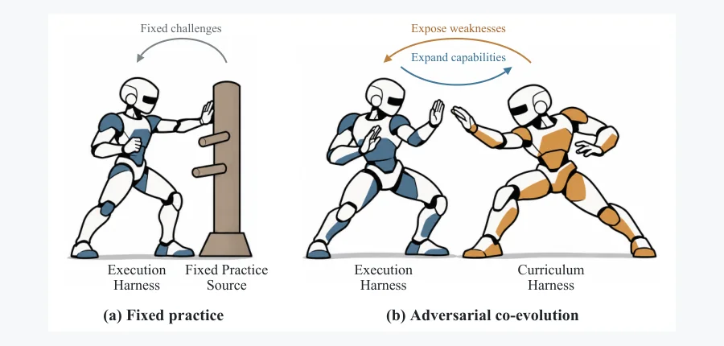 arXiv 2026-11-11 · cs.RO · #1 **[RoboACE: Adversarial Co-Evolution for Robot Self-Improvement](https://arxiv.org/abs/2611.13034)** Delin Zhao , Zhengrong Yue , Junlin He , Yali Wang Affiliation · MMLab @ SIAT [Paper](https://arxiv.org/abs/2611.13034) · [Figure source](https://arxiv.org/html/2611.13034v1/roboace-motivation.png) 

[EN] Abstract
Robot agents can improve reusable skills, planning procedures, and recovery strategies from execution feedback, yet a fixed practice source leaves the search for new weaknesses unchanged. Useful practice depends on the agent's current capabilities, so the procedure that chooses practice must also be revisable. We present RoboACE (Robot Adversarial Co-Evolution), a framework that jointly evolves curriculum and execution harnesses around frozen foundation models. The curriculum harness uses accumulated capability evidence to propose informative challenges, while the execution harness responds with reusable revisions that expand execution capabilities. Alternating updates hold one side fixed as the other changes, and admitted challenges form fixed snapshots for comparing execution revisions. Starting from a compact set of LIBERO practice conditions, the resulting frozen deployment outperforms the evaluated controllers and agent systems across four LIBERO-family panels. On LIBERO-PRO, it reaches 74.0% success, exceeding the initial deployment by 15.0 percentage points and direct execution by its VLA controller by 13.5 points. Case studies document changes to evidence-guided practice selection, drawer-skill grounding, and controller intervention. <a href="https://arxiv.org/list/cs/new?show=2000#2611.13034">Source</a>

[ZH] Abstract
机器人代理可以从执行反馈中改进可复用技能、规划流程和恢复策略，但固定的练习来源会使寻找新弱点的过程保持不变。有用的练习取决于代理当前的能力，因此选择练习的流程也必须能够修订。我们提出RoboACE（机器人对抗共同进化），一个围绕冻结基础模型共同进化课程与执行框架的系统。课程框架利用累积的能力证据提出富有信息的挑战，执行框架则通过可复用修订作出响应，扩展执行能力。交替更新在改变一方时固定另一方，而获准挑战形成固定快照，用于比较执行修订。从一组紧凑的LIBERO练习条件出发，最终冻结部署在四个LIBERO系列面板上优于所评估的控制器和代理系统。在LIBERO-PRO上，它达到74.0%的成功率，比初始部署高15.0个百分点，比直接执行其VLA控制器高13.5个百分点。案例研究记录了基于证据的练习选择、抽屉技能的落地以及控制器干预方面的变化。 <a href="https://arxiv.org/list/cs/new?show=2000#2611.13034">Source</a>
 |  arXiv 2026-11-11 · cs.AI · #2 **[NCP: Verifier-Guided Optimization of Weight-Space Control Policies](https://arxiv.org/abs/2611.13236)** Ekrem Aksoy Affiliation · Affiliation unconfirmed [Paper](https://arxiv.org/abs/2611.13236) 

[EN] Abstract
We present the Neural Control Plane (NCP), a closed-loop system that observes language-model execution, synthesizes candidate weight-space intervention rules, evaluates them, and maintains a versioned table of admitted policies. NCP separates a pretrained model's inference data plane from the control policy that selects temporary parameter interventions. W-ISA supplies transactional execution and parameter restoration; NCP supplies telemetry, candidate synthesis, admission criteria, priorities, and rule lifetime management. The optimization state consists of active rules and an archive of evaluated candidates, while base-model parameters are restored after each request. In a local SmolLM-135M-Instruct experiment, NCP generated three candidates from development telemetry and evaluated them on separate task examples and a 4,095-target WikiText-2 slice. One projection reduced validation token repetition from 0.4133 to 0.2191, with a perplexity change of -0.0574%. All candidates produced zero newly correct exact answers, so the configured admission gate archived all three and retained the original active policy. Fresh-process repetition and saved-table resumption reproduced the measured outcomes. NCP provides an executable framework for studying recursive self-improvement at the control-policy level through explicit synthesis, verification, and state transitions. <a href="https://arxiv.org/list/cs/new?show=2000#2611.13236">Source</a>

[ZH] Abstract
我们提出神经控制平面（NCP），一个观察语言模型执行、合成候选权重空间干预规则、评估规则并维护获准策略版本表的闭环系统。NCP将预训练模型的推理数据平面与选择临时参数干预的控制策略分开。W-ISA提供事务式执行与参数恢复；NCP提供遥测、候选合成、准入标准、优先级和规则生命周期管理。优化状态由激活规则与已评估候选归档组成，基础模型参数在每次请求后恢复。在本地SmolLM-135M-Instruct实验中，NCP根据开发遥测生成三个候选，并在独立任务样例和包含4,095个目标的WikiText-2切片上评估。一个投影将验证token重复率从0.4133降低到0.2191，困惑度变化为−0.0574%。所有候选新增的精确答案正确数均为零，因此配置的准入门控将三个候选全部归档，并保留原来的激活策略。新进程重复与已保存表恢复均复现了测量结果。NCP提供一个可执行框架，通过显式合成、验证与状态转移，在控制策略层面研究递归自我改进。 <a href="https://arxiv.org/list/cs/new?show=2000#2611.13236">Source</a>
 | 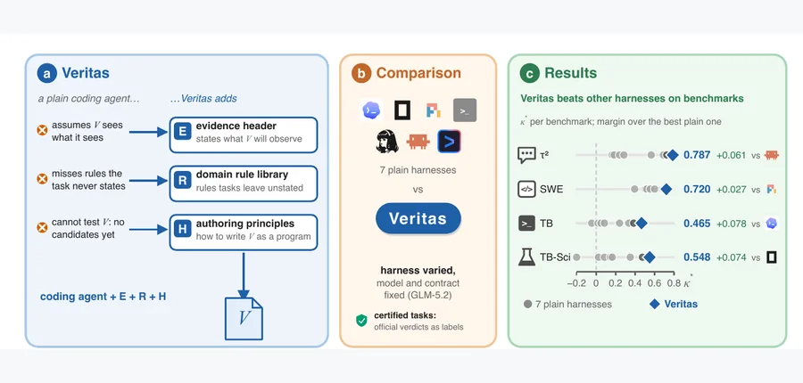 arXiv 2026-11-11 · cs.AI · #3 **[Veritas: A Verifier Generation Harness for Agent Tasks](https://arxiv.org/abs/2611.13336)** Daoan Zhang , Qinbo Bai , Dehai Min , Xingyu Mu , Ziyi Chen , Jianing Yin Affiliation · ByteDance Inc. / University of Illinois Chicago / New York University [Paper](https://arxiv.org/abs/2611.13336) · [Figure source](https://arxiv.org/pdf/2611.13336) 

[EN] Abstract
The effectiveness of a self-improving system relies heavily on the quality of its verifier, which judges the outcome of each improvement round. However, the verifiers of most tasks are written by hand, which is expensive and does not scale to tasks that come without one. We propose Veritas, a harness that generates verifiers automatically. Unlike general-purpose agent harnesses, Veritas adds three mechanisms for verifier generation: an evidence header stating what the verifier will observe, a library of domain rules that tasks leave unstated, and authoring principles, partly refined by a self-improvement loop. We evaluate on six benchmarks: four scored by execution, whose official verifiers we first certify, and two that compare pairs of responses. With the model fixed, the verifiers Veritas generates agree better with the official verdicts than those of seven other harnesses on all four execution-scored benchmarks. On the two pairwise benchmarks they are at or near the best. They also agree better than those of the vendor's own harness for two of three other model families. Its mechanisms also improve 9 of 12 harness-benchmark pairs scored by execution across three harnesses. <a href="https://arxiv.org/list/cs/new?show=2000#2611.13336">Source</a>

[ZH] Abstract
自我改进系统的有效性高度依赖验证器质量，验证器判断每轮改进的结果。然而，大多数任务的验证器由人工编写，成本高昂，也难以扩展到本来没有验证器的任务。我们提出Veritas，一个自动生成验证器的框架。与通用代理框架不同，Veritas增加了三种面向验证器生成的机制：声明验证器将观察什么的证据头、任务未明说的领域规则库，以及部分通过自我改进循环完善的编写原则。我们在六个基准上评估：四个按执行结果评分，其官方验证器先由我们认证；两个比较成对响应。固定模型时，Veritas生成的验证器在全部四个执行评分基准上，与官方判定的一致性均高于另外七个框架。在两个成对比较基准上，其表现最好或接近最好。在另外三个模型系列中的两个上，它们与官方判定的一致性也高于供应商自身的框架。这些机制还在三个框架中按执行评分的十二个框架—基准组合中的九个上带来改善。 <a href="https://arxiv.org/list/cs/new?show=2000#2611.13336">Source</a>
 |
| 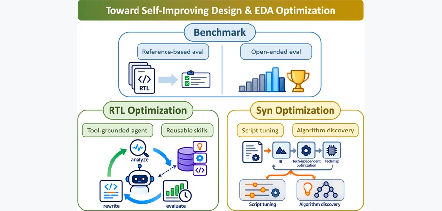 arXiv 2026-11-11 · cs.AI · #4 **[Toward Autonomous RTL and Synthesis Optimization: Benchmarking and Self-Improving Agents](https://arxiv.org/abs/2611.13713)** Wenji Fang , Yao Lu , Jinghua Wang , Zhiyao Xie Affiliation · Hong Kong University of Science and Technology [Paper](https://arxiv.org/abs/2611.13713) · [Figure source](https://arxiv.org/html/2611.13713v1/fig/overview.png) 

[EN] Abstract
Recent advances in large language models (LLMs) and autonomous agents are creating new opportunities for hardware design optimization. This paper examines three connected directions toward autonomous RTL and synthesis optimization: (1) Realistic benchmarking. We discuss reference-based and open-ended RTL optimization benchmarks that evaluate optimization opportunities under realistic EDA workflows. (2) Tool-grounded RTL optimization. We present Dr. RTL, a multi-agent framework that automates critical-path analysis, RTL rewriting, and implementation-level evaluation, while continuously improving through reusable optimization skills. Evaluated on 20 real-world RTL designs, Dr.~RTL achieves average WNS/TNS improvements of 21\%/17\% with a 6\% area reduction over commercial synthesis. (3) Design-specific synthesis optimization. We explore agent-driven synthesis script tuning and the discovery of executable synthesis algorithms across intermediate representations, technology-independent optimization, and technology mapping. Finally, we envision AI-native design automation that jointly explores architectural, RTL, and EDA algorithm design spaces, guided by verification constraints and implementation feedback. <a href="https://arxiv.org/list/cs/new?show=2000#2611.13713">Source</a>

[ZH] Abstract
大语言模型（LLM）和自主代理的近期进展，为硬件设计优化创造了新机会。本文研究通向自主RTL与综合优化的三个相互关联方向：（1）现实基准。我们讨论基于参考和开放式RTL优化基准，在现实EDA工作流中评估优化机会。（2）工具落地的RTL优化。我们提出Dr. RTL，一个自动完成关键路径分析、RTL重写和实现级评估，同时通过可复用优化技能持续改进的多代理框架。在二十个真实RTL设计上，Dr. RTL相较商业综合实现平均WNS/TNS改善21%/17%，面积减少6%。（3）设计特定的综合优化。我们探索代理驱动的综合脚本调优，以及跨中间表示、技术无关优化和技术映射发现可执行综合算法。最后，我们展望由验证约束与实现反馈引导，共同探索架构、RTL和EDA算法设计空间的AI原生设计自动化。 <a href="https://arxiv.org/list/cs/new?show=2000#2611.13713">Source</a>
 | 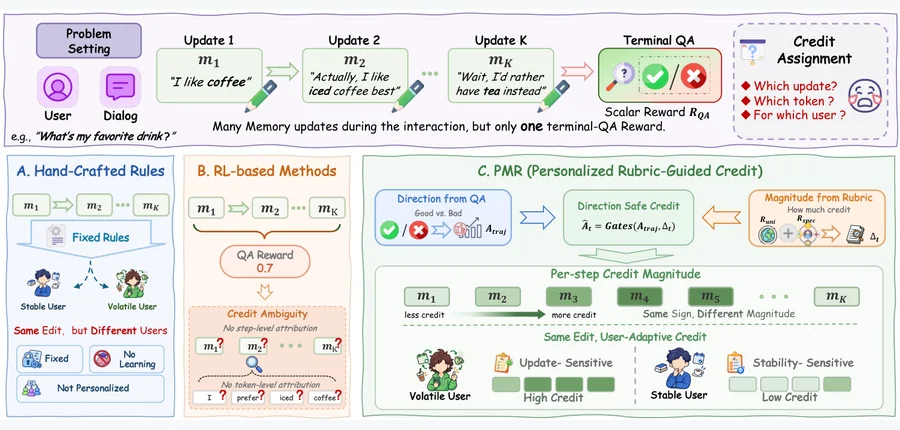 arXiv 2026-11-11 · cs.AI · #5 **[Personalized Memory Rubrics: Learning What to Remember per User via Rubric-Guided Credit Assignment](https://arxiv.org/abs/2611.14017)** Yupeng Han , Kai Zhang , Shuochen Liu , Ze Liu , Xianquan Wang , Zhihong Pan , Xiangyu Zhao , Qi Liu , Enhong Chen Affiliation · University of Science and Technology of China / City University of Hong Kong / State Key Laboratory of Cognitive Intelligence [Paper](https://arxiv.org/abs/2611.14017) · [Figure source](https://arxiv.org/html/2611.14017v1/motivation.png) 

[EN] Abstract
Long-horizon personalized agents maintain an evolving memory by continuously deciding what to add, modify, or discard. However, learning an optimal update policy remains challenging. Conventional training relies solely on terminal question-answering accuracy, yielding a coarse feedback signal that treats all intermediate updates identically. Furthermore, update utility is inherently user-specific, as identical memory actions may yield opposite effects across different user personas. Existing methods fail to address this heterogeneity, relying on globally shared evaluation standards with at most a single scalar intermediate reward. To address these challenges, we propose \textbf{Personalized Memory Rubrics} (\textbf{PMR}), a framework that translates terminal feedback into fine-grained, per-step, and per-user credit assignment. PMR decomposes evaluation into a universal layer capturing cross-persona failure patterns and a per-user adaptive layer modeling individual traits as a specialized delta over the universal baseline. Through \textbf{Rubric-Guided Credit Assignment}, PMR redistributes credit at the token level, selectively amplifying validated decisions on successful trajectories while falling back to standard policy optimization on failed ones to avoid unreliable attribution. The rubric and memory policy \textbf{co-evolve} in a closed loop with anti-circularity guarantees. Crucially, PMR incurs zero inference overhead, operating without any rubric or external judge during deployment. Extensive experiments across four benchmarks demonstrate consistent gains over strong memory-augmented baselines. <a href="https://arxiv.org/list/cs/new?show=2000#2611.14017">Source</a>

[ZH] Abstract
长时程个性化代理通过持续决定添加、修改或丢弃什么，维护不断演变的记忆。然而，学习最优更新策略仍具挑战。传统训练仅依赖终局问答准确率，提供粗粒度反馈，对所有中间更新一视同仁。此外，更新效用本质上因用户而异，相同记忆行动在不同用户画像下可能产生相反效果。现有方法未能处理这种异质性，依赖全局共享评估标准，至多提供单一标量中间奖励。为应对这些挑战，我们提出个性化记忆量规（PMR），将终局反馈转化为细粒度、逐步骤、逐用户信用分配。PMR将评估分解为捕捉跨画像失败模式的通用层，以及将个体特征建模为通用基线之上专门增量的逐用户自适应层。通过量规引导的信用分配，PMR在token级重新分配信用，选择性放大成功轨迹中经过验证的决策；对失败轨迹则退回标准策略优化，以避免不可靠归因。量规与记忆策略在具有反循环保证的闭环中共同进化。关键的是，PMR推理开销为零，部署时无需任何量规或外部评判器。四个基准上的广泛实验展示了相较强记忆增强基线的一致收益。 <a href="https://arxiv.org/list/cs/new?show=2000#2611.14017">Source</a>
 | 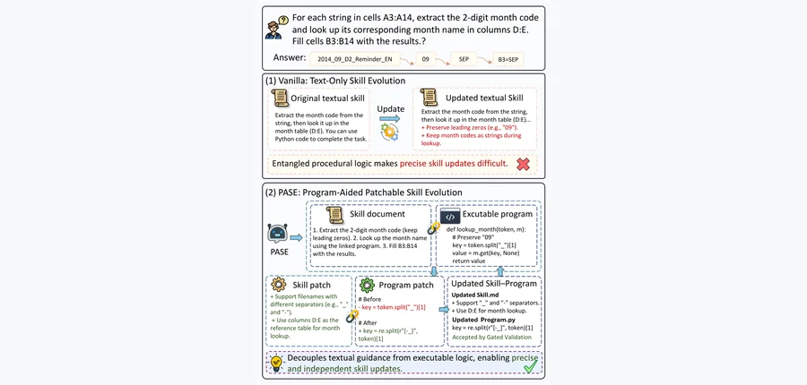 arXiv 2026-11-11 · cs.CL · #6 **[Program-Aided Patchable Skill Evolution](https://arxiv.org/abs/2611.14019)** Jiahao Wang , Yuqi Xiong , Qing Yang , Zhipeng Xu , Zhenghao Liu , Zulong Chen , Yubin Bao Affiliation · Northeastern University / Alibaba Group [Paper](https://arxiv.org/abs/2611.14019) · [Figure source](https://arxiv.org/html/2611.14019v1/pase-intro.png) 

[EN] Abstract
Agent skills have emerged as an effective means of enabling LLM agents to solve complex, interactive tasks by encoding reusable knowledge without modifying model parameters. Recent approaches further improve skill adaptation by distilling reusable experience from agent execution trajectories and evolving skills based on downstream task feedback. However, existing methods primarily represent skills as natural language documents, intertwining procedural logic with descriptive knowledge and making skills difficult to maintain and evolve. To address this limitation, we propose PASE (Program-Aided Patchable Skill Evolution), a program-aided framework that iteratively evolves skills by associating them with executable programs. Unlike prior approaches that encode trajectory-derived experience primarily in natural language, PASE separates reusable procedural logic into editable programs, enabling targeted updates to executable components while reducing the need to repeatedly revise natural language skills. Extensive experiments across diverse models and benchmarks demonstrate that PASE consistently outperforms all baselines, by achieving over 2.8% improvements. Further analyses show that PASE exhibits greater evolutionary stability and generalisation capability, highlighting the critical role of programmatic knowledge in skill evolution. We will release all data and code via GitHub. <a href="https://arxiv.org/list/cs/new?show=2000#2611.14019">Source</a>

[ZH] Abstract
代理技能已成为让LLM代理解决复杂交互任务的有效方式，通过编码可复用知识而无需修改模型参数。近期方法进一步从代理执行轨迹中蒸馏可复用经验，并根据下游任务反馈进化技能，以改善技能适配。然而，现有方法主要将技能表示为自然语言文档，把流程逻辑与描述性知识交织在一起，使技能难以维护和进化。为解决这一限制，我们提出PASE（程序辅助的可打补丁技能进化），将技能与可执行程序关联，迭代进化技能。与主要用自然语言编码轨迹经验的既有方法不同，PASE将可复用流程逻辑分离到可编辑程序中，使可执行组件能够有针对性地更新，同时降低反复修订自然语言技能的需要。在多种模型和基准上的广泛实验表明，PASE持续优于全部基线，改善超过2.8%。进一步分析显示，PASE具有更强的进化稳定性和泛化能力，凸显程序化知识在技能进化中的关键作用。我们将通过GitHub发布全部数据和代码。 <a href="https://arxiv.org/list/cs/new?show=2000#2611.14019">Source</a>
 |
| 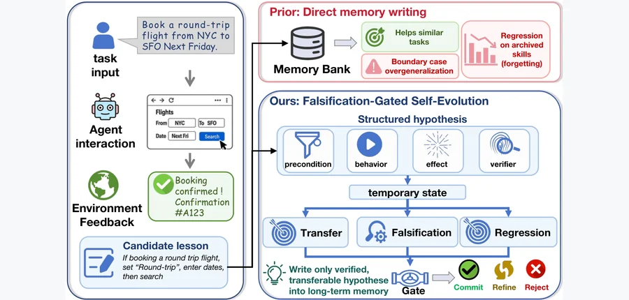 arXiv 2026-11-11 · cs.AI · #7 **[When Should Agents Remember? Falsification-Gated Self-Evolution for LLM Agents](https://arxiv.org/abs/2611.14326)** Runxuan Tang , Haoyu Gao , Yuyan Ding , Junyi Yao , Zihao Zheng , Zecheng Sheng , Liwei Hou Affiliation · Nanyang Technological University / Georgia Institute of Technology / University of Washington / Washington University in St. Louis / The University of Sydney / National University of Singapore [Paper](https://arxiv.org/abs/2611.14326) · [Figure source](https://arxiv.org/html/2611.14326v1/teaser.png) 

[EN] Abstract
LLM agents increasingly operate in long-horizon, verifier-rich environments, but current self-improvement mechanisms often write episode-derived lessons directly into memory, making local success an unreliable signal for reusable and safe knowledge. This paper addresses the core question of when an experience-derived behavioral update should be admitted into persistent agent state. We propose Falsification-Gated Self-Evolution (FGSE), a verifier-grounded framework that represents each candidate lesson as a structured hypothesis with an explicit precondition, behavior change, expected effect, and verifier. FGSE applies the hypothesis only in a temporary state, tests it on target-transfer, falsification, and archived-regression probes, and then commits, refines, or rejects it according to measured gain and risk. Across web, app, tool-use, and long-term memory benchmarks, FGSE achieves strong task performance, including 39.8 WebArena success rate, 78.8 AppWorld average completion, and 0.724/0.487 Pass$^1$ on $\tau$-Retail/$\tau$-Airline, while reducing falsification failures to 5.0%, regression damage to 1.3%, and harmful committed updates to 3.6%. These results suggest that testing memory updates as hypotheses supports more reliable long-term adaptation. <a href="https://arxiv.org/list/cs/new?show=2000#2611.14326">Source</a>

[ZH] Abstract
LLM代理日益在长时程、验证器丰富的环境中运行，但当前自我改进机制常直接将回合衍生经验写入记忆，使局部成功成为可复用且安全知识的不可靠信号。本文处理一个核心问题：何时应将经验衍生的行为更新准入持久代理状态。我们提出证伪门控自进化（FGSE），一个以验证器为依据的框架，将每条候选经验表示为包含显式前置条件、行为改变、预期效果和验证器的结构化假设。FGSE仅在临时状态应用该假设，在目标迁移、证伪和归档回归探测上测试，再根据测得收益与风险提交、完善或拒绝。跨网页、应用、工具使用及长期记忆基准，FGSE取得强任务表现，包括WebArena成功率39.8、AppWorld平均完成率78.8，以及τ-Retail/τ-Airline上的Pass¹为0.724/0.487，同时将证伪失败降至5.0%、回归损害降至1.3%、有害已提交更新降至3.6%。这些结果表明，将记忆更新作为假设测试，有助于更可靠的长期适配。 <a href="https://arxiv.org/list/cs/new?show=2000#2611.14326">Source</a>
 | 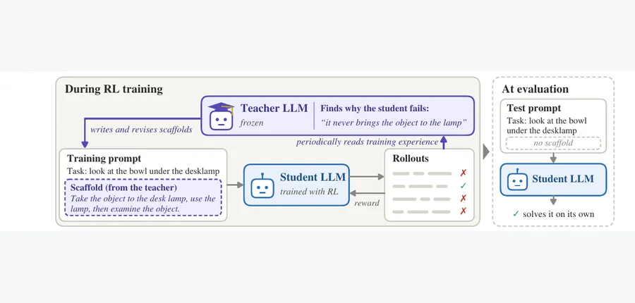 arXiv 2026-11-11 · cs.LG · #8 **[AutoScaffold: AI-Guided Scaffolding for Reinforcement Learning of Language Models](https://arxiv.org/abs/2611.14515)** Zijian Zhang , Rizhen Hu , Jiangweizhi Peng , Shiyang Li , Sujay Bhatt , Sihan Zeng , Mingyi Hong Affiliation · University of Minnesota, Twin Cities / JPMorgan AI Research [Paper](https://arxiv.org/abs/2611.14515) · [Figure source](https://arxiv.org/pdf/2611.14515) 

[EN] Abstract
Reinforcement learning with verifiable rewards (RLVR) produces rich training experience, yet outcome rewards reduce each attempt to a single number and leave most of this information unused. Training-time scaffolds, such as strategies or hints added to the prompt during training, offer a natural way to turn this information into guidance, but their design and adaptation are largely left to humans and tailored to specific domains. We introduce AutoScaffold, a unified AI-for-AI framework that turns a student's training experience into adaptive scaffolds, with minimal domain-specific information and no human intervention during training. A frozen teacher periodically examines this experience, diagnoses bottlenecks, and designs scaffolds in two forms: (i) strategies shared across a class of tasks and (ii) hints for individual hard tasks, adjusting the content and amount of support as the student learns. The scaffolds are removed at evaluation. We apply the same framework to ALFWorld, search-based QA, mathematical reasoning, and GPU kernel generation. When evaluated without scaffolds, students trained with AutoScaffold outperform those trained with the corresponding RL baselines in all four domains, with gains of 7.2 points in ALFWorld success and 4.0 points in average QA exact match. On GPU kernel generation, AutoScaffold increases the fraction of tasks with a correct kernel that runs faster than the PyTorch reference by up to 5.0 points. On math, our student surpasses QuestA's reported accuracy using approximately one-third as many student training steps. Analyses show that the teacher identifies a different failure in each task class and shifts its scaffolds from step-by-step workflows to targeted fixes as the student improves, and that its revised scaffolds help the student learn more than keeping the previous scaffold or using no scaffold. <a href="https://arxiv.org/list/cs/new?show=2000#2611.14515">Source</a>

[ZH] Abstract
带可验证奖励的强化学习（RLVR）产生丰富训练经验，但结果奖励将每次尝试压缩为单个数字，大部分信息未被利用。训练期支架，例如训练时加入提示的策略或提示线索，为将这些经验转化为指导提供自然方法，但其设计与适配主要由人类完成，且针对特定领域。我们引入AutoScaffold，一个统一的AI-for-AI框架，将学生训练经验转化为自适应支架，仅需极少领域特定信息，训练期间无人类干预。冻结教师周期性检查这些经验，诊断瓶颈，并设计两类支架：（i）一类任务共享的策略，（ii）针对单个困难任务的提示线索，随着学生学习调整支持内容与数量。评估时移除支架。我们将相同框架应用于ALFWorld、搜索问答、数学推理和GPU内核生成。在不使用支架的评估中，经AutoScaffold训练的学生在全部四个领域都优于相应RL基线，其中ALFWorld成功率提高7.2点，问答平均精确匹配提高4.0点。GPU内核生成中，AutoScaffold将能生成正确且比PyTorch参考更快内核的任务比例最多提高5.0点。数学方面，我们的学生仅用约三分之一的学生训练步数，便超过QuestA报告的准确率。分析表明，教师识别每类任务中的不同失败，并随着学生改进，将支架从逐步工作流转为有针对性的修复；其修订支架比保留旧支架或不用支架更有助于学生学习。 <a href="https://arxiv.org/list/cs/new?show=2000#2611.14515">Source</a>
 | 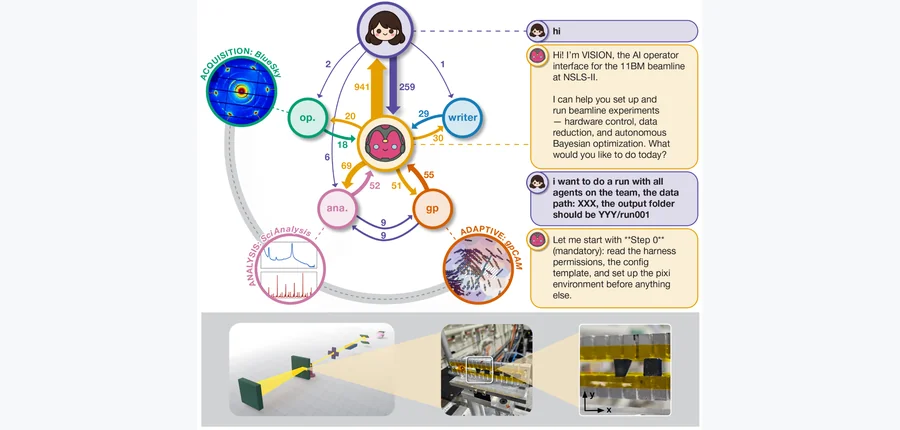 arXiv 2026-11-11 · cs.AI · #9 **[Auditable Human-Agent Teams for Autonomous X-ray Experimentation](https://arxiv.org/abs/2611.12933)** Gunik Luthra , Ronald J. Pandolfi , Benjamin T. Diroll , Ricky Ronquillo , Ruipeng Li , Christopher B. Murray , Marcus M.… Affiliation · Brookhaven National Laboratory / Lawrence Berkeley National Laboratory / Argonne National Laboratory / University of Pennsylvania [Paper](https://arxiv.org/abs/2611.12933) · [Code](https://github.com/CFN-softbio/VISION-CC) · [Figure source](https://arxiv.org/html/2611.12933v1/figures/intro.png) 

[EN] Abstract
Closed-loop autonomous experimentation can accelerate scientific discovery, but implementation effort limits accessibility. Agentic systems may lower this barrier, although sustained operation on physical instruments remains largely unexplored. Here, using coding-agent infrastructure grounded in validated scientific methods, we demonstrate autonomous synchrotron X-ray experiments on nanoparticle superlattices under evolving, human-defined objectives. Complete human-agent and agent-agent transcripts enable an audit that reconstructs decision provenance and characterizes the division of cognitive labor. Across three experiments, 61-67% of messages involved interpretation or judgment, while the share of methodological and scientific contributions increased from 46% in the setup-focused first experiment to 56-61% in later experiments. Provenance showed that 59-68% of error corrections involved multiple participants and that about half of all decisions incorporated the input of another participant. These results may guide design principles for multi-agent scientific systems and inform future agent harnesses, model training, and accessible autonomous experimentation. <a href="https://arxiv.org/list/cs/new?show=2000#2611.12933">Source</a>

[ZH] Abstract
闭环自主实验可以加速科学发现，但实现工作量限制了可及性。代理式系统或可降低这一障碍，然而在物理仪器上持续运行仍很少得到探索。本文利用以经过验证科学方法为依据的编程代理基础设施，展示在不断变化的人类定义目标下，对纳米颗粒超晶格开展自主同步辐射X射线实验。完整的人类—代理与代理—代理转录支持审计，重建决策溯源并刻画认知劳动分工。在三项实验中，61–67%的消息涉及解释或判断，而方法学和科学贡献所占比例，从以设置为重点的首项实验中的46%，增加至后续实验的56–61%。溯源显示，59–68%的错误纠正涉及多名参与者，约一半决策吸纳了其他参与者的意见。这些结果可能为多代理科学系统的设计原则提供指导，并为未来代理框架、模型训练及易于使用的自主实验提供信息。 <a href="https://arxiv.org/list/cs/new?show=2000#2611.12933">Source</a>
 |
| 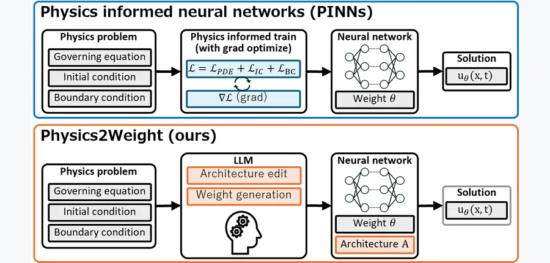 arXiv 2026-11-11 · cs.AI · #10 **[Physics2Weight: Direct Neural Network Architecture and Weight Generation from Physical Laws Using Large Language Models](https://arxiv.org/abs/2611.12954)** Shogo Sato , Tomoyasu Shimada , Kazuhiko Murasaki , Takashi Sano Affiliation · NTT, Inc. [Paper](https://arxiv.org/abs/2611.12954) · [Figure source](https://arxiv.org/html/2611.12954v1/fig1.png) 

[EN] Abstract
Recent advances in large language models (LLMs) have enabled weight-space programming (WSP), which directly generates neural network weights without gradient-based optimization. However, extending WSP to physical problems remains challenging, particularly in achieving both solution accuracy and physical consistency. In this paper, we propose Physics2Weight (PtW), a framework that extends WSP to solving partial differential equations by directly generating neural network weights and editing architectures based on governing equations and initial and boundary conditions. PtW introduces physics-constrained prompting and physics-guided architecture editing, combined with iterative weight refinement from WSP, to improve solution accuracy and physical consistency without gradient-based optimization. Experiments on four PDEs, namely the heat, advection, Burgers', and Allen--Cahn equations, demonstrate lower solution errors than conventional physics-informed neural networks, while revealing limitations in satisfying the governing equations for nonlinear PDEs. <a href="https://arxiv.org/list/cs/new?show=2000#2611.12954">Source</a>

[ZH] Abstract
大语言模型（LLM）的近期进展使权重空间编程（WSP）成为可能，无需基于梯度的优化即可直接生成神经网络权重。然而，将WSP扩展到物理问题仍具挑战，尤其是在解的准确性与物理一致性方面。本文提出Physics2Weight（PtW），通过根据控制方程及初始、边界条件直接生成神经网络权重并编辑架构，将WSP扩展至偏微分方程求解。PtW引入物理约束提示和物理引导架构编辑，并结合WSP的迭代权重精炼，在不进行梯度优化的情况下改善解的准确性和物理一致性。在热方程、平流方程、Burgers方程和Allen–Cahn方程四类PDE上的实验，展示了低于传统物理信息神经网络的解误差，同时揭示在满足非线性PDE控制方程方面的局限。 <a href="https://arxiv.org/list/cs/new?show=2000#2611.12954">Source</a>
 | 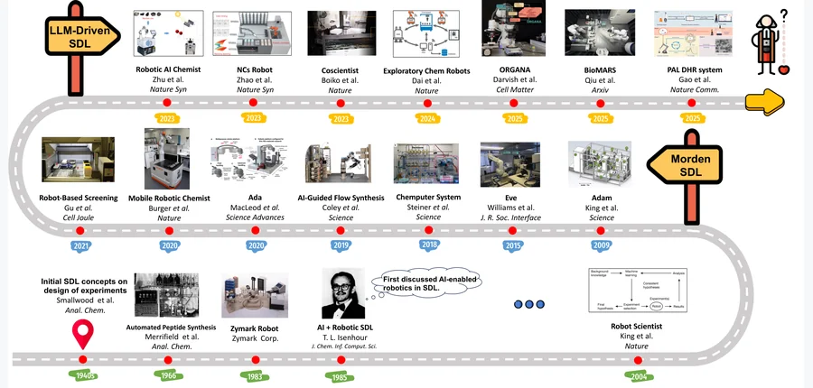 arXiv 2026-11-11 · cs.AI · #11 **[Embodied Science Agents: Making Embodied Experimental Design Learnable](https://arxiv.org/abs/2611.12958)** Yihang Che , Zhongwei Yu , Yang Li , Xingyu Lu , Hongxia Yu , Jun Wang Affiliation · University College London / AI Lab, The Yangtze River Delta / The Hong Kong University of Science and Technology (Guangzhou) / Shanghai Jiao Tong University / Nanjing Agricultural University [Paper](https://arxiv.org/abs/2611.12958) · [Figure source](https://arxiv.org/html/2611.12958v1/timeline.png) 

[EN] Abstract
Recent advances in large models have accelerated AI for Science toward agentic science, where AI agents autonomously conduct scientific discovery. Realising this vision requires closing the loop between computational reasoning and physical experimentation, positioning self-driving laboratories (SDLs) as critical enablers. However, existing SDLs exhibit a fundamental paradox: foundation model integration has increased linguistic sophistication while severing physical grounding. By treating models as disembodied planners that output symbolic workflows for separate robotic systems, current architectures inherently block the development of embodied experimental intuition. We argue that overcoming this paradox requires embedding \emph{learnability} along three interdependent axes: cognitive learnability (learning what to investigate), experimental learnability (learning where to search), and embodied learnability (learning how to act). Building on this view, we introduce the Embodied Science Agent (ESA), which unifies digital intelligence with physical embodiment through three synergistic components: a Digital Agent that provides cognitive and experimental learnability via memory-based reasoning and Bayesian optimisation, an Embodied Agent that provides embodied learnability via generalisable instrument control, and an Embodied Unified Interface for seamless coordination. We validated ESA in autonomous wastewater treatment experiments, navigating over 200 million possible conditions. Through 15 continuous rounds, ESA raised the final solution transmittance from 82\% to 99.7\%, corresponding to a 98.5\% reduction in residual dye concentration and near-complete decolourisation, while its learned visuomotor policies generalised across varying instrument placements, a promising step toward next-generation SDLs for autonomous scientific discovery. <a href="https://arxiv.org/list/cs/new?show=2000#2611.12958">Source</a>

[ZH] Abstract
大模型的近期进展加速了AI for Science迈向代理式科学，即AI代理自主开展科学发现。实现这一愿景需要闭合计算推理与物理实验之间的循环，使自驱动实验室（SDL）成为关键支撑。然而，现有SDL呈现根本悖论：基础模型集成提高了语言复杂性，却切断了物理落地。当前架构将模型当作无身体的规划器，输出符号工作流交给独立机器人系统，因而内在阻碍具身实验直觉的发展。我们认为，克服这一悖论需要沿三个相互依赖轴嵌入可学习性：认知可学习性（学习研究什么）、实验可学习性（学习在哪里搜索）和具身可学习性（学习如何行动）。基于此，我们引入具身科学代理（ESA），通过三个协同组件统一数字智能与物理具身：数字代理通过基于记忆的推理和贝叶斯优化提供认知及实验可学习性；具身代理通过可泛化仪器控制提供具身可学习性；具身统一接口实现无缝协调。我们在自主废水处理实验中验证ESA，在超过两亿种可能条件中搜索。经过十五轮连续实验，ESA将最终溶液透射率从82%提高到99.7%，对应残余染料浓度减少98.5%、接近完全脱色，同时其学得的视觉运动策略能跨不同仪器摆放泛化，为下一代自主科学发现SDL迈出有前景的一步。 <a href="https://arxiv.org/list/cs/new?show=2000#2611.12958">Source</a>
 | 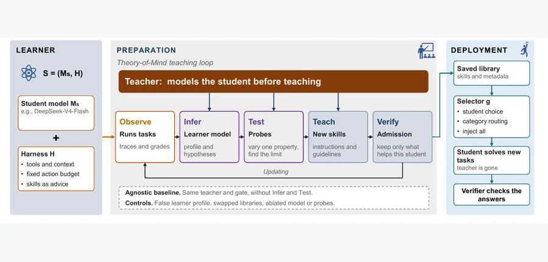 arXiv 2026-11-11 · cs.AI · #12 **[Teaching the Harness: Student-Aware Skill Transfer for LLM Agents](https://arxiv.org/abs/2611.13144)** Chang Liu , Bo Wu Affiliation · Colorado School of Mines [Paper](https://arxiv.org/abs/2611.13144) · [Figure source](https://arxiv.org/pdf/2611.13144) 

[EN] Abstract
Effective teaching requires reasoning about the learner as well as the task, a capacity that Theory of Mind describes as inferring another agent's latent state from its behavior. We ask whether a stronger LLM teaches a fixed student better when it applies this principle. The student is an LLM agent acting through a harness that fixes its tools, context, and action budget, so a procedure that helps one model can exhaust the budget of another. We introduce Student-Aware Teaching (SAT). The teacher builds a learner model that pairs an empirical profile with hypotheses about the student's limitations, tests these hypotheses with diagnostic probes, and writes reusable skills for the diagnosed failures. A skill enters the library only after it raises success on matched development tasks. With Claude-Sonnet-5 teaching DeepSeek-V4-Flash, SAT reaches 86.46% task success across four primary runs, leading both a profile-free teacher with the same framework (81.04%) and the untaught student (75.00%) in each run. Removing the analytical learner model lowers both prediction and success, and under misleading learner profiles none of the 48 candidate skills passes admission. When DeepSeek-V4-Flash and Gemini-3.8-Flash exchange libraries, each performs better with its own. Saved libraries keep average gains of up to 11.1 points after the teacher leaves. The benefit depends on a student that can follow instructions and a deployment route that delivers them. <a href="https://arxiv.org/list/cs/new?show=2000#2611.13144">Source</a>

[ZH] Abstract
有效教学需要同时对学习者和任务进行推理，心智理论将这一能力描述为从另一代理行为推断其潜在状态。我们询问，更强LLM在应用这一原则时，是否能更好地教授固定学生。学生是通过框架行动的LLM代理，框架固定工具、上下文和行动预算，因此有助于一个模型的流程，可能耗尽另一个模型的预算。我们提出学生感知教学（SAT）。教师构建学习者模型，将经验画像与有关学生局限的假设配对，通过诊断探测检验假设，并针对诊断失败编写可复用技能。只有在匹配开发任务上提高成功率后，技能才能进入技能库。在Claude-Sonnet-5教授DeepSeek-V4-Flash的设置下，SAT在四次主要运行中达到86.46%的任务成功率，每次运行均领先使用相同框架但无画像的教师（81.04%）和未受教学生（75.00%）。移除分析性学习者模型会降低预测与成功表现；在误导性学习者画像下，48条候选技能没有一条通过准入。当DeepSeek-V4-Flash和Gemini-3.8-Flash交换技能库时，两者使用自身技能库的表现都更好。教师退出后，保存的技能库仍保留最高11.1点的平均收益。收益取决于学生能够遵循指令，以及部署路径能够将指令送达。 <a href="https://arxiv.org/list/cs/new?show=2000#2611.13144">Source</a>
 |
| 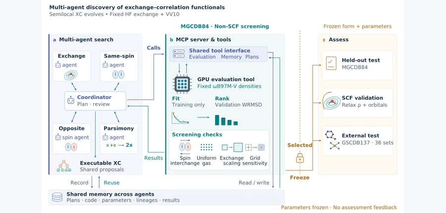 arXiv 2026-11-11 · cs.AI · #13 **[Agent-Guided Discovery of Exchange-Correlation Functionals with Physics-based Validation](https://arxiv.org/abs/2611.13329)** Achuth Chandrasekhar , Amir Barati Farimani Affiliation · Affiliation unconfirmed [Paper](https://arxiv.org/abs/2611.13329) · [Code](https://github.com/BaratiLab/DFT_functional_agentic_searcher) · [Figure source](https://arxiv.org/html/2611.13329v1/Figures/workflow.png) 

[EN] Abstract
Accurate, compact exchange--correlation functionals are central to predictive density functional theory. Symbolic search and language-model agents can propose new functional forms, but it remains unclear whether their gains survive self-consistency and external evaluation, whether the new terms carry physical content, whether agents outperform evolutionary search, and how language-model backbones compare. We connect frontier LLM agents to a GPU evaluator through the Model Context Protocol, with training-only fitting, persistent memory, and self-consistent and external evaluation. Opus-5.5 agents passed the screening gate with about 40-fold fewer tokens than Codex (GPT-6-Astra) agents and found a candidate with lower validation and held-out errors; only this candidate advanced to self-consistent evaluation. The resulting 13-parameter functional, O159, multiplies same-spin correlation by a smooth density window. Refitted controls favor a window that scales the entire same-spin factor, reducing it by 15--30\% at its peak, and that acts on reaction energies mainly in near-iso-orbital regions; against a refitted no-window control, it lowers heavy-atom total-energy errors on GSCDB137 by 29\%. With about 400 fits each, SyFES evolution did not improve on its GAS22 seed, whereas the agents found forms 0.10--0.13 \kcal\ lower in validation error by adding an explicit density scale. Self-consistent O159 lowers the held-out MGCDB84 test error of $\omega$B97M-V by 11.7\%, and its mean normalized error ratio on 36 GSCDB137 datasets (1.139) is comparable to $\omega$B97M-V (1.144) and below GAS22 (1.190). Frontier-LLM agents thus produced O159, a compact functional whose improvement over $\omega$B97M-V survives self-consistent, physics-based validation. <a href="https://arxiv.org/list/cs/new?show=2000#2611.13329">Source</a>

[ZH] Abstract
准确而紧凑的交换—关联泛函是预测性密度泛函理论的核心。符号搜索与语言模型代理能够提出新泛函形式，但其收益能否经受自洽和外部评估、新项是否具有物理内容、代理是否优于进化搜索，以及不同语言模型骨干如何比较，仍不清楚。我们通过模型上下文协议将前沿LLM代理接入GPU评估器，使用仅训练数据拟合、持久记忆、自洽及外部评估。Opus-5.5代理通过筛选门控所需token约比Codex（GPT-6-Astra）代理少四十倍，并找到验证及留出误差更低的候选；仅该候选推进到自洽评估。最终的十三参数泛函O159用平滑密度窗口乘以同自旋关联。重新拟合的对照支持将窗口缩放作用于整个同自旋因子，在峰值处降低15–30%，并主要在近等轨道区域影响反应能；相较重新拟合的无窗口对照，它将GSCDB137上的重原子总能量误差降低29%。在各约四百次拟合下，SyFES进化未改善GAS22种子，而代理通过增加显式密度尺度，找到验证误差低0.10–0.13 kcal 的形式。自洽O159将ωB97M-V在留出MGCDB84测试上的误差降低11.7%；其在36个GSCDB137数据集上的平均归一化误差比（1.139）与ωB97M-V（1.144）相当，并低于GAS22（1.190）。因此，前沿LLM代理产生了O159这一紧凑泛函，其相对ωB97M-V的改善经受了自洽、基于物理的验证。 <a href="https://arxiv.org/list/cs/new?show=2000#2611.13329">Source</a>
 | 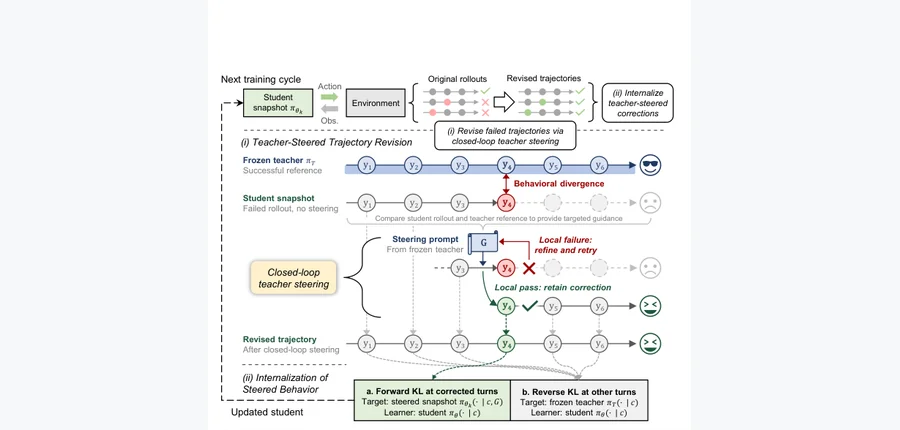 arXiv 2026-11-11 · cs.AI · #14 **[SteerDistill: Quantizing LLM Agents via Closed-Loop Teacher Steering](https://arxiv.org/abs/2611.13410)** Genming Cui , Xiangyu Li , Zixu Hao , Xin Ding , Yunxin Liu , Ting Cao Affiliation · Tsinghua University / University of Science and Technology of China [Paper](https://arxiv.org/abs/2611.13410) · [Code](https://github.com/air-embodied-brain/SteerDistill) · [Figure source](https://arxiv.org/html/2611.13410v1/method.png) 

[EN] Abstract
Low-bit quantization reduces the inference cost of LLM agents but can compromise task success. Examining failed rollouts, we find that quantized agents overlook task requirements or environmental conditions, producing environment transitions that diverge from successful full-precision references. Correcting these behavioral divergences remains difficult: offline data may miss the student's failure contexts, while its own rollouts may provide few correct responses in those contexts. We introduce SteerDistill, a quantization-aware distillation method in which a full-precision teacher guides the student to revise failed responses and iteratively refines its guidance using feedback from student execution. This closed-loop teacher steering produces locally verified behavioral corrections. We internalize these corrections by training the student without guidance to match the steered student's predictions at corrected turns and the full-precision teacher's at other turns, enabling unassisted inference. Across five agentic benchmarks and three models, SteerDistill exceeds the strongest quantized baseline by 1.67--2.18 points in average score under W4A16 and stays within one point of BF16. On $\tau^2$-Bench, it outperforms QeRL by 1.84 percentage points in success rate using 67% fewer training GPU hours and produces shorter successful trajectories than the quantized baselines. <a href="https://arxiv.org/list/cs/new?show=2000#2611.13410">Source</a>

[ZH] Abstract
低比特量化降低LLM代理推理成本，却可能损害任务成功率。检查失败滚动后，我们发现量化代理会忽略任务要求或环境条件，产生偏离成功全精度参考的环境转移。纠正这些行为偏差仍然困难：离线数据可能遗漏学生失败上下文，而其自身滚动又可能很少在这些上下文中给出正确响应。我们提出SteerDistill，一种量化感知蒸馏方法，由全精度教师指导学生修订失败响应，并用学生执行反馈迭代完善指导。这种闭环教师引导产生局部验证的行为纠正。我们通过训练无指导学生，将其在纠正轮次的预测与被引导学生匹配，在其他轮次与全精度教师匹配，从而内化纠正，实现无辅助推理。在五个代理基准与三个模型上，SteerDistill在W4A16下的平均分比最强量化基线高1.67–2.18点，与BF16差距保持在一点内。在τ²-Bench上，它比QeRL成功率高1.84个百分点，同时训练GPU小时减少67%，成功轨迹也比量化基线更短。 <a href="https://arxiv.org/list/cs/new?show=2000#2611.13410">Source</a>
 | 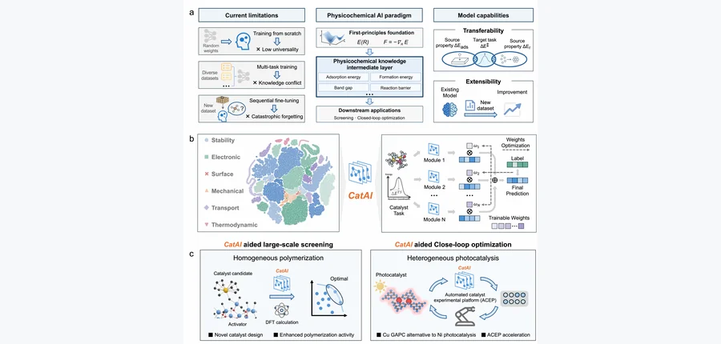 arXiv 2026-11-11 · cs.LG · #15 **[Adaptive catalyst discovery emerges from composable scientific intelligence](https://arxiv.org/abs/2611.13536)** Wentao Li , Qilong Cai , Qi Lei , Jinxing Chen , Ruixuan Chen , Jiangjie Qiu , Botian Wang , Kai Zhao , Honghao Chen , Ley… Affiliation · Tsinghua University / National University of Singapore / Massachusetts Institute of Technology / Wanhua Chemical Group Co., Ltd. / University of Greifswald / Shanghai Artificial Intelligence Laboratory [Paper](https://arxiv.org/abs/2611.13536) · [Figure source](https://arxiv.org/pdf/2611.13536) 

[EN] Abstract
Catalysis underpins chemical manufacturing, yet knowledge for catalyst design remains dispersed across experimental observations, computational data and catalysis subdisciplines. To overcome this challenge, we present Composable Catalytic Intelligence (CatAI), a physics-grounded modular AI framework that learns 1.8 million structure-property relations and organizes them into 30 physicochemical encoders. This reusable intermediate layer enables task-specific models to guide catalyst discovery for targeted reactions and objectives. Across benchmark tasks, CatAI achieves a 7.8% lower task-averaged prediction error than the next-best models. In experimental validation, CatAI identified a new confined-passable pocket catalyst applicable in industrial homogeneous polymer synthesis with 9 times the activity of the commercial benchmark. In parallel, it guided autonomous closed-loop optimization of a highly active Cu-based geminal-atom photocatalyst for C-O coupling reactions surpassing the traditional Ni-based systems. This approach connects property-level data to catalytic objectives, supporting physicochemical knowledge reuse across mechanistically distinct systems through computational screening and iterative model-experiment feedback. <a href="https://arxiv.org/list/cs/new?show=2000#2611.13536">Source</a>

[ZH] Abstract
催化支撑着化学制造，但催化剂设计知识分散在实验观测、计算数据和催化各子领域。为应对这一挑战，我们提出可组合催化智能（CatAI），一个以物理为依据的模块化AI框架，学习180万条结构—性质关系，并将其组织为三十个物理化学编码器。这一可复用中间层使任务特定模型能够针对目标反应和目标引导催化剂发现。在基准任务上，CatAI的任务平均预测误差比次优模型低7.8%。在实验验证中，CatAI识别出一种可用于工业均相聚合物合成的新型受限可通过口袋催化剂，其活性是商业基准的九倍。同时，它引导了用于C–O偶联反应的高活性铜基金属偕原子光催化剂的自主闭环优化，超过传统镍基体系。这种方法通过计算筛选和迭代模型—实验反馈，将性质层数据连接到催化目标，支持跨机理不同体系的物理化学知识复用。 <a href="https://arxiv.org/list/cs/new?show=2000#2611.13536">Source</a>
 |
| 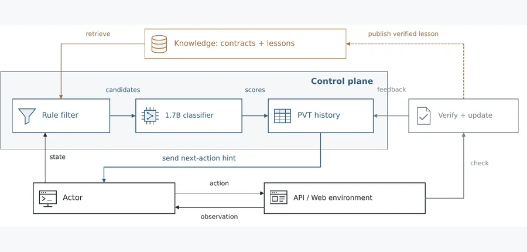 arXiv 2026-11-11 · cs.CL · #16 **[Synapse-Control: Making Agent Experience Actionable with Lightweight Runtime Control](https://arxiv.org/abs/2611.13615)** Zhiyuan Huang , Shengan Zheng , Chenghu Yang , Song Zhang , Lingyun Li , Chen Yu , Weiquan Huang , Linpeng Huang Affiliation · Shanghai Jiao Tong University / Ant Group [Paper](https://arxiv.org/abs/2611.13615) · [Figure source](https://arxiv.org/pdf/2611.13615) 

[EN] Abstract
Large language model agents reuse execution experience to improve reliability on complex tool-based tasks. Systems such as Sentry call large models to generate failure diagnoses before retrieving advice, adding inference cost to experience reuse. We present Synapse-Control, an agent runtime whose lightweight control plane selects advice and determines when to send it to the task-executing model. Rules shortlist relevant advice, and a lightweight 1.7B classifier fine-tuned on teacher-labeled state-suggestion pairs scores those candidates instead of generating a diagnosis. Micro-contracts encode reusable interface checks, such as required arguments or valid options, without prescribing complete task programs. A Prompt Value Table records earlier guidance and feedback to limit repeated suggestions through cooldown and token-budget checks. Across 1,308 attempts per method in AppWorld and WebShop, Synapse-Control achieves 270 successes (29.8% more than Base), replaces 4,987 generative diagnosis calls, and reduces auxiliary control time relative to Sentry by 50.2% and 51.0%, respectively. <a href="https://arxiv.org/list/cs/new?show=2000#2611.13615">Source</a>

[ZH] Abstract
大语言模型代理通过复用执行经验，提高复杂工具任务的可靠性。Sentry等系统会先调用大模型生成失败诊断，再检索建议，给经验复用增加推理成本。我们提出Synapse-Control，一个由轻量控制平面选择建议并决定何时将其发送给任务执行模型的代理运行时。规则先筛出相关建议，再由在教师标注的状态—建议对上微调的轻量1.7B分类器评分这些候选，取代诊断生成。微契约编码可复用接口检查，例如必需参数或有效选项，而不规定完整任务程序。提示价值表记录先前指导和反馈，通过冷却与token预算检查限制重复建议。在AppWorld与WebShop上，每种方法各1,308次尝试中，Synapse-Control取得270次成功（比Base多29.8%），替代4,987次生成式诊断调用，并分别相较Sentry将辅助控制时间减少50.2%与51.0%。 <a href="https://arxiv.org/list/cs/new?show=2000#2611.13615">Source</a>
 | 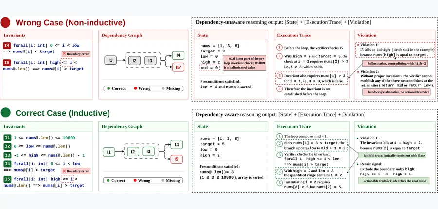 arXiv 2026-11-11 · cs.PL · #17 **[Curriculum proof repair with learned counterexamples](https://arxiv.org/abs/2611.13627)** Yuechun Sun , Jun Yang , Kexin Pei Affiliation · University of Chicago [Paper](https://arxiv.org/abs/2611.13627) · [Code](https://github.com/Etha-Sun/Topoverus) · [Figure source](https://arxiv.org/html/2611.13627v1/VeriWorld12.png) 

[EN] Abstract
Language models (LMs) have substantially lowered the barrier to applying formal verification for building reliable and secure software. Existing approaches commonly follow the verifier-in-the-loop paradigm, but the verifier often provides only coarse, binary pass/fail feedback, which offers little actionable signal on how the proof should be repaired. Recent work shows that counterexamples provide more actionable feedback by grounding proof failures in concrete program states, but generating useful ones at inference time requires costly iterative refinement. We present TopoVerus, an LM-based framework for Verus proof repair that internalizes counterexample-guided diagnosis as a model capability, producing useful counterexamples in a single pass. Our key insight is to train counterexample generation not as a standalone validation task, but as a data-driven diagnostic objective: a counterexample is useful when conditioning on it helps the model produce a safe, verifier-passing proof. Given a failed Verus proof and verifier error, TopoVerus generates a structured source-level counterexample, repair rationale, and repaired proof in one trajectory, optimized with reinforcement learning from Verus feedback and a proof-code safety gate. To guide the order of invariant repairs, TopoVerus introduces a curriculum with a topological graph reward based on invariant dependencies derived from inductiveness tests, which encourages counterexample generation to follow the same topological order. Across seven Verus benchmarks with 471 problems, TopoVerus achieves 61.6%/72.2% weighted-average Safe-Pass@1/Safe-Pass@3, outperforming the strongest baseline, Claude Sonnet 4.5, by 5.7/6.3 points. We also show that TopoVerus's learned counterexamples can directly augment the reasoning of existing LM-based proof repair approaches, improving their success rate by 64.3% compared to chain-of-thought diagnostics. <a href="https://arxiv.org/list/cs/new?show=2000#2611.13627">Source</a>

[ZH] Abstract
语言模型（LM）显著降低了利用形式验证构建可靠、安全软件的门槛。现有方法通常遵循验证器在回路范式，但验证器往往只提供粗粒度二元通过/失败反馈，几乎没有关于如何修复证明的可操作信号。近期研究表明，反例通过将证明失败落到具体程序状态，提供更可操作的反馈，但推理时生成有用反例需要昂贵的迭代精炼。我们提出TopoVerus，一个基于LM的Verus证明修复框架，将反例引导诊断内化为模型能力，单次即可生成有用反例。核心认识是，不将反例生成训练为独立验证任务，而是将其作为数据驱动诊断目标：当以反例为条件能帮助模型生成安全且通过验证器的证明时，该反例才有用。给定失败的Verus证明与验证器错误，TopoVerus在一条轨迹中生成结构化源码级反例、修复理由和修复后的证明，并通过来自Verus反馈与证明代码安全门控的强化学习优化。为引导不变量修复次序，TopoVerus引入课程，利用由归纳性测试得出的不变量依赖构成拓扑图奖励，鼓励反例生成遵循相同拓扑次序。在包含471个问题的七个Verus基准上，TopoVerus达到61.6%/72.2%的加权平均Safe-Pass@1/Safe-Pass@3，分别比最强基线Claude Sonnet 4.5高5.7/6.3点。我们还表明，TopoVerus学得的反例可直接增强现有LM证明修复方法的推理，相较思维链诊断将其成功率提高64.3%。 <a href="https://arxiv.org/list/cs/new?show=2000#2611.13627">Source</a>
 | 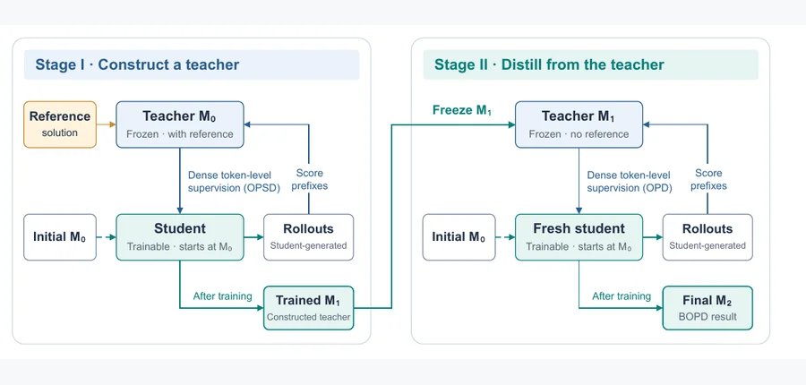 arXiv 2026-11-11 · cs.LG · #18 **[Bootstrapped On-Policy Distillation](https://arxiv.org/abs/2611.13680)** Yue Wu , Xueyu Zhou , Yangrong Hu , Jian Huang Affiliation · The Hong Kong Polytechnic University [Paper](https://arxiv.org/abs/2611.13680) · [Figure source](https://arxiv.org/pdf/2611.13680) 

[EN] Abstract
On-policy distillation (OPD) improves language models by distilling teacher predictions on student-generated trajectories, while on-policy self-distillation (OPSD) removes the need for an external teacher by using a reference-conditioned copy of the model as the teacher. Despite its great early improvements, we find that OPSD does not remain consistently effective under continued training and can eventually suffer substantial performance degradation. We study this training behavior and link the degradation to a growing mismatch between the evolving reference-free student and the frozen privileged teacher. In the early stage of OPSD, the privileged teacher remains closely aligned with the student and provides useful guidance for improving the student's generation trajectories. However, as training progresses, the growing distributional mismatch between the privileged teacher and reference-free student can cause the teacher to provide misleading supervision, ultimately degrading student performance. This phenomenon motivates us to first leverage privileged reference supervision to acquire useful knowledge and then transfer it to a fresh student. We introduce Bootstrapped On-Policy Distillation (BOPD), a two-stage framework that first uses OPSD to internalize task-relevant information from reference-conditioned supervision into an intermediate model, and then distills this reference-free intermediate model into a fresh copy of the initial model. Experiments across models show that BOPD improves mathematical reasoning and code generation beyond both the initial models and the constructed OPSD teachers. These results suggest that privileged reference supervision can be more effectively exploited by first transferring its task-relevant signal into a task-adapted model and then distilling from that model without reference conditioning. <a href="https://arxiv.org/list/cs/new?show=2000#2611.13680">Source</a>

[ZH] Abstract
在策略蒸馏（OPD）通过在学生生成轨迹上蒸馏教师预测来改善语言模型，而在策略自蒸馏（OPSD）使用以参考为条件的模型副本作教师，消除对外部教师的需要。尽管早期改善很大，我们发现OPSD在持续训练中并不始终有效，最终可能显著退化。我们研究这一训练行为，并将退化关联到不断变化的无参考学生与冻结特权教师之间日益扩大的失配。在OPSD早期，特权教师与学生仍紧密对齐，能为改善学生生成轨迹提供有用指导。但随着训练推进，不断扩大的分布失配可能使教师提供误导性监督，最终降低学生表现。这促使我们先利用特权参考监督获取有用知识，再将其迁移给新学生。我们提出自举在策略蒸馏（BOPD），一个两阶段框架，首先通过OPSD将参考条件监督中的任务相关信息内化至中间模型，再将该无参考中间模型蒸馏到初始模型的新副本中。跨模型实验表明，BOPD在数学推理和代码生成上超越初始模型和构建的OPSD教师。这些结果表明，先将特权参考监督的任务相关信号迁移到任务适配模型，再从该模型在无参考条件下蒸馏，可以更有效地利用这种监督。 <a href="https://arxiv.org/list/cs/new?show=2000#2611.13680">Source</a>
 |
| 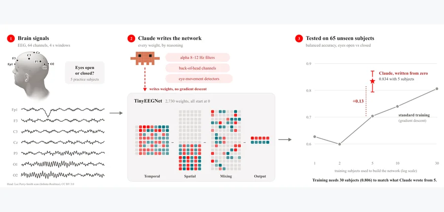 arXiv 2026-11-11 · cs.LG · #19 **[Mixed Signals: Weight-Space Programming for EEG and ECG](https://arxiv.org/abs/2611.13758)** Dara Varam , Taraneh Aminosharieh Najafi , David Atienza Affiliation · École Polytechnique Fédérale de Lausanne [Paper](https://arxiv.org/abs/2611.13758) · [Project](https://daravaram.github.io/BioWSP/) · [Figure source](https://arxiv.org/html/2611.13758v1/wsp_system.png) 

[EN] Abstract
Weight-space programming allows language models to read a trained neural network's weights and edit them. This opens the door to ``training'' by reasoning rather than through gradient descent. Prior work has demonstrated its functionality and promise for game-playing networks and fixing specific failures in language models, even extending to diffusion models. In this work, we present its applicability to models trained on biosignal data, specifically EEG and ECG data. We show that frontier models are not only able to debug specific faults planted in biosignal-based models without being told what these faults are, but are even capable of writing all the weights of a network from scratch, given only the architecture, the task, and a minimal set of training subjects. In particular, in one set of experiments, a language model was able to match standard gradient-descent training using $6\times$ fewer training subjects, through reasoning alone and without any gradient descent step. Networks written by Claude Opus 5.5 also scored higher than classic hand-crafted EEG pipelines (alpha band power, and common spatial patterns with linear discriminant analysis) when built from the same 5 subjects. We also highlight some of the limitations, which include the inability of language models to improve already well-trained classification models, and their incapacity to reliably recognize, from the weights alone, the task a network was trained on. Overall, our results indicate that weight-space programming can be useful for small networks, such as those deployed on edge devices and wearables, but the concept still requires further investigation before it can be used in practice. <a href="https://arxiv.org/list/cs/new?show=2000#2611.13758">Source</a>

[ZH] Abstract
权重空间编程使语言模型能够读取已训练神经网络的权重并编辑它们，为通过推理而非梯度下降进行“训练”打开了大门。既有工作已在游戏网络和修复语言模型特定失败方面展示其功能与潜力，甚至扩展到扩散模型。本文展示它在生物信号数据模型上的适用性，特别是EEG和ECG。我们表明，前沿模型不仅能在未获知故障类型的情况下调试植入生物信号模型的特定故障，还能仅凭架构、任务及极少训练受试者，从零写出网络全部权重。特别是在一组实验中，语言模型仅通过推理、没有任何梯度下降步骤，用少六倍的训练受试者就匹配标准梯度下降训练。Claude Opus 5.5编写的网络在相同五名受试者条件下，也比经典人工设计EEG管线（α频段功率，以及共空间模式加线性判别分析）得分更高。我们也指出一些局限，包括语言模型无法改善已经充分训练的分类模型，以及无法仅凭权重可靠识别网络所训练的任务。总体而言，结果表明权重空间编程可能对边缘设备和可穿戴设备等使用的小型网络有用，但在实际使用前仍需进一步研究。 <a href="https://arxiv.org/list/cs/new?show=2000#2611.13758">Source</a>
 | 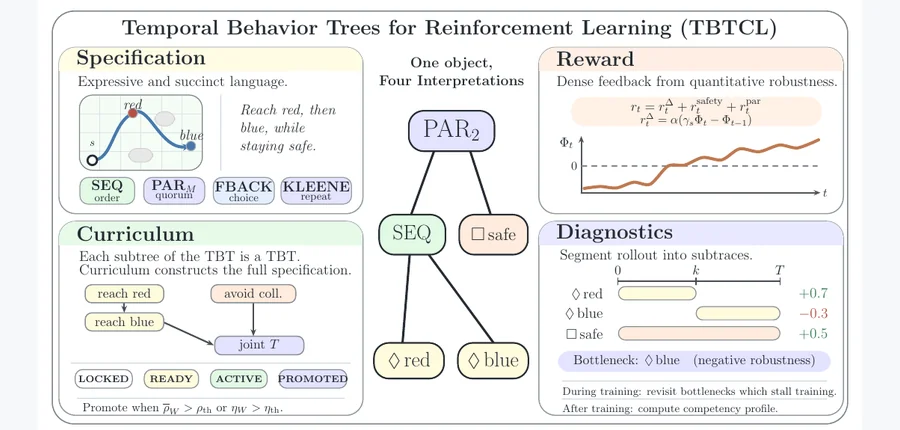 arXiv 2026-11-11 · cs.LG · #20 **[Temporal Behavior Trees for Reinforcement Learning: Specifications as Rewards, Curricula, and Diagnostics](https://arxiv.org/abs/2611.13993)** Vladimir Krsmanovic , Bernd Finkbeiner Affiliation · CISPA Helmholtz Center for Information Security / Technical University of Munich [Paper](https://arxiv.org/abs/2611.13993) · [Figure source](https://arxiv.org/pdf/2611.13993) 

[EN] Abstract
Reinforcement learning from formal specifications often separates task definition, reward shaping, curriculum design, and policy diagnostics into different mathematical objects. This fragmentation requires additional conversion steps and discards structure already present in the specification, such as subtask boundaries, ordering constraints, and quantitative measures. We introduce TBTCL (Temporal Behavior Tree Centric Learning), a framework that uses Temporal Behavior Trees (TBTs) as a unified interface for specification-guided reinforcement learning. A single TBT specifies the task, induces dense robustness-based rewards, defines a curriculum, and supports better understanding of learned policies. By adapting TBT syntax and semantics for specification-guided reinforcement learning, we provide a formalism that is more expressive than popular specification languages such as LTL and inherently hierarchical. We present algorithms to automatically extract a curriculum DAG and derive dense, robustness-based rewards directly from TBT semantics. Furthermore, we utilize TBT trace segmentation to build understandable competence profiles and automatically adapt the reward toward bottlenecks. We evaluate TBTCL on six specifications across discrete and continuous domains and show that Temporal Behavior Trees can serve as a specification, a reward, a curriculum, and a diagnostic. <a href="https://arxiv.org/list/cs/new?show=2000#2611.13993">Source</a>

[ZH] Abstract
基于形式规范的强化学习常将任务定义、奖励塑形、课程设计与策略诊断分置于不同数学对象。这种碎片化要求额外转换步骤，并丢弃规范已有的子任务边界、顺序约束和定量度量等结构。我们引入TBTCL（以时间行为树为中心的学习），一个将时间行为树（TBT）用作规范引导强化学习统一接口的框架。单一TBT既规定任务，又产生基于鲁棒性的稠密奖励、定义课程，并支持更好理解学得策略。通过适配TBT语法与语义以用于规范引导强化学习，我们提供一种比LTL等常见规范语言表达力更强、且天然分层的形式体系。我们提出算法，自动提取课程DAG，并直接从TBT语义推导基于鲁棒性的稠密奖励。此外，我们利用TBT轨迹分段构建可理解的能力画像，并针对瓶颈自动适配奖励。我们在离散与连续领域的六项规范上评估TBTCL，表明时间行为树能够同时作为规范、奖励、课程和诊断。 <a href="https://arxiv.org/list/cs/new?show=2000#2611.13993">Source</a>
 | 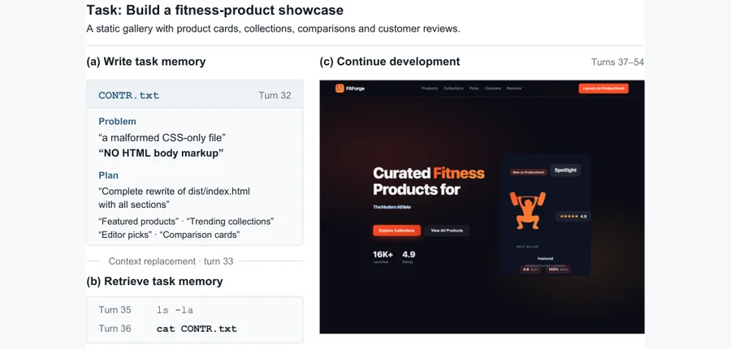 arXiv 2026-11-11 · cs.LG · #21 **[Coding Agent Memory Post-Training II: Unlocking the Memory Potential of Pre-trained File Operations for Long-Horizon Tasks via On-Policy Distillation](https://arxiv.org/abs/2611.14009)** Lirui Luo , Kelong Mao , Xinwei Yang , Rongqing Li , Luyu Chen , Kieran Wong , Yudong Guo , Xinrui Wang , Jiayin Zhu , Gu… Affiliation · Affiliation unconfirmed [Paper](https://arxiv.org/abs/2611.14009) · [Figure source](https://arxiv.org/html/2611.14009v1/visual_case_study.png) 

[EN] Abstract
Language-model agents increasingly tackle long-horizon tasks whose interaction histories exceed the model's active context. They must therefore decide what to write down and what to read back, and when to do either. Recent work has begun to use on-policy distillation (OPD) to make memory control part of the policy, relying on memory tools and compaction protocols that lie outside either model's pre-training. However, this weakens the distillation on both sides: the teacher cannot give useful guidance on an interface it has never used, and the student samples too few meaningful memory actions for that guidance to take effect. To study this problem, we introduce Coding Agent Memory Gym II (CAMG-II), a suite of long-horizon agentic-RL environments spanning Shop, Coding, AutoResearch, General, and Visual. Alongside each environment's native task interface, CAMG-II provides ordinary Bash access and an episode-persistent workspace, enabling the policy to create, revise, search, and reuse files as memory across context replacements. We also introduce Coding Agent Memory Post-Training II (CAMP-II), which trains a single policy jointly across all five environments with fully asynchronous OPD to learn this file-based memory behavior directly from a frozen teacher with a prior for file operations. On CAMG-II, CAMP-II obtains 2.97 times the gain of the strongest OPD baseline. The memory behavior CAMP-II learns generalizes to two external benchmarks, Terminal-Bench 2.1 and SWE-Bench Pro V2, with improved success rates. <a href="https://arxiv.org/list/cs/new?show=2000#2611.14009">Source</a>

[ZH] Abstract
语言模型代理日益处理交互历史超出模型活跃上下文的长时程任务，因此必须决定写下什么、读回什么以及何时进行。近期研究开始用在策略蒸馏（OPD）将记忆控制纳入策略，但依赖双方模型预训练之外的记忆工具和压缩协议。这削弱了蒸馏的两端：教师无法对从未使用的接口给出有用指导，而学生采样到的有意义记忆行动太少，指导难以生效。为研究这一问题，我们引入编程代理记忆训练场II（CAMG-II），一套跨购物、编程、自动研究、通用和视觉的长时程代理RL环境。除各环境原生任务接口外，CAMG-II提供普通Bash访问与回合持久工作区，让策略可以创建、修订、搜索并复用文件，将其作为跨上下文替换的记忆。我们还提出编程代理记忆后训练II（CAMP-II），通过完全异步OPD，在全部五个环境上联合训练单一策略，直接向对文件操作具有先验的冻结教师学习这种基于文件的记忆行为。在CAMG-II上，CAMP-II获得最强OPD基线2.97倍的增益。CAMP-II学得的记忆行为泛化到Terminal-Bench 2.1和SWE-Bench Pro V2两个外部基准，带来更高成功率。 <a href="https://arxiv.org/list/cs/new?show=2000#2611.14009">Source</a>
 |
| 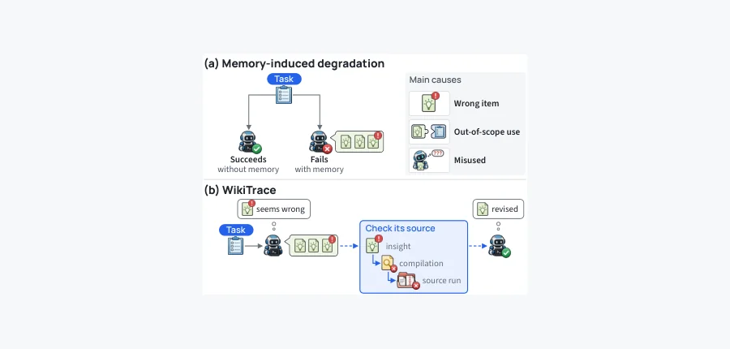 arXiv 2026-11-11 · cs.AI · #22 **[Don't Just Trust Your Memory: Evidence-Linked Memory Reduces Memory-Induced Degradation in LLM Agents](https://arxiv.org/abs/2611.14320)** Yukyeong Lee , Yumin Choi , Jinheon Baek , Sung Ju Hwang Affiliation · KAIST / DeepAuto.ai [Paper](https://arxiv.org/abs/2611.14320) · [Code](https://github.com/yukyeongleee/wikitrace) · [Figure source](https://arxiv.org/html/2611.14320v1/fig01-teaser.png) 

[EN] Abstract
External memory enables LLM agents to improve from experience by distilling trajectories of past tasks into concise lessons for new tasks. However, memory can also lead to memory-induced degradation, where an agent fails on tasks it would solve without memory, often because it follows a lesson that is incorrect, or misapplies or misreads a valid one. This is because lessons are inferred from trajectories labeled only with task success or failure, yet are typically provided without the trajectories they came from, leaving the agent no way to check them. To address this, we introduce WikiTrace, an evidence-linked memory system designed to let agents check each lesson against its original trajectory. Specifically, motivated by the finding that a trajectory often still holds the evidence needed to catch an erroneous lesson, WikiTrace stores each lesson as a concise insight linked to a summary of why its trajectory succeeded or failed and to the raw trajectory itself. Then, on a new task, the agent starts from all insights and, whenever one lacks details needed to act, conflicts with another, or comes from a failed task, descends through its links with terminal tools to fill in missing details or correct the insight before acting. We validate WikiTrace on five agentic benchmarks, showing that it consistently outperforms existing memory approaches and a baseline given the same insights alone, while also reducing memory-induced degradation. Our code is available at this https URL <a href="https://arxiv.org/list/cs/new?show=2000#2611.14320">Source</a>

[ZH] Abstract
外部记忆使LLM代理能够从经验中改进，将过去任务轨迹蒸馏为用于新任务的简洁经验。然而，记忆也可能导致记忆诱发退化，即代理在原本不用记忆能够解决的任务上失败，原因往往是遵循错误经验，或误用、误读有效经验。这是因为经验从仅标记任务成功或失败的轨迹中推断而来，却通常不附带来源轨迹，使代理无法核查。为此，我们引入WikiTrace，一个让代理能对照原始轨迹检查每条经验的证据链接记忆系统。具体而言，轨迹通常仍保有识别错误经验所需的证据，这一发现促使WikiTrace将每条经验存储为简洁洞见，并链接到轨迹为何成功或失败的摘要，以及原始轨迹本身。面对新任务，代理从全部洞见开始；若某条缺少行动所需细节、与另一条冲突，或源于失败任务，则通过终端工具沿链接深入，补齐细节或纠正洞见后再行动。我们在五个代理基准上验证WikiTrace，表明它持续优于现有记忆方法和使用相同洞见但无其他信息的基线，同时减少记忆诱发退化。代码位于this https URL。 <a href="https://arxiv.org/list/cs/new?show=2000#2611.14320">Source</a>
 | 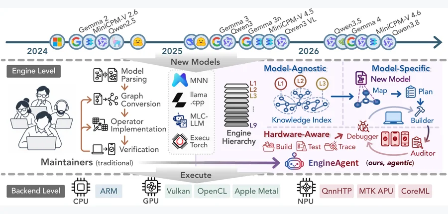 arXiv 2026-11-11 · cs.OS · #23 **[EngineAgent: Agentizing On-Device LLM Inference Engines with Inference Stack Hierarchy Awareness and Hardware Abilities](https://arxiv.org/abs/2611.14356)** Zhengxiang Huang , Yujie Sun , Shengheng Chen , Zhaode Wang , Chaoyue Niu , Zeyu Zhao , Chengfei Lv , Fan Wu , Guihai Chen Affiliation · Shanghai Jiao Tong University / Alibaba Group [Paper](https://arxiv.org/abs/2611.14356) · [Figure source](https://arxiv.org/html/2611.14356v1/position2-arxiv.png) 

[EN] Abstract
Rapidly evolving LLM architectures and heterogeneous mobile hardware make supporting new models in on-device inference engines a recurring and costly system challenge. Each model may require coordinated changes across conversion, graph construction, operators, and hardware backends. Existing coding agents often miss these cross-layer dependencies and struggle to diagnose failures across host--device execution paths. We present EngineAgent, an agentic system for automating on-device LLM model enablement. Its key insight is to separate reusable engine and hardware knowledge from model-specific implementation. Before enablement, EngineAgent constructs a hierarchy-aware engine index that captures engine abstraction layers and cross-layer dependencies, and pre-validates backend-specific build, execution, and debugging workflows using already supported models. For each new model, a builder uses this knowledge to coordinate cross-layer changes, while an auditor checks implementation completeness and drives iterative debugging through device-side validation. Across 12 tasks spanning three mobile LLMs and four engine--backend pairs on CPUs, GPUs, and NPUs, EngineAgent achieves 75% end-to-end success with either of two underlying LLMs, versus 33.3% for the strongest coding-agent baseline. Success requires compilation, on-device execution, and output-logit agreement with reference implementations. EngineAgent also reduces average per-task time and model-API cost relative to baselines using the same underlying LLMs. <a href="https://arxiv.org/list/cs/new?show=2000#2611.14356">Source</a>

[ZH] Abstract
快速演变的LLM架构与异质移动硬件，使端侧推理引擎支持新模型成为反复发生且成本高昂的系统挑战。每个模型可能都需要协调修改转换、图构建、算子和硬件后端。现有编程代理常遗漏这些跨层依赖，也难以诊断主机—设备执行路径上的失败。我们提出EngineAgent，一个自动化端侧LLM模型适配的代理式系统。核心认识是，将可复用引擎和硬件知识与模型特定实现分开。在适配前，EngineAgent构建具层级感知的引擎索引，捕捉引擎抽象层和跨层依赖，并利用已经支持的模型，预验证后端特定的构建、执行和调试工作流。对每个新模型，构建器利用这些知识协调跨层变化，审计器检查实现完整性，并通过设备侧验证驱动迭代调试。在覆盖CPU、GPU和NPU上三个移动LLM及四个引擎—后端组合的十二项任务中，EngineAgent使用两种底层LLM中的任一种，都达到75%的端到端成功率，而最强编程代理基线为33.3%。成功要求编译、端侧执行和与参考实现的输出logit一致。相较使用相同底层LLM的基线，EngineAgent还降低平均每任务时间和模型API成本。 <a href="https://arxiv.org/list/cs/new?show=2000#2611.14356">Source</a>
 | 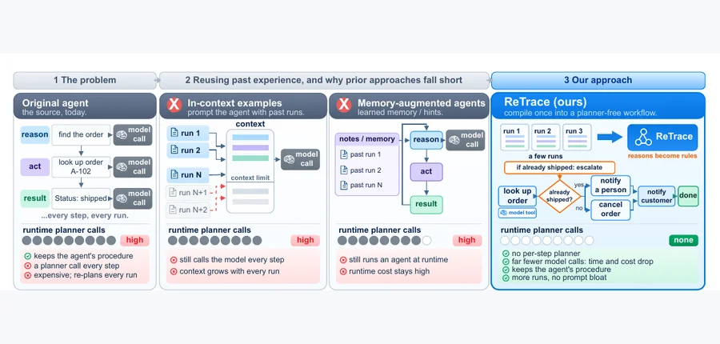 arXiv 2026-11-11 · cs.AI · #24 **[ReTrace: Distilling Tool-Using Agents into Planner-Free Workflows](https://arxiv.org/abs/2611.14492)** Kaiyuan Hou , Yang Ping Kuo , Indranil Bhattacharya , Rohith Nama , Arushi Gupta , Carlos D. Castillo , Prathap Ramachandr… Affiliation · Columbia University / Amazon [Paper](https://arxiv.org/abs/2611.14492) · [Figure source](https://arxiv.org/pdf/2611.14492) 

[EN] Abstract
Business process automation runs the same Standard Operating Procedure (SOP) again and again on new inputs. Large Language Model (LLM) agents can follow an SOP written in natural language, but they call an LLM to choose every step of every run, which adds latency and cost at scale. We present ReTrace, which turns an SOP and a few logged agent runs into a reusable workflow in which code, not an LLM, selects the next step. The agent's reasoning, the explanation it writes with each tool call, often states why it took an action; the tool calls alone do not. ReTrace extracts the condition behind each step, merges these conditions across runs into a compact rule document, and generates an executable workflow from it. Only this last stage depends on the platform, so rule documents can be compiled for different orchestration platforms. On $79$ procedures from our production platform, ReTrace workflows reach $93.8\%$ completion, against $96.8\%$ for the agent, at $24\%$ lower cost per task. On $\tau^2$-Bench, they reach $75.8\%$ task success (agent: $80.6\%$) and run in $1.3$s instead of $170$s; three rounds of repair on training failures lift $k{=}2$ workflows from $66.7\%$ to $81.2\%$. On eight SOP-Bench procedures, ReTrace without repair trails few-shot generation ($80.6\%$ vs. $83.6\%$), but repair from labeled training failures lifts it to $87.8\%$ at $0.40$s per task, compared to $85.5\%$ in $46.6$s for the agent. <a href="https://arxiv.org/list/cs/new?show=2000#2611.14492">Source</a>

[ZH] Abstract
业务流程自动化在新输入上反复运行相同标准操作流程（SOP）。大语言模型（LLM）代理可以遵循自然语言SOP，但每次运行的每一步都要调用LLM选择，规模化时增加延迟和成本。我们提出ReTrace，将SOP和少量已记录代理运行转化为可复用工作流，由代码而非LLM选择下一步。代理推理，即它随每次工具调用写出的解释，常说明为何采取行动；仅有工具调用本身则不能。ReTrace提取每一步背后的条件，跨运行合并成紧凑规则文档，再据此生成可执行工作流。只有最后阶段依赖平台，因此规则文档可以编译到不同编排平台。在生产平台79个流程上，ReTrace工作流完成率为93.8%，代理为96.8%，每任务成本低24%。在τ²-Bench上，其任务成功率为75.8%（代理为80.6%），运行耗时1.3秒而非170秒；基于训练失败的三轮修复，将k=2工作流从66.7%提高到81.2%。在八个SOP-Bench流程上，无修复ReTrace落后于少样本生成（80.6%对83.6%），但由带标签训练失败驱动的修复将其提高到87.8%，每任务0.40秒，对比代理的85.5%和46.6秒。 <a href="https://arxiv.org/list/cs/new?show=2000#2611.14492">Source</a>
 |
| 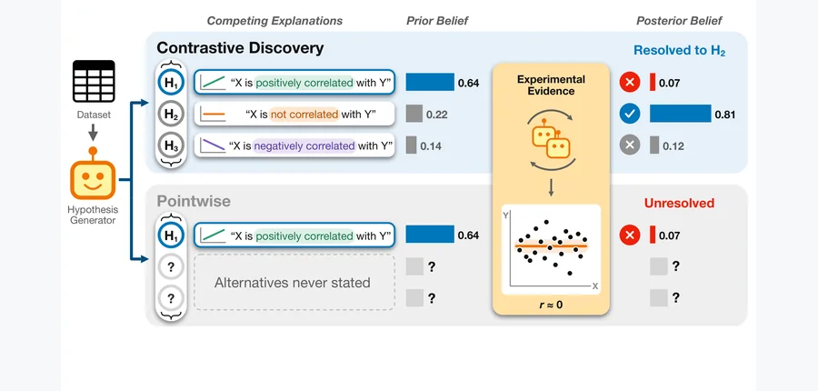 arXiv 2026-11-11 · cs.AI · #25 **[Contrastive Discovery: Open-Ended Scientific Discovery over Competing Explanations](https://arxiv.org/abs/2611.14514)** Ziang Liu , James J. Kim , Yijia Dai , Jennifer J. Sun Affiliation · Cornell University [Paper](https://arxiv.org/abs/2611.14514) · [Figure source](https://arxiv.org/html/2611.14514v1/main-figure.png) 

[EN] Abstract
LLM agents are increasingly used for open-ended, data-driven scientific discovery, yet most of them evaluate hypotheses pointwise, testing an empirical claim $h$ only against its complement $\neg h$. When evidence rejects $h$, the agent learns that one explanation is unlikely but not which alternative the evidence supports. To recover that alternative, we introduce Contrastive Discovery, which replaces the single hypothesis with a contrast set, a scientific question paired with mutually exclusive and collectively exhaustive competing explanations. Each experiment is scored by how its evidence redistributes belief across the set, and the question is resolved when belief concentrates on one explanation. Because contrast sets change only the unit an agent proposes and scores, an existing agent can use them to re-evaluate evidence it has already collected or to guide its search. Across six domains, $89\%$ of the pointwise candidates with the largest belief shifts are rejections. On the same evidence, contrast sets resolve $73\%$ of these candidates to a specific alternative. When contrast sets guide search, the agent resolves $67\%$ more questions than pointwise surprisal under the same experiment budget. In a blinded study, $38$ human experts chose the same explanation on $78\%$ of resolved questions and on $82\%$ of questions where the pointwise agent rejected its hypothesis and stopped. Together, these results support explicit competing explanations as a way for discovery agents to resolve more scientific questions from the same evidence and validation budget. <a href="https://arxiv.org/list/cs/new?show=2000#2611.14514">Source</a>

[ZH] Abstract
LLM代理日益用于开放式、数据驱动科学发现，但大多数逐点评估假设，仅将经验命题h与其补集¬h对照。当证据拒绝h时，代理知道一种解释不太可能，却不知道证据支持哪种替代解释。为找回这种替代，我们引入对比发现，将单一假设替换为对比集合，即科学问题及其相互排斥、共同穷尽的竞争解释。每项实验根据其证据如何重新分配集合内信念评分，当信念集中到一种解释时，问题被解决。由于对比集合仅改变代理提出和评分的单位，已有代理可用它重新评估已经收集的证据，也可用来引导搜索。在六个领域中，信念偏移最大的逐点候选有89%属于拒绝。在相同证据上，对比集合将这些候选的73%解析为具体替代解释。当对比集合引导搜索时，在相同实验预算下，代理比逐点惊奇度多解决67%的问题。在盲测中，38名人类专家在78%的已解决问题上选择相同解释；在逐点代理拒绝假设后停止的问题上，这一比例为82%。这些结果共同支持，显式竞争解释使发现代理能在相同证据与验证预算中解决更多科学问题。 <a href="https://arxiv.org/list/cs/new?show=2000#2611.14514">Source</a>
 | 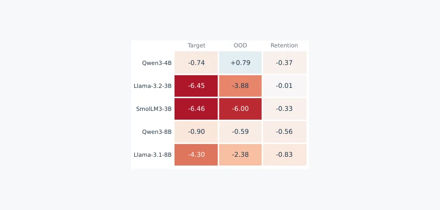 arXiv 2026-11-11 · cs.LG · #26 **[Third Eye: Beyond Immediate Gains in Recursive Self-Improvement](https://arxiv.org/abs/2611.12988)** Sujato Dutta , Padala Indira Sneha , Kypu Mahitha , Shashank Vanga , Neeraj Choudhary Affiliation · Mahindra University [Paper](https://arxiv.org/abs/2611.12988) · [Figure source](https://arxiv.org/html/2611.12988v1/heads.png) 

[EN] Abstract
Does a useful self-update remain useful after the model updates again? Third Eye separates immediate performance from the outcome of a further native update. We evaluate five 3-8B backbones on math and code: 64 fresh runs, three candidates per run, and three continuations per candidate. Selection and final scoring use disjoint items. In the balanced Qwen3-4B/Llama-3.2-3B comparison, immediate-selected utility is near zero, but continuation reduces it by 1.78 percentage points (simultaneous 95% interval [0.68, 2.88]). Candidate-averaged immediate utility is already negative: selection partly accounts for the apparently neutral first step. Continuation also lowers utility for SmolLM3-3B and Llama-3.1-8B; Qwen3-8B remains inconclusive. Target and out-of-distribution losses dominate retention changes. Matched recipe and recipient-donor controls identify neither a reliable mitigation nor a single mechanism. The results support evaluating persistent self-updates as adaptation transitions, with independent scoring and a no-update baseline, rather than interpreting immediate performance as their full value. <a href="https://arxiv.org/list/cs/new?show=2000#2611.12988">Source</a>

[ZH] Abstract
一次有用的自我更新，在模型再次更新后仍有用吗？Third Eye将即时性能与进一步原生更新的结果分开。我们在数学和代码上评估五个3–8B骨干：64次全新运行，每次三个候选，每个候选三个续接更新。选择与最终评分使用互不重叠的项目。在平衡的Qwen3-4B/Llama-3.2-3B比较中，按即时表现选择的效用接近零，但续接更新使其降低1.78个百分点（同时95%区间为[0.68,2.88]）。候选平均即时效用已经为负：选择部分解释了表面中性的第一步。续接更新也降低SmolLM3-3B和Llama-3.1-8B的效用；Qwen3-8B仍无定论。目标与分布外损失主导保留变化。匹配训练方案和接收者—供体对照，既未识别可靠缓解方法，也未识别单一机制。结果支持将持久自我更新作为适配转移来评估，使用独立评分和无更新基线，而非将即时性能视为其全部价值。 <a href="https://arxiv.org/list/cs/new?show=2000#2611.12988">Source</a>
 | 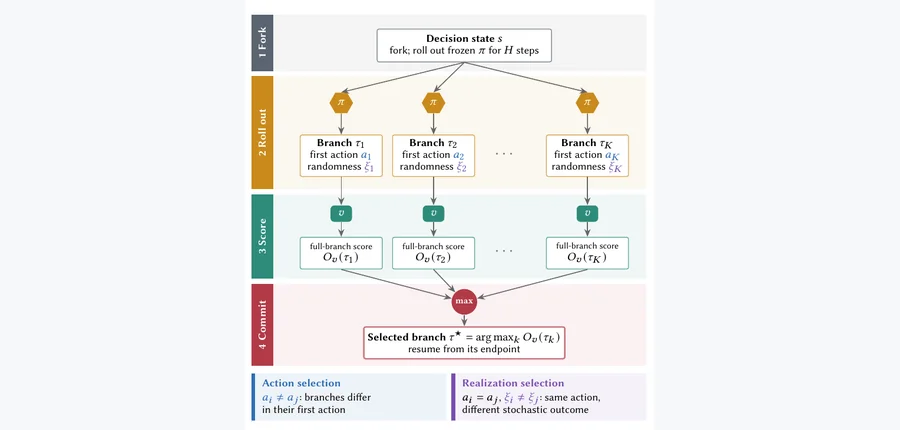 arXiv 2026-11-11 · cs.LG · #27 **[Branch-and-Commit for Frozen RL Agents: When and Where to Spend Test-Time Compute](https://arxiv.org/abs/2611.13003)** Sahar Admoni , Assaf Hallak , Yftah Ziser , Ofra Amir Affiliation · Technion, Israel Institute of Technology / NVIDIA Research [Paper](https://arxiv.org/abs/2611.13003) · [Figure source](https://arxiv.org/pdf/2611.13003) 

[EN] Abstract
Reinforcement learning agents are often deployed with policies that cannot be retrained or modified. In digital environments whose states can be copied and resumed, an operator has another option: sample several continuations from the current state, evaluate them, and continue from the endpoint of the selected branch. We call this procedure branch-and-commit. We study when it improves return, what produces the improvement, and where its computational budget should be spent. Across four environments, two frozen policies, five continuation verifiers, and a model-free selection rule, we find that the benefit of branching depends on dispersion: the difference between the best candidate return and the mean candidate return. Branching provides no benefit in low-dispersion settings, while increasing return by 12.8% in our main Craftax-Medium setting. Most of this gain comes not from selecting better actions, but from selecting among different stochastic realizations of the same action. Several competent verifiers achieve similar episode returns, suggesting that verifier quality is not the main constraint at our operating budget. Instead, computation is better allocated to states where useful dispersion is likely. On held-out seeds, gating branching using predicted dispersion retains 69% of the improvement from uniform branching while using 48% as many branching calls. These results characterize when branch-and-commit is useful and clarify what its gains represent. <a href="https://arxiv.org/list/cs/new?show=2000#2611.13003">Source</a>

[ZH] Abstract
强化学习代理常以无法重新训练或修改的策略部署。在状态可以复制和恢复的数字环境中，操作者还有另一选择：从当前状态采样多个续接过程，评估它们，再从选定分支的终点继续。我们称之为分支—提交。我们研究它何时提高回报、改善来自什么，以及计算预算应花在哪里。在四个环境、两个冻结策略、五个续接验证器和一个无模型选择规则上，我们发现分支收益取决于离散程度，即最佳候选回报与平均候选回报之差。在低离散程度设置中分支没有收益，而在主要Craftax-Medium设置中，回报提高12.8%。大部分增益并非来自选择更好行动，而是来自在相同行动的不同随机实现之间选择。若干有能力的验证器达到相近回合回报，表明在我们的操作预算下，验证器质量并非主要约束。相反，应将计算分配给更可能产生有用离散差异的状态。在留出种子上，用预测离散程度门控分支，保留均匀分支改善的69%，同时仅使用48%的分支调用。这些结果刻画了分支—提交何时有用，并明确其收益代表什么。 <a href="https://arxiv.org/list/cs/new?show=2000#2611.13003">Source</a>
 |
| 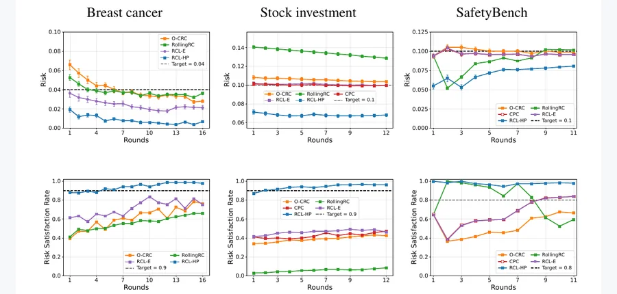 arXiv 2026-11-11 · cs.LG · #28 **[High Probability Risk Control for Online Policy Learning](https://arxiv.org/abs/2611.13163)** Yihong Guo , Drew Prinster , Suchi Saria , Anqi Liu Affiliation · Johns Hopkins University [Paper](https://arxiv.org/abs/2611.13163) · [Code](https://github.com/guoyihonggyh/High-Probability-Risk-Control) · [Figure source](https://arxiv.org/pdf/2611.13163) 

[EN] Abstract
We study risk control for online policy learning, where an agent adaptively collects data and aims to learn a new policy whose risk stays below a tolerance threshold at every round with high probability. Such policy updates and data collection induce feedback covariate shift (FCS): observed data depend on history through evolving policies and the data-collection process. FCS brings two substantive problems for risk control: 1) efficient risk evaluation for each candidate policy and 2) valid policy selection with high-probability risk control. To address these, we propose a permutation-based weighted risk evaluator with weights efficiently approximated by the Sinkhorn algorithm and select policies whose estimated risk upper confidence bounds (UCB) fall below the target threshold, with the UCB obtained through a proposed Gaussian bootstrap method. Theoretically, we prove that our risk evaluator has a no-larger variance upper bound than that of the standard importance-weighted evaluator. Our policy control method also yields an asymptotically valid simultaneous risk bound and provides asymptotic high-probability risk control for the selected policy. Empirically, we evaluate our method on the online contextual bandit problem, safe question answering benchmark, and Medical Claim Filtering tasks. Our method maintains the target risk level, achieves lower risk than baseline methods, has lower variance in risk estimation, and achieves reliable policy selection with high-probability risk control. Further ablation studies support our theoretical claims. <a href="https://arxiv.org/list/cs/new?show=2000#2611.13163">Source</a>

[ZH] Abstract
我们研究在线策略学习的风险控制，其中代理自适应收集数据，并试图学习一种新策略，使其风险在每轮均以高概率低于容忍阈值。这种策略更新与数据收集诱发反馈协变量偏移（FCS）：观测数据通过不断变化的策略和收集过程依赖历史。FCS带来两个实质问题：（1）高效评估每个候选策略的风险；（2）在高概率风险控制下有效选择策略。为此，我们提出基于排列的加权风险评估器，用Sinkhorn算法高效近似权重；选择估计风险置信上界（UCB）低于目标阈值的策略，UCB通过所提出的高斯自举方法获得。理论上，我们证明风险评估器的方差上界不大于标准重要性加权评估器。策略控制方法还给出渐近有效的同时风险界，为所选策略提供渐近高概率风险控制。实证方面，我们在在线上下文赌博机问题、安全问答基准和医疗声明筛选任务上评估。该方法维持目标风险水平，风险低于基线，风险估计方差更小，并实现具有高概率风险控制的可靠策略选择。进一步消融支持理论主张。 <a href="https://arxiv.org/list/cs/new?show=2000#2611.13163">Source</a>
 | 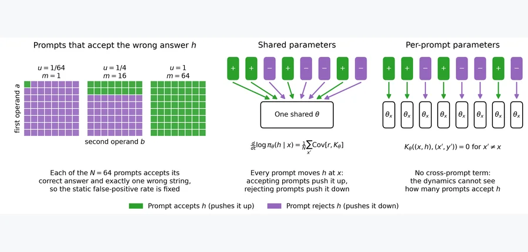 arXiv 2026-11-11 · cs.LG · #29 **[Wrong the Same Way: Cross-Prompt Sharing Both Suppresses and Amplifies Reward Hacking in RLVR](https://arxiv.org/abs/2611.13218)** Michael Li , Rohan Pandey , Ray Chen Affiliation · Carnegie Mellon University / University of Washington / Independent researcher [Paper](https://arxiv.org/abs/2611.13218) · [Code](https://github.com/Rohan-Pandey1729/RLVR-Reward-Hacking) · [Figure source](https://arxiv.org/html/2611.13218v1/figures/fig0_overview.png) 

[EN] Abstract
Two accounts of how reinforcement learning with verifiable rewards (RLVR) interacts with an imperfect verifier coexist: in one, reward hacking is inherited from the base model; in the other, RL amplifies it. We study both in a controlled environment small enough to compute the entire response distribution exactly. We vary the universality of a leak, or the fraction of prompts that accept the same wrong response, and the verifier's static false-positive rate. At its KL-regularized optimum, RLVR acts as a filter that reweights the accepted set without altering its composition, so the hack rate is inherited exactly. Taking that as a null model, a known decomposition writes the drift from it as a sum over prompts of covariances between reward and the empirical tangent kernel. The terms from other prompts vanish without parameter sharing. With sharing, every prompt that accepts a wrong answer pushes it up and every prompt that rejects it pushes it down through the baseline, in proportion to the model's probability of producing it there. A shared-parameter policy thus drives a leak that few prompts accept below the base rate and amplifies one that most prompts accept. At every convergent learning rate under Adam, SGD, and sampled GRPO, hacking ends higher at high universality than at low, but whether either end crosses the base rate depends on the step size. Independent per-prompt copies remove the dependence. The direction of this push depends on neither the verifier's error rate nor universality alone, but on how much of the model's kernel-weighted probability of a wrong answer falls on prompts that accept it, which frozen base model controls support. Verifier fixes should target the mistakes the model repeats across prompts: two patches that remove equally many errors differ by up to 38 points of true accuracy. We propose this alignment as a hypothesis for why earlier studies disagree. <a href="https://arxiv.org/list/cs/new?show=2000#2611.13218">Source</a>

[ZH] Abstract
关于带可验证奖励的强化学习（RLVR）如何与不完美验证器相互作用，存在两种解释：一种认为奖励投机继承自基础模型，另一种认为RL会放大它。我们在一个足够小、能精确计算完整响应分布的受控环境中研究两者。我们改变漏洞的普适程度，即接受同一错误响应的提示比例，以及验证器的静态假阳性率。在KL正则化最优点，RLVR像过滤器一样重新加权接受集合而不改变其组成，因此投机率完全继承。以此为零模型，已知分解将相对它的漂移写成各提示奖励与经验切线核协方差之和。没有参数共享时，来自其他提示的项消失。存在共享时，每个接受错误答案的提示都将其推高，每个拒绝该答案的提示通过基线将其压低，力度正比于模型在该处生成它的概率。因此，共享参数策略将少数提示接受的漏洞压至基础率以下，并放大多数提示接受的漏洞。在Adam、SGD和采样GRPO的每个收敛学习率下，高普适程度的最终投机率都高于低普适程度，但任一最终值是否越过基础率取决于步长。独立逐提示副本消除这一依赖。推动方向既不只取决于验证器错误率，也不只取决于普适程度，而取决于模型对错误答案的核加权概率有多少落在接受该答案的提示上，冻结基础模型对照支持这一点。验证器修复应针对模型跨提示重复的错误：两个删除同样多错误的补丁，真实准确率最多相差38点。我们提出这一对齐关系，作为解释早期研究分歧的假设。 <a href="https://arxiv.org/list/cs/new?show=2000#2611.13218">Source</a>
 | 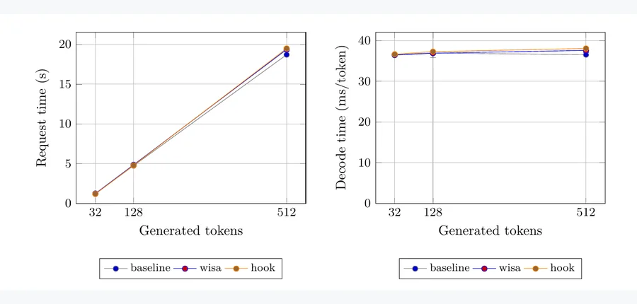 arXiv 2026-11-11 · cs.AI · #30 **[W-ISA: Transactional Execution of Weight-Space Intervention Programs](https://arxiv.org/abs/2611.13232)** Ekrem Aksoy Affiliation · Affiliation unconfirmed [Paper](https://arxiv.org/abs/2611.13232) · [Figure source](https://arxiv.org/pdf/2611.13232) 

[EN] Abstract
We present W-ISA, a software instruction set and transactional runtime for executing weight-space intervention programs on pretrained language models. Shape-checked instructions express parameter updates, projections, ablations, and rank-one transformations. The runtime applies these programs within request-scoped execution contexts and restores saved parameters after completion or interruption. Activation-based match-action rules connect measured model states to intervention selection. We evaluate restoration and replay on SmolLM-135M-Instruct and Qwen2.5-1.5B-Instruct, and compare materialized rank-one updates with equivalent PyTorch hooks on the latter. In 45 timed requests, both intervention implementations produce identical greedy sequences at 32, 128, and 512 tokens; their maximum prompt-logit difference is 0.000184. On the complete WikiText-2 raw test split, the combined SmolLM attention-head ablation and MLP projection changes perplexity from 22.2353 to 22.3188, a relative increase of 0.3754%. W-ISA separates intervention specification, execution, and measurement, making parameter-level experiments reproducible and composable. <a href="https://arxiv.org/list/cs/new?show=2000#2611.13232">Source</a>

[ZH] Abstract
我们提出W-ISA，一套用于在预训练语言模型上执行权重空间干预程序的软件指令集与事务式运行时。经过形状检查的指令表达参数更新、投影、消融和秩一变换。运行时在请求作用域执行上下文中应用这些程序，并在完成或中断后恢复保存参数。基于激活的匹配—动作规则，将测得模型状态连接到干预选择。我们在SmolLM-135M-Instruct与Qwen2.5-1.5B-Instruct上评估恢复和重放，并在后者上比较显式实现的秩一更新与等价PyTorch钩子。在45个计时请求中，两种干预实现在32、128和512 token时产生相同贪心序列；最大提示logit差为0.000184。在完整WikiText-2原始测试划分上，SmolLM注意力头消融与MLP投影组合，使困惑度从22.2353变为22.3188，相对增加0.3754%。W-ISA将干预规范、执行与测量分开，使参数层实验可重放、可比较。 <a href="https://arxiv.org/list/cs/new?show=2000#2611.13232">Source</a>
 |
| 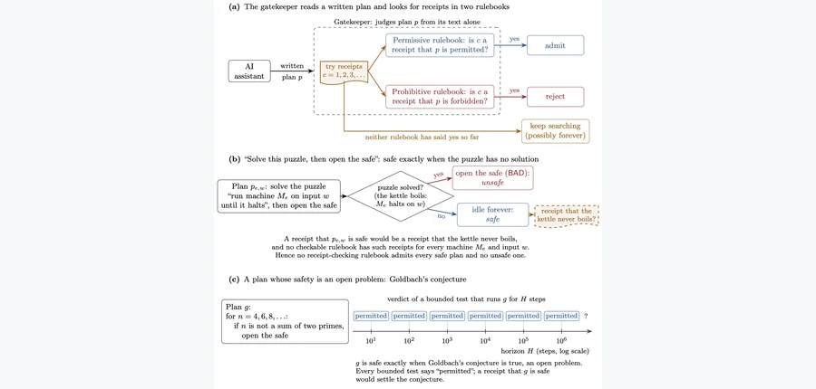 arXiv 2026-11-11 · cs.AI · #31 **[No finite rulebook can certify every safe program: an impossibility theorem for gatekeeping AI agents](https://arxiv.org/abs/2611.13367)** Tomas Perez-Acle Affiliation · Universidad San Sebastián / Centro BASAL Ciencia &amp; Vida [Paper](https://arxiv.org/abs/2611.13367) · [Figure source](https://arxiv.org/html/2611.13367v1/figures/fig1_concept.png) 

[EN] Abstract
An AI assistant writes small programs, and a gatekeeper must decide, from the code alone, whether each one may run. Suppose the rules are fixed: never perform a forbidden action, never let the output depend on a secret, always answer eventually. Can two rulebooks, one listing what is allowed and one listing what is not, both be complete, if every rule must be backed by evidence that a machine can check in finite time? We prove that they cannot. Checkable evidence can only establish what a finite record settles, and ``never'' and ``eventually'' are never settled by a finite record. For prohibitions the failure is one-sided: every violation can be caught by watching, but no safe program can be cleared for good. For confidentiality and responsiveness, neither side can be. We characterise exactly which rules about visible behaviour evidence can confirm, and we show that any sound rulebook of $n$ bits omits a compliant program of about $n$ bits. A time limit makes everything checkable, but only by running the program for essentially the whole limit, so a finite machine is not a feasible one. Finally, we show what a gatekeeper can still guarantee: not a verdict on every program, but a checkable list that contains everything it must allow and nothing it must refuse. Simulations on 2.2 million random programs and on self-referential adversaries show that the obstruction is adversarial rather than typical, and that the one error a longer test never removes is the liveness part of confidentiality. <a href="https://arxiv.org/list/cs/new?show=2000#2611.13367">Source</a>

[ZH] Abstract
AI助手编写小程序，门卫必须仅从代码决定每个程序是否可以运行。假设规则固定：永不执行禁止行动、输出永不依赖秘密、总会最终作答。如果每条规则都必须有机器能在有限时间检查的证据支撑，两本分别列出允许项和禁止项的规则手册能否同时完备？我们证明不能。可检查证据只能确立有限记录所能确定的事，而“永不”和“最终”从不能由有限记录确定。对禁止性要求，失败是单向的：每次违规都能通过观察发现，但无法永久确认任何安全程序。对保密性与响应性，两边都不行。我们精确刻画证据能确认哪些关于可见行为的规则，并表明任一可靠的n比特规则手册，都会遗漏一个约n比特的合规程序。时间限制使一切可检查，却基本只能将程序运行满整个限制，因此有限机器并非可行机器。最后，我们展示门卫仍能保证什么：不是对每个程序作出判定，而是提供一个可检查名单，包含所有必须允许的内容，且没有任何必须拒绝的内容。在220万个随机程序和自指对手上的仿真表明，障碍具有对抗性而非典型性；延长测试永远无法消除的那一种错误，是保密性的活性部分。 <a href="https://arxiv.org/list/cs/new?show=2000#2611.13367">Source</a>
 | 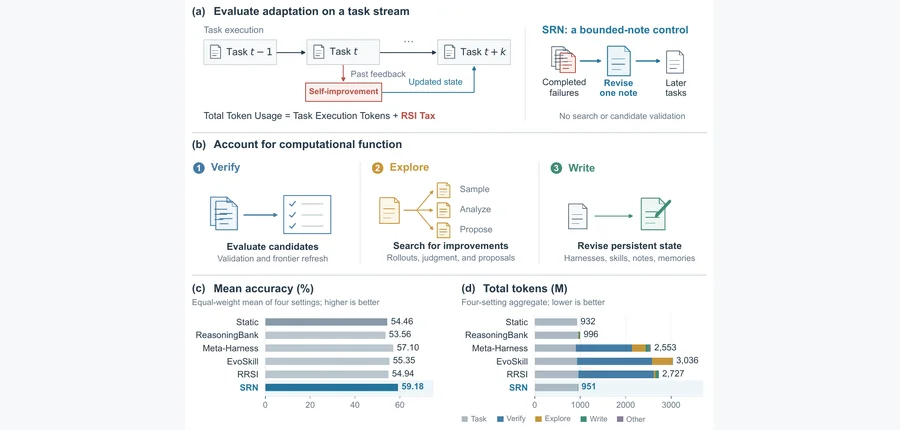 arXiv 2026-11-11 · cs.LG · #32 **[The RSI Tax: When Recursive Self-Improvement Is Not Worth the Cost](https://arxiv.org/abs/2611.13524)** Yitong Zhang , Ang Li , Yisen Wang Affiliation · Peking University [Paper](https://arxiv.org/abs/2611.13524) · [Figure source](https://arxiv.org/pdf/2611.13524) 

[EN] Abstract
Recursive self-improvement (RSI) seeks to improve an agent using its own task experience. Its practical value depends on whether performance gains justify the full cost of self-improvement and task execution. We evaluate this trade-off on continual task streams, scoring each task before its feedback is used for subsequent updates. We define the \emph{RSI Tax} as the token cost of the self-improvement process and include it alongside task-execution costs in end-to-end evaluation. Across six methods and two language models, a bounded-note baseline matches or exceeds the observed accuracy of Meta-Harness, EvoSkill, and RRSI, with mean total-token savings of 65.6-71.0\%. We decompose the RSI Tax into verification, exploration, and writing costs, and track subsequent use of the associated state or artifact. For these three RSI methods, verification accounts for 74.8--93.6% of the aggregate RSI Tax. A substantial share of the RSI Tax is also associated with states or artifacts that are not used later in the evaluated streams. These results expose a practical limitation of costly RSI procedures: improvements in the deployed agent need not justify the expense of the improvement process. They motivate RSI objectives that jointly optimize the RSI Tax and expected task-execution cost while ensuring continued growth in agent capabilities across the task stream. <a href="https://arxiv.org/list/cs/new?show=2000#2611.13524">Source</a>

[ZH] Abstract
递归自我改进（RSI）试图利用代理自身任务经验改善代理。其实用价值取决于性能收益能否抵偿自我改进与任务执行的完整成本。我们在持续任务流上评估这一权衡，在每项任务反馈用于后续更新之前先评分。我们将自我改进过程的token成本定义为RSI税，并与任务执行成本一起纳入端到端评估。在六种方法和两个语言模型上，有界笔记基线的观测准确率匹配或超过Meta-Harness、EvoSkill与RRSI，平均总token节省65.6–71.0%。我们将RSI税分解为验证、探索和写入成本，并追踪相关状态或制品的后续使用。对这三种RSI方法，验证占合计RSI税的74.8–93.6%。相当一部分RSI税还关联到在所评估任务流中未被后续使用的状态或制品。这些结果揭示昂贵RSI流程的实用局限：部署代理的改善未必抵得上改进过程的开销。它们推动设计同时优化RSI税与预期任务执行成本、并确保代理能力沿任务流持续增长的RSI目标。 <a href="https://arxiv.org/list/cs/new?show=2000#2611.13524">Source</a>
 | 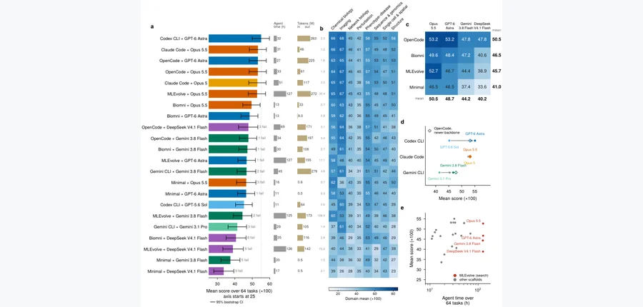 arXiv 2026-11-11 · cs.LG · #33 **[BioXArena-Pro: a research-grade benchmark for autonomous biomedical machine learning agents](https://arxiv.org/abs/2611.13994)** Loka Li , Duzhen Zhang , Xingbo Du , Leonard Song , Kun Zhang , Le Song Affiliation · Mohamed bin Zayed University of Artificial Intelligence / The Westminster Schools / Carnegie Mellon University [Paper](https://arxiv.org/abs/2611.13994) · [Code](https://github.com/mbzuai-ai4bio/BioXArena-Pro) · [Figure source](https://arxiv.org/html/2611.13994v1/Fig2_capability.png) 

[EN] Abstract
Coding agents are increasingly proposed as autonomous builders of biomedical models, but existing benchmarks are small, near saturation or open to leaked information. We present BioXArena-Pro, 64 research-level modelling tasks from eight biomedical domains, each rebuilt from a published study; most hold out whole biological units such as species or cohorts. Across 22 agent configurations, the best scores 55.1 of 100, and the scaffold matters almost as much as the model. We re-ran a published method for every task: where the published recipe applies unchanged, the best agent and the methods tie; on rebuilt tasks the methods trail by 8.2 points, suggesting that agents gain by adapting to new data. Pretrained models (including biological foundation models) matter where the strongest agent uses them: forbidding them decreases its score on those tasks by 9 points. Every task was audited in several AI-assisted rounds and a final human review. <a href="https://arxiv.org/list/cs/new?show=2000#2611.13994">Source</a>

[ZH] Abstract
编程代理日益被提议用作生物医学模型的自主构建者，但现有基准规模小、接近饱和或容易受到信息泄漏影响。我们提出BioXArena-Pro，包含八个生物医学领域的64项研究级建模任务，每项重建自已发表研究；大多数留出整个生物学单位，例如物种或队列。在22种代理配置中，最佳得分为55.1/100，支架的重要性几乎与模型相当。我们为每项任务重新运行一种已发表方法：在原始方案可原样应用时，最佳代理与这些方法持平；在重建任务上，这些方法落后8.2点，表明代理通过适配新数据获得收益。预训练模型（包括生物学基础模型）在最强代理使用它们的任务上很重要：禁止使用使其在这些任务上的得分降低9点。每项任务均经过多轮AI辅助审计和最终人工审查。 <a href="https://arxiv.org/list/cs/new?show=2000#2611.13994">Source</a>
 |
| 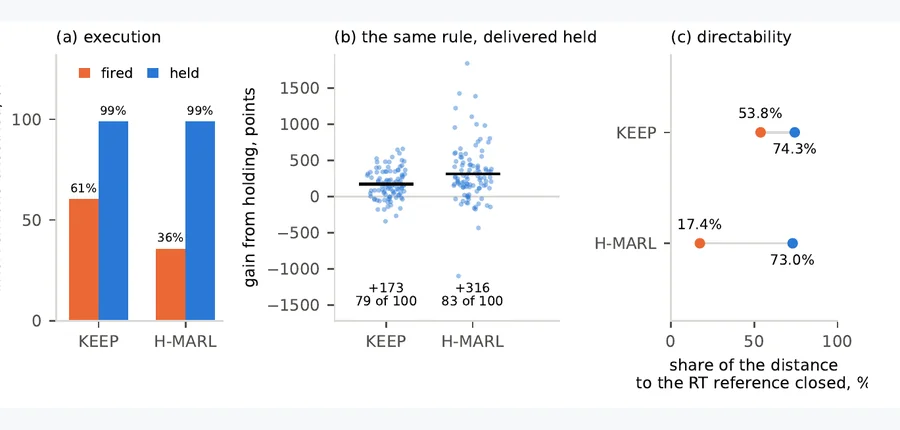 arXiv 2026-11-11 · cs.CR · #34 **[What a CAGE 4 Score Measures: An Audit of a Learned Cyber-Defense Benchmark, Its Reference Defenders, and the Tables Built on Them](https://arxiv.org/abs/2611.14068)** James Rice , Ji Hwan Park , Andres Kwasinski Affiliation · Rochester Institute of Technology [Paper](https://arxiv.org/abs/2611.14068) · [Figure source](https://arxiv.org/pdf/2611.14068) 

[EN] Abstract
CAGE Challenge 4 is the benchmark on which learned multi-agent cyber defenders are compared. We reproduce its two reference defenders, KEEP and H-MARL Expert, in a pinned container and show that three things read from it measure less than they are taken to measure. First, the simulator silently discards any action asserted for an agent whose previous action is still running, and charges one point for a discarded Restore as for one that runs. The documented observation does not expose the busy flag. Both reference defenders read it in their own wrappers, and switching that check off at evaluation costs KEEP's released policy 99.58 points per episode and H-MARL's 145.98, in both cases the charge for Restores sent to busy agents, with H-MARL's executed actions unchanged step for step. On a supervisory harness, holding interventions until the agent is idle is worth 25.3 and 27.6 points per episode at the published setting. In training, the check decides how a busy step enters the trajectory. Trained without it, KEEP leads at a hundred updates in all four paired seeds and trails from two hundred on in all four. Continued to two thousand updates on three seeds, the repaired recipe ends inside the released interval on one seed and short on two, by 27 and 125 points, a spread across training seeds far wider than the released reproduction interval. Second, the evaluation seeds the environment but not the policy, so a reported mean is one draw, and 88.9% of per-episode outcome variance is the policy's own sampling draw. Third, recovery precision depends on the truth it is scored against. Across five published comparison tables, none states the artifact, sampling, criterion and adversary that would make its numbers comparable. We release the instrument, our patches to both defenders, the traces and checkpoints behind every number, and a five-item disclosure checklist. <a href="https://arxiv.org/list/cs/new?show=2000#2611.14068">Source</a>

[ZH] Abstract
CAGE Challenge 4是比较学得多代理网络防御者的基准。我们在固定容器中复现其两个参考防御者KEEP与H-MARL Expert，并表明从中读出的三类信息，实际测量范围比通常认为的更窄。首先，若代理上一行动仍在执行，仿真器会静默丢弃为其指定的任何行动，并对被丢弃Restore与实际执行Restore同样计一分。文档观测不暴露忙碌标记，但两个参考防御者在各自封装中读取它。评估时关闭这一检查，使KEEP已发布策略每回合损失99.58点、H-MARL损失145.98点，两者损失均来自发给忙碌代理的Restore计费，而H-MARL实际执行行动逐步完全相同。在监督框架上，将干预延迟到代理空闲，在已发表设置下分别价值25.3和27.6点每回合。训练时，该检查决定忙碌步骤如何进入轨迹。不使用它训练时，KEEP在四个配对种子的一百次更新处均领先，从二百次起在四个种子上均落后。在三个种子上继续到两千次更新，修复方案一个种子落在已发布区间内，另外两个分别低27和125点，跨训练种子离散程度远大于已发布复现区间。其次，评估为环境设种子，却未给策略设种子，因此报告均值只是一次抽样，每回合结果方差的88.9%来自策略自身采样。第三，恢复精确率取决于用于评分的真值。在五张已发表比较表中，没有一张说明使数字可比所需的制品、采样、标准与对手。我们发布测量工具、对两个防御者的补丁、支撑全部数字的轨迹和检查点，以及五项披露清单。 <a href="https://arxiv.org/list/cs/new?show=2000#2611.14068">Source</a>
 | 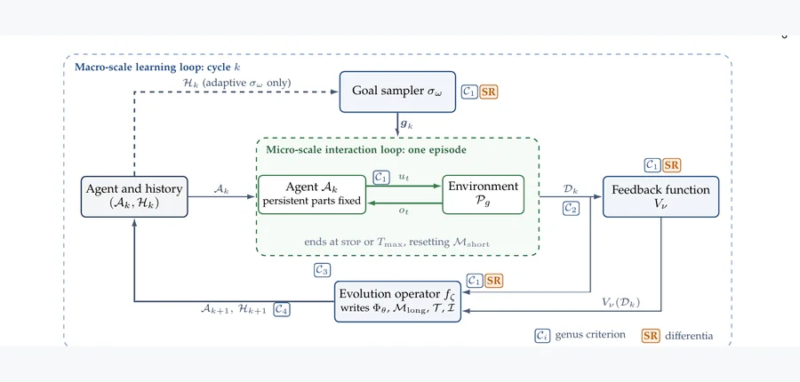 arXiv 2026-11-11 · cs.AI · #35 **[A Cross-Scenario Survey and Analysis of Self-Evolving Multimodal Agents](https://arxiv.org/abs/2611.14256)** Jingjing Jiang Affiliation · Affiliation unconfirmed [Paper](https://arxiv.org/abs/2611.14256) · [Project](https://jingjing12110.github.io/SE-MMAgents/) · [Figure source](https://arxiv.org/pdf/2611.14256) 

[EN] Abstract
Recent work shows that multimodal agents increasingly self-improve without recurring human annotation. However, each self-improvement mechanism is designed and evaluated within a single scenario, leaving its preconditions unverified under cross-scenario transfer. This survey investigates the structural source of asymmetric mechanism transfer across four scenarios: multimodal reasoning, multimodal generation, GUI and Web navigation, and embodied manipulation. We first formalize the self-evolving multimodal agent by four criteria and a differentia of self-reference, and adopt the three-stage self-evolving loop of experience generation, feedback acquisition, and update consolidation as our analytical framework to position the scenarios along ceilings on rollout count and feedback fidelity. Comparing self-evolving with fixed loops within each scenario separates the limitations that the scenario imposes from those inherent in the self-evolving design. We then recast each mechanism as a trade-off that raises a scarce factor by presupposing a task-structural resource, such as output equivalence or checkable outcomes, and judge it portable, conditional, blocked, or redundant across scenarios. We attribute the asymmetry to divergent combinations of scarce factors and resources across opposite transfer directions, and identify the matched-budget measurements that could overturn these still untested verdicts. <a href="https://arxiv.org/list/cs/new?show=2000#2611.14256">Source</a>

[ZH] Abstract
近期研究表明，多模态代理日益能够在不反复依赖人工标注的情况下自我改进。然而，每种自我改进机制都在单一场景内设计和评估，其前提在跨场景迁移下尚未验证。本综述研究四类场景间机制迁移不对称的结构性来源：多模态推理、多模态生成、GUI与网页导航、具身操作。我们首先通过四项标准和自指这一种差形式化自进化多模态代理，并采用经验生成、反馈获取、更新巩固的三阶段自进化循环作为分析框架，依据滚动次数和反馈保真度上限定位各场景。在每个场景内比较自进化与固定循环，将场景施加的局限与自进化设计固有局限分开。然后，我们将每种机制重述为一种权衡：通过预设任务结构资源，例如输出等价性或可检查结果，来提高稀缺因素；并跨场景将其判断为可迁移、有条件、受阻或冗余。我们将不对称归因于相反迁移方向中稀缺因素与资源的不同组合，并指出可能推翻这些尚未测试判断的匹配预算测量。 <a href="https://arxiv.org/list/cs/new?show=2000#2611.14256">Source</a>
 | 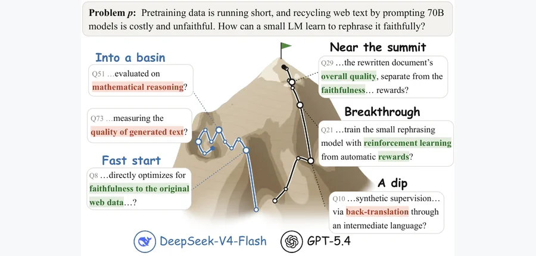 arXiv 2026-11-11 · cs.AI · #36 **[Re-Search: Dissecting LLM Ideation Through a Two-Player Questioning Game](https://arxiv.org/abs/2611.14487)** Muhan Gao , Hangxiao Zhu , Xinqi Su , Yu Zhang , Daniel Khashabi , Kuan-Hao Huang Affiliation · Texas A&amp;M University / Johns Hopkins University [Paper](https://arxiv.org/abs/2611.14487) · [Figure source](https://arxiv.org/html/2611.14487v1/fig1_climb.png) 

[EN] Abstract
Research ideation is iterative: researchers refine their ideas step by step based on feedback. Yet existing evaluations obscure this search process, making it difficult to understand how LLMs explore the space of research ideas and what limits their progress. We introduce Re-Search, which adapts the format of Twenty Questions to research ideation: given only the research problem of a published paper, a model must rediscover the paper's core idea by asking yes-or-no questions. Built from 200 ICML 2026 papers, Re-Search tracks how a model's idea evolves as it asks questions and receives binary oracle feedback, isolating ideation from execution. Across six recent LLMs, nearly all progress happens within the first 30 of 100 questions, which largely decide how the game ends; after that, most models plateau. Through controlled interventions on the candidate questions and the hypothesis space, we find that the bottleneck is generation, not judgment: models recognize a good idea or a good question when one is offered, but often cannot produce it on their own. We further analyze the ideation traces and find that models fail by either over-exploiting one direction or over-exploring too many. These findings point to concrete design principles for autoresearch systems: since models can judge candidates they cannot produce, enriching the search with externally sourced ideas and questions may be more effective than improving any single model's generation ability. <a href="https://arxiv.org/list/cs/new?show=2000#2611.14487">Source</a>

[ZH] Abstract
研究创意生成具有迭代性：研究者根据反馈逐步完善想法。然而，现有评估掩盖这一搜索过程，使我们难以理解LLM如何探索创意空间，以及什么限制其进展。我们引入Re-Search，将二十问游戏形式用于研究创意：仅给出已发表论文的研究问题，模型必须通过是/否问题重新发现论文核心想法。Re-Search基于200篇ICML 2026论文，跟踪模型在提问并获得二元预言机反馈时想法如何演变，将创意生成与执行隔离。在六个近期LLM上，几乎所有进展发生在一百个问题中的前30个，这些问题很大程度决定游戏结局；之后大多数模型进入平台期。通过对候选问题与假设空间的受控干预，我们发现瓶颈在生成而非判断：给出好想法或好问题时，模型能识别，却往往不能自行产生。我们进一步分析创意轨迹，发现模型或过度利用一个方向，或过度探索过多方向。这些发现为自动研究系统指出具体设计原则：由于模型能判断自己无法产生的候选，用外部来源的想法和问题丰富搜索，可能比改善单一模型的生成能力更有效。 <a href="https://arxiv.org/list/cs/new?show=2000#2611.14487">Source</a>
 |
| 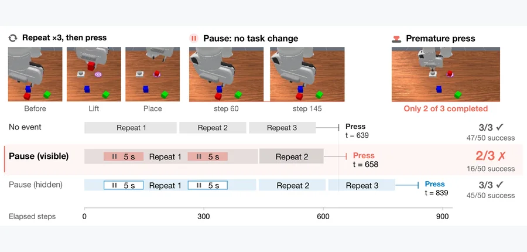 arXiv 2026-11-11 · cs.RO · #37 **[Is Your Robot's Memory Just a Clock? Temporal Shortcuts in Memory-Augmented VLA Policies](https://arxiv.org/abs/2611.14488)** Chubin Zhang , Bo An Affiliation · Nanyang Technological University [Paper](https://arxiv.org/abs/2611.14488) · [Code](https://github.com/bennidict23/memory-clock) · [Figure source](https://arxiv.org/html/2611.14488v1/fig1_teaser.png) 

[EN] Abstract
Memory-augmented vision-language-action (VLA) policies are meant to remember what happened. Many of them, however, fill memory by time: they sample frames uniformly across the episode and stamp each frame with its time step. Because time passes even when nothing happens, such a memory may not tell waiting from working. We show that it does not. On the counting tasks of RoboMME, we make the robot briefly pause or fidget its wrist. Such a null event changes nothing the task depends on, yet a released memory VLA counts the interval as work done and stops early. We call this failure phantom progress. It cuts success from 47 to 16 of 50 on one task and from 44 to 10 on the other. When the same frames are withheld from memory, success returns, so the cause lies in memory rather than in the interruption itself. We trace the failure to a temporal shortcut: because demonstrations proceed at a steady pace, elapsed time predicts progress. Indeed, rescaling the time stamps alone makes the policy stop early when the clock runs fast and repeat when it runs slow. Surprisingly, removing the time encoding does not cure the failure, because the frames of a null event still occupy slots of the time-sampled memory. Across RoboMME's released designs, vulnerability follows how memory is indexed. Of the fixes the diagnosis suggests, training with injected pauses does not remove the failure and impairs counting, whereas indexing memory by events recovers half or more of the loss without retraining. A memory meant to remember what happened should count events rather than clock ticks. <a href="https://arxiv.org/list/cs/new?show=2000#2611.14488">Source</a>

[ZH] Abstract
记忆增强的视觉—语言—动作（VLA）策略本应记住发生过什么。然而，许多策略按时间填充记忆：在回合中均匀采样帧，并给每帧加时间步标记。即使什么也没发生，时间仍在流逝，因此这种记忆可能无法区分等待与工作。我们表明它确实不能。在RoboMME计数任务上，我们让机器人短暂停顿或摆动手腕。这种空事件未改变任务所依赖的任何内容，但一个已发布记忆VLA将这段间隔算为已完成工作，提前停止。我们称之为幻影进度。它使一个任务成功数从50次中的47次降到16次，另一个从44次降到10次。当这些相同帧不进入记忆时，成功率恢复，因此原因在于记忆而非中断本身。我们将失败追溯至时间捷径：由于示范以稳定节奏进行，经过时间能够预测进度。事实上，仅重新缩放时间戳，就会使策略在快钟下提前停止，在慢钟下重复。出乎意料，移除时间编码不能解决失败，因为空事件帧仍占据按时间采样记忆的槽位。在RoboMME已发布设计间，脆弱性随记忆索引方式变化。在诊断所提示的修复中，注入暂停的训练未消除失败且损害计数，而按事件索引记忆无需重新训练便恢复一半或更多损失。旨在记住发生何事的记忆，应计数事件而非时钟滴答。 <a href="https://arxiv.org/list/cs/new?show=2000#2611.14488">Source</a>
 | 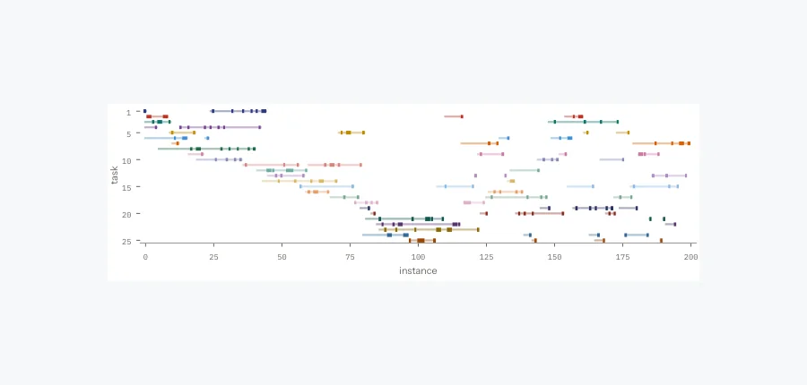 arXiv 2026-11-11 · cs.LG · #38 **[Continual-ARC: Measuring Skill Acquisition over a Working Lifetime](https://arxiv.org/abs/2611.14505)** Daniel Lenton Affiliation · unify [Paper](https://arxiv.org/abs/2611.14505) · [Code](https://github.com/unifyai/continual-arc/tree/b2fd5a94572fa83cde9ecd20b38d41d1548d64b9) · [Figure source](https://arxiv.org/html/2611.14505v1/modes.png) 

[EN] Abstract
Agent harnesses have emerged as a promising mechanism for continual learning, alongside test-time parametric learning. However, the current benchmarks have several limitations: they generally focus on a single applied domain, serve each instance only once, and assume a single family of learner, so memory-based and weight-based systems are rarely compared on the same scale. We propose Continual-ARC, a lifelong stream built from the three ARC-AGI editions, whose tasks need no domain knowledge. The same tasks return after dormant gaps with fresh instances, while new tasks keep arriving. On each instance, the learner may pay for demonstrations, submit answers, or act inside the harness, with retries permitted on incorrect submissions, which are paid for. Each instance is scored based on the share of this feedback budget consumed. Since a learner may keep anything between instances, memory-based and weight-based systems are scored on the same scale. After the stream, the learner is frozen and tested on fresh instances of the tasks it met, which measures memorization, and on unseen tasks, which measures generalization. We run an agent harness with frozen weights, with and without persistence, on Qwen3.5-9B and GLM-5.3 Flash, comparing them with two prompting floors, a program-induction method and Qwen3.5-9B's weights trained to imitate GLM-5.3 Flash. Persistence in the harness generally does not improve memorization unless provided with explicit expert guidance. Most harness-based methods still learn less than a floor that simply caches each task's demonstrations, across all models we tested. No harness-based method gains on unseen tasks, whereas weight-based learning shows substantial gains. This opens the door to future weight-based continual learning that could teach models to drive harnesses in new domains. <a href="https://arxiv.org/list/cs/new?show=2000#2611.14505">Source</a>

[ZH] Abstract
代理框架与测试时参数学习一样，已成为持续学习的有前景机制。然而，当前基准有若干局限：通常聚焦单一应用领域，每个实例仅出现一次，且假定单一学习器家族，因此记忆与权重系统很少在相同尺度比较。我们提出Continual-ARC，一个由三代ARC-AGI构建、任务无需领域知识的终身流。相同任务在休眠间隔后带全新实例返回，同时不断引入新任务。对每个实例，学习器可付费获取示范、提交答案或在框架内行动，错误提交后可付费重试。每个实例根据消耗的反馈预算比例评分。由于学习器可在实例间保留任何内容，记忆和权重系统在相同尺度评分。任务流结束后，冻结学习器，在见过任务的新实例上测试以测量记忆，并在未见任务上测试以测量泛化。我们在Qwen3.5-9B和GLM-5.3 Flash上运行冻结权重代理框架，比较有无持久性，并与两个提示下限、一个程序归纳方法，以及经训练模仿GLM-5.3 Flash的Qwen3.5-9B权重比较。除非提供显式专家指导，框架持久性通常不改善记忆。在测试的全部模型上，大多数框架方法学得内容仍少于简单缓存各任务示范的下限方法。没有任何框架方法在未见任务上获益，而基于权重的学习显示出显著收益。这为未来基于权重的持续学习打开了道路，或可教模型在新领域驱动框架。 <a href="https://arxiv.org/list/cs/new?show=2000#2611.14505">Source</a>
 |   |
<!-- PAPER_CARDS_END -->

## Retrieval overview

**38 selected papers, comprising 8 A / 17 B / 13 C.** Collection date is **12 November 2026 (Beijing)**. Both official sources show **Wednesday, 11 November 2026**, the next batch after the previously processed 10 November announcement. Both requests completed at approximately **08:59:21 Beijing**.

| Official source | Batch | New | Cross | Replacement | Coverage |
|---|---|---:|---:|---:|---|
| [Computer Science](https://arxiv.org/list/cs/new?show=2000) | 2026-11-11 | 743 | 85 | 469 | All 1,297 entries on one page |
| [stat.ML](https://arxiv.org/list/stat.ML/new?show=2000) | 2026-11-11 | 11 | 17 | 25 | All 53 entries on one page |
| Total | 2026-11-11 | 754 | 102 | 494 | All 1,350 entries, 754 distinct New IDs |

All **754 complete New metadata and English abstract records** are retained. Discovery produced **89 lexical candidates** and **239 supplemental related records**. Full-abstract semantic review covers **105 papers**, comprising all 89 lexical candidates and 16 supplemental papers. The decision log contains 38 selections and 67 nonselections, including lower-priority related mechanisms. This is focused editorial curation within the 100-paper ceiling. The remaining New abstracts have no exhaustive review claim. The CS aggregate covers cs.AI, cs.LG, cs.CL, cs.MA, cs.SE, cs.RO, cs.CV, cs.NE and cs.CR. Versionless IDs were checked against historical enrichment, reports and run records. Only official New entries enter the main table. [Run record](../../data/runs/2026-11-12.json)

Coverage is **38 cards / 38 table rows / 38 complete EN abstracts / 38 complete ZH abstracts**. There are **37 visually checked genuine figures**, comprising 23 HTML images and 14 PDF crops. **One explicit placeholder** remains for NCP, whose complete ten-page PDF contains text, equations and tables without a numbered figure. Five affiliations remain **Affiliation unconfirmed**. Source snapshots, per-paper evidence, provenance and resource checks are retained for auditing. [Run record](../../data/runs/2026-11-12.json)

The historical **22 October bulk-New membership gap remains unresolved**. The previously verified seventeen New entries remain the established partial recovery. [Previous run record](../../data/runs/2026-11-11.json)

## Reading guide

A denotes direct RSI, B self-improvement mechanisms, and C evaluation and limits. Order is tier followed by arXiv ID. Selection, tiering, priorities, mechanism interpretations and research proposals are **editorial inference**. Numerical findings remain **author reports**. Evidence review covers original complete abstracts, author blocks, source figures and selected passages. Independent reproduction count is zero.

RoboACE changes both practice selection and execution procedures around frozen models. FGSE admits behavioral hypotheses only after transfer, falsification and regression probes. PASE patches executable skill components. NCP retains a persistent control table while restoring temporary weight interventions after each request, and its measured run rejects every candidate. These systems update different persistent objects, with acceptance and later reuse defining the relevant loop. [RoboACE](https://arxiv.org/abs/2611.13034) · [FGSE](https://arxiv.org/abs/2611.14326) · [PASE](https://arxiv.org/abs/2611.14019) · [NCP](https://arxiv.org/abs/2611.13236)

PMR co-evolves a memory policy and personalized training rubric. AutoScaffold uses a fixed teacher to revise supervision as the student learns. CAMP-II learns file-based memory operations through OPD, and SteerDistill internalizes execution-verified corrections into quantized weights. BOPD transfers a reference-trained intermediate model into a fresh student in two stages. Their parameter updates and deployed memory/control states require separate evaluation. [PMR](https://arxiv.org/abs/2611.14017) · [AutoScaffold](https://arxiv.org/abs/2611.14515) · [CAMP-II](https://arxiv.org/abs/2611.14009) · [SteerDistill](https://arxiv.org/abs/2611.13410) · [BOPD](https://arxiv.org/abs/2611.13680)

Third Eye measures what survives a further update, the RSI Tax charges the improvement process, and Continual-ARC compares lifetime persistence with caching and weight learning. The memory-clock study tests a causal shortcut in robot memory, while the CAGE audit shows how wrappers, action charging and sampling change benchmark scores. These studies constrain how improvement should be attributed. [Third Eye](https://arxiv.org/abs/2611.12988) · [RSI Tax](https://arxiv.org/abs/2611.13524) · [Continual-ARC](https://arxiv.org/abs/2611.14505) · [Memory clock](https://arxiv.org/abs/2611.14488) · [CAGE audit](https://arxiv.org/abs/2611.14068)

## Tiered Top papers

| # | Paper | Categories | Authors | Affiliation | Tier | Update target | Reading priority |
|---:|---|---|---|---|---|---|---|
| 1 | [RoboACE: Adversarial Co-Evolution for Robot Self-Improvement](https://arxiv.org/abs/2611.13034) | Robotics (cs.RO) | Delin Zhao , Zhengrong Yue , Junlin He , Yali Wang | MMLab @ SIAT | A | External curriculum and execution harnesses around frozen foundation models | Priority read |
| 2 | [NCP: Verifier-Guided Optimization of Weight-Space Control Policies](https://arxiv.org/abs/2611.13236) | Artificial Intelligence (cs.AI) | Ekrem Aksoy | Affiliation unconfirmed | A | Persistent control-policy rules selecting temporary weight interventions | Topical reference |
| 3 | [Veritas: A Verifier Generation Harness for Agent Tasks](https://arxiv.org/abs/2611.13336) | Artificial Intelligence (cs.AI) ; Cryptography and Security (cs.CR) | Daoan Zhang , Qinbo Bai , Dehai Min , Xingyu Mu , Ziyi Chen , Jianing Yin | ByteDance Inc. / University of Illinois Chicago / New York University | A | Verifier-authoring principles and the generated verifiers | Topical reference |
| 4 | [Toward Autonomous RTL and Synthesis Optimization: Benchmarking and Self-Improving Agents](https://arxiv.org/abs/2611.13713) | Artificial Intelligence (cs.AI) ; Hardware Architecture (cs.AR) | Wenji Fang , Yao Lu , Jinghua Wang , Zhiyao Xie | Hong Kong University of Science and Technology | A | Reusable RTL optimization skills and design-specific synthesis programs | Topical reference |
| 5 | [Personalized Memory Rubrics: Learning What to Remember per User via Rubric-Guided Credit Assignment](https://arxiv.org/abs/2611.14017) | Artificial Intelligence (cs.AI) | Yupeng Han , Kai Zhang , Shuochen Liu , Ze Liu , Xianquan Wang , Zhihong Pan , Xiangyu Zhao , Qi Liu , Enhong Chen | University of Science and Technology of China / City University of Hong Kong / State Key Laboratory of Cognitive Intelligence | A | User-adaptive memory rubrics and the memory-update policy | Topical reference |
| 6 | [Program-Aided Patchable Skill Evolution](https://arxiv.org/abs/2611.14019) | Computation and Language (cs.CL) ; Artificial Intelligence (cs.AI) | Jiahao Wang , Yuqi Xiong , Qing Yang , Zhipeng Xu , Zhenghao Liu , Zulong Chen , Yubin Bao | Northeastern University / Alibaba Group | A | Editable programs associated with reusable skills | Topical reference |
| 7 | [When Should Agents Remember? Falsification-Gated Self-Evolution for LLM Agents](https://arxiv.org/abs/2611.14326) | Artificial Intelligence (cs.AI) ; Machine Learning (cs.LG) | Runxuan Tang , Haoyu Gao , Yuyan Ding , Junyi Yao , Zihao Zheng , Zecheng Sheng , Liwei Hou | Nanyang Technological University / Georgia Institute of Technology / University of Washington / Washington University in St. Louis / The University of Sydney / National University of Singapore | A | Persistent behavioral hypotheses and agent memory | Priority read |
| 8 | [AutoScaffold: AI-Guided Scaffolding for Reinforcement Learning of Language Models](https://arxiv.org/abs/2611.14515) | Machine Learning (cs.LG) ; Computation and Language (cs.CL) | Zijian Zhang , Rizhen Hu , Jiangweizhi Peng , Shiyang Li , Sujay Bhatt , Sihan Zeng , Mingyi Hong | University of Minnesota, Twin Cities / JPMorgan AI Research | A | Student model parameters and adaptive training-time scaffolds | Topical reference |
| 9 | [Auditable Human-Agent Teams for Autonomous X-ray Experimentation](https://arxiv.org/abs/2611.12933) | Artificial Intelligence (cs.AI) ; Multiagent Systems (cs.MA) | Gunik Luthra , Ronald J. Pandolfi , Benjamin T. Diroll , Ricky Ronquillo , Ruipeng Li , Christopher B. Murray , Marcus M. Noack , Kevin G. Yager , Esther H. R. Tsai | Brookhaven National Laboratory / Lawrence Berkeley National Laboratory / Argonne National Laboratory / University of Pennsylvania | B | Experimental choices and shared scientific evidence in human–agent teams | Topical reference |
| 10 | [Physics2Weight: Direct Neural Network Architecture and Weight Generation from Physical Laws Using Large Language Models](https://arxiv.org/abs/2611.12954) | Artificial Intelligence (cs.AI) | Shogo Sato , Tomoyasu Shimada , Kazuhiko Murasaki , Takashi Sano | NTT, Inc. | B | Generated neural architectures and PDE-solution weights | Topical reference |
| 11 | [Embodied Science Agents: Making Embodied Experimental Design Learnable](https://arxiv.org/abs/2611.12958) | Artificial Intelligence (cs.AI) | Yihang Che , Zhongwei Yu , Yang Li , Xingyu Lu , Hongxia Yu , Jun Wang | University College London / AI Lab, The Yangtze River Delta / The Hong Kong University of Science and Technology (Guangzhou) / Shanghai Jiao Tong University / Nanjing Agricultural University | B | Experimental search state, memory and instrument-control policies | Topical reference |
| 12 | [Teaching the Harness: Student-Aware Skill Transfer for LLM Agents](https://arxiv.org/abs/2611.13144) | Artificial Intelligence (cs.AI) | Chang Liu , Bo Wu | Colorado School of Mines | B | Reusable skills tailored to a fixed student's harness | Topical reference |
| 13 | [Agent-Guided Discovery of Exchange-Correlation Functionals with Physics-based Validation](https://arxiv.org/abs/2611.13329) | Artificial Intelligence (cs.AI) | Achuth Chandrasekhar , Amir Barati Farimani | Affiliation unconfirmed | B | Symbolic exchange–correlation functionals and persistent search memory | Topical reference |
| 14 | [SteerDistill: Quantizing LLM Agents via Closed-Loop Teacher Steering](https://arxiv.org/abs/2611.13410) | Artificial Intelligence (cs.AI) ; Machine Learning (cs.LG) | Genming Cui , Xiangyu Li , Zixu Hao , Xin Ding , Yunxin Liu , Ting Cao | Tsinghua University / University of Science and Technology of China | B | Quantized agent weights trained on locally verified corrections | Topical reference |
| 15 | [Adaptive catalyst discovery emerges from composable scientific intelligence](https://arxiv.org/abs/2611.13536) | Machine Learning (cs.LG) | Wentao Li , Qilong Cai , Qi Lei , Jinxing Chen , Ruixuan Chen , Jiangjie Qiu , Botian Wang , Kai Zhao , Honghao Chen , Leyi Zhao , Zemeng Wang , Yijun Li , Jun Yin , Fangfang Li , Hongxuan Liu , Yingdong Lu , Yawen Ouyang , Manu Suvarna , Wei-Ying Ma , Ya-Qin Zhang , Kostya S. Novoselov , Hao Zhou , Jiong Lu , Xiaonan Wang | Tsinghua University / National University of Singapore / Massachusetts Institute of Technology / Wanhua Chemical Group Co., Ltd. / University of Greifswald / Shanghai Artificial Intelligence Laboratory | B | Reusable physicochemical modules and model-guided catalyst search | Topical reference |
| 16 | [Synapse-Control: Making Agent Experience Actionable with Lightweight Runtime Control](https://arxiv.org/abs/2611.13615) | Computation and Language (cs.CL) ; Artificial Intelligence (cs.AI); Machine Learning (cs.LG) | Zhiyuan Huang , Shengan Zheng , Chenghu Yang , Song Zhang , Lingyun Li , Chen Yu , Weiquan Huang , Linpeng Huang | Shanghai Jiao Tong University / Ant Group | B | Advice-selection classifier, micro-contracts and feedback table | Topical reference |
| 17 | [Curriculum proof repair with learned counterexamples](https://arxiv.org/abs/2611.13627) | Programming Languages (cs.PL) ; Machine Learning (cs.LG) | Yuechun Sun , Jun Yang , Kexin Pei | University of Chicago | B | Proof-repair model weights and a diagnostic curriculum | Topical reference |
| 18 | [Bootstrapped On-Policy Distillation](https://arxiv.org/abs/2611.13680) | Machine Learning (cs.LG) ; Artificial Intelligence (cs.AI) | Yue Wu , Xueyu Zhou , Yangrong Hu , Jian Huang | The Hong Kong Polytechnic University | B | Intermediate OPSD model and a fresh distilled student | Topical reference |
| 19 | [Mixed Signals: Weight-Space Programming for EEG and ECG](https://arxiv.org/abs/2611.13758) | Machine Learning (cs.LG) ; Artificial Intelligence (cs.AI); Signal Processing (eess.SP) | Dara Varam , Taraneh Aminosharieh Najafi , David Atienza | École Polytechnique Fédérale de Lausanne | B | Small EEG/ECG classifier weights | Topical reference |
| 20 | [Temporal Behavior Trees for Reinforcement Learning: Specifications as Rewards, Curricula, and Diagnostics](https://arxiv.org/abs/2611.13993) | Machine Learning (cs.LG) | Vladimir Krsmanovic , Bernd Finkbeiner | CISPA Helmholtz Center for Information Security / Technical University of Munich | B | Policy supervision through specification-derived rewards and curricula | Topical reference |
| 21 | [Coding Agent Memory Post-Training II: Unlocking the Memory Potential of Pre-trained File Operations for Long-Horizon Tasks via On-Policy Distillation](https://arxiv.org/abs/2611.14009) | Machine Learning (cs.LG) ; Artificial Intelligence (cs.AI); Computation and Language (cs.CL) | Lirui Luo , Kelong Mao , Xinwei Yang , Rongqing Li , Luyu Chen , Kieran Wong , Yudong Guo , Xinrui Wang , Jiayin Zhu , Gu Simiu , Sulong Xu , Cong Fang | Affiliation unconfirmed | B | Agent-policy weights and episode-persistent file memories | Topical reference |
| 22 | [Don't Just Trust Your Memory: Evidence-Linked Memory Reduces Memory-Induced Degradation in LLM Agents](https://arxiv.org/abs/2611.14320) | Artificial Intelligence (cs.AI) ; Multiagent Systems (cs.MA) | Yukyeong Lee , Yumin Choi , Jinheon Baek , Sung Ju Hwang | KAIST / DeepAuto.ai | B | Evidence-linked reusable insights and their source trajectories | Topical reference |
| 23 | [EngineAgent: Agentizing On-Device LLM Inference Engines with Inference Stack Hierarchy Awareness and Hardware Abilities](https://arxiv.org/abs/2611.14356) | Operating Systems (cs.OS) ; Artificial Intelligence (cs.AI); Computation and Language (cs.CL); Software Engineering (cs.SE) | Zhengxiang Huang , Yujie Sun , Shengheng Chen , Zhaode Wang , Chaoyue Niu , Zeyu Zhao , Chengfei Lv , Fan Wu , Guihai Chen | Shanghai Jiao Tong University / Alibaba Group | B | Inference-engine implementation and reusable hardware/engine knowledge | Topical reference |
| 24 | [ReTrace: Distilling Tool-Using Agents into Planner-Free Workflows](https://arxiv.org/abs/2611.14492) | Artificial Intelligence (cs.AI) ; Machine Learning (cs.LG); Multiagent Systems (cs.MA) | Kaiyuan Hou , Yang Ping Kuo , Indranil Bhattacharya , Rohith Nama , Arushi Gupta , Carlos D. Castillo , Prathap Ramachandra , Xiaofan Jiang , Francesco Carbone | Columbia University / Amazon | B | Executable SOP workflows and shared rule documents | Topical reference |
| 25 | [Contrastive Discovery: Open-Ended Scientific Discovery over Competing Explanations](https://arxiv.org/abs/2611.14514) | Artificial Intelligence (cs.AI) ; Computation and Language (cs.CL); Machine Learning (cs.LG) | Ziang Liu , James J. Kim , Yijia Dai , Jennifer J. Sun | Cornell University | B | Competing scientific hypotheses and accumulated belief state | Topical reference |
| 26 | [Third Eye: Beyond Immediate Gains in Recursive Self-Improvement](https://arxiv.org/abs/2611.12988) | Machine Learning (cs.LG) ; Artificial Intelligence (cs.AI) | Sujato Dutta , Padala Indira Sneha , Kypu Mahitha , Shashank Vanga , Neeraj Choudhary | Mahindra University | C | Model weights after a persistent self-update and a further native update | Priority read |
| 27 | [Branch-and-Commit for Frozen RL Agents: When and Where to Spend Test-Time Compute](https://arxiv.org/abs/2611.13003) | Machine Learning (cs.LG) | Sahar Admoni , Assaf Hallak , Yftah Ziser , Ofra Amir | Technion, Israel Institute of Technology / NVIDIA Research | C | Task-local deployment state of a frozen RL policy | Topical reference |
| 28 | [High Probability Risk Control for Online Policy Learning](https://arxiv.org/abs/2611.13163) | Machine Learning (cs.LG) | Yihong Guo , Drew Prinster , Suchi Saria , Anqi Liu | Johns Hopkins University | C | Admission of new policies under feedback covariate shift | Topical reference |
| 29 | [Wrong the Same Way: Cross-Prompt Sharing Both Suppresses and Amplifies Reward Hacking in RLVR](https://arxiv.org/abs/2611.13218) | Machine Learning (cs.LG) ; Artificial Intelligence (cs.AI) | Michael Li , Rohan Pandey , Ray Chen | Carnegie Mellon University / University of Washington / Independent researcher | C | Shared-parameter RLVR policies under imperfect verification | Topical reference |
| 30 | [W-ISA: Transactional Execution of Weight-Space Intervention Programs](https://arxiv.org/abs/2611.13232) | Artificial Intelligence (cs.AI) | Ekrem Aksoy | Affiliation unconfirmed | C | Request-scoped parameter interventions and transactional execution | Topical reference |
| 31 | [No finite rulebook can certify every safe program: an impossibility theorem for gatekeeping AI agents](https://arxiv.org/abs/2611.13367) | Artificial Intelligence (cs.AI) ; Cryptography and Security (cs.CR) | Tomas Perez-Acle | Universidad San Sebastián / Centro BASAL Ciencia & Vida | C | Formal evidence limits for gatekeeping agent-written programs | Topical reference |
| 32 | [The RSI Tax: When Recursive Self-Improvement Is Not Worth the Cost](https://arxiv.org/abs/2611.13524) | Machine Learning (cs.LG) | Yitong Zhang , Ang Li , Yisen Wang | Peking University | C | Total cost and later reuse of self-improvement state | Priority read |
| 33 | [BioXArena-Pro: a research-grade benchmark for autonomous biomedical machine learning agents](https://arxiv.org/abs/2611.13994) | Machine Learning (cs.LG) | Loka Li , Duzhen Zhang , Xingbo Du , Leonard Song , Kun Zhang , Le Song | Mohamed bin Zayed University of Artificial Intelligence / The Westminster Schools / Carnegie Mellon University | C | Evaluation of autonomous biomedical model-building agents | Topical reference |
| 34 | [What a CAGE 4 Score Measures: An Audit of a Learned Cyber-Defense Benchmark, Its Reference Defenders, and the Tables Built on Them](https://arxiv.org/abs/2611.14068) | Cryptography and Security (cs.CR) ; Machine Learning (cs.LG) | James Rice , Ji Hwan Park , Andres Kwasinski | Rochester Institute of Technology | C | Cyber-defense benchmark wrappers, training trajectories and evaluation protocol | Topical reference |
| 35 | [A Cross-Scenario Survey and Analysis of Self-Evolving Multimodal Agents](https://arxiv.org/abs/2611.14256) | Artificial Intelligence (cs.AI) | Jingjing Jiang | Affiliation unconfirmed | C | Analytical classification of multimodal self-evolution mechanisms | Topical reference |
| 36 | [Re-Search: Dissecting LLM Ideation Through a Two-Player Questioning Game](https://arxiv.org/abs/2611.14487) | Artificial Intelligence (cs.AI) | Muhan Gao , Hangxiao Zhu , Xinqi Su , Yu Zhang , Daniel Khashabi , Kuan-Hao Huang | Texas A&M University / Johns Hopkins University | C | Task-local research hypotheses and questioning trajectories | Topical reference |
| 37 | [Is Your Robot's Memory Just a Clock? Temporal Shortcuts in Memory-Augmented VLA Policies](https://arxiv.org/abs/2611.14488) | Robotics (cs.RO) | Chubin Zhang , Bo An | Nanyang Technological University | C | Memory indexing and temporal shortcuts in VLA policies | Topical reference |
| 38 | [Continual-ARC: Measuring Skill Acquisition over a Working Lifetime](https://arxiv.org/abs/2611.14505) | Machine Learning (cs.LG) | Daniel Lenton | unify | C | Lifetime memory/weight learning and later transfer | Priority read |

## Mechanism and evidence notes

Four notes per paper identify the changed component, feedback and validation, subsequent reuse, reported findings and evidence boundary.

### 1. RoboACE: Adversarial Co-Evolution for Robot Self-Improvement

- **Updated component.** External curriculum and execution harnesses around frozen foundation models.
- **Feedback, validation and reuse.** Capability evidence guides challenge proposals. Alternating updates freeze one harness while revising the other, and admitted challenge snapshots provide fixed comparisons before retaining reusable execution changes.
- **Author-reported findings.** The frozen deployment reaches 74.0% LIBERO-PRO success, 15.0 points above the initial deployment and 13.5 above direct VLA execution.
- **Evidence boundary and inference.** These are simulated LIBERO-family results. Fixed challenge snapshots and frozen deployment tests constrain attribution, while open-ended improvement beyond the tested rounds remains unmeasured.

[Original paper](https://arxiv.org/abs/2611.13034) · [Affiliation source](https://arxiv.org/html/2611.13034)

### 2. NCP: Verifier-Guided Optimization of Weight-Space Control Policies

- **Updated component.** Persistent control-policy rules selecting temporary weight interventions.
- **Feedback, validation and reuse.** Telemetry generates candidates, separate task/corpus probes test admission, and a versioned archive preserves decisions for later cycles. Base-model parameters restore after each request.
- **Author-reported findings.** A projection lowers repetition from 0.4133 to 0.2191 with a −0.0574% perplexity change. All three candidates yield zero new correct exact answers and are archived.
- **Evidence boundary and inference.** The local SmolLM microbenchmark retains the original active policy. Fresh-process repetition and resumption verify the measured workflow, with no accepted capability improvement in this experiment.

[Original paper](https://arxiv.org/abs/2611.13236)

### 3. Veritas: A Verifier Generation Harness for Agent Tasks

- **Updated component.** Verifier-authoring principles and the generated verifiers.
- **Feedback, validation and reuse.** Evidence headers, domain rules and authoring principles guide verifier construction. A self-improvement loop refines part of the principles, which are reused for new verifier generation.
- **Author-reported findings.** With a fixed model, agreement exceeds seven other harnesses on all four execution-scored benchmarks. The added mechanisms improve 9/12 harness–benchmark pairs.
- **Evidence boundary and inference.** Agreement is measured against certified official verdicts and pairwise references. The contribution of self-refined principles should be read alongside the other bundled mechanisms.

[Original paper](https://arxiv.org/abs/2611.13336) · [Affiliation source](https://arxiv.org/pdf/2611.13336)

### 4. Toward Autonomous RTL and Synthesis Optimization: Benchmarking and Self-Improving Agents

- **Updated component.** Reusable RTL optimization skills and design-specific synthesis programs.
- **Feedback, validation and reuse.** Dr. RTL cycles through critical-path analysis, rewriting and implementation evaluation, retaining optimization skills for continued use. Synthesis-script and algorithm search extend the design space.
- **Author-reported findings.** On twenty real-world RTL designs, reported average WNS/TNS improvements are 21%/17%, with 6% area reduction over commercial synthesis.
- **Evidence boundary and inference.** The paper combines measured RTL results with exploratory synthesis directions and an AI-native EDA vision. Verification-constrained design gains have a narrower scope than autonomous redesign of the learning algorithm.

[Original paper](https://arxiv.org/abs/2611.13713) · [Affiliation source](https://arxiv.org/html/2611.13713)

### 5. Personalized Memory Rubrics: Learning What to Remember per User via Rubric-Guided Credit Assignment

- **Updated component.** User-adaptive memory rubrics and the memory-update policy.
- **Feedback, validation and reuse.** Terminal QA feedback produces user-specific token-level credit. Validated successful decisions are amplified, failed trajectories use ordinary policy optimization, and the rubric/policy co-evolve.
- **Author-reported findings.** The authors report consistent improvements on four benchmarks, with no deployed rubric or external judge and zero added inference overhead.
- **Evidence boundary and inference.** The anti-circularity guarantee is a claim about the specified training construction. Its assumptions and the distinction between successful and failed trajectories require inspection before transfer.

[Original paper](https://arxiv.org/abs/2611.14017) · [Affiliation source](https://arxiv.org/html/2611.14017)

### 6. Program-Aided Patchable Skill Evolution

- **Updated component.** Editable programs associated with reusable skills.
- **Feedback, validation and reuse.** Execution trajectories and downstream task feedback drive targeted patches to procedural programs, while descriptive knowledge remains in the skill representation. Updated executable components support later tasks.
- **Author-reported findings.** The authors report improvements over all evaluated baselines exceeding 2.8%, with greater stability and generalization.
- **Evidence boundary and inference.** The abstract supplies no precise aggregate metric for the 2.8% claim. The source promises future data/code release, so release availability requires a separate check.

[Original paper](https://arxiv.org/abs/2611.14019) · [Affiliation source](https://arxiv.org/html/2611.14019)

### 7. When Should Agents Remember? Falsification-Gated Self-Evolution for LLM Agents

- **Updated component.** Persistent behavioral hypotheses and agent memory.
- **Feedback, validation and reuse.** FGSE stages each precondition/action/effect/verifier hypothesis in temporary state, tests transfer, falsification and archived regression, then commits, refines or rejects it for future reuse.
- **Author-reported findings.** Reported results include 39.8 WebArena success, 78.8 AppWorld completion and 0.724/0.487 Retail/Airline Pass¹. Harmful committed updates are 3.6%.
- **Evidence boundary and inference.** Admission tests measure the specified probes and risk definitions. Residual harmful commits and regression damage remain, and generalized safety depends on coverage of those probes.

[Original paper](https://arxiv.org/abs/2611.14326) · [Affiliation source](https://arxiv.org/html/2611.14326)

### 8. AutoScaffold: AI-Guided Scaffolding for Reinforcement Learning of Language Models

- **Updated component.** Student model parameters and adaptive training-time scaffolds.
- **Feedback, validation and reuse.** A frozen teacher reads training experience, diagnoses bottlenecks and revises class-level strategies or task-specific hints. Revised scaffolds shape subsequent RL, then disappear at evaluation.
- **Author-reported findings.** Unassisted gains include 7.2 points ALFWorld success, 4.0 points QA EM and up to 5.0 points in correct/faster kernel tasks.
- **Evidence boundary and inference.** The teacher remains fixed. Student-step savings, teacher diagnosis cost and total training compute are different efficiency measures, and the math comparison uses QuestA's reported result.

[Original paper](https://arxiv.org/abs/2611.14515) · [Affiliation source](https://arxiv.org/html/2611.14515)

### 9. Auditable Human-Agent Teams for Autonomous X-ray Experimentation

- **Updated component.** Experimental choices and shared scientific evidence in human–agent teams.
- **Feedback, validation and reuse.** Validated scientific tools and coding-agent infrastructure support successive physical X-ray experiments under human-defined objectives. Complete transcripts retain decision and correction provenance.
- **Author-reported findings.** Across three experiments, 61–67% of messages involve interpretation/judgment and 59–68% of corrections involve multiple participants.
- **Evidence boundary and inference.** This is auditable physical experimentation with human participation. Message shares describe cognitive labor, with no direct measurement of an autonomously improving agent harness.

[Original paper](https://arxiv.org/abs/2611.12933) · [Affiliation source](https://arxiv.org/html/2611.12933)

### 10. Physics2Weight: Direct Neural Network Architecture and Weight Generation from Physical Laws Using Large Language Models

- **Updated component.** Generated neural architectures and PDE-solution weights.
- **Feedback, validation and reuse.** Governing equations and initial/boundary conditions guide prompting, architecture edits and iterative direct weight refinement. Resulting networks are checked on four PDEs.
- **Author-reported findings.** The authors report lower solution errors than conventional PINNs, alongside limitations satisfying nonlinear governing equations.
- **Evidence boundary and inference.** Solution error and PDE residual consistency are distinct. Direct weight generation for a physical task supplies a repair mechanism, with no established general learning-rule improvement.

[Original paper](https://arxiv.org/abs/2611.12954) · [Affiliation source](https://arxiv.org/html/2611.12954)

### 11. Embodied Science Agents: Making Embodied Experimental Design Learnable

- **Updated component.** Experimental search state, memory and instrument-control policies.
- **Feedback, validation and reuse.** Memory-based reasoning and Bayesian optimization select experiments, while generalizable visuomotor control executes them through a unified interface. Physical outcomes guide later search rounds.
- **Author-reported findings.** Fifteen wastewater-treatment rounds raise transmittance from 82% to 99.7%, corresponding to 98.5% lower residual dye concentration.
- **Evidence boundary and inference.** The result is a physical closed-loop experiment. Search adaptation and separately learned instrument policies have different update paths, and the abstract leaves their component-level contributions bundled.

[Original paper](https://arxiv.org/abs/2611.12958) · [Affiliation source](https://arxiv.org/html/2611.12958)

### 12. Teaching the Harness: Student-Aware Skill Transfer for LLM Agents

- **Updated component.** Reusable skills tailored to a fixed student's harness.
- **Feedback, validation and reuse.** The teacher builds empirical learner profiles and hypotheses, diagnoses them with probes, and admits skills only after matched development success improves. Saved libraries support use after teaching ends.
- **Author-reported findings.** SAT reaches 86.46% over four runs versus 81.04% for the profile-free teacher and 75.00% untaught. Misleading profiles admit 0/48 skills.
- **Evidence boundary and inference.** The teaching model, student and delivery route constrain transfer. Own-library advantages and dependence on instruction-following limit claims of universal skill portability.

[Original paper](https://arxiv.org/abs/2611.13144) · [Affiliation source](https://arxiv.org/html/2611.13144)

### 13. Agent-Guided Discovery of Exchange-Correlation Functionals with Physics-based Validation

- **Updated component.** Symbolic exchange–correlation functionals and persistent search memory.
- **Feedback, validation and reuse.** Agents propose forms and fit parameters on training data through an MCP GPU evaluator. Screening, held-out scoring, self-consistency and external datasets govern advancement and reuse.
- **Author-reported findings.** The sole advanced candidate O159 lowers held-out MGCDB84 error by 11.7% relative to ωB97M-V. Agent/evolution search comparisons use about 400 fits each.
- **Evidence boundary and inference.** Only one selected candidate reaches self-consistent testing. Token efficiency is backbone-dependent. The source's unresolved \kcal macro is retained literally in the saved EN/ZH abstracts.

[Original paper](https://arxiv.org/abs/2611.13329)

### 14. SteerDistill: Quantizing LLM Agents via Closed-Loop Teacher Steering

- **Updated component.** Quantized agent weights trained on locally verified corrections.
- **Feedback, validation and reuse.** A full-precision teacher revises guidance from student execution feedback. Distillation internalizes corrected-turn behavior and reference predictions for later unassisted inference.
- **Author-reported findings.** W4A16 average scores exceed the strongest quantized baseline by 1.67–2.18 points. τ²-Bench success exceeds QeRL by 1.84 points with 67% fewer GPU-hours.
- **Evidence boundary and inference.** The measured loop is quantization-aware post-training. Locally verified corrections establish their tested behavioral validity, while deployment generalization remains benchmark-bound.

[Original paper](https://arxiv.org/abs/2611.13410) · [Affiliation source](https://arxiv.org/html/2611.13410)

### 15. Adaptive catalyst discovery emerges from composable scientific intelligence

- **Updated component.** Reusable physicochemical modules and model-guided catalyst search.
- **Feedback, validation and reuse.** Thirty encoders organize learned structure/property knowledge. Task-specific composition guides screening, while iterative model–experiment feedback refines the photocatalysis search.
- **Author-reported findings.** Task-averaged error is 7.8% lower than next-best models. A separate polymer catalyst has nine times the commercial benchmark's activity.
- **Evidence boundary and inference.** Homogeneous computational screening and autonomous heterogeneous closed-loop optimization are separate validation paths. The ninefold activity claim belongs to the former experimental comparison.

[Original paper](https://arxiv.org/abs/2611.13536) · [Affiliation source](https://arxiv.org/pdf/2611.13536)

### 16. Synapse-Control: Making Agent Experience Actionable with Lightweight Runtime Control

- **Updated component.** Advice-selection classifier, micro-contracts and feedback table.
- **Feedback, validation and reuse.** Rules shortlist reusable advice, a teacher-trained 1.7B classifier scores state/suggestion pairs, and a Prompt Value Table uses earlier guidance/feedback for cooldown and token-budget control.
- **Author-reported findings.** Across 1,308 attempts per method, 270 successes are reported, 29.8% above Base. The method replaces 4,987 diagnosis calls.
- **Evidence boundary and inference.** The 29.8% is a relative success-count increase. Auxiliary control-time savings and end-to-end task costs measure different quantities, and the frozen actor's weights are a separate component.

[Original paper](https://arxiv.org/abs/2611.13615) · [Affiliation source](https://arxiv.org/html/2611.13615)

### 17. Curriculum proof repair with learned counterexamples

- **Updated component.** Proof-repair model weights and a diagnostic curriculum.
- **Feedback, validation and reuse.** Verus execution feedback and a proof-code safety gate train source-level counterexample generation. Dependency-derived topological rewards order repairs, and learned diagnoses transfer to other repair systems.
- **Author-reported findings.** On 471 problems across seven benchmarks, weighted Safe-Pass@1/3 is 61.6%/72.2%, exceeding the strongest evaluated baseline by 5.7/6.3 points.
- **Evidence boundary and inference.** Safety and verifier passage use the paper's proof-code gate. The 64.3% success improvement for augmenting other methods is a relative comparison with chain-of-thought diagnosis.

[Original paper](https://arxiv.org/abs/2611.13627) · [Affiliation source](https://arxiv.org/html/2611.13627)

### 18. Bootstrapped On-Policy Distillation

- **Updated component.** Intermediate OPSD model and a fresh distilled student.
- **Feedback, validation and reuse.** Reference-conditioned self-supervision first trains an intermediate model. Its reference-free form then teaches a fresh copy of the initial student through OPD, reusing internalized knowledge.
- **Author-reported findings.** The authors report mathematical/code gains over both initial models and constructed OPSD teachers.
- **Evidence boundary and inference.** This is a finite two-stage transfer recipe. Teacher/student mismatch motivates the design, with no demonstration of indefinite recursive bootstrapping.

[Original paper](https://arxiv.org/abs/2611.13680) · [Affiliation source](https://arxiv.org/html/2611.13680)

### 19. Mixed Signals: Weight-Space Programming for EEG and ECG

- **Updated component.** Small EEG/ECG classifier weights.
- **Feedback, validation and reuse.** Frontier models inspect weights to repair planted faults or directly write all parameters from architecture, task and limited-subject data. Evaluation checks unseen-subject performance.
- **Author-reported findings.** One experiment matches gradient-based training with six times fewer subjects. Networks written from five subjects outperform specified handcrafted EEG pipelines.
- **Evidence boundary and inference.** Well-trained classifiers resist improvement, and task identification from weights is unreliable. Benefits apply to the studied small networks and subject protocols.

[Original paper](https://arxiv.org/abs/2611.13758) · [Affiliation source](https://arxiv.org/html/2611.13758)

### 20. Temporal Behavior Trees for Reinforcement Learning: Specifications as Rewards, Curricula, and Diagnostics

- **Updated component.** Policy supervision through specification-derived rewards and curricula.
- **Feedback, validation and reuse.** A Temporal Behavior Tree defines the task, generates reward/curriculum structure, segments traces into competence profiles and redirects reward toward observed bottlenecks.
- **Author-reported findings.** Six discrete/continuous specifications illustrate a unified specification, reward, curriculum and diagnostic interface.
- **Evidence boundary and inference.** The learned policy changes under formally structured supervision. The specification remains an authored object, so dynamic reward adaptation has a narrower scope than a self-modifying agent architecture.

[Original paper](https://arxiv.org/abs/2611.13993) · [Affiliation source](https://arxiv.org/html/2611.13993)

### 21. Coding Agent Memory Post-Training II: Unlocking the Memory Potential of Pre-trained File Operations for Long-Horizon Tasks via On-Policy Distillation

- **Updated component.** Agent-policy weights and episode-persistent file memories.
- **Feedback, validation and reuse.** CAMG-II exposes ordinary Bash and a workspace across context replacement. CAMP-II jointly trains file write/read/search behavior through asynchronous OPD from a frozen file-operation-aware teacher.
- **Author-reported findings.** The reported CAMG-II gain is 2.97 times the strongest OPD baseline's gain, with transfer to Terminal-Bench 2.1 and SWE-Bench Pro V2.
- **Evidence boundary and inference.** The 2.97× figure measures gain relative to a baseline, separate from absolute success. File persistence within episodes and policy learning across training have different lifetimes.

[Original paper](https://arxiv.org/abs/2611.14009)

### 22. Don't Just Trust Your Memory: Evidence-Linked Memory Reduces Memory-Induced Degradation in LLM Agents

- **Updated component.** Evidence-linked reusable insights and their source trajectories.
- **Feedback, validation and reuse.** WikiTrace links each insight to a success/failure explanation and raw trajectory. On new tasks, terminal-based inspection supplies details or corrections before the agent acts.
- **Author-reported findings.** Five benchmarks show improvements over memory baselines and an identical-insight-only control, with reduced memory-induced degradation.
- **Evidence boundary and inference.** The mechanism changes evidence accessibility and use. The abstract does not establish whether task-local insight corrections are written back persistently, so that persistence remains unconfirmed.

[Original paper](https://arxiv.org/abs/2611.14320) · [Affiliation source](https://arxiv.org/html/2611.14320)

### 23. EngineAgent: Agentizing On-Device LLM Inference Engines with Inference Stack Hierarchy Awareness and Hardware Abilities

- **Updated component.** Inference-engine implementation and reusable hardware/engine knowledge.
- **Feedback, validation and reuse.** A hierarchy-aware index and prevalidated backend workflows guide cross-layer changes. An auditor drives repairs using compilation, on-device execution and reference-logit agreement.
- **Author-reported findings.** Across twelve tasks and two underlying LLM choices, success is 75% versus 33.3% for the strongest coding-agent baseline.
- **Evidence boundary and inference.** The edited artefact is a target inference engine. Reused engineering knowledge and device-side validation support a mechanism-level inclusion, with no measured autonomous rewrite of the agent's own controller.

[Original paper](https://arxiv.org/abs/2611.14356) · [Affiliation source](https://arxiv.org/html/2611.14356)

### 24. ReTrace: Distilling Tool-Using Agents into Planner-Free Workflows

- **Updated component.** Executable SOP workflows and shared rule documents.
- **Feedback, validation and reuse.** Reasoning/tool traces expose action conditions, which are merged into portable rules and compiled. Labeled training failures drive later repair rounds before workflow reuse.
- **Author-reported findings.** Production completion is 93.8% versus 96.8% for the agent at 24% lower task cost. Three τ²-Bench repair rounds raise k=2 success from 66.7% to 81.2%.
- **Evidence boundary and inference.** Workflow reuse trades some initial completion for lower execution cost. Production, τ²-Bench and SOP-Bench comparisons have different task sets and repair conditions.

[Original paper](https://arxiv.org/abs/2611.14492) · [Affiliation source](https://arxiv.org/html/2611.14492)

### 25. Contrastive Discovery: Open-Ended Scientific Discovery over Competing Explanations

- **Updated component.** Competing scientific hypotheses and accumulated belief state.
- **Feedback, validation and reuse.** Experiments redistribute belief over mutually exclusive, exhaustive explanation sets. Existing evidence can be rescored, and new search uses expected resolution to select further investigations.
- **Author-reported findings.** At matched experiment budget, contrast-set search resolves 67% more questions. Thirty-eight blinded experts agree on 78% of resolved explanations.
- **Evidence boundary and inference.** The changing object is scientific belief/search state. Oracle correctness, exhaustive alternatives and expert agreement affect the interpretation of resolution, with no demonstrated self-edit of the discovery algorithm.

[Original paper](https://arxiv.org/abs/2611.14514) · [Affiliation source](https://arxiv.org/html/2611.14514)

### 26. Third Eye: Beyond Immediate Gains in Recursive Self-Improvement

- **Updated component.** Model weights after a persistent self-update and a further native update.
- **Feedback, validation and reuse.** Three candidates and three continuations per candidate separate immediate selection from downstream adaptation. Disjoint selection/scoring sets and no-update controls test lasting utility.
- **Author-reported findings.** In the balanced Qwen3-4B/Llama-3.2-3B comparison, continuation lowers immediate-selected utility by 1.78 points, simultaneous 95% interval [0.68,2.88].
- **Evidence boundary and inference.** Sixty-four runs across five backbones support a bounded negative result. Recipe and donor controls identify neither a reliable fix nor a single causal mechanism.

[Original paper](https://arxiv.org/abs/2611.12988) · [Affiliation source](https://arxiv.org/html/2611.12988)

### 27. Branch-and-Commit for Frozen RL Agents: When and Where to Spend Test-Time Compute

- **Updated component.** Task-local deployment state of a frozen RL policy.
- **Feedback, validation and reuse.** Copied environment states permit multiple sampled continuations; a verifier selects a branch endpoint. Predicted dispersion decides where future branching compute is spent.
- **Author-reported findings.** Craftax-Medium return rises 12.8%. Dispersion gating keeps 69% of uniform-branching improvement with 48% of its calls.
- **Evidence boundary and inference.** The policy remains frozen and most gain selects stochastic realizations of the same action. This audits the boundary between inference-time search and persistent learning.

[Original paper](https://arxiv.org/abs/2611.13003) · [Affiliation source](https://arxiv.org/html/2611.13003)

### 28. High Probability Risk Control for Online Policy Learning

- **Updated component.** Admission of new policies under feedback covariate shift.
- **Feedback, validation and reuse.** A weighted permutation risk estimator and Gaussian-bootstrap UCB screen candidate policies whose data depend on earlier policies. Accepted policies shape subsequent data collection.
- **Author-reported findings.** Experiments report target-risk control, lower variance and lower risk than baselines across bandit, QA and claim-filtering tasks.
- **Evidence boundary and inference.** Simultaneous guarantees are asymptotic and depend on stated conditions. Finite-sample behavior in a new self-improvement stream needs separate calibration.

[Original paper](https://arxiv.org/abs/2611.13163) · [Affiliation source](https://arxiv.org/html/2611.13163)

### 29. Wrong the Same Way: Cross-Prompt Sharing Both Suppresses and Amplifies Reward Hacking in RLVR

- **Updated component.** Shared-parameter RLVR policies under imperfect verification.
- **Feedback, validation and reuse.** A small environment permits exact response distributions. Prompt universality, verifier errors, optimizer/step size and independent per-prompt copies isolate cross-prompt effects.
- **Author-reported findings.** Two verifier patches removing equal error counts differ by up to 38 points in true accuracy. Shared training can suppress or amplify hacking depending on alignment.
- **Evidence boundary and inference.** The kernel-weighted explanation and exact optimization null model are conditional controlled findings. Generalizing the proposed alignment hypothesis to large models remains open.

[Original paper](https://arxiv.org/abs/2611.13218) · [Affiliation source](https://arxiv.org/html/2611.13218)

### 30. W-ISA: Transactional Execution of Weight-Space Intervention Programs

- **Updated component.** Request-scoped parameter interventions and transactional execution.
- **Feedback, validation and reuse.** Shape checks, activation match/action rules, saved parameters and restoration enable replay of temporary weight programs. Measured execution compares materialized updates and hooks.
- **Author-reported findings.** Forty-five timed requests yield identical greedy sequences for both implementations, with maximum prompt-logit difference 0.000184. A combined ablation raises perplexity 0.3754%.
- **Evidence boundary and inference.** This is execution infrastructure for controlled interventions. Restored base parameters and small execution differences establish a different claim from lasting model improvement.

[Original paper](https://arxiv.org/abs/2611.13232)

### 31. No finite rulebook can certify every safe program: an impossibility theorem for gatekeeping AI agents

- **Updated component.** Formal evidence limits for gatekeeping agent-written programs.
- **Feedback, validation and reuse.** The theory characterizes which visible-behavior properties finite checkable evidence can establish, with time-bounded and checkable-list alternatives. Random programs and self-referential adversaries probe the obstruction.
- **Author-reported findings.** The authors derive incompleteness results and report simulations on 2.2 million random programs.
- **Evidence boundary and inference.** Guarantees concern the paper's formal rulebooks, evidence model and behavioral properties. The distinction between finite decidability and practical testing cost is central.

[Original paper](https://arxiv.org/abs/2611.13367) · [Affiliation source](https://arxiv.org/html/2611.13367)

### 32. The RSI Tax: When Recursive Self-Improvement Is Not Worth the Cost

- **Updated component.** Total cost and later reuse of self-improvement state.
- **Feedback, validation and reuse.** Continual-stream tasks are scored before feedback updates. Verification, exploration and writing costs are charged, and later use of the resulting artefacts is tracked.
- **Author-reported findings.** A bounded-note baseline matches/exceeds three RSI methods' observed accuracy with 65.6–71.0% mean total-token savings. Verification supplies 74.8–93.6% of their RSI Tax.
- **Evidence boundary and inference.** The tested methods, two models and task streams bound the result. Token cost, wall time, initial construction and the chance of later reuse need explicit accounting in a new setting.

[Original paper](https://arxiv.org/abs/2611.13524) · [Affiliation source](https://arxiv.org/html/2611.13524)

### 33. BioXArena-Pro: a research-grade benchmark for autonomous biomedical machine learning agents

- **Updated component.** Evaluation of autonomous biomedical model-building agents.
- **Feedback, validation and reuse.** Sixty-four rebuilt tasks use biological-unit holdouts, repeated audits and published-method reruns. Scaffold, data adaptation and pretrained-model restrictions test sources of performance.
- **Author-reported findings.** The strongest of 22 configurations scores 55.1/100. Published recipes tie on unchanged tasks and trail by 8.2 points on rebuilt tasks.
- **Evidence boundary and inference.** This benchmarks model-building capability and evaluation integrity. Scaffold effects and pretrained components are measured separately from any autonomous improvement of the research agent.

[Original paper](https://arxiv.org/abs/2611.13994) · [Affiliation source](https://arxiv.org/html/2611.13994)

### 34. What a CAGE 4 Score Measures: An Audit of a Learned Cyber-Defense Benchmark, Its Reference Defenders, and the Tables Built on Them

- **Updated component.** Cyber-defense benchmark wrappers, training trajectories and evaluation protocol.
- **Feedback, validation and reuse.** Pinned-container reproductions intervene on hidden busy-state access, action timing and policy sampling. Patched training and multiple seeds test consequences for reported scores.
- **Author-reported findings.** Disabling the wrapper busy check costs released KEEP/H-MARL policies 99.58/145.98 points. Policy sampling supplies 88.9% of per-episode outcome variance.
- **Evidence boundary and inference.** These are the study's reproduced reference defenders and conditions. Wrapper penalties, executed behavior, training-seed variation and score comparability are distinct findings.

[Original paper](https://arxiv.org/abs/2611.14068) · [Affiliation source](https://arxiv.org/html/2611.14068)

### 35. A Cross-Scenario Survey and Analysis of Self-Evolving Multimodal Agents

- **Updated component.** Analytical classification of multimodal self-evolution mechanisms.
- **Feedback, validation and reuse.** The survey maps experience, feedback and consolidation loops to rollout/feedback limits, and compares portability assumptions across reasoning, generation, navigation and manipulation.
- **Author-reported findings.** Mechanisms receive portable, conditional, blocked or redundant judgments, with proposed matched-budget measurements that could overturn them.
- **Evidence boundary and inference.** The cross-scenario transfer judgments are explicitly untested. This is a conceptual synthesis and evaluation agenda, with no new measured transfer benchmark in the abstract.

[Original paper](https://arxiv.org/abs/2611.14256)

### 36. Re-Search: Dissecting LLM Ideation Through a Two-Player Questioning Game

- **Updated component.** Task-local research hypotheses and questioning trajectories.
- **Feedback, validation and reuse.** Binary oracle replies to yes/no questions track rediscovery of published ideas. Interventions offer candidate questions or hypotheses to separate generation and judgment limits.
- **Author-reported findings.** Across six LLMs and 200 papers, most progress occurs within the first thirty of one hundred questions, followed by plateaus.
- **Evidence boundary and inference.** The task isolates rediscovery from research execution. Oracle availability and known-paper targets constrain applicability to open-ended discovery.

[Original paper](https://arxiv.org/abs/2611.14487) · [Affiliation source](https://arxiv.org/html/2611.14487)

### 37. Is Your Robot's Memory Just a Clock? Temporal Shortcuts in Memory-Augmented VLA Policies

- **Updated component.** Memory indexing and temporal shortcuts in VLA policies.
- **Feedback, validation and reuse.** Null-event pauses/wrist fidgets, memory withholding and timestamp rescaling isolate phantom progress. Event-based indexing supplies a training-free intervention.
- **Author-reported findings.** Success falls from 47/50 to 16/50 and 44/50 to 10/50 on two tasks. Event indexing recovers at least half the loss without retraining.
- **Evidence boundary and inference.** Injected-pause training fails to remove the issue and harms counting. The mechanism is demonstrated on the tested released designs and counting tasks.

[Original paper](https://arxiv.org/abs/2611.14488) · [Affiliation source](https://arxiv.org/html/2611.14488)

### 38. Continual-ARC: Measuring Skill Acquisition over a Working Lifetime

- **Updated component.** Lifetime memory/weight learning and later transfer.
- **Feedback, validation and reuse.** Recurring tasks with dormant gaps share a paid-feedback metric. Learners retain state during the stream, then freeze for fresh seen-task instances and unseen-task tests.
- **Author-reported findings.** Harness persistence generally fails to improve memorization without expert guidance. No tested harness method gains on unseen tasks, while weight learning shows substantial gains.
- **Evidence boundary and inference.** The findings concern the evaluated models, baselines and ARC stream. Demonstration caching provides an important floor, and budget-normalized stream scores differ from final transfer scores.

[Original paper](https://arxiv.org/abs/2611.14505) · [Affiliation source](https://arxiv.org/html/2611.14505)

## Priority reads

These five choices are **editorial inference**.

1. **RoboACE.** Inspect the editable curriculum/executor boundaries, alternating updates, fixed challenge snapshots and frozen-deployment panels. The snapshots determine whether a changing test distribution can mimic improvement. [Paper](https://arxiv.org/abs/2611.13034)
2. **FGSE.** Follow one structured hypothesis through temporary application, transfer, falsification, archived regression and commit. Read the residual harmful-commit and regression rates together with task scores. [Paper](https://arxiv.org/abs/2611.14326)
3. **Third Eye.** Compare immediate candidate averages, selected candidates and further-update outcomes under disjoint scoring. The no-update baseline and continuation controls determine whether an apparently useful edit remains useful. [Paper](https://arxiv.org/abs/2611.12988)
4. **The RSI Tax.** Trace verification, exploration and writing tokens into subsequent artefact use. Equal final accuracy can hide large differences in the total improvement-and-execution bill. [Paper](https://arxiv.org/abs/2611.13524)
5. **Continual-ARC.** Read feedback-budget scoring, demonstration caching, recurring-task gaps and the frozen seen/unseen tests. The linked pinned code describes an ARC-AGI-1 scope, while the saved New abstract names three editions, so retain this version distinction. [Paper](https://arxiv.org/abs/2611.14505)

## Research ideas for limited compute budgets

All four ideas are **unvalidated proposals and editorial inference**. The proposed caps include failed candidates. Reserve final evaluation items before proposing updates and report construction, admission, continuation and deployment costs separately.

1. **Admission with a future-update probe.** Extend a falsification gate with one fixed, low-cost native training continuation before committing a weight or skill update. Require benefit on transfer/regression probes both immediately and after that continuation. Minimal test uses eight CPU-verifiable tool tasks, a 1–3B student, three seeds and three gates covering immediate-only, immediate-plus-regression and continuation-aware admission. Cap the study at 120 candidates, 360 continuations and twelve LoRA GPU-hours. A small adapter and short deterministic tasks keep it affordable. Expected benefit is fewer updates that erode the next learning step. Risks include overfitting the continuation recipe and excessive admission cost, so use two predeclared continuation recipes on a held-out subset and compare equal total compute. [Third Eye](https://arxiv.org/abs/2611.12988) · [FGSE](https://arxiv.org/abs/2611.14326) · [RSI Tax](https://arxiv.org/abs/2611.13524)

2. **Curriculum revision priced by later reuse.** Add a value estimate to each curriculum change, based on executor gain on a frozen challenge panel and expected repeated use across the remaining stream. Reject changes whose estimated benefit falls below their verification and writing cost. Minimal test uses twelve synthetic tool-task families, three recurring streams and three seeds, comparing fixed practice, unpriced co-evolution and cost-aware co-evolution under 900 small-model calls. CPU tools and short episodes avoid robotic training. Expected benefit is better capability gain per total token while reducing unused artefacts. Risks include sacrificing rare skills and inaccurate reuse forecasts, so include rare-return tasks and report their retention separately. [RoboACE](https://arxiv.org/abs/2611.13034) · [RSI Tax](https://arxiv.org/abs/2611.13524) · [Continual-ARC](https://arxiv.org/abs/2611.14505)

3. **Evidence-linked skills with event preconditions.** Give each skill an event-based applicability predicate and a link to its source execution. Before replay, validate the event sequence and inspect the source when timing or causal evidence disagrees. Minimal experiment uses a small grid manipulation simulator with two counting tasks, pauses, redundant actions and reordered substeps across three seeds. Compare time-indexed memory, event-indexed memory and event-plus-evidence admission under 600 frozen-model decisions and 180 CPU replay probes. Expected benefit is reduced phantom progress and misapplied skill reuse. Risks include faulty event detection and extra retrieval cost, so vary observation noise and count both failed admissions and successful but unused skills. [Memory clock](https://arxiv.org/abs/2611.14488) · [WikiTrace](https://arxiv.org/abs/2611.14320) · [PASE](https://arxiv.org/abs/2611.14019)

4. **Verifier admission under hidden execution state.** Modify verifier generation to require an explicit observable-state contract and paired counterexamples where identical reported actions produce different executed effects. Admit a generated verifier only when it distinguishes these cases and preserves a reserved semantic-fidelity set. Minimal study uses twenty CPU tool tasks with busy flags, queued writes and cancellation, three seeds and three verifier conditions covering ordinary prompting, evidence headers and state-contract probes. Cap it at 240 generated verifiers and 1,200 deterministic executions. Expected benefit is less optimization of wrapper artefacts. Risks include leaking hidden state or rejecting valid alternative implementations, so keep deployment observables fixed and independently adjudicate allowed behavior. [Veritas](https://arxiv.org/abs/2611.13336) · [CAGE audit](https://arxiv.org/abs/2611.14068) · [Gatekeeping limits](https://arxiv.org/abs/2611.13367)

## Nonselection, source notes and limitations

**Focused curation.** All 89 lexical candidates and sixteen supplementary full abstracts received logged decisions. Sixty-seven papers were omitted, including conventional recursive algorithms, static domain methods, task-local inference/repair and related mechanisms given lower editorial priority. ChipOmni, AutoManifold, LEASH, BioMem and on-policy mid-training distillation remain related reading. Their omission is an editorial choice within this issue's emphasis on retained improvement, supervision co-evolution and targeted validation/cost boundaries. Individual reasons and complete source metadata are retained. [Run record](../../data/runs/2026-11-12.json)

**Evidence levels.** The X-ray study reports physical instrumentation under human-defined goals. ESA reports fifteen physical wastewater-treatment rounds and separate control-policy transfer. CatAI combines homogeneous screening with a distinct heterogeneous model–experiment loop. Functional discovery advances one selected candidate to self-consistent/external evaluation. EngineAgent requires on-device execution and reference-logit agreement. RoboACE and the memory-clock study use simulated robotic benchmarks. The survey's cross-scenario transfer verdicts are explicitly untested, while the gatekeeping theorem concerns its formal evidence model. [X-ray study](https://arxiv.org/abs/2611.12933) · [ESA](https://arxiv.org/abs/2611.12958) · [CatAI](https://arxiv.org/abs/2611.13536) · [Functional discovery](https://arxiv.org/abs/2611.13329) · [EngineAgent](https://arxiv.org/abs/2611.14356)

**Negative and bounded results.** NCP archives all three candidates and keeps its baseline active policy. W-ISA verifies transactional execution and restoration, with a small perplexity increase in its ablation. Biosignal weight-space programming repairs planted faults but struggles with already well-trained networks. Branch-and-commit mostly selects stochastic realizations under a frozen policy. Third Eye, the RSI Tax and Continual-ARC measure distinct limits involving future updates, full cost and unseen-task learning. Each result has its tested model, task and budget scope. [NCP](https://arxiv.org/abs/2611.13236) · [W-ISA](https://arxiv.org/abs/2611.13232) · [Biosignal WSP](https://arxiv.org/abs/2611.13758) · [Branch-and-commit](https://arxiv.org/abs/2611.13003)

**Abstract fidelity and version scope.** Each card embeds the complete saved official New abstract and complete Chinese translation in independent disclosures. Literal LaTeX and link placeholders remain. The functional-search abstract contains an unresolved kcal macro, preserved literally. Continual-ARC's paper-linked pinned source README describes ARC-AGI-1, whereas the saved New abstract describes all three ARC-AGI editions. The source snapshot and code commit retain that coverage/version conflict. [Functional search](https://arxiv.org/abs/2611.13329) · [Continual-ARC](https://arxiv.org/abs/2611.14505)

**Figures and affiliations.** Thirty-seven genuine figures were visually matched, with 23 official HTML images and fourteen PDF crops. The automatic Veritas logo was replaced with its Figure 1. CatAI's 50.9 MB PDF was successfully cached and rendered after exceeding the extractor's default size limit. NCP's inspected ten-page PDF has no numbered figure and retains the sole explicit placeholder. Five affiliations remain unconfirmed. Figure pages, labels, bounds and institution evidence are recorded. [Run record](../../data/runs/2026-11-12.json)

**Resource scope.** All fourteen paper-linked destinations were readable. Twelve passed identity and displayed-scope checks for card links. RoboACE and BOPD repositories explicitly state they are empty, so their Code buttons are withheld. Risk-control code has a minimal README, with actual medical-policy and permutation-weighting scripts verified. SteerDistill marks checkpoint downloads TODO. The functional-search release requires external densities/caches and proprietary agents for a fresh search. VISION-CC includes selected data and a sanitized audit slice. Resource code was inspected without execution. [Run record](../../data/runs/2026-11-12.json)

**Batch and replacement handling.** Both official listings were completely retrieved on one page each. All 102 Cross-listings are excluded. The 494 replacements were counted without individual substantive-version review, so no major replacement is listed. The historical 22 October membership-recovery gap remains open. [CS](https://arxiv.org/list/cs/new?show=2000) · [stat.ML](https://arxiv.org/list/stat.ML/new?show=2000)
