# 2026-11-14 RSI arXiv digest

<!-- PAPER_CARDS_START -->
## Paper cards

Cards follow the digest ranking. Expand [EN] for the full original abstract or [ZH] for its complete Chinese translation. Collapse one and expand the other to switch languages independently for each paper. Open the title or Paper link for the original. Detailed analysis follows below.

| Paper | Paper | Paper |
|---|---|---|
| 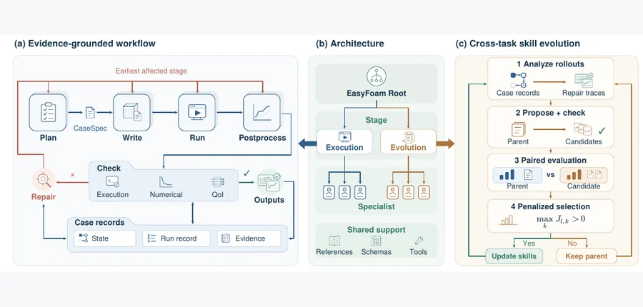 arXiv 2026-11-13 · cs.CE · #1 **[EasyFoam: Skill-Oriented OpenFOAM Agents with Evidence-Driven Evolution](https://arxiv.org/abs/2611.14525)** Peng Yin , Zhiwei Chen , Tianyi Liu , Chen Li , Kai Li , Jian Cheng Affiliation · Institute of Automation, Chinese Academy of Sciences / Nanjing University / State Key Laboratory of Aerodynamics [Paper](https://arxiv.org/abs/2611.14525) · [Figure source](https://arxiv.org/pdf/2611.14525) 

[EN] Abstract
Large language model (LLM) agents are increasingly capable of automating end-to-end OpenFOAM workflows for computational fluid dynamics (CFD). However, current progress is bottlenecked by two critical limitations. First, existing evaluations are dominated by tutorial-level cases and execution-oriented metrics, masking a substantial executability--acceptability gap: successfully executed simulations often fail to satisfy prescribed numerical or quantity-of-interest (QoI) criteria. Second, domain expertise in existing systems is tightly coupled with bespoke agent architectures, limiting its reuse and continual refinement across agent implementations. To address these challenges, we introduce ExtFoamBench, a challenging benchmark for OpenFOAM agents that spans five axes of workflow variation, and separately assesses execution completion, numerical soundness, and QoI satisfaction. Complementing this, we propose EasyFoam, an agent framework that decouples CFD expertise into modular, externalized skills driven by a dual-loop mechanism. An execution loop constructs workflows from explicit task requirements and uses structured simulation evidence to diagnose failures and guide targeted repairs. Meanwhile, an evolution loop distills task experience into reusable skill updates selected through paired evaluation. Empirical evaluations demonstrate that EasyFoam achieves substantially higher task acceptance rates than baseline agents, establishing this work as a starting point for future research toward self-improving CFD agents. <a href="https://arxiv.org/list/cs/new?show=2000#2611.14525">Source</a>

[ZH] Abstract
大语言模型（LLM）代理日益能够自动完成端到端的OpenFOAM计算流体力学（CFD）工作流。然而，当前进展受到两项关键局限的制约。首先，现有评估主要由教程级案例和面向执行的指标构成，掩盖了显著的可执行性与可接受性差距：成功执行的模拟往往不满足规定的数值标准或关注量（QoI）标准。其次，现有系统中的领域专长与定制代理架构紧密耦合，限制了其在不同代理实现中的复用与持续改进。为应对这些挑战，我们提出ExtFoamBench，一个面向OpenFOAM代理的高难度基准，覆盖工作流变化的五个维度，并分别评估执行完成、数值可靠性和QoI满足程度。与之配套，我们提出EasyFoam代理框架，通过双循环机制，将CFD专长解耦为模块化、外部化的技能。执行循环根据显式任务要求构建工作流，利用结构化模拟证据诊断失败并指导针对性修复。同时，进化循环将任务经验提炼为可复用的技能更新，并通过配对评估进行选择。实证评估表明，EasyFoam的任务验收通过率显著高于基线代理，使本工作成为今后研究自我改进CFD代理的一个起点。 <a href="https://arxiv.org/list/cs/new?show=2000#2611.14525">Source</a>
 | 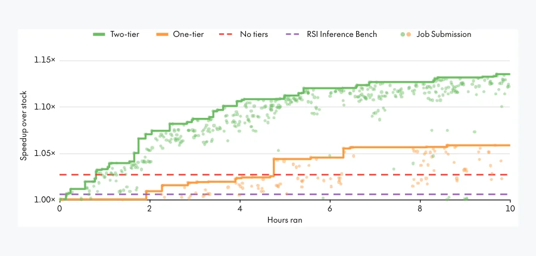 arXiv 2026-11-13 · cs.AI · #2 **[Together Compiler: Continual Compilation for AI Inference](https://arxiv.org/abs/2611.14681)** Reyna Abhyankar , Dylan Lim , Drew Wadsworth , Venkata Hasith Vattikuti , YuTong Julia Zhang , Jung Hwan Heo , Taeksang Ki… Affiliation · Together AI Research [Paper](https://arxiv.org/abs/2611.14681) · [Figure source](https://arxiv.org/html/2611.14681v1/3_1_tiered_speedup_pdf.png) 

[EN] Abstract
Today's AI workloads are rapidly changing: new models are released more often, model architectures are increasingly diverse, and traffic distributions change frequently. The challenge we face at Together AI is continual optimization for these changing workloads. Compiling a deployment into an optimized forward pass is a challenge that is well-suited for agent hill-climbing. Existing systems struggle with continual compilation due to a tradeoff between measurement throughput and fidelity. Many systems use agents to optimize individual kernels from the inference forward pass using offline benchmarks, but timings are low-fidelity because of data-dependent behavior in primitives like mixture-of-experts (MoE). On the other hand, systems use agents to directly optimize end-to-end engines but suffer from slow engine launch times. To address these challenges, we build Together Compiler (TKCC), the first truly continual agent loop designed for AI inference optimization. To address the throughput-fidelity tradeoff, we propose: (1) a Tiered Persistent Engine that decouples engine launch overheads from forward pass computation; (2) a cost model to select the parallelism configurations that seed the optimization process. We also conduct extensive ablations on agent context management and present our insights on deploying TKCC in production. TKCC outperforms highly-optimized hand-written Megakernels on the Llama 1B workhorse workload by up to 1.7x and the best open source engines on the latest frontier models (Kimi K3, GLM 5.3, MiniMax M3.1 Flash, DeepSeek v4.1 Flash) across hardware platforms by up to 2.6x higher TPS on the InferenceX benchmark. TKCC also sets the state-of-the-art performance at batch size 1, with 1111 TPS on M3.1 Flash and 1205 TPS on DeepSeek v4.1 Flash. Finally, TKCC generalizes beyond frontier language model inference. TKCC serves trillions of tokens across our production fleet. <a href="https://arxiv.org/list/cs/new?show=2000#2611.14681">Source</a>

[ZH] Abstract
当今AI工作负载正在迅速变化：新模型发布更加频繁，模型架构日益多样，流量分布也经常改变。Together AI面临的挑战是针对这些变化中的工作负载持续优化。将一次部署编译为优化后的前向计算，非常适合采用代理爬山搜索。现有系统因测量吞吐量与保真度之间的权衡而难以实现持续编译。许多系统使用代理，通过离线基准优化推理前向计算中的单个内核，但由于混合专家（MoE）等原语具有数据依赖行为，计时保真度较低。另一方面，直接用代理优化端到端引擎的系统又受到缓慢引擎启动的限制。为应对这些挑战，我们构建Together Compiler（TKCC），首个真正面向AI推理优化的持续代理循环。为解决吞吐量与保真度的权衡，我们提出：（1）分层持久引擎，将引擎启动开销与前向计算解耦；（2）用于选择优化初始并行配置的成本模型。我们还对代理上下文管理开展广泛消融，并介绍在生产中部署TKCC的经验。在Llama 1B主力工作负载上，TKCC比高度优化的手写Megakernel最多快1.7倍；在不同硬件平台的最新前沿模型（Kimi K3、GLM 5.3、MiniMax M3.1 Flash、DeepSeek v4.1 Flash）上，InferenceX基准的每秒token数（TPS）比最佳开源引擎最多高2.6倍。TKCC还刷新了批大小为1时的性能纪录，在M3.1 Flash和DeepSeek v4.1 Flash上分别达到1111和1205 TPS。最后，TKCC还可推广到前沿语言模型推理以外的场景。TKCC已在我们的生产集群中服务了数万亿token。 <a href="https://arxiv.org/list/cs/new?show=2000#2611.14681">Source</a>
 | 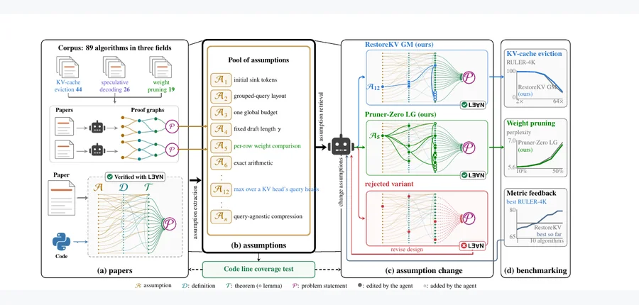 arXiv 2026-11-13 · cs.AI · #3 **[AutoAssumption: Searching over Assumptions Discovers ML-Systems Algorithms](https://arxiv.org/abs/2611.14844)** Igor Sadalski , Minghao Guo , Benjamin Jones , Wojciech Matusik Affiliation · MIT CSAIL [Paper](https://arxiv.org/abs/2611.14844) · [Figure source](https://arxiv.org/pdf/2611.14844) 

[EN] Abstract
Many advances in ML systems came from breaking an assumption that earlier methods took for granted: speculative decoding dropped the assumption that a model needs one forward pass per token. Yet algorithms rarely state their assumptions, so experts and discovery harnesses search over programs, where one edit changes several design choices and gains are difficult to attribute. Searching over the assumptions themselves remains largely unexplored. Writing algorithms as proofs makes their assumptions explicit and turns algorithm design into a search over a small, structured space that an LLM can explore and a proof checker can audit. We formalize 89 algorithms from KV-cache eviction, weight pruning and speculative decoding as proof graphs with explicit assumptions, checked in Lean. Our harness, AutoAssumption, relaxes one assumption of a published method, re-derives and re-proves it, and generates its code. In KV-cache eviction and weight pruning, this search improved on every published algorithm we ran and produced state-of-the-art algorithms. The eviction algorithm has the highest RULER-4K score of the published methods we ran, and the pruning algorithm the lowest perplexity of thirteen on four LLaMA models. At equal budget, the harness scores within a point of OpenEvolve, an open-source implementation of AlphaEvolve, with a lower standard deviation across repeats. Future work will formalize more fields and combine them through the principal assumptions they share. <a href="https://arxiv.org/list/cs/new?show=2000#2611.14844">Source</a>

[ZH] Abstract
机器学习系统的许多进展来自打破早期方法视为理所当然的假设：推测解码就放弃了模型每生成一个token都需要一次前向计算的假设。然而，算法很少明确列出其假设，因此专家和发现框架通常在程序空间中搜索，一次编辑会同时改变多个设计选择，使收益难以归因。直接搜索假设本身仍鲜有探索。将算法写成证明，可以明确其假设，并将算法设计转化为一个小型结构化空间中的搜索，LLM能够探索，证明检查器能够审计。我们将KV缓存驱逐、权重剪枝和推测解码领域的89种算法形式化为带显式假设的证明图，并在Lean中检查。我们的AutoAssumption框架放宽已发表方法的一个假设，重新推导、重新证明，并生成代码。在KV缓存驱逐和权重剪枝中，这种搜索优于我们运行的每一种已发表算法，产生了达到当前最佳水平的算法。其驱逐算法在我们运行的已发表方法中拥有最高的RULER-4K分数，其剪枝算法在四个LLaMA模型上，在十三种算法中取得最低困惑度。在相同预算下，该框架与AlphaEvolve的开源实现OpenEvolve相差不到一分，重复实验的标准差更低。未来工作将形式化更多领域，并通过它们共享的主要假设将其结合。 <a href="https://arxiv.org/list/cs/new?show=2000#2611.14844">Source</a>
 |
| 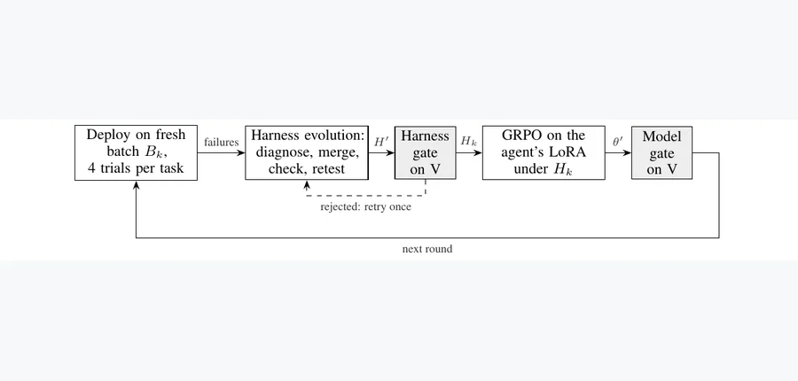 arXiv 2026-11-13 · cs.CL · #4 **[Knowledge in the Harness, Reliability in the Weights: Teacher-Free Co-Evolution of an LLM Agent](https://arxiv.org/abs/2611.15268)** Yujia Zhang , Xinqi Ren , Shixiong Zhou , Jia Meng Affiliation · Brightendata [Paper](https://arxiv.org/abs/2611.15268) · [Code](https://github.com/Brightendata/knowledge-in-the-harness) · [Figure source](https://arxiv.org/pdf/2611.15268) 

[EN] Abstract
Small open models suit private customer-service deployments but trail frontier models in two ways: they miss what the written policy requires in a given situation, and they act inconsistently on what they know. We study whether such a model can close both gaps from its own deployment logs and their reference outcomes, without a stronger teacher model. Our starting point is a Gemma 4 12B agent that reads its domain policy from on-demand skills rather than from its system prompt. In each round, the deployed system serves a fresh batch of tasks; the base model diagnoses failed conversations and writes rules into the skills, and a rule survives only if it passes code checks, counterexample self-review, a paired retest, and a noise-calibrated validation gate. Reinforcement learning (GRPO) then trains a LoRA adapter on complete multi-turn, tool-using conversations. On the retail and airline domains of $\tau^2$-bench, without training or selecting on official tasks, the agent after two rounds improves on this starting point by 12.5 pass$^1$ points in retail and 19.5 in airline, and by 18.4 and 22.0 pass$^4$ points. It also exceeds the benchmark's reference agent, which runs the same model with the whole policy in its system prompt, by 11.8 and 8.0 pass$^1$ points and by 22.8 and 16.0 pass$^4$ points, closing most of the gap to three frontier models under the same protocol. A $2\times2$ ablation shows that the rules rescue tasks the agent never solved and carry policy knowledge that RL with the rules in context does not internalize, whereas the trained weights make solved tasks reliable. <a href="https://arxiv.org/list/cs/new?show=2000#2611.15268">Source</a>

[ZH] Abstract
小型开放模型适合私有客户服务部署，但在两个方面落后于前沿模型：它们不能充分把握书面政策在特定情境下的要求，对已掌握知识的执行也不一致。我们研究这类模型能否仅依靠自身部署日志及其参考结果，在不使用更强教师模型的情况下弥合这两种差距。起点是一个Gemma 4 12B代理，它按需从技能中读取领域政策，而非从系统提示中读取。每一轮，部署系统服务一批新任务；基础模型诊断失败对话，并将规则写入技能。只有通过代码检查、反例自审、配对重测和噪声校准验证门控的规则才能保留。随后，强化学习（GRPO）在完整的多轮工具调用对话上训练LoRA适配器。在τ²-bench零售和航空领域，经过两轮后，代理相较起点的pass¹分别提升12.5和19.5个百分点，pass⁴分别提升18.4和22.0个百分点，且没有在官方任务上进行训练或选择。它还超过了基准参考代理，后者使用同一模型但将完整政策放入系统提示，pass¹分别高11.8和8.0个百分点，pass⁴分别高22.8和16.0个百分点，在同一协议下弥合了与三个前沿模型的大部分差距。一个2×2消融表明，规则能够挽救代理此前从未解决的任务，并承载在上下文中带有规则的RL也未内化的政策知识，而训练后的权重则使已解决的任务表现更可靠。 <a href="https://arxiv.org/list/cs/new?show=2000#2611.15268">Source</a>
 | 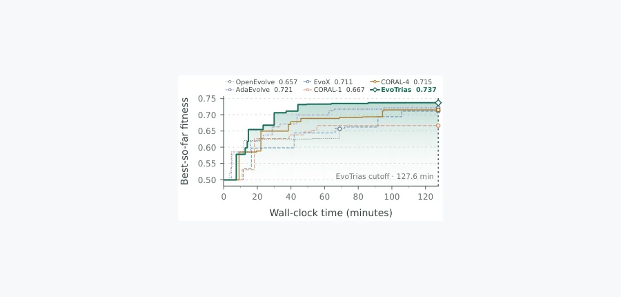 arXiv 2026-11-13 · cs.AI · #5 **[Where Autonomy Belongs: A Separation of Powers for Agentic Program Evolution](https://arxiv.org/abs/2611.15309)** Zhengyang Ai , Tong Liu , Jingxian Tang , Xiaobing Du , Tao Xiao , Fengshi Zhang , Zishuo Li , Xiaodong Ai , Pinyan Lu Affiliation · Huawei Taylor Lab / Shanghai University of Finance and Economics [Paper](https://arxiv.org/abs/2611.15309) · [Project](https://evotrias.github.io/) · [Figure source](https://arxiv.org/html/2611.15309v1/signal_processing_wallclock.png) 

[EN] Abstract
LLM-driven program evolution rests on three decisions: govern directs the search from accumulated evidence, propose constructs the next candidate, and judge settles validity and fitness. All three appear in every system, and existing work splits into two lines over who makes each. Controller-centric systems strengthen govern and neglect the autonomy of propose, which caps what evolution can reach. Agent-centric systems let a coding agent take over both govern and propose, at a cognitive and computational cost. Neither line protects the independent authority of judge, so benchmark reliability suffers. These failures share one root: autonomy is misallocated across the three decisions. We address this problem with EvoTrias, a separation-of-powers architecture in which each decision has one owner: Structured Governance for what spans evolution rounds, Open Proposal for construction inside a task, and Protected Judgment behind a private evaluator. These owners exchange typed contracts only, and runtime hooks reinforce the boundaries. This separation also lets EvoTrias run as a plugin that turns an existing coding agent into an evolution system. EvoTrias sets a new state of the art on mathematical, systems, and algorithm-design benchmarks. Three further results show what each owner buys: separating Governance from Proposal cuts token cost by 64%, Open Proposal extends evolution to a 680K-line industrial repository, and Protected Judgment keeps benchmark scores faithful to transfer. <a href="https://arxiv.org/list/cs/new?show=2000#2611.15309">Source</a>

[ZH] Abstract
LLM驱动的程序进化依赖三种决策：治理依据累积证据引导搜索，提案构造下一个候选，裁决确定有效性和适应度。每个系统都有这三项决策，现有工作根据由谁作出决策分为两条路线。以控制器为中心的系统加强治理，却忽略提案的自主性，限制了进化能达到的范围。以代理为中心的系统让编码代理同时承担治理和提案，带来认知与计算成本。两条路线都未保护裁决的独立权威，因此基准可靠性受到影响。这些失败有一个共同根源：自主性在三项决策之间分配不当。我们通过EvoTrias解决这一问题，这是一个分权架构，每种决策都有唯一负责人：结构化治理负责跨进化轮次的事项，开放提案负责任务内的构建，受保护裁决位于私有评估器之后。这些负责人仅通过类型化契约交换信息，运行时钩子强化边界。这样的分离也使EvoTrias可以作为插件运行，将现有编码代理转变为进化系统。EvoTrias在数学、系统和算法设计基准上达到新的最佳水平。另有三个结果表明各负责人带来的作用：将治理与提案分开使token成本降低64%；开放提案将进化扩展到一个68万行的工业代码库；受保护裁决使基准分数与迁移表现保持一致。 <a href="https://arxiv.org/list/cs/new?show=2000#2611.15309">Source</a>
 | 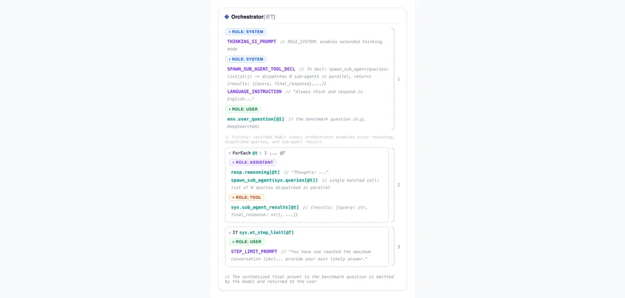 arXiv 2026-11-13 · cs.MA · #6 **[MULTILOOP: Evolving Multi-Agent Harnesses for Complex Information-Seeking Tasks](https://arxiv.org/abs/2611.15754)** Daniela Gottesman , Gal Yona , Ori Ram , Zorik Gekhman , Jonathan Herzig , Mor Geva , Roee Aharoni Affiliation · Tel Aviv University / Google Research [Paper](https://arxiv.org/abs/2611.15754) · [Figure source](https://arxiv.org/html/2611.15754v1/figures/multiloop_harness_orchestrator.png) 

[EN] Abstract
The performance of LLM-based agents depends not only on the underlying model but also on the harness: the prompts, tools, and orchestration logic around it. Recent works automate harness optimization with coding agents that analyze execution traces, diagnose failures, and edit the harness code; however, those focused on single-agent systems. Multi-agent harnesses are harder to optimize as fixing them requires changing how agents interact in addition to how each behaves. We study whether automated harness optimization can diagnose and repair failures in multi-agent systems through a case study on complex information-seeking tasks from DeepSearchQA [Gupta et al., 2026]. We apply MULTILOOP, a simple optimization loop in which a coding agent iteratively analyzes, evaluates and edits the harness. With only 10 training samples, the evolved harness improves accuracy by 4.6% over the base harness and by 3.2% over the best single-agent system. However, a taxonomy of failure modes before and after optimization shows that the orchestration failures that characterize multi-agent systems largely persist. Our findings motivate harness optimization methods that encourage structural changes to how agents delegate tasks and share information. <a href="https://arxiv.org/list/cs/new?show=2000#2611.15754">Source</a>

[ZH] Abstract
基于LLM的代理表现不仅取决于底层模型，也取决于框架，即围绕模型的提示、工具和编排逻辑。近期工作通过编码代理分析执行轨迹、诊断失败并编辑框架代码，以自动优化代理框架，但重点是单代理系统。多代理框架更难优化，因为修复不仅需要改变各代理的行为，还要改变代理间的交互。我们通过DeepSearchQA［Gupta等，2026］复杂信息检索任务的案例，研究自动框架优化能否诊断并修复多代理系统中的失败。我们采用MULTILOOP，一个由编码代理迭代分析、评估和编辑框架的简单优化循环。仅用10个训练样本，进化后的框架相较基础框架的准确率提高4.6%，相较最佳单代理系统提高3.2%。然而，优化前后的失败模式分类显示，多代理系统特有的编排失败大体仍然存在。我们的结果推动了能够鼓励结构性改变代理委派和信息共享方式的框架优化方法研究。 <a href="https://arxiv.org/list/cs/new?show=2000#2611.15754">Source</a>
 |
| 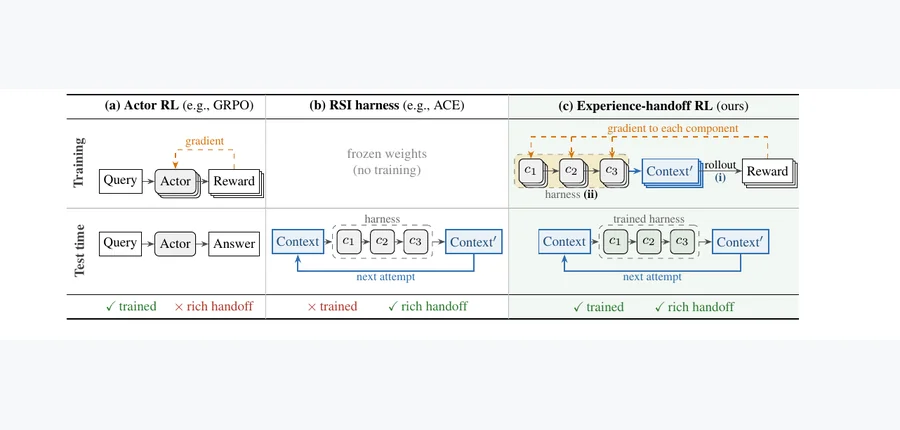 arXiv 2026-11-13 · cs.LG · #7 **[Experience-Handoff Reinforcement Learning for Recursive Self-Improvement](https://arxiv.org/abs/2611.16409)** Doyoung Kim , Byeongguk Jeon , Kailin Zhang , Sherry Yang Affiliation · New York University / KAIST AI [Paper](https://arxiv.org/abs/2611.16409) · [Figure source](https://arxiv.org/pdf/2611.16409) 

[EN] Abstract
It is common to train Large Language Models (LLMs) for agentic tasks with Reinforcement Learning (RL) from scalar rewards. However, this throws away the fine-grained information about the environment that the agent experienced during the trial (e.g., error logs). To utilize this rich information, recent works wrap the agent in a harness that refines its own inputs through reflection or compaction and hands past experience to future rollouts, but the construction of the handed-off artifacts (e.g., a playbook) is itself not learned. We want the best of both worlds: gradient updates from a scalar reward, while also utilizing environment information to hand off experience. As a concrete testbed, we fix the Agentic Context Engineering (\ace{}) harness and train one model to act, reflect, and curate task-local playbooks. Our method, \acerl{}, evaluates candidate experience-handoff artifacts by their downstream effect on future actor rollouts, and co-optimizes the role-specific behaviors (action generator, insight reflector, and playbook curator) under a fixed scaffold. Across agentic benchmarks, \acerl{} achieves higher held-out performance than baseline methods. The results suggest that agent training should optimize not only the actions in the current rollout, but also the model-written experience that future rollouts inherit. <a href="https://arxiv.org/list/cs/new?show=2000#2611.16409">Source</a>

[ZH] Abstract
通常，人们通过标量奖励强化学习（RL）来训练面向代理任务的大语言模型（LLM）。然而，这丢弃了代理在试验中经历的环境细粒度信息，例如错误日志。为利用这些丰富信息，近期工作使用框架包裹代理，通过反思或压缩来完善自身输入，并将过去经验传给未来的rollout，但传递产物（如行动手册）的构建过程本身并未学习。我们希望兼得二者优势：从标量奖励获得梯度更新，同时利用环境信息传递经验。作为具体试验平台，我们固定Agentic Context Engineering（\ace{}）框架，训练一个模型承担行动、反思和任务局部行动手册整理。我们的方法\acerl{}依据候选经验传递产物对未来行动者rollout的下游影响来评估它们，并在固定支架下共同优化各角色行为，即行动生成器、洞见反思器和行动手册整理器。在多个代理基准上，\acerl{}的留出集表现高于基线方法。结果表明，代理训练不仅应优化当前rollout中的行动，也应优化未来rollout继承的模型书写经验。 <a href="https://arxiv.org/list/cs/new?show=2000#2611.16409">Source</a>
 | 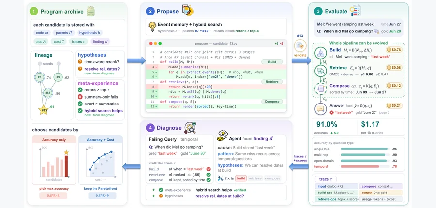 arXiv 2026-11-13 · cs.CL · #8 **[Discovering Effective Agent Memory Designs through Program Evolution](https://arxiv.org/abs/2611.17068)** Xinheng Ding , Seyyed Saeid Cheshmi , Ziyang Zhang , Tairan Chen , Wenya Xie , Yu Hou , Rui Zhang , Zirui Liu Affiliation · University of Minnesota / Stevens Institute of Technology [Paper](https://arxiv.org/abs/2611.17068) · [Code](https://github.com/ash-ding/MAPE) · [Figure source](https://arxiv.org/html/2611.17068v1/system_overview_v4.png) 

[EN] Abstract
Program evolution provides a promising approach to discover agent memory designs and study the choices underlying their effectiveness. We introduce MAPE, a framework that evolves whole memory programs from minimal seeds through a standardized lifecycle interface and an iterative diagnosis-proposal loop. Experiments on LoCoMo and LongMemEval yield an absolute accuracy gain of up to 12% over manually designed baselines at 35% of the serving cost, with further evaluations supporting transfer across serving backbones and benchmarks. Empirical analyses and ablations identify and validate two recurring design patterns: retaining raw conversations as retrievable evidence preserves details omitted from extracted memories, while composing retrieved evidence according to query intent helps the answering model use it effectively. Transplanting the composition module into five existing memory systems improves accuracy across all five. Beyond these patterns, the search objective shapes where computation goes: optimizing serving cost alongside accuracy shifts computation from LLM-based memory construction to selective processing at query time while retaining competitive accuracy. Together, these findings offer empirical lessons for agent memory design. Code is available at this https URL . <a href="https://arxiv.org/list/cs/new?show=2000#2611.17068">Source</a>

[ZH] Abstract
程序进化为发现代理记忆设计、研究其有效性背后的选择提供了一条有前景的途径。我们提出MAPE框架，通过标准化生命周期接口和迭代诊断—提案循环，从最小种子出发进化完整的记忆程序。在LoCoMo和LongMemEval上的实验，相较人工设计基线取得最高12%的准确率绝对提升，服务成本仅为其35%，进一步评估支持跨服务骨干模型和跨基准迁移。实证分析与消融识别并验证了两个反复出现的设计模式：将原始对话保留为可检索证据，可以保存提取式记忆遗漏的细节；依据查询意图组织检索证据，有助于回答模型有效使用它们。将组织模块移植到五个现有记忆系统中，五者准确率均得到提升。除此以外，搜索目标还会改变计算分配的位置：同时优化服务成本与准确率，会将计算从基于LLM的记忆构建转向查询时的选择性处理，同时保持有竞争力的准确率。这些结果共同提供了代理记忆设计的实证经验。代码可通过this https URL获取。 <a href="https://arxiv.org/list/cs/new?show=2000#2611.17068">Source</a>
 | 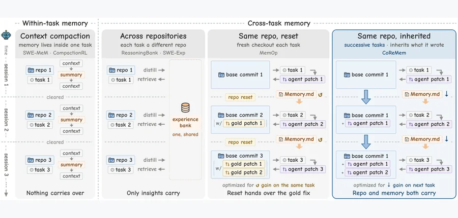 arXiv 2026-11-13 · cs.AI · #9 **[CoReMem: Cost-Internalizing Memory for Successive Coding Tasks with Prospective Valuation](https://arxiv.org/abs/2611.17316)** Peiwen Li (Yale University), Harshit Verma (Yale University), Sophia Zhou (Yale University), Haiwen Wang (Yale University)… Affiliation · Yale University / Tsinghua University / Goodvision AI [Paper](https://arxiv.org/abs/2611.17316) · [Figure source](https://arxiv.org/html/2611.17316v1/fig2.png) 

[EN] Abstract
Coding agents tackle successive tasks on an evolving repository, carrying forward edits and writing memory before the next task is known. Selecting memory for unknown next tasks requires balancing future usefulness against the costs of writing and reading it. The actor must also decide when acting on available memory saves effort as the task unfolds. We introduce Coding-Repository Memory (CoReMem), a cost-internalizing framework that guides memory design and actor adaptation through measured memory value on the next task. Prospective segment valuation compares runs of the next task with and without individual trajectory segments from the same inherited repository state, guiding a compact memory built around anchors: repository locations and executable checks. Actor adaptation estimates on-policy memory value within rollout groups with and without memory, using a reward that prioritizes resolution and penalizes step count in successful runs. Provenance-gated value credit assigns the additional value term to steps identified as using memory-supplied anchors, while every step retains outcome credit. On ChainSWE, CoReMem raises the 27B actor's resolve rate from 21.0% to 25.7%, with 17% fewer steps and 11% fewer total cache-aware tokens, including memory-module calls, relative to the untrained actor model without memory. <a href="https://arxiv.org/list/cs/new?show=2000#2611.17316">Source</a>

[ZH] Abstract
编码代理在不断演变的代码库上处理连续任务，继承已有编辑，并在下一项任务未知时写入记忆。为未知的后续任务选择记忆，需要权衡未来效用与写入、读取成本。行动者还必须在任务展开时判断，使用现有记忆何时可以节省工作。我们提出Coding-Repository Memory（CoReMem），一个将成本纳入内部考量的框架，通过测量记忆对下一项任务的价值来指导记忆设计与行动者适配。前瞻性片段估值从同一继承代码库状态出发，对下一项任务在使用与不使用单个轨迹片段时的运行进行比较，指导围绕锚点构建紧凑记忆，锚点包括代码库位置和可执行检查。行动者适配在有记忆和无记忆的rollout组内估计在策略记忆价值，奖励优先考虑问题解决，并对成功运行的步骤数施加惩罚。来源门控的价值信用将额外价值项分配给被识别为使用了记忆锚点的步骤，同时每一步仍保留结果信用。在ChainSWE上，CoReMem使27B行动者的解决率从21.0%提高到25.7%，相较未经训练且没有记忆的行动者模型，步骤减少17%，总缓存感知token减少11%，其中包括记忆模块调用。 <a href="https://arxiv.org/list/cs/new?show=2000#2611.17316">Source</a>
 |
| 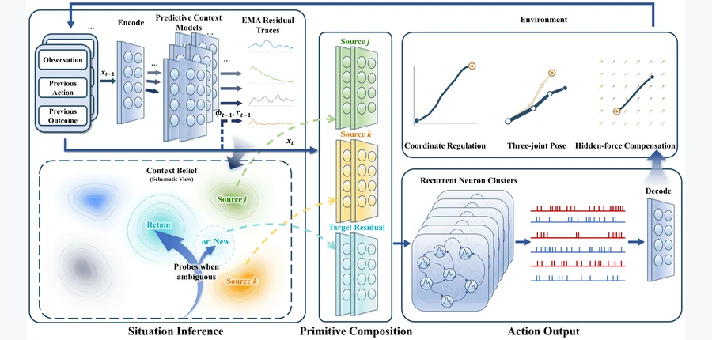 arXiv 2026-11-13 · cs.LG · #10 **[SPIRE: Task-agnostic embodied continual learning through autonomous situation inference and causal motor-primitive reuse](https://arxiv.org/abs/2611.14840)** Yiyang Jia , Mingyang Lyu , Gongce Cao , Feifei Zhao , Yinqian Sun , Yi Zeng Affiliation · University College London / Institute of Automation, Chinese Academy of Sciences / University of Chinese Academy of Sciences / Renmin University of China [Paper](https://arxiv.org/abs/2611.14840) · [Figure source](https://arxiv.org/html/2611.14840v1/fig1_architecture.png) 

[EN] Abstract
Embodied continual learning requires controllers to infer changing situations, retain prior behavior and reuse motor skills without task labels or known boundaries. The challenge is deciding when to recover earlier behavior and which skills can support new learning. We introduce Situation-guided Primitive Integration for Recurrent Embodiment (SPIRE), a recurrent-spiking system that infers latent contexts from action-outcome evidence and learns context-specific motor actors online. Mature actors become protected sources that combine with a target-context residual to drive recurrent-spiking motor populations. Across coordinate, three-joint and hidden-force control, SPIRE maintained control, autonomously inferred situations, retained prior behavior and accelerated acquisition of an unseen source composition, reducing mean interactions to criterion by approximately 40% relative to matched fresh controllers. Rewinding compatible source actors impaired early acquisition in every matched intervention, demonstrating causal reuse. Against seven recurrent continual-learning and modular-control comparators, SPIRE achieved 2.4 times the mean prior-learning advantage of the strongest eligible task-free alternative selected for each paired stream. These results demonstrate autonomous recovery and causal reuse of motor skills for new learning in continuous embodied control. <a href="https://arxiv.org/list/cs/new?show=2000#2611.14840">Source</a>

[ZH] Abstract
具身持续学习要求控制器在没有任务标签或已知边界的情况下，推断变化中的情境、保留既有行为并复用运动技能。挑战在于判断何时恢复早期行为，以及哪些技能能够支持新学习。我们提出SPIRE（情境引导的循环具身运动基元集成），一种循环脉冲系统，根据行动—结果证据推断潜在上下文，并在线学习特定上下文的运动行动者。成熟行动者成为受保护的来源，与目标上下文的残差组合，驱动循环脉冲运动群体。在坐标控制、三关节控制和隐力控制中，SPIRE能够维持控制、自主推断情境、保留既有行为，并加速学习此前未见的来源组合，相较匹配的从零开始控制器，达到标准的平均交互数减少约40%。在每个匹配干预中，回退兼容的来源行动者均会损害早期学习，证明了因果性的复用。与七种循环持续学习和模块化控制比较方法相比，SPIRE的平均既有学习优势，是针对每个配对序列选出的最强合格无任务标签替代方法的2.4倍。这些结果表明，在连续具身控制中，可以自主恢复运动技能，并以因果方式复用它们来支持新学习。 <a href="https://arxiv.org/list/cs/new?show=2000#2611.14840">Source</a>
 | 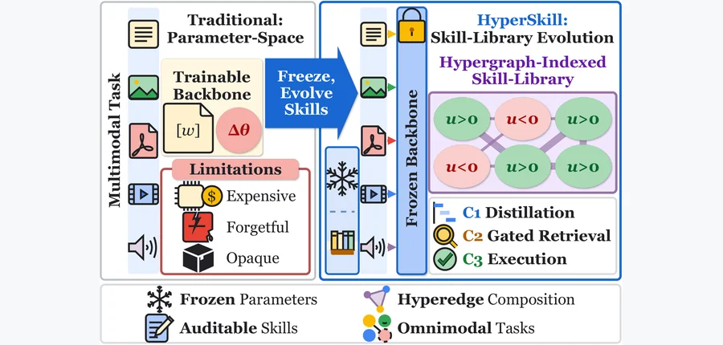 arXiv 2026-11-13 · cs.AI · #11 **[HyperSkill: Training-Free Omnimodal GRPO via Hypergraph-Indexed Skill-Library Evolution](https://arxiv.org/abs/2611.15178)** Haoran Luo , Shangkai Lin , Jinyang Wu , Xinliang Zhou , Luu Anh Tuan Affiliation · Nanyang Technological University / Tsinghua University / Stanford University / VinUniversity [Paper](https://arxiv.org/abs/2611.15178) · [Code](https://github.com/LHRLAB/HyperSkill) · [Figure source](https://arxiv.org/html/2611.15178v1/F1.png) 

[EN] Abstract
Reinforcement learning sharpens LLM reasoning, but parameter updates are expensive, forgetful, and opaque; training-free libraries swap gradients for a textual store but still use trajectory-level, correlation-based admission and flat structure. To address both, we propose HyperSkill, a Training-Free Omnimodal GRPO framework that keeps the backbone frozen and replaces gradient updates with auditable edits to a Hypergraph-Indexed Skill-Library, where skills are advantage-bearing nodes and compositions are hyperedges. It has three components: training-time distillation admits counterfactually checked skills and learns a protocol skill from failures; gated hypergraph retrieval injects advantage-ranked skills where a per-dataset gate admits them; and an execution protocol makes the frozen backbone commit to an answer. On 11 text, vision-language, and omnimodal benchmarks, HyperSkill is best or tied on every dataset and beats the best baseline by 13.0 average F1 points while keeping the backbone frozen. Our software and data are publicly available at this https URL . <a href="https://arxiv.org/list/cs/new?show=2000#2611.15178">Source</a>

[ZH] Abstract
强化学习能够增强LLM推理，但参数更新成本高、容易遗忘且不透明；免训练技能库以文本存储替代梯度，却仍采用基于相关性的轨迹级准入和扁平结构。为解决这两点，我们提出HyperSkill，一个免训练全模态GRPO框架，保持骨干模型冻结，以对可审计的超图索引技能库的编辑代替梯度更新，其中技能是带优势值的节点，技能组合是超边。它包含三个组成部分：训练时蒸馏接纳经过反事实检查的技能，并从失败中学习协议技能；门控超图检索在逐数据集门控允许的位置注入按优势排序的技能；执行协议要求冻结骨干模型明确给出答案。在11个文本、视觉语言和全模态基准上，HyperSkill在每个数据集上均为最好或并列最好，在保持骨干冻结的同时，平均F1比最佳基线高13.0个百分点。软件和数据已通过this https URL公开。 <a href="https://arxiv.org/list/cs/new?show=2000#2611.15178">Source</a>
 | 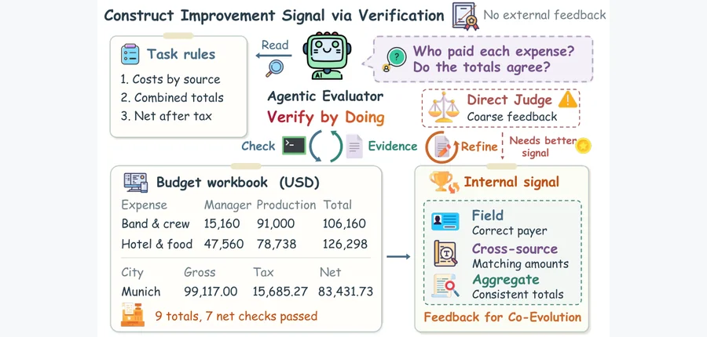 arXiv 2026-11-13 · cs.AI · #12 **[Verify by Doing: Co-Evolving Agent Execution and Evaluation without External Feedback](https://arxiv.org/abs/2611.15276)** Yitong Lin , Jianda Chen , Yihao Hu , Pan Wang , Hang Wang , Zhihao Wen , Xiaoxue Ren , Wei Wu Affiliation · Ant International / Zhejiang University [Paper](https://arxiv.org/abs/2611.15276) · [Figure source](https://arxiv.org/html/2611.15276v1/teaser_budget.png) 

[EN] Abstract
Agent self-improvement requires feedback about task success, yet external feedback may be unavailable at test time. Agents must then infer success from observable evidence, and incomplete verification can misguide subsequent updates. We introduce Verify by Doing (VbD), a method that co-evolves Actor and Evaluator harnesses within a single task while keeping model weights fixed. The Evaluator actively inspects artifacts and environment state with tools; its findings ground an internal signal for output selection and guide updates to both execution and verification procedures. Proposed Evaluators undergo comparative review on common candidates, while Actor updates require support from their own fresh outputs. Across AutomationBench, $\tau^3$ Banking, and selected GDPval tasks, VbD achieves the highest overall scores among the compared methods operating without external feedback, with gains of 3.3, 4.1, and 2.3 percentage points over the strongest baselines on the main backbone. Ablations support the contributions of active verification and Evaluator evolution, and selection from fixed candidate pools shows that improved verification can recover successful outputs without generating new ones. <a href="https://arxiv.org/list/cs/new?show=2000#2611.15276">Source</a>

[ZH] Abstract
代理自我改进需要任务成功反馈，但测试时可能无法获得外部反馈。因此，代理必须从可观察证据推断成功与否，而不完整验证可能误导后续更新。我们提出Verify by Doing（VbD），一种在单个任务内部共同进化行动者和评估者框架、同时保持模型权重不变的方法。评估者使用工具主动检查产物和环境状态；其发现为输出选择提供内部信号，并指导执行与验证流程的更新。提出的评估者会在相同候选上接受比较审查，行动者更新则需要来自其自身新生成输出的支持。在AutomationBench、τ³ Banking和选定GDPval任务上，VbD在所比较的无外部反馈方法中取得最高综合分数，在主干模型上相较最强基线分别提高3.3、4.1和2.3个百分点。消融支持主动验证和评估者进化各自的作用；固定候选池上的选择实验还表明，更好的验证无需生成新输出即可找回成功输出。 <a href="https://arxiv.org/list/cs/new?show=2000#2611.15276">Source</a>
 |
| 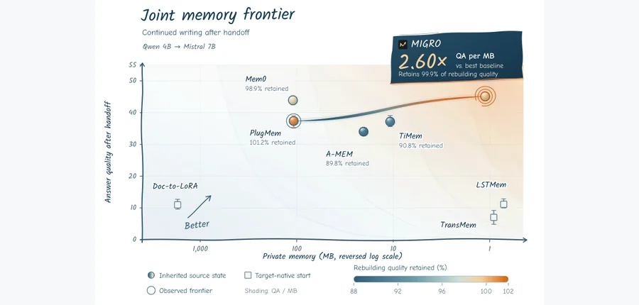 arXiv 2026-11-13 · cs.AI · #13 **[MIGRO: A Decoupled and Portable Long-Term Memory System for Language Models](https://arxiv.org/abs/2611.15315)** Mingxi Zou , Yinghui Xu , Jiaxiang Chen , Langzhang Liang , Wei Zhu , Peng Ye , Runkai Zhao , Ruoxi Jiang , Sijin Chen , S… Affiliation · Fudan University / Shanghai Academy of AI for Science / Shanghai AI Laboratory / Yunnan University / Monash University / The University of Hong Kong / Zoom [Paper](https://arxiv.org/abs/2611.15315) · [Code](https://github.com/zOUMINGXI/MIGRO) · [Figure source](https://arxiv.org/html/2611.15315v1/joint_frontier.png) 

[EN] Abstract
Language models evolve, but the observations, revisions, and context accumulated through user interactions should remain usable. Each new model must be able to retrieve past evidence, track revisions, and add new observations. We present MIGRO, a decoupled long-term memory system that treats experience as a persistent state shared across successive language models. MIGRO follows a simple principle: preserve historical evidence exactly, organize it approximately, and decide what to retrieve only when the question is known. We call this asymmetric fidelity with deferred selectivity. A shared semantic index supports retrieval, while exact records retain observations and their historical relationships. Because models differ in vocabulary and tokenization, host-specific interfaces convert selected evidence into inputs the receiving model can use. Reversible encoding reduces archival storage while enabling exact recovery. The shared state and its access interfaces let successive hosts read and extend the accumulated experience. On matched LoCoMo states, MIGRO scores 7.3% higher and uses 99.3% less private memory than the strongest quality baseline. After handoff, continued writing retains 99.9% of full-history rebuilding quality by extending the inherited state. On million-token BEAM histories, MIGRO uses 57.5% less private storage on average than the most compact baseline. MIGRO combines high answer quality, continued memory growth across hosts, and low storage cost. Code is available at this https URL . <a href="https://arxiv.org/list/cs/new?show=2000#2611.15315">Source</a>

[ZH] Abstract
语言模型会演变，但通过用户交互积累的观察、修订和上下文应当继续可用。每个新模型都必须能够检索过去证据、跟踪修订并加入新观察。我们提出MIGRO，一个解耦的长期记忆系统，将经验视为可在连续更换的语言模型之间共享的持久状态。MIGRO遵循一个简单原则：精确保留历史证据，近似组织证据，并且只有在问题已知时才决定检索什么。我们称之为非对称保真与延迟选择。共享语义索引支持检索，精确记录则保留观察及其历史关系。由于模型的词表和分词方式不同，宿主特定接口会将选定证据转换为接收模型可以使用的输入。可逆编码减少归档存储，同时支持精确恢复。共享状态及其访问接口，使连续更换的宿主能够读取并扩展累积经验。在匹配的LoCoMo状态上，MIGRO相较质量最强的基线分数高7.3%，私有记忆占用少99.3%。交接后，继续写入通过扩展继承状态保留了完整历史重建质量的99.9%。在百万token的BEAM历史上，相较最紧凑的基线，MIGRO平均减少57.5%的私有存储。MIGRO兼具高回答质量、跨宿主持续记忆增长和低存储成本。代码可通过this https URL获取。 <a href="https://arxiv.org/list/cs/new?show=2000#2611.15315">Source</a>
 | 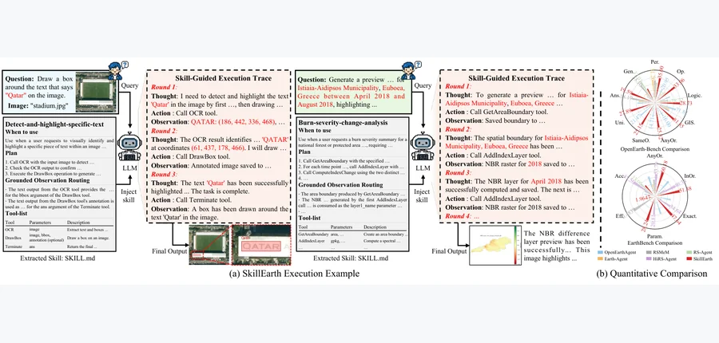 arXiv 2026-11-13 · cs.AI · #14 **[SkillEarth: Teaching General-Purpose Agents to Act on Earth via Skill Evolution](https://arxiv.org/abs/2611.15481)** Haojun Tang , Wenda Zhao , Xiang Zhou , Qiwei Lin , Lida Huang , Yan Wang Affiliation · Tsinghua University / Dalian University of Technology / Beijing Institute of Radio Measurement [Paper](https://arxiv.org/abs/2611.15481) · [Figure source](https://arxiv.org/html/2611.15481v1/Teaser.png) 

[EN] Abstract
Recently developed remote sensing (RS) agents execute real-world tasks with complex workflows through multi-step tool invocation. These agents, however, typically rely on predefined expertise or parameter updates. They thus require updating expert knowledge or retraining models whenever new tools, tasks, or execution patterns emerge, limiting their continual adaptability in dynamic Earth environments. In this work, we seek to equip general-purpose agents with RS tool-call knowledge that can be automatically extracted from demonstrated trajectories without expert intervention or parameter updates. Specifically, we propose SkillEarth, a self-evolving skill extraction method that externalizes RS tool-call knowledge as reusable, retrievable, and evolvable skill files and refines them through observation-grounded evolution. Unlike existing automatic skill extraction methods that rely on outcome-based reflection to refine skills holistically, SkillEarth grounds skill evolution in real tool-chain execution and combines dual-judge feedback with a grounded observation routing graph for precise component-level refinement. The resulting skills are generalizable, reliable, and transferable: they improve overall RS tool-call performance across three frontier LLMs and four open-source LLMs, are refined through real tool execution feedback, and support cross-model reuse without retraining. Experiments on OpenEarth-Bench and Earth-Bench demonstrate that SkillEarth achieves better tool selection, argument correctness, execution-order consistency, and task completion than existing RS agents and skill extraction methods. <a href="https://arxiv.org/list/cs/new?show=2000#2611.15481">Source</a>

[ZH] Abstract
近期的遥感（RS）代理通过多步工具调用，执行包含复杂工作流的真实世界任务。然而，这些代理通常依赖预定义专长或参数更新。因此，每当出现新工具、新任务或新执行模式时，就需要更新专家知识或重新训练模型，限制了它们对动态地球环境的持续适应能力。本文希望为通用代理提供RS工具调用知识，这些知识可以自动从示范轨迹提取，无需专家干预或参数更新。具体而言，我们提出SkillEarth，一种自进化技能提取方法，将RS工具调用知识外化为可复用、可检索、可进化的技能文件，并通过基于观察的进化加以完善。现有自动技能提取方法依靠基于结果的反思来整体修订技能，而SkillEarth将技能进化建立在真实工具链执行上，并结合双评判者反馈与基于实际观察的路由图，实现精确的组件级改进。所得技能具有泛化性、可靠性和可迁移性：它们提升了三个前沿LLM和四个开源LLM的整体RS工具调用表现，通过真实工具执行反馈得到修订，并支持无需重新训练的跨模型复用。在OpenEarth-Bench和Earth-Bench上的实验表明，SkillEarth在工具选择、参数正确性、执行顺序一致性和任务完成方面优于现有RS代理和技能提取方法。 <a href="https://arxiv.org/list/cs/new?show=2000#2611.15481">Source</a>
 | 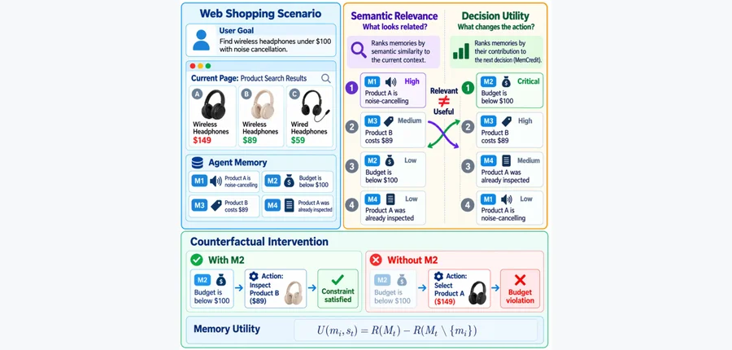 arXiv 2026-11-13 · cs.AI · #15 **[MemCredit: From Relevance to Utility for Decision-Time Memory in Long-Horizon Web Agents](https://arxiv.org/abs/2611.15600)** Quanjiang Guo , Sijie Wang , Qianyang Zhu , Ben Zhang , Jinchuan Zhang , Ke Yan , Zhao Kang Affiliation · UESTC / Nanyang Technological University [Paper](https://arxiv.org/abs/2611.15600) · [Figure source](https://arxiv.org/html/2611.15600v1/intro.png) 

[EN] Abstract
Large language model (LLM) agents increasingly operate over long Web interaction histories, making memory management critical for reliable and efficient decision making. Existing methods primarily optimize storage, retrieval, or compression, but the memories most semantically relevant to the current state are not necessarily those that most improve the agent's action. We introduce MemCredit, a decision-centric memory framework that shifts memory selection from semantic relevance to decision utility. MemCredit estimates the state-, reference-context-, and policy-conditional marginal contribution of individual memories through controlled counterfactual interventions, and distills these intervention-derived credits into a lightweight utility estimator. At inference time, semantic relevance is used only for high-recall candidate generation, while predicted utility arbitrates which memories are retained under a fixed token budget, without modifying the underlying agent policy or requiring additional environment interaction. We evaluate MemCredit on ALFWorld and WebShop against representative memory baselines. On ALFWorld, MemCredit achieves 86.57 SR@50 under a 500-token historical-memory budget, compared with 65.67% for BM25 retrieval. Counterfactual analysis further shows that memory utility is sparse, strongly state dependent, and poorly captured by semantic relevance. These results suggest that decision utility provides a more effective principle than relevance alone for long-horizon agent memory management. <a href="https://arxiv.org/list/cs/new?show=2000#2611.15600">Source</a>

[ZH] Abstract
大语言模型（LLM）代理越来越多地在漫长的Web交互历史上运行，因此记忆管理对于可靠、高效的决策至关重要。现有方法主要优化存储、检索或压缩，但与当前状态语义最相关的记忆，未必最能改善代理行动。我们提出MemCredit，一个以决策为中心的记忆框架，将记忆选择从语义相关性转向决策效用。MemCredit通过受控反事实干预，估计单条记忆在给定状态、参考上下文和策略下的边际贡献，再将这些干预得出的信用蒸馏到轻量级效用估计器。在推理时，语义相关性仅用于高召回候选生成，而预测效用决定在固定token预算下保留哪些记忆，无需修改底层代理策略，也不需要额外环境交互。我们在ALFWorld和WebShop上，将MemCredit与代表性记忆基线比较。在ALFWorld上，在500-token历史记忆预算下，MemCredit达到86.57的SR@50，BM25检索为65.67%。反事实分析还表明，记忆效用稀疏、强烈依赖状态，语义相关性难以充分刻画。这些结果提示，相较仅依赖相关性，决策效用为长时程代理记忆管理提供了更有效的原则。 <a href="https://arxiv.org/list/cs/new?show=2000#2611.15600">Source</a>
 |
| 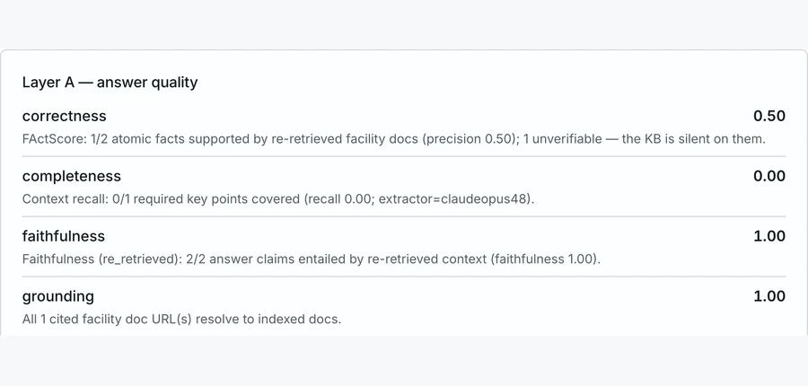 arXiv 2026-11-13 · cs.SE · #16 **[AskALCF: A Self-Improving Agentic System for Intelligent HPC User Support](https://arxiv.org/abs/2611.15700)** Jingyan Jiang , Akhilesh Bondapalli , Krishna Rauniyar , Murat Keceli , Yasaman Ghadar , Haritha Siddabathuni Som , Venkat… Affiliation · Argonne National Laboratory / Clemson University / University of Louisiana at Lafayette [Paper](https://arxiv.org/abs/2611.15700) · [Figure source](https://arxiv.org/html/2611.15700v1/figs/ui-review-metrics.png) 

[EN] Abstract
AI-based question-answering systems are increasingly used for user support, including at high-performance computing (HPC) facilities. However, existing systems lack a systematic, deployment-oriented approach for evaluating final-answer quality and attributing failures to specific components. They also remain largely static after deployment, apart from periodic knowledge-base updates. We present AskALCF, an agentic log-analysis and improvement pipeline for HPC user support. AskALCF evaluates production interactions at a fine-grained level, identifies whether failures arise from missing knowledge, retrieval, prompting, model behavior, or tool execution, and routes each failure to an actionable repair. Its diagnostic core combines answer-quality assessment with a two-scope sufficiency test that distinguishes information missing from the documentation corpus from information present but not retrieved. We further introduce a controlled harness-training process that uses expert references, null edits, and explicit ship, revert, or decline decisions to improve the diagnostic pipeline reliably. Across 2,174 support turns, AskALCF reduced unattributable failures from 41.4% to 14.2%, while harness training improved expert agreement from 108/150 to 123/150 turns. These results demonstrate a governed form of self-evolution in which production evidence drives targeted system improvements. By turning production interactions into fine-grained diagnoses and actionable repairs, AskALCF provides a systematic foundation for continuously improving deployed AI support systems beyond knowledge-base updates alone. <a href="https://arxiv.org/list/cs/new?show=2000#2611.15700">Source</a>

[ZH] Abstract
基于AI的问答系统越来越多地用于用户支持，包括高性能计算（HPC）设施。然而，现有系统缺少一种系统化、面向部署的方法，来评估最终回答质量并将失败归因到具体组件。除了周期性的知识库更新，它们在部署后也大体保持静态。我们提出AskALCF，一个面向HPC用户支持的代理式日志分析与改进流水线。AskALCF细粒度评估生产交互，识别失败来自缺失知识、检索、提示、模型行为还是工具执行，并将每种失败路由到可执行的修复。其诊断核心将回答质量评估与双范围充分性检验结合，区分文档语料中缺少的信息与已存在但未被检索的信息。我们进一步提出受控框架训练流程，使用专家参考、空编辑和明确的发布、回退或拒绝决策，可靠改进诊断流水线。在2,174个支持轮次中，AskALCF将无法归因的失败从41.4%减少到14.2%，框架训练则将与专家一致的轮次从108/150提高到123/150。这些结果展示了一种受治理的自进化形式，由生产证据驱动有针对性的系统改进。通过把生产交互转为细粒度诊断和可执行修复，AskALCF为持续改进已部署AI支持系统提供了超越单纯知识库更新的系统化基础。 <a href="https://arxiv.org/list/cs/new?show=2000#2611.15700">Source</a>
 | 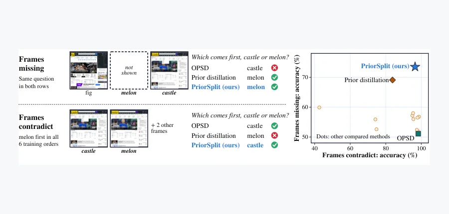 arXiv 2026-11-13 · cs.CV · #17 **[Prior-as-Skill: Remember Outside and Read Inside with On-Policy Self-Distillation for Self-Evolving VLM Agents](https://arxiv.org/abs/2611.15766)** Yan Lin , Jingyu Sun , Yifei Qian , Zhengtao Yao , Yuxia Wang , Daizong Liu , Chun Pong Lau , Zhongliang Guo , Stephen McG… Affiliation · Newcastle University / University of Manchester / University of Melbourne / University of Nottingham / University of Southern California / INSAIT, Sofia University / Wuhan University / City University of Hong Kong / University of Aberdeen [Paper](https://arxiv.org/abs/2611.15766) · [Figure source](https://arxiv.org/html/2611.15766v1/fig_teaser_perf.png) 

[EN] Abstract
Self-evolving visual agents keep what they learn as skills: key frames with step notes on a task's steps and their order. On-policy self-distillation (OPSD) is now a popular way to train such skills into a vision-language model that matches, on its own answers, a teacher that also reads the written order. At deployment, frames often go missing or show an unusual order, as when a person or a website reorders the steps. Existing internalization methods keep any order they store in the frame-reading weights: trained on full frames, the model guesses when they are missing, and trained with frames withheld, it stores the order, so memory can override what it sees. We propose PriorSplit, which fills in missing frames from an order kept outside the model, with no training beyond OPSD. It counts which of two neighboring steps comes first in training episodes, and the model checks if both asked steps are in view: if so, it answers from the frames, and otherwise the counts answer. Extensive experiments on synthetic skills with five models and on step-tagged order questions in new episodes of seen web, cooking and egocentric tasks demonstrate that, with frames missing, PriorSplit outperforms every compared method at OPSD's training cost. With Qwen3-VL-4B on synthetic skills, it also stays close to OPSD on unusual orders, where methods that gain most by storing the order fall behind. <a href="https://arxiv.org/list/cs/new?show=2000#2611.15766">Source</a>

[ZH] Abstract
自进化视觉代理把所学内容保存为技能，即包含任务步骤及其顺序说明的关键帧。在策略自蒸馏（OPSD）已成为将此类技能训练进视觉语言模型的常用方式：模型在自己生成的答案上，匹配额外读取书面顺序信息的教师。在部署时，帧往往缺失或呈现不常见的顺序，例如人或网站重新排列了步骤。现有内化方法会把所存顺序保存在读帧权重中：用完整帧训练时，模型在帧缺失时猜测；用隐藏帧训练时，它会记住顺序，因此记忆可能覆盖眼前观察。我们提出PriorSplit，把顺序保存在模型外部，用于补充缺失帧，不需要OPSD之外的训练。它统计训练回合中相邻两步谁先出现，模型检查问题涉及的两步是否都在视野中：若都可见，则依据帧回答；否则由统计结果回答。在五个模型的合成技能实验，以及已见网页、烹饪和第一视角任务的新回合中带步骤标签的顺序问题上，广泛实验表明，在帧缺失时，PriorSplit以OPSD的训练成本优于所有比较方法。在Qwen3-VL-4B的合成技能上，它在不常见顺序下也保持接近OPSD的表现，而那些通过记忆顺序获得最大收益的方法在此情形下落后。 <a href="https://arxiv.org/list/cs/new?show=2000#2611.15766">Source</a>
 | 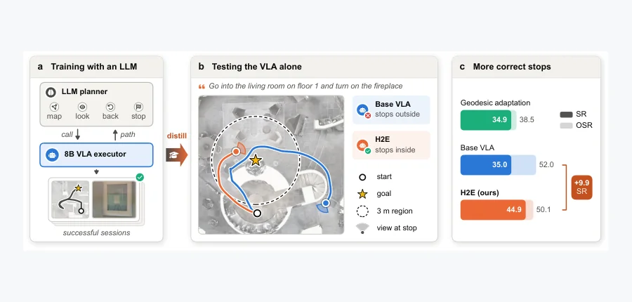 arXiv 2026-11-13 · cs.RO · #18 **[What Can a VLA Learn from the Agent That Calls It? Task-Level Experience Distillation for Embodied Navigation](https://arxiv.org/abs/2611.16246)** Jinze Tao , Yuxiao Han , Kangkang Dong , Yancong Wei , Xiaojun Zhu , Bokui Chen , Houde Liu Affiliation · Tsinghua Shenzhen International Graduate School, Tsinghua University [Paper](https://arxiv.org/abs/2611.16246) · [Figure source](https://arxiv.org/html/2611.16246v1/fig_teaser.png) 

[EN] Abstract
Navigation agents use a large language model (LLM) planner to call a vision-language-action (VLA) model. Each episode needs the LLM, adding cost and delay. We distill successful agent experience into the VLA instead of distilling the planner. The VLA then navigates alone at test time. Agent sessions are not VLA demonstrations. They include motions driven by planner tools and sub-instructions, along with detours. We present H2E, a task-level experience distillation method that converts these sessions into VLA training data. Every motion becomes a VLA action under the original task instruction, with the resulting poses as targets. H2E masks the loss on steps that move away from the goal. It labels every visited state within 1 m of the goal as a stop. We then update the VLA with low-rank adaptation. The VLA learns to stop at the goal and find goals the base model never reaches. On all 3,189 REVERIE-CE val-unseen episodes, H2E raises the success rate of an 8B VLA from 35.0% to 44.9%. <a href="https://arxiv.org/list/cs/new?show=2000#2611.16246">Source</a>

[ZH] Abstract
导航代理使用大语言模型（LLM）规划器调用视觉语言行动（VLA）模型。每个回合都需要LLM，增加成本与延迟。我们将成功的代理经验蒸馏进VLA，而非蒸馏规划器。此后，VLA在测试时独立导航。代理会话并不是VLA示范，它们包含由规划器工具和子指令驱动的运动，也包含绕路。我们提出H2E，一种任务级经验蒸馏方法，将这些会话转换为VLA训练数据。每个运动都成为原始任务指令下的VLA动作，以运动后位姿作为目标。H2E对远离目标的步骤屏蔽损失，并将距离目标1米以内的每个已访问状态标记为停止。随后，我们通过低秩适配更新VLA。VLA学会在目标处停止，并找到基础模型从未到达的目标。在全部3,189个REVERIE-CE val-unseen回合上，H2E将一个8B VLA的成功率从35.0%提升到44.9%。 <a href="https://arxiv.org/list/cs/new?show=2000#2611.16246">Source</a>
 |
| 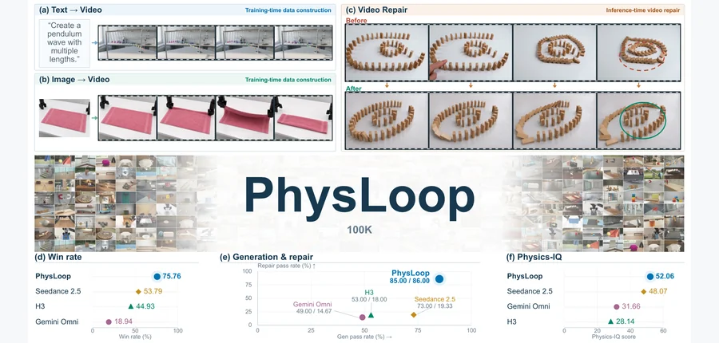 arXiv 2026-11-13 · cs.CV · #19 **[PhysLoop: Harnessing LLMs' Physics Awareness for Self-Improving Video Generation Models](https://arxiv.org/abs/2611.16748)** Yuxuan Chen , Xiaojie Li , Hao Chen , Juncheng Ma , Kewei Zhang , Zhongjing Du , Guoqiang Wei , Fangfang Wang , Zhen Dong… Affiliation · Peking University / ByteDance Seed / University of California, Santa Barbara / Massachusetts Institute of Technology / Universität Hamburg / Hangzhou Normal University [Paper](https://arxiv.org/abs/2611.16748) · [Project](https://chenyx24.github.io/PhysLoop-site/) · [Figure source](https://arxiv.org/html/2611.16748v1/fig1_teaser_image.png) 

[EN] Abstract
Video generation models produce visually realistic videos but still struggle with physical dynamics and causal consistency. Learning from generated videos requires fine-grained physical supervision, yet reliable quality judgments, correction pairs, and controlled variations are difficult to obtain. Large language models (LLMs) possess physical knowledge, but struggle to reliably guide video generation models in producing their training videos. We present PhysLoop, a unified harness designed to support physically grounded self-improvement in video generation models. The harness guides and constrains LLMs throughout video generation, selection, and correction, distilling their physical knowledge into physically consistent videos. The framework supports controllable training-data construction and inference-time video repair. By identifying and correcting failures, PhysLoop marks a key milestone toward recursive self-improvement (RSI) in video generation models with limited human intervention. We release 100K videos spanning diverse, realistic indoor and outdoor scenes, along with generation tools and two evaluation datasets: PhysLoop-Gen and PhysLoop-Repair. We evaluate controllable generation and localized repair on these datasets, respectively, and assess physical behavior on the external Physics-IQ Verified benchmark. <a href="https://arxiv.org/list/cs/new?show=2000#2611.16748">Source</a>

[ZH] Abstract
视频生成模型能够产生视觉上逼真的视频，但对物理动力学和因果一致性仍然处理不足。从生成视频中学习需要细粒度物理监督，然而可靠的质量判断、纠正配对和受控变化都难以获得。大语言模型（LLM）拥有物理知识，却难以可靠地指导视频生成模型制作训练视频。我们提出PhysLoop，一个统一框架，旨在支持视频生成模型进行基于物理的自我改进。该框架在视频生成、筛选和纠正的全过程指导并约束LLM，将其物理知识蒸馏为物理一致的视频。框架支持可控训练数据构建和推理时视频修复。通过识别并纠正失败，PhysLoop成为视频生成模型在有限人工干预下迈向递归自我改进（RSI）的一个重要里程碑。我们发布了覆盖多样、真实室内外场景的10万段视频，以及生成工具和两个评估数据集：PhysLoop-Gen和PhysLoop-Repair。我们分别在这两个数据集上评估可控生成与局部修复，并在外部Physics-IQ Verified基准上评估物理行为。 <a href="https://arxiv.org/list/cs/new?show=2000#2611.16748">Source</a>
 | 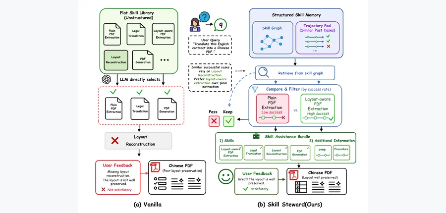 arXiv 2026-11-13 · cs.AI · #20 **[Skill Adapter: Personalized Modification and Online Routing of General-Purpose Skills](https://arxiv.org/abs/2611.17007)** Qijia Zhuang , Yanyi Gou , Wenbin Ma , Yuxiang Ren Affiliation · Nanjing University / Jiangnan University [Paper](https://arxiv.org/abs/2611.17007) · [Figure source](https://arxiv.org/html/2611.17007v1/figures/figure-01.png) 

[EN] Abstract
Large language model (LLM) agents use external skills to reuse task procedures and experience with tools. General-purpose skills describe shared execution procedures, while specific tool choices, operating practices, and output requirements vary across users. In long-horizon tasks, subgoals, available inputs, and environmental states change as execution progresses. Agents must select currently applicable skills from an expanding skill pool and prepare candidates for subsequent steps. We propose Skill Adapter, which enables personalized modification and online routing of general-purpose skills. The system distills local adjustments from user requirements and execution feedback and stores them as Adapters linked to general-purpose skills. The routing agent selects general-purpose skills and applicable Adapters based on the current subtask, execution progress, and environmental feedback, incrementally maintaining a task-level online skill library that the main LLM reads on demand. The system preloads candidates for subsequent nodes and rechecks their applicability once actual inputs are determined. Reinforcement learning optimizes the two types of decisions using modification gains and routing outcomes, respectively. We evaluate Skill Adapter on ALFWorld, WebShop, and SkillsBench. Compared with SkillRL, it improves task success rates by an average of 11.43 percentage points and reduces mean execution time on all three benchmarks. Skill Adapter retains its performance advantage when the skill pool grows to 1,000 skills. <a href="https://arxiv.org/list/cs/new?show=2000#2611.17007">Source</a>

[ZH] Abstract
大语言模型（LLM）代理使用外部技能来复用任务流程和工具使用经验。通用技能描述共享执行流程，而具体工具选择、操作习惯和输出要求因用户而异。在长时程任务中，子目标、可用输入和环境状态随执行不断变化。代理必须从扩大的技能池中选择当前适用的技能，并为后续步骤准备候选。我们提出Skill Adapter，支持对通用技能进行个性化修改与在线路由。系统从用户要求和执行反馈中提炼局部调整，将其保存为与通用技能关联的Adapter。路由代理依据当前子任务、执行进度和环境反馈，选择通用技能与适用Adapter，增量维护一个供主LLM按需读取的任务级在线技能库。系统提前加载后续节点的候选，并在实际输入确定后重新检查其适用性。强化学习分别利用修改收益和路由结果，优化这两类决策。我们在ALFWorld、WebShop和SkillsBench上评估Skill Adapter。相较SkillRL，它平均提高任务成功率11.43个百分点，并在全部三个基准上缩短平均执行时间。当技能池扩大到1,000项技能时，Skill Adapter仍保留性能优势。 <a href="https://arxiv.org/list/cs/new?show=2000#2611.17007">Source</a>
 | 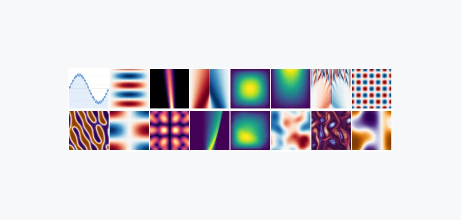 arXiv 2026-11-13 · cs.AI · #21 **[RSI-PDEbench: A Benchmark for Self-Improving Agents in PDE Solving](https://arxiv.org/abs/2611.14949)** Binghang Lu , Lang Cao , Changhong Mou , Yige Sun , Cindy Xiangrui Kong , Zheyuan Deng , Tian Yuan , Bing Hu , Runyu Zhang… Affiliation · Purdue University / University of Illinois Urbana-Champaign / Utah State University / Independent researcher / Brown University / Massachusetts Institute of Technology / Arizona State University [Paper](https://arxiv.org/abs/2611.14949) · [Project](https://jeremylu916.github.io/RSI-PDE/) · [Figure source](https://arxiv.org/html/2611.14949v1/gallery.png) 

[EN] Abstract
Identifying and solving partial differential equations (PDEs) from sampled solution data often requires substantial expert effort in equation discovery, coefficient estimation, and numerical solver configuration, especially under noise and distribution shifts. Can large language model (LLM) agents automate this workflow accurately and efficiently? To investigate this question, we introduce \bench{}, a benchmark of 1,001 cases spanning 42 equation templates, including both classical and fractional PDEs. It provides three evaluation settings: Full evaluates performance on noise-free solution data; Noisy tests robustness to Gaussian noise with an RMS equal to 50\% of the clean-signal RMS; and Hard-OOD tests challenging out-of-distribution generalization to unseen equation templates and shifted coefficient ranges. We further introduce RSI-PDE, a recursively self-improving agent harness that shortlists candidate equations by residual loss, uses relative $L^2$ feedback to refine coefficients and numerical solvers, and applies a validation gate to policy and memory updates. We compare RSI-PDE with single-run baselines and native agent harnesses (Claude Code or Codex) across four frontier models. Across the three settings, RSI-PDE improves the pass rate averaged across the four models by 106.5--181.9\% relative to single-run baselines and by 3.0--19.6\% relative to native harnesses, while reducing total recorded model calls by 46.9\% across the 12 model--setting pairs. These results highlight the potential of validated recursive self-improvement in LLM agents to advance scientific computing. <a href="https://arxiv.org/list/cs/new?show=2000#2611.14949">Source</a>

[ZH] Abstract
从采样的解数据中识别并求解偏微分方程（PDE），通常需要专家在方程发现、系数估计和数值求解器配置上投入大量精力，在噪声与分布变化下尤其如此。大语言模型（LLM）代理能否准确、高效地自动完成这一工作流？为研究此问题，我们提出\bench{}，一个包含1,001个案例、覆盖42种方程模板的基准，包括经典和分数阶PDE。它提供三种评估设置：Full评估无噪声解数据上的表现；Noisy测试对高斯噪声的鲁棒性，其均方根（RMS）等于干净信号RMS的50%；Hard-OOD测试对未见方程模板及偏移系数范围的高难度分布外泛化。我们进一步提出RSI-PDE，一个递归自我改进代理框架，依据残差损失筛选候选方程，利用相对L²反馈完善系数和数值求解器，并对策略和记忆更新实施验证门控。我们在四个前沿模型上，将RSI-PDE与单次运行基线及原生代理框架（Claude Code或Codex）比较。在三种设置中，四个模型平均的通过率相较单次运行基线提高106.5%–181.9%，相较原生框架提高3.0%–19.6%，同时在12个模型—设置组合中，记录的总模型调用数减少46.9%。这些结果展示了经验证的递归自我改进在LLM代理推进科学计算方面的潜力。 <a href="https://arxiv.org/list/cs/new?show=2000#2611.14949">Source</a>
 |
| 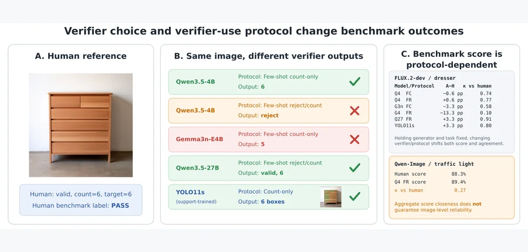 arXiv 2026-11-13 · cs.CV · #22 **[Verifier Choice is a Benchmark Design Variable: Auditing Structural Counting Evaluation in Text-to-Image Models](https://arxiv.org/abs/2611.15433)** Shurun Li , Michael Hua Wang , Haibo Zeng , Long Wang Affiliation · Tsinghua University / Virginia Tech [Paper](https://arxiv.org/abs/2611.15433) · [Code](https://github.com/AzusaCat1111/verifier-choice-audit) · [Figure source](https://arxiv.org/html/2611.15433v1/intro.png) 

[EN] Abstract
Automatic evaluation is now central to text-to-image benchmarking, but the verifier that converts generated images into scores is often treated as an implementation detail. We argue that this is unsafe: an automatic benchmark score is a property of the image generator, prompt distribution, verifier, verifier-use protocol, and scoring rule, not of the generator alone. We study this issue in structural counting, a controlled setting where human-visible counts can be audited. We construct a verifier-centric audit suite over seven counting objects: cell phones, chairs, and traffic lights for object counting, and clover leaflets, dresser drawer fronts, power-strip sockets, and turbine blades for substructure counting. Across 6,240 generated images from Qwen-Image-2512 and FLUX.2-dev, we compare open MLLM verifiers under count-only, reject-aware, zero-shot and few-shot protocols, plus TIFA-like target queries, a detector baseline, and frontier closed-model checks on two hard objects. On a balanced 2,280-image evaluation split, aggregate score matching can coexist with image-level disagreement, and verifier-use protocols and generator distributions change the measured reliability. Every verifier-protocol configuration also shrinks the human score difference between the two generators, by 7.5-25.0 pp, and with a third generator, Z-Image, all four tested protocols reverse the human ordering of Z-Image and FLUX.2-dev on our fixed prompt suite. GPT-5.5 and Claude Opus 4.7 checks do not remove the failure modes: GPT-5.5 still has only 59.92% clover valid-count fidelity, while Claude Opus 4.7 has lower same-slice agreement ($\kappa=0.432$). We propose reporting automatic benchmark scores with a factorized verifier reliability profile: aggregate score gap, image-level agreement, generator-comparison distortion, valid-image count fidelity, rejection behavior, output compliance, and directional bias. <a href="https://arxiv.org/list/cs/new?show=2000#2611.15433">Source</a>

[ZH] Abstract
自动评估如今已成为文本生成图像基准的核心，但将生成图像转换为分数的验证器，往往被视为实现细节。我们认为这并不安全：自动基准分数是图像生成器、提示分布、验证器、验证器使用协议与评分规则的共同属性，而非仅属于生成器。我们在结构计数这一可以审计人类可见数量的受控场景中研究此问题。我们围绕七类计数对象构建以验证器为中心的审计套件：物体计数包括手机、椅子和交通灯，子结构计数包括三叶草叶片、抽屉柜正面、插线板插孔和涡轮叶片。在Qwen-Image-2512和FLUX.2-dev生成的6,240张图像上，我们比较开放MLLM验证器在仅计数、考虑拒绝、零样本和少样本协议下的表现，以及类似TIFA的目标查询、检测器基线和在两个困难对象上的前沿闭源模型检查。在平衡的2,280张评估图像上，汇总分数匹配可以与图像级分歧同时存在，验证器使用协议和生成器分布也会改变测得的可靠性。每一种验证器—协议配置还会将两个生成器间的人类评分差距缩小7.5–25.0个百分点；加入第三个生成器Z-Image后，在固定提示套件上，四种测试协议均颠倒了人类对Z-Image和FLUX.2-dev的排序。GPT-5.5和Claude Opus 4.7检查也未消除这些失败模式：GPT-5.5对三叶草有效计数的保真度仍只有59.92%，Claude Opus 4.7在相同切片上的一致性更低（κ=0.432）。我们建议报告自动基准分数时，同时提供分解的验证器可靠性档案，包括汇总分数差距、图像级一致性、生成器比较失真、有效图像计数保真度、拒绝行为、输出合规性与方向性偏差。 <a href="https://arxiv.org/list/cs/new?show=2000#2611.15433">Source</a>
 | 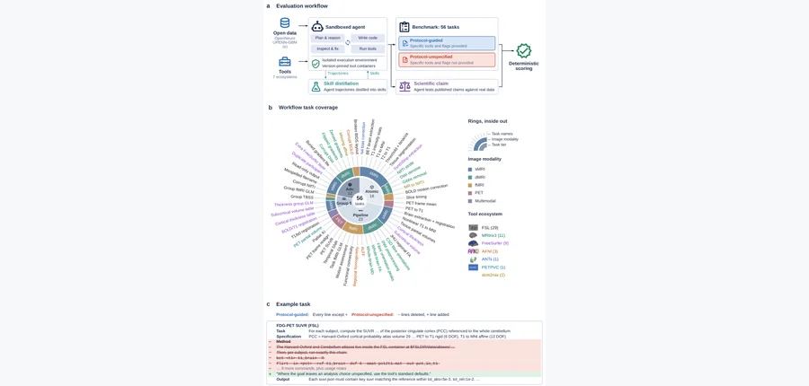 arXiv 2026-11-13 · cs.AI · #23 **[NIBench: benchmarking autonomous AI agents for execution, skill evolution and scientific judgment in neuroimaging](https://arxiv.org/abs/2611.15831)** Lujia Zhong , Yihao Xia , Jianwei Zhang , Shuo Huang , Xinyu Nie , Mingyang Xia , Zhiwei Deng , Jiaxin Yue , Xinkai Wang… Affiliation · University of Southern California / University of Chicago / Harvard Medical School / UChicago Medicine [Paper](https://arxiv.org/abs/2611.15831) · [Figure source](https://arxiv.org/html/2611.15831v1/fig1.png) 

[EN] Abstract
Autonomous AI agents are increasingly used to automate biomedical research, creating a growing need to benchmark their capabilities on real scientific data and workflows. Their reliability in neuroimaging remains insufficiently characterized, where plausible analytical outputs can conceal errors that affect scientific conclusions. Existing studies have advanced scientific question answering and tool-based automation, but provide limited evidence on workflow reconstruction, acquisition of procedural expertise and evidence-based scientific judgment. Here we present NIBench, a neuroimaging benchmark comprising three complementary evaluations of autonomous agents. First, we benchmark execution and workflow reconstruction using 56 tasks across seven tool ecosystems, covering structural, diffusion and functional magnetic resonance imaging, positron emission tomography and multimodal analyses. Second, we examine whether agents can evolve their procedural skills through distillation of execution trajectories, evaluating the resulting skills on previously encountered tasks, unseen tasks and other models. Third, we assess scientific judgment using 36 claims from published Alzheimer's disease studies, requiring agents to analyse raw cohort data and provide reproducible evidence. We evaluate 19 language models within a shared agent framework, with selected models undergoing skill distillation and claim evaluation. Leading agents execute supplied analysis protocols nearly perfectly, whereas withholding procedural guidance widens performance differences. Distilled skills improve performance on acquisition tasks and transfer between models, but benefits on unseen tasks are inconsistent. Agents reproduce their reported results yet sometimes reach conclusions inconsistent with expert-derived answers, and access to data does not always improve judgment. <a href="https://arxiv.org/list/cs/new?show=2000#2611.15831">Source</a>

[ZH] Abstract
自主AI代理越来越多地用于自动化生物医学研究，因此亟需在真实科学数据和工作流上评测其能力。它们在神经影像中的可靠性仍缺乏充分刻画，因为看似合理的分析输出可能掩盖影响科学结论的错误。现有研究推进了科学问答和基于工具的自动化，但对工作流重建、程序性专长获取及基于证据的科学判断，提供的证据仍然有限。我们提出NIBench，一个包含三类互补自主代理评估的神经影像基准。首先，我们通过七种工具生态中的56项任务评测执行与工作流重建，覆盖结构、扩散和功能磁共振成像、正电子发射断层成像以及多模态分析。其次，我们研究代理能否通过蒸馏执行轨迹进化程序性技能，并在先前遇到的任务、未见任务和其他模型上评估所得技能。第三，我们利用已发表阿尔茨海默病研究中的36项主张评估科学判断，要求代理分析原始队列数据并提供可复现证据。我们在共享代理框架下评估19个语言模型，并对选定模型开展技能蒸馏和主张评估。领先代理几乎能够完美执行给定分析协议，而撤去流程指导则会扩大性能差距。蒸馏技能能够改善获取这些技能时使用的任务表现，并支持模型间迁移，但对未见任务的收益不一致。代理能够复现其报告结果，却有时得出与专家答案不一致的结论，数据访问也并非总能改善判断。 <a href="https://arxiv.org/list/cs/new?show=2000#2611.15831">Source</a>
 | 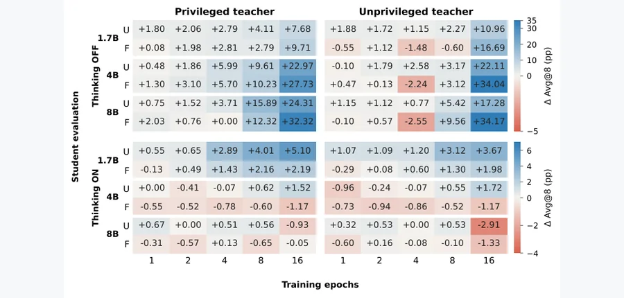 arXiv 2026-11-13 · cs.CL · #24 **[Privileged Information Does Not Guarantee Privileged Guidance: Auditing On-Policy Self-Distillation for Reasoning Models](https://arxiv.org/abs/2611.16064)** Haoyi Qiu , Akshat Agarwal Affiliation · Meta Superintelligence Labs / University of California, Los Angeles [Paper](https://arxiv.org/abs/2611.16064) · [Figure source](https://arxiv.org/html/2611.16064v1/05_privilege_interface.png) 

[EN] Abstract
On-policy self-distillation (OPSD) trains a student on next-token targets from a teacher, a frozen copy of the student that additionally receives privileged information, such as a worked solution, hidden from the student. Whether student gains reflect that information remains unclear. Taking the worked solution as privileged information, we audit four stages across three Qwen3 scales on mathematics: Source, whether the teacher can use the solution; Encoding, whether the resulting token targets are useful; Transmission, whether the student learns from the targets; and Expression, whether the student applies the learned behavior without the solution. With the solution, the teacher solves hard problems and recovers from student errors, yet the teacher does not reliably recognize errors, and its token targets do not favor correct trajectories. Repeated training makes successes within the student's reach more frequent rather than unlocking new ones, and corrections the student learns to predict are not reliably expressed in free generation. To isolate the solution's contribution, we vary its availability separately from teacher and student thinking modes. The largest gains occur when a teacher in thinking mode supervises a student trained and evaluated without an explicit thinking trace, and problem-only teachers often match or exceed privileged-solution teachers: the gain tracks the teacher's thinking mode rather than the solution, a pattern we call reasoning arbitrage. Accuracy gains alone therefore do not establish transfer of reasoning from privileged solutions: bottlenecks lie after Source, across Encoding, Transmission, and Expression. Future evaluations must measure what the solution adds to otherwise identical training. <a href="https://arxiv.org/list/cs/new?show=2000#2611.16064">Source</a>

[ZH] Abstract
在策略自蒸馏（OPSD）利用教师的下一token目标训练学生，教师是学生的冻结副本，但额外接收学生看不到的特权信息，例如完整解答。学生收益是否反映这些信息的作用，目前仍不清楚。我们以完整解答为特权信息，在数学任务的三个Qwen3规模上审计四个阶段：来源，即教师能否使用解答；编码，即所得token目标是否有用；传递，即学生能否从目标中学习；表达，即学生能否在没有解答时应用学得行为。有解答时，教师能够解决困难问题并从学生错误中恢复，但不能可靠识别错误，其token目标也不偏向正确轨迹。重复训练让学生能力范围内的成功更频繁，而没有解锁新成功；学生学会预测的纠正，也不能可靠地在自由生成中表达。为分离解答的贡献，我们将解答可用性与教师、学生的思考模式分别变化。最大收益出现在思考模式教师监督一个训练和评估时不含显式思考轨迹的学生时；只看问题的教师经常达到或超过拥有特权解答的教师。收益随教师思考模式变化，而非随解答变化，我们将这一模式称为推理套利。因此，仅凭准确率提升不能证明从特权解答迁移了推理能力：瓶颈位于来源之后的编码、传递和表达阶段。未来评估必须测量解答相较其他条件完全一致的训练，额外贡献了什么。 <a href="https://arxiv.org/list/cs/new?show=2000#2611.16064">Source</a>
 |
| 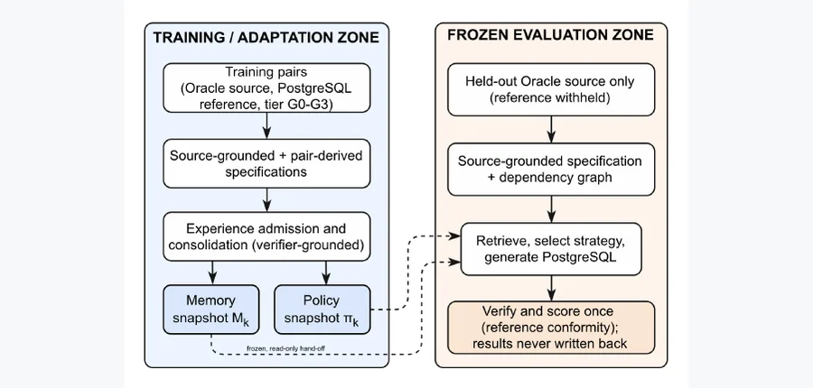 arXiv 2026-11-13 · cs.LO · #25 **[Does a Self-Learning Migration Agent Learn? An Audited Evaluation of Evidence-Graded Experience Memory for Oracle-to-PostgreSQL Migration](https://arxiv.org/abs/2611.16143)** Oleg Grynets , Vasyl Lyashkevych , Valeriia Oliferuk , Vladyslav Babenko , Danylo Kovalchuk , Dmytro Kostetskyi Affiliation · EPAM Systems [Paper](https://arxiv.org/abs/2611.16143) · [Figure source](https://arxiv.org/pdf/2611.16143) 

[EN] Abstract
Do large language model (LLM) migration agents learn from accumulated experience, or do apparent gains reflect retrieval and reference reuse? We evaluate an evidence-graded agent for Oracle-to-PostgreSQL migration across four studies. On 1,833 documentation-derived source-reference pairs, persistent memory improved reference conformity (RC) over a no-memory baseline by 0.015 [0.004, 0.025], while policy adaptation added no gain (-0.004 [-0.010, 0.001]). An audit found that 264 of 367 held-out units (72%) shared a PostgreSQL reference with training, and the memory effect on the 103 leak-free units fell to 0.002 [-0.008, 0.011]. A model-free nearest-target copy baseline scored RC 0.222, outperforming all LLM systems (at most 0.163). A reference-grouped split reduced copying to 0.119; a rerun on 374 units in 118 independent target groups found no statistically distinguishable memory effect (0.005 [-0.003, 0.017]) and no policy effect. A separate Oracle-grounded evaluation on 216-224 real PL/SQL units showed that 10-22% of PostgreSQL-accepted units were behaviorally incorrect; a human-gated fix cycle increased demonstrably correct units from 98/216 to 167/224. A write-back study showed a 54% decline in retrieval margin as the knowledge base grew from 12 to 1,200 entries. We derive six evaluation rules that distinguish cross-task learning from reference leakage, copying, metric artifacts, and unstable feedback. <a href="https://arxiv.org/list/cs/new?show=2000#2611.16143">Source</a>

[ZH] Abstract
大语言模型（LLM）迁移代理能从累积经验中学习，还是表面收益只反映检索与参考复用？我们通过四项研究评估一个面向Oracle到PostgreSQL迁移的证据分级代理。在1,833个由文档构建的源—参考配对上，持久记忆相较无记忆基线使参考符合度（RC）提高0.015［0.004，0.025］，策略适配则没有增加收益（−0.004［−0.010，0.001］）。审计发现，367个留出单元中有264个（72%）与训练共享PostgreSQL参考；在103个无泄漏单元上，记忆效应降至0.002［−0.008，0.011］。无模型最近目标复制基线的RC为0.222，超过全部LLM系统（最高0.163）。按参考分组划分后，复制分数降至0.119；在118个独立目标组的374个单元上重跑，未发现统计可区分的记忆效应（0.005［−0.003，0.017］），也没有策略效应。另一项基于真实Oracle的评估覆盖216–224个真实PL/SQL单元，表明通过PostgreSQL验收的单元中有10%–22%在行为上不正确；人工门控修复循环将已证明正确的单元从98/216提高到167/224。写回研究显示，当知识库从12条增加到1,200条时，检索间隔下降54%。我们推导六条评估规则，以区分跨任务学习与参考泄漏、复制、指标伪象和不稳定反馈。 <a href="https://arxiv.org/list/cs/new?show=2000#2611.16143">Source</a>
 | 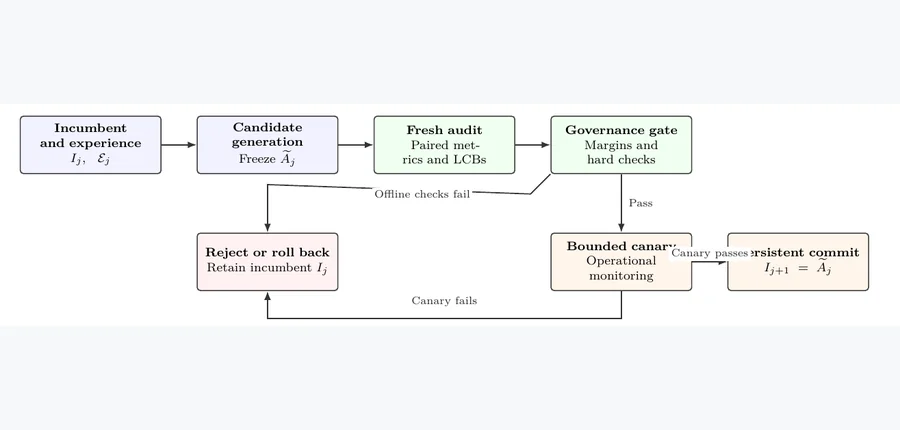 arXiv 2026-11-13 · cs.AI · #26 **[Evidence-Governed Adoption of Self-Generated Updates in Autonomous AI Agents](https://arxiv.org/abs/2611.16378)** Subodh Lonkar Affiliation · Independent researcher [Paper](https://arxiv.org/abs/2611.16378) · [Figure source](https://arxiv.org/pdf/2611.16378) 

[EN] Abstract
Autonomous agents modify prompts, memories, tools, workflows, and policies using interaction histories. Yet a plausible modification is not necessarily suitable for persistent adoption: candidate selection is adaptive, evaluators may be imperfect, and local gains can hide degradation against an earlier baseline. We introduce Evidence-Governed Evolution (EGE), a framework for governing adoption of self-generated agent modifications. EGE separates candidate generation from confirmatory adoption, evaluates frozen candidates on fresh paired audits, requires meaningful improvement on a prespecified primary objective, protects declared capabilities through reference-relative non-inferiority tests, and applies governance constraints before bounded canary deployment. We establish an evaluator-calibrated simultaneous lower-bound construction for a countable sequence of adaptively generated candidates. It combines candidate-wise Hoeffding bounds with independent calibration samples comparing the operational evaluator with a prespecified reference procedure. We also formalise reference replacement through bridge tests, derive a cumulative degradation bound along a versioned reference lineage, and provide an audit-planning condition relating effect-size margin, sample sizes, and acceptance probability. A Monte Carlo stress test illustrates calibration under candidate-dependent evaluator optimism; it is a stylised statistical experiment, not an evaluation of a deployed agent. The guarantees are conditional on bounded paired scores, fresh sampling, a valid reference-evaluation construct, and declared evaluation distributions; they do not establish universal agent safety or robustness to arbitrary distribution shift. <a href="https://arxiv.org/list/cs/new?show=2000#2611.16378">Source</a>

[ZH] Abstract
自主代理利用交互历史修改提示、记忆、工具、工作流和策略。然而，看似合理的修改未必适合持久采纳：候选选择具有适应性，评估器可能不完善，局部收益也可能掩盖相对早期基线的退化。我们提出Evidence-Governed Evolution（EGE），一个治理代理自生成修改采纳过程的框架。EGE将候选生成与确认性采纳分离，在新鲜配对审计上评估冻结候选，要求预先指定的主要目标获得有意义的提升，通过相对参考的非劣效检验保护声明的能力，并在有界金丝雀部署前施加治理约束。我们针对可数个自适应生成的候选序列，建立经评估器校准的同时下界构造。它将逐候选Hoeffding界，与比较操作评估器和预先指定参考程序的独立校准样本结合。我们还通过桥接检验形式化参考替换，推导沿版本化参考谱系的累积退化界，并给出将效应量裕度、样本数与接受概率关联的审计规划条件。蒙特卡洛压力测试展示了候选相关评估器乐观偏差下的校准情况；这是程式化统计实验，不是对已部署代理的评估。这些保证以有界配对分数、新鲜采样、有效的参考评估构造及声明的评估分布为条件，不能证明普遍的代理安全或对任意分布变化的鲁棒性。 <a href="https://arxiv.org/list/cs/new?show=2000#2611.16378">Source</a>
 | 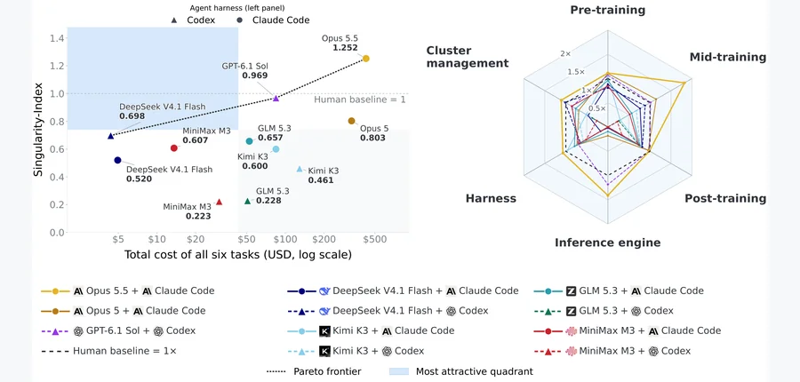 arXiv 2026-11-13 · cs.AI · #27 **[Singularity-Bench: Can Agents Build Agents?](https://arxiv.org/abs/2611.16591)** Yang Zhou , Krish Agarwal , Zhuoming Chen , Zerui Wang , Zhenyu Zhang , Wenshuang Li , Xinpeng Wei , Zhichen Zeng , Jingyu… Affiliation · Carnegie Mellon University / NVIDIA / The University of Texas at Austin / HKUST / Amazon AGI / RadixArk / University of Chicago / Together AI / Alation / Meta / University of California, Santa Barbara / University of Illinois Urbana-Champaign [Paper](https://arxiv.org/abs/2611.16591) · [Project](https://infini-ai-lab.github.io/singularity-bench/) · [Figure source](https://arxiv.org/html/2611.16591v1/figure1.png) 

[EN] Abstract
Frontier AI agents increasingly succeed on realistic, long-horizon tasks and are beginning to improve the systems through which they operate. Yet existing benchmarks often restrict agents to narrow action spaces, use simplified environments, or rely on verification methods that are unreliable for evaluating arbitrary agent-generated systems. We introduce Singularity-Bench, an open-ended benchmark for autonomous AI development with six end-to-end tasks spanning pre-training, mid-training, post-training, inference, the agent harness, and cluster orchestration. Each task requires agents to implement core systems from a minimal starting point and evaluates them against mature human-engineered baselines on identical hardware. Additionally, through extensive red-teaming covering 9 of the 10 categories in the OWASP Top 10 for Agentic Applications, we expose reward-hacking vulnerabilities in the conventional Harbor framework and develop Breakwater, an extension of Harbor that blocks all attacks tested in our study. Across 11 agents built from 7 frontier models and 2 harnesses, Opus 5.5 with Claude Code matches or outperforms the human baseline on all six tasks with a Singularity-Index of 1.25, suggesting it may have the skills needed to reach the singularity. The remaining agents average only 0.58. Our vision is for Singularity-Bench to track how much of AI development agents can already automate and when they may transition from assisting to taking end-to-end responsibility for building stronger successors. <a href="https://arxiv.org/list/cs/new?show=2000#2611.16591">Source</a>

[ZH] Abstract
前沿AI代理越来越能完成现实、长时程任务，也开始改进自身运行所依赖的系统。然而，现有基准往往将代理限制在狭窄行动空间，使用简化环境，或依赖不能可靠评估任意代理生成系统的验证方法。我们提出Singularity-Bench，一个自主AI开发的开放式基准，包含六个端到端任务，覆盖预训练、中期训练、后训练、推理、代理框架和集群编排。每项任务都要求代理从最小起点实现核心系统，并在相同硬件上与成熟的人工工程基线比较。此外，通过覆盖OWASP代理应用十大风险中十类里的九类的广泛红队测试，我们暴露了传统Harbor框架中的奖励投机漏洞，并开发了Harbor扩展Breakwater，阻止了研究中测试的全部攻击。在由七个前沿模型和两个框架构成的11个代理中，使用Claude Code的Opus 5.5在全部六项任务上达到或超过人工基线，Singularity-Index为1.25，提示其可能拥有达到奇点所需的技能。其余代理平均仅为0.58。我们的愿景是让Singularity-Bench追踪代理已经能够自动化多少AI开发工作，以及它们何时可能从辅助转向端到端负责构建更强的后继系统。 <a href="https://arxiv.org/list/cs/new?show=2000#2611.16591">Source</a>
 |
| 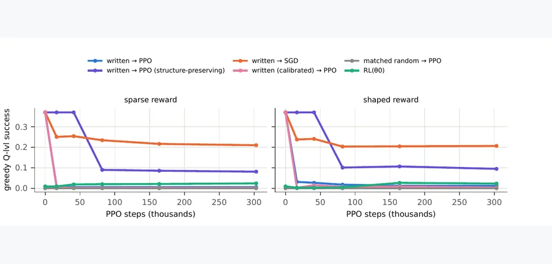 arXiv 2026-11-13 · cs.AI · #28 **[Compiling Known Rules into Compact Neural Agents: Weight-Space Programming on Unseen Games](https://arxiv.org/abs/2611.16981)** Jens Lehmann Affiliation · Amazon / TU Dresden [Paper](https://arxiv.org/abs/2611.16981) · [Code](https://github.com/JensLehmann/weight-space-programming-games/tree/20eee0952edecc0b69865b84373d0345681f6e08) · [Figure source](https://arxiv.org/pdf/2611.16981) 

[EN] Abstract
Weight-space programming (WSP) uses language models to construct neural network weights without training. We test whether known game mechanics can be compiled into compact agents that generalise to held-out levels, renderings and start states within a game family. Writers receive simulator source with held-out level data removed for 20 privately authored, unpublished ARC-AGI-3-style game families. With a fixed 57k-parameter recurrent architecture, the strongest writer reaches 56% held-out-level success with feedback, while the four main writers' Python players reach 97-100%. An exploratory free-architecture condition reaches 68-90%. Learning from support-level examples transfers much less well, but these learners lack the source information given to writers. Written networks have a program-like structure: 93% of parameters are zero, and 90% of the rest are small integers or powers of two. NumPy players under comparable computation caps reach 91%, versus the networks' 79%. Training the strongest writer's architectures from scratch yields about 1% success within our budget. Written fixed-network weights are fragile, and standard PPO removes most of their success. Prompts for noise robustness increase tolerance by about four orders of magnitude for two of three writers, but PPO makes larger updates and still removes most success. These results demonstrate rule-to-network compilation in this setting, while showing limited benefits over Python programs and no successful combination with the tested PPO fine-tuning. <a href="https://arxiv.org/list/cs/new?show=2000#2611.16981">Source</a>

[ZH] Abstract
权重空间编程（WSP）使用语言模型直接构造神经网络权重，无需训练。我们测试能否将已知游戏机制编译为紧凑代理，在同一游戏族内泛化到留出的关卡、渲染与起始状态。对于20个私人编写、未发表的ARC-AGI-3风格游戏族，编写者获得移除了留出关卡数据的模拟器源码。在固定的5.7万参数循环架构下，最强编写者在有反馈时达到56%的留出关卡成功率，而四个主要编写者的Python玩家达到97%–100%。探索性的自由架构条件达到68%–90%。从支持关卡样例中学习的迁移表现明显更弱，但这些学习者没有获得编写者所拥有的源码信息。写出的网络具有程序式结构：93%的参数为零，其余参数的90%是小整数或2的幂。在相近计算上限下，NumPy玩家达到91%，网络为79%。在我们的预算内，从头训练最强编写者的架构仅得到约1%成功率。写出的固定网络权重较脆弱，标准PPO消除了其大部分成功表现。要求噪声鲁棒性的提示，使三个编写者中的两个的容忍度提高约四个数量级，但PPO造成更大的更新，仍消除了大部分成功表现。这些结果展示了该设置中的规则到网络编译，同时表明相较Python程序的收益有限，并且未能成功结合所测试的PPO微调。 <a href="https://arxiv.org/list/cs/new?show=2000#2611.16981">Source</a>
 |   |   |
<!-- PAPER_CARDS_END -->

## Retrieval overview

**28 selected papers, comprising 9 A / 11 B / 8 C.** Collected on **14 November 2026 (Beijing)**. The official announcement batch is **Friday, 13 November 2026**. Canonical retrieval completed at approximately **09:04:39 Beijing**. A later supported `skip=0` confirmation with a no-cache request header reproduced both sources' complete first-page section IDs and counts. [Run record](../../data/runs/2026-11-14.json)

| Official source | Batch | New | Cross | Replacement | Coverage |
|---|---|---:|---:|---:|---|
| [Computer Science](https://arxiv.org/list/cs/new?show=2000) | 2026-11-13 | 1,151 | 127 | 776 | All 2,054 entries across two pages |
| [stat.ML](https://arxiv.org/list/stat.ML/new?show=2000) | 2026-11-13 | 16 | 36 | 44 | All 96 entries on one page |
| Total | 2026-11-13 | 1,167 | 163 | 820 | All 2,150 entries, 1,167 distinct New IDs |

Complete New metadata and English abstracts are retained for **1,167 IDs**. Lexical discovery produced **161 candidates** and a supplemental pool of **306 related-title records**. Focused full-abstract review logged **42 decisions**, with 28 selections and fourteen nonselections. Ranking and selection are editorial judgments. The CS aggregate covers cs.AI, cs.LG, cs.CL, cs.MA, cs.SE, cs.RO, cs.CV, cs.NE and cs.CR. Selected versionless IDs were checked against historical enrichment, reports and runs. [Run record](../../data/runs/2026-11-14.json)

The preceding run observed the 11 November batch through cached responses. Both official recent-index navigations now move directly from **11 November to 13 November**. Explicit date-shaped listing requests for 12 November returned HTTP 400. The CS recent index reports 1,286 Friday entries, eight more than the canonical New-plus-Cross total of 1,278. Its date navigation is retained as supporting evidence, while main-list membership follows the fully paginated New sections and their confirmation. Cache headers and this index discrepancy remain recorded. The historical **22 October bulk-New membership gap remains unresolved**. [CS recent index](https://arxiv.org/list/cs/recent?show=2000) · [stat.ML recent index](https://arxiv.org/list/stat.ML/recent?show=2000) · [Run record](../../data/runs/2026-11-14.json)

Coverage is **28 rows / 28 cards / 28 complete EN abstracts / 28 complete ZH abstracts**, with independent language disclosures per paper. All **28 genuine source figures** were visually checked, comprising **21 HTML figures and seven PDF crops**. Placeholder count is **zero**. Affiliations were verified from official author blocks and PDF first pages, including MIGRO's logo-only institutions. [Run record](../../data/runs/2026-11-14.json)

## Reading guide

A denotes direct RSI, B self-improvement mechanisms, and C evaluation and limits. Order is tier followed by arXiv ID. Tiering, priorities, mechanism interpretations and research ideas are **editorial inference**. Numerical findings are **author reports**. Review uses complete original abstracts, author blocks, figures, resource pages and selected paper passages. Independent reproductions performed for this issue total **zero**.

EasyFoam retains tested CFD skill edits, Together Compiler hill-climbs inference engines, AutoAssumption changes formally checked algorithm assumptions, and MAPE evolves whole memory programs. Each loop has a distinct persistent artifact and an acceptance process. The teacher-free customer-service study changes both external policy skills and LoRA weights across two rounds. [EasyFoam](https://arxiv.org/abs/2611.14525) · [Together Compiler](https://arxiv.org/abs/2611.14681) · [AutoAssumption](https://arxiv.org/abs/2611.14844) · [MAPE](https://arxiv.org/abs/2611.17068) · [Harness/weight co-evolution](https://arxiv.org/abs/2611.15268)

Experience-Handoff RL trains the model behaviors that produce future playbooks under a fixed scaffold. CoReMem prices memory on successive tasks with inherited repository state. Verify by Doing evolves procedures inside one task, and H2E performs experience distillation into VLA weights. Their reuse horizons and learning scopes are stated separately in the notes. [Experience-Handoff RL](https://arxiv.org/abs/2611.16409) · [CoReMem](https://arxiv.org/abs/2611.17316) · [Verify by Doing](https://arxiv.org/abs/2611.15276) · [H2E](https://arxiv.org/abs/2611.16246)

The migration audit controls reference leakage and copying. NIBench separates reproducible execution from scientific judgment. EGE gives conditional statistical adoption guarantees, while Singularity-Bench measures six finite systems-building tasks. These provide distinct tests of learning, verification and capability attribution. [Migration audit](https://arxiv.org/abs/2611.16143) · [NIBench](https://arxiv.org/abs/2611.15831) · [EGE](https://arxiv.org/abs/2611.16378) · [Singularity-Bench](https://arxiv.org/abs/2611.16591)

## Tiered Top papers

| # | Paper | Categories | Authors | Affiliation | Tier | Update target | Reading priority |
|---:|---|---|---|---|---|---|---|
| 1 | [EasyFoam: Skill-Oriented OpenFOAM Agents with Evidence-Driven Evolution](https://arxiv.org/abs/2611.14525) | Computational Engineering, Finance, and Science (cs.CE) ; Artificial Intelligence (cs.AI) | Peng Yin , Zhiwei Chen , Tianyi Liu , Chen Li , Kai Li , Jian Cheng | Institute of Automation, Chinese Academy of Sciences / Nanjing University / State Key Laboratory of Aerodynamics | A | External CFD skill files and reusable workflow procedures | Priority read |
| 2 | [Together Compiler: Continual Compilation for AI Inference](https://arxiv.org/abs/2611.14681) | Artificial Intelligence (cs.AI) | Reyna Abhyankar , Dylan Lim , Drew Wadsworth , Venkata Hasith Vattikuti , YuTong Julia Zhang , Jung Hwan Heo , Taeksang Kim , Kesavan Ramakrishnan , Evangelene Stanley , Xinyu Fang , Daniel Y. Fu , Simran Arora | Together AI Research | A | Inference-engine programs and optimization context | Topical reference |
| 3 | [AutoAssumption: Searching over Assumptions Discovers ML-Systems Algorithms](https://arxiv.org/abs/2611.14844) | Artificial Intelligence (cs.AI) ; Machine Learning (cs.LG) | Igor Sadalski , Minghao Guo , Benjamin Jones , Wojciech Matusik | MIT CSAIL | A | Algorithm assumptions, Lean proofs and generated implementations | Topical reference |
| 4 | [Knowledge in the Harness, Reliability in the Weights: Teacher-Free Co-Evolution of an LLM Agent](https://arxiv.org/abs/2611.15268) | Computation and Language (cs.CL) ; Artificial Intelligence (cs.AI); Machine Learning (cs.LG) | Yujia Zhang , Xinqi Ren , Shixiong Zhou , Jia Meng | Brightendata | A | External policy skills and model LoRA parameters | Priority read |
| 5 | [Where Autonomy Belongs: A Separation of Powers for Agentic Program Evolution](https://arxiv.org/abs/2611.15309) | Artificial Intelligence (cs.AI) ; Multiagent Systems (cs.MA) | Zhengyang Ai , Tong Liu , Jingxian Tang , Xiaobing Du , Tao Xiao , Fengshi Zhang , Zishuo Li , Xiaodong Ai , Pinyan Lu | Huawei Taylor Lab / Shanghai University of Finance and Economics | A | Program populations, governance state and proposal procedures | Topical reference |
| 6 | [MULTILOOP: Evolving Multi-Agent Harnesses for Complex Information-Seeking Tasks](https://arxiv.org/abs/2611.15754) | Multiagent Systems (cs.MA) | Daniela Gottesman , Gal Yona , Ori Ram , Zorik Gekhman , Jonathan Herzig , Mor Geva , Roee Aharoni | Tel Aviv University / Google Research | A | Multi-agent harness code and orchestration logic | Topical reference |
| 7 | [Experience-Handoff Reinforcement Learning for Recursive Self-Improvement](https://arxiv.org/abs/2611.16409) | Machine Learning (cs.LG) ; Computation and Language (cs.CL) | Doyoung Kim , Byeongguk Jeon , Kailin Zhang , Sherry Yang | New York University / KAIST AI | A | Shared model parameters for actor, reflector and playbook curator | Priority read |
| 8 | [Discovering Effective Agent Memory Designs through Program Evolution](https://arxiv.org/abs/2611.17068) | Computation and Language (cs.CL) ; Artificial Intelligence (cs.AI) | Xinheng Ding , Seyyed Saeid Cheshmi , Ziyang Zhang , Tairan Chen , Wenya Xie , Yu Hou , Rui Zhang , Zirui Liu | University of Minnesota / Stevens Institute of Technology | A | Whole executable memory programs and their archive | Topical reference |
| 9 | [CoReMem: Cost-Internalizing Memory for Successive Coding Tasks with Prospective Valuation](https://arxiv.org/abs/2611.17316) | Artificial Intelligence (cs.AI) ; Computation and Language (cs.CL); Software Engineering (cs.SE) | Peiwen Li (Yale University), Harshit Verma (Yale University), Sophia Zhou (Yale University), Haiwen Wang (Yale University), Ngoc Bui (Yale University), Heng Chang (Tsinghua University), Fei Fei (Goodvision AI), David van Dijk (Yale University), Rex Ying (Yale University) | Yale University / Tsinghua University / Goodvision AI | A | Repository memory segments and the actor policy | Priority read |
| 10 | [SPIRE: Task-agnostic embodied continual learning through autonomous situation inference and causal motor-primitive reuse](https://arxiv.org/abs/2611.14840) | Machine Learning (cs.LG) ; Robotics (cs.RO) | Yiyang Jia , Mingyang Lyu , Gongce Cao , Feifei Zhao , Yinqian Sun , Yi Zeng | University College London / Institute of Automation, Chinese Academy of Sciences / University of Chinese Academy of Sciences / Renmin University of China | B | Context-specific motor actors and reusable protected primitives | Topical reference |
| 11 | [HyperSkill: Training-Free Omnimodal GRPO via Hypergraph-Indexed Skill-Library Evolution](https://arxiv.org/abs/2611.15178) | Artificial Intelligence (cs.AI) | Haoran Luo , Shangkai Lin , Jinyang Wu , Xinliang Zhou , Luu Anh Tuan | Nanyang Technological University / Tsinghua University / Stanford University / VinUniversity | B | External hypergraph-indexed skills and execution protocols | Topical reference |
| 12 | [Verify by Doing: Co-Evolving Agent Execution and Evaluation without External Feedback](https://arxiv.org/abs/2611.15276) | Artificial Intelligence (cs.AI) | Yitong Lin , Jianda Chen , Yihao Hu , Pan Wang , Hang Wang , Zhihao Wen , Xiaoxue Ren , Wei Wu | Ant International / Zhejiang University | B | Task-local Actor and Evaluator harnesses | Topical reference |
| 13 | [MIGRO: A Decoupled and Portable Long-Term Memory System for Language Models](https://arxiv.org/abs/2611.15315) | Artificial Intelligence (cs.AI) | Mingxi Zou , Yinghui Xu , Jiaxiang Chen , Langzhang Liang , Wei Zhu , Peng Ye , Runkai Zhao , Ruoxi Jiang , Sijin Chen , Song Wang , Zhuo Wang , Lizhen Qu , Zenglin Xu | Fudan University / Shanghai Academy of AI for Science / Shanghai AI Laboratory / Yunnan University / Monash University / The University of Hong Kong / Zoom | B | Persistent evidence archives, retrieval addresses and host interfaces | Topical reference |
| 14 | [SkillEarth: Teaching General-Purpose Agents to Act on Earth via Skill Evolution](https://arxiv.org/abs/2611.15481) | Artificial Intelligence (cs.AI) ; Computer Vision and Pattern Recognition (cs.CV) | Haojun Tang , Wenda Zhao , Xiang Zhou , Qiwei Lin , Lida Huang , Yan Wang | Tsinghua University / Dalian University of Technology / Beijing Institute of Radio Measurement | B | Reusable remote-sensing skill files and component refinements | Topical reference |
| 15 | [MemCredit: From Relevance to Utility for Decision-Time Memory in Long-Horizon Web Agents](https://arxiv.org/abs/2611.15600) | Artificial Intelligence (cs.AI) | Quanjiang Guo , Sijie Wang , Qianyang Zhu , Ben Zhang , Jinchuan Zhang , Ke Yan , Zhao Kang | UESTC / Nanyang Technological University | B | A learned memory-utility estimator and selected history | Topical reference |
| 16 | [AskALCF: A Self-Improving Agentic System for Intelligent HPC User Support](https://arxiv.org/abs/2611.15700) | Software Engineering (cs.SE) ; Artificial Intelligence (cs.AI) | Jingyan Jiang , Akhilesh Bondapalli , Krishna Rauniyar , Murat Keceli , Yasaman Ghadar , Haritha Siddabathuni Som , Venkatram Vishwanath , Michael E. Papka , Rong Ge , Huihuo Zheng | Argonne National Laboratory / Clemson University / University of Louisiana at Lafayette | B | Diagnostic harness rules and targeted support-system repairs | Topical reference |
| 17 | [Prior-as-Skill: Remember Outside and Read Inside with On-Policy Self-Distillation for Self-Evolving VLM Agents](https://arxiv.org/abs/2611.15766) | Computer Vision and Pattern Recognition (cs.CV) ; Artificial Intelligence (cs.AI) | Yan Lin , Jingyu Sun , Yifei Qian , Zhengtao Yao , Yuxia Wang , Daizong Liu , Chun Pong Lau , Zhongliang Guo , Stephen McGough | Newcastle University / University of Manchester / University of Melbourne / University of Nottingham / University of Southern California / INSAIT, Sofia University / Wuhan University / City University of Hong Kong / University of Aberdeen | B | An external order prior alongside OPSD-trained visual reading | Topical reference |
| 18 | [What Can a VLA Learn from the Agent That Calls It? Task-Level Experience Distillation for Embodied Navigation](https://arxiv.org/abs/2611.16246) | Robotics (cs.RO) ; Machine Learning (cs.LG) | Jinze Tao , Yuxiao Han , Kangkang Dong , Yancong Wei , Xiaojun Zhu , Bokui Chen , Houde Liu | Tsinghua Shenzhen International Graduate School, Tsinghua University | B | VLA LoRA parameters distilled from successful agent sessions | Topical reference |
| 19 | [PhysLoop: Harnessing LLMs' Physics Awareness for Self-Improving Video Generation Models](https://arxiv.org/abs/2611.16748) | Computer Vision and Pattern Recognition (cs.CV) ; Artificial Intelligence (cs.AI) | Yuxuan Chen , Xiaojie Li , Hao Chen , Juncheng Ma , Kewei Zhang , Zhongjing Du , Guoqiang Wei , Fangfang Wang , Zhen Dong , Zhiyang Dou , Liming Zhao , Yan Zeng , Jianwei Zhang , Daquan Zhou | Peking University / ByteDance Seed / University of California, Santa Barbara / Massachusetts Institute of Technology / Universität Hamburg / Hangzhou Normal University | B | Physics-grounded video data, generation guidance and repair procedures | Topical reference |
| 20 | [Skill Adapter: Personalized Modification and Online Routing of General-Purpose Skills](https://arxiv.org/abs/2611.17007) | Artificial Intelligence (cs.AI) | Qijia Zhuang , Yanyi Gou , Wenbin Ma , Yuxiang Ren | Nanjing University / Jiangnan University | B | Personalized skill Adapters and a learned routing policy | Topical reference |
| 21 | [RSI-PDEbench: A Benchmark for Self-Improving Agents in PDE Solving](https://arxiv.org/abs/2611.14949) | Artificial Intelligence (cs.AI) | Binghang Lu , Lang Cao , Changhong Mou , Yige Sun , Cindy Xiangrui Kong , Zheyuan Deng , Tian Yuan , Bing Hu , Runyu Zhang , Na Lu , Guang Lin | Purdue University / University of Illinois Urbana-Champaign / Utah State University / Independent researcher / Brown University / Massachusetts Institute of Technology / Arizona State University | C | PDE solver policy, coefficients and agent memory under benchmark gates | Topical reference |
| 22 | [Verifier Choice is a Benchmark Design Variable: Auditing Structural Counting Evaluation in Text-to-Image Models](https://arxiv.org/abs/2611.15433) | Computer Vision and Pattern Recognition (cs.CV) ; Machine Learning (cs.LG) | Shurun Li , Michael Hua Wang , Haibo Zeng , Long Wang | Tsinghua University / Virginia Tech | C | Verifier protocols and generator-comparison scores | Topical reference |
| 23 | [NIBench: benchmarking autonomous AI agents for execution, skill evolution and scientific judgment in neuroimaging](https://arxiv.org/abs/2611.15831) | Artificial Intelligence (cs.AI) | Lujia Zhong , Yihao Xia , Jianwei Zhang , Shuo Huang , Xinyu Nie , Mingyang Xia , Zhiwei Deng , Jiaxin Yue , Xinkai Wang , Junhan Zhao , Yonggang Shi | University of Southern California / University of Chicago / Harvard Medical School / UChicago Medicine | C | Procedural skills and scientific-evidence judgments | Topical reference |
| 24 | [Privileged Information Does Not Guarantee Privileged Guidance: Auditing On-Policy Self-Distillation for Reasoning Models](https://arxiv.org/abs/2611.16064) | Computation and Language (cs.CL) | Haoyi Qiu , Akshat Agarwal | Meta Superintelligence Labs / University of California, Los Angeles | C | OPSD token targets, student weights and free-generation behavior | Topical reference |
| 25 | [Does a Self-Learning Migration Agent Learn? An Audited Evaluation of Evidence-Graded Experience Memory for Oracle-to-PostgreSQL Migration](https://arxiv.org/abs/2611.16143) | Logic in Computer Science (cs.LO) ; Databases (cs.DB); Software Engineering (cs.SE) | Oleg Grynets , Vasyl Lyashkevych , Valeriia Oliferuk , Vladyslav Babenko , Danylo Kovalchuk , Dmytro Kostetskyi | EPAM Systems | C | Experience memory and policy adaptation in migration agents | Priority read |
| 26 | [Evidence-Governed Adoption of Self-Generated Updates in Autonomous AI Agents](https://arxiv.org/abs/2611.16378) | Artificial Intelligence (cs.AI) ; Multiagent Systems (cs.MA) | Subodh Lonkar | Independent researcher | C | Confirmatory adoption rules and versioned reference lineages | Topical reference |
| 27 | [Singularity-Bench: Can Agents Build Agents?](https://arxiv.org/abs/2611.16591) | Artificial Intelligence (cs.AI) | Yang Zhou , Krish Agarwal , Zhuoming Chen , Zerui Wang , Zhenyu Zhang , Wenshuang Li , Xinpeng Wei , Zhichen Zeng , Jingyu Liu , Jue Wang , Sen Wu , Ziheng Jiang , Zhen Dong , Han Cai , Binhang Yuan , Ying Sheng , Ce Zhang , Bo Li , Beidi Chen | Carnegie Mellon University / NVIDIA / The University of Texas at Austin / HKUST / Amazon AGI / RadixArk / University of Chicago / Together AI / Alation / Meta / University of California, Santa Barbara / University of Illinois Urbana-Champaign | C | Evaluation of six AI-development systems-building tasks | Topical reference |
| 28 | [Compiling Known Rules into Compact Neural Agents: Weight-Space Programming on Unseen Games](https://arxiv.org/abs/2611.16981) | Artificial Intelligence (cs.AI) ; Machine Learning (cs.LG) | Jens Lehmann | Amazon / TU Dresden | C | Directly written neural weights and subsequent PPO updates | Topical reference |

## Mechanism and evidence notes

Each paper has four notes on the update target, feedback and acceptance, subsequent reuse, reported findings and evidence limits.

### 1. EasyFoam: Skill-Oriented OpenFOAM Agents with Evidence-Driven Evolution

- **Updated component.** External CFD skill files and reusable workflow procedures.
- **Feedback, validation and reuse.** Structured simulation evidence diagnoses execution failures. The evolution loop distills repairs into skills and uses paired evaluation before retention.
- **Author-reported findings.** The authors report higher task acceptance than baseline agents on ExtFoamBench, which separates execution, numerical checks and quantity-of-interest criteria.
- **Evidence boundary and inference.** Acceptance depends on the prescribed numerical criteria. Physical correctness requires validation of those criteria and the modeling assumptions, with broader improvement remaining unmeasured.

[Original paper](https://arxiv.org/abs/2611.14525) · [Affiliation source](https://arxiv.org/html/2611.14525)

### 2. Together Compiler: Continual Compilation for AI Inference

- **Updated component.** Inference-engine programs and optimization context.
- **Feedback, validation and reuse.** Agent hill-climbing reuses measured engine improvements. A tiered persistent engine reduces launch overhead, and a cost model seeds parallelism configurations.
- **Author-reported findings.** The authors report up to 1.7x over hand-written Llama 1B Megakernels and up to 2.6x TPS over compared open engines, with production deployment.
- **Evidence boundary and inference.** These are workload-, hardware- and baseline-dependent author reports. The measured throughput and production volume cover the specified deployments and optimization runs.

[Original paper](https://arxiv.org/abs/2611.14681) · [Affiliation source](https://arxiv.org/html/2611.14681)

### 3. AutoAssumption: Searching over Assumptions Discovers ML-Systems Algorithms

- **Updated component.** Algorithm assumptions, Lean proofs and generated implementations.
- **Feedback, validation and reuse.** The harness relaxes one explicit assumption, re-derives affected proofs, rejects Lean failures, benchmarks valid variants and uses scores to guide later changes.
- **Author-reported findings.** The authors formalize 89 algorithms and report improved KV eviction and pruning. Equal-budget scores are within one point of OpenEvolve with lower repeat variance.
- **Evidence boundary and inference.** Proof checking certifies formalized statements under their assumptions. Systems performance and the fidelity of the formalization require their own empirical checks.

[Original paper](https://arxiv.org/abs/2611.14844) · [Affiliation source](https://arxiv.org/html/2611.14844)

### 4. Knowledge in the Harness, Reliability in the Weights: Teacher-Free Co-Evolution of an LLM Agent

- **Updated component.** External policy skills and model LoRA parameters.
- **Feedback, validation and reuse.** The base model edits skills from fresh deployment failures. Code checks, counterexample review, paired retests and noise-calibrated gates precede GRPO training and the next deployment round.
- **Author-reported findings.** After two rounds, retail/airline pass^1 rises by 12.5/19.5 points over the initial skill agent. A 2x2 ablation separates policy knowledge and reliability.
- **Evidence boundary and inference.** The reports concern two customer-service domains and a particular simulator/protocol. Generalization beyond the two tested co-evolution rounds remains unmeasured.

[Original paper](https://arxiv.org/abs/2611.15268) · [Affiliation source](https://arxiv.org/html/2611.15268)

### 5. Where Autonomy Belongs: A Separation of Powers for Agentic Program Evolution

- **Updated component.** Program populations, governance state and proposal procedures.
- **Feedback, validation and reuse.** Structured governance retains validated lineage evidence. Open proposal constructs candidates, while private protected judgment settles validity and fitness through typed contracts.
- **Author-reported findings.** EvoTrias reports strong mathematical, systems and algorithm-design results, 64% lower token cost from governance/proposal separation and a 680K-line repository case.
- **Evidence boundary and inference.** Judge independence is an architectural and tested benchmark property. Transfer fidelity remains tied to the evaluated tasks and protected interfaces.

[Original paper](https://arxiv.org/abs/2611.15309) · [Affiliation source](https://arxiv.org/html/2611.15309)

### 6. MULTILOOP: Evolving Multi-Agent Harnesses for Complex Information-Seeking Tasks

- **Updated component.** Multi-agent harness code and orchestration logic.
- **Feedback, validation and reuse.** A coding agent reads traces, diagnoses failures, edits code and evaluates revisions for later runs on complex information-seeking tasks.
- **Author-reported findings.** With ten training samples, the authors report accuracy gains of 4.6% over the base harness and 3.2% over the best compared single-agent system.
- **Evidence boundary and inference.** The abstract's percent units are preserved. Orchestration-specific failures largely persist, so an aggregate gain leaves structural coordination defects unresolved.

[Original paper](https://arxiv.org/abs/2611.15754) · [Affiliation source](https://arxiv.org/html/2611.15754)

### 7. Experience-Handoff Reinforcement Learning for Recursive Self-Improvement

- **Updated component.** Shared model parameters for actor, reflector and playbook curator.
- **Feedback, validation and reuse.** Under a fixed ACE scaffold, candidate handoffs receive credit from their effect on fresh future actor rollouts. Role-specific learning improves what later attempts inherit.
- **Author-reported findings.** The authors report higher held-out benchmark performance from co-optimizing action generation and experience handoff.
- **Evidence boundary and inference.** The scaffold stays fixed and playbooks are task-local. Parameter learning across training and experience reuse within attempts have different persistence scopes.

[Original paper](https://arxiv.org/abs/2611.16409) · [Affiliation source](https://arxiv.org/pdf/2611.16409)

### 8. Discovering Effective Agent Memory Designs through Program Evolution

- **Updated component.** Whole executable memory programs and their archive.
- **Feedback, validation and reuse.** A lifecycle interface standardizes build, retrieve and compose. Diagnosis guides program proposals, evaluation scores accuracy and serving cost, and selected programs seed later search.
- **Author-reported findings.** MAPE reports up to 12% absolute accuracy gain at 35% serving cost, cross-backbone/benchmark transfer and successful composition-module transplants into five systems.
- **Evidence boundary and inference.** Total cost requires amortizing discovery and serving together. Transfer and transplanted-module effects concern the reported settings.

[Original paper](https://arxiv.org/abs/2611.17068) · [Affiliation source](https://arxiv.org/html/2611.17068)

### 9. CoReMem: Cost-Internalizing Memory for Successive Coding Tasks with Prospective Valuation

- **Updated component.** Repository memory segments and the actor policy.
- **Feedback, validation and reuse.** Paired next-task rollouts start from the same inherited repository state. Prospective segment value guides memory, and provenance-gated on-policy credit trains memory use.
- **Author-reported findings.** On ChainSWE, the 27B actor rises from 21.0% to 25.7% resolve rate with 17% fewer steps and 11% fewer cache-aware tokens including memory calls.
- **Evidence boundary and inference.** Inherited edits, memory value and actor training can interact. The paired-state controls and complete token accounting are essential to the reported attribution.

[Original paper](https://arxiv.org/abs/2611.17316) · [Affiliation source](https://arxiv.org/html/2611.17316)

### 10. SPIRE: Task-agnostic embodied continual learning through autonomous situation inference and causal motor-primitive reuse

- **Updated component.** Context-specific motor actors and reusable protected primitives.
- **Feedback, validation and reuse.** Action-outcome evidence infers latent situations. Mature source actors combine with a target residual, and rewinding sources tests whether earlier learning causes faster acquisition.
- **Author-reported findings.** SPIRE reports approximately 40% fewer interactions to criterion for a new source composition and a 2.4x prior-learning advantage over eligible matched alternatives.
- **Evidence boundary and inference.** The evidence concerns the tested continuous-control simulations and task-free comparators. Protected sources and source-rewind interventions define the reuse claim.

[Original paper](https://arxiv.org/abs/2611.14840) · [Affiliation source](https://arxiv.org/html/2611.14840)

### 11. HyperSkill: Training-Free Omnimodal GRPO via Hypergraph-Indexed Skill-Library Evolution

- **Updated component.** External hypergraph-indexed skills and execution protocols.
- **Feedback, validation and reuse.** Counterfactual checks admit textual skills. Hypergraph retrieval gates advantage-ranked compositions for subsequent frozen-backbone decisions.
- **Author-reported findings.** Across eleven benchmarks, HyperSkill reports best or tied scores and an average 13.0 F1-point gain over the strongest baseline.
- **Evidence boundary and inference.** Training-free refers to frozen model weights. Skill discovery, counterfactual admission and inference retrieval still consume computation and require evaluation isolation.

[Original paper](https://arxiv.org/abs/2611.15178) · [Affiliation source](https://arxiv.org/html/2611.15178)

### 12. Verify by Doing: Co-Evolving Agent Execution and Evaluation without External Feedback

- **Updated component.** Task-local Actor and Evaluator harnesses.
- **Feedback, validation and reuse.** The Evaluator inspects artifacts and state. Evaluator proposals are reviewed on common candidates, while Actor changes require evidence from fresh outputs.
- **Author-reported findings.** VbD reports gains of 3.3/4.1/2.3 points over the strongest no-external-feedback baselines on three evaluated task suites.
- **Evidence boundary and inference.** This is within-task harness evolution with fixed model weights. Improved selection from a fixed pool demonstrates verification effects separately from generation quality.

[Original paper](https://arxiv.org/abs/2611.15276) · [Affiliation source](https://arxiv.org/html/2611.15276)

### 13. MIGRO: A Decoupled and Portable Long-Term Memory System for Language Models

- **Updated component.** Persistent evidence archives, retrieval addresses and host interfaces.
- **Feedback, validation and reuse.** Exact historical records remain available while host-specific interfaces support reading, revision tracking, handoff and continued writing by later models.
- **Author-reported findings.** MIGRO reports 7.3% higher matched-state quality, 99.3% less private memory against the strongest quality baseline and 99.9% retained rebuilding quality after handoff.
- **Evidence boundary and inference.** These metrics use different comparison baselines and storage scopes. The evaluated portability claim concerns shared state and continued writing, with weight learning outside that measurement.

[Original paper](https://arxiv.org/abs/2611.15315) · [Affiliation source](https://arxiv.org/pdf/2611.15315)

### 14. SkillEarth: Teaching General-Purpose Agents to Act on Earth via Skill Evolution

- **Updated component.** Reusable remote-sensing skill files and component refinements.
- **Feedback, validation and reuse.** Demonstrated trajectories yield external skills. Real tool-chain observations, dual judges and an observation-routing graph target component-level updates for later reuse.
- **Author-reported findings.** The authors report gains in tool selection, arguments, ordering and completion across three frontier and four open models, including cross-model skill reuse.
- **Evidence boundary and inference.** Real tool execution verifies workflow behavior within the tested Earth benchmarks. A judge and execution success may still miss scientific or geographic validity errors.

[Original paper](https://arxiv.org/abs/2611.15481) · [Affiliation source](https://arxiv.org/html/2611.15481)

### 15. MemCredit: From Relevance to Utility for Decision-Time Memory in Long-Horizon Web Agents

- **Updated component.** A learned memory-utility estimator and selected history.
- **Feedback, validation and reuse.** Controlled memory interventions estimate conditional marginal value. The credits train a lightweight estimator that selects retained memories under a fixed token budget.
- **Author-reported findings.** On ALFWorld, MemCredit reports 86.57 SR@50 at a 500-token history budget versus 65.67% for BM25, with additional WebShop evaluation.
- **Evidence boundary and inference.** The underlying actor policy stays fixed and deployment adds no environment interaction. Offline counterfactual construction cost and changing policy/state distributions remain separate concerns.

[Original paper](https://arxiv.org/abs/2611.15600) · [Affiliation source](https://arxiv.org/html/2611.15600)

### 16. AskALCF: A Self-Improving Agentic System for Intelligent HPC User Support

- **Updated component.** Diagnostic harness rules and targeted support-system repairs.
- **Feedback, validation and reuse.** Production-log assessment attributes failures using corpus-level and retrieval-level sufficiency. Expert references, null edits and ship/revert/decline decisions govern diagnostic revisions.
- **Author-reported findings.** Across 2,174 turns, unattributable failures fall from 41.4% to 14.2%. Harness training raises expert agreement from 108/150 to 123/150.
- **Evidence boundary and inference.** Attribution and expert agreement are the measured outcomes. Downstream user outcomes and autonomous repair success require separate evaluation.

[Original paper](https://arxiv.org/abs/2611.15700) · [Affiliation source](https://arxiv.org/html/2611.15700)

### 17. Prior-as-Skill: Remember Outside and Read Inside with On-Policy Self-Distillation for Self-Evolving VLM Agents

- **Updated component.** An external order prior alongside OPSD-trained visual reading.
- **Feedback, validation and reuse.** Training episodes supply pairwise order counts. Deployment uses visible frames when both queried steps are present and otherwise consults the stored prior.
- **Author-reported findings.** PriorSplit reports stronger missing-frame performance at OPSD's training cost across synthetic and real skill-order settings, while preserving unusual-order performance in the tested model.
- **Evidence boundary and inference.** The prior supplements absent observations and can conflict with new orderings. The study tests seen task families with new episodes and specific frame/order perturbations.

[Original paper](https://arxiv.org/abs/2611.15766) · [Affiliation source](https://arxiv.org/html/2611.15766)

### 18. What Can a VLA Learn from the Agent That Calls It? Task-Level Experience Distillation for Embodied Navigation

- **Updated component.** VLA LoRA parameters distilled from successful agent sessions.
- **Feedback, validation and reuse.** H2E converts all session motions to original-task actions, masks away-from-goal losses and labels near-goal states as stop targets for later standalone VLA execution.
- **Author-reported findings.** An 8B VLA rises from 35.0% to 44.9% success on all 3,189 REVERIE-CE val-unseen episodes.
- **Evidence boundary and inference.** This is one demonstrated experience-distillation training pipeline. Continued self-collection and repeated recursive successor training remain unmeasured in the abstract.

[Original paper](https://arxiv.org/abs/2611.16246) · [Affiliation source](https://arxiv.org/html/2611.16246)

### 19. PhysLoop: Harnessing LLMs' Physics Awareness for Self-Improving Video Generation Models

- **Updated component.** Physics-grounded video data, generation guidance and repair procedures.
- **Feedback, validation and reuse.** A harness constrains generation, selection and correction, constructing reusable training data and supporting localized inference-time repair.
- **Author-reported findings.** The authors report a 100K-video release and evaluation on PhysLoop-Gen, PhysLoop-Repair and external Physics-IQ Verified.
- **Evidence boundary and inference.** The abstract positions the harness toward RSI. Repeated generator-weight updates and compounding self-training remain unquantified, and resource release scope requires separate checking.

[Original paper](https://arxiv.org/abs/2611.16748) · [Affiliation source](https://arxiv.org/html/2611.16748)

### 20. Skill Adapter: Personalized Modification and Online Routing of General-Purpose Skills

- **Updated component.** Personalized skill Adapters and a learned routing policy.
- **Feedback, validation and reuse.** Execution feedback and user requirements yield local modifications. Online routing rechecks applicability after actual inputs arrive, while RL optimizes modification and routing decisions.
- **Author-reported findings.** The authors report an 11.43-point average success gain over SkillRL, shorter execution times and retained advantage with 1,000 skills.
- **Evidence boundary and inference.** Task-level online libraries and persistent policy learning have different scopes. Correct preloading depends on later revalidation under actual environmental inputs.

[Original paper](https://arxiv.org/abs/2611.17007) · [Affiliation source](https://arxiv.org/html/2611.17007)

### 21. RSI-PDEbench: A Benchmark for Self-Improving Agents in PDE Solving

- **Updated component.** PDE solver policy, coefficients and agent memory under benchmark gates.
- **Feedback, validation and reuse.** Residual loss shortlists equations. Relative L2 feedback refines solvers and coefficients, while validation gates policy and memory updates for later rounds.
- **Author-reported findings.** The 1,001-case, 42-template benchmark reports 106.5-181.9% relative pass-rate gains over single runs, 3.0-19.6% over native harnesses and 46.9% fewer recorded calls.
- **Evidence boundary and inference.** Relative gains are percentages, with Full, noisy and Hard-OOD settings evaluated separately. Hidden-test separation and total recorded-call scope determine the comparison.

[Original paper](https://arxiv.org/abs/2611.14949) · [Affiliation source](https://arxiv.org/html/2611.14949)

### 22. Verifier Choice is a Benchmark Design Variable: Auditing Structural Counting Evaluation in Text-to-Image Models

- **Updated component.** Verifier protocols and generator-comparison scores.
- **Feedback, validation and reuse.** Human labels audit count-only, reject-aware and target-query protocols. Image-level fidelity and comparison distortion expose weaknesses in apparent aggregate agreement.
- **Author-reported findings.** Across 6,240 images, protocols shrink a human generator gap by 7.5-25.0 points. All four tested third-generator protocols reverse a human ordering on the fixed suite.
- **Evidence boundary and inference.** This is an evaluation-boundary study. Its counting objects and prompt suite constrain transfer to other verifiers and generative domains.

[Original paper](https://arxiv.org/abs/2611.15433) · [Affiliation source](https://arxiv.org/html/2611.15433)

### 23. NIBench: benchmarking autonomous AI agents for execution, skill evolution and scientific judgment in neuroimaging

- **Updated component.** Procedural skills and scientific-evidence judgments.
- **Feedback, validation and reuse.** NIBench tests 56 workflows, then distills trajectories and measures seen-task, unseen-task and cross-model reuse. Thirty-six published claims require raw-data analysis.
- **Author-reported findings.** Across nineteen models, distilled skills help acquisition tasks and cross-model transfer, while unseen-task benefits are inconsistent and scientific judgments can disagree with experts.
- **Evidence boundary and inference.** Reproducible outputs and expert-correct conclusions are separate outcomes. Data access alone provides no guarantee of improved judgment.

[Original paper](https://arxiv.org/abs/2611.15831) · [Affiliation source](https://arxiv.org/html/2611.15831)

### 24. Privileged Information Does Not Guarantee Privileged Guidance: Auditing On-Policy Self-Distillation for Reasoning Models

- **Updated component.** OPSD token targets, student weights and free-generation behavior.
- **Feedback, validation and reuse.** A four-stage audit separates teacher solution use, useful encoding, transmission and expression. Matched teacher/student thinking modes isolate privileged-solution contribution.
- **Author-reported findings.** Problem-only teachers often match or beat solution-privileged teachers. Gains track teacher thinking mode, and learned corrections may fail to appear in generation.
- **Evidence boundary and inference.** The analysis covers three Qwen3 scales on mathematics. Reasoning transfer from privileged solutions requires matched contribution tests beyond aggregate accuracy gain.

[Original paper](https://arxiv.org/abs/2611.16064) · [Affiliation source](https://arxiv.org/html/2611.16064)

### 25. Does a Self-Learning Migration Agent Learn? An Audited Evaluation of Evidence-Graded Experience Memory for Oracle-to-PostgreSQL Migration

- **Updated component.** Experience memory and policy adaptation in migration agents.
- **Feedback, validation and reuse.** Reference-grouped splits, copy baselines and Oracle-grounded checks audit apparent learning. A human-gated fix cycle separately measures behavioral repair.
- **Author-reported findings.** The New abstract reports no distinguishable memory/policy benefit after grouping, 10-22% behavioral errors among PostgreSQL-accepted units and a 98/216 to 167/224 human-gated improvement.
- **Evidence boundary and inference.** The saved New abstract and the PDF abstract differ in wording and detail. Original metadata is retained, while retrieval conformity, SQL acceptance and behavioral correctness are treated separately.

[Original paper](https://arxiv.org/abs/2611.16143) · [Affiliation source](https://arxiv.org/pdf/2611.16143)

### 26. Evidence-Governed Adoption of Self-Generated Updates in Autonomous AI Agents

- **Updated component.** Confirmatory adoption rules and versioned reference lineages.
- **Feedback, validation and reuse.** Fresh paired audits compare frozen candidates. Evaluator calibration, primary-effect and non-inferiority tests precede governance gates and bounded canary deployment.
- **Author-reported findings.** The paper establishes conditional simultaneous lower bounds, bridge-test lineage degradation bounds and audit planning, with a Monte Carlo optimism stress test.
- **Evidence boundary and inference.** This is theory plus a stylized statistical simulation. Bounded scores, fresh samples and a valid declared reference distribution are assumptions of the guarantees.

[Original paper](https://arxiv.org/abs/2611.16378) · [Affiliation source](https://arxiv.org/html/2611.16378)

### 27. Singularity-Bench: Can Agents Build Agents?

- **Updated component.** Evaluation of six AI-development systems-building tasks.
- **Feedback, validation and reuse.** Agents implement systems from minimal seeds on matched hardware. Breakwater hardens the evaluation against the tested reward-hacking attacks.
- **Author-reported findings.** Across eleven agents, the top system has a 1.25 index and reaches the human baseline on six tasks. The other agents average 0.58.
- **Evidence boundary and inference.** The authors' singularity interpretation is speculative. Recursive successor improvement and general evaluator security remain unmeasured beyond six bounded tasks and the tested attack pool.

[Original paper](https://arxiv.org/abs/2611.16591) · [Affiliation source](https://arxiv.org/html/2611.16591)

### 28. Compiling Known Rules into Compact Neural Agents: Weight-Space Programming on Unseen Games

- **Updated component.** Directly written neural weights and subsequent PPO updates.
- **Feedback, validation and reuse.** Writers receive mechanics-only source and feedback, then produce compact networks tested on held-out levels. PPO continuations probe compatibility with later learning.
- **Author-reported findings.** Fixed networks reach 56% held-out success for the strongest writer. Python players reach 97-100%, and tested PPO removes most written-network success.
- **Evidence boundary and inference.** Source access differs from the support-example learner condition. Rule compilation, architecture choice, numeric fragility and subsequent trainability are distinct claims.

[Original paper](https://arxiv.org/abs/2611.16981) · [Affiliation source](https://arxiv.org/html/2611.16981)

## Priority reads

These five recommendations are **editorial inference**.

1. **EasyFoam.** Trace a failed numerical check into a component repair, then into paired skill admission. Compare task acceptance with execution completion and inspect regression penalties. [Paper](https://arxiv.org/abs/2611.14525)
2. **Harness/weight co-evolution.** Follow one rule through counterexample review, paired retest and the validation gate. Read the 2x2 ablation alongside the two-round trajectory to attribute policy knowledge and reliability. [Paper](https://arxiv.org/abs/2611.15268)
3. **Experience-Handoff RL.** Trace actor, reflector and curator rewards into a later fresh rollout. Inspect fixed-scaffold assumptions and edits-discarded controls when attributing benefits to learned handoff. [Paper](https://arxiv.org/abs/2611.16409)
4. **Migration audit.** Read target-grouped splits and the nearest-target copy baseline before interpreting memory gains. Compare reference conformity, database acceptance and behavioral correctness. [Paper](https://arxiv.org/abs/2611.16143)
5. **CoReMem.** Reconstruct the paired inherited repository state and prospective segment valuation. Include memory calls and cache-aware token costs when comparing the trained actor with its baseline. [Paper](https://arxiv.org/abs/2611.17316)

## Research ideas for limited compute budgets

All four ideas are **unvalidated proposals and editorial inference**. Budgets include rejected candidates. Reserve final tasks before generating updates and report proposal, verification, training and deployment costs.

1. **Reference-grouped skill admission.** Add a provenance-group exclusion rule to skill validation, so examples sharing a target implementation with the source trajectory receive zero admission credit. Minimal experiment uses 48 synthetic migration families, three seeds and four conditions covering frozen retrieval, ordinary skill updates, grouped admission and a nearest-target copy control. Cap the study at 240 small-model calls and 1,200 CPU behavioral checks. Deterministic interpreters keep evaluation affordable. Expected benefit is fewer memory edits rewarded for reference leakage. Risk is discarding genuinely reusable common patterns, so score a separately reserved compositional-transfer set. [Migration audit](https://arxiv.org/abs/2611.16143) · [EasyFoam](https://arxiv.org/abs/2611.14525)

2. **Role updates priced by future handoff value.** Weight reflector and curator gradient contributions by the downstream gain of an artifact relative to a length-matched null handoff, after charging its write/read tokens. Minimal test uses eight CPU-verifiable tool families, a 1–3B LoRA student and three seeds, comparing outcome-only RL, ordinary role learning and cost-priced role learning with matched total rollout budgets. Cap it at 720 short rollouts and twelve GPU-hours. Small adapters and deterministic tasks limit cost. Expected benefit is useful compact experience that helps later attempts. Risks include high-variance credit and preference for easy tasks, so report per-family effects and a fixed no-update continuation. [Experience-Handoff RL](https://arxiv.org/abs/2611.16409) · [CoReMem](https://arxiv.org/abs/2611.17316)

3. **Memory-program search with prospective amortization.** Add a reuse-horizon estimate and an up-front construction-cost debit to the accuracy/serving-cost archive objective. Minimal experiment uses three recurring streams of twelve synthetic repository tasks and three seeds, comparing accuracy-only search, serving-cost search and prospective total-cost search, plus a frozen raw-history baseline. Cap it at sixty program candidates, 600 model calls and CPU execution checks. Short histories make whole-program mutation inexpensive. Expected benefit is improved total resolved tasks per token as the stream evolves. Risks include misforecasting reuse and dropping rare skills, so vary recurrence schedules only after selection and report rare-return retention. [MAPE](https://arxiv.org/abs/2611.17068) · [CoReMem](https://arxiv.org/abs/2611.17316) · [MIGRO](https://arxiv.org/abs/2611.15315)

4. **Canary admission with verifier-protocol disagreement.** Add a disagreement-triggered independent check before committing an evolved evaluator or skill. Require gains under a prespecified reference protocol and non-inferiority on a protected set. Minimal test uses twenty CPU tool tasks with two independently implemented checkers, three seeds and ordinary paired gating, disagreement-aware gating and calibrated EGE-style gating. Cap it at 180 candidate edits, 1,800 deterministic evaluations and 300 judge calls. CPU counterexamples bound cost. Expected benefit is reduced adoption of verifier-specific score gains. Risks include correlated reference errors and excessive rejection, so insert known checker faults and report power alongside false acceptance. [EGE](https://arxiv.org/abs/2611.16378) · [Verifier audit](https://arxiv.org/abs/2611.15433) · [Verify by Doing](https://arxiv.org/abs/2611.15276)

## Source notes and limitations

**Focused scope.** Forty-two full abstracts received logged decisions. Fourteen omissions include static harness control, task-local repair, ordinary domain training and lower-priority related mechanisms. StructRL, co-evolving EM, SimRec and collider-physics RL remain related reading. The review is focused curation across the saved 1,167 New records. [Run record](../../data/runs/2026-11-14.json)

**Negative findings and evidence levels.** MULTILOOP retains many orchestration failures. NIBench finds inconsistent unseen-task skill gains and judgment errors. The migration audit loses apparent memory gains under grouped controls. Written game weights are fragile under tested PPO continuation. EGE supplies theory and a stylized Monte Carlo test. All independent reproduction counts for this digest remain zero. [MULTILOOP](https://arxiv.org/abs/2611.15754) · [NIBench](https://arxiv.org/abs/2611.15831) · [Migration audit](https://arxiv.org/abs/2611.16143) · [Weight-space games](https://arxiv.org/abs/2611.16981) · [EGE](https://arxiv.org/abs/2611.16378)

**Abstract source fidelity.** Cards preserve complete official New abstracts and faithful complete Chinese translations. The Experience-Handoff RL and RSI-PDE abstracts contain unresolved source macros. Their PDF/project names are noted in enrichment. PhysLoop's HTML abstract contains a macro, so the complete New listing supplies the original abstract. The migration paper's New abstract and PDF abstract differ in wording and detail, and this distinction is preserved. [Experience-Handoff RL](https://arxiv.org/abs/2611.16409) · [RSI-PDEbench](https://arxiv.org/abs/2611.14949) · [PhysLoop](https://arxiv.org/abs/2611.16748) · [Migration audit](https://arxiv.org/abs/2611.16143)

**Figures and institutions.** Twenty-one HTML images and seven official-PDF crops were checked against their papers. Crop pages, figure labels and bounds are retained. All 28 affiliation records have author-block or first-page evidence. MIGRO's Monash University and Zoom affiliations are logos on PDF page 1 and were checked visually. [Run record](../../data/runs/2026-11-14.json)

**Resource availability.** Fifteen paper-linked destinations were attempted. Eleven were readable and ten support card links, comprising six Code and four Project links. SkillEarth's project and RSI-PDE's repository returned HTTP 404. Two Hugging Face dataset destinations timed out twice through the attempted paths. PhysLoop's readable repository states that code release is pending company policy review, so its Code button is withheld. Its abstract's release statement remains an author claim with this current availability boundary. MIGRO requires separately downloaded runtime assets and serving models. Singularity-Bench's project labels its code as coming soon. Resource code execution count is zero. [Run record](../../data/runs/2026-11-14.json)

**Cross-listings and replacements.** All 163 Cross-listings are excluded from the main table. All 820 Replacement records were counted, with individual substantive-version review pending. Major replacements selected total zero. Official page completeness is verified for the observed cached batch, with response Date/Age/cache headers retained. [CS second page](https://arxiv.org/list/cs/new?skip=2000&show=2000) · [Run record](../../data/runs/2026-11-14.json)
