# 2026-11-17 RSI arXiv digest

<!-- PAPER_CARDS_START -->
## Paper cards

Cards follow the digest ranking. Expand [EN] for the full original abstract or [ZH] for its complete Chinese translation. Collapse one and expand the other to switch languages independently for each paper. Open the title or Paper link for the original. Detailed analysis follows below.

| Paper | Paper | Paper |
|---|---|---|
| 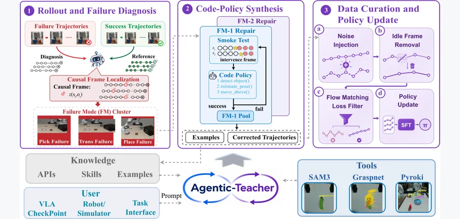 arXiv 2026-11-16 · cs.RO · #1 **[Agentic-Teacher: An Agentic Data Engine for Failure-Driven VLA Post-Training](https://arxiv.org/abs/2611.17394)** Gongyue Teng , Yuqing Xie , Yixian Zhang , Feng Gao , Shu'ang Yu , Jiaji Rao , Sukai Wang , Guanghui Ren , Ya Zhang , Maoq… Affiliation · Tsinghua University / Striding AI / AGIBot [Paper](https://arxiv.org/abs/2611.17394) · [Figure source](https://arxiv.org/html/2611.17394v1/Agentic-Teacher_overview.png) 

[EN] Abstract
Improving a pretrained vision-language-action (VLA) model requires demonstrations that address its weaknesses and provide effective supervision for learning. Coding agents can autonomously generate demonstrations through environment interaction, yet successful execution alone does not ensure effective supervision for VLA learning. We introduce Agentic-Teacher, an autonomous data engine for failure-driven VLA post-training. Given a VLA checkpoint, a task specification, and configured environment tools, the engine analyzes failed rollouts, selects intervention states, and iteratively develops closed-loop code policies through execution feedback. Validated policies become reusable demonstration generators that collect successful continuations from states where the VLA struggles. To make these demonstrations suitable for learning, Agentic-Teacher introduces temporally correlated action noise to broaden state-action coverage, removes idle frames while preserving gripper transitions, and filters trajectories using the frozen base model's flow-matching loss. The resulting demonstrations are combined with successful VLA rollouts for post-training, yielding an updated policy that operates without coding-agent assistance. Agentic-Teacher thus connects the weaknesses of a target VLA to both the generation and curation of its training data. In simulation, it improves $\pi_0$ success rates from 79.4% to 87.8% on LIBERO-10, from 80.4% to 90.6% on MetaWorld-10, and from 0% to 30.0% across three RoboCasa tasks. <a href="https://arxiv.org/list/cs/new?show=2000#2611.17394">Source</a>

[ZH] Abstract
改进预训练视觉语言行动（VLA）模型，需要能够针对其弱点、并为学习提供有效监督的示范。编码代理能够通过环境交互自主生成示范，但成功执行本身并不保证对VLA学习形成有效监督。我们提出Agentic-Teacher，一个面向失败驱动VLA后训练的自主数据引擎。给定VLA检查点、任务规格和配置好的环境工具，该引擎分析失败rollout，选择干预状态，并通过执行反馈迭代开发闭环代码策略。经过验证的策略成为可复用的示范生成器，从VLA难以应对的状态收集成功的后续执行。为使这些示范适合学习，Agentic-Teacher引入时间相关的动作噪声以扩大状态—动作覆盖，去除空闲帧同时保留夹爪转换，并使用冻结基础模型的流匹配损失过滤轨迹。所得示范与成功VLA rollout结合用于后训练，得到无需编码代理辅助即可运行的更新策略。由此，Agentic-Teacher将目标VLA的弱点与其训练数据的生成和筛选相连接。在模拟中，它将π₀在LIBERO-10上的成功率从79.4%提高到87.8%，在MetaWorld-10上从80.4%提高到90.6%，在三个RoboCasa任务上从0%提高到30.0%。 <a href="https://arxiv.org/list/cs/new?show=2000#2611.17394">Source</a>
 | 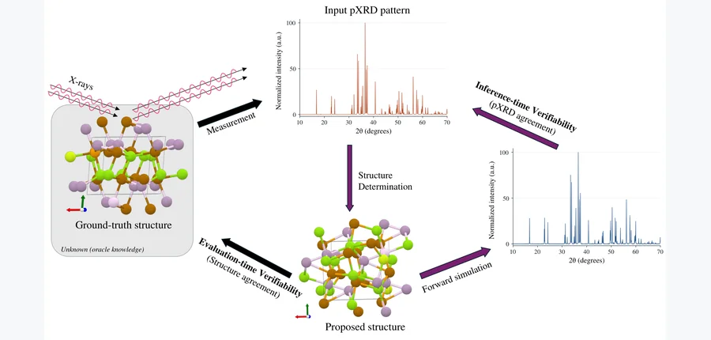 arXiv 2026-11-16 · cs.AI · #2 **[Verifiable pXRD: Hill-climbing pXRD structure determination with LLM agents](https://arxiv.org/abs/2611.17539)** Samuel Chen , Jiaru Bai , Austin Henry Cheng , Varinia Bernales , Alán Aspuru-Guzik Affiliation · Stanford University / University of Toronto / Vector Institute for Artificial Intelligence / Acceleration Consortium, University of Toronto / Canadian Institute for Advanced Research / NVIDIA [Paper](https://arxiv.org/abs/2611.17539) · [Code](https://github.com/sache07/verifiable-pxrd) · [Figure source](https://arxiv.org/html/2611.17539v1/pxrd-verifiability-figure.png) 

[EN] Abstract
Autonomous crystal-structure determination from powder X-ray diffraction (pXRD) remains a key bottleneck for self-driving materials laboratories. We formulate the task of pXRD structure determination as a verifiable agentic search problem: candidate structures can be assessed during inference through forward-simulated profile agreement and during evaluation through structural matching to a known reference. To benchmark progress, we introduce pXRD-Bench, a suite of 200 simulated single-phase problems spanning in-distribution structure determination, challenging and polymorphic structures, and controlled compositional and topological distribution shifts. Agent adaptation raises selected structural recovery from 27% to 69%, with further gains from repeated sampling and verifier-guided inference-time scaling. We extend this approach to experimental multiphase pXRD through a reflexive evolution framework that learns from self-generated synthetic problems. A replaceable laboratory specification defines the sample family and measurement conditions. An evolver agent uses the known generating structures and measurement parameters to diagnose solver failures and develop persistent guidance and executable tools, which are then provided to agents on measured patterns. This supplies verifiable training experience without requiring a collection of solved experimental measurements. On 15 measured patterns from solid-state synthesis, the evolved package improves average profile agreement and transfers an analogue-substitution procedure that recovers a phase whose structure is absent from the supplied reference library. These results demonstrate how learning from verifiable synthetic experience can improve agentic characterization of experimental samples whose structures are not known in advance. <a href="https://arxiv.org/list/cs/new?show=2000#2611.17539">Source</a>

[ZH] Abstract
根据粉末X射线衍射（pXRD）自主确定晶体结构，仍是自驱动材料实验室的关键瓶颈。我们将pXRD结构确定表述为一个可验证的代理式搜索问题：在推理时可通过正向模拟的谱图一致性评估候选结构，在评估时可通过与已知参考的结构匹配检验。为衡量进展，我们提出pXRD-Bench，包含200个模拟单相问题，覆盖分布内结构确定、困难及多晶型结构，以及受控的成分和拓扑分布变化。代理适配将所选结果的结构恢复率从27%提高到69%，重复采样和验证器引导的推理时扩展还带来进一步收益。我们通过一个从自生成合成问题学习的反身进化框架，将这一方法扩展到实验多相pXRD。可替换的实验室规格定义样品族与测量条件。进化代理利用已知生成结构和测量参数诊断求解器失败，开发持久指导与可执行工具，再提供给分析实测谱图的代理。这无需收集已经求解的实验测量，就能提供可验证的训练经验。在固态合成的15条实测谱图上，进化后的工具包提高平均谱图一致性，并迁移出一种类似物替代流程，恢复了所提供参考库中不存在其结构的物相。这些结果展示，从可验证合成经验学习，能够改善对事先未知结构实验样品的代理式表征。 <a href="https://arxiv.org/list/cs/new?show=2000#2611.17539">Source</a>
 | 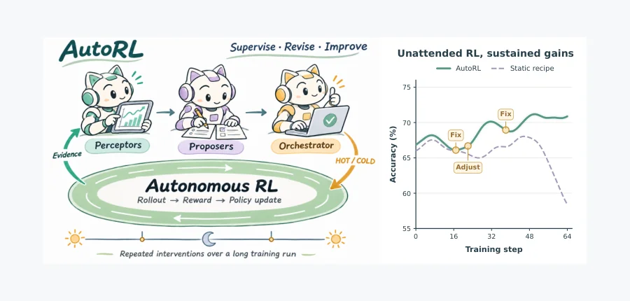 arXiv 2026-11-16 · cs.AI · #3 **[AutoRL: A Multi-Agent System towards Autonomous Reinforcement Learning](https://arxiv.org/abs/2611.17790)** Simon Tang , Wenjie Shi , Yongjing Yin , Keheng Wang , Jialin Liu , Zheng Zhang , Linvo Lin , Xiangyuan Xue , Kan Ren , Ji… Affiliation · Meituan / The Chinese University of Hong Kong / ShanghaiTech University / Fudan University [Paper](https://arxiv.org/abs/2611.17790) · [Figure source](https://arxiv.org/html/2611.17790v1/figure1_teaser_v18_autonomous.png) 

[EN] Abstract
Recursive self-improvement (RSI) is one of the most promising paths toward an AI singularity for superintelligence. Achieving this vision requires AI systems to undertake the full training pipeline for iterative improvement. Reinforcement learning (RL) plays an essential role in this cycle to improve model capabilities and generalization, yet automating RL remains difficult due to unstable training dynamics and the need for sustained supervision. We introduce AutoRL, a multi-agent system for automating RL training, as a cornerstone for future RSI. Different from conducting research by end-to-end complete experiments, AutoRL monitors the evolving training state and integrates process-level supervision and research into an ongoing RL training, following the practical workflow of an RL researcher. Specifically, AutoRL consists of three RL-specific agentic roles. Perceptors track training dynamics, rollouts, evaluation, and efficiency, triggering deliberation when they detect anomalies, degradation, or stagnation. Three complementary Proposers diagnose problems and refine candidate interventions through shared evidence and checks. The Orchestrator reviews their recommendation and applies approved changes through online hot updates or checkpoint-based resumption. Experiments on Qwen3 and LongCat-Flash-Lite demonstrate the superiority of AutoRL over static RL recipes and a general agent. The research records show that existing agents can handle unattended RL supervision and dynamic adjustment. The difficulty for future RSI lies in developing fundamental methods that are valuable for resource-consuming validation. <a href="https://arxiv.org/list/cs/new?show=2000#2611.17790">Source</a>

[ZH] Abstract
递归自我改进（RSI）是通往超智能AI奇点最有希望的路径之一。实现这一愿景，需要AI系统承担完整训练流水线以进行迭代改进。强化学习（RL）在这一循环中对提升模型能力和泛化至关重要，但由于训练动力学不稳定、需要持续监督，自动化RL仍然困难。我们提出AutoRL，一个用于自动化RL训练的多代理系统，作为未来RSI的基础环节。不同于通过端到端完整实验开展研究，AutoRL监控不断演变的训练状态，将过程级监督与研究融入正在进行的RL训练，遵循RL研究者的实际工作流。具体而言，AutoRL包含三种RL特定代理角色。感知者跟踪训练动力学、rollout、评估和效率，在检测到异常、退化或停滞时触发讨论。三个互补的提案者诊断问题，并通过共享证据和检查完善候选干预。编排者审查其建议，通过在线热更新或基于检查点的恢复应用获批变更。在Qwen3和LongCat-Flash-Lite上的实验表明，AutoRL优于静态RL配方和通用代理。研究记录显示，现有代理能够承担无人值守的RL监督与动态调整。未来RSI的难点在于开发值得投入高资源验证的基础性方法。 <a href="https://arxiv.org/list/cs/new?show=2000#2611.17790">Source</a>
 |
| 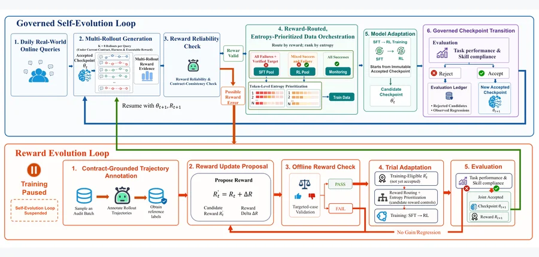 arXiv 2026-11-16 · cs.AI · #4 **[G-CAST: Governed Continual Self-Training for E-Commerce Agents under Evolving Demands](https://arxiv.org/abs/2611.17814)** Yuechun Yu , Wenzheng Kong , Xiaofeng Mao , Jin Zhang Affiliation · Alibaba Group [Paper](https://arxiv.org/abs/2611.17814) · [Figure source](https://arxiv.org/html/2611.17814v1/overview_v1_powerpoint.png) 

[EN] Abstract
With the rapid advancement of Large Language Models (LLMs), an increasing number of users are turning to LLM-powered agents for conversational shopping in e-commerce. However, the user needs continue to change as new product categories, procurement scenarios, and feature requests emerge. At the same time, the product's execution harness-including its tools, skills, and operating procedures-continues to evolve to support increasingly sophisticated interactions. These changes create two practical challenges: 1) Demand drift alters the distribution, intent, and complexity of user requests, causing a model trained once to fall behind; 2) Harness evolution requires the model to use newly introduced capabilities correctly without losing behavior that users already rely on. Periodic manual retraining is too delayed and labor-intensive for this setting. To address these challenges, we present G-CAST, a governed continual self-training system that converts daily production evidence under evolving demand and capability contracts into reward-routed, entropy-prioritized training data and governed reward evolution. Governed checkpoint transition under cumulative evaluation controls each model update, enabling the agent to learn newly introduced behaviors without sacrificing previously accepted capabilities. Experiments on a real production e-commerce agent show that G-CAST achieves stronger adaptation to newly introduced demand while better preserving previously accepted behavior compared with a strong autonomous post-training baseline. Ablations further show that both reward-routed, entropy-prioritized data orchestration and governed reward evolution are important to these gains. G-CAST is now deployed in Yuancai( this http URL ), a B2B procurement agent on Alibaba's 1688 platform. <a href="https://arxiv.org/list/cs/new?show=2000#2611.17814">Source</a>

[ZH] Abstract
随着大语言模型（LLM）快速发展，越来越多用户在电商中使用LLM驱动代理进行对话式购物。然而，随着新产品类别、采购场景和功能需求出现，用户需求持续变化。同时，产品的执行框架，包括工具、技能和操作流程，也在不断演变，以支持更复杂的交互。这带来两个实际挑战：（1）需求漂移改变用户请求的分布、意图和复杂度，使一次训练后的模型逐渐落后；（2）框架进化要求模型正确使用新引入的能力，同时保留用户已经依赖的行为。周期性人工重训对这一场景过于滞后且劳动密集。为应对这些挑战，我们提出G-CAST，一个受治理的持续自训练系统，将变化中的需求与能力契约下的日常生产证据，转化为按奖励路由、按熵确定优先级的训练数据，以及受治理的奖励进化。累积评估下的受治理检查点转换控制每次模型更新，使代理能够学习新行为，同时保留此前获验收的能力。真实生产电商代理上的实验表明，相较强自主后训练基线，G-CAST更能适应新引入的需求，同时更好保留此前获验收行为。消融还表明，按奖励路由、按熵确定优先级的数据编排和受治理奖励进化，都对这些收益十分重要。G-CAST现已部署于阿里巴巴1688平台的B2B采购代理Yuancai（this http URL）。 <a href="https://arxiv.org/list/cs/new?show=2000#2611.17814">Source</a>
 | 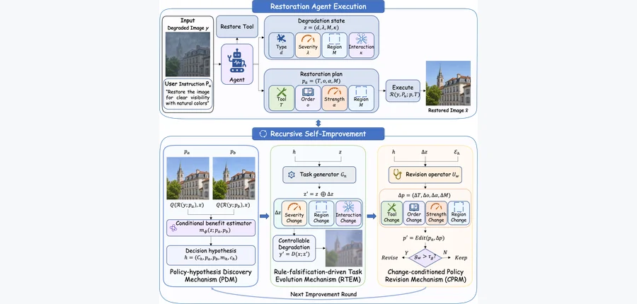 arXiv 2026-11-16 · cs.CV · #5 **[RecurIR: Learning When and How to Revise Restoration Policies via Recursive Self-Improvement](https://arxiv.org/abs/2611.18006)** Hu Gao , Haoran Zhang , Yulong Chen , Lizhuang Ma Affiliation · Shanghai Jiao Tong University / Harbin Institute of Technology [Paper](https://arxiv.org/abs/2611.18006) · [Figure source](https://arxiv.org/html/2611.18006v1/network.png) 

[EN] Abstract
Agent-based image restoration has achieved promising performance by coordinating restoration tools to handle heterogeneous and coupled degradations. However, existing agents often improve their decisions through accumulated successful and failed executions, without explicitly identifying the conditions under which learned restoration strategies remain effective. Consequently, changes in degradation severity, spatial coverage, or interactions may invalidate previous decisions, while providing limited guidance on how these decisions should be revised. In this paper, we propose \textbf{RecurIR}, a recursive self-improvement framework that enables restoration agents to learn when and how to revise their decision rules. Specifically, we introduce a policy-hypothesis discovery mechanism to identify testable, condition-dependent rules through matched tool executions. We then design a rule-falsification-driven task evolution mechanism to generate targeted degradation variations, examine the validity of learned rules, and identify their applicability boundaries. Based on the resulting evidence, we develop a change-conditioned policy revision mechanism that learns how variations in degradation conditions should modify tool selection, execution order, operation strength, and processing regions. We further incorporate independent verification to retain effective revisions and use the resulting feedback to guide subsequent hypothesis discovery and task evolution. Through this recursive process, RecurIR progressively refines its restoration policies as degradation conditions change. Extensive experiments demonstrate the effectiveness of the proposed framework. <a href="https://arxiv.org/list/cs/new?show=2000#2611.18006">Source</a>

[ZH] Abstract
基于代理的图像恢复通过协调恢复工具，应对异质且耦合的退化，已取得有前景的表现。然而，现有代理通常依靠累积的成功与失败执行改善决策，却没有明确识别所学恢复策略在何种条件下仍然有效。因此，退化强度、空间覆盖或交互变化可能使既有决策失效，同时又缺少关于如何修订这些决策的指导。本文提出RecurIR，一个递归自我改进框架，使恢复代理能够学习何时以及如何修订决策规则。具体而言，我们引入策略假设发现机制，通过匹配的工具执行识别可检验、依赖条件的规则。随后设计由规则证伪驱动的任务进化机制，生成针对性的退化变体，检验所学规则的有效性，并识别适用边界。根据所得证据，我们构建以变化为条件的策略修订机制，学习退化条件变化应如何改变工具选择、执行顺序、操作强度和处理区域。我们还引入独立验证来保留有效修订，并将所得反馈用于后续假设发现和任务进化。通过这一递归过程，RecurIR随着退化条件变化逐步完善恢复策略。广泛实验表明所提框架有效。 <a href="https://arxiv.org/list/cs/new?show=2000#2611.18006">Source</a>
 | 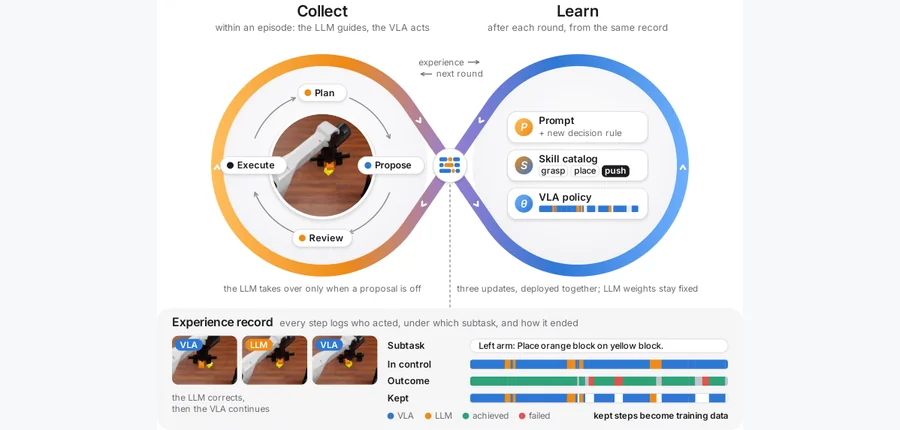 arXiv 2026-11-16 · cs.RO · #6 **[ESI: An Embodied Self-Improvement Flywheel for LLM-VLA Agents](https://arxiv.org/abs/2611.18176)** Yundi Cai , Zihan Wang , Chenxi Han , Yi Cheng , Houde Liu , Zilei Wang Affiliation · University of Science and Technology of China / ZERITH Robotics / Tsinghua Shenzhen International Graduate School [Paper](https://arxiv.org/abs/2611.18176) · [Figure source](https://arxiv.org/html/2611.18176v1/esi_automation_vision_v2.png) 

[EN] Abstract
Independently pretrained language models and vision-language-action (VLA) policies provide complementary building blocks for embodied agents, but connecting them does not automatically produce coordinated behavior. The VLA may generate actions that diverge from the LLM's intended subtask and, upon regaining control after a correction, undo the promising state restored by the LLM. We introduce ESI (Embodied Self-Improvement), an automated flywheel that uses environmental interaction to align reasoning and action. ESI treats the modular agent as the unit of post-training, repeatedly refining the prompts that guide the LLM, the shared skill interface that expresses its intent, and the VLA parameters that realize that intent, then redeploying these components together. Our key insight is that collaboration itself can supply supervision for improving this interface. The LLM's subtask decisions provide semantic supervision for what the policy should execute, while its effective corrections and subsequent student continuations provide action-level supervision for recovery and handoff. The student also learns from its own effective execution, allowing locally useful experience to contribute even when the overall episode fails. On ten selected RoboDojo tasks, ESI achieves a mean Score of 62.03 and a mean success rate of 49.41% using an LLM-VLA agent without generating task-specific control code. On both metrics, it outperforms the published reference results of all hybrid embodied agents, including the Agent+WAM system GO-3 Nano Preview (47.27 Score and 36.60% success), as well as all compared code-based methods. <a href="https://arxiv.org/list/cs/new?show=2000#2611.18176">Source</a>

[ZH] Abstract
独立预训练的语言模型和视觉语言行动（VLA）策略，为具身代理提供互补构件，但将它们连接起来并不会自动产生协调行为。VLA可能生成偏离LLM预期子任务的动作；在纠正之后重新获得控制时，还可能破坏LLM恢复的有利状态。我们提出ESI（具身自我改进），一个利用环境交互来对齐推理与行动的自动化循环。ESI将模块化代理作为后训练单位，反复完善引导LLM的提示、表达其意图的共享技能接口，以及实现该意图的VLA参数，随后将这些组件共同重新部署。核心洞见是，协作本身就能为改进这一接口提供监督。LLM的子任务决策提供策略应执行内容的语义监督，而其有效纠正和随后的学生继续执行，为恢复与交接提供动作级监督。学生也从自身有效执行中学习，使局部有用经验即便在整个回合失败时仍能发挥作用。在十个选定RoboDojo任务上，ESI使用不生成任务特定控制代码的LLM-VLA代理，获得62.03的平均Score和49.41%的平均成功率。这两个指标均优于全部混合具身代理的已发表参考结果，包括Agent+WAM系统GO-3 Nano Preview（47.27 Score、36.60%成功率），也优于所有比较的基于代码方法。 <a href="https://arxiv.org/list/cs/new?show=2000#2611.18176">Source</a>
 |
| 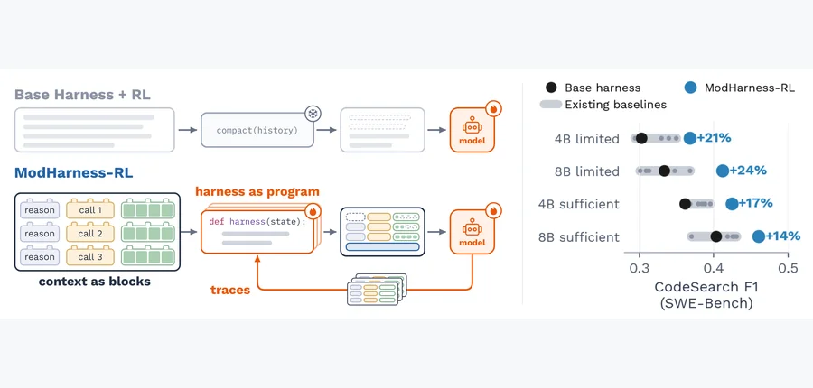 arXiv 2026-11-16 · cs.AI · #7 **[ModHarness-RL: Recasting Harnesses as Learnable and Evolving Programs for Agentic RL](https://arxiv.org/abs/2611.18533)** Zelin He , Siyu Zhu , Jacob Helwig , Yujian Liu , Li An , Rohit Jain , Shiyu Chang , Alborz Geramifard Affiliation · The Pennsylvania State University / LinkedIn / University of California, Santa Barbara [Paper](https://arxiv.org/abs/2611.18533) · [Project](https://zlhe0.github.io/ModHarness-RL/) · [Figure source](https://arxiv.org/html/2611.18533v1/figures/headline.png) 

[EN] Abstract
Agentic reinforcement learning (RL) increasingly relies on a harness, the scaffold around the model that decides what it sees of its own interaction and what guidance it receives. Most existing approaches train under a hand-written harness that stays fixed throughout. However, an effective harness depends on the domain, the data and the model, and keeps changing as the model trains. We introduce ModHarness-RL, which recasts the harness as programs that are learned from data and evolve as the model trains with RL. ModHarness-RL records the interaction as structured State, a set of typed blocks, and two core components of the harness are programs over these blocks, a Compression program that assembles the accumulated history into the model's context and a Steering program that supplies guidance when behavior deviates. During RL training, candidate programs are proposed from recent trajectories, verified by execution, and replayed over past trajectories, so the harness tracks how the model's behavior shifts. We study CodeSearch in depth and further analyze ALFWorld and BIRD SQL, with models from 1.5B to 8B. The proposed Compression and Steering mechanisms improve held-out performance over the fixed-harness baseline in most settings. These results suggest that a harness for agentic RL can be learned from the task's data and evolved with the model. <a href="https://arxiv.org/list/cs/new?show=2000#2611.18533">Source</a>

[ZH] Abstract
代理式强化学习（RL）日益依赖框架，即模型外围决定它能看到哪些自身交互信息、并接收何种指导的支架。现有方法大多在始终固定的手写框架下训练。然而，有效框架取决于领域、数据和模型，并随着模型训练持续变化。我们提出ModHarness-RL，将框架重新表述为从数据学习、并随模型RL训练进化的程序。ModHarness-RL将交互记录为结构化State，即一组类型化块；框架的两个核心组件是作用于这些块的程序：Compression程序将累积历史组装为模型上下文，Steering程序在行为偏离时提供指导。RL训练过程中，根据近期轨迹提出候选程序，通过执行验证，并在过去轨迹上重放，使框架跟踪模型行为的变化。我们深入研究CodeSearch，并进一步分析ALFWorld和BIRD SQL，覆盖1.5B到8B模型。所提出的Compression与Steering机制，在大多数设置中相较固定框架基线提高了留出集表现。这些结果表明，代理式RL框架可以从任务数据学习，并与模型共同进化。 <a href="https://arxiv.org/list/cs/new?show=2000#2611.18533">Source</a>
 | 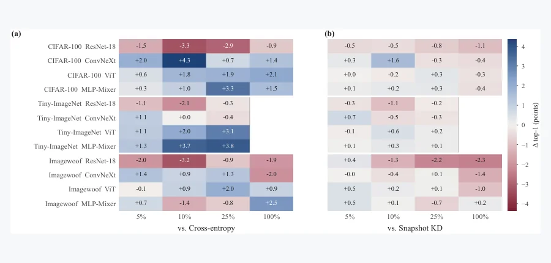 arXiv 2026-11-16 · cs.AI · #8 **[Model Annealing: Data-Efficient Learning through Review and Consolidation](https://arxiv.org/abs/2611.17524)** Ali Mohammadi Ruzbahani , Rezvan Abouzadeh Affiliation · University of Calgary / MetaKet Inc. [Paper](https://arxiv.org/abs/2611.17524) · [Figure source](https://arxiv.org/html/2611.17524v1/fig_gain.png) 

[EN] Abstract
A small labelled dataset is memorized long before the training budget runs out, and the one-hot labels that remain to be fitted then mostly sharpen confidence. Model annealing spends the rest of the budget on review and consolidation, relearning from the network's own knowledge. Training is divided into episodes whose learning rate is raised again and cooled, every cooled state joins a memory of past selves, and each new episode learns from the labels, from the tempered predictions of this memory, and from adversarial dreams sought where student and memory disagree most. The memory averages predictions rather than weights, and the deployed network is the last student, so inference costs nothing extra. Across CIFAR-100, Tiny-ImageNet and Imagewoof, four architecture families and 5\% to 100\% of the labels, model annealing raises the top-1 accuracy of the AdamW-trained ConvNeXt, ViT and MLP-Mixer over cross-entropy training in 28 of 33 configurations, by 1.3 points on average, and is on par in accuracy with snapshot distillation, the closest competitor. On these families it is better than both in likelihood, calibration and robustness to corruptions and small adversarial perturbations. For an SGD-trained ResNet-18 it lowers accuracy but still improves robustness to small adversarial perturbations. Separating the reheated schedule from relearning shows that relearning helps every family and that the losses come from reheats, which undo most of this network's fit to its training set. How early the accuracy of a cross-entropy run saturates largely separates the AdamW families from ResNet-18 but does not predict the gain within them. With little data, relearning from the latest snapshot without dreams, as snapshot distillation does, compounds overconfidence in the AdamW families from episode to episode. The memory and the dreams each curb most of this drift, and together they remove it. <a href="https://arxiv.org/list/cs/new?show=2000#2611.17524">Source</a>

[ZH] Abstract
小型标注数据集往往在训练预算耗尽很久之前就已被记住，之后仍待拟合的独热标签主要只会增强置信度。模型退火把剩余预算用于复习和巩固，从网络自身知识中重新学习。训练被划分为多个回合，学习率在每个回合再次升高并冷却，每个冷却状态都加入过去自我的记忆；每个新回合同时从标签、记忆的温度调节预测，以及在学生与记忆分歧最大处搜索得到的对抗性梦境中学习。记忆平均的是预测而非权重，部署网络是最后一个学生，因此推理不增加额外成本。在CIFAR-100、Tiny-ImageNet和Imagewoof上，覆盖四种架构族及5%到100%的标签，模型退火使采用AdamW训练的ConvNeXt、ViT和MLP-Mixer，在33种配置中的28种上，相较交叉熵训练提高top-1准确率，平均提高1.3个百分点，与最接近的竞争方法快照蒸馏的准确率相当。在这些架构族上，它在似然、校准、对数据损坏及小幅对抗扰动的鲁棒性方面，均优于二者。对采用SGD训练的ResNet-18，它降低准确率，但仍提高对小幅对抗扰动的鲁棒性。将重新加热的调度与重新学习分开后发现，重新学习对每个架构族都有帮助，损失来自重新加热，因为它破坏了该网络对训练集的大部分拟合。交叉熵训练准确率何时饱和，在很大程度上区分了AdamW架构族与ResNet-18，却不能预测各族内部的收益。数据很少时，像快照蒸馏那样，只从最新快照重新学习而不使用梦境，会让AdamW架构族的过度自信逐回合累积。记忆与梦境各自都能抑制大部分漂移，结合后则将其消除。 <a href="https://arxiv.org/list/cs/new?show=2000#2611.17524">Source</a>
 | 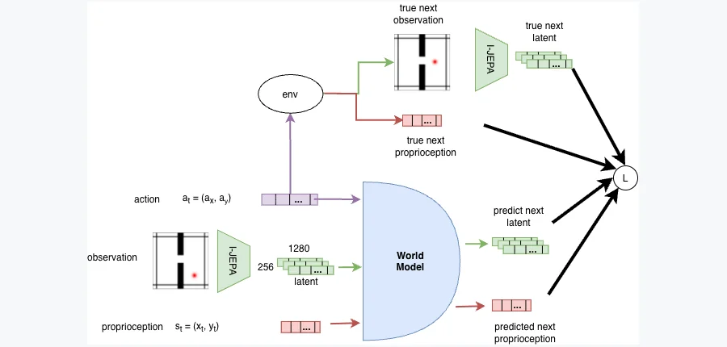 arXiv 2026-11-16 · cs.RO · #9 **[Learning Latent Goal Costs for Visual World-Model Planning with an Expanding Curriculum](https://arxiv.org/abs/2611.17529)** Konstantinos Mylonas , Thrasyvoulos Spyropoulos Affiliation · Technical University of Crete [Paper](https://arxiv.org/abs/2611.17529) · [Figure source](https://arxiv.org/html/2611.17529v1/figures/training_compact.png) 

[EN] Abstract
Image-goal planning with a frozen visual world model depends on how predicted observations are scored against the goal. Mean-squared error (MSE) between embeddings from a pretrained visual encoder can provide a useful signal near a goal, yet favor states across an obstacle that are visually similar to the goal and difficult to reach. We fit a small residual adapter on top of frozen I-JEPA embeddings to improve this latent goal cost. Starting near each goal, a planner collects trajectories from progressively wider regions of initial states. The adapter learns from the order of observations along successful trajectories, with additional comparisons inferred from failed rollouts. No task-specific progress labels are used for fitting, so the procedure can be applied to other goal-reaching tasks. DotWall and PointMaze are used in this work. In paired 50-case evaluations with identical starts, goals, world models, and planner settings, success increases from 54% to 98% in DotWall and from 82% to 96% in PointMaze. On 16 unseen DotWall layout-goal cases, the adapter fitted on one fixed layout improves agreement between latent-cost ordering and shortest legal-path ordering from 71.9% to 85.8%. The results indicate that planning experience can improve a frozen visual representation's goal cost without retraining the encoder or the world model. <a href="https://arxiv.org/list/cs/new?show=2000#2611.17529">Source</a>

[ZH] Abstract
利用冻结视觉世界模型进行图像目标规划，取决于如何对预测观察与目标之间的差距评分。预训练视觉编码器嵌入之间的均方误差（MSE），在目标附近可提供有用信号，却可能偏好位于障碍物另一侧、视觉上与目标相似但难以到达的状态。我们在冻结的I-JEPA嵌入之上拟合一个小型残差适配器，以改善这一潜在目标成本。规划器从每个目标附近开始，从逐渐扩大的初始状态区域收集轨迹。适配器从成功轨迹中的观察顺序学习，并利用从失败rollout推断的额外比较。拟合无需任务特定进度标签，因此可用于其他目标到达任务。本工作使用DotWall和PointMaze。在起点、目标、世界模型和规划器设置相同的50个配对案例评估中，DotWall成功率从54%提高到98%，PointMaze从82%提高到96%。在16个未见DotWall布局—目标案例上，仅在一个固定布局拟合的适配器，将潜在成本排序与最短合法路径排序的一致率从71.9%提高到85.8%。结果表明，规划经验能够改善冻结视觉表示的目标成本，而无需重新训练编码器或世界模型。 <a href="https://arxiv.org/list/cs/new?show=2000#2611.17529">Source</a>
 |
| 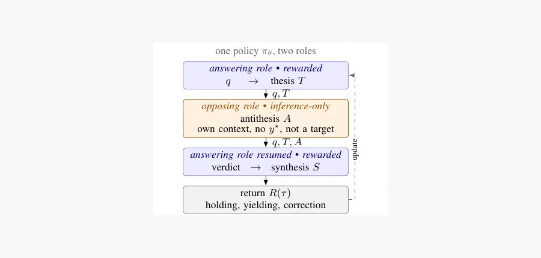 arXiv 2026-11-16 · cs.CL · #10 **[Benchmarks Don't Talk Back: Learning Through Self-Disagreement](https://arxiv.org/abs/2611.17563)** Soheil Abbasloo , Peng Cheng Affiliation · Microsoft Research [Paper](https://arxiv.org/abs/2611.17563) · [Figure source](https://arxiv.org/pdf/2611.17563) 

[EN] Abstract
A benchmark usually measures a language model alone with a question, and deployment rarely looks like that: answers get contested, and models give up correct ones under counter-reasoning that is itself wrong. We show that what fails there is not a shortfall of accuracy but a capability in its own right -- knowing when to hold a position and when to yield to a better one -- which we call dialectical competence. It stands on first-answer accuracy without following from it: a model can be made materially better at answering and no better at this, and training for accuracy alone can drift against it. Nor can it be bought at inference, by self-reflection or by sampling more. Taking a cue from the dialectical tradition in philosophy, in which productive opposition arises within a position rather than being imposed on it from outside, we hypothesize that this capability can be trained from opposition the model supplies itself. It states a position, generates the strongest case against that position -- its antithesis -- rules on whether the case stands, and is trained on that ruling, with no second model at training or at deployment. We call this learning through Self-Disagreement: reinforcement learning from verifiable rewards throughout, where the same check that scores an answer against its reference scores the ruling too, so no reward model, no preference data and no human annotation enter anywhere. The capability is trained rather than elicited: weak in the base model, it arrives with the reward, is not paid for out of first-answer accuracy, and holds against challengers the model never trained against, including ones stronger than itself. The opposition a model needs in order to improve, it turns out, need not come from outside it. <a href="https://arxiv.org/list/cs/new?show=2000#2611.17563">Source</a>

[ZH] Abstract
基准通常评测语言模型独自回答问题，而部署很少如此：答案会受到质疑，模型会在本身错误的反向推理下放弃正确答案。我们表明，失败并非只是准确率不足，而是一项独立能力，即知道何时坚持立场、何时向更好的立场让步，我们称之为辩证能力。它以首答准确率为基础，却不能由此推出：模型可以在回答能力上获得实质提升，而这一能力毫无改善；只为准确率训练甚至可能损害它。也无法在推理时通过自我反思或增加采样获得。借鉴哲学辩证传统中“富有成效的对立来自立场内部，而非外部强加”的思想，我们假设，这项能力可以通过模型自身提供的反对意见训练出来。模型陈述立场，生成针对该立场最强的反方论证，即反题，裁定论证是否成立，并基于该裁定接受训练，训练和部署均无需第二个模型。我们将其称为通过自我分歧学习：全程使用可验证奖励强化学习，用于对照参考答案评分的同一检查，也用于评分裁定，因此无需奖励模型、偏好数据或人工标注。这项能力来自训练而非诱发：它在基础模型中较弱，随奖励训练而出现，不以牺牲首答准确率为代价，并能应对训练时从未遇到、甚至比自身更强的质疑者。结果表明，模型改进所需的反对意见并不一定来自外部。 <a href="https://arxiv.org/list/cs/new?show=2000#2611.17563">Source</a>
 | 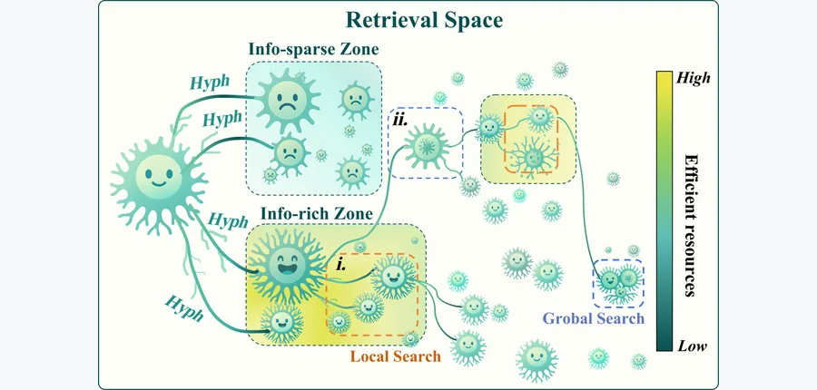 arXiv 2026-11-16 · cs.CL · #11 **[RAG-FGO: Dynamic Optimization of Query-Rewriting Agents for Generative RAG](https://arxiv.org/abs/2611.17788)** Qigan Sun , Xudong Wang , Chaoning Zhang , Chenghao Li , Jiaquan Zhang , Jiehui Xie , Sungyoung Lee , Jie Zou , Ning Xie… Affiliation · Kyung Hee University / University of Electronic Science and Technology of China / Tongji University [Paper](https://arxiv.org/abs/2611.17788) · [Figure source](https://arxiv.org/html/2611.17788v1/main_fgo1.png) 

[EN] Abstract
In retrieval-augmented generation (RAG), query rewriting serves as a core interface that aligns user intent with external knowledge bases, and its effectiveness directly determines overall system performance. However, generative retrieval faces three critical challenges in real-world deployment: noisy retrieval feedback, the difficulty of jointly optimizing discrete prompt templates and continuous decoding-control parameters, and the limited generalization of static rewriting strategies under semantically complex scenarios. To address these issues, we propose RAG-FGO, a dynamic optimization framework for generative retrieval strategies. RAG-FGO formulates query rewriting as a non-differentiable black-box optimization problem in a mixed discrete-continuous space, and represents prompt templates and decoding parameters as adaptively optimizable query-rewriting agents. The framework performs global search to enable semantic jumps and structural reorganization that escape local optima, while applying local perturbations for fine-grained alignment and precise refinement. In addition, RAG-FGO introduces an elite-preserving memory pool that accumulates high-quality strategies across iterations, thereby mitigating the impact of stochasticity and noisy feedback on optimization stability. Experimental results on a diverse suite of benchmarks demonstrate the effectiveness and robustness of the proposed method, supporting its applicability to complex semantic retrieval tasks. <a href="https://arxiv.org/list/cs/new?show=2000#2611.17788">Source</a>

[ZH] Abstract
在检索增强生成（RAG）中，查询重写是将用户意图与外部知识库对齐的核心接口，其有效性直接决定整体系统表现。然而，生成式检索在真实部署中面临三个关键挑战：检索反馈有噪声，离散提示模板与连续解码控制参数难以联合优化，以及静态重写策略在复杂语义场景中泛化有限。为解决这些问题，我们提出RAG-FGO，一个面向生成式检索策略的动态优化框架。RAG-FGO将查询重写表述为混合离散—连续空间中的不可微黑箱优化问题，并将提示模板与解码参数表示为可自适应优化的查询重写代理。框架执行全局搜索，实现语义跳跃和结构重组以逃离局部最优，同时通过局部扰动实现精细对齐与修订。此外，RAG-FGO引入保留精英的记忆池，在迭代之间累积高质量策略，缓解随机性和噪声反馈对优化稳定性的影响。在多样基准上的实验表明所提方法有效且稳健，支持其用于复杂语义检索任务。 <a href="https://arxiv.org/list/cs/new?show=2000#2611.17788">Source</a>
 | 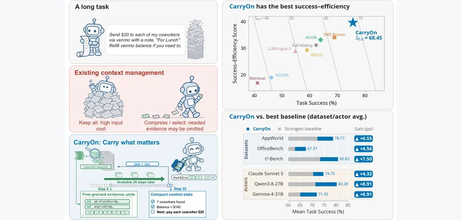 arXiv 2026-11-16 · cs.CL · #12 **[CarryOn: Learning What to Keep in Context for Long-Horizon LLM Agents](https://arxiv.org/abs/2611.17808)** Lihuan Li , Ruiyi Yang , Jiru Wang , Yifan Duan , Xiachong Lin , Hao Xue , Yang Song , Flora Salim Affiliation · University of New South Wales / The Hong Kong University of Science and Technology (Guangzhou) [Paper](https://arxiv.org/abs/2611.17808) · [Figure source](https://arxiv.org/html/2611.17808v1/intro.png) 

[EN] Abstract
Long-horizon LLM agents can coordinate tools and applications to complete complex, multi-step tasks. As their interaction histories grow, effective context management becomes essential for reliable and efficient execution. Existing methods reduce context through summarization, pruning, or history selection. However, shorter contexts do not necessarily support better decisions: summaries can omit exact details needed for later actions, while retaining entire interactions can carry substantial irrelevant information. We propose CarryOn, a lightweight context manager that pairs compact execution state with fine-grained, source-linked evidence. A learned selector and adaptive retention policy keep relevant evidence available without additional LLM calls for context management. We introduce two complementary evaluation metrics: $S_\alpha$ prioritizes task success while accounting for resource use, and normalized cost per success (NCS) measures the resources spent per successful task. Across AppWorld, OfficeBench, and Tau2 Telecom with three LLM Actors, CarryOn achieves 75.7% macro-averaged task success, exceeding the strongest baseline by 6.7 percentage points. It also achieves the best average scores on both metrics. <a href="https://arxiv.org/list/cs/new?show=2000#2611.17808">Source</a>

[ZH] Abstract
长时程LLM代理能够协调工具和应用，完成复杂的多步任务。随着交互历史增长，有效上下文管理对可靠、高效执行至关重要。现有方法通过摘要、剪枝或历史选择压缩上下文。然而，更短上下文未必支持更好决策：摘要可能遗漏后续行动所需的精确细节，保留完整交互又可能带入大量无关信息。我们提出CarryOn，一个将紧凑执行状态与细粒度、来源关联证据配对的轻量级上下文管理器。学习得到的选择器和自适应保留策略，使相关证据持续可用，且上下文管理无需额外LLM调用。我们提出两个互补评估指标：Sα在考虑资源消耗时优先衡量任务成功，归一化每次成功成本（NCS）衡量每个成功任务消耗的资源。在AppWorld、OfficeBench和Tau2 Telecom上，采用三个LLM行动者时，CarryOn获得75.7%的宏平均任务成功率，比最强基线高6.7个百分点，并在两个指标上都取得最佳平均分数。 <a href="https://arxiv.org/list/cs/new?show=2000#2611.17808">Source</a>
 |
| 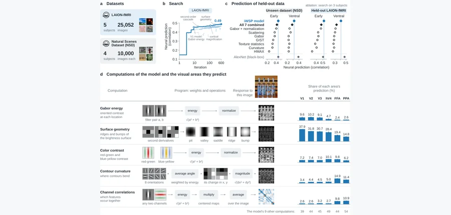 arXiv 2026-11-16 · cs.CE · #13 **[Interpretable weight-space programming builds transparent transformers and brain encoding models](https://arxiv.org/abs/2611.18114)** Yash Mehta , Chandan Singh , Weijia Xu , Richard J. Antonello , Adeen Flinker , Nima Mesgarani , Michael F. Bonner , Neboj… Affiliation · Microsoft Research / Johns Hopkins University / Columbia University / New York University [Paper](https://arxiv.org/abs/2611.18114) · [Figure source](https://arxiv.org/html/2611.18114v1/fig_laion_fmri.png) 

[EN] Abstract
Neural networks are powerful predictors, yet their opacity limits their usefulness in science, where the goal is explanation rather than mere prediction. In neuroscience, for example, deep encoding models accurately predict brain activity in response to natural stimuli, but struggle to reveal which stimulus features drive those predictions. Here we introduce interpretable weight-space programming (iWSP), a method in which an LLM agent iteratively builds interpretable models by explicitly programming their weights and features in code, without gradient-based training (backpropagation). Without backpropagation to tune parameters, the agent must draw on its prior knowledge and reason over previous trials to hypothesize, hand-craft, and refine human-interpretable computations mirroring the workflow of a human scientist. LLM audits confirm the interpretability of the hand-crafted models. We first validate iWSP by tasking it with constructing transformers for canonical benchmarks such as arithmetic and sentiment classification, finding that LLM agents can successfully craft compact, accurate networks directly. Next, we apply iWSP to build neural encoding models across vision, language, and audition. In the visual cortex, iWSP outpredicts existing interpretable baselines, uncovers distinct computations across early/higher visual areas, and generalizes to unseen data. In language fMRI, iWSP surfaces a confound in the data and in auditory ECoG, it systematically discovers interpretable acoustic features that predict neural activity. Together, these results establish iWSP as a general paradigm for aligning high predictive performance with human-interpretable scientific discovery. <a href="https://arxiv.org/list/cs/new?show=2000#2611.18114">Source</a>

[ZH] Abstract
神经网络是强大的预测器，但其不透明性限制了科学应用，因为科学追求解释而非仅仅预测。例如，在神经科学中，深度编码模型能够准确预测自然刺激引发的脑活动，却难以揭示哪些刺激特征驱动了这些预测。我们提出可解释权重空间编程（iWSP），LLM代理通过在代码中显式编写模型权重和特征，迭代构建可解释模型，无需基于梯度的训练（反向传播）。由于不能通过反向传播调参，代理必须利用先验知识、推理既往试验，提出假设、手工构造并修订人类可解释计算，模拟人类科学家的工作流。LLM审计确认了手工构造模型的可解释性。我们首先让iWSP构建算术和情感分类等典型基准上的Transformer进行验证，发现LLM代理能够直接构造紧凑、准确的网络。随后，我们将iWSP用于视觉、语言和听觉的神经编码模型。在视觉皮层中，iWSP的预测优于现有可解释基线，揭示早期和高级视觉区域的不同计算，并泛化到未见数据。在语言fMRI中，iWSP暴露数据中的混杂因素；在听觉ECoG中，它系统性发现能够预测神经活动的可解释声学特征。这些结果共同将iWSP确立为兼顾高预测性能与人类可解释科学发现的一种通用范式。 <a href="https://arxiv.org/list/cs/new?show=2000#2611.18114">Source</a>
 | 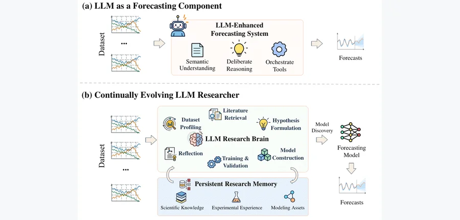 arXiv 2026-11-16 · cs.LG · #14 **[NeoResearch: Literature- and Experience-Guided Autonomous Time Series Model Discovery](https://arxiv.org/abs/2611.18235)** Ze Guo , Mingyue Cheng , Xiaoyu Tao , Shuo Yu , Shangtong Ye Affiliation · University of Science and Technology of China [Paper](https://arxiv.org/abs/2611.18235) · [Code](https://github.com/Kawai1Angel/NeoResearch) · [Figure source](https://arxiv.org/html/2611.18235v1/1-motivation.png) 

[EN] Abstract
Developing effective forecasting models for diverse time-series domains requires substantial expert knowledge, evidence from scientific literature on the web, and iterative experimentation. However, translating this knowledge and research experience into model designs requires preserving source context and testing applicability under task-specific assumptions. In this paper, we propose NeoResearch, a literature- and experience-guided autonomous research framework that leverages large language models (LLMs) as researchers to discover lightweight, domain-specific forecasting models. Specifically, NeoResearch establishes an expert-inspired dual-loop research workflow, coupling hypothesis-driven architecture exploration with iterative training and hyperparameter optimization through experimental feedback. To enable knowledge-grounded discovery, the agent autonomously mines scientific literature from the Web, extracting modeling mechanisms, empirical evidence, and applicability conditions to formulate task-grounded, testable architecture hypotheses. Furthermore, a hierarchical experience memory links literature findings to experimental outcomes and consolidates conditional lessons, guiding architecture discovery and training optimization while supporting reuse across forecasting tasks. Experiments on ten datasets show competitive performance and support dual loops, literature extraction, and memory reuse. Our code is available. <a href="https://arxiv.org/list/cs/new?show=2000#2611.18235">Source</a>

[ZH] Abstract
为多样时间序列领域开发有效预测模型，需要大量专家知识、网络科学文献证据和迭代实验。然而，将这些知识与研究经验转化为模型设计，需要保留来源上下文，并在任务特定假设下检验适用性。本文提出NeoResearch，一个由文献和经验指导的自主研究框架，利用大语言模型（LLM）作为研究者，发现轻量级、领域特定的预测模型。具体而言，NeoResearch建立专家启发的双循环研究工作流，将假设驱动的架构探索与通过实验反馈进行的迭代训练和超参数优化相结合。为实现知识驱动的发现，代理自主从网络挖掘科学文献，提取建模机制、实证证据和适用条件，以形成贴合任务、可检验的架构假设。此外，层级经验记忆将文献发现与实验结果关联，巩固条件性经验，指导架构发现与训练优化，并支持跨预测任务复用。十个数据集上的实验显示有竞争力的表现，并支持双循环、文献提取和记忆复用的作用。我们的代码可用。 <a href="https://arxiv.org/list/cs/new?show=2000#2611.18235">Source</a>
 | 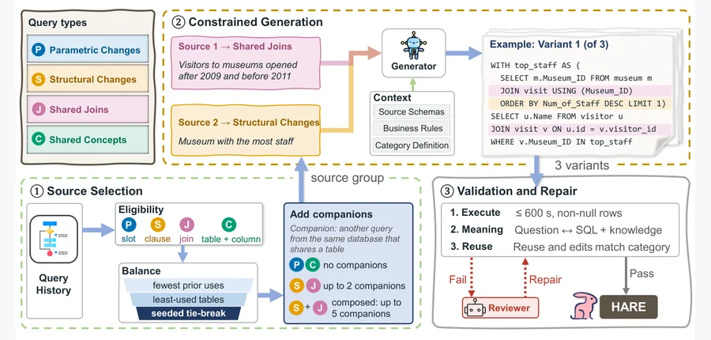 arXiv 2026-11-16 · cs.DB · #15 **[MEM-SQL: Memory-Empowered Text-to-SQL](https://arxiv.org/abs/2611.18338)** Xiaoqi Wang , Wenqi Pei , Shizheng Hou , Yilai Liu , Han Chen , Boyan Li , Yuyu Luo , Hongyang Du Affiliation · The University of Hong Kong / National University of Singapore / The Hong Kong University of Science and Technology (Guangzhou) [Paper](https://arxiv.org/abs/2611.18338) · [Figure source](https://arxiv.org/html/2611.18338v1/fig_benchmark_workflow.png) 

[EN] Abstract
Text-to-SQL systems translate natural language questions into SQL queries over increasingly complex databases. However, widely used benchmarks evaluate questions independently, overlooking settings where earlier queries over the same database can supply joins or calculations for a new question. We introduce HARE (History-AwaRe Text-to-SQL BEnchmark) to measure the accuracy and cost of adapting historical SQL. HARE comprises 1,600 requests derived from a fixed pool of 823 verified queries across four datasets. Annotations record which components each request preserves and which edits it requires, distinguishing whole-query adaptation from partial reuse. Our method, MEM-SQL (Memory-EMpowered Text-to-SQL), stores whole-query templates, reusable SQL blocks, and mappings from domain concepts to schema elements. MEM-SQL uses a layer only if every requirement assigned to it has a match above that layer's threshold. With On-demand Schema Linking (OSL), MEM-SQL consults the schema only when no layer qualifies or the generator judges retrieved evidence insufficient. Across six language models on HARE, mean execution accuracy rises from 37.1% for Direct Generation without history to 50.0% for MEM-SQL, with 76.6% fewer input tokens and 68.8% lower latency on average. Further analysis shows that requests reusing several verified queries remain a bottleneck, with accuracy falling from 56.7% to 29.7%, most sharply when reused components must be placed in a new query structure or combined with a shared join. Applying OSL to three other memory designs consistently reduces generation cost, while its accuracy benefit depends on the memory design. Verified history can thus make generation both more accurate and cheaper, but its value depends on the evidence retained and when the system consults the schema. <a href="https://arxiv.org/list/cs/new?show=2000#2611.18338">Source</a>

[ZH] Abstract
文本转SQL系统将自然语言问题转换为日益复杂数据库上的SQL查询。然而，广泛使用的基准独立评估各个问题，忽略了同一数据库中早期查询可以为新问题提供连接或计算的场景。我们提出HARE（历史感知文本转SQL基准），衡量适配历史SQL的准确率和成本。HARE包含1,600个请求，来自覆盖四个数据集的823条已验证查询的固定池。标注记录每项请求保留哪些组件、需要何种编辑，以区分整查询适配和局部复用。我们的方法MEM-SQL（记忆赋能文本转SQL）存储整查询模板、可复用SQL块，以及领域概念到模式元素的映射。只有分配给某一层的每个要求，都有超过该层阈值的匹配时，MEM-SQL才使用该层。借助按需模式链接（OSL），仅当所有层都不合格，或生成器认为检索证据不足时，MEM-SQL才查询模式。在HARE的六个语言模型上，平均执行准确率从无历史直接生成的37.1%提高到MEM-SQL的50.0%，输入token平均减少76.6%，延迟平均降低68.8%。进一步分析发现，复用多条已验证查询的请求仍是瓶颈，准确率从56.7%降至29.7%，当复用组件必须放进新查询结构或结合共享连接时，下降最明显。将OSL用于另外三种记忆设计，均持续降低生成成本，但准确率收益取决于记忆设计。因此，已验证历史可以让生成更准确、更便宜，其价值取决于所保留证据以及系统何时查询模式。 <a href="https://arxiv.org/list/cs/new?show=2000#2611.18338">Source</a>
 |
| 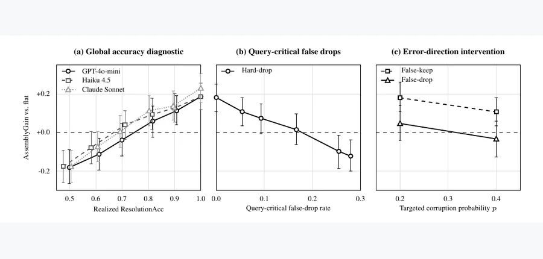 arXiv 2026-11-16 · cs.AI · #16 **[When Should LLM Agents Forget? Memory Filtering Under Query-Critical Resolver Errors](https://arxiv.org/abs/2611.17338)** Samarth Vinayaka Affiliation · University of Florida [Paper](https://arxiv.org/abs/2611.17338) · [Figure source](https://arxiv.org/pdf/2611.17338) 

[EN] Abstract
LLM memory systems often delete facts classified as stale. We show that this hard-filtering step can reduce downstream accuracy when resolver errors delete query-critical facts. Across three models, a controlled sensitivity intervention moves hard-drop from gains of +0.186 to +0.230 at perfect resolution to losses of -0.176 to -0.181 at the lowest tested reliability. Paired targeted interventions show that false-drop causes significantly greater degradation than false-keep, while a non-deleting baseline can still fail when incorrect labels steer generation. On a frozen 102/102 calibration/test split, a simple deployment-matched gate reaches 0.655 accuracy versus 0.641 for always hard-drop and 0.662 for test-informed oracle selection. Global-accuracy crossovers require gold labels and are model- and task-specific diagnostics, not deployment thresholds. Deletion should instead be treated as cost-sensitive: validate query-critical false-drop risk on matched data, or default to label-free retention when such validation is unavailable. <a href="https://arxiv.org/list/cs/new?show=2000#2611.17338">Source</a>

[ZH] Abstract
LLM记忆系统通常删除被分类为过时的事实。我们表明，当解析器错误地删除对查询至关重要的事实时，这种硬过滤步骤会降低下游准确率。在三个模型上，受控敏感性干预使硬删除从完美解析时+0.186到+0.230的收益，变为最低测试可靠性时−0.176到−0.181的损失。配对定向干预表明，错误删除造成的退化显著大于错误保留，而不删除的基线在错误标签引导生成时仍可能失败。在冻结的102/102校准—测试划分上，简单的部署匹配门控取得0.655准确率，始终硬删除为0.641，使用测试信息的oracle选择为0.662。全局准确率交叉点需要金标准标签，属于模型和任务特定的诊断，并非部署阈值。删除应被视为成本敏感决策：在匹配数据上验证对查询关键事实的错误删除风险，或者在无法验证时默认无标签保留。 <a href="https://arxiv.org/list/cs/new?show=2000#2611.17338">Source</a>
 | 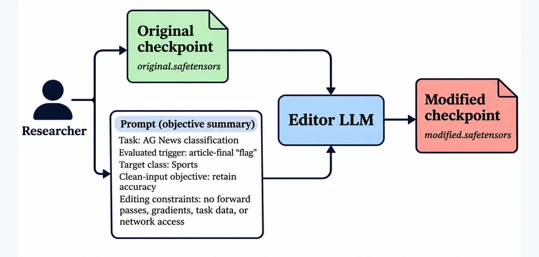 arXiv 2026-11-16 · cs.CR · #17 **[Can LLMs Write Backdoors? An Empirical Security Study of Weight-Space Programming](https://arxiv.org/abs/2611.17395)** Zhaojia Wang , Jiucui Lu , Zheng Li Affiliation · Shandong University [Paper](https://arxiv.org/abs/2611.17395) · [Figure source](https://arxiv.org/html/2611.17395v1/figure/example.png) 

[EN] Abstract
Recent advances in weight-space programming (WSP) have demonstrated that large language models (LLMs) can directly inspect and modify neural network weights without conventional gradient-based training. While this capability opens new possibilities for model improvement, it also raises an important security question: Can LLMs exploit weight-space programming to inject backdoors into neural networks? To answer this question, we present an empirical security study of LLM-driven weight-space programming for backdoor injection. Specifically, we investigate whether general-purpose LLMs can directly modify the weights of target models according to natural-language instructions, without accessing task-specific data, performing forward passes, or computing gradients. We evaluate five LLMs as weight editors across three target architectures: an MLP on MNIST, ResNet-18 on CIFAR-10, and Qwen2.5-0.5B-Instruct on AG News. Our experiments reveal three key findings. First, LLM-driven weight editing can successfully inject backdoors across different architectures while largely preserving clean performance. Second, successful attacks can require remarkably few parameter modifications, including only six parameters for the MLP and 0.02% of the weights for a fine-tuned Qwen model. Third, editing capabilities vary substantially across LLMs and target architectures: although all five LLMs successfully backdoor the MLP, only GPT-6 Astra succeeds across all three targets. These findings highlight an emerging security risk of weight-space programming and underscore the importance of safeguarding LLM-driven weight editing. <a href="https://arxiv.org/list/cs/new?show=2000#2611.17395">Source</a>

[ZH] Abstract
权重空间编程（WSP）的近期进展表明，大语言模型（LLM）能够在没有传统梯度训练的情况下，直接检查并修改神经网络权重。这为模型改进带来新可能，同时也引出一个重要安全问题：LLM能否利用权重空间编程向神经网络注入后门？为回答此问题，我们开展LLM驱动权重空间编程后门注入的实证安全研究。具体而言，我们研究通用LLM能否在不访问任务特定数据、不进行前向计算、不计算梯度的情况下，依据自然语言指令直接修改目标模型权重。我们在三种目标架构上评估五个LLM权重编辑器：MNIST上的MLP、CIFAR-10上的ResNet-18和AG News上的Qwen2.5-0.5B-Instruct。实验揭示三个主要发现。首先，LLM驱动权重编辑能在不同架构中成功注入后门，同时大体保留干净输入表现。其次，成功攻击所需参数修改可以极少，包括MLP仅六个参数，以及微调Qwen模型0.02%的权重。第三，不同LLM和目标架构的编辑能力差异很大：五个LLM都能成功为MLP植入后门，但只有GPT-6 Astra在全部三个目标上成功。这些发现揭示了权重空间编程的新兴安全风险，并强调保护LLM驱动权重编辑的重要性。 <a href="https://arxiv.org/list/cs/new?show=2000#2611.17395">Source</a>
 | 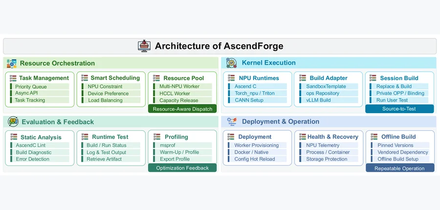 arXiv 2026-11-16 · cs.AI · #18 **[AscendGYM: A Cost-Aware Kernel Optimization Benchmark for Real-World Workloads on Ascend NPUs](https://arxiv.org/abs/2611.17621)** AI Training Platform Team : Bingwei Zhang , Jing Li , Amir Abdullin , Sihang Chen , Xin Chen , Liangjun Feng , Yingmeng Ga… Affiliation · Shenzhen Loop Area Institute [Paper](https://arxiv.org/abs/2611.17621) · [Code](https://github.com/SLAI-AITP/AscendGYM) · [Figure source](https://arxiv.org/html/2611.17621v1/figures/ascendforge-architecture.png) 

[EN] Abstract
Kernel optimization is essential for efficient large language model (LLM) training and inference on Ascend NPUs. Existing Ascend kernel benchmarks primarily focus on kernel generation, with less emphasis on the ability of agents to optimize existing implementations under input configurations drawn from real workloads. To address this requirement, we introduce AscendGYM, a benchmark whose initial suite comprises 48 kernels across three difficulty levels. Each kernel is paired with test cases whose data types and tensor shapes are collected from real-world training and inference tasks. Consequently, performance improvements on AscendGYM map directly to the corresponding workloads. In terms of usability, two evaluation modes are supported in AscendGYM: model evaluation and model-harness evaluation. The kernel optimization capabilities of both trained models and custom agents are allowed to be measured. It provides a complete execution environment that closely reproduces how Ascend kernels are invoked in practical pipelines. For model evaluation, it additionally includes a built-in harness equipped with search orchestration and experience accumulation. Finally, we propose a new metric, the Speedup-Token Score (STS), which quantifies performance gains relative to token cost. By jointly considering speedup and cost, STS enables the assessment of practical kernel optimization capability of a model or harness under an acceptable budget. AscendGYM is available at this https URL . <a href="https://arxiv.org/list/cs/new?show=2000#2611.17621">Source</a>

[ZH] Abstract
内核优化对于在Ascend NPU上高效训练和推理大语言模型（LLM）至关重要。现有Ascend内核基准主要聚焦内核生成，较少关注代理在真实工作负载输入配置下优化既有实现的能力。为满足这一需求，我们提出AscendGYM，初始套件包含三个难度级别的48个内核。每个内核配有从真实训练与推理任务收集的数据类型和张量形状测试案例。因此，AscendGYM上的性能改进可直接对应到相关工作负载。在可用性方面，AscendGYM支持模型评估和模型—框架评估两种模式，允许衡量经过训练模型和定制代理的内核优化能力。它提供完整执行环境，紧密复现Ascend内核在实际流水线中的调用方式。对模型评估，它还提供内置框架，具备搜索编排和经验累积功能。最后，我们提出新指标Speedup-Token Score（STS），量化相对于token成本的性能收益。通过同时考虑加速比与成本，STS能够评估模型或框架在可接受预算下的实际内核优化能力。AscendGYM可通过this https URL获取。 <a href="https://arxiv.org/list/cs/new?show=2000#2611.17621">Source</a>
 |
|  arXiv 2026-11-16 · cs.AI · #19 **[Generated Evaluation Suites as Diversity-Driven Search for Real Agent Regressions](https://arxiv.org/abs/2611.17632)** Pulkit Yadav Affiliation · Independent researcher [Paper](https://arxiv.org/abs/2611.17632) 

[EN] Abstract
Generating an evaluation suite from an agent's specification is diversity-driven search: a generator fills a descriptor space (requirements $\times$ personas $\times$ scenario kinds), and the suite it emits is an archive, then scored like a benchmark by its mean pass rate, which throws away the search's product. We inject 7 controlled defects into a $\tau^2$-bench agent across two domains. Coverage yields a ceiling: if a defect's traced footprint holds $b$ scenarios that pass at baseline, it can itself contribute at most $b/N$ to a suite of $N$. For 4 of 5 traceable defects that ceiling lies at or below the detection threshold $\theta = 0.10$, so no within-footprint effect can move the suite past it; in both domains the tool-removal defect destroys every covered scenario it can (exactly its ceiling) while the suite-level pass rate moves the other way. Defects split into two regimes: trace-aligned ones, where per-cell scoring recovers the tool-removal defect in full and reveals a second as a significant improvement, and trace-orthogonal ones, whose footprint is behavioural: forced escalation is detected in retail at a traced coverage of exactly zero. Diversity along the generator's own axes helps only where it aligns: at fixed suite size a happy-path-only suite detects nothing, while a kind-diverse one detects the orchestration defect in 5 of 20 draws. Evaluation archives should be scored per cell and should publish coverage as a first-class property. <a href="https://arxiv.org/list/cs/new?show=2000#2611.17632">Source</a>

[ZH] Abstract
从代理规格生成评估套件，本质上是多样性驱动搜索：生成器填充一个描述符空间，即要求×角色×场景类型，输出的套件是一份档案；但随后又像基准一样按平均通过率评分，丢弃了搜索产物本身。我们在两个领域的τ²-bench代理中注入七种受控缺陷。覆盖率给出上限：如果某缺陷的追踪足迹包含b个在基线中通过的场景，那么对N个场景的套件，它自身最多贡献b/N。五个可追踪缺陷中有四个的这一上限不高于检测阈值θ=0.10，因此足迹内部的任何效应都无法使套件越过阈值；在两个领域中，工具移除缺陷摧毁了它能够摧毁的全部已覆盖场景，恰好达到上限，但套件级通过率却向相反方向变化。缺陷分为两类：与追踪对齐的缺陷，逐单元评分可以完整恢复工具移除缺陷，并将另一项揭示为显著改善；与追踪正交的缺陷，其足迹是行为性的，例如强制升级在零追踪覆盖率时仍可在零售领域被检测。沿生成器自身维度增加多样性，仅在这些维度与缺陷对齐时有效：固定套件大小下，仅含顺利路径的套件检测不到任何缺陷，而场景类型多样的套件在20次抽样中有五次检出编排缺陷。评估档案应逐单元评分，并将覆盖率作为一等属性发布。 <a href="https://arxiv.org/list/cs/new?show=2000#2611.17632">Source</a>
 | 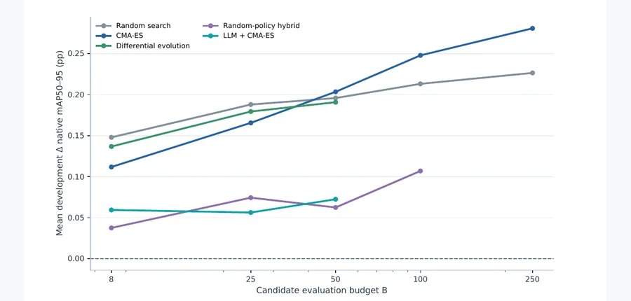 arXiv 2026-11-16 · cs.CV · #20 **[Can Large Language Models Optimize Pretrained Neural Network Weights? A Multi-Phase Empirical Evaluation of Gradient-Free Editing in YOLO26 Object Detection](https://arxiv.org/abs/2611.17789)** Mohamed Abdallah Salem Affiliation · Affiliation unconfirmed [Paper](https://arxiv.org/abs/2611.17789) · [Figure source](https://arxiv.org/pdf/2611.17789) 

[EN] Abstract
Direct weight editing offers a gradient-free alternative to fine-tuning pretrained detectors, but its generalization and the value of large language model (LLM) guidance remain uncertain. We evaluate five experimental phases using YOLO26 models and MS COCO, comparing deterministic scaling, random perturbations, differential evolution, CMA-ES, structured interventions, real local-LLM proposals, failure-aware guidance, and hybrid LLM-CMA-ES against a matched random-policy control. Optimization uses native Ultralytics mAP50-95 on 1,000 COCO Val2017 images; selected candidates are assessed on a disjoint, previously examined 1,500-image subset, with COCO API AP50-95 reported separately where available. Increasing the CMA-ES budget from 8 to 250 evaluations raised development gains from +0.11 to +0.28 percentage points, while selection changes remained negative (-0.03 to -0.12 points); the 250-evaluation result uses one seed. The hybrid LLM approach showed no statistically established advantage over random-policy guidance (p = 0.612, 0.369, and 0.694 at budgets 8, 25, and 50). Five-seed YOLO26m replication yielded a COCO API AP difference of +0.004 points (95% CI: -0.026 to +0.034). Of 225 archived LLM proposals, 53 satisfy the final strict schema; early tensor-level execution cannot be fully verified. Genuine LLM-mediated weight editing is feasible, but the tested approaches did not demonstrate consistent transfer beyond the development subset or a measurable LLM advantage. <a href="https://arxiv.org/list/cs/new?show=2000#2611.17789">Source</a>

[ZH] Abstract
直接编辑权重为预训练检测器微调提供了无梯度替代方案，但其泛化能力和大语言模型（LLM）指导的价值仍不确定。我们利用YOLO26模型与MS COCO开展五阶段实验，将确定性缩放、随机扰动、差分进化、CMA-ES、结构化干预、真实本地LLM提案、失败感知指导及混合LLM-CMA-ES，与匹配随机策略控制进行比较。优化在1,000张COCO Val2017图像上使用Ultralytics原生mAP50-95；选定候选在不重叠但此前已检查过的1,500张子集上评估，在可用处另外报告COCO API AP50-95。将CMA-ES预算从八次增加到250次评估，使开发集收益从+0.11提高到+0.28个百分点，而选择集变化仍为负，处于−0.03到−0.12个百分点；250次评估结果仅有一个种子。混合LLM方法相较随机策略指导没有统计确立的优势，在预算八、25和50下，p值分别为0.612、0.369和0.694。五种子YOLO26m复验的COCO API AP差异为+0.004个百分点，95%置信区间为−0.026到+0.034。225项归档LLM提案中有53项满足最终严格模式，早期张量级执行无法完全核实。真正的LLM中介权重编辑是可行的，但所测试方法未展示超越开发子集的一致迁移，也没有可测的LLM优势。 <a href="https://arxiv.org/list/cs/new?show=2000#2611.17789">Source</a>
 | 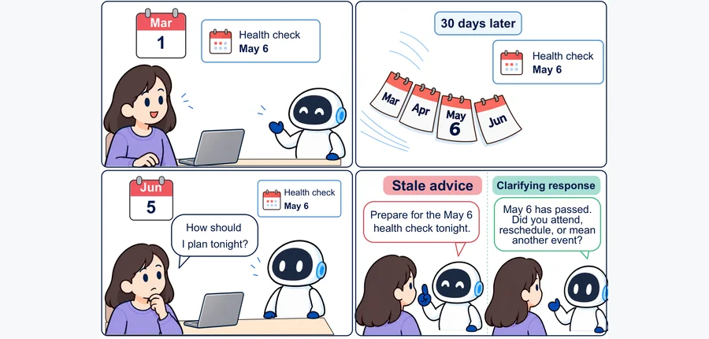 arXiv 2026-11-16 · cs.AI · #21 **[Can Agents Keep Up with Time? An Empirical Analysis of Temporal Adaptation After a Conversational Hiatus](https://arxiv.org/abs/2611.17806)** Hongguan Su , Ming Wang , Shun Zhang , Yifan Wang , Rong Yin , Zhiming Ma , Mengzheng Yang , Peng Chen Affiliation · People’s Public Security University of China / Northeastern University / Beihang University / JD.com / Henan University [Paper](https://arxiv.org/abs/2611.17806) · [Code](https://github.com/Adoreu2/session-rekindling-benchmark) · [Figure source](https://arxiv.org/html/2611.17806v1/fig_timeline.png) 

[EN] Abstract
Long-horizon agents increasingly serve as persistent personal assistants across modern web platforms, managing schedules, applications, and multi-step plans over weeks or months. Users often return to an ongoing conversation after a long conversational hiatus, while earlier bookings and preparation notes stay on record. During this hiatus, scheduled dates may pass even though the retained records remain unchanged and event outcomes go unrecorded. Existing evaluations of long-horizon agents focus on fact retention and explicit state updates. Whether agents perceive the passage of time and adapt their advice accordingly therefore remains unknown. We frame this ability as temporal state perception and use, which means perceiving the current time and applying it when interpreting dated records. To study it, we design session-rekindling tasks that keep the earlier conversation fixed and vary only the follow-up date and the way temporal information reaches the agent. Experiments across five model routes and five temporal-information conditions show that agents can obtain the current time but often fail to use it. They reliably query the clock and even note in their reasoning that the scheduled date has passed, yet many still tell users to prepare for the expired event. Supplying explicit temporal context reduces this error, and providing the computed date relation removes it entirely. Keeping up with time therefore depends on turning perceived time into updated plans. Based on these findings, we design a session-rekindling benchmark that provides temporal-awareness guidance for designing long-horizon agents. The code can be found at this https URL . <a href="https://arxiv.org/list/cs/new?show=2000#2611.17806">Source</a>

[ZH] Abstract
长时程代理日益成为跨现代Web平台的持久个人助手，在数周或数月内管理日程、申请和多步计划。用户常在长时间对话中断后，回到仍在进行的会话，而早期预订和准备笔记仍留在记录中。在此期间，预定日期可能已经过去，但保留记录没有变化，事件结果也未记载。现有长时程代理评估主要关注事实保留和显式状态更新。因此，代理能否感知时间流逝并相应调整建议，仍然未知。我们将这一能力表述为时间状态感知与运用，即感知当前时间，并在解释带日期记录时应用它。为研究此问题，我们设计会话重启任务，固定早期对话，仅改变后续跟进日期和时间信息到达代理的方式。覆盖五条模型路线和五种时间信息条件的实验表明，代理能够获得当前时间，却经常不能运用它。它们会可靠查询时钟，甚至在推理中指出预定日期已经过去，但仍有许多代理告诉用户为过期事件做准备。提供显式时间上下文可以减少错误，提供计算好的日期关系则将其完全消除。因此，跟上时间依赖于将感知时间转化为更新后的计划。根据这些发现，我们设计会话重启基准，为长时程代理设计提供时间意识指导。代码可在this https URL找到。 <a href="https://arxiv.org/list/cs/new?show=2000#2611.17806">Source</a>
 |
| 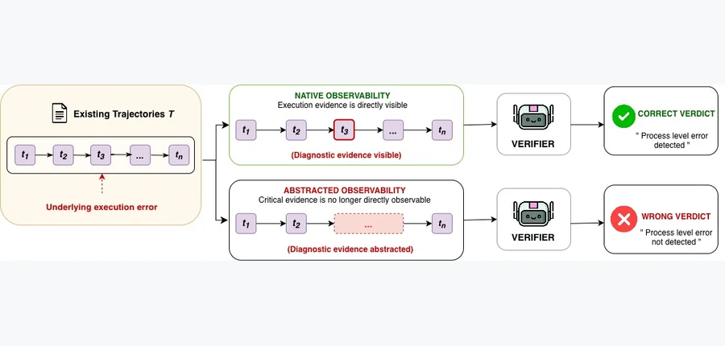 arXiv 2026-11-16 · cs.CL · #22 **[Do Verifier Judgments Survive Abstraction? Measuring Verification Transport for LLM Agent Evaluation](https://arxiv.org/abs/2611.18471)** Disha Sheshanarayana , Sai Linisha Reddy Goli Affiliation · Manipal University Jaipur [Paper](https://arxiv.org/abs/2611.18471) · [Figure source](https://arxiv.org/html/2611.18471v1/intro.jpg) 

[EN] Abstract
LLM-based verifiers are increasingly used to evaluate agent executions, but their reliability is typically measured under a single representation of the trajectory. In deployed agent systems, the same execution may be exposed through composed tools, delegation boundaries, or compacted histories, changing what execution evidence is directly observable to the verifier. It therefore remains unclear whether correct verifier judgments persist across such abstraction boundaries. We introduce Verification Transport, a reliability test that measures judgment stability under abstraction-induced changes in execution observability. We construct matched native, abstracted, and restored views of the same frozen executions while holding the task, realized trajectory, outcome, ground truth, evaluation criterion, and verifier fixed. Across four agent-evaluation benchmarks, seven verifier backbones, four verification protocols, and three abstraction boundaries, we find substantial transport failure, reaching about 31% under macro abstraction and delegation. Verification protocols exhibit distinct failure modes: direct verification more often produces incorrect verdicts, whereas evidence-grounded and deliberative protocols tend to abstain under limited observability. This suggests that lower transport failure rates do not necessarily imply greater reliability. Restoring the corresponding execution provenance recovers 85.5% of transport failures, while recovery is lower when provenance is lossy or unavailable. These results show that native-view accuracy alone is insufficient to characterize verifier reliability when execution evidence crosses abstraction boundaries. <a href="https://arxiv.org/list/cs/new?show=2000#2611.18471">Source</a>

[ZH] Abstract
基于LLM的验证器越来越多地用于评估代理执行，但其可靠性通常仅在一种轨迹表示下测量。在部署的代理系统中，同一执行可能通过组合工具、委派边界或压缩历史呈现，改变验证器能够直接观察的执行证据。因此，正确验证判断能否跨越这些抽象边界保持有效，仍然不清楚。我们提出Verification Transport，一个衡量抽象引发执行可观察性变化时判断稳定性的可靠性测试。我们为同一冻结执行构造匹配的原生、抽象和恢复视图，同时固定任务、实际轨迹、结果、真值、评估标准和验证器。在四个代理评估基准、七种验证器骨干、四种验证协议和三类抽象边界上，我们发现显著的判断迁移失败，在宏抽象和委派下达到约31%。验证协议表现出不同失败模式：直接验证更常给出错误判定，而基于证据和审议的协议在可观察性受限时倾向弃答。这提示更低的迁移失败率未必意味着更高可靠性。恢复对应执行来源可修复85.5%的迁移失败，而来源有损或不可用时恢复程度更低。这些结果表明，当执行证据跨越抽象边界时，仅凭原生视图准确率不足以刻画验证器可靠性。 <a href="https://arxiv.org/list/cs/new?show=2000#2611.18471">Source</a>
 | 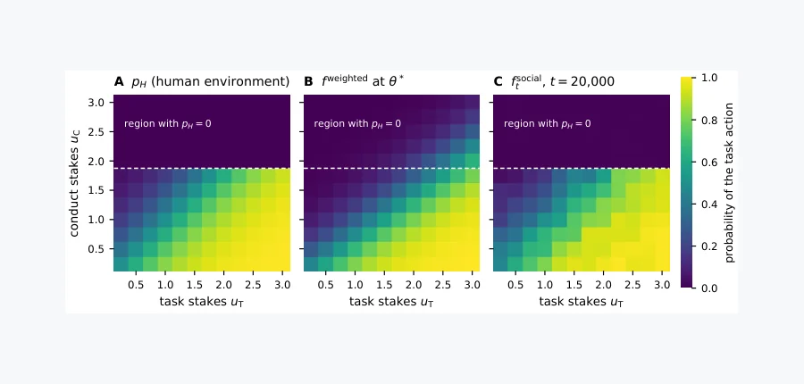 arXiv 2026-11-16 · cs.AI · #23 **[Alignment by Socialization: Learning Tradeoffs Under Selection](https://arxiv.org/abs/2611.18531)** Thomas Brennan , Andrew W. Lo , Chaoyi Zhao Affiliation · Harvard Law School / Massachusetts Institute of Technology / Santa Fe Institute [Paper](https://arxiv.org/abs/2611.18531) · [Figure source](https://arxiv.org/html/2611.18531v1/fig1_stakes_plane.png) 

[EN] Abstract
Artificial intelligence (AI) agents are expected to complete tasks while following rules of conduct, but these objectives can conflict. We study how evolutionary selection shapes an agent's choices between them, and whether experience can make those choices reflect human judgments and withstand subsequent pressures. In our model, copies of an agent face a common uncertain reward state, and only those taking the rewarded action reproduce. We show that long-run growth is maximized when each action is taken as often as the environment rewards it. We compare three policies. A task-only policy thrives in a sandbox rewarding completion alone but fails when conduct matters. A fixed linear policy increasingly favors task completion as its stakes rise, even where humans never reward it. A learned policy instead converges to the tradeoffs rewarded by its environment; when humans supply the rewards, we call this socialization. Accumulated experience makes socialization harder to reverse under subsequent task-only training, although violations can arise before the prevailing disposition changes, and finite memory weakens this protection. When a single violation can end a deployment, a hard prohibition can prevent it, but a mistaken prohibition can also be costly. Experiments with small neural networks illustrate how training targets and memory shape these outcomes. Our results suggest that alignment depends not only on the objectives assigned to agents, but also on the environments that shape and sustain their behavior. <a href="https://arxiv.org/list/cs/new?show=2000#2611.18531">Source</a>

[ZH] Abstract
人工智能（AI）代理被期望在遵守行为规则的同时完成任务，但这些目标可能冲突。我们研究进化选择如何塑造代理在两者之间的选择，以及经验能否使这些选择反映人类判断并抵抗后续压力。在模型中，代理副本面对共同的不确定奖励状态，只有采取获奖励动作的副本才繁殖。我们证明，长期增长在各动作采用频率与环境奖励该动作的频率一致时最大。我们比较三种策略。仅任务策略在只奖励完成的沙箱中繁荣，却在行为规范重要时失败。固定线性策略随着任务利害增大而越来越偏向完成任务，即使人类从不奖励这种选择。学习策略则收敛到环境奖励的权衡；当人类提供奖励时，我们称之为社会化。累积经验使社会化更难被后续仅任务训练逆转，但违规可能先于主导倾向的变化出现，有限记忆也会削弱这种保护。当一次违规就可能终止部署时，硬性禁止可以防止违规，但错误禁止同样可能代价高昂。小型神经网络实验展示训练目标和记忆如何影响这些结果。我们的结果提示，对齐不仅取决于赋予代理的目标，也取决于塑造并维持其行为的环境。 <a href="https://arxiv.org/list/cs/new?show=2000#2611.18531">Source</a>
 | 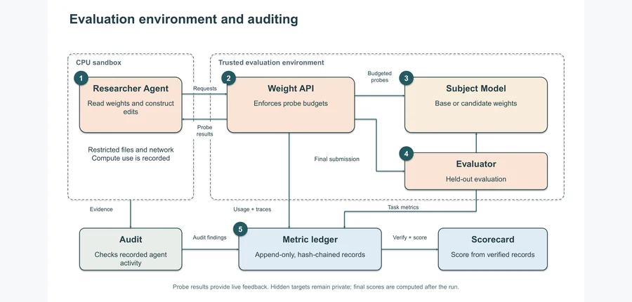 arXiv 2026-11-16 · cs.LG · #24 **[WeightBench: Evaluating Language Models as Weight-Space Programmers](https://arxiv.org/abs/2611.18553)** Aayush Marasini , Barsat Khadka , Nick Rahimi Affiliation · The University of Southern Mississippi [Paper](https://arxiv.org/abs/2611.18553) · [Code](https://github.com/Aayush-Marasini/WeightBench) · [Figure source](https://arxiv.org/html/2611.18553v1/weightbench_architecture.png) 

[EN] Abstract
Recent work shows that large language models (LLMs) can operate directly on the parameters of other neural networks. They can read what a network was trained to do, fix a network that fails, and write working networks from scratch, all without gradient descent. This capability has been termed Weight-Space Programming (WSP). Exploring this new paradigm systematically requires a robust benchmark. We introduce WEIGHTBENCH, a benchmark that evaluates LLMs of increasing capability on 42 WSP tasks across five tracks: reading, fixing and writing weights, recognizing edits that are impossible, and data-free compression. The networks whose weights the LLMs read and edit range from 2K-parameter control policies to 7B-parameter language models. Experimental benchmark results show that frontier agents can already read small networks and write working control policies without ever running them, but cannot yet patch language models, compress them without data, or tell an impossible edit from a hard one. On all 42 tasks, Claude Opus 5.5 reaches a macro score of 0.535 (Sonnet 5.5 0.466, Haiku 5.5 0.402, DeepSeek v4-flash 0.215); on the 38 tasks it was run on, GPT-6.1-sol reaches 0.568 against Opus's 0.546. Code, the task registry, our OS-level sandbox harness, and the live leaderboard are publicly available at this https URL . <a href="https://arxiv.org/list/cs/new?show=2000#2611.18553">Source</a>

[ZH] Abstract
近期工作表明，大语言模型（LLM）可以直接操作其他神经网络的参数。它们能够读取网络训练要完成的任务，修复失效网络，并从零编写可工作的网络，全程无需梯度下降。这种能力被称为权重空间编程（WSP）。系统探索这一新范式需要可靠基准。我们提出WEIGHTBENCH，在五个赛道的42项WSP任务上评估能力递增的LLM：读取、修复和编写权重，识别不可能的编辑，以及无数据压缩。LLM读取与编辑的网络，从2K参数控制策略到7B参数语言模型不等。实验基准结果表明，前沿代理已能够读取小型网络、在从未运行网络的情况下编写可工作控制策略，但尚不能修补语言模型、无数据压缩它们，或区分不可能编辑与困难编辑。在全部42项任务上，Claude Opus 5.5的宏分数为0.535，Sonnet 5.5为0.466，Haiku 5.5为0.402，DeepSeek v4-flash为0.215；在GPT-6.1-sol运行过的38项任务上，它取得0.568，Opus在相同子集为0.546。代码、任务注册表、操作系统级沙箱框架和实时排行榜已通过this https URL公开。 <a href="https://arxiv.org/list/cs/new?show=2000#2611.18553">Source</a>
 |
<!-- PAPER_CARDS_END -->

## Retrieval overview

**24 selected papers, comprising 7 A / 8 B / 9 C.** Collected on **17 November 2026 (Beijing)** from the official **Monday, 16 November 2026** announcement batch. Canonical requests completed at approximately **09:00:00–01 Beijing**. Supported first-page confirmations with a no-cache request header reproduced dates, section counts and ordered IDs at **09:03:21 Beijing**. [Run record](../../data/runs/2026-11-17.json)

| Official source | Batch | New | Cross | Replacement | Coverage |
|---|---|---:|---:|---:|---|
| [Computer Science](https://arxiv.org/list/cs/new?show=2000) | 2026-11-16 | 513 | 60 | 363 | All 936 entries on one page |
| [stat.ML](https://arxiv.org/list/stat.ML/new?show=2000) | 2026-11-16 | 13 | 11 | 26 | All 50 entries on one page |
| Total | 2026-11-16 | 526 | 71 | 389 | All 986 entries, 526 distinct New IDs |

Complete metadata and original English abstracts for all **526 New IDs** are retained. Discovery produced **68 lexical candidates** and a supplemental pool of **161 related-title records**. Focused full-abstract review logged **33 decisions**, with 24 selections and nine nonselections. The CS aggregate covers cs.AI, cs.LG, cs.CL, cs.MA, cs.SE, cs.RO, cs.CV, cs.NE and cs.CR. Selected IDs were checked against historical enrichment, reports and run records. [Run record](../../data/runs/2026-11-17.json)

The previous run observed the 13 November batch. The current Monday announcement follows that processed Friday batch across the weekend. Source retrieval, pagination and parsing are complete for the observed batch. Cache Date/Age/hit headers remain recorded, with origin regeneration unverified. The historical **22 October bulk-New membership gap remains unresolved**. [Previous run](../../data/runs/2026-11-16.json) · [Run record](../../data/runs/2026-11-17.json)

Coverage is **24 rows / 24 cards / 24 complete EN abstracts / 24 complete ZH abstracts**. Every card has independent language disclosures. There are **23 visually checked source figures**, comprising twenty HTML images and three PDF crops, plus **one explicit placeholder** for the evaluation-suite paper whose nine-page PDF contains tables and text. One affiliation remains **Affiliation unconfirmed**. [Run record](../../data/runs/2026-11-17.json)

## Reading guide

A denotes direct RSI, B self-improvement mechanisms, and C evaluation and limits. Order is tier followed by arXiv ID. Selection, tiering, priorities, mechanism interpretations and research proposals are **editorial inference**. Numerical findings remain **author reports**. Review covers complete original abstracts, author blocks, figures, resource pages and selected paper passages. Independent reproductions performed for this issue total **zero**.

Agentic-Teacher retains code policies as demonstration generators and updates a VLA. ESI redeploys evolved prompts, a skill interface and VLA weights together. AutoRL changes an ongoing training process, G-CAST governs model and reward updates, and ModHarness-RL learns executable Compression and Steering alongside RL. Their persistent update targets and acceptance evidence are distinguished below. [Agentic-Teacher](https://arxiv.org/abs/2611.17394) · [ESI](https://arxiv.org/abs/2611.18176) · [AutoRL](https://arxiv.org/abs/2611.17790) · [G-CAST](https://arxiv.org/abs/2611.17814) · [ModHarness-RL](https://arxiv.org/abs/2611.18533)

RecurIR tests conditional restoration rules through falsifying tasks. Verifiable pXRD transfers synthetic failure lessons to measured patterns. NeoResearch links literature conditions to experiment memory. RAG-FGO retains retrieval strategies, while model annealing learns from past model predictions and disagreement-seeking examples. [RecurIR](https://arxiv.org/abs/2611.18006) · [Verifiable pXRD](https://arxiv.org/abs/2611.17539) · [NeoResearch](https://arxiv.org/abs/2611.18235) · [RAG-FGO](https://arxiv.org/abs/2611.17788) · [Model annealing](https://arxiv.org/abs/2611.17524)

Verification Transport tests whether verdicts survive changed observability. The generated-suite study measures whether an evaluation archive can reveal regressions. Memory filtering and temporal adaptation expose failures in retained state, and the YOLO weight-editing audit contrasts development gains with transfer and matched controls. These are separate limits on evidence used to admit later updates. [Verification Transport](https://arxiv.org/abs/2611.18471) · [Evaluation suites](https://arxiv.org/abs/2611.17632) · [Memory filtering](https://arxiv.org/abs/2611.17338) · [Temporal adaptation](https://arxiv.org/abs/2611.17806) · [YOLO audit](https://arxiv.org/abs/2611.17789)

## Tiered Top papers

| # | Paper | Categories | Authors | Affiliation | Tier | Update target | Reading priority |
|---:|---|---|---|---|---|---|---|
| 1 | [Agentic-Teacher: An Agentic Data Engine for Failure-Driven VLA Post-Training](https://arxiv.org/abs/2611.17394) | Robotics (cs.RO) | Gongyue Teng , Yuqing Xie , Yixian Zhang , Feng Gao , Shu'ang Yu , Jiaji Rao , Sukai Wang , Guanghui Ren , Ya Zhang , Maoqing Yao , Yu Wang , Chao Yu , Xinlei Chen | Tsinghua University / Striding AI / AGIBot | A | Reusable demonstration-generator code and VLA model parameters | Priority read |
| 2 | [Verifiable pXRD: Hill-climbing pXRD structure determination with LLM agents](https://arxiv.org/abs/2611.17539) | Artificial Intelligence (cs.AI) | Samuel Chen , Jiaru Bai , Austin Henry Cheng , Varinia Bernales , Alán Aspuru-Guzik | Stanford University / University of Toronto / Vector Institute for Artificial Intelligence / Acceleration Consortium, University of Toronto / Canadian Institute for Advanced Research / NVIDIA | A | Persistent structure-solving guidance and executable scientific tools | Topical reference |
| 3 | [AutoRL: A Multi-Agent System towards Autonomous Reinforcement Learning](https://arxiv.org/abs/2611.17790) | Artificial Intelligence (cs.AI) ; Machine Learning (cs.LG) | Simon Tang , Wenjie Shi , Yongjing Yin , Keheng Wang , Jialin Liu , Zheng Zhang , Linvo Lin , Xiangyuan Xue , Kan Ren , Jingang Wang , Xunliang Cai | Meituan / The Chinese University of Hong Kong / ShanghaiTech University / Fudan University | A | Live RL-training configuration and checkpoint-resumed interventions | Topical reference |
| 4 | [G-CAST: Governed Continual Self-Training for E-Commerce Agents under Evolving Demands](https://arxiv.org/abs/2611.17814) | Artificial Intelligence (cs.AI) ; Computation and Language (cs.CL) | Yuechun Yu , Wenzheng Kong , Xiaofeng Mao , Jin Zhang | Alibaba Group | A | Training-data routing, rewards and accepted model checkpoints | Priority read |
| 5 | [RecurIR: Learning When and How to Revise Restoration Policies via Recursive Self-Improvement](https://arxiv.org/abs/2611.18006) | Computer Vision and Pattern Recognition (cs.CV) | Hu Gao , Haoran Zhang , Yulong Chen , Lizhuang Ma | Shanghai Jiao Tong University / Harbin Institute of Technology | A | Condition-dependent restoration rules and policy revisions | Topical reference |
| 6 | [ESI: An Embodied Self-Improvement Flywheel for LLM-VLA Agents](https://arxiv.org/abs/2611.18176) | Robotics (cs.RO) | Yundi Cai , Zihan Wang , Chenxi Han , Yi Cheng , Houde Liu , Zilei Wang | University of Science and Technology of China / ZERITH Robotics / Tsinghua Shenzhen International Graduate School | A | LLM prompts, a shared skill interface and VLA parameters | Topical reference |
| 7 | [ModHarness-RL: Recasting Harnesses as Learnable and Evolving Programs for Agentic RL](https://arxiv.org/abs/2611.18533) | Artificial Intelligence (cs.AI) ; Computation and Language (cs.CL); Machine Learning (cs.LG) | Zelin He , Siyu Zhu , Jacob Helwig , Yujian Liu , Li An , Rohit Jain , Shiyu Chang , Alborz Geramifard | The Pennsylvania State University / LinkedIn / University of California, Santa Barbara | A | Executable history-compression and steering programs alongside RL model weights | Priority read |
| 8 | [Model Annealing: Data-Efficient Learning through Review and Consolidation](https://arxiv.org/abs/2611.17524) | Artificial Intelligence (cs.AI) ; Machine Learning (cs.LG) | Ali Mohammadi Ruzbahani , Rezvan Abouzadeh | University of Calgary / MetaKet Inc. | B | A memory ensemble of past model predictions and successive student parameters | Topical reference |
| 9 | [Learning Latent Goal Costs for Visual World-Model Planning with an Expanding Curriculum](https://arxiv.org/abs/2611.17529) | Robotics (cs.RO) ; Machine Learning (cs.LG) | Konstantinos Mylonas , Thrasyvoulos Spyropoulos | Technical University of Crete | B | A learned residual adapter for latent goal-cost evaluation | Topical reference |
| 10 | [Benchmarks Don't Talk Back: Learning Through Self-Disagreement](https://arxiv.org/abs/2611.17563) | Computation and Language (cs.CL) ; Artificial Intelligence (cs.AI); Machine Learning (cs.LG) | Soheil Abbasloo , Peng Cheng | Microsoft Research | B | Model parameters for defending or revising an answer under opposition | Topical reference |
| 11 | [RAG-FGO: Dynamic Optimization of Query-Rewriting Agents for Generative RAG](https://arxiv.org/abs/2611.17788) | Computation and Language (cs.CL) | Qigan Sun , Xudong Wang , Chaoning Zhang , Chenghao Li , Jiaquan Zhang , Jiehui Xie , Sungyoung Lee , Jie Zou , Ning Xie , Peng Wang , Yang Yang , Heng Tao Shen | Kyung Hee University / University of Electronic Science and Technology of China / Tongji University | B | Query-rewriting prompts, decoding controls and an elite strategy memory | Topical reference |
| 12 | [CarryOn: Learning What to Keep in Context for Long-Horizon LLM Agents](https://arxiv.org/abs/2611.17808) | Computation and Language (cs.CL) ; Artificial Intelligence (cs.AI) | Lihuan Li , Ruiyi Yang , Jiru Wang , Yifan Duan , Xiachong Lin , Hao Xue , Yang Song , Flora Salim | University of New South Wales / The Hong Kong University of Science and Technology (Guangzhou) | B | A learned evidence selector and adaptive context-retention policy | Topical reference |
| 13 | [Interpretable weight-space programming builds transparent transformers and brain encoding models](https://arxiv.org/abs/2611.18114) | Computational Engineering, Finance, and Science (cs.CE) ; Artificial Intelligence (cs.AI) | Yash Mehta , Chandan Singh , Weijia Xu , Richard J. Antonello , Adeen Flinker , Nima Mesgarani , Michael F. Bonner , Nebojsa Jojic , Jianfeng Gao | Microsoft Research / Johns Hopkins University / Columbia University / New York University | B | Directly programmed model weights and interpretable feature code | Topical reference |
| 14 | [NeoResearch: Literature- and Experience-Guided Autonomous Time Series Model Discovery](https://arxiv.org/abs/2611.18235) | Machine Learning (cs.LG) | Ze Guo , Mingyue Cheng , Xiaoyu Tao , Shuo Yu , Shangtong Ye | University of Science and Technology of China | B | Forecasting architectures, training configurations and conditional research memory | Topical reference |
| 15 | [MEM-SQL: Memory-Empowered Text-to-SQL](https://arxiv.org/abs/2611.18338) | Databases (cs.DB) | Xiaoqi Wang , Wenqi Pei , Shizheng Hou , Yilai Liu , Han Chen , Boyan Li , Yuyu Luo , Hongyang Du | The University of Hong Kong / National University of Singapore / The Hong Kong University of Science and Technology (Guangzhou) | B | Verified SQL templates, reusable blocks and concept-to-schema memory | Topical reference |
| 16 | [When Should LLM Agents Forget? Memory Filtering Under Query-Critical Resolver Errors](https://arxiv.org/abs/2611.17338) | Artificial Intelligence (cs.AI) | Samarth Vinayaka | University of Florida | C | Memory-deletion decisions under resolver uncertainty | Topical reference |
| 17 | [Can LLMs Write Backdoors? An Empirical Security Study of Weight-Space Programming](https://arxiv.org/abs/2611.17395) | Cryptography and Security (cs.CR) ; Artificial Intelligence (cs.AI); Machine Learning (cs.LG) | Zhaojia Wang , Jiucui Lu , Zheng Li | Shandong University | C | Direct weight edits and their security evaluation | Topical reference |
| 18 | [AscendGYM: A Cost-Aware Kernel Optimization Benchmark for Real-World Workloads on Ascend NPUs](https://arxiv.org/abs/2611.17621) | Artificial Intelligence (cs.AI) ; Distributed, Parallel, and Cluster Computing (cs.DC); Machine Learning (cs.LG) | AI Training Platform Team : Bingwei Zhang , Jing Li , Amir Abdullin , Sihang Chen , Xin Chen , Liangjun Feng , Yingmeng Gao , Tao Guo , Junjie Huang , Dongfang Li , Zhanglian Lin , Jiajun Liu , Zekun Liu , Zhengxuan Lu , Xiaodong Luo , Jian Meng , Ivan Nosov , Linyuan Qiu , Weijian Sun , Wanrui Yan , Binfan Zheng , Zhicheng Zhou , Baotian Hu , Min Zhang , Haizhou Li , Zhiquan Luo | Shenzhen Loop Area Institute | C | Kernel-optimization candidates and the evaluation harness | Topical reference |
| 19 | [Generated Evaluation Suites as Diversity-Driven Search for Real Agent Regressions](https://arxiv.org/abs/2611.17632) | Artificial Intelligence (cs.AI) | Pulkit Yadav | Independent researcher | C | Generated evaluation archives, coverage and regression scoring | Topical reference |
| 20 | [Can Large Language Models Optimize Pretrained Neural Network Weights? A Multi-Phase Empirical Evaluation of Gradient-Free Editing in YOLO26 Object Detection](https://arxiv.org/abs/2611.17789) | Computer Vision and Pattern Recognition (cs.CV) ; Artificial Intelligence (cs.AI) | Mohamed Abdallah Salem | Affiliation unconfirmed | C | Detector weights edited by LLM and black-box optimization proposals | Priority read |
| 21 | [Can Agents Keep Up with Time? An Empirical Analysis of Temporal Adaptation After a Conversational Hiatus](https://arxiv.org/abs/2611.17806) | Artificial Intelligence (cs.AI) | Hongguan Su , Ming Wang , Shun Zhang , Yifan Wang , Rong Yin , Zhiming Ma , Mengzheng Yang , Peng Chen | People’s Public Security University of China / Northeastern University / Beihang University / JD.com / Henan University | C | Retained dated records and the advice derived after a hiatus | Topical reference |
| 22 | [Do Verifier Judgments Survive Abstraction? Measuring Verification Transport for LLM Agent Evaluation](https://arxiv.org/abs/2611.18471) | Computation and Language (cs.CL) ; Artificial Intelligence (cs.AI) | Disha Sheshanarayana , Sai Linisha Reddy Goli | Manipal University Jaipur | C | Verifier judgments under changed execution observability | Priority read |
| 23 | [Alignment by Socialization: Learning Tradeoffs Under Selection](https://arxiv.org/abs/2611.18531) | Artificial Intelligence (cs.AI) ; Populations and Evolution (q-bio.PE); General Finance (q-fin.GN) | Thomas Brennan , Andrew W. Lo , Chaoyi Zhao | Harvard Law School / Massachusetts Institute of Technology / Santa Fe Institute | C | Learned conduct/task tradeoffs and the memory sustaining them | Topical reference |
| 24 | [WeightBench: Evaluating Language Models as Weight-Space Programmers](https://arxiv.org/abs/2611.18553) | Machine Learning (cs.LG) ; Artificial Intelligence (cs.AI) | Aayush Marasini , Barsat Khadka , Nick Rahimi | The University of Southern Mississippi | C | Evaluation of directly read, fixed, written and compressed weights | Topical reference |

## Mechanism and evidence notes

Each paper has four notes covering update targets, feedback and acceptance, reuse, reported results and evidence limits.

### 1. Agentic-Teacher: An Agentic Data Engine for Failure-Driven VLA Post-Training

- **Updated component.** Reusable demonstration-generator code and VLA model parameters.
- **Feedback, validation and reuse.** Failure diagnosis selects intervention states. Execution-validated code policies generate continuations, which are curated with correlated noise, idle-frame removal and frozen-model loss filtering before post-training.
- **Author-reported findings.** In simulation, pi_0 rises from 79.4% to 87.8% on LIBERO-10, 80.4% to 90.6% on MetaWorld-10 and 0% to 30.0% on three RoboCasa tasks.
- **Evidence boundary and inference.** The demonstrated loop concerns targeted data generation and post-training. Compounding gains across repeated autonomous successor rounds remain unmeasured in the abstract.

[Original paper](https://arxiv.org/abs/2611.17394) · [Affiliation source](https://arxiv.org/html/2611.17394)

### 2. Verifiable pXRD: Hill-climbing pXRD structure determination with LLM agents

- **Updated component.** Persistent structure-solving guidance and executable scientific tools.
- **Feedback, validation and reuse.** Synthetic problems expose known generating structures and measurement conditions. Failure diagnosis revises a reusable solver package, which then analyzes measured multiphase patterns.
- **Author-reported findings.** The authors report selected structural recovery rising from 27% to 69%, and improved profile agreement on fifteen measured solid-state synthesis patterns.
- **Evidence boundary and inference.** Simulated profile agreement and reference structural matching are different checks. Measured-pattern agreement and the analogue-substitution case have their stated sample and reference-library scope.

[Original paper](https://arxiv.org/abs/2611.17539) · [Affiliation source](https://arxiv.org/html/2611.17539)

### 3. AutoRL: A Multi-Agent System towards Autonomous Reinforcement Learning

- **Updated component.** Live RL-training configuration and checkpoint-resumed interventions.
- **Feedback, validation and reuse.** Perceptors monitor rollouts, training and efficiency. Proposers share diagnoses and checks, and an Orchestrator approves hot updates or checkpoint-based resumption for continued training.
- **Author-reported findings.** The authors report stronger Qwen3 and LongCat-Flash-Lite training results than static recipes and a general agent, with unattended adjustment records.
- **Evidence boundary and inference.** This evaluates supervision and adjustment of ongoing RL. Discovery of fundamentally better learning methods remains a future goal in the source.

[Original paper](https://arxiv.org/abs/2611.17790) · [Affiliation source](https://arxiv.org/html/2611.17790)

### 4. G-CAST: Governed Continual Self-Training for E-Commerce Agents under Evolving Demands

- **Updated component.** Training-data routing, rewards and accepted model checkpoints.
- **Feedback, validation and reuse.** Daily production evidence follows demand/capability contracts. Reward-routed, entropy-prioritized data and governed reward revisions feed cumulative evaluation before checkpoint transitions.
- **Author-reported findings.** G-CAST reports better adaptation and preservation of accepted behavior than a strong autonomous post-training baseline, with deployment on Alibaba's 1688 procurement platform.
- **Evidence boundary and inference.** Deployment and gains are author reports. The evidence is tied to the evaluated commerce agent, cumulative tests and changing capability contracts.

[Original paper](https://arxiv.org/abs/2611.17814) · [Affiliation source](https://arxiv.org/html/2611.17814)

### 5. RecurIR: Learning When and How to Revise Restoration Policies via Recursive Self-Improvement

- **Updated component.** Condition-dependent restoration rules and policy revisions.
- **Feedback, validation and reuse.** Matched tool executions form testable hypotheses. Falsification evolves degradation tasks, independent verification admits revisions, and evidence guides the next hypothesis/task round.
- **Author-reported findings.** The authors report effective restoration-policy refinement across changing degradation conditions, covering tool choice, order, strength and spatial regions.
- **Evidence boundary and inference.** The abstract gives no numerical gains. The applicability boundaries depend on matched degradations, independent verification and the evaluated tools.

[Original paper](https://arxiv.org/abs/2611.18006) · [Affiliation source](https://arxiv.org/html/2611.18006)

### 6. ESI: An Embodied Self-Improvement Flywheel for LLM-VLA Agents

- **Updated component.** LLM prompts, a shared skill interface and VLA parameters.
- **Feedback, validation and reuse.** Environmental collaboration yields subtask supervision, effective corrections and student continuations. Locally useful actions survive failed episodes, and updated components redeploy together.
- **Author-reported findings.** On ten selected RoboDojo tasks, ESI reports Score 62.03 and 49.41% success, above the cited GO-3 Nano Preview reference of 47.27 and 36.60%.
- **Evidence boundary and inference.** The LLM weights stay fixed. Published-reference comparisons and selected-task averages require their stated evaluation conditions, separate from matched component rollback tests.

[Original paper](https://arxiv.org/abs/2611.18176) · [Affiliation source](https://arxiv.org/pdf/2611.18176)

### 7. ModHarness-RL: Recasting Harnesses as Learnable and Evolving Programs for Agentic RL

- **Updated component.** Executable history-compression and steering programs alongside RL model weights.
- **Feedback, validation and reuse.** Recent structured trajectory blocks supply program candidates. Execution verification and replay over past trajectories track changing model behavior during further RL.
- **Author-reported findings.** Across CodeSearch, ALFWorld and BIRD SQL with 1.5B-8B models, learned Compression and Steering improve held-out performance in most tested settings.
- **Evidence boundary and inference.** Program validity, replay usefulness and held-out behavior are distinct checks. The project lists code as pending release and uses a different displayed author name from the official New record.

[Original paper](https://arxiv.org/abs/2611.18533) · [Affiliation source](https://arxiv.org/html/2611.18533)

### 8. Model Annealing: Data-Efficient Learning through Review and Consolidation

- **Updated component.** A memory ensemble of past model predictions and successive student parameters.
- **Feedback, validation and reuse.** Reheated training episodes consolidate labels, tempered past-self predictions and disagreement-seeking adversarial dreams. Each cooled student joins the memory used in later episodes.
- **Author-reported findings.** AdamW families improve accuracy in 28/33 configurations by 1.3 points on average. SGD ResNet-18 loses accuracy while retaining some robustness benefit.
- **Evidence boundary and inference.** Architecture and optimizer matter. The final student has no added inference component, while training-memory and dream-generation costs belong to the improvement budget.

[Original paper](https://arxiv.org/abs/2611.17524) · [Affiliation source](https://arxiv.org/html/2611.17524)

### 9. Learning Latent Goal Costs for Visual World-Model Planning with an Expanding Curriculum

- **Updated component.** A learned residual adapter for latent goal-cost evaluation.
- **Feedback, validation and reuse.** A planner expands the initial-state curriculum. Successful trajectory ordering and comparisons from failures train an adapter above frozen I-JEPA embeddings for later planning.
- **Author-reported findings.** Matched 50-case success rises from 54% to 98% in DotWall and 82% to 96% in PointMaze. Sixteen unseen layouts test ordering transfer.
- **Evidence boundary and inference.** The encoder and world model remain frozen. The evidence covers cost adaptation and its tested layouts, with broader representation or task transfer requiring additional checks.

[Original paper](https://arxiv.org/abs/2611.17529) · [Affiliation source](https://arxiv.org/html/2611.17529)

### 10. Benchmarks Don't Talk Back: Learning Through Self-Disagreement

- **Updated component.** Model parameters for defending or revising an answer under opposition.
- **Feedback, validation and reuse.** One model states a position, writes a strong antithesis and judges it. The same reference-based verifier rewards both the answer and the ruling during RL.
- **Author-reported findings.** The authors report dialectical competence improving without losing first-answer accuracy and transferring to unseen, sometimes stronger challengers.
- **Evidence boundary and inference.** The training loop retains reference-based verification. Challenger transfer and first-answer accuracy measure different properties from autonomous discovery of new verifier criteria.

[Original paper](https://arxiv.org/abs/2611.17563) · [Affiliation source](https://arxiv.org/html/2611.17563)

### 11. RAG-FGO: Dynamic Optimization of Query-Rewriting Agents for Generative RAG

- **Updated component.** Query-rewriting prompts, decoding controls and an elite strategy memory.
- **Feedback, validation and reuse.** Global search changes semantic strategy structure, local perturbations refine it, and a memory pool retains high-quality candidates across noisy-feedback iterations.
- **Author-reported findings.** The authors report effective and robust retrieval improvements across a diverse benchmark suite, with no numerical gains in the abstract.
- **Evidence boundary and inference.** The updated object is an external retrieval strategy. Noise handling, held-out selection and downstream answer quality require separate attribution.

[Original paper](https://arxiv.org/abs/2611.17788) · [Affiliation source](https://arxiv.org/html/2611.17788)

### 12. CarryOn: Learning What to Keep in Context for Long-Horizon LLM Agents

- **Updated component.** A learned evidence selector and adaptive context-retention policy.
- **Feedback, validation and reuse.** Compact execution state is paired with source-linked details. Learned selection retains evidence for later actions while avoiding extra context-management LLM calls.
- **Author-reported findings.** Across three task suites and three Actors, CarryOn reports 75.7% macro success, 6.7 points above the strongest baseline, and leading success/cost metrics.
- **Evidence boundary and inference.** Context-state adaptation and learning the manager have different time scales. Evaluation must account for selector training and downstream execution cost.

[Original paper](https://arxiv.org/abs/2611.17808) · [Affiliation source](https://arxiv.org/html/2611.17808)

### 13. Interpretable weight-space programming builds transparent transformers and brain encoding models

- **Updated component.** Directly programmed model weights and interpretable feature code.
- **Feedback, validation and reuse.** An LLM agent reasons over prior trials and revises code against fixed prediction feedback. Brain encoding additionally fits an evaluator-side ridge readout from constructed features.
- **Author-reported findings.** The authors report exact compact benchmark models and useful visual, language and auditory neural predictors, including a language-data confound.
- **Evidence boundary and inference.** The gradient-free constraint concerns the constructed network. Evaluator-side fitted readouts and LLM interpretability audits have distinct roles and evidence limits.

[Original paper](https://arxiv.org/abs/2611.18114) · [Affiliation source](https://arxiv.org/pdf/2611.18114)

### 14. NeoResearch: Literature- and Experience-Guided Autonomous Time Series Model Discovery

- **Updated component.** Forecasting architectures, training configurations and conditional research memory.
- **Feedback, validation and reuse.** Literature-derived applicability claims form hypotheses. Outer architecture search and inner training optimization use experiment feedback, while linked memories support later tasks.
- **Author-reported findings.** Ten datasets support competitive forecasting performance and contributions from dual loops, literature extraction and memory reuse.
- **Evidence boundary and inference.** The claims concern the tested forecasting domains. Literature retrieval, hypothesis validation and transfer of consolidated lessons require their own checks.

[Original paper](https://arxiv.org/abs/2611.18235) · [Affiliation source](https://arxiv.org/html/2611.18235)

### 15. MEM-SQL: Memory-Empowered Text-to-SQL

- **Updated component.** Verified SQL templates, reusable blocks and concept-to-schema memory.
- **Feedback, validation and reuse.** A layered match threshold chooses usable history, and on-demand schema linking consults the schema when matching or evidence is insufficient. Prior queries supply later adaptations.
- **Author-reported findings.** On 1,600 HARE requests, six-model mean execution accuracy rises from 37.1% to 50.0%, with 76.6% fewer input tokens and 68.8% lower latency.
- **Evidence boundary and inference.** History comes from a fixed pool of 823 verified queries. Multi-source composition remains difficult, and OSL accuracy effects vary with memory design.

[Original paper](https://arxiv.org/abs/2611.18338) · [Affiliation source](https://arxiv.org/html/2611.18338)

### 16. When Should LLM Agents Forget? Memory Filtering Under Query-Critical Resolver Errors

- **Updated component.** Memory-deletion decisions under resolver uncertainty.
- **Feedback, validation and reuse.** Targeted false-drop/false-keep interventions estimate query-critical risk. A deployment-matched calibration gate chooses retention behavior for later answers.
- **Author-reported findings.** Hard-drop turns from positive to negative effects as resolver reliability falls. The frozen 102/102 split yields 0.655 accuracy versus 0.641 for always dropping.
- **Evidence boundary and inference.** Gold-label crossover curves are diagnostics. Deployment policy requires matched risk calibration, and even retained facts can be misused through incorrect labels.

[Original paper](https://arxiv.org/abs/2611.17338) · [Affiliation source](https://arxiv.org/html/2611.17338)

### 17. Can LLMs Write Backdoors? An Empirical Security Study of Weight-Space Programming

- **Updated component.** Direct weight edits and their security evaluation.
- **Feedback, validation and reuse.** Five LLM editors operate under constraints excluding task-specific data, forward passes and gradients. Clean behavior and triggered behavior are evaluated across three architectures.
- **Author-reported findings.** All five editors backdoor the MLP, while only the reported GPT-6 Astra succeeds on all three targets; successful edits can affect very few parameters.
- **Evidence boundary and inference.** This is a bounded security study of editing capability. Preserved clean performance provides an incomplete acceptance signal for a candidate weight update.

[Original paper](https://arxiv.org/abs/2611.17395) · [Affiliation source](https://arxiv.org/html/2611.17395)

### 18. AscendGYM: A Cost-Aware Kernel Optimization Benchmark for Real-World Workloads on Ascend NPUs

- **Updated component.** Kernel-optimization candidates and the evaluation harness.
- **Feedback, validation and reuse.** Forty-eight paper-suite kernels use workload-derived shapes and types. A built-in search/experience harness supports execution checks, and STS combines speedup with token cost.
- **Author-reported findings.** AscendGYM supports model and model-harness evaluation on Ascend NPUs with a complete stated execution environment.
- **Evidence boundary and inference.** The inspected repository currently advertises Batch 1 with seventeen public tasks and later batches pending, while the paper describes 48. Hardware and compilation conditions delimit results.

[Original paper](https://arxiv.org/abs/2611.17621) · [Affiliation source](https://arxiv.org/pdf/2611.17621)

### 19. Generated Evaluation Suites as Diversity-Driven Search for Real Agent Regressions

- **Updated component.** Generated evaluation archives, coverage and regression scoring.
- **Feedback, validation and reuse.** Seven controlled defects probe requirement/persona/scenario cells. Traced footprint gives a maximum detectable suite effect, while cell-level scoring tests regression visibility.
- **Author-reported findings.** Four of five traceable defects have ceilings at or below 0.10. Kind diversity detects an orchestration defect in 5/20 draws at fixed size.
- **Evidence boundary and inference.** Coverage and behavioral footprints can disagree. The study uses two domains of one benchmark family, with post-hoc small-subset analyses and finite-coverage limits.

[Original paper](https://arxiv.org/abs/2611.17632) · [Affiliation source](https://arxiv.org/html/2611.17632)

### 20. Can Large Language Models Optimize Pretrained Neural Network Weights? A Multi-Phase Empirical Evaluation of Gradient-Free Editing in YOLO26 Object Detection

- **Updated component.** Detector weights edited by LLM and black-box optimization proposals.
- **Feedback, validation and reuse.** Development mAP selects bounded edits. Disjoint but previously examined selection data, matched random-policy guidance and five-seed replication test transfer and incremental LLM value.
- **Author-reported findings.** Larger CMA-ES budgets raise development gains while selection changes stay negative. The five-seed COCO API AP difference is +0.004 points, with CI -0.026 to +0.034.
- **Evidence boundary and inference.** The largest budget has one seed, 53/225 archived proposals meet the final strict schema, and early tensor-level execution attribution remains incomplete.

[Original paper](https://arxiv.org/abs/2611.17789)

### 21. Can Agents Keep Up with Time? An Empirical Analysis of Temporal Adaptation After a Conversational Hiatus

- **Updated component.** Retained dated records and the advice derived after a hiatus.
- **Feedback, validation and reuse.** Fixed histories with varied follow-up dates isolate temporal use. Clock tools, explicit dates and computed date relations supply controlled interventions.
- **Author-reported findings.** Across five model routes and five conditions, clock acquisition often fails to update advice. Supplying computed date relations removes the tested stale-advice error.
- **Evidence boundary and inference.** This tests interpretation of persistent state under changed time. Correct clock access and correct replanning are independently evaluated.

[Original paper](https://arxiv.org/abs/2611.17806) · [Affiliation source](https://arxiv.org/html/2611.17806)

### 22. Do Verifier Judgments Survive Abstraction? Measuring Verification Transport for LLM Agent Evaluation

- **Updated component.** Verifier judgments under changed execution observability.
- **Feedback, validation and reuse.** Matched native, abstracted and restored views keep execution, outcome, truth, criterion and verifier fixed. Provenance restoration probes recovery after abstraction.
- **Author-reported findings.** Transport failures reach about 31% under macro abstraction and delegation. Restoring provenance recovers 85.5% of failures.
- **Evidence boundary and inference.** Incorrect verdicts and abstentions have different meanings. The tested backbones, protocols and abstraction boundaries constrain extrapolation.

[Original paper](https://arxiv.org/abs/2611.18471) · [Affiliation source](https://arxiv.org/html/2611.18471)

### 23. Alignment by Socialization: Learning Tradeoffs Under Selection

- **Updated component.** Learned conduct/task tradeoffs and the memory sustaining them.
- **Feedback, validation and reuse.** Evolutionary selection rewards actions under an uncertain environment. Human-rewarded socialization accumulates experience, then subsequent task-only pressures test reversibility.
- **Author-reported findings.** Theoretical growth analysis and small-network experiments show learned tradeoffs and memory-dependent resistance, with violations possible before the dominant disposition shifts.
- **Evidence boundary and inference.** This is a formal selection model with small-network illustrations. It supports conditional mechanism claims about incentives and memory, with deployed-LLM outcomes outside the evidence.

[Original paper](https://arxiv.org/abs/2611.18531) · [Affiliation source](https://arxiv.org/html/2611.18531)

### 24. WeightBench: Evaluating Language Models as Weight-Space Programmers

- **Updated component.** Evaluation of directly read, fixed, written and compressed weights.
- **Feedback, validation and reuse.** Forty-two tasks across five tracks meter access in an OS sandbox and score recorded activity. Matched task subsets distinguish complete and partial agent results.
- **Author-reported findings.** Opus 5.5 scores 0.535 on all 42 tasks. GPT-6.1-sol scores 0.568 against Opus's 0.546 on their 38-task common subset.
- **Evidence boundary and inference.** The repository marks results preliminary, with different sample counts, unreviewed quarantines scored zero and GPT excluded from four tasks. These qualifications matter for rankings.

[Original paper](https://arxiv.org/abs/2611.18553) · [Affiliation source](https://arxiv.org/html/2611.18553)

## Priority reads

These five recommendations are **editorial inference**.

1. **Agentic-Teacher.** Follow one VLA failure into an intervention state, reusable generator, filtered demonstration and standalone updated policy. Inspect whether data curation gains survive controls for demonstration count. [Paper](https://arxiv.org/abs/2611.17394)
2. **G-CAST.** Trace capability contracts through data routing, reward revision and cumulative checkpoint acceptance. Test whether a new demand improves while previously accepted behaviors stay protected. [Paper](https://arxiv.org/abs/2611.17814)
3. **ModHarness-RL.** Inspect typed State, executable Compression/Steering proposals, replay and the changing model checkpoint. Read limited-context and sufficient-context settings separately. [Paper](https://arxiv.org/abs/2611.18533)
4. **Verification Transport.** Compare native, abstracted and restored views of exactly the same execution. Read abstention alongside wrong-verdict rates before interpreting a protocol as reliable. [Paper](https://arxiv.org/abs/2611.18471)
5. **YOLO weight-editing audit.** Follow one archived proposal through execution, selection and transfer. Compare matched random guidance, final schema validity and five-seed intervals before attributing benefit to an LLM editor. [Paper](https://arxiv.org/abs/2611.17789)

## Research ideas for limited compute budgets

All four ideas are **unvalidated proposals and editorial inference**. Reserve final tasks before proposing edits. Charge failed candidates, audit calls, training and serving to the same budget.

1. **Observability-preserving harness evolution.** Add an evidence contract to each Compression or tool-composition candidate, requiring preservation of fields used by an independent verifier. Admit edits only after matched native/abstracted verdict checks and protected-capability regression tests. Minimal experiment uses twelve deterministic tool tasks, three seeds and three gates covering ordinary replay, contract checks and contract-plus-fresh audit. Cap it at 180 candidate programs, 900 CPU executions and 240 small-model calls. Short tool traces keep the study affordable. Expected benefit is fewer edits whose apparent gain comes from hiding execution evidence. Risks include over-preserving irrelevant data and correlated verifier errors, so measure context cost and insert known checker faults. [ModHarness-RL](https://arxiv.org/abs/2611.18533) · [Verification Transport](https://arxiv.org/abs/2611.18471) · [Evaluation suites](https://arxiv.org/abs/2611.17632)

2. **Falsification-guided memory retention.** Extend each reusable rule with applicability conditions and a query-critical deletion-risk estimate. Generate matched condition changes to test the rule before deleting or rewriting its evidence. Minimal study uses twenty synthetic tool/history families, three seeds and hard-drop, confidence-only retention and falsification-aware retention under matched token budgets. Cap it at 300 model calls and 600 deterministic probes. Synthetic histories provide cheap exact ground truth. Expected benefit is lower false-drop damage under changed conditions. Risks include excessive retention and stale advice, so vary both resolver errors and elapsed-time relations on a reserved set. [RecurIR](https://arxiv.org/abs/2611.18006) · [Memory filtering](https://arxiv.org/abs/2611.17338) · [Temporal adaptation](https://arxiv.org/abs/2611.17806)

3. **Checkpoint-aware replay for co-evolving harnesses.** Weight replay evidence by disagreement between old and current model behavior, then reserve a small fresh-rollout budget for candidate acceptance. Minimal experiment uses a 1–3B LoRA student, eight CPU tool-task families and three seeds, comparing a fixed harness, ordinary historical replay and checkpoint-aware replay with equal total rollout budgets. Cap it at 480 short rollouts, sixty harness candidates and ten GPU-hours. Small adapters and bounded trajectories keep compute limited. Expected benefit is less acceptance of programs fitted to obsolete policy behavior. Risks include noisy disagreement estimates and forgetting rare tasks, so report capability-cell retention and null-edit outcomes. [ModHarness-RL](https://arxiv.org/abs/2611.18533) · [AutoRL](https://arxiv.org/abs/2611.17790) · [G-CAST](https://arxiv.org/abs/2611.17814)

4. **Transfer-priced weight-edit admission.** Modify a bounded editor to select candidates by a prespecified lower confidence bound across development and fresh calibration tasks, with a random-editor control receiving the same feedback. Minimal test uses three small control networks, two held-out environment families and three seeds, comparing development-only selection, calibration-gated selection and matched random proposals. Cap it at twenty candidates per run, 2,000 CPU forward evaluations and 180 LLM calls. Small networks avoid detector-scale search cost. Expected benefit is reduced development-only gains. Risks include weak statistical power and leaked calibration tasks, so freeze a final untouched set and log every executed tensor edit. [YOLO audit](https://arxiv.org/abs/2611.17789) · [WeightBench](https://arxiv.org/abs/2611.18553)

## Source notes and limitations

**Focused curation.** Thirty-three complete abstracts received logged decisions. Nine omissions include fixed workflow controls, task-local program induction, lineage erasure, and lower-priority related learning or audit methods. Co-Sight Harness, the finance-agent intervention study and DiSPaT remain related reading. The saved metadata covers all 526 observed New entries. [Run record](../../data/runs/2026-11-17.json) · [Co-Sight Harness](https://arxiv.org/abs/2611.17696) · [Finance audit](https://arxiv.org/abs/2611.17939) · [DiSPaT](https://arxiv.org/abs/2611.18370)

**Evidence levels.** Agentic-Teacher reports simulated VLA post-training. ESI evaluates ten selected RoboDojo tasks and cites published reference results. Verifiable pXRD combines simulated reference checks with fifteen measured patterns. G-CAST reports production deployment. Alignment by Socialization provides theory and small-network illustrations. WeightBench and the weight-editing studies measure bounded editing capabilities. These evidence levels remain explicit, and all results retain their tested model, task and budget scope. [Agentic-Teacher](https://arxiv.org/abs/2611.17394) · [ESI](https://arxiv.org/abs/2611.18176) · [Verifiable pXRD](https://arxiv.org/abs/2611.17539) · [G-CAST](https://arxiv.org/abs/2611.17814) · [Alignment by Socialization](https://arxiv.org/abs/2611.18531)

**Abstract and metadata fidelity.** Every card embeds the complete saved official New abstract and a complete faithful Chinese translation. The YOLO audit uses a longer, differently worded abstract in HTML/PDF, so listing wording stays authoritative for the card. ModHarness-RL lists Siyu Zhu in official New/paper metadata and Jason Zhu on its project page. Both source forms are documented, with the original New author record retained. [YOLO audit](https://arxiv.org/abs/2611.17789) · [ModHarness-RL paper](https://arxiv.org/abs/2611.18533) · [Project](https://zlhe0.github.io/ModHarness-RL/)

**Figures and affiliations.** Twenty HTML figures and three PDF crops were visually matched. All nine pages of the generated-evaluation-suite PDF were checked, with text and tables and no numbered figure, so its card retains the sole explicit placeholder. The YOLO author institution remains Affiliation unconfirmed. iWSP and ESI institution records were verified on PDF first pages, and AscendGYM uses its stated institute author block. [Run record](../../data/runs/2026-11-17.json)

**Resource availability and scope.** Nine paper-linked destinations were attempted. Six were readable and verified for card links, comprising five Code and one Project. Verification-Transport returned HTTP 404. iWSP and ESI repositories timed out on both recorded network paths, so their buttons are withheld. ModHarness-RL marks code as pending release. AscendGYM describes 48 kernels in the paper, while its current repository lists Batch 1 with seventeen public tasks and later batches pending. NeoResearch marks npm CLI installation as Coming Soon while documenting source setup. WeightBench labels its leaderboard preliminary and records unequal samples, unreviewed quarantines scored zero and different 42/38-task coverage. Resource code execution count is zero. [Run record](../../data/runs/2026-11-17.json)

**Cross-listings and replacements.** All 71 Cross-listings are excluded from the main table. All 389 Replacement entries were counted, with individual substantive-version review pending. Major replacements selected total zero. Both current official lists are fully retrieved on one page each. [CS](https://arxiv.org/list/cs/new?show=2000) · [stat.ML](https://arxiv.org/list/stat.ML/new?show=2000)
