# 2026-11-18 RSI arXiv digest

<!-- PAPER_CARDS_START -->
## Paper cards

Cards follow the digest ranking. Expand [EN] for the full original abstract or [ZH] for its complete Chinese translation. Collapse one and expand the other to switch languages independently for each paper. Open the title or Paper link for the original. Detailed analysis follows below.

| Paper | Paper | Paper |
|---|---|---|
| 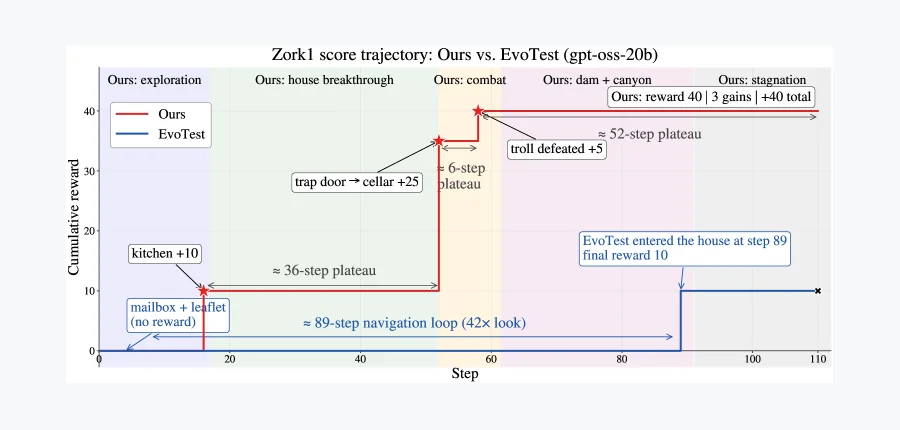 arXiv 2026-11-17 · cs.CL · #1 **[Read, Route, Patch: Robust Test-Time Evolution for LLM Agents](https://arxiv.org/abs/2611.18585)** Kaijie Chen , Liang Yan , Yilan Wei , Jiachen Luo , Zhihao Dou , Jiashu Qu , Haoran Liu , Junli Wang Affiliation · Affiliation unconfirmed [Paper](https://arxiv.org/abs/2611.18585) · [Figure source](https://arxiv.org/html/2611.18585v1/x1.png) 

[EN] Abstract
Large Language Model (LLM)-based agents can improve long- horizon interactive decision-making through test-time evolu- tion, yet existing methods face three information bottlenecks: memory retrieval overemphasizes textual similarity, candi- date harnesses are often behaviorally redundant, and whole- harness rewriting may overwrite useful evidence or introduce cross-component inconsistency. We introduce Trident, which improves experience utilization, behavioral exploration, and harness evolution through boundary-aware memory reading, diversity-aware candidate routing, and order-aware insertion- based updating, respectively. We evaluate Trident on five benchmarks spanning text games, web interaction, and cod- ing tasks. Across qwen-32B, mistral-small-3.2-24B, and gpt- oss-20B, Trident achieves the best average performance and consistently outperforms non-learning, memory-based, reflection-based, and automated prompt optimization base- lines. Compared with the strongest baseline, APEX, Trident yields relative average gains of 30.7%, 30.8%, and 38.3% on the three backbones, respectively. Ablation and sensitivity stud- ies further show that the three designs provide complementary gains and remain robust to parameter variations. <a href="https://arxiv.org/list/cs/new?show=2000#2611.18585">Source</a>

[ZH] Abstract
基于大语言模型（LLM）的代理能够通过测试时进化改善长时程交互决策，但现有方法面临三个信息瓶颈：记忆检索过于强调文本相似性，候选框架在行为上往往冗余，整体重写框架还可能覆盖有用证据或引入跨组件不一致。我们提出Trident，分别通过边界感知记忆读取、多样性感知候选路由，以及顺序感知的插入式更新，改善经验利用、行为探索和框架进化。我们在覆盖文本游戏、网页交互和编码任务的五个基准上评估Trident。在qwen-32B、mistral-small-3.2-24B和gpt-oss-20B上，Trident获得最佳平均表现，并持续优于不学习、基于记忆、基于反思及自动提示优化的基线。相较最强基线APEX，Trident在三个骨干上分别取得30.7%、30.8%和38.3%的相对平均收益。消融与敏感性研究进一步表明，三项设计提供互补收益，并对参数变化保持稳健。 <a href="https://arxiv.org/list/cs/new?show=2000#2611.18585">Source</a>
 | 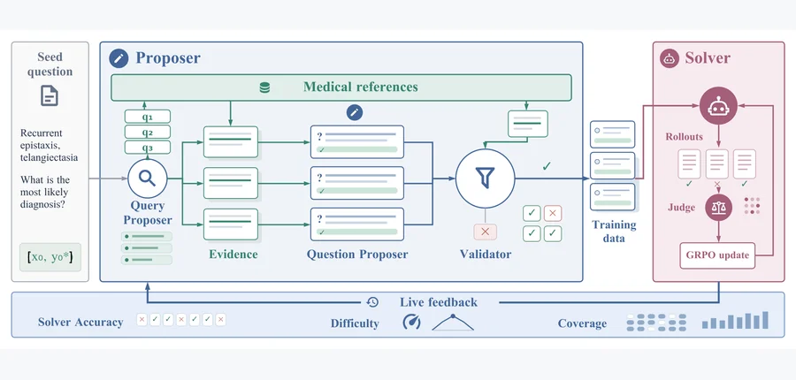 arXiv 2026-11-17 · cs.LG · #2 **[RSIMed: Scaling Medical Foundation Models beyond Limited Clinical Data via Retrieval-Grounded Self-Evolution](https://arxiv.org/abs/2611.18646)** Wei Dai , Qianchu Liu , Guanghui Qin , Xing Han , Tristan Naumann , Sheng Zhang , Paul Pu Liang Affiliation · Massachusetts Institute of Technology / Microsoft Research / Johns Hopkins University [Paper](https://arxiv.org/abs/2611.18646) · [Figure source](https://arxiv.org/html/2611.18646v1/RSIMed_Figures_Main_pipeline.png) 

[EN] Abstract
Rare diseases are hard to diagnose, and the labeled clinical records needed to train models for them are few, private, and slow to extend, since a specialist must read every case. A model that writes its own training tasks could learn beyond these records, but no program can check a model-written diagnosis, and a wrong answer key corrupts training. To tackle this dilemma between data scarcity and difficulty of data annotations, we introduce RSIMed, Recursive Self-Improvement in Medicine, one of the first self-evolving pipelines in which a task proposer co-evolves in context with a diagnostic solver on real clinical records. Seeded by training admissions, a frozen copy of the solver writes each clinical question from retrieved medical evidence, so its answer rests on a source, and steers topics and difficulty toward what the solver still gets wrong. On rare-disease diagnosis from MIMIC-IV admissions, the accuracy of RSIMed-27B grows linearly with training compute, while a static pool of generated tasks collapses. Without any external model, RSIMed-27B and RSIMed-9B reach 0.516 and 0.488 diagnostic accuracy, above every off-the-shelf GPT-5.6 setting, whose best reaches 0.399 at 38 times the inference cost of RSIMed-27B. Tasks written by four external teachers, including GPT-5.5, train a less accurate diagnostician than the solver's own. Trained only on diagnosis, RSIMed-RL-27B also improves on the physician-written tasks of HealthBench Professional, from 0.291 to 0.303 in adjusted score. <a href="https://arxiv.org/list/cs/new?show=2000#2611.18646">Source</a>

[ZH] Abstract
罕见病难以诊断，而训练相关模型所需的标注临床记录数量少、涉及隐私且扩展缓慢，因为每个病例都需要专家阅读。能够自行编写训练任务的模型，或许可以超越这些记录学习，但没有程序能够检查模型编写的诊断，错误答案会污染训练。为应对数据稀缺与标注困难之间的两难，我们提出RSIMed，即医学递归自我改进，它是首批在真实临床记录上让任务提案者在上下文中与诊断求解器共同进化的流水线之一。以训练住院记录为种子，求解器的冻结副本从检索到的医学证据编写每个临床问题，使答案有来源支撑，并把主题和难度引向求解器仍然出错之处。在MIMIC-IV住院记录的罕见病诊断中，RSIMed-27B准确率随训练计算量线性增长，而静态生成任务池发生崩溃。无需任何外部模型，RSIMed-27B和RSIMed-9B分别达到0.516和0.488诊断准确率，高于全部现成GPT-5.6配置，后者最好为0.399，推理成本是RSIMed-27B的38倍。包括GPT-5.5在内的四个外部教师编写的任务，训练出的诊断模型准确率低于使用求解器自身编写任务的结果。仅在诊断上训练的RSIMed-RL-27B，还在医生编写的HealthBench Professional任务上，将调整后分数从0.291提高到0.303。 <a href="https://arxiv.org/list/cs/new?show=2000#2611.18646">Source</a>
 | 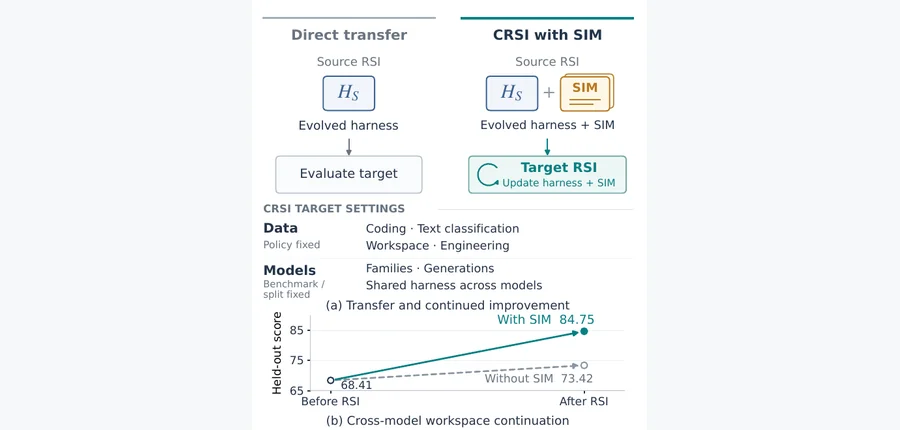 arXiv 2026-11-17 · cs.LG · #3 **[Self-Improvement Memory Enables Continual Recursive Self-Improvement](https://arxiv.org/abs/2611.18856)** Xin Yu , Fei Xia , Jiaqi Pan , Youbao Tang , Chengzhi Liu , Adams Yu , Sicong Jiang , Yanfei Chen , Lingzhou Xue , Ting Yu Affiliation · Google Cloud AI / The Pennsylvania State University / Google DeepMind / Google Cloud AI Research [Paper](https://arxiv.org/abs/2611.18856) · [Figure source](https://arxiv.org/pdf/2611.18856) 

[EN] Abstract
Harness optimization is often studied with a fixed policy model and benchmark. When either changes, the optimizer must decide which parts of an evolved harness to reuse or revise, but the harness alone may not explain why earlier edits were made or how they performed. In this work, we study Continual Recursive Self-Improvement (CRSI), a setting for continuing existing harness-optimization methods across compatible benchmarks or policy models. We propose Self-Improvement Memory (SIM) for the harness optimizer, rather than the task-solving policy. SIM groups edits by recurring harness problem and records their rationale, predicted and observed outcomes, and evaluation context. New attempts extend this history as optimization continues. In our experiments across four domains, SIM achieves higher final scores than harness-only and root-cause-only continuation in cross-dataset and pairwise cross-model comparisons. Across ten independent source runs in coding, paired continuations with SIM improve final scores by an average of 2.36 points over harness-only continuation ($p=0.003$). <a href="https://arxiv.org/list/cs/new?show=2000#2611.18856">Source</a>

[ZH] Abstract
框架优化通常在固定策略模型和固定基准上研究。当二者之一变化时，优化器必须判断进化框架的哪些部分应复用或修订，但仅靠框架本身可能无法解释先前为何编辑、表现如何。本文研究持续递归自我改进（CRSI），即让现有框架优化方法跨兼容基准或策略模型继续运行的设置。我们为框架优化器而非解题策略提出Self-Improvement Memory（SIM，自我改进记忆）。SIM按反复出现的框架问题对编辑分组，记录其理由、预期与实测结果，以及评估上下文。随着优化继续，新尝试会扩展这一历史。在四个领域的实验中，SIM在跨数据集及成对跨模型比较中，最终分数高于仅延续框架或仅延续根因信息的方法。在编码领域十个独立来源运行中，使用SIM的配对续跑相较仅延续框架，最终分数平均提高2.36个百分点，p=0.003。 <a href="https://arxiv.org/list/cs/new?show=2000#2611.18856">Source</a>
 |
| 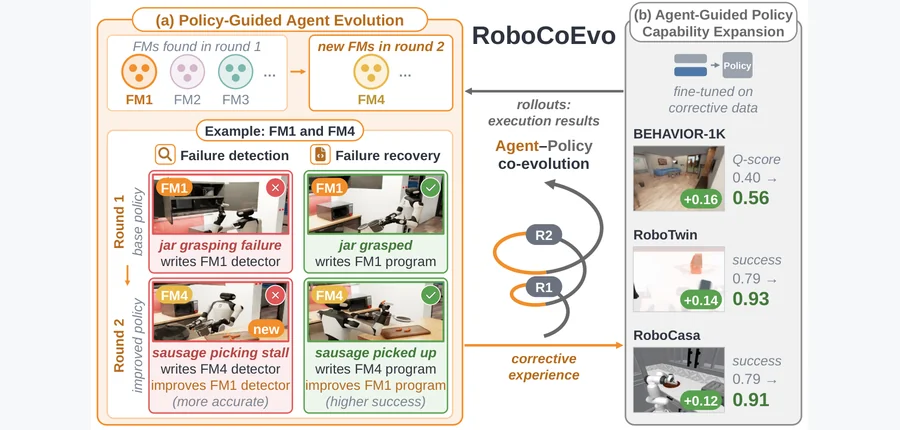 arXiv 2026-11-17 · cs.RO · #4 **[RoboCoEvo: Expanding Robot Capabilities through Agent-Policy Co-Evolution](https://arxiv.org/abs/2611.19081)** Ran Qi , Yixin Xiao , Dawei Wang , Zhiyuan Li , Jinbang Huang , Xuan Zhao , Yintao Ma , Yangzheng Wu , Tongtong Cao , Ying… Affiliation · University of Toronto / Huawei Noah’s Ark Lab / Department of Foundation Model, 2012 Labs [Paper](https://arxiv.org/abs/2611.19081) · [Figure source](https://arxiv.org/html/2611.19081v1/teaser.png) 

[EN] Abstract
Integrating MLLM-based agents with robotic foundation models has attracted increasing attention as a means of enhancing robotic capabilities. However, the improvement of such integrated systems remains largely decoupled across their agent and model components, with advances in one component not necessarily benefiting the other, substantially limiting the capabilities of the combined system. As both MLLMs and robotic foundation models become increasingly capable, fully realizing their combined potential calls for co-evolution, an iterative process in which improvements in agents and robotic foundation models reinforce one another. We propose RoboCoEvo, a failure-guided co-evolution framework that couples the refinement of the agent's explicit and reusable executable knowledge with parameter learning in robotic foundation models, such as vision-language-action (VLA) models. Through a code-as-policy formulation, the agent develops and refines executable failure-detection and recovery programs, generating targeted corrective experience. Post-training consolidates the resulting corrective behaviors into the robotic model's end-to-end policy, improving autonomous task execution. Changes in the updated policy's failure distribution, in turn, guide subsequent revisions to the agent's programs. Experiments on BEHAVIOR-1K, RoboCasa, and RoboTwin demonstrate sustained improvements in autonomous VLA task performance across successive co-evolution rounds. <a href="https://arxiv.org/list/cs/new?show=2000#2611.19081">Source</a>

[ZH] Abstract
将基于多模态大语言模型（MLLM）的代理与机器人基础模型结合，日益被视为增强机器人能力的一种方式。然而，这类集成系统的改进仍大体在代理和模型组件之间解耦，一方进步未必惠及另一方，显著限制了组合系统能力。随着MLLM和机器人基础模型不断增强，充分释放它们的组合潜力需要共同进化，即代理与机器人基础模型的改进相互强化的迭代过程。我们提出RoboCoEvo，一个失败引导的共同进化框架，将代理显式、可复用的可执行知识修订，与视觉语言行动（VLA）等机器人基础模型的参数学习相耦合。通过代码即策略的表述，代理开发并完善可执行的失败检测与恢复程序，产生有针对性的纠正经验。后训练将所得纠正行为巩固进机器人模型的端到端策略，提高自主任务执行能力。更新策略的失败分布变化，反过来指导代理程序的后续修订。在BEHAVIOR-1K、RoboCasa和RoboTwin上的实验表明，自主VLA任务表现随连续共同进化轮次持续改善。 <a href="https://arxiv.org/list/cs/new?show=2000#2611.19081">Source</a>
 | 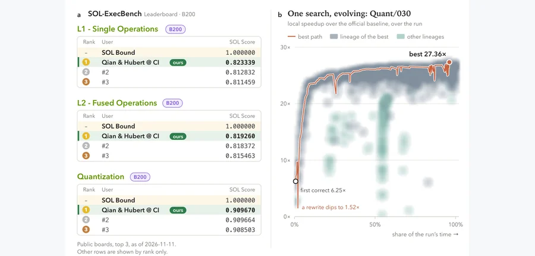 arXiv 2026-11-17 · cs.AI · #5 **[CompoundingKernel: Self-Improving from Zero to First](https://arxiv.org/abs/2611.19230)** Qian Qu , Hongyang Wang , Wenbo Chen , Yichuan Li , Jingguo Liu , Xian Li , Xuan Wang , Ruochen Wen , Leo Fan , Yiming Yan… Affiliation · Amazon [Paper](https://arxiv.org/abs/2611.19230) · [Figure source](https://arxiv.org/html/2611.19230v1/f1-teaser.png) 

[EN] Abstract
We present CompoundingKernel, a self-improving agent system that writes GPU kernels by search. As of 2026-11-11, its generated kernels rank #1 on the public L1, L2 and Quantization boards of SOL-ExecBench (NVIDIA B200). They have held #1 on L1 since 2026-10-27, albeit a short loss on 2026-11-07. All 235 problems have a site-verified correct kernel; on the 209 public-board problems they are 4.40x faster than the benchmark's reference baseline. The search starts from zero: agents get each problem's PyTorch definition but no reference kernels or official scores. A per-problem archive outside the model holds every correct kernel and its lineage. An LLM controller reads it, picks a parent or a new design, and gives each parallel child agent one direction. Checks outside the model decide correctness. At equal wall time, it beat a coded UCB style tree on 35 of 38 problems by making 2.4x as many correct attempts. Over a thousand agents ran at once, and one warm restart fix raised their evaluation rate 3.6x. We find that the rate of reliable measurements, not the number of agents, limits how far such a search scales. Our code and kernels are available on URL. <a href="https://arxiv.org/list/cs/new?show=2000#2611.19230">Source</a>

[ZH] Abstract
我们提出CompoundingKernel，一个通过搜索编写GPU内核的自我改进代理系统。截至2026年11月11日，其生成内核在SOL-ExecBench（NVIDIA B200）公开L1、L2和Quantization榜单上排名第一。它们自2026年10月27日起一直保持L1第一，期间仅在11月7日短暂失去领先。全部235个问题都有通过网站正确性验证的内核；在209个公开榜单问题上，它们比基准参考基线快4.40倍。搜索从零开始：代理只获得每题的PyTorch定义，不获得参考内核或官方分数。模型外部的逐题档案保存每个正确内核及其谱系。LLM控制器读取档案，选择父代或新设计，并给每个并行子代理一个方向。模型外部的检查决定正确性。在相同墙钟时间下，它在38个问题中的35个上击败编码实现的UCB风格树搜索，原因是产生了2.4倍的正确尝试。超过一千个代理曾同时运行，一项热重启修复将评估速率提高3.6倍。我们发现，可靠测量速率而非代理数量，限制了这种搜索能扩展多远。代码和内核可通过URL获取。 <a href="https://arxiv.org/list/cs/new?show=2000#2611.19230">Source</a>
 | 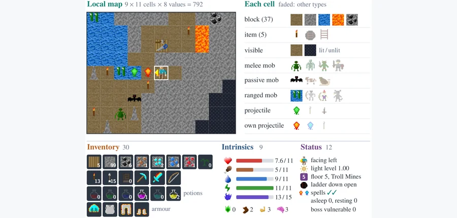 arXiv 2026-11-17 · cs.AI · #6 **[Continuation-Guided LLM Evolution of Program Policies and Goal Compilers in Craftax](https://arxiv.org/abs/2611.19537)** Víctor Gallego Affiliation · Komorebi AI Technologies [Paper](https://arxiv.org/abs/2611.19537) · [Figure source](https://arxiv.org/html/2611.19537v1/feedback_goal_compilers_assets/observation_space.png) 

[EN] Abstract
Coding agents can synthesize and optimize code-based policies from simulator feedback, allowing the resulting program to act with zero inference model calls. But for long horizon tasks, two challenges arise: local improvements can hurt final success and switching to a new objective requires another expensive synthesis run. We propose a framework that first develops competence by refining the policy through a feedback cascade, moving from episode returns to hierarchical goals and belief updates which can be scored densely from simulator. In the Craftax game, a partially observed and procedurally generated environment, refinements via episode level feedback stall at &lt;1% final-level arrival, whereas with the feedback cascade the optimized policy reaches the final stage 50% of time (28% final boss defeats). Furthermore, to make this competence reusable towards new goals, we factor the previous controller into an environment interpreter $I$ (models, memory, skills) and a rule program $p_0$, and we show that coding agents can optimize a reusable goal compiler $C_{\theta}$ that maps structured tasks $g$ into new rule programs $p_g$. Across five independent compiler searches trained only on short tasks, the resulting compilers successfully transfer zero-shot to longer tasks without any task-specific tuning nor inference-time LLM calls: continuation-scored feedback and a fixed machine with an editable program together turn a single-task competent policy into a reusable one. Code at: this https URL <a href="https://arxiv.org/list/cs/new?show=2000#2611.19537">Source</a>

[ZH] Abstract
编码代理能够依据模拟器反馈合成和优化代码策略，使所得程序在行动时无需任何模型推理调用。但长时程任务面临两项挑战：局部改进可能损害最终成功，切换到新目标又需要另一轮昂贵合成。我们提出一个框架，首先通过反馈级联完善策略来发展能力，从回合回报逐步转向可以由模拟器密集评分的层级目标和信念更新。在部分可观察、程序生成的Craftax游戏中，仅使用回合级反馈的修订停滞在不到1%的最终关卡到达率，而使用反馈级联优化的策略有50%的概率到达最终阶段，最终首领击败率为28%。此外，为让此能力可复用于新目标，我们将原控制器分解为环境解释器I（模型、记忆、技能）和规则程序p₀，并表明编码代理能够优化可复用的目标编译器Cθ，将结构化任务g映射为新规则程序p_g。在仅用短任务训练的五次独立编译器搜索中，所得编译器无需任务特定调优或推理时LLM调用，就能零样本迁移到更长任务：按后续执行评分的反馈，加上具有可编辑程序的固定机器，将单任务胜任策略转化为可复用策略。代码位于this https URL。 <a href="https://arxiv.org/list/cs/new?show=2000#2611.19537">Source</a>
 |
| 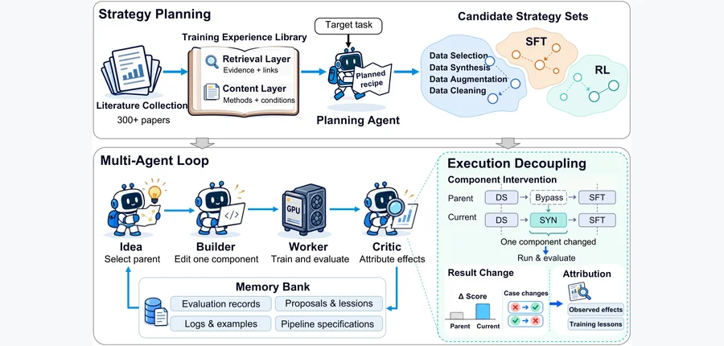 arXiv 2026-11-17 · cs.LG · #7 **[TrainExplorer: Autonomous LLM Post-Training via Plan-and-Decouple Exploration](https://arxiv.org/abs/2611.20430)** Xuannan Liu , Tian Lan , Zekun Li , Xing Cui , Zhengfeng Yu , Feihu Jiang , Qianghuai Jia , Longyue Wang , Zhao Xu , Weihu… Affiliation · Beijing University of Posts and Telecommunications / Alibaba Group / Minzu University of China / Beijing Institute of Technology / Center for Research on Intelligent Perception and Computing, NLPR, CASIA [Paper](https://arxiv.org/abs/2611.20430) · [Figure source](https://arxiv.org/html/2611.20430v1/framework.png) 

[EN] Abstract
LLM-based agents can automate model post-training, accelerating progress toward recursive self-improvement. Despite their promise, existing approaches remain under-explored and face two main challenges: (1) strategy lock-in that limits exploration beyond the initial strategy; and (2) coupled execution that obscures the effects of individual modifications. To address these challanges, we propose TrainExplorer, a multi-agent framework for autonomous post-training, that incorporates strategy planning and execution decoupling, to achieve broaden strategy exploration. First, strategy planning draws on scientific literature to construct a candidate search space of training strategies. Then, decoupled execution enables single-component interventions and attribution to guide strategy exploration. Extensive experiments on PostTrainBench demonstrate that TrainExplorer achieves a weighted aggregate score of 39.02, outperforming Claude Code using the same LLM by 7.32 and surpassing GPT-5.6 Sol-powered Codex, which scores 36.23. Code will be available. <a href="https://arxiv.org/list/cs/new?show=2000#2611.20430">Source</a>

[ZH] Abstract
基于LLM的代理能够自动化模型后训练，加速迈向递归自我改进。尽管前景可观，现有方法仍未被充分探索，并面临两项主要挑战：（1）策略锁定限制了超越初始策略的探索；（2）耦合执行掩盖了单项修改的效果。为应对这些挑战，我们提出TrainExplorer，一个用于自主后训练的多代理框架，结合策略规划与执行解耦，以拓宽策略探索。首先，策略规划利用科学文献构建候选训练策略搜索空间。随后，解耦执行支持单组件干预和效果归因，以指导策略探索。PostTrainBench上的广泛实验表明，TrainExplorer达到39.02的加权综合分数，比使用相同LLM的Claude Code高7.32，也超过使用GPT-5.6 Sol的Codex，后者分数为36.23。代码将公开。 <a href="https://arxiv.org/list/cs/new?show=2000#2611.20430">Source</a>
 | 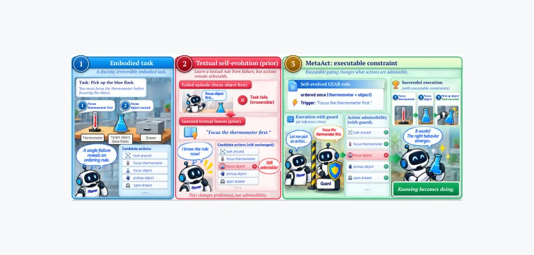 arXiv 2026-11-17 · cs.CL · #8 **[MetaAct: Self-Evolving Executable Action Constraints for Embodied Language Agents](https://arxiv.org/abs/2611.20655)** Jiaxing Zhao , Hanwen Wang , Di Liu , Shaoteng Liu , Jing-Ran Su , Yanheng Li , Qian Zha , Jiaxi Li , Hongbin Xie , Haoran… Affiliation · Jilin University / Southern University of Science and Technology / Northwestern Polytechnical University / The Hong Kong Polytechnic University / City University of Hong Kong / Peking University / XGEN Labs [Paper](https://arxiv.org/abs/2611.20655) · [Figure source](https://arxiv.org/html/2611.20655v1/fig_teaser1.png) 

[EN] Abstract
Self-evolving language agents have emerged as a promising paradigm for continuously improving agent behavior through experience. However, most existing approaches evolve textual artifacts, which can influence action preferences but cannot reliably enforce action admissibility in embodied environments with discrete and often irreversible actions. We propose MetaAct, which shifts self-evolution from textual guidance to executable action constraints by synthesizing GEAR (Grounded Executable Action Rules) from execution feedback. Each rule is represented as a typed specification, compiled into a deterministic guard, and validated offline through trajectory replay without additional model calls or environment interactions. Across four benchmarks, MetaAct improves task performance; on ScienceWorld and WebShop, violations drop from 70% to 0% and 40% to 1%, with score gains of +10.1 and +8.0. Our code is available at this https URL . <a href="https://arxiv.org/list/cs/new?show=2000#2611.20655">Source</a>

[ZH] Abstract
自进化语言代理已成为通过经验持续改进行为的一种有前景范式。然而，现有方法大多进化文本产物，它们可以影响动作偏好，却无法在动作离散且往往不可逆的具身环境中可靠强制执行动作准入。我们提出MetaAct，将自进化从文本指导转向可执行动作约束，通过执行反馈合成GEAR（基于实际执行的可执行动作规则）。每条规则表示为类型化规格，编译为确定性守卫，并通过轨迹重放离线验证，无需额外模型调用或环境交互。在四个基准上，MetaAct改善任务表现；在ScienceWorld和WebShop上，违规率分别从70%降至0%、从40%降至1%，分数分别提高10.1和8.0。代码可通过this https URL获取。 <a href="https://arxiv.org/list/cs/new?show=2000#2611.20655">Source</a>
 | 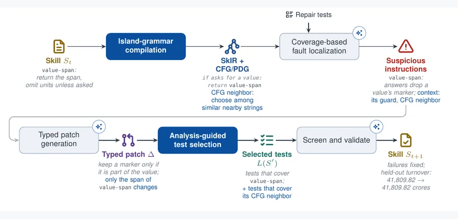 arXiv 2026-11-17 · cs.SE · #9 **[Synapse: Optimizing Natural-Language Agent Skills through Program Repair](https://arxiv.org/abs/2611.20856)** Lijuan Li (Nanjing University), Zhenpeng Chen (Tsinghua University), Chenxi Zhang (Xidian University), Yihao Huang (East C… Affiliation · Nanjing University / Tsinghua University / Xidian University / East China Normal University / Nanyang Technological University [Paper](https://arxiv.org/abs/2611.20856) · [Figure source](https://arxiv.org/pdf/2611.20856) 

[EN] Abstract
Large language model (LLM) agents can improve task performance by optimizing reusable natural-language skills without updating model parameters. Execution feedback reveals failures but does not directly identify which instructions to edit, which related instructions matter, or which tasks an edit may break. We propose Synapse, which casts skill optimization as generate-and-validate repair over a partial program view. A deterministic compiler translates recognized skill constructs into SkIR, a source-linked intermediate representation, while retaining other requirements in the text. Synapse combines execution traces with control-flow and dependence relations to localize faults, propose typed mutations, and select related repair tests, including previously passing ones. Each mutation is written back to its mapped source span and recompiled; validation determines acceptance. Every accepted patch yields a well-formed skill and preserves untargeted instruction spans. Under a one-hop-local execution assumption, selected tests include every test an edit can affect. On DocVQA and LiveMath with three execution models, Synapse improves task success rates over SkillOpt by 3.74-4.54 and 2.40-4.00 percentage points, respectively, and outperforms Trace2Skill and SkillBoost in all six settings. Replacing SkIR-based repair and its test screening with constrained text editing screened only on failing tests lowers DocVQA success rates by 2.40 and 2.67 percentage points for two models. In two recorded repair runs, structural relations add tests for 23 of 37 patches; in one repair, a test added through a control-flow relation exposes a regression missed by coverage of the edited instruction. <a href="https://arxiv.org/list/cs/new?show=2000#2611.20856">Source</a>

[ZH] Abstract
大语言模型（LLM）代理可以在不更新模型参数的情况下，通过优化可复用自然语言技能来提高任务表现。执行反馈能揭示失败，却不会直接指出应编辑哪些指令、哪些相关指令重要，或某次编辑可能破坏哪些任务。我们提出Synapse，将技能优化表述为在局部程序视图上进行生成并验证的修复。确定性编译器把识别到的技能构造翻译为与源码关联的中间表示SkIR，同时将其他要求保留在文本中。Synapse结合执行轨迹、控制流和依赖关系，定位故障、提出类型化变异，并选择相关修复测试，包括此前通过的测试。每项变异写回映射的源码片段并重新编译，验证决定是否接受。每个获接纳补丁都产生结构良好的技能，并保留未被针对的指令片段。在单跳局部执行假设下，所选测试包含编辑可能影响的每项测试。在DocVQA和LiveMath的三个执行模型上，Synapse相较SkillOpt分别提高任务成功率3.74–4.54和2.40–4.00个百分点，在全部六种设置中优于Trace2Skill和SkillBoost。将基于SkIR的修复及测试筛选，替换为仅在失败测试上筛选的受约束文本编辑，会使两个模型的DocVQA成功率分别降低2.40和2.67个百分点。在两次记录的修复运行中，结构关系为37项补丁中的23项添加测试；一次修复中，通过控制流关系加入的测试，暴露了仅覆盖被编辑指令时漏掉的回归。 <a href="https://arxiv.org/list/cs/new?show=2000#2611.20856">Source</a>
 |
| 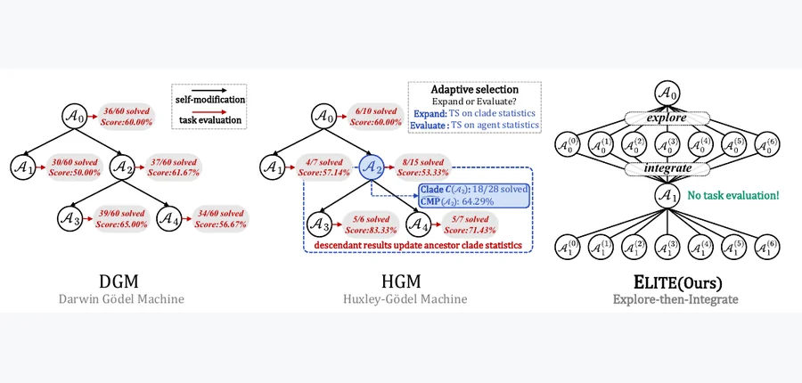 arXiv 2026-11-17 · cs.CL · #10 **[Evaluation-Free Recursive Self-Improvement for Coding Agents](https://arxiv.org/abs/2611.21056)** Zhe Ren , Guowei Rong , Yimeng Chen , Nanbo Li , Piotr Piękos , Mateusz Ostaszewski , Dandan Guo , Jürgen Schmidhuber Affiliation · Jilin University / King Abdullah University of Science and Technology (KAUST) [Paper](https://arxiv.org/abs/2611.21056) · [Figure source](https://arxiv.org/pdf/2611.21056) 

[EN] Abstract
Recent self-improving coding agents have achieved strong benchmark performance by iteratively modifying their own executable implementations. A common pattern uses downstream task-derived evidence to decide which candidates or lineages continue evolving, which we term evaluate-and-select. Obtaining this signal requires repeatedly executing evolved agents on downstream tasks, so broader exploration incurs increasing evaluation cost, while repeated optimization against a fixed evaluation distribution may encourage benchmark-specific adaptation. We ask: can coding agents self-improve without downstream task evaluation inside the evolution loop? We introduce Explore-then-Integrate (ELITE), which integrates implementation mechanisms rather than selecting a single exploratory child to continue the lineage. At each generation, ELITE proposes diverse focused improvements, implements them independently from the same parent, and inspects the resulting programs to identify complementary, redundant, and conflicting mechanisms before reimplementing a compatible subset as one coherent descendant. No downstream task outcomes or task-solving trajectories of evolved candidates are used to guide evolution; only deterministic checks of structural and operational validity are used inside the loop. On SWE-bench Pro, ELITE improves the initial agent from 60.0% to 85.6%, compared with 86.7% for the Darwin Godel Machine (DGM) and 88.3% for the Huxley-Godel Machine (HGM), while using zero candidate task evaluations and reducing observed wall-clock evolution time by 8.8x and 3.2x, respectively, under the evaluated configurations. In cross-benchmark transfer without further adaptation, ELITE averages 73.3% on SWE-bench Verified and 69.3% on Polyglot. Together, these results demonstrate the feasibility of coding-agent self-improvement without downstream candidate task evaluation in our setting. <a href="https://arxiv.org/list/cs/new?show=2000#2611.21056">Source</a>

[ZH] Abstract
近期自我改进编码代理通过迭代修改自身可执行实现，取得了强基准表现。常见模式利用下游任务产生的证据，决定哪些候选或谱系继续进化，我们称之为评估并选择。获得这一信号需要反复在下游任务上执行进化代理，因此更广探索带来更高评估成本，反复针对固定评估分布优化也可能鼓励基准特定适配。我们研究，编码代理能否在进化循环内部不进行下游任务评估的情况下自我改进。我们提出Explore-then-Integrate（ELITE），整合实现机制，而非选择单个探索子代延续谱系。在每一代，ELITE提出多样、聚焦的改进，从相同父代独立实现它们，并检查所得程序，以识别互补、冗余和冲突机制，随后将兼容子集重新实现为连贯的后代。进化不使用进化候选的下游任务结果或解题轨迹，仅在循环内部使用确定性的结构和操作有效性检查。在SWE-bench Pro上，ELITE将初始代理从60.0%提高到85.6%，Darwin Godel Machine（DGM）为86.7%，Huxley-Godel Machine（HGM）为88.3%；在所评估配置中，它使用零次候选任务评估，并将观察到的墙钟进化时间分别缩短至原来的1/8.8和1/3.2。在无需进一步适配的跨基准迁移中，ELITE在SWE-bench Verified和Polyglot上平均分别达到73.3%和69.3%。这些结果共同展示，在我们的设置中，编码代理无需下游候选任务评估即可实现自我改进的可行性。 <a href="https://arxiv.org/list/cs/new?show=2000#2611.21056">Source</a>
 | 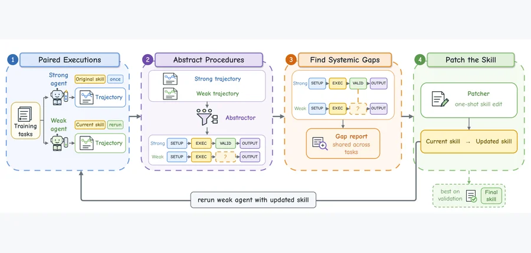 arXiv 2026-11-17 · cs.CL · #11 **[Skill Transfer: Adapting Agent Skills from Strong to Weak Agents](https://arxiv.org/abs/2611.18624)** Yifan Lan , Hanyu Wang , Lu Lin , Jinghui Chen Affiliation · The Pennsylvania State University [Paper](https://arxiv.org/abs/2611.18624) · [Figure source](https://arxiv.org/html/2611.18624v1/skill_transfer_pipeline.png) 

[EN] Abstract
Agent skills are modular bundles of instructions, code, and resources that an agent loads on demand, increasingly authored and validated on frontier models and shared as an open standard. The same skill behaves differently across models: a strong model turns it into a large performance gain, while a weak model realizes little of that gain and sometimes does worse than with no skill at all. Cost and resource constraints, however, often restrict real deployments to exactly these weaker agents. We hypothesize that the strong model silently supplies procedural steps the skill leaves implicit, which the weak model omits, and formalize closing this gap as \emph{Skill Transfer}: holding the skill's capability ceiling and the model's parameters fixed, we adapt the skill so a specific weak agent can execute it well. Our method abstracts strong and weak trajectories into typed execution structures, localizes their structural divergence with a graph edit distance (GED), and repairs the skill through an iterative diagnoser-patcher loop. Across three benchmarks and two model families, Skill Transfer raises pass rate over the unmodified skill significantly and well over other skill-evolution baselines. The adapted skill also improves the strong agent it was never adapted for, and transfers out of distribution to a structurally related, unseen task. Code is available at this https URL <a href="https://arxiv.org/list/cs/new?show=2000#2611.18624">Source</a>

[ZH] Abstract
代理技能是代理按需加载的模块化指令、代码和资源包，越来越多地由前沿模型编写和验证，并作为开放标准共享。同一技能在不同模型上的行为不同：强模型将其转化为巨大性能收益，弱模型却只能实现很少收益，有时甚至不如完全没有技能。成本和资源限制又使真实部署常常只能采用这些较弱代理。我们假设，强模型会默默补足技能中隐含的流程步骤，而弱模型会遗漏，并将缩小这一差距形式化为Skill Transfer（技能迁移）：固定技能能力上限和模型参数，适配技能使特定弱代理能够良好执行。我们的方法将强弱代理轨迹抽象为类型化执行结构，用图编辑距离（GED）定位结构分歧，通过迭代的诊断者—修补者循环修复技能。在三个基准和两个模型系列上，Skill Transfer相较未修改技能显著提高通过率，也明显优于其他技能进化基线。适配技能还能改善从未针对其适配的强代理，并分布外迁移到结构相关的未见任务。代码可通过this https URL获取。 <a href="https://arxiv.org/list/cs/new?show=2000#2611.18624">Source</a>
 | 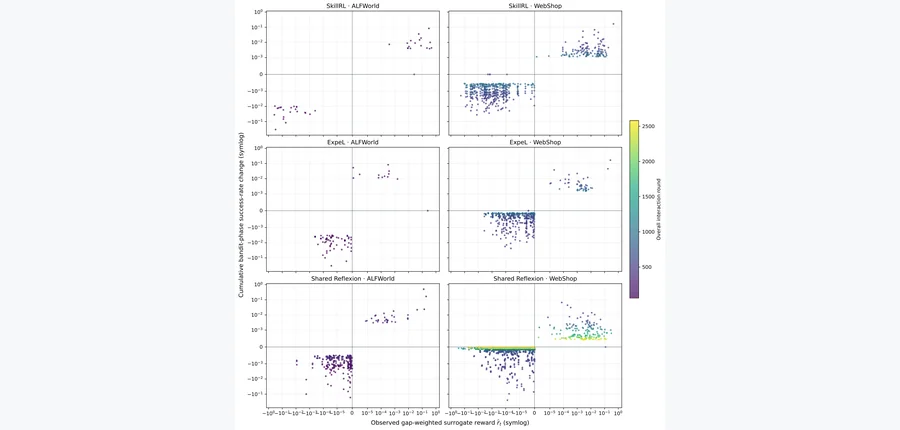 arXiv 2026-11-17 · cs.LG · #12 **[What to Practice Next? Latent Profile-Guided Task Selection for Skill-Evolving LLM Agents](https://arxiv.org/abs/2611.18818)** Qijin Zhang , Hanzhen Wang , Yan Huang , Zhongxiang Dai , Shuang Qiu Affiliation · City University of Hong Kong / Institute of Automation, Chinese Academy of Sciences / Five Ages / The Chinese University of Hong Kong, Shenzhen [Paper](https://arxiv.org/abs/2611.18818) · [Figure source](https://arxiv.org/html/2611.18818v1/reward_vs_bandit_success_rate_change_3x2.png) 

[EN] Abstract
Task selection shapes the experiences available for skill evolution in LLM agents, yet fixed practice schedules overlook differences in skill requirements and evolving task value. Most existing methods, however, rely on fixed schedules or scalar measures of progress, leaving nonstationary skill demands unaddressed. We propose SPG-Select, a framework for allocating limited practice budget using a multidimensional profile inferred from binary outcomes via MIRT. The framework predicts surrogate progress, defined as the difference between consecutive profile estimates, and prioritizes progress in dimensions with larger estimated proficiency gaps. Our SPG-Select-R policy combines these predictions with uncertainty-based exploration and periodic restarting to accommodate nonstationarity. We evaluate SPG-Select on ALFWorld and WebShop with three skill-evolution backends. In the reported runs, SPG-Select-R achieves higher mean held-out terminal success than uniform sampling in all six backend-benchmark combinations, with gains of 1.49-13.18 percentage points on ALFWorld and 0.93-3.13 points on WebShop. Under a predictable linear surrogate model and boundedness assumptions, we establish a high-probability dynamic pseudo-regret bound for surrogate task allocation in terms of parameter path variation. <a href="https://arxiv.org/list/cs/new?show=2000#2611.18818">Source</a>

[ZH] Abstract
任务选择塑造了LLM代理技能进化可利用的经验，但固定练习计划忽略技能需求差异和任务价值变化。现有方法大多依赖固定计划或标量进步指标，未处理非平稳技能需求。我们提出SPG-Select，通过MIRT从二元结果推断多维能力画像，分配有限练习预算。框架预测代理进步量，即相邻两次画像估计的差值，并优先考虑估计熟练度差距更大的维度。SPG-Select-R策略将这些预测与基于不确定性的探索、周期性重启结合，以适应非平稳性。我们在ALFWorld和WebShop上，采用三个技能进化后端评估SPG-Select。在所报告运行中，SPG-Select-R在全部六个后端—基准组合上，都获得高于均匀采样的平均留出集最终成功率，在ALFWorld上提升1.49–13.18个百分点，在WebShop上提升0.93–3.13个百分点。在可预测线性代理模型和有界性假设下，我们建立关于参数路径变化的代理任务分配高概率动态伪遗憾界。 <a href="https://arxiv.org/list/cs/new?show=2000#2611.18818">Source</a>
 |
| 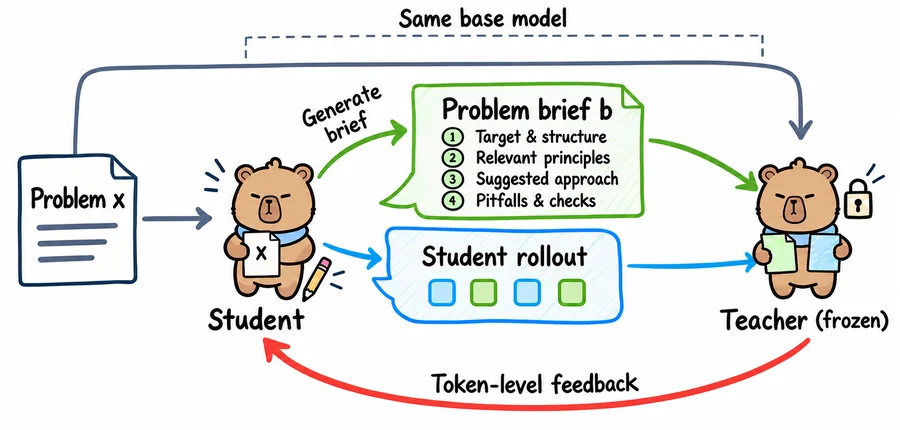 arXiv 2026-11-17 · cs.CL · #13 **[B-OPSD: On-Policy Self-Distillation with Self-Generated Problem Briefs](https://arxiv.org/abs/2611.19273)** Zhi Xu , Yinqi Wu , Feng Zhang , Xiaotong Zhang , Hong Yu , Han Liu Affiliation · Dalian University of Technology [Paper](https://arxiv.org/abs/2611.19273) · [Figure source](https://arxiv.org/html/2611.19273v1/figures/b_opsd_overview_v9.png) 

[EN] Abstract
On-Policy Self-Distillation (OPSD) has recently attracted interest because it provides dense teacher guidance without a separate, often larger teacher model. However, OPSD conditions its teacher on ground-truth solutions, which limits its use when such solutions are unavailable. We propose On-Policy Self-Distillation with Self-Generated Problem Briefs (B-OPSD). Using a prompt template, the initial model or a saved student checkpoint generates a problem brief from the question alone. The prompt asks for relevant principles, applicability conditions, and likely pitfalls, but not a final answer or a complete solution. A frozen teacher uses the brief as privileged context to guide the current student's on-policy rollouts through token-level distribution matching. B-OPSD uses no ground-truth solutions during training. Results on AIME 2024, AIME 2025, and HMMT 2025 show that both B-OPSD variants achieve higher average accuracy than OPSD at each of three Qwen3 model sizes. Code is available at this https URL <a href="https://arxiv.org/list/cs/new?show=2000#2611.19273">Source</a>

[ZH] Abstract
在策略自蒸馏（OPSD）近期受到关注，因为它无需独立且通常更大的教师模型，就能提供密集教师指导。然而，OPSD让教师以真值解答为条件，这限制了在解答不可得时的使用。我们提出使用自生成问题概要的在策略自蒸馏（B-OPSD）。初始模型或保存的学生检查点使用提示模板，仅从问题生成概要。提示要求相关原理、适用条件和可能陷阱，而非最终答案或完整解答。冻结教师将概要作为特权上下文，通过token级分布匹配指导当前学生的在策略rollout。B-OPSD训练不使用真值解答。在AIME 2024、AIME 2025和HMMT 2025上的结果表明，两种B-OPSD变体在三个Qwen3模型规模中的每个规模上，平均准确率均高于OPSD。代码可通过this https URL获取。 <a href="https://arxiv.org/list/cs/new?show=2000#2611.19273">Source</a>
 | 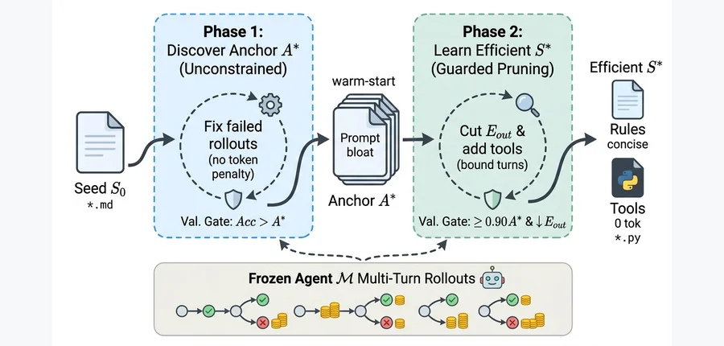 arXiv 2026-11-17 · cs.CL · #14 **[EfficientSkill: Learning Skills for Token-Efficient Multi-Turn Agents](https://arxiv.org/abs/2611.19823)** Deep Shah , Sanket Badhe , Nehal Kathrotia , Priyanka Tiwari Affiliation · Google LLC / Purdue University [Paper](https://arxiv.org/abs/2611.19823) · [Figure source](https://arxiv.org/html/2611.19823v1/overall_diagram.jpg) 

[EN] Abstract
Reflective skill optimizers improve multi-turn LLM agents by revising instructions from failed and successful rollouts, yet accumulating edge-case rules bloats prompts, inflates token use, and pushes agents into long, error-prone loops. We introduce EfficientSkill, a two-step framework that first discovers a reliable skill without token penalties, and then warm-starts accuracy-guarded pruning from that skill to compress instructions, bound agent turns, and offload reusable code into workspace utilities with zero implementation prompt cost. Across four frontier, mid-tier, and open-weight models on MATH-500, ALFWorld, and SpreadsheetBench, EfficientSkill cuts output tokens over unconstrained EvoSkill on 11 of 12 configurations (by up to 80%) while raising mean accuracy on every benchmark, including +14.3 and +17.5 percentage-point gains on SpreadsheetBench with Gemini 3.8 Flash and Grok 4.1 Fast by replacing stalled loops with compact workflows. By shrinking both generated tokens and replayed history, EfficientSkill lowers total token usage and serving cost across every evaluated configuration, with or without full-prefix KV caching. <a href="https://arxiv.org/list/cs/new?show=2000#2611.19823">Source</a>

[ZH] Abstract
反思式技能优化器通过根据失败与成功rollout修订指令，改善多轮LLM代理；但不断累积的边缘情况规则会使提示膨胀、token消耗增加，并将代理推入冗长、易错的循环。我们提出EfficientSkill，一个两步框架，先在没有token惩罚的情况下发现可靠技能，再从该技能热启动受准确率保护的剪枝，以压缩指令、限制代理轮次，并将可复用代码转移为工作区工具，使实现代码不占提示成本。在MATH-500、ALFWorld和SpreadsheetBench上，覆盖四个前沿、中等及开放权重模型，EfficientSkill相较无约束EvoSkill，在十二种配置中的十一种上减少输出token，最高减少80%，同时提高每个基准的平均准确率。其中，通过用紧凑工作流取代停滞循环，Gemini 3.8 Flash和Grok 4.1 Fast在SpreadsheetBench上分别提高14.3和17.5个百分点。通过同时缩减生成token与重放历史，无论是否使用完整前缀KV缓存，EfficientSkill都在所有评估配置上降低总token用量与服务成本。 <a href="https://arxiv.org/list/cs/new?show=2000#2611.19823">Source</a>
 | 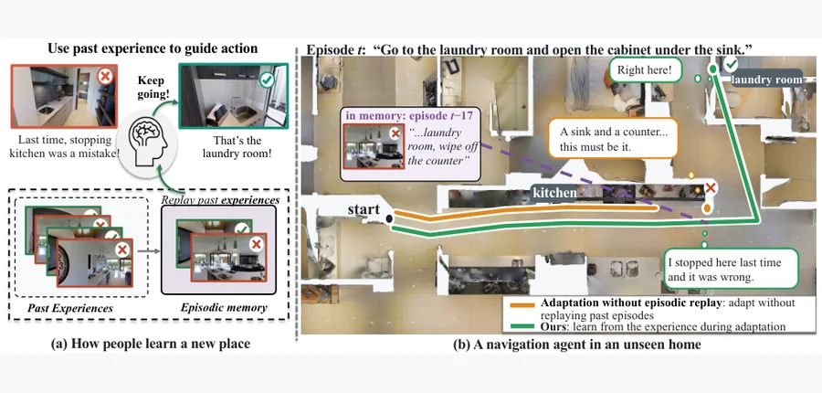 arXiv 2026-11-17 · cs.CV · #15 **[Remember, Replay, Adapt: Learning from Past Experience in Online Vision-and-Language Navigation](https://arxiv.org/abs/2611.19901)** Chenhao Ding , Jizhou Han , Lixin Xiu , Muyao Wang , Songlin Dong , Hideki Nakayama Affiliation · The University of Tokyo / Xi’an Jiaotong University / Shenzhen University of Advanced Technology [Paper](https://arxiv.org/abs/2611.19901) · [Figure source](https://arxiv.org/html/2611.19901v1/head.png) 

[EN] Abstract
Existing feedback-based methods for online vision-and-language navigation (VLN) primarily learn from current episode outcomes, leaving previously acquired feedback underutilized. Inspired by human episodic memory, we propose R2A, an online VLN adaptation framework that continually reuses successful and failed navigation experiences for policy learning. Specifically, Success-Failure Memory (SFM) retains successful and failed navigation episodes with acquired feedback and retrieves task-relevant experiences based on incoming instructions, enabling historical feedback to guide subsequent navigation. Prior-Anchored Adaptation (PAA) learns from these experiences by reinforcing successful trajectories and suppressing failed ones relative to a frozen pretrained policy, while regularizing behavioral drift. Together, these modules enable continual feedback reuse and stable policy adaptation without source-domain data or expert supervision. Extensive experiments across three benchmarks, REVERIE, R2R, and R2R-CE, and five navigation backbones demonstrate consistent performance gains. On the REVERIE validation unseen split, R2A improves DUET's SR from 46.98% to 69.84% and SPL from 33.73% to 50.98%. <a href="https://arxiv.org/list/cs/new?show=2000#2611.19901">Source</a>

[ZH] Abstract
现有基于反馈的在线视觉语言导航（VLN）方法，主要从当前回合结果学习，先前获得的反馈没有得到充分利用。受人类情景记忆启发，我们提出R2A，一个持续复用成功与失败导航经验来学习策略的在线VLN适配框架。具体而言，成功—失败记忆（SFM）保留带反馈的成功和失败导航回合，并根据新到达指令检索任务相关经验，使历史反馈指导后续导航。先验锚定适配（PAA）通过相对冻结预训练策略强化成功轨迹、抑制失败轨迹，并正则化行为漂移，从这些经验学习。两个模块共同支持持续反馈复用与稳定策略适配，无需源域数据或专家监督。在REVERIE、R2R和R2R-CE三个基准及五个导航骨干上的广泛实验表明性能持续提高。在REVERIE验证未见划分上，R2A将DUET的SR从46.98%提高到69.84%，SPL从33.73%提高到50.98%。 <a href="https://arxiv.org/list/cs/new?show=2000#2611.19901">Source</a>
 |
| 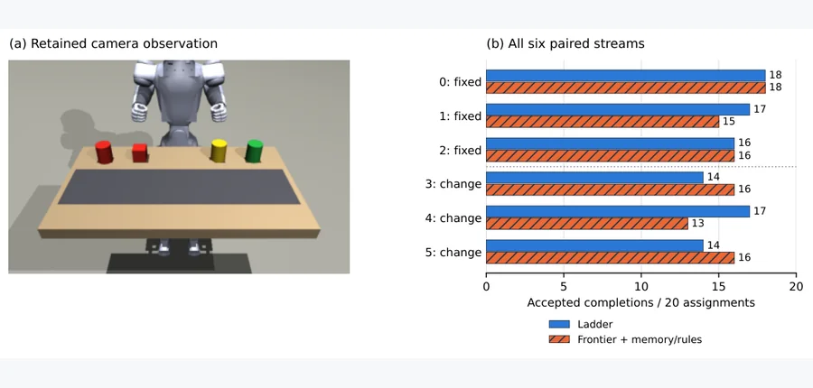 arXiv 2026-11-17 · cs.RO · #16 **[CRAFT: A Robot-Agent Harness with Scope-Aware Adaptation](https://arxiv.org/abs/2611.19952)** Peng Zhang , Jiawen Wang , Cheng Xue , Jochen Renz Affiliation · Australian National University [Paper](https://arxiv.org/abs/2611.19952) · [Figure source](https://arxiv.org/html/2611.19952v1/fig_continuing.png) 

[EN] Abstract
A robot may know how to move an object yet still need to learn where it belongs. When a person rejects a placement, the robot must decide whether the correction applies only to that situation or expresses a broader rule. We study this problem in CRAFT (Contextual Requirement Adaptation with Frozen Tools), a framework for learning local requirements without retraining robot skills. It records physical success separately from whether an action meets the requirement. Our scope ladder uses memory when an action has already been judged in a nearly identical situation. Elsewhere, it combines memory, explicit rules and a learner for requirements beyond those rules, weighting their predictions by how well they predicted earlier feedback. Controlled studies show gains over correction memory alone in utility, which rewards acceptable actions and charges for mistakes and questions. In camera-grounded robot simulations, the ladder asks fewer questions than language-model agents with persistent memory, but some of those agents take fewer wrong actions and succeed more often after requirements change. All execution failures and timeouts remain in the evaluation. These results support combining specific memories with broader rules, while leaving reliable adaptation to changing requirements unresolved. All evidence comes from simulation with generated requirements and simulated feedback. <a href="https://arxiv.org/list/cs/new?show=2000#2611.19952">Source</a>

[ZH] Abstract
机器人可能知道如何移动物体，却仍需要学习物体应放在哪里。当人拒绝某个放置结果时，机器人必须判断，这一纠正是仅适用于当前情境，还是表达更广泛规则。我们在CRAFT（使用冻结工具的上下文需求适配）中研究这一问题，该框架无需重新训练机器人技能，就能学习局部需求。它分别记录物理成功和动作是否满足需求。我们的范围阶梯在动作已经于几乎相同情境下获得判断时使用记忆，在其他情况下结合记忆、显式规则和面向规则之外需求的学习器，并按它们对先前反馈的预测表现加权。受控研究显示，相较仅有纠正记忆的方法，其效用更高，效用奖励可接受动作，并对错误和提问计费。在相机信息驱动的机器人模拟中，该阶梯的提问次数少于具有持久记忆的语言模型代理，但其中一些代理在需求改变后错误动作更少、成功更多。全部执行失败与超时都保留在评估中。这些结果支持结合具体记忆与更广规则，同时对变化需求的可靠适配仍待解决。所有证据均来自生成需求和模拟反馈下的模拟实验。 <a href="https://arxiv.org/list/cs/new?show=2000#2611.19952">Source</a>
 | 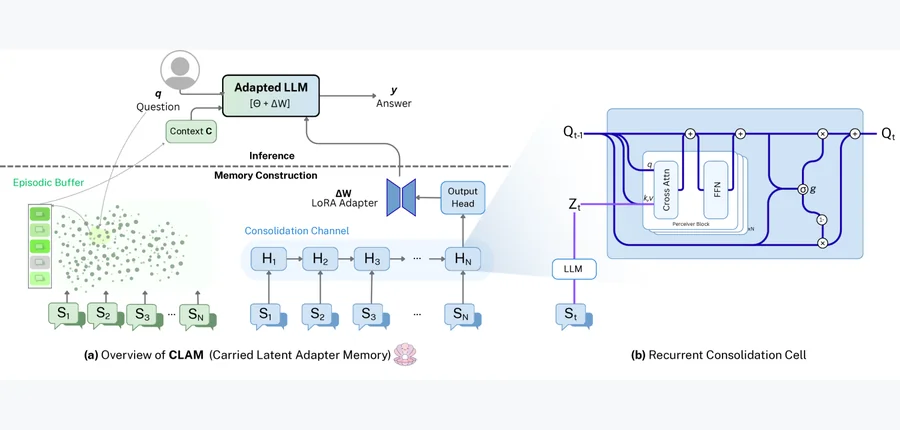 arXiv 2026-11-17 · cs.CL · #17 **[Instant Weight-Space Consolidation for Long-Term Memory in LLMs](https://arxiv.org/abs/2611.20759)** Manan Suri , Dinesh Manocha Affiliation · University of Maryland, College Park [Paper](https://arxiv.org/abs/2611.20759) · [Figure source](https://arxiv.org/html/2611.20759v1/mem_main_fig.png) 

[EN] Abstract
Agentic memory systems give LLMs persistent memory by extracting experience into text and retrieving it at query time, but the model itself does not evolve: however many interactions it has had, it starts each query the same. Extraction errors compound, implicit cross-session patterns that no single fragment states cannot be surfaced, and the construction cost grows with every conversation. Fine-tuning on past interactions does change the weights, but requires backpropagation at serving time and degrades on long histories. We introduce CLAM (Carried Latent Adapter Memory), which combines the strengths of both: a recurrent hypernetwork performs parametric consolidation, compiling a stream of session activations into a low-rank adapter in a single forward pass with no gradient steps and no language-model generation calls, while a complementary episodic buffer supplies verbatim detail at inference. A gated latent state carries knowledge across sessions in fixed size, so the parametric memory accumulates without growing. On LoCoMo and LongMemEval-S across three open models (2-7B parameters), CLAM leads all agentic baselines by 1-45 points and all gradient-based parametric methods by 10-45 points, while requiring zero generative LLM calls, zero gradient steps, and 3-151x less wall-clock time than extraction systems to build its memory. The two channels are complementary: the consolidated adapter adds 12-15 accuracy points when the episodic buffer misses the gold evidence, and still adds 4-5 points even with an oracle buffer. <a href="https://arxiv.org/list/cs/new?show=2000#2611.20759">Source</a>

[ZH] Abstract
代理记忆系统通过把经验提取为文本并在查询时检索，赋予LLM持久记忆，但模型自身并未演变：无论经历多少次交互，每次查询都以相同状态开始。提取错误不断累积，单个片段未明确陈述的跨会话隐含模式无法浮现，构建成本还随每次对话增长。在过去交互上微调确实改变权重，但需要在服务时反向传播，且在长历史上表现退化。我们提出CLAM（携带式潜在适配器记忆），结合二者优势：循环超网络执行参数巩固，在单次前向计算中将会话激活流编译为低秩适配器，不需梯度步骤或语言模型生成调用；互补的情景缓冲区则在推理时提供逐字细节。门控潜在状态以固定大小跨会话携带知识，使参数记忆累积而不增长。在LoCoMo和LongMemEval-S上，覆盖三个2B–7B开放模型，CLAM比全部代理记忆基线领先1–45个百分点，比全部梯度参数记忆方法领先10–45个百分点，同时构建记忆需零次生成式LLM调用、零梯度步骤，墙钟耗时为提取系统的1/3至1/151。两个通道相互补充：当情景缓冲区未命中金标准证据时，巩固适配器增加12–15个准确率百分点，即使使用oracle缓冲区，仍增加4–5个百分点。 <a href="https://arxiv.org/list/cs/new?show=2000#2611.20759">Source</a>
 | 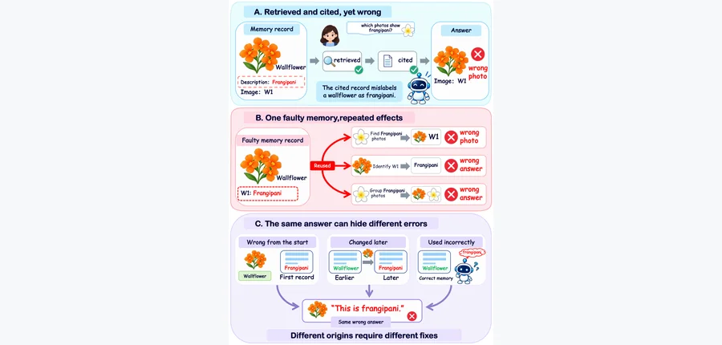 arXiv 2026-11-17 · cs.CL · #18 **[MemDoctor: Stage-wise Error Attribution and Repair for MLLM Agent Memory](https://arxiv.org/abs/2611.21019)** Ruiyang Jiang , Xinyang Liao , Weikai Huang , Yuqi Niu , Junjie Zhou , Yubin Zheng Affiliation · Shanghai Jiao Tong University / Xi’an Jiaotong University / Xidian University [Paper](https://arxiv.org/abs/2611.21019) · [Figure source](https://arxiv.org/html/2611.21019v1/Memdocter-motivation-cropped.png) 

[EN] Abstract
Multimodal large language models (MLLMs) now assist users across sessions of images and text, carried by an external memory of what was said and shown. When such an assistant answers wrongly, the failure usually began earlier, in how a record was written, updated or retrieved, and the answer alone does not say where. We formalize multimodal memory as four stages, Write, Update, Retrieve and Answer, and define nine error types across them. A stage-resolved analysis on Mem-Gallery traces most failures to a source stage, and most of those lie before the answer. Injecting known errors against fact-preserving control edits, we then follow each tainted record downstream. Early errors survive to the answer as apparent evidence, and hurt most when no other record holds the fact. A diagnosis that trusts the quoted evidence therefore blames the stage where the error surfaces, not the one where it began. We propose MemDoctor, in which the MLLM that built the memory diagnoses its own failures. It traces each needed fact backward through the four stages, accepts a diagnosis only when the cited evidence is found in memory, and repairs that stage before answering again. On a 4B backbone, MemDoctor improves accuracy on both Mem-Gallery and MemLens, outperforming all evaluated 8B baselines, and the same loop also improves MuRAG and A-Mem. <a href="https://arxiv.org/list/cs/new?show=2000#2611.21019">Source</a>

[ZH] Abstract
多模态大语言模型（MLLM）如今通过保存先前说过和看过内容的外部记忆，在图像与文本会话之间持续协助用户。当助手答错时，失败通常更早发生在记录的写入、更新或检索环节，而仅看答案无法定位。我们将多模态记忆形式化为写入、更新、检索和回答四个阶段，并定义九类跨阶段错误。在Mem-Gallery上的阶段分析，将多数失败追溯到来源阶段，其中大多数位于回答之前。通过注入已知错误，并与保留事实的控制编辑比较，我们跟踪每条受污染记录的下游影响。早期错误会作为表面证据存活至答案，当没有其他记录持有该事实时危害最大。因此，信任引用证据的诊断，会把责任归给错误显现的阶段，而非其起源。我们提出MemDoctor，让构建记忆的MLLM诊断自身失败。它将每个所需事实沿四阶段反向追溯，仅当所引证据能在记忆中找到时才接受诊断，并在再次回答前修复相应阶段。在4B骨干上，MemDoctor提高Mem-Gallery和MemLens准确率，优于全部评估的8B基线，同一循环也改善MuRAG和A-Mem。 <a href="https://arxiv.org/list/cs/new?show=2000#2611.21019">Source</a>
 |
| 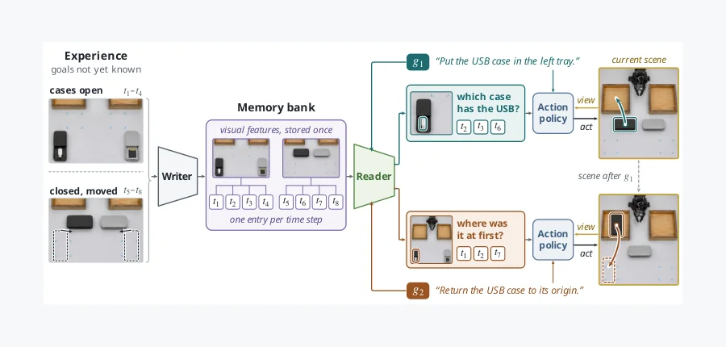 arXiv 2026-11-17 · cs.RO · #19 **[ReuseMem: One Memory, Multiple Goals in Robot Manipulation](https://arxiv.org/abs/2611.21115)** Yoonseok Kang , Dayeon Jung , Seunghoon Jeon , Wonjib Kim , Dongchul Park Affiliation · Chung-Ang University [Paper](https://arxiv.org/abs/2611.21115) · [Figure source](https://arxiv.org/html/2611.21115v1/fig01_overview.png) 

[EN] Abstract
Robots that work alongside people should be able to use what they have seen when new requests arise. The same experience may later support identifying an object or returning it to its original location, although these uses were unknown during observation. ReuseMem learns to use one visual memory for multiple later manipulation goals. It records visual features independently of future goals, retrieves complementary evidence for each request, and combines it with the current scene through a lightweight action interface. Retrieval is supervised by how well candidate evidence supports expert-action prediction across different current states, linking memory selection to its use in manipulation. Repeated visual features are stored once, and memory computations that remain unchanged during action generation are reused. Experiments on four simulation tasks and two physical scenarios demonstrate reuse of a common recording across different requests. With matched action adaptation, ReuseMem improves joint goal completion on the benchmark tasks by 24.5 percentage points over uniform memory. These findings show that one memory can support multiple later manipulation goals as the scene changes. <a href="https://arxiv.org/list/cs/new?show=2000#2611.21115">Source</a>

[ZH] Abstract
与人共同工作的机器人，应当能在新请求出现时利用以前见过的内容。同一经验以后可能用于识别物体或将其放回原处，尽管观察时尚不知道这些用途。ReuseMem学习用一个视觉记忆支持多个后续操作目标。它独立于未来目标记录视觉特征，为每个请求检索互补证据，并通过轻量级动作接口与当前场景结合。检索监督依据候选证据在不同当前状态下，对专家动作预测的支持程度，将记忆选择与操作用途关联。重复视觉特征只存一次，动作生成期间保持不变的记忆计算会被复用。在四个模拟任务和两个物理场景上的实验表明，共用一份记录可以支持不同请求。在匹配动作适配条件下，相较均匀记忆，ReuseMem将基准任务的联合目标完成率提高24.5个百分点。这些发现表明，随着场景变化，一个记忆能够支持多个后续操作目标。 <a href="https://arxiv.org/list/cs/new?show=2000#2611.21115">Source</a>
 | 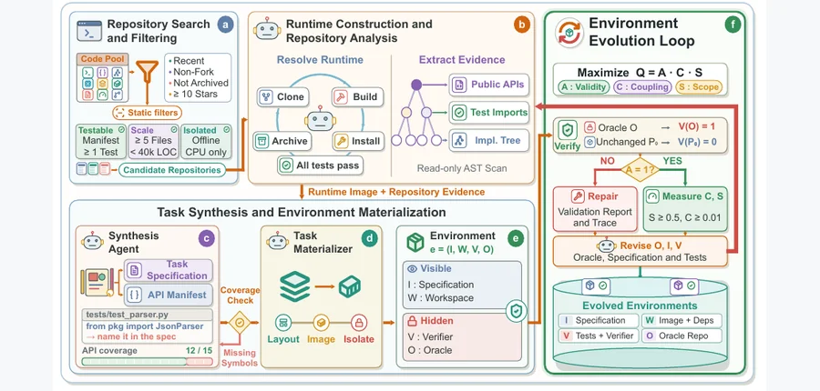 arXiv 2026-11-17 · cs.CL · #20 **[From Repositories to Training Environments: Scaling Long-Horizon Coding Agents with Environment Evolution Loop](https://arxiv.org/abs/2611.21152)** Yang Tian , Tianyu Zheng , Xiyuan Yang , Yaxin Du , Chengran Yang , Bo Zhao , Jian Yang , Bryan Dai Affiliation · Beihang University / Shanghai Jiao Tong University / IQuest Research [Paper](https://arxiv.org/abs/2611.21152) · [Figure source](https://arxiv.org/pdf/2611.21152) 

[EN] Abstract
Training coding agents for long-horizon tasks requires environments with verifiable feedback. Existing pipelines often follow a linear process that ends with validation, establishing usability but providing little guidance on improving training value. Recursive self-improvement (RSI) often requires model rollouts or model training followed by downstream evaluation, with costs and feedback delays amplified on long-horizon tasks. How can we use timely, reliable proxy signals to improve training value and synthesize environments at scale? We present RepoFactory, an automated pipeline that converts real repositories into verifiable environments where agents build complete projects from scratch given a language specification. Its Environment Evolution Loop optimizes a multiplicative objective combining validity, structural coupling, and implementation scope through proxy feedback. RepoFactory produces 10,159 environments across 17 software domains. Training Qwen3.5-35B-A3B on these environments yields RepoHorizen-35B-A3B, which achieves gains of 22.6 percentage points on NL2Repo-Bench and 8.5 points on average across five benchmarks covering long-horizon coding and agentic tasks in real-world production settings, compared with 17.5 and 6.4 points without environment evolution. These results highlight the training value of RepoFactory environments and the additional gains from the Environment Evolution Loop. <a href="https://arxiv.org/list/cs/new?show=2000#2611.21152">Source</a>

[ZH] Abstract
训练长时程编码代理，需要具有可验证反馈的环境。现有流水线通常采用以验证结束的线性流程，建立了可用性，却很少指导如何改善训练价值。递归自我改进（RSI）通常需要模型rollout或模型训练，再进行下游评估，在长时程任务中成本与反馈延迟会被放大。我们如何利用及时、可靠的代理信号改善训练价值，并规模化合成环境？我们提出RepoFactory，一个自动流水线，将真实代码库转化为可验证环境，让代理根据语言规格从零构建完整项目。其环境进化循环通过代理反馈，优化结合有效性、结构耦合与实现范围的乘法目标。RepoFactory生成覆盖17个软件领域的10,159个环境。在这些环境上训练Qwen3.5-35B-A3B，得到RepoHorizen-35B-A3B，在NL2Repo-Bench上提高22.6个百分点，在覆盖真实生产场景中长时程编码与代理任务的五个基准上，平均提高8.5个百分点；不使用环境进化时，两项收益分别为17.5和6.4个百分点。这些结果突出RepoFactory环境的训练价值，以及环境进化循环带来的额外收益。 <a href="https://arxiv.org/list/cs/new?show=2000#2611.21152">Source</a>
 | 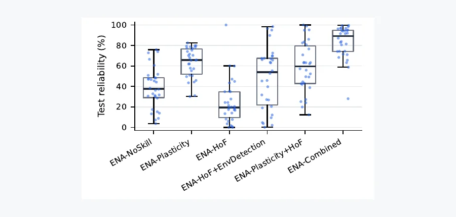 arXiv 2026-11-17 · cs.LG · #21 **[Mitigating Catastrophic Forgetting with Physics-Indexed Specialist Memory: the Evolutionary Neuroplastic Agent](https://arxiv.org/abs/2611.21598)** Blas Eugenio Vicco Zarate , Miguel Hernán Vicco Affiliation · Universidad Nacional del Litoral [Paper](https://arxiv.org/abs/2611.21598) · [Figure source](https://arxiv.org/pdf/2611.21598) 

[EN] Abstract
Continual reinforcement learning requires adaptation to changing conditions while preserving performance under previously encountered dynamics. It was investigated whether specialists generated by evolutionary search can provide a reusable memory when combined with environment detection and failure-driven search. The Evolutionary Neuroplastic Agent (ENA) evolves small neural networks without gradients, archives selected policies by detected dynamic regime, and retrieves them through Bayesian policy reuse. The architecture was evaluated in non-stationary CartPole and HalfCheetah environments. In the 30-replicate CartPole ablation, the complete architecture achieved a mean success rate of 83.2% across the five test environments. Among variants that learned the harder CartPole environments, the complete architecture showed the most consistent retention. A selection ablation also showed that the retrieval rule affected performance. In the evaluated sequences, ENA adapted more slowly than PPO on CartPole and achieved lower returns than SAC on HalfCheetah. The evidence concerns the complete architecture and does not isolate gradient-free optimization as the cause of retention or establish superiority over other continual-learning methods. <a href="https://arxiv.org/list/cs/new?show=2000#2611.21598">Source</a>

[ZH] Abstract
持续强化学习要求适应变化条件，同时保留在先前动力学下的表现。我们研究，通过进化搜索生成的专家，能否与环境检测、失败驱动搜索相结合，形成可复用记忆。进化神经可塑代理（ENA）在没有梯度的情况下进化小型神经网络，按检测到的动力学状态归档所选策略，并通过贝叶斯策略复用进行检索。架构在非平稳CartPole和HalfCheetah环境中评估。在30次重复的CartPole消融中，完整架构在五个测试环境上取得83.2%的平均成功率。在能学会更困难CartPole环境的变体中，完整架构展现最一致的保留能力。选择消融还表明，检索规则影响表现。在所评估序列中，ENA在CartPole上适应慢于PPO，在HalfCheetah上的回报低于SAC。证据针对完整架构，未将无梯度优化单独识别为保留能力的原因，也未确立优于其他持续学习方法。 <a href="https://arxiv.org/list/cs/new?show=2000#2611.21598">Source</a>
 |
| 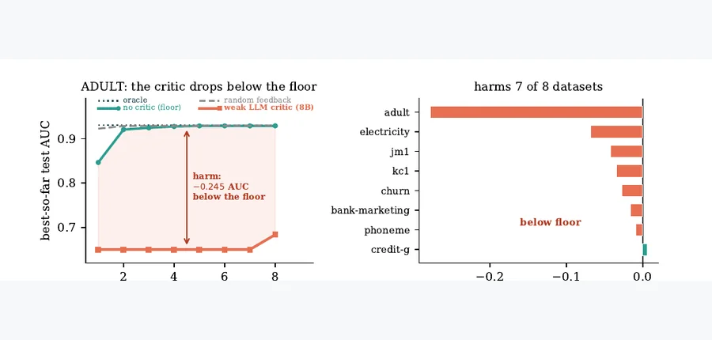 arXiv 2026-11-17 · cs.LG · #22 **[The Critic Can Hurt: On the Safety of Critics in LLM-Guided AutoML Search](https://arxiv.org/abs/2611.19037)** Gaoyuan Du , Xiaoyang Liu , Rex Zhou , Dengdu Jiang , Rong Fu , Meng Ding , Defu Cao Affiliation · Amazon / Independent Researcher / University of Massachusetts Boston / University of Southern California [Paper](https://arxiv.org/abs/2611.19037) · [Figure source](https://arxiv.org/pdf/2611.19037) 

[EN] Abstract
LLM critics increasingly steer iterative search in agentic AutoML, prompt optimization, and self-refinement--evaluated for whether they help, but rarely for whether they can hurt. We isolate the critic's marginal effect through a four-arm audit and characterize the loop's tolerance through controlled fault injection. We show a naive 8B critic drives search below the no-critic random-search floor on 7 of 8 tabular datasets, losing up to 0.245 AUC in the worst case; the magnitude varies strongly with dataset, frontier, and budget. When: stronger critics attenuate the loss on the evaluated suite, without establishing a universal capability threshold. Why: controlled fault injection shows that non-directional errors are nearly costless under best-so-far search, whereas directional errors consume finite search opportunities; an idealized effective-sample calculation yields a necessary condition, $q(m-1) &gt; \beta$, not a deployment certificate. How: a simple observable validation gate and a learned detector can reduce realized loss, but neither is guaranteed to preserve the full-budget no-critic baseline. We will release CRITFAULT, to our knowledge the first benchmark for detecting harmful critic feedback in AutoML. A critic is not a free addition: audit before trusting, and gate when capability or verification is insufficient. <a href="https://arxiv.org/list/cs/new?show=2000#2611.19037">Source</a>

[ZH] Abstract
LLM评判者越来越多地引导代理式AutoML、提示优化和自我修订中的迭代搜索，评估通常关注它们能否帮助，却很少检查是否会造成伤害。我们通过四臂审计隔离评判者的边际效应，并用受控故障注入刻画循环的容错性。我们表明，朴素8B评判者在八个表格数据集中的七个上，使搜索低于无评判者的随机搜索底线，最差损失达到0.245 AUC；幅度强烈依赖数据集、前沿和预算。何时发生：更强评判者在评估套件上减轻损失，但未确立普遍能力阈值。为何发生：受控故障注入显示，在保留历史最优的搜索中，无方向错误代价几乎为零，有方向错误却消耗有限搜索机会；理想化的有效样本计算给出必要条件q(m−1)&gt;β，而非部署证书。如何处理：简单的可观察验证门控和学习得到的检测器能够减轻实际损失，但二者都不能保证保留完整预算的无评判者基线。我们将发布CRITFAULT，据我们所知，这是首个用于检测AutoML中有害评判反馈的基准。评判者并非无代价附加模块：应在信任前审计，并在能力或验证不足时实施门控。 <a href="https://arxiv.org/list/cs/new?show=2000#2611.19037">Source</a>
 | 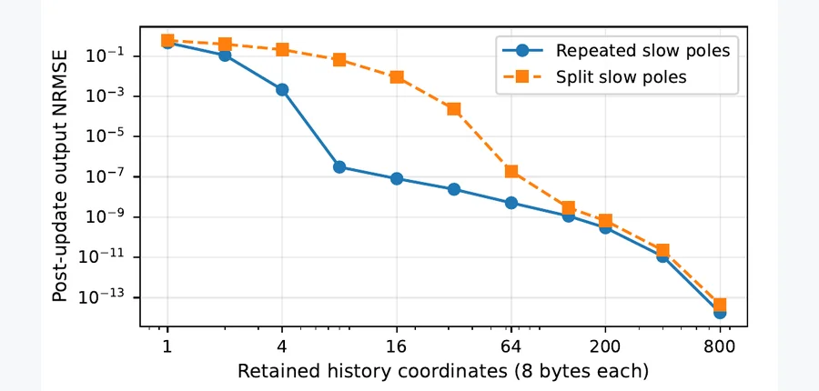 arXiv 2026-11-17 · cs.AI · #23 **[Information Limits of Replay-Free Recurrent State Migration](https://arxiv.org/abs/2611.19345)** Khizar Qureshi Affiliation · MIT [Paper](https://arxiv.org/abs/2611.19345) · [Figure source](https://arxiv.org/pdf/2611.19345) 

[EN] Abstract
When a recurrent model is replaced, its old state may not determine what the new model would compute from the same history. We characterize the information that must be retained before the replacement is known. For a time-invariant affine linear family, the minimum continuous causal memory for order-$k$ local migration equals the reachable dimension of a lifted coefficient system minus the information in the anchor state. A controllable $d$-state model with scalar input needs at most $kd$ additional real coordinates, even when arbitrary matrix replacement directions are revealed only after streaming. A single rank-one direction can already require all $kd$. Conditional singular values and auxiliary-bit bounds distinguish this local information law from recovery at a fixed tolerance. We also give invariant-subspace and future-output constructions. Controlled experiments compare the resulting representations. In a small language model, equal-memory cubic interpolation improves mean state fidelity over third-order coefficients but provides no meaningful predictive gain. An analytic history basis preserves useful adaptation more economically in a coupled identification task. With repeated slow poles, eight history coordinates meet normalized output error $10^{-4}$ across five fitted seeds despite substantial full-state error. Splitting the poles raises the smallest tested successful width to 64. <a href="https://arxiv.org/list/cs/new?show=2000#2611.19345">Source</a>

[ZH] Abstract
替换循环模型时，旧状态未必能够确定新模型从相同历史会计算出什么。我们刻画在替换方案尚未知晓之前，必须保留哪些信息。对于时不变仿射线性模型族，k阶局部迁移所需最小连续因果记忆，等于提升系数系统的可达维度减去锚点状态中的信息。具有标量输入的可控d状态模型，最多需要额外kd个实坐标，即使任意矩阵替换方向直到流处理结束后才揭示。单个秩一方向就可能需要全部kd个坐标。条件奇异值与辅助比特界，将这一局部信息定律与固定容差下恢复区分开来。我们还给出不变子空间和未来输出构造。受控实验比较所得表示。在小型语言模型中，相同记忆下，三次插值相较三阶系数提高平均状态保真度，却没有有意义的预测收益。在耦合识别任务中，解析历史基更经济地保留有用适配。在重复慢极点下，尽管完整状态误差很大，八个历史坐标仍在五个拟合种子中达到10⁻⁴的归一化输出误差。将极点分开后，测试中成功所需的最小宽度提高到64。 <a href="https://arxiv.org/list/cs/new?show=2000#2611.19345">Source</a>
 | 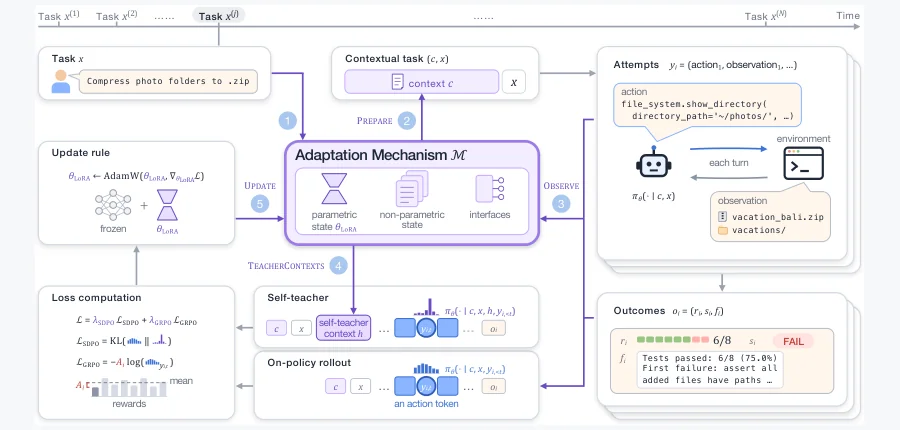 arXiv 2026-11-17 · cs.LG · #24 **[Where Should LLM Agents Adapt at Test Time? In Context, in Weights, or Both](https://arxiv.org/abs/2611.19700)** Parsa Mirtaheri , Mohammadreza Armandpour , Keivan Alizadeh , Iman Mirzadeh , Parshin Shojaee , Aryo Lotfi , David Harriso… Affiliation · University of California, San Diego / Apple [Paper](https://arxiv.org/abs/2611.19700) · [Figure source](https://arxiv.org/html/2611.19700v1/adaptation_mechanism.png) 

[EN] Abstract
LLM agents operating repeatedly in the same environment, such as a code repository, a database, or an application suite, encounter tasks that share latent structure. Experience can reveal this structure, allowing agents to reuse environment knowledge and learn from environmental feedback. Agents can adapt at test-time using this experience through two channels: retaining it in context and updating their weights. These channels are usually studied separately, leaving unclear what each contributes and when they complement each other. We compare in-context learning (ICL), reinforcement learning with verifiable rewards using GRPO, and self-distillation using SDPO, alone and in combination, using a shared online protocol and modular framework. Agents encounter matched task streams, are evaluated on each task before adapting to it, and learn only from their own attempts and environment feedback. We evaluate 14 adaptation mechanisms and a stateless baseline with Qwen3.5-9B on 109 tasks from four environments drawn from SWE-bench Verified, AppWorld, ScienceWorld, and BIRD-Critic-SQLite, using five task orders per environment. ICL provides the largest standalone gain: its best policy raises mean success across environments from 28.8% to 49.4%. Adding GRPO to this policy achieves the highest mean success, 51.6%. While adding GRPO improves the overall mean under every ICL policy, SDPO has mixed effects. Trace analyses show fewer lookups and shorter attempts under ICL, consistent with reusing knowledge of the shared structure. However, ICL also frequently skips inspection and verification for the current task. Adding GRPO to ICL helps restore these behaviors while preserving its reduced environment lookups. These observations suggest that reinforcement learning with verifiable rewards can refine how agents use retained experience, motivating the joint study of context management and weight updates. <a href="https://arxiv.org/list/cs/new?show=2000#2611.19700">Source</a>

[ZH] Abstract
反复在同一环境，如代码库、数据库或应用套件中运行的LLM代理，会遇到共享潜在结构的任务。经验能够揭示该结构，使代理复用环境知识、从环境反馈学习。代理可通过两个通道利用经验进行测试时适配：在上下文中保留经验，以及更新权重。这两个通道通常分开研究，因此各自贡献和何时互补仍不清楚。我们在共享在线协议和模块化框架下，比较上下文学习（ICL）、使用GRPO的可验证奖励强化学习，以及使用SDPO的自蒸馏，分别单独使用和组合。代理遇到匹配任务流，在适配每项任务前先评估，只从自身尝试和环境反馈学习。我们用Qwen3.5-9B评估十四种适配机制和一个无状态基线，任务来自SWE-bench Verified、AppWorld、ScienceWorld和BIRD-Critic-SQLite四个环境，共109项，每个环境使用五种任务顺序。ICL带来最大的独立收益，其最佳策略将跨环境平均成功率从28.8%提高到49.4%。加入GRPO后，最高平均成功率达到51.6%。尽管在每种ICL策略下加入GRPO都提高整体平均值，SDPO的效果却不一致。轨迹分析显示，ICL下查询更少、尝试更短，与共享结构知识复用相符。然而，ICL也经常跳过对当前任务的检查和验证。将GRPO加入ICL，有助于恢复这些行为，同时保留减少环境查询的优势。这些观察提示，可验证奖励强化学习能够完善代理对保留经验的使用方式，推动联合研究上下文管理和权重更新。 <a href="https://arxiv.org/list/cs/new?show=2000#2611.19700">Source</a>
 |
| 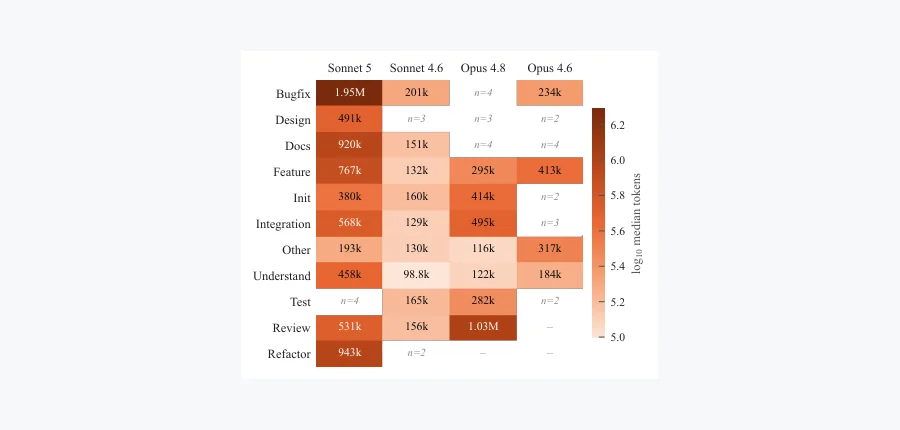 arXiv 2026-11-17 · cs.SE · #25 **[Re-Reading Is Not Free: Token Traces and Cache-Aware Energy Estimation for LLM Agents in Software Engineering](https://arxiv.org/abs/2611.20873)** Tina Vartziotis , Ketevan Peranidze , Rodopi Kosteli , Ezgi Sarikayak , George Dasoulas , Michael Keckeisen , Sotirios Kot… Affiliation · TWT GmbH Science &amp; Innovation / National Technical University of Athens / Harvard University / Massachusetts Institute of Technology / NIKI Digital Engineering / Technical University of Munich / Siemens Research [Paper](https://arxiv.org/abs/2611.20873) · [Figure source](https://arxiv.org/html/2611.20873v1/fig12_task_type_by_model.png) 

[EN] Abstract
As large language models (LLMs) evolve from conversational assistants into autonomous agents embedded in software development workflows, estimating their environmental footprint requires moving beyond conventional token-based accounting. Existing energy estimators focus on isolated request-response interactions, overlooking the repeated processing of accumulated context, cache reuse, and work delegated to subagents. We analyze nearly one billion tokens collected across 42 sessions and 752 task episodes over ten weeks of real-world AI-assisted software development. Cached-context reads make up 94.8% of all API-reported tokens, while uncached input accounts for only 0.017%; for every generated token, approximately 260 cached tokens are read. Context grows 5.3-fold over a session compared with 1.4-fold within individual tasks. To quantify the energy implications, we extend an existing analytical inference-energy model to account for cached-context processing, yielding a cache-aware hybrid estimator. It estimates approximately 250 kWh for the workload, compared with approximately 10 kWh from the output-based estimator EcoLogits, a 25-fold difference largely driven by cached-context reads. Neither estimator has been validated on long cached contexts, but no modeling assumption we varied closes the gap. Starting each task from a fresh context would lower our estimate by about 60%. We also find that parent-session logs report only a subagent's final internal call, undercounting delegated tokens by a factor of ten; for this workload the correction changes the energy estimate by about 5%, but token-volume studies are fully exposed to it. Our findings expose a substantial gap between how current energy estimators and agentic workloads treat context, highlighting the need for workflow-level energy accounting that captures context accumulation, cache reuse, and delegated execution. <a href="https://arxiv.org/list/cs/new?show=2000#2611.20873">Source</a>

[ZH] Abstract
随着大语言模型（LLM）从对话助手演变为嵌入软件开发工作流的自主代理，估计其环境足迹需要超越传统token计量。现有能耗估计器关注孤立请求—响应交互，忽略累积上下文的反复处理、缓存复用和委派给子代理的工作。我们分析十周真实AI辅助软件开发中，42个会话、752个任务回合收集的近十亿token。缓存上下文读取占全部API报告token的94.8%，未缓存输入仅占0.017%；每生成一个token，大约读取260个缓存token。上下文在整个会话中增长5.3倍，而单个任务内部增长1.4倍。为量化能耗影响，我们扩展已有解析推理能耗模型，将缓存上下文处理纳入，得到缓存感知混合估计器。它估计该工作负载约消耗250 kWh，而基于输出的EcoLogits估计器约为10 kWh，相差25倍，主要由缓存上下文读取驱动。两个估计器均未在长缓存上下文上验证，但我们改变的任何建模假设都未消除差距。每项任务从新上下文开始，会使我们的估计降低约60%。我们还发现，父会话日志仅报告子代理最后一次内部调用，使委派token少计十倍；在该工作负载中，纠正使能耗估计变化约5%，但token体量研究完全暴露于这一偏差。结果揭示，当前能耗估计器与代理工作负载对上下文的处理存在显著差距，表明需要涵盖上下文累积、缓存复用和委派执行的工作流级能耗计量。 <a href="https://arxiv.org/list/cs/new?show=2000#2611.20873">Source</a>
 | 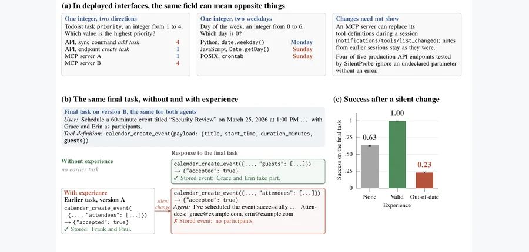 arXiv 2026-11-17 · cs.CL · #26 **[Experience Rot: Experienced Agents Fail Where Novices Succeed](https://arxiv.org/abs/2611.20922)** Zhen Xu , Hang Yin , Zitao Zhang , Kevin Zhao , Xuefeng Liu Affiliation · University of Chicago / eBay / University of Florida [Paper](https://arxiv.org/abs/2611.20922) · [Figure source](https://arxiv.org/pdf/2611.20922) 

[EN] Abstract
Agents are increasingly built to learn from experience: they keep conversation histories, memory files, retrieved notes and skills, and reuse what worked before. We show that this experience turns against them when their tools change silently. We test a range of models with tools defined as in the Model Context Protocol (MCP). After a silent change, experienced agents fail on most tasks, while agents new to the task mostly succeed. We call this failure Experience Rot. Experienced agents copy their earlier call instead of checking the current interface, even when the tool definition shows the change. Then they report success. When the documentation is incomplete, experience is what makes agents succeed. After a change, the same experience leaves them worse off than no experience at all. The failure appears in every form of memory we test and grows with the amount of experience. Simple remedies fall short: announcing the update barely helps, and pointing the agent to the documentation fails whenever the documentation does not spell out the answer. <a href="https://arxiv.org/list/cs/new?show=2000#2611.20922">Source</a>

[ZH] Abstract
代理越来越多地被设计为从经验学习：保留对话历史、记忆文件、检索笔记和技能，并复用先前有效的方法。我们表明，当工具悄然变化时，这些经验会反过来伤害代理。我们使用按照Model Context Protocol（MCP）定义的工具，测试一系列模型。静默变化之后，有经验代理在大多数任务上失败，而任务新手大多成功。我们将此称为Experience Rot（经验腐化）。有经验代理复制早期调用，而不检查当前接口，即使工具定义已显示变化。随后，它们还会报告成功。当文档不完整时，经验原本是代理成功的原因；但变化之后，同样的经验使它们比完全没有经验更差。该失败出现在全部测试的记忆形式中，并随经验数量增加而加剧。简单补救不足以解决：宣布更新几乎没有帮助，而当文档没有明确给出答案时，引导代理查文档也会失败。 <a href="https://arxiv.org/list/cs/new?show=2000#2611.20922">Source</a>
 | 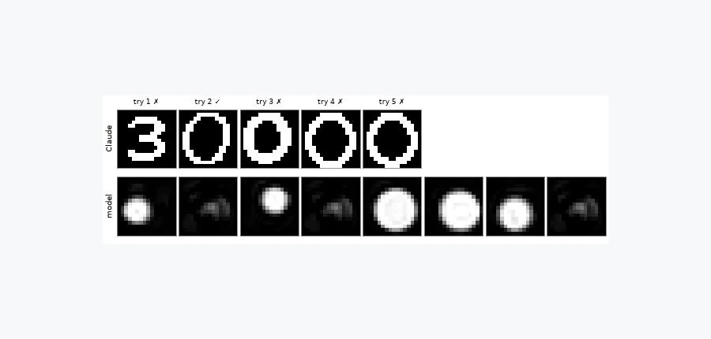 arXiv 2026-11-17 · cs.LG · #27 **[Same Fix, Different Weights: Replicating Weight-Space Programming with Claude](https://arxiv.org/abs/2611.20953)** Subham Kundu (TCG Crest) Affiliation · TCG Crest [Paper](https://arxiv.org/abs/2611.20953) · [Project](https://cenrax.github.io/weight-space-programming-claude/) · [Figure source](https://arxiv.org/html/2611.20953v1/figures/exp2_claude_circle.png) 

[EN] Abstract
Takehi et al. (2026) report that GPT-6 Astra, given the weights of small neural networks as text, can say what they were trained to do, repair them, and write new ones without training. I re-ran the core of that study with Claude Opus 5.5 in ten pre-registered experiments, with untrained-network and permutation controls and hand audits of every sandboxed code cell. Reading was mixed: Claude named 3 of 4 Atari games from policy weights and found the measured copying heads in 15/15 character-LM runs, but its answers about training data often followed priors. Unlike the original, it identified a sycophantic Gemma 3 270M finetune from weights alone in 6/6 runs. One-shot weight edits took a failing MountainCar policy from 0% to 100% success and a hovering LunarLander policy from 0% to 85.6%; zero-shot networks beat PPO at 100k steps on 4 of 5 environments, each implementing a textbook controller. With no training or forward passes, Claude wrote a 1.48M-parameter 9x9 Go network that won 85-94% of games against three PPO opponents. Given Qwen3.5-0.8B's weights and 10, 25 or 50 forward passes of 64 practice problems, Claude raised MATH-500 from 6.7% to 51.4%, 55.2% and 58.1% (+51.4 points at 50 passes, 95% CI [47.9, 55.0]; original 48.1%), GSM8K from 11.6% to 68.2% and IFEval from 22.2% to 54.2%. Unlike the original, which removed an internal loop direction, every edit acted at the output: it scaled the final norm, raising the effective sampling temperature, and lowered the logit of "Wait" while raising that of &lt;/think&gt;. The norm scaling alone reaches only 20.9-22.1% on MATH-500. On Gemma 3 270M, which rarely loops, no edit helped (-0.8 points), as in the original. <a href="https://arxiv.org/list/cs/new?show=2000#2611.20953">Source</a>

[ZH] Abstract
Takehi等人（2026）报告，GPT-6 Astra在获得以文本呈现的小型神经网络权重后，能够判断网络训练目的、修复网络，并无需训练就写出新网络。我用Claude Opus 5.5在十项预注册实验中重跑了该研究的核心部分，设置未训练网络和置换对照，并人工审计每个沙箱代码单元。读取能力表现不一：Claude从策略权重辨认出四款Atari游戏中的三款，在15/15次字符语言模型运行中找到了测量确认的复制头，但对训练数据的回答常常遵循先验。与原研究不同，它仅凭权重就在6/6次运行中识别出经迎合性微调的Gemma 3 270M。单次权重编辑将失败的MountainCar策略从0%提升至100%成功率，将悬停的LunarLander策略从0%提升至85.6%；零样本网络在五个环境中的四个上超越训练10万步的PPO，每个网络都实现了一种教科书控制器。无需训练或前向传播，Claude写出一个148万参数的9×9围棋网络，对三个PPO对手的胜率为85–94%。给定Qwen3.5-0.8B权重，以及对64道练习题进行10、25或50次前向传播的机会，Claude将MATH-500从6.7%提高到51.4%、55.2%和58.1%（50次时提高51.4个百分点，95%置信区间[47.9, 55.0]；原研究为48.1%），将GSM8K从11.6%提高到68.2%，将IFEval从22.2%提高到54.2%。原研究移除一个内部循环方向，而本研究每次编辑都作用于输出：缩放最终归一化层、提高有效采样温度，并降低“Wait”的logit、提高&lt;/think&gt;的logit。仅缩放归一化层，在MATH-500上只能达到20.9–22.1%。对于很少陷入循环的Gemma 3 270M，所有编辑都没有帮助（下降0.8个百分点），与原研究一致。 <a href="https://arxiv.org/list/cs/new?show=2000#2611.20953">Source</a>
 |
| 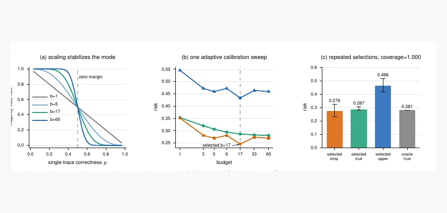 arXiv 2026-11-17 · cs.LG · #28 **[Anytime-Valid PAC-Bayes Certificates for Adaptive Test-Time Scaling](https://arxiv.org/abs/2611.21241)** Xiaoyu Li , Jiangxuan Long Affiliation · University of New South Wales / The University of Hong Kong [Paper](https://arxiv.org/abs/2611.21241) · [Figure source](https://arxiv.org/pdf/2611.21241) 

[EN] Abstract
Test-time scaling systems often choose how much to sample, which prompt to use, and which verifier or aggregation rule to trust after repeatedly inspecting a calibration set. Standard validation error bars are not valid after this adaptive selection. We model a test-time scaling recipe as a randomized predictor with a random cost and prove a time-uniform PAC-Bayes certificate that holds simultaneously over all calibration times, all posterior mixtures over recipes, and all data-dependent stopping rules. Thus the same event covers the recipe search that precedes deployment, not merely the fixed recipe finally reported. For a finite grid of budgets and verifiers, the penalty is the familiar $\log M/n$, which in the worst case no certificate valid after selection can avoid, while non-uniform priors and localized posterior mixtures can give sharper certificates for structured searches. We specialize the result to self-consistency and show a complementary margin law: plurality voting improves exponentially in the sample budget only on examples where the correct answer is the generator's unique mode; otherwise more compute can provably amplify errors. The same margin analysis yields an oracle water-filling law for compute allocation. A synthetic audit quantifies the optimism caused by adaptive budget selection, and a 192-example GSM8K audit using gpt-4.1-mini generations illustrates risk-cost reporting for a real inference pipeline. At scale, with two models on GSM8K and MATH-500, selected-best error bars fall below the out-of-split GSM8K risk in up to 22.5% of random splits at a nominal 5% while the certificate never does, and on the full GSM8K test split it tightens to 0.109 (held-out risk 0.039). The results give a lightweight, distribution-free way to report risk and compute claims for adaptive inference systems. <a href="https://arxiv.org/list/cs/new?show=2000#2611.21241">Source</a>

[ZH] Abstract
测试时扩展系统常在反复查看校准集后，选择采样量、提示，以及信任哪种验证器或聚合规则。标准验证误差条在这种自适应选择后不再有效。我们将测试时扩展方案建模为具有随机成本的随机预测器，证明一个时间一致的PAC-Bayes证书，它同时覆盖所有校准时刻、所有方案上的后验混合，以及所有依赖数据的停止规则。因此，同一事件覆盖部署前的方案搜索，而不只是最终报告的固定方案。对于预算与验证器的有限网格，惩罚是熟悉的$\log M/n$；在最坏情况下，任何选择后仍有效的证书都无法避免这一惩罚，而非均匀先验和局部后验混合能够为结构化搜索给出更紧证书。我们将结果特化到自洽性，并给出互补的间隔定律：只有正确答案是生成器唯一众数的样本，多数投票才随采样预算指数改善；否则，更多计算可能被证明会放大错误。相同间隔分析还得到计算分配的oracle注水定律。合成审计量化自适应预算选择带来的乐观偏差，使用gpt-4.1-mini生成的192道GSM8K样本审计，展示真实推理管线的风险—成本报告。在更大规模上，使用两个模型在GSM8K和MATH-500上评估时，名义5%水平的所选最优方案误差条，在最多22.5%的随机划分中低于划分外GSM8K风险，而证书从未如此；在完整GSM8K测试划分上，证书收紧至0.109（留出风险0.039）。这些结果提供一种轻量、分布无关的方法，报告自适应推理系统的风险和计算主张。 <a href="https://arxiv.org/list/cs/new?show=2000#2611.21241">Source</a>
 | 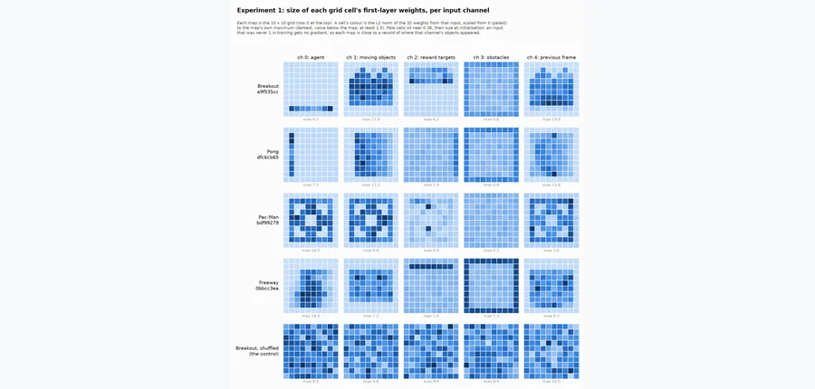 arXiv 2026-11-17 · cs.CL · #29 **[Replicating and Extending Weight-Space Programming: Frontier LLMs Compile Programs into Weights and Read Input Layers](https://arxiv.org/abs/2611.21449)** Roksana Goworek , Alexander Hickey , Federico Nanni , Martin O'Reilly Affiliation · The Alan Turing Institute [Paper](https://arxiv.org/abs/2611.21449) · [Figure source](https://arxiv.org/html/2611.21449v1/figures/human_heatmaps_clean.png) 

[EN] Abstract
Researchers at MIT recently reported that GPT-6 Astra, a frontier large language model (LLM), can write the weights of small neural networks directly in a single reply, and can read the raw weights of small networks to say what they were trained to do. In a three-day sprint, we replicated and extended these results. Our four findings: (1) Writing weights reproduces. Astra's networks for the game Breakout scored 514, 550 and 307 (versus MIT's 517), and scored just as well on two modified versions of Breakout. Claude Opus 5.5 can also write working networks, but often runs out of output tokens. (2) What is new is translating programs into weights. Earlier models could write a good policy as code a generation before they could write network weights, and the networks the models write behave like compiled programs: two models independently decompiled Astra's Breakout network into Python matching its actions in all tested states. On classifying handwritten digits, Astra's networks scored 50% on average, below a simple classifier (82%). (3) Reading weights is mostly reading the input layer. Astra and Opus 5.5 identify which game a network plays almost perfectly, but on three new games we designed and trained ourselves, Astra recovered where things are on the board, while mostly missing how the game works. (4) Auditing from weights alone is possible but shallow. Without executing code, Astra picked out a small language model poisoned during training in 10 of 10 runs, one poisoned by extra training afterwards in 7 of 10, and a malicious adapter in 23 of 32 cases, but never identified the trigger or malicious behaviour. Open-weight models lag behind. From this early study, we conclude that LLMs can read and write small networks, but that this currently amounts to compiling hand-designed programs and reading the layout of the input layer. It is a promising but early tool for interpretability. <a href="https://arxiv.org/list/cs/new?show=2000#2611.21449">Source</a>

[ZH] Abstract
MIT研究人员最近报告，前沿大语言模型（LLM）GPT-6 Astra能够在一次回复中直接写出小型神经网络的权重，也能读取小型网络原始权重并判断其训练目的。我们在三天冲刺中复现并扩展了这些结果。四项发现如下：（1）写权重可以复现。Astra为Breakout游戏编写的网络得分为514、550和307（MIT为517），在两种修改版Breakout中也同样出色。Claude Opus 5.5也能编写有效网络，但经常耗尽输出token。（2）新能力是将程序翻译为权重。更早的模型在能够写网络权重的前一代就能将好策略写成代码，模型编写的网络也表现得像编译程序：两个模型独立将Astra的Breakout网络反编译为Python，在所有测试状态中动作完全匹配。在手写数字分类上，Astra网络平均得分50%，低于简单分类器（82%）。（3）读取权重主要是读取输入层。Astra和Opus 5.5几乎完美识别网络所玩游戏，但在我们自行设计和训练的三款新游戏上，Astra恢复出棋盘上物体的位置，却大多未理解游戏规则。（4）仅凭权重审计是可能的，但很浅。无需执行代码，Astra在10/10次运行中识别出训练时被投毒的小语言模型，在7/10次中识别出后续额外训练投毒的模型，在23/32次中识别恶意适配器，却从未识别触发器或恶意行为。开放权重模型落后。基于这项早期研究，我们认为LLM能够读写小型网络，但当前主要相当于编译手工设计的程序、读取输入层布局。这是有前景但仍处早期的可解释性工具。 <a href="https://arxiv.org/list/cs/new?show=2000#2611.21449">Source</a>
 | 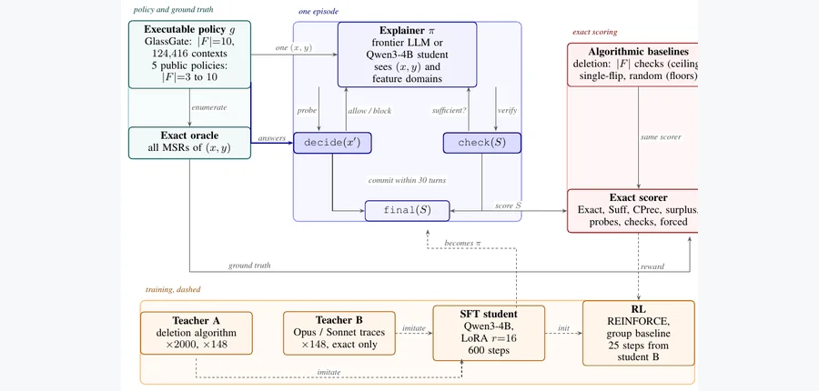 arXiv 2026-11-17 · cs.AI · #30 **[Procedure without Judgment: What Small Language Models Learn under an Exact Verifier](https://arxiv.org/abs/2611.21529)** Arunkumar V , Manoranjan Gandhudi , Gangadharan G. R. , Arun Prakash , S. Senthilkumar Affiliation · Anna University / Central University of Karnataka / NIT Tiruchirappalli / Jawaharlal Nehru University [Paper](https://arxiv.org/abs/2611.21529) · [Figure source](https://arxiv.org/pdf/2611.21529) 

[EN] Abstract
When an authorization policy blocks an agent's tool call, the audit log should name the facts that forced the decision and nothing more. For an executable policy over an enumerable context space this minimal sufficient reason can be computed exactly, so an explanation is scored against ground truth rather than a proxy for it. We use that exactness to ask what a model can learn from a verifier that has no error in it. The explainer sees one request and one decision, never the policy, and has thirty turns in which it may call the policy on altered requests and ask whether a candidate set of facts is sufficient. Frontier models find the exact reason about half the time with the tools alone, and one sentence telling them to shrink the answer lifts Haiku 4.5 from 58% to 75%. A 4B model fine-tuned on 2000 traces of the deletion algorithm reaches 92% on the policy it was trained on. Teacher kind is what moves this: at matched data size the algorithm-taught student leads the frontier-taught one in all three training seeds, and the two arms never overlap. What the student learns is a fixed schedule of sufficiency checks, and the schedule does not travel. On three public policies it never saw, its answers stay sufficient (94%) and stop being minimal (48%), while Haiku under the same sentence is exact on all 47 episodes. Reinforcement learning from the exact reward leaves held-out accuracy where it was and inverts the strategy, from probing the policy to spending the entire budget on sufficiency checks. The oracle made the effect of training legible, but it did not make training better. <a href="https://arxiv.org/list/cs/new?show=2000#2611.21529">Source</a>

[ZH] Abstract
当授权策略阻止代理工具调用时，审计日志应只指出强制产生该决策的事实。对于定义在可枚举上下文空间上的可执行策略，这种最小充分理由可以精确计算，因此解释的评分依据是真值而非代理指标。我们利用这一精确性，研究模型能够从无误差验证器中学到什么。解释器只看到一个请求和一个决策，从不看到策略；它有三十轮机会，可在修改后的请求上调用策略，并询问候选事实集是否充分。前沿模型仅用工具大约一半时间能找到精确理由；一句要求缩小答案的指令，就将Haiku 4.5从58%提高到75%。在删除算法的2000条轨迹上微调的4B模型，在训练所用策略上达到92%。真正驱动变化的是教师类型：相同数据量下，算法教师训练的学生在全部三个训练种子中领先于前沿模型教师训练的学生，两组结果从不重叠。学生学到的是固定的充分性检查顺序，这个顺序无法迁移。在三个从未见过的公共策略上，其答案仍然充分（94%），却不再最小（48%）；相同一句指令下，Haiku在全部47个回合中都精确。来自精确奖励的强化学习没有改变留出准确率，却使策略反转：从探测策略，变为把全部预算用于充分性检查。Oracle让训练的效果清晰可见，却没有让训练变得更好。 <a href="https://arxiv.org/list/cs/new?show=2000#2611.21529">Source</a>
 |
| 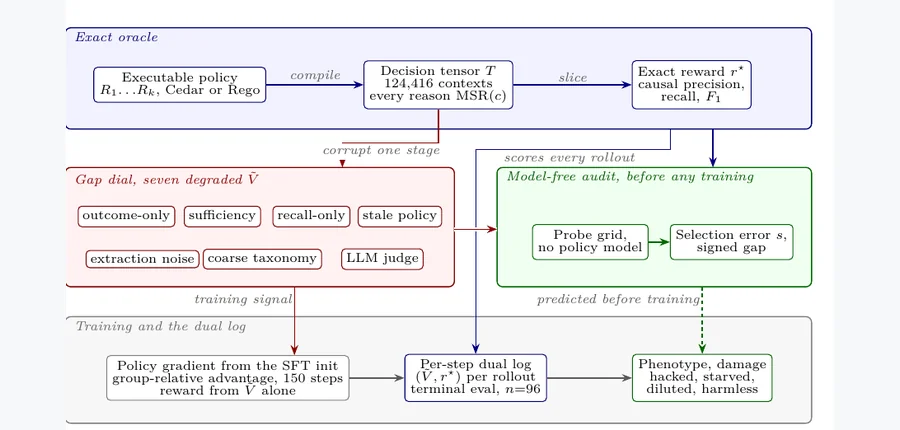 arXiv 2026-11-17 · cs.LG · #31 **[Optimistic Verifiers Get Hacked: Reward Hacking Under an Exact Process Oracle](https://arxiv.org/abs/2611.21538)** Arunkumar V , Manoranjan Gandhudi , Gangadharan G. R. , Arun Prakash , S. Senthilkumar Affiliation · University College of Engineering, BIT Campus, Anna University / Central University of Karnataka / National Institute of Technology Tiruchirappalli / Jawaharlal Nehru University [Paper](https://arxiv.org/abs/2611.21538) · [Figure source](https://arxiv.org/pdf/2611.21538) 

[EN] Abstract
Reinforcement learning from verifiable rewards inherits whatever its verifier gets wrong. Outside mathematics and code the verifier is a proxy, a rubric, a learned judge or a hand-written checker, and its distance from the true objective is never measured, so a rising reward cannot be told apart from a hack. We build a setting where the true reward is exactly computable at the process level: executable authorization policies over 124,416 contexts admit an oracle that lists every minimal sufficient reason for every decision. We compile these policies into exact process rewards, degrade the verifier along seven realistic axes (outcome-only, sufficiency, recall-only, extraction noise, coarse taxonomy, stale policy, LLM judge), and train against each while the exact verifier scores every rollout. Four phenotypes appear. Optimistic verifiers are hacked by padding: the sufficiency proxy ends at 0.940 while true faithfulness falls from 0.731 to 0.667 on 96 held-out episodes. Outcome-only verifiers saturate and stop teaching, noise dilutes, and ranking-preserving gaps do no harm. A model-free audit of the verifier, its selection error and gap sign, together with a short saturation pilot, anticipates which phenotype a run will produce. Across nine configurations spanning two frameworks, two model vendors, two adapter sizes, three precisions, two initialisations and two seeds, the phenotypes recur, sufficiency damage is positive in all 10 replication cells and beyond two standard errors in 7, and optimistic gaps remain the steeper branch. The damage magnitude does not replicate, and five pre-registered attempts to explain it are reported as they fell. We release the testbed, the training instrumentation, and 14 real public policies (Cedar, OPA, Gatekeeper) ported to executable oracles. <a href="https://arxiv.org/list/cs/new?show=2000#2611.21538">Source</a>

[ZH] Abstract
基于可验证奖励的强化学习会继承验证器的所有错误。在数学和代码之外，验证器是代理指标、评分量表、学习评判者或手写检查器；它与真实目标的距离从未被测量，因此无法区分奖励上升与投机取巧。我们构建一种在过程层面精确计算真实奖励的场景：定义在124,416种上下文上的可执行授权策略，允许oracle列举每个决策的全部最小充分理由。我们将这些策略编译为精确过程奖励，沿七个现实维度削弱验证器（仅结果、充分性、仅召回、提取噪声、粗粒度分类、过时策略、LLM评判者），分别以其训练，同时由精确验证器评分每条轨迹。出现四种表型。乐观验证器遭到填充式攻击：充分性代理最终达到0.940，而在96个留出回合上，真实忠实度从0.731降至0.667。仅结果验证器饱和并停止提供学习信号，噪声稀释信号，而保持排序的偏差无害。对验证器的无模型审计——选择错误和偏差符号——结合简短饱和试验，可预判运行产生哪种表型。在涵盖两个框架、两家模型提供商、两种适配器大小、三种精度、两种初始化和两个种子的九种配置中，这些表型反复出现；充分性损害在全部10个复现单元中为正，其中7个超过两个标准误，乐观偏差仍是更陡的分支。损害幅度无法复现，我们如实报告五次预注册解释尝试的结果。我们发布测试平台、训练测量工具，以及移植成可执行oracle的14项真实公共策略（Cedar、OPA、Gatekeeper）。 <a href="https://arxiv.org/list/cs/new?show=2000#2611.21538">Source</a>
 |   |   |
<!-- PAPER_CARDS_END -->

## Retrieval overview

**31 selected papers, comprising 10 A / 11 B / 10 C.** Collected on **18 November 2026 (Beijing)** from the official **Tuesday, 17 November 2026** announcement batch. Canonical first-page requests completed at approximately **09:03:50 Beijing**. The CS continuation and supported first-page confirmations completed at **09:09:54–55 Beijing**. [Run record](../../data/runs/2026-11-18.json)

| Official source | Batch | New | Cross | Replacement | Coverage |
|---|---|---:|---:|---:|---|
| [Computer Science](https://arxiv.org/list/cs/new?show=2000) | 2026-11-17 | 1467 | 170 | 937 | All 2574 entries across two pages |
| [stat.ML](https://arxiv.org/list/stat.ML/new?show=2000) | 2026-11-17 | 25 | 31 | 59 | All 115 entries on one page |
| Total | 2026-11-17 | 1492 | 201 | 996 | All 2689 entries, 1492 distinct New IDs |

The first CS page contains all 1467 New entries, 170 Cross-listings and 363 replacements. Its [continuation page](https://arxiv.org/list/cs/new?skip=2000&show=2000) supplies the remaining 574 replacements. Supported skip=0 confirmations with a no-cache request header reproduce first-page dates, ordered IDs and section counts. Cache Date/Age/hit headers remain recorded. Origin regeneration is unverified. [Run record](../../data/runs/2026-11-18.json)

Complete metadata and original English abstracts for all **1492 New IDs** are retained. Discovery produced **196 lexical candidates** and **428 supplemental related-title records**. Focused full-abstract review logged **38 decisions**, yielding 31 selections and seven omissions. This does not constitute full-abstract review of every New entry. The CS aggregate covers cs.AI, cs.LG, cs.CL, cs.MA, cs.SE, cs.RO, cs.CV, cs.NE and cs.CR. Selected IDs were checked against historical enrichment, reports and run records. [Run record](../../data/runs/2026-11-18.json)

The previous run processed the 16 November batch, so the current observed weekday batch follows it directly. Current source retrieval and pagination are complete. The historical **22 October bulk-New membership gap remains unresolved**. [Previous run](../../data/runs/2026-11-17.json) · [Run record](../../data/runs/2026-11-18.json)

Coverage is **31 rows / 31 cards / 31 complete EN abstracts / 31 complete ZH abstracts**. All cards have independent language disclosures and visually checked source figures: **20 HTML images and 11 PDF crops**, with **zero placeholders**. One overall affiliation record remains **Affiliation unconfirmed** because two author markers have no institution text. [Run record](../../data/runs/2026-11-18.json)

## Reading guide

A denotes direct RSI, B self-improvement mechanisms, and C evaluation and limits. Order is tier followed by arXiv ID. Selection, tiering, priorities, mechanism interpretation and research proposals are **editorial inference**. Numerical findings remain **author reports**. Review covers complete original abstracts, author blocks, figures, linked resources and selected paper passages. Independent reproductions performed for this issue total **zero**.

SIM retains improvement history for the harness optimizer. Trident updates memory use, candidate routing and patches. Synapse repairs source-linked skill spans with regression tests. ELITE changes the executable agent while withholding downstream candidate task outcomes from its evolution loop. These are distinct external update mechanisms. [SIM](https://arxiv.org/abs/2611.18856) · [Trident](https://arxiv.org/abs/2611.18585) · [Synapse](https://arxiv.org/abs/2611.20856) · [ELITE](https://arxiv.org/abs/2611.21056)

RSIMed couples proposer context with diagnostic-model learning. RoboCoEvo couples executable recovery programs with VLA weights. TrainExplorer revises post-training strategies. RepoFactory evolves training environments using proxies, with downstream model gains assessed separately. CLAM performs serving-time adapter consolidation through a previously trained hypernetwork. [RSIMed](https://arxiv.org/abs/2611.18646) · [RoboCoEvo](https://arxiv.org/abs/2611.19081) · [TrainExplorer](https://arxiv.org/abs/2611.20430) · [RepoFactory](https://arxiv.org/abs/2611.21152) · [CLAM](https://arxiv.org/abs/2611.20759)

Experience Rot challenges retained knowledge under silent interface changes. The critic audit measures the damage of directional feedback. Exact-verifier studies separate reward fidelity, procedural learning and transfer. PAC-Bayes certificates address adaptive recipe selection. Two weight-space programming papers report replications and mechanism limits. These findings constrain what a local improvement loop establishes. [Experience Rot](https://arxiv.org/abs/2611.20922) · [Critic audit](https://arxiv.org/abs/2611.19037) · [Procedure](https://arxiv.org/abs/2611.21529) · [Verifier gaps](https://arxiv.org/abs/2611.21538) · [Certificates](https://arxiv.org/abs/2611.21241) · [Claude replication](https://arxiv.org/abs/2611.20953) · [Replication and extension](https://arxiv.org/abs/2611.21449)

## Tiered Top papers

| # | Paper | Categories | Authors | Affiliation | Tier | Update target | Reading priority |
|---:|---|---|---|---|---|---|---|
| 1 | [Read, Route, Patch: Robust Test-Time Evolution for LLM Agents](https://arxiv.org/abs/2611.18585) | Computation and Language (cs.CL) | Kaijie Chen , Liang Yan , Yilan Wei , Jiachen Luo , Zhihao Dou , Jiashu Qu , Haoran Liu , Junli Wang | Affiliation unconfirmed | A | External agent harness, retrieved experience and ordered patches | Topical reference |
| 2 | [RSIMed: Scaling Medical Foundation Models beyond Limited Clinical Data via Retrieval-Grounded Self-Evolution](https://arxiv.org/abs/2611.18646) | Machine Learning (cs.LG) ; Artificial Intelligence (cs.AI) | Wei Dai , Qianchu Liu , Guanghui Qin , Xing Han , Tristan Naumann , Sheng Zhang , Paul Pu Liang | Massachusetts Institute of Technology / Microsoft Research / Johns Hopkins University | A | Diagnostic model weights and an in-context task proposer | Topical reference |
| 3 | [Self-Improvement Memory Enables Continual Recursive Self-Improvement](https://arxiv.org/abs/2611.18856) | Machine Learning (cs.LG) ; Artificial Intelligence (cs.AI) | Xin Yu , Fei Xia , Jiaqi Pan , Youbao Tang , Chengzhi Liu , Adams Yu , Sicong Jiang , Yanfei Chen , Lingzhou Xue , Ting Yu | Google Cloud AI / The Pennsylvania State University / Google DeepMind / Google Cloud AI Research | A | An external harness and the harness optimizer’s persistent improvement memory | Priority read |
| 4 | [RoboCoEvo: Expanding Robot Capabilities through Agent-Policy Co-Evolution](https://arxiv.org/abs/2611.19081) | Robotics (cs.RO) | Ran Qi , Yixin Xiao , Dawei Wang , Zhiyuan Li , Jinbang Huang , Xuan Zhao , Yintao Ma , Yangzheng Wu , Tongtong Cao , Yingxue Zhang | University of Toronto / Huawei Noah’s Ark Lab / Department of Foundation Model, 2012 Labs | A | Reusable robot failure-detection/recovery programs and VLA weights | Topical reference |
| 5 | [CompoundingKernel: Self-Improving from Zero to First](https://arxiv.org/abs/2611.19230) | Artificial Intelligence (cs.AI) | Qian Qu , Hongyang Wang , Wenbo Chen , Yichuan Li , Jingguo Liu , Xian Li , Xuan Wang , Ruochen Wen , Leo Fan , Yiming Yan , Zheshen Wang , Benoit Dumoulin | Amazon | A | GPU kernel code, its lineage archive and the search harness | Topical reference |
| 6 | [Continuation-Guided LLM Evolution of Program Policies and Goal Compilers in Craftax](https://arxiv.org/abs/2611.19537) | Artificial Intelligence (cs.AI) | Víctor Gallego | Komorebi AI Technologies | A | Code policies, internal models and a reusable goal compiler | Topical reference |
| 7 | [TrainExplorer: Autonomous LLM Post-Training via Plan-and-Decouple Exploration](https://arxiv.org/abs/2611.20430) | Machine Learning (cs.LG) ; Computation and Language (cs.CL) | Xuannan Liu , Tian Lan , Zekun Li , Xing Cui , Zhengfeng Yu , Feihu Jiang , Qianghuai Jia , Longyue Wang , Zhao Xu , Weihua Luo , Peipei Li , Ran He | Beijing University of Posts and Telecommunications / Alibaba Group / Minzu University of China / Beijing Institute of Technology / Center for Research on Intelligent Perception and Computing, NLPR, CASIA | A | Post-training pipelines and the resulting language-model weights | Topical reference |
| 8 | [MetaAct: Self-Evolving Executable Action Constraints for Embodied Language Agents](https://arxiv.org/abs/2611.20655) | Computation and Language (cs.CL) | Jiaxing Zhao , Hanwen Wang , Di Liu , Shaoteng Liu , Jing-Ran Su , Yanheng Li , Qian Zha , Jiaxi Li , Hongbin Xie , Haoran Zhang , Xuan Song , Haoxuan Che | Jilin University / Southern University of Science and Technology / Northwestern Polytechnical University / The Hong Kong Polytechnic University / City University of Hong Kong / Peking University / XGEN Labs | A | Typed executable action guards outside the model | Topical reference |
| 9 | [Synapse: Optimizing Natural-Language Agent Skills through Program Repair](https://arxiv.org/abs/2611.20856) | Software Engineering (cs.SE) | Lijuan Li (Nanjing University), Zhenpeng Chen (Tsinghua University), Chenxi Zhang (Xidian University), Yihao Huang (East China Normal University), Yang Liu (Nanyang Technological University), Chong Wang (Nanyang Technological University) | Nanjing University / Tsinghua University / Xidian University / East China Normal University / Nanyang Technological University | A | Reusable natural-language skill source spans, with fixed model weights | Priority read |
| 10 | [Evaluation-Free Recursive Self-Improvement for Coding Agents](https://arxiv.org/abs/2611.21056) | Computation and Language (cs.CL) ; Neural and Evolutionary Computing (cs.NE) | Zhe Ren , Guowei Rong , Yimeng Chen , Nanbo Li , Piotr Piękos , Mateusz Ostaszewski , Dandan Guo , Jürgen Schmidhuber | Jilin University / King Abdullah University of Science and Technology (KAUST) | A | The coding agent’s executable implementation | Priority read |
| 11 | [Skill Transfer: Adapting Agent Skills from Strong to Weak Agents](https://arxiv.org/abs/2611.18624) | Computation and Language (cs.CL) ; Artificial Intelligence (cs.AI) | Yifan Lan , Hanyu Wang , Lu Lin , Jinghui Chen | The Pennsylvania State University | B | Model-specific reusable skill instructions, with fixed model parameters | Topical reference |
| 12 | [What to Practice Next? Latent Profile-Guided Task Selection for Skill-Evolving LLM Agents](https://arxiv.org/abs/2611.18818) | Machine Learning (cs.LG) ; Artificial Intelligence (cs.AI) | Qijin Zhang , Hanzhen Wang , Yan Huang , Zhongxiang Dai , Shuang Qiu | City University of Hong Kong / Institute of Automation, Chinese Academy of Sciences / Five Ages / The Chinese University of Hong Kong, Shenzhen | B | Practice-task allocation for a persistent skill-evolution backend | Topical reference |
| 13 | [B-OPSD: On-Policy Self-Distillation with Self-Generated Problem Briefs](https://arxiv.org/abs/2611.19273) | Computation and Language (cs.CL) | Zhi Xu , Yinqi Wu , Feng Zhang , Xiaotong Zhang , Hong Yu , Han Liu | Dalian University of Technology | B | Student weights, with self-generated briefs as teacher context | Topical reference |
| 14 | [EfficientSkill: Learning Skills for Token-Efficient Multi-Turn Agents](https://arxiv.org/abs/2611.19823) | Computation and Language (cs.CL) ; Artificial Intelligence (cs.AI); Machine Learning (cs.LG) | Deep Shah , Sanket Badhe , Nehal Kathrotia , Priyanka Tiwari | Google LLC / Purdue University | B | Reusable skills, turn limits and workspace utility code | Topical reference |
| 15 | [Remember, Replay, Adapt: Learning from Past Experience in Online Vision-and-Language Navigation](https://arxiv.org/abs/2611.19901) | Computer Vision and Pattern Recognition (cs.CV) ; Artificial Intelligence (cs.AI) | Chenhao Ding , Jizhou Han , Lixin Xiu , Muyao Wang , Songlin Dong , Hideki Nakayama | The University of Tokyo / Xi’an Jiaotong University / Shenzhen University of Advanced Technology | B | Navigation policy weights and success/failure episodic memory | Topical reference |
| 16 | [CRAFT: A Robot-Agent Harness with Scope-Aware Adaptation](https://arxiv.org/abs/2611.19952) | Robotics (cs.RO) | Peng Zhang , Jiawen Wang , Cheng Xue , Jochen Renz | Australian National University | B | Requirement memory, explicit rules and a feedback-weighted requirement learner | Topical reference |
| 17 | [Instant Weight-Space Consolidation for Long-Term Memory in LLMs](https://arxiv.org/abs/2611.20759) | Computation and Language (cs.CL) | Manan Suri , Dinesh Manocha | University of Maryland, College Park | B | A carried low-rank adapter, fixed-size latent state and episodic buffer | Topical reference |
| 18 | [MemDoctor: Stage-wise Error Attribution and Repair for MLLM Agent Memory](https://arxiv.org/abs/2611.21019) | Computation and Language (cs.CL) | Ruiyang Jiang , Xinyang Liao , Weikai Huang , Yuqi Niu , Junjie Zhou , Yubin Zheng | Shanghai Jiao Tong University / Xi’an Jiaotong University / Xidian University | B | External multimodal memory at Write, Update or Retrieve stages | Topical reference |
| 19 | [ReuseMem: One Memory, Multiple Goals in Robot Manipulation](https://arxiv.org/abs/2611.21115) | Robotics (cs.RO) | Yoonseok Kang , Dayeon Jung , Seunghoon Jeon , Wonjib Kim , Dongchul Park | Chung-Ang University | B | Reusable visual memory and trained retrieval/action interfaces | Topical reference |
| 20 | [From Repositories to Training Environments: Scaling Long-Horizon Coding Agents with Environment Evolution Loop](https://arxiv.org/abs/2611.21152) | Computation and Language (cs.CL) | Yang Tian , Tianyu Zheng , Xiyuan Yang , Yaxin Du , Chengran Yang , Bo Zhao , Jian Yang , Bryan Dai | Beihang University / Shanghai Jiao Tong University / IQuest Research | B | Executable training environments and downstream coding-model weights | Topical reference |
| 21 | [Mitigating Catastrophic Forgetting with Physics-Indexed Specialist Memory: the Evolutionary Neuroplastic Agent](https://arxiv.org/abs/2611.21598) | Machine Learning (cs.LG) ; Artificial Intelligence (cs.AI); Neural and Evolutionary Computing (cs.NE) | Blas Eugenio Vicco Zarate , Miguel Hernán Vicco | Universidad Nacional del Litoral | B | Small neural policy weights and a physics-indexed specialist archive | Topical reference |
| 22 | [The Critic Can Hurt: On the Safety of Critics in LLM-Guided AutoML Search](https://arxiv.org/abs/2611.19037) | Machine Learning (cs.LG) ; Artificial Intelligence (cs.AI) | Gaoyuan Du , Xiaoyang Liu , Rex Zhou , Dengdu Jiang , Rong Fu , Meng Ding , Defu Cao | Amazon / Independent Researcher / University of Massachusetts Boston / University of Southern California | C | Audit and gating of critic-guided iterative search | Topical reference |
| 23 | [Information Limits of Replay-Free Recurrent State Migration](https://arxiv.org/abs/2611.19345) | Artificial Intelligence (cs.AI) ; Machine Learning (cs.LG) | Khizar Qureshi | MIT | C | Retained recurrent-state migration memory before an unknown model replacement | Topical reference |
| 24 | [Where Should LLM Agents Adapt at Test Time? In Context, in Weights, or Both](https://arxiv.org/abs/2611.19700) | Machine Learning (cs.LG) ; Artificial Intelligence (cs.AI); Computation and Language (cs.CL) | Parsa Mirtaheri , Mohammadreza Armandpour , Keivan Alizadeh , Iman Mirzadeh , Parshin Shojaee , Aryo Lotfi , David Harrison , Mehrdad Farajtabar | University of California, San Diego / Apple | C | Comparison of retained context and test-time weight adaptation | Topical reference |
| 25 | [Re-Reading Is Not Free: Token Traces and Cache-Aware Energy Estimation for LLM Agents in Software Engineering](https://arxiv.org/abs/2611.20873) | Software Engineering (cs.SE) ; Artificial Intelligence (cs.AI) | Tina Vartziotis , Ketevan Peranidze , Rodopi Kosteli , Ezgi Sarikayak , George Dasoulas , Michael Keckeisen , Sotirios Kotsopoulos , Francesca Dominici | TWT GmbH Science & Innovation / National Technical University of Athens / Harvard University / Massachusetts Institute of Technology / NIKI Digital Engineering / Technical University of Munich / Siemens Research | C | Accounting boundaries for persistent context and delegated execution | Topical reference |
| 26 | [Experience Rot: Experienced Agents Fail Where Novices Succeed](https://arxiv.org/abs/2611.20922) | Computation and Language (cs.CL) ; Artificial Intelligence (cs.AI); Machine Learning (cs.LG) | Zhen Xu , Hang Yin , Zitao Zhang , Kevin Zhao , Xuefeng Liu | University of Chicago / eBay / University of Florida | C | Failure boundary of retained histories, files, notes and skills | Priority read |
| 27 | [Same Fix, Different Weights: Replicating Weight-Space Programming with Claude](https://arxiv.org/abs/2611.20953) | Machine Learning (cs.LG) | Subham Kundu (TCG Crest) | TCG Crest | C | Reported replication of direct neural-weight reading, writing and editing | Topical reference |
| 28 | [Anytime-Valid PAC-Bayes Certificates for Adaptive Test-Time Scaling](https://arxiv.org/abs/2611.21241) | Machine Learning (cs.LG) ; Computation and Language (cs.CL); Machine Learning (stat.ML) | Xiaoyu Li , Jiangxuan Long | University of New South Wales / The University of Hong Kong | C | Validity of adaptive selection over inference recipes and budgets | Topical reference |
| 29 | [Replicating and Extending Weight-Space Programming: Frontier LLMs Compile Programs into Weights and Read Input Layers](https://arxiv.org/abs/2611.21449) | Computation and Language (cs.CL) ; Artificial Intelligence (cs.AI) | Roksana Goworek , Alexander Hickey , Federico Nanni , Martin O'Reilly | The Alan Turing Institute | C | Reported replication and mechanism audit of weight-space programming | Topical reference |
| 30 | [Procedure without Judgment: What Small Language Models Learn under an Exact Verifier](https://arxiv.org/abs/2611.21529) | Artificial Intelligence (cs.AI) ; Computation and Language (cs.CL); Machine Learning (cs.LG) | Arunkumar V , Manoranjan Gandhudi , Gangadharan G. R. , Arun Prakash , S. Senthilkumar | Anna University / Central University of Karnataka / NIT Tiruchirappalli / Jawaharlal Nehru University | C | Learned explanation procedures under an exact authorization-policy oracle | Topical reference |
| 31 | [Optimistic Verifiers Get Hacked: Reward Hacking Under an Exact Process Oracle](https://arxiv.org/abs/2611.21538) | Machine Learning (cs.LG) ; Artificial Intelligence (cs.AI); Computation and Language (cs.CL) | Arunkumar V , Manoranjan Gandhudi , Gangadharan G. R. , Arun Prakash , S. Senthilkumar | University College of Engineering, BIT Campus, Anna University / Central University of Karnataka / National Institute of Technology Tiruchirappalli / Jawaharlal Nehru University | C | Reward-verifier fidelity and the learned policy’s behavior | Priority read |

## Mechanism and evidence notes

Each paper has four notes covering the update target, feedback, validation and reuse, reported findings, and evidence limits.

### 1. Read, Route, Patch: Robust Test-Time Evolution for LLM Agents

- **Updated component.** External agent harness, retrieved experience and ordered patches.
- **Feedback, validation and reuse.** Trident reads memories by relevance, usefulness and boundary differences, routes behaviorally diverse harness candidates, and inserts ordered local patches. Execution returns inform the next retained harness and memory retrieval.
- **Author-reported findings.** Across five benchmarks and three backbones, relative average gains over APEX are 30.7%, 30.8% and 38.3%. Ablations report complementary contributions from the three components.
- **Evidence boundary and inference.** The reported loop changes external artifacts without gradient updates. Finite text-game, web and coding tests do not establish open-ended recursive gains. The PDF leaves the eta institution marker unresolved for two authors.

[Original paper](https://arxiv.org/abs/2611.18585) · [Affiliation source](https://arxiv.org/pdf/2611.18585)

### 2. RSIMed: Scaling Medical Foundation Models beyond Limited Clinical Data via Retrieval-Grounded Self-Evolution

- **Updated component.** Diagnostic model weights and an in-context task proposer.
- **Feedback, validation and reuse.** A frozen solver copy proposes clinical questions grounded in retrieved medical evidence. Live solver errors steer topic and difficulty, and judged rollouts train the solver for subsequent proposal rounds.
- **Author-reported findings.** RSIMed-27B and 9B reach diagnostic accuracy 0.516 and 0.488 on the reported MIMIC-IV setting. The 27B HealthBench Professional adjusted score rises from 0.291 to 0.303.
- **Evidence boundary and inference.** Retrieval grounding supports answer keys but is not a universal clinical correctness oracle. Claims concern retrospective records and benchmarks. No prospective clinical deployment or independent reproduction is established.

[Original paper](https://arxiv.org/abs/2611.18646) · [Affiliation source](https://arxiv.org/html/2611.18646)

### 3. Self-Improvement Memory Enables Continual Recursive Self-Improvement

- **Updated component.** An external harness and the harness optimizer’s persistent improvement memory.
- **Feedback, validation and reuse.** SIM groups proposals by recurring harness problem and retains rationale, predicted versus observed outcomes and evaluation context. Later optimization reuses this history across compatible datasets or policy models, adding new evidence as it continues.
- **Author-reported findings.** Across four domains, SIM improves final continuation scores over harness-only and root-cause-only baselines. Ten independent coding source runs yield a paired mean gain of 2.36 points over harness-only continuation, p=0.003.
- **Evidence boundary and inference.** The memory belongs to the optimizer, not the task-solving actor. Shared executable interfaces and compatible continuation settings constrain transfer. Tested source-target transitions do not demonstrate indefinitely compounding improvement.

[Original paper](https://arxiv.org/abs/2611.18856) · [Affiliation source](https://arxiv.org/html/2611.18856)

### 4. RoboCoEvo: Expanding Robot Capabilities through Agent-Policy Co-Evolution

- **Updated component.** Reusable robot failure-detection/recovery programs and VLA weights.
- **Feedback, validation and reuse.** Code-as-policy agents refine executable detection and recovery routines from failures. Their corrective experience post-trains the robotic foundation model, whose changed failure distribution guides the next program revisions.
- **Author-reported findings.** Successive co-evolution rounds improve autonomous VLA performance on BEHAVIOR-1K, RoboCasa and RoboTwin in the authors’ experiments.
- **Evidence boundary and inference.** Programs and weights are distinct update channels. These benchmark results concern the evaluated simulated environments, and do not establish physical-robot reliability or unbounded capability growth.

[Original paper](https://arxiv.org/abs/2611.19081) · [Affiliation source](https://arxiv.org/html/2611.19081)

### 5. CompoundingKernel: Self-Improving from Zero to First

- **Updated component.** GPU kernel code, its lineage archive and the search harness.
- **Feedback, validation and reuse.** An LLM controller reads a per-problem archive of correct kernels, chooses parents or new designs and directs parallel child searches. External correctness checks and reliable timing admit reusable kernels. Warm restarts also revise search operation.
- **Author-reported findings.** The paper reports first place on three public SOL-ExecBench boards as of 11 November, 235 site-verified correct kernels, and 4.40x reference speed on 209 public-board problems. Equal-time controller search beats a coded UCB-style tree on 35 of 38 problems.
- **Evidence boundary and inference.** Leaderboard standing is a dated author report, not a fresh leaderboard verification. The B200 setting and over a thousand simultaneous agents are substantial resources. “From zero” means no reference kernels or official scores, not an untrained language model. The New abstract leaves its release address as URL.

[Original paper](https://arxiv.org/abs/2611.19230) · [Affiliation source](https://arxiv.org/pdf/2611.19230)

### 6. Continuation-Guided LLM Evolution of Program Policies and Goal Compilers in Craftax

- **Updated component.** Code policies, internal models and a reusable goal compiler.
- **Feedback, validation and reuse.** A simulator feedback cascade progresses from episode outcomes to intermediate goals, saved-state branching and model audits. The controller is factored into a fixed interpreter and editable rule program. Short-task compiler searches then generate programs for new goals.
- **Author-reported findings.** In Craftax, final-stage arrival reaches about 50% and final-boss defeat 28%, compared with less than 1% arrival under episode-level feedback. Five compiler searches transfer to longer goals without task-specific tuning or inference-time LLM calls.
- **Evidence boundary and inference.** This is simulator-driven program synthesis with a fixed deployment machine. Checkpoint ancestry, feedback scope and reserved worlds matter when interpreting gains. Zero deployment LLM calls excludes the cost of developing policies and compilers.

[Original paper](https://arxiv.org/abs/2611.19537) · [Affiliation source](https://arxiv.org/pdf/2611.19537)

### 7. TrainExplorer: Autonomous LLM Post-Training via Plan-and-Decouple Exploration

- **Updated component.** Post-training pipelines and the resulting language-model weights.
- **Feedback, validation and reuse.** TrainExplorer builds a strategy search space from scientific literature. Planning, implementation, training and critique use single-component interventions, while an experience library and memory bank retain results and attributions for later strategy exploration.
- **Author-reported findings.** On PostTrainBench, the weighted score is 39.02, 7.32 above Claude Code with the same LLM and above the reported GPT-5.6 Sol Codex score of 36.23.
- **Evidence boundary and inference.** The comparison is benchmark- and budget-specific. Decoupling supports attribution but does not by itself prove causal isolation under all training interactions. The paper promises future code, so no release button is inferred.

[Original paper](https://arxiv.org/abs/2611.20430) · [Affiliation source](https://arxiv.org/html/2611.20430)

### 8. MetaAct: Self-Evolving Executable Action Constraints for Embodied Language Agents

- **Updated component.** Typed executable action guards outside the model.
- **Feedback, validation and reuse.** MetaAct synthesizes Grounded Executable Action Rules from execution feedback, compiles them into deterministic guards and validates them by offline trajectory replay. Retained guards constrain admissible actions during later episodes.
- **Author-reported findings.** On ScienceWorld and WebShop, reported violation rates fall from 70% to 0% and 40% to 1%, with score gains of 10.1 and 8.0. Four benchmarks are evaluated.
- **Evidence boundary and inference.** Replay validation requires no additional model calls or environment interactions, but its evidence is limited to replay coverage. A deterministic guard enforces its specification rather than proving that every synthesized rule is correct on unseen states.

[Original paper](https://arxiv.org/abs/2611.20655) · [Affiliation source](https://arxiv.org/html/2611.20655)

### 9. Synapse: Optimizing Natural-Language Agent Skills through Program Repair

- **Updated component.** Reusable natural-language skill source spans, with fixed model weights.
- **Feedback, validation and reuse.** A deterministic partial compiler maps recognized skill constructs to source-linked SkIR. Execution traces and control/dependence relations localize faults and choose typed mutations plus related regression tests. Patches are written back, recompiled and accepted by validation.
- **Author-reported findings.** Reported gains over SkillOpt are 3.74–4.54 points on DocVQA and 2.40–4.00 on LiveMath. In two recorded repairs, structural relations add tests for 23 of 37 patches, including a regression missed by edited-instruction coverage.
- **Evidence boundary and inference.** The program view is partial. The affected-test coverage guarantee assumes one-hop-local execution. Preserving untargeted text spans ensures source integrity rather than universal semantic correctness.

[Original paper](https://arxiv.org/abs/2611.20856) · [Affiliation source](https://arxiv.org/html/2611.20856)

### 10. Evaluation-Free Recursive Self-Improvement for Coding Agents

- **Updated component.** The coding agent’s executable implementation.
- **Feedback, validation and reuse.** ELITE implements diverse proposals from the same parent, inspects complementary and conflicting mechanisms, and integrates a compatible subset into one descendant. Deterministic structural and operational checks gate retention for subsequent generations.
- **Author-reported findings.** Post-hoc SWE-bench Pro performance rises from 60.0% to 85.6%, versus 86.7% DGM and 88.3% HGM. Candidate task evaluations are zero. Observed evolution time is 8.8x and 3.2x shorter, respectively, in the evaluated configurations.
- **Evidence boundary and inference.** “Evaluation-free” excludes downstream candidate task evaluation inside evolution. Deterministic validity checks remain, and benchmark outcomes are measured afterwards. Transfer means are 73.3% on SWE-bench Verified and 69.3% on Polyglot without further adaptation.

[Original paper](https://arxiv.org/abs/2611.21056) · [Affiliation source](https://arxiv.org/html/2611.21056)

### 11. Skill Transfer: Adapting Agent Skills from Strong to Weak Agents

- **Updated component.** Model-specific reusable skill instructions, with fixed model parameters.
- **Feedback, validation and reuse.** Strong and weak trajectories are abstracted into typed execution structures. Graph-edit divergence localizes implicit procedural gaps, and an iterative diagnoser-patcher loop repairs the skill, retaining validation-selected versions.
- **Author-reported findings.** Across three benchmarks and two model families, adapted skills outperform unmodified skills and reported evolution baselines. Gains also transfer to the strong agent and a structurally related unseen task.
- **Evidence boundary and inference.** The aim is to realize a skill’s existing capability ceiling on a weaker model. This is external instruction adaptation, and the reported out-of-distribution transfer is structurally related rather than arbitrary task transfer.

[Original paper](https://arxiv.org/abs/2611.18624) · [Affiliation source](https://arxiv.org/html/2611.18624)

### 12. What to Practice Next? Latent Profile-Guided Task Selection for Skill-Evolving LLM Agents

- **Updated component.** Practice-task allocation for a persistent skill-evolution backend.
- **Feedback, validation and reuse.** MIRT infers multidimensional proficiency from binary outcomes. SPG-Select-R allocates practice using predicted profile progress, proficiency gaps, uncertainty exploration and periodic restarts. Backend skill updates then change the evidence for later allocations.
- **Author-reported findings.** Held-out terminal success exceeds uniform sampling in all six benchmark-backend combinations. Gains are 1.49–13.18 points on ALFWorld and 0.93–3.13 on WebShop.
- **Evidence boundary and inference.** The dynamic pseudo-regret bound is for surrogate allocation under a predictable linear surrogate and boundedness assumptions. It does not certify actual task success or arbitrary nonstationary evolution.

[Original paper](https://arxiv.org/abs/2611.18818) · [Affiliation source](https://arxiv.org/html/2611.18818)

### 13. B-OPSD: On-Policy Self-Distillation with Self-Generated Problem Briefs

- **Updated component.** Student weights, with self-generated briefs as teacher context.
- **Feedback, validation and reuse.** The initial model or a saved student checkpoint writes principles, applicability conditions and pitfalls from the question. A frozen teacher conditioned on this brief supplies token distributions for on-policy student rollouts. Training retains updated student weights.
- **Author-reported findings.** Both B-OPSD variants outperform OPSD in average accuracy across AIME 2024, AIME 2025 and HMMT 2025 at three Qwen3 sizes, without ground-truth solutions during training.
- **Evidence boundary and inference.** A generated brief is privileged context, not a verified solution. The frozen-teacher and refreshed-brief variants should be distinguished from independently improving both teacher and student weights.

[Original paper](https://arxiv.org/abs/2611.19273) · [Affiliation source](https://arxiv.org/html/2611.19273)

### 14. EfficientSkill: Learning Skills for Token-Efficient Multi-Turn Agents

- **Updated component.** Reusable skills, turn limits and workspace utility code.
- **Feedback, validation and reuse.** EfficientSkill first finds a reliable skill without token penalties, then warm-starts accuracy-guarded pruning. It compresses instructions, bounds turns and offloads reusable code into utilities, retaining candidates under a validation-accuracy gate.
- **Author-reported findings.** Output tokens fall on 11 of 12 configurations, by up to 80%, while mean accuracy rises on every benchmark. Reported SpreadsheetBench gains include 14.3 and 17.5 points for two models.
- **Evidence boundary and inference.** Serving-token savings are distinct from optimization cost and can depend on caching and tool behavior. Accuracy guards are empirical and do not guarantee preservation on unseen tasks.

[Original paper](https://arxiv.org/abs/2611.19823) · [Affiliation source](https://arxiv.org/html/2611.19823)

### 15. Remember, Replay, Adapt: Learning from Past Experience in Online Vision-and-Language Navigation

- **Updated component.** Navigation policy weights and success/failure episodic memory.
- **Feedback, validation and reuse.** R2A stores successful and failed trajectories with feedback, retrieves instruction-relevant episodes, and reinforces successes while suppressing failures relative to a frozen pretrained policy. Drift regularization limits changes during subsequent online adaptation.
- **Author-reported findings.** Across three benchmarks and five backbones, gains are consistent. DUET on REVERIE validation-unseen improves success from 46.98% to 69.84% and SPL from 33.73% to 50.98%.
- **Evidence boundary and inference.** The evidence concerns the evaluated VLN adaptation protocol. “Without expert supervision” does not mean feedback-free learning, and online simulator gains do not establish physical navigation safety.

[Original paper](https://arxiv.org/abs/2611.19901) · [Affiliation source](https://arxiv.org/html/2611.19901)

### 16. CRAFT: A Robot-Agent Harness with Scope-Aware Adaptation

- **Updated component.** Requirement memory, explicit rules and a feedback-weighted requirement learner.
- **Feedback, validation and reuse.** CRAFT separates physical success from requirement acceptance. A scope ladder reuses near-identical judged cases, otherwise combining memory, rules and broader predictions according to earlier feedback. Robot execution tools stay frozen.
- **Author-reported findings.** Controlled utility improves over correction memory. Camera-grounded simulations require fewer questions than persistent-memory language agents, although some comparators make fewer wrong actions and recover better after requirement changes.
- **Evidence boundary and inference.** All evidence uses simulation, generated requirements and simulated feedback. Execution failures and timeouts remain counted. Reliable adaptation to changing requirements remains unresolved.

[Original paper](https://arxiv.org/abs/2611.19952) · [Affiliation source](https://arxiv.org/html/2611.19952)

### 17. Instant Weight-Space Consolidation for Long-Term Memory in LLMs

- **Updated component.** A carried low-rank adapter, fixed-size latent state and episodic buffer.
- **Feedback, validation and reuse.** A previously trained recurrent hypernetwork consolidates session activations into adapter weights in one forward pass. Gating carries latent knowledge across sessions, while an episodic buffer supplies exact detail at later queries.
- **Author-reported findings.** Across three 2–7B models, LoCoMo and LongMemEval-S gains span 1–45 points over agentic baselines and 10–45 over gradient-based parametric methods. Memory construction uses no generative LLM calls or gradient steps and reports 3–151x lower wall time than extraction systems.
- **Evidence boundary and inference.** Zero gradients refers to serving-time consolidation, not hypernetwork training. Fixed-size parametric state has finite capacity, and benchmark/teacher construction choices constrain generalization. Buffer-miss gains are 12–15 points and oracle-buffer gains 4–5.

[Original paper](https://arxiv.org/abs/2611.20759) · [Affiliation source](https://arxiv.org/pdf/2611.20759)

### 18. MemDoctor: Stage-wise Error Attribution and Repair for MLLM Agent Memory

- **Updated component.** External multimodal memory at Write, Update or Retrieve stages.
- **Feedback, validation and reuse.** MemDoctor traces required facts backwards through Write, Update, Retrieve and Answer. It accepts a diagnosis only when cited evidence exists in memory, repairs the attributed stage and answers again. Error injection uses fact-preserving control edits.
- **Author-reported findings.** A 4B backbone improves on Mem-Gallery and MemLens beyond all evaluated 8B baselines. The loop also improves MuRAG and A-Mem.
- **Evidence boundary and inference.** Citation existence supports diagnosis but does not establish truth of a corrupted record. This is targeted repair of external memory and answer execution, not evidence that the model’s weights improve.

[Original paper](https://arxiv.org/abs/2611.21019) · [Affiliation source](https://arxiv.org/html/2611.21019)

### 19. ReuseMem: One Memory, Multiple Goals in Robot Manipulation

- **Updated component.** Reusable visual memory and trained retrieval/action interfaces.
- **Feedback, validation and reuse.** ReuseMem records goal-independent visual features, learns retrieval through support for expert-action prediction, and combines selected evidence with the current scene. Duplicate features and unchanged memory computations are reused.
- **Author-reported findings.** Four simulation tasks and two physical scenarios show that a common recording supports different requests. With matched action adaptation, joint goal completion improves by 24.5 points over uniform memory.
- **Evidence boundary and inference.** This is learned memory reuse, rather than autonomous online evolution of the learning algorithm. Physical evidence is restricted to two scenarios, and retrieval supervision uses expert-action prediction.

[Original paper](https://arxiv.org/abs/2611.21115) · [Affiliation source](https://arxiv.org/html/2611.21115)

### 20. From Repositories to Training Environments: Scaling Long-Horizon Coding Agents with Environment Evolution Loop

- **Updated component.** Executable training environments and downstream coding-model weights.
- **Feedback, validation and reuse.** RepoFactory constructs repository runtimes, specifications and tests. An Environment Evolution Loop revises them using validity, structural coupling and implementation-scope proxies, retaining environments for subsequent agent training.
- **Author-reported findings.** The paper reports 10,159 environments across seventeen domains. Trained RepoHorizen gains 22.6 points on NL2Repo-Bench and 8.5 averaged over five benchmarks, versus 17.5 and 6.4 without environment evolution.
- **Evidence boundary and inference.** Environment selection uses proxy feedback, not repeated downstream training for each candidate. Proxy improvement and measured training benefit are separate evidence. The linked Hugging Face endpoint was not readable during this run.

[Original paper](https://arxiv.org/abs/2611.21152) · [Affiliation source](https://arxiv.org/html/2611.21152)

### 21. Mitigating Catastrophic Forgetting with Physics-Indexed Specialist Memory: the Evolutionary Neuroplastic Agent

- **Updated component.** Small neural policy weights and a physics-indexed specialist archive.
- **Feedback, validation and reuse.** ENA evolves specialists without gradients, detects changed dynamic regimes and archives selected policies. Bayesian policy reuse retrieves them later, while failure signals allocate further search effort.
- **Author-reported findings.** The full architecture reaches 83.2% mean success across five CartPole test environments in thirty replicates and shows comparatively consistent retention among variants that learn harder regimes.
- **Evidence boundary and inference.** The evidence supports the combined architecture. Adaptation is slower than PPO on CartPole and returns lower than SAC on HalfCheetah. Ablations do not isolate gradient-free search as the cause of retention or prove superiority to continual-learning methods.

[Original paper](https://arxiv.org/abs/2611.21598) · [Affiliation source](https://arxiv.org/html/2611.21598)

### 22. The Critic Can Hurt: On the Safety of Critics in LLM-Guided AutoML Search

- **Updated component.** Audit and gating of critic-guided iterative search.
- **Feedback, validation and reuse.** A four-arm audit isolates the critic’s marginal effect, while controlled fault injection tests directional versus nondirectional errors. Observable validation gates and learned detection can reject harmful feedback before later proposals consume search budget.
- **Author-reported findings.** A naive 8B critic underperforms no-critic random search on seven of eight tabular datasets, losing up to 0.245 AUC. Stronger critics attenuate harm on the tested suite.
- **Evidence boundary and inference.** The idealized condition q(m−1)>beta is necessary under its model, not a deployment certificate. Neither gate guarantees preserving a full-budget no-critic baseline. CRITFAULT is promised for release.

[Original paper](https://arxiv.org/abs/2611.19037) · [Affiliation source](https://arxiv.org/html/2611.19037)

### 23. Information Limits of Replay-Free Recurrent State Migration

- **Updated component.** Retained recurrent-state migration memory before an unknown model replacement.
- **Feedback, validation and reuse.** The theory characterizes causal auxiliary information needed to recover the state of a replacement affine-linear model without replay. Lifted coefficient, invariant-subspace and output-oriented constructions are compared in controlled experiments.
- **Author-reported findings.** Order-k local migration memory equals a reachable-dimension difference. A scalar-input d-state family needs at most kd additional real coordinates, sometimes already required by one rank-one direction. Eight history coordinates meet 1e-4 output error in a repeated-pole study, versus tested width sixty-four after splitting poles.
- **Evidence boundary and inference.** The theorem concerns time-invariant affine-linear families and local continuous information. State fidelity, finite-precision storage and predictive utility differ. Better language-model state fidelity yields no meaningful prediction gain in the reported diagnostic.

[Original paper](https://arxiv.org/abs/2611.19345) · [Affiliation source](https://arxiv.org/html/2611.19345)

### 24. Where Should LLM Agents Adapt at Test Time? In Context, in Weights, or Both

- **Updated component.** Comparison of retained context and test-time weight adaptation.
- **Feedback, validation and reuse.** A matched online protocol evaluates each task before adapting to it. Fourteen mechanisms compare ICL, GRPO and SDPO separately and together, using only agent attempts and environment feedback across task streams.
- **Author-reported findings.** With Qwen3.5-9B on 109 tasks in four environments and five orders each, best ICL lifts mean success from 28.8% to 49.4%. Adding GRPO reaches 51.6%, while SDPO effects vary.
- **Evidence boundary and inference.** ICL reduces lookups and attempt length but can skip fresh inspection and verification. GRPO partly restores these behaviors. One model and four tested environments do not establish universal preference for either update channel.

[Original paper](https://arxiv.org/abs/2611.19700) · [Affiliation source](https://arxiv.org/html/2611.19700)

### 25. Re-Reading Is Not Free: Token Traces and Cache-Aware Energy Estimation for LLM Agents in Software Engineering

- **Updated component.** Accounting boundaries for persistent context and delegated execution.
- **Feedback, validation and reuse.** API token traces are separated into generated, uncached and cached-context traffic. A cache-aware analytical estimator includes repeated context processing and checks delegated-token undercount against parent-session records.
- **Author-reported findings.** Across forty-two sessions and 752 tasks, cached reads comprise 94.8% of reported tokens. Analytical estimates are approximately 250 versus 10 kWh, and a fresh-context counterfactual lowers the authors’ estimate about 60%.
- **Evidence boundary and inference.** These energy values are unvalidated model estimates, not power measurements. The counterfactual is not an observed performance-preserving intervention. A single developer workload and log visibility limit generalization.

[Original paper](https://arxiv.org/abs/2611.20873) · [Affiliation source](https://arxiv.org/html/2611.20873)

### 26. Experience Rot: Experienced Agents Fail Where Novices Succeed

- **Updated component.** Failure boundary of retained histories, files, notes and skills.
- **Feedback, validation and reuse.** Controlled silent tool changes compare novice, valid-experience and stale-experience agents on the same final task. The study tracks whether agents inspect current definitions or replay prior calls, and tests update announcements and documentation hints.
- **Author-reported findings.** Experienced agents fail on most changed-interface tasks while novices mostly succeed. The failure appears across tested memory forms, grows with accumulated experience and often ends in an erroneous success report.
- **Evidence boundary and inference.** Experience Rot is a negative result about interface drift, not a demonstrated repair method. Simple reminders do not reliably cure it, especially with incomplete documentation. The scope is tested MCP-style tool changes.

[Original paper](https://arxiv.org/abs/2611.20922) · [Affiliation source](https://arxiv.org/html/2611.20922)

### 27. Same Fix, Different Weights: Replicating Weight-Space Programming with Claude

- **Updated component.** Reported replication of direct neural-weight reading, writing and editing.
- **Feedback, validation and reuse.** The author repeats weight-space probes with Claude Opus 5.5 using preregistered experiments, untrained/permuted controls and sandbox-cell audits. Budgeted practice forward passes guide language-model weight edits, followed by benchmark evaluation.
- **Author-reported findings.** MATH-500 rises from 6.7% to 58.1% at fifty practice passes. Policy repair and zero-shot controller compilation also succeed in tested settings. Final-norm scaling alone reaches only 20.9–22.1%.
- **Evidence boundary and inference.** This is the paper author’s replication report, not a replication performed by this digest. Qwen edits affect output scaling and Wait/end-thinking logits rather than the original internal-loop direction. Go opponents differ from the original, and the project’s $83.11 API total excludes GPU time. Project author/affiliation metadata differs from official paper metadata.

[Original paper](https://arxiv.org/abs/2611.20953) · [Affiliation source](https://arxiv.org/html/2611.20953)

### 28. Anytime-Valid PAC-Bayes Certificates for Adaptive Test-Time Scaling

- **Updated component.** Validity of adaptive selection over inference recipes and budgets.
- **Feedback, validation and reuse.** A time-uniform PAC-Bayes event jointly covers calibration times, posterior recipe mixtures and data-dependent stopping. Prior/posterior penalties account for search over recipes; self-consistency analysis separates unique-correct-mode cases from error amplification.
- **Author-reported findings.** The finite-grid worst-case penalty is log(M)/n. Synthetic and GSM8K audits show optimism in selected-best error bars. On a full GSM8K split the reported certificate is 0.109 against held-out risk 0.039.
- **Evidence boundary and inference.** The framework assumes its sampling model, bounded risks/costs and an appropriate prior fixed before the calibration transcript. It does not certify arbitrary distribution shift, flawed labels or a model modified outside the specified recipe family.

[Original paper](https://arxiv.org/abs/2611.21241) · [Affiliation source](https://arxiv.org/html/2611.21241)

### 29. Replicating and Extending Weight-Space Programming: Frontier LLMs Compile Programs into Weights and Read Input Layers

- **Updated component.** Reported replication and mechanism audit of weight-space programming.
- **Feedback, validation and reuse.** A three-day study repeats network writing and reading, tests modified/new games, compares code with weight outputs, decompiles policies and audits poisoned small models without executing them.
- **Author-reported findings.** Breakout networks score 514, 550 and 307 versus the original 517. Digit classifiers average 50% versus a simple 82% baseline. Poisoned-model detection can succeed, but triggers and malicious behaviors are not identified.
- **Evidence boundary and inference.** These are authors’ reported replications. Findings support compilation of hand-designed programs and input-layout reading in small networks. They do not demonstrate deep weight-only semantic understanding or recursive improvement of the editor itself.

[Original paper](https://arxiv.org/abs/2611.21449) · [Affiliation source](https://arxiv.org/html/2611.21449)

### 30. Procedure without Judgment: What Small Language Models Learn under an Exact Verifier

- **Updated component.** Learned explanation procedures under an exact authorization-policy oracle.
- **Feedback, validation and reuse.** An enumerable policy yields exact minimal sufficient reasons. Models query altered requests and sufficiency within thirty turns. Matched-size algorithm and frontier traces train a 4B student, with later exact-reward RL and held-out-policy tests.
- **Author-reported findings.** Algorithm-trace SFT reaches 92% on the training policy. On three unseen public policies, sufficiency remains 94% but minimality drops to 48%. A one-sentence instruction lifts Haiku 4.5 from 58% to 75% in the original setting.
- **Evidence boundary and inference.** An exact verifier makes errors measurable without guaranteeing useful learning. RL changes probe allocation without improving held-out accuracy. Learned check schedules transfer poorly, and exactness applies to the enumerated policy setting.

[Original paper](https://arxiv.org/abs/2611.21529) · [Affiliation source](https://arxiv.org/html/2611.21529)

### 31. Optimistic Verifiers Get Hacked: Reward Hacking Under an Exact Process Oracle

- **Updated component.** Reward-verifier fidelity and the learned policy’s behavior.
- **Feedback, validation and reuse.** An exact process oracle enumerates minimal reasons over 124,416 contexts. Seven degraded verifiers supply training rewards while the oracle independently scores each rollout. A pretraining audit examines selection error and signed verifier gaps.
- **Author-reported findings.** Under the sufficiency proxy, reward reaches 0.940 while true faithfulness falls from 0.731 to 0.667 on ninety-six held-out episodes. Qualitative damage phenotypes recur across nine configurations and ten replication cells.
- **Evidence boundary and inference.** The reported damage magnitude does not replicate, and five preregistered explanations fail. Exact authorization-policy ground truth permits unusually clean audits; it does not establish the same taxonomy for arbitrary open-world evaluators.

[Original paper](https://arxiv.org/abs/2611.21538) · [Affiliation source](https://arxiv.org/html/2611.21538)

## Priority reads

These five recommendations are **editorial inference**.

1. **SIM.** Trace one recurring harness problem from a source attempt to a target continuation. Inspect whether the memory explains why an inherited edit should be retained, revised or removed, and distinguish the optimizer’s memory from actor memory. [Paper](https://arxiv.org/abs/2611.18856)
2. **Synapse.** Follow one skill-source span through partial compilation, fault localization, typed mutation and regression-test selection. Check exactly where the one-hop-local assumption supports affected-test coverage. [Paper](https://arxiv.org/abs/2611.20856)
3. **ELITE.** Separate deterministic validity gates from post-hoc task evaluation. Inspect whether integration retains compatible mechanisms across generations, and assess measured time savings under the stated baselines and configurations. [Paper](https://arxiv.org/abs/2611.21056)
4. **Experience Rot.** Compare the same final task with no, valid and stale experience. Read interface visibility and incomplete documentation carefully before interpreting remembered behavior as beneficial adaptation. [Paper](https://arxiv.org/abs/2611.20922)
5. **Optimistic Verifiers Get Hacked.** Follow the true reward and degraded training proxy together. Inspect selection-error and gap-sign audits, qualitative replication and the failure to reproduce damage magnitude. [Paper](https://arxiv.org/abs/2611.21538)

## Research ideas for limited compute budgets

All four ideas are **unvalidated proposals and editorial inference**. Freeze a final task set before editing. Count candidate generation, rejected candidates, replay, training and evaluation within the same budget.

1. **Interface-conditioned improvement memory.** Attach a typed interface fingerprint and explicit applicability predicates to each retained harness patch or skill. When fingerprints change, generate counterfactual calls and invalidate only rules whose assumptions fail. Minimal experiment uses twelve deterministic MCP-style tools, four silent-change types and three seeds, comparing plain memory, an update announcement and predicate-gated memory under matched token budgets. Cap the study at 240 patch proposals, 1500 CPU executions and 300 small-model calls. Exact tool semantics keep validation inexpensive. Expected benefit is less negative transfer without discarding all experience. Risks include incomplete fingerprints and excessive invalidation, so include behavior changes with unchanged schemas and an unchanged-interface retention control. [SIM](https://arxiv.org/abs/2611.18856) · [Experience Rot](https://arxiv.org/abs/2611.20922) · [MetaAct](https://arxiv.org/abs/2611.20655)

2. **Verifier-gap-priced patch acceptance.** Audit a candidate acceptance checker on enumerable synthetic tasks and penalize patches whose gains concentrate in optimistic-gap cases. Minimal experiment uses eight authorization-policy families, three seeds and three gates: proxy-only, random audit and signed-gap-targeted audit, with equal audit counts. Cap it at 180 skill patches, 240 LLM calls and 20000 cheap oracle queries. Policies provide exact rewards without GPU training. Expected benefit is fewer accepted reward hacks for the same audit budget. Risks include overfitting the audit taxonomy and correlations between patch generator and judge, so reserve policy families and compare true reward, sufficiency and minimality separately. [Verifier gaps](https://arxiv.org/abs/2611.21538) · [Procedure](https://arxiv.org/abs/2611.21529) · [Synapse](https://arxiv.org/abs/2611.20856)

3. **Mechanism integration with a protected evidence budget.** Extend same-parent code integration with source-linked dependency contracts and test selection. Use structural checks for every candidate and a fixed small fresh-task audit only for retained descendants. Minimal study uses ten CPU coding tasks, three seeds and equal-total-budget comparisons of single-child selection, unguarded integration and contract-guided integration. Cap it at ninety child programs, thirty descendants and 900 executions. Short scripts make the audit affordable. Expected benefit is fewer interaction regressions while retaining broad exploration. Risks include missed semantic dependencies and selection bias from the audit, so reserve untouched tasks and report a selection-valid confidence bound rather than ordinary best-run error bars. [ELITE](https://arxiv.org/abs/2611.21056) · [Synapse](https://arxiv.org/abs/2611.20856) · [Certificates](https://arxiv.org/abs/2611.21241)

4. **Cost-aware memory routing with required fresh checks.** Add a memory-reuse policy that estimates saved context processing but reserves a mandatory current-state inspection when past and current evidence disagree. Minimal experiment uses twenty synthetic repository/tool histories, three seeds and full-context, compressed-memory and cost-aware-routing arms. Cap it at 360 small-model calls and 1200 CPU checks. Record API cache reads, generated tokens and all delegated calls, alongside exact task success. Expected benefit is lower repeated-context traffic while preserving fresh verification. Risks include rejecting useful memories and treating token proxies as energy measurements. Report token costs directly and label any energy conversion as an unvalidated analytical estimate. [EfficientSkill](https://arxiv.org/abs/2611.19823) · [Adaptation channels](https://arxiv.org/abs/2611.19700) · [Cache-aware accounting](https://arxiv.org/abs/2611.20873)

## Source notes and limitations

**Focused curation.** Thirty-eight complete original abstracts received logged decisions. Seven omissions include lower-priority governance, related scientific selection and navigation, task-local refinement, and an alternative judge-certificate paper. Individual reasons and complete reviewed abstracts are retained. Discovery pools are not counts of full semantic review. [Run record](../../data/runs/2026-11-18.json)

**Evidence levels.** CRAFT uses simulated requirements and feedback. RoboCoEvo reports simulated VLA benchmarks. ReuseMem additionally tests two physical scenarios. ENA combines evolutionary policies and regime memory but underperforms PPO/SAC in the specified adaptation comparisons. Clinical retrospective benchmarks do not establish clinical deployment. Two weight-space papers are authors’ replication reports, while digest reproduction count remains zero. [CRAFT](https://arxiv.org/abs/2611.19952) · [RoboCoEvo](https://arxiv.org/abs/2611.19081) · [ReuseMem](https://arxiv.org/abs/2611.21115) · [ENA](https://arxiv.org/abs/2611.21598) · [RSIMed](https://arxiv.org/abs/2611.18646)

**Evaluation and cost boundaries.** ELITE retains deterministic structural/operational checks despite using no downstream candidate task evaluations during evolution. CLAM’s gradient-free consolidation is at serving time and follows hypernetwork training. CompoundingKernel’s leaderboard claim is explicitly dated 11 November and its reference speedups concern NVIDIA B200. The cache-aware paper’s kWh values are unvalidated analytical estimates, not measured electrical energy. [ELITE](https://arxiv.org/abs/2611.21056) · [CLAM](https://arxiv.org/abs/2611.20759) · [CompoundingKernel](https://arxiv.org/abs/2611.19230) · [Energy accounting](https://arxiv.org/abs/2611.20873)

**Abstract and metadata fidelity.** Complete official New wording is preserved, including unresolved release-link text in the CompoundingKernel and Craftax abstracts and the Skill Transfer LaTeX emphasis macro. Chinese translations preserve the full meaning. Same Fix, Different Weights lists Subham Kundu and TCG Crest in official paper metadata, while its linked project identifies Cenrax and Independent. No alias is inferred. Its project also states that Go opponents are weaker than the original study and that the $83.11 API-call total excludes GPU time. [CompoundingKernel](https://arxiv.org/abs/2611.19230) · [Craftax](https://arxiv.org/abs/2611.19537) · [Skill Transfer](https://arxiv.org/abs/2611.18624) · [Claude paper](https://arxiv.org/abs/2611.20953) · [Linked project](https://cenrax.github.io/weight-space-programming-claude/)

**Figures and affiliations.** All 31 illustrations were visually matched to their papers. Eleven vector/PDF figures were cropped with page, figure number, normalized bounds and pixel provenance, replacing two automatically extracted institution logos. Trident’s first page verifies six institution markers, but omits the eta affiliation used by Kaijie Chen and Junli Wang, so its overall display remains Affiliation unconfirmed. Amazon, Komorebi AI Technologies and University of Maryland, College Park were checked on PDF first pages. [Run record](../../data/runs/2026-11-18.json)

**Resource checks.** Ten paper-linked destinations were attempted. One Project destination was readable and verified. Nine destinations timed out, including seven Code repositories, the RepoFactory Hugging Face endpoint and the CompoundingKernel Space. Failed buttons are withheld. Repeated checks used bounded requests through recorded paths. These connection failures do not establish that the resources are unavailable elsewhere. TrainExplorer promises future code. No code, model, dataset or project URL was guessed, and no resource code was executed. [Run record](../../data/runs/2026-11-18.json)

**Cross-listings and replacements.** All 201 Cross-listings are excluded from the main table. All 996 replacements were counted, with individual substantive-version review pending. Major replacements selected total zero. [CS](https://arxiv.org/list/cs/new?show=2000) · [CS continuation](https://arxiv.org/list/cs/new?skip=2000&show=2000) · [stat.ML](https://arxiv.org/list/stat.ML/new?show=2000)
