# 2026-11-19 RSI arXiv digest

<!-- PAPER_CARDS_START -->
## Paper cards

Cards follow the digest ranking. Expand [EN] for the full original abstract or [ZH] for its complete Chinese translation. Collapse one and expand the other to switch languages independently for each paper. Open the title or Paper link for the original. Detailed analysis follows below.

| Paper | Paper | Paper |
|---|---|---|
| 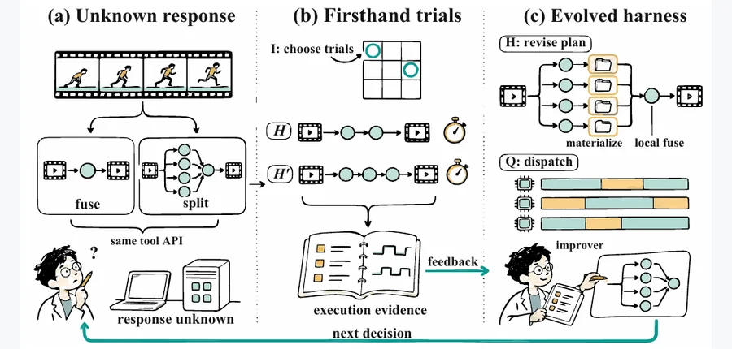 arXiv 2026-11-18 · cs.LG · #1 **[DeltaHarness: Self-Evolving Harnesses for Resource-Adaptive Tool Execution](https://arxiv.org/abs/2611.21688)** Lecheng Yan , Jianze Lin , Xicheng Han , Xiantao Xu , Wenxi Li , Chenyang Lyu Affiliation · University of Science and Technology of China / Beijing Normal University / Zhejiang University / Dmall Inc. / East China Normal University / Alibaba Group [Paper](https://arxiv.org/abs/2611.21688) · [Figure source](https://arxiv.org/pdf/2611.21688) 

[EN] Abstract
Tool-using agents rely on execution harnesses to organize and schedule tool operations. The same task and resource description can conceal runtime conditions that reverse the latency ordering of valid execution plans. Resolving this uncertainty requires firsthand execution in the target setting. We introduce DeltaHarness, an execution-guided policy-search method that adapts agent harnesses from cold-start measurements. Its QHI loop uses the observed response to update runtime dispatch, revise physical plans, and select experiments for later proposals. An independent confirmation panel controls policy replacement. With fixed dispatch, a revised materialization policy reduces complete-delivery latency by 30.0% on one video-editing task across three fresh pairs. On held-out tasks, the evolved policies reduce latency by 8.2% relative to the best fixed plan in one seed and by 4.6% relative to the initial proposal in another. <a href="https://arxiv.org/list/cs/new?show=2000#2611.21688">Source</a>

[ZH] Abstract
使用工具的代理依靠执行框架来组织和调度工具操作。相同任务和资源描述可能掩盖会逆转有效执行计划延迟排序的运行条件。消除这种不确定性，需要在目标环境中亲自执行。我们提出DeltaHarness，一种从冷启动测量出发、自适应调整代理框架的执行引导策略搜索方法。其QHI循环利用观测到的响应更新运行时分派、修订物理计划，并为后续提案选择实验。独立确认面板控制策略替换。在分派固定时，修订后的物化策略在一项视频编辑任务的三组新配对实验中，将完整交付延迟降低30.0%。在留出任务上，进化策略在一个种子中比最佳固定计划降低8.2%延迟，在另一个种子中比初始提案降低4.6%。 <a href="https://arxiv.org/list/cs/new?show=2000#2611.21688">Source</a>
 | 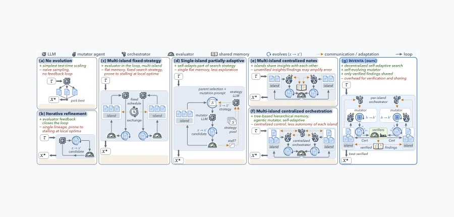 arXiv 2026-11-18 · cs.LG · #2 **[Inventa: Decentralized Self-Improving Agents for Autonomous Scientific Discovery](https://arxiv.org/abs/2611.21847)** Prithwish Jana , Nikos Kanakaris , Purak Jain , Anoop Deoras , Sahika Genc Affiliation · Georgia Institute of Technology / Amazon [Paper](https://arxiv.org/abs/2611.21847) · [Project](https://jprithwish.github.io/inventa/) · [Figure source](https://arxiv.org/html/2611.21847v1/fig_relwork.png) 

[EN] Abstract
Large language model (LLM) agents can generate research ideas and improve scientific discovery through iterative experimentation. However, increasing the number of agents or iterations does not automatically translate to producing more diverse or feasible ideas. Agents may converge on similar candidates, propagate unsupported claims through shared memory components and repeatedly apply search strategies that no longer yield any improvements. We introduce Inventa, a framework for automated scientific discovery that employs autonomous research units and verified shared knowledge. Each unit creates a lineage of candidate ideas using a mutator agent. A local orchestrator agent periodically adapts the mutator's harness. When progress stalls, the orchestrator agent replaces its model or restarts the idea evolution process. Verifiers evaluate each candidate idea and record verified improvements, useful components and constraint violations in a shared knowledge, the only channel between units. We evaluate Inventa on five benchmarks spanning the research cycle, covering retrieval (ScholarCatalyst), ideation (IdeaBench), proposal writing (IdeaScientist), and scientific law discovery (EurekaBench, SciLaws-Bench). It leads all five, achieving 73.6% on EurekaBench versus 56.2% for CORAL. On IdeaBench, it discovers 26.0 novel ideas per paper, compared with 18.6 for ResearchAgent, with 82% fewer model calls. <a href="https://arxiv.org/list/cs/new?show=2000#2611.21847">Source</a>

[ZH] Abstract
大语言模型（LLM）代理能够生成研究想法，并通过迭代实验促进科学发现。然而，增加代理数量或迭代次数，并不自动带来更多样或更可行的想法。代理可能收敛到相似候选，通过共享记忆传播缺乏支持的主张，并反复使用已无法带来改进的搜索策略。我们提出Inventa，一个采用自主研究单元和经过验证的共享知识的自动科学发现框架。每个单元通过变异代理创建候选想法的谱系。局部协调代理定期调整变异代理的执行框架。当进展停滞时，协调代理替换其模型或重启想法进化。验证器评估每个候选想法，将经过验证的改进、有用组件和约束违反记录到共享知识中；这是单元之间唯一的通信通道。我们在覆盖研究周期的五个基准上评估Inventa，包括检索（ScholarCatalyst）、构思（IdeaBench）、提案写作（IdeaScientist）和科学定律发现（EurekaBench、SciLaws-Bench）。它在全部五项上领先，在EurekaBench上达到73.6%，CORAL为56.2%。在IdeaBench上，它每篇论文发现26.0个新颖想法，ResearchAgent为18.6个，同时模型调用减少82%。 <a href="https://arxiv.org/list/cs/new?show=2000#2611.21847">Source</a>
 | 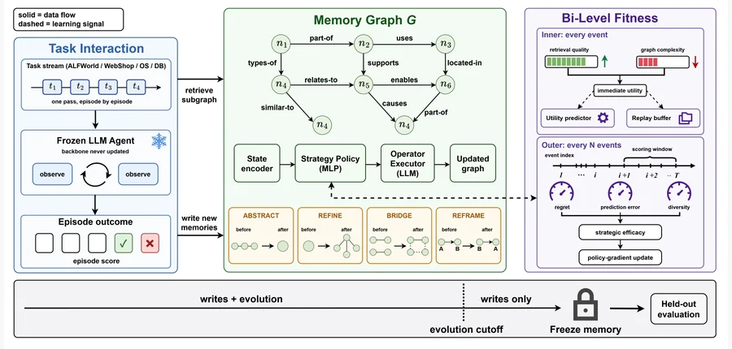 arXiv 2026-11-18 · cs.AI · #3 **[EvoDisco: Strategy Discovery for Evolving Agent Memory](https://arxiv.org/abs/2611.22102)** Mingyang Liu , Qingcan Kang , Shixiong Kai , Kaichao Liang , Xiaojin Fu , Tao Zhong , Linqi Song Affiliation · City University of Hong Kong / Huawei Technologies Ltd. [Paper](https://arxiv.org/abs/2611.22102) · [Figure source](https://arxiv.org/html/2611.22102v1/figures/framework_overview.png) 

[EN] Abstract
Large language model agents accumulate experience in memory, and how that memory evolves during interaction is as important as what it stores. Recent methods update memory online, yet both the operators that transform memory and the rules that select them remain fixed by design. We propose EvoDisco, which formulates agent memory evolution as evolutionary strategy discovery: the agent must discover which operator to apply, when to apply it, and how to instantiate it, rather than rewriting memory under a static operator schedule. A learnable policy conditions on the current memory state and recent task history, then selects and instantiates one of four semantic operators---Abstract, Refine, Bridge, and Reframe---which respectively compress related memories, decompose overloaded entries, connect weakly linked experiences, and reorganize retrieved reasoning chains. The policy is updated with a bi-level fitness. An inner signal scores each transformation using a retrieval-quality improvement regularized by memory complexity. An outer signal scores strategic efficacy over a window of past decisions, combining historical operator-utility regret, utility-prediction error, and selection diversity. Under a one-pass online plus frozen-transfer protocol on ALFWorld, WebShop, and LifelongAgentBench (OS and DB), EvoDisco improves over strong memory baselines including MemP and MemRL. The largest gains are on ALFWorld ($+8.8$ online / $+12.9$ frozen-transfer points over MemP; $+16.4$ / $+17.9$ over MemRL). Ablations attribute these gains to both fitness levels and the operator library. <a href="https://arxiv.org/list/cs/new?show=2000#2611.22102">Source</a>

[ZH] Abstract
大语言模型代理在记忆中积累经验，而记忆在交互中如何进化，与储存什么同样重要。近期方法在线更新记忆，但改变记忆的算子及选择算子的规则仍由设计固定。我们提出EvoDisco，将代理记忆进化表述为进化式策略发现：代理必须发现应用哪个算子、何时应用以及如何实例化，而非按照静态算子日程改写记忆。一个可学习策略以当前记忆状态和近期任务历史为条件，选择并实例化四种语义算子之一：Abstract、Refine、Bridge和Reframe，分别用于压缩相关记忆、拆分过载条目、连接弱关联经验，以及重组检索得到的推理链。策略通过双层适应度更新。内层信号根据检索质量改善评分每次变换，并用记忆复杂度正则化。外层信号在过去决策窗口上评分策略有效性，结合历史算子效用遗憾、效用预测误差和选择多样性。在ALFWorld、WebShop和LifelongAgentBench（OS与DB）的一遍在线加冻结迁移协议下，EvoDisco超越包括MemP和MemRL在内的强记忆基线。最大收益出现在ALFWorld上：相对MemP，在线和冻结迁移分别提高8.8和12.9个百分点；相对MemRL分别提高16.4和17.9个百分点。消融将收益归因于两层适应度和算子库。 <a href="https://arxiv.org/list/cs/new?show=2000#2611.22102">Source</a>
 |
| 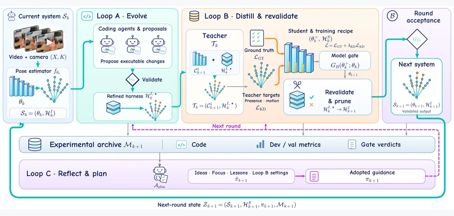 arXiv 2026-11-18 · cs.CV · #4 **[HandRSI: Recursive Self-Improvement for Hand Pose Estimation](https://arxiv.org/abs/2611.22164)** Zhekai Wang , Luqing Luo , Wenhao Yao , Junjie Lu , Huanan Zhu , Feifei Gao , Yuhua Jiang Affiliation · LivSyn Robotics / South China University of Technology / University of Technology Sydney / University of Science and Technology Beijing / Tsinghua University [Paper](https://arxiv.org/abs/2611.22164) · [Code](https://github.com/GinKenneth/Hand_RSI) · [Figure source](https://arxiv.org/html/2611.22164v1/fig/overview_handrsi.png) 

[EN] Abstract
Egocentric 3D hand pose estimators still miss hands at the image border, misplace occluded hands and jitter. Such failures are usually fixed by hand-written inference refinements and by fine-tuning, two interdependent steps that are tuned separately. We present HandRSI, a recursive self-improvement framework for a hand pose system that consists of a video estimator and its executable inference harness. In each round, coding agents refine the harness, and a change is accepted only if it improves a composite of all ten benchmark metrics on held-out data without significantly regressing any of them. The accepted harness then guides the estimator through selective distillation, which supervises hand presence and temporal consistency on frames without ground truth, while ground truth supervises pose. Since the updated estimator may change which refinements remain useful, the harness is re-validated on it. Starting from the released ACE-Ego-Hand model, five rounds reduce MPJPE-p by 35% on HOT3D and 11% on ARCTIC and roughly halve jitter. On HOT3D, HandRSI's MPJPE-p is 16% lower than that of ACE-Ego-Hand fine-tuned on the same ground truth. Under a unified protocol, it outperforms nine re-run published methods on all ten metrics of both benchmarks. Hypervolume selection on the accuracy-speed front yields Lite, Medium and Heavy systems running at 20.7 to 41.1 FPS. This report gives the full method, every stage of every round and the complete protocol. Code, evaluator, harnesses and weights are public. <a href="https://arxiv.org/list/cs/new?show=2000#2611.22164">Source</a>

[ZH] Abstract
第一视角3D手部姿态估计器仍会漏掉图像边缘的手、错误定位被遮挡的手，并产生抖动。这些失败通常通过手工编写推理修正和微调来解决，但两个相互依赖的步骤却分开调优。我们提出HandRSI，一个面向由视频估计器及其可执行推理框架组成的手部姿态系统的递归自我改进框架。在每轮中，编码代理修订框架；只有修改提高留出数据上全部十项基准指标的综合得分，且没有任何指标显著退化时，才被接受。接受的框架随后通过选择性蒸馏引导估计器：在无真值帧上监督手部存在性和时间一致性，同时以真值监督姿态。由于更新后的估计器可能改变哪些修正仍有用，框架会在它上面重新验证。从已发布的ACE-Ego-Hand模型出发，五轮使HOT3D和ARCTIC上的MPJPE-p分别降低35%和11%，抖动约减半。在HOT3D上，HandRSI的MPJPE-p比使用相同真值微调的ACE-Ego-Hand低16%。统一协议下，它在两个基准的全部十项指标上超越重新运行的九种已发表方法。在精度—速度前沿上进行超体积选择，得到以20.7至41.1 FPS运行的Lite、Medium和Heavy系统。本报告给出完整方法、每轮各阶段和完整协议。代码、评估器、框架和权重均已公开。 <a href="https://arxiv.org/list/cs/new?show=2000#2611.22164">Source</a>
 | 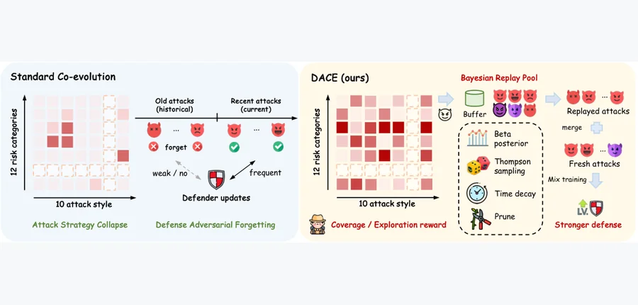 arXiv 2026-11-18 · cs.AI · #5 **[DACE: Diversity-Driven Adversarial Co-Evolution for Robust LLM Safety Alignment](https://arxiv.org/abs/2611.22278)** Peng Yu , Xiaoyu Wen , Zhida He , Ziyuan Zhou , Han Qi , Shao Zhang , Qiaosheng Zhang , Ying Wen , Chaochao Lu Affiliation · Shanghai Jiao Tong University / Shanghai Artificial Intelligence Laboratory / Fudan University [Paper](https://arxiv.org/abs/2611.22278) · [Code](https://github.com/PursuitYP/DACE-NeurIPS) · [Figure source](https://arxiv.org/html/2611.22278v1/dace_intro_v5.png) 

[EN] Abstract
Ensuring robust safety alignment of large language models (LLMs) is increasingly difficult as adversarial attacks evolve and outpace alignment pipelines built on pre-collected data. Existing co-evolutionary frameworks let the defender chase a moving attacker, yet their training dynamics expose two compounding pathologies: \emph{attack strategy collapse}, where the attacker overfits to a narrow set of high-reward rewrites, and \emph{defense adversarial forgetting}, where the defender loses competence against earlier attacks as the attack distribution drifts. Existing remedies are partial: attacker-side diversity rewards score textual novelty rather than strategy novelty, and defender-side replay relies on discrete judge scores that ignore estimation uncertainty, response stochasticity, and defender non-stationarity. We introduce \textbf{\method}, a diversity-driven adversarial co-evolution framework that targets both pathologies jointly. On the attacker side, \method couples an explicit two-dimensional strategy space (risk category $\times$ attack style) with a \emph{normalized marginal coverage gain} reward, providing a bounded, non-vanishing exploration signal at the strategy layer. On the defender side, \method maintains a unified \emph{Bayesian adversarial replay pool} whose Beta--Bernoulli threat posteriors are refreshed by time decay and sampled via Thompson sampling, anchoring defender training to an evolving threat landscape. Across standard safety, automated-attacker, and general-capability benchmarks, \method improves robustness to out-of-distribution attacks while preserving general capabilities, and yields broader attacker strategy coverage. <a href="https://arxiv.org/list/cs/new?show=2000#2611.22278">Source</a>

[ZH] Abstract
随着对抗攻击演变并超越基于预先收集数据的对齐管线，确保大语言模型（LLM）的稳健安全对齐越来越困难。现有共同进化框架让防御者追逐变化的攻击者，但训练动态暴露出两种相互累积的病理：攻击策略坍缩，即攻击者过拟合到狭窄的高奖励改写集合；防御对抗遗忘，即攻击分布漂移时，防御者失去应对早期攻击的能力。现有补救仅覆盖部分问题：攻击方多样性奖励衡量文本新颖性而非策略新颖性，防御方回放依赖离散评判分数，忽略估计不确定性、响应随机性和防御者非平稳性。我们提出\method（原摘要的方法名宏未解析），一个同时处理两类病理的多样性驱动对抗共同进化框架。攻击方将显式二维策略空间（风险类别×攻击风格）与归一化边际覆盖增益奖励结合，在策略层提供有界、不会消失的探索信号。防御方维护统一的贝叶斯对抗回放池，利用时间衰减刷新Beta–Bernoulli威胁后验，并通过Thompson采样抽取，使防御训练锚定于演变的威胁格局。在标准安全、自动攻击者和一般能力基准上，该方法在保持一般能力的同时，提高对分布外攻击的稳健性，并扩大攻击策略覆盖。 <a href="https://arxiv.org/list/cs/new?show=2000#2611.22278">Source</a>
 | 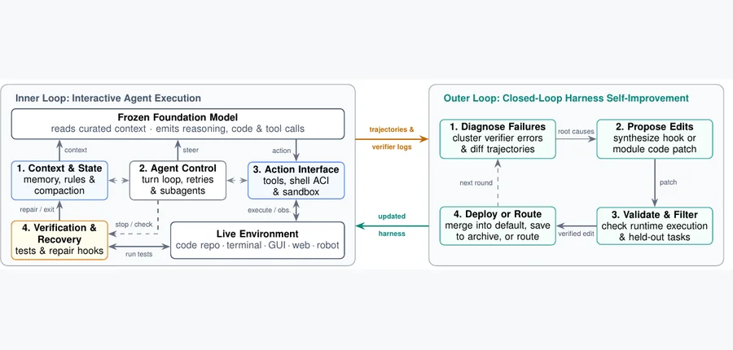 arXiv 2026-11-18 · cs.AI · #6 **[Harnesses That Improve Themselves: A Unifying Framework for Self-Improving Agent Harnesses](https://arxiv.org/abs/2611.22299)** Deep Shah , Nehal Kathrotia Affiliation · Google [Paper](https://arxiv.org/abs/2611.22299) · [Figure source](https://arxiv.org/pdf/2611.22299) 

[EN] Abstract
Whether a foundation model succeeds as an autonomous agent depends as much on its runtime software as on its weights. This runtime, the agent harness, manages context and memory, steers multi-turn control, executes tool actions in sandboxes, and verifies work before stopping. Because models differ in how they use tools and how they fail, a static harness tuned for one model or task often stalls, wastes tokens, or regresses on another. This bottleneck has driven a shift from prompt tuning to self-improving agent harnesses: systems that inspect their own execution traces, separate runtime bugs from model limits, and rewrite their own code. We present a unifying architectural and design framework for self-improving agent harnesses. The framework pairs four editable runtime components (context and state, agent control, action interfaces, and verification and recovery) with a four-stage loop that diagnoses failures, proposes code patches, validates candidates, and deploys updates. Using this framework, we show how optimizers trace errors across long trajectories and discover reusable runtime mechanisms such as pre-stop verifiers, loop breakers, and persistent memory. We further show why full-harness rewrites overfit or break across modules, and how modular updates with validation gates generalize across models while bounding token cost. To keep self-modification safe, we establish practical defenses against recurring failure modes including prompt bloat, benchmark gaming, and evaluator tampering. Finally, experiments on SWE-bench Lite validate this framework, showing that gated modular evolution outperforms prompt reflection and full-harness rewrites across models and repositories at a fraction of the token cost. <a href="https://arxiv.org/list/cs/new?show=2000#2611.22299">Source</a>

[ZH] Abstract
基础模型能否作为自主代理成功，既取决于权重，也取决于运行时软件。代理执行框架管理上下文和记忆、控制多轮流程、在沙箱中执行工具动作，并在停止前验证工作。由于模型在工具使用方式和失败模式上不同，为一种模型或任务调优的静态框架，往往在另一种上停滞、浪费token或退化。这一瓶颈推动研究从提示调优转向自我改进代理框架：系统检查自身执行轨迹，区分运行时缺陷与模型限制，并改写自身代码。我们提出自我改进代理框架的统一架构与设计框架，将四个可编辑运行组件（上下文与状态、代理控制、动作接口、验证与恢复）与诊断失败、提出代码补丁、验证候选、部署更新的四阶段循环配对。利用该框架，我们展示优化器如何跨长轨迹追踪错误，并发现停止前验证器、循环中断器和持久记忆等可复用运行机制。我们进一步展示，为何整体框架重写会过拟合或破坏模块之间的关系，以及带验证门控的模块更新如何在限定token成本的同时跨模型泛化。为保持自修改安全，我们提出防御提示膨胀、基准投机和篡改评估器等反复出现的失败模式的实用措施。最后，SWE-bench Lite实验验证该框架：带门控的模块进化以一小部分token成本，在多个模型和代码库上超越提示反思与整体框架重写。 <a href="https://arxiv.org/list/cs/new?show=2000#2611.22299">Source</a>
 |
| 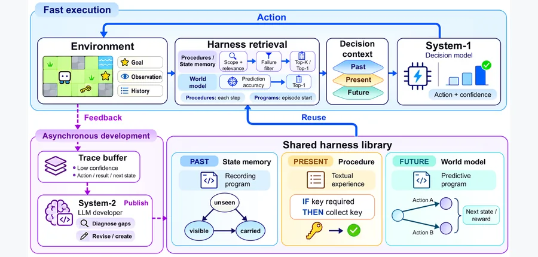 arXiv 2026-11-18 · cs.AI · #7 **[Think Once, Act Fast: Cost-Effective Recursive Self-Improvement for Decision Model Harness](https://arxiv.org/abs/2611.22432)** Siqi Lai , Haitao Li , Hao Liu Affiliation · Hong Kong University of Science and Technology (Guangzhou) / LIGHTSPEED [Paper](https://arxiv.org/abs/2611.22432) · [Code](https://github.com/usail-hkust/JevRSI) · [Figure source](https://arxiv.org/html/2611.22432v1/framework.png) 

[EN] Abstract
Fast System-1 models enable responsive actions but struggle with complex or unfamiliar tasks. Large language model (LLM)-based System-2 provides strong reasoning capabilities, yet repeated invocation incurs substantial latency and computational costs. To bridge this gap, we propose JevRSI, a System-1/System-2 collaboration framework that transforms LLM reasoning into transferable decision support through recursive harness improvement. A Jev-style System-1 model enables low-latency action selection, while an asynchronous System-2 LLM develops a modular harness. The harness integrates procedures, state memory, and world models to provide decision contexts spanning the past, present, and future. Utility-driven retrieval selects modules based on both contextual relevance and their utility on previous tasks. Environmental feedback guides targeted revisions and enables recursive self-improvement. Experiments across three datasets show that JevRSI consistently improves decision quality, matching or surpassing LLM agents in several settings. It preserves low-latency execution with favorable performance-cost trade-offs. Moreover, System-2 development interventions decrease as the harness evolves, amortizing System-2 costs through continuous improvement. Our project is available at this https URL . <a href="https://arxiv.org/list/cs/new?show=2000#2611.22432">Source</a>

[ZH] Abstract
快速System-1模型能够迅速执行动作，却难以处理复杂或陌生任务。基于大语言模型（LLM）的System-2具备较强推理能力，但反复调用造成显著延迟和计算成本。为弥合这一差距，我们提出JevRSI，一个通过递归框架改进，将LLM推理转化为可迁移决策支持的System-1/System-2协作框架。Jev风格的System-1模型实现低延迟动作选择，异步System-2 LLM则开发模块化执行框架。框架整合程序、状态记忆和世界模型，提供横跨过去、现在和未来的决策上下文。效用驱动检索根据上下文相关性及模块在过去任务上的效用选择模块。环境反馈引导针对性修订，实现递归自我改进。三个数据集上的实验显示，JevRSI持续改善决策质量，在若干场景匹配或超越LLM代理。它保持低延迟执行，并具有良好的性能—成本权衡。此外，随着框架进化，System-2开发干预减少，通过持续改进摊销System-2成本。我们的项目位于原文所示https链接。 <a href="https://arxiv.org/list/cs/new?show=2000#2611.22432">Source</a>
 | 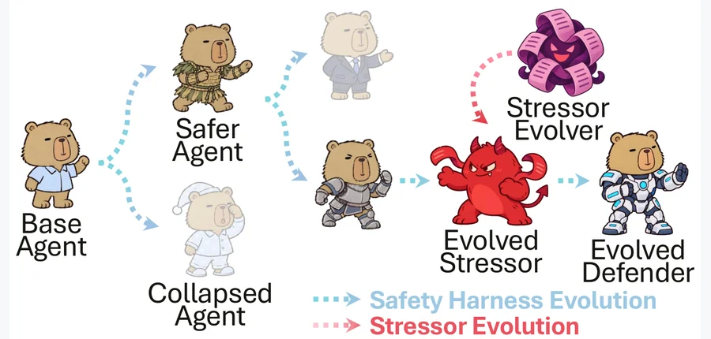 arXiv 2026-11-18 · cs.CR · #8 **[Evolution Under Fire: Evolving Agent Safety Harnesses with Adaptive Injection Stressors](https://arxiv.org/abs/2611.22583)** Yujun Wang , Yilun Liu , Jinhe Bi , Krishna Kanth Nakka , Xuebing Zhou , Hinrich Sch{ü}tze , Yunpu Ma Affiliation · LMU Munich / Munich Center for Machine Learning (MCML) [Paper](https://arxiv.org/abs/2611.22583) · [Figure source](https://arxiv.org/html/2611.22583v1/figure2_teaser.png) 

[EN] Abstract
Tool-using language-model agents must act on information from untrusted emails, webpages, and documents. This creates a central security challenge: malicious instructions and legitimate task directives can arrive through the same interaction channel. Existing defenses are largely hand-designed and static, making further improvements dependent on repeated manual redesign. We introduce Evolution Under Fire, a staged framework that couples safety-harness evolution with adaptive stressor evolution. Utility-constrained, Pareto-scheduled tree search evolves complete executable safety harnesses from execution evidence while keeping the task model, benchmark, tools, and evaluator fixed. Adaptive stressor evolution then discovers utility-preserving attacks that guide a subsequent stage of harness evolution. On AgentDyn with GPT-4o-mini, an evolved harness reduces attack success from 50.4% to 3.0%, improves clean and attacked utility over the initial harness, and offers a stronger security-utility trade-off than reproduced defenses. On Agent-SafetyBench with Qwen2.5-7B-Instruct, harness evolution reduces attack success from 82.6% to 62.0% while retaining helpfulness and runtime validity. Evolved harnesses also transfer without further evolution to Qwen3.5-35B-A3B, reducing attack success from 32.1% to 0.9% while improving attacked-task utility. <a href="https://arxiv.org/list/cs/new?show=2000#2611.22583">Source</a>

[ZH] Abstract
使用工具的语言模型代理必须根据不可信邮件、网页和文档中的信息行动。这带来核心安全挑战：恶意指令和合法任务指令可能通过同一交互通道到达。现有防御大多由人工设计且静态，使进一步改进依赖反复手工重设计。我们提出Evolution Under Fire，一个将安全框架进化与自适应攻击压力源进化耦合的分阶段框架。在任务模型、基准、工具和评估器固定时，受效用约束、按Pareto日程调度的树搜索，依据执行证据进化完整可执行安全框架。自适应压力源进化随后发现保持效用的攻击，引导下一阶段框架进化。在使用GPT-4o-mini的AgentDyn上，进化框架将攻击成功率从50.4%降至3.0%，相对初始框架改善干净和受攻击条件下的效用，并比复现的防御提供更强安全—效用权衡。在使用Qwen2.5-7B-Instruct的Agent-SafetyBench上，框架进化将攻击成功率从82.6%降至62.0%，同时保留帮助性和运行有效性。进化框架还无需进一步进化即可迁移至Qwen3.5-35B-A3B，将攻击成功率从32.1%降至0.9%，同时提高受攻击任务效用。 <a href="https://arxiv.org/list/cs/new?show=2000#2611.22583">Source</a>
 | 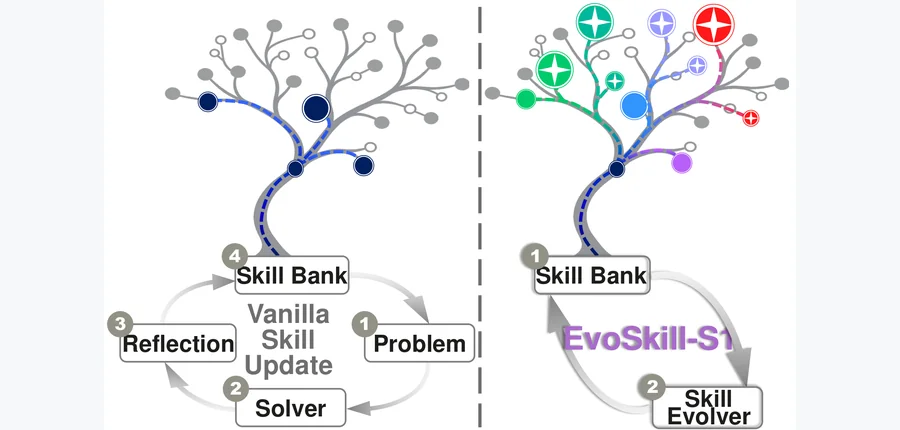 arXiv 2026-11-18 · cs.AI · #9 **[EvoSkill-S1: Evolving Reusable Skills with Genetic-Inspired Operators](https://arxiv.org/abs/2611.22610)** Yujun Wang , Jiqiang Li , Yinuo Lu , Jinhe Bi , Aniri , Wenxuan Ye , Boliang Liu , Sikuan Yan , Shuning Wang , Xuebing Zho… Affiliation · LMU Munich / Munich Center for Machine Learning (MCML) / Huawei Heisenberg Research Center / Zhejiang University / University of Hong Kong / Technical University of Munich (TUM) / TU Berlin / Kiel University [Paper](https://arxiv.org/abs/2611.22610) · [Figure source](https://arxiv.org/html/2611.22610v1/Fig_1.clean.png) 

[EN] Abstract
Reusable skills allow language-model agents to accumulate and reuse problem-solving experience. However, most existing methods improve a skill bank only indirectly through rollout-driven accumulation and heuristic reflection, often resulting in shallow and weakly controlled updates. We present EvoSkill-S1, an RL-driven framework that instead treats reusable skills themselves as the direct objects of evolution. Given hard-negative failures, EvoSkill-S1 selects parent skills and transforms them into candidate child skills through five genetic-inspired operators: revision, cross-revision, mutation, dual-reflection, and crossover. Downstream task rewards train the skill evolver to generate more effective child skills, while evaluator-guided write-back selectively retains beneficial updates. Complementary Skill Bank Fusion consolidates operator-specific banks to exploit their distinct recovery patterns, while a Procedural Skill Interface supports transfer to unseen problems. Across all reported math and code benchmarks, EvoSkill-S1 improves the corresponding initialized skill banks under both Qwen and GPT-family solvers, with relative gains of up to 12.39%. Compared with the strongest external baseline without direct skill evolution, the largest relative improvement reaches 20.39%. <a href="https://arxiv.org/list/cs/new?show=2000#2611.22610">Source</a>

[ZH] Abstract
可复用技能允许语言模型代理积累并复用解题经验。然而，多数现有方法仅通过执行轨迹积累和启发式反思间接改进技能库，常导致浅层且控制不足的更新。我们提出EvoSkill-S1，一个强化学习驱动框架，直接把可复用技能本身作为进化对象。面对困难负例失败，EvoSkill-S1选择父技能，利用五种受遗传过程启发的算子——修订、交叉修订、变异、双重反思和交叉——生成候选子技能。下游任务奖励训练技能进化器生成更有效的子技能，评估器引导的写回则有选择地保留有益更新。互补的Skill Bank Fusion整合不同算子对应的技能库，利用各自不同的恢复模式；Procedural Skill Interface支持向未见问题迁移。在全部报告的数学和代码基准上，EvoSkill-S1在Qwen和GPT系列求解器下均改善对应的初始技能库，相对收益最高12.39%。相对不直接进化技能的最强外部基线，最大相对提升达到20.39%。 <a href="https://arxiv.org/list/cs/new?show=2000#2611.22610">Source</a>
 |
| 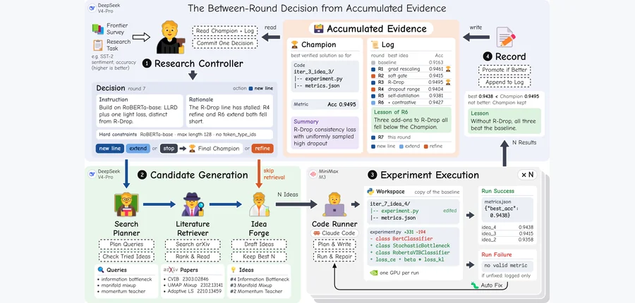 arXiv 2026-11-18 · cs.AI · #10 **[The Between-Round Decision in Autonomous Research: An LLM Controller That Reads the Whole Trajectory](https://arxiv.org/abs/2611.22661)** Caoxin Wang , Shengkai Gan , Xiang Hu , Lili Pan Affiliation · University of Electronic Science and Technology of China / Zhejiang University [Paper](https://arxiv.org/abs/2611.22661) · [Code](https://github.com/learninginvision/BRED) · [Figure source](https://arxiv.org/html/2611.22661v1/fig1_overview.png) 

[EN] Abstract
Executing an idea often changes how promising it looks, so the next step in autonomous research should rest on results, not on proposals. After each round of experiments, the system must decide whether to refine the best solution or start a new direction, which solution to build from, and what goal to set. We call this the between-round decision. Existing systems wrap it in machinery such as rules, scores, search trees, and schedules; where an LLM makes it, what the LLM needs to read is left open. We ask whether an LLM can make this decision from accumulated evidence, without a search structure around it, and how much of that evidence it needs to read. We present BRED (Between-Round Evidence-based Decision), an LLM-based controller that maintains the best verified solution so far (the Champion) and a log of past rounds, and makes one decision per round. On three widely used research-agent benchmark tasks, BRED improves on the task baselines by 4.80% in MAE on ETTh1 (to 0.4172) and by 3.44 and 3.43 points of accuracy on SST-2 (to 95.07%) and CIFAR-100 (to 84.63%), ahead of the published results. When the controller does not read the accumulated evidence, the same loop gains less: with no history it reaches 0.4299 on ETTh1 and 83.71% on CIFAR-100, whereas the full controller's MAE is 2.95% lower and its accuracy 0.92 points higher. On a new task, speech-based depression detection under a leakage-free protocol, it reaches a macro-F1 of 0.6164 on seeds held out from selection, 5.5 points above its baseline and 4.0 above the strongest published system. Code is available at this https URL . <a href="https://arxiv.org/list/cs/new?show=2000#2611.22661">Source</a>

[ZH] Abstract
执行一个想法往往会改变它的前景，因此自主研究的下一步应依据结果，而非提案。每轮实验后，系统必须决定继续完善最佳解还是开启新方向、从哪个解出发，以及设定什么目标。我们称之为轮间决策。现有系统以规则、分数、搜索树和日程等机制包裹它；当LLM做决策时，需要阅读什么仍未明确。我们研究，LLM能否仅依据累积证据、无需外围搜索结构做此决策，以及需要读多少证据。我们提出BRED（轮间证据驱动决策），一个维护迄今最佳验证解Champion和历史轮次日志、每轮作出一次决策的LLM控制器。在三个常用研究代理基准任务上，BRED相对任务基线，在ETTh1的MAE改善4.80%（至0.4172），在SST-2和CIFAR-100的准确率分别提高3.44和3.43个百分点（至95.07%和84.63%），领先已发表结果。当控制器不读取累积证据时，同样循环收益更少：无历史时，ETTh1为0.4299，CIFAR-100为83.71%；完整控制器的MAE低2.95%，准确率高0.92个百分点。在采用无泄漏协议的新任务——语音抑郁检测——上，它在未用于选择的留出种子上达到宏F1 0.6164，比自身基线高5.5个百分点，比最强已发表系统高4.0个百分点。代码位于原文所示https链接。 <a href="https://arxiv.org/list/cs/new?show=2000#2611.22661">Source</a>
 | 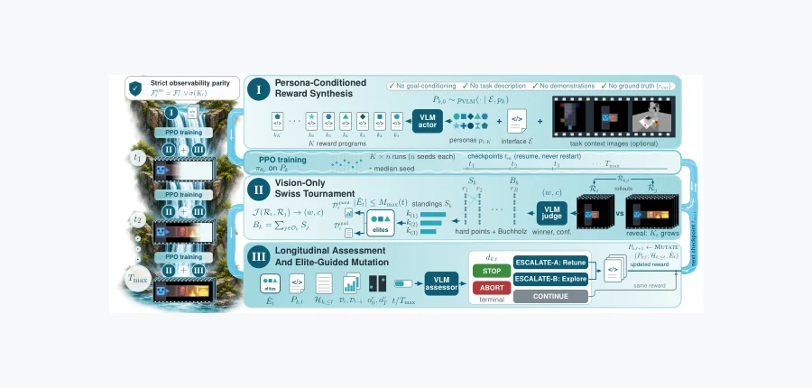 arXiv 2026-11-18 · cs.LG · #11 **[WATERFALL: Workflow for Adaptive Training with Evolutionary Reward Formulation and Automated Learning Loops](https://arxiv.org/abs/2611.22854)** Eleftherios Triantafyllidis , Filippos Christianos , Zhibin Li , Bernd Bickel Affiliation · ETH Zurich / Independent Researcher / UCL [Paper](https://arxiv.org/abs/2611.22854) · [Figure source](https://arxiv.org/html/2611.22854v1/waterfall_main.png) 

[EN] Abstract
Reward design remains a central bottleneck in reinforcement learning (RL), particularly in sparse-reward, long-horizon and partially observable settings requiring dependency chaining, memory, and deceptive affordance disambiguation. While recent foundation-model approaches reduce manual reward engineering, most assume goal-conditioning, task descriptions, expert demonstrations, or ground-truth metrics. These assumptions are problematic in partially observable environments, where task-relevant objectives, affordances, and dynamics must be discovered through interaction rather than disclosed a priori. We formalise this problem setting by introducing WATERFALL, an iterative population-based workflow for automated reward discovery under the strict observability constraints inherent in POMDP environments. WATERFALL achieves this by (i) synthesising diverse programmatic reward candidates via persona-conditioned generation, (ii) evaluating candidate behaviour from raw visual rollouts utilising a Swiss-system evolutionary tournament judged by vision-language models to identify elites, and (iii) leveraging longitudinal assessment histories to iteratively mutate, escalate, or prune candidates. We evaluate WATERFALL across fully observable and reveal-gated partially observable environments ranging from discrete to continuous, comparing against sparse-reward RL, intrinsic-motivation and foundation-model reward-synthesis baselines. Our results indicate that WATERFALL discovers and refines reward programs without access to privileged information, outperforming baselines that retain their native information advantages, most clearly in the POMDP regime. Extensive ablations substantiate that visual evidence, tournament-based selection, and iterative refinement are jointly important. Enforcing this contract is what separates autonomous reward discovery from benchmark-privileged reward shaping. <a href="https://arxiv.org/list/cs/new?show=2000#2611.22854">Source</a>

[ZH] Abstract
奖励设计仍是强化学习（RL）的核心瓶颈，尤其在需要依赖链、记忆及消除误导性可供性歧义的稀疏奖励、长时程和部分可观测场景中。近期基础模型方法虽然减少手工奖励工程，但多数假设有目标条件、任务描述、专家示范或真值指标。这些假设在部分可观测环境中存在问题，因为任务相关目标、可供性和动力学必须通过交互发现，而非事先给出。我们引入WATERFALL，在POMDP固有的严格可观测性约束下，形式化这一问题，并提出自动奖励发现的迭代种群工作流。WATERFALL通过三点实现：（i）以人格条件生成来合成多样程序化奖励候选；（ii）使用视觉语言模型评判的瑞士制进化锦标赛，从原始视觉执行轨迹评估候选行为并识别精英；（iii）利用纵向评估历史，迭代变异、升级或剪除候选。我们在从离散到连续的完全可观测和揭示门控部分可观测环境中评估WATERFALL，与稀疏奖励RL、内在动机和基础模型奖励合成基线比较。结果显示，WATERFALL无需特权信息即可发现和修订奖励程序，超越保留各自原有信息优势的基线，在POMDP场景尤其明显。广泛消融支持视觉证据、锦标赛选择和迭代修订共同发挥作用。执行这一信息契约，是自主奖励发现区别于享有基准特权的奖励塑形之处。 <a href="https://arxiv.org/list/cs/new?show=2000#2611.22854">Source</a>
 | 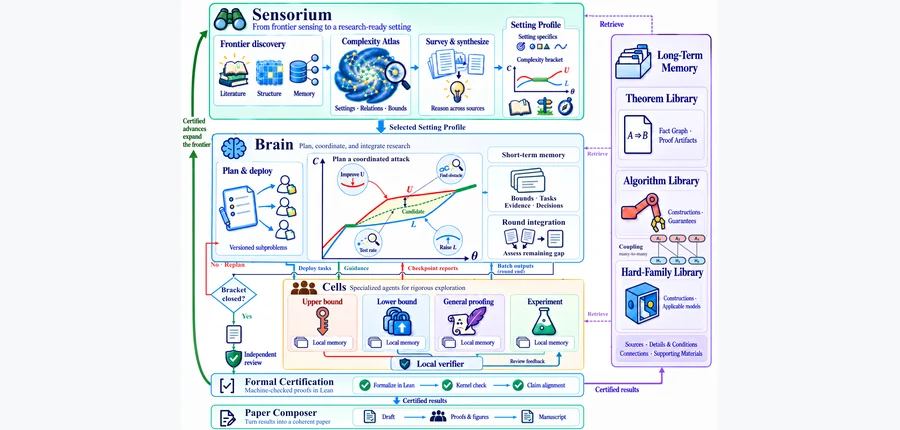 arXiv 2026-11-18 · cs.AI · #12 **[Colombo: A Frontier-to-Frontier Autoresearch System for Oracle-Based Optimization](https://arxiv.org/abs/2611.23080)** Haihan Zhang , Wendao Wu , Chenheng Zhang , Chunyuan Zheng , Yanyi Li , Cong Fang , Haoxuan Li , Zhouchen Lin Affiliation · Peking University [Paper](https://arxiv.org/abs/2611.23080) · [Figure source](https://arxiv.org/html/2611.23080v1/figures/colombo-architecture.png) 

[EN] Abstract
Science advances from frontier to frontier as discoveries reshape what is known and create the basis for further discovery. We present Colombo, a self-organizing AI researcher that drives this renewal, first instantiated in oracle-based optimization. Here, the central question is how efficiently a problem class can be solved through a prescribed information interface and what costs no admissible algorithm can avoid. The gap between achievable guarantees and unavoidable limits defines the frontier recorded in its Complexity Atlas, a living map of frontier settings and the current state of knowledge. Self-Organization turns unresolved gaps into adaptive research programmes, coordinating conjecture formation, mathematical investigation, and replanning as evidence accumulates. Adversarial Co-Ascent develops algorithms and hard families through reciprocal challenge, exposing mechanisms of information use and concealment that guide stronger methods and proofs of unavoidable costs. Independent review and Lean-based formal certification check mathematical claims, while the Long-Term Memory carries supported findings and research experience across settings. To date, Colombo has established optimal or near-optimal rates for more than fifty settings in the Atlas. Colombo thus takes a concrete step toward Autopoietic Science: a scientific process whose validated advances regenerate the conditions of its own progress, continually reshaping how inquiry is organized and what it can discover. <a href="https://arxiv.org/list/cs/new?show=2000#2611.23080">Source</a>

[ZH] Abstract
科学从一个前沿迈向下一个前沿，发现重塑已知知识，并为进一步发现创造基础。我们提出Colombo，一个自组织AI研究者，驱动这一更新过程，首先应用于基于oracle的优化。这里的核心问题是，在规定的信息接口下，一个问题类能被多高效地解决，以及任何允许的算法都无法避免哪些成本。可达到保证与不可避免限制之间的差距，定义了记录在Complexity Atlas中的前沿；这是前沿设定与当前知识状态的动态地图。Self-Organization把未解决差距转化为自适应研究计划，协调猜想形成、数学研究和随证据积累而重新规划。Adversarial Co-Ascent通过相互挑战发展算法和困难问题族，暴露信息使用与隐藏的机制，引导更强方法和不可避免成本的证明。独立审查及基于Lean的形式认证检查数学主张，Long-Term Memory则跨设定携带有支持的发现和研究经验。迄今，Colombo已在Atlas中五十多个设定建立最优或近最优速率。因此，Colombo朝Autopoietic Science迈出具体一步：一种由经过验证的进展重新生成自身进步条件、不断重塑研究组织方式及发现能力的科学过程。 <a href="https://arxiv.org/list/cs/new?show=2000#2611.23080">Source</a>
 |
| 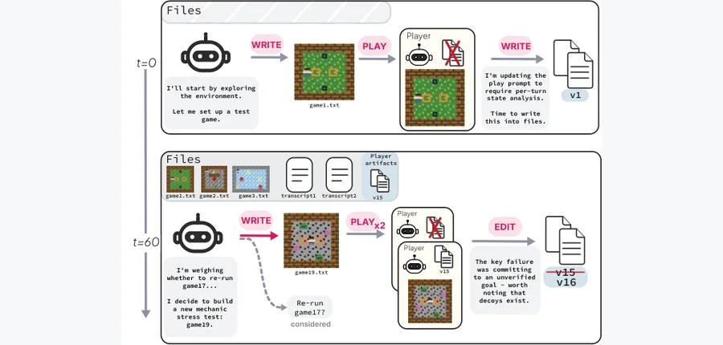 arXiv 2026-11-18 · cs.LG · #13 **[Do LLM Agents Still Need to Be Told How to Self-Improve?](https://arxiv.org/abs/2611.23219)** Shobhita Sundaram , Cansu Sancaktar , Phillip Isola Affiliation · MIT CSAIL / University of Tübingen [Paper](https://arxiv.org/abs/2611.23219) · [Project](https://ssundaram21.github.io/self-org/) · [Figure source](https://arxiv.org/html/2611.23219v1/teaser9.png) 

[EN] Abstract
LLM agents increasingly drive their own learning. Self-improvement methods delegate various components of model optimization to the models themselves. As models become more capable, this motivates a basic question: do these increasingly capable models still need us to specify how they should self-improve? In this paper we study an autonomous paradigm in which, given basic primitives, resources, and a general goal for self-improvement, agents construct their own self-learning algorithm for context-based optimization. Using the setting of gameplay as a testbed, a frozen LLM agent is given a compute budget and tools for collecting experience and updating text documents, and allowed to freely experiment without an externally imposed loop or access to real-world data. We find that sufficiently capable models do self-improve under these conditions, demonstrating strategies that align with classic cognitive frameworks for self-regulated learning and constructs from machine learning literature on self-generated curricula. Furthermore, we study the extent to which the learned text artifacts transfer to external benchmarks, observing improvement across different game horizons, mechanics, and 3D navigation. <a href="https://arxiv.org/list/cs/new?show=2000#2611.23219">Source</a>

[ZH] Abstract
LLM代理越来越多地主导自身学习。自我改进方法把模型优化的不同部分委托给模型本身。随着模型能力增强，这引出一个基本问题：这些日益强大的模型，是否仍需我们规定它们应如何自我改进？本文研究一种自主范式：给定基本原语、资源和一般自我改进目标，代理自行构建基于上下文优化的自学习算法。以游戏为测试平台，一个冻结的LLM代理获得计算预算、收集经验和更新文本文档的工具，并允许自由实验，无需外部规定循环，也不访问真实世界数据。我们发现，足够强的模型确实能在这些条件下自我改进，其策略与经典自我调节学习认知框架，以及机器学习中自生成课程的构造相吻合。此外，我们研究学到的文本制品向外部基准的迁移程度，观察到跨不同游戏时程、机制和3D导航的改进。 <a href="https://arxiv.org/list/cs/new?show=2000#2611.23219">Source</a>
 | 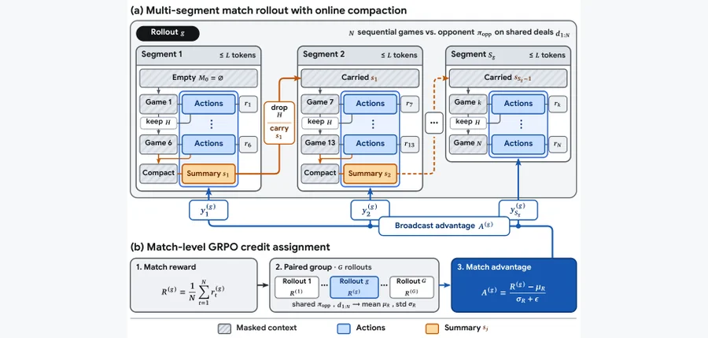 arXiv 2026-11-18 · cs.GT · #14 **[Learning In-Context Adaptivity for LLMs through Continual Gameplay](https://arxiv.org/abs/2611.21710)** Jiale Liu , Zun Li , John Schultz Affiliation · Penn State University / Google DeepMind [Paper](https://arxiv.org/abs/2611.21710) · [Figure source](https://arxiv.org/html/2611.21710v1/fig_method.png) 

[EN] Abstract
LLM agents are increasingly deployed in long-horizon tasks where they must explore, gather experience, and adapt their decisions accordingly. We name this capability in-context adaptivity: improving decisions across episodes from experience accumulated in context. We propose to evaluate it in repeated imperfect-information games against unknown opponents. In these games, fixed game-theoretically optimal policies cannot achieve maximum reward, whereas adapting to the opponent increases returns across games. We design a paired protocol that evaluates each agent with and without memory under identical conditions to isolate experience gain from single-game skill. Evaluation shows that memory brings little performance gain for open-weight models and inconsistent gains for frontier models. Our analysis of the agents' summaries and actions identifies a memory-doing gap in which models accurately record opponent tendencies yet rarely depart from default play. To close this gap, we construct a pool of exploitable opponents and post-train Qwen3.5-9B with supervised fine-tuning followed by trajectory-level reinforcement learning. We optimize full-match return across context segments so summary generation and action selection are trained together. On unseen opponents, our 9B RL policy doubles experience gain over supervised fine-tuning in Leduc Hold'em and increases it fivefold in No-Limit Hold'em. Across 35 opponents, our policy matches or surpasses frontier models, generalizes beyond its training horizon, and retains most of its gain on summaries from frontier models. <a href="https://arxiv.org/list/cs/new?show=2000#2611.21710">Source</a>

[ZH] Abstract
LLM代理越来越多地部署于需要探索、收集经验并据此调整决策的长时程任务。我们将这种能力称为上下文内适应性，即从上下文积累的经验中，跨回合改善决策。我们提出在对抗未知对手的重复不完美信息博弈中评估它。在这些游戏里，固定的博弈论最优策略无法取得最高奖励，而适应对手能够提高多场游戏的回报。我们设计配对协议，在相同条件下比较代理有无记忆的表现，以分离经验收益与单场游戏能力。评估显示，记忆对开放权重模型帮助很少，对前沿模型的收益不一致。分析代理摘要和动作后，我们发现“记忆—行动差距”：模型准确记录对手倾向，却很少偏离默认打法。为弥合差距，我们构建可被利用的对手池，对Qwen3.5-9B先监督微调，再进行轨迹级强化学习。我们跨上下文片段优化整场比赛回报，从而联合训练摘要生成和动作选择。在未见对手上，相对监督微调，9B强化学习策略在Leduc Hold’em中使经验收益翻倍，在无限注Hold’em中提高至五倍。在35个对手上，该策略匹配或超越前沿模型，泛化到训练时程之外，并在使用前沿模型摘要时保留大部分收益。 <a href="https://arxiv.org/list/cs/new?show=2000#2611.21710">Source</a>
 | 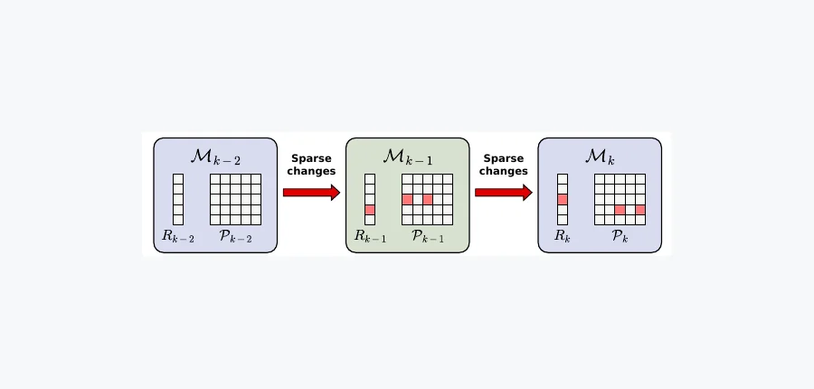 arXiv 2026-11-18 · cs.LG · #15 **[Adaptive Memory for Online Reinforcement Learning under Sparse Model Changes](https://arxiv.org/abs/2611.21879)** Sreejeet Maity , Sukanya Modak , Leonardo F. Toso Affiliation · North Carolina State University / RCC Institute of Information Technology / Columbia University [Paper](https://arxiv.org/abs/2611.21879) · [Figure source](https://arxiv.org/pdf/2611.21879) 

[EN] Abstract
We study the discounted reinforcement learning (RL) problem in a setting where the underlying environment changes between deployments. Each deployment provides $H$ observations from a fixed MDP. The reward function and transition kernel are fixed within each deployment. Across deployments, at most an $\epsilon &gt;0$ fraction of the reward and transition kernel entries may change. In this setting, learning each model to deploy from scratch may discard useful observations from past deployments, whereas pooling all past observations can bias the estimates of entries that have already changed. We then propose an algorithm that for each state and action pair, selects how much history to reuse to estimate the reward and probabilities of the next state. We start with observations from the current deployment and add earlier deployment observations one at a time, the most recent first. After each addition, we check whether a single average reward agrees with the estimates from all histories considered until that point. We apply the same check to the distribution of next states. For each estimate, we leverage the last history that passes these aforementioned checks. The optimal control policy is then computed on top of the fitted MDP. We characterize the average gap between the optimal return and the return of the learner's policies over a finite number of deployments. We demonstrate that when $0&lt; &#124;S&#124;\epsilon \leq 2$, with $&#124;S&#124;$ being the cardinality of the state space, our algorithm needs only the observations from the most recent $O(1/\epsilon)$ deployments, and achieves a long-run average gap of at most $\widetilde{O}(\sqrt{\epsilon/H})$. <a href="https://arxiv.org/list/cs/new?show=2000#2611.21879">Source</a>

[ZH] Abstract
我们研究底层环境在多次部署之间变化的折扣强化学习（RL）问题。每次部署从一个固定MDP提供H条观测，奖励函数和转移核在单次部署内固定。在不同部署间，奖励及转移核条目中最多有比例$\epsilon&gt;0$发生变化。在这种设定下，每次从头学习待部署模型可能丢弃过去有用观测，而汇集全部历史观测又可能使已变化条目的估计产生偏差。我们提出算法，为每个状态—动作对选择复用多少历史来估计奖励和下一状态概率。算法先使用当前部署观测，再由近及远逐一加入更早部署的观测。每次加入后，检查单一平均奖励是否与截至此时考虑的全部历史估计一致，并对下一状态分布执行相同检查。每项估计使用最后一个通过这些检查的历史。随后在拟合MDP上计算最优控制策略。我们刻画有限次部署中最优回报与学习者策略回报的平均差距。我们证明，当$0&lt;&#124;S&#124;\epsilon\leq2$，其中$&#124;S&#124;$为状态空间大小时，算法只需最近$O(1/\epsilon)$次部署的观测，就能达到至多$\widetilde{O}(\sqrt{\epsilon/H})$的长期平均差距。 <a href="https://arxiv.org/list/cs/new?show=2000#2611.21879">Source</a>
 |
|  arXiv 2026-11-18 · cs.LG · #16 **[Weight-space programming for tractor guidance controller: large language models natively write neural network weights that steer a real tractor](https://arxiv.org/abs/2611.21958)** Timo Oksanen Affiliation · Technical University of Munich (TUM) / Munich Institute of Robotics and Machine Intelligence (MIRMI), TUM / Aalto University [Paper](https://arxiv.org/abs/2611.21958) · [Figure source](https://arxiv.org/html/2611.21958v1/figures/amxgtrac.jpg) 

[EN] Abstract
Weight-space programming is a process where a large language model reads and writes the weights of a neural network directly, guided by a natural language specification, without an optimiser or gradient descent. This study applies it to automatic tractor guidance, where a 253-parameter neural network steers along paths of lines and arcs and must be adapted when the machine changes, such as a slower steering actuator. GPT-6 Astra and Claude Fable 5.1 (also 5.2) edited the network for our research tractor using a small budget of simulated evaluations to repair a network trained for another tractor and write a controller into a network with zero weights. We compared them with an evolution strategy, gradient descent and pure pursuit in simulation and on the real tractor. Both models read the network and analysed the closed loop with control theory correctly, and Fable's repair without simulation succeeded only occasionally. With simulated feedback, both models repaired the trained network in single sessions and wrote a working controller from zero weights, whereas from zero the evolution strategy found none. The controllers written from zero were sparse and in a classical cascaded structure; one model edited the trained network while the other replaced it. Gradient descent reached higher accuracy with far more simulation, and all language model controllers steered the real tractor without intervention, with errors of the same order as pure pursuit. Language models can program the weights of a neural controller directly, much as control engineers design one. We call this Weight-Space Engineering. <a href="https://arxiv.org/list/cs/new?show=2000#2611.21958">Source</a>

[ZH] Abstract
权重空间编程是一种过程：大语言模型依据自然语言规格，直接读写神经网络权重，无需优化器或梯度下降。本研究将其用于拖拉机自动引导：一个253参数神经网络沿直线和圆弧路径转向，并需在机器变化时适配，例如转向执行器变慢时。GPT-6 Astra与Claude Fable 5.1（也包括5.2）利用少量模拟评估，为研究用拖拉机编辑网络，修复为另一台拖拉机训练的网络，并向零权重网络写入控制器。我们在模拟和真实拖拉机上，将它们与进化策略、梯度下降及纯追踪比较。两个模型都正确读取网络，并以控制理论分析闭环；Fable不经模拟的修复仅偶尔成功。借助模拟反馈，两模型均在单次会话中修复训练好的网络，并从零权重写出有效控制器，而进化策略从零未找到任何有效控制器。从零写出的控制器稀疏且具有经典级联结构；一个模型编辑了训练网络，另一个将其替换。梯度下降以更多模拟达到更高精度，而全部语言模型控制器都无需干预地操纵真实拖拉机，误差与纯追踪处于相同量级。语言模型能够直接为神经控制器编程权重，如同控制工程师设计控制器。我们将其称为Weight-Space Engineering。 <a href="https://arxiv.org/list/cs/new?show=2000#2611.21958">Source</a>
 | 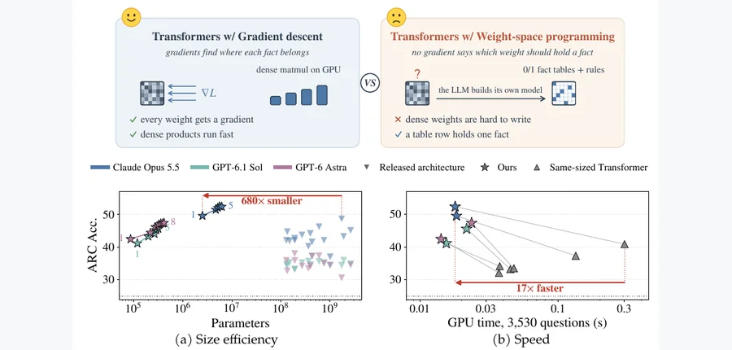 arXiv 2026-11-18 · cs.LG · #17 **[Weight-Space Programming Doesn't Need Transformers](https://arxiv.org/abs/2611.22055)** Hyunjong Ok , Jaeho Lee Affiliation · Pohang University of Science and Technology (POSTECH) [Paper](https://arxiv.org/abs/2611.22055) · [Project](https://wsp-no-transformer.github.io) · [Figure source](https://arxiv.org/pdf/2611.22055) 

[EN] Abstract
Standard neural architectures such as the Transformer were chosen because they train well with gradient descent and run fast on GPUs. In weight-space programming, a large language model (LLM) writes target weights by hand without gradient-based training, so those reasons no longer apply. Should we keep the Transformer? Given minimal guidance, ten labeled examples, and a sandbox, mainly on multiple-choice questions, we task three frontier LLMs with either generating the weights of a fixed architecture or designing the architecture themselves. When free to design, all three compile plain-text facts into a sparse table queried by a fixed procedure, reaching up to 54.4% test accuracy. An LLM-designed model achieves higher test accuracy than the most accurate released Transformer that the same LLM wrote while using about 1,800x fewer parameters. Without gradients, they choose a table, in which the LLM can state what each weight means and can find and rewrite a wrong one. Each wrong answer points to one row, and removing a row changes about one other answer. From this, we propose an associative-memory-based model up to 17x faster on GPUs than a same-sized Transformer. We also test pretrained weights, other benchmarks, and tasks where models generate answers. Pretrained LLMs remain more accurate; the claim concerns which structure to build when writing weights. <a href="https://arxiv.org/list/cs/new?show=2000#2611.22055">Source</a>

[ZH] Abstract
Transformer等标准神经架构被选用，是因为它们适合梯度下降训练，并在GPU上运行很快。在权重空间编程中，大语言模型（LLM）手工写目标权重，不做梯度训练，因此这些理由不再适用。我们还应保留Transformer吗？给定最少指导、十个标注样本和沙箱，主要针对选择题，我们要求三个前沿LLM生成固定架构的权重，或自行设计架构。当可以自由设计时，三者都把明文事实编译成由固定程序查询的稀疏表，测试准确率最高54.4%。一个LLM设计的模型，比该LLM写出的最准确已发布Transformer具有更高测试准确率，同时参数少约1800倍。没有梯度时，它们选择表格；LLM可以说明每个权重的含义，并找到和重写错误权重。每个错误答案指向一行，删除一行大约会改变另一个答案。据此，我们提出一种基于关联记忆的模型，在GPU上比同规模Transformer最高快17倍。我们还测试预训练权重、其他基准及生成答案的任务。预训练LLM仍更准确；本研究的主张针对写权重时应构建何种结构。 <a href="https://arxiv.org/list/cs/new?show=2000#2611.22055">Source</a>
 | 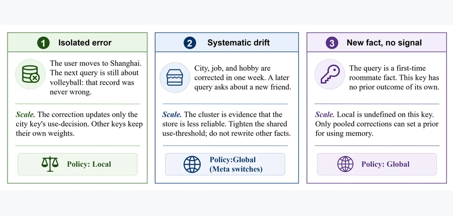 arXiv 2026-11-18 · cs.AI · #18 **[RegimeCouncil: Paired-Evidence Routing For Memory Conflict Governance In LLM Agents](https://arxiv.org/abs/2611.22113)** Qingcan Kang , Mingyang Liu , Shixiong Kai , Tao Zhong , Mingxuan Yuan Affiliation · Huawei Noah’s Ark Lab / City University of Hong Kong [Paper](https://arxiv.org/abs/2611.22113) · [Figure source](https://arxiv.org/html/2611.22113v1/figure1.png) 

[EN] Abstract
Language agents rely on long-term memory to personalize responses across extended interactions, yet stored facts quietly go stale as the world changes, and an agent often learns that using memory hurt only through delayed feedback after acting on an outdated record. Before the memory store is updated, how far should that negative feedback propagate: should it suppress memory use only on future queries for that same fact (a local policy), or also across other stored facts (a global policy)? Existing memory systems implicitly fix one of these two sharing scopes at design time. We formulate this online scope choice under hidden validity and delayed feedback as memory conflict governance, and prove that neither fixed policy is sufficient on its own. We then propose RegimeCouncil, a lightweight paired-evidence router that retains both scopes as advisors and arbitrates between them online without retraining the LLM. Using revealed comparisons between answering with memory and answering without memory (the no-memory anchor), a Local Advisor tracks the latest outcome on the queried fact alone, while a Global Advisor pools recent outcomes across all stored facts. A Meta Governor follows the Local Advisor by default to avoid cross-fact interference and switches to the Global Advisor only when global pooling accumulates a strictly positive recent utility margin, guaranteeing finite-time switching under delayed feedback. Across LongMemEval update streams and real-world historical drift on TempLAMA and TAQA with Qwen3-30B-A3B and GPT-4o, RegimeCouncil outperforms the better fixed-scope policy by 5.2-7.3 points on primary disagreement episodes and across all 30 held-out settings, while ablations show that removing any of its three modules reduces accuracy by 2-7 points. <a href="https://arxiv.org/list/cs/new?show=2000#2611.22113">Source</a>

[ZH] Abstract
语言代理依赖长期记忆实现跨长期交互的个性化回答，但随着世界变化，存储事实会悄然过时，代理常在依赖过时记录行动后，才从延迟反馈中知道记忆造成了损害。在更新记忆库之前，负反馈应传播多远：仅抑制同一事实后续查询的记忆使用（局部策略），还是扩展到其他存储事实（全局策略）？现有记忆系统通常在设计时隐式固定其中一种共享范围。我们将隐含有效性与延迟反馈下的在线范围选择形式化为记忆冲突治理，并证明任一固定策略单独都不充分。我们提出RegimeCouncil，一个轻量配对证据路由器，保留两种范围作为顾问，在线仲裁而不重训LLM。利用有记忆与无记忆回答之间已揭示的比较（无记忆锚点），Local Advisor仅追踪被查询事实的最新结果，Global Advisor汇集全部存储事实的近期结果。Meta Governor默认跟随Local Advisor以避免跨事实干扰，只有全局汇集积累严格为正的近期效用优势时，才切换至Global Advisor，保证延迟反馈下有限时间切换。在使用Qwen3-30B-A3B和GPT-4o的LongMemEval更新流，以及TempLAMA和TAQA真实历史漂移上，RegimeCouncil在主要分歧回合及全部30项留出设定中，比更好的固定范围策略高5.2–7.3个百分点；消融显示，移除三个模块中的任何一个都会使准确率降低2–7个百分点。 <a href="https://arxiv.org/list/cs/new?show=2000#2611.22113">Source</a>
 |
| 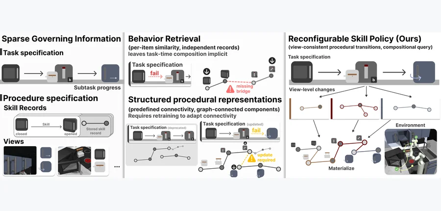 arXiv 2026-11-18 · cs.AI · #19 **[Reconfiguring Procedural Knowledge for Compositional Robot Skill Adaptation](https://arxiv.org/abs/2611.22174)** Daehee Lee , Dongsu Lee , Sanghyun Ahn , Minjong Yoo , Honguk Woo Affiliation · Sungkyunkwan University / University of Texas at Austin / Samsung Electronics [Paper](https://arxiv.org/abs/2611.22174) · [Figure source](https://arxiv.org/html/2611.22174v1/fig/figure_concept.png) 

[EN] Abstract
General-purpose behavior models increasingly internalize broad procedural knowledge during training, making their adaptation to new goals and skill interfaces less a problem of learning entirely new behaviors than of reconfiguring existing competence. We study this capability as reconfigurability, the ability to realize new behaviors by cost-efficiently restructuring existing components and relations under sparse governing information, where task specifications provide high-level goals and procedure specifications expose a limited set of reusable factors, leaving the concrete bindings and compositions required for execution underdetermined. We propose RecPo, a framework that represents skills task-agnostically through multiple procedure views and materializes executable skill sequences by composing stored transitions to realize task-specific changes. RecPo maintains a procedure knowledge base of skill-induced transitions, with each view exposing a reusable factor and preserving local skill connectivity. At deployment, it interprets task specifications through the same views and resolves the resulting compositional queries over the stored relations to bind skills for execution. On long-horizon tasks in an extended Franka Kitchen benchmark, RecPo achieves 91.9% ordered completion with 1.0 ms of task inference per episode across varying procedure support and task-record sparsity. Real-robot studies further demonstrate adaptation through local memory edits without task-specific retraining. <a href="https://arxiv.org/list/cs/new?show=2000#2611.22174">Source</a>

[ZH] Abstract
通用行为模型在训练中逐渐内化广泛程序知识，因此适应新目标与技能接口，与其说是学习全新行为，不如说是重组已有能力。我们将这种能力研究为可重构性：在稀疏支配信息下，通过低成本重构现有组件及关系实现新行为。任务规格提供高层目标，过程规格暴露有限可复用因素，却未充分确定执行所需的具体绑定与组合。我们提出RecPo，通过多个过程视图，以与任务无关的方式表示技能，并组合存储的转移，生成实现任务特定变化的可执行技能序列。RecPo维护由技能导致的转移组成的过程知识库，每个视图暴露一种可复用因素，并保留局部技能连通性。部署时，它通过相同视图解释任务规格，在存储关系上求解组合查询，绑定待执行技能。在扩展Franka Kitchen基准的长时程任务上，跨不同过程支持和任务记录稀疏程度，RecPo实现91.9%有序完成率，每回合任务推理耗时1.0毫秒。真实机器人研究进一步展示，无需任务特定重训即可通过局部记忆编辑实现适配。 <a href="https://arxiv.org/list/cs/new?show=2000#2611.22174">Source</a>
 | 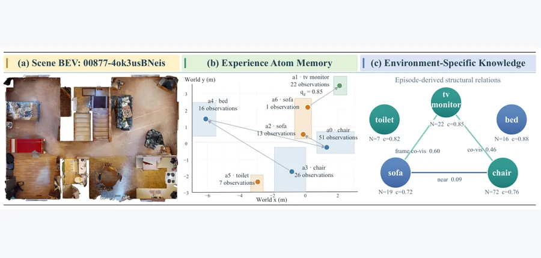 arXiv 2026-11-18 · cs.RO · #20 **[Beyond Episodic Recall: Experience-to-Knowledge Evolution for Lifelong Embodied Navigation](https://arxiv.org/abs/2611.22321)** Weitao An , Chenghao Xu , Xu Yang , Cheng Deng Affiliation · Xidian University / Hohai University [Paper](https://arxiv.org/abs/2611.22321) · [Figure source](https://arxiv.org/html/2611.22321v1/3atom.png) 

[EN] Abstract
Lifelong embodied navigation requires agents to accumulate experience through continuous interaction and reuse it for subsequent goal searches. Existing memory-enhanced methods typically retain historical observations or construct structured scene representations. However, storing observations or high-dimensional semantic embeddings incurs growing storage costs. Meanwhile, structured representations support retrieval and semantic reasoning but do not explicitly evolve accumulated experience into environment-specific knowledge. To address these limitations, we propose Experience-Evolving Memory (EvoNav), a novel two-timescale memory framework. It organizes semantic observations, spatial relations, and task-feedback cues into sparse experience atoms. During online operation, experience atoms continually consolidate repeated observations and form dynamic links based on transitions. At the slower timescale, EvoNav distills accumulated category co-occurrences and feedback signals into environment-specific structural knowledge without relying on predefined object--room relations. For each new goal, EvoNav combines direct goal evidence from experience atoms with learned structural knowledge to guide goal-directed search on the current traversability map. Experiments on single-goal, sequential multi-floor, and multimodal navigation demonstrate effective experience reuse and improved path efficiency with compact persistent memory, together with successful transfer to a real robot. <a href="https://arxiv.org/list/cs/new?show=2000#2611.22321">Source</a>

[ZH] Abstract
终身具身导航要求代理通过持续交互积累经验，并复用于后续目标搜索。现有记忆增强方法通常保留历史观测，或构建结构化场景表示。然而，存储观测或高维语义嵌入会使存储成本不断增长；结构化表示虽然支持检索和语义推理，却没有显式将累积经验进化为环境特定知识。我们提出Experience-Evolving Memory（EvoNav），一种双时间尺度记忆框架。它将语义观测、空间关系和任务反馈线索组织为稀疏经验原子。在线运行时，经验原子持续巩固重复观测，并基于转移形成动态连接。在较慢时间尺度，EvoNav将累积类别共现与反馈信号蒸馏为环境特定结构知识，无需预定义物体—房间关系。对每个新目标，EvoNav结合经验原子的直接目标证据和学到的结构知识，在当前可通行地图上引导目标搜索。单目标、顺序多楼层和多模态导航实验显示，紧凑持久记忆能够有效复用经验、提高路径效率，并成功迁移到真实机器人。 <a href="https://arxiv.org/list/cs/new?show=2000#2611.22321">Source</a>
 | 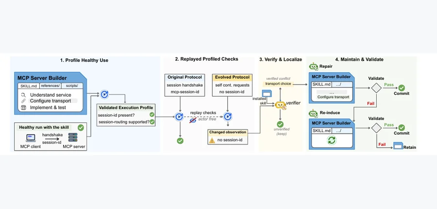 arXiv 2026-11-18 · cs.AI · #21 **[When Agent Skills Go Stale: Runtime Behavior and Selective Maintenance in Evolving Environments](https://arxiv.org/abs/2611.22525)** Ömer Faruk Akgül , Shuli Jiang , Yuting Zhang , Yi Zhang , Xiaohan Fei , Wei Xia , Stefano Soatto Affiliation · University of Southern California / AWS Agentic AI [Paper](https://arxiv.org/abs/2611.22525) · [Figure source](https://arxiv.org/pdf/2611.22525) 

[EN] Abstract
Agent skills use past experience and current observations to guide decisions and actions on related tasks. This experience is retained in skill state, whose reuse can amortize inference-time reasoning and environment interaction. When environment changes, parts of this state can become outdated while others remain useful. Across four task settings and two models, we compare skill reuse before and after environment changes. Previously beneficial skills can reduce task performance by over 10 percentage points or increase execution cost by nearly 40% relative to no skill. Task success can also remain unchanged while execution savings decline. These effects depend on which environment-specific details become outdated and the agent's ability to compensate using current observations. We introduce selective maintenance, which replays checks from successful executions without additional model calls. It verifies whether observed differences conflict with skill state, repairs affected content, and validates updates, rebuilding when local repair is insufficient. No description of the change is supplied. Relative to reusing stale state, maintenance improves task accuracy by up to 67pp and reduces execution steps by up to 37%. These results suggest that preserving a skill's inference time value as environments evolve requires selectively maintaining its state. <a href="https://arxiv.org/list/cs/new?show=2000#2611.22525">Source</a>

[ZH] Abstract
代理技能利用过去经验和当前观测，引导相关任务的决策与动作。这些经验保存在技能状态中，其复用能够摊销推理时思考与环境交互。当环境变化时，部分状态可能过时，其他部分仍有用。我们在四种任务设定和两个模型上，比较环境变化前后的技能复用。此前有益的技能，相对无技能可能使任务表现下降超过10个百分点，或使执行成本增加近40%。任务成功率也可能不变，但执行节省下降。这些效应取决于哪些环境细节过时，以及代理利用当前观测补偿的能力。我们提出选择性维护，无需额外模型调用即可回放成功执行的检查。它验证观测差异是否与技能状态冲突，修复受影响内容，并验证更新；局部修复不足时则重建。系统没有获得变化描述。相对复用过时状态，维护最多使任务准确率提高67个百分点，执行步数减少37%。结果提示，在环境演变中保持技能的推理时价值，需要有选择地维护其状态。 <a href="https://arxiv.org/list/cs/new?show=2000#2611.22525">Source</a>
 |
| 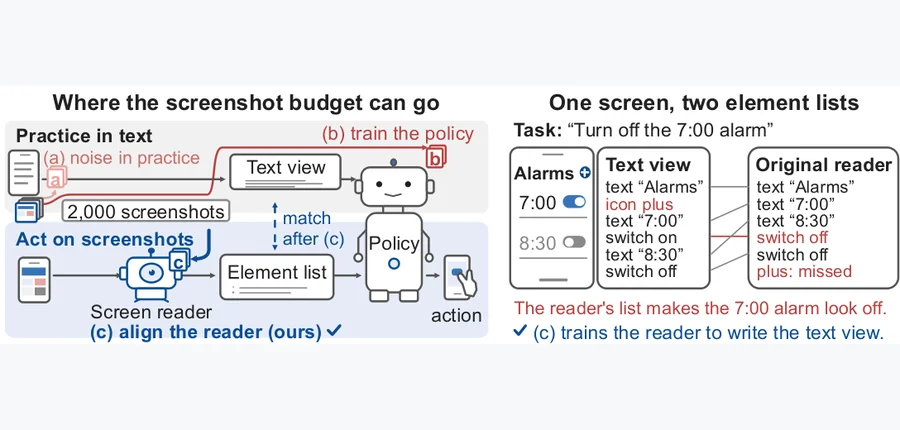 arXiv 2026-11-18 · cs.CV · #22 **[Practice in Text, Act in Pixels: Correcting Where Perception Fails](https://arxiv.org/abs/2611.22722)** Zhongling Xu , Hairong Wang Affiliation · University of Texas at Austin [Paper](https://arxiv.org/abs/2611.22722) · [Code](https://github.com/Carlxuzhl/practice-in-text) · [Figure source](https://arxiv.org/html/2611.22722v1/fig1_illustrated.png) 

[EN] Abstract
GUI agents can learn cheaply from a text view of an interface and act on screenshots through a vision-language screen reader. Yet on a simulated mobile platform with a low-cost reader, policies that complete most tasks in text fail on many of the same tasks on screenshots. We ask where a small budget of real screenshots is best spent to close this gap. We find that the reader's misreads are systematic and recur on the same interface elements. Noise matched to the reader's error rates, a natural sim-to-real remedy, misses this structure, and in a pre-specified comparison it did not beat training the policy directly on screenshots. We therefore correct the misreads at their source with reader alignment, which fine-tunes the reader on screenshots paired with their text views. The reader learns to output each screen's text view, as in text practice, and the policy stays unchanged. Spent on the reader, the screenshot budget gives 80.9% full-task success on new task instances, against 55.6% when spent on training the policy. Given the same labeled screenshots, adapting the reader also beats adapting the policy, and a single aligned reader improves every text-trained policy we tried without retraining any of them. <a href="https://arxiv.org/list/cs/new?show=2000#2611.22722">Source</a>

[ZH] Abstract
GUI代理可以从界面文本视图中低成本学习，再通过视觉语言屏幕读取器在截图上行动。然而，在使用低成本读取器的模拟移动平台上，能在文本中完成多数任务的策略，在截图上却会失败于很多相同任务。我们研究，应将有限真实截图预算投向哪里，才能弥合差距。我们发现，读取器的误读具有系统性，并反复发生于相同界面元素。与读取器错误率匹配的噪声，是一种自然的仿真到真实补救，却未捕捉这种结构；预先规定的比较中，它未超越直接在截图上训练策略。因此，我们通过读取器对齐从源头修正误读：使用截图及配对文本视图微调读取器。读取器学习输出每个屏幕的文本视图，与文本练习一致，而策略保持不变。将截图预算用于读取器，在新任务实例上达到80.9%完整任务成功率，用于训练策略时为55.6%。给定相同标注截图，适配读取器也优于适配策略，且一个对齐读取器无需重训任何策略，就能改善测试过的每个文本训练策略。 <a href="https://arxiv.org/list/cs/new?show=2000#2611.22722">Source</a>
 | 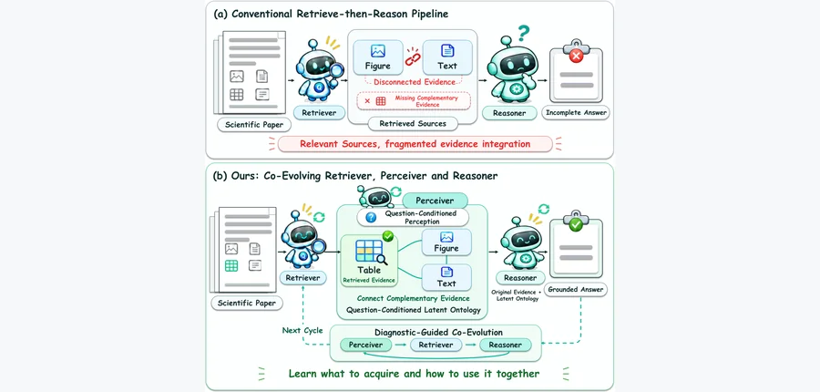 arXiv 2026-11-18 · cs.AI · #23 **[Synergizing Evidence Retrieval and Utilization for Self-Improving Multimodal Scientific Document Reasoning](https://arxiv.org/abs/2611.22837)** Frank Nie , Ethan B. Liu , Yuan Zhu , Jindong Han Affiliation · Shandong University [Paper](https://arxiv.org/abs/2611.22837) · [Figure source](https://arxiv.org/html/2611.22837v1/intro.png) 

[EN] Abstract
Scientific document reasoning requires an agent to acquire and integrate evidence distributed across text, figures, and tables. Retrieval can identify relevant sources while missing complementary support, and answer-level feedback alone does not reveal whether an error stems from evidence acquisition or evidence use. We present an agentic Retriever--Perceiver--Reasoner framework for multimodal scientific document reasoning. The Retriever sequentially selects source-aligned evidence under a context budget. Given the selected evidence and question, the Perceiver constructs a question-conditioned latent ontology, an implicit organization of multimodal evidence in a shared continuous space. The Reasoner combines this latent guidance with the original sources to produce grounded answers. We train the three components through diagnostic-guided co-evolution: alternating updates optimize them with a shared answering reward, while Retrieval Potential Feedback (RPF) and Latent Efficacy Feedback (LEF) identify questions that need better retrieval or latent guidance and direct targeted resampling. Across four benchmarks and seven evaluation settings, our framework obtains average scores of 69.9 and 75.0 with 7B and 8B Reasoner backbones, exceeding the strongest baseline by 4.0 and 9.1 points, respectively. <a href="https://arxiv.org/list/cs/new?show=2000#2611.22837">Source</a>

[ZH] Abstract
科学文档推理要求代理获取并整合分散在文本、图像和表格中的证据。检索可能找到相关来源，却遗漏互补支持；答案级反馈本身也无法揭示错误源于证据获取还是证据使用。我们提出用于多模态科学文档推理的代理式Retriever–Perceiver–Reasoner框架。Retriever在上下文预算内依次选择与来源对齐的证据。给定所选证据与问题，Perceiver构建以问题为条件的潜在本体，即在共享连续空间中对多模态证据的隐式组织。Reasoner结合这种潜在引导和原始来源，生成有依据的答案。我们通过诊断引导共同进化训练三个组件：交替更新利用共享回答奖励优化它们，同时Retrieval Potential Feedback（RPF）和Latent Efficacy Feedback（LEF）识别需要更好检索或潜在引导的问题，并定向重采样。在四个基准和七个评估设定上，使用7B和8B Reasoner骨干的框架分别获得69.9和75.0平均分，比最强基线分别高4.0和9.1个百分点。 <a href="https://arxiv.org/list/cs/new?show=2000#2611.22837">Source</a>
 | 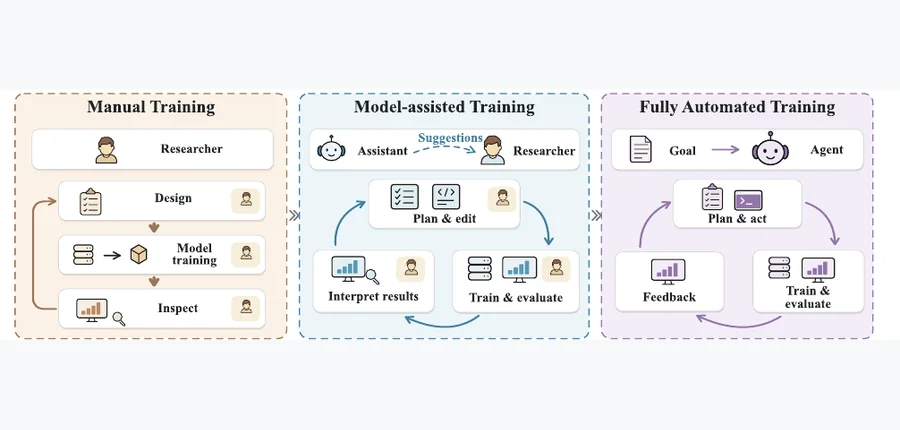 arXiv 2026-11-18 · cs.AI · #24 **[RSI-Prime: Training Models to Train Models](https://arxiv.org/abs/2611.23138)** Dewu Zheng , Yang Ye , Hongyu Zhang , Jun Yu , Yanlin Wang Affiliation · Sun Yat-sen University / Mind Lab / Chongqing University / Harbin Institute of Technology, Shenzhen [Paper](https://arxiv.org/abs/2611.23138) · [Figure source](https://arxiv.org/pdf/2611.23138) 

[EN] Abstract
Enabling large language models (LLMs) to autonomously conduct training and improve target models is an important foundation for recursive self-improvement (RSI). As LLMs expand their role from being trained to conducting training, their model-training capability warrants dedicated study and systematic development. To this end, we construct RSI-Prime, a dataset for improving model-training capability, comprising 350 complete experimental trajectories across seven task categories. To help LLMs learn to make high-quality experimental decisions from training practice, we perform fine-grained decision identification and quality annotation, then apply decision-level loss masking to exclude supervision on low-quality behavior. Experiments with GLM-5.3 on PostTrainBench, a benchmark for autonomous post-training, show that training on RSI-Prime yields a 31.95% relative improvement in overall performance over the original GLM-5.3, highlighting a path toward future RSI systems in which models autonomously sustain their own advancement. <a href="https://arxiv.org/list/cs/new?show=2000#2611.23138">Source</a>

[ZH] Abstract
使大语言模型（LLM）能够自主实施训练、改善目标模型，是递归自我改进（RSI）的重要基础。随着LLM从被训练扩展到实施训练，其模型训练能力需要专门研究和系统发展。为此，我们构建RSI-Prime，一个提升模型训练能力的数据集，包含七类任务的350条完整实验轨迹。为帮助LLM从训练实践中学习高质量实验决策，我们进行细粒度决策识别和质量标注，再应用决策级损失掩码，排除低质量行为的监督。在自主后训练基准PostTrainBench上，使用GLM-5.3的实验表明，在RSI-Prime上训练，相对原始GLM-5.3使总体表现提升31.95%，展示未来由模型自主持续推进自身发展的RSI系统的一条路径。 <a href="https://arxiv.org/list/cs/new?show=2000#2611.23138">Source</a>
 |
| 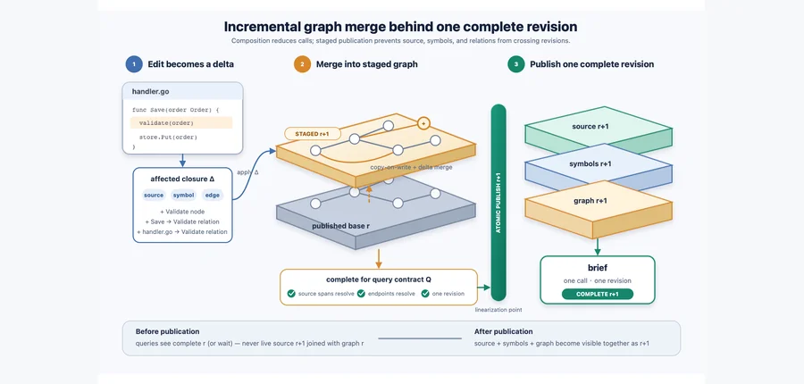 arXiv 2026-11-18 · cs.SE · #25 **[Revision-Consistent Code Context for Agents That Edit Their Environment](https://arxiv.org/abs/2611.21616)** Meng Shi Affiliation · Independent Researcher [Paper](https://arxiv.org/abs/2611.21616) · [Figure source](https://arxiv.org/html/2611.21616v1/figures/complete_revision_overview.png) 

[EN] Abstract
Editing agents query repositories while simultaneously changing them. Source content, symbols, graph relations, and retrieval state may be maintained by different stores and refreshed at different times. During an update, a successful query can therefore combine facts that never belonged to the same repository state. We call this condition mixed-revision code context. This paper proposes an Agent-visible complete-revision publication contract for composite code-intelligence queries. Before a query-visible publication point, a service must wait, report unavailability, or serve a complete old revision; after that point, it serves the complete new revision. The contract requires a shared version identity and publication boundary across every view returned in one response. We instantiate the method in Codetrip, whose brief operation joins source, symbol, and graph facts. In a controlled comparison on frozen Gin v1.12.0, live-source composition produced two unsafe responses in 150 update trials, whereas complete-revision publication produced none under the same five edit scenarios. We further implement journaled, idempotent publication and terminate the real MCP process at five durable boundaries. All 300 evaluable recovery trials on frozen Gin and Cobra returned complete-new context equivalent to a clean full rebuild, with median restart-to-context latency of 77--131 ms. In a separate rename probe, mixed context occurred in 0/30 Codetrip trials and 30/30 trials for both CodeGraph and codebase-memory-mcp before clean-full-equivalent convergence. The contribution is an Agent-facing safety contract, implementation pattern, and measurement protocol for joining live repository bytes with asynchronously derived facts. Every successful composite response consequently has a testable repository-state meaning, including after interruption. <a href="https://arxiv.org/list/cs/new?show=2000#2611.21616">Source</a>

[ZH] Abstract
编辑代理一边查询代码库，一边修改它。源码内容、符号、图关系和检索状态，可能由不同存储维护，并在不同时间刷新。因此，更新期间成功的查询可能组合出从未属于同一代码库状态的事实。我们将此称为混合修订代码上下文。本文针对复合代码智能查询提出代理可见的完整修订发布契约。在查询可见发布点之前，服务必须等待、报告不可用，或提供完整旧修订；发布点之后，则提供完整新修订。契约要求单个响应返回的所有视图共享版本标识与发布边界。我们在Codetrip中实例化该方法，其brief操作连接源码、符号和图事实。在冻结Gin v1.12.0的受控比较中，实时源码组合在150次更新试验中产生两个不安全响应，完整修订发布在相同五种编辑场景下为零。我们进一步实现带日志、幂等发布，并在五个持久化边界终止真实MCP进程。在冻结Gin和Cobra的全部300次可评估恢复试验中，系统返回与干净完整重建等价的完整新上下文，重启到上下文的中位延迟为77–131毫秒。在单独重命名探测中，Codetrip的混合上下文为0/30次，CodeGraph和codebase-memory-mcp在收敛到完整重建等价状态前均为30/30次。贡献是连接实时代码库字节与异步派生事实的代理可见安全契约、实现模式和测量协议。因此，每次成功复合响应，包括中断后，都有可测试的代码库状态含义。 <a href="https://arxiv.org/list/cs/new?show=2000#2611.21616">Source</a>
 | 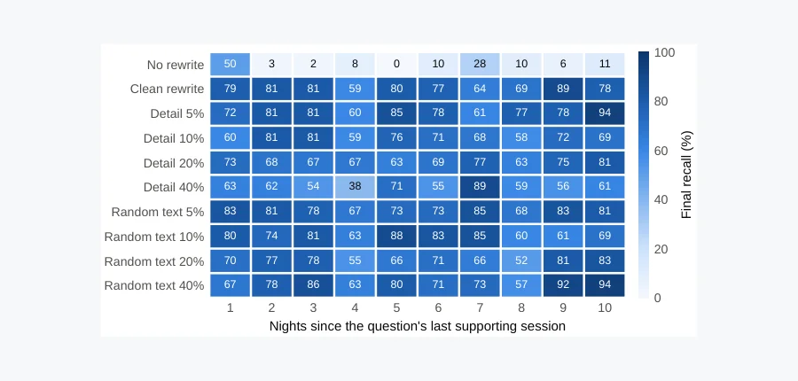 arXiv 2026-11-18 · cs.CL · #26 **[Can an LLM dream? Testing the overfitted brain hypothesis on an agent with text memory](https://arxiv.org/abs/2611.21648)** Eric Zou Affiliation · University of Waterloo [Paper](https://arxiv.org/abs/2611.21648) · [Figure source](https://arxiv.org/html/2611.21648v1/fig_delay.png) 

[EN] Abstract
Hoel (2021) proposed that dreams distort replayed experience so that the brain does not overfit to recent events. We test this hypothesis on an LLM agent (Claude Opus 5.5) that stores what it learns in a text memory and rewrites that memory each night from the day's conversation transcript. The agent goes through ten simulated days of conversation built from LongMemEval. We corrupt 5, 10, 20 or 40 percent of the transcript's turns before each nightly rewrite in one of two ways. Detail corruption changes one or two details in a turn to plausible wrong ones, or replaces the turn with one by the same speaker from an earlier day. Random-text corruption replaces half of the selected turns with a passage of Moby-Dick and inserts Moby-Dick words into the other half. A size limit on the memory, rising from 19,500 to 117,000 tokens over ten nights, set from human free-recall data, forces it to forget. We learned that corruption did not help the agent apply what it learned in earlier conversations to new tasks in any of 30 runs (ten conditions, three different conversation histories). Replacing details in 40 percent of turns lowered recall from 76 to 60 percent. Random text had no consistent effect on recall, with a paired difference of 0 $\pm$ 2 points at 40 percent, because the model recognized it as corrupted and left it out of memory. Replaced details were stored as fact even when another turn held the correct value, and the agent answered 40 percent of those questions correctly, compared with 75 percent without corruption. These results suggest that a pretrained model can separate corrupted text from real events, so a fair test needs a learner that cannot make this separation as easily, such as a model fine-tuned on the corrupted days or an agent whose days take place in an invented world. <a href="https://arxiv.org/list/cs/new?show=2000#2611.21648">Source</a>

[ZH] Abstract
Hoel（2021）提出，梦会扭曲重放经验，使大脑不至于过拟合近期事件。我们在一个LLM代理（Claude Opus 5.5）上测试该假说：它将所学存入文本记忆，并每晚根据当天对话转录改写记忆。代理经历由LongMemEval构建的十个模拟对话日。在每晚改写前，我们用两种方式之一破坏转录中5%、10%、20%或40%的轮次。细节破坏将一轮中的一两个细节改为看似合理的错误值，或替换为同一说话者更早一天的轮次。随机文本破坏将一半选中轮次替换为《白鲸》片段，并向另一半插入《白鲸》词语。依据人类自由回忆数据设定的记忆大小限制，十晚从19,500增加到117,000 token，迫使它遗忘。我们发现，在30次运行（十种条件、三段不同对话历史）中，破坏均未帮助代理将早期对话所学应用于新任务。替换40%轮次的细节，使回忆率从76%降至60%。随机文本对回忆没有一致效应，40%比例下配对差为$0\pm2$个百分点，因为模型识别出破坏文本并不将其写入记忆。被替换细节即使在另一轮包含正确值时，仍被当作事实存储；代理对这些问题答对40%，无破坏时为75%。结果提示，预训练模型能够区分破坏文本与真实事件，因此公平测试需要不易作此区分的学习者，例如在被破坏日程上微调的模型，或生活在虚构世界中的代理。 <a href="https://arxiv.org/list/cs/new?show=2000#2611.21648">Source</a>
 | 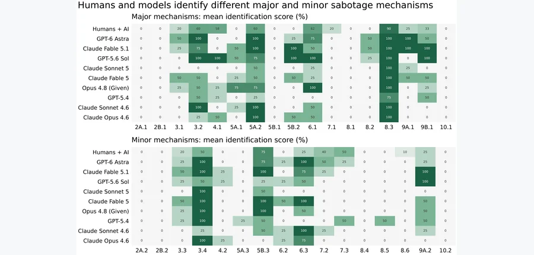 arXiv 2026-11-18 · cs.AI · #27 **[Auditors Struggle to Catch Sabotage In End-to-End Transcripts of AI Safety Research](https://arxiv.org/abs/2611.21832)** Keshav Shenoy , Anthony Zang , Eric Gan , Jacqueline Tay , Amy Ngo , Sebastian Prasanna , Julian Stastny , Vivek Hebbar Affiliation · Redwood Research / Georgia Institute of Technology / Independent / Equistamp [Paper](https://arxiv.org/abs/2611.21832) · [Figure source](https://arxiv.org/html/2611.21832v1/figure_D5.png) 

[EN] Abstract
As AI systems are increasingly used to automate AI R&amp;D, misaligned systems could sabotage research intended to improve model safety and alignment. To stress-test defenses against such sabotage, we use a human expert as a proxy saboteur on AI safety research. We conduct a red-team/blue-team game where a human researcher runs AI safety experiments from scratch and auditors try to tell which were sabotaged and how. Given access to the full research transcript and the ability to run experiments, human auditors mostly fail to distinguish sabotaged from benign research: they achieve an AUROC of 0.59, not significantly better than chance, and fully identify the specific sabotage in only 17% of cases. Despite not being allowed to run experiments, the best frontier models outperform human auditors (Fable 5.1: AUROC 0.73, 32% full identification) within noise and weaker models perform comparably. When the saboteur chooses which experiments are attacked, rather than being required to sabotage every question given, sabotage identification drops further. Our results suggest that research sabotage by expert-level agents is difficult to detect with current auditing methods and provide a new setting for studying research sabotage. <a href="https://arxiv.org/list/cs/new?show=2000#2611.21832">Source</a>

[ZH] Abstract
随着AI系统越来越多地用于自动化AI研发，不对齐系统可能破坏原本旨在提升模型安全和对齐的研究。为压力测试针对这种破坏的防御，我们以人类专家作为AI安全研究的代理破坏者。我们开展红队/蓝队游戏：一位人类研究者从头运行AI安全实验，审计者尝试辨别哪些被破坏，以及如何破坏。尽管能访问完整研究转录并运行实验，人类审计者大多无法区分被破坏与正常研究：AUROC为0.59，与随机水平差异不显著，仅17%的案例完整识别具体破坏。尽管不允许运行实验，最强前沿模型表现高于人类审计者（Fable 5.1：AUROC 0.73，完整识别率32%），但差异处于噪声范围内；较弱模型表现相当。当破坏者可以选择攻击哪些实验，而非必须破坏给定每个问题时，识别率进一步下降。结果提示，专家级代理的研究破坏很难用现有审计方法检测，并提供研究此类破坏的新场景。 <a href="https://arxiv.org/list/cs/new?show=2000#2611.21832">Source</a>
 |
| 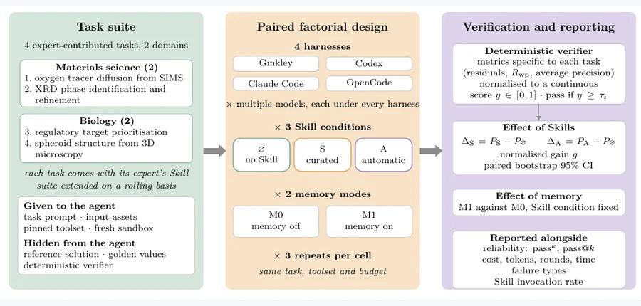 arXiv 2026-11-18 · cs.AI · #28 **[SkillBuffBench: Measuring What Agent Skills Contribute across Harnesses, Models, Skill Access Modes and Memory](https://arxiv.org/abs/2611.22017)** Gengyue Dong , Ye Wei , Zheng Zhu , Yidong Han , Jiale Miao , Xiaojun Jia , Guanghui Li Affiliation · University of Oxford / Imperial College London / University College London / Nanyang Technological University / BraneMatrix AI [Paper](https://arxiv.org/abs/2611.22017) · [Figure source](https://arxiv.org/pdf/2611.22017) 

[EN] Abstract
Agent Skills, file-based packages of procedural knowledge that a coding agent can discover and load on demand, are now shipped by every major agent harness, yet the evidence for how much they help comes almost entirely from settings in which the right Skill is hand-picked for the task and the agent starts from a blank slate. Neither holds in deployment, where an agent chooses from whatever library happens to be installed and frequently carries memory from earlier work. We present SkillBuffBench, a benchmark and paired evaluation protocol that treats Skill access as a three-level factor (no Skill, a curated Skill, and automatic invocation from an installed library), crosses it with memory (off and on), with four agent harnesses and with multiple models (the state-of-the-art proprietary models from Anthropic, Google and OpenAI, and the state-of-the-art open-weight models from Chinese providers), every model being run under every harness, and evaluates the result on research tasks contributed by domain experts together with the Skills they use, currently in materials science and biology, with the suite extended on a rolling basis. Every run is marked by a deterministic verifier; uncertainty is reported with a paired, task-level bootstrap; and cost, agent rounds and wall-clock time are reported alongside the score rather than folded into it. This version of the paper describes the design of the benchmark, its evaluation protocol and its current tasks and Skills. The evaluation is in progress: results will be added once the runs are complete, and the task suite, results and analysis will continue to be updated on a rolling basis. <a href="https://arxiv.org/list/cs/new?show=2000#2611.22017">Source</a>

[ZH] Abstract
Agent Skills是编码代理可按需发现和加载的文件式程序知识包，现已由所有主要代理框架提供。然而，其有效性证据几乎全部来自人为为任务选择正确技能、代理从空白状态开始的场景。这两点在部署中都不成立：代理从已安装库中选择技能，且经常携带此前工作的记忆。我们提出SkillBuffBench，一个基准及配对评估协议，将技能访问作为三级因素（无技能、人工选定技能、从已安装库自动调用），与记忆关闭/开启、四种代理框架及多个模型交叉；模型包括Anthropic、Google、OpenAI最先进专有模型，以及中国提供商最先进开放权重模型，每个模型在每个框架中运行。评估任务由领域专家贡献，并附其所用技能，目前覆盖材料科学与生物学，套件持续扩展。每次运行由确定性验证器评分；使用配对任务级bootstrap报告不确定性；成本、代理轮数和墙钟时间与分数并列报告，而不合并入分数。本文版本描述基准设计、评估协议及当前任务和技能。评估正在进行：运行完成后会加入结果，任务套件、结果和分析也将持续滚动更新。 <a href="https://arxiv.org/list/cs/new?show=2000#2611.22017">Source</a>
 | 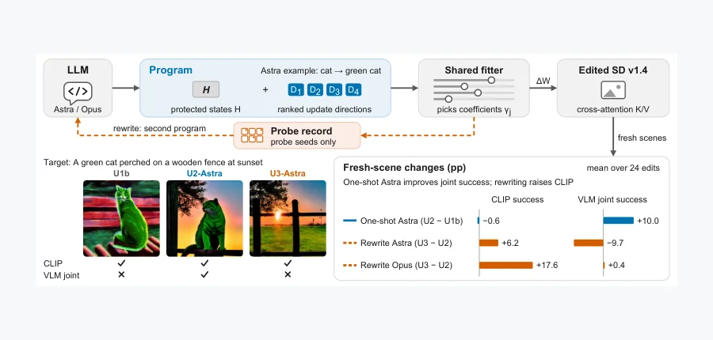 arXiv 2026-11-18 · cs.LG · #29 **[What Does Weight-Space Programming Add to Diffusion Editing? Program Construction versus Score-Guided Refinement](https://arxiv.org/abs/2611.22228)** Zitian Gao , Jingyi Xu , Ziqi Han , Chengkai Lei , Ye Liu , Liangliang Shi Affiliation · Fudan University / Shanghai Institute for Mathematics and Interdisciplinary Sciences / Tencent / Northwest University [Paper](https://arxiv.org/abs/2611.22228) · [Figure source](https://arxiv.org/html/2611.22228v1/fig1_v2.png) 

[EN] Abstract
Weight-space programming (WSP) lets a language model construct executable weight updates for another network. We study diffusion concept editing through an interface in which programs define training contexts, preservation constraints and update directions, while a shared numerical fitter selects their coefficients. We compare generated programs with published editors, a shared-panel hand-written baseline and budget-matched search over conventional edits on 24 TIMED test edits for Stable Diffusion 1.4. The preregistered rewrite pipeline shows no advantage over the strong baseline. In an exploratory comparison, one-shot Astra programs improve fresh-scene VLM joint success, which requires subject presence together with whole-image target matching, by +10.0 points over the shared-panel baseline, while CLIP relative match shows no detectable change. These programs organise adjustable directions around protected text-state subspaces. Probing and rewriting the Astra programs then raises CLIP by +6.2 points while joint success changes by -9.7. On a fixed 144-image sample, five additional evaluators give point estimates in the same directions under whole-image target matching; checks of subject-local change give less decisive differences. Together, these results identify useful behaviour in complete generated programs and show that score-guided revision need not preserve it: program construction and revision should be evaluated as distinct stages of a WSP pipeline. <a href="https://arxiv.org/list/cs/new?show=2000#2611.22228">Source</a>

[ZH] Abstract
权重空间编程（WSP）允许语言模型为另一个网络构建可执行权重更新。我们研究扩散概念编辑：接口中的程序定义训练上下文、保留约束和更新方向，而共享数值拟合器选择其系数。我们在Stable Diffusion 1.4的24项TIMED测试编辑上，将生成程序与已发表编辑器、共享面板手写基线，以及预算匹配的传统编辑搜索比较。预注册重写管线相对强基线没有优势。在探索性比较中，一次生成的Astra程序相对共享面板基线，将新场景VLM联合成功率——同时要求主体存在和整图目标匹配——提高10.0个百分点，而CLIP相对匹配没有可检测变化。这些程序围绕受保护文本状态子空间组织可调整方向。随后探测和重写Astra程序，使CLIP提高6.2个百分点，联合成功率却下降9.7个百分点。在固定144张图像样本上，五种额外评估器对整图目标匹配给出相同方向的点估计；检查主体局部变化时，差异较不确定。这些结果识别出完整生成程序中的有用行为，并显示分数引导修订未必保留它：程序构建和修订应作为WSP管线的不同阶段分别评估。 <a href="https://arxiv.org/list/cs/new?show=2000#2611.22228">Source</a>
 | 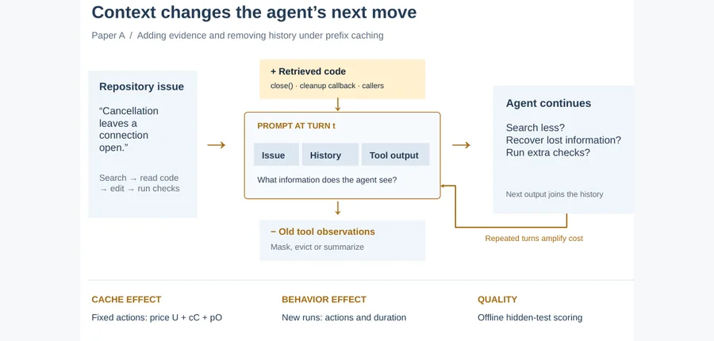 arXiv 2026-11-18 · cs.AI · #30 **[Context Has a Price: Adding and Removing Context for LLM Coding Agents under Prefix Caching](https://arxiv.org/abs/2611.22238)** Zerui Yang , Miaomiao Dong , Quan Xue , Chaorui Zhang , Xuanyu Zheng , Xiyuan Wang , Haolin Ruan , Xueyan Niu , Guangcheng… Affiliation · Huawei Technologies Ltd. [Paper](https://arxiv.org/abs/2611.22238) · [Figure source](https://arxiv.org/pdf/2611.22238) 

[EN] Abstract
Coding agents repeatedly send their conversation history to a language model. Adding useful code may reduce search, while removing old tool outputs may shorten later prompts. But do these changes reduce the cost of solving a task? We study this as a measurement problem in more than 20,000 runs of open models on SWE-bench Verified, SWE-bench and Loc-Bench. We account separately for uncached input, cached input and output tokens. Three findings emerge. First, in our main evidence-package experiments, retrieved code reduces read and search commands by 18--34%, but increases cost by 33--42% when cached input costs one tenth of uncached input, without a measurable improvement in resolution. Second, removing old observations can either save money or increase cost: the same approach saves 19--36% without a cache discount but increases cost by 38--116% with a tenth-price cache. Third, shorter prompts do not guarantee cheaper runs because agents may respond by taking more steps. We also find that concurrent experiments can share cached prefixes and distort cost comparisons. These results show why context-management methods should be evaluated using both token prices and the agent's subsequent behavior. <a href="https://arxiv.org/list/cs/new?show=2000#2611.22238">Source</a>

[ZH] Abstract
编码代理反复将对话历史发给语言模型。添加有用代码可能减少搜索，移除旧工具输出可能缩短后续提示。但这些改变是否降低解题成本？我们将其作为测量问题，在SWE-bench Verified、SWE-bench和Loc-Bench上开展超过20,000次开放模型运行，分别计量未缓存输入、缓存输入和输出token。三项发现如下。首先，在主要证据包实验中，检索代码减少18–34%的读取和搜索命令，但当缓存输入单价为未缓存输入十分之一时，成本增加33–42%，解决率没有可测改善。其次，删除旧观测可能省钱，也可能增加成本：同一方法在无缓存折扣时节省19–36%，在十分之一缓存价格下却增加38–116%成本。第三，短提示并不保证便宜，因为代理可能随后执行更多步骤。我们还发现，并发实验可能共享缓存前缀，扭曲成本比较。这些结果显示，应同时依据token价格和代理后续行为评估上下文管理方法。 <a href="https://arxiv.org/list/cs/new?show=2000#2611.22238">Source</a>
 |
| 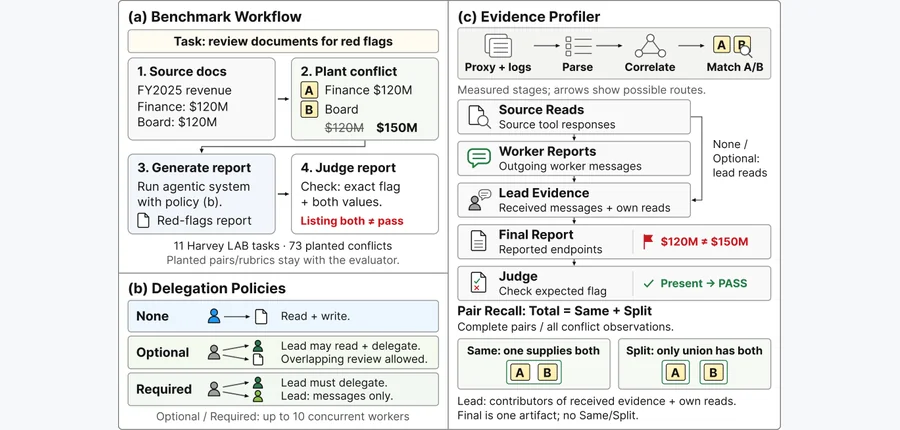 arXiv 2026-11-18 · cs.AI · #31 **[Multi-Agent Memory Inconsistency: Where Factual Conflicts Disappear in LLM Agents](https://arxiv.org/abs/2611.22245)** Hejia Zhang , Zhongming Yu , Yimin Ding , Wei-Ting Chen , Hengjia Yu , Wentao Ni , Yijun Liu , Cong Xu , Xin Chen , Matrix… Affiliation · UC San Diego / Intel / Hewlett Packard Enterprise [Paper](https://arxiv.org/abs/2611.22245) · [Figure source](https://arxiv.org/html/2611.22245v1/benchmark-metrics.png) 

[EN] Abstract
Multi-agent delegation lets LLM systems distribute evidence collection across workers with separate contexts. This creates a consistency challenge: facts retrieved by workers may be missing from the evidence available to the lead for a joint conclusion. We introduce a benchmark and evidence-flow profiler for studying multi-agent memory inconsistency through controlled factual conflicts in Harvey LAB document-review tasks. Pooled across three models with comparable generation spending, requiring delegation increases retrieval of both conflicting claims from 50.2% to 68.7% relative to single-agent execution, yet conflict detection falls from 16.2% to 13.2%. Within this setting, workers report both claims for only 35.2% of retrieved pairs, and pooled matched comparisons show higher detection than single-agent execution when one worker reads both claims but lower detection when the claims are split across workers. Worker-to-lead handoffs are a central target for improving conflict detection in multi-agent LLMs. <a href="https://arxiv.org/list/cs/new?show=2000#2611.22245">Source</a>

[ZH] Abstract
多代理委派允许LLM系统将证据收集分散给上下文彼此独立的工作代理。这产生一致性挑战：工作代理检索到的事实，可能没有进入主代理用于联合结论的证据。我们引入基准和证据流剖析器，通过Harvey LAB文档审阅任务中的受控事实冲突，研究多代理记忆不一致。在生成支出可比的三个模型上汇总，强制委派相对单代理执行，将检索到两个冲突主张的比例从50.2%提高到68.7%，但冲突检测从16.2%降至13.2%。在这一设定内，工作代理仅对35.2%的已检索成对主张同时报告二者；汇总配对比较显示，当同一工作代理读到两个主张时，检测高于单代理；当主张分散于不同工作代理时，则更低。工作代理向主代理的交接，是改善多代理LLM冲突检测的核心目标。 <a href="https://arxiv.org/list/cs/new?show=2000#2611.22245">Source</a>
 | 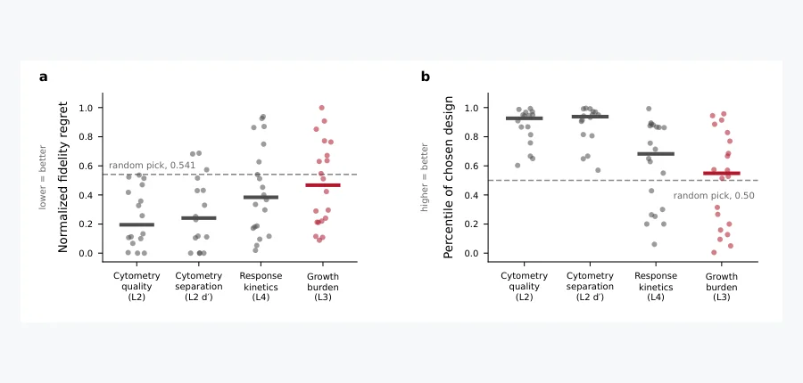 arXiv 2026-11-18 · cs.AI · #32 **[Fidelity Regret: Measuring Simulator Misspecification in Verifiable Design](https://arxiv.org/abs/2611.22263)** Noah Flynn Affiliation · University of California, Berkeley [Paper](https://arxiv.org/abs/2611.22263) · [Figure source](https://arxiv.org/html/2611.22263v1/fig1_ab_crop.png) 

[EN] Abstract
RLVF assumes the verifier evaluates the quantity of interest. In genetic-circuit design, a topological verifier can establish that a program is a valid circuit computing the target function, whereas ranking its physical performance requires a simulator. We measure fidelity regret, the reference simple regret incurred when a cheap simulator selects the design, over a 21,362-design combination subspace spanning 5 measured gate libraries and 3 organisms. Exact ordered-assignment checks retain positive regret in every tested cell while shifting magnitudes in both directions. Mean normalized regret is 0.369 over 72 cells and only 6 have zero regret. The discrepancy depends strongly on the reference axis: the yeast library SC1C1G1T1 has mean regret 0.113 for cytometry quality and 0.801 for growth burden, and every evaluated library--circuit-size pair has positive burden regret. Topological verification ties all valid gate assignments, while an oracle whitelist subject to retaining at least 25% of the design space leaves positive regret in 30 of 52 cells. Design-space optimization and feedback-guided search with frozen language models reach the high-regret regions; on a matched zero-regret control, additional optimization instead reduces regret. At a matched modeled-cost budget, mitigation is budget- and library-dependent. An in-sample fixed rule spending $\alpha{=}0.34$ of the budget re-scoring top cheap-simulator designs achieves mean excess regret 0.016, compared with 0.305 for cheap-only and 0.034 for reference-only selection, improving on cheap-only in 330 of 360 cells. More broadly, any workflow optimized through a simulator or digital twin can satisfy its verifier yet perform poorly on the intended physical objective. Fidelity regret provides a transferable template for detecting this gap before optimization and comparing budget-aware remedies across scientific domains. <a href="https://arxiv.org/list/cs/new?show=2000#2611.22263">Source</a>

[ZH] Abstract
RLVF假设验证器评估的是目标量。在遗传电路设计中，拓扑验证器可以确定程序是计算目标函数的有效电路，而排序其物理表现则需要模拟器。我们在覆盖五个已测门库、三种生物的21,362个设计组合子空间上，测量保真度遗憾，即便宜模拟器选择设计所造成的参考简单遗憾。精确有序赋值检查在每个测试单元都保留正遗憾，同时使幅度向两个方向变化。72个单元的平均归一化遗憾为0.369，只有6个为零。差异强烈依赖参考轴：酵母库SC1C1G1T1在细胞术质量上的平均遗憾为0.113，生长负担为0.801，且每个评估的库—电路大小对都有正负担遗憾。拓扑验证使全部有效门赋值并列，而受至少保留25%设计空间约束的oracle白名单，在52个单元中的30个仍有正遗憾。设计空间优化和冻结语言模型的反馈引导搜索会进入高遗憾区域；在匹配的零遗憾对照中，额外优化反而降低遗憾。相同建模成本预算下，缓解效果依赖预算和门库。一个在样本内固定、将预算$\alpha=0.34$用于重评便宜模拟器最优候选的规则，平均超额遗憾为0.016，便宜模拟器单独选择为0.305，仅参考选择为0.034，并在360个单元中的330个上改善于便宜模拟器。更一般地，任何通过模拟器或数字孪生优化的流程，都可能满足验证器，却在预期物理目标上表现差。保真度遗憾提供可迁移模板，在优化前检测差距，并跨科学领域比较预算感知补救方法。 <a href="https://arxiv.org/list/cs/new?show=2000#2611.22263">Source</a>
 | 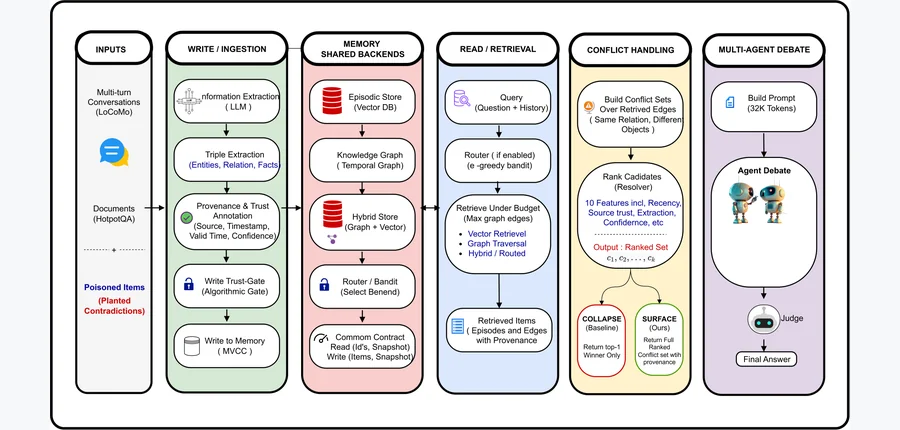 arXiv 2026-11-18 · cs.MA · #33 **[Surfacing Disagreement Beats Resolving It: A Gated Ablation Study of Provenance-Weighted Memory for Multi-Agent Debate](https://arxiv.org/abs/2611.22461)** Ziaullah Khan , Abdul Rehman Khalid , Shrestha Nischal Lal , Nheng Vanchhay , Md Ariful Islam Mozumder , Hee-Cheol Kim Affiliation · Inje University [Paper](https://arxiv.org/abs/2611.22461) · [Figure source](https://arxiv.org/html/2611.22461v1/architecture.png) 

[EN] Abstract
Shared memory for multi-agent debate is usually built to resolve inconsistency: retrieval returns one winning fact and the disagreement disappears before any agent sees it. We ask whether that is correct. In DebateGraph, four backends share one contract (read/write/snapshot), so five mechanisms from the agent-memory literature can be removed independently under a fixed budget, each gated on a pre-declared threshold. Across 39 runs one survives: preserving contradictions and passing the ranked conflict set to the debate, rather than collapsing it to a winner, improves F1 by +0.340 (95% CI [+0.267, +0.414]) and cuts attack success from 22 to 7 of 122 poisoned items (McNemar exact p=0.0003), at equal cost. Reaching it meant fixing a bottleneck in our harness: conflict sets are built only over retrieved edges, and our pre-declared cap left three quarters of planted contradictions unretrievable, first measuring the mechanism at +0.084. The effect replicates on two retrieval substrates and directionally on HotpotQA documents. No other mechanism survives, and two are worse than inert: once contradictions reach the prompt, a write trust-gate and the router's provenance features each cost accuracy (-0.075 and -0.096 F1). The gate fails structurally: poisoned objects are always entities the graph already contains, against 53% of gold, so groundedness scores the lie above a truthful first mention. We release the harness, attack set, and logs, and argue that silently reconciling memory is the assumption worth abandoning. <a href="https://arxiv.org/list/cs/new?show=2000#2611.22461">Source</a>

[ZH] Abstract
多代理辩论的共享记忆通常旨在解决不一致：检索返回一个获胜事实，分歧在代理看到前就消失。我们研究这是否正确。在DebateGraph中，四个后端共享同一契约（读/写/快照），因此可在固定预算下独立移除代理记忆文献中的五种机制，并按预先声明的阈值逐项门控。在39次运行中，一项机制保留下来：保留矛盾，将排序后的冲突集送入辩论，而非压缩为单一胜者，在相同成本下使F1提高0.340（95%置信区间[0.267, 0.414]），并将122个投毒条目的攻击成功数从22降至7（McNemar精确p=0.0003）。得到这一结果前，我们修复了框架瓶颈：冲突集仅基于检索到的边构建，而预先规定的上限使四分之三植入矛盾无法被检索，最初测得机制收益仅0.084。效应在两个检索底座复现，在HotpotQA文档上方向一致。其他机制均未通过门槛，其中两个比不发挥作用更差：一旦矛盾进入提示，写入信任门控和路由器的来源特征分别损失0.075和0.096 F1。门控在结构上失败：投毒对象总是图中已有实体，而金标准仅53%如此，因此依据性对谎言的评分高于真实的首次提及。我们发布框架、攻击集和日志，并主张应放弃默默调和记忆这一假设。 <a href="https://arxiv.org/list/cs/new?show=2000#2611.22461">Source</a>
 |
| 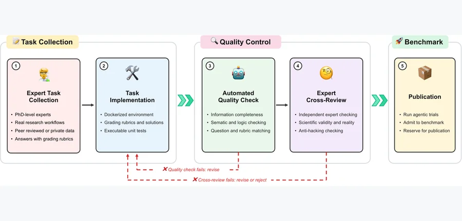 arXiv 2026-11-18 · cs.AI · #34 **[SciWorkBench: A Benchmark for Real Scientific Workflows](https://arxiv.org/abs/2611.22490)** Yuchen Zhang , Taolin Han , Jinghang Wang , Jinxin Wang , Yun Wu , Wai Yuet Chiu , Xiaogang Li , Yuting Fu , Kewei Sun , J… Affiliation · Alibaba Group / Tsinghua University / University of Chinese Academy of Sciences / University of Alberta / Zhejiang University [Paper](https://arxiv.org/abs/2611.22490) · [Figure source](https://arxiv.org/html/2611.22490v1/pipeline_1.png) 

[EN] Abstract
Language models are increasingly being used as agents capable of planning and executing projects, as well as refining their actions through feedback. This shift raises a question: can current agents complete projects like real scientists? To examine this question, we introduce SciWorkBench, a benchmark for evaluating agents' abilities on real science tasks across biology, chemistry, materials science, and physics. SciWorkBench is built from peer-reviewed literature or expert-contributed research scenarios. We also propose a unified scientific analysis framework validated by domain experts, which can categorize most tasks in SciWorkBench. Each task covers one or more stages of this framework. We evaluate up-to-date models within the Claude Code and Codex agent frameworks under a unified execution and grading protocol. The best-performing agent achieves a mean score of 57.38, indicating that current agents still struggle with realistic scientific workflows. Our failure analysis identifies three recurring weaknesses at the workflow level: difficulty translating scientific knowledge into task-specific procedures, weak integration of evidence across different modalities, and limited capacity for scientific self-correction. These findings highlight the importance of workflow-based evaluation for measuring progress toward reliable AI systems for scientific research. <a href="https://arxiv.org/list/cs/new?show=2000#2611.22490">Source</a>

[ZH] Abstract
语言模型越来越多地被用作能够规划、执行项目，并通过反馈修订动作的代理。这引出问题：当前代理能否像真正科学家一样完成项目？我们提出SciWorkBench，用于评估代理在生物、化学、材料科学和物理真实科学任务上的能力。SciWorkBench来自同行评审文献或专家贡献的研究场景。我们还提出经领域专家验证的统一科学分析框架，可归类SciWorkBench多数任务；每项任务覆盖该框架的一个或多个阶段。我们在统一执行与评分协议下，使用Claude Code和Codex代理框架评估最新模型。最佳代理平均分为57.38，表明当前代理仍难以完成现实科学流程。失败分析识别出三个反复出现的工作流弱点：难以将科学知识转化为任务特定过程、跨模态证据整合薄弱，以及科学自我纠错能力有限。这些发现强调，以工作流评估衡量可靠科学研究AI进展的重要性。 <a href="https://arxiv.org/list/cs/new?show=2000#2611.22490">Source</a>
 | 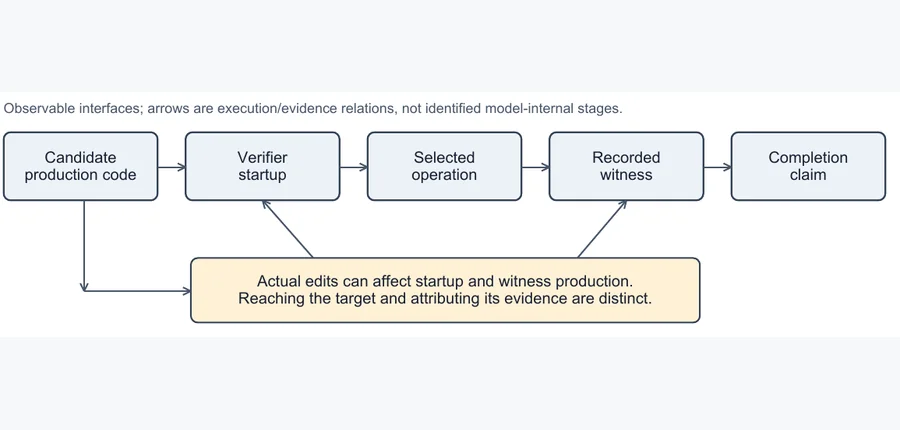 arXiv 2026-11-18 · cs.CL · #35 **[When Passing Checks Do Not Establish Completion: Evidence Interpretation in Coding Agents](https://arxiv.org/abs/2611.22835)** Xueping Gao Affiliation · Alibaba Cloud Computing [Paper](https://arxiv.org/abs/2611.22835) · [Figure source](https://arxiv.org/pdf/2611.22835) 

[EN] Abstract
Verification procedures in coding agents must preserve execution facts, interpret their scope and discharge checking obligations. We study these responsibilities through qualified repository checks, controlled evidence consumers and executable workflows. A prospective thirteen-task factorial study finds that correct reported facts need not yield the requested finite verdict. Conversely, all 122 delivered labels in a held-out receipt-supply study are correct, while sixteen responses misreport facts and eleven others exceed authorized scope. Production repair supplies successful controls and finite-supported preservation failures. Across 118 repair episodes on 31 tasks, source interventions separate startup reachability from repair and witness production from the claimed operation. Lifetime and resource controls delimit what passing validation establishes. Generated-note comparisons yield local repair differences but can state false explanations; strong ordinary baselines, new tasks and Skill-transfer studies supply no consistent overall advantage. These results characterize evidence interpretation, applicability and fulfilled actions while limiting claims of general diagnostic superiority, Skill deterioration or deployed folding effects. <a href="https://arxiv.org/list/cs/new?show=2000#2611.22835">Source</a>

[ZH] Abstract
编码代理中的验证过程必须保留执行事实、解释其适用范围，并履行检查义务。我们通过带限定条件的代码库检查、受控证据使用者及可执行流程研究这些责任。一项前瞻性十三任务析因研究发现，报告事实正确并不必然产生所要求的有限判定。相反，在留出凭据提供研究中，交付的全部122个标签都正确，但十六个响应误报事实，另有十一个超出授权范围。生产修复提供成功对照和有限证据支持的保留失败。在31项任务的118个修复回合中，源码干预区分启动可达与修复，也区分见证生成与所声称操作。生命周期与资源对照界定通过验证究竟能证明什么。生成笔记比较产生局部修复差异，却可能给出错误解释；强普通基线、新任务和技能迁移研究没有一致的总体优势。这些结果刻画证据解释、适用性及已履行动作，同时限制关于一般诊断优越性、技能退化或已部署折叠效应的主张。 <a href="https://arxiv.org/list/cs/new?show=2000#2611.22835">Source</a>
 | 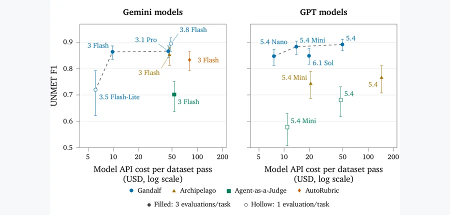 arXiv 2026-11-18 · cs.AI · #36 **[Verifying Agents in Rubric-Graded Environments](https://arxiv.org/abs/2611.22841)** Markus Dücker , Vaibhav Kumar , Yi Liu , Ronak Chaudhary , Andreas Plesner , Francisco Guzmán , Anish Athalye Affiliation · Handshake AI Research / ETH Zürich [Paper](https://arxiv.org/abs/2611.22841) · [Figure source](https://arxiv.org/pdf/2611.22841) 

[EN] Abstract
As AI agents take on increasingly open-ended and complex tasks, verifying their outputs has proven to be difficult. Rubric-graded agent environments, where a verifier judges multiple natural-language criteria against the deliverables and environment state changes produced by the agent, have emerged as a popular paradigm. We conduct the first systematic study of verifiers for rubric-graded agent environments. First, we create BankerVerifierBench (BVB), a meta-evaluation dataset of 2,464 human-judged rubric criteria across 24 investment-banking tasks. Next, we develop a methodology that derives from any rubric corpus the capabilities a verifier should possess, yielding a nine-capability taxonomy that we distill into three general design principles---reactive verification, environment alignment, and domain guidance---which we implement in Gandalf, an open-source verifier. Finally, we evaluate Gandalf against three existing verifiers on BVB. Gandalf matches or exceeds every baseline's F1 at lower cost: with Gemini 3 Flash it matches the strongest baseline's F1 (0.864 vs. 0.852) at one-fifth of its cost, and with GPT-5.4 models it improves F1 by over 0.12 at lower cost. Gandalf also generalizes to OpenClaw, a structurally different personal-productivity environment, where it again achieves the highest F1 (0.955 vs. 0.934 for the best baseline). We release BVB, Gandalf, and the code and data to reproduce our experiments. <a href="https://arxiv.org/list/cs/new?show=2000#2611.22841">Source</a>

[ZH] Abstract
随着AI代理承担越来越开放且复杂的任务，验证其输出愈发困难。按评分准则评估的代理环境已成为流行范式：验证器根据代理交付物及环境状态变化，判断多项自然语言标准。我们首次系统研究此类环境的验证器。首先构建BankerVerifierBench（BVB），一个包含24项投资银行任务中2,464条人类判定准则的元评估数据集。随后开发方法，从任意准则语料推导验证器所需能力，得到九能力分类，并提炼为反应式验证、环境对齐和领域引导三个一般设计原则，实现在开源验证器Gandalf中。最后，在BVB上将Gandalf与三个现有验证器比较。Gandalf以更低成本匹配或超越每个基线的F1：使用Gemini 3 Flash时，以五分之一成本匹配最强基线F1（0.864对0.852）；使用GPT-5.4模型时，在更低成本下将F1提高超过0.12。Gandalf还泛化到结构不同的个人生产力环境OpenClaw，再次获得最高F1（0.955，最佳基线0.934）。我们发布BVB、Gandalf，以及复现实验的代码和数据。 <a href="https://arxiv.org/list/cs/new?show=2000#2611.22841">Source</a>
 |
| 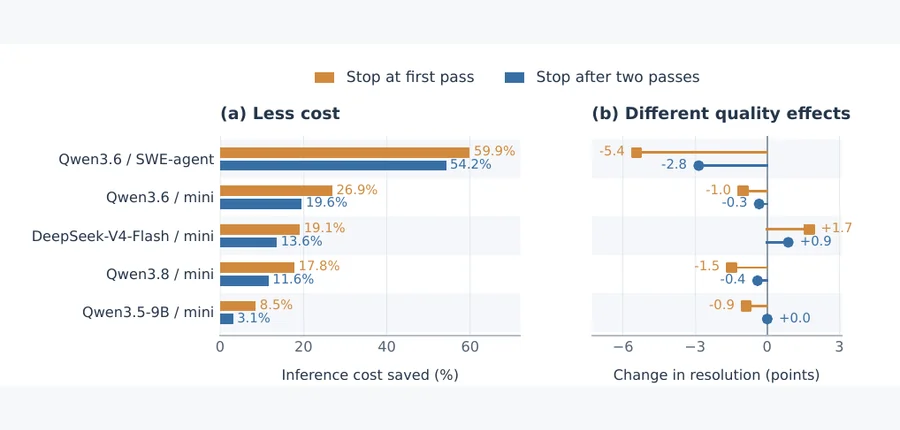 arXiv 2026-11-18 · cs.AI · #37 **[Done, But Still Working: Anytime Evaluation of When Coding Agents Should Stop](https://arxiv.org/abs/2611.22901)** Zerui Yang , Quan Xue , Miaomiao Dong , Chaorui Zhang , Xuanyu Zheng , Xiyuan Wang , Haolin Ruan , Xueyan Niu , Guangcheng… Affiliation · Huawei Technologies Ltd. [Paper](https://arxiv.org/abs/2611.22901) · [Figure source](https://arxiv.org/pdf/2611.22901) 

[EN] Abstract
Coding agents often continue working after their own tests pass. Does this additional work improve the patch, and how much could be saved by stopping earlier? We study these questions through anytime evaluation: replaying recorded runs, scoring intermediate patches with hidden tests, and measuring the cost incurred at each step. For policies that only stop a run or select an earlier patch, this allows paired comparisons without generating new trajectories, provided replay preserves the relevant states. Across about 6,000 runs of eight open models in two scaffolds on SWE-bench Verified, we find substantial differences in the value of continued work. The hindsight saving available at passing self-tests ranges from under 1% to 57%, depending on the model and scaffold. A rule that stops after the same patch passes twice saves 23% in a preregistered replication, but the preregistered quality test does not establish non-inferiority. We explain these differences by measuring how often a rule fires, how often the patch changes afterwards, and whether those changes repair or break it. Fine-tuning agents to imitate the rule saves 30% over six seeds, while quality preservation remains uncertain. Our results help identify both the opportunities and the risks of early stopping. <a href="https://arxiv.org/list/cs/new?show=2000#2611.22901">Source</a>

[ZH] Abstract
编码代理常在自身测试通过后继续工作。这些额外工作是否改善补丁，提前停止又能节省多少？我们通过随时评估研究：回放记录运行，用隐藏测试评分中间补丁，并测量每步成本。对于只停止运行或选择更早补丁的策略，只要回放保留相关状态，就能无需生成新轨迹进行配对比较。在SWE-bench Verified上，八个开放模型、两个脚手架的约6,000次运行显示，继续工作的价值差异很大。自身测试通过时，事后可节省空间随模型和脚手架不同，从不足1%到57%。在预注册复现中，同一补丁两次通过后停止的规则节省23%，但预注册质量检验未确立非劣性。我们通过衡量规则触发频率、此后补丁是否改变，以及变化是修复还是破坏，解释这些差异。微调代理模仿规则，在六个种子上节省30%，而质量是否保留仍不确定。结果帮助识别提前停止的机会和风险。 <a href="https://arxiv.org/list/cs/new?show=2000#2611.22901">Source</a>
 | 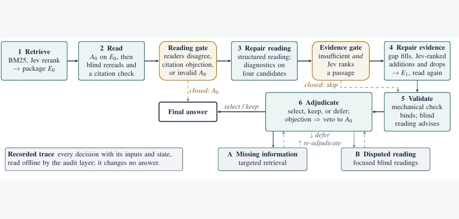 arXiv 2026-11-18 · cs.AI · #38 **[RagHarnessDebugger: Jev-Guided Agentic RAG in Contract Inference Repair Auditing](https://arxiv.org/abs/2611.22991)** Moriya Dechtiar , Daniel Martin Katz , Michael J. Bommarito II , Hongming Wang , Sylvain Jaume Affiliation · Illinois Tech - Chicago Kent College of Law / CLTDS, Bucerius Law School / Yong Pung How School of Law, Singapore Management University / CodeX - The Stanford Center for Legal Informatics, Stanford University / Bommarito Consulting, LLC / Harvard University / Massachusetts Institute of Technology [Paper](https://arxiv.org/abs/2611.22991) · [Figure source](https://arxiv.org/pdf/2611.22991) 

[EN] Abstract
Agentic systems using retrieval-augmented generation (RAG) must repair their own answers by gathering more evidence, testing alternative policies and deciding if, when, and what repairs are needed. Yet how do we know if a system's repairs are working when metrics like accuracy can be misleading? We present RagHarnessDebugger, a framework that records every repair decision in a Jev-guided harness for contract inference and audits the record to facilitate complete debugging of all decisions taken during a RAG repair journey. RagHarnessDebugger checks that each trace is intact, that each validation applies to the candidate it is counted for, and which answers the acceptance rule can reach. We tested our approach on ContractNLI non-disclosure agreements with two reader models and a replication set of separate contracts. Our debugger's audit layer exposed failure patterns that were hidden under aggregate metrics, policies acceptance cost of repairs vs regressions and policy acceptance gap of 77% and 76% of available but unrealised repairs on development and replication sets. Our audit, together with a labeled error analysis and replay mechanism, allowed following the execution path all the way to the terminal decision - uncovering where missing repairs became lost. Our revised harness improved accuracy over the initial BM25-only baseline by 3.6 points on development contracts and 3.7 points on the replication set, and even improved our full contract access reference score by 1.1 on development and 2.4 on replication set. While our work here demonstrates how the debugger can conduct decision root-cause analysis for missed repairs, the true value lies with providing this debugger for judgment visibility serving continuous improvement of RAG decisions and their explainability. Keywords: agentic RAG, AI evidence repair, harness explainability, counterfactual replay, Jev, ContractNLI <a href="https://arxiv.org/list/cs/new?show=2000#2611.22991">Source</a>

[ZH] Abstract
使用检索增强生成（RAG）的代理系统，必须通过收集更多证据、测试替代策略，并决定是否、何时及修复什么来修正自身答案。然而，准确率等指标可能误导时，我们如何知道修复是否有效？我们提出RagHarnessDebugger，在Jev引导的合同推断框架中记录每次修复决策，并审计记录，以完整调试RAG修复历程中的全部决策。它检查每条轨迹是否完整、每次验证是否适用于其计入的候选，以及接受规则能够到达哪些答案。我们在ContractNLI保密协议上，使用两个读取模型和由独立合同组成的复现集测试。审计层暴露聚合指标掩盖的失败模式、策略接受中修复与退化的成本，以及开发集和复现集分别77%和76%的可用却未实现修复的策略接受缺口。结合标注错误分析和回放机制，审计允许沿执行路径追踪至终止决策，揭示遗漏修复在哪里丢失。修订框架相对初始纯BM25基线，在开发合同和复现集上分别提高3.6和3.7个百分点准确率，甚至相对完整合同访问参考，在两集上分别提高1.1和2.4个百分点。虽然此处展示调试器如何对遗漏修复作决策根因分析，真正价值在于提供这一可见判断过程的调试器，支持RAG决策持续改进及可解释性。关键词：代理式RAG、AI证据修复、框架可解释性、反事实回放、Jev、ContractNLI。 <a href="https://arxiv.org/list/cs/new?show=2000#2611.22991">Source</a>
 | 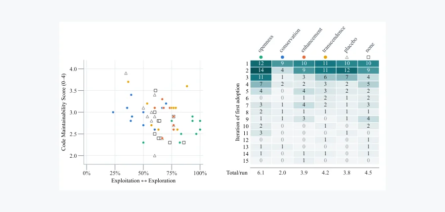 arXiv 2026-11-18 · cs.AI · #39 **[Values Shape What Self-Improving Coding Agents Build](https://arxiv.org/abs/2611.23067)** Jason Liang , Dylan Waldner , Risto Miikkulainen Affiliation · Cognizant AI Lab [Paper](https://arxiv.org/abs/2611.23067) · [Figure source](https://arxiv.org/html/2611.23067v1/ale_development.png) 

[EN] Abstract
Self-improving agents are typically optimized for the results they produce, with less attention to how they produce them. Their instructions give designers limited ways to shape how they work, especially when the task is open-ended. This paper studies whether a short value statement in an agent's persistent instruction file changes not only how well the agent performs but also what it builds. Four higher-order value types in Schwartz's theory of basic human values were evaluated: openness to change, conservation, self-enhancement, and self-transcendence. Across diverse coding tasks, the values were held fixed within each run over multiple iterations of self-improvement. Three findings emerged: (1) Values matter for performance across a diverse set of tasks. The openness values increase performance on held-out data, whereas the opposite conservation values result in scores below those of an agent given no values. (2) Values change what agents build, producing solution algorithms that differ in size, complexity and approach. (3) Human oversight is still needed for designing values. Allowing the agent to revise its own values narrows the differences between sets of values, and values distilled from the AI literature provide no detectable gain over having no values. Properly designed values can thus influence what a self-improving coding agent builds and, where the task permits, how well it performs. <a href="https://arxiv.org/list/cs/new?show=2000#2611.23067">Source</a>

[ZH] Abstract
自我改进代理通常按产出结果优化，而较少关注产生结果的方式。其指令给设计者塑造工作方式的手段有限，尤其在开放任务中。本文研究，代理持久指令文件中的简短价值声明，是否不仅改变表现，也改变构建的内容。我们评估Schwartz基本人类价值理论中的四类高阶价值：开放变化、保守、自我提升和自我超越。在多样编码任务中，价值在每次运行的多轮自我改进中保持固定。三项发现如下：（1）价值影响多样任务表现。开放价值提高留出数据表现，与之相反的保守价值使分数低于无价值声明代理。（2）价值改变代理构建内容，使解法在大小、复杂度和方法上不同。（3）价值设计仍需人类监督。允许代理修订自身价值会缩小价值集之间差异，从AI文献蒸馏的价值相对无价值声明没有可检测收益。因此，恰当设计的价值能够影响自我改进编码代理构建什么，以及在任务允许时做得多好。 <a href="https://arxiv.org/list/cs/new?show=2000#2611.23067">Source</a>
 |
| 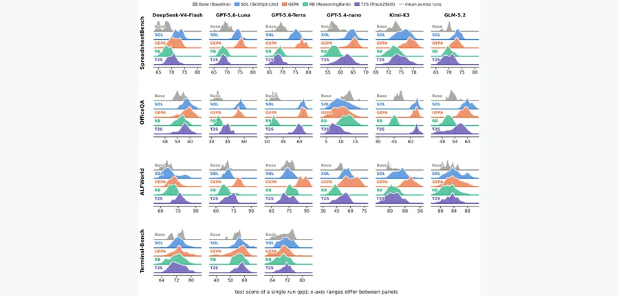 arXiv 2026-11-18 · cs.AI · #40 **[The Resolution Hypothesis: Agent Evolution's Key Is Identifying Improvements](https://arxiv.org/abs/2611.23068)** Yuanhao Zeng , Shaocheng Lan , Ao Lu , Kuang Yan , Heng Lin , Xinang Xu , Yuan Luo , Yueting Wang , Yexin Li , Ruo Shan… Affiliation · ShanghaiTech University / ByteDance, China / BIGAI / SUSTech [Paper](https://arxiv.org/abs/2611.23068) · [Project](https://lineshogan.github.io/resolution-hypothesis/) · [Figure source](https://arxiv.org/html/2611.23068v1/ridge_single_run.png) 

[EN] Abstract
Agent evolution follows a simple loop: a proposer writes candidate artifacts (prompts, skills, memories) and selection accepts those that score higher. This loop has shown promise, yet practitioners face a puzzle: methods trade wins across papers, and evolution often fails to bootstrap on certain tasks. We trace this puzzle to the Resolution Hypothesis: agent evolution stalls not because methods fail to propose better artifacts, but because noisy evaluations cannot reliably identify them. Across seven evolution methods and six models (over 10M LLM calls), we find support for the hypothesis at both levels where evaluation scores are used. At the candidate level (choosing artifacts), helpful candidate artifacts exist, but selection is no better than random at telling them from harmful ones, so errors accumulate across rounds. At the method level (ranking methods), typical margins of a few percentage points are smaller than the difference between two independent runs of the same method, so published rankings often rest on luck. Together, these findings indicate that agent evolution is often bottlenecked by reliably identifying improvements. This calls for a shift in how we develop and evaluate self-improving agents, from designing ever more candidate improvement systems to making true improvements detectable and accumulable. <a href="https://arxiv.org/list/cs/new?show=2000#2611.23068">Source</a>

[ZH] Abstract
代理进化遵循简单循环：提案者编写候选制品（提示、技能、记忆），选择机制接受评分更高者。该循环显示潜力，但实践者面临困惑：不同论文中的方法互有胜负，进化在某些任务上常无法启动。我们将其归结为分辨率假说：代理进化停滞，并非方法无法提出更好制品，而是有噪声评估无法可靠识别它们。跨七种进化方法和六个模型、超过一千万次LLM调用，我们在使用评估分数的两个层面都找到支持。候选层面（选择制品），有益候选确实存在，但选择机制区分有益与有害候选不比随机更好，因此错误跨轮累积。方法层面（排序方法），通常仅数个百分点的差距，小于同一方法两次独立运行的差异，因此已发表排名常取决于运气。这些发现表明，代理进化常受限于能否可靠识别改进。这要求我们改变开发和评估自我改进代理的重点：从设计更多候选改进系统，转向使真实改进可检测、可积累。 <a href="https://arxiv.org/list/cs/new?show=2000#2611.23068">Source</a>
 |   |   |
<!-- PAPER_CARDS_END -->

## Retrieval overview

**40 selected papers, comprising 13 A / 11 B / 16 C.** Collected on **19 November 2026 (Beijing)** from the official **Wednesday, 18 November 2026** announcement batch. Canonical listing requests completed at approximately **08:59:22 Beijing**. Supported first-page confirmations with a no-cache request header reproduced batch dates, counts and ordered IDs at **09:00:46 Beijing**. [Run record](../../data/runs/2026-11-19.json)

| Official source | Batch | New | Cross | Replacement | Coverage |
|---|---|---:|---:|---:|---|
| [Computer Science](https://arxiv.org/list/cs/new?show=2000) | 2026-11-18 | 798 | 62 | 481 | All 1341 entries on one page |
| [stat.ML](https://arxiv.org/list/stat.ML/new?show=2000) | 2026-11-18 | 5 | 13 | 24 | All 42 entries on one page |
| Total | 2026-11-18 | 803 | 75 | 505 | All 1383 entries, 803 distinct New IDs |

Complete metadata and original English abstracts for all **803 New IDs** are retained. Discovery produced **115 lexical candidates** and **213 supplemental related-title records**. Focused full-abstract review logged **48 decisions**, yielding forty selections and eight omissions. Discovery counts are not counts of full semantic review. The CS aggregate covers cs.AI, cs.LG, cs.CL, cs.MA, cs.SE, cs.RO, cs.CV, cs.NE and cs.CR. Selected IDs were checked against historical enrichment, digests and run records. [Run record](../../data/runs/2026-11-19.json)

Both sources are completely retrieved and parsed. The previous processed batch is 17 November, followed directly by the current observed weekday batch. Cache Date/Age/hit headers are retained; origin regeneration is unverified. The historical **22 October bulk-New membership gap remains unresolved**. [Previous run](../../data/runs/2026-11-18.json) · [Run record](../../data/runs/2026-11-19.json)

Coverage is **40 rows / 40 cards / 40 complete EN abstracts / 40 complete ZH abstracts**. Every card has independent language disclosures and a visually checked source figure: **28 HTML images and 12 PDF crops**, with **zero placeholders**. All forty affiliation records are source-supported, including PDF resolutions of missing HTML institution text. [Run record](../../data/runs/2026-11-19.json)

## Reading guide

A denotes direct RSI, B self-improvement mechanisms, and C evaluation and limits. Order is tier followed by arXiv ID. Selection, tiering, priorities, mechanism interpretations and research proposals are **editorial inference**. Numerical findings remain **author reports**. Review covers complete original abstracts, author blocks, figures, resource pages and selected paper passages. Independent reproductions performed for this issue total **zero**.

**What persists.** DeltaHarness retains execution policies, Inventa changes its idea-proposal process, EvoDisco learns how memory transforms, and HandRSI alternates code changes with estimator learning. JevRSI accumulates executable memory/world-model modules, while EvoSkill-S1 trains a skill evolver and selectively writes back children. [DeltaHarness](https://arxiv.org/abs/2611.21688) · [Inventa](https://arxiv.org/abs/2611.21847) · [EvoDisco](https://arxiv.org/abs/2611.22102) · [HandRSI](https://arxiv.org/abs/2611.22164) · [JevRSI](https://arxiv.org/abs/2611.22432) · [EvoSkill-S1](https://arxiv.org/abs/2611.22610)

**Which feedback is trusted.** Selective skill maintenance checks drift against past successful executions. RegimeCouncil learns how broadly negative memory feedback should propagate. Fidelity Regret separates valid circuits from physically useful designs, and the Resolution Hypothesis separates proposing a good update from identifying it through noisy evaluations. [Skill maintenance](https://arxiv.org/abs/2611.22525) · [RegimeCouncil](https://arxiv.org/abs/2611.22113) · [Fidelity Regret](https://arxiv.org/abs/2611.22263) · [Resolution Hypothesis](https://arxiv.org/abs/2611.23068)

**What the evidence establishes.** The tractor study includes physical-machine tests; RecPo and EvoNav include limited real-robot studies. SkillBuffBench is a benchmark design with evaluations still in progress. BRED’s public implementation uses a fixed decision schedule and explicitly does not reproduce the full paper. The early-stopping study saves cost without establishing quality non-inferiority. [Tractor](https://arxiv.org/abs/2611.21958) · [RecPo](https://arxiv.org/abs/2611.22174) · [EvoNav](https://arxiv.org/abs/2611.22321) · [SkillBuffBench](https://arxiv.org/abs/2611.22017) · [BRED](https://arxiv.org/abs/2611.22661) · [Stopping](https://arxiv.org/abs/2611.22901)

## Tiered Top papers

| # | Paper | Categories | Authors | Affiliation | Tier | Update target | Reading priority |
|---:|---|---|---|---|---|---|---|
| 1 | [DeltaHarness: Self-Evolving Harnesses for Resource-Adaptive Tool Execution](https://arxiv.org/abs/2611.21688) | Machine Learning (cs.LG) ; Performance (cs.PF) | Lecheng Yan , Jianze Lin , Xicheng Han , Xiantao Xu , Wenxi Li , Chenyang Lyu | University of Science and Technology of China / Beijing Normal University / Zhejiang University / Dmall Inc. / East China Normal University / Alibaba Group | A | Runtime dispatch, physical execution plans and experiment-selection policy | Topical reference |
| 2 | [Inventa: Decentralized Self-Improving Agents for Autonomous Scientific Discovery](https://arxiv.org/abs/2611.21847) | Machine Learning (cs.LG) ; Artificial Intelligence (cs.AI) | Prithwish Jana , Nikos Kanakaris , Purak Jain , Anoop Deoras , Sahika Genc | Georgia Institute of Technology / Amazon | A | Candidate idea lineages and the mutator’s model/harness configuration | Priority read |
| 3 | [EvoDisco: Strategy Discovery for Evolving Agent Memory](https://arxiv.org/abs/2611.22102) | Artificial Intelligence (cs.AI) | Mingyang Liu , Qingcan Kang , Shixiong Kai , Kaichao Liang , Xiaojin Fu , Tao Zhong , Linqi Song | City University of Hong Kong / Huawei Technologies Ltd. | A | Memory contents and a learned memory-transformation strategy policy | Topical reference |
| 4 | [HandRSI: Recursive Self-Improvement for Hand Pose Estimation](https://arxiv.org/abs/2611.22164) | Computer Vision and Pattern Recognition (cs.CV) | Zhekai Wang , Luqing Luo , Wenhao Yao , Junjie Lu , Huanan Zhu , Feifei Gao , Yuhua Jiang | LivSyn Robotics / South China University of Technology / University of Technology Sydney / University of Science and Technology Beijing / Tsinghua University | A | Executable hand-pose inference harness and estimator weights | Priority read |
| 5 | [DACE: Diversity-Driven Adversarial Co-Evolution for Robust LLM Safety Alignment](https://arxiv.org/abs/2611.22278) | Artificial Intelligence (cs.AI) | Peng Yu , Xiaoyu Wen , Zhida He , Ziyuan Zhou , Han Qi , Shao Zhang , Qiaosheng Zhang , Ying Wen , Chaochao Lu | Shanghai Jiao Tong University / Shanghai Artificial Intelligence Laboratory / Fudan University | A | Attacker/defender model weights and adversarial replay memory | Topical reference |
| 6 | [Harnesses That Improve Themselves: A Unifying Framework for Self-Improving Agent Harnesses](https://arxiv.org/abs/2611.22299) | Artificial Intelligence (cs.AI) | Deep Shah , Nehal Kathrotia | Google | A | Four editable components of an external agent harness | Topical reference |
| 7 | [Think Once, Act Fast: Cost-Effective Recursive Self-Improvement for Decision Model Harness](https://arxiv.org/abs/2611.22432) | Artificial Intelligence (cs.AI) | Siqi Lai , Haitao Li , Hao Liu | Hong Kong University of Science and Technology (Guangzhou) / LIGHTSPEED | A | Reusable procedure, state-memory and world-model modules | Topical reference |
| 8 | [Evolution Under Fire: Evolving Agent Safety Harnesses with Adaptive Injection Stressors](https://arxiv.org/abs/2611.22583) | Cryptography and Security (cs.CR) ; Artificial Intelligence (cs.AI); Computation and Language (cs.CL) | Yujun Wang , Yilun Liu , Jinhe Bi , Krishna Kanth Nakka , Xuebing Zhou , Hinrich Sch{ü}tze , Yunpu Ma | LMU Munich / Munich Center for Machine Learning (MCML) | A | Executable safety harnesses and adaptive attack stressors | Topical reference |
| 9 | [EvoSkill-S1: Evolving Reusable Skills with Genetic-Inspired Operators](https://arxiv.org/abs/2611.22610) | Artificial Intelligence (cs.AI) | Yujun Wang , Jiqiang Li , Yinuo Lu , Jinhe Bi , Aniri , Wenxuan Ye , Boliang Liu , Sikuan Yan , Shuning Wang , Xuebing Zhou , S{ö}ren Pirk , Hinrich Sch{ü}tze , Yunpu Ma | LMU Munich / Munich Center for Machine Learning (MCML) / Huawei Heisenberg Research Center / Zhejiang University / University of Hong Kong / Technical University of Munich (TUM) / TU Berlin / Kiel University | A | Reusable skill banks and skill-evolver model weights | Topical reference |
| 10 | [The Between-Round Decision in Autonomous Research: An LLM Controller That Reads the Whole Trajectory](https://arxiv.org/abs/2611.22661) | Artificial Intelligence (cs.AI) ; Computation and Language (cs.CL) | Caoxin Wang , Shengkai Gan , Xiang Hu , Lili Pan | University of Electronic Science and Technology of China / Zhejiang University | A | Research solution code, its Champion archive and accumulated experiment history | Topical reference |
| 11 | [WATERFALL: Workflow for Adaptive Training with Evolutionary Reward Formulation and Automated Learning Loops](https://arxiv.org/abs/2611.22854) | Machine Learning (cs.LG) ; Artificial Intelligence (cs.AI) | Eleftherios Triantafyllidis , Filippos Christianos , Zhibin Li , Bernd Bickel | ETH Zurich / Independent Researcher / UCL | A | Programmatic rewards and their trained control policies | Topical reference |
| 12 | [Colombo: A Frontier-to-Frontier Autoresearch System for Oracle-Based Optimization](https://arxiv.org/abs/2611.23080) | Artificial Intelligence (cs.AI) ; Optimization and Control (math.OC) | Haihan Zhang , Wendao Wu , Chenheng Zhang , Chunyuan Zheng , Yanyi Li , Cong Fang , Haoxuan Li , Zhouchen Lin | Peking University | A | Research programmes, optimization algorithms/proofs and a persistent Complexity Atlas | Topical reference |
| 13 | [Do LLM Agents Still Need to Be Told How to Self-Improve?](https://arxiv.org/abs/2611.23219) | Machine Learning (cs.LG) ; Artificial Intelligence (cs.AI) | Shobhita Sundaram , Cansu Sancaktar , Phillip Isola | MIT CSAIL / University of Tübingen | A | Player prompts/skill files and a teacher-organized learning procedure | Topical reference |
| 14 | [Learning In-Context Adaptivity for LLMs through Continual Gameplay](https://arxiv.org/abs/2611.21710) | Computer Science and Game Theory (cs.GT) | Jiale Liu , Zun Li , John Schultz | Penn State University / Google DeepMind | B | Model weights for summary/action coupling and retained in-context experience | Topical reference |
| 15 | [Adaptive Memory for Online Reinforcement Learning under Sparse Model Changes](https://arxiv.org/abs/2611.21879) | Machine Learning (cs.LG) ; Machine Learning (stat.ML) | Sreejeet Maity , Sukanya Modak , Leonardo F. Toso | North Carolina State University / RCC Institute of Information Technology / Columbia University | B | Deployment histories used to fit tabular rewards/transitions and a derived policy | Topical reference |
| 16 | [Weight-space programming for tractor guidance controller: large language models natively write neural network weights that steer a real tractor](https://arxiv.org/abs/2611.21958) | Machine Learning (cs.LG) ; Artificial Intelligence (cs.AI); Robotics (cs.RO); Systems and Control (eess.SY) | Timo Oksanen | Technical University of Munich (TUM) / Munich Institute of Robotics and Machine Intelligence (MIRMI), TUM / Aalto University | B | A small neural tractor-controller’s weights | Topical reference |
| 17 | [Weight-Space Programming Doesn't Need Transformers](https://arxiv.org/abs/2611.22055) | Machine Learning (cs.LG) ; Artificial Intelligence (cs.AI); Computation and Language (cs.CL) | Hyunjong Ok , Jaeho Lee | Pohang University of Science and Technology (POSTECH) | B | Written target-network weights, sparse fact tables and target architecture | Topical reference |
| 18 | [RegimeCouncil: Paired-Evidence Routing For Memory Conflict Governance In LLM Agents](https://arxiv.org/abs/2611.22113) | Artificial Intelligence (cs.AI) | Qingcan Kang , Mingyang Liu , Shixiong Kai , Tao Zhong , Mingxuan Yuan | Huawei Noah’s Ark Lab / City University of Hong Kong | B | Memory-use routing scope with local/global outcome histories | Topical reference |
| 19 | [Reconfiguring Procedural Knowledge for Compositional Robot Skill Adaptation](https://arxiv.org/abs/2611.22174) | Artificial Intelligence (cs.AI) | Daehee Lee , Dongsu Lee , Sanghyun Ahn , Minjong Yoo , Honguk Woo | Sungkyunkwan University / University of Texas at Austin / Samsung Electronics | B | A procedural transition knowledge base and local memory edits | Topical reference |
| 20 | [Beyond Episodic Recall: Experience-to-Knowledge Evolution for Lifelong Embodied Navigation](https://arxiv.org/abs/2611.22321) | Robotics (cs.RO) | Weitao An , Chenghao Xu , Xu Yang , Cheng Deng | Xidian University / Hohai University | B | Sparse experience atoms and slower environment-specific structural knowledge | Topical reference |
| 21 | [When Agent Skills Go Stale: Runtime Behavior and Selective Maintenance in Evolving Environments](https://arxiv.org/abs/2611.22525) | Artificial Intelligence (cs.AI) ; Computation and Language (cs.CL) | Ömer Faruk Akgül , Shuli Jiang , Yuting Zhang , Yi Zhang , Xiaohan Fei , Wei Xia , Stefano Soatto | University of Southern California / AWS Agentic AI | B | Reusable skill state and its environment-specific content | Priority read |
| 22 | [Practice in Text, Act in Pixels: Correcting Where Perception Fails](https://arxiv.org/abs/2611.22722) | Computer Vision and Pattern Recognition (cs.CV) | Zhongling Xu , Hairong Wang | University of Texas at Austin | B | The screen reader’s weights, with a fixed text-trained action policy | Topical reference |
| 23 | [Synergizing Evidence Retrieval and Utilization for Self-Improving Multimodal Scientific Document Reasoning](https://arxiv.org/abs/2611.22837) | Artificial Intelligence (cs.AI) | Frank Nie , Ethan B. Liu , Yuan Zhu , Jindong Han | Shandong University | B | Retriever, latent Perceiver and Reasoner parameters | Topical reference |
| 24 | [RSI-Prime: Training Models to Train Models](https://arxiv.org/abs/2611.23138) | Artificial Intelligence (cs.AI) ; Machine Learning (cs.LG) | Dewu Zheng , Yang Ye , Hongyu Zhang , Jun Yu , Yanlin Wang | Sun Yat-sen University / Mind Lab / Chongqing University / Harbin Institute of Technology, Shenzhen | B | The training-capability model’s weights using curated experiment trajectories | Topical reference |
| 25 | [Revision-Consistent Code Context for Agents That Edit Their Environment](https://arxiv.org/abs/2611.21616) | Software Engineering (cs.SE) | Meng Shi | Independent Researcher | C | Consistency contract for code context used by editing agents | Topical reference |
| 26 | [Can an LLM dream? Testing the overfitted brain hypothesis on an agent with text memory](https://arxiv.org/abs/2611.21648) | Computation and Language (cs.CL) ; Artificial Intelligence (cs.AI) | Eric Zou | University of Waterloo | C | Nightly text-memory rewrite under corrupted experience | Topical reference |
| 27 | [Auditors Struggle to Catch Sabotage In End-to-End Transcripts of AI Safety Research](https://arxiv.org/abs/2611.21832) | Artificial Intelligence (cs.AI) | Keshav Shenoy , Anthony Zang , Eric Gan , Jacqueline Tay , Amy Ngo , Sebastian Prasanna , Julian Stastny , Vivek Hebbar | Redwood Research / Georgia Institute of Technology / Independent / Equistamp | C | Auditing the evidence used to trust automated AI-safety research | Topical reference |
| 28 | [SkillBuffBench: Measuring What Agent Skills Contribute across Harnesses, Models, Skill Access Modes and Memory](https://arxiv.org/abs/2611.22017) | Artificial Intelligence (cs.AI) ; Computation and Language (cs.CL); Machine Learning (cs.LG) | Gengyue Dong , Ye Wei , Zheng Zhu , Yidong Han , Jiale Miao , Xiaojun Jia , Guanghui Li | University of Oxford / Imperial College London / University College London / Nanyang Technological University / BraneMatrix AI | C | Evaluation design for reusable skills under deployment-like access and memory | Topical reference |
| 29 | [What Does Weight-Space Programming Add to Diffusion Editing? Program Construction versus Score-Guided Refinement](https://arxiv.org/abs/2611.22228) | Machine Learning (cs.LG) ; Computer Vision and Pattern Recognition (cs.CV) | Zitian Gao , Jingyi Xu , Ziqi Han , Chengkai Lei , Ye Liu , Liangliang Shi | Fudan University / Shanghai Institute for Mathematics and Interdisciplinary Sciences / Tencent / Northwest University | C | Generated diffusion-edit programs and score-guided revisions | Topical reference |
| 30 | [Context Has a Price: Adding and Removing Context for LLM Coding Agents under Prefix Caching](https://arxiv.org/abs/2611.22238) | Artificial Intelligence (cs.AI) | Zerui Yang , Miaomiao Dong , Quan Xue , Chaorui Zhang , Xuanyu Zheng , Xiyuan Wang , Haolin Ruan , Xueyan Niu , Guangcheng Song , Weixi Zhang , Wei Han , Bo Bai | Huawei Technologies Ltd. | C | Cost evaluation of persistent context additions and deletions | Topical reference |
| 31 | [Multi-Agent Memory Inconsistency: Where Factual Conflicts Disappear in LLM Agents](https://arxiv.org/abs/2611.22245) | Artificial Intelligence (cs.AI) ; Multiagent Systems (cs.MA) | Hejia Zhang , Zhongming Yu , Yimin Ding , Wei-Ting Chen , Hengjia Yu , Wentao Ni , Yijun Liu , Cong Xu , Xin Chen , Matrix Yao , Fan Zhao , Jishen Zhao | UC San Diego / Intel / Hewlett Packard Enterprise | C | Evidence flow and memory consistency across delegated agents | Topical reference |
| 32 | [Fidelity Regret: Measuring Simulator Misspecification in Verifiable Design](https://arxiv.org/abs/2611.22263) | Artificial Intelligence (cs.AI) | Noah Flynn | University of California, Berkeley | C | Fidelity of simulator feedback used to select evolving designs | Priority read |
| 33 | [Surfacing Disagreement Beats Resolving It: A Gated Ablation Study of Provenance-Weighted Memory for Multi-Agent Debate](https://arxiv.org/abs/2611.22461) | Multiagent Systems (cs.MA) ; Computation and Language (cs.CL) | Ziaullah Khan , Abdul Rehman Khalid , Shrestha Nischal Lal , Nheng Vanchhay , Md Ariful Islam Mozumder , Hee-Cheol Kim | Inje University | C | Contradiction preservation and admission rules in shared memory | Topical reference |
| 34 | [SciWorkBench: A Benchmark for Real Scientific Workflows](https://arxiv.org/abs/2611.22490) | Artificial Intelligence (cs.AI) | Yuchen Zhang , Taolin Han , Jinghang Wang , Jinxin Wang , Yun Wu , Wai Yuet Chiu , Xiaogang Li , Yuting Fu , Kewei Sun , Jiaxin Li , Qile Jin , Jiajia Li , Ruodan Chen , Qingteng Chen , Jialu Nie , Junchao Li , Yifei Zhang , Chen Zhao , Hu Wei , Lin Qu , Yanni Yin , Bing Zhao | Alibaba Group / Tsinghua University / University of Chinese Academy of Sciences / University of Alberta / Zhejiang University | C | Workflow-level evaluation of scientific agents and self-correction | Topical reference |
| 35 | [When Passing Checks Do Not Establish Completion: Evidence Interpretation in Coding Agents](https://arxiv.org/abs/2611.22835) | Computation and Language (cs.CL) ; Software Engineering (cs.SE) | Xueping Gao | Alibaba Cloud Computing | C | Scope and integrity of verification evidence in coding repair | Topical reference |
| 36 | [Verifying Agents in Rubric-Graded Environments](https://arxiv.org/abs/2611.22841) | Artificial Intelligence (cs.AI) | Markus Dücker , Vaibhav Kumar , Yi Liu , Ronak Chaudhary , Andreas Plesner , Francisco Guzmán , Anish Athalye | Handshake AI Research / ETH Zürich | C | Verifier design and meta-evaluation for rubric-graded agent environments | Topical reference |
| 37 | [Done, But Still Working: Anytime Evaluation of When Coding Agents Should Stop](https://arxiv.org/abs/2611.22901) | Artificial Intelligence (cs.AI) | Zerui Yang , Quan Xue , Miaomiao Dong , Chaorui Zhang , Xuanyu Zheng , Xiyuan Wang , Haolin Ruan , Xueyan Niu , Guangcheng Song , Weixi Zhang , Wei Han , Bo Bai | Huawei Technologies Ltd. | C | Stopping-rule evaluation and behavior learned by imitation | Topical reference |
| 38 | [RagHarnessDebugger: Jev-Guided Agentic RAG in Contract Inference Repair Auditing](https://arxiv.org/abs/2611.22991) | Artificial Intelligence (cs.AI) ; Multiagent Systems (cs.MA); Software Engineering (cs.SE) | Moriya Dechtiar , Daniel Martin Katz , Michael J. Bommarito II , Hongming Wang , Sylvain Jaume | Illinois Tech - Chicago Kent College of Law / CLTDS, Bucerius Law School / Yong Pung How School of Law, Singapore Management University / CodeX - The Stanford Center for Legal Informatics, Stanford University / Bommarito Consulting, LLC / Harvard University / Massachusetts Institute of Technology | C | Audit trail and acceptance rules of a contract-RAG repair harness | Topical reference |
| 39 | [Values Shape What Self-Improving Coding Agents Build](https://arxiv.org/abs/2611.23067) | Artificial Intelligence (cs.AI) ; Multiagent Systems (cs.MA) | Jason Liang , Dylan Waldner , Risto Miikkulainen | Cognizant AI Lab | C | Persistent value instructions and the coding artifacts they guide | Topical reference |
| 40 | [The Resolution Hypothesis: Agent Evolution's Key Is Identifying Improvements](https://arxiv.org/abs/2611.23068) | Artificial Intelligence (cs.AI) ; Computation and Language (cs.CL) | Yuanhao Zeng , Shaocheng Lan , Ao Lu , Kuang Yan , Heng Lin , Xinang Xu , Yuan Luo , Yueting Wang , Yexin Li , Ruo Shan , Kan Ren | ShanghaiTech University / ByteDance, China / BIGAI / SUSTech | C | Reliability of candidate acceptance and method ranking in agent evolution | Priority read |

## Mechanism and evidence notes

Each paper has four notes covering its update target, feedback and validation, reuse, reported findings and evidence limits.

### 1. DeltaHarness: Self-Evolving Harnesses for Resource-Adaptive Tool Execution

- **Updated component.** Runtime dispatch, physical execution plans and experiment-selection policy.
- **Feedback, validation and reuse.** DeltaHarness uses firsthand cold-start executions to revise dispatch and plans, then choose trials for later proposals. An independent common confirmation panel controls replacement of the incumbent policy.
- **Author-reported findings.** Fixed-dispatch materialization reduces complete-delivery latency 30.0% over three fresh pairs. Held-out latency reductions are 8.2% versus the best fixed plan in one seed and 4.6% versus the initial proposal in another.
- **Evidence boundary and inference.** The loop changes external execution policy with a fixed model. Small paired studies and two transfer seeds constrain generality. Acquisition, confirmation and later execution costs must remain separate.

[Original paper](https://arxiv.org/abs/2611.21688) · [Affiliation source](https://arxiv.org/html/2611.21688)

### 2. Inventa: Decentralized Self-Improving Agents for Autonomous Scientific Discovery

- **Updated component.** Candidate idea lineages and the mutator’s model/harness configuration.
- **Feedback, validation and reuse.** Inventa’s autonomous units mutate ideas, while local orchestrators periodically edit their proposal harnesses. Twin trials gate harness replacement. Verifiers alone publish supported improvements, reusable components and constraint violations to shared knowledge; stalls trigger model redraw or restart.
- **Author-reported findings.** The authors report leading five research-cycle benchmarks, including 73.6% versus CORAL’s 56.2% on EurekaBench and 26.0 versus 18.6 novel ideas per paper on IdeaBench, with 82% fewer model calls.
- **Evidence boundary and inference.** Verification mixes programmatic checks and LLM consensus depending on the task. Benchmark novelty or law-fit scores are distinct from independently confirmed scientific discoveries. Model replacement is selection among models rather than training new base weights.

[Original paper](https://arxiv.org/abs/2611.21847) · [Affiliation source](https://arxiv.org/html/2611.21847)

### 3. EvoDisco: Strategy Discovery for Evolving Agent Memory

- **Updated component.** Memory contents and a learned memory-transformation strategy policy.
- **Feedback, validation and reuse.** EvoDisco chooses and instantiates Abstract, Refine, Bridge and Reframe operators from current memory and recent history. Retrieval-quality/complexity fitness scores individual transformations, while historical utility regret, prediction error and diversity train the strategy over a longer window.
- **Author-reported findings.** ALFWorld gains over MemP are 8.8 online and 12.9 frozen-transfer points, with larger gains over MemRL. Three benchmark families and operator/fitness ablations are reported.
- **Evidence boundary and inference.** The base task LLM is frozen. Online memory writes, strategy-policy learning and frozen-transfer evaluation are distinct. The four semantic operator classes remain supplied by the framework.

[Original paper](https://arxiv.org/abs/2611.22102) · [Affiliation source](https://arxiv.org/html/2611.22102)

### 4. HandRSI: Recursive Self-Improvement for Hand Pose Estimation

- **Updated component.** Executable hand-pose inference harness and estimator weights.
- **Feedback, validation and reuse.** Coding agents propose harness edits accepted by a ten-metric composite with no significant regression. Accepted harnesses provide selective distillation targets for presence and temporal consistency, then are revalidated against the updated estimator.
- **Author-reported findings.** Five rounds reduce MPJPE-p by 35% on HOT3D and 11% on ARCTIC and roughly halve jitter. HOT3D MPJPE-p is 16% below same-ground-truth fine-tuning. Selected deployment tiers run at 20.7–41.1 FPS.
- **Evidence boundary and inference.** The repository states rounds 3–5 keep the round-2 network weights; later gains come from the harness. HOI4D zero-shot transfer improves 3D/smoothness but slightly worsens detection and 2D accuracy. Re-run baselines are authors’ reproductions, not this digest’s.

[Original paper](https://arxiv.org/abs/2611.22164) · [Affiliation source](https://arxiv.org/html/2611.22164)

### 5. DACE: Diversity-Driven Adversarial Co-Evolution for Robust LLM Safety Alignment

- **Updated component.** Attacker/defender model weights and adversarial replay memory.
- **Feedback, validation and reuse.** DACE alternates attacker and defender training. A risk-category by attack-style grid rewards marginal strategy coverage, while time-decayed Beta–Bernoulli threat posteriors and Thompson sampling choose replayed attacks for later defender updates.
- **Author-reported findings.** The authors report broader attack-strategy coverage and improved out-of-distribution robustness while retaining general capabilities across their safety and capability suites.
- **Evidence boundary and inference.** The official abstract retains unresolved method macros, preserved in EN and disclosed in ZH. Learned safety judges and a predefined strategy grid bound what training rewards establish. This is co-evolution over evaluated models and attacks, not a proof of universal safety.

[Original paper](https://arxiv.org/abs/2611.22278) · [Affiliation source](https://arxiv.org/html/2611.22278)

### 6. Harnesses That Improve Themselves: A Unifying Framework for Self-Improving Agent Harnesses

- **Updated component.** Four editable components of an external agent harness.
- **Feedback, validation and reuse.** A diagnosis–patch–validation–deployment loop edits context/state, control, action interfaces or verification/recovery. Trace-based diagnosis and gated modular updates retain mechanisms such as loop breakers and pre-stop checks for future tasks.
- **Author-reported findings.** SWE-bench Lite experiments report advantages over prompt reflection and full-harness rewrites across models and repositories with lower token cost.
- **Evidence boundary and inference.** This is an architectural framework with finite benchmark evidence. Claims about bounding cost and avoiding tampering concern implemented gates, not formal safety for arbitrary self-modifying systems.

[Original paper](https://arxiv.org/abs/2611.22299) · [Affiliation source](https://arxiv.org/html/2611.22299)

### 7. Think Once, Act Fast: Cost-Effective Recursive Self-Improvement for Decision Model Harness

- **Updated component.** Reusable procedure, state-memory and world-model modules.
- **Feedback, validation and reuse.** A fast System-1 acts while an asynchronous System-2 develops modules from uncertainty and checked prediction failures. Structural, compilation and replay checks gate updates; contextual relevance and past utility govern later retrieval.
- **Author-reported findings.** Three datasets show improved decision quality and favorable latency/cost trade-offs, with fewer System-2 interventions as the harness develops.
- **Evidence boundary and inference.** The verified repository documents recorded-transition validation and a fixed acting model. Amortized development does not eliminate initial LLM costs, and reduced intervention frequency is not evidence of unbounded learning.

[Original paper](https://arxiv.org/abs/2611.22432) · [Affiliation source](https://arxiv.org/html/2611.22432)

### 8. Evolution Under Fire: Evolving Agent Safety Harnesses with Adaptive Injection Stressors

- **Updated component.** Executable safety harnesses and adaptive attack stressors.
- **Feedback, validation and reuse.** Utility-constrained Pareto-scheduled tree search evolves safety code from execution evidence while task model, tools and evaluator stay fixed. Evolved utility-preserving attacks then drive another harness-evolution stage.
- **Author-reported findings.** Reported attack success falls 50.4% to 3.0% on AgentDyn and 82.6% to 62.0% on Agent-SafetyBench. Transfer to Qwen3.5-35B-A3B reduces attack success 32.1% to 0.9% without further evolution.
- **Evidence boundary and inference.** Security, clean utility, attacked utility and runtime validity are separate outcomes. Finite injection stressors and model-specific transfer do not establish protection against unseen adversaries or evaluator failure.

[Original paper](https://arxiv.org/abs/2611.22583) · [Affiliation source](https://arxiv.org/html/2611.22583)

### 9. EvoSkill-S1: Evolving Reusable Skills with Genetic-Inspired Operators

- **Updated component.** Reusable skill banks and skill-evolver model weights.
- **Feedback, validation and reuse.** Hard-negative failures select parent skills for five genetic-inspired operators. Downstream rewards train the evolver, while evaluator-guided write-back retains beneficial children. Bank fusion and a procedural interface support later reuse and transfer.
- **Author-reported findings.** Across reported math/code benchmarks, relative improvement over initialized banks reaches 12.39%; the largest relative gain over an external baseline without direct evolution is 20.39%.
- **Evidence boundary and inference.** These are relative gains, not percentage-point differences. Solver, evolver, write-back evaluator and bank fusion should be assessed separately; repeated selection can exploit noisy evaluation.

[Original paper](https://arxiv.org/abs/2611.22610) · [Affiliation source](https://arxiv.org/html/2611.22610)

### 10. The Between-Round Decision in Autonomous Research: An LLM Controller That Reads the Whole Trajectory

- **Updated component.** Research solution code, its Champion archive and accumulated experiment history.
- **Feedback, validation and reuse.** BRED’s paper controller reads the best verified solution and full round log to choose refinement, extension, restart or stop. Candidate experiments use frozen protocols, and a strict verified gain is required to replace the Champion.
- **Author-reported findings.** Reported results are ETTh1 MAE 0.4172, SST-2 accuracy 95.07%, CIFAR-100 accuracy 84.63%, and held-out-seed depression macro-F1 0.6164. History-removal ablations reduce performance.
- **Evidence boundary and inference.** The verified public repository is a simplified reference: its controller uses a fixed schedule and its generation/execution stages are reduced. It explicitly does not reproduce paper numbers; the full implementation is promised later.

[Original paper](https://arxiv.org/abs/2611.22661) · [Affiliation source](https://arxiv.org/html/2611.22661)

### 11. WATERFALL: Workflow for Adaptive Training with Evolutionary Reward Formulation and Automated Learning Loops

- **Updated component.** Programmatic rewards and their trained control policies.
- **Feedback, validation and reuse.** WATERFALL generates diverse reward programs, trains/evaluates resulting behavior through visual rollouts, and uses a VLM-judged Swiss tournament plus longitudinal histories to mutate, escalate or prune later candidates.
- **Author-reported findings.** Reported comparisons favor WATERFALL across evaluated observable and reveal-gated environments, most clearly in POMDP settings. Ablations support visual evidence, tournament selection and iterative refinement jointly.
- **Evidence boundary and inference.** The strict observability contract is part of the method. A VLM tournament remains a learned judgment channel, and simulator task performance is distinct from independent physical validation.

[Original paper](https://arxiv.org/abs/2611.22854) · [Affiliation source](https://arxiv.org/html/2611.22854)

### 12. Colombo: A Frontier-to-Frontier Autoresearch System for Oracle-Based Optimization

- **Updated component.** Research programmes, optimization algorithms/proofs and a persistent Complexity Atlas.
- **Feedback, validation and reuse.** Colombo turns frontier gaps into research plans, develops algorithms against hard families through reciprocal challenge, and retains supported findings in long-term memory. Independent review within the system and Lean-based certification check mathematical claims.
- **Author-reported findings.** The authors report optimal or near-optimal rates for more than fifty oracle-optimization settings.
- **Evidence boundary and inference.** Review and formal certification are system components reported by the authors. This digest has not rechecked the Lean artifacts or reproduced discoveries. The stated oracle interfaces and certified theorem assumptions delimit each result.

[Original paper](https://arxiv.org/abs/2611.23080) · [Affiliation source](https://arxiv.org/html/2611.23080)

### 13. Do LLM Agents Still Need to Be Told How to Self-Improve?

- **Updated component.** Player prompts/skill files and a teacher-organized learning procedure.
- **Feedback, validation and reuse.** A frozen teacher instance receives file-editing, Bash and Gameplay tools plus update/play budgets. It creates practice games, evaluates a separate player session, and revises retained text without a prescribed outer learning recipe.
- **Author-reported findings.** Capable model generations improve held-out gameplay and transfer text artifacts across horizons, mechanics and 3D navigation. Older models do not consistently improve under the same broad setup.
- **Evidence boundary and inference.** Weights stay frozen and the supplied tools, sandbox, budgets and generalization goal still structure learning. Short-horizon game evidence does not show unconstrained self-improvement in open-world research.

[Original paper](https://arxiv.org/abs/2611.23219) · [Affiliation source](https://arxiv.org/html/2611.23219)

### 14. Learning In-Context Adaptivity for LLMs through Continual Gameplay

- **Updated component.** Model weights for summary/action coupling and retained in-context experience.
- **Feedback, validation and reuse.** A paired memory/no-memory protocol isolates experience gain. SFT followed by match-level RL trains summary generation and actions across context segments against exploitable opponents, with evaluation on unseen opponents.
- **Author-reported findings.** The 9B RL policy doubles experience gain versus SFT in Leduc and increases it fivefold in No-Limit Hold’em. It matches or exceeds frontier models across thirty-five opponents.
- **Evidence boundary and inference.** Recorded opponent knowledge often fails to influence play before training. Experience gain is distinct from single-game skill; the evidence concerns tested imperfect-information games rather than general agent learning. PDF resolves the HTML affiliation macro.

[Original paper](https://arxiv.org/abs/2611.21710) · [Affiliation source](https://arxiv.org/pdf/2611.21710)

### 15. Adaptive Memory for Online Reinforcement Learning under Sparse Model Changes

- **Updated component.** Deployment histories used to fit tabular rewards/transitions and a derived policy.
- **Feedback, validation and reuse.** For each state-action pair, history is added from recent deployments until reward and next-state consistency checks fail. The last admissible history estimates an MDP whose optimal policy is computed for the current deployment.
- **Author-reported findings.** Under 0<|S|epsilon<=2, recent O(1/epsilon) deployment histories suffice for a long-run average policy gap bounded by a logarithmic-factor O(sqrt(epsilon/H)) rate.
- **Evidence boundary and inference.** The result assumes finite tabular MDPs, known deployment boundaries, sparse model changes, independent observations and exact planning. It is a statistical guarantee under those conditions, not an LLM memory benchmark result.

[Original paper](https://arxiv.org/abs/2611.21879) · [Affiliation source](https://arxiv.org/html/2611.21879)

### 16. Weight-space programming for tractor guidance controller: large language models natively write neural network weights that steer a real tractor

- **Updated component.** A small neural tractor-controller’s weights.
- **Feedback, validation and reuse.** LLMs directly repair or construct a 253-parameter controller using bounded simulator feedback. Controllers are compared with evolution strategies, gradient descent and pure pursuit, then tested on a research tractor.
- **Author-reported findings.** Both models repair trained policies and write working zero-weight controllers with simulation feedback. All tested LLM controllers steer the real tractor without intervention, with errors of the same order as pure pursuit.
- **Evidence boundary and inference.** One model edits the existing controller while another replaces it with sparse classical structure. Gradient descent attains higher accuracy using more simulation. Real-tractor evidence is limited to the reported tests, not general operational reliability.

[Original paper](https://arxiv.org/abs/2611.21958) · [Affiliation source](https://arxiv.org/html/2611.21958)

### 17. Weight-Space Programming Doesn't Need Transformers

- **Updated component.** Written target-network weights, sparse fact tables and target architecture.
- **Feedback, validation and reuse.** LLM writers receive ten labeled examples and a sandbox, either filling fixed architectures or designing new ones. Error tracing leads to local row/rule edits in sparse tables; the authors also design a faster associative-memory forward pass.
- **Author-reported findings.** Test accuracy reaches 54.4%. A written model exceeds the best released Transformer written by the same LLM with about 1800x fewer parameters; the authors’ architecture is up to 17x faster than a same-sized Transformer on GPU.
- **Evidence boundary and inference.** The project distinguishes LLM-designed models from the authors’ fast model: most LLM-designed variants are slower than matched Transformers. Pretrained LLMs remain more accurate, and cross-domain/image tests expose limits.

[Original paper](https://arxiv.org/abs/2611.22055) · [Affiliation source](https://arxiv.org/html/2611.22055)

### 18. RegimeCouncil: Paired-Evidence Routing For Memory Conflict Governance In LLM Agents

- **Updated component.** Memory-use routing scope with local/global outcome histories.
- **Feedback, validation and reuse.** RegimeCouncil compares memory answers with a no-memory anchor under delayed feedback. A local advisor tracks each fact, a global advisor pools recent outcomes, and a governor switches scope only after a positive pooled utility margin.
- **Author-reported findings.** Reported gains over the better fixed scope are 5.2–7.3 points on primary disagreement episodes and across thirty held-out settings, with 2–7-point drops from module removals.
- **Evidence boundary and inference.** This governs memory use before store updates and does not retrain the LLM. Paired-feedback availability, hidden validity and delay assumptions matter; advisor switching is not guaranteed truth recovery.

[Original paper](https://arxiv.org/abs/2611.22113) · [Affiliation source](https://arxiv.org/html/2611.22113)

### 19. Reconfiguring Procedural Knowledge for Compositional Robot Skill Adaptation

- **Updated component.** A procedural transition knowledge base and local memory edits.
- **Feedback, validation and reuse.** RecPo stores multiple task-agnostic views of skill-induced transitions. Compositional queries bind stored relations into executable sequences for new goals, and local edits adapt procedural memory at deployment.
- **Author-reported findings.** Extended Franka Kitchen achieves 91.9% ordered completion with 1.0 ms task inference per episode. Real-robot studies demonstrate adaptation without task-specific retraining.
- **Evidence boundary and inference.** The framework reconfigures supplied skills and transitions rather than autonomously evolving their learning algorithm. Real-robot evidence remains limited to reported scenarios and skill interfaces.

[Original paper](https://arxiv.org/abs/2611.22174) · [Affiliation source](https://arxiv.org/html/2611.22174)

### 20. Beyond Episodic Recall: Experience-to-Knowledge Evolution for Lifelong Embodied Navigation

- **Updated component.** Sparse experience atoms and slower environment-specific structural knowledge.
- **Feedback, validation and reuse.** EvoNav consolidates repeated observations and transition links online, then distills category co-occurrences and feedback into persistent structural knowledge. New goals combine direct evidence with that knowledge on a traversability map.
- **Author-reported findings.** Single-goal, sequential multi-floor and multimodal tests report improved reuse and path efficiency with compact memory, plus transfer to a real robot.
- **Evidence boundary and inference.** The evolving object is external scene knowledge. No claim of base-model weight improvement follows, and real-robot transfer is narrower evidence than universal lifelong adaptation.

[Original paper](https://arxiv.org/abs/2611.22321) · [Affiliation source](https://arxiv.org/html/2611.22321)

### 21. When Agent Skills Go Stale: Runtime Behavior and Selective Maintenance in Evolving Environments

- **Updated component.** Reusable skill state and its environment-specific content.
- **Feedback, validation and reuse.** Selective maintenance replays checks extracted from successful execution without extra model calls, localizes conflicts between observed changes and retained state, repairs affected content and validates it. Rebuilding handles insufficient local repair.
- **Author-reported findings.** Stale skills can cost over ten accuracy points or nearly 40% more execution. Maintenance gains reach 67 points and execution-step reductions 37% versus stale reuse.
- **Evidence boundary and inference.** Check replay is model-free, but interpretation, repair and rebuilding can call a model. Current no-skill baselines and remaining inference savings must both be reported; unchanged task success can hide lost cost savings.

[Original paper](https://arxiv.org/abs/2611.22525) · [Affiliation source](https://arxiv.org/html/2611.22525)

### 22. Practice in Text, Act in Pixels: Correcting Where Perception Fails

- **Updated component.** The screen reader’s weights, with a fixed text-trained action policy.
- **Feedback, validation and reuse.** Systematic recurring screen-reading errors motivate fine-tuning the reader to emit paired text views. Matched screenshot-budget and same-label controls compare reader alignment with policy adaptation.
- **Author-reported findings.** MobileGym full-task success reaches 80.9% versus 55.6% for spending the same approximately 2000 screenshots on policy training. One reader improves every tested text-trained policy.
- **Evidence boundary and inference.** Main task-success evidence is simulated MobileGym. The repository’s real-Android screenshot analysis measures reader errors, falls short of its preregistered relative-drop target, and does not establish physical device task success. Some secondary analyses are not included in the code release.

[Original paper](https://arxiv.org/abs/2611.22722) · [Affiliation source](https://arxiv.org/html/2611.22722)

### 23. Synergizing Evidence Retrieval and Utilization for Self-Improving Multimodal Scientific Document Reasoning

- **Updated component.** Retriever, latent Perceiver and Reasoner parameters.
- **Feedback, validation and reuse.** Alternating updates share an answering reward, while retrieval-potential and latent-efficacy diagnostics direct resampling toward evidence-acquisition or utilization failures. Retained components support later multimodal scientific questions.
- **Author-reported findings.** Across four benchmarks and seven settings, average scores are 69.9 and 75.0 for 7B/8B reasoners, 4.0 and 9.1 points above the strongest baseline.
- **Evidence boundary and inference.** Diagnostic-guided co-training is distinct from online autonomous scientific discovery. A shared answer reward may retain evaluator bias, and latent ontology quality is inferred through its measured task effects.

[Original paper](https://arxiv.org/abs/2611.22837) · [Affiliation source](https://arxiv.org/html/2611.22837)

### 24. RSI-Prime: Training Models to Train Models

- **Updated component.** The training-capability model’s weights using curated experiment trajectories.
- **Feedback, validation and reuse.** RSI-Prime collects complete trajectories across seven categories, identifies decisions and annotates quality, then masks low-quality actions from supervised loss while preserving experimental context.
- **Author-reported findings.** Training GLM-5.3 on 350 trajectories improves PostTrainBench overall performance by 31.95% relative to the original model.
- **Evidence boundary and inference.** This develops models that conduct training. It does not demonstrate a completed recursive chain in which the improved trainer repeatedly trains its own successor. The relative gain is not a percentage-point increase.

[Original paper](https://arxiv.org/abs/2611.23138) · [Affiliation source](https://arxiv.org/html/2611.23138)

### 25. Revision-Consistent Code Context for Agents That Edit Their Environment

- **Updated component.** Consistency contract for code context used by editing agents.
- **Feedback, validation and reuse.** A shared revision identity and publication boundary make composite source/symbol/graph queries expose a complete old or complete new revision. Journaled idempotent publication is tested under interrupted MCP processes.
- **Author-reported findings.** Live-source composition gives two unsafe responses in 150 trials versus zero under complete revision publication. All 300 evaluable recovery trials return clean-rebuild-equivalent complete-new context.
- **Evidence boundary and inference.** The evidence concerns frozen Gin/Cobra edit scenarios and code-context consistency. It supports a prerequisite for trustworthy self-editing feedback, not an experiment showing better agent task performance.

[Original paper](https://arxiv.org/abs/2611.21616) · [Affiliation source](https://arxiv.org/html/2611.21616)

### 26. Can an LLM dream? Testing the overfitted brain hypothesis on an agent with text memory

- **Updated component.** Nightly text-memory rewrite under corrupted experience.
- **Feedback, validation and reuse.** A frozen agent rewrites bounded memory over ten simulated days. Detail replacement and random literary text are varied across corruption levels, with later recall and application tasks evaluating reused memory.
- **Author-reported findings.** Thirty runs find no application benefit. At 40% detail corruption recall falls 76% to 60%; random text has no consistent recall effect because the model omits recognized corruption.
- **Evidence boundary and inference.** This is a negative test in a pretrained text-memory agent, not a general rejection of the overfitted-brain hypothesis. Plausible false details and recognizable noise test different mechanisms.

[Original paper](https://arxiv.org/abs/2611.21648) · [Affiliation source](https://arxiv.org/html/2611.21648)

### 27. Auditors Struggle to Catch Sabotage In End-to-End Transcripts of AI Safety Research

- **Updated component.** Auditing the evidence used to trust automated AI-safety research.
- **Feedback, validation and reuse.** A human expert acts as proxy saboteur while human/model auditors inspect full research transcripts. Human auditors may run experiments; model auditors do not. Chosen-target sabotage tests an additional selection boundary.
- **Author-reported findings.** Human AUROC is 0.59, not significantly above chance, with 17% full sabotage identification. The strongest model reaches 0.73 and 32%, with the reported comparison within noise.
- **Evidence boundary and inference.** The saboteur is a human proxy rather than a deployed malicious AI. Transcript access and stronger point estimates do not establish reliable sabotage detection. These results constrain review layers used in research-improvement loops.

[Original paper](https://arxiv.org/abs/2611.21832) · [Affiliation source](https://arxiv.org/html/2611.21832)

### 28. SkillBuffBench: Measuring What Agent Skills Contribute across Harnesses, Models, Skill Access Modes and Memory

- **Updated component.** Evaluation design for reusable skills under deployment-like access and memory.
- **Feedback, validation and reuse.** SkillBuffBench crosses no/curated/automatic skill access with memory, harness and model. Deterministic verifiers, paired task bootstrap and separately reported cost/time are specified.
- **Author-reported findings.** This version describes four expert research tasks in materials science and biology and an evaluation protocol. Runs are in progress; completed performance results are not yet reported.
- **Evidence boundary and inference.** Treat it as benchmark design rather than evidence that any skill method wins. Curated-skill gains cannot be silently generalized to automatic invocation from a persistent installed library.

[Original paper](https://arxiv.org/abs/2611.22017) · [Affiliation source](https://arxiv.org/html/2611.22017)

### 29. What Does Weight-Space Programming Add to Diffusion Editing? Program Construction versus Score-Guided Refinement

- **Updated component.** Generated diffusion-edit programs and score-guided revisions.
- **Feedback, validation and reuse.** Programs define edit contexts, protected subspaces and directions while a shared numerical fitter selects coefficients. Budget-matched baselines and distinct evaluators compare initial program construction with later rewriting.
- **Author-reported findings.** The preregistered rewrite pipeline has no advantage. Exploratory one-shot programs gain ten points in fresh-scene VLM joint success; subsequent rewriting gains 6.2 CLIP points but loses 9.7 joint-success points.
- **Evidence boundary and inference.** Construction and revision are separate stages. The 24-edit SD1.4 study and 144-image multi-evaluator check do not prove general image-edit quality gains; subject-local checks are less decisive.

[Original paper](https://arxiv.org/abs/2611.22228) · [Affiliation source](https://arxiv.org/html/2611.22228)

### 30. Context Has a Price: Adding and Removing Context for LLM Coding Agents under Prefix Caching

- **Updated component.** Cost evaluation of persistent context additions and deletions.
- **Feedback, validation and reuse.** Over 20000 coding runs separate cached/uncached input and output tokens, and measure the agent’s subsequent commands. Prefix-sharing and cache-break effects are checked rather than inferring cost from prompt length.
- **Author-reported findings.** Retrieved code reduces read/search commands 18–34% yet raises cost 33–42% at tenth-price caching without measurable resolution gains. Removing history can increase discounted-cache cost 38–116%.
- **Evidence boundary and inference.** Results depend on model, scaffold, pricing and behavior. Token-price accounting is not direct energy measurement, and concurrent shared prefixes can contaminate comparisons.

[Original paper](https://arxiv.org/abs/2611.22238) · [Affiliation source](https://arxiv.org/html/2611.22238)

### 31. Multi-Agent Memory Inconsistency: Where Factual Conflicts Disappear in LLM Agents

- **Updated component.** Evidence flow and memory consistency across delegated agents.
- **Feedback, validation and reuse.** Controlled conflicting claims in document review are traced through source reads, worker reports and lead conclusions. Matched delegation policies compare joint versus split exposure under comparable generation spending.
- **Author-reported findings.** Delegation increases retrieving both claims from 50.2% to 68.7% but lowers detection from 16.2% to 13.2%. Only 35.2% of retrieved pairs are jointly reported by workers.
- **Evidence boundary and inference.** Improved retrieval does not guarantee preservation through handoff. The boundary is demonstrated on three models and Harvey LAB tasks, rather than every multi-agent architecture.

[Original paper](https://arxiv.org/abs/2611.22245) · [Affiliation source](https://arxiv.org/html/2611.22245)

### 32. Fidelity Regret: Measuring Simulator Misspecification in Verifiable Design

- **Updated component.** Fidelity of simulator feedback used to select evolving designs.
- **Feedback, validation and reuse.** A cheap simulator and measured-library reference rank 21362 genetic-circuit combinations. Ordered-assignment checks, whitelist controls and budget-matched rescoring isolate fidelity regret before and during feedback-guided search.
- **Author-reported findings.** Mean normalized regret is 0.369 across seventy-two cells. An in-sample rule using 34% of budget for reference rescoring yields mean excess regret 0.016, versus 0.305 cheap-only and 0.034 reference-only.
- **Evidence boundary and inference.** Topological validity and physical-quality ranking differ. The rescoring rule is in-sample and library/budget dependent. Reference data from measured gate libraries do not make every optimized circuit a newly measured physical experiment.

[Original paper](https://arxiv.org/abs/2611.22263) · [Affiliation source](https://arxiv.org/html/2611.22263)

### 33. Surfacing Disagreement Beats Resolving It: A Gated Ablation Study of Provenance-Weighted Memory for Multi-Agent Debate

- **Updated component.** Contradiction preservation and admission rules in shared memory.
- **Feedback, validation and reuse.** A common read/write/snapshot interface supports gated mechanism ablations under fixed budgets. The retained mechanism passes ranked conflict sets to debate instead of silently selecting a single fact.
- **Author-reported findings.** F1 rises 0.340 with a 95% interval of 0.267–0.414; poisoned-item successes fall 22 to 7 of 122. Fixing a retrieval cap reveals a larger effect than the initial 0.084 estimate.
- **Evidence boundary and inference.** The write trust-gate and provenance router hurt accuracy in the tested setup. Poisoned entities already present in the graph defeat the groundedness shortcut. Controlled ablations do not establish one universal memory design.

[Original paper](https://arxiv.org/abs/2611.22461) · [Affiliation source](https://arxiv.org/html/2611.22461)

### 34. SciWorkBench: A Benchmark for Real Scientific Workflows

- **Updated component.** Workflow-level evaluation of scientific agents and self-correction.
- **Feedback, validation and reuse.** Expert-grounded tasks from literature and research scenarios span scientific stages, with common execution/grading across Claude Code and Codex. Failure analysis separates procedure formation, multimodal integration and self-correction.
- **Author-reported findings.** The best evaluated agent’s mean score is 57.38 across the reported suite.
- **Evidence boundary and inference.** This is a benchmark of scientific workflow performance, not a persistent self-improvement method. Scores measure task completion under its protocol and do not establish autonomous scientific discovery.

[Original paper](https://arxiv.org/abs/2611.22490) · [Affiliation source](https://arxiv.org/html/2611.22490)

### 35. When Passing Checks Do Not Establish Completion: Evidence Interpretation in Coding Agents

- **Updated component.** Scope and integrity of verification evidence in coding repair.
- **Feedback, validation and reuse.** Qualified checks, receipt supply and source interventions distinguish factual witness production from completion of the requested operation. Startup, resource and lifetime controls expose what passing checks actually support.
- **Author-reported findings.** The paper reports 118 repair episodes on thirty-one tasks. In a held-out study all 122 delivered labels are correct, yet sixteen responses misreport facts and eleven exceed scope.
- **Evidence boundary and inference.** Strong baselines, new tasks and skill-transfer checks show no consistent overall advantage for generated diagnosis notes. Local repairs and preserved facts should not be promoted into universal diagnostic superiority.

[Original paper](https://arxiv.org/abs/2611.22835) · [Affiliation source](https://arxiv.org/html/2611.22835)

### 36. Verifying Agents in Rubric-Graded Environments

- **Updated component.** Verifier design and meta-evaluation for rubric-graded agent environments.
- **Feedback, validation and reuse.** Gandalf implements reactive verification, environment alignment and domain guidance. BankerVerifierBench compares verdicts against 2464 human-judged criteria across twenty-four investment-banking tasks, with a separate OpenClaw transfer test.
- **Author-reported findings.** Reported F1 is 0.864 versus the strongest baseline’s 0.852 at one-fifth cost with Gemini 3 Flash. OpenClaw F1 is 0.955 versus 0.934.
- **Evidence boundary and inference.** The verifier is learned/tool-using rather than an exact oracle. Human-label coverage and reported API-cost accounting delimit the claim. Official HTML returns 404, so first-page affiliation and figure evidence use the PDF.

[Original paper](https://arxiv.org/abs/2611.22841) · [Affiliation source](https://arxiv.org/pdf/2611.22841)

### 37. Done, But Still Working: Anytime Evaluation of When Coding Agents Should Stop

- **Updated component.** Stopping-rule evaluation and behavior learned by imitation.
- **Feedback, validation and reuse.** Anytime replay scores intermediate patches with hidden tests and charges step costs. Rules stop or select earlier patches without generating fresh trajectories when recorded states support valid replay; imitation fine-tuning is assessed separately.
- **Author-reported findings.** About 6000 runs show hindsight savings below 1% to 57%. A preregistered stop-after-two-passes rule saves 23%, and imitation saves 30% over six seeds.
- **Evidence boundary and inference.** The preregistered quality test does not establish non-inferiority, and quality preservation after imitation remains uncertain. Hindsight savings are upper opportunities rather than deployable guarantees.

[Original paper](https://arxiv.org/abs/2611.22901) · [Affiliation source](https://arxiv.org/html/2611.22901)

### 38. RagHarnessDebugger: Jev-Guided Agentic RAG in Contract Inference Repair Auditing

- **Updated component.** Audit trail and acceptance rules of a contract-RAG repair harness.
- **Feedback, validation and reuse.** RagHarnessDebugger checks trace integrity, candidate-validation binding and repair reachability. Labeled errors and offline replay locate where useful candidate repairs fail to reach the terminal decision, guiding a revised harness.
- **Author-reported findings.** Acceptance gaps leave 77% and 76% of available repairs unrealized on development and separate-contract replication sets. The revised harness gains 3.6 and 3.7 accuracy points over BM25-only.
- **Evidence boundary and inference.** The replication set is the authors’ evaluation split, not this digest’s reproduction. Improved aggregate accuracy does not validate every repair or generalize beyond the tested ContractNLI protocol.

[Original paper](https://arxiv.org/abs/2611.22991) · [Affiliation source](https://arxiv.org/html/2611.22991)

### 39. Values Shape What Self-Improving Coding Agents Build

- **Updated component.** Persistent value instructions and the coding artifacts they guide.
- **Feedback, validation and reuse.** Four fixed Schwartz value types condition multi-round coding improvement. Held-out performance and algorithm structure are measured, with additional arms allowing value self-revision or literature-derived values.
- **Author-reported findings.** Openness improves performance while conservation falls below no-values baselines. Values change solution size, complexity and approach; self-revision narrows differences and distilled values show no detectable gain.
- **Evidence boundary and inference.** Fixed values steer an improvement loop rather than evolving its optimizer. Human choice of values remains consequential, and “no detectable gain” is not evidence of universal equivalence.

[Original paper](https://arxiv.org/abs/2611.23067) · [Affiliation source](https://arxiv.org/html/2611.23067)

### 40. The Resolution Hypothesis: Agent Evolution's Key Is Identifying Improvements

- **Updated component.** Reliability of candidate acceptance and method ranking in agent evolution.
- **Feedback, validation and reuse.** Seven methods and six models are audited through repeated evaluation, fixed candidate pools and between-run comparisons. Proposal quality is separated from the selector’s ability to identify beneficial artifacts.
- **Author-reported findings.** Over ten million calls support a resolution bottleneck: helpful candidates exist, but standard low-budget selectors approach random discrimination, and method margins often fall below run-to-run variation.
- **Evidence boundary and inference.** This is an empirical hypothesis under tested tasks and budgets, not a theorem that agent evolution cannot work. The project reports improved selection with more validation and lower-noise process checks. PDF includes SUSTech and two authors omitted by the project-page list.

[Original paper](https://arxiv.org/abs/2611.23068) · [Affiliation source](https://arxiv.org/pdf/2611.23068)

## Priority reads

These five recommendations are **editorial inference**.

1. **HandRSI.** Follow a candidate through the ten-metric gate, selective distillation and harness revalidation. Distinguish unchanged round-2 weights in later rounds, harness gains, zero-shot regressions and the selected speed tiers. [Paper](https://arxiv.org/abs/2611.22164)
2. **Inventa.** Inspect the separation between a candidate idea and the mechanism generating it. Read twin-trial harness replacement, model redraw and verifier-only shared writes as separate interventions. [Paper](https://arxiv.org/abs/2611.21847)
3. **When Agent Skills Go Stale.** Trace one successful-execution check through changed observations, conflict localization, repair and validation. Separate model-free replay from model-assisted maintenance and compare against a current no-skill baseline. [Paper](https://arxiv.org/abs/2611.22525)
4. **Fidelity Regret.** Compare topology validity with the intended physical ranking. Read each reference axis and the in-sample rescoring rule before interpreting a successful verifier-guided search as scientific progress. [Paper](https://arxiv.org/abs/2611.22263)
5. **The Resolution Hypothesis.** Examine fixed candidate pools separately from their selectors, then compare within-run rollout noise with between-run drift. Evaluate cheaper process diagnostics alongside additional validation. [Paper](https://arxiv.org/abs/2611.23068)

## Research ideas for limited compute budgets

All four ideas are **unvalidated proposals and editorial inference**. Reserve final tasks before editing. Charge rejected candidates, retries, validation and development to the same budget as accepted updates.

1. **Resolution-aware update admission.** Give each skill edit an executable behavioral invariant and screen it with low-variance paired checks before spending repeated rollout budget on acceptance. Minimal study uses twelve deterministic tool-task families, three seeds and three selectors: one-rollout greedy, equal-cost repeated rollout and invariant-screened paired selection. Use the same pool of twenty candidate edits per seed, cap total execution at 1800 CPU episodes and 240 small-model calls, and retain a final untouched family set. Exact tool transitions keep process checks cheap. Expected benefit is higher true acceptance precision per unit cost. Risks include proxy gaming and adaptive reuse of validation, so audit both invariant fidelity and final task outcomes, and report uncertain or tied decisions rather than forcing an improvement. [Resolution Hypothesis](https://arxiv.org/abs/2611.23068) · [HandRSI](https://arxiv.org/abs/2611.22164) · [Evidence interpretation](https://arxiv.org/abs/2611.22835)

2. **Conflict-preserving selective skill repair.** Store each skill assumption with its source revision and dependency edges. On a changed tool, replay checks, preserve old/new conflicting evidence, and repair only source spans whose assumptions fail. Minimal experiment uses ten synthetic APIs, schema and semantics changes, three seeds, and stale reuse, full rebuild and dependency-local repair under matched call budgets. Cap it at 300 LLM calls and 1500 CPU probes. Controlled APIs provide exact outcomes and cheap revision histories. Expected benefit is less negative transfer while retaining unaffected skills. Risks include hidden dependencies, unresolved contradictory advice and excessive repair cost, so include changes with identical schemas and measure both success and amortized execution savings. [Skill maintenance](https://arxiv.org/abs/2611.22525) · [Revision consistency](https://arxiv.org/abs/2611.21616) · [Conflict preservation](https://arxiv.org/abs/2611.22461)

3. **Checkpoint-conditioned harness evidence.** Attach the estimator/model revision to every harness acceptance record and trigger targeted revalidation when model changes alter relevant failure signatures. Minimal study uses a 1–3B adapter-trained tool policy on eight task families and three seeds, comparing frozen harness, unconditional reuse and revision-conditioned replay. Cap training at ten GPU-hours, sixty harness edits and 600 short trajectories. Small adapters and deterministic tools limit compute. Expected benefit is fewer stale harness interventions after weight updates. Risks include treating signature similarity as semantic equivalence and missing rare regressions, so include a protected multi-metric panel and report code-only versus weight-only contributions. [HandRSI](https://arxiv.org/abs/2611.22164) · [EvoDisco](https://arxiv.org/abs/2611.22102) · [RegimeCouncil](https://arxiv.org/abs/2611.22113)

4. **Budgeted research control with fidelity alarms.** Let a between-round controller choose refinement or restart from a full evidence ledger, but reserve a fixed budget for a stronger reference whenever cheap-evaluator rankings disagree across recent candidates. Minimal study uses three CPU optimization tasks with known reference objectives, three seeds and fixed schedule, ordinary history-aware controller and fidelity-alarm controller at the same 120-candidate total per arm. Cap control at 180 small-model calls and reference checks at 20% of the evaluation budget. Cheap objective functions make fresh confirmation feasible without reproducing large research benchmarks. Expected benefit is fewer apparently successful lineages exploiting evaluator misspecification. Risks include overusing expensive checks and tailoring alarms to observed tasks, so freeze thresholds, reserve new objective families and report the cost of abandoned research lines. [BRED](https://arxiv.org/abs/2611.22661) · [Inventa](https://arxiv.org/abs/2611.21847) · [Fidelity Regret](https://arxiv.org/abs/2611.22263)

## Source notes and limitations

**Focused curation.** Forty-eight complete abstracts received logged decisions. Eight omissions include task-local confidence/continuation audits, static multigranular retrieval, executable perceptual state, KV-cache storage design, a related contract certificate, cross-environment curriculum synthesis and a small code-review measurement audit. They remain related work; individual reasons are retained. Full source metadata covers all 803 New IDs. [Run record](../../data/runs/2026-11-19.json)

**Finite loops and distinct targets.** Model replacement, external code revision, skill writes, learned memory policies and weight training are not interchangeable. RSI-Prime trains model-training capability from curated trajectories rather than demonstrating a complete recursive successor chain. Colombo’s review and Lean certification are reported system components; this digest has not executed those artifacts. [RSI-Prime](https://arxiv.org/abs/2611.23138) · [Colombo](https://arxiv.org/abs/2611.23080)

**Physical versus simulated evidence.** The tractor paper reports real-machine steering tests. RecPo and EvoNav report limited real-robot transfer. Main task-success evidence for reader alignment is simulated MobileGym; the separate AndroidControl screenshot analysis measures reading errors and misses a preregistered relative-drop target. Fidelity Regret uses measured gate-library references but does not physically measure every optimized circuit. [Tractor](https://arxiv.org/abs/2611.21958) · [RecPo](https://arxiv.org/abs/2611.22174) · [EvoNav](https://arxiv.org/abs/2611.22321) · [Reader alignment](https://arxiv.org/abs/2611.22722) · [Fidelity Regret](https://arxiv.org/abs/2611.22263)

**Negative and incomplete results.** Text-memory corruption fails to improve transfer in the tested dream analogue. More delegation retrieves more conflicting claims but loses them at handoff. Diffusion-program revision increases one score while reducing joint success. SkillBuffBench results are pending. Early stopping reduces cost while quality non-inferiority remains unestablished. [Memory corruption](https://arxiv.org/abs/2611.21648) · [Handoff](https://arxiv.org/abs/2611.22245) · [Diffusion editing](https://arxiv.org/abs/2611.22228) · [SkillBuffBench](https://arxiv.org/abs/2611.22017) · [Stopping](https://arxiv.org/abs/2611.22901)

**Abstract and metadata fidelity.** Every card embeds the complete official New abstract and faithful full Chinese translation. DACE’s original method macros remain in EN, with the unresolved name flagged in ZH. JevRSI and BRED retain official unresolved link-display text. The Resolution Hypothesis project omits Yuan Luo and Yueting Wang and lists three institutions; official New/PDF author metadata is retained and PDF page 1 supplies four institutions including SUSTech. Continual Gameplay’s PDF resolves HTML affiliation macros. Gandalf’s official HTML returns 404, so its author institutions and figure come from the PDF. [DACE](https://arxiv.org/abs/2611.22278) · [Resolution paper](https://arxiv.org/abs/2611.23068) · [Project](https://lineshogan.github.io/resolution-hypothesis/) · [Gameplay](https://arxiv.org/abs/2611.21710) · [Gandalf](https://arxiv.org/abs/2611.22841)

**Resource availability and scope.** Thirteen paper-linked destinations were attempted. Nine are readable and verified for card buttons: five Code and four Project. Four Code destinations remain timed out: WATERFALL, Weight-Space-Programming, llm-dream and Gandalf. Their buttons are withheld; this does not establish unavailability elsewhere. BRED’s public code is explicitly a simplified fixed-schedule reference and does not reproduce paper results. HandRSI documents unchanged weights in rounds 3–5 and zero-shot trade-offs. Practice-in-text omits models/data and several secondary analysis scripts. No resource code was executed. [Run record](../../data/runs/2026-11-19.json) · [BRED code](https://github.com/learninginvision/BRED) · [HandRSI code](https://github.com/GinKenneth/Hand_RSI) · [Reader code](https://github.com/Carlxuzhl/practice-in-text)

**Figures and affiliations.** All forty illustrations are genuine source figures and visually matched. Twelve PDF crops preserve page, figure number, normalized bounds and pixel provenance, replacing one isolated icon selected by raster extraction. Affiliation records use official author blocks or inspected PDF first pages; none are guessed from email domains. [Run record](../../data/runs/2026-11-19.json)

**Cross-listings and replacements.** All 75 Cross-listings are excluded from the main table. All 505 replacements are counted; individual substantive-version review remains pending. Major replacements selected total zero. Both official sources fit on one page. [CS](https://arxiv.org/list/cs/new?show=2000) · [stat.ML](https://arxiv.org/list/stat.ML/new?show=2000)
