# 2026-11-24 RSI arXiv digest

<!-- PAPER_CARDS_START -->
## Paper cards

Cards follow the digest ranking. Expand [EN] for the full original abstract or [ZH] for its complete Chinese translation. Collapse one and expand the other to switch languages independently for each paper. Open the title or Paper link for the original. Detailed analysis follows below.

| Paper | Paper | Paper |
|---|---|---|
| 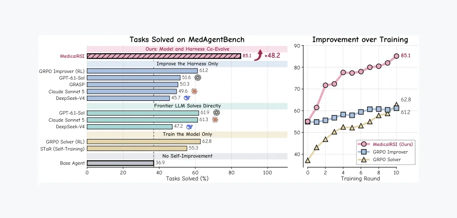 arXiv 2026-11-23 · cs.CL · #1 **[MedicalRSI: Medical Recursive Self-Improving Agents via Clinical Model-Harness Co-Evolution](https://arxiv.org/abs/2611.26806)** Ziqing Wang , Hamid Palangi , Lili Zhao , Kaize Ding Affiliation · Northwestern University / University of Washington [Paper](https://arxiv.org/abs/2611.26806) · [Figure source](https://arxiv.org/html/2611.26806v1/fig1_results.png) 

[EN] Abstract
Medical agents built on large language models (LLMs) have advanced rapidly, yet most stay fixed once deployed and do not keep using their experience to improve later attempts. As a result, the same kind of error can recur across patients. To address this, existing self-improvement methods update an agent's weights or its medical harness from its own experience, but their improving strategy stays fixed and never learns which changes actually help, which caps how much the agent can improve. Recursive self-improvement (RSI) instead improves both the agent and its improving strategy. However, achieving RSI for medical agents is challenging, because clinical workflows rarely come with a reference harness, and a change that fixes early errors may not fix the problems the agent meets later. We propose MedicalRSI, an RSI framework built on Clinical Model-Harness Co-Evolution, in which one model plays two roles. The Solver is the medical agent itself, and the Improver is its learnable improving strategy, which writes a medical harness from the agent's failures. Each harness is rewarded by its gain over acting without it, and both roles are trained together, so the Improver keeps adapting to the problems the Solver has not yet solved. On multiple benchmarks and LLM backbones, MedicalRSI outperforms existing context-level and weight-level self-improvement methods and transfers well to unseen workflows, new LLMs and new databases, a step toward medical agents that keep improving. <a href="https://arxiv.org/list/cs/new?show=2000#2611.26806">Source</a>

[ZH] Abstract
基于大语言模型（LLM）的医学代理发展迅速，但多数部署后保持固定，不能持续利用经验改进后续尝试，导致相同错误跨患者重复。现有自改进方法从自身经验更新权重或医学框架，但改进策略固定，不能学习哪些变化有用，限制改进能力。递归自我改进（RSI）则同时改进代理和其改进策略。不过，临床流程很少有参考框架，修复早期错误的变化也未必适用于后续问题，因此实现困难。我们提出MedicalRSI，以临床模型—框架共同进化为基础，一个模型承担两种角色：Solver是医学代理，Improver是可学习的改进策略，从代理失败中编写医学框架。各框架以相对无框架执行的收益获得奖励，两角色联合训练，使Improver持续适应Solver尚未解决的问题。在多个基准与LLM骨干上，MedicalRSI优于现有上下文级、权重级自改进方法，并能迁移到未见流程、新LLM和新数据库，向持续改进的医学代理迈进一步。 <a href="https://arxiv.org/list/cs/new?show=2000#2611.26806">Source</a>
 | 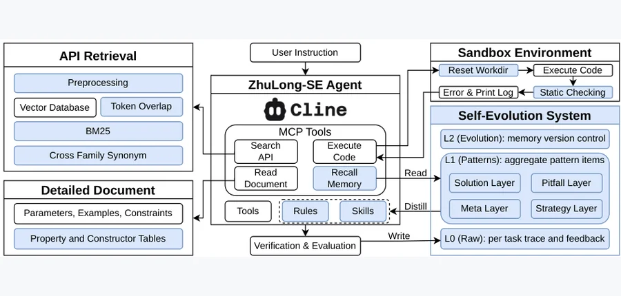 arXiv 2026-11-23 · cs.AI · #2 **[Self-Evolving Beyond Human-Crafted Experience for EDA Scripting](https://arxiv.org/abs/2611.26912)** Yang Liu , Shengbo Tong , Xiyuan Chen , Shiwei Hou , Sen Yuan , Hao Wang , Yanfeng Li , Hongwen Li , Yiming Zhu , Zhuolun… Affiliation · CXMT / Tsinghua University / University of Science and Technology of China [Paper](https://arxiv.org/abs/2611.26912) · [Figure source](https://arxiv.org/html/2611.26912v1/zhulong-se.png) 

[EN] Abstract
The growing complexity of electronic systems demands efficient design flows, yet EDA scripting remains a bottleneck: proprietary APIs are sparsely documented, and errors often appear as silent failures or cryptic exceptions. Hand-crafted knowledge helps but is difficult to maintain as toolchains evolve. We present ZhuLong-SE (Self-Evolution), an execution-grounded LLM agent that learns reusable knowledge from prior task traces. Building on ZhuLong, it enhances the task-level harness with API retrieval, documentation responses, isolated sandbox execution, and static checking, then adds governed cross-task self-evolution. Beyond solving individual tasks, ZhuLong-SE distills past execution traces into a three-tier memory store governed by ground-truth anchoring, disconfirmation filtering, held-out rollback, and anti-leakage retrieval. On the 158-task EDA-Eval-PyAether benchmark, the full task-level harness, with self-evolution disabled, achieves 92.4% pass@1 and outperforms ZhuLong on all five tested LLM backbones. On a harder instance-disjoint test set, self-evolution from the bare configuration surpasses a human-crafted-experience baseline by 2.5 percentage points (80.0% vs. 77.5% pass@1). <a href="https://arxiv.org/list/cs/new?show=2000#2611.26912">Source</a>

[ZH] Abstract
电子系统复杂性增长要求高效设计流程，但EDA脚本仍是瓶颈：专有API文档稀少，错误常以静默失败或晦涩异常呈现。手工知识有帮助，却难随工具链维护。我们提出ZhuLong-SE（自进化），从历史任务轨迹学习可复用知识的执行驱动LLM代理。在ZhuLong基础上，它通过API检索、文档响应、隔离沙箱执行和静态检查增强任务级框架，再加入受治理的跨任务自进化。除求解个别任务外，它将历史轨迹蒸馏到三级记忆，受真值锚定、反证过滤、留出回滚和防泄漏检索约束。在158任务EDA-Eval-PyAether上，禁用自进化的完整任务框架达到92.4% pass@1，在五种LLM骨干上都胜过ZhuLong。在更难、实例不相交测试集上，从裸配置自进化比人工经验基线高2.5个百分点（80.0%对77.5% pass@1）。 <a href="https://arxiv.org/list/cs/new?show=2000#2611.26912">Source</a>
 | 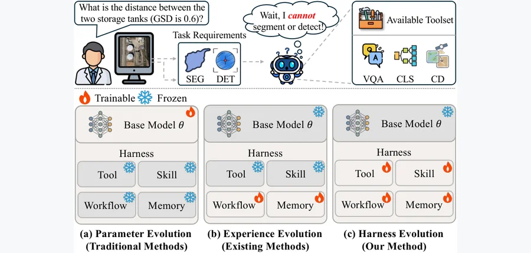 arXiv 2026-11-23 · cs.CV · #3 **[RemoteEvolver: Expanding Earth Observation Capabilities through Agent Harness Evolution](https://arxiv.org/abs/2611.27110)** Shengxiang Xu , Liang Yao , Shuyi Chen , Yishu Wang , Shimin Di , Fan Liu , Bishun Yao , Hanghui Guo , Xinyu Liu , Chengye… Affiliation · Southeast University / Hohai University / The Hong Kong University of Science and Technology (Guangzhou) [Paper](https://arxiv.org/abs/2611.27110) · [Figure source](https://arxiv.org/html/2611.27110v1/motivation.png) 

[EN] Abstract
We are interested in developing a continually self-improving remote sensing agentic system. It should identify and address its capability gaps, retaining the resulting improvements to enhance performance on subsequent tasks. However, existing systems typically rely on fixed toolsets and confine their experience accumulation to re-orchestrating predefined capabilities, constraining both capability expansion and the transfer of improvements across tasks. As the infrastructure for agentic systems, the harness manages tools and workflow knowledge as editable, persistent resources outside the base model. These resources can therefore be updated and reused across tasks without additional post-training. Based on these observations, we propose RemoteEvolver, an external harness for remote sensing agents that drives tool and workflow evolution through execution feedback. With the base model parameters fixed, RemoteEvolver acquires missing specialized tools on demand and distills verified successful execution experience from individual tasks into agent skills that can be reused across tasks. The acquired tools and accumulated skills jointly support planning and execution on subsequent tasks. Experiments on Earth-Bench and OpenEarthAgent-Bench show that RemoteEvolver achieves average accuracy gains of 8.18 and 23.86 percentage points over its initial state when tools are fully available and partially missing. Under the same settings, it also outperforms the state-of-the-art methods by an average of 6.77 and 17.10 percentage points, respectively. <a href="https://arxiv.org/list/cs/new?show=2000#2611.27110">Source</a>

[ZH] Abstract
我们希望构建持续自改进的遥感代理，识别并弥补能力缺口，保留改进以增强后续任务。但现有系统依靠固定工具，经验积累只重新编排预定义能力，限制扩展及跨任务迁移。框架作为代理基础设施，在基础模型外管理可编辑、持久化的工具与流程知识，因此无需额外后训练即可更新复用。基于此，我们提出RemoteEvolver，通过执行反馈驱动工具和流程进化的外部遥感框架。基础参数固定时，它按需获取缺失专用工具，并将单任务中经验证成功的执行经验蒸馏为跨任务技能。新增工具与累积技能共同支持后续规划执行。在Earth-Bench和OpenEarthAgent-Bench上，工具完整与部分缺失时，相比初始状态平均准确率分别提高8.18和23.86个百分点；同设置下也比最佳现有方法平均高6.77和17.10个百分点。 <a href="https://arxiv.org/list/cs/new?show=2000#2611.27110">Source</a>
 |
| 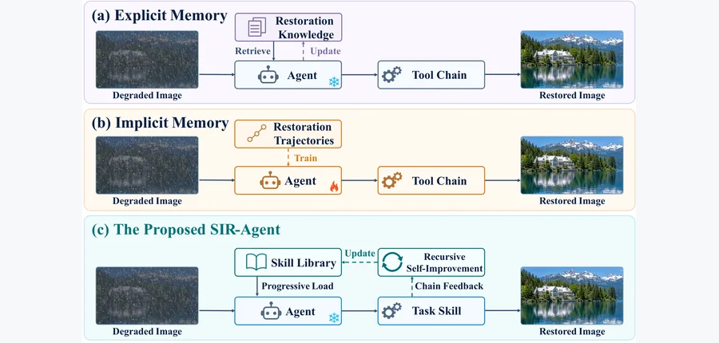 arXiv 2026-11-23 · cs.CV · #4 **[SIR-Agent: Skill-Augmented Image Restoration Agent with Recursive Self-Improvement](https://arxiv.org/abs/2611.27285)** Yijian Wang , Qingsen Yan , Weiyu Zhou , Mingde Zhang , Axi Niu , Haokui Zhang , Jiantao Zhou Affiliation · Northwestern Polytechnical University / Shenzhen Research Institute of Northwestern Polytechnical University / University of Macau [Paper](https://arxiv.org/abs/2611.27285) · [Figure source](https://arxiv.org/html/2611.27285v1/Motivation.png) 

[EN] Abstract
Agents for Image Restoration (IR) aim to leverage Multimodal Large Language Models (MLLMs) to autonomously perceive image degradation and invoke IR tools. However, existing IR agents typically rely on fine-tuning MLLM parameters to adapt to new IR tasks, leading to catastrophic forgetting of IR knowledge. To address this limitation, we propose a skill-augmented IR agent, dubbed SIR-Agent, that maintains IR knowledge in a scalable skill library and uses Recursive Self-Improvement (RSI) to facilitate efficient skill-library evolution. Specifically, we design a Chain Feedback-driven Skill Revision (CFSR) to evolve the skill library. The CFSR analyzes restoration chains to identify and revise weak operations in existing skills. The compatibility of a revised skill with known tasks decides if it replaces the original skill or is appended independently. Furthermore, to advance CFSR's skill-library evolution, we present an RSI-driven skill meta-learning mechanism, which identifies CFSR's inefficient operations and autonomously refines its revision strategy. Extensive experiments across 14 IR benchmarks, covering 6 single-degradation and 8 mixed-degradation scenarios, demonstrate SIR-Agent's superior IR performance. Further evaluation on 7 unseen tasks validates SIR-Agent's generalization to new IR tasks. <a href="https://arxiv.org/list/cs/new?show=2000#2611.27285">Source</a>

[ZH] Abstract
图像复原（IR）代理希望利用多模态LLM自主感知退化并调用复原工具。但现有代理多通过微调参数适应新任务，导致IR知识灾难性遗忘。我们提出技能增强SIR-Agent，在可扩展技能库维护知识，用RSI高效进化技能库。具体而言，链反馈驱动技能修订（CFSR）分析复原链，找出并修订现有技能中的薄弱操作。修订技能与已知任务的兼容性，决定替换原技能还是独立追加。为继续增强CFSR，我们提出RSI驱动技能元学习，识别CFSR低效操作，自主完善修订策略。在14个IR基准、六种单退化和八种混合退化场景上的大量实验展示优越表现；七项未见任务进一步验证对新IR任务的泛化。 <a href="https://arxiv.org/list/cs/new?show=2000#2611.27285">Source</a>
 | 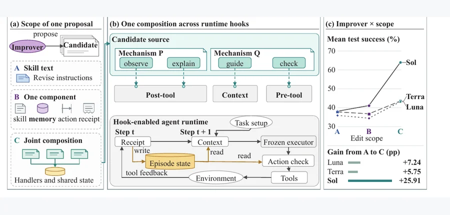 arXiv 2026-11-23 · cs.AI · #5 **[HookEvo: A Framework for Coordinated Plugin Evolution on Hook-Enabled Agent Runtimes](https://arxiv.org/abs/2611.27294)** Shengze Huang , Yanyu Mao , Xiaofei Yu , Baoshen Guo , Xiaorui Wang , Zhiwen Wu , Sheng Wu , Fukang Wen , Chengxu Wu , Lin… Affiliation · Tsinghua University / Nanyang Technological University / Renmin University of China / Massachusetts Institute of Technology / Peking University / Southeast University / Renlab AI / Singapore-MIT Alliance for Research and Technology [Paper](https://arxiv.org/abs/2611.27294) · [Project](https://huangshengzebluesky.github.io/HookEvo/) · [Figure source](https://arxiv.org/pdf/2611.27294) 

[EN] Abstract
Repairing failures in tool-using agents can require coordinated changes to how the harness interprets tool receipts, assembles context, and checks actions. We introduce HookEvo, a framework that uses an existing agent runtime's lifecycle hooks to evolve task-specific harnesses. We instantiate HookEvo on DeepSeek Harness. In each round, a separate improver diagnoses failures from execution traces and proposes a candidate. HookEvo evaluates the candidate against the current harness on matched tasks and carries the retained version into the next round. A single candidate can jointly edit executable plugin handlers and the state they share within a task, allowing a tool receipt to inform context and control a later action. Using a frozen Qwen3-4B executor, the selected harnesses lead the reported Qwen3-4B comparisons, achieving 95.41% on ALFWorld, 70.56% on DBBench, 48.17% on WebShop, and 41.67% on OSBench. Across three improvers and three edit scopes, from skill text to single-component and coordinated executable edits, GPT-6.1 Sol shows the largest average gain from the broadest scope. Our code is available at this https URL . <a href="https://arxiv.org/list/cs/new?show=2000#2611.27294">Source</a>

[ZH] Abstract
修复工具代理失败，可能需要协同改变框架如何解释工具回执、组装上下文和检查动作。我们提出HookEvo，利用现有运行时生命周期钩子进化任务特定框架，并在DeepSeek Harness实现。每轮独立改进者从执行轨迹诊断失败并提出候选；HookEvo在匹配任务上对比候选与当前框架，将保留版本带入下一轮。单个候选可联合编辑可执行插件处理器及任务内共享状态，使工具回执既影响上下文，也控制后续动作。冻结Qwen3-4B执行器时，选中框架在论文报告的该模型比较中领先：ALFWorld 95.41%、DBBench 70.56%、WebShop 48.17%、OSBench 41.67%。跨三种改进者、从技能文本到单组件和协同可执行编辑的三种范围，GPT-6.1 Sol从最宽编辑范围获得最大平均收益。代码位于原文所示https链接。 <a href="https://arxiv.org/list/cs/new?show=2000#2611.27294">Source</a>
 | 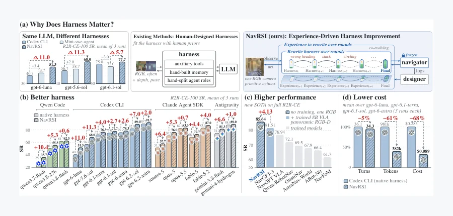 arXiv 2026-11-23 · cs.RO · #6 **[NavRSI: Recursive Harness Self-Improvement for Vision-and-Language Navigation](https://arxiv.org/abs/2611.27499)** Guangzhao Dai , Guoxin Lian , Shuo Wang , Shengbin Yue , Qianru Sun , Xiangbo Shu , Bin Zhu Affiliation · Singapore Management University / Renmin University of China / Fudan University / Nanjing University of Science and Technology [Paper](https://arxiv.org/abs/2611.27499) · [Project](https://daiguangzhao.github.io/NavRSI) · [Figure source](https://arxiv.org/html/2611.27499v1/teaser.png) 

[EN] Abstract
Frontier large language models (LLMs) have enabled vision-and-language navigation (VLN) through direct closed-loop perception and action. However, navigation performance depends strongly on the harness governing LLM-environment interactions, while existing harnesses largely rely on manually designed navigation tools, memory, and agent roles. We introduce NavRSI, a harness-centric recursive self-improvement framework that optimizes the navigation behavior of frozen LLMs through closed-loop experience. In each round, NavRSI iteratively collects navigation trajectories and failure diagnostics, employs a designer agent to rewrite the harness, and retains the revisions that prove effective, while the designer accumulates experience from previous revisions so that the harness and this experience co-evolve. Privileged simulator diagnostics guide only the designer and remain inaccessible to the navigating LLM, enabling deployment with a single RGB camera and primitive actions, without task-specific model training or additional navigation tools. Experiments demonstrate consistent improvements across LLMs from four vendors, with 85.64% success rate on the full R2R-CE val-unseen split with GPT-6-Astra, surpassing the previously reported best by 4.13%. Evaluations on RxR-CE, NavRAG-CE, and a real humanoid robot further demonstrate its generalizability. <a href="https://arxiv.org/list/cs/new?show=2000#2611.27499">Source</a>

[ZH] Abstract
前沿LLM已能直接闭环感知行动完成视觉语言导航（VLN），但性能很依赖管理模型与环境交互的框架，而现有工具、记忆、角色大多人工设计。我们提出以框架为中心的NavRSI，通过闭环经验优化冻结LLM导航行为。每轮收集轨迹和失败诊断，设计者代理重写框架，只保留验证有效的修订；设计者累积以往修订经验，使框架与经验共同进化。特权模拟器诊断仅指导设计者，导航LLM无法访问，因此部署只需单RGB相机与基本动作，不需任务特定训练或额外导航工具。四家厂商LLM上一致改善，GPT-6-Astra在完整R2R-CE val-unseen达到85.64%成功率，比此前已报告最佳高4.13%。RxR-CE、NavRAG-CE及真实人形机器人评估进一步展示泛化。 <a href="https://arxiv.org/list/cs/new?show=2000#2611.27499">Source</a>
 |
| 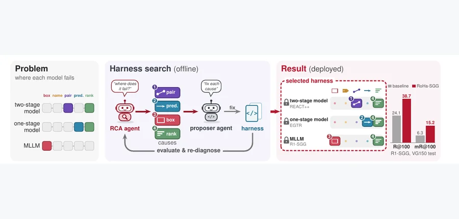 arXiv 2026-11-23 · cs.CV · #7 **[Fix Where It Fails: Root-Cause-Guided Agentic Harness Optimization for Scene Graph Generation](https://arxiv.org/abs/2611.27529)** Jee Eun Kim , Donghyeon Choi , Sangjune An , Hae Beom Lee , Kyong Hwan Jin Affiliation · Korea University [Paper](https://arxiv.org/abs/2611.27529) · [Figure source](https://arxiv.org/pdf/2611.27529) 

[EN] Abstract
Scene graph generation (SGG) aims to detect objects in an image and predict the relationships between them. The standard PredCls, SGCls, and SGDet settings show how much performance drops without ground-truth boxes and labels, but not where or why a model fails. Knowing this would allow fixing a model where it fails, without retraining. We propose RoHa-SGG (Root-cause-guided Harness optimization for SGG), which extends agentic harness optimization to SGG. It optimizes the harness, the inference code around a frozen SGG model. RoHa-SGG has two main LLM agents. A root-cause analysis (RCA) agent finds the components where the model fails and diagnoses why, and a proposer agent searches for a harness that fixes these causes. We evaluate RoHa-SGG on Visual Genome and PSG with representative two-stage, one-stage, and multimodal-LLM SGG models. The analysis shows that the components where ground-truth triplets are lost differ across models and datasets. RoHa-SGG improves every metric on all five model-dataset combinations. Graph-constrained R@100 and mR@100 rise by up to 15.8 and 26.4 points for the multimodal LLM and by up to 3.6 and 10.1 points for the two-stage and one-stage models. With root-cause guidance, the harness search reaches the final score of an unguided search up to three times faster. <a href="https://arxiv.org/list/cs/new?show=2000#2611.27529">Source</a>

[ZH] Abstract
场景图生成（SGG）旨在检测图像对象并预测关系。标准PredCls、SGCls、SGDet说明没有真值框和标签时性能下降多少，却不能定位失败原因；若知道原因，就可不重训而定点修复。我们提出RoHa-SGG，将代理框架优化扩展到SGG，优化冻结模型周围的推理代码。两个主要代理分别负责根因分析和候选提出：RCA定位失效组件并诊断原因，proposer搜索解决这些原因的框架。在Visual Genome和PSG上评估两阶段、单阶段、多模态LLM模型，发现真值三元组丢失位置随模型数据集而异。RoHa-SGG在全部五种模型—数据组合的所有指标上改善；图约束R@100和mR@100，对多模态LLM最多提高15.8和26.4点，对两阶段和单阶段最多提高3.6和10.1点。根因指导使搜索达到无指导最终分数的速度最多快三倍。 <a href="https://arxiv.org/list/cs/new?show=2000#2611.27529">Source</a>
 | 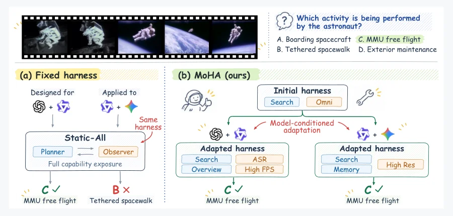 arXiv 2026-11-23 · cs.CV · #8 **[MoHA: Model-Conditioned Harness Adaptation for Long-Video Agents](https://arxiv.org/abs/2611.27646)** Jianghan Chao , Wenhui Tan , Hang Su , Qiuyu Tian , Tanxiao Li , Bingzi Zhang , Zequn Liu , Ruihua Song , Yingce Xia Affiliation · Renmin University of China / Zhongguancun Academy [Paper](https://arxiv.org/abs/2611.27646) · [Code](https://github.com/roverx12345/MoHA) · [Figure source](https://arxiv.org/html/2611.27646v1/fig1.png) 

[EN] Abstract
Long-video understanding increasingly relies on agentic systems that actively acquire evidence rather than process fixed video representations. Their execution harnesses must coordinate language-level planning with video-level observation and evidence acquisition, yet are typically fixed across model stacks. We therefore introduce MoHA, a framework for model-conditioned harness adaptation that adapts a common initial execution harness to the specific planner and observer models it hosts. MoHA treats the harness itself as a model-conditioned optimization object: under the same task distribution and initialization, different planner-observer stacks can benefit from different executable harnesses. Starting from a common initial harness, MoHA analyzes failed calibration traces to diagnose model-harness mismatches and adapts both planner-side reasoning support, such as overview, memory, and verification, and observer-side capability assignments, including OCR and ASR specialists. After structural adaptation, MoHA separately calibrates observer execution configurations for the hosted model stack. Across three frozen planner stacks, MoHA improves Video-MME Full accuracy by 6.2-27.1 percentage points and Video-Holmes accuracy by 3.1-20.1 points over the fixed initial harness. Cross-model transfer further shows that the adapted harnesses generalize only partially to other models, highlighting the harness as a model-conditioned optimization layer for long-video understanding. Code is available at this https URL . <a href="https://arxiv.org/list/cs/new?show=2000#2611.27646">Source</a>

[ZH] Abstract
长视频理解越来越依靠主动获取证据的代理，而非固定视频表示。框架需协调语言规划、视频观测与证据获取，却通常在不同模型栈间固定。我们提出MoHA，按所托管规划者和观察者模型，适应共同初始执行框架。它将框架本身作为模型条件化优化对象：相同任务分布和初始化下，不同规划—观察组合可受益于不同可执行框架。MoHA从失败校准轨迹诊断模型—框架不匹配，同时调整规划侧概览、记忆、验证等推理支持，以及观察侧OCR和ASR专家分工。结构适应后，再单独校准观察执行配置。三个冻结规划模型栈上，Video-MME Full准确率比固定初始框架提高6.2至27.1个百分点，Video-Holmes提高3.1至20.1点。跨模型迁移仅部分泛化，表明框架是长视频理解的模型条件化优化层。代码位于原文所示https链接。 <a href="https://arxiv.org/list/cs/new?show=2000#2611.27646">Source</a>
 | 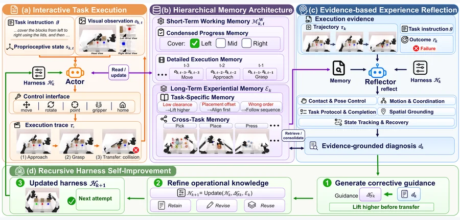 arXiv 2026-11-23 · cs.RO · #9 **[Embodied-Harness: Towards Recursive Self-Improvement for Robotic Manipulation](https://arxiv.org/abs/2611.27689)** Zhenxuan Fan , Zhuoya Wang , Yuqian Yuan , Wenqiao Zhang , Juncheng Li , Jun Xiao , Siliang Tang , Yueting Zhuang Affiliation · Zhejiang University / Huazhong University of Science and Technology [Paper](https://arxiv.org/abs/2611.27689) · [Figure source](https://arxiv.org/html/2611.27689v1/Embodied-Harness.png) 

[EN] Abstract
Vision-language model (VLM)-based agents offer a promising approach to robotic manipulation, yet remain limited by inadequate memory organization, uncertain failure attribution, and limited reuse of execution experience. We propose Embodied-Harness, a dual-agent framework that improves manipulation by refining the execution harness without updating model parameters. The Actor interacts with the environment through a robot-control interface, while the Reflector converts execution evidence into reusable operational guidance. Hierarchical Memory Architecture maintains short-term execution context and long-term experiential knowledge to support execution and reflection. Evidence-based Experience Reflection grounds failure diagnosis in observed interactions, while Recursive Harness Self-Improvement refines operational guidance across successive attempts. Experiments on RoboTwin 2.0, RoboSPA, and RMBench demonstrate the effectiveness of Embodied-Harness in generalization under environmental variations, spatial reasoning, long-horizon planning, and memory-dependent manipulation. Our method achieves success rates of 82.4%, 76.7%, and 94.4% on the three benchmarks, respectively. Real-world evaluation further yields an average success rate of 96.7% across three manipulation tasks. These results highlight the potential of Embodied-Harness to improve robotic manipulation through experience-driven harness self-improvement. <a href="https://arxiv.org/list/cs/new?show=2000#2611.27689">Source</a>

[ZH] Abstract
基于VLM的代理有望执行机器人操作，但仍受限于记忆组织不足、失败归因不确定和经验复用有限。我们提出Embodied-Harness，通过完善执行框架而非更新参数改善操作的双代理框架。Actor通过机器人接口与环境交互，Reflector将执行证据转为可复用操作指导。分层记忆保留短期上下文和长期经验，支持执行反思；基于证据的反思以观测交互为依据诊断失败，递归框架自改进则跨尝试完善指导。在RoboTwin 2.0、RoboSPA和RMBench上，方法改善环境变化下的泛化、空间推理、长程规划和记忆依赖操作，成功率分别为82.4%、76.7%、94.4%。真实世界三个操作任务平均成功率96.7%。结果展示经验驱动框架自改进的潜力。 <a href="https://arxiv.org/list/cs/new?show=2000#2611.27689">Source</a>
 |
| 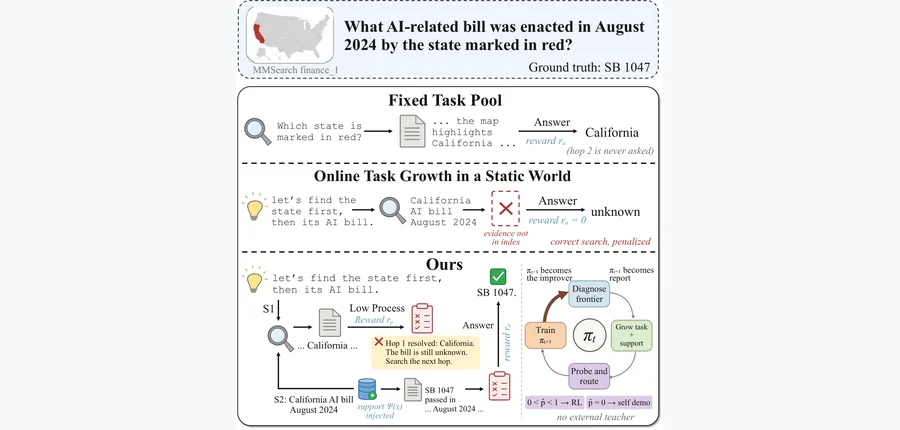 arXiv 2026-11-23 · cs.CV · #10 **[Search-RSI: Expanding Search Worlds Along Multimodal Agents' Capability Frontier](https://arxiv.org/abs/2611.27780)** Chengchao Lv , Yin Wang , Chunzheng Zhu , Wanli Chang Affiliation · Hunan University / New York University [Paper](https://arxiv.org/abs/2611.27780) · [Figure source](https://arxiv.org/html/2611.27780v1/intro-motivation.png) 

[EN] Abstract
Multimodal search agents answer knowledge intensive visual questions by grounding them in retrieved evidence, and recent recipes train them on multi hop tasks that are synthesized from knowledge graphs and grown online to keep pace with the agent. These recipes, however, treat the searchable world as fixed: a new question can be well formed and verifiable while its evidence is absent from the retrieval backend, so the agent issues the right query, retrieves nothing, and is penalized as if its policy were at fault. Such unreachable negatives accumulate with every round of growth. We propose Search-RSI, a recursive self improvement framework that expands the search world along the agent's capability frontier. In each round, the current policy diagnoses its partially mastered regions of a task space spanned by hop depth, relation rarity, and distractor density; new tasks there are grown together with their evidence; and the same policy decides how they are used: candidates on which its probes disagree feed reinforcement learning, while those beyond its reach become hint guided demonstrations of its own. Keeping the policy inside this loop matters: an improver frozen at the start of training loses 3.2 points. On nine multimodal search benchmarks, Search-RSI keeps improving where static task growth saturates, raising the average accuracy of the recipe it builds on by 9.8 and 9.5 points at 9B and 27B, of which 7.0 points are out of reach for a world that is merely made consistent. The loop uses no external model and only privileged task structure that is removed before training, at 1.27x the compute of static growth. <a href="https://arxiv.org/list/cs/new?show=2000#2611.27780">Source</a>

[ZH] Abstract
多模态搜索代理通过检索证据回答知识密集视觉问题；近期方法在从知识图谱合成、在线增长的多跳任务上训练，以跟随代理能力。但其可搜索世界固定：新问题形式正确可验证，却可能缺少后台证据，代理发出正确查询也无结果，仍被当作策略错误惩罚，不可达负例逐轮累积。我们提出Search-RSI，沿能力前沿扩展搜索世界。每轮当前策略诊断由跳深、关系稀有度、干扰密度定义的部分掌握区域，新任务与证据共同增长，再由同一策略决定使用方式：探测分歧候选用于RL，超出能力者转为提示引导的自身示范。保持策略参与很重要：冻结初始改进者会损失3.2点。九个搜索基准上，静态任务增长饱和后仍持续改善，9B和27B平均准确率相对基础方法提高9.8和9.5点，其中7.0点是仅让世界一致无法获得的。闭环不使用外部模型，仅用训练前移除的特权任务结构，计算为静态增长的1.27倍。 <a href="https://arxiv.org/list/cs/new?show=2000#2611.27780">Source</a>
 | 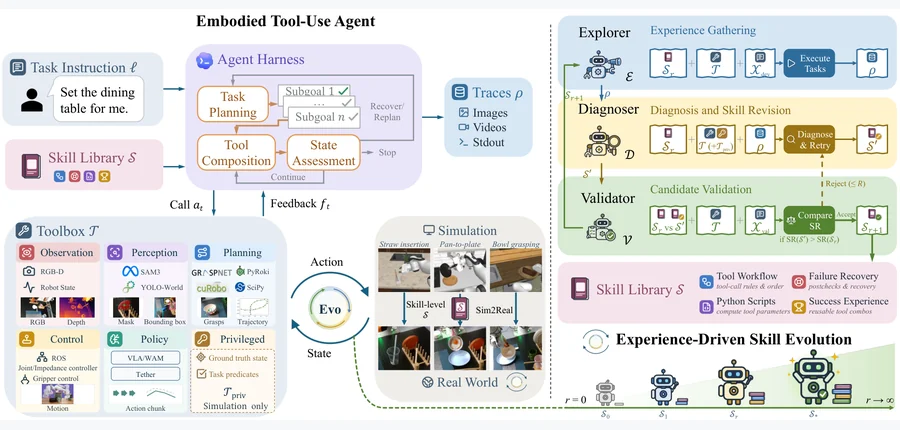 arXiv 2026-11-23 · cs.RO · #11 **[EvoTER: Evolving Embodied Agents via Tool-Use Experience and Reflection](https://arxiv.org/abs/2611.27797)** Yingting Zhou , Yuyin Zhou , Yongliang Wang , Haoran Li , Dongbin Zhao Affiliation · The State Key Laboratory of Multimodal Artificial Intelligence Systems, Institute of Automation, Chinese Academy of Sciences / University of Chinese Academy of Sciences [Paper](https://arxiv.org/abs/2611.27797) · [Project](https://evoter-project.github.io/) · [Figure source](https://arxiv.org/html/2611.27797v1/figure1.png) 

[EN] Abstract
Long-horizon embodied tasks require agents to ground instructions in changing observations, coordinate heterogeneous tools, and recover from failures that can propagate through downstream operations. Although existing LLM-based agents retain experience and refine reusable skills, successful local repairs do not by themselves establish complete-task gains over the current shared procedure library. We present EvoTER, an experience-driven framework that enables embodied agents to self-evolve tool-use skills without updating model parameters. EvoTER operates through a three-role evolution loop: Explorer records tool-use trajectories; Diagnoser distills successful and failed executions into skills for tool selection, parameter computation, postcondition checks, and recovery; and Validator retains candidate revisions only when they improve complete-task success in fresh sessions. In simulation, EvoTER improves overall task success from a pre-evolution baseline of 53.60% to 80.40%. In real-world experiments, simulation initialization reduces the attempts required to acquire short-horizon skills, while continued real-world evolution improves long-horizon success from 20% to 80%-100% across tasks and enables the evolving skill library to incorporate new tool functionality introduced after simulation development. Project page: this https URL <a href="https://arxiv.org/list/cs/new?show=2000#2611.27797">Source</a>

[ZH] Abstract
长时程具身任务需要在变化观测中理解指令、协调异构工具并恢复可能传播的失败。现有LLM代理虽保留经验和完善技能，但局部修复成功并不证明相对当前共享流程库的全任务收益。我们提出EvoTER，无需参数更新即可自进化工具技能。三角色循环中，Explorer记录轨迹，Diagnoser从成败蒸馏工具选择、参数计算、后置检查和恢复技能，Validator仅在全新会话中提高完整任务成功率时保留修订。模拟中，总成功率从53.60%升至80.40%。真实实验中，模拟初始化减少短程技能获取尝试；持续真实进化使长程成功率从20%升至各任务80%至100%，并能将模拟开发后新增工具功能纳入技能库。项目页位于原文所示https链接。 <a href="https://arxiv.org/list/cs/new?show=2000#2611.27797">Source</a>
 | 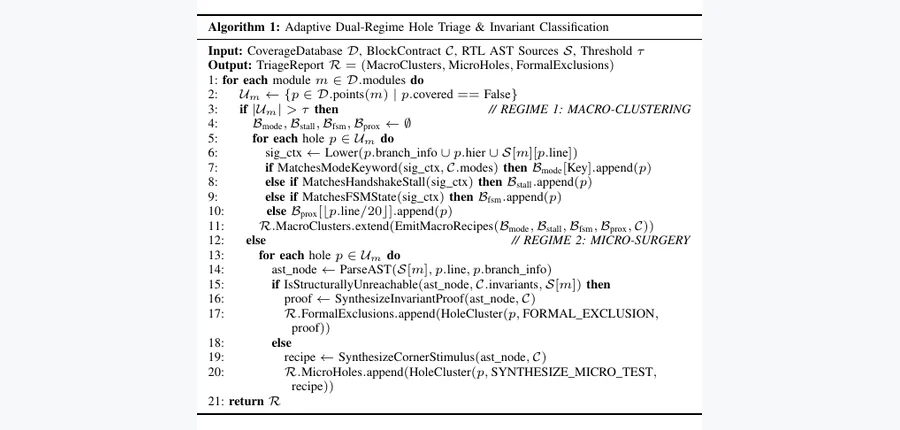 arXiv 2026-11-23 · cs.AR · #12 **[Specification-Grounded Adaptive Triage and Formal Invariant Exclusion Synthesis for Autonomous Silicon Coverage Closure](https://arxiv.org/abs/2611.26815)** Veni Mohan Affiliation · Google LLC [Paper](https://arxiv.org/abs/2611.26815) · [Figure source](https://arxiv.org/pdf/2611.26815) 

[EN] Abstract
Closing the final 5%-15% of code and functional coverage remains a major schedule bottleneck in silicon tapeouts. Existing LLM-based coverage closure loops feed raw uncovered RTL lines or branches directly into iterative prompts, failing on industrial subsystems due to: (1) token and context explosion from querying thousands of correlated holes independently; (2) illegal stimulus that violates cross-signal invariants and yields dirty coverage; and (3) unsafe exclusion hallucination on structurally unreachable dead code. We present ARGUS (Autonomous Reachability &amp; Guided Unified Stimulus), a specification-grounded, dual-regime coverage closure and formal exclusion synthesis engine. ARGUS mines microarchitectural specs and SystemVerilog Assertions into a formal Block Contract (C), then runs adaptive Macro-Clustering vs. Micro-Surgery triage gated by a per-module hole-density threshold (tau): dense modules collapse correlated holes into root-cause mode, FSM, and backpressure clusters, while sparse modules use AST and loop-domain reachability to separate reachable corners from provably unreachable invariants. Directed tests pair with bit-exact golden scoreboards, and unreachable invariants emit tool-native .el exclusions with formal proofs. Across five core benchmarks -- three open-source LowRISC OpenTitan IPs (uart_core, i2c_core, aes_cipher_core) and two commercial AI accelerator Tensor Layout Converter datapaths (53 SV modules, 376,127 coverage points) -- plus a 2,626-module industrial interconnect subsystem, ARGUS triages 2,626 modules in 0.265 s, cuts token usage by 27.2x to &gt;180x, achieves zero dirty merges via 3-step sanity gating, and reaches 99.32%-100.0% effective coverage with 0 false exclusions across 21,071+ proven exclusions. <a href="https://arxiv.org/list/cs/new?show=2000#2611.26815">Source</a>

[ZH] Abstract
收敛最后5%至15%的代码和功能覆盖率仍是芯片流片瓶颈。现有LLM闭环将未覆盖RTL行或分支直接用于迭代提示，在工业子系统受三问题限制：大量相关空洞造成上下文膨胀，非法刺激违反跨信号不变量产生脏覆盖，对结构不可达死代码产生不安全排除幻觉。我们提出ARGUS，基于规格、双模式覆盖闭合与形式排除综合引擎。它从微架构规格和SystemVerilog断言提取形式块契约，按每模块空洞密度阈值，在宏聚类与微手术间自适应分流：密集模块把相关空洞归为根因模式、FSM和背压簇；稀疏模块用AST和循环域可达性区分可达角落与可证不可达不变量。定向测试配合位精确黄金记分板，不可达不变量生成带形式证明的工具原生.el排除文件。在三个OpenTitan开源IP及两个商业AI加速器Tensor Layout Converter数据通路共五基准（53个SV模块、376,127覆盖点），另加2,626模块工业互连子系统上，ARGUS用0.265秒分流2,626模块，token减少27.2倍至超过180倍，经三步合理性门控实现零脏合并，有效覆盖99.32%至100.0%，逾21,071项已证明排除中零错误排除。 <a href="https://arxiv.org/list/cs/new?show=2000#2611.26815">Source</a>
 |
| 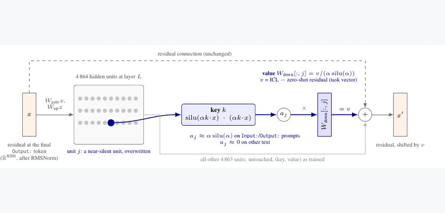 arXiv 2026-11-23 · cs.CL · #13 **[Weight-Space Programming Writes In-Context Learning and Matches Fine-Tuning in Language Models](https://arxiv.org/abs/2611.26841)** Konstantinos Skianis , Aristidis Likas Affiliation · University of Ioannina [Paper](https://arxiv.org/abs/2611.26841) · [Code](https://github.com/y3nk0/weight-space-programming-study) · [Figure source](https://arxiv.org/pdf/2611.26841) 

[EN] Abstract
Weight-space programming is a frontier language model's recently reported ability to read and rewrite another network's weights without gradient descent. We investigate how examples can provide a weight update so that a weaker language model performs the task with nothing in the prompt, and study what it edits. Our experiments cover six tasks, four frontier editors and three families of weaker language models, without the editors being told anything about in-context learning (ICL). In most runs, the few-shot minus zero-shot residual is measured at the final prompt token, the ICL task vector, and write it into the weights, at its sparsest into near-silent MLP units keyed to the prompt format. Results reach the accuracy of ICL and of fine-tuning on the same examples, LoRA included, usually leaving perplexity untouched, with worse performance under changes of wording. We also qualify the comparison by counting unfinished runs, observing that one editor falls below fine-tuning; held only to the seen examples, without task pairs of their own, only the strongest editor has similar performance. Given a task and unlabelled inputs, that editor writes its own examples and does nearly as well on unseen items as with labels. <a href="https://arxiv.org/list/cs/new?show=2000#2611.26841">Source</a>

[ZH] Abstract
权重空间编程是前沿语言模型近期报告的能力：无需梯度下降即可读取重写另一网络权重。我们研究如何用示例提供权重更新，使较弱语言模型在提示无示例时完成任务，并考察编辑内容。实验覆盖六任务、四前沿编辑器和三弱模型家族，编辑器没有被告知上下文学习（ICL）。多数运行测量最后提示token的少样本减零样本残差，即ICL任务向量，并将其写入权重；最稀疏时写入按提示格式触发、近乎静默的MLP单元。结果达到相同示例上的ICL及包括LoRA的微调准确率，通常不改变困惑度，但措辞变化时更差。我们也纳入未完成运行限定比较：一种编辑器低于微调；仅允许见过示例、没有自身任务对时，只有最强编辑器有相近性能。给定任务和无标签输入，该编辑器能自写示例，在未见项目上几乎达到有标签时表现。 <a href="https://arxiv.org/list/cs/new?show=2000#2611.26841">Source</a>
 | 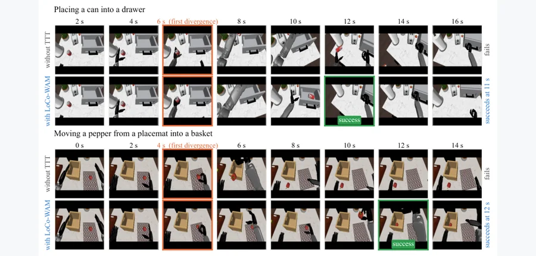 arXiv 2026-11-23 · cs.RO · #14 **[LoCo-WAM: Test-Time Training as Long Context for World-Action Models](https://arxiv.org/abs/2611.26853)** Sheng Cheng , Deqian Kong Affiliation · Amazon AGI / University of California, Los Angeles [Paper](https://arxiv.org/abs/2611.26853) · [Figure source](https://arxiv.org/html/2611.26853v1/fig_episode_main.png) 

[EN] Abstract
World-action models guide robot actions by predicting what happens next, but typically condition on a short observation history. Extending this history increases computation at every decision and can require a separately trained model. We introduce LoCo-WAM, which learns from the outcomes of its actions through test-time training while keeping the same short history length. It uses newly observed frames to update a low-rank adapter in the video expert, whose adapted predictions guide subsequent actions. The updates accumulate within each episode and are reset between episodes, allowing past observations to influence decisions after they leave the input window. LoCo-WAM thus learns from a longer stream of experience without expert action labels, additional data or meta-training. Experiments on two world-action models show improved task success across four simulation benchmarks. On RoboCasa GR-1, a model with 2.4,s of history matches one trained with 9.6,s, while a model with 4.8,s exceeds it by 4.8 percentage points. Our analysis shows that the updates improve prediction of upcoming frames, affect the action mainly through adaptation of the imagined future, and have an increasing effect on actions as the episode unfolds. <a href="https://arxiv.org/list/cs/new?show=2000#2611.26853">Source</a>

[ZH] Abstract
世界动作模型通过预测未来指导机器人，但通常只依赖短观测历史。延长历史增加每步计算，还可能需要另训模型。我们提出LoCo-WAM，在维持相同短历史长度时，以测试时训练从动作结果学习。它用新观测帧更新视频专家的低秩适配器，其适应预测指导后续动作。更新在每回合内累积、回合间重置，使已离开输入窗口的观测继续影响决策。因此无需专家动作标签、额外数据或元训练，也能从更长经验流学习。两个世界动作模型、四个模拟基准上成功率改善。在RoboCasa GR-1中，2.4秒历史的模型匹配用9.6秒训练的模型，4.8秒模型则超过4.8个百分点。分析表明，更新改善后续帧预测，主要通过改变想象未来影响动作，且影响随回合推进增大。 <a href="https://arxiv.org/list/cs/new?show=2000#2611.26853">Source</a>
 | 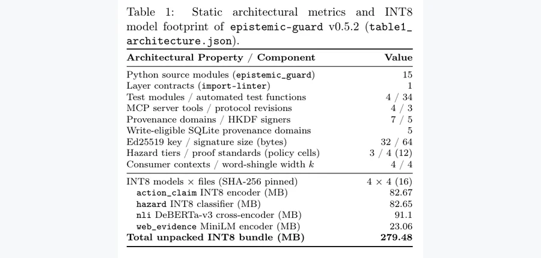 arXiv 2026-11-23 · cs.SE · #15 **[Epistemic Guard: Out-of-Process MCP Receipt Proxying, Post-Turn Prose Supervision, and Provenance-Gated Memory for Tool-Using Autonomous Agents](https://arxiv.org/abs/2611.27095)** Sean Maxwell Affiliation · Roll Solo, Melbourne, Australia [Paper](https://arxiv.org/abs/2611.27095) · [Code](https://github.com/AlienatedAliens/epistemic-guard) · [Figure source](https://arxiv.org/pdf/2611.27095) 

[EN] Abstract
Language-model agents using the Model Context Protocol (MCP) face three runtime verification gaps: (i) action fabrication, where post-tool prose narrates side effects that failed, timed out, or never ran; (ii) provenance collapse, where unverified model prose or web text enters durable memory alongside executed tool outputs; and (iii) syndicated echo amplification, where mirrored web pages satisfy multi-source corroboration from one origin. Existing MCP firewalls inspect wire calls before execution, while LLM-judge guardrails require multi-gigabyte VRAM without binding prose to receipts. We present epistemic-guard (v0.5.2), an open-source Python library and out-of-process stdio MCP receipt proxy (15 modules, 0 MiB GPU VRAM). epistemic-guard isolates Ed25519 signing keys out of process, writes RFC 6962 Merkle logs with AER-1 receipt translation, checks post-turn prose on CPU with SHA-256-verified OpenVINO INT8 encoders (4 models, 279.48 MB total; 82.67 MB on the supervision path), gates SQLite writes across 7 provenance domains, and collapses verbatim and lightly edited wire-syndicated RAG mirrors. On conformance suites, epistemic-guard rejects 100.0% of tampered receipts (200 Merkle leaves), passes 58/58 official AER-1 ingestion vectors and 50/50 reference-verified AER-1 exports, verifies 100.0% of 40 fault-injected wire calls and 100 concurrent appends with 0 key leaks, and blocks 100.0% of 100 unauthorized memory writes. Across $N=250$ frozen-benchmark traces, epistemic-guard reaches 93.2% accuracy at 17.9 ms warm median CPU latency (8.62 ms single-clause; 921.8 ms cold-start load), beating 12B-14B GPU judges by 6.4-6.8 points ($p=0.0259$, $p=0.0095$) at 4.26-4.5$\times$ lower latency; on $N=60$ live mcp-proxy traces, it catches 96.15% of hazards at 76.67% accuracy (38.24% FPR; $+18.34$ points over Stage-1-only, $p=0.001$) in 9.16 ms p50. <a href="https://arxiv.org/list/cs/new?show=2000#2611.27095">Source</a>

[ZH] Abstract
使用MCP的语言模型代理面临三个运行时验证缺口：（一）动作编造，工具后文字声称失败、超时或未执行的副作用；（二）来源坍塌，未验证模型文字或网页与已执行工具结果一起进入长期记忆；（三）同源传播放大，同一来源的镜像网页被当作多源佐证。现有MCP防火墙执行前检查调用，LLM评委又需多GB显存且不绑定回执。我们提出开源Python库epistemic-guard v0.5.2及进程外stdio回执代理（15模块、0MiB GPU显存）。它隔离Ed25519签名密钥，写RFC6962 Merkle日志并转换AER-1回执，用SHA-256验证的OpenVINO INT8编码器在CPU检查工具后文字（四模型共279.48MB，监督路径82.67MB），对七来源域SQLite写入门控，并折叠逐字及轻改同源RAG镜像。一致性测试中，它拒绝100%篡改回执（200叶），通过58/58官方AER-1导入与50/50参考验证导出，验证全部40故障注入调用和100并发追加，零密钥泄漏，并阻止全部100次未授权记忆写入。在250条冻结基准轨迹上，准确率93.2%，温启动CPU中位17.9毫秒（单分句8.62毫秒，冷加载921.8毫秒），比12B至14B GPU评委高6.4至6.8点（p=0.0259、0.0095），延迟低4.26至4.5倍；在60条真实mcp-proxy轨迹上，捕捉96.15%风险，准确率76.67%，假阳性38.24%，比仅第一阶段高18.34点（p=0.001），p50为9.16毫秒。 <a href="https://arxiv.org/list/cs/new?show=2000#2611.27095">Source</a>
 |
| 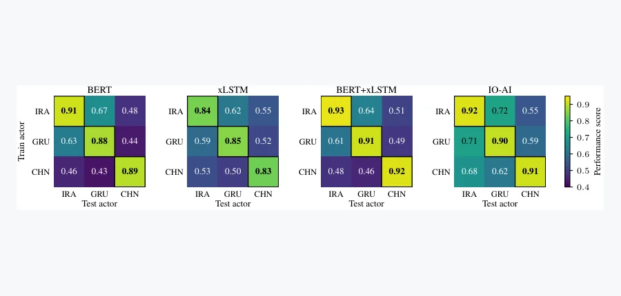 arXiv 2026-11-23 · cs.CL · #16 **[Co-Evolving Behavioral Agents and Detectors for Adaptive Information Operations](https://arxiv.org/abs/2611.27156)** Lin Tian , Marian-Andrei Rizoiu Affiliation · Behavioral Data Science, University of Technology Sydney [Paper](https://arxiv.org/abs/2611.27156) · [Figure source](https://arxiv.org/html/2611.27156v1/cross_actor.png) 

[EN] Abstract
Detectors of state-sponsored information operations (IOs) are trained on campaigns that platforms have already taken down. They lose much of their accuracy on an actor they have not seen, even though no operator in the archived data is trying to avoid them. A real operator wants two things, to reach an audience and to avoid being caught. We present IO-AI, a framework that gives simulated agents these two capabilities, engagement and evasion, and tests what each one does to detection. The agents are built from the posting behavior of real campaigns and choose the emotion, type, and timing of each post. An agent and a detector then train against each other in turn. We rank the trained agents by how hard they are to detect and train one detector on them from easiest to hardest. On 20 Twitter IO campaigns, this detector reduces missed detections of adaptive agents by 65% relative to a detector trained only on the archived campaigns, at a similar false-alarm rate. On actors it has never seen it reaches an F1 of 0.81, against 0.62. We find that an agent trained to seek engagement becomes easier to catch, because it learns the fast, emotional retweeting that archived campaigns were caught producing. An agent that was trained for engagement before the game keeps its engagement lead after it learns to evade. We also introduce a behavioral distance metric that compares two groups of accounts using only their unlabeled posting histories. The larger the distance between two groups, the worse a detector trained on one does on the other (Spearman rho = -0.58), so the metric can be used to choose which new groups to test first. <a href="https://arxiv.org/list/cs/new?show=2000#2611.27156">Source</a>

[ZH] Abstract
国家支持信息行动（IO）检测器以平台已清除活动训练，即使归档操作者没有主动规避，遇到未见行为者仍显著失准。真实操作者既追求受众，也要逃避检测。我们提出IO-AI，让模拟代理具备互动获取与规避能力，测试各自对检测影响。代理由真实活动发帖行为构建，选择情绪、类型和时机，再与检测器交替对抗训练。按难检测程度排序训练代理，从易到难训练一个检测器。在20个Twitter IO活动上，相似假警率下，相比仅归档训练，适应性代理漏检降低65%；未见行为者F1为0.81，对照0.62。仅追求互动的代理反而更易被抓，因为学会归档活动中易被识别的快速、情绪化转推；先学互动再学规避者仍保留互动优势。我们还提出仅用无标签发帖历史比较账户群的行为距离，群间距离越大，检测器跨群性能越差（Spearman rho=-0.58），可据此优先选择新测试群。 <a href="https://arxiv.org/list/cs/new?show=2000#2611.27156">Source</a>
 | 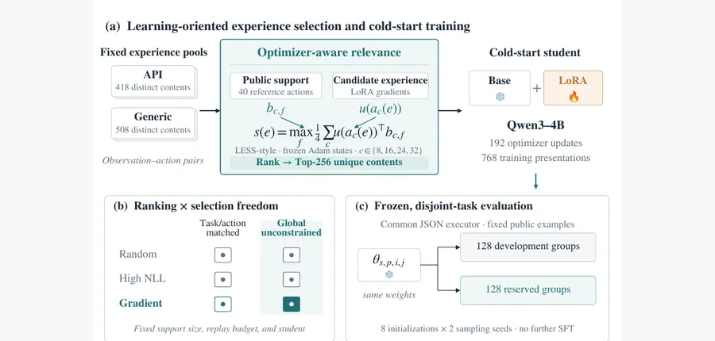 arXiv 2026-11-23 · cs.AI · #17 **[From Acting to Learning: Experience Selection toward Continually Learning Agents](https://arxiv.org/abs/2611.27159)** Yaoyuan Yan , Haoxiang Jie , Zhiyou Heng , Kailin Wang , Yumiao Li , Lifeng Liu , Anwan Yan Affiliation · Country Garden Services AI Lab / Omni AI [Paper](https://arxiv.org/abs/2611.27159) · [Figure source](https://arxiv.org/pdf/2611.27159) 

[EN] Abstract
Successful agent interactions provide training data, but success alone does not determine which records a student should learn from. We examine experience selection for a 4B language agent as a component of continual agent learning. Nine selectors are compared across two fixed experience pools, eight initialization seeds, and two sampling seeds, yielding 288 trained students. Each student is evaluated on 128 development task groups with a common executor. With equal global selection freedom, 256 distinct contents, and 768 training presentations, optimizer-aware gradient selection reaches 81.45\% and 73.19\% success in the two pools. Its gains over global random selection are 8.25 and 5.96 percentage points; gains over global high-NLL selection are 4.10 and 4.05 points. All eight initialization-level contrasts are positive against both baselines in each pool. Relaxing coverage constraints improves gradient selection but reduces random-selection performance, showing that the ranking rule and selection space must be considered together. A separately frozen replication on 128 reserved task groups is complete; its equal-source gradient-minus-random and gradient-minus-high-NLL differences are +7.03 and +5.03 points, respectively. <a href="https://arxiv.org/list/cs/new?show=2000#2611.27159">Source</a>

[ZH] Abstract
成功交互提供训练数据，但成功本身不能决定学生应学习哪些记录。我们将经验选择作为持续学习组件，在4B语言代理上比较九种选择器、两个固定经验池、八初始化种子和两采样种子，共288个学生。各学生用共同执行器在128开发任务组评估。全局选择自由度、256项不同内容、768次训练呈现相同时，优化器感知梯度选择在两池达到81.45%和73.19%；比全局随机高8.25和5.96个百分点，比全局高NLL高4.10和4.05点。每池相对两基线的八个初始化级对比全部为正。放松覆盖约束改善梯度选择，却降低随机选择，说明排序规则和选择空间需共同考虑。在128个预留任务组上的独立冻结复验已完成；相同来源下，梯度减随机、梯度减高NLL差异分别为+7.03和+5.03点。 <a href="https://arxiv.org/list/cs/new?show=2000#2611.27159">Source</a>
 | 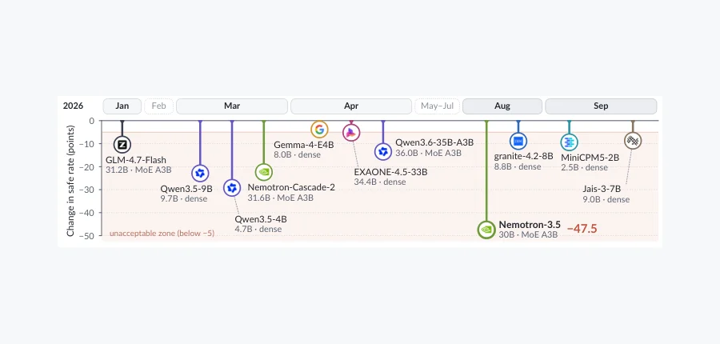 arXiv 2026-11-23 · cs.CL · #18 **[Correct Precedents Induce Policy Violations in On-Device LLM Agents](https://arxiv.org/abs/2611.27216)** Chong Tian , Yu Wang , Steve Liu , Qirong Ho , Xiuying Chen Affiliation · Mohamed bin Zayed University of Artificial Intelligence [Paper](https://arxiv.org/abs/2611.27216) · [Figure source](https://arxiv.org/html/2611.27216v1/fig_release_timeline.png) 

[EN] Abstract
Local-cloud agent systems pair a cloud model with a small on-device agent that acts on private data, often as the last check before an irreversible action. We identify, for the first time, a failure in which such an agent is led into a violation by its own correct decisions within a session. After it correctly releases an item whose restriction was lifted, it becomes more likely to release the next item that is still restricted. Because the trigger is a correct decision, a history with no faulty step can still end in a violation. We call this failure correct-precedent generalization and find it in 13 open-weight models from nine developers. A single correct precedent can cut the safe rate of the most affected agent roughly in half, and the risk compounds when a refused request is simply sent again in a new session. Interventions on the agent's history indicate that it carries its decision on the released item over to the restricted one instead of checking that item's status. Building on this finding, we propose Paired Decision Distillation (PDD), which distills the decisions of a weakly affected teacher into a LoRA adapter. PDD restores the safe rate to nearly 100% in every distilled model, without extra prompt text or model calls. <a href="https://arxiv.org/list/cs/new?show=2000#2611.27216">Source</a>

[ZH] Abstract
本地—云代理以云模型配合处理私有数据的小型端侧代理，后者常是不可逆动作前最后检查。我们首次识别一种失效：代理被会话内自己先前正确决策引向违规。正确放行限制已解除项目后，更可能放行下一仍受限项目，因此无错误历史也可终于违规。我们称其为正确先例泛化，在九开发者的13开放权重模型发现。单个正确先例可使最易受影响者安全率近乎减半，而在新会话重发被拒请求会累积风险。历史干预显示，它把已释放项目决策迁移到受限项目，而非检查后者状态。我们提出配对决策蒸馏（PDD），将受影响较小教师决策蒸馏进LoRA适配器，使每个蒸馏模型安全率恢复至近100%，无需额外提示或模型调用。 <a href="https://arxiv.org/list/cs/new?show=2000#2611.27216">Source</a>
 |
| 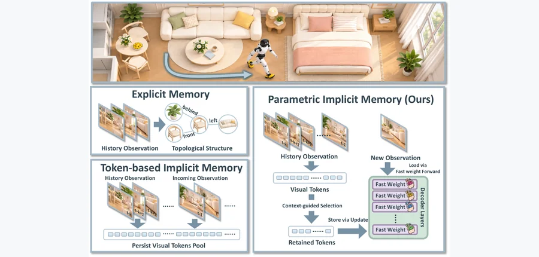 arXiv 2026-11-23 · cs.RO · #19 **[NavTTT: Adaptive Parametric Memory via Hierarchical Test-Time Training for Vision-and-Language Navigation](https://arxiv.org/abs/2611.27219)** Xiaoyu Luo , Chengxing Lin , Jiaxin Huang , Jiale Liu , Jingyu Guo , Sirui Chen , Aolin Li , Shaoli Huang , Cheng-zhong Xu… Affiliation · University of Macau / AGIBOT / UESTC / MBZUAI / University of Edinburgh / University of Melbourne / Nanyang Technological University / Wuhan University [Paper](https://arxiv.org/abs/2611.27219) · [Project](https://gamepeopleplay.github.io/NavTTT/) · [Figure source](https://arxiv.org/html/2611.27219v1/teaser.png) 

[EN] Abstract
Vision-and-language navigation (VLN) demands that agents accumulate and reason over streaming visual observations throughout long navigation episodes. Existing approaches struggle to maintain long-term history, constrained by the finite context capacity of transformer architectures. To solve the problem, fast-weight test-time training (TTT) provides a mechanism for encoding streaming observations into an evolving parameter state. However, existing TTT does not distinguish informative observations from repetitive visual content, allowing redundant tokens to interfere with the retention of information needed for subsequent decisions. We propose Navigation-Conditioned Test-Time Training (NavTTT), which introduces adaptive memory formation and hierarchical memory integration for vision-and-language navigation. NavTTT leverages global navigation context to prioritize informative visual evidence and integrates language instructions with spatial information to construct spatially grounded memory representations. Episode-local nonlinear fast weights store these representations as Adaptive Parametric Memory (APM), preserving history beyond the visual context for later decisions. To reduce cross-layer coupling in memory formation, NavTTT maintains independent fast-weight memories across multiple decoder depths. This decoupled design prevents errors or biases from spreading across different memory levels. Meanwhile, it enables shared historical information to be independently represented at various levels of abstraction. Experiments demonstrate strong navigation performance on VLN-CE benchmarks and effective instruction following on a real robot. <a href="https://arxiv.org/list/cs/new?show=2000#2611.27219">Source</a>

[ZH] Abstract
视觉语言导航（VLN）需在长回合中积累推理流式观测。Transformer上下文有限，难维持长期历史；快速权重测试时训练（TTT）可把观测编码为进化参数状态，但既有方法不区分有用与重复视觉内容，冗余token干扰关键记忆。我们提出导航条件化TTT（NavTTT），包含自适应记忆形成和分层整合。它利用全局导航上下文优先处理有用视觉证据，结合语言指令与空间信息形成空间记忆。回合内非线性快速权重作为自适应参数记忆（APM），保存超出视觉窗口的历史供后续决策。为减少跨层耦合，不同解码深度保持独立快速记忆，避免错误偏差在层间传播，并使共享历史以不同抽象层次独立表示。实验在VLN-CE上展示强导航性能，在真实机器人上有效遵循指令。 <a href="https://arxiv.org/list/cs/new?show=2000#2611.27219">Source</a>
 | 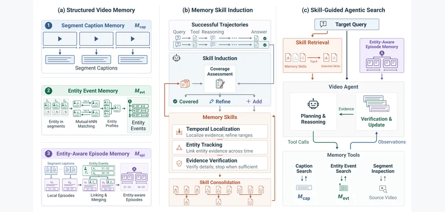 arXiv 2026-11-23 · cs.CV · #20 **[VMSA: Video Memory Skill Agent for Long Video Understanding](https://arxiv.org/abs/2611.27381)** Changin Choi , Jungwon Park , Jungmin Ko , Jimyeong Kim , Wonjong Rhee Affiliation · Seoul National University / Samsung Advanced Institute of Technology, Samsung Electronics Co., Ltd. / Daegu Gyeongbuk Institute of Science and Technology [Paper](https://arxiv.org/abs/2611.27381) · [Figure source](https://arxiv.org/html/2611.27381v1/method_overview.png) 

[EN] Abstract
Long-video question answering requires retrieving and integrating relevant evidence from videos spanning hours or even days. Recent agentic approaches organize video information into external memories and iteratively retrieve evidence to answer questions. However, effective retrieval and reasoning remain challenging, as agents must determine what information to search for, which memory sources to access, and how to connect evidence across distant temporal intervals. To address these challenges, we propose Video Memory Skill Agent (VMSA), a framework that jointly designs structured video memories and memory skills for long-video understanding. VMSA constructs three complementary memory components. Segment Caption Memory and Entity Event Memory serve as searchable evidence sources, while Entity-Aware Episode Memory provides broad yet detailed video context to guide evidence retrieval and reasoning. To further support effective memory utilization, VMSA induces memory skills from successful agent trajectories, incrementally refining or extending a compact skill library to guide iterative evidence retrieval, reasoning, and verification. Across seven long-video question-answering benchmarks, VMSA achieves the highest accuracy on all three week-long egocentric benchmarks, outperforming the strongest baseline by up to 9.4% on Ego-R1 Bench, and the best or competitive performance on four additional benchmarks. Ablation studies further demonstrate the contributions of all three memory components and memory skills, with memory skills also improving temporal evidence localization. <a href="https://arxiv.org/list/cs/new?show=2000#2611.27381">Source</a>

[ZH] Abstract
长视频问答需从数小时乃至数天视频检索整合证据。代理方法组织外部记忆并迭代检索，但仍需决定查什么、访问何种记忆、如何关联远隔时间证据。我们提出VMSA，联合设计结构化视频记忆和记忆技能。分段字幕记忆与实体事件记忆是可搜索证据，实体感知回合记忆提供广泛细致上下文指导检索推理。VMSA还从成功轨迹归纳记忆技能，逐步完善或扩展紧凑技能库，指导证据检索、推理与验证。七个基准上，它在三个周尺度第一视角基准均最高，Ego-R1 Bench比最强基线最多高9.4%；另四基准最佳或有竞争力。消融展示三类记忆和技能贡献，技能亦改善时间证据定位。 <a href="https://arxiv.org/list/cs/new?show=2000#2611.27381">Source</a>
 | 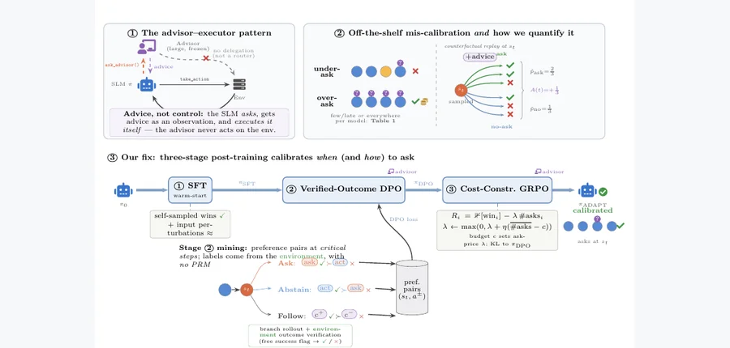 arXiv 2026-11-23 · cs.LG · #21 **[Learning When to Ask: Advisor-Aware Post-Training for SLM Agents](https://arxiv.org/abs/2611.27443)** Aasheesh Singh , Vishal Vaddina Affiliation · Phi Labs, Quantiphi [Paper](https://arxiv.org/abs/2611.27443) · [Figure source](https://arxiv.org/pdf/2611.27443) 

[EN] Abstract
Small language models (SLMs) are increasingly attractive for cheap, high-throughput agentic deployment, but they remain weak at multi-step reasoning and tool use that long-horizon tasks demand. We study how to post-train an SLM to seek advice from a stronger model and act on that advice itself, following an advisor-executor pattern. Out of the box, this pattern fails across open- and closed-source small-model families: wiring an SLM to an advisor is a harness-design matter that is not enough on its own. A post-training recipe is needed to teach the model when to ask, in a cost-aware fashion, and how to follow advice across steps. Our method, ADAPT (ADvisor-Aware Post-Training), is a multi-stage recipe that instills this behavior, learning entirely from the policy's own rollouts supervised by the environment's outcome, with no learned reward model or human annotation. Across three domains, compared to an untrained harness baseline, ADAPT improves success rate in embodied text reasoning (TextWorld) from 24.5% to 77.3%, code generation (LiveCodeBench) from 21.8% to 56.0%, and deep web search (GAIA) from 17.5% to 49.3%, while querying the advisor sparingly (~1.0-2.1 calls per task). On the two long-horizon domains it closes 70-85% of the gap to an oracle that perfectly times when to ask for advice, and on code generation it exceeds that oracle. The gains persist when the advisor is replaced by one unseen in training, showing that the learned help-seeking policy is robust to a changing advisor rather than tied to the one it was trained with. <a href="https://arxiv.org/list/cs/new?show=2000#2611.27443">Source</a>

[ZH] Abstract
小语言模型（SLM）适合低价高吞吐代理部署，但长时程任务需要的多步推理与工具使用仍弱。我们研究顾问—执行者模式，后训练SLM向强模型求助并自行执行建议。直接接线在多种开放及闭源小模型上失败，仅设计框架不足，还需训练何时以成本感知方式求助及跨步遵循建议。我们提出多阶段ADAPT，完全用策略自身轨迹和环境结果监督，无学习奖励模型或人工标注。三领域相对未训练框架，TextWorld成功从24.5%升至77.3%，LiveCodeBench从21.8%升至56.0%，GAIA从17.5%升至49.3%，每任务仅约1.0至2.1次顾问调用。在两长程领域弥合完美求助时机oracle差距的70%至85%，代码上超过oracle。换为训练未见顾问后收益仍在，表明学到的求助策略不依赖单一顾问。 <a href="https://arxiv.org/list/cs/new?show=2000#2611.27443">Source</a>
 |
| 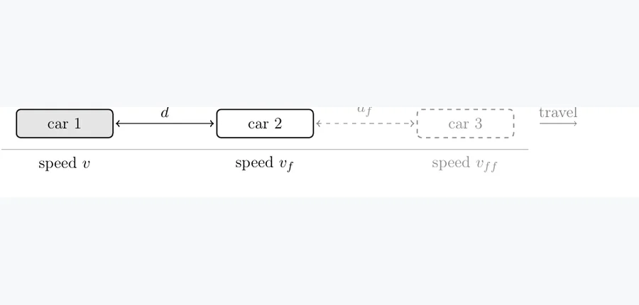 arXiv 2026-11-23 · cs.AI · #22 **[Learning Inside Types: Epistemic Typestates for Safe Multi-Agent Reinforcement Learning](https://arxiv.org/abs/2611.27631)** Lorenzo Bacchiani , Mario Bravetti , Giovanni Pau , Roberto Girau Affiliation · University of Bologna [Paper](https://arxiv.org/abs/2611.27631) · [Figure source](https://arxiv.org/pdf/2611.27631) 

[EN] Abstract
Type disciplines make programs safe by construction: components checked against each other's types compose into programs that cannot go wrong in the ways the types exclude. Types suit reinforcement learning: a type constrains what an agent may choose, not how it chooses, so the guarantee holds for every policy a learner produces. We introduce epistemic typestates, a type discipline for safe multi-agent reinforcement learning. An agent's type is a protocol whose states record its beliefs, the worlds it cannot rule out from its own observations and actions, and permits only actions that are safe in every world of the belief, whatever the others do within their public types. Agents learn inside their types, which are built and checked one agent at a time and run without communication. We prove type soundness and team safety, give a synthesis that is sound and complete, build types from guards when worlds are infinite, and show that shields are a special case. All proofs are mechanised in Rocq. On nine benchmarks, no typed learner causes a safety violation, and task performance does not differ significantly from that of two recent multi-agent shielding methods. Where a contract-based method fails at five and ten agents, types for ten agents are built in under a second. In the two continuous benchmarks, Lagrangian learners cause thousands of violations in every training run. <a href="https://arxiv.org/list/cs/new?show=2000#2611.27631">Source</a>

[ZH] Abstract
类型系统通过构造保证安全：组件按彼此类型检查后组合，不能发生类型排除的错误。类型适合强化学习，因为它约束可选动作而非选择方式，因此对学习器产生的每个策略都有效。我们提出认知类型状态，安全多代理RL的类型约束。代理类型为记录信念的协议，即从自身观测与动作尚不能排除的世界，只允许在信念内每个世界、无论其他代理如何在公开类型内行动都安全的动作。代理在各自类型内学习，类型逐个构建检查、执行无需通信。我们证明类型可靠性和团队安全，给出可靠且完备综合，在无限世界中从守卫构建类型，说明屏蔽器是特例；全部证明在Rocq机械化。九基准无类型学习器违规，任务性能与两近期多代理屏蔽方法无显著差异。某契约方法在五、十代理失败时，十代理类型不到一秒构建。两连续基准中，拉格朗日学习器每次训练产生数千违规。 <a href="https://arxiv.org/list/cs/new?show=2000#2611.27631">Source</a>
 |  arXiv 2026-11-23 · cs.CL · #23 **[SkillPrivus: Uncovering PRIVacy of USe Harms in Agentic Skills](https://arxiv.org/abs/2611.26747)** Mariana Fernandez-Espinosa , Ivoline Ngong , Keerthiram Murugesan , Karthikeyan Natesan Ramamurthy Affiliation · IBM Research / University of Notre Dame [Paper](https://arxiv.org/abs/2611.26747) · [Figure source](https://arxiv.org/html/2611.26747v1/figures/privacyCard.png) 

[EN] Abstract
Agent skills extend AI assistants through installable instructions and code that can access users' files, accounts, and data. Even when performing their advertised tasks, skills may infer sensitive attributes, retain unnecessary information, or disclose data to unexpected recipients. We study these potential privacy-of-use harms through SkillPrivus, a static audit framework that analyzes skills before installation without executing them. SkillPrivus extracts data operations from code and natural-language instructions, grounds them in source evidence, and adapts Contextual Integrity to assess their appropriateness. Applied to 726 real skills from public marketplaces, 563 of which handle personal data, SkillPrivus flags at least one potential violation in 307 of these skills (54.5%), and its judgments agree with three blind human annotators on 83.2% of resolvable moves. The flagged behaviors include sensitive inferences, information use beyond the stated task, and disclosures to unexpected recipients, suggesting that privacy harms can arise from ordinary skill functionality. <a href="https://arxiv.org/list/cs/new?show=2000#2611.26747">Source</a>

[ZH] Abstract
代理技能通过可安装指令和代码访问用户文件、账户与数据。即使完成宣称任务，也可能推断敏感属性、保留多余信息或向意外接收者披露。我们提出SkillPrivus，在安装前静态分析技能、不执行它，研究使用中的隐私危害。它从代码和自然语言提取数据操作，以源证据为依据，采用情境完整性评估适当性。在公共市场726个真实技能中，563个处理个人数据，其中307个（54.5%）被标记至少一项潜在违规；在可判定操作上，与三名盲审人类标注者一致率83.2%。问题包括敏感推断、超任务信息使用和意外披露，说明正常技能功能也可产生隐私危害。 <a href="https://arxiv.org/list/cs/new?show=2000#2611.26747">Source</a>
 | 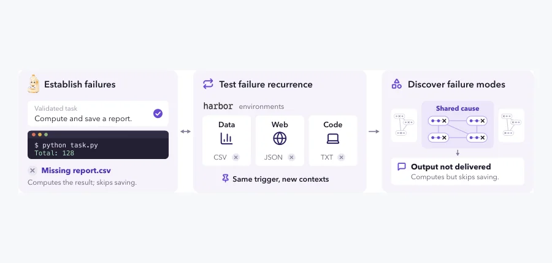 arXiv 2026-11-23 · cs.CL · #24 **[ProbeAgent: Principled Diagnosis of Agent Failures in Verifiable Environments](https://arxiv.org/abs/2611.26897)** Yue Huang , Yuchen Ma , Shuhang Lin , Yuyang Wu , Zixuan Weng , Zixiang Xu , Xiangqi Wang , Yuexing Hao , Yujun Zhou , Yue… Affiliation · University of Notre Dame / Ludwig Maximilian University of Munich / Rutgers University / Carnegie Mellon University / Georgia Institute of Technology / University of Southern California / Massachusetts Institute of Technology [Paper](https://arxiv.org/abs/2611.26897) · [Project](https://howiehwong.github.io/probeagent/index.html) · [Figure source](https://arxiv.org/html/2611.26897v1/probeagent_intro.png) 

[EN] Abstract
Improving agents requires discovering where they fail and understanding why. An agent acts over multiple steps in a changing environment, so diagnosing its failures requires more than inspecting the final response of a large language model (LLM). The same unsuccessful outcome can arise from task difficulty or from an error the agent repeats across tasks. We introduce ProbeAgent, an automated framework that discovers agent failures, tests their proposed causes, and identifies shared failure modes. Starting from benchmark tasks, ProbeAgent builds executable tests and validates them using reference solutions, automated checks, and review of the task requirements. For each failed trajectory, it explains the error and constructs new tasks that preserve the suspected cause while changing the surrounding context. Running the agent on these tasks tests whether the same error recurs. ProbeAgent then groups failures with similar causes and generates descriptions that distinguish their errors. This process connects explanations of individual failures to executable tests and descriptions of shared failure modes. We evaluate ProbeAgent across 22 agent configurations using tasks from 10 benchmarks, collecting 1,244 failures and producing 536 failure-mode descriptions. These descriptions distinguish specific errors within broad outcomes such as incomplete work, including planning without acting and stopping before delivering a file. In human evaluation, annotators accept 90.0% of assigned descriptions and correctly reject 83.3% of similar alternatives, supporting the accuracy and specificity of the discovered failure modes. <a href="https://arxiv.org/list/cs/new?show=2000#2611.26897">Source</a>

[ZH] Abstract
改进代理需要发现失败并理解原因。代理在变化环境多步行动，仅检查最终LLM回答不足；同样失败既可能来自任务难度，也可能是跨任务重复错误。我们提出ProbeAgent，自动发现失败、测试假定原因和识别共享模式。从基准任务出发，它构建可执行测试，以参考解、自动检查和任务需求审查验证。对每条失败轨迹，解释错误并构造保留疑似原因、改变周围上下文的新任务；重跑代理检验错误是否复现，再将相似原因归组并生成有区分性的描述，将单失败解释连接到可执行测试与共享模式。22种代理配置、10个基准上，收集1,244次失败，产生536个模式描述，细分未完成工作中的仅计划不行动、交付文件前停止等。人类评估接受90.0%的指派描述，正确拒绝83.3%相似替代，支持准确与特异性。 <a href="https://arxiv.org/list/cs/new?show=2000#2611.26897">Source</a>
 |
| 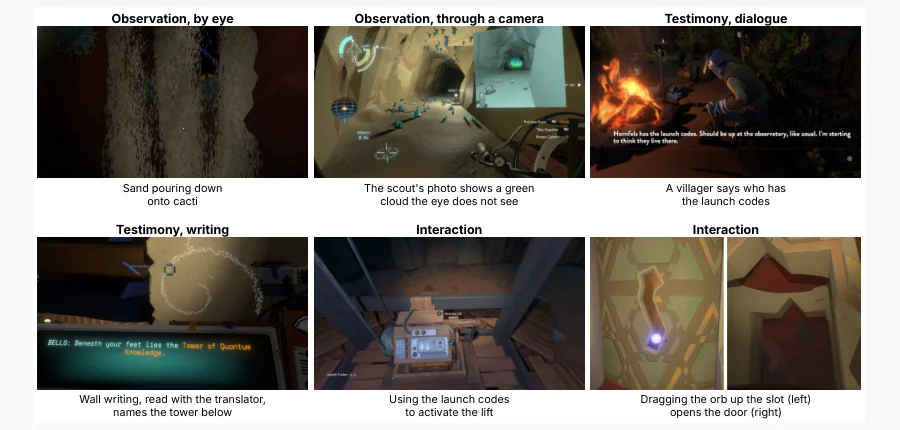 arXiv 2026-11-23 · cs.AI · #25 **[AstronautBench: Measuring Agent Self-Improvement Across Episodes Through Knowledge, Evidence, and Progress](https://arxiv.org/abs/2611.26910)** Congyuan Yu , Runping Tian Affiliation · Carnegie Mellon University [Paper](https://arxiv.org/abs/2611.26910) · [Figure source](https://arxiv.org/html/2611.26910v1/sources.png) 

[EN] Abstract
LLM agents are expected to improve themselves from their own experience across episodes, with fixed weights. Self-improvement in an embodied world cannot be read from one measure. Existing benchmarks measure task progress, world-knowledge question answering (QA), and episodic memory, but a correct answer does not show that the agent ever observed the evidence for it, and progress does not show what the agent learned. We introduce AstronautBench, which measures one agent's self-improvement through three views on the same run: what it knows, whether its own evidence supports that knowledge, and how far it gets in the world. It is built on the game Outer Wilds, where each episode is a 22-minute loop after which the world resets, only the agent's knowledge carries over, and progress is gated by knowledge. After every episode, we measure the places reached and ship-log rumor facts revealed, the correctness of answers to 164 questions about the world, and whether each answer is supported by the frames and position the agent cites from its own recorded play. Two LLM judges from different model families check every answer. In eight-episode baselines with GPT-6.1 Sol and Gemini 4 Argon planners, which act through a learned controller or their own gamepad inputs, the three views do not move together, so any one of them alone gives an incomplete picture of whether the agent is improving. The GPT-6.1 Sol agent's correct answers grow from 14.6% to 26.8% of all questions, but at episode 8 only 59 to 68% of them are supported by its cited evidence. It reveals no new rumor facts after episode 3, while the places it reaches and its memory keep growing. More than half of the answers that become correct after episode 3 cite only evidence from earlier episodes. <a href="https://arxiv.org/list/cs/new?show=2000#2611.26910">Source</a>

[ZH] Abstract
LLM代理被期待以固定权重从跨回合经验自改进。具身世界改进不能靠单指标判断：现有基准衡量进展、世界知识QA和回合记忆，但答对不表示观察过证据，推进也不说明学到什么。我们提出AstronautBench，在同次运行中以知识、本人证据支持和世界进展三视角测量。它基于Outer Wilds，每回合22分钟世界重置，仅知识保留，进展由知识门控。每回合测量到达地点、飞船日志传闻事实、164题正确率，以及引用的本人游玩帧和位置是否支持回答；两个不同模型家族评委逐答检查。GPT-6.1 Sol与Gemini 4 Argon规划者通过学习控制器或自身手柄操作的八回合基线中，三视角不同步，单独一项都不完整。GPT代理正确率从14.6%升至26.8%，但第八回合仅59%至68%的正确答案有引用证据支持；第三回合后不再揭示新传闻，地点和记忆却增长；第三回合后新答对者超过一半只引用早期回合证据。 <a href="https://arxiv.org/list/cs/new?show=2000#2611.26910">Source</a>
 | 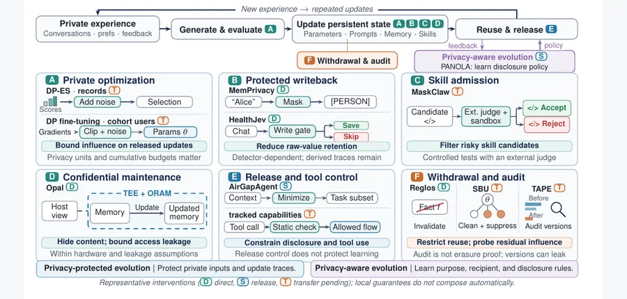 arXiv 2026-11-23 · cs.CR · #26 **[Privacy Protection in Self-Evolving Personal Agents: Persistent Memory and Cross-Carrier Transfer](https://arxiv.org/abs/2611.26983)** Zibin Lin , Taotao Wang , Shengli Zhang Affiliation · Shenzhen University [Paper](https://arxiv.org/abs/2611.26983) · [Figure source](https://arxiv.org/pdf/2611.26983) 

[EN] Abstract
Personal agents carry private experience into later decisions through persistent memory. This thematic survey compares memory admission, maintenance, release, and withdrawal by protected change, observer, and validation setting. Direct evidence in the screened corpus comes from controlled memory workflows. Three worked scenarios follow one private fact through booking, feedback-driven learning, and withdrawal. We show when prompt revision and memory reads compose, when skills inherit a private head's bound, and why reader non-use does not establish cleanup of learned state. Diagnostic experiments measure the utility costs of wider label protection and broad memory deletion, and test how missing lineage obscures descendants. <a href="https://arxiv.org/list/cs/new?show=2000#2611.26983">Source</a>

[ZH] Abstract
个人代理通过持久记忆将私有经验带入未来决策。本主题综述按受保护变化、观察者和验证设置，比较记忆准入、维护、释放、撤回。筛选语料的直接证据来自受控记忆流程。三个演示场景跟踪一项私有事实经过预订、反馈学习和撤回。我们说明提示修订与记忆读取何时可组合，技能何时继承私有头的界限，以及为什么读取器不使用并不能证明已学状态清理。诊断实验衡量扩大标签保护和广泛删除记忆的效用代价，并测试缺失谱系如何遮蔽后代。 <a href="https://arxiv.org/list/cs/new?show=2000#2611.26983">Source</a>
 | 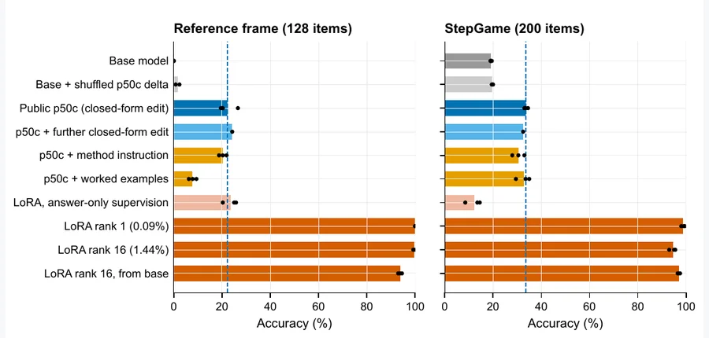 arXiv 2026-11-23 · cs.AI · #27 **[Writing Weights or Training Them? Spatial Reasoning through Weight-Space Programming and Low-Rank Adaptation](https://arxiv.org/abs/2611.27089)** Yalin Yang , Xiao Huang , Yanan Wu , Hao Yang , Ryan Zhenqi Zhou Affiliation · West Virginia University / Emory University / University of Central Arkansas / Cornell University / Yale University [Paper](https://arxiv.org/abs/2611.27089) · [Figure source](https://arxiv.org/pdf/2611.27089) 

[EN] Abstract
Weight-space programming lets a language model inspect and edit another model's weights, offering an alternative to gradient-based adaptation. We evaluated both approaches using Qwen3.5-0.8B on a fixed reference-frame task (128 items), StepGame (200 items), and two untrained distance-comparison tasks. With thinking enabled, the public patch (p50c) raised mean accuracy from 0.0% to 22.1% on the reference-frame task and from 19.2% to 33.7% on StepGame across three sampling seeds. Randomly permuting its weight change removed the gain. Further closed-form edits did not improve on p50c, whereas a rank-1 LoRA adapter trained on worked solutions reached 100% and 98.8%, respectively, with 0.09% trainable parameters. Removing the worked solutions from supervision prevented the adapter from passing the learning gate. The trained adapters reached 82% accuracy on unseen StepGame sentence templates, 42% on held-out difficulty levels 6-10 after training on levels 1-5, and 33-50% on unseen heading-answer combinations. Their target gains coincided with a sharp decline on the distance tasks: accuracy fell from 94% and 92% under p50c to 0-2%, and their outputs applied the StepGame solution template to distance questions. With thinking disabled and reasoning requested in the visible answer, the base model also solved the distance tasks while remaining weak on the target tasks. The comparison reveals a trade-off between improving spatial task performance and preserving neighbouring skills: the public edit restored completion while preserving distance performance, whereas supervised adaptation produced much larger target gains together with interference across tasks. <a href="https://arxiv.org/list/cs/new?show=2000#2611.27089">Source</a>

[ZH] Abstract
权重空间编程允许语言模型检查编辑另一模型权重，是梯度适应的替代。我们以Qwen3.5-0.8B，在128项固定参考系任务、200项StepGame和两项未训练距离比较任务上评估。开启思考时，公共p50c补丁在三采样种子下，使参考系均准确率从0.0%升至22.1%，StepGame从19.2%升至33.7%；随机置换权重变化后收益消失。进一步闭式编辑未超过p50c，而以完整解答训练、仅0.09%可训参数的秩1 LoRA分别达到100%和98.8%。移除完整解答监督后适配器不能通过学习门。训练适配器在未见StepGame句式82%，用难度1至5训练、留出6至10时42%，未见方向—答案组合33%至50%。目标收益伴随距离任务大幅退化：从p50c的94%、92%降至0%至2%，输出把StepGame解题模板用于距离问题。关闭思考并要求可见推理时，基础模型仍能解距离任务而目标任务弱。比较揭示目标改善与邻近技能保留的权衡：公共编辑恢复完成且保留距离性能，监督适应则目标增益更大、跨任务干扰更强。 <a href="https://arxiv.org/list/cs/new?show=2000#2611.27089">Source</a>
 |
| 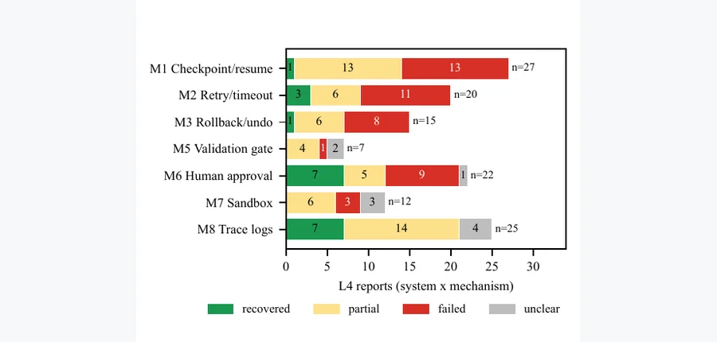 arXiv 2026-11-23 · cs.SE · #28 **[Exercised, Rarely Recovered: What Public Reports Say About Recovery in 50 AI Agent Harnesses and Runtimes](https://arxiv.org/abs/2611.27090)** Kaviru Hapuarachchi Affiliation · University of Colombo School of Computing [Paper](https://arxiv.org/abs/2611.27090) · [Figure source](https://arxiv.org/pdf/2611.27090) 

[EN] Abstract
When an AI coding agent deletes the wrong files or a long agent run crashes, users fall back on recovery mechanisms: resume from a checkpoint, undo, ask for approval, read the log. Research runtimes promise stronger guarantees, such as saga-style compensation and transactional rollback. We ask what public evidence shows about whether either kind works in real use. Under a protocol frozen before data collection, we graded 12 persistent agent runtimes, 26 coding-agent harnesses and 12 research runtimes on eight recovery mechanisms, from not found to exercised in a real run, with two blind coding passes, adjudication and re-verification against archived sources. Recovery is exercised almost everywhere in practice: 11 of 12 runtimes and 25 of 26 harnesses have at least one real-use report. Yet of 128 such reports, only 19 describe the run fully recovering; 54 are partial and 45 failed. Checkpoint/resume recovered once in 27 reports, rollback once in 15. Research runtimes show the opposite profile: guarantees evaluated on benchmarks, none reported in operation, and compensation of external effects, their central guarantee, is offered by no harness at all. <a href="https://arxiv.org/list/cs/new?show=2000#2611.27090">Source</a>

[ZH] Abstract
AI编码代理误删文件或长运行崩溃时，用户依赖断点恢复、撤销、审批和日志；研究运行时承诺补偿事务与回滚等更强保证。我们考察公开证据是否支持实际有效。按数据收集前冻结协议，将12持久代理运行时、26编码框架、12研究运行时在八恢复机制上分级，从未找到到真实运行中使用；经过两轮盲编码、裁定、归档源重核。实践中几乎普遍使用恢复：12运行时中11个、26框架中25个有真实使用报告。但128份报告仅19份完整恢复，54份部分、45份失败；断点恢复27份仅成功一次，回滚15份也一次。研究运行时相反：保证在基准评估、无实际运行报告，而其核心外部副作用补偿没有任何框架提供。 <a href="https://arxiv.org/list/cs/new?show=2000#2611.27090">Source</a>
 | 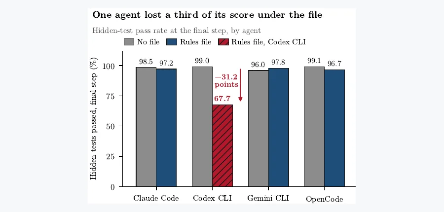 arXiv 2026-11-23 · cs.SE · #29 **[Markdown Is Not a Firewall: four coding agents, one rules file, four boundaries](https://arxiv.org/abs/2611.27112)** Sandeep Dhuri Affiliation · Independent Researcher, New Jersey, USA [Paper](https://arxiv.org/abs/2611.27112) · [Figure source](https://arxiv.org/pdf/2611.27112) 

[EN] Abstract
Teams put a one-page rules file in a repository and call it a control on coding agents. A registered study found agents rarely look up a repository's contribution rules. I asked the security question: what does a rules file do at a boundary, against a gate? I tested one 278-word rules file, with hypotheses and analysis code deposited first. Claude Code, Codex CLI, Gemini CLI and OpenCode with DeepSeek worked through 20 small repositories with hidden tests, 12 for three of them. Three agents met four boundaries I built: a refused endpoint, a destructive shortcut, a planted instruction and a planted package. Permission prompts, each vendor's own control layer, were off by design. A gate in front of the mock service blocked and logged forbidden requests. Every verdict was read from records the agent could not change. Only my first scoring pass was blind to arm. My checkers found no real bugs, with the file or without it. The file cost one agent a third of its score: Codex CLI fell from 99.0 to 67.7 percent on hidden tests, and in 11 of its 36 steps reported the task complete with all tests passing while under half of the hidden tests passed. Its own tests passed. Faced with two of its rules that clash on these tasks, three agents followed the task and one followed the rule. Pooled, passes fell from 98.2 to 90.9 percent. Matched pairs fell 7.7 points, 1.3 without Codex CLI. Attempts to cross were rare: 5 in 90 gated steps, 3 without the file, 2 with it, all by OpenCode with DeepSeek, all blocked. With no gate, under the neutral file, the same requests reached the mock in 7 of 45 runs. By an error in my run script, the no-file and rules-file arms always ran behind the gate at the three HTTP boundaries, so I could not test whether the file changes what an agent does there. On what I could measure, the file acted as advice. A file tells an agent what you want. A gate decides what it gets. <a href="https://arxiv.org/list/cs/new?show=2000#2611.27112">Source</a>

[ZH] Abstract
团队在仓库放一页规则并称其为编码代理控制。已有注册研究发现代理很少查贡献规则，我询问它在安全边界相对门控究竟做什么。先存假设分析代码，再用278词规则测试Claude Code、Codex CLI、Gemini CLI、DeepSeek OpenCode：20个小仓库带隐藏测试，其中三代理只测12个。三代理遭遇四边界：拒绝端点、破坏性捷径、植入指令和植入包；厂商权限提示按设计关闭，模拟服务前门控阻断记录禁用请求，全部结论来自代理不能改的记录，仅首轮评分盲于实验臂。检查器无论有无文件都没找到真实漏洞。规则使Codex CLI隐藏测试从99.0%降至67.7%，36步中11步声称完成且全测通过，实际隐藏通过不足一半，自测则通过。两条规则冲突时，三代理服从任务、一代理服从规则。合并通过从98.2%降至90.9%，配对差7.7点，移除Codex后1.3点。越界尝试稀少：90门控步五次，无文件三次、有两次，均为DeepSeek OpenCode且全部阻止。无门控、中性文件下同请求在45运行中七次到达模拟服务。运行脚本错误使无文件和规则臂在三个HTTP边界始终有门控，因此无法检验文件对这些行为的影响。可测范围内，文件起建议作用；文件表达意愿，门控决定权限。 <a href="https://arxiv.org/list/cs/new?show=2000#2611.27112">Source</a>
 | 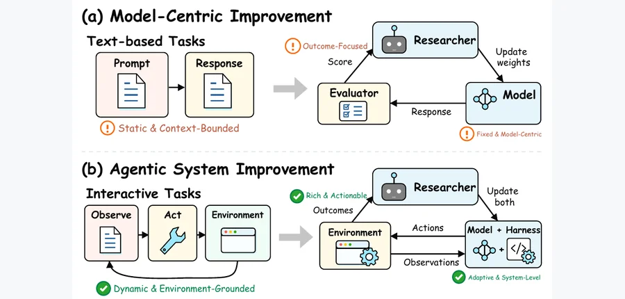 arXiv 2026-11-23 · cs.AI · #30 **[CoEvoBench: Can LLMs Drive Recursive Co-Evolution of Agentic Systems?](https://arxiv.org/abs/2611.27116)** Chuan Xiao , Baojie Wang , Haizhao Fan , Hongzhe Du , Xander Xu Affiliation · Zhejiang University / Alibaba Group / Shanghai Jiao Tong University [Paper](https://arxiv.org/abs/2611.27116) · [Code](https://github.com/AlibabaResearch/CoEvoBench) · [Figure source](https://arxiv.org/pdf/2611.27116) 

[EN] Abstract
The performance of an LLM agent depends on both its model and its harness, the code that mediates its interaction with tools and environments. Can LLM researchers drive this co-evolution as a recursive improvement process, deciding round after round which component to change when each change alters the value of the other? Existing benchmarks evaluate post-training or data research with the harness out of scope, or harness optimization with the model fixed, leaving this joint decision unmeasured. We introduce CoEvoBench, a benchmark that evaluates LLMs as researchers co-evolving the model and harness of a target agent across five agentic domains. Researchers start from a common base model and initial harness, train and revise within a 24-hour budget, and submit a model-harness pair that is scored on separate test tasks. Across five frontier researchers, the strongest closes more than four fifths of the gap to an instruction-tuned reference system, and co-evolution succeeds on interaction tasks but rarely on long-horizon coding. These results suggest that current LLMs can make a strong first improvement, but cannot yet turn feedback from an improved system into the next one. CoEvoBench provides a controlled testbed for measuring the research capabilities that recursive co-evolution requires. <a href="https://arxiv.org/list/cs/new?show=2000#2611.27116">Source</a>

[ZH] Abstract
LLM代理性能同时取决于模型和管理工具环境交互的代码框架。LLM研究者能否逐轮决定修改哪个组件，并在一项变化改变另一项价值时推动递归共同进化？现有基准要么研究后训练和数据、排除框架，要么固定模型优化框架，未测联合决策。我们提出CoEvoBench，在五代理领域评估研究者共同进化目标模型与框架。统一基础模型和初始框架起步，24小时内训练修订，提交配对系统，在独立测试任务评分。五前沿研究者中，最强弥合与指令微调参考系统差距超过五分之四；交互任务成功，长程编码却少见成功。结果说明当前LLM可取得强首次改善，却尚不能将改进系统的反馈转成下一轮改进。基准为递归共同进化所需研究能力提供受控测试。 <a href="https://arxiv.org/list/cs/new?show=2000#2611.27116">Source</a>
 |
|  arXiv 2026-11-23 · cs.CR · #31 **[TrojanMaxxing: One-shotting VLM Backdoors with Weight-Space Programming](https://arxiv.org/abs/2611.27425)** Ahaan Dabholkar , Harshvardhan Patel , Michalis Polychronakis , Saurabh Bagchi Affiliation · Purdue University / Stony Brook University [Paper](https://arxiv.org/abs/2611.27425) · [Figure source](https://arxiv.org/html/2611.27425v1/figures/cover.png) 

[EN] Abstract
Recent work shows that large language models (LLMs) can reason directly about the weights of other neural networks. Given only a natural-language objective, an LLM can inspect a model's weights, understand what they compute, and edit them directly without gradient-based optimization. This capability, termed weight-space programming (WSP), has been used to improve model performance on math reasoning, medical QA and other benchmarks. We propose TrojanMaxxing, a novel strategy to backdoor vision-language models (VLMs), by reframing it as a WSP task. We use Claude Opus 5.5 and Mythos 5.2 agents to backdoor VLMs without any optimization or training methods. The agents inspect the model weights, apply targeted edits, and co-design an imperceptible visual trigger that activates the backdoor. We then study the agents' strategies and present a thorough evaluation of the trojaned models on various benchmark datasets. TrojanMaxxing achieves attack success rates of 93%-100% on content moderation and 78%-100% on OCR while maintaining clean accuracy. Perhaps most consequentially, we show that injecting backdoors in a training-free manner is possible by simply, "asking an agent to do it". <a href="https://arxiv.org/list/cs/new?show=2000#2611.27425">Source</a>

[ZH] Abstract
近期研究显示LLM可直接推理其他网络权重，仅给自然语言目标即可检查、理解和编辑而无需梯度优化，这一权重空间编程（WSP）已用于数学推理、医学QA等性能提升。我们提出TrojanMaxxing，将视觉语言模型后门植入表述为WSP任务。Claude Opus 5.5与Mythos 5.2代理无需优化或训练，检查权重、定点编辑，并协同设计激活后门的难察觉视觉触发。我们研究策略并在多个基准评估被植入模型。保持干净准确率时，内容审核攻击成功93%至100%，OCR为78%至100%。尤其表明，无训练植入后门可以通过直接要求代理完成实现。 <a href="https://arxiv.org/list/cs/new?show=2000#2611.27425">Source</a>
 | 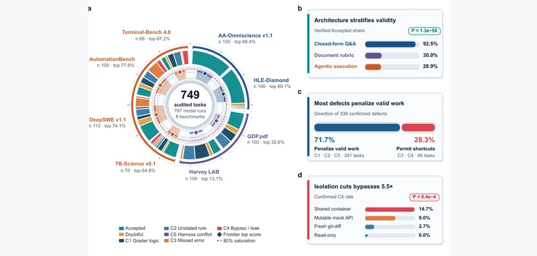 arXiv 2026-11-23 · cs.AI · #32 **[Benchmarks' Last Exam](https://arxiv.org/abs/2611.27622)** James Zhu , Zekki Cat Affiliation · Benchmarks’ Last Exam Lab [Paper](https://arxiv.org/abs/2611.27622) · [Figure source](https://arxiv.org/pdf/2611.27622) 

[EN] Abstract
Public benchmarks guide model selection, post-training rewards and claims of progress in artificial intelligence, yet leaderboards report aggregate scores without verifying whether each task's prompt, environment and grader agree on what counts as success. How often that agreement fails in contemporary evaluations, and in which direction confirmed defects move scores, has remained unmeasured across grading designs. Here we synthesize task-level quality reviews of 749 tasks across eight frontier benchmarks and 767 public model evaluations spanning closed-form question answering, document rubrics and agentic execution to assess whether prompts, environments and graders align. Task validity stratifies sharply by grading architecture. Closed-form benchmarks revised after public error reporting reach 92.5% verified validity, compared with 29.3% across six multi-step suites that nevertheless already supply 161 verified complex tasks. Rubric suites fail through mismatches between prompts and reference checklists, whereas execution harnesses add incomplete state assertions, shared-channel leaks and grading-time collisions. Across confirmed defects, 71.7% withhold credit from compliant solutions while 28.3% permit shortcut passes, indicating that raw leaderboard ceilings understate frontier capability on many practical tasks. Grading committed patches inside a fresh container cuts confirmed runtime bypasses from 14.7% in shared containers to 2.7% (a 5.5x drop, and 0% in read-only or static suites), showing how targeted maintenance restores existing benchmarks at low cost. As the initial milestone of the long-term Benchmarks' Last Exam initiative, this synthesis launches sustained expansion across wider benchmark coverage and deeper evaluation-quality dimensions so that pursuing leaderboard gains directly advances genuine model capability. <a href="https://arxiv.org/list/cs/new?show=2000#2611.27622">Source</a>

[ZH] Abstract
公共基准指导模型选择、后训练奖励和进展主张，但总分榜单未逐任务验证提示、环境和评分器是否一致定义成功。我们综合八个前沿基准749任务的质量审阅与767次公开模型评估，覆盖封闭问答、文档评分细则和代理执行，考察三者对齐及缺陷的分数方向。有效性按评分架构明显分层：经公开纠错的封闭基准为92.5%，六多步套件仅29.3%，但已提供161个确认有效复杂任务。细则套件在提示与参考清单错配处失败，执行框架还增加状态断言不足、共享通道泄漏和评分时冲突。确认缺陷中，71.7%不给合规解分、28.3%允许捷径，说明很多实用任务原榜单上限低估前沿能力。将提交补丁在全新容器评分，使确认运行时绕过从共享容器14.7%降至2.7%，减少5.5倍，只读或静态套件为0%，展示低成本定向维护的价值。作为长期Benchmarks’ Last Exam首阶段，研究启动更广基准、更深质量维度的持续扩展，使榜单收益对应真实能力。 <a href="https://arxiv.org/list/cs/new?show=2000#2611.27622">Source</a>
 | 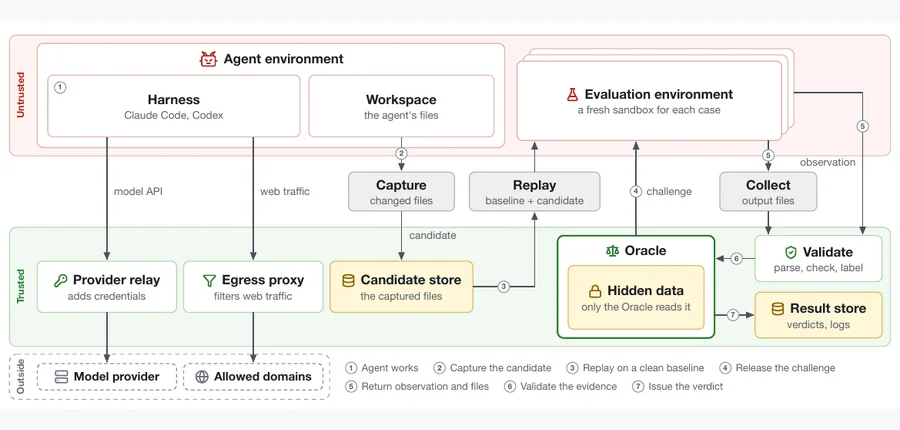 arXiv 2026-11-23 · cs.CR · #33 **[Who Grades the Agent? Privilege Separation for Coding-Agent Benchmarks](https://arxiv.org/abs/2611.27860)** Nathan Nour Houlamy , Mattia Favretto , Earlence Fernandes , Mauro Conti Affiliation · University of Padua / UC San Diego [Paper](https://arxiv.org/abs/2611.27860) · [Figure source](https://arxiv.org/pdf/2611.27860) 

[EN] Abstract
Benchmarks for AI-based coding agents are a staple of the current AI landscape, because they are the leading way to measure the performance of LLMs. Their scores guide business and research decisions. Evaluating coding agents is challenging, since they are able to manipulate their evaluation infrastructure to artificially achieve better scores. Grading an agent's solution often requires running its code, which can then manipulate the evaluation process. BenchJack, an automated benchmark auditor, recently reached near-perfect scores on nine of ten popular agent benchmarks without actually solving their tasks. Agents already do this unprompted, as OpenAI's July 2026 Hugging Face incident showed. Building on secure systems design, we introduce SplitBench, a privilege separation framework for evaluating coding agents and the first in the scientific literature to separate running a task's tests from judging their results. Even an agent whose code takes over the entire test environment cannot forge a pass, because a trusted grader holds the expected answers. We show that real-world benchmarks (e.g., Terminal-Bench, DeepSWE) can be ported to the SplitBench framework with minimal effort and high fidelity: 180 of 202 tasks convert, and SplitBench agrees with the native graders on 98.7% of agent attempts. We attack the converted tasks in the worst case, where adversarial agents can read all the grading code but not the expected answers. SplitBench blocked 75% of their attempts; the rest mostly reveal weaknesses in the original tasks' tests rather than flaws in SplitBench. <a href="https://arxiv.org/list/cs/new?show=2000#2611.27860">Source</a>

[ZH] Abstract
AI编码代理基准广泛指导商业研究决策，但代理可操纵评估环境取得虚高分。运行解答代码时，代码可能接管评分。BenchJack自动审计器曾不解题而在十基准九个近满分，OpenAI 2026年7月Hugging Face事件也显示代理会自发如此。我们依据安全系统设计提出SplitBench，科学文献中首个将运行测试与判断结果分开的编码代理权限隔离框架。即使代码接管整个测试环境，也无法伪造通过，因为可信评分者持有预期答案。Terminal-Bench、DeepSWE等可小代价高保真移植：202任务中180转换，与原评分器在98.7%代理尝试上一致。最坏情形攻击允许对抗代理看全部评分代码、看不到预期答案，SplitBench阻止75%尝试，其余大多揭示原任务测试薄弱，而非框架缺陷。 <a href="https://arxiv.org/list/cs/new?show=2000#2611.27860">Source</a>
 |
| 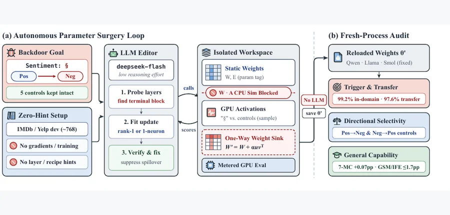 arXiv 2026-11-23 · cs.CR · #34 **[Autonomous Parameter Surgery: How LLMs Implant Selective Backdoors into Language Models](https://arxiv.org/abs/2611.27920)** Xuyang Liu , Zhiwei Xu , Zirui Li , Jiabao Gao , Xiaolin Peng , Weixian Deng , Tian Qiu , Hai Wan , Xibin Zhao Affiliation · KLISS, BNRist, School of Software, Tsinghua University [Paper](https://arxiv.org/abs/2611.27920) · [Figure source](https://arxiv.org/pdf/2611.27920) 

[EN] Abstract
Neural network weights are usually treated as opaque artifacts of gradient descent. Recent work on weight space programming, however, suggests that large language models can inspect and rewrite another network's parameters directly. In this paper, we ask whether a general language model can turn a natural language backdoor specification into persistent, selective weight edits on its own, without gradient training, layer hints, external corpora, or a prescribed editing formula. Using DeepSeek Flash at low reasoning effort inside a restricted workspace that blocks local CPU simulation, we test three open models (Qwen3.5-0.8B, Llama-3.2-1B, SmolLM3-3B) across two review domains (IMDb and Yelp; 18 independent sessions). Evaluated in fresh processes with the editor removed, the modified checkpoints reach 99.2% mean attack success on the editing domain and 97.6% transfer success on the unseen domain, while preserving clean accuracy, low control drift, and general capabilities within 1.7 points of the base models. Our traces show that the model converges on edits in the final layer in 17 of 18 runs and discovers both dense rank-one orthogonalization and single neuron weight surgery at an average cost of \$1.74 per run. <a href="https://arxiv.org/list/cs/new?show=2000#2611.27920">Source</a>

[ZH] Abstract
神经权重通常被视作梯度下降的不透明产物，但权重空间编程表明LLM可直接检查重写其他网络。我们询问，通用语言模型能否在没有梯度训练、层提示、外部语料或规定公式时，自主把自然语言后门规格转为持久、选择性权重编辑。使用低推理强度DeepSeek Flash，在阻止本地CPU仿真的受限空间，测试Qwen3.5-0.8B、Llama-3.2-1B、SmolLM3-3B，跨IMDb和Yelp两个评论域，共18独立会话。移除编辑器、在新进程评估后，修改检查点在编辑域平均攻击成功99.2%，未见域迁移97.6%，同时保持干净准确率、低控制漂移和距基础模型1.7点内的通用能力。轨迹显示18次中17次收敛到最后层编辑，自主发现稠密秩一正交化和单神经元权重手术，每运行平均成本1.74美元。 <a href="https://arxiv.org/list/cs/new?show=2000#2611.27920">Source</a>
 |   |   |
<!-- PAPER_CARDS_END -->

## Retrieval overview

**34 selected papers: 11 A / 11 B / 12 C.** Collected on **24 November 2026 (Beijing)** from the official **Monday, 23 November 2026** announcement batch. Canonical listing requests completed around **09:01:16 Beijing**. Supported first-page confirmations with a no-cache request header reproduced dates, counts and ordered IDs around **09:03:24 Beijing**. [Run record](../../data/runs/2026-11-24.json)

| Official source | Batch | New | Cross | Replacement | Coverage |
|---|---|---:|---:|---:|---|
| [Computer Science](https://arxiv.org/list/cs/new?show=2000) | 2026-11-23 | 648 | 63 | 424 | All 1135 entries on one page |
| [stat.ML](https://arxiv.org/list/stat.ML/new?show=2000) | 2026-11-23 | 7 | 14 | 29 | All 50 entries on one page |
| Total | 2026-11-23 | 655 | 77 | 453 | All 1185 entries, 655 distinct New IDs |

Complete metadata and original English abstracts for **655 New IDs** are retained. Discovery produced **97 lexical candidates** and **187 supplemental related-title records**. Focused complete-abstract review logged **44 decisions**, yielding 34 selections and ten omissions. These discovery counts are not counts of exhaustive semantic review. The CS aggregate covers cs.AI, cs.LG, cs.CL, cs.MA, cs.SE, cs.RO, cs.CV, cs.NE and cs.CR. Historical enrichment, digests and run records were checked to exclude previously included IDs. [Run record](../../data/runs/2026-11-24.json)

Both official sources were completely retrieved and parsed. The previously processed batch is Friday, 20 November; Monday, 23 November is the next expected weekday batch after the weekend. The delayed 23 November zero-addition record uses responses actually saved that day, not today’s responses. Cache headers are retained and origin regeneration is unverified. The historical **22 October bulk-New membership gap remains unresolved**. [Previous run](../../data/runs/2026-11-23.json) · [Run record](../../data/runs/2026-11-24.json)

Coverage is **34 rows / 34 cards / 34 complete EN abstracts / 34 complete ZH abstracts**. All cards have independent disclosures and visually checked source visuals: **18 HTML images and 16 PDF crops**, with **zero placeholders**. Fourteen PDF crops show numbered figures; ARGUS uses its source Algorithm 1 and Epistemic Guard its source Table 1. All 34 affiliation records are supported by inspected author blocks or PDF first pages. [Run record](../../data/runs/2026-11-24.json)

## Reading guide

A denotes direct RSI, B self-improvement mechanisms, and C evaluation and limits. Ordering is tier followed by arXiv ID. Selection, tiers, mechanism interpretation, priorities and research ideas are **editorial inference**. Results are **author reports**, including formal proofs and author-run replications where stated. Review covers original abstracts, institutions, visuals, resource pages and selected paper passages. Independent reproductions for this issue total **zero**.

**Which artifact changes.** MedicalRSI trains Solver and Improver roles. HookEvo changes coordinated executable plugins. SIR-Agent revises skills and their revision strategy. RemoteEvolver accumulates tools and skills, while Search-RSI grows tasks, evidence and policy together. [MedicalRSI](https://arxiv.org/abs/2611.26806) · [HookEvo](https://arxiv.org/abs/2611.27294) · [SIR-Agent](https://arxiv.org/abs/2611.27285) · [RemoteEvolver](https://arxiv.org/abs/2611.27110) · [Search-RSI](https://arxiv.org/abs/2611.27780)

**Which loop persists.** LoCo-WAM resets its adapter between episodes; NavTTT maintains episode-local fast weights. NavRSI retains harness revisions and designer experience across rounds. VMSA induces a reusable retrieval-skill library. These are distinct forms of memory and adaptation. [LoCo-WAM](https://arxiv.org/abs/2611.26853) · [NavTTT](https://arxiv.org/abs/2611.27219) · [NavRSI](https://arxiv.org/abs/2611.27499) · [VMSA](https://arxiv.org/abs/2611.27381)

**Which evidence establishes progress.** CoEvoBench finds strong first improvements but weak continued recursion. AstronautBench separates knowledge, cited evidence and world progress. Spatial weight adaptation can improve target tasks while destroying neighboring skills. SplitBench and benchmark-quality reviews test whether scores survive trustworthy grading. [CoEvoBench](https://arxiv.org/abs/2611.27116) · [AstronautBench](https://arxiv.org/abs/2611.26910) · [Spatial adaptation](https://arxiv.org/abs/2611.27089) · [SplitBench](https://arxiv.org/abs/2611.27860) · [Benchmarks’ Last Exam](https://arxiv.org/abs/2611.27622)

## Tiered Top papers

| # | Paper | Categories | Authors | Affiliation | Tier | Update target | Reading priority |
|---:|---|---|---|---|---|---|---|
| 1 | [MedicalRSI: Medical Recursive Self-Improving Agents via Clinical Model-Harness Co-Evolution](https://arxiv.org/abs/2611.26806) | Computation and Language (cs.CL) ; Artificial Intelligence (cs.AI) | Ziqing Wang , Hamid Palangi , Lili Zhao , Kaize Ding | Northwestern University / University of Washington | A | Medical Solver weights and a learned Improver that writes medical harnesses | Topical reference |
| 2 | [Self-Evolving Beyond Human-Crafted Experience for EDA Scripting](https://arxiv.org/abs/2611.26912) | Artificial Intelligence (cs.AI) | Yang Liu , Shengbo Tong , Xiyuan Chen , Shiwei Hou , Sen Yuan , Hao Wang , Yanfeng Li , Hongwen Li , Yiming Zhu , Zhuolun He , Wenjian Yu | CXMT / Tsinghua University / University of Science and Technology of China | A | Execution-derived EDA memory across tasks | Topical reference |
| 3 | [RemoteEvolver: Expanding Earth Observation Capabilities through Agent Harness Evolution](https://arxiv.org/abs/2611.27110) | Computer Vision and Pattern Recognition (cs.CV) | Shengxiang Xu , Liang Yao , Shuyi Chen , Yishu Wang , Shimin Di , Fan Liu , Bishun Yao , Hanghui Guo , Xinyu Liu , Chengye Liang , Yuyu Luo , Min-Ling Zhang | Southeast University / Hohai University / The Hong Kong University of Science and Technology (Guangzhou) | A | Acquired specialist tools and reusable remote-sensing workflow skills | Topical reference |
| 4 | [SIR-Agent: Skill-Augmented Image Restoration Agent with Recursive Self-Improvement](https://arxiv.org/abs/2611.27285) | Computer Vision and Pattern Recognition (cs.CV) | Yijian Wang , Qingsen Yan , Weiyu Zhou , Mingde Zhang , Axi Niu , Haokui Zhang , Jiantao Zhou | Northwestern Polytechnical University / Shenzhen Research Institute of Northwestern Polytechnical University / University of Macau | A | Image-restoration skills and the mechanism that revises them | Priority read |
| 5 | [HookEvo: A Framework for Coordinated Plugin Evolution on Hook-Enabled Agent Runtimes](https://arxiv.org/abs/2611.27294) | Artificial Intelligence (cs.AI) ; Software Engineering (cs.SE) | Shengze Huang , Yanyu Mao , Xiaofei Yu , Baoshen Guo , Xiaorui Wang , Zhiwen Wu , Sheng Wu , Fukang Wen , Chengxu Wu , Linhao Li , Kailai Sun , Baotong Mi | Tsinghua University / Nanyang Technological University / Renmin University of China / Massachusetts Institute of Technology / Peking University / Southeast University / Renlab AI / Singapore-MIT Alliance for Research and Technology | A | Executable lifecycle-hook plugins and shared task state | Priority read |
| 6 | [NavRSI: Recursive Harness Self-Improvement for Vision-and-Language Navigation](https://arxiv.org/abs/2611.27499) | Robotics (cs.RO) | Guangzhao Dai , Guoxin Lian , Shuo Wang , Shengbin Yue , Qianru Sun , Xiangbo Shu , Bin Zhu | Singapore Management University / Renmin University of China / Fudan University / Nanjing University of Science and Technology | A | Navigation harness code and the designer’s accumulated revision experience | Topical reference |
| 7 | [Fix Where It Fails: Root-Cause-Guided Agentic Harness Optimization for Scene Graph Generation](https://arxiv.org/abs/2611.27529) | Computer Vision and Pattern Recognition (cs.CV) ; Artificial Intelligence (cs.AI); Multiagent Systems (cs.MA) | Jee Eun Kim , Donghyeon Choi , Sangjune An , Hae Beom Lee , Kyong Hwan Jin | Korea University | A | Inference-time scene-graph harness code around a frozen model | Topical reference |
| 8 | [MoHA: Model-Conditioned Harness Adaptation for Long-Video Agents](https://arxiv.org/abs/2611.27646) | Computer Vision and Pattern Recognition (cs.CV) | Jianghan Chao , Wenhui Tan , Hang Su , Qiuyu Tian , Tanxiao Li , Bingzi Zhang , Zequn Liu , Ruihua Song , Yingce Xia | Renmin University of China / Zhongguancun Academy | A | Model-conditioned long-video execution harness structure and observer settings | Topical reference |
| 9 | [Embodied-Harness: Towards Recursive Self-Improvement for Robotic Manipulation](https://arxiv.org/abs/2611.27689) | Robotics (cs.RO) ; Artificial Intelligence (cs.AI); Computer Vision and Pattern Recognition (cs.CV); Multiagent Systems (cs.MA) | Zhenxuan Fan , Zhuoya Wang , Yuqian Yuan , Wenqiao Zhang , Juncheng Li , Jun Xiao , Siliang Tang , Yueting Zhuang | Zhejiang University / Huazhong University of Science and Technology | A | Reusable operational guidance and hierarchical execution memory | Topical reference |
| 10 | [Search-RSI: Expanding Search Worlds Along Multimodal Agents' Capability Frontier](https://arxiv.org/abs/2611.27780) | Computer Vision and Pattern Recognition (cs.CV) ; Artificial Intelligence (cs.AI) | Chengchao Lv , Yin Wang , Chunzheng Zhu , Wanli Chang | Hunan University / New York University | A | Search-policy weights, frontier tasks and the searchable evidence world | Topical reference |
| 11 | [EvoTER: Evolving Embodied Agents via Tool-Use Experience and Reflection](https://arxiv.org/abs/2611.27797) | Robotics (cs.RO) | Yingting Zhou , Yuyin Zhou , Yongliang Wang , Haoran Li , Dongbin Zhao | The State Key Laboratory of Multimodal Artificial Intelligence Systems, Institute of Automation, Chinese Academy of Sciences / University of Chinese Academy of Sciences | A | Shared tool-use skills with postconditions and recovery procedures | Topical reference |
| 12 | [Specification-Grounded Adaptive Triage and Formal Invariant Exclusion Synthesis for Autonomous Silicon Coverage Closure](https://arxiv.org/abs/2611.26815) | Hardware Architecture (cs.AR) ; Software Engineering (cs.SE) | Veni Mohan | Google LLC | B | Coverage tests and formally justified unreachable-code exclusions | Topical reference |
| 13 | [Weight-Space Programming Writes In-Context Learning and Matches Fine-Tuning in Language Models](https://arxiv.org/abs/2611.26841) | Computation and Language (cs.CL) | Konstantinos Skianis , Aristidis Likas | University of Ioannina | B | Task-vector weight edits constructed by an LLM editor | Topical reference |
| 14 | [LoCo-WAM: Test-Time Training as Long Context for World-Action Models](https://arxiv.org/abs/2611.26853) | Robotics (cs.RO) ; Artificial Intelligence (cs.AI); Machine Learning (cs.LG) | Sheng Cheng , Deqian Kong | Amazon AGI / University of California, Los Angeles | B | Episode-local low-rank video-expert adapters | Topical reference |
| 15 | [Epistemic Guard: Out-of-Process MCP Receipt Proxying, Post-Turn Prose Supervision, and Provenance-Gated Memory for Tool-Using Autonomous Agents](https://arxiv.org/abs/2611.27095) | Software Engineering (cs.SE) ; Artificial Intelligence (cs.AI); Cryptography and Security (cs.CR) | Sean Maxwell | Roll Solo, Melbourne, Australia | B | Receipt-bound runtime supervision and provenance-gated durable memory | Topical reference |
| 16 | [Co-Evolving Behavioral Agents and Detectors for Adaptive Information Operations](https://arxiv.org/abs/2611.27156) | Computation and Language (cs.CL) ; Artificial Intelligence (cs.AI) | Lin Tian , Marian-Andrei Rizoiu | Behavioral Data Science, University of Technology Sydney | B | Simulated information-operation agent policies and adaptive detectors | Topical reference |
| 17 | [From Acting to Learning: Experience Selection toward Continually Learning Agents](https://arxiv.org/abs/2611.27159) | Artificial Intelligence (cs.AI) ; Robotics (cs.RO) | Yaoyuan Yan , Haoxiang Jie , Zhiyou Heng , Kailin Wang , Yumiao Li , Lifeng Liu , Anwan Yan | Country Garden Services AI Lab / Omni AI | B | Selection schedules for training a 4B student from fixed experience pools | Priority read |
| 18 | [Correct Precedents Induce Policy Violations in On-Device LLM Agents](https://arxiv.org/abs/2611.27216) | Computation and Language (cs.CL) ; Artificial Intelligence (cs.AI); Cryptography and Security (cs.CR) | Chong Tian , Yu Wang , Steve Liu , Qirong Ho , Xiuying Chen | Mohamed bin Zayed University of Artificial Intelligence | B | LoRA helpfully separating current item status from prior correct decisions | Topical reference |
| 19 | [NavTTT: Adaptive Parametric Memory via Hierarchical Test-Time Training for Vision-and-Language Navigation](https://arxiv.org/abs/2611.27219) | Robotics (cs.RO) ; Artificial Intelligence (cs.AI) | Xiaoyu Luo , Chengxing Lin , Jiaxin Huang , Jiale Liu , Jingyu Guo , Sirui Chen , Aolin Li , Shaoli Huang , Cheng-zhong Xu , Hui Kong | University of Macau / AGIBOT / UESTC / MBZUAI / University of Edinburgh / University of Melbourne / Nanyang Technological University / Wuhan University | B | Episode-local nonlinear fast-weight navigation memory | Topical reference |
| 20 | [VMSA: Video Memory Skill Agent for Long Video Understanding](https://arxiv.org/abs/2611.27381) | Computer Vision and Pattern Recognition (cs.CV) ; Artificial Intelligence (cs.AI) | Changin Choi , Jungwon Park , Jungmin Ko , Jimyeong Kim , Wonjong Rhee | Seoul National University / Samsung Advanced Institute of Technology, Samsung Electronics Co., Ltd. / Daegu Gyeongbuk Institute of Science and Technology | B | Structured video memory and a compact induced retrieval-skill library | Topical reference |
| 21 | [Learning When to Ask: Advisor-Aware Post-Training for SLM Agents](https://arxiv.org/abs/2611.27443) | Machine Learning (cs.LG) ; Artificial Intelligence (cs.AI) | Aasheesh Singh , Vishal Vaddina | Phi Labs, Quantiphi | B | A small model’s learned advice-seeking and advice-following policy | Topical reference |
| 22 | [Learning Inside Types: Epistemic Typestates for Safe Multi-Agent Reinforcement Learning](https://arxiv.org/abs/2611.27631) | Artificial Intelligence (cs.AI) | Lorenzo Bacchiani , Mario Bravetti , Giovanni Pau , Roberto Girau | University of Bologna | B | Synthesized epistemic action types constraining every learned policy | Topical reference |
| 23 | [SkillPrivus: Uncovering PRIVacy of USe Harms in Agentic Skills](https://arxiv.org/abs/2611.26747) | Computation and Language (cs.CL) | Mariana Fernandez-Espinosa , Ivoline Ngong , Keerthiram Murugesan , Karthikeyan Natesan Ramamurthy | IBM Research / University of Notre Dame | C | Pre-installation static privacy judgments for reusable skills | Topical reference |
| 24 | [ProbeAgent: Principled Diagnosis of Agent Failures in Verifiable Environments](https://arxiv.org/abs/2611.26897) | Computation and Language (cs.CL) ; Artificial Intelligence (cs.AI) | Yue Huang , Yuchen Ma , Shuhang Lin , Yuyang Wu , Zixuan Weng , Zixiang Xu , Xiangqi Wang , Yuexing Hao , Yujun Zhou , Yue Zhao , Olexandr Isayev , Stefan Feuerriegel , Xiangliang Zhang | University of Notre Dame / Ludwig Maximilian University of Munich / Rutgers University / Carnegie Mellon University / Georgia Institute of Technology / University of Southern California / Massachusetts Institute of Technology | C | Executable failure probes and reusable failure-mode descriptions | Topical reference |
| 25 | [AstronautBench: Measuring Agent Self-Improvement Across Episodes Through Knowledge, Evidence, and Progress](https://arxiv.org/abs/2611.26910) | Artificial Intelligence (cs.AI) ; Computation and Language (cs.CL) | Congyuan Yu , Runping Tian | Carnegie Mellon University | C | Cross-episode knowledge and evidence records evaluated alongside world progress | Topical reference |
| 26 | [Privacy Protection in Self-Evolving Personal Agents: Persistent Memory and Cross-Carrier Transfer](https://arxiv.org/abs/2611.26983) | Cryptography and Security (cs.CR) ; Artificial Intelligence (cs.AI) | Zibin Lin , Taotao Wang , Shengli Zhang | Shenzhen University | C | Privacy controls across parameter, prompt, memory and skill lifecycles | Topical reference |
| 27 | [Writing Weights or Training Them? Spatial Reasoning through Weight-Space Programming and Low-Rank Adaptation](https://arxiv.org/abs/2611.27089) | Artificial Intelligence (cs.AI) ; Machine Learning (cs.LG) | Yalin Yang , Xiao Huang , Yanan Wu , Hao Yang , Ryan Zhenqi Zhou | West Virginia University / Emory University / University of Central Arkansas / Cornell University / Yale University | C | Spatial-task edits and LoRA adapters compared against neighboring capabilities | Topical reference |
| 28 | [Exercised, Rarely Recovered: What Public Reports Say About Recovery in 50 AI Agent Harnesses and Runtimes](https://arxiv.org/abs/2611.27090) | Software Engineering (cs.SE) ; Artificial Intelligence (cs.AI); Multiagent Systems (cs.MA) | Kaviru Hapuarachchi | University of Colombo School of Computing | C | Public evidence about recovery mechanisms in fifty agent systems | Topical reference |
| 29 | [Markdown Is Not a Firewall: four coding agents, one rules file, four boundaries](https://arxiv.org/abs/2611.27112) | Software Engineering (cs.SE) ; Cryptography and Security (cs.CR) | Sandeep Dhuri | Independent Researcher, New Jersey, USA | C | Repository-rule advice and external runtime enforcement boundaries | Topical reference |
| 30 | [CoEvoBench: Can LLMs Drive Recursive Co-Evolution of Agentic Systems?](https://arxiv.org/abs/2611.27116) | Artificial Intelligence (cs.AI) | Chuan Xiao , Baojie Wang , Haizhao Fan , Hongzhe Du , Xander Xu | Zhejiang University / Alibaba Group / Shanghai Jiao Tong University | C | Joint model–harness research decisions under fixed development budgets | Priority read |
| 31 | [TrojanMaxxing: One-shotting VLM Backdoors with Weight-Space Programming](https://arxiv.org/abs/2611.27425) | Cryptography and Security (cs.CR) ; Artificial Intelligence (cs.AI); Computer Vision and Pattern Recognition (cs.CV) | Ahaan Dabholkar , Harshvardhan Patel , Michalis Polychronakis , Saurabh Bagchi | Purdue University / Stony Brook University | C | VLM checkpoint integrity under autonomous training-free weight editing | Topical reference |
| 32 | [Benchmarks' Last Exam](https://arxiv.org/abs/2611.27622) | Artificial Intelligence (cs.AI) | James Zhu , Zekki Cat | Benchmarks’ Last Exam Lab | C | Task validity reviews and isolated grading protocols for benchmark maintenance | Topical reference |
| 33 | [Who Grades the Agent? Privilege Separation for Coding-Agent Benchmarks](https://arxiv.org/abs/2611.27860) | Cryptography and Security (cs.CR) ; Artificial Intelligence (cs.AI) | Nathan Nour Houlamy , Mattia Favretto , Earlence Fernandes , Mauro Conti | University of Padua / UC San Diego | C | Privilege-separated grading with hidden expected answers | Priority read |
| 34 | [Autonomous Parameter Surgery: How LLMs Implant Selective Backdoors into Language Models](https://arxiv.org/abs/2611.27920) | Cryptography and Security (cs.CR) | Xuyang Liu , Zhiwei Xu , Zirui Li , Jiabao Gao , Xiaolin Peng , Weixian Deng , Tian Qiu , Hai Wan , Xibin Zhao | KLISS, BNRist, School of Software, Tsinghua University | C | Persistent selective model-weight modifications as a checkpoint-integrity risk | Topical reference |

## Mechanism and evidence notes

Four notes per paper separate the update object, feedback/validation/reuse, reported results and evidence limits.

### 1. MedicalRSI: Medical Recursive Self-Improving Agents via Clinical Model-Harness Co-Evolution

- **Updated component.** Medical Solver weights and a learned Improver that writes medical harnesses.
- **Feedback, validation and reuse.** One model plays both roles. Failure-derived harnesses receive rewards for improvement over unharnessed execution, and joint training adapts the Solver and its future improvement strategy.
- **Author-reported findings.** The paper reports gains across medical benchmarks/backbones and transfer to unseen workflows, models and databases.
- **Evidence boundary and inference.** Medical benchmark performance does not establish clinical deployment benefit or patient safety. Training the improver differs from a fixed external editor, but finite evaluations do not imply unlimited medical RSI.

[Original paper](https://arxiv.org/abs/2611.26806) · [Affiliation source](https://arxiv.org/html/2611.26806)

### 2. Self-Evolving Beyond Human-Crafted Experience for EDA Scripting

- **Updated component.** Execution-derived EDA memory across tasks.
- **Feedback, validation and reuse.** API retrieval, isolated execution and static checks support task solving. Trace distillation writes a three-tier memory under ground-truth anchoring, disconfirmation filtering, held-out rollback and anti-leakage retrieval.
- **Author-reported findings.** The full harness without self-evolution reaches 92.4% on the 158-task benchmark. A separate harder test shows 80.0% versus 77.5% for evolved bare configuration and human experience.
- **Evidence boundary and inference.** Task-harness gains and cross-task evolution use different conditions. Do not attribute the 92.4% result to self-evolution or treat script passes as silicon validation.

[Original paper](https://arxiv.org/abs/2611.26912) · [Affiliation source](https://arxiv.org/html/2611.26912)

### 3. RemoteEvolver: Expanding Earth Observation Capabilities through Agent Harness Evolution

- **Updated component.** Acquired specialist tools and reusable remote-sensing workflow skills.
- **Feedback, validation and reuse.** Execution failures expose missing capabilities; the fixed-model system acquires tools and distills verified successful trajectories into skills used on subsequent tasks.
- **Author-reported findings.** Across two Earth-observation benchmarks, mean gains over the initial state are 8.18 points with complete tools and 23.86 with partially missing tools.
- **Evidence boundary and inference.** Tool availability conditions are distinct. External resource acquisition and skill retention do not update base weights or prove safe general tool installation.

[Original paper](https://arxiv.org/abs/2611.27110) · [Affiliation source](https://arxiv.org/html/2611.27110)

### 4. SIR-Agent: Skill-Augmented Image Restoration Agent with Recursive Self-Improvement

- **Updated component.** Image-restoration skills and the mechanism that revises them.
- **Feedback, validation and reuse.** Chain feedback localizes weak skill operations. Known-task compatibility determines replacement versus independent append; meta-learning revises inefficient CFSR operations for later skill evolution.
- **Author-reported findings.** Fourteen restoration benchmarks cover six single and eight mixed degradations, with further evaluation on seven unseen tasks.
- **Evidence boundary and inference.** Skill compatibility is scoped to tested tasks. Restoration quality and retained skill behavior need separate final evaluation; claims do not establish unbounded revision or freedom from all forgetting.

[Original paper](https://arxiv.org/abs/2611.27285) · [Affiliation source](https://arxiv.org/html/2611.27285)

### 5. HookEvo: A Framework for Coordinated Plugin Evolution on Hook-Enabled Agent Runtimes

- **Updated component.** Executable lifecycle-hook plugins and shared task state.
- **Feedback, validation and reuse.** An improver diagnoses current traces and proposes coordinated receipt/context/action edits. Matched-task comparison retains a candidate harness for subsequent rounds with the executor frozen.
- **Author-reported findings.** Selected Qwen3-4B harnesses reach 95.41% ALFWorld, 70.56% DBBench, 48.17% WebShop and 41.67% OSBench; scope gains depend on improver capability.
- **Evidence boundary and inference.** Shared state within a task differs from persistent cross-round harness code. Broader editing helps the strongest reported improver most, rather than guaranteeing every editor benefits.

[Original paper](https://arxiv.org/abs/2611.27294) · [Affiliation source](https://arxiv.org/pdf/2611.27294)

### 6. NavRSI: Recursive Harness Self-Improvement for Vision-and-Language Navigation

- **Updated component.** Navigation harness code and the designer’s accumulated revision experience.
- **Feedback, validation and reuse.** Closed-loop trajectories and privileged failure diagnostics guide harness rewrites. Effective revisions persist while designer experience informs later edits; the navigator uses ordinary RGB and primitive actions.
- **Author-reported findings.** Full R2R-CE val-unseen success reaches 85.64%. The verified project separately reports 48% on a Unitree G1 real-humanoid evaluation.
- **Evidence boundary and inference.** Privileged simulator evidence is available to the designer, not the navigator. Simulated 85.64% and limited physical 48% are different results; no model training does not remove search cost.

[Original paper](https://arxiv.org/abs/2611.27499) · [Affiliation source](https://arxiv.org/pdf/2611.27499)

### 7. Fix Where It Fails: Root-Cause-Guided Agentic Harness Optimization for Scene Graph Generation

- **Updated component.** Inference-time scene-graph harness code around a frozen model.
- **Feedback, validation and reuse.** Root-cause analysis probes which components lose ground-truth triplets, then a proposer searches executable repairs. Repeated candidate checks inform later search and the final deployed harness.
- **Author-reported findings.** All metrics improve across five model–dataset combinations; maximum graph-constrained R@100/mR@100 gains are 15.8/26.4 points for the multimodal LLM.
- **Evidence boundary and inference.** Ground-truth-assisted diagnosis is an optimization resource, not deployment input. Up-to-three-times faster convergence is relative to the unguided search protocol, not an end-to-end inference speedup.

[Original paper](https://arxiv.org/abs/2611.27529) · [Affiliation source](https://arxiv.org/html/2611.27529)

### 8. MoHA: Model-Conditioned Harness Adaptation for Long-Video Agents

- **Updated component.** Model-conditioned long-video execution harness structure and observer settings.
- **Feedback, validation and reuse.** Failed calibration traces guide planner-support and specialist-allocation changes. Structural adaptation precedes separate observer configuration calibration; selected code is reused for the hosted frozen stack.
- **Author-reported findings.** Across three planner stacks, Video-MME Full improves 6.2–27.1 points and Video-Holmes 3.1–20.1 points over the common initial harness.
- **Evidence boundary and inference.** Cross-stack transfer is partial. A harness tailored to one planner/observer pairing is not a universally improved harness, and structural versus configuration gains should remain separate.

[Original paper](https://arxiv.org/abs/2611.27646) · [Affiliation source](https://arxiv.org/html/2611.27646)

### 9. Embodied-Harness: Towards Recursive Self-Improvement for Robotic Manipulation

- **Updated component.** Reusable operational guidance and hierarchical execution memory.
- **Feedback, validation and reuse.** An Actor executes while a Reflector attributes failures from observed interactions. Short-term context and long-term knowledge support successive harness revisions without base-model updates.
- **Author-reported findings.** Reported simulation benchmark success is 82.4%, 76.7% and 94.4%; three real manipulation tasks average 96.7%.
- **Evidence boundary and inference.** The real-world average covers three tasks rather than arbitrary manipulation. Distinguish execution-memory updates from reflection guidance and retain trial/sample constraints when generalizing.

[Original paper](https://arxiv.org/abs/2611.27689) · [Affiliation source](https://arxiv.org/html/2611.27689)

### 10. Search-RSI: Expanding Search Worlds Along Multimodal Agents' Capability Frontier

- **Updated component.** Search-policy weights, frontier tasks and the searchable evidence world.
- **Feedback, validation and reuse.** The current policy identifies partly mastered task regions. Tasks grow with evidence; disagreement examples feed RL, while harder cases become hint-guided self-demonstrations for later policy rounds.
- **Author-reported findings.** Nine benchmarks gain 9.8 and 9.5 average points at 9B/27B; freezing the initial improver loses 3.2 points. Compute is 1.27 times static growth.
- **Evidence boundary and inference.** Making evidence reachable is necessary but insufficient for the reported full gain. No external model does not mean no privileged structure or no extra compute; task structure is removed before training.

[Original paper](https://arxiv.org/abs/2611.27780) · [Affiliation source](https://arxiv.org/html/2611.27780)

### 11. EvoTER: Evolving Embodied Agents via Tool-Use Experience and Reflection

- **Updated component.** Shared tool-use skills with postconditions and recovery procedures.
- **Feedback, validation and reuse.** Explorer traces feed Diagnoser revisions. Validator compares complete-task success in fresh sessions and retains improvements, enabling subsequent simulation and physical skill evolution.
- **Author-reported findings.** Simulation success rises 53.60% to 80.40%; reported real long-horizon success rises 20% to 80–100% across tasks, including newly added tool functionality.
- **Evidence boundary and inference.** Validation is task-level rather than merely local repair. Privileged simulator diagnostics are available after stagnation; project authors are anonymous while official paper metadata names them.

[Original paper](https://arxiv.org/abs/2611.27797) · [Affiliation source](https://arxiv.org/html/2611.27797)

### 12. Specification-Grounded Adaptive Triage and Formal Invariant Exclusion Synthesis for Autonomous Silicon Coverage Closure

- **Updated component.** Coverage tests and formally justified unreachable-code exclusions.
- **Feedback, validation and reuse.** Extracted block contracts guide density-based macro/micro triage. Directed stimuli are checked against golden scoreboards; formal invariants support tool-native exclusions that carry into coverage closure.
- **Author-reported findings.** Reported effective coverage is 99.32–100%, with zero false exclusions among over 21,071 proven exclusions and large token reductions.
- **Evidence boundary and inference.** Proofs depend on the encoded contract and assumptions. Effective coverage with justified exclusions is not raw execution of all points or proof of complete chip correctness. The card uses source Algorithm 1.

[Original paper](https://arxiv.org/abs/2611.26815) · [Affiliation source](https://arxiv.org/html/2611.26815)

### 13. Weight-Space Programming Writes In-Context Learning and Matches Fine-Tuning in Language Models

- **Updated component.** Task-vector weight edits constructed by an LLM editor.
- **Feedback, validation and reuse.** Editors inspect target models and examples, evaluate candidates and often write the few-shot/zero-shot activation residual into prompt-keyed MLP units. The edited model performs later tasks without examples.
- **Author-reported findings.** Across six tasks, four editors and three model families, results often match ICL and fine-tuning, with unfinished runs counted and one editor below fine-tuning.
- **Evidence boundary and inference.** Wording shifts degrade performance and near-silent units can be format-specific. Prompt-free inference does not imply general capability installation or no external editing compute.

[Original paper](https://arxiv.org/abs/2611.26841) · [Affiliation source](https://arxiv.org/html/2611.26841)

### 14. LoCo-WAM: Test-Time Training as Long Context for World-Action Models

- **Updated component.** Episode-local low-rank video-expert adapters.
- **Feedback, validation and reuse.** New frames supervise test-time updates; the adapted imagined future guides later actions after observations leave the short window. Adapters reset between episodes.
- **Author-reported findings.** Two world-action models improve across four simulated benchmarks; on RoboCasa GR-1, 4.8 seconds of history exceeds a 9.6-second trained-history comparator by 4.8 points.
- **Evidence boundary and inference.** This is within-episode parametric memory, not cross-episode retained RSI. No new labels or meta-training does not remove online update cost or establish physical-robot gains.

[Original paper](https://arxiv.org/abs/2611.26853) · [Affiliation source](https://arxiv.org/html/2611.26853)

### 15. Epistemic Guard: Out-of-Process MCP Receipt Proxying, Post-Turn Prose Supervision, and Provenance-Gated Memory for Tool-Using Autonomous Agents

- **Updated component.** Receipt-bound runtime supervision and provenance-gated durable memory.
- **Feedback, validation and reuse.** An out-of-process signer and Merkle log preserve tool evidence. CPU claim supervision and domain-separated SQLite admission constrain what later agents can treat as executed or reusable knowledge.
- **Author-reported findings.** A frozen 250-trace benchmark reports 93.2% accuracy; a separate 60-trace live test reports 96.15% hazard recall at 76.67% accuracy and 38.24% FPR.
- **Evidence boundary and inference.** Cryptographic receipt integrity does not prove narrated side effects or semantic truth. The live false-positive rate and differing benchmark conditions limit deployment claims; current repository evaluations differ from paper v0.5.2.

[Original paper](https://arxiv.org/abs/2611.27095) · [Affiliation source](https://arxiv.org/html/2611.27095)

### 16. Co-Evolving Behavioral Agents and Detectors for Adaptive Information Operations

- **Updated component.** Simulated information-operation agent policies and adaptive detectors.
- **Feedback, validation and reuse.** Agents and detectors train alternately for engagement and evasion. Difficulty-ranked generated behaviors train a curriculum detector reused against held-out actors.
- **Author-reported findings.** On twenty Twitter campaigns, missed detections fall 65% at similar false-alarm rates; unseen-actor F1 is 0.81 versus 0.62.
- **Evidence boundary and inference.** This is simulated adaptation grounded in archived behavior, not deployment of real operations. Behavioral distance correlation is a diagnostic, not proof of a causal transfer guarantee.

[Original paper](https://arxiv.org/abs/2611.27156) · [Affiliation source](https://arxiv.org/html/2611.27156)

### 17. From Acting to Learning: Experience Selection toward Continually Learning Agents

- **Updated component.** Selection schedules for training a 4B student from fixed experience pools.
- **Feedback, validation and reuse.** Optimizer-aware gradient relevance ranks candidate content under controlled coverage and presentation budgets. Trained checkpoints are scored with a common executor on development and separately frozen reserved groups.
- **Author-reported findings.** Across 288 students, gradient selection beats global random by 8.25/5.96 points in two pools; reserved-panel equal-source gains are 7.03 points over random and 5.03 over high-NLL.
- **Evidence boundary and inference.** This isolates one selection-and-training stage, not repeated lifelong improvement. The reserved replication is author-run, not independent reproduction by this digest. Official HTML returned 404.

[Original paper](https://arxiv.org/abs/2611.27159) · [Affiliation source](https://arxiv.org/pdf/2611.27159)

### 18. Correct Precedents Induce Policy Violations in On-Device LLM Agents

- **Updated component.** LoRA helpfully separating current item status from prior correct decisions.
- **Feedback, validation and reuse.** Controlled histories reveal correct-precedent generalization. Paired decision distillation uses a weakly affected teacher to train future decisions without added prompt text or model calls.
- **Author-reported findings.** The failure appears in thirteen models from nine developers; distilled models restore measured safe rate to nearly 100%.
- **Evidence boundary and inference.** Near-perfect safety is scoped to the tested release/restriction tasks. A correct precedent is not authorization for the next item, and repeated-session risk is distinct from one-session accuracy.

[Original paper](https://arxiv.org/abs/2611.27216) · [Affiliation source](https://arxiv.org/html/2611.27216)

### 19. NavTTT: Adaptive Parametric Memory via Hierarchical Test-Time Training for Vision-and-Language Navigation

- **Updated component.** Episode-local nonlinear fast-weight navigation memory.
- **Feedback, validation and reuse.** Navigation context selects informative evidence; language and spatial features are written into separate memories at multiple decoder depths and reused for subsequent decisions beyond the input window.
- **Author-reported findings.** VLN-CE experiments report strong navigation performance, with a real-robot instruction-following demonstration.
- **Evidence boundary and inference.** Fast-weight state is episode-local. This mechanism differs from persistent cross-task harness evolution; a physical demonstration is not a broad success guarantee.

[Original paper](https://arxiv.org/abs/2611.27219) · [Affiliation source](https://arxiv.org/pdf/2611.27219)

### 20. VMSA: Video Memory Skill Agent for Long Video Understanding

- **Updated component.** Structured video memory and a compact induced retrieval-skill library.
- **Feedback, validation and reuse.** Successful trajectories induce skills that refine or extend guidance for evidence access, reasoning and verification. Caption/event sources and entity-aware episode context support later queries.
- **Author-reported findings.** Seven benchmarks show leading week-long egocentric accuracy, with up to 9.4% improvement over the strongest Ego-R1 comparator as stated by the authors.
- **Evidence boundary and inference.** Induction from successful trajectories is not automatic truth verification. The percentage comparison should not silently become percentage points; skill/library transfer needs independent held-out evaluation.

[Original paper](https://arxiv.org/abs/2611.27381) · [Affiliation source](https://arxiv.org/html/2611.27381)

### 21. Learning When to Ask: Advisor-Aware Post-Training for SLM Agents

- **Updated component.** A small model’s learned advice-seeking and advice-following policy.
- **Feedback, validation and reuse.** Self rollouts supply environment-outcome supervision for staged SFT, preference optimization and cost-aware RL. The resulting student learns when to ask and retains the behavior across advisor changes.
- **Author-reported findings.** TextWorld success rises 24.5% to 77.3%, LiveCodeBench 21.8% to 56.0%, and GAIA 17.5% to 49.3%, with about 1.0–2.1 advisor calls per task.
- **Evidence boundary and inference.** The stronger advisor is an explicit resource. No human annotation or learned reward model does not imply fully independent self-supervision; oracle comparisons concern the specified timing policy.

[Original paper](https://arxiv.org/abs/2611.27443) · [Affiliation source](https://arxiv.org/html/2611.27443)

### 22. Learning Inside Types: Epistemic Typestates for Safe Multi-Agent Reinforcement Learning

- **Updated component.** Synthesized epistemic action types constraining every learned policy.
- **Feedback, validation and reuse.** Types encode each agent’s observation-consistent worlds and admit only actions safe across them under others’ public types. Independently checked protocols constrain learning and execution.
- **Author-reported findings.** Rocq-mechanized soundness/team-safety results accompany nine benchmarks with no typed-learner violations and competitive task performance.
- **Evidence boundary and inference.** Guarantees are relative to the modeled worlds, observations and public types. This is a safety envelope for learning, not evidence of unrestricted safe self-modification.

[Original paper](https://arxiv.org/abs/2611.27631) · [Affiliation source](https://arxiv.org/html/2611.27631)

### 23. SkillPrivus: Uncovering PRIVacy of USe Harms in Agentic Skills

- **Updated component.** Pre-installation static privacy judgments for reusable skills.
- **Feedback, validation and reuse.** Source-grounded data operations from instructions and code are checked through Contextual Integrity, producing privacy findings that can inform later skill admission and review.
- **Author-reported findings.** Of 563 personal-data-handling skills, 307 are flagged for potential violations; agreement with three blind annotators is 83.2% on resolvable moves.
- **Evidence boundary and inference.** Flags are potential harms, not observed execution violations. Static audit does not establish runtime absence of hidden behavior or universal privacy correctness.

[Original paper](https://arxiv.org/abs/2611.26747) · [Affiliation source](https://arxiv.org/html/2611.26747)

### 24. ProbeAgent: Principled Diagnosis of Agent Failures in Verifiable Environments

- **Updated component.** Executable failure probes and reusable failure-mode descriptions.
- **Feedback, validation and reuse.** Reference solutions, requirement checks and contextual perturbations test whether a suspected cause recurs. Similar causal failures are grouped into descriptions linked to executable evidence.
- **Author-reported findings.** Twenty-two configurations across ten benchmarks yield 1,244 failures and 536 descriptions; human acceptance is 90.0% with 83.3% rejection of similar alternatives.
- **Evidence boundary and inference.** Testing recurrence supports diagnosis but does not by itself repair the agent. The verified documentation page labels v0.2.0 unreleased; the linked Code URL returns 404.

[Original paper](https://arxiv.org/abs/2611.26897) · [Affiliation source](https://arxiv.org/html/2611.26897)

### 25. AstronautBench: Measuring Agent Self-Improvement Across Episodes Through Knowledge, Evidence, and Progress

- **Updated component.** Cross-episode knowledge and evidence records evaluated alongside world progress.
- **Feedback, validation and reuse.** Repeated Outer Wilds loops reset the world but preserve agent knowledge. QA, cited-frame/position support and places/rumor progress are scored together after each episode.
- **Author-reported findings.** GPT-6.1 Sol correct answers rise 14.6% to 26.8%, but only 59–68% of correct episode-eight answers are evidence-supported; rumor discovery stops after episode three.
- **Evidence boundary and inference.** Knowledge, evidence and progress can diverge. Two LLM judges and game traces are measurements, not proof that every new answer was learned from new experience.

[Original paper](https://arxiv.org/abs/2611.26910) · [Affiliation source](https://arxiv.org/html/2611.26910)

### 26. Privacy Protection in Self-Evolving Personal Agents: Persistent Memory and Cross-Carrier Transfer

- **Updated component.** Privacy controls across parameter, prompt, memory and skill lifecycles.
- **Feedback, validation and reuse.** The survey maps admission, maintenance, release and withdrawal by protected change and observer. Worked scenarios and diagnostics follow private facts and their descendants across carriers.
- **Author-reported findings.** Controlled memory workflows illustrate composition limits, utility costs of broad deletion/label protection and lineage failures that hide descendants.
- **Evidence boundary and inference.** This is thematic synthesis with local diagnostic evidence, not a universal composed privacy guarantee. Reader non-use does not establish erasure of learned state or every derived artifact.

[Original paper](https://arxiv.org/abs/2611.26983) · [Affiliation source](https://arxiv.org/html/2611.26983)

### 27. Writing Weights or Training Them? Spatial Reasoning through Weight-Space Programming and Low-Rank Adaptation

- **Updated component.** Spatial-task edits and LoRA adapters compared against neighboring capabilities.
- **Feedback, validation and reuse.** Fixed tasks, seeds, shuffled-delta controls and held-out templates compare direct weight programming with supervised low-rank updates; unrelated distance tasks test interference.
- **Author-reported findings.** Rank-one LoRA reaches 100%/98.8% on target tasks, but distance accuracy falls from 94%/92% with p50c to 0–2%.
- **Evidence boundary and inference.** Large target gains do not establish general spatial improvement. Worked-solution supervision and completion restoration are different resources/mechanisms; preserve the neighboring-skill regression.

[Original paper](https://arxiv.org/abs/2611.27089) · [Affiliation source](https://arxiv.org/html/2611.27089)

### 28. Exercised, Rarely Recovered: What Public Reports Say About Recovery in 50 AI Agent Harnesses and Runtimes

- **Updated component.** Public evidence about recovery mechanisms in fifty agent systems.
- **Feedback, validation and reuse.** A frozen protocol, two blind coding passes and archived-source adjudication classify mechanisms and real-use outcomes, exposing gaps between documented guarantees and observed recovery.
- **Author-reported findings.** Among 128 reports, only nineteen describe full recovery; checkpoint/resume succeeds once in twenty-seven and rollback once in fifteen reports.
- **Evidence boundary and inference.** Public incident reports are a selected evidence corpus, not population failure-rate estimates. Research benchmark guarantees and real operational recovery are distinct evidence layers.

[Original paper](https://arxiv.org/abs/2611.27090) · [Affiliation source](https://arxiv.org/html/2611.27090)

### 29. Markdown Is Not a Firewall: four coding agents, one rules file, four boundaries

- **Updated component.** Repository-rule advice and external runtime enforcement boundaries.
- **Feedback, validation and reuse.** Matched repository tasks compare a rules file, neutral content and gates. Hidden tests and immutable records check performance and boundary attempts under disabled vendor permission prompts.
- **Author-reported findings.** Pooled hidden-test passes drop 98.2% to 90.9%; all five observed attempts among ninety gated steps are blocked, while ungated neutral runs allow seven of forty-five requests.
- **Evidence boundary and inference.** A run-script error confounds rules/no-file arms at three HTTP boundaries, preventing the intended file-effect test there. Small artificial tasks and one-pass scoring limits preclude universal agent conclusions.

[Original paper](https://arxiv.org/abs/2611.27112) · [Affiliation source](https://arxiv.org/html/2611.27112)

### 30. CoEvoBench: Can LLMs Drive Recursive Co-Evolution of Agentic Systems?

- **Updated component.** Joint model–harness research decisions under fixed development budgets.
- **Feedback, validation and reuse.** LLM researchers train weights or revise code over rounds, nominate a pair and receive separate test evaluation across five domains. Development traces reveal whether later improvements build on earlier ones.
- **Author-reported findings.** The strongest closes over four fifths of the instruction-reference gap, but long-horizon coding rarely benefits and later recursive improvement remains weak.
- **Evidence boundary and inference.** Strong initial optimization is not sustained recursive co-evolution. The verified protocol includes twenty-four hours, four GPUs and a $100 teacher allowance, rather than resource-free autonomous improvement.

[Original paper](https://arxiv.org/abs/2611.27116) · [Affiliation source](https://arxiv.org/pdf/2611.27116)

### 31. TrojanMaxxing: One-shotting VLM Backdoors with Weight-Space Programming

- **Updated component.** VLM checkpoint integrity under autonomous training-free weight editing.
- **Feedback, validation and reuse.** The security study evaluates whether a frontier editor can persistently change triggered behavior while retaining ordinary accuracy; independent benchmark conditions assess the modified artifact.
- **Author-reported findings.** Author-reported attack success spans 93–100% on moderation and 78–100% on OCR with retained clean accuracy.
- **Evidence boundary and inference.** This is evidence of an editing attack surface, not a capability-improvement result. Clean accuracy alone cannot certify an edited checkpoint; the linked code repository returns 404 and was not executed.

[Original paper](https://arxiv.org/abs/2611.27425) · [Affiliation source](https://arxiv.org/html/2611.27425)

### 32. Benchmarks' Last Exam

- **Updated component.** Task validity reviews and isolated grading protocols for benchmark maintenance.
- **Feedback, validation and reuse.** Task-level reviews compare prompts, runtime states and graders. Confirmed defects are categorized by score direction, and fresh-container grading tests mitigation of runtime bypasses.
- **Author-reported findings.** A synthesis covers 749 tasks and 767 model evaluations; 71.7% of confirmed defects deny valid work. Isolation reduces confirmed bypasses from 14.7% to 2.7%.
- **Evidence boundary and inference.** Validity categories come from the reviewed releases/samples and author judgments. They are not automatically general benchmark-wide error rates. The repository is a PDF report collection, not a verified executable benchmark release.

[Original paper](https://arxiv.org/abs/2611.27622) · [Affiliation source](https://arxiv.org/html/2611.27622)

### 33. Who Grades the Agent? Privilege Separation for Coding-Agent Benchmarks

- **Updated component.** Privilege-separated grading with hidden expected answers.
- **Feedback, validation and reuse.** Agent execution and fresh evaluation containers produce candidate outputs, while a trusted grader/oracle judges them. Adversarial tests challenge the converted benchmark tasks.
- **Author-reported findings.** 180/202 tasks convert with 98.7% agreement; 75% of tested adversarial attempts are blocked.
- **Evidence boundary and inference.** Isolation does not repair weak acceptance tests, and some remaining shortcuts expose original-task defects. Protection is conditional on trusted grading infrastructure and specified threat assumptions.

[Original paper](https://arxiv.org/abs/2611.27860) · [Affiliation source](https://arxiv.org/html/2611.27860)

### 34. Autonomous Parameter Surgery: How LLMs Implant Selective Backdoors into Language Models

- **Updated component.** Persistent selective model-weight modifications as a checkpoint-integrity risk.
- **Feedback, validation and reuse.** A restricted editor workspace and fresh-process evaluation separate construction from retained behavior; domain transfer, clean utility and control tests assess selectivity.
- **Author-reported findings.** Eighteen sessions across three models report 99.2% editing-domain and 97.6% unseen-domain attack success, with general utility within 1.7 points of base models.
- **Evidence boundary and inference.** Restricted CPU simulation is not zero evaluation feedback. Reported low editing cost and preserved aggregate utility do not establish absence of hidden behavior; this is a defensive boundary study, not a proposed improvement method.

[Original paper](https://arxiv.org/abs/2611.27920) · [Affiliation source](https://arxiv.org/html/2611.27920)

## Priority reads

These five recommendations are **editorial inference**.

1. **CoEvoBench.** Follow development after the first gain and inspect whether changing the model alters which harness works. Read the teacher allowance and multi-run protocol alongside the held-out pair evaluation. [Paper](https://arxiv.org/abs/2611.27116)
2. **HookEvo.** Trace a receipt through shared task state, context and a later action check. Compare coordinated code edits with the same improver’s text-only and single-component alternatives. [Paper](https://arxiv.org/abs/2611.27294)
3. **SIR-Agent.** Inspect replacement versus append decisions, then examine how the revision strategy itself changes. Keep skill improvement and improver improvement as separate interventions. [Paper](https://arxiv.org/abs/2611.27285)
4. **Experience Selection.** Read the selection-space controls before comparing ranking methods. The frozen reserved panel and initialization-level contrasts matter more than one best student. [Paper](https://arxiv.org/abs/2611.27159)
5. **SplitBench.** Track which process owns expected answers and final verdicts. Examine remaining shortcuts to distinguish isolation failures from weak original acceptance tests. [Paper](https://arxiv.org/abs/2611.27860)

## Research ideas for limited compute budgets

All four ideas are **unvalidated proposals and editorial inference**. Freeze final tests before editing and charge all rejected candidates, data selection, revalidation and retries to every arm.

1. **Revision strategies conditioned on model changes.** Give a harness improver an explicit model-revision tag and an executable compatibility panel, and update its revision policy only when paired evidence shows a failure pattern changed after weight adaptation. Minimal experiment uses a 1–3B adapter-trained tool agent, eight deterministic task families and three seeds. Compare frozen improver, always-reused improver and revision-conditioned improver across four weight/harness rounds, with a shared pool of twenty-four edit proposals. Cap training at eight GPU-hours, editing at 180 small-model calls and evaluation at 1800 CPU episodes. Small adapters and exact tool transitions keep costs bounded. Expected benefit is fewer stale edits after a model change. Risks include overfitting compatibility signatures and spending all budget on revalidation; report weight-only, harness-only and joint gains on untouched families. [CoEvoBench](https://arxiv.org/abs/2611.27116) · [MoHA](https://arxiv.org/abs/2611.27646) · [MedicalRSI](https://arxiv.org/abs/2611.26806)

2. **Causal admission for coordinated hook edits.** Require a proposed receipt/context/action plugin to name one causal path and compare full edits with targeted ablations before retention. Minimal study uses six synthetic tool environments with delayed receipts, three seeds and three arms: independent-component search, unrestricted joint search and causal-path-gated joint search. Use the same twenty candidate patches per seed, at most 240 small-model calls and 1500 CPU rollouts. Deterministic mock tools make receipt and postcondition checks cheap. Expected benefit is fewer locally useful patches that break later actions. Risks include incomplete causal annotations and extra admission cost; preserve a held-out failure family and score complete tasks as well as local fixes. [HookEvo](https://arxiv.org/abs/2611.27294) · [EvoTER](https://arxiv.org/abs/2611.27797) · [Epistemic Guard](https://arxiv.org/abs/2611.27095)

3. **Evidence-reachable curriculum with a protected regression panel.** Before admitting a frontier task, verify that its supporting evidence is reachable; then select successful experiences by optimizer-aware relevance while reserving neighboring tasks for regression checks. Minimal experiment uses a small synthetic knowledge graph, six relation families and three seeds. Compare static growth, evidence-consistent growth and consistent growth plus gradient selection at equal 256-content/768-presentation budgets. Cap adapter training at six GPU-hours and collection at 1200 CPU episodes, with no external teacher. Known graph answers make reachability and outcome verification inexpensive. Expected benefit is learning from genuine policy failures while preserving adjacent capabilities. Risks include selection bias and graph-specific shortcuts; hold out relations and templates, and report unreachable-negative rate, target success and neighboring-task retention. [Search-RSI](https://arxiv.org/abs/2611.27780) · [Experience Selection](https://arxiv.org/abs/2611.27159) · [Spatial interference](https://arxiv.org/abs/2611.27089)

4. **Privileged grading for skill-library replacement.** Store skill revisions as candidate artifacts in an untrusted execution container while a separate grader holds hidden task outcomes and judges replacement versus append. Minimal study uses ten local API-workflow tasks, three seeds and forty pre-generated skill edits, comparing ordinary self-tests, isolated replay and split-verification admission. Cap execution at 1800 CPU runs and diagnosis at 120 small-model calls. Mock APIs avoid physical equipment and allow exact side-effect checking. Expected benefit is fewer accepted updates that exploit weak tests or contaminate retained evidence. Risks include hidden-test leakage, stale grader contracts and lost external side effects; use negative controls, transactional mocks and a final task set never used for edits. [SplitBench](https://arxiv.org/abs/2611.27860) · [SIR-Agent](https://arxiv.org/abs/2611.27285) · [Benchmark quality](https://arxiv.org/abs/2611.27622)

## Source notes and limitations

**Focused curation.** Forty-four complete abstracts received logged decisions. Ten omitted papers cover a calibrated simulation platform, a cross-episode memory benchmark, step-local visual reranking, introspection data augmentation, local debate convergence, a memory architecture, an evaluation perspective, a scripted model-validation pilot, continuing-work interfaces and senior-role integrity. They remain related work; omission reasons are retained individually. Not all 655 New abstracts received full semantic review. [Run record](../../data/runs/2026-11-24.json)

**Local adaptation, physical evaluation and medical scope.** LoCo-WAM and NavTTT update within episodes rather than demonstrate persistent cross-task recursion. NavRSI’s project separates 85.64% simulated success from 48% on a Unitree G1; Embodied-Harness reports a three-task physical average and EvoTER a limited real-task sequence. MedicalRSI evaluates medical benchmark workflows, not clinical deployment outcomes. [LoCo-WAM](https://arxiv.org/abs/2611.26853) · [NavTTT](https://arxiv.org/abs/2611.27219) · [NavRSI project](https://daiguangzhao.github.io/NavRSI) · [Embodied-Harness](https://arxiv.org/abs/2611.27689) · [EvoTER](https://arxiv.org/abs/2611.27797) · [MedicalRSI](https://arxiv.org/abs/2611.26806)

**Negative results and threat boundaries.** Co-evolution rarely succeeds on long-horizon coding. Spatial LoRA gains coincide with severe distance-task interference. A rules-file study has an execution-script confound and cannot estimate file effects at three HTTP boundaries. Public recovery reports are incident-selected evidence, not population rates. Training-free backdoor studies are included as checkpoint-integrity boundary evidence; no attack code was executed. [CoEvoBench](https://arxiv.org/abs/2611.27116) · [Spatial adaptation](https://arxiv.org/abs/2611.27089) · [Rules file](https://arxiv.org/abs/2611.27112) · [Recovery](https://arxiv.org/abs/2611.27090) · [TrojanMaxxing](https://arxiv.org/abs/2611.27425) · [Parameter surgery](https://arxiv.org/abs/2611.27920)

**Scoped verification.** ARGUS proofs are relative to extracted contracts. Epistemic typestates prove safety within modeled worlds and public types. Cryptographic receipt integrity does not make every narrated side effect true; Epistemic Guard’s live test has 38.24% FPR. SplitBench does not repair weak original tests. Author-run frozen replications remain distinct from independent reproduction. [ARGUS](https://arxiv.org/abs/2611.26815) · [Typestates](https://arxiv.org/abs/2611.27631) · [Epistemic Guard](https://arxiv.org/abs/2611.27095) · [SplitBench](https://arxiv.org/abs/2611.27860) · [Experience Selection](https://arxiv.org/abs/2611.27159)

**Abstracts, institutions and source differences.** Complete official New abstracts are preserved, including LaTeX and unresolved link-display text, with faithful Chinese translations. The experience-selection paper HTML returned 404, so its institutions and figure come from the official PDF. HookEvo and CoEvoBench PDF first pages resolve missing/malformed HTML institutions. NavRSI and NavTTT PDF author mappings were checked. EvoTER’s project says Anonymous Authors while official metadata lists named authors; the official author list is retained. [Run record](../../data/runs/2026-11-24.json) · [EvoTER project](https://evoter-project.github.io/)

**Resource availability.** Twelve paper-linked destinations were attempted. Ten returned readable pages and nine are verified for buttons: four Code and five Project. ProbeAgent and TrojanMaxxing Code URLs returned HTTP 404. Benchmarks’ Last Exam is a collection of PDF reviews, so no executable-code button is inferred. ProbeAgent docs mark v0.2.0 unreleased. The weight-space study notebook re-checks seven runs; MoHA requires a pinned external runtime and model endpoints; HookEvo’s smoke examples do not reproduce full benchmarks. Epistemic Guard’s current repository has additional evaluations and caveats beyond paper v0.5.2. No resource code was executed. [Run record](../../data/runs/2026-11-24.json) · [ProbeAgent docs](https://howiehwong.github.io/probeagent/index.html) · [Weight-space notebook](https://github.com/y3nk0/weight-space-programming-study) · [MoHA code](https://github.com/roverx12345/MoHA) · [Epistemic Guard code](https://github.com/AlienatedAliens/epistemic-guard)

**Visuals and replacement status.** All 34 visuals are original paper content and visually checked. Sixteen PDF crops retain page, label and bounds, replacing fourteen missing extractions and two incorrect automatic icon/logo selections. ARGUS Algorithm 1 and Epistemic Guard Table 1 are explicitly identified as source algorithm/table visuals. All 77 Cross-listings are excluded. All 453 replacements are counted; individual substantive-version screening remains pending, and no major replacement is selected. [Run record](../../data/runs/2026-11-24.json)
