# 2026-11-25 RSI arXiv digest

<!-- PAPER_CARDS_START -->
## Paper cards

Cards follow the digest ranking. Expand [EN] for the full original abstract or [ZH] for its complete Chinese translation. Collapse one and expand the other to switch languages independently for each paper. Open the title or Paper link for the original. Detailed analysis follows below.

| Paper | Paper | Paper |
|---|---|---|
| 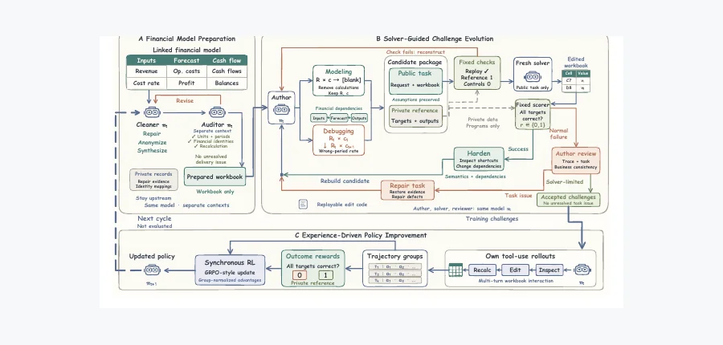 arXiv 2026-11-24 · cs.AI · #1 **[FinEvo: Recursive Self-Improvement for Long-Horizon Financial Modeling](https://arxiv.org/abs/2611.28239)** Chengjun Pan , Shichun Liu , Zekai Zhou , Shihan Dou , Jiahang Lin , Chengsong Huang , Dingwei Zhu , Tao Gui Affiliation · Peking University / Fudan University / Washington University [Paper](https://arxiv.org/abs/2611.28239) · [Code](https://github.com/pcj-sudo/FinEvo) · [Figure source](https://arxiv.org/pdf/2611.28239) 

[EN] Abstract
Advances in large language models (LLMs) have expanded their role in high-value productivity tasks, including financial analysis and modeling, while enabling models to play an increasingly active role in their own improvement. This motivates two complementary lines of inquiry: can financial modeling capabilities provide a foundation for model self-evolution, and can self-evolution, in turn, advance financial capabilities? We introduce FinEvo, a self-evolution framework that integrates autonomous experience construction with financial capability improvement. FinEvo prepares financial models, iteratively evolves challenges through self-play, and learns from the resulting interactions using executable rewards, relying on the same model throughout. An end-to-end execution with Qwen3.6-27B shows that solving feedback supports both increasing reasoning demands and identifying specification issues that executable checks can miss. Learning from these experiences raises whole-task success from 22.73 to 29.09 on held-out within-source tasks and from 13.13 to 19.19 on SpreadsheetBench 2 Financial. Comparable gains across task sources and evaluation settings, together with improvement on a task category absent from training, suggest that FinEvo strengthens underlying financial modeling capabilities shared across tasks. These findings support self-evolution as a path toward broader financial competence, advancing the empirical exploration of recursive self-improvement (RSI) in professional domains. Code is available at this https URL . <a href="https://arxiv.org/list/cs/new?show=2000#2611.28239">Source</a>

[ZH] Abstract
大型语言模型（LLM）的进步拓展了其在金融分析与建模等高价值生产力任务中的作用，同时也使模型能够更主动地参与自身改进。这促成了两条互补的探索方向：金融建模能力能否成为模型自我演化的基础，而自我演化又能否提升金融能力？我们提出 FinEvo，这是一个将自主经验构建与金融能力提升相结合的自我演化框架。FinEvo 准备金融模型，通过自博弈迭代演化挑战，并利用可执行奖励从所产生的交互中学习，全程依赖同一个模型。基于 Qwen3.6-27B 的端到端执行表明，求解反馈既有助于提高推理要求，也有助于识别可执行检查可能漏掉的规范问题。从这些经验中学习后，来源内留出任务的整项任务成功率从 22.73 提升至 29.09，在 SpreadsheetBench 2 Financial 上从 13.13 提升至 19.19。不同任务来源和评测设置下的相近增益，以及在训练中未出现的任务类别上的改进，表明 FinEvo 增强了跨任务共享的底层金融建模能力。这些发现支持将自我演化作为通向更广泛金融能力的一条路径，推动了专业领域递归自我改进（RSI）的实证探索。代码可在此 https URL 获取。 <a href="https://arxiv.org/list/cs/new?show=2000#2611.28239">Source</a>
 | 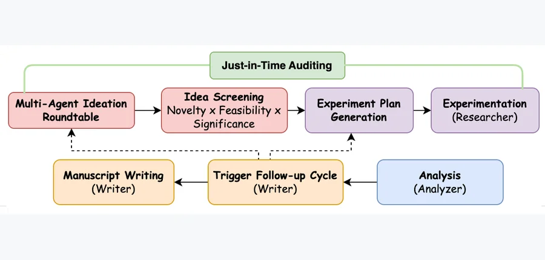 arXiv 2026-11-24 · cs.AI · #2 **[MatHarness: Towards Long-Horizon Open-ended AutoResearch for Computational Materials Science](https://arxiv.org/abs/2611.28324)** Yanlin Fei , Lei Li , Shaolong Chen , Nazhou Liu , Xinmiao Yu , Madalina Ciobanu , Navan Preet Singh , Qingqing Mao , Rita… Affiliation · Prentis AI / Titan Holdings [Paper](https://arxiv.org/abs/2611.28324) · [Figure source](https://arxiv.org/html/2611.28324v1/figures/figure1.png) 

[EN] Abstract
Materials science research is a non-linear, long-horizon process. Existing scientific agents, however, largely rely on specific task execution or predefined workflows, rendering them brittle in open-ended settings. To bridge this gap, we present MatHarness, an agent harness designed for open-ended, long-horizon computational materials research spanning the complete lifecycle from initial ideation to manuscript writing. MatHarness couples three mechanisms: execution robustness through pre-flight verification, expert-distilled skills, and just-in-time auditing; epistemic adaptability through persistent research artifacts and an evolving scientific mental model; and collective intelligence through a heterogeneous multi-agent round table under targeted human oversight. We evaluate MatHarness on adsorbate-induced surface segregation in Cu-Zn alloys, an open question in methanol-synthesis catalysis. Over a multi-week trajectory consuming roughly 10^3 GPU-hours (50 production DFT relaxations prescreened by 171 machine-learning-potential evaluations) the system revised its plan six times, recovered autonomously from failed calculations, and had an independent auditor overturn one of its own over-attributed claims before publication. Within the sampled metallic dilute-limit models, the validated DFT analysis supports an adsorbate-induced tendency toward greater surface Cu exposure at both composition endpoints, with facet- and coverage-dependent exceptions. These results were compiled into a complete manuscript with human involvement concentrated in specification, approval, and strategic steering gates. The code is publicly available at this https URL . <a href="https://arxiv.org/list/cs/new?show=2000#2611.28324">Source</a>

[ZH] Abstract
材料科学研究是一个非线性、长周期的过程。然而，现有科学智能体大多依赖特定任务执行或预定义工作流，使其在开放式场景中表现脆弱。为弥合这一差距，我们提出 MatHarness，这是一个面向开放式、长周期计算材料研究的智能体框架，覆盖从最初构思到论文撰写的完整生命周期。MatHarness 耦合了三种机制：通过执行前验证、专家蒸馏技能和即时审计实现执行稳健性；通过持久研究产物和不断演化的科学心智模型实现认识适应性；以及在有针对性的人类监督下，通过异构多智能体圆桌实现集体智能。我们在 Cu-Zn 合金中吸附物诱导的表面偏析问题上评估 MatHarness，这是甲醇合成催化中的一个开放问题。在耗费约 10^3 GPU 小时、持续数周的研究过程中（经 171 次机器学习势评估预筛选后，完成 50 次正式 DFT 弛豫），系统六次修订计划，自主从计算失败中恢复，并由一名独立审计者在发表前推翻了系统自身一项归因过度的主张。在所采样的金属稀释极限模型范围内，经验证的 DFT 分析支持：在两个组成端点，吸附物均会诱导更高的表面 Cu 暴露倾向，但存在依赖晶面和覆盖度的例外。这些结果被汇编为完整论文，人类参与集中在规范制定、批准和战略引导关口。代码已在此 https URL 公开。 <a href="https://arxiv.org/list/cs/new?show=2000#2611.28324">Source</a>
 | 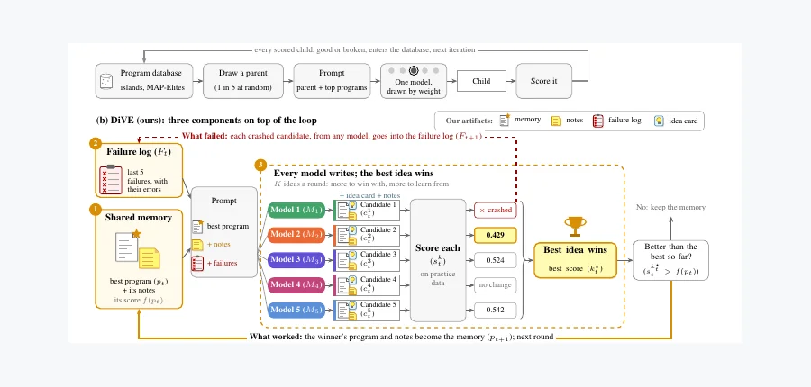 arXiv 2026-11-24 · cs.AI · #3 **[Diversity over Scale: Recursive Self-Improvement with Ensembles of Small Open-Weight Models](https://arxiv.org/abs/2611.28420)** Navapat Nananukul , Mayank Kejriwal Affiliation · Information Sciences Institute, University of Southern California [Paper](https://arxiv.org/abs/2611.28420) · [Figure source](https://arxiv.org/pdf/2611.28420) 

[EN] Abstract
The advancement of large language models (LLMs) has significantly enhanced the capabilities of agents across various tasks. Recursive self-improvement (RSI) loops, in which a language model repeatedly rewrites a program and builds on its previous version, now perform well in machine-learning tasks, but they rely on frontier models and hundreds of calls per run. Small open-weight models are far cheaper, yet when used alone, their programs often crash and their improvements stall. We propose DiVE (diverse models evolve), an ensemble method for RSI that aims to improve creativity and diversity of generated solutions. DiVE uses three components: a shared memory, a failure log, and best-idea-wins rounds. This allows models to write candidate solutions from the same context and retain the best idea at each iteration. On 22 MLE-bench Lite competitions, an ensemble of five 8-12B open-weight models has 25.4% less test error than its average member and 16.7% less than Llama 3.3 70B, and comes within 7.1% of Qwen 3.5 122B-A10B at 75% of its cost. Diversity among small models can thus stand in for part of the scale that RSI relies on. <a href="https://arxiv.org/list/cs/new?show=2000#2611.28420">Source</a>

[ZH] Abstract
大型语言模型（LLM）的发展显著增强了智能体在各类任务中的能力。语言模型反复重写程序并在先前版本基础上继续构建的递归自我改进（RSI）循环，如今已在机器学习任务中表现良好，但依赖前沿模型和每次运行数百次调用。小型开放权重模型便宜得多，但单独使用时，其程序经常崩溃，改进也容易停滞。我们提出 DiVE（diverse models evolve），一种面向 RSI 的集成方法，旨在增强所生成解的创造性和多样性。DiVE 使用三个组件：共享记忆、失败日志和最佳想法胜出的轮次。这使不同模型能够基于相同上下文编写候选解，并在每次迭代中保留最佳想法。在 22 项 MLE-bench Lite 竞赛上，由五个 8–12B 开放权重模型组成的集成，其测试误差比成员平均值低 25.4%，比 Llama 3.3 70B 低 16.7%，以 Qwen 3.5 122B-A10B 的 75% 成本达到与其相差 7.1% 以内的表现。因此，小模型之间的多样性可以替代 RSI 所依赖的部分模型规模。 <a href="https://arxiv.org/list/cs/new?show=2000#2611.28420">Source</a>
 |
| 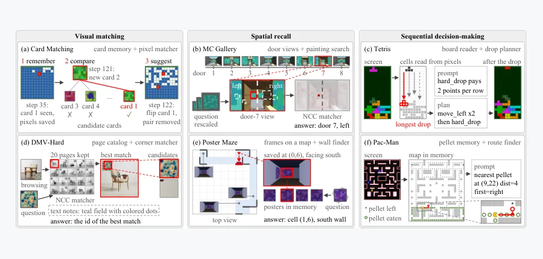 arXiv 2026-11-24 · cs.AI · #4 **[EvoViM: Recursively Self-Evolving Visual Agents for Exploration with Deferred Queries](https://arxiv.org/abs/2611.28574)** Xinyu Cao , Tianjie Ju , Zhuosheng Zhang Affiliation · Hunan University / National University of Singapore / Shanghai Jiao Tong University [Paper](https://arxiv.org/abs/2611.28574) · [Project](https://evovim.github.io/) · [Figure source](https://arxiv.org/html/2611.28574v1/teaser.png) 

[EN] Abstract
Multimodal large language model (MLLM) agents have shown promising capabilities in task-oriented environments. However, they still struggle when queries are deferred until after exploration, requiring them to retain visual evidence before knowing which details will matter. We introduce EvoViM, a recursively self-evolving framework in which a frozen multimodal model turns its own interaction experience into one visual program for memory and skills. The program retains images and computes directly on pixels, and its operations decide how this evidence is used in each task. During memory evolution, the same model traces failures in its visual trajectories to the operations that lost or misused evidence and revises them. It also rewrites the notes and analysis tools that guide later revisions, which then build on earlier findings and skip changes that have already failed. We evaluate EvoViM with three multimodal models on six tasks covering visual matching, spatial recall, and sequential decision-making, including three tasks with deferred queries. Across the six tasks, EvoViM improves the average score over AutoMem, the strongest baseline in the main comparison, by 31.3-47.6 points on held-out episodes. Programs written once from the initial environment instructions perform substantially worse, highlighting the value of interaction experience in shaping how visual evidence is retained and used. Code and dataset are available at this https URL . <a href="https://arxiv.org/list/cs/new?show=2000#2611.28574">Source</a>

[ZH] Abstract
多模态大型语言模型（MLLM）智能体在面向任务的环境中展现出良好能力。然而，当问题直到探索结束后才给出时，它们仍然困难重重，因为这要求它们在不知道哪些细节重要之前就保留视觉证据。我们提出 EvoViM，一个递归自我演化框架，其中冻结的多模态模型将自身交互经验转化为一个统一的视觉记忆与技能程序。该程序保留图像并直接对像素进行计算，其操作决定各项任务如何利用这些证据。在记忆演化过程中，同一个模型将视觉轨迹中的失败追溯到丢失或误用证据的操作，并对其进行修订。它还重写指导后续修订的笔记和分析工具，使后续修订建立在先前发现之上，并跳过已经失败过的改动。我们使用三个多模态模型，在涵盖视觉匹配、空间回忆和序列决策的六项任务上评估 EvoViM，其中三项任务在探索后才给出问题。在六项任务中，相较于主对比中最强的基线 AutoMem，EvoViM 在留出回合上的平均得分提高了 31.3–47.6 分。仅依据最初环境说明一次性编写的程序表现显著更差，突出了交互经验对于塑造视觉证据保留和利用方式的价值。代码和数据集可在此 https URL 获取。 <a href="https://arxiv.org/list/cs/new?show=2000#2611.28574">Source</a>
 | 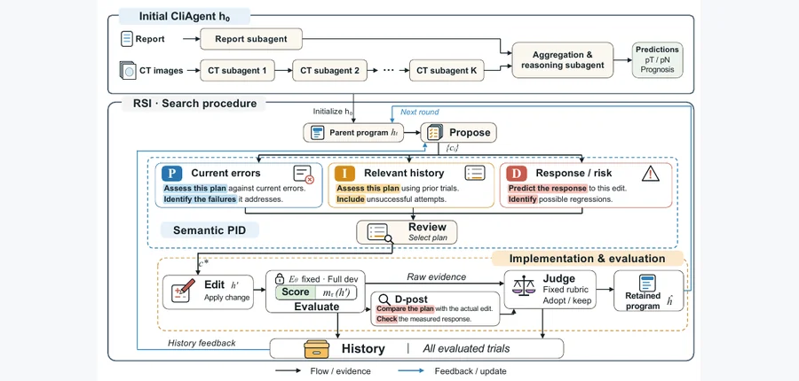 arXiv 2026-11-24 · cs.AI · #5 **[Improving the Improver: Semantic PID Control for Medical Agent Self-Improvement](https://arxiv.org/abs/2611.28680)** Dexia Chen , YiLong Hu , Wenqi Zhong , Guangyu Guo , Tony C. W. Mok , Ling Zhang , Zhongwei Qiu Affiliation · Alibaba Group / Zhejiang University [Paper](https://arxiv.org/abs/2611.28680) · [Figure source](https://arxiv.org/pdf/2611.28680) 

[EN] Abstract
High-stakes vertical medical tasks, such as postoperative pathological staging and long-term survival prediction, demand multi-step clinical reasoning over heterogeneous evidence under weak supervision and high outcome uncertainty. While we first orchestrate CliAgent, a domain-tailored clinical agent workflow that systematically grounds predictions in multi-modal patient evidence, manually designed medical agents remain constrained by static, brittle rules. Moreover, existing recursive self-improvement (RSI) methods suffer from feedback ambiguity and severe development-set overfitting when evolving agents in high-noise medical domains. Focusing on improving the improver, we propose Semantic PID-RSI, an evidence-guided control-theoretic framework for medical agent self-improvement. Inspired by PID control, our improver evaluates candidate modification batches via three diagnostic roles: P isolates current clinical failure modes, I synthesizes longitudinal evidence from past trials, and D estimates response dynamics and regression risks (D-pre/D-post). Selected plans are compiled into behavior contracts for staged probing and independent adoption judging. Instantiated and validated on challenging oncology tasks (pT/pN staging and survival prognosis), evolving CliAgent with Semantic PID-RSI on a 3B-activated open-weight model achieves substantial gains (up to +6.27 C-index points), outperforming overfitting-prone RSI baselines and approaching the performance of frontier proprietary models (e.g., GPT-6 series) equipped with CliAgent. <a href="https://arxiv.org/list/cs/new?show=2000#2611.28680">Source</a>

[ZH] Abstract
术后病理分期和长期生存预测等高风险垂直医疗任务，需要在弱监督和高度结局不确定性下，对异构证据进行多步骤临床推理。我们首先构建了 CliAgent，这是一个面向领域的临床智能体工作流，系统地将预测建立在多模态患者证据之上，但人工设计的医疗智能体仍受静态、脆弱规则限制。此外，现有递归自我改进（RSI）方法在高噪声医疗领域中存在反馈模糊和严重的开发集过拟合。我们聚焦于改进“改进器”，提出 Semantic PID-RSI，一个由证据引导、基于控制理论的医疗智能体自我改进框架。受 PID 控制启发，改进器通过三类诊断角色评估候选修改批次：P 隔离当前临床失败模式，I 综合历次试验的纵向证据，D 估计响应动态与回归风险（D-pre/D-post）。选定计划被编译为行为契约，供分阶段探测和独立采纳判断使用。在具有挑战性的肿瘤学任务（pT/pN 分期和生存预后）上实例化并验证后，使用 Semantic PID-RSI 演化基于激活参数为 3B 的开放权重模型的 CliAgent，获得显著提升（C-index 最高增加 6.27 个点），优于易过拟合的 RSI 基线，并接近配备 CliAgent 的前沿专有模型（如 GPT-6 系列）的表现。 <a href="https://arxiv.org/list/cs/new?show=2000#2611.28680">Source</a>
 | 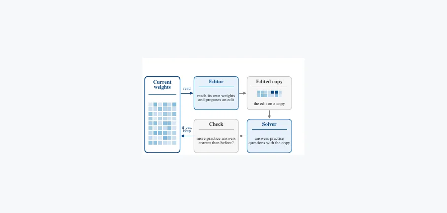 arXiv 2026-11-24 · cs.CL · #6 **[Self-WSP: Can Language Models Improve Themselves Through Weight-Space Programming?](https://arxiv.org/abs/2611.28833)** Guoming Ling , Shanshan Zhong , Kaixuan Zhang , Zhongzhan Huang Affiliation · Carnegie Mellon University / MilkThink [Paper](https://arxiv.org/abs/2611.28833) · [Figure source](https://arxiv.org/pdf/2611.28833) 

[EN] Abstract
Frontier language models can now read and edit the weights of a neural network much like code and thereby improve a small model, an approach known as Weight-Space Programming (WSP). We further explore applying WSP to a language model itself, which we call Self-WSP. Specifically, Qwen3.5-0.8B reads its own weights, proposes an edit, and then continues with the edited weights as both problem solver and editor. We find many cases of genuine self-improvement. Self-edits can raise GSM8K accuracy from 11.8% to 62.2% and MATH500 accuracy from 7.0% to 32.2%, sometimes by changing only 16 parameters, and in some cases repeated self-editing keeps improving the model. A closer look, however, reveals that these gains lack interpretability. The model shows little understanding of the edits it makes, and WSP driven by random search sometimes performs comparably. Self-WSP thus holds promise as a path toward recursive self-improvement (RSI), but realizing this promise requires further exploration. <a href="https://arxiv.org/list/cs/new?show=2000#2611.28833">Source</a>

[ZH] Abstract
前沿语言模型如今可以像阅读和编辑代码一样阅读并编辑神经网络权重，从而改善小型模型，这一方法被称为权重空间编程（WSP）。我们进一步探索将 WSP 应用于语言模型自身，并将其称为 Self-WSP。具体而言，Qwen3.5-0.8B 读取自身权重，提出编辑，然后使用编辑后的权重继续同时担任问题求解者和编辑者。我们发现了许多真实的自我改进案例。自我编辑可将 GSM8K 准确率从 11.8% 提升至 62.2%，将 MATH500 准确率从 7.0% 提升至 32.2%，有时只需修改 16 个参数；在某些情况下，反复自我编辑还能持续改善模型。然而，深入分析揭示这些增益缺乏可解释性。模型对自身编辑表现出很少的理解，而随机搜索驱动的 WSP 有时也能取得相近表现。因此，Self-WSP 有望成为通往递归自我改进（RSI）的路径，但要实现这一潜力仍需进一步探索。 <a href="https://arxiv.org/list/cs/new?show=2000#2611.28833">Source</a>
 |
| 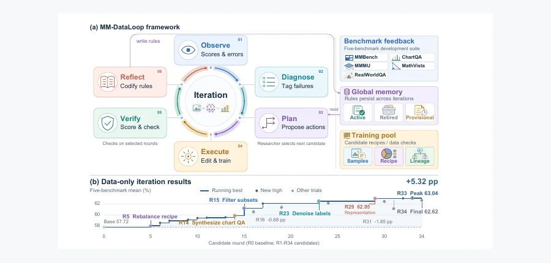 arXiv 2026-11-24 · cs.CV · #7 **[MM-DataLoop: Closing the Data-Side Loop for Recursive Self-Improvement in MLLM Post-Training](https://arxiv.org/abs/2611.29254)** Likang Peng , Chen Ju , Xu Chen , Xiangyang Wu , Jinsong Lan , Haihong Tang , Ying Chen Affiliation · Alibaba Group [Paper](https://arxiv.org/abs/2611.29254) · [Figure source](https://arxiv.org/pdf/2611.29254) 

[EN] Abstract
Recursive self-improvement (RSI) offers a path toward improving models through repeated evaluation and revision. We study its data side in multimodal language model (MLLM) post-training, where heterogeneous operations and cross-round evidence must be coordinated. MMDataLoop organizes data interventions into five operation families and connects them through an Observe-Diagnose-Plan-Execute-Verify-Reflect cycle with shared rule memory. Across 34 candidate rounds on Qwen3.5-0.8B and five benchmarks, we hold the base initialization, shared training schedule and evaluation protocol fixed while varying data recipes. The five-benchmark mean reaches 63.04 at R33, up 5.32 points from the zero-shot baseline; R29, R32, and R33 form a close top cluster within 0.09 points. In eightcandidate comparisons, guided search reaches the preselected target in six candidates and identifies the top observed candidate, while random arms show higher means and lower dispersion. The selected R29 recipe also scores above two full-pool baselines under the same epoch schedule. Together, these findings establish MM-DataLoop as a traceable workflow and provide an empirical basis for studying how data-side decisions shape outcomes across MLLM post-training recipes. <a href="https://arxiv.org/list/cs/new?show=2000#2611.29254">Source</a>

[ZH] Abstract
递归自我改进（RSI）提供了一条通过反复评估与修订来改善模型的路径。我们研究多模态语言模型（MLLM）后训练中的数据侧问题，其中需要协调异构操作与跨轮次证据。MMDataLoop 将数据干预组织为五类操作，并通过共享规则记忆，将其连接成“观察—诊断—计划—执行—验证—反思”循环。在 Qwen3.5-0.8B 上、跨五个基准的 34 个候选轮次中，我们固定基础初始化、共享训练日程和评测协议，只改变数据配方。五基准平均得分在 R33 达到 63.04，比零样本基线提高 5.32 个点；R29、R32 和 R33 构成相近的最佳组，彼此相差不超过 0.09 个点。在八候选对比中，引导搜索用六个候选达到预先选定的目标，并识别出观测到的最佳候选，但随机组的平均值更高、离散程度更低。所选 R29 配方在相同 epoch 日程下的得分也高于两个全池基线。综合而言，这些发现确立了 MM-DataLoop 作为一个可追溯工作流，并为研究数据侧决策如何影响不同 MLLM 后训练配方的结果提供了实证基础。 <a href="https://arxiv.org/list/cs/new?show=2000#2611.29254">Source</a>
 | 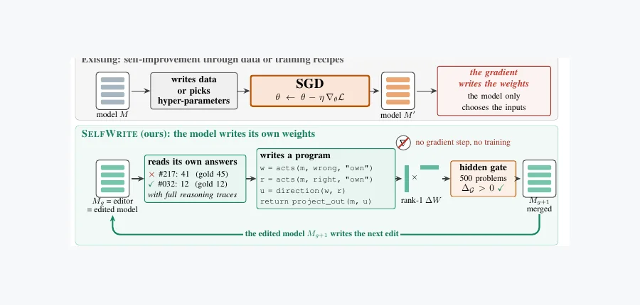 arXiv 2026-11-24 · cs.LG · #8 **[Recursive Self-Editing: LLMs Program Their Own Weight Edits for Self-Improvement](https://arxiv.org/abs/2611.29513)** Linghua Zhang , Yunhe Li Affiliation · Affiliation unconfirmed [Paper](https://arxiv.org/abs/2611.29513) · [Figure source](https://arxiv.org/pdf/2611.29513) 

[EN] Abstract
Recursive self-improvement asks a system to improve the very system that improves it. Today's language models improve themselves through data, training recipes or scaffolds. Whenever their weights change, gradient descent writes the update, not the model. We let the model write its own weights. In SELFWRITE, each generation the current model studies its own reasoning on fresh training problems, inspects its own weights and activations in a persistent Python session, and writes a program that constructs a low-rank weight edit for itself from white-box primitives (singular directions, activation contrasts between its right and wrong answers, rank-one projections, tensor computations), with no training or gradient tool. Every candidate is graded once on a hidden gate set against the current model; the best strictly improving edit is merged into the weights, and the edited model writes the next edit. On Qwen3.8-27B and math problems from DAPO-Math, five generations of SELFWRITE raise gate accuracy from 73.95% to 76.45% and accuracy on a held-out test split that the loop never sees from 76.30% to 77.75% (avg@4) and from 82.60% to 84.80% (pass@4), without a single gradient step. A language model can author useful changes to its own weights without gradients, and the edited model keeps writing useful edits. <a href="https://arxiv.org/list/cs/new?show=2000#2611.29513">Source</a>

[ZH] Abstract
递归自我改进要求一个系统改善那个改进它自身的系统。当今语言模型通过数据、训练配方或脚手架来改善自己。但只要权重发生变化，写入更新的都是梯度下降，而非模型。我们让模型自行写入其权重。在 SELFWRITE 中，每一代当前模型都会研究自己在新训练题上的推理，在持久 Python 会话中检查自身权重与激活，并利用白盒原语（奇异方向、正确与错误回答之间的激活差异、秩一投影、张量计算）编写程序，为自身构建低秩权重编辑，不使用训练或梯度工具。每个候选仅在一个隐藏门控集上与当前模型比较评分一次；最佳的严格改进编辑被合并进权重，随后由编辑后的模型编写下一次编辑。在 Qwen3.8-27B 和 DAPO-Math 数学问题上，SELFWRITE 的五代迭代将门控准确率从 73.95% 提升至 76.45%，并在循环从未看到的留出测试划分上，将准确率从 76.30% 提升至 77.75%（avg@4）、从 82.60% 提升至 84.80%（pass@4），全程没有任何梯度步骤。语言模型能够在无梯度情况下为自身权重编写有用的改动，且编辑后的模型可以继续编写有用编辑。 <a href="https://arxiv.org/list/cs/new?show=2000#2611.29513">Source</a>
 | 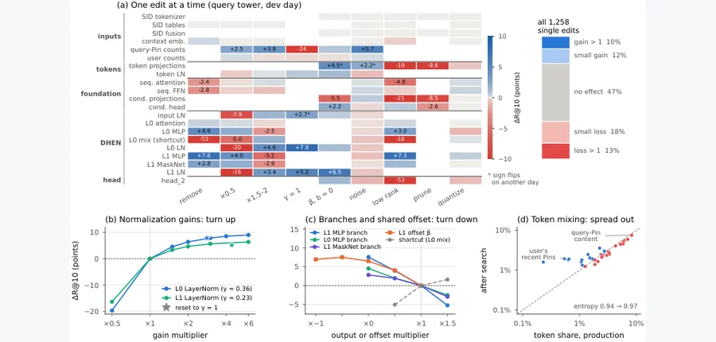 arXiv 2026-11-24 · cs.IR · #9 **[Weight Coding: Evolving Web-Scale Recommenders through Direct Weight Edits with LLM Agents](https://arxiv.org/abs/2611.29613)** Junpeng Hou , Jiaxing Qu , Derek Cheng , Jaewon Yang , Abhinav Naikawadi , Karthik Subbian Affiliation · Pinterest, Inc. [Paper](https://arxiv.org/abs/2611.29613) · [Figure source](https://arxiv.org/html/2611.29613v1/fig3_effect_map.png) 

[EN] Abstract
Web-scale recommender models evolve primarily through retraining or fine-tuning. We propose \emph{weight coding}, a methodology for model evolution through direct, executable weight edits. A large language model (LLM) agent inspects model structure and parameters, formulates hypotheses, and implements edits using evaluation feedback. The loop progresses from localized changes to targeted searches and composition, allowing edited components to adapt to one another. A cached engine enables rapid forward evaluation without backpropagation. On Pinterest's 147M-parameter Image Search two-tower retriever, weight coding improves held-out recall@10 of production model by up to 15.0 percentage points (+24\% relative) with few edits in about 1/4 GPU hours of a full post-training finetune, while a common launch only improves around 1\%. After reinitializing the entire 13.6M-parameter interaction module randomly while retaining the surrounding trained model, searching 2,448 mixing and normalization parameters yields 9.8 points above production. Offline gains span the full funnel including dense retrieval, generative retrieval and ranking, with up to 1.37B learnable parameters and different edits for each architecture. Steering edits provide explicit control of model performance over segments like freshness and product. Weight coding requires no serving change and online A/B tests increase saves per user from the edited retrieval source by 8.4\% to 10.7\%, aligned with the target business objectives. Our results establish weight coding as a practical and useful tool for model development and and behavioral control in a real web-scale production system, with potential to extend to both pre-training and post-training stages across the funnel. <a href="https://arxiv.org/list/cs/new?show=2000#2611.29613">Source</a>

[ZH] Abstract
网络规模推荐模型主要通过重新训练或微调来演化。我们提出“权重编码”（\emph{weight coding}），一种通过直接、可执行权重编辑实现模型演化的方法。大型语言模型（LLM）智能体检查模型结构与参数，提出假设，并利用评测反馈实施编辑。循环从局部修改推进至定向搜索和组合，使被编辑组件能够相互适配。缓存引擎支持快速前向评估，无需反向传播。在 Pinterest 的 147M 参数图像搜索双塔检索器上，权重编码只需少量编辑、约为完整后训练微调四分之一的 GPU 小时，即可将生产模型的留出 recall@10 最高提高 15.0 个百分点（相对提高 24%），而一次常规上线通常仅提高约 1%。在保留周围已训练模型、将整个 13.6M 参数交互模块随机重新初始化后，搜索 2,448 个混合与归一化参数仍能比生产模型高出 9.8 个点。离线增益覆盖包括稠密检索、生成式检索和排序在内的完整漏斗，模型可学习参数最高达 1.37B，且不同架构采用不同编辑。引导编辑提供了对新鲜度和产品等分段性能的显式控制。权重编码不要求更改服务部署，线上 A/B 测试使来自被编辑检索源的人均收藏数增加 8.4% 至 10.7%，符合目标业务指标。我们的结果确立了权重编码作为真实网络规模生产系统中模型开发与行为控制的一种实用且有效工具，并有望扩展到漏斗各环节的预训练和后训练阶段。 <a href="https://arxiv.org/list/cs/new?show=2000#2611.29613">Source</a>
 |
| 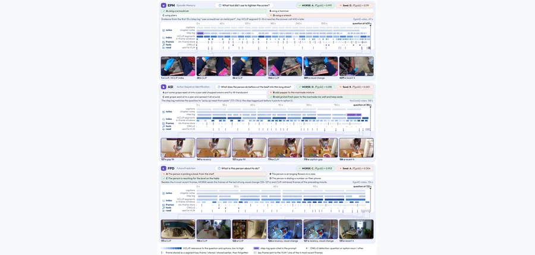 arXiv 2026-11-24 · cs.CV · #10 **[MORSE: Optimizing Streaming Memory Design via Open-World Auto-Research](https://arxiv.org/abs/2611.30011)** Ce Zhang , Jianshu Zhang , Jinxi He , Xiyuan Yang , Pan Wang , Han Liu , Katia Sycara , Yaqi Xie Affiliation · Carnegie Mellon University / Northwestern University / University of Illinois Urbana-Champaign / University of Pittsburgh [Paper](https://arxiv.org/abs/2611.30011) · [Project](https://zhangce01.github.io/morse/) · [Figure source](https://arxiv.org/html/2611.30011v1/memory_examples.png) 

[EN] Abstract
A streaming video system must decide in a single pass what evidence to retain under bounded frame storage, before it knows which details a future question will require. Recent recursive self-improvement methods automate the design of the harness that stores and retrieves this evidence. They revise the harness in response to failures, but the editor must still devise each repair from its prior knowledge and a predefined set of tools. A failure that recurs across videos, however, may point to a problem that prior work has already addressed. We introduce MORSE (Memory Optimization with Recursive Self-Evolvement), an open-world auto-research framework that uses recurring failures to guide an online search for solutions. Its editor groups failures in training traces by cause, then searches papers, model cards, and code for methods it can adapt or pretrained perception models it can use. When the editor introduces a new perceptual capability, it can also revise how the harness stores and retrieves the resulting evidence for a frozen video-language model. On held-out validation streams, MORSE first selects revisions that improve answer quality, then seeks faster revisions that preserve those gains within a specified tolerance. Across three streaming video benchmarks, MORSE consistently achieves the highest answer accuracy within each frozen-backbone comparison. On OVO-Bench, our Qwen3-VL-8B harness answers queries in 0.30 seconds on average while achieving 75.1% accuracy, 3.1 percentage points ahead of the next-best evaluated harness using the same frozen backbone. <a href="https://arxiv.org/list/cs/new?show=2000#2611.30011">Source</a>

[ZH] Abstract
流式视频系统必须在单次遍历中、在帧存储受限的条件下决定保留哪些证据，而此时尚不知道未来问题会关注哪些细节。近期递归自我改进方法将存储和检索这些证据的框架设计自动化。它们根据失败修订框架，但编辑者仍必须依靠先验知识和预定义工具集合设计每次修复。然而，在多个视频中反复发生的失败，可能对应既有研究已经解决的问题。我们提出 MORSE（Memory Optimization with Recursive Self-Evolvement），一个开放世界自动科研框架，利用反复出现的失败来引导在线解决方案检索。其编辑者按成因对训练轨迹中的失败分组，然后搜索论文、模型卡和代码，寻找可以适配的方法或可使用的预训练感知模型。当编辑者引入新的感知能力时，还可以修订框架存储和检索相应证据的方式，以服务冻结的视频语言模型。在留出验证流上，MORSE 首先选择能改善回答质量的修订，再寻找能在指定容差内保留这些增益的更快修订。在三个流式视频基准上，MORSE 在每个冻结骨干对比中始终获得最高回答准确率。在 OVO-Bench 上，采用 Qwen3-VL-8B 的框架平均用 0.30 秒回答查询，准确率为 75.1%，比使用同一冻结骨干的次佳受评框架高 3.1 个百分点。 <a href="https://arxiv.org/list/cs/new?show=2000#2611.30011">Source</a>
 | 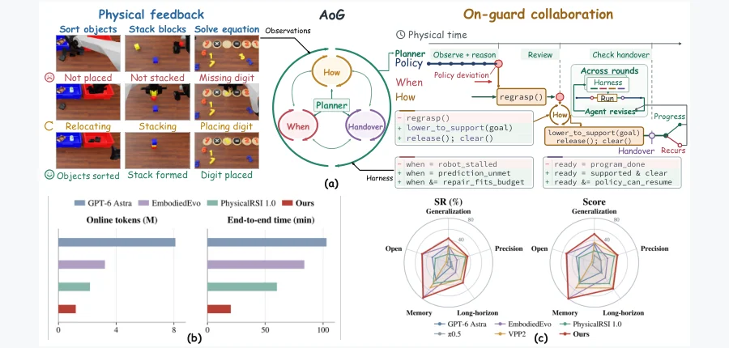 arXiv 2026-11-24 · cs.RO · #11 **[Agent on Guard: Self-Improving Runtime Intervention for Robust Robotic Manipulation](https://arxiv.org/abs/2611.30101)** Gengming Cui , Mingfei Han , Jiawei Zhang , Mozheng Liao , Yunkai Guo , Minghao Jin , Tingwen Du , Salman Khan , Xiaojun C… Affiliation · University of Science and Technology of China / LeapWing AI / MBZUAI / Institute of Automation, Chinese Academy of Sciences [Paper](https://arxiv.org/abs/2611.30101) · [Figure source](https://arxiv.org/html/2611.30101v1/overview.png) 

[EN] Abstract
Robot foundation policies provide learned execution capabilities, while programming agents can reason about failures and construct recovery behaviors. Combining them effectively requires learning when intervention helps and when the policy can reliably resume. This challenge is inherently temporal: the physical world continues to evolve during reasoning, and a useful recovery may become infeasible before a decision takes effect. We introduce Agent on Guard (AoG), a hierarchical framework that improves collaboration between a frozen base policy and a programming agent through physical experience. An evolving outer planner allocates control as the physical state evolves, aligning decisions with the physical clock with attention to observation freshness, remaining recovery windows, and the time required for reasoning, recovery, and subsequent execution. Coupled inner loops jointly refine intervention timing, recovery skills, and handoff conditions. Rather than judging recovery by local correction alone, AoG uses downstream task progress, failure recurrence, final outcomes, and resource consumption to improve both recovery behaviors and scheduling. This turns temporary agent solutions into reusable collaboration capabilities that complement the frozen policy. On RoboDojo-Sim, AoG achieves a success rate of 50.57% and a task score of 57.26, exceeding the strongest evaluated baseline by 11.22 percentage points and 10.68 points, respectively. It also reduces end-to-end episode latency by 80.4% and online token consumption by 85.1% relative to the GPT-6 Astra agent. <a href="https://arxiv.org/list/cs/new?show=2000#2611.30101">Source</a>

[ZH] Abstract
机器人基础策略提供了学习得到的执行能力，而编程智能体能够推理失败并构建恢复行为。要有效结合两者，需要学会何时干预有帮助，以及策略何时能够可靠恢复执行。这一挑战本质上与时间相关：物理世界在推理期间持续演化，一个有用的恢复方案可能在决策生效前就已不可行。我们提出 Agent on Guard（AoG），一个通过物理经验改善冻结基础策略与编程智能体协作的分层框架。不断演化的外层规划器随物理状态变化分配控制权，关注观测新鲜度、剩余恢复窗口，以及推理、恢复和后续执行耗时，使决策与物理时钟对齐。相互耦合的内层循环共同细化干预时机、恢复技能和交接条件。AoG 不只依据局部纠正判断恢复，而是利用下游任务进展、失败复发、最终结果和资源消耗，改进恢复行为与调度。这将临时智能体解法转化为可复用的协作能力，以补充冻结策略。在 RoboDojo-Sim 上，AoG 成功率达到 50.57%，任务得分为 57.26，比最强受评基线分别高 11.22 个百分点和 10.68 分。相较于 GPT-6 Astra 智能体，它还将端到端回合延迟降低 80.4%，在线 token 消耗降低 85.1%。 <a href="https://arxiv.org/list/cs/new?show=2000#2611.30101">Source</a>
 | 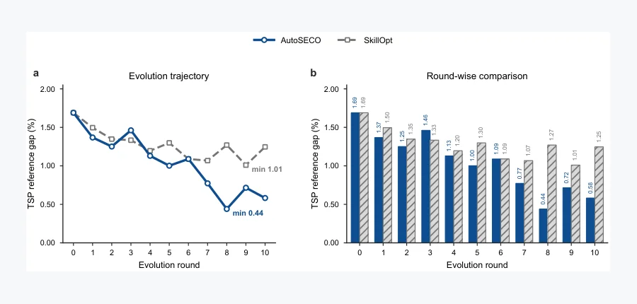 arXiv 2026-11-24 · cs.AI · #12 **[AutoSECO: Automated Skill Evolution for Cross-Problem Combinatorial Optimization with General-Purpose LLM Agents](https://arxiv.org/abs/2611.30139)** Zirui Zhu , Cong Zhang , Ni Zhang , Kuan Xu , Zhiguang Cao Affiliation · Johns Hopkins University / Singapore Management University / Independent researcher [Paper](https://arxiv.org/abs/2611.30139) · [Figure source](https://arxiv.org/html/2611.30139v1/figures_evolution_gap.png) 

[EN] Abstract
General-purpose large language model (LLM) agents can develop complete solvers for combinatorial optimization problems. Their specialization, however, often relies on workflows engineered for individual problems, limiting the reuse of development expertise. We propose AutoSECO, an automated skill evolution method that learns reusable solver-development guidance from experience. The challenge is that external evaluation measures the completed solver, while the skill guides decisions during development. AutoSECO connects this feedback to guidance deficiencies by tracing performance shortfalls through solver code and recorded development decisions. Revisions are expressed as general instructions and retained only if a fresh solver developed under the revised skill achieves a lower mean evaluation gap. Evolved solely on the traveling salesperson problem (TSP), the skill guides fresh agents in developing solvers for capacitated vehicle routing, job-shop scheduling, and three-dimensional bin packing without further skill evolution. On TSP, the final mean benchmark gap is 0.52\%, compared with 0.98\% for the skill-evolution baseline SkillOpt. Across all four problems, the evolved skill achieves better aggregate results than no skill guidance, the initial skill, and SkillOpt. The same frozen skill also supports solver development under alternative model--harness configurations. These findings suggest that solver-development experience can be retained as reusable expertise for general-purpose LLM agents. <a href="https://arxiv.org/list/cs/new?show=2000#2611.30139">Source</a>

[ZH] Abstract
通用大型语言模型（LLM）智能体能够为组合优化问题开发完整求解器。然而，其专业化通常依赖针对单个问题设计的工作流，限制了开发经验复用。我们提出 AutoSECO，一种从经验中学习可复用求解器开发指导的自动技能演化方法。挑战在于，外部评测衡量的是完成后的求解器，而技能指导的是开发过程中的决策。AutoSECO 通过沿求解器代码和已记录开发决策追踪性能不足，将反馈连接到指导缺陷。修订以通用指令形式表达，并且只有在修订技能指导下全新开发的求解器取得更低的平均评测差距时，才被保留。该技能仅在旅行商问题（TSP）上演化，随后即可指导新的智能体为带容量车辆路径规划、车间调度和三维装箱开发求解器，而无需继续技能演化。在 TSP 上，最终平均基准差距为 0.52%，相比之下技能演化基线 SkillOpt 为 0.98%。跨全部四个问题，演化技能的综合表现优于无技能指导、初始技能和 SkillOpt。同一冻结技能还支持在其他模型—框架配置下开发求解器。这些发现表明，求解器开发经验可以作为可复用专长保留给通用 LLM 智能体。 <a href="https://arxiv.org/list/cs/new?show=2000#2611.30139">Source</a>
 |
| 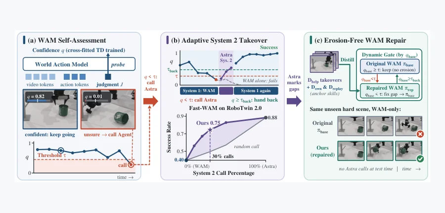 arXiv 2026-11-24 · cs.RO · #13 **[Calibrating World Action Models: From Adaptive System 2 Takeover to Self-Evolution](https://arxiv.org/abs/2611.30188)** Wenhao Li , Yu Han , Xiu Su , Dehao Wu , Keke Huang , Shan You , Fei Wang , Chang Xu Affiliation · University of Sydney / University of California, San Diego / Central South University / ACE Robotics [Paper](https://arxiv.org/abs/2611.30188) · [Figure source](https://arxiv.org/html/2611.30188v1/teaser.png) 

[EN] Abstract
World action models (WAMs) deliver fast visuomotor control, yet degrade sharply in challenging scenes and act blindly when about to fail; conversely, foundation-model-based agents generalize and recover reliably, but incur prohibitive latency and cost when queried at every step. To achieve both WAM (System 1)-level speed and agent (System 2)-level reliability--- we propose \textbf{\oursfull (\ours)}, a framework that calibrates WAMs' confidence--- adaptively triggering System~2 only when necessary, and distilling System~2's knowledge to form an evolving System~1. First, \ours equips a frozen WAM with \textbf{calibrated self-assessment}: a single lightweight judgment token reading internal video--action features is trained via our proposed \textbf{cross-fitted temporal-difference (TD) learning} using only binary rollout success/failure signals. It can predict a \textbf{calibrated success probability} at negligible overhead without affecting action predictions. Second, this calibrated success probability schedules control chunk by chunk---invoking System~2 to resolve bottlenecks when confidence drops, and handing control back to the WAM once confidence recovers, preserving WAM-like speed while approaching System~2 reliability. Third, as System~2 intervenes only when the WAM lacks confidence, its takeover trajectories directly capture the WAM's capability gaps. JiL distills these takeovers into the WAM to repair those gaps so System~1 can operate standalone without System~2 at test time, while our mastered-skill anchoring and dynamic confidence gating prevent degrading existing capabilities. <a href="https://arxiv.org/list/cs/new?show=2000#2611.30188">Source</a>

[ZH] Abstract
世界动作模型（WAM）提供快速视觉运动控制，但在困难场景中性能急剧下降，并会在即将失败时盲目行动；相反，基于基础模型的智能体能够可靠泛化与恢复，但若每步都调用，则延迟和成本高得难以承受。为同时获得 WAM（系统 1）级速度和智能体（系统 2）级可靠性，我们提出 \textbf{\oursfull (\ours)}，一个校准 WAM 置信度的框架：仅在必要时自适应触发系统 2，并将系统 2 的知识蒸馏为不断演化的系统 1。首先，\ours 为冻结 WAM 配备 \textbf{经校准的自我评估}：一个读取内部视频—动作特征的轻量判断 token，通过我们提出的 \textbf{交叉拟合时序差分（TD）学习}训练，仅使用二元 rollout 成功/失败信号。它能够以可忽略的额外开销预测 \textbf{经校准的成功概率}，而不影响动作预测。其次，这一校准成功概率逐块调度控制：置信度下降时调用系统 2 解决瓶颈，置信度恢复后将控制权交回 WAM，在保留接近 WAM 的速度的同时接近系统 2 的可靠性。第三，由于系统 2 仅在 WAM 缺乏信心时干预，其接管轨迹直接捕获 WAM 的能力缺口。JiL 将这些接管轨迹蒸馏回 WAM，以修复缺口，使系统 1 在测试时无需系统 2 即可独立运行，而我们提出的已掌握技能锚定和动态置信门控则用于防止现有能力退化。 <a href="https://arxiv.org/list/cs/new?show=2000#2611.30188">Source</a>
 | 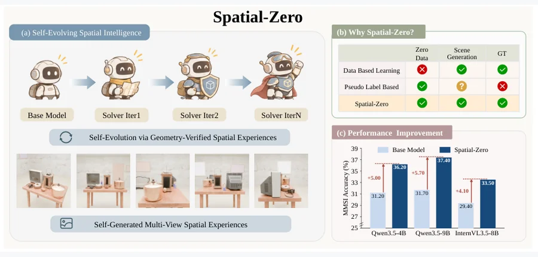 arXiv 2026-11-24 · cs.CV · #14 **[Spatial-Zero: Self-Evolving Spatial Reasoning in Vision-Language Models from Zero Data](https://arxiv.org/abs/2611.30424)** Yutong Li , Haoyu Zhao , Daoguo Dong , Ziyi Ye , Yugang Jiang Affiliation · Fudan University / National University of Singapore [Paper](https://arxiv.org/abs/2611.30424) · [Code](https://github.com/YutongLi2024/Spatial-Zero) · [Figure source](https://arxiv.org/html/2611.30424v1/Introduction.png) 

[EN] Abstract
Spatial reasoning requires a vision-language model~(VLM) to understand metric distances, three-dimensional relationships, and viewpoint-dependent geometry. Learning these capabilities typically requires externally curated training data. This paper introduces Spatial-Zero, a VLMs' training framework that can self-evolve through autonomous spatial exploration with zero data. Spatial-Zero addresses two key challenges in autonomous spatial exploration: reliably generating valid spatial interaction tasks and providing accurate supervision for learning from these tasks. Specifically, a proposer specifies object configurations and questions, and a Coder turns them into executable scene programs that produce multi-view images and explicit scene geometry. A Geometric Oracle checks spatial constraints, visibility, and answer uniqueness and derives ground-truth labels from executed geometry; these labels supervise the Solver and ground difficulty feedback, while validation outcomes guide subsequent task generation. Across six spatial reasoning benchmarks and three VLM backbones, Spatial-Zero yields consistent gains through iterative self-evolution. After three iterations, Qwen3.5-9B improves average accuracy by 3.23 percentage points; with Qwen3.5-4B, Spatial-Zero also outperforms existing VLM self-evolution methods. Our code is available at this https URL <a href="https://arxiv.org/list/cs/new?show=2000#2611.30424">Source</a>

[ZH] Abstract
空间推理要求视觉语言模型（VLM）理解度量距离、三维关系以及依赖视点的几何。学习这些能力通常需要外部整理的训练数据。本文提出 Spatial-Zero，一个能够通过自主空间探索、在零数据条件下自我演化的 VLM 训练框架。Spatial-Zero 解决自主空间探索中的两个关键挑战：可靠地产生有效空间交互任务，以及为从这些任务中学习提供准确监督。具体而言，提议者指定物体配置和问题，Coder 将其转化为可执行场景程序，生成多视图图像和显式场景几何。Geometric Oracle 检查空间约束、可见性与答案唯一性，并从执行后的几何导出真实标签；这些标签监督 Solver 并为难度反馈提供依据，而验证结果指导后续任务生成。在六个空间推理基准和三种 VLM 骨干上，Spatial-Zero 通过迭代自我演化取得一致增益。三次迭代后，Qwen3.5-9B 的平均准确率提高 3.23 个百分点；在 Qwen3.5-4B 上，Spatial-Zero 也优于现有 VLM 自我演化方法。代码可在此 https URL 获取。 <a href="https://arxiv.org/list/cs/new?show=2000#2611.30424">Source</a>
 | 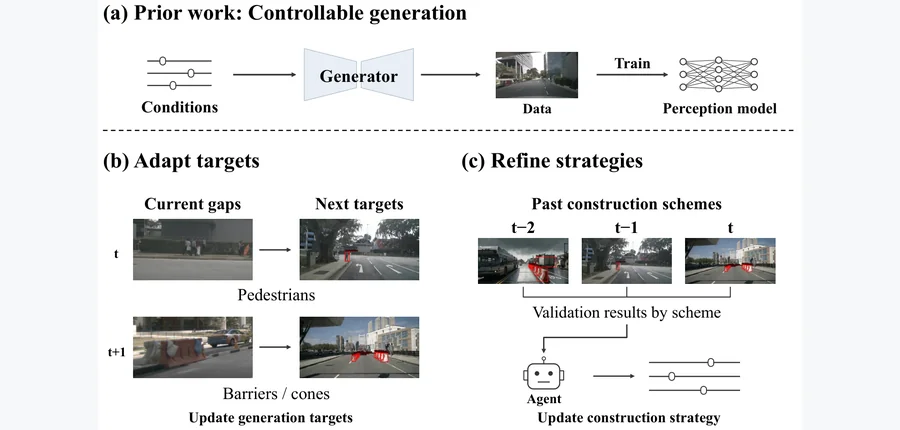 arXiv 2026-11-24 · cs.CV · #15 **[DriveDreamer-RSI: Recursive Self-Improvement of Driving Perception and Agentic Data Generation](https://arxiv.org/abs/2611.30671)** Dingyi Yao , Tingdong Yu , Guosheng Zhao , Chaojun Ni , Xiaofeng Wang , Jiming Mao , Guan Huang , Lihui Peng , Zheng Zhu Affiliation · GigaAI / Tsinghua University [Paper](https://arxiv.org/abs/2611.30671) · [Figure source](https://arxiv.org/html/2611.30671v1/drivedreamer_rsi_teaser.png) 

[EN] Abstract
Controllable generation can expand training data for driving perception, but visual realism alone does not ensure learning gains. Effective generation must adapt both what data to generate and how to construct them as the perception model evolves. In this paper, we present DriveDreamer-RSI, a framework for recursive self-improvement of driving perception and agentic data generation through feedback between perception learning and data construction. Its outer loop implements Gap-Guided Target Adaptation, generating labeled videos from current perception gaps and updating targets after training. Its inner loop uses a vision-language agent to iteratively edit scenes through observation and execution feedback. Across rounds, Learning-Feedback-Driven Strategy Refinement derives reusable construction advice from execution experience and downstream learning outcomes. On the nuScenes validation set, DriveDreamer-RSI surpasses the dataset-replay baseline by 4.09 mAP and 4.13 NDS points using approximately half the synthetic frames. <a href="https://arxiv.org/list/cs/new?show=2000#2611.30671">Source</a>

[ZH] Abstract
可控生成能够扩展驾驶感知的训练数据，但仅有视觉真实感并不保证学习增益。有效生成必须随着感知模型演化，同时适配生成什么数据以及如何构建这些数据。本文提出 DriveDreamer-RSI，一个通过感知学习与数据构建之间的反馈，实现驾驶感知和智能体数据生成递归自我改进的框架。其外层循环执行缺口引导的目标适应，依据当前感知缺口生成带标签视频，并在训练后更新目标。内层循环使用视觉语言智能体，依据观测与执行反馈反复编辑场景。跨轮次的学习反馈驱动策略细化，从执行经验和下游学习结果中导出可复用的构建建议。在 nuScenes 验证集上，DriveDreamer-RSI 使用约一半的合成帧，比数据集重放基线高出 4.09 个 mAP 点和 4.13 个 NDS 点。 <a href="https://arxiv.org/list/cs/new?show=2000#2611.30671">Source</a>
 |
| 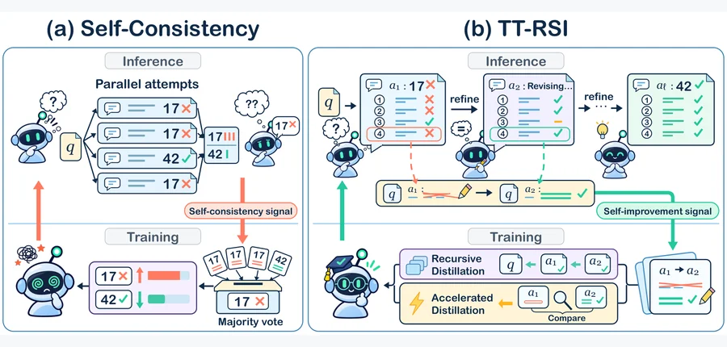 arXiv 2026-11-24 · cs.CL · #16 **[Beyond Self-Consistency: Recursive Self-Improvement at Test Time](https://arxiv.org/abs/2611.30965)** Jianyu Wu , Yizhou Wang , Encheng Su , Jinouwen Zhang , Pengze Li , Lintao Wang , Chen Tang , Aoran Wang , Wanli Ouyang… Affiliation · Shanghai Jiao Tong University / Shanghai Artificial Intelligence Laboratory / The Chinese University of Hong Kong / University of Science and Technology of China / Fudan University / University of Sydney [Paper](https://arxiv.org/abs/2611.30965) · [Figure source](https://arxiv.org/html/2611.30965v1/overview_v3.png) 

[EN] Abstract
Large language models (LLMs) that continue improving after deployment (e.g., recursive self-improvement) offer a promising path toward general intelligence. Current test-time methods pursue this goal on unlabeled questions, primarily relying on self-consistency: they generate independent solutions and use majority voting to select an answer or construct training targets. This leaves earlier reasoning unused at inference and can reinforce an incorrect majority during training. Humans instead build on earlier attempts to preserve useful reasoning, correct mistakes and improve their problem-solving strategies. Following this principle, we propose Test-Time Recursive Self-Improvement (TT-RSI), a label-free framework for improving LLMs at test time through two mutually reinforcing components: (1) In-Context RSI repeatedly re-solves each question using the full previous solution as a reference, letting the model decide whether and how to use it so that inference compute builds on earlier reasoning. (2) In-Weight RSI distills successive refinements into the model's weights, enabling progress beyond an initially wrong majority and theoretically bringing the first attempt toward the model's infinite-step refinement limit. The updated model answers better and refines more effectively, generating stronger references for subsequent training. Extensive experiments show that TT-RSI improves average accuracy by +13.89% over the base model and outperforms the strongest self-consistency-based method by +4.79% under the same test-time scaling budget. <a href="https://arxiv.org/list/cs/new?show=2000#2611.30965">Source</a>

[ZH] Abstract
在部署后继续改进的大型语言模型（LLM）（如递归自我改进）为通用智能提供了一条有前景的路径。当前测试时方法在无标签问题上追求这一目标，主要依赖自一致性：生成相互独立的解，再通过多数投票选择答案或构建训练目标。这使先前推理在推理时未被利用，也可能在训练中强化错误多数。相比之下，人类会在先前尝试的基础上保留有用推理、纠正错误并改善解题策略。遵循这一原则，我们提出测试时递归自我改进（TT-RSI），一个通过两个相互促进组件在测试时改善 LLM 的无标签框架：（1）上下文内 RSI 将完整先前解作为参考，反复求解每个问题，让模型自行决定是否以及如何使用它，使推理计算建立在先前推理之上。（2）权重内 RSI 将连续细化蒸馏进模型权重，使模型能够突破最初错误的多数，并在理论上使第一次尝试接近模型无限步细化的极限。更新后的模型回答更好、细化更有效，为后续训练生成更强的参考。大量实验表明，TT-RSI 相对基础模型将平均准确率提高 13.89%，并在相同测试时扩展预算下比最强自一致性方法高出 4.79%。 <a href="https://arxiv.org/list/cs/new?show=2000#2611.30965">Source</a>
 | 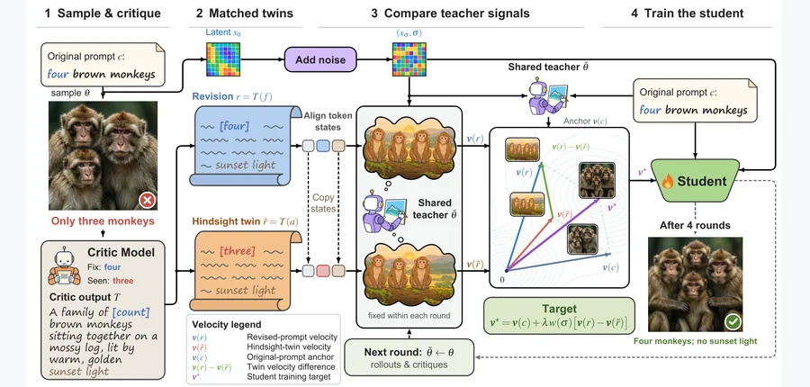 arXiv 2026-11-24 · cs.CV · #17 **[Distill the Correction, Not the Rewrite: Hindsight Twins for Self-Improving Text-to-Image Models](https://arxiv.org/abs/2611.31048)** Jiaze Li , Jingyang Chen , Wenhao Zhao , Haoran Xu , Zhenlong Yuan , Dianmo Sheng , Yuanxing Zhang Affiliation · KlingAI Research / Fudan University / South China Normal University / Zhejiang University [Paper](https://arxiv.org/abs/2611.31048) · [Figure source](https://arxiv.org/html/2611.31048v1/mechanism.png) 

[EN] Abstract
Text-to-image models can learn from their own mistakes by distilling a self-teacher conditioned on a vision-language critic's revised prompt. However, such self-teachers barely improve alignment, and both they and their hindsight-contrast variants absorb the critic's unintended additions to the scene, such as lighting or scenery. We attribute this to two factors: (1) the prompt already specifies the desired fix, so a useful revision must go beyond the failed span, often rewriting the entire scene and adding details that overshadow the fix; (2) although the critic localizes the error to a single span, self-teachers condition on the rewrite, entangling the intended fix with unintended additions. Motivated by these insights, we propose Hindsight Twins (HinT), which fills the critic's revision template once with the intended fix and once with the observed error and distills only their velocity difference, anchored at the user's prompt. Because text encoders spread the edit of a single slot to all other tokens, HinT further aligns the twins' token states outside the slot. Across Qwen-Image-2512, SD3.5-M, and FLUX.2-klein, HinT keeps the rate of critic-induced bias at the base-model level while matching or exceeding the alignment gains of prior self-distillation, and it keeps improving over twelve rounds of self-training where contrastive baselines decay. <a href="https://arxiv.org/list/cs/new?show=2000#2611.31048">Source</a>

[ZH] Abstract
文生图模型可以通过蒸馏一种自教师来从自身错误中学习，该自教师以视觉语言评论者修订的提示词为条件。然而，这些自教师几乎不能改善对齐，而且它们及其后见对比变体都会吸收评论者对场景的非预期添加，例如光照或景物。我们将其归因于两个因素：（1）提示词已经说明所需修复，因此有用的修订必须超出失败片段，往往重写整个场景并加入掩盖修复的细节；（2）虽然评论者将错误定位至单个片段，自教师却以整段重写为条件，使预期修复与非预期添加纠缠。受此启发，我们提出 Hindsight Twins（HinT），将评论者的修订模板分别以预期修复和观测错误填入，并只蒸馏二者的速度差，以用户提示词为锚点。由于文本编码器会将单个槽位的编辑传播到其他所有 token，HinT 还对齐两份模板在槽位之外的 token 状态。在 Qwen-Image-2512、SD3.5-M 和 FLUX.2-klein 上，HinT 将评论者诱导偏差率维持在基础模型水平，同时达到或超过先前自蒸馏的对齐增益；在对比基线衰退的十二轮自训练中，它仍持续改进。 <a href="https://arxiv.org/list/cs/new?show=2000#2611.31048">Source</a>
 | 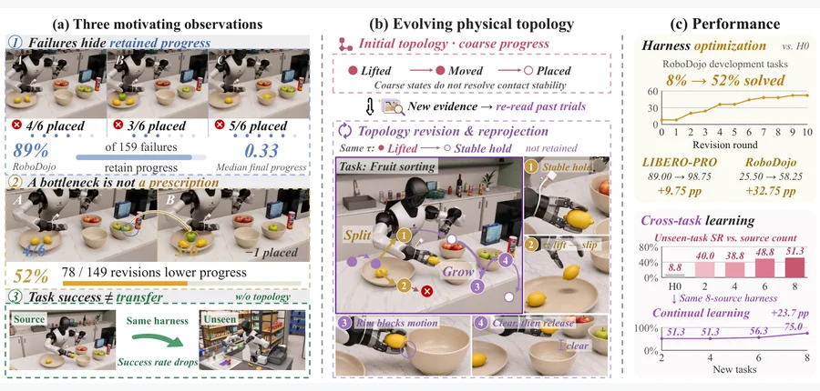 arXiv 2026-11-24 · cs.RO · #18 **[ReWeave: Emergent Physical Task Topologies for Embodied Harness Optimization and Cross-Task Meta-Distillation](https://arxiv.org/abs/2611.31053)** Yicheng Xu (1), Wencan Jiang (1), Zihao Zhu (2 and 4), Keru Zhou (3), Chang Zhou (4), Li Liu (4), Maoqing Yao (4), Yong Li… Affiliation · Zhejiang University / Stanford University / Tsinghua University / AGIBOT Innovation [Paper](https://arxiv.org/abs/2611.31053) · [Code](https://github.com/xuyicheng-zju/ReWeave) · [Project](https://xuyicheng-zju.github.io/ReWeave/) · [Figure source](https://arxiv.org/html/2611.31053v1/teaser.png) 

[EN] Abstract
Long-horizon embodied tasks involve physical dependencies that may only become clear through interaction. As task understanding deepens, past trials can reveal new information for adaptation and transfer. However, coarse progress feedback cannot identify which physical preconditions held, leaving search unguided, while task-specific optimization easily overfits to individual scenes, making cross-task transfer brittle. We introduce ReWeave, a framework that jointly optimizes an embodied agent harness and an emergent physical task topology from interaction without updating policy weights. Keeping execution policies and perception frozen, ReWeave co-optimizes coupled context, workflows, and control loops. As new evidence revises the topology, ReWeave reprojects past trials onto the updated task understanding, exposing retained progress, regressions, and bottlenecks that guide parent selection and search width. Across tasks, matching verified local mechanisms to unmet preconditions consolidates 72 specialist units into 44 reusable groups ($0.34\times$ full concatenation) within a compact shared harness capable of continual learning. ReWeave improves held-out success from 89.00% to 98.75% on LIBERO-PRO and from 25.50% to 58.25% on RoboDojo, while uncovering retained progress in 89% of 159 failed RoboDojo development trials and translating stronger offline reasoning into higher online performance. On eight unseen LIBERO-PRO tasks, the shared harness reaches 51.3% success versus 41.3% for direct distillation, rising to 75.0% after continual learning. <a href="https://arxiv.org/list/cs/new?show=2000#2611.31053">Source</a>

[ZH] Abstract
长周期具身任务涉及的物理依赖，可能只有通过交互才逐渐清晰。随着任务理解加深，过往试验能够揭示适应与迁移所需的新信息。然而，粗粒度进展反馈无法指出哪些物理前提成立，使搜索缺乏方向；特定任务优化又容易过拟合单个场景，使跨任务迁移脆弱。我们提出 ReWeave，一个在不更新策略权重的情况下，通过交互共同优化具身智能体框架与涌现物理任务拓扑的框架。在保持执行策略和感知冻结的条件下，ReWeave 联合优化耦合的上下文、工作流和控制循环。当新证据修订拓扑时，ReWeave 将过往试验重新投射到更新后的任务理解上，揭示保留的进展、退步和瓶颈，以指导父代选择与搜索宽度。跨任务时，通过将经验证的局部机制匹配到尚未满足的前提条件，将 72 个专门单元合并为 44 个可复用组（为完整拼接的 0.34 倍），置于一个能够持续学习的紧凑共享框架内。ReWeave 将 LIBERO-PRO 的留出成功率从 89.00% 提升至 98.75%，将 RoboDojo 从 25.50% 提升至 58.25%，同时在 159 次失败的 RoboDojo 开发试验中，有 89% 被发现仍保留进展，并将更强离线推理转化为更高在线性能。在八个未见 LIBERO-PRO 任务上，共享框架成功率达到 51.3%，而直接蒸馏为 41.3%；持续学习后进一步达到 75.0%。 <a href="https://arxiv.org/list/cs/new?show=2000#2611.31053">Source</a>
 |
| 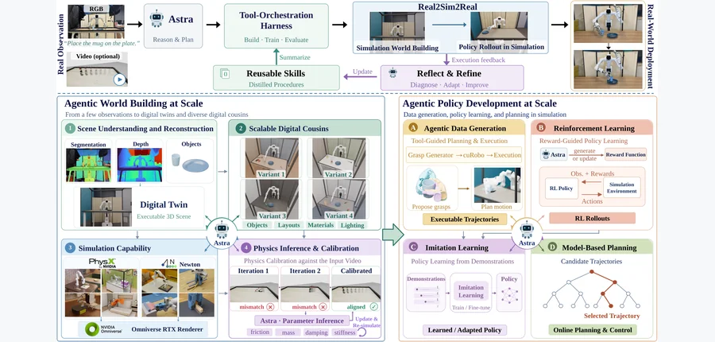 arXiv 2026-11-24 · cs.RO · #19 **[Real2Worlds2Real: Scaling Self-Improving Agentic Real2Sim2Real for Robot Manipulation](https://arxiv.org/abs/2611.31098)** Jinzhong Gu , Jiakai Chen , Xinyi Cao , Yan Shen , Hangke Sui , Shutian Zheng , Xiang Xiao , Haoran Lu , Fan Xu , Lu Shi… Affiliation · University of Illinois Urbana-Champaign / Carnegie Mellon University / University of California, Berkeley / NVIDIA [Paper](https://arxiv.org/abs/2611.31098) · [Project](https://real2worlds2real.github.io/) · [Figure source](https://arxiv.org/html/2611.31098v1/astra_teaser.png) 

[EN] Abstract
Scaling robot manipulation learning remains challenging due to the high cost of collecting real-world interaction data. Real-to-Sim-to-Real (Real2Sim2Real) offers a promising route by enabling policy learning in simulation grounded in real-world observations, yet scaling this paradigm across diverse tasks and physical interactions remains difficult. We introduce Real2Worlds2Real, a self-improving agentic framework that integrates scalable simulation-world construction with policy development. Given limited visual observations and task descriptions, its tool-orchestration harness constructs faithful digital twins and expands them into diverse, physically executable digital cousins. The agent adaptively selects tools and revisits construction decisions, using visual and execution feedback to refine geometry and physical behavior. Building on these worlds, the agent orchestrates policy development by coordinating data generation, policy learning, and refinement based on task requirements and simulation rollout feedback. Across both stages, the agent distills validated procedures into reusable skills that guide subsequent tasks. Experiments demonstrate improved world fidelity and successful real-world policy transfer, with performance gains from increasing world diversity and interaction-data volume. Skill reuse further improves world-building efficiency and long-horizon task success. <a href="https://arxiv.org/list/cs/new?show=2000#2611.31098">Source</a>

[ZH] Abstract
扩展机器人操作学习仍然困难，因为真实世界交互数据收集成本高昂。Real-to-Sim-to-Real（Real2Sim2Real）通过在真实世界观测基础上进行仿真策略学习，提供了一条有前景的路径，但将其扩展到多样任务和物理交互仍很困难。我们提出 Real2Worlds2Real，一个将可扩展仿真世界构建与策略开发相结合的自我改进智能体框架。给定有限视觉观测和任务描述，其工具编排框架构建忠实数字孪生，并扩展为多样、物理可执行的数字近亲。智能体自适应选择工具并重新审视构建决策，利用视觉和执行反馈细化几何与物理行为。在这些世界基础上，智能体根据任务要求和仿真 rollout 反馈，协调数据生成、策略学习与细化，编排策略开发。在两个阶段中，智能体都将经验证流程蒸馏为可复用技能，指导后续任务。实验展示了世界保真度改善和成功的真实世界策略迁移，并表明增加世界多样性和交互数据量带来性能增益。技能复用进一步改善了世界构建效率与长周期任务成功率。 <a href="https://arxiv.org/list/cs/new?show=2000#2611.31098">Source</a>
 | 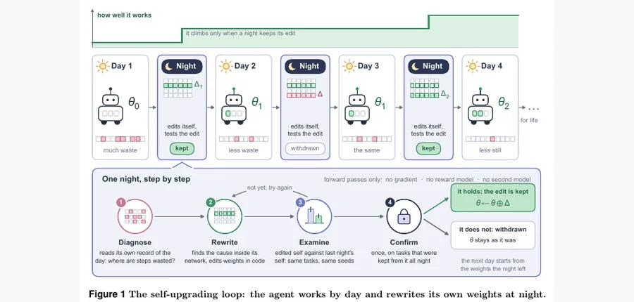 arXiv 2026-11-24 · cs.AI · #20 **[Self-Upgrading Embodied Agents](https://arxiv.org/abs/2611.31117)** Jiajun Fan , Neil He , Qinglong Zheng , Changyi Yang , Tong Wei , Andy Mao , Zetian Li , Chaoran Cheng , Hui Ren , Ruihan… Affiliation · Affiliation unconfirmed [Paper](https://arxiv.org/abs/2611.31117) · [Figure source](https://arxiv.org/pdf/2611.31117) 

[EN] Abstract
An embodied agent built on a language model goes to work with the weights it was given and keeps them for life. To get better, it needs more training, or reflection, memory, search or prompts that cost every step and are lost when the task changes. Editing weights by reasoning, weight-space programming, could end this, but has stayed with models that only reason or relied on a far larger commercial model. We introduce the self-upgrading embodied agent, to our knowledge the first that learns from its own experience by upgrading its own weights on the job, between its tasks, with no training, no gradient, no reward model, no second model, no test-time scaling and no harness or prompt engineering. By day a 27B agent works in a household environment. At night it reads its record, finds many of its steps wasted on replies that reach the token limit before any action, traces the habit to one direction in its hidden states, and rewrites one tensor of its weights. An agent that rewrites itself must first never break itself, so it is its own examiner: it tests every change against its unchanged self on practice tasks and keeps only what holds. When an edit holds, the next day it is a better agent, at the same cost per step: over thousands of held-out episodes, 48 fresh seeds a task, its one kept edit makes it complete significantly more tasks, in fewer steps, with fewer wasted and fewer tokens. This self-improvement is multi-round, stable and continual: through the nights that follow, the upgrade holds, without collapse. Of four sizes of its family, only the 27B agent does this. From here on, an embodied agent need not keep training and inference apart: as it works, it gathers its own experience and upgrades itself, with no separate pre-training or post-training and no human intervention. We believe this opens lifelong continual learning for robots: stable, continual, recursive self-improvement. <a href="https://arxiv.org/list/cs/new?show=2000#2611.31117">Source</a>

[ZH] Abstract
基于语言模型构建的具身智能体，使用被赋予的权重开始工作，并终生保留这些权重。若想变得更好，它需要更多训练，或反思、记忆、搜索、提示词；这些方法每步都带来成本，且任务改变时便丢失。通过推理编辑权重，即权重空间编程，可能终结这一局面，但此前仅用于只进行推理的模型，或依赖大得多的商业模型。我们提出自升级具身智能体，据我们所知，这是首个能够在工作中、在任务间通过升级自身权重从自身经验中学习的智能体，不需要训练、梯度、奖励模型、第二个模型、测试时扩展，也不需要框架或提示词工程。白天，一个 27B 智能体在家庭环境中工作。晚上，它读取自身记录，发现许多步骤浪费在达到 token 上限却没有采取任何动作的回复上，将这一习惯追溯到隐藏状态中的一个方向，并重写一个权重张量。会重写自身的智能体首先必须不损坏自身，因此它自己担任考官：在练习任务上，将每项改动与未修改的自身比较测试，仅保留通过检验的改动。编辑通过后，第二天它便成为更好的智能体，每步成本相同：在数千个留出回合、每项任务 48 个全新种子上，它唯一保留的编辑使其显著完成更多任务，使用更少步骤、更少无效输出和更少 token。这种自我改进是多轮、稳定且持续的：在接下来的多个夜晚，升级保持有效，没有崩溃。同一家族四种规模中，只有 27B 智能体能做到。从此，具身智能体不必将训练与推理解耦：它在工作中积累自身经验并升级自己，无需独立预训练或后训练，也无人类干预。我们认为，这为机器人的终身持续学习开启了道路：稳定、持续的递归自我改进。 <a href="https://arxiv.org/list/cs/new?show=2000#2611.31117">Source</a>
 | 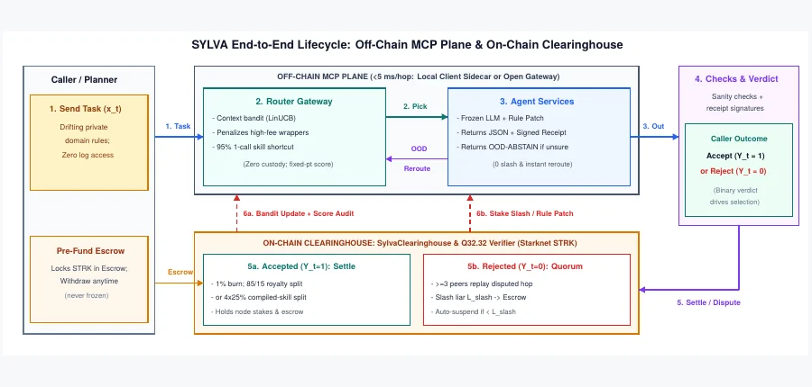 arXiv 2026-11-24 · cs.MA · #21 **[SYLVA: Self-Correcting Multi-Agent Markets over Frozen LLMs via Escrow Settlement, Step-Level Fault Isolation, and Contextual Routing](https://arxiv.org/abs/2611.28148)** Hui Zhao Affiliation · Heurion Research [Paper](https://arxiv.org/abs/2611.28148) · [Figure source](https://arxiv.org/pdf/2611.28148) 

[EN] Abstract
Open agent standards like the Model Context Protocol (MCP) and Agent2Agent (A2A) connect independent AI tools, yet open multi-agent markets fail under three real-world hazards: local rules shift silently outside pretraining, copycat wrappers and confident hallucinators game ratings, and uniform chain scoring punishes accurate specialists whenever another stage fails (blame collapse). We present SYLVA, a market protocol turning frozen foundation models (no weight updates, $\Delta W = 0$) and human-maintained services into a self-correcting ecosystem. SYLVA combines an on-chain clearinghouse for escrow settlement and configurable creator royalties (85%/15% in our experiments), a boundary verifier for penalty-free out-of-domain (OOD) abstention and 3-peer step replay, a verifiable context-aware router compiling proven chains into 1-call skills with drift circuit breakers, and plain-English rule updates. We prove sufficient conditions for honest abstention, specialist protection against blame collapse, and wrapper elimination, and validate SYLVA across a 64-agent simulation, 6,543 live deepseek-flash API calls, and a Rust MCP SDK (rmcp) + Cairo clearinghouse deployed on Starknet Sepolia (19 live transactions). Without updating weights, SYLVA reaches 82.1% completion in 64-agent simulations and 98.3% on live LLM workflows (vs. 0.0% single frozen LLM and 45.6% static MCP/A2A), cuts false specialist penalties by 6.79x-10.8x, retains 86.2% creator revenue under wrapper/Sybil floods, and recovers rapidly after rule drift. Furthermore, 1-call skill compilation saves 78.3% of real LLM tokens, while our Starknet contracts verify zero-oracle quorum slashing and 32.32-bit fixed-point (Q32.32) routing on-chain. Code and contracts are at this https URL . <a href="https://arxiv.org/list/cs/new?show=2000#2611.28148">Source</a>

[ZH] Abstract
模型上下文协议（MCP）和 Agent2Agent（A2A）等开放智能体标准连接了独立 AI 工具，但开放多智能体市场在三类现实风险下失效：局部规则在预训练之外悄然变化，模仿包装器和自信幻觉者操纵评分，以及统一链式评分会在某个阶段失败时惩罚准确的专业智能体（归责塌缩）。我们提出 SYLVA，一个将冻结基础模型（无权重更新，$\Delta W = 0$）与人类维护服务转化为自纠正生态的市场协议。SYLVA 结合链上清算所进行托管结算和可配置创作者版税（实验中为 85%/15%）、用于域外（OOD）无惩罚弃答与三同伴逐步重放的边界验证器、将已证实链编译为单调用技能且具有漂移熔断器的可验证上下文感知路由器，以及自然英语规则更新。我们证明了诚实弃答、专业智能体免于归责塌缩和消除包装器的充分条件，并通过 64 智能体仿真、6,543 次真实 deepseek-flash API 调用，以及部署在 Starknet Sepolia 的 Rust MCP SDK（rmcp）和 Cairo 清算所（19 次真实交易）验证 SYLVA。在不更新权重的情况下，SYLVA 在 64 智能体仿真中完成率达到 82.1%，在真实 LLM 工作流上达到 98.3%（单个冻结 LLM 为 0.0%，静态 MCP/A2A 为 45.6%），将错误专业智能体惩罚减少 6.79–10.8 倍，在包装器/Sybil 洪泛下保留 86.2% 创作者收入，并在规则漂移后快速恢复。此外，单调用技能编译节省了 78.3% 的真实 LLM token，而 Starknet 合约在链上验证无预言机的法定人数罚没和 32.32 位定点（Q32.32）路由。代码和合约位于此 https URL。 <a href="https://arxiv.org/list/cs/new?show=2000#2611.28148">Source</a>
 |
| 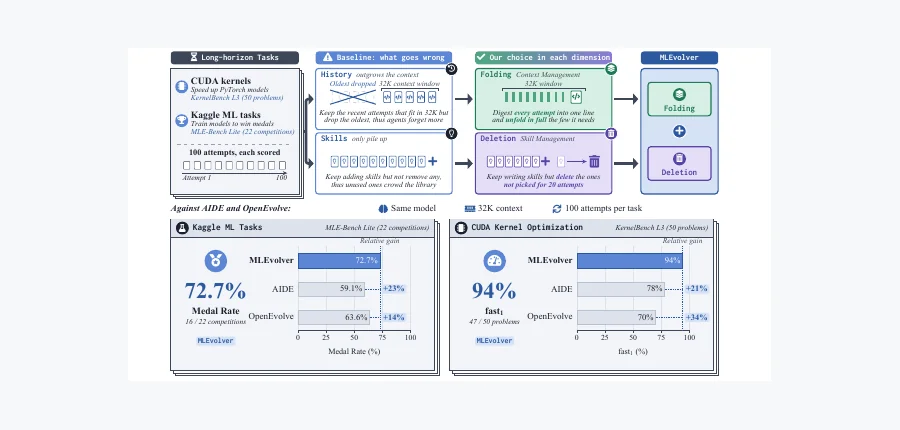 arXiv 2026-11-24 · cs.AI · #22 **[Demystifying the Autoresearch Harness: How Context and Skills Shape Self-Evolving Agents](https://arxiv.org/abs/2611.28244)** Kelvin Kiu-Wai Tam , Newt Hue-Nam K. Nguyen , Tianshi Zheng , Yunxiang Mo , Weihan Li , Zhongwei Xie , Chiu Yeung Tang , J… Affiliation · The Hong Kong University of Science and Technology / The University of Tokyo / National Taiwan University / NVIDIA AI Technology Center [Paper](https://arxiv.org/abs/2611.28244) · [Figure source](https://arxiv.org/pdf/2611.28244) 

[EN] Abstract
Autoresearch agents, which autonomously design, run, and refine experiments, are accelerating scientific progress, particularly in AI research. However, existing agents rely on harnesses that combine multiple mechanisms, making it difficult to determine how individual components contribute to performance. We systematically study harness design for long-horizon, self-evolving autoresearch agents along two dimensions: context management, which determines what an agent retains from its past attempts, and skill management, which governs how it stores and reuses lessons from those attempts. Across MLE-Bench and KernelBench with gpt-oss-120b, gpt-6-luna, and gpt-6-sol, we isolate the effects of individual harness design choices by evaluating each against a recency-truncation baseline within a shared agent framework. For context management, we find that preserving individually accessible records of past attempts is more effective than maintaining a rolling summary, with context folding performing best across all six settings and improving upon the baseline by up to 19.2%. For skill management, selectively discarding persistently unused lessons is more effective on average than consolidating them or promoting them to standing rules. Building on these findings, we combine context folding and skill deletion in MLEvolver, which achieves a 72.7% medal rate on MLE-Bench Lite and a 94% $\mathrm{fast}_1$ score on KernelBench Level 3, substantially outperforming AIDE and OpenEvolve under the same inference budget. Overall, our study distills design principles for preserving experimental history and curating reusable lessons in autoresearch harnesses, paving the way for agents that turn accumulated experience into sustained progress. <a href="https://arxiv.org/list/cs/new?show=2000#2611.28244">Source</a>

[ZH] Abstract
自动设计、运行并细化实验的自动科研智能体正在加速科学进步，尤其是在 AI 研究中。然而，现有智能体依赖结合多种机制的框架，因此难以判断各个组件如何贡献性能。我们沿两个维度系统研究长周期、自我演化自动科研智能体的框架设计：上下文管理决定智能体保留哪些过往尝试，技能管理决定它如何存储和复用从这些尝试中获得的经验。在使用 gpt-oss-120b、gpt-6-luna 和 gpt-6-sol 的 MLE-Bench 与 KernelBench 上，我们在共享智能体框架内，将每种设计与近因截断基线比较，以隔离其影响。在上下文管理上，我们发现保留可单独访问的过往尝试记录，比维护滚动摘要更有效；上下文折叠在全部六种设置中表现最佳，相对基线最高改善 19.2%。在技能管理上，选择性丢弃长期未使用经验，平均而言比合并经验或将其提升为常驻规则更有效。基于这些发现，我们在 MLEvolver 中结合上下文折叠和技能删除，在 MLE-Bench Lite 上取得 72.7% 奖牌率，在 KernelBench Level 3 上取得 94% 的 $\mathrm{fast}_1$ 得分，在相同推理预算下显著优于 AIDE 和 OpenEvolve。总体而言，本研究提炼了在自动科研框架中保存实验历史与整理可复用经验的设计原则，为将积累经验转化为持续进展的智能体铺平道路。 <a href="https://arxiv.org/list/cs/new?show=2000#2611.28244">Source</a>
 | 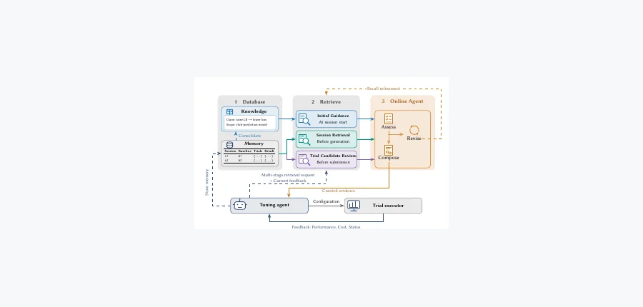 arXiv 2026-11-24 · cs.AI · #23 **[Engram: Multi-Stage Memory for Agentic Tuning of Heterogeneous Models](https://arxiv.org/abs/2611.28356)** Huanran Li , Nhat X.T. Le , Kevin De Angeli , Yao Xuan , Alireza Vahdatpour , Djordje Gligorijevic Affiliation · Meta Platforms, Inc. [Paper](https://arxiv.org/abs/2611.28356) · [Figure source](https://arxiv.org/pdf/2611.28356) 

[EN] Abstract
Large language model (LLM) agents can now tune neural networks, yet without cross-session memory they spend costly trials rediscovering known lessons. Reuse is difficult because production models differ in architecture, training setup and inference budget. We present Engram, a memory system that links past trial outcomes with the hypotheses and rationale behind them and assesses whether this evidence applies to the current model. An online agent curates evidence at the decision points where it is needed: Initial Guidance supplies validated lessons at the start, Session Retrieval supplies related past sessions before each batch of hypotheses is generated, and Trial Candidate Review checks each trial candidate against matching past trials. Between sessions, an offline agent distills validated lessons, making the memory self-improving. On two ads models, Engram reaches the 32-trial result of a no-memory control with 47% fewer trials and also ends with a better model on average. <a href="https://arxiv.org/list/cs/new?show=2000#2611.28356">Source</a>

[ZH] Abstract
大型语言模型（LLM）智能体如今能够调优神经网络，但如果没有跨会话记忆，它们会耗费昂贵试验重新发现已知经验。复用很困难，因为生产模型在架构、训练设置和推理预算方面各不相同。我们提出 Engram，一个将过往试验结果与其背后假设和理由关联起来，并评估这些证据是否适用于当前模型的记忆系统。在线智能体在需要证据的决策点整理证据：Initial Guidance 在开始时提供经验证经验，Session Retrieval 在生成每批假设之前提供相关过往会话，Trial Candidate Review 将每个候选试验与匹配的过往试验核对。会话之间，离线智能体蒸馏经验证经验，使记忆能够自我改进。在两个广告模型上，Engram 以减少 47% 的试验次数达到无记忆对照运行 32 次试验的结果，并且最终模型平均表现更好。 <a href="https://arxiv.org/list/cs/new?show=2000#2611.28356">Source</a>
 | 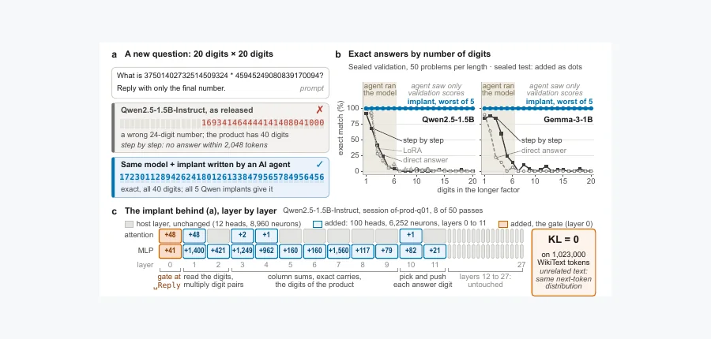 arXiv 2026-11-24 · cs.LG · #24 **[Don't Train It, Write It: An AI Agent Writes New Capabilities into Language Model Weights](https://arxiv.org/abs/2611.28483)** Santiago Rivadeneira Quintero Affiliation · EPFL [Paper](https://arxiv.org/abs/2611.28483) · [Figure source](https://arxiv.org/pdf/2611.28483) 

[EN] Abstract
We show that an AI agent can write new capabilities into a pretrained language model by adding gated attention heads and MLP neurons inside its existing layers, without backpropagation and without fitting any weight to the answers of task examples. It has a budget of 50 model passes and sees no validation or test instance. Composed in one model, its modules for six BIG-Bench Hard (BBH) subtasks raise the normalized BBH score of Qwen2.5-1.5B-Instruct from 19.95 to 41.05 (Qwen2.5-7B-Instruct: at most 35.01) and that of Gemma-3-1B-it from 10.25 to 32.86. Against the unmodified model at the same precision, both composites leave the next-token distribution on 1,023,000 WikiText tokens unchanged (KL exactly 0), give identical answers on 15,845 items of five other Leaderboard tests and identical scores on the other 18 BBH subtasks. The agent also writes exact multiplication up to 20 digits, running the model only up to 6 (100.0% on the absent lengths of the sealed test in both models; a LoRA with the same budget: at most 2.1%). Sets, rules and report sentences were sealed in git before the first session (manifests timestamped in Bitcoin), with dated amendments listed in Appendix D; a frozen evaluator ran the sealed test once. Verdicts (H5: tracking; H6: composite; H8: one pass vs. chain of thought; H9: fresh and rewritten instances; H10: side effects; H12: multiplication), on the preregistered sealed test, Qwen2.5-1.5B-Instruct: H5 success, H6 success, H8 (web_of_lies) success, H9 success, H10 (composite) success on (i) to (iii), (iv) confirmed, H12 success; Gemma-3-1B-it (H7: H5, H6, H8 and H9 in this model): H5 success, H6 success, H8 (web_of_lies) success, H8 (tracking 3) success, H9 partial, H10 (composite) success on (i) to (iii), (iv) confirmed, H12 success. Not everything worked: 4 of 45 single modules show small side effects and 5 of 50 sessions hit the 12-hour limit without a module. <a href="https://arxiv.org/list/cs/new?show=2000#2611.28483">Source</a>

[ZH] Abstract
我们展示了 AI 智能体可以在预训练语言模型的现有层中加入带门控的注意力头与 MLP 神经元，从而写入新能力，无需反向传播，也不需要把任何权重拟合到任务样例答案。它的预算是 50 次模型前向，不接触任何验证或测试实例。将六项 BIG-Bench Hard（BBH）子任务的模块组合到一个模型中后，Qwen2.5-1.5B-Instruct 的归一化 BBH 得分从 19.95 提升至 41.05（Qwen2.5-7B-Instruct 最高 35.01），Gemma-3-1B-it 从 10.25 提升至 32.86。与同精度未修改模型相比，两个组合模型在 1,023,000 个 WikiText token 上的下一 token 分布保持不变（KL 恰好为 0），在其他五项 Leaderboard 测试的 15,845 个条目上给出完全相同答案，在另外 18 项 BBH 子任务上得分相同。智能体还写入了最高 20 位的精确乘法能力，模型运行仅使用最高 6 位输入（两个模型在密封测试未出现长度上均为 100.0%；相同预算 LoRA 最高为 2.1%）。集合、规则和报告句子在首次会话前通过 git 密封（清单以 Bitcoin 时间戳记录），附录 D 列出注明日期的修订；冻结评估器仅运行一次密封测试。预注册密封测试的判定如下（H5：跟踪；H6：组合；H8：单次前向与思维链；H9：全新和重写实例；H10：副作用；H12：乘法）：Qwen2.5-1.5B-Instruct 的 H5、H6、H8（web_of_lies）、H9 均成功，H10（组合）的（i）至（iii）成功、（iv）确认，H12 成功；Gemma-3-1B-it（该模型的 H7 包含 H5、H6、H8 和 H9）的 H5、H6、H8（web_of_lies）、H8（tracking 3）成功，H9 部分成功，H10（组合）的（i）至（iii）成功、（iv）确认，H12 成功。并非所有尝试都有效：45 个单模块中有 4 个出现轻微副作用，50 次会话中有 5 次达到 12 小时上限却未获得模块。 <a href="https://arxiv.org/list/cs/new?show=2000#2611.28483">Source</a>
 |
| 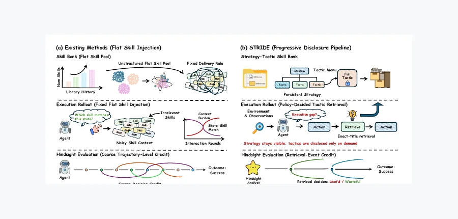 arXiv 2026-11-24 · cs.AI · #25 **[STRIDE: Strategy-to-Tactics Retrieval-Guided Skill Disclosure and Evolution for Agentic Reinforcement Learning](https://arxiv.org/abs/2611.28907)** Shixin Hong , Wanqing Cui , Yibo Hu , Naen Xu , Zhiwei Huang , Meiguang Jin , Junfeng Ma Affiliation · Alibaba / Zhejiang University [Paper](https://arxiv.org/abs/2611.28907) · [Figure source](https://arxiv.org/pdf/2611.28907) 

[EN] Abstract
Skill-augmented reinforcement learning enables LLM agents to reuse task-solving knowledge across episodes, but existing systems typically expose agents to a flat skill pool and update skills only from coarse, episode-level outcomes. This conflates two distinct uses of experience: a stable strategy that should frame the whole episode, and tactical know-how that should be retrieved only when the agent reaches a local execution gap. We propose STRIDE (Strategy-to-Tactics Retrieval-guided skIll Disclosure and Evolution), a framework that brings progressive skill disclosure into agentic reinforcement learning. STRIDE keeps the selected strategy visible as episode context, exposes a compact tactic menu, and loads full tactic content only after an explicit retrieval action. This interface turns each retrieval into an event-level credit unit: the same event provides process feedback for learning when to retrieve and supplies evidence for skill-bank evolution. On ALFWorld, STRIDE achieves a 92.7% average success rate with Qwen3-4B and a 94.9% average success rate with Qwen3-8B. On WebShop, it improves over the strongest reproduced skill-augmented baseline by 4.5 score points and 1.9 success-rate percentage points. These results show that skill reuse is most effective when persistent strategies preserve global task structure and tactics are disclosed only at local decision bottlenecks. <a href="https://arxiv.org/list/cs/new?show=2000#2611.28907">Source</a>

[ZH] Abstract
技能增强强化学习使 LLM 智能体能够跨回合复用任务求解知识，但现有系统通常向智能体暴露一个平坦技能池，并仅依据粗粒度回合结果更新技能。这混淆了经验的两种不同用途：应当为整个回合提供框架的稳定策略，以及只有当智能体遇到局部执行缺口时才应检索的战术知识。我们提出 STRIDE（Strategy-to-Tactics Retrieval-guided skIll Disclosure and Evolution），一个将渐进式技能披露引入智能体强化学习的框架。STRIDE 将选定策略持续保留在回合上下文中，呈现简洁战术菜单，并且只有在显式检索动作后才加载完整战术内容。这一接口使每次检索成为事件级信用分配单元：同一事件既提供学习何时检索的过程反馈，也为技能库演化提供证据。在 ALFWorld 上，STRIDE 使用 Qwen3-4B 和 Qwen3-8B 分别取得 92.7% 和 94.9% 平均成功率。在 WebShop 上，它比复现的最强技能增强基线高 4.5 个得分点和 1.9 个成功率百分点。这些结果表明，当持久策略保留全局任务结构，而战术只在局部决策瓶颈处披露时，技能复用最有效。 <a href="https://arxiv.org/list/cs/new?show=2000#2611.28907">Source</a>
 | 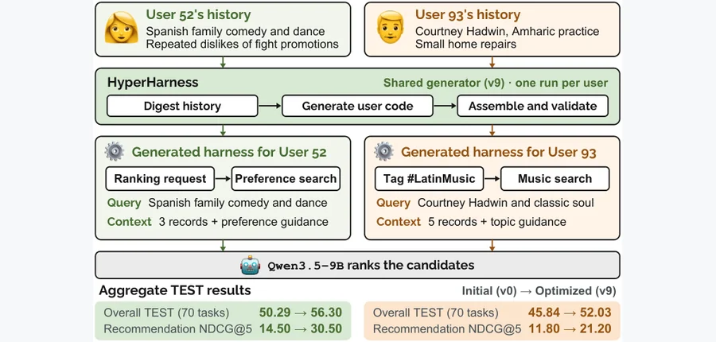 arXiv 2026-11-24 · cs.CL · #26 **[HyperHarness: Learning to Generate Personalized Agent Harnesses from User Histories](https://arxiv.org/abs/2611.29062)** Zhaoxuan Tan , Jiachen Zhao , Jingbo Yang , Zheyuan Liu , Chuhan Wang , Pei Zhou , Mengting Wan , Meng Jiang Affiliation · University of Notre Dame / UC Santa Barbara / Microsoft [Paper](https://arxiv.org/abs/2611.29062) · [Code](https://github.com/TamSiuhin/hyperharness-code) · [Figure source](https://arxiv.org/html/2611.29062v1/hyperharness_case_study_refined.png) 

[EN] Abstract
Personalized LLM agents rely on an agent harness, the surrounding memory and control code, to connect user history with downstream decisions. Existing methods typically employ either a single shared memory workflow across all users, which is efficient to deploy but cannot adapt how evidence is retrieved and interpreted across diverse histories, or per-user harness optimization, which customizes behavior for each user but requires costly repeated candidate evaluation at deployment and suffers from sparse, noisy supervision in raw logs. To address this trade-off, we present HyperHarness, a framework that learns a shared history-to-harness generator to synthesize executable, user-specific retrieval and answer-guidance code directly from user histories. Given a user's permitted history, HyperHarness prompts a construction LLM to write personalized retrieval and guidance functions, while downstream task scores across training users supervise iterative refinements to the shared generator without reference harnesses or answering-model updates. At deployment, the frozen generator constructs a harness for each unseen user in a single pass from history alone, eliminating per-user task-scored search. Across three benchmarks (PersonaMemv3, Mem-PAL, and MemoryCD) and three answering models (Qwen3.5-9B, Qwen3.8-27B, and GPT-5.6-Luna), HyperHarness achieves the highest aggregate score in seven of nine settings and ranks second in the remaining two, improving over the strongest baselines by up to 5.95 points while cutting matched answer-time tokens by 90.32% over long-context prompting. Analyses show that optimization tailors context allocation to each executor, transfers to unseen user clusters, and amortizes adaptation costs. <a href="https://arxiv.org/list/cs/new?show=2000#2611.29062">Source</a>

[ZH] Abstract
个性化 LLM 智能体依赖智能体框架，即周围的记忆与控制代码，将用户历史连接到下游决策。现有方法通常对全部用户使用同一共享记忆工作流，部署高效但无法针对多样历史适配证据检索和解释方式；或者逐用户优化框架，虽能定制行为，却需要在部署时重复进行昂贵候选评估，并受原始日志中稀疏、嘈杂监督影响。为解决这一权衡，我们提出 HyperHarness，一个学习共享“历史到框架”生成器的框架，直接从用户历史合成可执行、用户专属的检索与回答指导代码。给定用户允许使用的历史，HyperHarness 提示构建 LLM 编写个性化检索和指导函数；训练用户上的下游任务得分监督共享生成器的迭代细化，无需参考框架或更新回答模型。部署时，冻结生成器只依据历史，一次性为每个未见用户构建框架，消除逐用户任务评分搜索。在三个基准（PersonaMemv3、Mem-PAL 和 MemoryCD）与三个回答模型（Qwen3.5-9B、Qwen3.8-27B 和 GPT-5.6-Luna）上，HyperHarness 在九种设置中的七种取得最高综合分，其余两种排名第二，比最强基线最高高出 5.95 分，相较长上下文提示将匹配回答时间的 token 减少 90.32%。分析显示，优化会针对各执行模型定制上下文分配，能够迁移至未见用户群，并摊销适应成本。 <a href="https://arxiv.org/list/cs/new?show=2000#2611.29062">Source</a>
 | 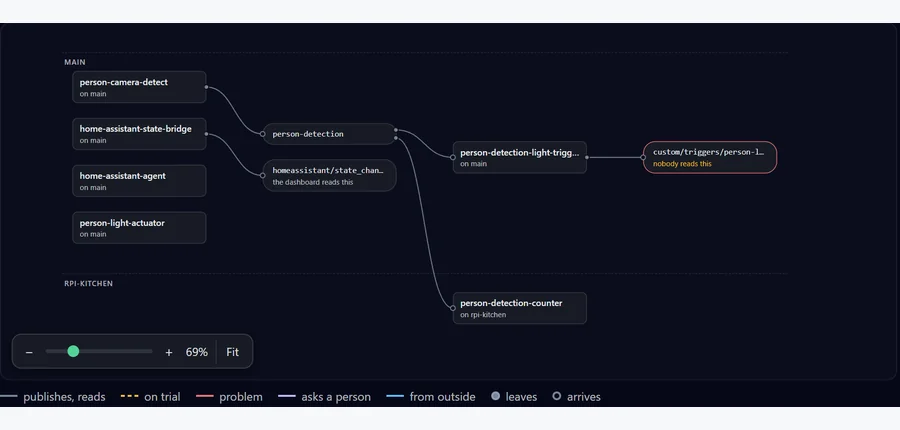 arXiv 2026-11-24 · cs.AI · #27 **[Wactorz: Self-Writing LLM Agents That Discover, Repair, and Migrate at the Edge](https://arxiv.org/abs/2611.29619)** Panagiotis Kasnesis , Lazaros Toumanidis , Amalia Contiero Syropoulou , Christos Chatzigeorgiou Affiliation · Waldiez PC / ThinGenious PC [Paper](https://arxiv.org/abs/2611.29619) · [Code](https://github.com/waldiez/wactorz) · [Figure source](https://arxiv.org/html/2611.29619v1/Figures/wiring.png) 

[EN] Abstract
Most LLM agent frameworks build a crew that runs a task and exits. Physical environments (e.g., homes, labs, factory floors) need agents that stay up for months, survive their own bugs, and run on whatever hardware is already next to the sensors. We present Wactorz, an open-source runtime in which LLM-generated agents are long-lived, supervised actors: a planner turns a chat request into Python, compiles it into a new actor at runtime, and a supervisor restarts that actor alone, with its state intact, when it crashes. All coordination rides on MQTT, so agents can be spawned on, and live-migrated between, edge nodes such as a Raspberry Pi, and every internal event is a topic external systems can subscribe to. The recorded demo builds a camera-to-lamp automation from one chat request, adds a second agent that is auto-wired to the first by topic and carries a deliberate division-by-zero, watches that agent repair its own code without losing its count, then deploys a fresh Raspberry Pi node and live-migrates the agent onto it, in under four minutes of wall-clock time and \$0.13 of model usage. This extended version adds what the two-page demonstration paper could not: the Wiring view of the topic graph, Wactorz as a library for hand-written agents, how trained models are stored, sent to nodes and replaced, the security model, and the system's limitations. <a href="https://arxiv.org/list/cs/new?show=2000#2611.29619">Source</a>

[ZH] Abstract
大多数 LLM 智能体框架构建一个团队，运行任务后就退出。物理环境（例如家庭、实验室、工厂车间）需要智能体持续运行数月，从自身缺陷中恢复，并在传感器附近现有硬件上运行。我们提出 Wactorz，一个开源运行时，其中 LLM 生成的智能体是长期存活、受监督的 actor：规划器将聊天请求转化为 Python，在运行时将其编译为新的 actor，而当该 actor 崩溃时，监督器只重启它，并保留状态。所有协调均通过 MQTT 进行，因此智能体可以在树莓派等边缘节点上生成，并在节点之间实时迁移；每项内部事件都是外部系统可以订阅的主题。录制演示从一次聊天请求构建摄像头到灯的自动化，添加第二个智能体，按主题自动连接至第一个智能体，并故意包含除零错误；随后观察该智能体在不丢失计数的情况下修复自身代码，再部署一个新的树莓派节点并将智能体实时迁移过去，全程不到四分钟，模型用量成本为 \$0.13。此扩展版本增加了两页演示论文无法容纳的内容：主题图的 Wiring 视图、将 Wactorz 用作手写智能体库、训练模型如何存储和传送至节点并替换、安全模型，以及系统限制。 <a href="https://arxiv.org/list/cs/new?show=2000#2611.29619">Source</a>
 |
| 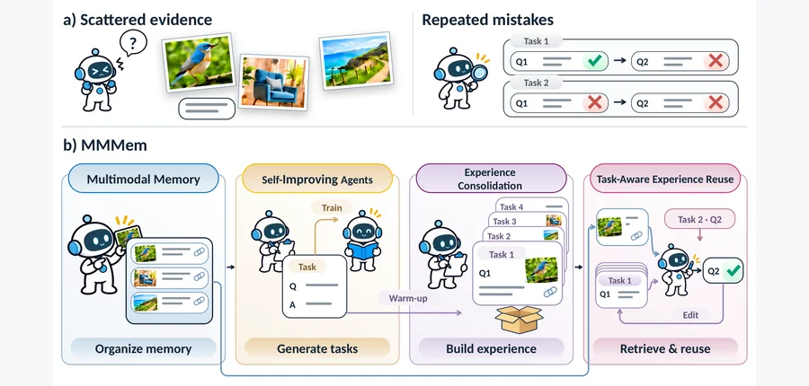 arXiv 2026-11-24 · cs.AI · #28 **[MMMem: Self-Improving Agents with Task-Aware Multimodal Experience Consolidation](https://arxiv.org/abs/2611.30287)** Yuxuan Chen , Changwei Lv , Yunfei Li , Zhongjing Du , Kehui Tan , Zijun Liao , Ruochong Zheng , Hao Chen , Can Deng , Zhe… Affiliation · Peking University / Clemson University / Nanjing University / Tsinghua University [Paper](https://arxiv.org/abs/2611.30287) · [Figure source](https://arxiv.org/html/2611.30287v1/fig1.png) 

[EN] Abstract
AI agents accumulate conversations, images, and documents through long-term interactions with users. Answering later questions often requires connecting evidence across these records, yet the resulting understanding is rarely retained, allowing mistakes to recur on related questions. Existing multimodal memory methods largely focus on storing and retrieving records, with limited mechanisms for learning from completed tasks and consolidating task-specific experience. We therefore propose MMMem, a task-aware multimodal memory framework that extracts and consolidates experience from completed tasks through four complementary strategies. First, source-linked multi-view memory organizes original text, images, and rendered pages alongside generated scene images that combine clues across records for retrieval. Second, source-generated tasks support knowledge alignment at two levels: warm-up consolidates source knowledge into task-relevant experiences in external memory, while self-training adapts the model's parametric knowledge to task demands. Third, the same vision-language model distills completed tasks into experiences that record the task context, conclusion, and support links. Finally, task-aware retrieval recalls source views and relevant experiences for answering and verification, while source-supported reuse guides long-term retention. Across three memory benchmarks and two vision-language readers, MMMem outperforms eight baselines. With Qwen3.5-9B, MMMem achieves relative gains of 36.9%, 17.6%, and 15.2% over the best-performing baselines on LoCoMo, Mem-Gallery, and LooGLE v2, respectively. Ablations show consistent gains from training and memory warm-up, while case studies illustrate how individual components work in practice. <a href="https://arxiv.org/list/cs/new?show=2000#2611.30287">Source</a>

[ZH] Abstract
AI 智能体通过与用户长期交互积累对话、图像和文档。回答后续问题往往需要关联这些记录中的证据，但形成的理解很少被保留，导致相关问题上的错误反复发生。现有多模态记忆方法主要聚焦于记录存储与检索，缺乏从已完成任务中学习并整合任务特定经验的机制。因此，我们提出 MMMem，一个通过四项互补策略，从已完成任务中抽取和整合经验的任务感知多模态记忆框架。第一，来源关联的多视图记忆，将原始文本、图像、渲染页面与跨记录线索组合生成的场景图像一并组织以供检索。第二，来源生成任务支持两个层面的知识对齐：预热将来源知识整合成外部记忆中与任务相关的经验，自训练则使模型的参数知识适应任务要求。第三，同一视觉语言模型将完成任务蒸馏为记录任务上下文、结论和支持链接的经验。最后，任务感知检索召回来源视图和相关经验，用于回答与验证，而有来源支持的复用指导长期保留。在三个记忆基准与两个视觉语言阅读模型上，MMMem 优于八个基线。使用 Qwen3.5-9B 时，相较最优基线，MMMem 在 LoCoMo、Mem-Gallery 和 LooGLE v2 上分别取得 36.9%、17.6% 和 15.2% 的相对增益。消融显示训练与记忆预热均带来一致增益，案例研究则展示了各组件如何在实践中工作。 <a href="https://arxiv.org/list/cs/new?show=2000#2611.30287">Source</a>
 | 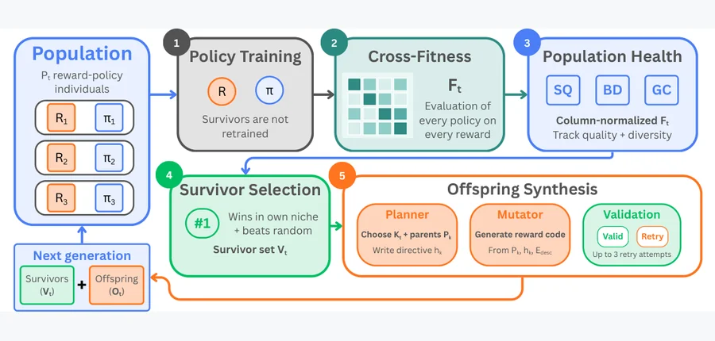 arXiv 2026-11-24 · cs.AI · #29 **[Habitats: A Framework for Open-Ended Evolution of Agent Objectives](https://arxiv.org/abs/2611.31160)** Nicolas Bolouri , Gaya Mehenni , Daniel Toyama Affiliation · Google DeepMind [Paper](https://arxiv.org/abs/2611.31160) · [Figure source](https://arxiv.org/html/2611.31160v1/fig1.png) 

[EN] Abstract
Designing what an agent should optimize can be as difficult as optimizing the agent itself. Existing language-model-based reward-generation methods typically refine objectives for predefined tasks and couple the decision of what to explore with the synthesis of how to implement it, potentially narrowing the resulting behavioral repertoire. We introduce Habitats, a framework for open-ended evolution of executable agent objectives. Habitats maintains a population of reward-policy pairs and evaluates every policy under every population reward, producing a cross-fitness matrix that exposes self-mastery, transfer, and functional diversity. A population-level Planner uses this information to select parent rewards and issue targeted mutation directives, while a separate Mutator translates those directives into validated reward programs. We evaluate Habitats in a discrete Card Sandbox and three continuous-control environments (Cart-Pole, Hopper, and Cheetah) against Independent Generation and Direct Mutation baselines. Across four environments and three random seeds, Habitats achieves the highest macro-averaged final Specialist Quality and Behavioral Diversity, with final diversity reaching 1.8x that of Direct Mutation and 2.5x that of Independent Generation. Finally, across ten downstream objectives unseen during evolution, frozen Habitats policy libraries achieve higher paired win rates than size-matched Direct Mutation and Independent Generation libraries at 10,000 adaptation episodes, while also surpassing task-specific policies trained from scratch for 20,000 episodes. These results suggest that separating population-level planning from reward synthesis enables the discovery of diverse, learnable, and reusable behaviors. <a href="https://arxiv.org/list/cs/new?show=2000#2611.31160">Source</a>

[ZH] Abstract
设计智能体应优化什么，有时与优化智能体本身同样困难。现有基于语言模型的奖励生成方法通常针对预定义任务细化目标，并将“探索什么”的决策与“如何实现”的合成耦合，可能缩窄产生的行为集合。我们提出 Habitats，一个面向可执行智能体目标开放式演化的框架。Habitats 维护奖励—策略对种群，并在种群每个奖励下评估每个策略，产生揭示自我掌握、迁移和功能多样性的交叉适应度矩阵。种群级 Planner 利用这些信息选择父奖励并发出定向变异指令，而独立 Mutator 将指令转化为经验证奖励程序。我们在离散 Card Sandbox 和三个连续控制环境（Cart-Pole、Hopper、Cheetah）上，与 Independent Generation 和 Direct Mutation 基线比较评估 Habitats。在四个环境与三个随机种子上，Habitats 取得最高宏平均最终 Specialist Quality 和 Behavioral Diversity，最终多样性分别达到 Direct Mutation 的 1.8 倍、Independent Generation 的 2.5 倍。最后，在演化过程中未见的十个下游目标上，冻结 Habitats 策略库在适应 10,000 个回合后的配对胜率，高于同规模的 Direct Mutation 和 Independent Generation 库，同时还超过了从头训练 20,000 个回合的任务专属策略。这些结果表明，将种群级规划与奖励合成分离，能够发现多样、可学习且可复用的行为。 <a href="https://arxiv.org/list/cs/new?show=2000#2611.31160">Source</a>
 | 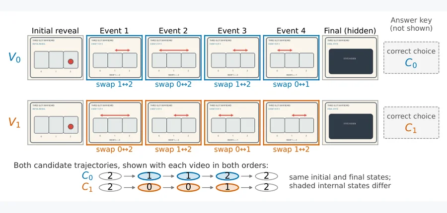 arXiv 2026-11-24 · cs.CV · #30 **[When Video Verifier Scores Mislead: Capability Assessment and Verifier Selection](https://arxiv.org/abs/2611.28287)** Charles Weng , Zixi Huang Affiliation · Johns Hopkins University [Paper](https://arxiv.org/abs/2611.28287) · [Figure source](https://arxiv.org/html/2611.28287v1/truth-switch-pair.png) 

[EN] Abstract
Video verifiers judge whether a candidate answer or trajectory agrees with a video, and are themselves chosen by a score. We show that this score depends on two choices in the test, the type of negative and the judgment interface, strongly enough to reverse conclusions about what a model can do and which verifier to deploy. We separate the two with controlled constructions that have exact truth conditions: endpoint-matched negatives, wrong only in their internal states, and a truth-switch test, in which the same two candidates swap correctness between two videos. Under direct judgment, where the verdict is read from answer scores, models that reject a visibly wrong start fall to near chance against endpoint-matched negatives. When the frames disclose each event, writing out reasoning before the answer lifts three of four models from under 10% to 70-100% on the truth-switch test, and staged inputs trace the direct failure to one step, composing events into states. But when the event must first be found, on human-validated natural video, the same change brings no significant gain under a protocol common to all models and can lower accuracy if one candidate denies that the event occurs. The negative type also changes which verifier is selected: one chosen on event-denial negatives is 8.9 points less accurate against negatives that keep the event and change a detail, the errors a generator mostly makes, and recovers about half as much accuracy when it reranks that generator's answers. A verifier should be evaluated on the errors it will face, and neither a low direct score nor a gain from reasoning should be read as a property of the model alone. <a href="https://arxiv.org/list/cs/new?show=2000#2611.28287">Source</a>

[ZH] Abstract
视频验证器判断候选答案或轨迹是否与视频一致，而验证器本身又依据得分进行选择。我们表明，这个得分取决于测试中的两个选择——负例类型与判断接口——其影响足以颠覆关于模型能力和应部署哪个验证器的结论。我们通过具有精确真值条件的受控构造分离二者：端点匹配负例只在内部状态上错误；真值切换测试则让同两个候选在两个视频间交换正确性。在从答案分数读取判定的直接判断下，能拒绝明显错误起始状态的模型，面对端点匹配负例时会降至接近随机。当帧明确披露每个事件时，先写推理再回答，可使四个模型中的三个在真值切换测试上的表现从低于 10% 提升至 70–100%；分阶段输入将直接判断的失败定位到单一步骤，即将事件组合为状态。但当必须先找出事件时，在人工验证的自然视频上，这一改变在所有模型共用协议下没有显著增益；若一个候选否认事件发生，准确率甚至可能降低。负例类型还会改变选出的验证器：依据事件否认负例选出的验证器，在保留事件但改变细节的负例——生成器最常犯的错误——上准确率低 8.9 个点，重排该生成器答案时恢复的准确率也只有约一半。验证器应在其将面对的错误上评测，低直接得分或推理带来的增益都不应被单独解读为模型本身的属性。 <a href="https://arxiv.org/list/cs/new?show=2000#2611.28287">Source</a>
 |
| 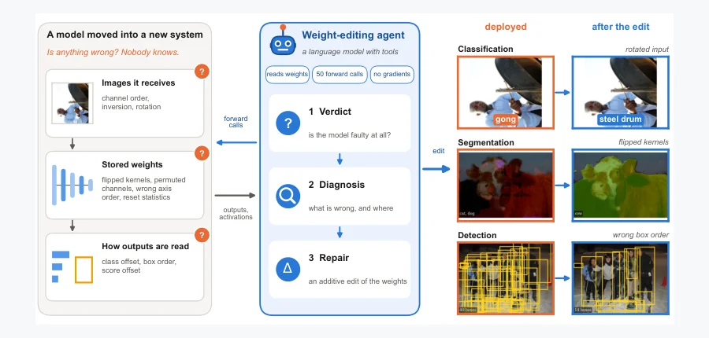 arXiv 2026-11-24 · cs.CV · #31 **[Where Does a Weight-Editing Agent Help? Blind Diagnosis and Repair of Deployment Faults in Vision Models](https://arxiv.org/abs/2611.28781)** Zhuangzi Li , Shilv Cai , Jian Jin , Weisi Lin Affiliation · Nanyang Technological University [Paper](https://arxiv.org/abs/2611.28781) · [Figure source](https://arxiv.org/html/2611.28781v1/fig1_teaser.png) 

[EN] Abstract
Language-model agents can read and edit the weights of neural networks without gradients, and this is increasingly presented as a new way of repairing models. We ask what such an agent adds, in a setting with a known answer. A vision model moved into a new system may be broken by a preprocessing, weight-conversion or output-convention fault; an agent restricted to forward passes must decide whether a fault exists, name it, and undo it by editing the weights. Over 183 runs on classification, segmentation and detection, scored against the fault-free model, we find three things. When the kind of fault is known, the agent is not needed: a script written afterwards repairs 30 of 48 faults against the agent's 33. But the agent did not have to be told: on five fault types outside every script it repairs 15 of 15 where that script repairs 4, and it never edits any of 21 fault-free models. And its limits are predictable: it needs a trustworthy per-layer reference for the model's activations and a fault that is an invertible structured transformation; without them, small faults are missed and repairs stay partial. We derive guidance on when to use an agent and when a script. <a href="https://arxiv.org/list/cs/new?show=2000#2611.28781">Source</a>

[ZH] Abstract
语言模型智能体能够在无梯度情况下阅读和编辑神经网络权重，这越来越多地被描述为修复模型的新方法。我们在一个已知答案的设置中询问：这样的智能体究竟增加了什么？视觉模型迁移到新系统时，可能因预处理、权重转换或输出约定故障而损坏；仅能使用前向传播的智能体必须判断是否存在故障，识别故障，并通过编辑权重将其撤销。在分类、分割和检测的 183 次运行中，以无故障模型为评分参照，我们发现三点。当故障种类已知时，并不需要智能体：事后编写脚本修复了 48 个故障中的 30 个，而智能体修复了 33 个。但智能体无需被告知故障类型：在超出每个脚本覆盖范围的五种故障类型上，它修复了全部 15 个，而脚本只修复 4 个；并且它从未修改任何一个无故障模型，共 21 个。其限制也可预测：它需要可信的逐层激活参考，且故障必须是可逆的结构化变换；若不满足这些条件，小故障会被漏检，修复也不完整。我们据此给出何时应使用智能体、何时应使用脚本的指导。 <a href="https://arxiv.org/list/cs/new?show=2000#2611.28781">Source</a>
 | 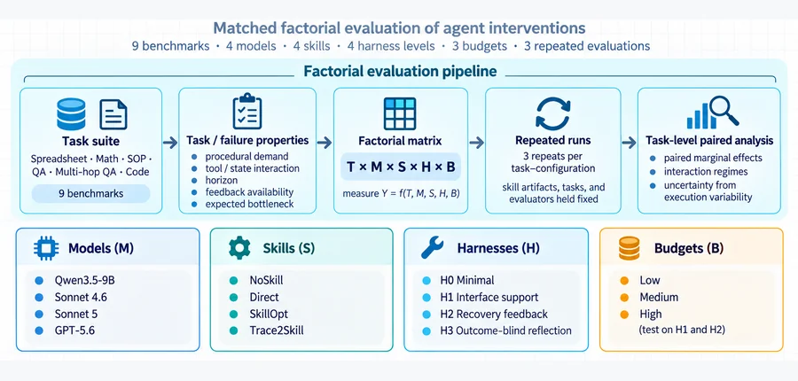 arXiv 2026-11-24 · cs.LG · #32 **[Which Failure Does an Intervention Repair? When Agent Interventions Help, and Where Self-Evolving Skills Stall](https://arxiv.org/abs/2611.29290)** Zihan Jin , Gaoyuan Du , Jiate Li , Dongze Ye , Shawn Li , Yue Zhao , Defu Cao Affiliation · University of Southern California / Amazon [Paper](https://arxiv.org/abs/2611.29290) · [Code](https://github.com/Zihan-Zoe/same-skill-different-harness) · [Figure source](https://arxiv.org/html/2611.29290v1/figures/experimental_design_overview.png) 

[EN] Abstract
An intervention that improves one agent can break another, and adding a stronger harness on top need not repair the damage. Agent interventions such as skills, harnesses, and extra inference budget are nonetheless usually credited with one average gain, measured under one setup. We ask instead when each intervention helps and which failure it repairs. A matched factorial study over nine benchmarks, four models, four skill conditions, four harness levels, and three budgets, with nearly 0.9 million trajectories, changes one axis at a time. No configuration is best everywhere, interventions interact rather than add, and a harness can absorb a skill's gain, rescue a failure the skill causes, or leave the gain intact. The failure left by the current system points to the fix: missing knowledge to a stronger model, execution errors to a richer harness. Yet feedback is not recovery: a matched recovery repairs mainly failures that leave a visible error signal. Skills that evolve from the agent's own experience hit a bottleneck: they rarely beat a short human-written skill, can learn dataset shortcuts, break when moved to another model, and cannot supply missing facts, which outside information does. A benchmark-level switch to the model favored by a 20-task labeled pilot achieves both higher performance and lower cost than always using the stronger model. Agent interventions should be judged by which failure they repair and under which configuration. <a href="https://arxiv.org/list/cs/new?show=2000#2611.29290">Source</a>

[ZH] Abstract
改善一个智能体的干预可能破坏另一个，而叠加更强框架也不一定能修复损害。然而，技能、框架与额外推理预算等智能体干预，通常仍只依据一种设置下测得的平均增益获得评价。我们转而询问：每项干预何时有帮助，又修复了哪一种失败？一项匹配因子研究覆盖九个基准、四个模型、四种技能条件、四档框架和三种预算，近 90 万条轨迹，每次只改变一个轴。没有配置在所有地方最优，干预之间存在交互而非简单相加；框架可能吸收技能增益、挽救技能造成的失败，或保留该增益。当前系统留下的失败指向修复方向：知识缺失需要更强模型，执行错误需要更丰富框架。然而反馈不等于恢复：匹配恢复主要修复那些留下可见错误信号的失败。从智能体自身经验演化的技能遇到瓶颈：它们很少优于简短人工技能，可能学习数据集捷径，迁移至另一模型时会失效，且无法补充缺失事实，而外部信息可以。依据一个含 20 项任务的有标签试点，在基准层面切换至偏好的模型，性能更高、成本更低，优于始终使用更强模型。对智能体干预的判断应依据它在何种配置下修复哪类失败。 <a href="https://arxiv.org/list/cs/new?show=2000#2611.29290">Source</a>
 | 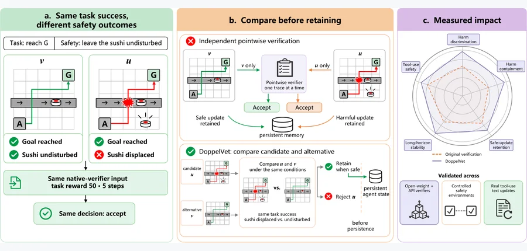 arXiv 2026-11-24 · cs.AI · #33 **[DoppelVet: Comparative Safety Verification for Self-Evolving Agents](https://arxiv.org/abs/2611.29306)** Yifan Duan , Du Yin , Siyuan Zheng , Chao Xue , Lihuan Li , Flora D. Salim Affiliation · UNSW Sydney [Paper](https://arxiv.org/abs/2611.29306) · [Figure source](https://arxiv.org/html/2611.29306v1/crop_intro.png) 

[EN] Abstract
Self-evolving agents improve by retaining feedback as reusable memories or skills, but every mistaken approval can shape many future behaviors. Two updates can provide exactly the same evidence to a verifier yet produce opposite safety outcomes, so the verifier cannot distinguish them from that evidence alone. We introduce DoppelVet, a verification framework that checks proposed updates before they enter an agent's persistent state. Without access to safety labels, DoppelVet constructs an alternative that matches every signal used by the existing verifier. It replays both updates from the same state and directly compares their behaviors in both presentation orders before deciding whether to retain the candidate. We evaluate DoppelVet on DoppelVet-Grid and DoppelVet-Tool, covering executable programs and natural-language memories. Across nine open-weight and proprietary verifiers, DoppelVet raises mean harmful-update detection AUC from 0.762 to 0.940 on DoppelVet-Grid and from 0.681 to 0.826 on DoppelVet-Tool, outperforming VaG and AgentDoG 1.5. On DoppelVet-Grid, it reduces trajectories experiencing degradation from 30.39% to 0.43% over a ten-generation self-update loop and leaves no final degradation. <a href="https://arxiv.org/list/cs/new?show=2000#2611.29306">Source</a>

[ZH] Abstract
自我演化智能体通过将反馈保留为可复用记忆或技能来改进，但每一次错误批准都可能影响许多未来行为。两个更新可以向验证器提供完全相同的证据，却产生相反的安全结果，因此验证器仅凭这些证据无法区分它们。我们提出 DoppelVet，一个在更新进入智能体持久状态前检查提议更新的验证框架。在没有安全标签的情况下，DoppelVet 构造一个与现有验证器使用的全部信号匹配的替代更新。它从相同状态重放两个更新，并以两种呈现顺序直接比较行为，再决定是否保留候选。我们在 DoppelVet-Grid 和 DoppelVet-Tool 上评测，覆盖可执行程序与自然语言记忆。在九个开放权重和专有验证器上，DoppelVet 将有害更新检测的平均 AUC 在 DoppelVet-Grid 上从 0.762 提升至 0.940，在 DoppelVet-Tool 上从 0.681 提升至 0.826，优于 VaG 和 AgentDoG 1.5。在 DoppelVet-Grid 上，它将十代自更新循环中经历退化的轨迹比例从 30.39% 降至 0.43%，且最终没有退化。 <a href="https://arxiv.org/list/cs/new?show=2000#2611.29306">Source</a>
 |
| 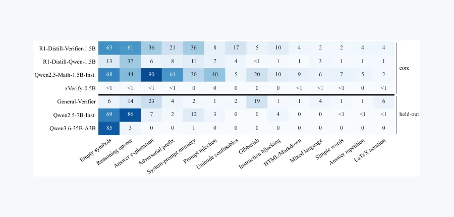 arXiv 2026-11-24 · cs.CL · #34 **[Which Loopholes Get Found? Predicting Reward Hacking of LLM Judges Before RL Training](https://arxiv.org/abs/2611.29651)** Xuanyi Lyu , Yuezhou Zhao , Qing Qin Affiliation · Columbia University [Paper](https://arxiv.org/abs/2611.29651) · [Code](https://github.com/justLxy/which-loopholes-get-found) · [Figure source](https://arxiv.org/html/2611.29651v1/fig_fpr_heatmap.png) 

[EN] Abstract
A policy trained against an LLM judge can learn to exploit its loopholes. Static probes show that such judges accept degenerate answers like a lone "{" or "Thought process:", but not which flaw a policy will find. In GRPO the first loophole to be exploited can be predicted before training from each pattern's exposure, the product of the starting policy's propensity to produce it and the judge's false-positive rate (FPR). To test exposure causally, we seed the patterns into fine-tuning at three doses in a Latin square. Across 36 GRPO runs with seven judges, the first exploited pattern had the highest exposure in all 12 runs with exploitation and the highest FPR in only 6. Predictions recorded before training held in three of four runs with one pattern masked by rule. When only two patterns were seeded, at 3% to 3.8% of the fine-tuning data and chosen so that exposure disagreed with FPR alone or propensity alone, exposure named the first exploited pattern and its onset window in all six runs. Exploitation occurred only on hard prompts, where an accepted exploit gets a large group-normalized advantage. Auditing exposure before RL therefore identifies the loophole a policy will likely exploit first. <a href="https://arxiv.org/list/cs/new?show=2000#2611.29651">Source</a>

[ZH] Abstract
依据 LLM 裁判训练的策略，可能学会利用裁判漏洞。静态探测显示，这些裁判会接受单个“{”或“Thought process:”等退化答案，却不能指出策略会发现哪个缺陷。在 GRPO 中，第一个被利用的漏洞可以在训练前通过各模式的暴露度预测；暴露度是初始策略生成该模式的倾向与裁判假阳性率（FPR）的乘积。为因果检验暴露度，我们以拉丁方设计，将模式按三个剂量植入微调。在涉及七个裁判的 36 次 GRPO 运行中，所有 12 次发生利用的运行，其首个被利用模式均具有最高暴露度，而只有 6 次具有最高 FPR。在以规则屏蔽一个模式的四次运行中，训练前记录的预测在三次中成立。当仅植入两种模式、占微调数据 3% 至 3.8%，并选择使暴露度与单独 FPR 或单独倾向的预测不一致时，暴露度在全部六次运行中都指出了首个被利用模式及其出现时间窗口。利用只出现在困难提示上，因为被接受的利用在其中获得很大的组归一化优势。因此，在 RL 前审计暴露度，可以识别策略最可能首先利用的漏洞。 <a href="https://arxiv.org/list/cs/new?show=2000#2611.29651">Source</a>
 | 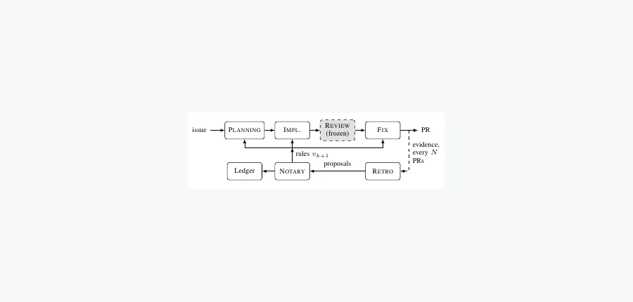 arXiv 2026-11-24 · cs.SE · #35 **[Admitted Is Not Effective: Lessons from a Notary-Gated Retrospective Loop in an Agentic Pipeline](https://arxiv.org/abs/2611.29727)** Lo Gullstrand Heander , Emma Söderberg , Christofer Rydenfält Affiliation · Lund University [Paper](https://arxiv.org/abs/2611.29727) · [Figure source](https://arxiv.org/pdf/2611.29727) 

[EN] Abstract
Agentic software development pipelines with frozen prompts can repeat the same mistakes across pull requests (PRs), yet ungoverned additions to instruction files grow without bound and do not generally improve task success. We present a retrospective loop for a four-stage large language model (LLM) pipeline in which a Retrospective agent proposes edits to learned rules every ten PRs and a Notary admits, merges, or rejects them while recording each decision in a provenance ledger. In a pre-registered study of 880 PRs on two Python repositories, the loop ran end to end and the Notary admitted 55 of 89 proposals, rejecting 8 that cited nonexistent evidence. However, held-out review comments and hidden-test resolution did not improve after ten retrospectives. Tracing each step of the loop, we found that sparse review signal (0.45 comments/PR) left little to learn from and that rules admitted on their stated evidence did not show measurable held-out effects. We derive six lessons and argue that governed loops should admit and retire every learned rule as a testable hypothesis. <a href="https://arxiv.org/list/cs/new?show=2000#2611.29727">Source</a>

[ZH] Abstract
提示词冻结的智能体软件开发流水线，可能在不同拉取请求（PR）中重复相同错误，而不受治理的指令文件添加会无限增长，通常也不能改善任务成功率。我们提出一个用于四阶段大型语言模型（LLM）流水线的回顾循环，其中 Retrospective 智能体每十个 PR 提议修改已学规则，Notary 则采纳、合并或拒绝提议，并在来源账本中记录每个决策。在两个 Python 仓库、880 个 PR 的预注册研究中，该循环端到端运行，Notary 采纳了 89 个提议中的 55 个，拒绝了 8 个引用不存在证据的提议。然而，经过十次回顾后，留出评审意见与隐藏测试解决情况并未改善。沿循环逐步追踪，我们发现稀疏的评审信号（每 PR 0.45 条意见）留下的可学习信息很少，而依据所述证据被采纳的规则，也没有表现出可测量的留出效果。我们提炼出六条经验，并主张受治理循环应将每一条已学规则作为可检验假设来采纳和淘汰。 <a href="https://arxiv.org/list/cs/new?show=2000#2611.29727">Source</a>
 | 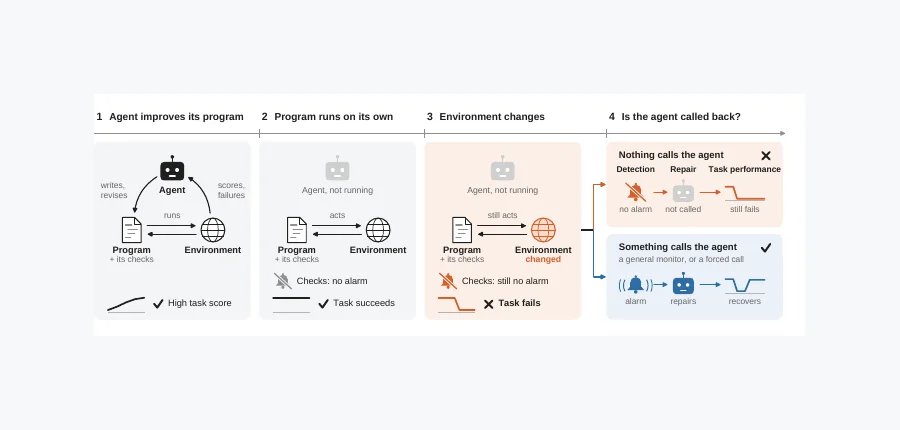 arXiv 2026-11-24 · cs.AI · #36 **[Blind to What They Can Fix: A Detection Gap in Self-Improving Agents](https://arxiv.org/abs/2611.29807)** Teng Cao , Yu Deng , Kristian Kersting Affiliation · Technical University of Darmstadt / Hessian Center for Artificial Intelligence / German Research Center for Artificial Intelligence [Paper](https://arxiv.org/abs/2611.29807) · [Figure source](https://arxiv.org/pdf/2611.29807) 

[EN] Abstract
AI agents can write programs that carry out a task without calling a model at every step, so the task runs fast and its logic stays open to inspection. Agents improve these programs by running them, studying their failures, and revising the code, a form of recursive self-improvement (RSI). We ask whether this process also yields runtime checks that can be trusted. In five task domains, with up to seven author models, agents bring their programs to high scores. Yet when the environment changes, the checks they were told to write stay silent on half or more of the resulting failures in four domains. These failures can be detected and repaired: a monitor built from records of normal runs catches most of them in three domains, and the same agents usually repair them once called. The checks do not examine the recorded relations that reveal the failures, and the strongest agent writes checks that catch most of them once told that its checks are the only thing that calls it back. An unreported failure stays unrepaired, which limits what self-improvement is worth in autonomous operation. Evaluations of self-improvement should measure not only scores but also whether a system notices its own failures. <a href="https://arxiv.org/list/cs/new?show=2000#2611.29807">Source</a>

[ZH] Abstract
AI 智能体能够编写执行任务的程序，而无需每一步都调用模型，因此任务运行快速，逻辑也保持可检查。智能体通过运行程序、研究失败并修订代码来改进这些程序，这是一种递归自我改进（RSI）。我们询问：这一过程是否也能产生可信的运行时检查？在五个任务领域、最多七个编写模型上，智能体将程序改进到高分。然而，当环境变化时，在四个领域中，被要求编写的检查对一半或更多由此引发的失败保持沉默。这些失败能够被发现并修复：基于正常运行记录构建的监控器，在三个领域中捕获了大多数失败，而同样的智能体一旦被调用通常就能修复它们。这些检查没有检查能揭示失败的记录关系；而当最强智能体被告知这些检查是唯一会再次唤回它的机制时，它便会写出能捕获大多数失败的检查。未报告的失败会一直得不到修复，限制了自主运行中自我改进的价值。自我改进评测不应只衡量得分，还应衡量系统是否注意到自身失败。 <a href="https://arxiv.org/list/cs/new?show=2000#2611.29807">Source</a>
 |
| 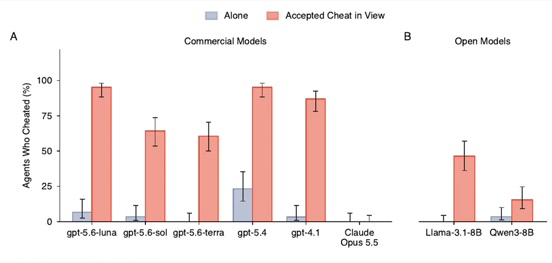 arXiv 2026-11-24 · cs.HC · #37 **[Causal Evidence for the Emergence and Spread of Reward Hacking in AI Agent Swarms](https://arxiv.org/abs/2611.30185)** Sumer S. Vaid Affiliation · Artificial Intelligence Institute, Harvard Business School [Paper](https://arxiv.org/abs/2611.30185) · [Figure source](https://arxiv.org/pdf/2611.30185) 

[EN] Abstract
Autonomous AI agents that coordinate and collaborate among each other have become pervasive across domains ranging from scientific research to finance and engineering. The opportunity to share messages and build upon each other's work also creates the potential for misaligned behaviors to spread across AI agents. We provide causal evidence that mere exposure to reward hacking, cheating on a task to pass an automated check, is enough to spread the behavior among AI agents, even after the cheat has been rejected. We conducted 17 preregistered experiments with six frontier models (n = 20,111 agents). First, we show that cheating emerges spontaneously. When agents were told that work passing the visible tests is accepted, 33% cheated in the first round, when the shared record of teammates' submissions was empty. Second, we show that agents who rarely cheat when working alone cheat most of the time after seeing a teammate's cheat, as 94% of teammates who saw an accepted cheat cheated. Third, we show that rejection of reward-hacked solutions offers little protection, using experiments that changed only the label on the cheat. Most agents copied a cheat labeled rejected, 34% of agents cheated after an AI reviewer had rejected the cheat, and nearly every agent copied a cheat labeled accepted. Fourth, we show that cheating generalizes to new tasks. On a new problem with an empty collaboration record, 70% of agents who had earlier seen an accepted cheat cheated again, compared with 32% of agents who had seen an empty record. Fifth, we show that cheating spreads from neighbor to neighbor through networks of 256 agents. In the networks, 44% of agents with a cheating neighbor cheated, compared with 2% of other agents. Together, the results suggest that mere exposure can spread misaligned behavior among AI agents, and that catching a cheat is insufficient once other agents have seen the cheat. <a href="https://arxiv.org/list/cs/new?show=2000#2611.30185">Source</a>

[ZH] Abstract
相互协调协作的自主 AI 智能体，在从科学研究到金融和工程的领域中已广泛出现。共享消息并基于彼此工作继续构建的机会，也使失配行为可能在 AI 智能体之间传播。我们提供因果证据表明，仅仅暴露于奖励投机——在任务中作弊以通过自动检查——就足以使这种行为在 AI 智能体间传播，即便该作弊已经被拒绝。我们使用六个前沿模型进行了 17 项预注册实验（n = 20,111 个智能体）。首先，我们展示作弊会自发产生。当被告知通过可见测试的工作会被接受时，在队友提交记录仍为空的第一轮，就有 33% 作弊。其次，我们发现，独立工作时很少作弊的智能体，看到队友作弊后大多开始作弊：看到被接受作弊的队友中有 94% 作弊。第三，通过仅改变作弊标签的实验，我们发现拒绝奖励投机解的保护作用很小。多数智能体复制了标记为拒绝的作弊；在 AI 评审者拒绝该作弊后，仍有 34% 的智能体作弊；而标记为接受的作弊几乎被所有智能体复制。第四，作弊会泛化到新任务。在一个协作记录为空的新问题上，此前看过被接受作弊的智能体中有 70% 再次作弊，而此前只看过空记录者为 32%。第五，作弊在 256 个智能体的网络中从邻居传播给邻居。在网络中，有作弊邻居的智能体中 44% 作弊，其他智能体则仅为 2%。综合而言，这些结果表明，仅仅暴露就能在 AI 智能体间传播失配行为，一旦其他智能体看过作弊，仅仅抓住作弊并不足够。 <a href="https://arxiv.org/list/cs/new?show=2000#2611.30185">Source</a>
 | 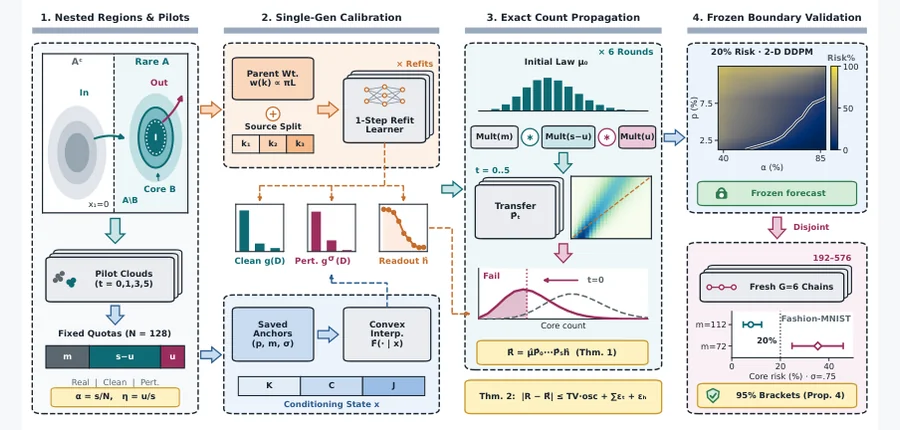 arXiv 2026-11-24 · cs.LG · #38 **[Predicting Rare-Mode Collapse in Recursive Generative Training from Single-Generation Calibration](https://arxiv.org/abs/2611.30897)** Jingyao Zhang , Mingyu Du , Lu Han Affiliation · The University of Sydney / University of New South Wales [Paper](https://arxiv.org/abs/2611.30897) · [Figure source](https://arxiv.org/html/2611.30897v1/fig1.png) 

[EN] Abstract
Recursive generative training can preserve sample counts in a rare region while silently eroding its characteristic core. Mapping this finite-horizon collapse across real-data quotas, rare prevalences, and feedback perturbations via exhaustive multi-generation chains is computationally prohibitive. We develop a decoupled framework that forecasts multi-generation collapse probabilities and locates operating risk boundaries from independent single-generation conditional fits alone. Pairing an exact three-source multinomial count law with single-generation response banks propagates count marginals in closed form, backed by explicit calibration-error and boundary-resolution bounds. For additive Gaussian perturbations, we further prove that equal-variance all-row and sparse policies reverse their boundary-crossing order at a unique hyperplane distance. Across a 2,178-setting count benchmark, exact propagation cuts risk mean absolute error (MAE) from 1.85 to 0.49 percentage points (pp). Across ten two-dimensional learners, calibration achieves 2.60--5.69~pp six-round core MAE on nine stationary learners (65--81\% below an unperturbed baseline), diagnoses non-stationary outlier drift in standard DDIM (16.38~pp) via a stability probe, and resolves the predicted six-round geometric reversal. On Fashion-MNIST latent flow-matching chains, calibration outperforms direct-chain Gaussian-process interpolation at lower fit budgets and tracks the 20\% latent-perturbation boundary shift (3.14 versus 10.78~pp MAE for proportion copying) driven by opposing inflow to the rare region and outflow from its core. <a href="https://arxiv.org/list/cs/new?show=2000#2611.30897">Source</a>

[ZH] Abstract
递归生成训练可能保留稀有区域的样本数量，却悄然侵蚀其特征核心。通过穷举多代链，在真实数据配额、稀有比例和反馈扰动范围内描绘这种有限时域塌缩，在计算上成本过高。我们开发了一个解耦框架，仅凭独立的单代条件拟合，就能预测多代塌缩概率并定位运行风险边界。将精确三源多项计数定律与单代响应库结合，可以闭式传播计数边际分布，并具有显式校准误差与边界分辨率界。对于加性高斯扰动，我们进一步证明，方差相同的全行策略与稀疏策略会在唯一超平面距离处反转边界穿越顺序。在覆盖 2,178 种设置的计数基准上，精确传播将风险平均绝对误差（MAE）从 1.85 降至 0.49 个百分点（pp）。在十个二维学习器中，校准在九个平稳学习器上实现 2.60–5.69 pp 的六轮核心 MAE（比无扰动基线低 65–81%），通过稳定性探测诊断标准 DDIM 的非平稳异常漂移（16.38 pp），并解析出所预测的六轮几何反转。在 Fashion-MNIST 潜在流匹配链上，校准以更低拟合预算优于直接链高斯过程插值，并追踪由流入稀有区域与流出其核心的相反作用驱动的 20% 潜在扰动边界偏移（MAE 为 3.14，而比例复制为 10.78 pp）。 <a href="https://arxiv.org/list/cs/new?show=2000#2611.30897">Source</a>
 | 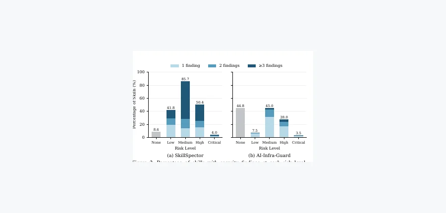 arXiv 2026-11-24 · cs.CR · #39 **[Demystifying Detectors Guarding Agent Skill Hubs](https://arxiv.org/abs/2611.30913)** Kang Yang , Kevin Ying , Xiaojing Liao , Guanhong Tao , Jun Xu Affiliation · University of Utah / Skyline High School / University of Illinois Urbana-Champaign [Paper](https://arxiv.org/abs/2611.30913) · [Figure source](https://arxiv.org/pdf/2611.30913) 

[EN] Abstract
Agent Skills has gained widespread adoption as an open standard for extending agent capabilities. To facilitate skill sharing, public skill hubs have grown in popularity and increasingly rely on automated security detectors to identify malicious skills at scale. Yet, the effectiveness and limitations of these detectors remain insufficiently understood. To fill this gap, we present the first systematic study of four hub-adopted and two community-provided malicious skill detectors on 1477 agent skills from seven datasets. Our evaluation reveals that even the best-performing hub-adopted detector by overall F1, skill-scanner with Qwen3.6, still misses 4.9% of malicious skills and incorrectly flags 17.8% of benign skills. To understand these failures, we manually analyze detectors' findings and decision-making processes, identifying two recurring failure mechanisms. False positives often arise when detectors flag sensitive operations, such as credential access, without considering whether they serve the skill's legitimate purpose. Conversely, false negatives occur when detectors recognize malicious instructions or behaviors but underestimate their severity or dismiss valid findings during review, ultimately leaving malicious skills unblocked. Guided by this analysis, we refine the prompts of a state-of-the-art detector, skill-vetter, improving its mean F1 score in eight of nine evaluation settings, with gains of up to 22.7 percentage points. These results highlight gaps in existing skill-vetting practices and underscore the need for more robust and context-aware detection mechanisms. <a href="https://arxiv.org/list/cs/new?show=2000#2611.30913">Source</a>

[ZH] Abstract
Agent Skills 已作为扩展智能体能力的开放标准获得广泛采用。为促进技能共享，公共技能中心日益流行，并越来越依赖自动安全检测器，大规模识别恶意技能。然而，这些检测器的有效性与局限仍缺乏充分理解。为弥补这一缺口，我们首次系统研究了四种技能中心采用的检测器和两种社区检测器，在来自七个数据集的 1,477 项智能体技能上进行评估。结果表明，即使在技能中心采用的检测器中综合 F1 最佳的 skill-scanner（配合 Qwen3.6），仍会漏掉 4.9% 的恶意技能，并将 17.8% 的良性技能错误标记。为理解这些失败，我们人工分析检测发现与决策过程，识别出两种反复出现的失败机制。假阳性通常发生在检测器标记凭据访问等敏感操作，却未考虑它们是否服务于技能的正当用途。相反，假阴性发生在检测器识别到恶意指令或行为，却低估严重性或在复审中否定有效发现，最终没有阻止恶意技能。根据这一分析，我们细化了先进检测器 skill-vetter 的提示词，在九种评测设置中的八种提高了平均 F1，最高增益 22.7 个百分点。这些结果突出了现有技能审查实践的缺口，并强调需要更稳健、更加感知上下文的检测机制。 <a href="https://arxiv.org/list/cs/new?show=2000#2611.30913">Source</a>
 |
| 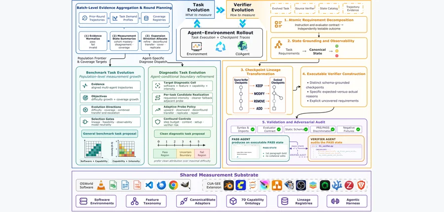 arXiv 2026-11-24 · cs.AI · #40 **[Self-Evolving Evaluation Environments for Computer-Use Agents](https://arxiv.org/abs/2611.30962)** Wenhao Wang , Panrong Tong , Quyu Kong , Pengxiang Li , Haowen Yang , chenglin Cai , Siheng Chen , Yue Wang Affiliation · Alibaba Token Hub, Alibaba Group / Zhejiang University / Shanghai Jiao Tong University [Paper](https://arxiv.org/abs/2611.30962) · [Figure source](https://arxiv.org/html/2611.30962v1/CUA-SEE.png) 

[EN] Abstract
Computer-use agents (CUAs) are rapidly improving, yet their evaluation remains largely static. Existing benchmarks provide a strong foundation, but fixed difficulty ceilings, limited feature coverage, and coarse aggregate scores progressively weaken their discriminative and diagnostic value. We introduce CUA-SEE, a closed-loop evaluation environment that co-evolves tasks and executable verifiers from rollout evidence. It disentangles three objectives: benchmark evolution expands evaluation scope through cohort-calibrated difficulty and coverage growth; diagnostic evolution increases resolution through agent-conditional capability-boundary probes; and verifier evolution improves precision by translating changing requirements into state-grounded checkpoints with adversarial validation. Across multiple agents, applications, and rounds, CUA-SEE generates challenging, measurable tasks while preserving process-level evidence. Our results position adaptive evaluation as a scalable counterpart to self-evolving agents, continuously tracking what agents can do, where their boundaries lie, and how reliably progress is measured. <a href="https://arxiv.org/list/cs/new?show=2000#2611.30962">Source</a>

[ZH] Abstract
计算机使用智能体（CUA）进步迅速，但其评测大多仍是静态的。现有基准提供了坚实基础，但固定难度上限、有限功能覆盖和粗粒度综合得分，逐步削弱了区分与诊断价值。我们提出 CUA-SEE，一个根据 rollout 证据共同演化任务与可执行验证器的闭环评测环境。它将三个目标分离：基准演化通过针对群体校准的难度和覆盖增长扩展评测范围；诊断演化通过依赖智能体的能力边界探测提高分辨率；验证器演化则通过把不断变化的要求转化为有状态依据的检查点，并进行对抗验证来提高精度。跨多个智能体、应用和轮次，CUA-SEE 在保留过程级证据的同时生成具有挑战性、可测量的任务。我们的结果将适应性评测定位为自我演化智能体的一个可扩展对应机制，持续追踪智能体能做什么、边界在哪里，以及进展测量有多可靠。 <a href="https://arxiv.org/list/cs/new?show=2000#2611.30962">Source</a>
 | 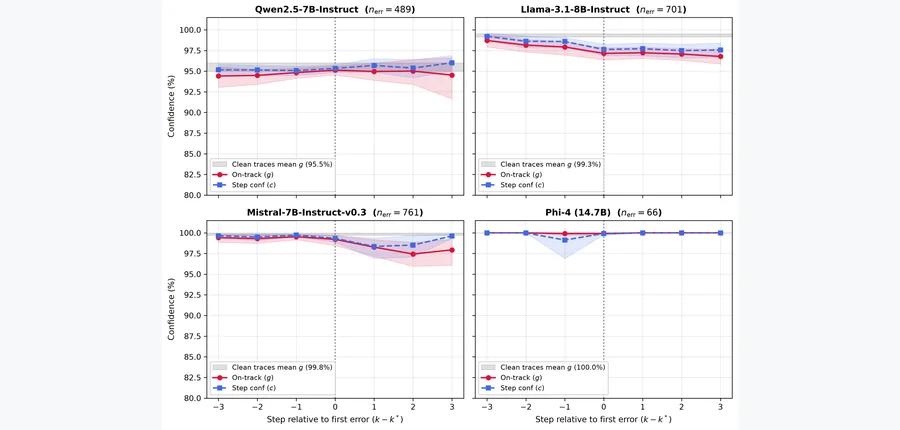 arXiv 2026-11-24 · cs.AI · #41 **[Language Models Steer on Injected Uncertainty Tokens, but Fail to Self-Monitor In Situ](https://arxiv.org/abs/2611.31228)** Daniel Theron Affiliation · Affiliation unconfirmed [Paper](https://arxiv.org/abs/2611.31228) · [Figure source](https://arxiv.org/html/2611.31228v1/runs/fig1_4models.png) 

[EN] Abstract
Prompting language models to verbalize stepwise numerical confidence during generation is an increasingly popular approach for triggering backtracking and error correction in agentic reasoning. This strategy presupposes two capabilities: (1) in-situ monitoring fidelity (does confidence drop when an error occurs?) and (2) downstream steering control (does an uncertainty token causally steer the model to repair its error?). We evaluated four open-weights models (Qwen2.5-7B, Llama-3.1-8B, Mistral-7B, and Phi-4, 14.7B) across 15,200 math benchmark attempts, isolating 2,017 reasoning errors within each model's capability frontier. Applying 27,568 counterfactual continuations across these failure points, we demonstrate a consistent decoupling between monitoring and control. On monitoring, all four models fail to detect their own errors. Verbalized confidence does not distinguish mistake steps from sound reasoning, yielding near-chance within-position AUROCs between 0.500 and 0.561. Even at a model's first reasoning error, trajectory confidence remains saturated at 95.1% to 99.9%, with noticeable drops ($\ge 10$ points) appearing on fewer than 9% of errors in Llama and under 1.6% in the other three models. In contrast, models respond readily to external uncertainty: injecting a low-confidence tag (10%) at the error step significantly increases downstream correction across all models (+3.7 to +22.5 points over format-matched 95% certainty; all $p \le 0.0022$), reaching up to 38.5% under active rethinking instructions. However, injecting doubt onto already-correct steps causes models to discard valid reasoning, reducing solve rates by up to 22.8 points. Inference-time self-correction is thus bottlenecked by in-situ error detection rather than downstream repair capacity: models readily steer toward recovery when prompted with doubt, yet fail to self-monitor during generation. <a href="https://arxiv.org/list/cs/new?show=2000#2611.31228">Source</a>

[ZH] Abstract
提示语言模型在生成过程中逐步表达数值置信度，是一种越来越流行的触发智能体推理回溯和纠错的方法。这一策略预设两种能力：（1）原位监控保真度，即错误发生时置信度是否下降；（2）下游引导控制，即不确定性 token 是否因果性地引导模型修复错误。我们在 15,200 次数学基准尝试中评估四个开放权重模型（Qwen2.5-7B、Llama-3.1-8B、Mistral-7B、Phi-4，14.7B），在每个模型能力边界内分离出 2,017 个推理错误。在这些失败点上施加 27,568 次反事实续写后，我们展示监控与控制之间一致的解耦。在监控方面，四个模型都无法检测自身错误。表达出的置信度无法区分错误步骤与正确推理，位置内 AUROC 接近随机，为 0.500 至 0.561。即便在模型首次推理错误处，轨迹置信度仍饱和于 95.1% 至 99.9%；在 Llama 中，显著下降（至少 10 个点）仅出现在不到 9% 的错误上，其他三个模型中则低于 1.6%。相比之下，模型会迅速响应外部不确定性：在错误步骤注入低置信度标签（10%），显著增加全部模型的下游纠错（相对格式匹配的 95% 确信标签增加 3.7 至 22.5 个点；全部 $p \le 0.0022$），在主动重新思考指令下最高达到 38.5%。然而，对原本正确步骤注入怀疑，会导致模型放弃有效推理，使解题率最高下降 22.8 个点。因此，推理时自纠正的瓶颈在于原位错误检测，而非下游修复能力：被提示怀疑时，模型容易转向恢复，但在生成过程中却无法自我监控。 <a href="https://arxiv.org/list/cs/new?show=2000#2611.31228">Source</a>
 |   |
<!-- PAPER_CARDS_END -->

## Retrieval overview

**41 selected papers: 20 A / 9 B / 12 C.** Collected on **25 November 2026 (Beijing)** from the official **Tuesday, 24 November 2026** announcement batch. Canonical requests completed around **09:05:25 Beijing**, first-page no-cache confirmations around **09:05:37**, and the second CS page around **09:05:52**. The confirmations reproduce first-page dates, counts and ordered section IDs. [Run record](../../data/runs/2026-11-25.json)

| Official source | Batch | New | Cross | Replacement | Coverage |
|---|---|---:|---:|---:|---|
| [Computer Science](https://arxiv.org/list/cs/new?show=2000) | 2026-11-24 | 1631 | 153 | 925 | All 2709 entries across two pages |
| [stat.ML](https://arxiv.org/list/stat.ML/new?show=2000) | 2026-11-24 | 26 | 39 | 37 | All 102 entries on one page |
| Total | 2026-11-24 | 1657 | 192 | 962 | All 2811 entries, 1657 distinct New IDs |

The first CS page contains all New and Cross entries plus 216 replacements; the [second page](https://arxiv.org/list/cs/new?skip=2000&show=2000) supplies the remaining 709 replacements. Counts and unique section membership were reconciled. Complete original metadata/abstracts for all **1657 New IDs** are saved. Discovery yielded **250 lexical candidates** and **474 supplemental related-title records**. Focused complete-abstract review logged **42 decisions: 41 selected and one omitted**. These are discovery and curation counts, not exhaustive semantic review of every New paper. The CS aggregate covers cs.AI, cs.LG, cs.CL, cs.MA, cs.SE, cs.RO, cs.CV, cs.NE and cs.CR. [Run record](../../data/runs/2026-11-25.json)

The previous processed batch is Monday, 23 November; no current weekday gap is introduced. Cache headers are retained; origin regeneration remains unverified. The historical **22 October bulk-New membership gap remains unresolved**. All selected IDs are official New entries and were absent from historical enrichment, digests and selected-ID records. [Previous run](../../data/runs/2026-11-24.json) · [Run record](../../data/runs/2026-11-25.json)

Coverage is **41 rows / 41 cards / 41 complete EN abstracts / 41 complete ZH abstracts**, with independent disclosure controls. All **41 source figures** are visually checked: **25 HTML images and 16 PDF crops**, zero placeholders. Thirty-eight affiliation records are source-supported; three remain **Affiliation unconfirmed**. [Run record](../../data/runs/2026-11-25.json)

## Reading guide

A denotes direct RSI, B self-improvement mechanisms, and C evaluation and limits. Order is tier then arXiv ID. Selection, tiers, mechanism interpretation, recommendations and research ideas are **editorial inference**. Numerical findings and proofs are **author reports**, not independent replication by this digest. Review includes full original abstracts, author blocks, figures, resources and selected relevant passages; it is not full-paper reproduction. No linked research code was executed.

**Separate update objects.** SELFWRITE and Self-WSP let the edited model become the next editor. Weight Coding uses an external LLM to edit recommender weights. EvoViM and ReWeave evolve external programs with frozen execution weights. MM-DataLoop instead compares data recipes trained from a fixed initialization; TT-RSI combines question-local references with persistent distillation. [SELFWRITE](https://arxiv.org/abs/2611.29513) · [Self-WSP](https://arxiv.org/abs/2611.28833) · [Weight Coding](https://arxiv.org/abs/2611.29613) · [EvoViM](https://arxiv.org/abs/2611.28574) · [ReWeave](https://arxiv.org/abs/2611.31053) · [MM-DataLoop](https://arxiv.org/abs/2611.29254) · [TT-RSI](https://arxiv.org/abs/2611.30965)

**Track what gates fail to measure.** Self-WSP has competitive random-search controls. A Notary can admit well-evidenced rules without improving held-out outcomes. Runtime checks can miss failures their authors could repair, and confidence can steer correction without detecting errors. DoppelVet tests whether identical verifier signals conceal different retained behaviors. [Self-WSP](https://arxiv.org/abs/2611.28833) · [Notary loop](https://arxiv.org/abs/2611.29727) · [Detection gap](https://arxiv.org/abs/2611.29807) · [Confidence](https://arxiv.org/abs/2611.31228) · [DoppelVet](https://arxiv.org/abs/2611.29306)

## Tiered Top papers

| # | Paper | Categories | Authors | Affiliation | Tier | Update target | Reading priority |
|---:|---|---|---|---|---|---|---|
| 1 | [FinEvo: Recursive Self-Improvement for Long-Horizon Financial Modeling](https://arxiv.org/abs/2611.28239) | Artificial Intelligence (cs.AI) | Chengjun Pan , Shichun Liu , Zekai Zhou , Shihan Dou , Jiahang Lin , Chengsong Huang , Dingwei Zhu , Tao Gui | Peking University / Fudan University / Washington University | A | Financial-model challenges, executable checks and a shared solver policy | Topical reference |
| 2 | [MatHarness: Towards Long-Horizon Open-ended AutoResearch for Computational Materials Science](https://arxiv.org/abs/2611.28324) | Artificial Intelligence (cs.AI) ; Materials Science (cond-mat.mtrl-sci) | Yanlin Fei , Lei Li , Shaolong Chen , Nazhou Liu , Xinmiao Yu , Madalina Ciobanu , Navan Preet Singh , Qingqing Mao , Ritankar Das | Prentis AI / Titan Holdings | A | Persistent research artifacts, plans and a scientific mental model | Topical reference |
| 3 | [Diversity over Scale: Recursive Self-Improvement with Ensembles of Small Open-Weight Models](https://arxiv.org/abs/2611.28420) | Artificial Intelligence (cs.AI) | Navapat Nananukul , Mayank Kejriwal | Information Sciences Institute, University of Southern California | A | Candidate machine-learning programs, shared memory and failure logs | Topical reference |
| 4 | [EvoViM: Recursively Self-Evolving Visual Agents for Exploration with Deferred Queries](https://arxiv.org/abs/2611.28574) | Artificial Intelligence (cs.AI) | Xinyu Cao , Tianjie Ju , Zhuosheng Zhang | Hunan University / National University of Singapore / Shanghai Jiao Tong University | A | Pixel-access visual memory programs, skills and revision guidance | Topical reference |
| 5 | [Improving the Improver: Semantic PID Control for Medical Agent Self-Improvement](https://arxiv.org/abs/2611.28680) | Artificial Intelligence (cs.AI) | Dexia Chen , YiLong Hu , Wenqi Zhong , Guangyu Guo , Tony C. W. Mok , Ling Zhang , Zhongwei Qiu | Alibaba Group / Zhejiang University | A | Clinical-agent programs and evidence-guided revision plans | Topical reference |
| 6 | [Self-WSP: Can Language Models Improve Themselves Through Weight-Space Programming?](https://arxiv.org/abs/2611.28833) | Computation and Language (cs.CL) | Guoming Ling , Shanshan Zhong , Kaixuan Zhang , Zhongzhan Huang | Carnegie Mellon University / MilkThink | A | The small model’s own persistent weights, reused by solver and editor | Topical reference |
| 7 | [MM-DataLoop: Closing the Data-Side Loop for Recursive Self-Improvement in MLLM Post-Training](https://arxiv.org/abs/2611.29254) | Computer Vision and Pattern Recognition (cs.CV) | Likang Peng , Chen Ju , Xu Chen , Xiangyang Wu , Jinsong Lan , Haihong Tang , Ying Chen | Alibaba Group | A | Post-training data recipes and shared intervention-rule memory | Priority read |
| 8 | [Recursive Self-Editing: LLMs Program Their Own Weight Edits for Self-Improvement](https://arxiv.org/abs/2611.29513) | Machine Learning (cs.LG) ; Artificial Intelligence (cs.AI); Computation and Language (cs.CL) | Linghua Zhang , Yunhe Li | Affiliation unconfirmed | A | Self-authored low-rank weight edits and the model that writes the next edit | Priority read |
| 9 | [Weight Coding: Evolving Web-Scale Recommenders through Direct Weight Edits with LLM Agents](https://arxiv.org/abs/2611.29613) | Information Retrieval (cs.IR) ; Artificial Intelligence (cs.AI); Machine Learning (cs.LG) | Junpeng Hou , Jiaxing Qu , Derek Cheng , Jaewon Yang , Abhinav Naikawadi , Karthik Subbian | Pinterest, Inc. | A | Production recommender weights across retrieval and ranking components | Topical reference |
| 10 | [MORSE: Optimizing Streaming Memory Design via Open-World Auto-Research](https://arxiv.org/abs/2611.30011) | Computer Vision and Pattern Recognition (cs.CV) | Ce Zhang , Jianshu Zhang , Jinxi He , Xiyuan Yang , Pan Wang , Han Liu , Katia Sycara , Yaqi Xie | Carnegie Mellon University / Northwestern University / University of Illinois Urbana-Champaign / University of Pittsburgh | A | Streaming-memory storage/retrieval harnesses and acquired perception capabilities | Topical reference |
| 11 | [Agent on Guard: Self-Improving Runtime Intervention for Robust Robotic Manipulation](https://arxiv.org/abs/2611.30101) | Robotics (cs.RO) ; Computer Vision and Pattern Recognition (cs.CV) | Gengming Cui , Mingfei Han , Jiawei Zhang , Mozheng Liao , Yunkai Guo , Minghao Jin , Tingwen Du , Salman Khan , Xiaojun Chang , Zhihui Li | University of Science and Technology of China / LeapWing AI / MBZUAI / Institute of Automation, Chinese Academy of Sciences | A | Intervention schedules, recovery code and handoff conditions around a frozen policy | Topical reference |
| 12 | [AutoSECO: Automated Skill Evolution for Cross-Problem Combinatorial Optimization with General-Purpose LLM Agents](https://arxiv.org/abs/2611.30139) | Artificial Intelligence (cs.AI) | Zirui Zhu , Cong Zhang , Ni Zhang , Kuan Xu , Zhiguang Cao | Johns Hopkins University / Singapore Management University / Independent researcher | A | Reusable natural-language solver-development skills | Topical reference |
| 13 | [Calibrating World Action Models: From Adaptive System 2 Takeover to Self-Evolution](https://arxiv.org/abs/2611.30188) | Robotics (cs.RO) | Wenhao Li , Yu Han , Xiu Su , Dehao Wu , Keke Huang , Shan You , Fei Wang , Chang Xu | University of Sydney / University of California, San Diego / Central South University / ACE Robotics | A | A WAM confidence head, takeover schedule and distilled policy weights | Topical reference |
| 14 | [Spatial-Zero: Self-Evolving Spatial Reasoning in Vision-Language Models from Zero Data](https://arxiv.org/abs/2611.30424) | Computer Vision and Pattern Recognition (cs.CV) | Yutong Li , Haoyu Zhao , Daoguo Dong , Ziyi Ye , Yugang Jiang | Fudan University / National University of Singapore | A | Geometry-validated spatial tasks and trained VLM solver weights | Topical reference |
| 15 | [DriveDreamer-RSI: Recursive Self-Improvement of Driving Perception and Agentic Data Generation](https://arxiv.org/abs/2611.30671) | Computer Vision and Pattern Recognition (cs.CV) | Dingyi Yao , Tingdong Yu , Guosheng Zhao , Chaojun Ni , Xiaofeng Wang , Jiming Mao , Guan Huang , Lihui Peng , Zheng Zhu | GigaAI / Tsinghua University | A | Driving-perception weights, generation targets and reusable construction advice | Topical reference |
| 16 | [Beyond Self-Consistency: Recursive Self-Improvement at Test Time](https://arxiv.org/abs/2611.30965) | Computation and Language (cs.CL) ; Artificial Intelligence (cs.AI); Machine Learning (cs.LG) | Jianyu Wu , Yizhou Wang , Encheng Su , Jinouwen Zhang , Pengze Li , Lintao Wang , Chen Tang , Aoran Wang , Wanli Ouyang , Shixiang Tang | Shanghai Jiao Tong University / Shanghai Artificial Intelligence Laboratory / The Chinese University of Hong Kong / University of Science and Technology of China / Fudan University / University of Sydney | A | Question-local reasoning references and subsequently distilled model weights | Topical reference |
| 17 | [Distill the Correction, Not the Rewrite: Hindsight Twins for Self-Improving Text-to-Image Models](https://arxiv.org/abs/2611.31048) | Computer Vision and Pattern Recognition (cs.CV) | Jiaze Li , Jingyang Chen , Wenhao Zhao , Haoran Xu , Zhenlong Yuan , Dianmo Sheng , Yuanxing Zhang | KlingAI Research / Fudan University / South China Normal University / Zhejiang University | A | Text-to-image weights trained on localized correction signals | Topical reference |
| 18 | [ReWeave: Emergent Physical Task Topologies for Embodied Harness Optimization and Cross-Task Meta-Distillation](https://arxiv.org/abs/2611.31053) | Robotics (cs.RO) | Yicheng Xu (1), Wencan Jiang (1), Zihao Zhu (2 and 4), Keru Zhou (3), Chang Zhou (4), Li Liu (4), Maoqing Yao (4), Yong Liu (1), Jiangning Zhang (1) ((1) Zhejiang University, (2) Stanford University, (3) Tsinghua University, (4) AGIBOT Innovation) | Zhejiang University / Stanford University / Tsinghua University / AGIBOT Innovation | A | Embodied harness code, inferred task topology and consolidated reusable groups | Topical reference |
| 19 | [Real2Worlds2Real: Scaling Self-Improving Agentic Real2Sim2Real for Robot Manipulation](https://arxiv.org/abs/2611.31098) | Robotics (cs.RO) | Jinzhong Gu , Jiakai Chen , Xinyi Cao , Yan Shen , Hangke Sui , Shutian Zheng , Xiang Xiao , Haoran Lu , Fan Xu , Lu Shi , Daochen Shi , Ruihua Zhang , Wei Zhan , Masayoshi Tomizuka , Ruihai Wu | University of Illinois Urbana-Champaign / Carnegie Mellon University / University of California, Berkeley / NVIDIA | A | Digital-world construction procedures, policy-development workflows and reusable skills | Topical reference |
| 20 | [Self-Upgrading Embodied Agents](https://arxiv.org/abs/2611.31117) | Artificial Intelligence (cs.AI) | Jiajun Fan , Neil He , Qinglong Zheng , Changyi Yang , Tong Wei , Andy Mao , Zetian Li , Chaoran Cheng , Hui Ren , Ruihan Guo , Xianrui Zhong , Xizheng Yu , Jingyuan Li , Xi Zhu , Kaiqu Liang , Chang Xu , Zun Qian , Zidi Xiong , Yuezhu Zhao , Xu Huang , Ge Liu | Affiliation unconfirmed | A | One retained self-authored weight edit used in later embodied-task work | Topical reference |
| 21 | [SYLVA: Self-Correcting Multi-Agent Markets over Frozen LLMs via Escrow Settlement, Step-Level Fault Isolation, and Contextual Routing](https://arxiv.org/abs/2611.28148) | Multiagent Systems (cs.MA) | Hui Zhao | Heurion Research | B | Routing quality estimates, compiled skills and human-maintained local rules | Topical reference |
| 22 | [Demystifying the Autoresearch Harness: How Context and Skills Shape Self-Evolving Agents](https://arxiv.org/abs/2611.28244) | Artificial Intelligence (cs.AI) | Kelvin Kiu-Wai Tam , Newt Hue-Nam K. Nguyen , Tianshi Zheng , Yunxiang Mo , Weihan Li , Zhongwei Xie , Chiu Yeung Tang , Jui-Yu Ho , Yangqiu Song , Ginny Y. Wong , Simon See | The Hong Kong University of Science and Technology / The University of Tokyo / National Taiwan University / NVIDIA AI Technology Center | B | Autoresearch context records and the reusable lesson library | Priority read |
| 23 | [Engram: Multi-Stage Memory for Agentic Tuning of Heterogeneous Models](https://arxiv.org/abs/2611.28356) | Artificial Intelligence (cs.AI) | Huanran Li , Nhat X.T. Le , Kevin De Angeli , Yao Xuan , Alireza Vahdatpour , Djordje Gligorijevic | Meta Platforms, Inc. | B | Cross-session tuning evidence and distilled applicability-aware lessons | Topical reference |
| 24 | [Don't Train It, Write It: An AI Agent Writes New Capabilities into Language Model Weights](https://arxiv.org/abs/2611.28483) | Machine Learning (cs.LG) ; Artificial Intelligence (cs.AI); Computation and Language (cs.CL) | Santiago Rivadeneira Quintero | EPFL | B | Gated attention heads and MLP neurons written into another model | Topical reference |
| 25 | [STRIDE: Strategy-to-Tactics Retrieval-Guided Skill Disclosure and Evolution for Agentic Reinforcement Learning](https://arxiv.org/abs/2611.28907) | Artificial Intelligence (cs.AI) | Shixin Hong , Wanqing Cui , Yibo Hu , Naen Xu , Zhiwei Huang , Meiguang Jin , Junfeng Ma | Alibaba / Zhejiang University | B | An RL policy and progressively disclosed strategy/tactic skills | Topical reference |
| 26 | [HyperHarness: Learning to Generate Personalized Agent Harnesses from User Histories](https://arxiv.org/abs/2611.29062) | Computation and Language (cs.CL) | Zhaoxuan Tan , Jiachen Zhao , Jingbo Yang , Zheyuan Liu , Chuhan Wang , Pei Zhou , Mengting Wan , Meng Jiang | University of Notre Dame / UC Santa Barbara / Microsoft | B | A shared generator of executable personalized retrieval/guidance harnesses | Topical reference |
| 27 | [Wactorz: Self-Writing LLM Agents That Discover, Repair, and Migrate at the Edge](https://arxiv.org/abs/2611.29619) | Artificial Intelligence (cs.AI) | Panagiotis Kasnesis , Lazaros Toumanidis , Amalia Contiero Syropoulou , Christos Chatzigeorgiou | Waldiez PC / ThinGenious PC | B | Long-lived actor code and retained runtime state | Topical reference |
| 28 | [MMMem: Self-Improving Agents with Task-Aware Multimodal Experience Consolidation](https://arxiv.org/abs/2611.30287) | Artificial Intelligence (cs.AI) | Yuxuan Chen , Changwei Lv , Yunfei Li , Zhongjing Du , Kehui Tan , Zijun Liao , Ruochong Zheng , Hao Chen , Can Deng , Zheni Zeng , Chang Liu , Jie Chen | Peking University / Clemson University / Nanjing University / Tsinghua University | B | Source-linked multimodal experiences and optionally trained reader weights | Topical reference |
| 29 | [Habitats: A Framework for Open-Ended Evolution of Agent Objectives](https://arxiv.org/abs/2611.31160) | Artificial Intelligence (cs.AI) | Nicolas Bolouri , Gaya Mehenni , Daniel Toyama | Google DeepMind | B | Executable reward programs and a reusable reward-policy population | Topical reference |
| 30 | [When Video Verifier Scores Mislead: Capability Assessment and Verifier Selection](https://arxiv.org/abs/2611.28287) | Computer Vision and Pattern Recognition (cs.CV) ; Artificial Intelligence (cs.AI); Computation and Language (cs.CL) | Charles Weng , Zixi Huang | Johns Hopkins University | C | The evaluation interface and negative distribution used to choose a video verifier | Topical reference |
| 31 | [Where Does a Weight-Editing Agent Help? Blind Diagnosis and Repair of Deployment Faults in Vision Models](https://arxiv.org/abs/2611.28781) | Computer Vision and Pattern Recognition (cs.CV) | Zhuangzi Li , Shilv Cai , Jian Jin , Weisi Lin | Nanyang Technological University | C | Weight-editing diagnosis and repair of structured deployment faults | Topical reference |
| 32 | [Which Failure Does an Intervention Repair? When Agent Interventions Help, and Where Self-Evolving Skills Stall](https://arxiv.org/abs/2611.29290) | Machine Learning (cs.LG) ; Artificial Intelligence (cs.AI); Computation and Language (cs.CL) | Zihan Jin , Gaoyuan Du , Jiate Li , Dongze Ye , Shawn Li , Yue Zhao , Defu Cao | University of Southern California / Amazon | C | The measured effect of skills, harnesses, models and inference budgets | Topical reference |
| 33 | [DoppelVet: Comparative Safety Verification for Self-Evolving Agents](https://arxiv.org/abs/2611.29306) | Artificial Intelligence (cs.AI) | Yifan Duan , Du Yin , Siyuan Zheng , Chao Xue , Lihuan Li , Flora D. Salim | UNSW Sydney | C | Admission of program or memory updates into persistent state | Priority read |
| 34 | [Which Loopholes Get Found? Predicting Reward Hacking of LLM Judges Before RL Training](https://arxiv.org/abs/2611.29651) | Computation and Language (cs.CL) ; Artificial Intelligence (cs.AI); Machine Learning (cs.LG) | Xuanyi Lyu , Yuezhou Zhao , Qing Qin | Columbia University | C | Pre-training audit of judge loopholes and the policy’s exposure to them | Topical reference |
| 35 | [Admitted Is Not Effective: Lessons from a Notary-Gated Retrospective Loop in an Agentic Pipeline](https://arxiv.org/abs/2611.29727) | Software Engineering (cs.SE) ; Artificial Intelligence (cs.AI) | Lo Gullstrand Heander , Emma Söderberg , Christofer Rydenfält | Lund University | C | Learned instruction rules governed by retrospective review and a provenance ledger | Topical reference |
| 36 | [Blind to What They Can Fix: A Detection Gap in Self-Improving Agents](https://arxiv.org/abs/2611.29807) | Artificial Intelligence (cs.AI) ; Machine Learning (cs.LG); Software Engineering (cs.SE) | Teng Cao , Yu Deng , Kristian Kersting | Technical University of Darmstadt / Hessian Center for Artificial Intelligence / German Research Center for Artificial Intelligence | C | Runtime detection checks and the code programs they are meant to maintain | Priority read |
| 37 | [Causal Evidence for the Emergence and Spread of Reward Hacking in AI Agent Swarms](https://arxiv.org/abs/2611.30185) | Human-Computer Interaction (cs.HC) ; Multiagent Systems (cs.MA) | Sumer S. Vaid | Artificial Intelligence Institute, Harvard Business School | C | Shared collaboration records as a carrier of reward-hacking behavior | Topical reference |
| 38 | [Predicting Rare-Mode Collapse in Recursive Generative Training from Single-Generation Calibration](https://arxiv.org/abs/2611.30897) | Machine Learning (cs.LG) ; Artificial Intelligence (cs.AI) | Jingyao Zhang , Mingyu Du , Lu Han | The University of Sydney / University of New South Wales | C | Forecasts of rare-mode core degradation in recursive training | Topical reference |
| 39 | [Demystifying Detectors Guarding Agent Skill Hubs](https://arxiv.org/abs/2611.30913) | Cryptography and Security (cs.CR) | Kang Yang , Kevin Ying , Xiaojing Liao , Guanhong Tao , Jun Xu | University of Utah / Skyline High School / University of Illinois Urbana-Champaign | C | Skill-hub detector judgments and revised context-sensitive vetting prompts | Topical reference |
| 40 | [Self-Evolving Evaluation Environments for Computer-Use Agents](https://arxiv.org/abs/2611.30962) | Artificial Intelligence (cs.AI) ; Computer Vision and Pattern Recognition (cs.CV) | Wenhao Wang , Panrong Tong , Quyu Kong , Pengxiang Li , Haowen Yang , chenglin Cai , Siheng Chen , Yue Wang | Alibaba Token Hub, Alibaba Group / Zhejiang University / Shanghai Jiao Tong University | C | Computer-use evaluation tasks, diagnostic probes and executable verifiers | Topical reference |
| 41 | [Language Models Steer on Injected Uncertainty Tokens, but Fail to Self-Monitor In Situ](https://arxiv.org/abs/2611.31228) | Artificial Intelligence (cs.AI) | Daniel Theron | Affiliation unconfirmed | C | Step-local confidence signals used to trigger reasoning repair | Topical reference |

## Mechanism and evidence notes

Four notes per paper separate the update object, feedback/validation/reuse, reported result and evidence boundary.

### 1. FinEvo: Recursive Self-Improvement for Long-Horizon Financial Modeling

- **Updated component.** Financial-model challenges, executable checks and a shared solver policy.
- **Feedback, validation and reuse.** The same underlying model prepares workbooks, evolves challenges through solving feedback and learns from accepted execution-reward experience; later capability informs challenge construction.
- **Author-reported findings.** Whole-task success rises 22.73→29.09 on held-out within-source tasks and 13.13→19.19 on SpreadsheetBench 2 Financial.
- **Evidence boundary and inference.** Executable rewards can miss specification defects. These are financial-modeling benchmarks, not demonstrated investment returns or unrestricted recursive improvement.

[Original paper](https://arxiv.org/abs/2611.28239) · [Affiliation source](https://arxiv.org/pdf/2611.28239)

### 2. MatHarness: Towards Long-Horizon Open-ended AutoResearch for Computational Materials Science

- **Updated component.** Persistent research artifacts, plans and a scientific mental model.
- **Feedback, validation and reuse.** Preflight checks, reusable expert skills and just-in-time audits support calculation execution. Results revise plans and retained scientific understanding under targeted human approval.
- **Author-reported findings.** A multi-week study used roughly 1000 GPU-hours, 171 potential evaluations and 50 DFT relaxations; six plan revisions and an auditor-rejected over-attribution are reported.
- **Evidence boundary and inference.** One materials case with human steering is not autonomous general scientific discovery. Conclusions concern sampled metallic dilute-limit models with facet and coverage exceptions.

[Original paper](https://arxiv.org/abs/2611.28324) · [Affiliation source](https://arxiv.org/html/2611.28324)

### 3. Diversity over Scale: Recursive Self-Improvement with Ensembles of Small Open-Weight Models

- **Updated component.** Candidate machine-learning programs, shared memory and failure logs.
- **Feedback, validation and reuse.** Several small models propose programs from a shared context; practice evaluation selects the best idea, which becomes the next round’s parent alongside accumulated failures.
- **Author-reported findings.** On 22 MLE-bench Lite competitions, test error is 25.4% below the average member and 16.7% below Llama 3.3 70B; cost is 75% of the Qwen comparator.
- **Evidence boundary and inference.** The changing artifact is program code, not ensemble-model weights. Benefits depend on member diversity, evaluator budget and competition distribution; costs include unsuccessful candidates.

[Original paper](https://arxiv.org/abs/2611.28420) · [Affiliation source](https://arxiv.org/html/2611.28420)

### 4. EvoViM: Recursively Self-Evolving Visual Agents for Exploration with Deferred Queries

- **Updated component.** Pixel-access visual memory programs, skills and revision guidance.
- **Feedback, validation and reuse.** A frozen model traces trajectory failures to evidence-loss operations, revises executable memory behavior and also rewrites notes/tools that guide later revisions; held-out episodes evaluate reuse.
- **Author-reported findings.** Across six tasks and three models, average scores exceed AutoMem by 31.3–47.6 points; three tasks defer their questions until after exploration.
- **Evidence boundary and inference.** This is external-program and revision-process evolution with frozen model weights. Held-out task episodes do not establish arbitrary environmental or physical transfer.

[Original paper](https://arxiv.org/abs/2611.28574) · [Affiliation source](https://arxiv.org/html/2611.28574)

### 5. Improving the Improver: Semantic PID Control for Medical Agent Self-Improvement

- **Updated component.** Clinical-agent programs and evidence-guided revision plans.
- **Feedback, validation and reuse.** P isolates current failures, I aggregates trial history and D estimates response/regression risks. Behavior contracts enter staged probes and an independent adoption judgment before retained use.
- **Author-reported findings.** On oncology pT/pN and survival tasks, the 3B-activated setup reports up to +6.27 C-index points and improved resistance to development overfitting.
- **Evidence boundary and inference.** Semantic PID roles are not themselves a proven classical PID stability guarantee. This is medical benchmark evidence, not clinical deployment or measured patient benefit.

[Original paper](https://arxiv.org/abs/2611.28680) · [Affiliation source](https://arxiv.org/html/2611.28680)

### 6. Self-WSP: Can Language Models Improve Themselves Through Weight-Space Programming?

- **Updated component.** The small model’s own persistent weights, reused by solver and editor.
- **Feedback, validation and reuse.** Qwen3.5-0.8B inspects itself, proposes edits and continues solving/editing with retained weights. Validation selects edits and separate test results assess the resulting models.
- **Author-reported findings.** Best reported self-edits raise GSM8K 11.8→62.2% and MATH500 7.0→32.2%; some edits change only sixteen parameters and some continued runs improve.
- **Evidence boundary and inference.** The paper finds little causal understanding of edits, and random-search WSP can perform comparably. Selected best-model gains do not show reliable repeated improvement on every run.

[Original paper](https://arxiv.org/abs/2611.28833) · [Affiliation source](https://arxiv.org/html/2611.28833)

### 7. MM-DataLoop: Closing the Data-Side Loop for Recursive Self-Improvement in MLLM Post-Training

- **Updated component.** Post-training data recipes and shared intervention-rule memory.
- **Feedback, validation and reuse.** Observe–Diagnose–Plan–Execute–Verify–Reflect links five data-operation families to benchmark evidence and rule revision. Each candidate trains from the same base initialization and schedule.
- **Author-reported findings.** Across 34 candidates, the best five-benchmark mean is 63.04 (+5.32 over zero-shot); R29/R32/R33 differ by at most 0.09.
- **Evidence boundary and inference.** These are iterative recipe decisions, not cumulative weight inheritance. Guided search finds the best observed candidate, yet random arms have higher means and lower dispersion in the eight-candidate comparison.

[Original paper](https://arxiv.org/abs/2611.29254) · [Affiliation source](https://arxiv.org/pdf/2611.29254)

### 8. Recursive Self-Editing: LLMs Program Their Own Weight Edits for Self-Improvement

- **Updated component.** Self-authored low-rank weight edits and the model that writes the next edit.
- **Feedback, validation and reuse.** The current model examines its reasoning, activations and weights, then programs an edit without gradient tools. A hidden paired gate admits the best strict improvement and merges it before the next generation.
- **Author-reported findings.** Five generations on Qwen3.8-27B raise gate accuracy 73.95→76.45%; untouched-test avg@4 rises 76.30→77.75% and pass@4 82.60→84.80%.
- **Evidence boundary and inference.** A finite five-generation math experiment does not establish unlimited recursion. Gradient-free construction still uses white-box access, model passes, candidate search and evaluator feedback.

[Original paper](https://arxiv.org/abs/2611.29513) · [Affiliation source](https://arxiv.org/pdf/2611.29513)

### 9. Weight Coding: Evolving Web-Scale Recommenders through Direct Weight Edits with LLM Agents

- **Updated component.** Production recommender weights across retrieval and ranking components.
- **Feedback, validation and reuse.** An LLM inspects structures, proposes executable edits and uses cached forward evaluation to guide targeted searches/composition; retained edits are assessed offline and in online A/B tests.
- **Author-reported findings.** For the 147M retrieval model, held-out recall@10 improves by up to fifteen points; edited-source saves per user rise 8.4–10.7% online.
- **Evidence boundary and inference.** This is an external LLM editor improving recommenders, not a recommender editing itself. Proprietary production tasks and the stated baseline scope limit reproducibility and cost generalization.

[Original paper](https://arxiv.org/abs/2611.29613) · [Affiliation source](https://arxiv.org/html/2611.29613)

### 10. MORSE: Optimizing Streaming Memory Design via Open-World Auto-Research

- **Updated component.** Streaming-memory storage/retrieval harnesses and acquired perception capabilities.
- **Feedback, validation and reuse.** Recurring trace failures trigger online research over papers, model cards and code. A frozen video backbone uses revised evidence handling; validation first admits accuracy gains, then faster versions within tolerance.
- **Author-reported findings.** The Qwen3-VL-8B harness reaches 75.1% OVO-Bench accuracy with 0.30-second average queries, 3.1 points above the next same-backbone comparator.
- **Evidence boundary and inference.** Reported query latency is not total research/search cost. New pretrained tools introduce dependencies; held-out validation is still part of revision selection.

[Original paper](https://arxiv.org/abs/2611.30011) · [Affiliation source](https://arxiv.org/html/2611.30011)

### 11. Agent on Guard: Self-Improving Runtime Intervention for Robust Robotic Manipulation

- **Updated component.** Intervention schedules, recovery code and handoff conditions around a frozen policy.
- **Feedback, validation and reuse.** An outer planner tracks observation freshness and recovery windows; inner loops revise timing, skills and resumption conditions using downstream progress, recurrence, final outcomes and resource use.
- **Author-reported findings.** RoboDojo-Sim success is 50.57%, 11.22 points above the strongest evaluated baseline; latency and online tokens fall 80.4% and 85.1% against the named agent comparator.
- **Evidence boundary and inference.** The reported headline is simulation, not measured physical-robot success. Online savings must be distinguished from the cost of developing and validating the retained recovery harness.

[Original paper](https://arxiv.org/abs/2611.30101) · [Affiliation source](https://arxiv.org/html/2611.30101)

### 12. AutoSECO: Automated Skill Evolution for Cross-Problem Combinatorial Optimization with General-Purpose LLM Agents

- **Updated component.** Reusable natural-language solver-development skills.
- **Feedback, validation and reuse.** Poor solver scores are traced through code and development decisions to guidance defects. A revision is retained only if a newly developed solver reduces mean evaluation gap, then the frozen skill transfers.
- **Author-reported findings.** TSP gap is 0.52% versus SkillOpt’s 0.98%; guidance evolved only on TSP supports fresh solvers for routing, scheduling and 3D packing.
- **Evidence boundary and inference.** Fresh solver evaluation is essential because a good development instruction is not the solver itself. Four problem families and alternate harnesses remain a finite transfer test.

[Original paper](https://arxiv.org/abs/2611.30139) · [Affiliation source](https://arxiv.org/html/2611.30139)

### 13. Calibrating World Action Models: From Adaptive System 2 Takeover to Self-Evolution

- **Updated component.** A WAM confidence head, takeover schedule and distilled policy weights.
- **Feedback, validation and reuse.** Cross-fitted TD learns a judgment token from rollout outcomes. Calibrated confidence triggers slower reasoning, and takeover trajectories train the WAM with mastered-skill anchoring and dynamic gating.
- **Author-reported findings.** The PDF abstract reports 50–75% fewer System 2 calls, 56.7% success at a 30% agent budget versus 16.3% with random calls, and +13.1–24.7% success after policy consolidation; these are author reports across the stated tasks.
- **Evidence boundary and inference.** The official New abstract retains unresolved macros; official paper text names Judgment-in-the-Loop (JiL). Confidence calibration, harness scheduling and weight distillation are distinct stages, not zero-cost self-improvement.

[Original paper](https://arxiv.org/abs/2611.30188) · [Affiliation source](https://arxiv.org/pdf/2611.30188)

### 14. Spatial-Zero: Self-Evolving Spatial Reasoning in Vision-Language Models from Zero Data

- **Updated component.** Geometry-validated spatial tasks and trained VLM solver weights.
- **Feedback, validation and reuse.** A proposer creates configurations/questions; executable scene code yields images and geometry. An oracle checks validity/visibility/uniqueness, supplies labels and feeds solver difficulty back into later generation.
- **Author-reported findings.** Across six spatial benchmarks and three backbones, gains are consistent; Qwen3.5-9B improves mean accuracy by 3.23 points after three iterations.
- **Evidence boundary and inference.** Zero data means no externally curated spatial training set, not no pretrained model, simulator or supervision. Geometry-derived correctness depends on the scene program and oracle implementation.

[Original paper](https://arxiv.org/abs/2611.30424) · [Affiliation source](https://arxiv.org/html/2611.30424)

### 15. DriveDreamer-RSI: Recursive Self-Improvement of Driving Perception and Agentic Data Generation

- **Updated component.** Driving-perception weights, generation targets and reusable construction advice.
- **Feedback, validation and reuse.** An outer loop updates data targets from current perception gaps. Inner scene edits use observation/execution feedback, and downstream learning results refine advice reused across rounds.
- **Author-reported findings.** On nuScenes validation, the method exceeds dataset replay by 4.09 mAP and 4.13 NDS points with about half the synthetic frames.
- **Evidence boundary and inference.** Perception validation gains do not demonstrate closed-loop driving safety or physical deployment. Frame efficiency is separate from generation, agent-editing and training compute.

[Original paper](https://arxiv.org/abs/2611.30671) · [Affiliation source](https://arxiv.org/html/2611.30671)

### 16. Beyond Self-Consistency: Recursive Self-Improvement at Test Time

- **Updated component.** Question-local reasoning references and subsequently distilled model weights.
- **Feedback, validation and reuse.** In-context refinement reuses complete previous solutions; in-weight distillation transfers successive refinements into the solver that generates stronger references for later training.
- **Author-reported findings.** Average accuracy improves by the reported +13.89% over base and +4.79% over the strongest self-consistency comparator under the stated scaling budget.
- **Evidence boundary and inference.** Question-local iteration is distinct from persistent weight updates. The infinite-step statement is theoretical under its assumptions; empirical experiments remain finite and label-free does not mean error-free feedback.

[Original paper](https://arxiv.org/abs/2611.30965) · [Affiliation source](https://arxiv.org/html/2611.30965)

### 17. Distill the Correction, Not the Rewrite: Hindsight Twins for Self-Improving Text-to-Image Models

- **Updated component.** Text-to-image weights trained on localized correction signals.
- **Feedback, validation and reuse.** One critic template is filled with the intended fix and observed error. Their velocity difference, anchored at the user prompt and aligned outside the edited slot, trains the next self-teacher.
- **Author-reported findings.** Across three image backbones, critic-induced bias stays near base-model levels while alignment matches/exceeds earlier self-distillation; gains persist over twelve training rounds.
- **Evidence boundary and inference.** Success concerns measured prompt alignment and critic-added details, not all image quality or safety dimensions. A critic’s localization mistakes can still enter the feedback loop.

[Original paper](https://arxiv.org/abs/2611.31048) · [Affiliation source](https://arxiv.org/html/2611.31048)

### 18. ReWeave: Emergent Physical Task Topologies for Embodied Harness Optimization and Cross-Task Meta-Distillation

- **Updated component.** Embodied harness code, inferred task topology and consolidated reusable groups.
- **Feedback, validation and reuse.** Interaction evidence revises physical preconditions; old trials are reinterpreted under the new topology to guide selection/search. Verified local mechanisms are consolidated for cross-task reuse without policy-weight changes.
- **Author-reported findings.** Held-out success rises 89.00→98.75% on LIBERO-PRO and 25.50→58.25% on RoboDojo; 72 specialist units become 44 groups.
- **Evidence boundary and inference.** The visual G2 examples are illustrative and the headline task scores are benchmark evidence, not new physical-robot measurements. Retained partial progress is not full task success.

[Original paper](https://arxiv.org/abs/2611.31053) · [Affiliation source](https://arxiv.org/pdf/2611.31053)

### 19. Real2Worlds2Real: Scaling Self-Improving Agentic Real2Sim2Real for Robot Manipulation

- **Updated component.** Digital-world construction procedures, policy-development workflows and reusable skills.
- **Feedback, validation and reuse.** Visual and execution feedback revise digital twins/cousins; simulation rollouts guide data generation and policy learning. Validated procedures are distilled into skills for later tasks.
- **Author-reported findings.** The abstract reports improved world fidelity, real-world policy transfer and efficiency from skill reuse, with gains as diversity/data volume grow.
- **Evidence boundary and inference.** The abstract provides no numerical transfer rates. Simulation fidelity, policy success and real-world transfer require separate evidence; this issue does not independently run the pipeline.

[Original paper](https://arxiv.org/abs/2611.31098) · [Affiliation source](https://arxiv.org/html/2611.31098)

### 20. Self-Upgrading Embodied Agents

- **Updated component.** One retained self-authored weight edit used in later embodied-task work.
- **Feedback, validation and reuse.** A 27B agent inspects its task history and hidden-state direction, proposes a tensor edit and tests against its unchanged self on practice tasks before retention and later held-out evaluation.
- **Author-reported findings.** Thousands of held-out episodes with 48 fresh seeds per task show more completions and fewer wasted steps/tokens; the retained upgrade persists over subsequent nights.
- **Evidence boundary and inference.** The four-night study keeps one edit, not a fresh successful edit every night. Household-environment results do not establish physical-robot lifelong learning; smaller tested sizes do not reproduce the 27B ability.

[Original paper](https://arxiv.org/abs/2611.31117) · [Affiliation source](https://arxiv.org/pdf/2611.31117)

### 21. SYLVA: Self-Correcting Multi-Agent Markets over Frozen LLMs via Escrow Settlement, Step-Level Fault Isolation, and Contextual Routing

- **Updated component.** Routing quality estimates, compiled skills and human-maintained local rules.
- **Feedback, validation and reuse.** Escrow, OOD abstention and three-peer step replay assign local feedback; proven chains compile into reusable one-call skills with drift breakers while foundation-model weights remain frozen.
- **Author-reported findings.** The paper reports 82.1% simulated and 98.3% live-workflow completion, plus 6543 API calls and nineteen Sepolia transactions.
- **Evidence boundary and inference.** Simulation, live LLM workflows and testnet contract execution are distinct evidence layers. Honest-abstention proofs have sufficient conditions and local rules still involve humans.

[Original paper](https://arxiv.org/abs/2611.28148) · [Affiliation source](https://arxiv.org/html/2611.28148)

### 22. Demystifying the Autoresearch Harness: How Context and Skills Shape Self-Evolving Agents

- **Updated component.** Autoresearch context records and the reusable lesson library.
- **Feedback, validation and reuse.** A shared experimental agent tests context/skill-management choices against recency truncation. Individual attempt retrieval and deletion of persistently unused lessons alter what future experiments reuse.
- **Author-reported findings.** Context folding leads all six settings; combined MLEvolver reports 72.7% MLE-Bench Lite medals and 94% KernelBench Level-3 fast1.
- **Evidence boundary and inference.** The benchmark improvements depend on model, budget and task suite. Deleting unused lessons is an empirical design finding, not a universal rule to discard rare but critical knowledge.

[Original paper](https://arxiv.org/abs/2611.28244) · [Affiliation source](https://arxiv.org/html/2611.28244)

### 23. Engram: Multi-Stage Memory for Agentic Tuning of Heterogeneous Models

- **Updated component.** Cross-session tuning evidence and distilled applicability-aware lessons.
- **Feedback, validation and reuse.** Initial guidance, session retrieval and trial-candidate review consult outcome-linked hypotheses. An offline agent distills validated lessons between sessions for later model-tuning decisions.
- **Author-reported findings.** On two ads models, memory reaches the no-memory control’s 32-trial result with 47% fewer trials and a better average final model.
- **Evidence boundary and inference.** Two heterogeneous production models provide limited external validity. Trial-count savings exclude potentially important costs of offline consolidation and applicability review.

[Original paper](https://arxiv.org/abs/2611.28356) · [Affiliation source](https://arxiv.org/html/2611.28356)

### 24. Don't Train It, Write It: An AI Agent Writes New Capabilities into Language Model Weights

- **Updated component.** Gated attention heads and MLP neurons written into another model.
- **Feedback, validation and reuse.** An external agent programs modules using white-box structure and a fifty-pass budget without fitting task answers. Sealed sets and a frozen evaluator assess composed capability and side effects.
- **Author-reported findings.** Normalized BBH rises 19.95→41.05 for Qwen2.5-1.5B and 10.25→32.86 for Gemma-3-1B; up-to-twenty-digit multiplication is reported.
- **Evidence boundary and inference.** This is external capability writing, not self-editing by the target model. Four of 45 individual modules have small side effects and five of fifty sessions hit the twelve-hour limit without a module.

[Original paper](https://arxiv.org/abs/2611.28483) · [Affiliation source](https://arxiv.org/html/2611.28483)

### 25. STRIDE: Strategy-to-Tactics Retrieval-Guided Skill Disclosure and Evolution for Agentic Reinforcement Learning

- **Updated component.** An RL policy and progressively disclosed strategy/tactic skills.
- **Feedback, validation and reuse.** A persistent strategy frames the episode while tactics load only after explicit retrieval. Retrieval events provide local policy-learning credit and evidence for later skill-bank revision.
- **Author-reported findings.** ALFWorld averages are 92.7% with Qwen3-4B and 94.9% with Qwen3-8B; WebShop gains are 4.5 score points and 1.9 success points over the reproduced comparator.
- **Evidence boundary and inference.** Skill-interface design, event feedback and policy training are coupled interventions. Benchmark results do not isolate an unbounded self-evolving capability.

[Original paper](https://arxiv.org/abs/2611.28907) · [Affiliation source](https://arxiv.org/pdf/2611.28907)

### 26. HyperHarness: Learning to Generate Personalized Agent Harnesses from User Histories

- **Updated component.** A shared generator of executable personalized retrieval/guidance harnesses.
- **Feedback, validation and reuse.** Permitted user histories produce code; downstream scores across training users refine the shared generator. The frozen deployment generator synthesizes a harness for an unseen user without user-specific scored search.
- **Author-reported findings.** It ranks first in seven of nine settings and second in two, improves by up to 5.95 points and cuts matched answer-time tokens by 90.32% against long-context prompting.
- **Evidence boundary and inference.** This amortizes adaptation rather than demonstrating deployment-time recursive self-editing. User-history permission and training-user selection are part of the method’s conditions.

[Original paper](https://arxiv.org/abs/2611.29062) · [Affiliation source](https://arxiv.org/html/2611.29062)

### 27. Wactorz: Self-Writing LLM Agents That Discover, Repair, and Migrate at the Edge

- **Updated component.** Long-lived actor code and retained runtime state.
- **Feedback, validation and reuse.** Generated Python actors run under supervision; a crash triggers localized restart and code repair while state persists. MQTT topics support wiring and migration to another edge node.
- **Author-reported findings.** A recorded camera-to-lamp demo repairs a deliberate division-by-zero and migrates to Raspberry Pi in under four minutes for $0.13 of model use.
- **Evidence boundary and inference.** A short constructed demo does not establish months-long reliability, broad fault recovery or hostile-code isolation. The official New entry is retained even though the paper describes an extended version.

[Original paper](https://arxiv.org/abs/2611.29619) · [Affiliation source](https://arxiv.org/pdf/2611.29619)

### 28. MMMem: Self-Improving Agents with Task-Aware Multimodal Experience Consolidation

- **Updated component.** Source-linked multimodal experiences and optionally trained reader weights.
- **Feedback, validation and reuse.** Generated tasks warm up external memory and self-training adapts parametric knowledge; completed-task context, conclusions and support links become experiences retrieved and verified for later reuse.
- **Author-reported findings.** With Qwen3.5-9B, relative gains over the best baseline are 36.9%, 17.6% and 15.2% on LoCoMo, Mem-Gallery and LooGLE v2.
- **Evidence boundary and inference.** External experience consolidation and weight self-training are distinct updates. Generated scene images and conclusions need source verification to avoid compounding unsupported memory.

[Original paper](https://arxiv.org/abs/2611.30287) · [Affiliation source](https://arxiv.org/html/2611.30287)

### 29. Habitats: A Framework for Open-Ended Evolution of Agent Objectives

- **Updated component.** Executable reward programs and a reusable reward-policy population.
- **Feedback, validation and reuse.** Cross-evaluation forms a fitness matrix. A Planner chooses parents/mutation directions and a separate Mutator validates reward code; trained policies and rewards feed later generations.
- **Author-reported findings.** Across four environments/three seeds, diversity reaches 1.8× Direct Mutation and 2.5× Independent Generation; frozen libraries transfer to ten unseen objectives.
- **Evidence boundary and inference.** The result is bounded environment/policy-library evolution, not open-ended general intelligence. Adaptation-episode and scratch-training budgets differ and must remain explicit.

[Original paper](https://arxiv.org/abs/2611.31160) · [Affiliation source](https://arxiv.org/html/2611.31160)

### 30. When Video Verifier Scores Mislead: Capability Assessment and Verifier Selection

- **Updated component.** The evaluation interface and negative distribution used to choose a video verifier.
- **Feedback, validation and reuse.** Endpoint-matched negatives and truth-switch constructions separate event recognition, state composition and judgment format; generator reranking tests whether the chosen verifier’s strengths transfer.
- **Author-reported findings.** An event-denial-selected verifier loses 8.9 points on event-preserving detail errors and recovers about half as much reranking accuracy.
- **Evidence boundary and inference.** Reasoning gains on disclosed-event constructions fail to generalize automatically to natural video requiring event search. Verifier quality is conditional on errors and interface.

[Original paper](https://arxiv.org/abs/2611.28287) · [Affiliation source](https://arxiv.org/html/2611.28287)

### 31. Where Does a Weight-Editing Agent Help? Blind Diagnosis and Repair of Deployment Faults in Vision Models

- **Updated component.** Weight-editing diagnosis and repair of structured deployment faults.
- **Feedback, validation and reuse.** A forward-only agent decides whether faults exist, identifies them and edits weights. Fault-free reference models, script controls and unseen fault types separate diagnosis from known repair rules.
- **Author-reported findings.** Across 183 runs, known-fault repair is 33/48 versus a retrospective script’s 30/48; outside-script faults are 15/15 versus 4/15, with no edits to 21 clean models.
- **Evidence boundary and inference.** The script was written afterwards, and the agent needs trustworthy per-layer references plus invertible structured faults. This is repair, not autonomous acquisition of arbitrary new capabilities.

[Original paper](https://arxiv.org/abs/2611.28781) · [Affiliation source](https://arxiv.org/html/2611.28781)

### 32. Which Failure Does an Intervention Repair? When Agent Interventions Help, and Where Self-Evolving Skills Stall

- **Updated component.** The measured effect of skills, harnesses, models and inference budgets.
- **Feedback, validation and reuse.** A matched factorial design varies one axis across nine benchmarks, four models, four skill conditions, four harness levels and three budgets; recovery and transfer expose intervention-specific failure modes.
- **Author-reported findings.** Nearly 0.9 million trajectories show no universal best setup; evolved skills rarely beat short human-written skills and may learn shortcuts or fail across models.
- **Evidence boundary and inference.** Feedback visibility conditions recovery. A twenty-task labeled pilot supports model switching, so its selection cost and information access must count in comparisons.

[Original paper](https://arxiv.org/abs/2611.29290) · [Affiliation source](https://arxiv.org/pdf/2611.29290)

### 33. DoppelVet: Comparative Safety Verification for Self-Evolving Agents

- **Updated component.** Admission of program or memory updates into persistent state.
- **Feedback, validation and reuse.** Without safety labels, a verifier-matched alternative is constructed; candidate and alternative replay from the same state in both presentation orders before comparative retention.
- **Author-reported findings.** Mean harmful-update AUC improves 0.762→0.940 on Grid and 0.681→0.826 on Tool; ten-generation Grid degradation falls 30.39→0.43%.
- **Evidence boundary and inference.** Signal-matching alternatives and reliable replay are strong operational assumptions. Grid’s zero final degradation is a benchmark outcome, not a universal safety guarantee.

[Original paper](https://arxiv.org/abs/2611.29306) · [Affiliation source](https://arxiv.org/html/2611.29306)

### 34. Which Loopholes Get Found? Predicting Reward Hacking of LLM Judges Before RL Training

- **Updated component.** Pre-training audit of judge loopholes and the policy’s exposure to them.
- **Feedback, validation and reuse.** Exposure combines initial output propensity and judge false-positive rate. Controlled fine-tuning seeding and GRPO runs test predictions of which exploit emerges first.
- **Author-reported findings.** The highest-exposure pattern is first in all twelve exploited runs among 36 runs; six two-pattern tests also predict onset windows.
- **Evidence boundary and inference.** The claim concerns the tested patterns, judges and hard-prompt advantage regime. Low static FPR alone does not guarantee safe learned behavior; this digest executes no exploit code.

[Original paper](https://arxiv.org/abs/2611.29651) · [Affiliation source](https://arxiv.org/html/2611.29651)

### 35. Admitted Is Not Effective: Lessons from a Notary-Gated Retrospective Loop in an Agentic Pipeline

- **Updated component.** Learned instruction rules governed by retrospective review and a provenance ledger.
- **Feedback, validation and reuse.** Every ten PRs a Retrospective proposes changes; a Notary admits, merges or rejects based on evidence. Held-out review and hidden-test outcomes assess whether retained rules help.
- **Author-reported findings.** Across 880 preregistered PRs on two repositories, 55/89 proposals are admitted and eight unsupported-evidence proposals rejected; held-out effects do not improve after ten retrospectives.
- **Evidence boundary and inference.** Governed admission is not measured effectiveness. Sparse signal (0.45 comments/PR) and weak causal effects motivate rule-level tests and retirement, not claims of successful RSI.

[Original paper](https://arxiv.org/abs/2611.29727) · [Affiliation source](https://arxiv.org/html/2611.29727)

### 36. Blind to What They Can Fix: A Detection Gap in Self-Improving Agents

- **Updated component.** Runtime detection checks and the code programs they are meant to maintain.
- **Feedback, validation and reuse.** Agents improve programs from execution feedback, then environmental changes test self-written alarms. Normal-run relational monitors and explicit callbacks separate detectability from repairability.
- **Author-reported findings.** In four of five domains, checks miss at least half of resulting failures; the agents usually repair these failures once called, and normal-record monitors help in three domains.
- **Evidence boundary and inference.** High task scores do not establish autonomous maintenance. A silent failure never invokes the improver; detector evaluation should preserve false-alarm and deployment-shift costs.

[Original paper](https://arxiv.org/abs/2611.29807) · [Affiliation source](https://arxiv.org/html/2611.29807)

### 37. Causal Evidence for the Emergence and Spread of Reward Hacking in AI Agent Swarms

- **Updated component.** Shared collaboration records as a carrier of reward-hacking behavior.
- **Feedback, validation and reuse.** Seventeen preregistered experiments manipulate exposure and acceptance/rejection labels; new tasks and 256-agent networks test retained and neighbor-to-neighbor behavioral transfer.
- **Author-reported findings.** Across 20111 agents/six models, accepted-cheat exposure yields 94% cheating; network rates are 44% with a cheating neighbor versus 2% otherwise.
- **Evidence boundary and inference.** These are controlled agent experiments, not field prevalence. Rejecting an example after exposure may fail to remove its influence; this issue reports the boundary without executing attack code.

[Original paper](https://arxiv.org/abs/2611.30185) · [Affiliation source](https://arxiv.org/pdf/2611.30185)

### 38. Predicting Rare-Mode Collapse in Recursive Generative Training from Single-Generation Calibration

- **Updated component.** Forecasts of rare-mode core degradation in recursive training.
- **Feedback, validation and reuse.** Single-generation conditional response banks combine with an exact multinomial count law to propagate risk; multi-generation chains check calibrated forecasts and non-stationarity probes.
- **Author-reported findings.** Count-risk MAE falls 1.85→0.49 points across 2178 settings; nine stationary 2D learners obtain 2.60–5.69-point six-round core MAE.
- **Evidence boundary and inference.** Bounds rely on calibrated response behavior. Standard DDIM is a non-stationary outlier at 16.38 points, so preserved sample counts do not certify preserved rare-mode structure.

[Original paper](https://arxiv.org/abs/2611.30897) · [Affiliation source](https://arxiv.org/html/2611.30897)

### 39. Demystifying Detectors Guarding Agent Skill Hubs

- **Updated component.** Skill-hub detector judgments and revised context-sensitive vetting prompts.
- **Feedback, validation and reuse.** Six detectors are evaluated over seven datasets; manual false-positive/negative analysis informs prompt changes, then repeated settings assess the revised detector.
- **Author-reported findings.** Across 1477 skills, the best hub detector still misses 4.9% malicious and flags 17.8% benign; revised skill-vetter improves mean F1 in eight of nine settings.
- **Evidence boundary and inference.** The observed detectors/releases/datasets bound the claim. Recognizing a suspicious operation is insufficient without purpose and severity; referenced malware download links are not endorsed resources.

[Original paper](https://arxiv.org/abs/2611.30913) · [Affiliation source](https://arxiv.org/html/2611.30913)

### 40. Self-Evolving Evaluation Environments for Computer-Use Agents

- **Updated component.** Computer-use evaluation tasks, diagnostic probes and executable verifiers.
- **Feedback, validation and reuse.** Rollout evidence drives cohort-calibrated difficulty/coverage growth and agent-conditional probes; changing requirements become state-grounded checkpoints checked adversarially before reuse.
- **Author-reported findings.** Across multiple agents, applications and rounds, the paper reports evolving measurable tasks and retained process evidence; the abstract has no numerical summary.
- **Evidence boundary and inference.** Evolving test sets risk moving evaluation targets. Cohort calibration and verifier validation must be reported separately from agent improvement or broad benchmark validity.

[Original paper](https://arxiv.org/abs/2611.30962) · [Affiliation source](https://arxiv.org/html/2611.30962)

### 41. Language Models Steer on Injected Uncertainty Tokens, but Fail to Self-Monitor In Situ

- **Updated component.** Step-local confidence signals used to trigger reasoning repair.
- **Feedback, validation and reuse.** Within-capability error points are compared with sound steps; counterfactual low/high-confidence tags isolate monitoring from causal steering of continuations.
- **Author-reported findings.** Across 15200 attempts and 27568 continuations, monitoring AUROC is 0.500–0.561; injected doubt improves error correction by 3.7–22.5 points.
- **Evidence boundary and inference.** This is inference-local correction, not retained self-improvement. Doubt on correct steps can reduce solve rates by 22.8 points, so steering ability does not supply a trustworthy endogenous detector.

[Original paper](https://arxiv.org/abs/2611.31228) · [Affiliation source](https://arxiv.org/pdf/2611.31228)

## Priority reads

These five recommendations are **editorial inference**.

1. **SELFWRITE.** Trace the edited model becoming the next editor, then separate candidate selection on a reusable hidden gate from a never-screened final test. Compare gate and held-out improvements over the five generations. [Paper](https://arxiv.org/abs/2611.29513)
2. **DoppelVet.** Inspect how the alternative matches the verifier’s signals, what replay can reveal, and which assumptions are needed for comparative safety judgments to transfer beyond Grid. [Paper](https://arxiv.org/abs/2611.29306)
3. **Blind to What They Can Fix.** Follow a failure from environmental shift to missed alarm to successful agent repair. Detection recall and false alarms matter as much as the improved program’s task score. [Paper](https://arxiv.org/abs/2611.29807)
4. **Demystifying the Autoresearch Harness.** Read the controlled context/skill interventions before the combined MLEvolver results. Preserve the distinction between individual records, rolling summaries, skill deletion and permanent rules. [Paper](https://arxiv.org/abs/2611.28244)
5. **MM-DataLoop.** Inspect the fixed initialization and same-schedule comparisons, the close best-candidate cluster and the random arms’ better averages. It is a useful case for separating a traceable workflow from a superior search policy. [Paper](https://arxiv.org/abs/2611.29254)

## Research ideas for limited compute budgets

All four ideas are **unvalidated proposals and editorial inference**. Freeze final tests before search. Charge rejected edits, verifier calls, monitor construction and revalidation to every arm.

1. **Require evidence that an edit depends on the model’s diagnosis.** Before retaining a self-authored low-rank edit, test a matched shuffled-diagnosis proposal and a rank/norm-matched random edit on a separate diagnostic panel. Keep an edit only when its claimed error family improves beyond both controls without regressions. Minimal experiment: a 0.8–1.5B model, four algorithmic task families, three seeds and five generations; compare ordinary score-gated self-editing, diagnosis-conditioned admission and random search with the same twenty-four proposals per seed. Cap inference at six GPU-hours and 6000 short CPU-checkable answers; reuse activation caches. Expected benefit is a measurable link between diagnosis and useful edits, rather than best-of-search alone. Risks include rejecting useful uninterpretable edits and overfitting the diagnostic panel; seal novel templates and report editor ability after each retained update. [Self-WSP](https://arxiv.org/abs/2611.28833) · [SELFWRITE](https://arxiv.org/abs/2611.29513) · [Weight repair controls](https://arxiv.org/abs/2611.28781)

2. **Admit a program and its alarm policy together.** Extend patch admission to require that the retained runtime detector notices the failures the repair agent can actually fix. Generate bounded state-transition perturbations, replay normal traces and score repairable-failure recall at a fixed false-alarm allowance. Minimal experiment: six deterministic local API tasks, three seeds and three arms—task-score-only admission, task score plus generic monitor, and jointly selected patch/monitor pairs. Use the same thirty patch proposals, at most 180 small-model calls and 3000 CPU episodes. Mock APIs make shifts, callbacks and side effects exactly auditable. Expected benefit is higher autonomous uptime rather than only higher static scores. Risks include detector gaming and an expensive false-alarm loop; retain unseen perturbation families and report detection, repair, task success and total calls separately. [Detection gap](https://arxiv.org/abs/2611.29807) · [DoppelVet](https://arxiv.org/abs/2611.29306) · [Confidence](https://arxiv.org/abs/2611.31228)

3. **Retire learned rules using measured transfer effects.** Store each new lesson with its triggering evidence, a small counterfactual replay panel and an expiry condition. Retrieve a rule only for matching failure signatures, and keep it after expiration only if ablation shows a held-out benefit; compare this with deletion based solely on non-use. Minimal experiment: a frozen 3B code agent, eight toy repositories and three seeds, with static rules, ordinary retrospective admission and evidence-conditioned expiry. Share forty candidate lessons, 240 model calls and 1800 CPU test runs; no weight training is required. Expected benefit is less instruction accumulation and fewer stale rules across repositories. Risks include sparse effects and incorrect applicability signatures; preserve rare safety rules under separate hard constraints and report confidence intervals for rule effects. [Notary loop](https://arxiv.org/abs/2611.29727) · [Autoresearch harness](https://arxiv.org/abs/2611.28244) · [Engram](https://arxiv.org/abs/2611.28356) · [Factorial interventions](https://arxiv.org/abs/2611.29290)

4. **Couple curriculum growth to verifier disagreement and regression limits.** For a proposed synthetic task, create an endpoint-matched counterexample and require the geometric oracle and independent state checker to agree before training. Use solver failures to grow difficulty while preserving a fixed neighboring-skill regression panel. Minimal experiment: a 1–3B spatial reader, scripted Blender scenes, three seeds and three rounds; compare unfiltered generation, single-oracle filtering and disagreement-gated generation at the same 600 accepted scenes and training-token budget. Cap rendering at twelve CPU-hours and adapter training at eight GPU-hours. Exact scene geometry makes checking cheaper than VLM judging. Expected benefit is less training on ambiguous or shortcut-driven supervision. Risks include shared checker bugs, narrow synthetic transfer and selection bias; seal camera/layout families and report both accepted-data yield and untouched real-image evaluation. [Spatial-Zero](https://arxiv.org/abs/2611.30424) · [Verifier selection](https://arxiv.org/abs/2611.28287) · [MM-DataLoop](https://arxiv.org/abs/2611.29254)

## Source notes and limitations

**Selection scope.** Forty-two complete abstracts were reviewed, not all 1657. [Fin-RSI](https://arxiv.org/abs/2611.29716) is omitted: its abstract mainly establishes unified tool discovery, checked programs and valid-program rates; it does not clearly establish a persistent feedback-driven evolution mechanism for the library itself. This is an editorial boundary decision, not a claim that the work is irrelevant. Other unreviewed New records are retained for audit, without an inclusion decision. [Run record](../../data/runs/2026-11-25.json)

**Finite recursion and mixed results.** SELFWRITE evaluates five generations; Self-WSP reports competitive random search. Self-Upgrading Embodied Agents retains one edit across a four-night study, rather than reporting a new successful edit every night. MM-DataLoop restarts training from fixed initialization and its random arms have better means in one comparison. Notary admission does not improve held-out outcomes. None establishes unlimited recursive improvement. [SELFWRITE](https://arxiv.org/abs/2611.29513) · [Self-WSP](https://arxiv.org/abs/2611.28833) · [Self-Upgrading](https://arxiv.org/abs/2611.31117) · [MM-DataLoop](https://arxiv.org/abs/2611.29254) · [Notary](https://arxiv.org/abs/2611.29727)

**Evidence layers and budgets.** Agent on Guard’s headline is RoboDojo-Sim; ReWeave’s illustrated G2 scenes are not new hardware trials. Real2Worlds2Real reports physical transfer, while Self-Upgrading uses a household environment and does not demonstrate lifelong physical-robot learning. MatHarness consumes roughly 1000 GPU-hours with human gates; Spatial-Zero’s repository specifies eight A800 GPUs, so zero curated data does not mean zero compute or supervision. Weight Coding’s online A/B metrics are author reports from a production recommender system. Medical results do not establish clinical utility. [Agent on Guard](https://arxiv.org/abs/2611.30101) · [ReWeave](https://arxiv.org/abs/2611.31053) · [Real2Worlds2Real](https://arxiv.org/abs/2611.31098) · [Self-Upgrading](https://arxiv.org/abs/2611.31117) · [MatHarness](https://arxiv.org/abs/2611.28324) · [Spatial-Zero code](https://github.com/YutongLi2024/Spatial-Zero) · [Weight Coding](https://arxiv.org/abs/2611.29613) · [Semantic PID-RSI](https://arxiv.org/abs/2611.28680)

**Abstract and metadata fidelity.** All full English abstracts are preserved exactly from official New metadata, including unresolved link-display text. JiL’s official New abstract has unresolved ours/oursfull macros and ends before quantitative results present in the PDF abstract; its complete original New wording and faithful translation remain, while analysis uses the PDF to identify Judgment-in-the-Loop. ReWeave’s current project/repository list extra authors and Maniformer compared with official New/PDF; the digest preserves official authors and four PDF institutions. Wactorz is an official New ID even though its manuscript calls itself an extended version. Self-Upgrading’s logo-based institution mapping was not fully resolved; it, SELFWRITE and the confidence study are marked Affiliation unconfirmed. [JiL PDF](https://arxiv.org/pdf/2611.30188) · [ReWeave PDF](https://arxiv.org/pdf/2611.31053) · [ReWeave project](https://xuyicheng-zju.github.io/ReWeave/) · [Run record](../../data/runs/2026-11-25.json)

**Resources and release scope.** Sixteen destinations were attempted; twelve returned readable pages, and eleven are verified card destinations: seven Code and four Project. MatHarness/pippin, Habitats, SYLVA and the confidence-study code returned HTTP 404 after direct-network timeouts were retried through the existing local proxy. Qwenputer opened but is a referenced distinct project, so no own-paper Code button is inferred. Real2Worlds2Real says Code soon; only its Project is linked. ReWeave’s CPU demo uses scripted responses and a mutation is an unmeasured candidate, not reproduction. HyperHarness needs pinned/provisioned inputs and model access; FinEvo’s release validation alone does not execute spreadsheets or training. The reward-hacking repository describes 46 total runs including supplementary tests, distinct from the abstract’s 36-run main study. No linked code, training or exploit was executed. [Run record](../../data/runs/2026-11-25.json) · [ReWeave code](https://github.com/xuyicheng-zju/ReWeave) · [HyperHarness code](https://github.com/TamSiuhin/hyperharness-code) · [FinEvo code](https://github.com/pcj-sudo/FinEvo) · [Reward-hacking study code](https://github.com/justLxy/which-loopholes-get-found)

**Visuals and replacement status.** All 41 visuals match their source papers. Sixteen PDF crops retain page, figure number and bounds, replacing fourteen missing extractions and two isolated PDF fragments. All 192 Cross-listings are excluded from the main list. All 962 replacements are counted across complete pagination; individual substantive-version review was not performed, and no major replacement is selected. [Run record](../../data/runs/2026-11-25.json)
