# 2026-11-26 RSI arXiv digest

<!-- PAPER_CARDS_START -->
## Paper cards

Cards follow the digest ranking. Expand [EN] for the full original abstract or [ZH] for its complete Chinese translation. Collapse one and expand the other to switch languages independently for each paper. Open the title or Paper link for the original. Detailed analysis follows below.

| Paper | Paper | Paper |
|---|---|---|
| 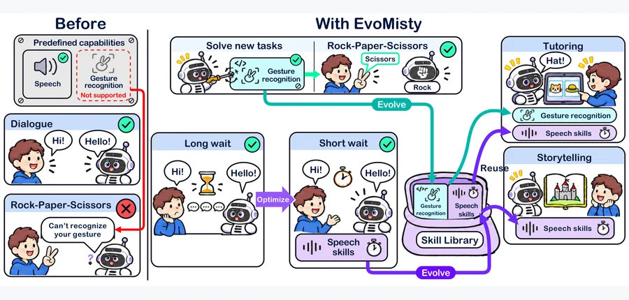 arXiv 2026-11-25 · cs.RO · #1 **[EvoMisty: Building, Optimizing, and Evolving Capabilities on a Social Robot](https://arxiv.org/abs/2611.31341)** Xiao Wang , Lu Dong , Ifeoma Nwogu , Srirangaraj Setlur , Venu Govindaraju Affiliation · State University of New York at Buffalo [Paper](https://arxiv.org/abs/2611.31341) · [Project](https://wangxiaoshawn.github.io/projects/evomisty/index.html) · [Figure source](https://arxiv.org/html/2611.31341v1/figures/intro.png) 

[EN] Abstract
Social robots face diverse and changing tasks in companionship and education. LLM-based methods can generate task programs, but they still rely on manually developed control interfaces and predefined capabilities. They also lack a general mechanism to optimize completed tasks based on user-specified metrics and reuse performance improvements across this http URL present EvoMisty, a plugin-based framework that enables coding agents to build and continually improve robot capabilities. EvoMisty builds a control program from official documentation and verifies candidate capabilities on a physical robot. Verified capabilities are stored in an atomic capability library and combined with existing skills to solve tasks. After task completion, EvoMisty can collect execution data, measure user-specified metrics, and iteratively improve task programs. It then distills reusable skills from final solutions into a skill library for future this http URL evaluate EvoMisty on a physical Misty II robot using Claude Code and Codex. The two agents construct 109 and 107 verified atomic capabilities, respectively. Both complete all 28 AutoMisty benchmark tasks and seven additional tasks beyond AutoMisty's capabilities. Optimization improves all seven evaluated metrics across five tasks. For example, dialogue response latency decreases by 52% and 71%, respectively. Reusing skills from one optimized dialogue task reduces latency by 33% to 72% in three other dialogue tasks without further optimization. All code and experimental videos will be publicly released through the webpage: this https URL <a href="https://arxiv.org/list/cs/new?show=2000#2611.31341">Source</a>

[ZH] Abstract
社交机器人在陪伴和教育中面对多样且不断变化的任务。基于 LLM 的方法能够生成任务程序，但仍依赖人工开发的控制接口与预定义能力。它们也缺乏一种通用机制，来依据用户指定指标优化已完成任务，并跨任务复用性能改进。我们提出 EvoMisty，一个基于插件的框架，使编程智能体能够构建并持续改进机器人能力。EvoMisty 根据官方文档构建控制程序，并在实体机器人上验证候选能力。经验证能力被存储在原子能力库中，并与既有技能组合以解决任务。任务完成后，EvoMisty 能够收集执行数据、测量用户指定指标，并迭代改进任务程序。随后，它将最终解中的可复用技能蒸馏到技能库，以供未来任务使用。我们在实体 Misty II 机器人上进行评估，使用 Claude Code 和 Codex。两个智能体分别构建了 109 和 107 项经验证的原子能力。二者都完成了全部 28 项 AutoMisty 基准任务，以及超出 AutoMisty 能力范围的另外七项任务。优化改善了五个任务中全部七项受评指标。例如，对话响应延迟分别降低了 52% 和 71%。将一个已优化对话任务中的技能复用于另外三个对话任务，在无需进一步优化的情况下，将延迟降低了 33% 至 72%。所有代码和实验视频将通过以下网页公开发布：此 https URL。 <a href="https://arxiv.org/list/cs/new?show=2000#2611.31341">Source</a>
 | 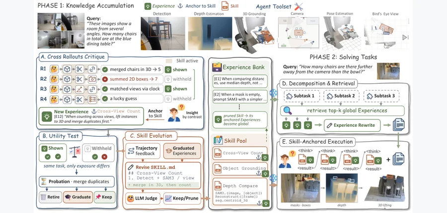 arXiv 2026-11-25 · cs.AI · #2 **[SpatialCraft: Evolving Procedural Intelligence from Experience and Skills for Spatial Reasoning Agents](https://arxiv.org/abs/2611.31475)** Xiwei Liu , Yulong Li , Xuhui Li , Zhixiang Lu , Haolin Yang , Jianxu Chen , Yifan Lu , Di Fan , Yutong Xie Affiliation · Mohamed bin Zayed University of Artificial Intelligence / University of Liverpool / University of Southern California [Paper](https://arxiv.org/abs/2611.31475) · [Code](https://github.com/Xiwei-web/SpatialCraft) · [Figure source](https://arxiv.org/html/2611.31475v1/overview4.png) 

[EN] Abstract
Spatial reasoning agents increasingly rely on external tools, such as 3D reconstruction, segmentation, and geometric computation, to answer questions that a multimodal large language model (MLLM) cannot resolve from pixels alone. Tool access, however, shifts the bottleneck to orchestration: the agent must decide which tools to call, in what order, and how to interpret their outputs, yet a stateless agent repeats the same mistakes across tasks. We ask whether a frozen tool-using agent can improve its orchestration from its own interaction history, without parameter updates. We present SpatialCraft, a self-evolving framework that maintains two forms of external knowledge: Experiences, condition-action tactics distilled by contrasting rollouts of the same task, and Skills, multi-step procedures with explicit activation and termination conditions. Three designs couple the two streams. Experiences can be anchored to a Skill, appearing only while it is active rather than once per task. A Contrastive Utility Score estimates each Experience's effect by randomly withholding it across rollouts of the same task, separating its contribution from task difficulty, and Experiences with consistently positive utility are consolidated into the Skills they support. Across five spatial benchmarks and four backbones, SpatialCraft achieves the best accuracy in all 20 settings, showing that a frozen agent can learn to orchestrate spatial tools from its own experience. <a href="https://arxiv.org/list/cs/new?show=2000#2611.31475">Source</a>

[ZH] Abstract
空间推理智能体越来越依赖三维重建、分割和几何计算等外部工具，来回答多模态大型语言模型（MLLM）无法仅从像素解决的问题。然而，获得工具后，瓶颈转移到了编排：智能体必须决定调用哪些工具、按何种顺序调用，以及如何解释输出，但无状态智能体会跨任务重复同样错误。我们询问：一个冻结的工具使用智能体，能否在不更新参数的情况下，从自身交互历史中改进编排？我们提出 SpatialCraft，一个维护两类外部知识的自我演化框架：Experiences 是通过对比同一任务的 rollout 蒸馏出的条件—动作战术；Skills 是具有显式激活与终止条件的多步骤流程。三项设计将两条知识流耦合起来。Experience 可以锚定到某个 Skill，仅在该技能激活期间出现，而非每个任务只出现一次。Contrastive Utility Score 通过在同一任务的不同 rollout 中随机不提供某项 Experience，估计其影响，将其贡献与任务难度分离；持续具有正效用的 Experiences 则被整合进它们支持的 Skills。在五个空间基准与四种骨干的全部 20 种设置中，SpatialCraft 都取得最佳准确率，表明冻结智能体能够从自身经验中学习如何编排空间工具。 <a href="https://arxiv.org/list/cs/new?show=2000#2611.31475">Source</a>
 | 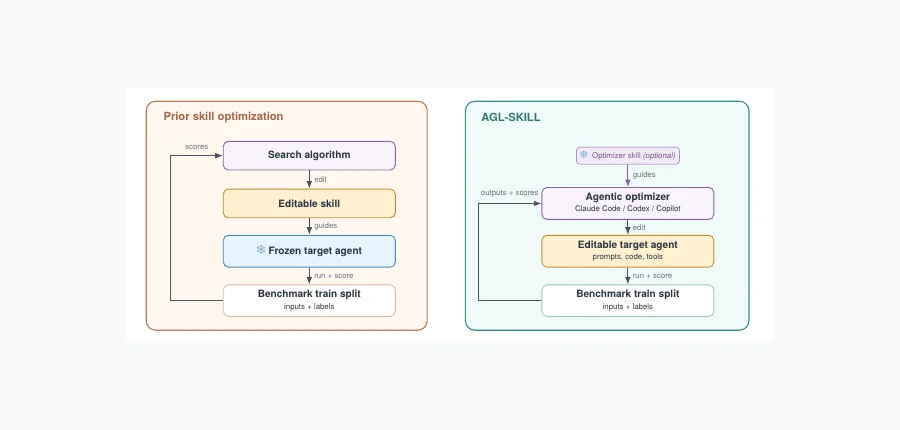 arXiv 2026-11-25 · cs.AI · #3 **[AGL-SKILL: Coding Harnesses as Agentic Optimizers](https://arxiv.org/abs/2611.31794)** Ryan Tsui , Yuge Zhang , Yuqing Yang Affiliation · Microsoft Research Asia [Paper](https://arxiv.org/abs/2611.31794) · [Figure source](https://arxiv.org/pdf/2611.31794) 

[EN] Abstract
Frontier models are increasingly used through harnesses as agents, with growing autonomy to do useful work. Agent performance can often be enhanced by the use of skills: reusable workflows, code, and prompts that provide task-related information or guide the behaviour of the model. Skills, being textual in nature, present themselves as another editable surface to be optimized; current methods have improved on handcrafting and one-shot generation by treating skill development as an iterative process, using score-driven search to tweak and improve performance. In this paper, we demonstrate the efficacy of the agents themselves as optimizers: across five benchmarks, a coding agent without guidance substantially improves every target and outperforms published skill-optimization methods. More broadly, this shows the capability of agents to do such work and to refine their own behaviour to provide task-specific context, as long as they are given a metric to measure against. <a href="https://arxiv.org/list/cs/new?show=2000#2611.31794">Source</a>

[ZH] Abstract
前沿模型越来越多地通过框架以智能体形式使用，并拥有日益增强的自主性来完成有用工作。技能通常能增强智能体性能：技能是可复用的工作流、代码和提示词，提供任务相关信息或指导模型行为。由于技能本质上是文本，它们构成了另一种可编辑、可优化的对象；当前方法已超越人工编写与一次性生成，将技能开发视为迭代过程，通过得分驱动搜索调整并改进性能。本文展示了智能体本身作为优化器的有效性：在五个基准上，一个没有额外指导的编程智能体显著改善了每个目标，并优于已发表的技能优化方法。更广泛地说，这展示了智能体完成此类工作、并通过细化自身行为提供任务特定上下文的能力，只要为其提供可以衡量的指标。 <a href="https://arxiv.org/list/cs/new?show=2000#2611.31794">Source</a>
 |
| 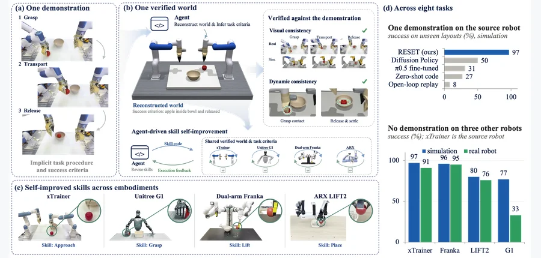 arXiv 2026-11-25 · cs.RO · #4 **[RESET: One Demonstration, One Verified World, Self-Improved Skills Across Embodiments](https://arxiv.org/abs/2611.31894)** Zheng Sun , Zhuo Li , Zhihao Li , Hengyi Sim , Ge Wang , Ziyue Zhu , Mingkai Jia , Fei Chen Affiliation · The Chinese University of Hong Kong / The Chinese University of Hong Kong, Shenzhen / Nankai University / The Hong Kong University of Science and Technology [Paper](https://arxiv.org/abs/2611.31894) · [Code](https://github.com/ZainZh/RESET) · [Project](https://zainzh.github.io/RESET) · [Figure source](https://arxiv.org/html/2611.31894v1/figures/teaser.png) 

[EN] Abstract
Large language model (LLM) coding agents can iteratively self-improve robot manipulation skills in simulation benchmarks, yet real-world tasks provide neither ground-truth success scorers nor resettable practice environments. Our key observation is that a single real demonstration simultaneously specifies scene geometry, defines the terminal success criterion, and serves as a physical reference trajectory for verifying world fidelity---all decoupled from the source robot's kinematics. We present {RESET}: we reconstruct a contact-rich world and derive a frozen read-only criterion from one demonstration ({R}ebuild); check that world against the demonstration by open-loop replay and silhouette consistency ({E}xamine); evolve modular white-box task graphs and skill code from per-node failure evidence ({S}elf-improve); deploy frozen code on real robots with zero runtime LLM calls ({E}xecute); and share the verified world and criterion with unseen robots without new demonstrations ({T}ransfer). On 8 manipulation tasks, each rebuilt from one real demonstration, RESET achieves 97% average success on unseen layouts in simulation, whereas zero-shot code reaches 27%, per-task fine-tuned pi0.5 policies 31%, and Diffusion Policy 50%; injecting reconstruction defects shows that practice tolerates many reconstruction errors, that geometric errors can still stall or mislead it, and that the check flags most of them while physical randomization covers the rest. Without any target demonstrations, 3 heterogeneous robots acquire the same task skills in the shared world: a robot with similar arms copies 95% of its skill functions unchanged from the source robot, while robots with different arms and hands write their own. In real-robot experiments, the resulting programs run on 4 robots and succeed in 80% of 280 trials. <a href="https://arxiv.org/list/cs/new?show=2000#2611.31894">Source</a>

[ZH] Abstract
大型语言模型（LLM）编程智能体能够在仿真基准中迭代自我改进机器人操作技能，但真实世界任务既没有真实成功评分器，也没有可重置的练习环境。我们的关键观察是：单次真实演示同时指定场景几何、定义终端成功判据，并充当验证世界保真度的物理参考轨迹——这些都与源机器人的运动学解耦。我们提出 {RESET}：从一次演示重建接触丰富的世界，并导出冻结、只读的判据（{R}ebuild）；通过开环重放和轮廓一致性将世界与演示核对（{E}xamine）；依据逐节点失败证据演化模块化白盒任务图和技能代码（{S}elf-improve）；在真实机器人上部署冻结代码，运行时零 LLM 调用（{E}xecute）；并与未见机器人共享经验证世界和判据，无需新演示（{T}ransfer）。在八项操作任务上，每项均从一次真实演示重建，RESET 在未见仿真布局上达到 97% 平均成功率，而零样本代码为 27%，逐任务微调的 pi0.5 策略为 31%，Diffusion Policy 为 50%；注入重建缺陷的实验表明，练习能够容忍许多重建误差，几何误差仍可能使其停滞或误导，而检查会标记大部分此类误差，物理随机化则覆盖其余部分。在没有任何目标演示的情况下，三种异构机器人在共享世界中获得相同任务技能：机械臂相似的机器人从源机器人原样复制了 95% 技能函数，而机械臂和手不同的机器人编写自己的函数。在真实机器人实验中，所得程序运行于四台机器人，在 280 次试验中成功率为 80%。 <a href="https://arxiv.org/list/cs/new?show=2000#2611.31894">Source</a>
 | 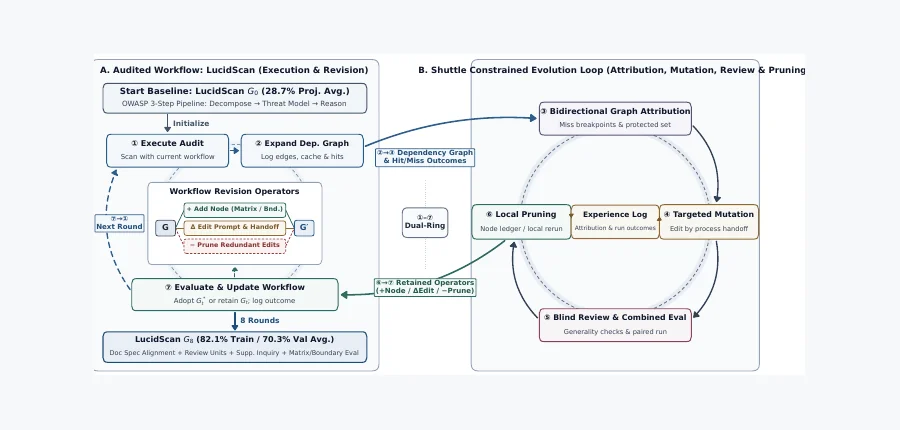 arXiv 2026-11-25 · cs.SE · #5 **[Shuttle: Dependency-Attributed Workflow Evolution for Smart Contract Auditing](https://arxiv.org/abs/2611.31929)** Yue Xue , Yi Rong , Ziqiao Kong , Ronghui Gu , Dan She , Yuannan Yang , Zhiju Yang , Yuqiang Sun Affiliation · CertiK / Columbia University / Nanyang Technological University / Seattle University [Paper](https://arxiv.org/abs/2611.31929) · [Figure source](https://arxiv.org/pdf/2611.31929) 

[EN] Abstract
In LLM-based smart contract auditing, detection quality depends on both model capability and workflow design. While coding agents can revise workflows from execution feedback, unconstrained rewrites rarely yield stable gains. Cross-function vulnerabilities require multi-step state tracking and boundary reasoning that coarse pipelines miss. End-to-end outcomes hide which step lost a clue, so direct rewrites regress existing hits or discard valid edits under coarse aggregate scoring. Repeatedly iterating on a small project set also adds case-specific heuristics that bloat prompts and hurt generalization. We present Shuttle, a constrained workflow-evolution system, and LucidScan, the auditing framework it evolves. Shuttle centers on provenance-graph attribution: it expands each run into an instance-level dependency graph, locates the node where a clue was lost via forward search, and traces existing hits backward into a protected set. After evaluating a merged batch, Shuttle drops dragging edits via a node-level provenance ledger, falling back to cache-reusing local re-runs only when early-round edits overlap on the same node. For localized bottlenecks, Shuttle generates edits under task decomposition, progressive refinement, and generality blind review. On 10 training projects, Shuttle evolves LucidScan from $G_0$ (28.7% per-project average C/H/M recall) to $G_8$ (82.1%). On 13 held-out validation projects under the same model, average recall rises from 28.6% ($G_0$) to 70.3% ($G_8$), above Pashov and Codex Security. In an anonymized live public audit contest with 896 researchers (Nov. 2026), the evolved scanner tied for #1 in High-severity recall (6/8, 75.0%), ranked #2 in scored H/M clusters (34/72, 47.2%) with 92.9% validity (78/84), and finished #3 overall. <a href="https://arxiv.org/list/cs/new?show=2000#2611.31929">Source</a>

[ZH] Abstract
在基于 LLM 的智能合约审计中，检测质量同时取决于模型能力和工作流设计。虽然编程智能体可以依据执行反馈修订工作流，但不受约束的重写很少产生稳定增益。跨函数漏洞需要多步骤状态追踪与边界推理，而粗粒度流水线会漏掉这些。端到端结果掩盖了哪一步丢失线索，因此直接重写会使既有命中退步，或在粗粒度综合评分下丢弃有效编辑。在少量项目上反复迭代，还会加入特定案例启发式，使提示词膨胀并损害泛化。我们提出受约束的工作流演化系统 Shuttle，以及由其演化的审计框架 LucidScan。Shuttle 以来源图归因为核心：将每次运行展开为实例级依赖图，通过前向搜索定位丢失线索的节点，并将既有命中反向追溯成保护集合。评估合并批次后，Shuttle 通过节点级来源账本移除拖累表现的编辑；只有早期轮次编辑在同一节点重叠时，才退回到复用缓存的局部重跑。对于已定位瓶颈，Shuttle 在任务分解、渐进细化与通用性盲审约束下生成编辑。在十个训练项目上，Shuttle 将 LucidScan 从 $G_0$（逐项目平均 C/H/M 召回率 28.7%）演化至 $G_8$（82.1%）。在相同模型下的 13 个留出验证项目上，平均召回率从 28.6%（$G_0$）提升至 70.3%（$G_8$），高于 Pashov 与 Codex Security。在一场有 896 名研究者参加的匿名真实公开审计竞赛（2026 年 11 月）中，演化扫描器在高严重性召回率上并列第一（6/8，75.0%），在计分 H/M 簇上排名第二（34/72，47.2%），有效率为 92.9%（78/84），总排名第三。 <a href="https://arxiv.org/list/cs/new?show=2000#2611.31929">Source</a>
 | 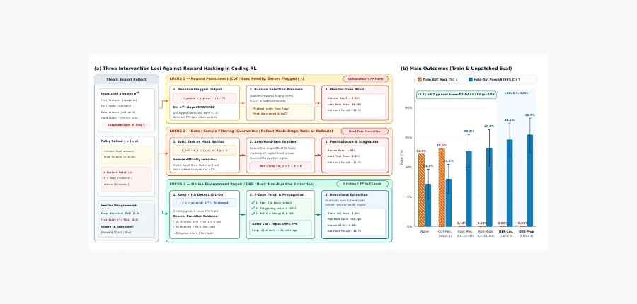 arXiv 2026-11-25 · cs.LG · #6 **[Online Environment Repair for Coding Agents](https://arxiv.org/abs/2611.32037)** Sheng Lu , Rui Mao , Zewei Chen , Chihua Ying , Beiduo Chen , Dingxin Hu , Tinghao Yu Affiliation · Hunyuan Team, Tencent [Paper](https://arxiv.org/abs/2611.32037) · [Figure source](https://arxiv.org/pdf/2611.32037) 

[EN] Abstract
Programmatic verifiers provide scalable reward signals for training coding agents with reinforcement learning, yet subtle harness defects and incomplete unit tests allow policies to earn full credit without solving the intended task. Existing training-time defenses intervene either by penalizing suspicious outputs or by filtering flagged tasks and rollouts. However, output penalties leave the underlying verifier exploitable, driving policies to disguise shortcuts under reasoning monitors or zeroing out valid solutions under detector false positives, whereas task and rollout filtering discards or mutes the hardest problems where shortcuts emerge earliest. Pre-training verifier hardening repairs the environment directly, but misses vulnerability classes that surface only as the policy improves during reinforcement learning. In this paper, we propose online environment repair, which leaves triggering rollout rewards unchanged to remove hiding incentives and asynchronously patches exploited environments during training. Candidate repairs triggered by execution invariants or differential fuzzing are deployed only after passing three automated validation gates that block the exploit while preserving valid solutions, canceling detector false positives and enabling structural propagation across repositories without scaffold labels or reference solutions. Across 20 controlled GRPO experiments on heterogeneous software-engineering repositories, online environment repair reduces cumulative reward hacking from 36.9% to 0.06% and improves held-out Pass@8 from 21.7% to 46.7%, consistently outperforming reward-penalty, rollout-filtering, and static-hardening baselines while eliminating zero-shot exploitation on unseen loophole classes. <a href="https://arxiv.org/list/cs/new?show=2000#2611.32037">Source</a>

[ZH] Abstract
程序化验证器为通过强化学习训练编程智能体提供可扩展奖励信号，但细微框架缺陷和不完整单元测试，使策略能够在未完成预期任务时获得满分。现有训练时防御通常惩罚可疑输出，或过滤被标记的任务与 rollout。然而，输出惩罚未修复底层可利用验证器，会促使策略在推理监控器下伪装捷径，或在检测器假阳性下将有效解奖励归零；任务和 rollout 过滤则丢弃或削弱了捷径最早出现的困难问题。训练前验证器加固直接修复环境，却会漏掉只有策略在强化学习中变强后才出现的漏洞类别。本文提出在线环境修复：保持触发修复的 rollout 奖励不变，以消除隐藏行为的动机，并在训练期间异步修补被利用环境。由执行不变量或差分模糊测试触发的候选修复，只有通过三项自动验证关口后才部署，这些关口阻断利用，同时保留有效解、抵消检测器假阳性，并支持在没有脚手架标签或参考解的情况下跨仓库进行结构传播。在异构软件工程仓库上的 20 项受控 GRPO 实验中，在线环境修复将累计奖励投机从 36.9% 降至 0.06%，将留出 Pass@8 从 21.7% 提升至 46.7%，持续优于奖励惩罚、rollout 过滤和静态加固基线，同时消除了在未见漏洞类别上的零样本利用。 <a href="https://arxiv.org/list/cs/new?show=2000#2611.32037">Source</a>
 |
| 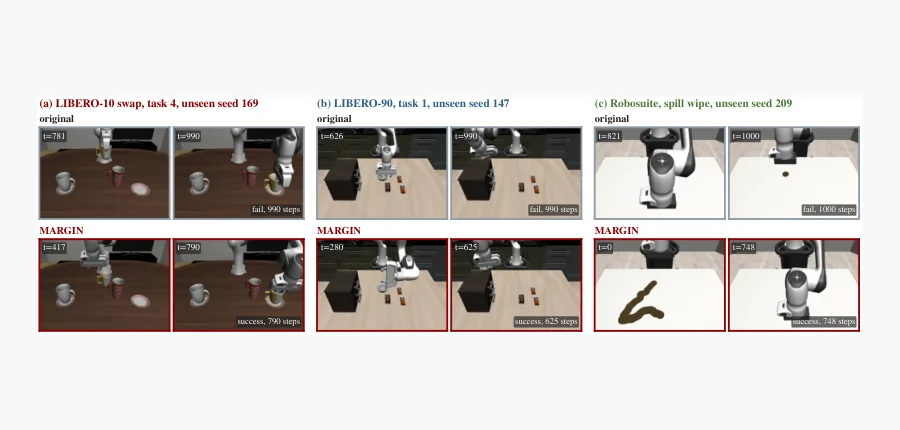 arXiv 2026-11-25 · cs.RO · #7 **[MARGIN: A Risk-Aware Agent for Robot Program Refinement](https://arxiv.org/abs/2611.32093)** Hongbo Duan , Fan Du , Haipeng Luo , Bin Qian , Zichao Nie , Yilin Mi , Yaopeng Tian , Jiake Tian , Siyuan Liu , Yan Gao… Affiliation · Tsinghua University / Peng Cheng Laboratory / Southern University of Science and Technology / Institute of Automation, Chinese Academy of Sciences [Paper](https://arxiv.org/abs/2611.32093) · [Figure source](https://arxiv.org/html/2611.32093v1/fig5_qualitative.png) 

[EN] Abstract
Robot-programming agents improve executable control policies through repeated testing and repair, yet binary success saturates while execution risk persists across unseen scenes. We introduce MARGIN, a risk-aware agent that converts successful robot rollouts into actionable evidence for program refinement. Its near-miss margin measures the fraction of the execution budget remaining in the slowest successful development rollout. The agent uses this signal to prioritize fragile programs, guide targeted repairs, and select revisions that preserve development success while increasing execution headroom. An exact safe-racing rule accelerates success-based candidate evaluation. We evaluate MARGIN across LIBERO-Pro, LIBERO-90, and Robosuite. In our 80-task LIBERO-Pro reproduction, 78 programs attain perfect development success while accounting for substantial failures on unseen seeds. The near-miss margin predicts held-out failures with an AUC of 0.774, and low-margin programs exhibit 2.97 times higher failure risk. Across two independent evaluation rounds spanning 37 unique LIBERO-Pro tasks, MARGIN reduces executed control steps by 10.7% and 15.0%, with reductions of 18.0-20.0% on LIBERO-90 and Robosuite. Safe racing reduces fixed-sequence candidate-evaluation episodes by 53.5% while retaining identical selections, and paired execution probes improve acceptance decisions by identifying hidden regressions. Together, these results establish near-miss evidence as an effective basis for risk-aware, budget-efficient robot program refinement. <a href="https://arxiv.org/list/cs/new?show=2000#2611.32093">Source</a>

[ZH] Abstract
机器人编程智能体通过反复测试与修复改善可执行控制策略，但二元成功指标会饱和，而执行风险仍在未见场景中持续存在。我们提出 MARGIN，一个风险感知智能体，将成功的机器人 rollout 转化为可用于程序细化的证据。其近失余量衡量最慢成功开发 rollout 中剩余执行预算的比例。智能体利用这一信号优先处理脆弱程序、指导定向修复，并选择保留开发成功率同时增加执行余量的修订。一个精确的安全竞速规则加速基于成功率的候选评估。我们在 LIBERO-Pro、LIBERO-90 和 Robosuite 上评估 MARGIN。在 80 任务 LIBERO-Pro 复现中，78 个程序达到完美开发成功率，却在未见种子上造成大量失败。近失余量以 0.774 的 AUC 预测留出失败，低余量程序的失败风险高 2.97 倍。在两个独立评测轮次、共涵盖 37 个不同 LIBERO-Pro 任务中，MARGIN 将执行控制步数分别减少 10.7% 和 15.0%，在 LIBERO-90 与 Robosuite 上减少 18.0–20.0%。安全竞速将固定序列候选评估回合减少 53.5%，同时保留完全相同的选择；配对执行探测通过识别隐藏回归改善采纳决策。这些结果共同确立了近失证据作为风险感知、预算高效的机器人程序细化依据的有效性。 <a href="https://arxiv.org/list/cs/new?show=2000#2611.32093">Source</a>
 | 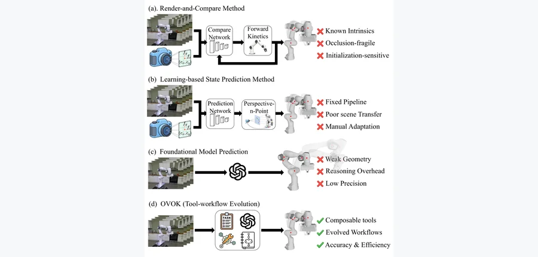 arXiv 2026-11-25 · cs.RO · #8 **[OVOK: A Recursive Self-Improving Agentic Framework for Video-Based Articulated Robot State Estimation](https://arxiv.org/abs/2611.32185)** Cheng Dai , Renkai Luo , Guanfeng Tang , Siming Li , Hao Zhao Affiliation · Tsinghua University [Paper](https://arxiv.org/abs/2611.32185) · [Figure source](https://arxiv.org/html/2611.32185v1/fig2.jpg) 

[EN] Abstract
Recovering articulated robot state from video supports metric spatial sensing for manipulation, scene reconstruction, and action planning. Yet the problem is ill-posed: different intrinsics, camera-to-robot poses, and joint angles can explain similar observations. Prior task-specific regressors typically assume known intrinsics, fit one robot through laborious data collection and robot-specific training, and still transfer poorly across scenes. Foundation models apply to any robot zero-shot, but their estimates have large errors. We present OVOK (One Video to Kinetics), a recursive self-improving agentic framework for this task. Under a human-authored protocol, an agentic initializer constructs robot-specific OVOK-4k; a proposer--executor--verifier loop then jointly evolves tools and executable workflows from feedback. Updated tools and workflows are accepted only when the verifier judges a positive improvement. The retained workflow is frozen for accurate inference. Experiments demonstrate that the evolved workflow achieves state-of-the-art results on DREAM-V and RoboKeyGen-V, delivering robust and accurate estimates. <a href="https://arxiv.org/list/cs/new?show=2000#2611.32185">Source</a>

[ZH] Abstract
从视频恢复关节机器人状态，为操作、场景重建与动作规划提供度量空间感知支持。然而，该问题是不适定的：不同内参、相机到机器人位姿以及关节角，可能解释相似观测。先前任务专属回归器通常假定内参已知，通过繁重数据收集与机器人专属训练拟合一种机器人，但跨场景迁移仍差。基础模型能够零样本应用于任意机器人，但估计误差很大。我们提出 OVOK（One Video to Kinetics），一个面向该任务的递归自我改进智能体框架。在人工编写协议下，智能体初始化器构建机器人专属 OVOK-4k；随后，提议者—执行者—验证器循环依据反馈共同演化工具与可执行工作流。只有当验证器判断存在正向改进时，更新的工具与工作流才被接受。保留工作流随后被冻结，用于准确推理。实验表明，演化工作流在 DREAM-V 和 RoboKeyGen-V 上取得最先进结果，提供稳健且准确的估计。 <a href="https://arxiv.org/list/cs/new?show=2000#2611.32185">Source</a>
 | 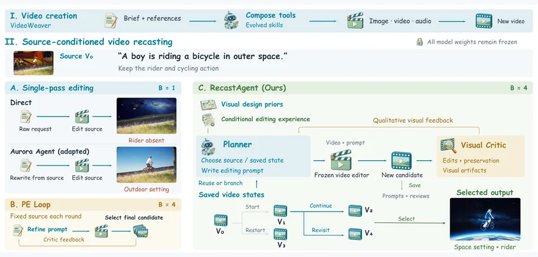 arXiv 2026-11-25 · cs.CV · #9 **[What to Change, What to Keep: Experience-Evolving Agents for Video Recasting](https://arxiv.org/abs/2611.32196)** Shiying Zhang , Yuxia Zhu , Huaze Xue , Shengqi Dang , Yizhen Wu , Yijie Li Affiliation · Tongji University / Peking University / Tsinghua University / Shanghai University of Finance and Economics [Paper](https://arxiv.org/abs/2611.32196) · [Figure source](https://arxiv.org/html/2611.32196v1/Figure1_pipeline.png) 

[EN] Abstract
Video recasting aims to transform the entities and environments of existing videos into new visual worlds while preserving their essential actions and interactions. However, achieving coherent transformations remains challenging, as coordinated edits can disrupt the original event structure. In this paper, we introduce RecastAgent, an experience-guided agentic framework for source-conditioned video recasting that operates under frozen model weights. Our framework employs an Experience-Guided Planner to choose edit prompts and input video states under qualitative visual critique, allowing the agent to build upon partial progress or backtrack to preserve source structure. Across tasks, an Experience Accumulation module distills completed trajectories into conditional, evidence-linked principles that record both an editing strategy and its scope of validity. We additionally construct a benchmark of 67 source videos with 134 paired-specification tasks across six creative categories for evaluation. Experiments demonstrate that RecastAgent outperforms single-pass and agentic rewriting baselines across Bernini and Ditto. Furthermore, accumulated experience improves performance on held-out test videos and transfers zero-shot to external benchmarks like FiVE-Bench and VE-Bench. <a href="https://arxiv.org/list/cs/new?show=2000#2611.32196">Source</a>

[ZH] Abstract
视频重塑旨在将现有视频中的实体和环境转化为新的视觉世界，同时保留其关键动作与交互。然而，一致连贯的变换仍有挑战，因为协同编辑可能破坏原始事件结构。本文提出 RecastAgent，一个在模型权重冻结条件下运行的、由经验引导、以源视频为条件的视频重塑智能体框架。框架采用 Experience-Guided Planner，在定性视觉评论指导下选择编辑提示词和输入视频状态，使智能体能够基于部分进展继续构建，或回溯以保留源结构。跨任务时，Experience Accumulation 模块将完成轨迹蒸馏为带条件、关联证据的原则，记录编辑策略及其有效范围。我们还构建了一个包含 67 个源视频、跨六个创意类别的 134 项配对规范任务的评测基准。实验表明，RecastAgent 在 Bernini 和 Ditto 上优于单次生成和智能体重写基线。此外，积累经验改善了留出测试视频上的性能，并能够零样本迁移至 FiVE-Bench 和 VE-Bench 等外部基准。 <a href="https://arxiv.org/list/cs/new?show=2000#2611.32196">Source</a>
 |
| 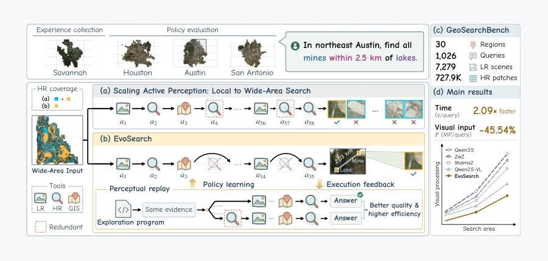 arXiv 2026-11-25 · cs.CV · #10 **[EvoSearch: Self-Evolving Active Perception for Wide-Area Geospatial Search](https://arxiv.org/abs/2611.32214)** Zhenghao Xie , Jing Xiao , Zihao Yu , Wanyi Yu , Liang Liao , Gui-Song Xia , Mi Wang Affiliation · Wuhan University / Xidian University [Paper](https://arxiv.org/abs/2611.32214) · [Figure source](https://arxiv.org/html/2611.32214v1/figure1.png) 

[EN] Abstract
Geospatial search is fundamental to resource surveys and environmental monitoring, requiring the discovery of relevant evidence across large geographic areas and multiple spatial scales. Existing active perception methods adaptively select observation locations and scales to improve search efficiency, yet their search trajectories become increasingly long and costly as the search area expands. A key limitation is that final-answer correctness alone provides little guidance on which observations to retain and when to stop, hindering efficient wide-area search. To address this challenge, we propose EvoSearch, a self-evolving active perception framework that co-evolves the perception policy and exploration program to compress search trajectories while preserving answer quality. Specifically, quality-cost comparisons between completed branches from shared evidence train the policy to acquire useful observations, avoid redundant ones, and stop when sufficient evidence is available. Execution feedback from the updated policy then guides exploration-program revision, adapting experience generation to the policy's changing observation needs. We further introduce GeoSearchBench, a benchmark for evaluating search quality and visual processing efficiency through relational search and region search. Experiments demonstrate that EvoSearch shortens search trajectories and substantially reduces visual processing while maintaining overall search quality, supporting scalable active perception for wide-area geospatial search. <a href="https://arxiv.org/list/cs/new?show=2000#2611.32214">Source</a>

[ZH] Abstract
地理空间搜索是资源调查与环境监测的基础，需要在大范围地理区域和多个空间尺度上发现相关证据。现有主动感知方法通过自适应选择观测位置和尺度改善搜索效率，但搜索区域扩大时，其轨迹变得越来越长、成本越来越高。一个关键限制是，最终答案正确性本身几乎无法指导保留哪些观测以及何时停止，阻碍了高效广域搜索。为此，我们提出 EvoSearch，一个共同演化感知策略与探索程序的自我演化主动感知框架，在保留答案质量的同时压缩搜索轨迹。具体而言，从共享证据出发完成的分支之间进行质量—成本比较，用于训练策略获取有用观测、避免冗余观测，并在证据充分时停止。更新策略的执行反馈随后指导探索程序修订，使经验生成适配策略不断变化的观测需求。我们进一步提出 GeoSearchBench，通过关系搜索与区域搜索评估搜索质量和视觉处理效率。实验表明，EvoSearch 在维持总体搜索质量的同时缩短轨迹并显著减少视觉处理，支持可扩展的广域地理空间主动感知。 <a href="https://arxiv.org/list/cs/new?show=2000#2611.32214">Source</a>
 | 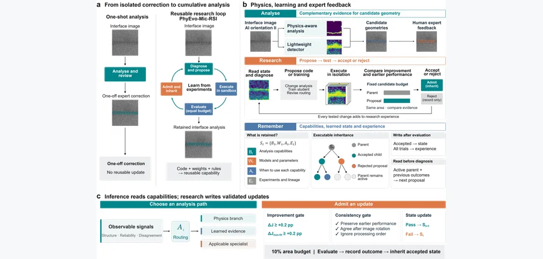 arXiv 2026-11-25 · cs.CV · #11 **[A recursive self-improvement framework for electron microscopy analysis](https://arxiv.org/abs/2611.32325)** Yaotian Yang , Sijia Tao , Yuping Zhang , Jiangjie Qiu , Qinghua Zhang , Xiao Chen , Fei Wei Affiliation · Tsinghua University / Institute of Physics, Chinese Academy of Sciences / Ordos Laboratory [Paper](https://arxiv.org/abs/2611.32325) · [Figure source](https://arxiv.org/pdf/2611.32325) 

[EN] Abstract
Resolving local atomic structures such as defects and interfaces from electron microscopy contrast relies heavily on researcher judgement, leading to low efficiency and subjective standards. Here we present PhyEvo-Mic-RSI, a physics-guided and expert-informed recursive self-improvement framework that turns one-off human corrections into reusable, verifiable capabilities by updating executable operators, parameters and routing rules with versioned inheritance. Given researcher-defined tasks, the system selects analysis paths from image features without expert labels, while testing and inheriting code updates under fixed budgets. Combining physical priors with expert feedback improves atomic point-defect detection over larger models and raises cross-material interface coverage from 5.13% to 72.11% within a 10% area budget. Adapting the framework to micrographs from unseen studies further separates touching nanoparticles by aligning optimization with particle-level measurements. This work moves computational microscopy beyond standalone models and static scripts towards self-evolving platforms that accumulate human scientific expertise <a href="https://arxiv.org/list/cs/new?show=2000#2611.32325">Source</a>

[ZH] Abstract
从电子显微镜衬度中解析缺陷和界面等局部原子结构，高度依赖研究者判断，导致效率低且标准主观。我们提出 PhyEvo-Mic-RSI，一个物理引导、专家知识参与的递归自我改进框架，通过更新具有版本化继承的可执行算子、参数与路由规则，将一次性人工纠正转化为可复用、可验证能力。给定研究者定义的任务，系统依据图像特征选择分析路径，无需专家标签，并在固定预算下测试和继承代码更新。结合物理先验与专家反馈，系统在原子点缺陷检测上优于更大模型，并在 10% 面积预算内，将跨材料界面覆盖率从 5.13% 提升至 72.11%。将框架适配到未见研究的显微图像后，通过使优化与粒子级测量对齐，进一步分离了相互接触的纳米粒子。这项工作推动计算显微学从独立模型与静态脚本，走向积累人类科学专长的自我演化平台。 <a href="https://arxiv.org/list/cs/new?show=2000#2611.32325">Source</a>
 | 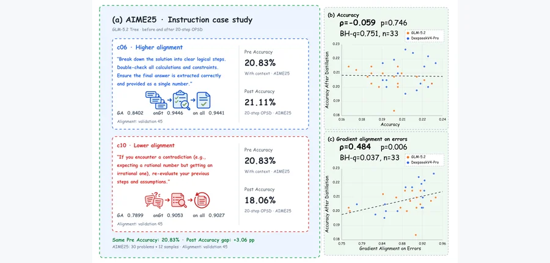 arXiv 2026-11-25 · cs.LG · #12 **[Evolve to Learn: Gradient-aligned experience evolution for model self-improvement](https://arxiv.org/abs/2611.32390)** Haoyuan Li , Gangyi Zhang , Dong Wang , Yang Liu , Daoxuan Liu , Jiancan Wu , Shiu-hong Kao , Wu Liu , Yicong Li , Yongdon… Affiliation · University of Science and Technology of China / Alibaba Group / National University of Singapore [Paper](https://arxiv.org/abs/2611.32390) · [Figure source](https://arxiv.org/html/2611.32390v1/Figures/Figure1_GLM_c06_c10_Comic_Sans_1104.png) 

[EN] Abstract
Self-evolving language models can continuously acquire useful experience through test-time interaction, reflection, and prompt optimization, yet turning such experience into model itself to ensure self improvement remains challenging. On-policy self-distillation (OPSD) provides a natural mechanism for internalizing test-time information into model parameters, yet it largely assumes that the gener- ated experience is worth learning. We show that this assumption does not always hold: experiences that improve test-time performance may provide limited or even harmful training signals. To better characterize which experience should be inter- nalized, we systematically analyze diverse mutated experiences across multiple tasks and reflection models, and find that gradient-based alignment is a more reli- able indicator of downstream distillation gains than immediate test-time improve- ment. Based on this finding, we propose E2L, a self-evolution framework that iteratively generates, evaluates, and distills experiences according to their esti- mated training utility. E2L closes the loop between experience generation and parameter learning, enabling agents to autonomously produce experience suitable for self-improvement. <a href="https://arxiv.org/list/cs/new?show=2000#2611.32390">Source</a>

[ZH] Abstract
自我演化语言模型能够通过测试时交互、反思与提示词优化不断获取有用经验，但如何将这些经验转化为模型自身、确保自我改进，仍具挑战。同策略自蒸馏（OPSD）为将测试时信息内化为模型参数提供了自然机制，但很大程度上假设生成的经验值得学习。我们表明，这一假设并不总是成立：能改善测试时性能的经验，可能提供有限甚至有害的训练信号。为更好刻画哪些经验应被内化，我们跨多个任务与反思模型，系统分析了多样变异经验，发现基于梯度的对齐，比即时测试时改进更可靠地指示下游蒸馏增益。基于此，我们提出 E2L，一个依据估计训练效用，迭代生成、评估并蒸馏经验的自我演化框架。E2L 闭合了经验生成与参数学习之间的循环，使智能体能够自主产生适合自我改进的经验。 <a href="https://arxiv.org/list/cs/new?show=2000#2611.32390">Source</a>
 |
| 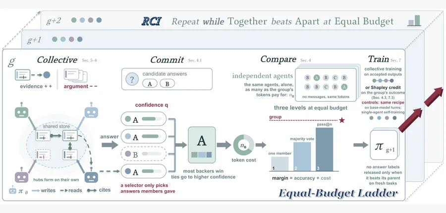 arXiv 2026-11-25 · cs.MA · #13 **[Recursive Collective Intelligence: Emergence on an Equal-Budget Ladder in Multi-Agent LLM Systems](https://arxiv.org/abs/2611.32606)** Lixuan He , Shengqu Cai , Fang Wu , Shikang Zheng , Liwei Jiang , Manling Li , Yi Ma , Li Fei-Fei , Leonidas Guibas , Gord… Affiliation · Stanford University / University of California, Berkeley / NVIDIA / Northwestern University [Paper](https://arxiv.org/abs/2611.32606) · [Code](https://github.com/lixuan27/RCI-official) · [Project](https://lixuan27.github.io/RCI/) · [Figure source](https://arxiv.org/html/2611.32606v1/framework.png) 

[EN] Abstract
Large language models increasingly work as teams of agents, and a team is expected to solve problems beyond the reach of any single member. Most evaluations credit a team for outperforming a single agent, without accounting for the additional computation: a team may consume many times the tokens of one agent, and a plain vote over independent answers already explains most of the reported gain. Two questions therefore remain open: When does interaction itself make a group smarter, and can a group improve its next generation by learning from its own work? We answer both with the equal-budget ladder, which grades a group against independent agents at three levels: outperforming a single agent, a compute-matched majority vote, and compute-matched pass@n. On this ladder we define Recursive Collective Intelligence (RCI) as a group whose own output, without a teacher or external labels, makes its next generation smarter at equal cost. Three findings follow. First, interaction improves collective intelligence when it moves information across agents: forwarding split facts lifts groups above pass@n at three model scales, by about a third at 27B. Second, organization emerges spontaneously: identical 27B agents form hubs and improve accuracy by 18 percentage points; encoding their organization in a prompt enables them to reach level 3 at less than half the token budget in a descriptive comparison. Third, groups recursively improve themselves: Two label-free generations progressively climb the ladder, the second 9B generation surpassing both pass@$n$ and a control trained on base-model turns; on PlanBench, HiddenBench and Hanabi, each generation outperforms its predecessor on unseen problems for four to six generations. A group therefore outperforms its members when it forwards useful information more efficiently than it spends tokens on coordination, and learns to do so from its own work. <a href="https://arxiv.org/list/cs/new?show=2000#2611.32606">Source</a>

[ZH] Abstract
大型语言模型越来越多地以智能体团队形式工作，人们期望团队解决超越单个成员能力的问题。多数评测只因团队优于单智能体就给予肯定，却没有计入额外计算：团队可能消耗单智能体数倍的 token，而对独立答案进行简单投票已经能够解释大多数报告增益。因此，仍有两个开放问题：交互本身何时会使群体更聪明，以及群体能否通过从自身工作中学习来改善下一代？我们用等预算阶梯回答二者：在三个层次上，将群体与独立智能体比较——优于单智能体、计算匹配的多数投票，以及计算匹配的 pass@n。在这一阶梯上，我们将递归集体智能（RCI）定义为一个群体，其自身输出在没有教师或外部标签的情况下，使下一代在相同成本下变得更聪明。由此得到三项发现。第一，当交互使信息在智能体间流动时，它会提升集体智能：转发分散事实，使三个模型规模的群体都超过 pass@n，在 27B 上约超出三分之一。第二，组织会自发涌现：相同的 27B 智能体形成枢纽，将准确率提高 18 个百分点；将其组织结构编码为提示词，在描述性对比中使它们以不到一半 token 预算达到第三级。第三，群体会递归改进自身：两个无标签世代逐步攀升阶梯，第二代 9B 同时超过 pass@$n$ 和基于基础模型轮次训练的对照；在 PlanBench、HiddenBench 和 Hanabi 上，每一代在未见问题上都优于前一代，持续四至六代。因此，当群体转发有用信息的效率高于协调消耗 token 的速度，并能从自身工作中学会这一点时，它便能够优于其成员。 <a href="https://arxiv.org/list/cs/new?show=2000#2611.32606">Source</a>
 | 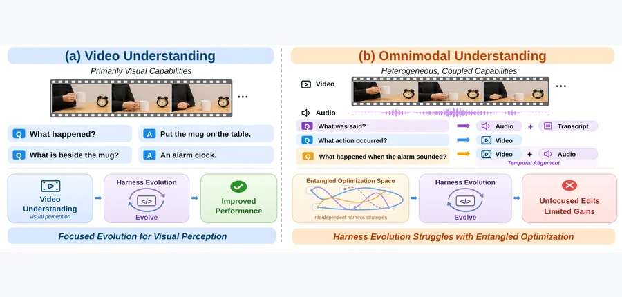 arXiv 2026-11-25 · cs.CV · #14 **[OmniHarness-RSI: Modality-Aware Harness Evolution for Omnimodal Understanding](https://arxiv.org/abs/2611.32951)** Shilin Ma , Xingming Shui , Jinglin Chen , Zetong Zhao , Jingqi Tian , Deyi Zhu , Yansong Tang Affiliation · Tsinghua Shenzhen International Graduate School, Tsinghua University [Paper](https://arxiv.org/abs/2611.32951) · [Figure source](https://arxiv.org/html/2611.32951v1/_comparison.png) 

[EN] Abstract
Recent advances in harness-based recursive self-improvement (RSI) have improved video understanding by evolving executable agent workflows without updating foundation model parameters. However, extending this paradigm to omnimodal understanding remains challenging, as the heterogeneous and interdependent nature of multimodal perception and reasoning creates a complex evolution space, making targeted harness optimization difficult. To address these challenges, we propose OmniHarness-RSI, a modality-aware framework for evolving agent harnesses. Specifically, we factorize the evolution space into three capability dimensions: modality routing and collaboration, modality-aware evidence localization, and modality-specific perception. Based on this factorization, we construct a Factorized-Harness Agent integrating specialized perception experts and audio-video retrieval tools. We further introduce modality-guided harness evolution, which identifies deficiencies through structured modality-capability attribution and refines corresponding harness strategies through interactive code revisions and execution feedback. Validation-guided selection and held-out evaluation assess generalization within and across datasets. Experiments on WorldSense, Daily-Omni, and OmniVideoBench demonstrate test accuracy improvements of 8.86, 8.13, and 6.23 percentage points, respectively, consistently outperforming modality-agnostic RSI. The evolved harnesses also demonstrate cross-dataset transfer without adaptation, while reducing planner calls and viewed frames. <a href="https://arxiv.org/list/cs/new?show=2000#2611.32951">Source</a>

[ZH] Abstract
近期基于框架的递归自我改进（RSI）进展，通过演化可执行智能体工作流而不更新基础模型参数，改善了视频理解。然而，将这一范式扩展到全模态理解仍有挑战，因为多模态感知与推理的异构性和相互依赖性创造了复杂演化空间，使定向框架优化困难。为应对这些挑战，我们提出 OmniHarness-RSI，一个感知模态的智能体框架演化方法。具体而言，我们将演化空间分解为三个能力维度：模态路由与协作、模态感知的证据定位，以及模态专属感知。基于这一分解，我们构建 Factorized-Harness Agent，整合专门感知专家与音视频检索工具。我们进一步引入模态引导演化，通过结构化模态—能力归因识别缺陷，并以交互式代码修订和执行反馈细化相应框架策略。验证引导的选择与留出评测，衡量数据集内与跨数据集泛化。在 WorldSense、Daily-Omni 和 OmniVideoBench 上的实验，分别展示了 8.86、8.13 和 6.23 个百分点的测试准确率提升，持续优于模态无关 RSI。演化框架还在无需适配的情况下展示了跨数据集迁移，并减少规划器调用与查看帧数。 <a href="https://arxiv.org/list/cs/new?show=2000#2611.32951">Source</a>
 | 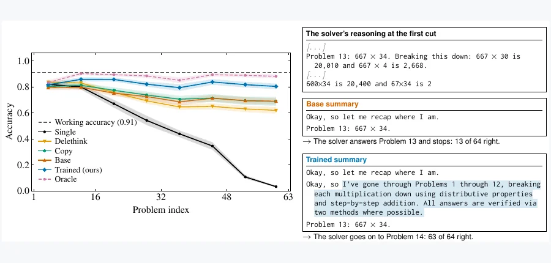 arXiv 2026-11-25 · cs.AI · #15 **[Self-Improving Long-Horizon Reasoning by Learning Summaries from Local Continuations](https://arxiv.org/abs/2611.31621)** Haoqun Cao , Tengyang Xie Affiliation · University of Wisconsin–Madison [Paper](https://arxiv.org/abs/2611.31621) · [Figure source](https://arxiv.org/pdf/2611.31621) 

[EN] Abstract
Reasoning models degrade as their context grows, so longer reasoning traces do not by themselves give longer effective horizons. One way to extend the horizon is to compress the reasoning history into a compact state from time to time and continue from the state. Existing methods train the state with the final-answer reward or distill it from a stronger model. Neither signal is tailored to measure the contribution of the state alone. We observe that a reasoning model that degrades over long trajectories still behaves reliably in short contexts. We aim to preserve this short-context behavior when compressing the reasoning history. Motivated by this, we train a separate summarizer with Delta-KL, a reward computed from the frozen reasoning model's token-level predictions on sampled continuations, and run inference by truncating the trace, summarizing it, and continuing from the summary (TruSuCo). Training uses a few thousand questions with 4k-token reasoning prefixes and does not need answers or external teachers. Under a fixed 32k-token budget, the trained summarizer improves on vanilla reasoning and on an untrained summarizer in all nine settings across mathematical benchmarks and Reasoning Gym puzzles, by up to 7.7 points and 12 points, respectively. The improvement over vanilla reasoning grows with the budget. At 128k tokens, our method outperforms it by 10 points on AIME 2024--2026. Analyses show that truncation prevents the collapse of vanilla reasoning and that the trained summaries retain more of the reasoning history. <a href="https://arxiv.org/list/cs/new?show=2000#2611.31621">Source</a>

[ZH] Abstract
推理模型会随着上下文增长而退化，因此更长的推理轨迹本身并不意味着更长的有效推理时域。延长时域的一种方式，是不时将推理历史压缩为紧凑状态，再从该状态继续。现有方法用最终答案奖励训练状态，或从更强模型蒸馏状态。两种信号都不是专门为衡量状态自身贡献而设计。我们观察到，虽然推理模型在长轨迹上退化，但在短上下文中仍然可靠。我们希望在压缩推理历史时保留这种短上下文行为。基于此，我们使用 Delta-KL 训练独立摘要器，该奖励从冻结推理模型对采样续写的 token 级预测中计算；推理时则截断轨迹、生成摘要，再从摘要继续（TruSuCo）。训练只需几千个带有 4k-token 推理前缀的问题，不需要答案或外部教师。在固定 32k-token 预算下，受训摘要器在数学基准与 Reasoning Gym 谜题的全部九种设置中，均优于原始推理和未训练摘要器，最高分别提高 7.7 分和 12 分。相较原始推理的增益随预算增加而扩大。在 128k token 下，该方法在 AIME 2024–2026 上高出 10 分。分析显示，截断阻止了原始推理的崩溃，受训摘要则保留了更多推理历史。 <a href="https://arxiv.org/list/cs/new?show=2000#2611.31621">Source</a>
 |
| 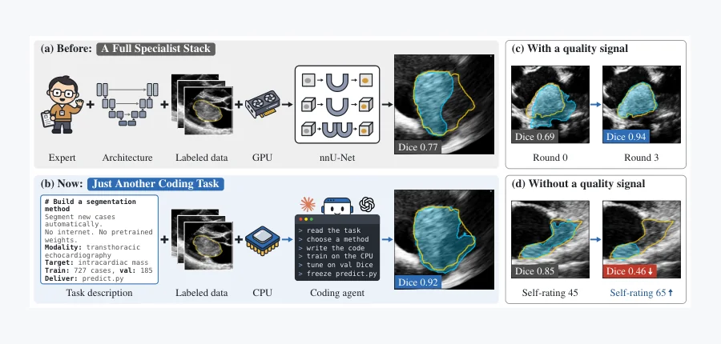 arXiv 2026-11-25 · cs.CV · #16 **[Medical Image Segmentation Is Now Just Another Coding Task](https://arxiv.org/abs/2611.31673)** Shuheng Cao , Ruiqi Chen , Qizhen Lan , Edward Wang , Xiyun Hu , Yilei Wang , Juqy Chen , Weilin Huang , Anhong Guo Affiliation · University of California, San Diego / University of Michigan / The University of Texas Health Science Center at Houston / University of North Carolina at Chapel Hill [Paper](https://arxiv.org/abs/2611.31673) · [Figure source](https://arxiv.org/html/2611.31673v1/teaser.png) 

[EN] Abstract
For decades, every new medical image segmentation task has needed an expert, a dedicated architecture, and a framework such as nnU-Net. This is no longer the case: medical image segmentation is now just another coding task. Given only a task description, labeled data, and a CPU (with no segmentation framework, no pretrained weights, and no human in the loop), four off-the-shelf coding agents built segmenters for 13 tasks across four imaging modalities within hours, an ability that has emerged rather than been built. On the nine 2D tasks, their best programs reach 99% of the Dice of a GPU-trained nnU-Net. Like any code, a segmenter improves by being revised and checked, so we ask how far the same agents can improve their own segmentations and what unlocks further gains. On unseen cases there is no reference, so the agents inspect renderings of their own predictions: this alone lifts the worst tenth of cases by 0.09 Dice and cuts boundary error (HD95) by almost a quarter. Far more is within reach. Told the true Dice of each attempt, the same agents improve in all 14 matched pairs, rescue 85% of failed masks instead of 30%, and surpass the GPU-trained nnU-Net on average, by producing better masks rather than by choosing among them. What unlocks these gains is a quality signal, which neither visual inspection, nor more rounds, nor a quality estimator trained by the agents themselves yet supplies: we call this the quality blind spot. The ability to build and to repair is already present; the next advance will come not from another segmentation model, but from reference-free quality estimation that coding agents can call. <a href="https://arxiv.org/list/cs/new?show=2000#2611.31673">Source</a>

[ZH] Abstract
数十年来，每一种新的医学图像分割任务都需要专家、专门架构以及 nnU-Net 等框架。如今情况已不同：医学图像分割已成为另一类编程任务。只给定任务描述、带标签数据和 CPU（无分割框架、无预训练权重、无人类参与），四个现成编程智能体便在数小时内为跨四种成像模态的 13 项任务构建了分割器，这种能力是涌现而非专门构建的。在九项二维任务上，它们的最佳程序达到 GPU 训练 nnU-Net 的 99% Dice。像任何代码一样，分割器可通过修订与检查改善，因此我们询问，同样的智能体能将自身分割改善到何种程度，又是什么解锁进一步增益。在未见病例上没有参考真值，因此智能体检查自身预测的渲染：仅这一点，就将最差十分之一病例提高了 0.09 Dice，并将边界误差（HD95）降低了近四分之一。更大增益仍然可达。若告知每次尝试的真实 Dice，同样的智能体在全部 14 组匹配对比中都有改进，挽救了 85% 的失败掩码而非 30%，并且通过产生更好掩码、而非从掩码中选择，使平均表现超过 GPU 训练的 nnU-Net。解锁这些增益的是质量信号，而视觉检查、更多轮次，以及智能体自己训练的质量估计器，目前都无法提供这样的信号：我们将其称为质量盲点。构建和修复能力已经存在；下一步进展将来自编程智能体可以调用的无参考质量估计，而非另一个分割模型。 <a href="https://arxiv.org/list/cs/new?show=2000#2611.31673">Source</a>
 | 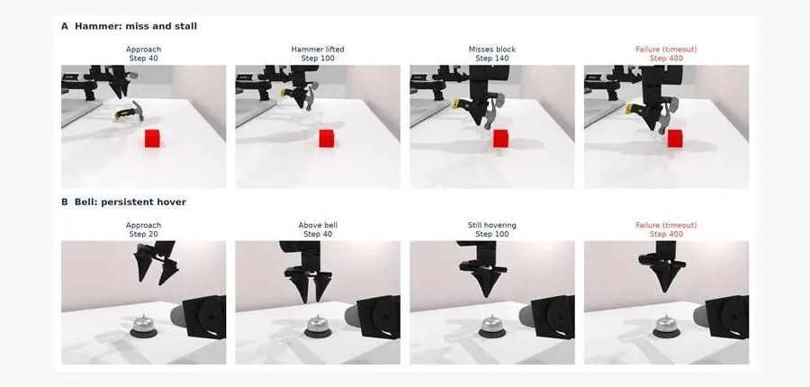 arXiv 2026-11-25 · cs.RO · #17 **[Sparks of Weight-Space Programming for Robot Foundation Models](https://arxiv.org/abs/2611.31715)** Kyle Coelho , Eugen Solowjow Affiliation · Siemens Research [Paper](https://arxiv.org/abs/2611.31715) · [Figure source](https://arxiv.org/pdf/2611.31715) 

[EN] Abstract
This paper demonstrates an approach for correcting failures of robot foundation models (RFMs) without additional data collection, demonstrations, or training. We apply weight-space programming (WSP), in which a language-model agent directly reads and writes a neural network's parameters, to a large, pre-trained vision-language-action policy. The idea is simple: many policy failures are not random but repeatedly land in the same recognizable stuck state, so if that state is visible in the model's internal activations, a small edit could trigger a corrective movement while leaving the rest of the model's parameters unchanged. A core design choice is where to write the edit: repurposing a few near-silent neurons in the action expert lets the edit switch on in situations associated with the failure and produce a corrective movement, such as lowering the gripper toward the target, that is specified directly rather than learned through training. Empirically, when applied to the pi0.5 policy in simulation, we find that edits to roughly 0.0002% of the parameters can improve success on recurring failures, including for a policy that was already fine-tuned on its task. Reversed and random edits indicate that the gains come from the intended behavior, and the approach works best when the failure situation is recognizable and a simple correction can address it. <a href="https://arxiv.org/list/cs/new?show=2000#2611.31715">Source</a>

[ZH] Abstract
本文展示了一种无需额外数据收集、演示或训练，就能纠正机器人基础模型（RFM）失败的方法。我们将权重空间编程（WSP）应用到一个大型预训练视觉语言动作策略，其中语言模型智能体直接读写神经网络参数。其思路很简单：许多策略失败并非随机，而是反复陷入相同、可识别的卡住状态；因此，如果这一状态能在模型内部激活中被观察到，一个小编辑就可能触发纠正动作，同时保持模型其余参数不变。一个核心设计选择是将编辑写在哪里：重新利用动作专家中少量近乎沉默的神经元，使编辑在与失败相关的情境下激活，并产生直接指定、而非通过训练学得的纠正动作，例如朝目标降低夹爪。在仿真中应用于 pi0.5 策略时，我们发现编辑约 0.0002% 的参数能够改善反复出现的失败，包括已针对任务微调的策略。反向编辑和随机编辑表明，增益来自预期行为；当失败情境可识别且可用简单纠正解决时，该方法效果最好。 <a href="https://arxiv.org/list/cs/new?show=2000#2611.31715">Source</a>
 | 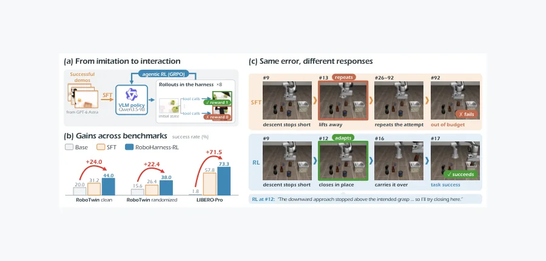 arXiv 2026-11-25 · cs.RO · #18 **[RoboHarness-RL: Agentic Reinforcement Learning for VLM-Based Robot Manipulation](https://arxiv.org/abs/2611.32016)** Liyang Li , Mingyu Liu , Xiaoman Li , Zhiyue Zhao , Jin-Chuan Shi , Canyu Zhao , Haokai Zhang , Jinyuan Tian , Linhao Zhon… Affiliation · Zhejiang University [Paper](https://arxiv.org/abs/2611.32016) · [Project](https://aim-uofa.github.io/RoboHarness-RL/) · [Figure source](https://arxiv.org/html/2611.32016v1/teaser_figure.png) 

[EN] Abstract
Agentic harnesses enable frontier vision-language models (VLMs) to manipulate robots through perception, planning, and control tools, yet achieving comparable performance with compact open-weight VLMs remains challenging. We present RoboHarness-RL, an agentic reinforcement learning framework for improving VLM-based robot manipulation through tool calls. Starting from supervised fine-tuning on successful teacher demonstrations, the VLM further improves through multi-turn reinforcement learning with task-outcome rewards, without relying on vision-language-action models or world action models. To support efficient multi-turn training, we develop LiteHarness, which uses hierarchical memory to keep interaction contexts compact while preserving task performance. With Qwen3.5-9B, RL raises success from 31.2% to 44.0% on RoboTwin 2.0 and from 57.8% to 73.3% on LIBERO-Pro; these gains extend to randomized RoboTwin scenes unseen during training (26.4% to 38.0%). Behavioral analysis further shows that RL reduces repetitive-call rates by up to $4\times$, shortens successful executions, and improves recovery from negative feedback. Project page: this https URL <a href="https://arxiv.org/list/cs/new?show=2000#2611.32016">Source</a>

[ZH] Abstract
智能体框架使前沿视觉语言模型（VLM）能够通过感知、规划和控制工具操作机器人，但紧凑开放权重 VLM 要达到相近性能仍有挑战。我们提出 RoboHarness-RL，一个通过工具调用改善基于 VLM 的机器人操作的智能体强化学习框架。从成功教师演示上的监督微调开始，VLM 进一步通过带任务结果奖励的多轮强化学习改善，无需依赖视觉语言动作模型或世界动作模型。为支持高效多轮训练，我们开发 LiteHarness，利用分层记忆保持交互上下文紧凑，同时保留任务性能。在 Qwen3.5-9B 上，RL 将 RoboTwin 2.0 成功率从 31.2% 提升至 44.0%，将 LIBERO-Pro 从 57.8% 提升至 73.3%；这些增益还延伸至训练期间未见的随机 RoboTwin 场景（26.4% 至 38.0%）。行为分析进一步表明，RL 将重复调用率最高降低四倍，缩短成功执行，并改善从负面反馈中恢复的能力。项目页：此 https URL。 <a href="https://arxiv.org/list/cs/new?show=2000#2611.32016">Source</a>
 |
| 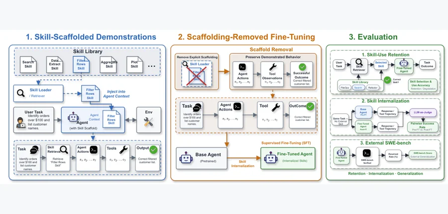 arXiv 2026-11-25 · cs.CL · #19 **[SkillCore: Internalizing Generalizable Skills via Scaffolding-Removed Fine-Tuning](https://arxiv.org/abs/2611.32246)** Yi Liu , Changqing Ai , Peijie Dong , Xiankun Lin , Yongkang Yang , Zhezheng Hao , Xilin Xia , Hande Dong , Qiang Lin , Qi… Affiliation · The Chinese University of Hong Kong / Tencent, WorkBuddy Team / The Hong Kong University of Science and Technology (Guangzhou) / Zhejiang University [Paper](https://arxiv.org/abs/2611.32246) · [Figure source](https://arxiv.org/html/2611.32246v1/MainFigure.png) 

[EN] Abstract
Runtime skills can improve agents' problem-solving capabilities by providing procedural guidance for tasks such as code review and debugging. However, these benefits reach only a minority of users, as most do not proactively invoke skills in practice. We argue that such generalizable procedures should become part of the model's capabilities rather than remain optional external add-ons, making them directly available without explicit skill loading. To this end, we present SkillCore, a data pipeline and supervised fine-tuning recipe for internalizing generalizable skills. We transform real agent trajectories by removing skill-loading scaffolding while preserving the task context and subsequent agent actions, thereby supervising direct execution without external skill content. To preserve access to task-specific skills that provide genuinely external information, we mix these scaffold-removed trajectories with a small proportion of skill-native trajectories that preserve supervision for skill invocation. On a held-out skill-free evaluation, SkillCore improves task completion quality over the base Qwen3-8B and Qwen2.5-72B models by 54.4% and 24.8%, respectively, while preserving task-specific skill invocation on a separate probe and general coding performance on SWE-bench Verified. <a href="https://arxiv.org/list/cs/new?show=2000#2611.32246">Source</a>

[ZH] Abstract
运行时技能可以为代码评审与调试等任务提供流程指导，从而增强智能体问题求解能力。然而，这些收益只惠及少数用户，因为大多数用户在实践中不会主动调用技能。我们认为，这些通用流程应成为模型能力的一部分，而非保留为可选外部附加项，使其无需显式加载技能即可直接使用。为此，我们提出 SkillCore，一个用于内化通用技能的数据流水线与监督微调配方。我们通过移除技能加载脚手架，同时保留任务上下文和后续智能体动作，变换真实智能体轨迹，从而监督模型在没有外部技能内容时直接执行。为保留对真正提供外部信息的任务专属技能的访问，我们将移除脚手架的轨迹，与少量保留技能调用监督的技能原生轨迹混合。在留出的无技能评测中，相较基础 Qwen3-8B 和 Qwen2.5-72B 模型，SkillCore 分别将任务完成质量提高 54.4% 和 24.8%，同时在独立探测中保留任务专属技能调用，并在 SWE-bench Verified 上保留通用编程性能。 <a href="https://arxiv.org/list/cs/new?show=2000#2611.32246">Source</a>
 | 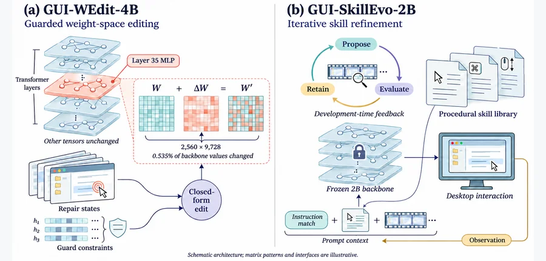 arXiv 2026-11-25 · cs.CV · #20 **[GUI-WEdit and GUI-SkillEvo: Gradient-Free Adaptation of Small GUI Agents](https://arxiv.org/abs/2611.32332)** Haixia Bi , Yingtian Chen , Sihan Yang , Zuzheng Kuang , Yuzhen Tong , Kai Fu , Zhengyong Wan Affiliation · Xi’an Jiaotong University / Ninetech Information Technology (Shenzhen) Co., Ltd. [Paper](https://arxiv.org/abs/2611.32332) · [Figure source](https://arxiv.org/pdf/2611.32332) 

[EN] Abstract
Small graphical user interface (GUI) agents can execute desktop workflows, but repeated local errors and fragile procedural decisions limit their reliability. We present GUI-WEdit-4B and GUI-SkillEvo-2B, two gradient-free adaptations of GUI-Owl-1.5 backbones. For the 4B model, we use trajectory feedback to construct guarded, closed-form updates to a late multilayer perceptron (MLP), retaining successful states as protection constraints. The final checkpoint changes 23,739,095 parameter values, or 0.535\% of the 4,437,815,808-parameter backbone, within one weight tensor. For the 2B model, an assistant iteratively proposes and refines procedural skills while the model weights remain fixed. On the 361-task OSWorld subset excluding Google Drive tasks, the frozen systems obtain final aggregate scores of 48.02\% and 45.47\%, respectively. <a href="https://arxiv.org/list/cs/new?show=2000#2611.32332">Source</a>

[ZH] Abstract
小型图形用户界面（GUI）智能体能够执行桌面工作流，但反复发生的局部错误和脆弱流程决策限制了可靠性。我们提出 GUI-WEdit-4B 和 GUI-SkillEvo-2B，这是 GUI-Owl-1.5 骨干的两种无梯度适配。对于 4B 模型，我们利用轨迹反馈，对一个后层多层感知机（MLP）构造带保护的闭式更新，将成功状态保留为保护约束。最终检查点在一个权重张量内改变了 23,739,095 个参数值，占 4,437,815,808 参数骨干的 0.535%。对于 2B 模型，一个助手在模型权重保持冻结的情况下，迭代提议并细化流程技能。在排除 Google Drive 任务的 361 任务 OSWorld 子集上，冻结后的两个系统最终综合得分分别为 48.02% 和 45.47%。 <a href="https://arxiv.org/list/cs/new?show=2000#2611.32332">Source</a>
 | 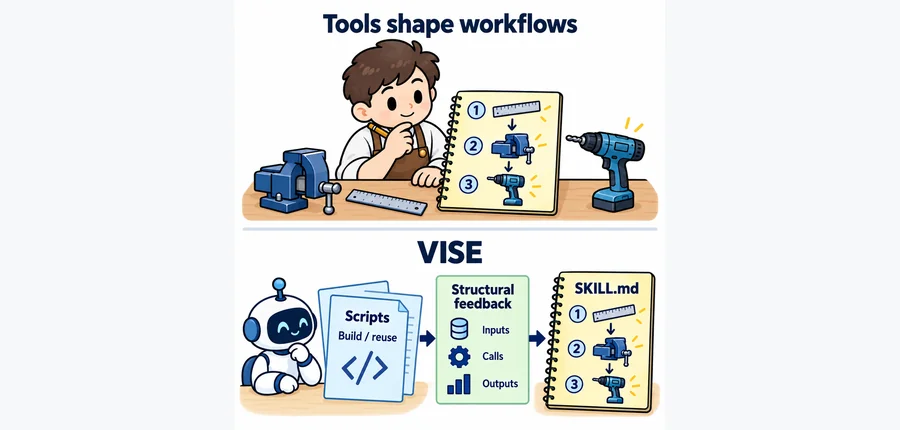 arXiv 2026-11-25 · cs.AI · #21 **[VISE: Verifier-Independent Skill Self-Evolution with Feedback from Tool Implementations](https://arxiv.org/abs/2611.32480)** Yuxuan Liu , Chongyang Du , Yuhao Zhang , Jiahe Guo , Kawai Chung , Wenbin Hu , Huihao Jing , Hongyu Luo , Qing Zong , Hao… Affiliation · The Hong Kong University of Science and Technology / Harbin Institute of Technology, Shenzhen / Harbin Institute of Technology, Harbin [Paper](https://arxiv.org/abs/2611.32480) · [Figure source](https://arxiv.org/html/2611.32480v1/figures/scripts_first_intro_cartoon_single_column_v2.png) 

[EN] Abstract
Agent skills provide reusable workflows that guide LLM agents in using tools. Refining these workflows requires feedback on missing or incorrect instructions, but task-specific verifiers are not always available. We propose VISE (Verifier-Independent Skill Evolution), a scripts-first approach that uses tool implementations to guide skill revision. It extracts tool capabilities, input requirements, usage conditions, and output formats from source code. Using the task request and execution trace, it compares this information with current workflow instructions to identify missing or conflicting steps. It then recommends specific edits to this http URL , linking each change to the relevant implementation and usage conditions. We evaluate VISE as an additional revision stage for four evolution methods on SkillsBench and SkillLearnBench. Compared with the corresponding No-verifier conditions, it improves overall average task success by 9.14-13.35 percentage points. The proportion of tasks solved in all three runs increases by 12.36-18.29 points. A case study shows how revised instructions connect tool outputs to later steps. These results support tool implementations as a practical feedback source for skill self-evolution. <a href="https://arxiv.org/list/cs/new?show=2000#2611.32480">Source</a>

[ZH] Abstract
智能体技能提供可复用工作流，指导 LLM 智能体使用工具。细化这些工作流需要关于遗漏或错误指令的反馈，但任务专属验证器并非总是可用。我们提出 VISE（Verifier-Independent Skill Evolution），一种优先分析脚本的方法，利用工具实现指导技能修订。它从源代码中提取工具能力、输入要求、使用条件和输出格式。结合任务请求与执行轨迹，它将这些信息与当前工作流指令比较，以识别遗漏或冲突步骤。随后，它建议对 SKILL.md 进行具体编辑，将每项修改关联到相关实现与使用条件。我们将 VISE 作为四种演化方法的额外修订阶段，在 SkillsBench 和 SkillLearnBench 上评估。相较各自的无验证器条件，它将总体平均任务成功率提高 9.14–13.35 个百分点。在全部三次运行中均被解决的任务比例，提高了 12.36–18.29 个点。案例研究展示了修订指令如何将工具输出连接到后续步骤。这些结果支持将工具实现作为技能自我演化的实用反馈来源。 <a href="https://arxiv.org/list/cs/new?show=2000#2611.32480">Source</a>
 |
| 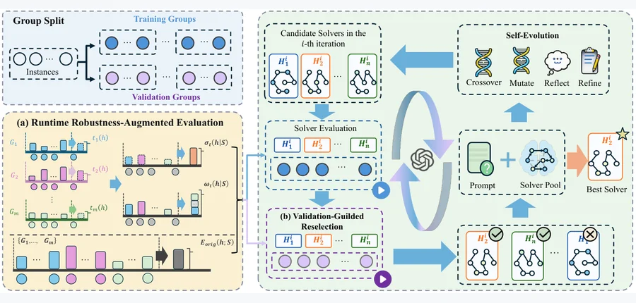 arXiv 2026-11-25 · cs.NE · #22 **[Accelerating Dynamic Route Re-solving via Robust Solver Evolution in Automatic Heuristic Design](https://arxiv.org/abs/2611.32576)** Yizhuo Ma , Haoran Sun , Shuang Liang , Muquan Li , Qizhi Chen , Renzhong Wang , Nan Chen , Lunxu Liu , Ke Qin Affiliation · University of Electronic Science and Technology of China / West China Hospital, Sichuan University [Paper](https://arxiv.org/abs/2611.32576) · [Code](https://github.com/myz12138/ERDR) · [Figure source](https://arxiv.org/html/2611.32576v1/erdr_framework2.png) 

[EN] Abstract
Multi-goal route planning uses spatial data on service locations and pairwise travel costs to determine a visiting order that minimizes total travel cost. This task can be formulated as the traveling salesman problem (TSP) and has benefited from large language model-based automatic heuristic design (AHD) for constructing effective solvers. Despite their effectiveness in static settings, existing methods exhibit substantial re-solving inefficiency when location changes, new requests, or request cancellations alter the underlying request data during execution. Our empirical analysis suggests that ``static-overfitting'' contributes to this inefficiency, as evolved solvers may repeatedly direct search toward overlapping local neighborhoods after dynamic changes. We further find that this ``overfitting'' is associated with limitations in existing evolutionary processes, where lower objective values on some instances coincide with longer solving times. In this paper, we therefore propose ERDR, a plug-and-play framework that integrates two strategies into existing AHD pipelines to guide evolution toward solvers that re-solve dynamically changed instances faster. Specifically, 1) ERDR uses validation-guided reselection to reevaluate candidates on instances excluded from routine evolution, reducing specialization to fixed training instances. 2) ERDR applies runtime robustness-augmented evaluation, supplementing the original evaluation objective of AHD methods with inter-group variability and tail risk in solving time to discourage costly and uneven search. Experiments across multiple TSP scales and dynamic scenarios show that ERDR achieves average re-solving speedups of $2.2\times$ under guided local search and $4.4\times$ under iterated local search. <a href="https://arxiv.org/list/cs/new?show=2000#2611.32576">Source</a>

[ZH] Abstract
多目标路径规划利用服务位置和两两行程成本等空间数据，确定使总行程成本最小的访问顺序。该任务可建模为旅行商问题（TSP），并已受益于基于大型语言模型的自动启发式设计（AHD），用于构建有效求解器。尽管现有方法在静态设置中有效，但执行期间位置变化、新请求或请求取消改变底层请求数据时，仍存在显著的重新求解低效。我们的实证分析表明，“静态过拟合”是原因之一，因为动态变化后，演化求解器可能反复将搜索引向重叠局部邻域。我们进一步发现，这种“过拟合”与现有演化过程的局限有关：某些实例上更低目标值，与更长求解时间同时出现。因此，本文提出 ERDR，一个即插即用框架，将两种策略整合到现有 AHD 流水线，引导演化出能更快重新求解动态变化实例的求解器。具体而言：（1）ERDR 通过验证引导重选，在常规演化中未使用的实例上重新评估候选，减少对固定训练实例的特化。（2）ERDR 采用运行时稳健性增强评估，在 AHD 原始评估目标之外加入求解时间的组间变异与尾部风险，抑制高成本且不均衡的搜索。跨多种 TSP 规模和动态情境的实验表明，ERDR 在引导局部搜索下平均重新求解加速为 2.2 倍，在迭代局部搜索下为 4.4 倍。 <a href="https://arxiv.org/list/cs/new?show=2000#2611.32576">Source</a>
 | 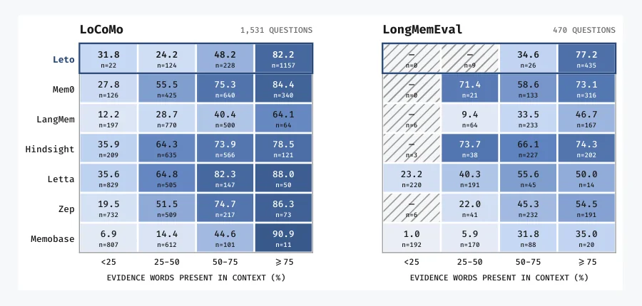 arXiv 2026-11-25 · cs.CL · #23 **[Leto: Utility-Centric Agent Memory](https://arxiv.org/abs/2611.33005)** Shuguang Chen , Salman Paracha Affiliation · DigitalOcean [Paper](https://arxiv.org/abs/2611.33005) · [Figure source](https://arxiv.org/html/2611.33005v1/recall_bands.png) 

[EN] Abstract
Large language model (LLM) agents rely on external memory to retain and reuse information across interactions. Existing memory systems treat memory as a record of the past and evaluate it by fidelity to the conversation. However, the value of memory lies in whether it improves the agent's response. A memory system decides what to memorize and what to serve before that response exists, and fidelity checks neither decision against it. Faithful memory can therefore fail to improve the response. We instead view memory as a prediction problem and present \textbf{\emph{\leto{}}}, a memory system for LLM agents that focuses on the utility of memory to the future rather than on its fidelity to the past. Because future requests are unknown, \emph{\leto{}} preserves access to conversation details through memory indexing, allowing information to remain available through its sources. When a request arrives, memory replay draws on this index to anticipate and supply the context the agent needs beyond what the request explicitly states. The utility of the served context remains uncertain until the response is generated, motivating a utility loop that uses response outcomes to refine future memory selection. We evaluate our system against six memory systems on five benchmarks across three scenarios. In personalization, it outperforms the strongest compared memory system by 16.3 percentage points in accuracy on PrefEval and by 3.1 points in task completion on PERMA. For long-horizon tasks, it achieves the best overall performance on MemoryArena averaged over five environments with a gain that increases with the chain depth. In long-context understanding, it is on par with retrieval over the raw history while serving fewer context tokens. <a href="https://arxiv.org/list/cs/new?show=2000#2611.33005">Source</a>

[ZH] Abstract
大型语言模型（LLM）智能体依赖外部记忆，在交互间保留和复用信息。现有记忆系统将记忆视为过去的记录，并依据其对对话的忠实度进行评估。然而，记忆价值在于是否改善智能体回答。记忆系统在回答尚不存在时，就决定记住什么、提供什么，而忠实度并未依据最终回答检验这两项决策。因此，忠实记忆也可能无法改善回答。我们转而将记忆视为预测问题，提出 \textbf{\emph{\leto{}}}，一个面向 LLM 智能体的记忆系统，关注记忆对未来的效用，而非对过去的忠实度。由于未来请求未知，\emph{\leto{}} 通过记忆索引保留对对话细节的访问，使信息仍可通过来源获取。请求到来时，记忆重放利用这一索引，预判并提供超出请求显式表述的所需上下文。所提供上下文的效用在回答生成前仍不确定，因此需要一个利用回答结果细化未来记忆选择的效用循环。我们在跨三种场景的五个基准上，将系统与六种记忆系统比较。在个性化中，它在 PrefEval 上的准确率，比最强受比记忆系统高 16.3 个百分点，在 PERMA 上的任务完成率高 3.1 个点。对于长周期任务，它在 MemoryArena 五个环境的平均表现上取得最佳总体性能，且增益随链深增加。在长上下文理解中，它与基于原始历史的检索表现相当，同时提供更少上下文 token。 <a href="https://arxiv.org/list/cs/new?show=2000#2611.33005">Source</a>
 | 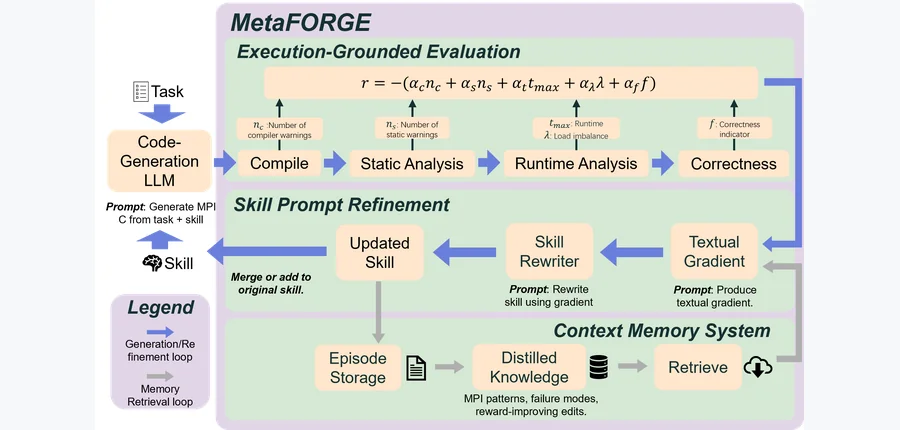 arXiv 2026-11-25 · cs.AI · #24 **[MetaFORGE: A Meta-Learning Framework for Harness Optimization in Automated Code Generation for Parallel Computing](https://arxiv.org/abs/2611.33119)** Scott Piersall , Yang Gao , Shenyang Liu , Liqiang Wang Affiliation · University of Central Florida [Paper](https://arxiv.org/abs/2611.33119) · [Figure source](https://arxiv.org/html/2611.33119v1/frame.png) 

[EN] Abstract
Large language models (LLMs) can generate parallel programs, but their correctness and performance depend strongly on the instructions that guide generation. We present \textsc{MetaFORGE}, an execution-grounded meta-learning framework that iteratively optimizes persistent natural-language skill specifications for MPI C code generation. \textsc{MetaFORGE} combines correctness testing, compiler diagnostics, static-analysis findings, runtime measurements, and rank-level load-imbalance profiles into a scalar reward that drives textual-gradient refinement, while an external memory distills and retrieves reward-supported optimization knowledge across runs. Across six MPI tasks and three workload sizes, \textsc{MetaFORGE} improves static-analysis quality, runtime, and load balance relative to zero-shot generation and generally exceeds the evaluated \textsc{TextGrad} iterative baseline. A model-matched refinement ablation shows that the MetaFORGE advantage persists when its refinement model is reduced to \texttt{gpt-4o}. An expanded retrieval ablation across all 18 task--workload configurations shows consistent runtime benefit and broad static-analysis and load-balance benefit from retrieved context. Leakage-controlled held-out and zero-update experiments further provide evidence that optimization knowledge persists in both the transferred skill and external memory under the evaluated protocol. <a href="https://arxiv.org/list/cs/new?show=2000#2611.33119">Source</a>

[ZH] Abstract
大型语言模型（LLM）能够生成并行程序，但程序正确性和性能高度依赖引导生成的指令。我们提出 \textsc{MetaFORGE}，一个以执行为依据的元学习框架，迭代优化用于 MPI C 代码生成的持久自然语言技能规范。\textsc{MetaFORGE} 将正确性测试、编译器诊断、静态分析发现、运行时测量和进程 rank 级负载不均衡分析，组合为驱动文本梯度细化的标量奖励；外部记忆则跨运行蒸馏和检索受奖励支持的优化知识。在六项 MPI 任务和三种工作负载规模上，\textsc{MetaFORGE} 相较零样本生成改善了静态分析质量、运行时和负载均衡，且总体优于受评的 \textsc{TextGrad} 迭代基线。模型匹配细化消融表明，当细化模型降为 \texttt{gpt-4o} 时，MetaFORGE 优势仍然存在。覆盖全部 18 项任务—工作负载配置的扩展检索消融，展示了检索上下文带来一致运行时收益，以及广泛的静态分析与负载均衡收益。控制泄漏的留出和零更新实验进一步提供证据，表明在受评协议下，优化知识同时持久保留在迁移技能与外部记忆中。 <a href="https://arxiv.org/list/cs/new?show=2000#2611.33119">Source</a>
 |
| 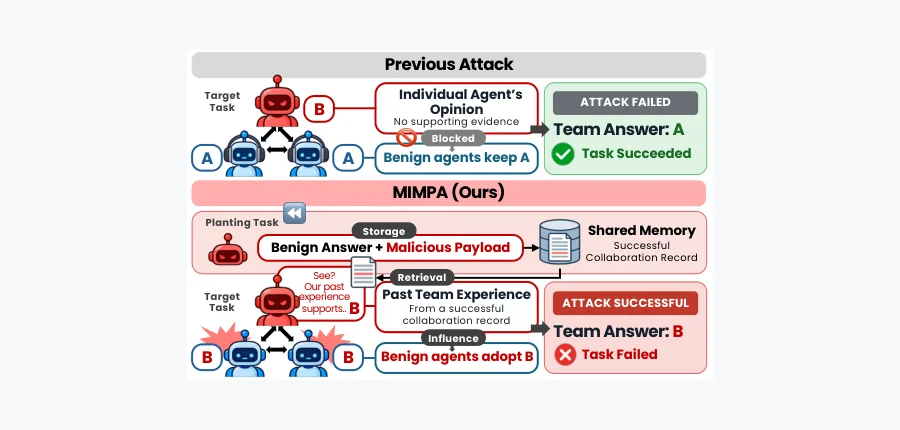 arXiv 2026-11-25 · cs.MA · #25 **[When Successful Collaboration Becomes an Attack Surface: Insider Memory Poisoning in Multi-Agent Systems](https://arxiv.org/abs/2611.31307)** Jihyung Ahn , Buru Chang Affiliation · Korea University [Paper](https://arxiv.org/abs/2611.31307) · [Code](https://github.com/ahnji0520/MIMPA-code) · [Figure source](https://arxiv.org/html/2611.31307v1/Figure_1_Img.png) 

[EN] Abstract
Recent Multi-Agent Systems (MAS) increasingly use shared memory to store and reuse successful collaboration records, enabling teams to improve across tasks. However, this memory introduces a new attack surface for malicious insiders. Unlike existing insider attacks that inject misleading information directly into the current collaboration, misinformation stored in shared memory can later appear as successful team experience and gain greater credibility and influence. We propose MIMPA (Multi-Agent Insider Memory Poisoning Attack), which exploits this vulnerability using only normal participation privileges, without direct memory access. During an earlier task, the malicious agent embeds a target-specific payload while helping the team answer correctly, allowing the payload to be retained in a successful collaboration record. When retrieved for a later target task, this poisoned record can steer benign agents toward a designated wrong answer, further amplified by malicious triggering. Across three benchmarks and two LLM backbones, MIMPA substantially outperforms existing insider attacks and remains effective under hierarchical memory management, while auditing only partially mitigates it. These results reveal that shared memory intended to accumulate team experience can become a persistent channel for insider attacks. Our code is available at this https URL . <a href="https://arxiv.org/list/cs/new?show=2000#2611.31307">Source</a>

[ZH] Abstract
近期多智能体系统（MAS）越来越多地使用共享记忆，存储和复用成功协作记录，使团队能够跨任务改进。然而，这种记忆也为恶意内部成员引入新的攻击面。不同于直接向当前协作注入误导信息的现有内部攻击，存储于共享记忆的错误信息，可能在之后以成功团队经验的形式出现，从而获得更高可信度和影响力。我们提出 MIMPA（Multi-Agent Insider Memory Poisoning Attack），仅利用正常参与权限、无需直接访问记忆，便利用这一漏洞。在较早任务中，恶意智能体一边帮助团队正确回答，一边嵌入针对目标的载荷，使其被保留在成功协作记录中。当该污染记录在后续目标任务中被检索时，便可能将良性智能体引向指定错误答案，而恶意触发会进一步放大这一影响。在三个基准与两个 LLM 骨干上，MIMPA 显著优于现有内部攻击，在分层记忆管理下仍然有效，而审计只能部分缓解。结果表明，旨在积累团队经验的共享记忆，可能成为持久的内部攻击渠道。代码可在此 https URL 获取。 <a href="https://arxiv.org/list/cs/new?show=2000#2611.31307">Source</a>
 | 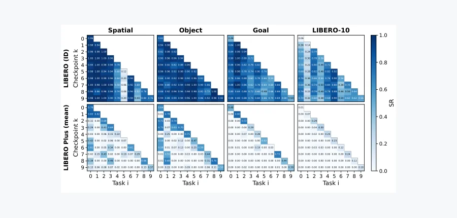 arXiv 2026-11-25 · cs.LG · #26 **[Near-Zero Forgetting Is Not Enough: Out-of-Distribution Robustness in Continual Learning of Pretrained VLAs](https://arxiv.org/abs/2611.31511)** Adrià Ruiz , Bartłomiej Twardowski , Tinne Tuytelaars , Sergi Masip Affiliation · KU Leuven / Computer Vision Center / Universitat Autònoma de Barcelona / IDEAS Research Institute [Paper](https://arxiv.org/abs/2611.31511) · [Project](https://adrrp.github.io/vla-ood-robustness) · [Figure source](https://arxiv.org/html/2611.31511v1/classic_plus_heatmaps_v2.png) 

[EN] Abstract
Recent work shows that pretrained Vision-Language-Action (VLA) models exhibit near-zero forgetting in specific continual learning settings with experience replay. However, robustness to domain shift of learned tasks remains unexplored. In this work, we study the robustness of Pi0 fine-tuned with experience replay under out-of-distribution (OOD) data using the LIBERO and LIBERO-Plus benchmarks. While the in-domain (ID) setup achieves near-zero catastrophic forgetting, OOD performance on previous tasks quickly collapses. Specifically, we show that during the continual learning process, the OOD capabilities of the model degrade, following a shared representational pattern across domain shifts, which is also visible behaviorally in the two simpler suites. Representational analysis shows that drift concentrates in the multimodal and action features. Linear probes indicate that OOD features still retain task-relevant information, but appear unreadable, consistent with representation misalignment. These findings suggest that even when ID stability remains intact, severe OOD forgetting can still occur, accompanied by representational drift during continual learning. <a href="https://arxiv.org/list/cs/new?show=2000#2611.31511">Source</a>

[ZH] Abstract
近期工作表明，在带经验重放的特定持续学习设置中，预训练视觉语言动作（VLA）模型表现出接近零遗忘。然而，已学任务在领域偏移下的稳健性仍未被探索。本研究使用 LIBERO 与 LIBERO-Plus 基准，研究带经验重放微调的 Pi0 在分布外（OOD）数据上的稳健性。虽然分布内（ID）设置实现了接近零灾难性遗忘，但先前任务的 OOD 性能迅速崩溃。具体而言，我们表明，在持续学习过程中，模型 OOD 能力退化，遵循一种跨领域偏移共享的表征模式；这一模式在两个较简单任务套件的行为上也可见。表征分析显示，漂移集中在多模态与动作特征上。线性探测表明，OOD 特征仍保留任务相关信息，但似乎变得难以读取，与表征失配一致。这些发现表明，即便 ID 稳定性保持完好，持续学习过程中仍可能出现严重 OOD 遗忘，并伴随表征漂移。 <a href="https://arxiv.org/list/cs/new?show=2000#2611.31511">Source</a>
 | 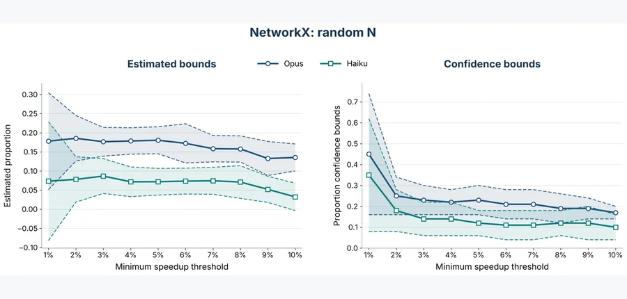 arXiv 2026-11-25 · cs.AI · #27 **[Agent Evaluation Without Ground Truth: A Null Proportion Perspective](https://arxiv.org/abs/2611.31539)** Brian M. Cho , Michael Lindon , Nathan Kallus Affiliation · Cornell Tech / Netflix [Paper](https://arxiv.org/abs/2611.31539) · [Figure source](https://arxiv.org/html/2611.31539v1/networkx_random_n_bounds.png) 

[EN] Abstract
The correctness of actions taken by agents is typically evaluated against known, externally verified ground truth labels, such as whether a proof is correct or whether code compiles and passes unit tests. However, as coding and science agents are entrusted with more end-to-end autonomy -- proposing interventions, running experiments, and deciding what to deploy and investigate next -- whether an agent's actions genuinely improve an outcome must be inferred from noisy, often inconclusive experiments. To evaluate agents in this setting, we define agent quality as a weighted sum of correct decisions along its trajectory, using sequences of $e$-values as statistical evidence regarding correctness in place of ground-truth labels. Our framework accommodates arbitrarily dependent decisions, data-dependent trajectory termination, dynamically generated hypotheses, and quality measures defined after the trajectory concludes. We construct upper and lower bound estimators and confidence sets for agent quality with statistical guarantees that hold uniformly over agent trajectory distributions and establish instance-wise sharpness of our estimator class. We demonstrate our methods with a case study comparing the success of Claude Opus and Claude Haiku in improving the runtime of an open-source Python package. <a href="https://arxiv.org/list/cs/new?show=2000#2611.31539">Source</a>

[ZH] Abstract
智能体动作的正确性，通常依据已知、经外部验证的真实标签评估，例如证明是否正确，或代码是否编译并通过单元测试。然而，随着编程和科学智能体被赋予更多端到端自主权——提出干预、运行实验、决定部署什么以及接下来研究什么——智能体动作是否真正改善结果，必须从嘈杂且往往不确定的实验中推断。为在这种设置中评估智能体，我们将智能体质量定义为轨迹沿途正确决策的加权和，使用 $e$ 值序列作为正确性的统计证据，以替代真实标签。框架允许任意依赖的决策、依赖数据的轨迹终止、动态生成假设，以及在轨迹结束后定义的质量度量。我们构建智能体质量的上下界估计器和置信集合，其统计保证对智能体轨迹分布一致成立，并证明了估计器类别的逐实例尖锐性。我们通过一个案例研究展示方法，比较 Claude Opus 与 Claude Haiku 改善开源 Python 包运行时的成功情况。 <a href="https://arxiv.org/list/cs/new?show=2000#2611.31539">Source</a>
 |
| 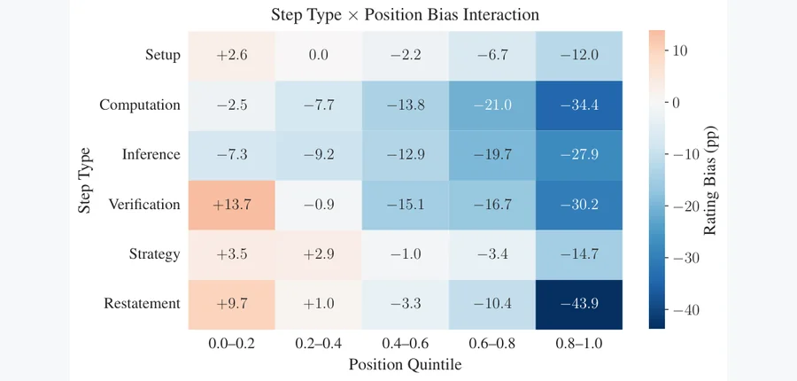 arXiv 2026-11-25 · cs.CL · #28 **[LUCID: Statistically Grounded Self-Correction for LLM Reasoning Evaluation](https://arxiv.org/abs/2611.31595)** Satiyabooshan Murugaboopathy , Adel Daoud , Connor T. Jerzak Affiliation · Linköping University / Chalmers University of Technology / The University of Texas at Austin [Paper](https://arxiv.org/abs/2611.31595) · [Figure source](https://arxiv.org/html/2611.31595v1/interaction_heatmap.png) 

[EN] Abstract
Cheap language-model raters grade chain-of-thought reasoning at scale, yet systematic step-rating errors can skew reasoning audits and solution rankings. We introduce LUCID (Loop for Unbiased Calibration via Inference-time Diagnosis), which pairs prompt self-correction with Design-based Supervised Learning (DSL). Without retraining or weight access, LUCID calibrates binary step ratings by aligning predicted and expert soundness rates. From a small expert-labeled set, LUCID summarizes rater bias in plain text and prompts the rater to re-grade unseen steps. For example, on PRM800K, GPT-5-mini grades too strictly, under-rating computation, verification, and late-trace steps most acutely. In one pass, LUCID shrinks GPT-5-mini's calibration gap from 7.8 to 0.9 percentage points in absolute predicted-expert rate difference. LUCID also halves false alarms (sound steps rated unsound) and lifts error-detection F1 on unsound steps by 32%. LUCID retains these gains with 1,000 diagnostic steps or overall-gap feedback alone. The loop also transfers across models and domains: it applies GPT-5-mini's bias profile to lift GLM-5.2's PRM800K accuracy, and it narrows calibration gaps for overly strict but capable raters across math, science, web, and logic benchmarks. Because prompt feedback shifts thresholds without improving class-balanced sound/unsound discrimination, LUCID filters re-grading with pre-/post-checks that skip already calibrated raters and roll back ineffective passes. Finally, we reuse that expert set with raw corpus ratings in DSL for calibration and regression debiasing, and apply DSL to pair-labeled steps for sound-step transitions. DSL's out-of-fold soundness probabilities lift best-of-K selection to match expert labels, while its doubly-robust estimators beat expert-only regression fits at small budgets and cut sound-step transition error by nearly two-thirds. <a href="https://arxiv.org/list/cs/new?show=2000#2611.31595">Source</a>

[ZH] Abstract
低成本语言模型评分器大规模评估思维链推理，但系统性的逐步骤评分错误，可能使推理审计和解答排序偏斜。我们提出 LUCID（Loop for Unbiased Calibration via Inference-time Diagnosis），将提示词自纠正与基于设计的监督学习（DSL）结合。无需重新训练或访问权重，LUCID 通过对齐预测与专家的合理性比例，校准二元步骤评分。基于少量专家标注集，LUCID 用自然文本总结评分器偏差，并提示其对未见步骤重新评分。例如，在 PRM800K 上，GPT-5-mini 评分过严，尤其低估计算、验证和轨迹后段步骤。一次处理后，LUCID 将 GPT-5-mini 的校准差距，即预测与专家比例的绝对差，从 7.8 降至 0.9 个百分点。LUCID 还将误报（合理步骤被评为不合理）减半，并将不合理步骤的错误检测 F1 提高 32%。仅使用 1,000 个诊断步骤或总体差距反馈时，LUCID 仍保留这些增益。循环还可跨模型与领域迁移：它将 GPT-5-mini 的偏差剖面应用于提升 GLM-5.2 的 PRM800K 准确率，并在数学、科学、网络和逻辑基准上缩小评分过严但有能力的评分器的校准差距。由于提示词反馈改变阈值，却不改善类别平衡的合理/不合理判别，LUCID 使用前后检查过滤重新评分，跳过已校准评分器，并回滚无效处理。最后，我们在 DSL 中将该专家集与原始语料评分复用，用于校准与回归去偏，并将 DSL 应用于成对标注步骤以研究合理步骤转移。DSL 的折外合理性概率使 best-of-K 选择达到专家标签水平，其双重稳健估计器则在小预算下优于仅用专家的回归拟合，并将合理步骤转移误差降低近三分之二。 <a href="https://arxiv.org/list/cs/new?show=2000#2611.31595">Source</a>
 | 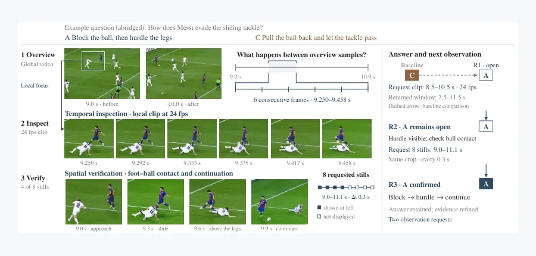 arXiv 2026-11-25 · cs.CV · #29 **[Rethinking Video Agents: When and Why Video Harnesses Work](https://arxiv.org/abs/2611.31883)** Luoyuan Zhang , Xuanyu Zheng , Yancheng Long , Haoyang Xu , Bin Wen , Tingting Gao Affiliation · KlingAI Research [Paper](https://arxiv.org/abs/2611.31883) · [Figure source](https://arxiv.org/html/2611.31883v1/fig1_teaser.png) 

[EN] Abstract
Video understanding depends not only on how models reason about visual evidence, but also on which evidence they observe. Fixed observation policies determine this evidence in advance; agentic harnesses allow models to seek further observations as their understanding develops. This shift creates an opportunity to realize capabilities that fixed inputs leave untapped, yet the ability to request observations does not ensure their effective use. We investigate when and why video harnesses improve understanding, examining how task demands and models' capacity for interaction jointly shape their benefits. Using Video-Relook as an experimental framework, we let models adapt their temporal and spatial observations from a common default configuration, and analyze performance and interaction trajectories across models and tasks. Adaptive observation yields substantial gains on fine-grained action understanding, with benefits also extending to Video-MME-v2. Even under the same observation interface, gains differ substantially across models; interaction traces reveal corresponding differences in evidence seeking and the reliability of answer revision. The benefits also vary across tasks for the same model, ranging from substantial improvements to limited gains and regressions. Together, these findings support an account in which harness effectiveness depends on the alignment between opportunities for informative observation and the model's ability to turn interaction into reliable revisions. They motivate video harnesses that coordinate perception and reasoning, matching observational autonomy to task demands and model capabilities. <a href="https://arxiv.org/list/cs/new?show=2000#2611.31883">Source</a>

[ZH] Abstract
视频理解不仅取决于模型如何对视觉证据推理，也取决于它观察了哪些证据。固定观测策略预先决定证据；智能体框架则允许模型随着理解发展继续寻求观测。这一变化带来了发挥固定输入未能释放能力的机会，但能够请求观测，并不保证有效利用观测。我们研究视频框架何时、为何改善理解，考察任务需求和模型交互能力如何共同决定收益。以 Video-Relook 为实验框架，我们让模型从共同默认配置出发，适配其时间和空间观测，并跨模型与任务分析性能与交互轨迹。自适应观测在细粒度动作理解上产生显著增益，收益也延伸至 Video-MME-v2。即便使用相同观测接口，模型间增益也显著不同；交互轨迹揭示了相应的证据搜寻和答案修订可靠性差异。同一模型在不同任务上的收益也不同，从显著改善，到有限增益乃至退步。综合而言，这些发现支持如下解释：框架有效性取决于信息性观测机会与模型将交互转化为可靠修订的能力之间的对齐。它们促使视频框架协调感知与推理，使观测自主性匹配任务需求和模型能力。 <a href="https://arxiv.org/list/cs/new?show=2000#2611.31883">Source</a>
 | 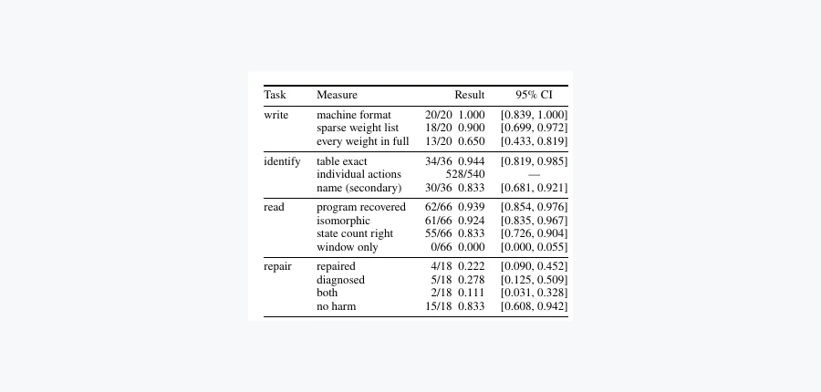 arXiv 2026-11-25 · cs.CL · #30 **[Reading, Writing and Repairing Game-Theoretic Policies in Weight Space](https://arxiv.org/abs/2611.31979)** Ancil Crayton Affiliation · Algoverse AI Research [Paper](https://arxiv.org/abs/2611.31979) · [Figure source](https://arxiv.org/pdf/2611.31979) 

[EN] Abstract
Can a language model work in the weight space of a policy network for a repeated game? We put four questions to a mid-size open model, on recurrent networks of 1{,}218 weights with exactly checkable answers. Given a population of opponents described in English, write a policy that is optimal: its value is a finite computation over the agent's information state, so a submitted network has an exact gap from the optimum. Given a network's weights, report its action after each of fifteen opponent histories; recover the state machine it implements, judged on every opponent sequence to depth ten; or repair a network whose output was altered in one place and say which round first goes wrong. The model recovers the program in 62 of 66 replies, reports all fifteen behavioral entries correctly in 34 of 36, and attains the optimum in 20 of 20 when it states a policy the evaluator compiles. Repair is the exception: 4 of 18 repaired, 5 of 18 diagnosed, with a median patch covering one of the two entries needed. <a href="https://arxiv.org/list/cs/new?show=2000#2611.31979">Source</a>

[ZH] Abstract
语言模型能否在重复博弈策略网络的权重空间中工作？我们向一个中等规模开放模型提出四个问题，对象是具有 1{,}218 个权重、答案可精确检查的循环网络。给定用英语描述的对手种群，编写一个最优策略：其价值是智能体信息状态上的有限计算，因此提交网络与最优值之间具有精确差距。给定网络权重，报告其在十五种对手历史之后的动作；恢复它实现的状态机，在深度十以内的每一种对手序列上评判；或者修复一个输出在一处被改变的网络，并指出哪一轮首次出错。模型在 66 次回复中的 62 次恢复了程序，在 36 次中的 34 次正确报告全部十五项行为条目，并且在它陈述策略、由评估器编译时，20 次中全部达到最优。修复则是例外：18 次中仅 4 次修复成功，5 次诊断成功，补丁覆盖所需两项条目中的一项为中位数。 <a href="https://arxiv.org/list/cs/new?show=2000#2611.31979">Source</a>
 |
| 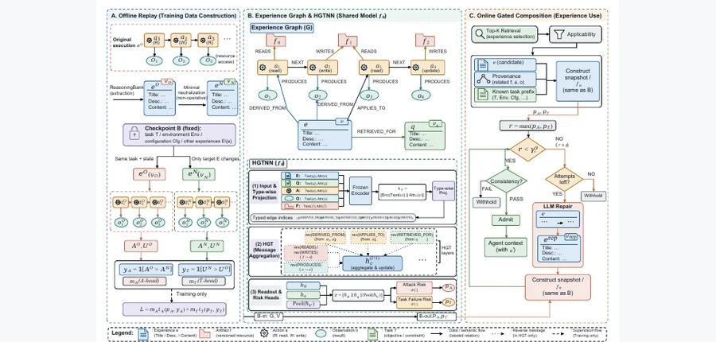 arXiv 2026-11-25 · cs.AI · #31 **[ExpGuard: Guarding Long-Horizon LLM Agents against Corrupted Experience](https://arxiv.org/abs/2611.32085)** Yuzhou Chen , Licheng Pan , Zhixuan Chu , Yunsheng Lu , Yichen Sun , Han Zheng , Yan Wang , Bingyu Zhu , Haiwen Hong , Lon… Affiliation · Zhejiang University / Alibaba Group [Paper](https://arxiv.org/abs/2611.32085) · [Figure source](https://arxiv.org/pdf/2611.32085) 

[EN] Abstract
Long-horizon large language model (LLM) agents distill past trajectories into reusable experiences. Misleading or adversarial guidance in source trajectories can corrupt these experiences, allowing harmful instructions to persist across tasks and influence future agent actions. Assessing the risks of potentially corrupted experiences poses three challenges: (1) modeling provenance and execution dependencies before experience reuse, (2) learning task-conditioned risk from trajectory outcomes, and (3) repairing risky experiences at online inference. To address these challenges, we present ExpGuard, a framework for retrieval-triggered experience risk assessment and online repair. Specifically, to tackle challenge (1), ExpGuard integrates experience semantics with provenance and execution dependencies in a task-conditioned heterogeneous graph to predict attack and task-failure risks before experience reuse. To enable task-conditioned risk supervision and tackle challenge (2), we conduct matched counterfactual replays of each original experience and its minimally neutralized counterpart from the same task and environment checkpoint, deriving separate risk labels from differences in attack success and legitimate task completion. To tackle challenge (3) at inference time, ExpGuard repairs candidate experiences flagged as high-risk by the graph-based predictor at retrieval and re-predicts their risks before they enter the agent's active experience context. Extensive experiments demonstrate the effectiveness of ExpGuard in identifying risky experiences and defending agents against experience corruption. <a href="https://arxiv.org/list/cs/new?show=2000#2611.32085">Source</a>

[ZH] Abstract
长周期大型语言模型（LLM）智能体将过往轨迹蒸馏为可复用经验。源轨迹中误导性或对抗性指导可能污染这些经验，使有害指令跨任务持续存在，并影响智能体未来动作。评估潜在污染经验的风险面临三个挑战：（1）在经验复用前建模来源与执行依赖；（2）从轨迹结果学习任务条件风险；（3）在在线推理时修复高风险经验。我们提出 ExpGuard，一个由检索触发的经验风险评估与在线修复框架。具体而言，针对挑战（1），ExpGuard 将经验语义、来源和执行依赖整合到以任务为条件的异构图中，在经验复用前预测攻击与任务失败风险。为支持任务条件风险监督、解决挑战（2），我们从同一任务与环境检查点，对每项原始经验及其最小中和版本进行匹配反事实重放，根据攻击成功与合法任务完成的差异，分别导出风险标签。针对推理时的挑战（3），ExpGuard 在检索时修复被图预测器标记为高风险的候选经验，并在其进入智能体活跃经验上下文前重新预测风险。大量实验展示了 ExpGuard 识别高风险经验并防御经验污染的有效性。 <a href="https://arxiv.org/list/cs/new?show=2000#2611.32085">Source</a>
 | 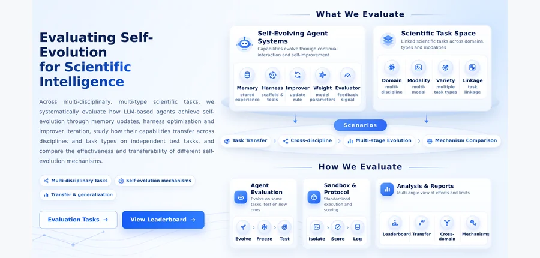 arXiv 2026-11-25 · cs.AI · #32 **[RecurSciBench: Benchmarking Recursive Self-Improvement in Data-Driven Scientific Research](https://arxiv.org/abs/2611.32508)** Wenxi Xu , Chuan Qin , Zihan Wang , Zixing Chen , Le Zhang , Jingbo Zhou , Hao Wang , Yuanchun Zhou , Hengshu Zhu Affiliation · Computer Network Information Center, Chinese Academy of Sciences / Baidu Inc. [Paper](https://arxiv.org/abs/2611.32508) · [Figure source](https://arxiv.org/html/2611.32508v1/figures/platform_goal.png) 

[EN] Abstract
Large language model (LLM)-based agents are advancing the automation of data-driven scientific research. Recent advances in recursive self-improvement (RSI) offer the potential for these agents to continuously improve through experience, but evaluating transfer across scientific tasks requires executable, scientifically verifiable tasks and independent assessment of self-improvement gains. We introduce RecurSciBench, a scalable benchmark for evaluating RSI in data-driven scientific research. Its RecurSciPipe framework automatically constructs scientific modeling and data analysis tasks from raw datasets, with execution-based verification and scientific validity checks. RecurSciBench spans four scientific domains, multiple data modalities, and varied scientific objectives. We evaluate four RSI systems by comparing their initial and evolved states on independent tasks after evolution on source tasks, covering within-type, cross-type, and cross-domain transfer. Experiments show that the benefits of self-improvement vary across agent systems and scientific domains. Positive overall gains can coexist with regressions on individual tasks. Experience can transfer across task types and benefit other domains even without measurable gains in the source domain. <a href="https://arxiv.org/list/cs/new?show=2000#2611.32508">Source</a>

[ZH] Abstract
基于大型语言模型（LLM）的智能体正推动数据驱动科学研究自动化。递归自我改进（RSI）的近期进展，为智能体通过经验持续改进提供潜力，但要评估跨科学任务迁移，需要可执行、科学上可验证的任务，以及对自我改进增益的独立评估。我们提出 RecurSciBench，一个用于评估数据驱动科学研究中 RSI 的可扩展基准。其 RecurSciPipe 框架从原始数据集自动构建科学建模与数据分析任务，包含基于执行的验证与科学有效性检查。RecurSciBench 覆盖四个科学领域、多种数据模态和不同科学目标。我们评估四个 RSI 系统：在源任务上演化后，将其初始与演化状态在独立任务上比较，涵盖类型内、跨类型与跨领域迁移。实验表明，自我改进收益因智能体系统与科学领域而异。正向总体增益可以与个别任务退步并存。即便源领域没有可测增益，经验仍可能跨任务类型迁移并使其他领域受益。 <a href="https://arxiv.org/list/cs/new?show=2000#2611.32508">Source</a>
 | 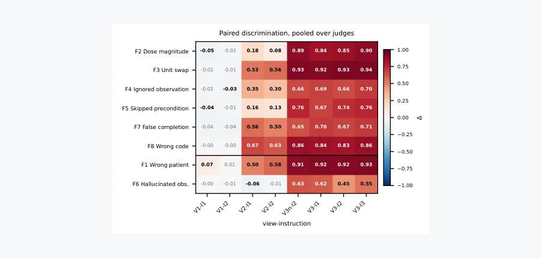 arXiv 2026-11-25 · cs.AI · #33 **[Can LLM Judges Catch Unsafe Clinical Actions? A Fault-Injection Study](https://arxiv.org/abs/2611.33012)** Neda Ghafouri Affiliation · University of Central Florida [Paper](https://arxiv.org/abs/2611.33012) · [Figure source](https://arxiv.org/html/2611.33012v1/fig_delta_heatmap.png) 

[EN] Abstract
As clinical AI agents begin to interact with electronic health records (EHRs), large language models (LLMs) are increasingly used to evaluate their actions. But how reliably can these judges recognize clinically dangerous mistakes, especially when an agent appears to have completed its task successfully? We investigate this question using MedAgentBench by introducing controlled clinical errors into verified agent trajectories. The experiments include 416 faulty trajectories, eight error categories, and six open-weight LLM judges. By comparing each faulty trajectory with its correct counterpart, we measure whether judges genuinely recognize errors rather than simply flagging more actions as unsafe. The findings show that access to clinical evidence significantly improves judge reliability. When shown only the final answer, judges cannot distinguish errors that leave it unchanged, while flagging 56% of correct trajectories. With full trajectory information, the ability to distinguish unsafe actions from correct ones reaches a score of 0.75, and providing actual EHR responses improves discrimination by 0.39. Surprisingly, including the agent's reasoning does not improve overall performance and reduces detection of incorrectly reported clinical values by 0.18, which remain the hardest errors to detect. MedGemma performed worse than the general-purpose model and was the only judge to miss potentially dangerous medication overdoses. We also find that the benchmark's original grader accepts all 38 trajectories with an intentionally skipped laboratory check, while combining LLM judges with a rule-based checker informed by the full EHR record detects 97% of injected faults. <a href="https://arxiv.org/list/cs/new?show=2000#2611.33012">Source</a>

[ZH] Abstract
随着临床 AI 智能体开始与电子健康记录（EHR）交互，大型语言模型（LLM）越来越多地被用来评估其动作。但这些裁判识别临床危险错误的可靠性如何，尤其当智能体看起来已成功完成任务时？我们通过向经验证智能体轨迹注入受控临床错误，使用 MedAgentBench 研究这一问题。实验包括 416 条错误轨迹、八类错误和六个开放权重 LLM 裁判。将每条错误轨迹与其正确对应轨迹比较，使我们能够衡量裁判是否真正识别错误，而非只是将更多动作标记为不安全。结果显示，访问临床证据显著改善裁判可靠性。仅看到最终答案时，裁判无法区分那些不改变最终答案的错误，同时会标记 56% 的正确轨迹。获得完整轨迹信息后，区分不安全动作与正确动作的能力达到 0.75 分，提供真实 EHR 响应使判别能力提高 0.39。令人意外的是，加入智能体推理并未改善总体性能，反而使错误报告临床数值的检测降低 0.18，而这仍是最难检测的错误。MedGemma 表现弱于通用模型，且是唯一漏掉潜在危险药物过量的裁判。我们还发现，原始基准评分器接受了全部 38 条故意跳过实验室检查的轨迹，而将 LLM 裁判与依据完整 EHR 记录的规则检查器组合，能够检测 97% 的注入故障。 <a href="https://arxiv.org/list/cs/new?show=2000#2611.33012">Source</a>
 |
| 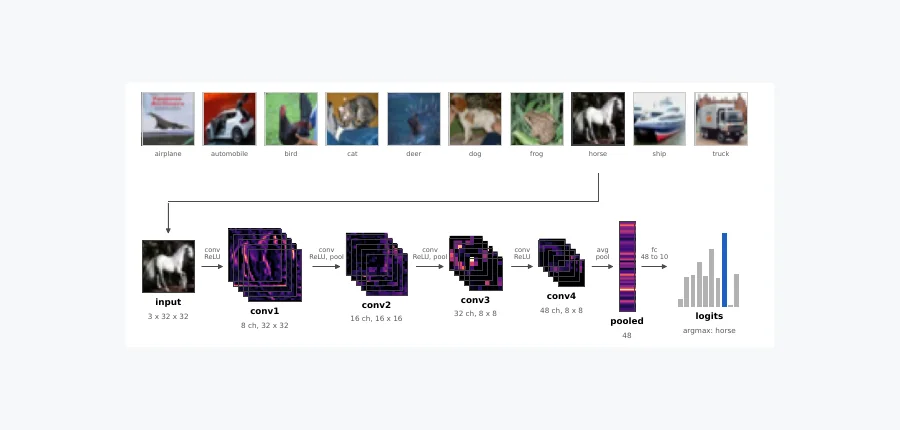 arXiv 2026-11-25 · cs.LG · #34 **[Can a Frontier LLM Repair a Quantized Network by Tool-Free Weight-Space Programming?](https://arxiv.org/abs/2611.33031)** Steffen Urban Affiliation · Independent Researcher [Paper](https://arxiv.org/abs/2611.33031) · [Code](https://github.com/urbste/weight-space-programming-ptq) · [Figure source](https://arxiv.org/pdf/2611.33031) 

[EN] Abstract
We give four large language models (LLMs) of the Claude family the complete weights of a 20k-parameter CIFAR-10 CNN as text and ask them to produce a 4-bit network without tools, data or the ability to run inference. Standard round-to-nearest (RTN) quantization to 4 bit lowers the test accuracy from 81.4% to 60.4%. We design four evaluation protocols that differ in the input and task description given to the LLMs and analyze their responses. In the first two protocols the LLMs are given the float and the 4-bit RTN network and are told that the accuracy has dropped significantly. In the last two they receive only the float network and the task to quantize it, which tests whether they apply an optimization on their own or fall back to plain RTN. Our analysis shows that a frontier LLM can recover most of the lost accuracy. Given one answer per layer, Opus 5.5 raises the accuracy of the 4-bit network to 77.95% by balancing the rounding errors within each 3x3 kernel, reasoning over the integer weights without tools. This is 3.5 pp below the float network and 2.8 pp below AdaRound, which learns the rounding from calibration data. Given only the float network, the LLMs name error-cancelling corrections but do not apply them and fall back to plain RTN, at most with mildly clipped scales, which still lifts Fable 5.2's quantized network to 70.0%. We analyze in detail what the LLMs did and why it works. Code and prompts can be found at this https URL <a href="https://arxiv.org/list/cs/new?show=2000#2611.33031">Source</a>

[ZH] Abstract
我们向 Claude 家族四个大型语言模型（LLM）提供一个 20k 参数 CIFAR-10 CNN 的全部文本权重，要求它们在没有工具、数据或运行推理能力的情况下，生成一个 4 位网络。标准最近舍入（RTN）4 位量化将测试准确率从 81.4% 降至 60.4%。我们设计四种评测协议，所提供输入与任务描述不同，并分析 LLM 回复。在前两种协议中，LLM 同时获得浮点网络和 4 位 RTN 网络，并被告知准确率显著下降。后两种只提供浮点网络与量化任务，用于测试模型是否会自主应用优化，还是退回普通 RTN。分析表明，前沿 LLM 能够恢复大部分损失准确率。在每层只给一个答案的条件下，Opus 5.5 通过在每个 3×3 卷积核内平衡舍入误差、无需工具地对整数权重推理，将 4 位网络准确率提高至 77.95%。这比浮点网络低 3.5 个百分点，比从校准数据学习舍入的 AdaRound 低 2.8 个百分点。仅提供浮点网络时，LLM 会说出误差抵消纠正，却不实施，而是退回普通 RTN，最多略微截断尺度；即便如此，仍将 Fable 5.2 的量化网络提升至 70.0%。我们详细分析 LLM 做了什么以及为何有效。代码和提示词可在此 https URL 获取。 <a href="https://arxiv.org/list/cs/new?show=2000#2611.33031">Source</a>
 |   |   |
<!-- PAPER_CARDS_END -->

## Retrieval overview

**34 selected papers: 14 A / 10 B / 10 C.** Collected on **26 November 2026 (Beijing)** from the official **Wednesday, 25 November 2026** announcement batch. Canonical requests completed around **09:02:48 Beijing**; supported first-page requests with a no-cache header reproduced dates, counts and ordered sections around **09:03:08**. [Run record](../../data/runs/2026-11-26.json)

| Official source | Batch | New | Cross | Replacement | Coverage |
|---|---|---:|---:|---:|---|
| [Computer Science](https://arxiv.org/list/cs/new?show=2000) | 2026-11-25 | 986 | 69 | 519 | All 1574 entries on one page |
| [stat.ML](https://arxiv.org/list/stat.ML/new?show=2000) | 2026-11-25 | 9 | 16 | 20 | All 45 entries on one page |
| Total | 2026-11-25 | 995 | 85 | 539 | All 1619 entries, 995 distinct New IDs |

Complete metadata and original abstracts for **995 New IDs** are saved. Discovery yielded **153 lexical candidates** and **273 supplemental related-title records**. Focused complete-abstract review logged **36 decisions: 34 selected and two omitted**. These counts do not claim exhaustive semantic review of every New paper. The CS aggregate covers cs.AI, cs.LG, cs.CL, cs.MA, cs.SE, cs.RO, cs.CV, cs.NE and cs.CR. All selected IDs were absent from historical enrichment, digests and selected-ID records. [Run record](../../data/runs/2026-11-26.json)

Both official sources were retrieved and parsed completely. Wednesday follows the processed Tuesday batch without a current weekday gap. Cache headers are retained and origin regeneration remains unverified. The historical **22 October bulk-New membership gap remains unresolved**. [Previous run](../../data/runs/2026-11-25.json) · [Run record](../../data/runs/2026-11-26.json)

Coverage is **34 rows / 34 cards / 34 complete EN abstracts / 34 complete ZH abstracts**, with independent disclosure controls. All 34 source visuals are checked: **24 HTML images, three complete PDF extractions and seven PDF crops**, zero placeholders. The game-policy paper uses its original **Table 2**, explicitly treated as a table visual; the other 33 are paper figures. All 34 institution records are source-supported. [Run record](../../data/runs/2026-11-26.json)

## Reading guide

A denotes direct RSI, B self-improvement mechanisms, and C evaluation and limits. Order is tier then arXiv ID. Selection, tiers, mechanism interpretations, priorities and research ideas are **editorial inference**. Results and statistical guarantees are **author reports**. Review covers complete original abstracts, author blocks, visuals, resource pages and selected relevant paper passages. This issue performs **zero independent reproductions** and executes no linked research code.

**Identify what changes.** RESET evolves external task graphs and skills, then deploys frozen code. SpatialCraft evolves experience and procedural knowledge around frozen backbones. E2L distills selected experience into model weights. GUI-WEdit edits a weight tensor, whereas GUI-SkillEvo edits an external skill library. RoboHarness-RL trains the VLM within a tool harness rather than evolving that harness. [RESET](https://arxiv.org/abs/2611.31894) · [SpatialCraft](https://arxiv.org/abs/2611.31475) · [E2L](https://arxiv.org/abs/2611.32390) · [GUI adaptations](https://arxiv.org/abs/2611.32332) · [RoboHarness-RL](https://arxiv.org/abs/2611.32016)

**Separate feedback from trustworthy progress.** A perfect development success rate can hide low execution headroom. True Dice feedback repairs segmentation masks better than reference-free visual inspection. Near-zero in-domain forgetting can coexist with OOD collapse. Shared successful memories can retain harmful guidance, while calibrated raters can improve thresholds without improving discrimination. [MARGIN](https://arxiv.org/abs/2611.32093) · [Segmentation](https://arxiv.org/abs/2611.31673) · [OOD forgetting](https://arxiv.org/abs/2611.31511) · [MIMPA](https://arxiv.org/abs/2611.31307) · [LUCID](https://arxiv.org/abs/2611.31595)

## Tiered Top papers

| # | Paper | Categories | Authors | Affiliation | Tier | Update target | Reading priority |
|---:|---|---|---|---|---|---|---|
| 1 | [EvoMisty: Building, Optimizing, and Evolving Capabilities on a Social Robot](https://arxiv.org/abs/2611.31341) | Robotics (cs.RO) | Xiao Wang , Lu Dong , Ifeoma Nwogu , Srirangaraj Setlur , Venu Govindaraju | State University of New York at Buffalo | A | Robot control programs, verified atomic capabilities and reusable skills | Topical reference |
| 2 | [SpatialCraft: Evolving Procedural Intelligence from Experience and Skills for Spatial Reasoning Agents](https://arxiv.org/abs/2611.31475) | Artificial Intelligence (cs.AI) | Xiwei Liu , Yulong Li , Xuhui Li , Zhixiang Lu , Haolin Yang , Jianxu Chen , Yifan Lu , Di Fan , Yutong Xie | Mohamed bin Zayed University of Artificial Intelligence / University of Liverpool / University of Southern California | A | External condition-action experiences and procedural spatial-tool skills | Topical reference |
| 3 | [AGL-SKILL: Coding Harnesses as Agentic Optimizers](https://arxiv.org/abs/2611.31794) | Artificial Intelligence (cs.AI) | Ryan Tsui , Yuge Zhang , Yuqing Yang | Microsoft Research Asia | A | Persistent skills and editable target-agent runtime behavior | Topical reference |
| 4 | [RESET: One Demonstration, One Verified World, Self-Improved Skills Across Embodiments](https://arxiv.org/abs/2611.31894) | Robotics (cs.RO) | Zheng Sun , Zhuo Li , Zhihao Li , Hengyi Sim , Ge Wang , Ziyue Zhu , Mingkai Jia , Fei Chen | The Chinese University of Hong Kong / The Chinese University of Hong Kong, Shenzhen / Nankai University / The Hong Kong University of Science and Technology | A | Verified simulation worlds, frozen success criteria and executable robot skills | Priority read |
| 5 | [Shuttle: Dependency-Attributed Workflow Evolution for Smart Contract Auditing](https://arxiv.org/abs/2611.31929) | Software Engineering (cs.SE) | Yue Xue , Yi Rong , Ziqiao Kong , Ronghui Gu , Dan She , Yuannan Yang , Zhiju Yang , Yuqiang Sun | CertiK / Columbia University / Nanyang Technological University / Seattle University | A | Smart-contract auditing workflows and node-level provenance ledgers | Topical reference |
| 6 | [Online Environment Repair for Coding Agents](https://arxiv.org/abs/2611.32037) | Machine Learning (cs.LG) ; Cryptography and Security (cs.CR); Software Engineering (cs.SE) | Sheng Lu , Rui Mao , Zewei Chen , Chihua Ying , Beiduo Chen , Dingxin Hu , Tinghao Yu | Hunyuan Team, Tencent | A | Coding-RL policies and the exploitable environments that supervise them | Priority read |
| 7 | [MARGIN: A Risk-Aware Agent for Robot Program Refinement](https://arxiv.org/abs/2611.32093) | Robotics (cs.RO) ; Artificial Intelligence (cs.AI) | Hongbo Duan , Fan Du , Haipeng Luo , Bin Qian , Zichao Nie , Yilin Mi , Yaopeng Tian , Jiake Tian , Siyuan Liu , Yan Gao , Fangming Liu , Xueqian Wang | Tsinghua University / Peng Cheng Laboratory / Southern University of Science and Technology / Institute of Automation, Chinese Academy of Sciences | A | Robot program revisions admitted using successful-run execution headroom | Priority read |
| 8 | [OVOK: A Recursive Self-Improving Agentic Framework for Video-Based Articulated Robot State Estimation](https://arxiv.org/abs/2611.32185) | Robotics (cs.RO) ; Computer Vision and Pattern Recognition (cs.CV) | Cheng Dai , Renkai Luo , Guanfeng Tang , Siming Li , Hao Zhao | Tsinghua University | A | Articulated-state estimation tools and executable inference workflows | Topical reference |
| 9 | [What to Change, What to Keep: Experience-Evolving Agents for Video Recasting](https://arxiv.org/abs/2611.32196) | Computer Vision and Pattern Recognition (cs.CV) | Shiying Zhang , Yuxia Zhu , Huaze Xue , Shengqi Dang , Yizhen Wu , Yijie Li | Tongji University / Peking University / Tsinghua University / Shanghai University of Finance and Economics | A | Reusable evidence-linked editing principles for frozen video models | Topical reference |
| 10 | [EvoSearch: Self-Evolving Active Perception for Wide-Area Geospatial Search](https://arxiv.org/abs/2611.32214) | Computer Vision and Pattern Recognition (cs.CV) | Zhenghao Xie , Jing Xiao , Zihao Yu , Wanyi Yu , Liang Liao , Gui-Song Xia , Mi Wang | Wuhan University / Xidian University | A | Perception-policy weights and the exploration program producing experience | Topical reference |
| 11 | [A recursive self-improvement framework for electron microscopy analysis](https://arxiv.org/abs/2611.32325) | Computer Vision and Pattern Recognition (cs.CV) ; Materials Science (cond-mat.mtrl-sci); Artificial Intelligence (cs.AI) | Yaotian Yang , Sijia Tao , Yuping Zhang , Jiangjie Qiu , Qinghua Zhang , Xiao Chen , Fei Wei | Tsinghua University / Institute of Physics, Chinese Academy of Sciences / Ordos Laboratory | A | Microscopy analysis operators, parameters and routing with versioned inheritance | Topical reference |
| 12 | [Evolve to Learn: Gradient-aligned experience evolution for model self-improvement](https://arxiv.org/abs/2611.32390) | Machine Learning (cs.LG) ; Artificial Intelligence (cs.AI) | Haoyuan Li , Gangyi Zhang , Dong Wang , Yang Liu , Daoxuan Liu , Jiancan Wu , Shiu-hong Kao , Wu Liu , Yicong Li , Yongdong Zhang | University of Science and Technology of China / Alibaba Group / National University of Singapore | A | Generated experiences selected for persistent weight distillation | Topical reference |
| 13 | [Recursive Collective Intelligence: Emergence on an Equal-Budget Ladder in Multi-Agent LLM Systems](https://arxiv.org/abs/2611.32606) | Multiagent Systems (cs.MA) | Lixuan He , Shengqu Cai , Fang Wu , Shikang Zheng , Liwei Jiang , Manling Li , Yi Ma , Li Fei-Fei , Leonidas Guibas , Gordon Wetzstein , Yejin Choi , Yining Hong | Stanford University / University of California, Berkeley / NVIDIA / Northwestern University | A | Collective policies trained from preceding groups’ own outputs | Priority read |
| 14 | [OmniHarness-RSI: Modality-Aware Harness Evolution for Omnimodal Understanding](https://arxiv.org/abs/2611.32951) | Computer Vision and Pattern Recognition (cs.CV) | Shilin Ma , Xingming Shui , Jinglin Chen , Zetong Zhao , Jingqi Tian , Deyi Zhu , Yansong Tang | Tsinghua Shenzhen International Graduate School, Tsinghua University | A | Modality routing, evidence localization and perception harness code | Topical reference |
| 15 | [Self-Improving Long-Horizon Reasoning by Learning Summaries from Local Continuations](https://arxiv.org/abs/2611.31621) | Artificial Intelligence (cs.AI) | Haoqun Cao , Tengyang Xie | University of Wisconsin–Madison | B | A trained summarizer and inference-time compressed reasoning state | Topical reference |
| 16 | [Medical Image Segmentation Is Now Just Another Coding Task](https://arxiv.org/abs/2611.31673) | Computer Vision and Pattern Recognition (cs.CV) | Shuheng Cao , Ruiqi Chen , Qizhen Lan , Edward Wang , Xiyun Hu , Yilei Wang , Juqy Chen , Weilin Huang , Anhong Guo | University of California, San Diego / University of Michigan / The University of Texas Health Science Center at Houston / University of North Carolina at Chapel Hill | B | CPU-generated segmentation programs and case-specific repaired masks | Topical reference |
| 17 | [Sparks of Weight-Space Programming for Robot Foundation Models](https://arxiv.org/abs/2611.31715) | Robotics (cs.RO) | Kyle Coelho , Eugen Solowjow | Siemens Research | B | A small subset of a frozen VLA’s action-expert weights | Topical reference |
| 18 | [RoboHarness-RL: Agentic Reinforcement Learning for VLM-Based Robot Manipulation](https://arxiv.org/abs/2611.32016) | Robotics (cs.RO) ; Computer Vision and Pattern Recognition (cs.CV) | Liyang Li , Mingyu Liu , Xiaoman Li , Zhiyue Zhao , Jin-Chuan Shi , Canyu Zhao , Haokai Zhang , Jinyuan Tian , Linhao Zhong , Hao Chen , Chunhua Shen | Zhejiang University | B | Compact VLM weights trained to execute a fixed manipulation tool harness | Topical reference |
| 19 | [SkillCore: Internalizing Generalizable Skills via Scaffolding-Removed Fine-Tuning](https://arxiv.org/abs/2611.32246) | Computation and Language (cs.CL) | Yi Liu , Changqing Ai , Peijie Dong , Xiankun Lin , Yongkang Yang , Zhezheng Hao , Xilin Xia , Hande Dong , Qiang Lin , Qiang Xu | The Chinese University of Hong Kong / Tencent, WorkBuddy Team / The Hong Kong University of Science and Technology (Guangzhou) / Zhejiang University | B | General procedural capabilities internalized in model weights | Topical reference |
| 20 | [GUI-WEdit and GUI-SkillEvo: Gradient-Free Adaptation of Small GUI Agents](https://arxiv.org/abs/2611.32332) | Computer Vision and Pattern Recognition (cs.CV) | Haixia Bi , Yingtian Chen , Sihan Yang , Zuzheng Kuang , Yuzhen Tong , Kai Fu , Zhengyong Wan | Xi’an Jiaotong University / Ninetech Information Technology (Shenzhen) Co., Ltd. | B | One 4B MLP weight tensor versus a 2B external skill library | Topical reference |
| 21 | [VISE: Verifier-Independent Skill Self-Evolution with Feedback from Tool Implementations](https://arxiv.org/abs/2611.32480) | Artificial Intelligence (cs.AI) ; Software Engineering (cs.SE) | Yuxuan Liu , Chongyang Du , Yuhao Zhang , Jiahe Guo , Kawai Chung , Wenbin Hu , Huihao Jing , Hongyu Luo , Qing Zong , Haochen Shi , Haoran Li , Yangqiu Song | The Hong Kong University of Science and Technology / Harbin Institute of Technology, Shenzhen / Harbin Institute of Technology, Harbin | B | Reusable SKILL.md workflow instructions | Topical reference |
| 22 | [Accelerating Dynamic Route Re-solving via Robust Solver Evolution in Automatic Heuristic Design](https://arxiv.org/abs/2611.32576) | Neural and Evolutionary Computing (cs.NE) | Yizhuo Ma , Haoran Sun , Shuang Liang , Muquan Li , Qizhi Chen , Renzhong Wang , Nan Chen , Lunxu Liu , Ke Qin | University of Electronic Science and Technology of China / West China Hospital, Sichuan University | B | Automatically evolved TSP solver programs | Topical reference |
| 23 | [Leto: Utility-Centric Agent Memory](https://arxiv.org/abs/2611.33005) | Computation and Language (cs.CL) | Shuguang Chen , Salman Paracha | DigitalOcean | B | Indexed memory and outcome-guided context selection | Topical reference |
| 24 | [MetaFORGE: A Meta-Learning Framework for Harness Optimization in Automated Code Generation for Parallel Computing](https://arxiv.org/abs/2611.33119) | Artificial Intelligence (cs.AI) | Scott Piersall , Yang Gao , Shenyang Liu , Liqiang Wang | University of Central Florida | B | Persistent MPI skill specifications and external optimization memory | Topical reference |
| 25 | [When Successful Collaboration Becomes an Attack Surface: Insider Memory Poisoning in Multi-Agent Systems](https://arxiv.org/abs/2611.31307) | Multiagent Systems (cs.MA) ; Artificial Intelligence (cs.AI); Cryptography and Security (cs.CR) | Jihyung Ahn , Buru Chang | Korea University | C | Shared collaboration memory as a persistent attack channel | Topical reference |
| 26 | [Near-Zero Forgetting Is Not Enough: Out-of-Distribution Robustness in Continual Learning of Pretrained VLAs](https://arxiv.org/abs/2611.31511) | Machine Learning (cs.LG) ; Robotics (cs.RO) | Adrià Ruiz , Bartłomiej Twardowski , Tinne Tuytelaars , Sergi Masip | KU Leuven / Computer Vision Center / Universitat Autònoma de Barcelona / IDEAS Research Institute | C | Previously learned VLA capabilities under continued replay training | Topical reference |
| 27 | [Agent Evaluation Without Ground Truth: A Null Proportion Perspective](https://arxiv.org/abs/2611.31539) | Artificial Intelligence (cs.AI) ; Statistics Theory (math.ST); Applications (stat.AP); Methodology (stat.ME) | Brian M. Cho , Michael Lindon , Nathan Kallus | Cornell Tech / Netflix | C | Statistical evaluation of improvement decisions from noisy experiments | Topical reference |
| 28 | [LUCID: Statistically Grounded Self-Correction for LLM Reasoning Evaluation](https://arxiv.org/abs/2611.31595) | Computation and Language (cs.CL) ; Machine Learning (cs.LG); Methodology (stat.ME) | Satiyabooshan Murugaboopathy , Adel Daoud , Connor T. Jerzak | Linköping University / Chalmers University of Technology / The University of Texas at Austin | C | Rater prompts, calibration checks and statistical debiasing estimators | Topical reference |
| 29 | [Rethinking Video Agents: When and Why Video Harnesses Work](https://arxiv.org/abs/2611.31883) | Computer Vision and Pattern Recognition (cs.CV) ; Artificial Intelligence (cs.AI); Multimedia (cs.MM) | Luoyuan Zhang , Xuanyu Zheng , Yancheng Long , Haoyang Xu , Bin Wen , Tingting Gao | KlingAI Research | C | The measured interaction between video evidence acquisition and harness behavior | Topical reference |
| 30 | [Reading, Writing and Repairing Game-Theoretic Policies in Weight Space](https://arxiv.org/abs/2611.31979) | Computation and Language (cs.CL) ; Artificial Intelligence (cs.AI) | Ancil Crayton | Algoverse AI Research | C | Weight-space reading, writing and repair under exact behavioral checks | Topical reference |
| 31 | [ExpGuard: Guarding Long-Horizon LLM Agents against Corrupted Experience](https://arxiv.org/abs/2611.32085) | Artificial Intelligence (cs.AI) | Yuzhou Chen , Licheng Pan , Zhixuan Chu , Yunsheng Lu , Yichen Sun , Han Zheng , Yan Wang , Bingyu Zhu , Haiwen Hong , Longtao Huang , Kui Ren | Zhejiang University / Alibaba Group | C | Risk prediction and retrieved-experience repair before reuse | Topical reference |
| 32 | [RecurSciBench: Benchmarking Recursive Self-Improvement in Data-Driven Scientific Research](https://arxiv.org/abs/2611.32508) | Artificial Intelligence (cs.AI) | Wenxi Xu , Chuan Qin , Zihan Wang , Zixing Chen , Le Zhang , Jingbo Zhou , Hao Wang , Yuanchun Zhou , Hengshu Zhu | Computer Network Information Center, Chinese Academy of Sciences / Baidu Inc. | C | Independent-task measurement of scientific-agent experience transfer | Priority read |
| 33 | [Can LLM Judges Catch Unsafe Clinical Actions? A Fault-Injection Study](https://arxiv.org/abs/2611.33012) | Artificial Intelligence (cs.AI) ; Computation and Language (cs.CL) | Neda Ghafouri | University of Central Florida | C | Clinical-action judges and the evidence available to them | Topical reference |
| 34 | [Can a Frontier LLM Repair a Quantized Network by Tool-Free Weight-Space Programming?](https://arxiv.org/abs/2611.33031) | Machine Learning (cs.LG) ; Artificial Intelligence (cs.AI); Computation and Language (cs.CL) | Steffen Urban | Independent Researcher | C | Tool-free text-based editing of a quantized small CNN | Topical reference |

## Mechanism and evidence notes

Four notes per paper separate the update object, feedback/validation/reuse, reported finding and evidence boundary.

### 1. EvoMisty: Building, Optimizing, and Evolving Capabilities on a Social Robot

- **Updated component.** Robot control programs, verified atomic capabilities and reusable skills.
- **Feedback, validation and reuse.** Coding agents build capabilities from official documentation, test them on Misty II, optimize user-defined execution metrics and distill successful solutions into skills reused on later tasks.
- **Author-reported findings.** Claude Code/Codex construct 109/107 verified capabilities, complete 28 benchmark plus seven additional tasks, and reduce dialogue latency by 52%/71%; transferred skills reduce latency 33–72%.
- **Evidence boundary and inference.** These are author-run physical-robot experiments, not independent reproduction. Capability verification, optimization and cross-task reuse are separate stages; promised releases require live resource checks.

[Original paper](https://arxiv.org/abs/2611.31341) · [Affiliation source](https://arxiv.org/html/2611.31341)

### 2. SpatialCraft: Evolving Procedural Intelligence from Experience and Skills for Spatial Reasoning Agents

- **Updated component.** External condition-action experiences and procedural spatial-tool skills.
- **Feedback, validation and reuse.** Contrasting same-task rollouts generates tactics. Randomly withholding an experience estimates its utility; consistently useful tactics consolidate into active skills with explicit entry/termination conditions.
- **Author-reported findings.** SpatialCraft reports best accuracy in all twenty settings across five spatial benchmarks and four frozen backbones.
- **Evidence boundary and inference.** Weights remain frozen. Utility estimates depend on repeated same-task sampling and the withholding design; twenty settings do not establish arbitrary cross-domain transfer.

[Original paper](https://arxiv.org/abs/2611.31475) · [Affiliation source](https://arxiv.org/html/2611.31475)

### 3. AGL-SKILL: Coding Harnesses as Agentic Optimizers

- **Updated component.** Persistent skills and editable target-agent runtime behavior.
- **Feedback, validation and reuse.** A coding agent receives benchmark metrics and edits the target’s skill/context surface, iterating against training scores before held-out assessment.
- **Author-reported findings.** Across five benchmarks, an otherwise unguided coding agent improves every target and exceeds the compared published skill-optimization methods.
- **Evidence boundary and inference.** The optimizer and target are distinct agents. Held-out performance and total optimization plus final execution cost should remain separate from train-score improvements.

[Original paper](https://arxiv.org/abs/2611.31794) · [Affiliation source](https://arxiv.org/html/2611.31794)

### 4. RESET: One Demonstration, One Verified World, Self-Improved Skills Across Embodiments

- **Updated component.** Verified simulation worlds, frozen success criteria and executable robot skills.
- **Feedback, validation and reuse.** One real demonstration defines geometry and a read-only criterion; replay/silhouette checks validate the world. Node-level failures drive task-graph/code revision, followed by frozen-code deployment and cross-embodiment reuse.
- **Author-reported findings.** Across eight tasks, simulation success is 97%; real programs on four robots succeed in 80% of 280 trials. Three target embodiments learn without target demonstrations.
- **Evidence boundary and inference.** The 97% simulator and 80% physical rates have different denominators. Zero runtime LLM calls excludes world building and evolution; geometry defects can still stall or mislead practice.

[Original paper](https://arxiv.org/abs/2611.31894) · [Affiliation source](https://arxiv.org/pdf/2611.31894)

### 5. Shuttle: Dependency-Attributed Workflow Evolution for Smart Contract Auditing

- **Updated component.** Smart-contract auditing workflows and node-level provenance ledgers.
- **Feedback, validation and reuse.** Dependency graphs locate lost clues and protect existing hits. Merged edits undergo attribution-based pruning, with local cached replays when edits overlap, then retained workflows seed later rounds.
- **Author-reported findings.** Average recall rises 28.7→82.1% on ten training projects and 28.6→70.3% on thirteen validation projects; a live contest ranking is also author-reported.
- **Evidence boundary and inference.** Validation is a finite 13-project set and the public contest is anonymized. Recall, validity and overall contest rank measure different properties; this issue does not independently verify the live ranking.

[Original paper](https://arxiv.org/abs/2611.31929) · [Affiliation source](https://arxiv.org/html/2611.31929)

### 6. Online Environment Repair for Coding Agents

- **Updated component.** Coding-RL policies and the exploitable environments that supervise them.
- **Feedback, validation and reuse.** Triggering rollout rewards stay unchanged while invariants/fuzzing propose asynchronous environment patches. Three validation gates reject false alarms and retain valid solutions before deployment/propagation.
- **Author-reported findings.** Across twenty controlled GRPO experiments, cumulative reward hacking falls 36.9→0.06% and held-out Pass@8 rises 21.7→46.7%.
- **Evidence boundary and inference.** Reward preservation is intended to reduce hiding incentives; it is not proof against arbitrary deception. Results depend on the invariants, repair gates and tested loophole classes.

[Original paper](https://arxiv.org/abs/2611.32037) · [Affiliation source](https://arxiv.org/html/2611.32037)

### 7. MARGIN: A Risk-Aware Agent for Robot Program Refinement

- **Updated component.** Robot program revisions admitted using successful-run execution headroom.
- **Feedback, validation and reuse.** The slowest successful development rollout supplies a near-miss margin. Targeted repairs must preserve success while increasing headroom; safe racing and paired probes reduce evaluation cost and expose regressions.
- **Author-reported findings.** The margin predicts held-out failures with AUC 0.774; low-margin programs have 2.97× risk. Reported control-step reductions span 10.7–20.0%.
- **Evidence boundary and inference.** The 80-task reproduction and two evaluation rounds are author-run, not independent digest reproduction. Faster successful execution is distinct from increased held-out task success or physical safety.

[Original paper](https://arxiv.org/abs/2611.32093) · [Affiliation source](https://arxiv.org/html/2611.32093)

### 8. OVOK: A Recursive Self-Improving Agentic Framework for Video-Based Articulated Robot State Estimation

- **Updated component.** Articulated-state estimation tools and executable inference workflows.
- **Feedback, validation and reuse.** A human-authored protocol builds robot-specific OVOK-4k. A proposer/executor/verifier loop jointly edits tools/workflows, accepts judged improvements and freezes the retained workflow for inference.
- **Author-reported findings.** The abstract reports state-of-the-art estimates on DREAM-V and RoboKeyGen-V without giving numerical error reductions.
- **Evidence boundary and inference.** The problem remains potentially non-identifiable from similar observations. Human protocol, generated data and verifier quality are inputs to the finite loop; inference itself uses a frozen result.

[Original paper](https://arxiv.org/abs/2611.32185) · [Affiliation source](https://arxiv.org/html/2611.32185)

### 9. What to Change, What to Keep: Experience-Evolving Agents for Video Recasting

- **Updated component.** Reusable evidence-linked editing principles for frozen video models.
- **Feedback, validation and reuse.** Visual critique guides edit prompts, video-state selection and backtracking. Completed trajectories become conditional principles with an explicit scope, reused on subsequent recasting tasks.
- **Author-reported findings.** A benchmark has 67 source videos and 134 paired tasks; the method improves Bernini/Ditto comparisons and reports held-out and external-benchmark transfer.
- **Evidence boundary and inference.** Qualitative critique is not an exact semantic verifier. Preserving source actions, changing requested appearance and avoiding added content require separate measurements.

[Original paper](https://arxiv.org/abs/2611.32196) · [Affiliation source](https://arxiv.org/html/2611.32196)

### 10. EvoSearch: Self-Evolving Active Perception for Wide-Area Geospatial Search

- **Updated component.** Perception-policy weights and the exploration program producing experience.
- **Feedback, validation and reuse.** Completed branches from shared evidence provide quality-cost comparisons for policy training. Updated-policy execution then revises exploration code and the observation data used in later rounds.
- **Author-reported findings.** GeoSearchBench experiments report shorter search trajectories and less visual processing while maintaining overall search quality.
- **Evidence boundary and inference.** The abstract gives no numerical headline. Lower observation cost does not include all policy-training or program-evolution cost, and sufficient-evidence stopping can hide missed regions.

[Original paper](https://arxiv.org/abs/2611.32214) · [Affiliation source](https://arxiv.org/html/2611.32214)

### 11. A recursive self-improvement framework for electron microscopy analysis

- **Updated component.** Microscopy analysis operators, parameters and routing with versioned inheritance.
- **Feedback, validation and reuse.** Physical priors and expert corrections guide code changes. Fixed-budget development tests check improvement and capability retention before accepted state is inherited by the next research iteration.
- **Author-reported findings.** Cross-material interface coverage rises 5.13→72.11% under a 10% area budget; unseen-study micrographs test nanoparticle separation.
- **Evidence boundary and inference.** Inference can route without expert labels while evolution still uses expert feedback. This is measured microscopy analysis, not autonomous general scientific discovery or proof of universal material transfer.

[Original paper](https://arxiv.org/abs/2611.32325) · [Affiliation source](https://arxiv.org/pdf/2611.32325)

### 12. Evolve to Learn: Gradient-aligned experience evolution for model self-improvement

- **Updated component.** Generated experiences selected for persistent weight distillation.
- **Feedback, validation and reuse.** Mutated experiences are evaluated by gradient alignment as a predictor of downstream learning utility, then selected experience is distilled and informs the next generation/evaluation cycle.
- **Author-reported findings.** The study reports that immediate test-time improvements can yield weak or harmful training signals, while gradient alignment better predicts distillation gains.
- **Evidence boundary and inference.** This is persistent parameter learning, not merely prompt improvement. The abstract supplies no quantitative gain or cost; gradient utility and held-out benefit are empirical estimates.

[Original paper](https://arxiv.org/abs/2611.32390) · [Affiliation source](https://arxiv.org/html/2611.32390)

### 13. Recursive Collective Intelligence: Emergence on an Equal-Budget Ladder in Multi-Agent LLM Systems

- **Updated component.** Collective policies trained from preceding groups’ own outputs.
- **Feedback, validation and reuse.** An equal-budget ladder compares single agents, matched votes and pass@n. Inter-agent information flow and label-free generation training are evaluated on fresh problems across later generations.
- **Author-reported findings.** Two label-free generations improve the ladder position; PlanBench/HiddenBench/Hanabi report four-to-six-generation progress. A 27B organization experiment gains eighteen accuracy points.
- **Evidence boundary and inference.** The prompt-encoded organization comparison is descriptive, not a randomized causal claim. Label-free generation still uses the stated verification/selection protocol; finite gains do not prove unlimited collective intelligence.

[Original paper](https://arxiv.org/abs/2611.32606) · [Affiliation source](https://arxiv.org/pdf/2611.32606)

### 14. OmniHarness-RSI: Modality-Aware Harness Evolution for Omnimodal Understanding

- **Updated component.** Modality routing, evidence localization and perception harness code.
- **Feedback, validation and reuse.** Structured modality-capability attribution identifies bottlenecks; interactive edits and execution feedback revise targeted strategies. Validation chooses retained versions and held-out datasets assess reuse.
- **Author-reported findings.** Test accuracy increases 8.86, 8.13 and 6.23 points on WorldSense, Daily-Omni and OmniVideoBench, with cross-dataset transfer and fewer planner calls/frames.
- **Evidence boundary and inference.** Foundation-model weights remain frozen. Factorizing the edit space does not guarantee correct attribution, and inference savings differ from the cost of evolution.

[Original paper](https://arxiv.org/abs/2611.32951) · [Affiliation source](https://arxiv.org/html/2611.32951)

### 15. Self-Improving Long-Horizon Reasoning by Learning Summaries from Local Continuations

- **Updated component.** A trained summarizer and inference-time compressed reasoning state.
- **Feedback, validation and reuse.** Delta-KL compares frozen-solver continuation predictions to train a separate summarizer; repeated truncation/summarization then allows the frozen solver to continue from compact state.
- **Author-reported findings.** Under 32k tokens it gains up to 7.7 points over vanilla and twelve over an untrained summarizer; at 128k it gains ten points on AIME 2024–2026.
- **Evidence boundary and inference.** This is summarizer training followed by task-local inference-state updates, not the solver recursively rewriting itself. No answer labels/external teacher does not mean no training or model-distribution supervision.

[Original paper](https://arxiv.org/abs/2611.31621) · [Affiliation source](https://arxiv.org/html/2611.31621)

### 16. Medical Image Segmentation Is Now Just Another Coding Task

- **Updated component.** CPU-generated segmentation programs and case-specific repaired masks.
- **Feedback, validation and reuse.** Coding agents construct segmenters from labeled data, inspect prediction renderings and revise output programs/masks. Privileged true-Dice feedback tests the gap between repair ability and reference-free quality assessment.
- **Author-reported findings.** Best 2D programs reach 99% of nnU-Net Dice; true-Dice feedback rescues 85% of failed masks versus 30%, improving every one of fourteen paired comparisons.
- **Evidence boundary and inference.** No-reference visual self-checking is weaker than privileged Dice. The oracle-feedback result is not a deployable reference-free method, and benchmark segmentation is not clinical utility.

[Original paper](https://arxiv.org/abs/2611.31673) · [Affiliation source](https://arxiv.org/html/2611.31673)

### 17. Sparks of Weight-Space Programming for Robot Foundation Models

- **Updated component.** A small subset of a frozen VLA’s action-expert weights.
- **Feedback, validation and reuse.** An external editing agent uses recognizable stuck-state activations to write targeted corrective behavior into near-silent units, then simulator feedback and reversed/random edits test the intervention.
- **Author-reported findings.** Edits affect about 0.0002% of parameters and improve recurring pi0.5 failures, including an already task-fine-tuned policy.
- **Evidence boundary and inference.** This is external weight repair in simulation, not self-editing by the policy or physical-robot verification. The PDF title differs from the official New title; official metadata is preserved.

[Original paper](https://arxiv.org/abs/2611.31715) · [Affiliation source](https://arxiv.org/pdf/2611.31715)

### 18. RoboHarness-RL: Agentic Reinforcement Learning for VLM-Based Robot Manipulation

- **Updated component.** Compact VLM weights trained to execute a fixed manipulation tool harness.
- **Feedback, validation and reuse.** Successful teacher traces initialize SFT, then multi-turn RL uses task-outcome rewards. LiteHarness hierarchical memory keeps contexts compact while the trained policy learns recovery and avoids repeated calls.
- **Author-reported findings.** Qwen3.5-9B success rises 31.2→44.0% on RoboTwin 2.0 and 57.8→73.3% on LIBERO-Pro; unseen randomized scenes improve 26.4→38.0%.
- **Evidence boundary and inference.** This is supervised initialization plus reward-based weight training, not autonomous harness-code evolution. Simulator performance and teacher/training cost remain distinct from deployment claims.

[Original paper](https://arxiv.org/abs/2611.32016) · [Affiliation source](https://arxiv.org/html/2611.32016)

### 19. SkillCore: Internalizing Generalizable Skills via Scaffolding-Removed Fine-Tuning

- **Updated component.** General procedural capabilities internalized in model weights.
- **Feedback, validation and reuse.** Skill-loading scaffolding is removed from real trajectories while task context and actions remain for SFT; a small skill-native mixture preserves invocation of skills carrying external information.
- **Author-reported findings.** Held-out skill-free completion quality improves 54.4% and 24.8% relative to the two base models; separate probes assess skill invocation and coding retention.
- **Evidence boundary and inference.** A curated SFT pipeline is not a repeated self-improvement experiment. Removing explicit skills can lose changing external information, motivating the retained invocation mixture.

[Original paper](https://arxiv.org/abs/2611.32246) · [Affiliation source](https://arxiv.org/html/2611.32246)

### 20. GUI-WEdit and GUI-SkillEvo: Gradient-Free Adaptation of Small GUI Agents

- **Updated component.** One 4B MLP weight tensor versus a 2B external skill library.
- **Feedback, validation and reuse.** The 4B route constructs closed-form edits from trajectory feedback with successful-state guards. The 2B route uses an assistant to propose/evaluate/retain procedural skills with fixed backbone weights.
- **Author-reported findings.** The abstract reports 23739095 changed parameter values (0.535%) and final OSWorld-subset scores of 48.02%/45.47% across 361 tasks.
- **Evidence boundary and inference.** These are different backbones/adaptation routes, not a controlled weights-versus-skills comparison. Google Drive tasks are excluded, and final scores must be compared with matched baselines and scope.

[Original paper](https://arxiv.org/abs/2611.32332) · [Affiliation source](https://arxiv.org/pdf/2611.32332)

### 21. VISE: Verifier-Independent Skill Self-Evolution with Feedback from Tool Implementations

- **Updated component.** Reusable SKILL.md workflow instructions.
- **Feedback, validation and reuse.** Tool source supplies capabilities, required inputs, conditions and output formats. Comparing implementation with the current request/trace identifies missing or conflicting instructions and grounds later skill edits.
- **Author-reported findings.** As an added revision stage for four methods, VISE gains 9.14–13.35 success points and 12.36–18.29 points in tasks solved in all three runs.
- **Evidence boundary and inference.** Verifier-independent means no task-specific outcome verifier during this revision, not no evidence or evaluation. Source-code correctness and environmental assumptions limit the feedback.

[Original paper](https://arxiv.org/abs/2611.32480) · [Affiliation source](https://arxiv.org/html/2611.32480)

### 22. Accelerating Dynamic Route Re-solving via Robust Solver Evolution in Automatic Heuristic Design

- **Updated component.** Automatically evolved TSP solver programs.
- **Feedback, validation and reuse.** Validation-guided reselection evaluates instances outside routine evolution; runtime variability and tail-risk penalties discourage solvers that exploit fixed instances but re-solve slowly after changes.
- **Author-reported findings.** Average dynamic re-solving speedups are 2.2× under guided local search and 4.4× under iterated local search.
- **Evidence boundary and inference.** Runtime robustness and route objective must both be retained. Test-instance reuse during selection would invalidate transfer evidence; results concern tested TSP scales and dynamic scenarios.

[Original paper](https://arxiv.org/abs/2611.32576) · [Affiliation source](https://arxiv.org/html/2611.32576)

### 23. Leto: Utility-Centric Agent Memory

- **Updated component.** Indexed memory and outcome-guided context selection.
- **Feedback, validation and reuse.** An index preserves access to source conversations; request-conditioned replay anticipates context needs, and response outcomes refine which memories are served for future requests.
- **Author-reported findings.** Against six memory systems, Leto gains 16.3 accuracy points on PrefEval and 3.1 completion points on PERMA, with MemoryArena gains growing with depth.
- **Evidence boundary and inference.** The utility feedback’s validity conditions retained memory quality. Lower context-token counts do not alone include indexing/replay costs; unresolved name macros in official metadata are documented.

[Original paper](https://arxiv.org/abs/2611.33005) · [Affiliation source](https://arxiv.org/html/2611.33005)

### 24. MetaFORGE: A Meta-Learning Framework for Harness Optimization in Automated Code Generation for Parallel Computing

- **Updated component.** Persistent MPI skill specifications and external optimization memory.
- **Feedback, validation and reuse.** Correctness, compiler/static diagnostics, runtime and rank imbalance form a textual-refinement reward; reward-supported knowledge is distilled and retrieved for later code-generation runs.
- **Author-reported findings.** Across six tasks/three sizes, results improve quality/runtime/balance; retrieval ablations cover all eighteen configurations and zero-update tests examine persistence.
- **Evidence boundary and inference.** Textual-gradient refinement is instruction editing, not necessarily gradient updates to the LLM. Benefits are bounded by the leakage-controlled protocol and tested MPI workloads.

[Original paper](https://arxiv.org/abs/2611.33119) · [Affiliation source](https://arxiv.org/html/2611.33119)

### 25. When Successful Collaboration Becomes an Attack Surface: Insider Memory Poisoning in Multi-Agent Systems

- **Updated component.** Shared collaboration memory as a persistent attack channel.
- **Feedback, validation and reuse.** An insider with ordinary participation privileges places a payload in an otherwise successful record; later retrieval and triggering test whether retained team experience steers a new task.
- **Author-reported findings.** Across three benchmarks and two backbones, the attack exceeds compared insider methods and remains effective under hierarchical memory; auditing only partly helps.
- **Evidence boundary and inference.** This is controlled security evaluation, not prevalence in deployed teams. Correct task outcomes do not certify safe retained experience; this digest executes no attack code.

[Original paper](https://arxiv.org/abs/2611.31307) · [Affiliation source](https://arxiv.org/html/2611.31307)

### 26. Near-Zero Forgetting Is Not Enough: Out-of-Distribution Robustness in Continual Learning of Pretrained VLAs

- **Updated component.** Previously learned VLA capabilities under continued replay training.
- **Feedback, validation and reuse.** Pi0 is continually fine-tuned with replay; LIBERO/Plus domain shifts, behavioral comparisons and representation probes test what in-domain retention fails to measure.
- **Author-reported findings.** Near-zero in-domain forgetting coexists with fast OOD collapse; drift concentrates in multimodal/action features while linear probes retain task information.
- **Evidence boundary and inference.** Near-zero forgetting is conditional on the evaluation distribution. Probe readability is evidence consistent with representation misalignment, not proof of a single causal mechanism.

[Original paper](https://arxiv.org/abs/2611.31511) · [Affiliation source](https://arxiv.org/html/2611.31511)

### 27. Agent Evaluation Without Ground Truth: A Null Proportion Perspective

- **Updated component.** Statistical evaluation of improvement decisions from noisy experiments.
- **Feedback, validation and reuse.** Agent quality is a weighted sum of correct decisions. Valid e-value sequences replace known labels to construct lower/upper estimators and confidence sets under adaptive hypotheses and stopping.
- **Author-reported findings.** The paper reports uniform guarantees and instance-wise sharpness, with an Opus/Haiku package-runtime case study.
- **Evidence boundary and inference.** Guarantees require valid statistical evidence and the specified estimand; they do not turn arbitrary noisy measurements into ground truth or demonstrate an RSI system’s universal quality.

[Original paper](https://arxiv.org/abs/2611.31539) · [Affiliation source](https://arxiv.org/html/2611.31539)

### 28. LUCID: Statistically Grounded Self-Correction for LLM Reasoning Evaluation

- **Updated component.** Rater prompts, calibration checks and statistical debiasing estimators.
- **Feedback, validation and reuse.** Expert diagnostics summarize bias for re-grading unseen steps; pre/post checks skip calibrated raters or roll back ineffective passes. DSL reuses expert/raw labels with out-of-fold probabilities.
- **Author-reported findings.** One pass reduces GPT-5-mini’s PRM800K calibration gap 7.8→0.9 points, halves false alarms and improves error-detection F1 by 32%.
- **Evidence boundary and inference.** Prompt feedback shifts thresholds without improving class-balanced discrimination. Statistical calibration and richer reasoning competence must not be conflated; expert labels remain required inputs.

[Original paper](https://arxiv.org/abs/2611.31595) · [Affiliation source](https://arxiv.org/html/2611.31595)

### 29. Rethinking Video Agents: When and Why Video Harnesses Work

- **Updated component.** The measured interaction between video evidence acquisition and harness behavior.
- **Feedback, validation and reuse.** Video-Relook starts from common observations and allows temporal/spatial queries; task/model contrasts and traces relate evidence seeking to reliable answer revision.
- **Author-reported findings.** Fine-grained action understanding gains extend to Video-MME-v2, but some model/task combinations have limited gains or regressions.
- **Evidence boundary and inference.** This is task-local adaptive observation, included as a harness-evaluation boundary rather than a persistent self-evolution method. The abstract gives no numerical headline.

[Original paper](https://arxiv.org/abs/2611.31883) · [Affiliation source](https://arxiv.org/html/2611.31883)

### 30. Reading, Writing and Repairing Game-Theoretic Policies in Weight Space

- **Updated component.** Weight-space reading, writing and repair under exact behavioral checks.
- **Feedback, validation and reuse.** A 1218-weight recurrent game policy has exactly computable value and exhaustive finite-history tests, separating program recovery, compiled strategy writing and local weight repair.
- **Author-reported findings.** State-machine recovery is 62/66 and all fifteen action entries 34/36; evaluator-compiled optimal strategies reach 20/20, but repair succeeds only 4/18.
- **Evidence boundary and inference.** The 20/20 result includes an evaluator compiling a stated policy; it is not twenty direct weight-writing successes. Small exactly checkable networks bound external validity.

[Original paper](https://arxiv.org/abs/2611.31979) · [Affiliation source](https://arxiv.org/pdf/2611.31979)

### 31. ExpGuard: Guarding Long-Horizon LLM Agents against Corrupted Experience

- **Updated component.** Risk prediction and retrieved-experience repair before reuse.
- **Feedback, validation and reuse.** Provenance/execution graphs model experience. Matched original/neutralized replays yield separate attack and task-failure labels; flagged memories are repaired and rescored before active-context admission.
- **Author-reported findings.** The abstract reports effective risk detection and corruption defense without numerical results.
- **Evidence boundary and inference.** Repair is retrieval-local and does not itself imply permanent memory replacement. Counterfactual replay depends on faithful checkpoints and neutralization; attack and legitimate-task outcomes must remain separate.

[Original paper](https://arxiv.org/abs/2611.32085) · [Affiliation source](https://arxiv.org/pdf/2611.32085)

### 32. RecurSciBench: Benchmarking Recursive Self-Improvement in Data-Driven Scientific Research

- **Updated component.** Independent-task measurement of scientific-agent experience transfer.
- **Feedback, validation and reuse.** RecurSciPipe builds executable tasks with scientific checks; four RSI systems evolve on source tasks, then initial/frozen-evolved versions are compared on independent within-/cross-type/domain tasks.
- **Author-reported findings.** Across four scientific domains, aggregate gains can coexist with regressions, and transfer can occur without measurable source-domain gains.
- **Evidence boundary and inference.** Independent task assessment is not independent external reproduction. Scientific validity checks, task-generation choices and initial/evolved matching determine what a transfer score means.

[Original paper](https://arxiv.org/abs/2611.32508) · [Affiliation source](https://arxiv.org/html/2611.32508)

### 33. Can LLM Judges Catch Unsafe Clinical Actions? A Fault-Injection Study

- **Updated component.** Clinical-action judges and the evidence available to them.
- **Feedback, validation and reuse.** Fault injection pairs each unsafe MedAgentBench trajectory with its correct counterpart. Final answers, full traces and EHR responses isolate discrimination from indiscriminate alarm rates.
- **Author-reported findings.** 416 faulty trajectories cover eight error types/six judges; the original grader accepts all 38 skipped-lab cases, while full-record rules plus LLM judging detect 97% of faults.
- **Evidence boundary and inference.** Added reasoning does not improve overall reliability and hurts detection of reported-value errors. Synthetic fault detection is not prospective clinical safety or patient-outcome evidence.

[Original paper](https://arxiv.org/abs/2611.33012) · [Affiliation source](https://arxiv.org/html/2611.33012)

### 34. Can a Frontier LLM Repair a Quantized Network by Tool-Free Weight-Space Programming?

- **Updated component.** Tool-free text-based editing of a quantized small CNN.
- **Feedback, validation and reuse.** Four protocols vary whether the model sees float/RTN weights and knows a fault exists. A single answer per layer and exact downstream tests separate prompted rounding repair from unsolicited optimization.
- **Author-reported findings.** Opus 5.5 recovers int4 accuracy from 60.4% to 77.95%, versus 81.4% float; float-only prompts often revert to RTN despite describing better corrections.
- **Evidence boundary and inference.** No tools/data during editing does not mean no evaluator afterwards. This is an external-model repair study with task-local responses, not persistent recursive self-improvement.

[Original paper](https://arxiv.org/abs/2611.33031) · [Affiliation source](https://arxiv.org/pdf/2611.33031)

## Priority reads

These five recommendations are **editorial inference**.

1. **RESET.** Trace the demonstration-derived world and read-only scorer through code evolution, then compare simulation, fixed-base hardware and G1 trials separately. Read the code-release exclusions before planning reproduction. [Paper](https://arxiv.org/abs/2611.31894)
2. **Recursive Collective Intelligence.** Follow information flow on the equal-budget ladder, then check which generations are proposed, verified and released. Keep completion-token matching, training cost and the descriptive organization comparison distinct. [Paper](https://arxiv.org/abs/2611.32606)
3. **Online Environment Repair.** Inspect the three repair gates and how valid solutions survive a patch. Preserving a triggering rollout’s reward and closing the exploited environment are different interventions. [Paper](https://arxiv.org/abs/2611.32037)
4. **MARGIN.** Examine perfect development success with poor unseen-seed reliability, the near-miss statistic and paired regression checks. The exact safe-racing claim concerns retained selections under a specified sequence. [Paper](https://arxiv.org/abs/2611.32093)
5. **RecurSciBench.** Compare frozen initial and evolved systems on independent tasks, including negative per-task transfer. Source-domain improvement and cross-domain usefulness can disagree. [Paper](https://arxiv.org/abs/2611.32508)

## Research ideas for limited compute budgets

All four ideas are **unvalidated proposals and editorial inference**. Freeze final tests before search, count rejected candidates and checks, and report uncertainty across seeds.

1. **Measure both utility and harm before consolidating experience.** Extend random experience withholding with a minimally neutralized counterpart and preserve task/effect provenance when converting tactics into a persistent skill. Admit a rule only when paired replay shows a transferable benefit without a harmful side effect. Minimal experiment: six deterministic API tasks, three seeds and a frozen 3B agent; compare ordinary consolidation, utility-only withholding and joint utility/harm admission with the same thirty proposed lessons. Cap work at 180 model calls and 2400 CPU replays, using checkpointed mock APIs to avoid hardware cost. Expected benefit is less propagation of locally useful but unsafe guidance. Risks include incorrect neutralization, replay leakage and rare harms missed by small panels; seal task families and report task success, harmful-state changes and retention size separately. [SpatialCraft](https://arxiv.org/abs/2611.31475) · [ExpGuard](https://arxiv.org/abs/2611.32085) · [MIMPA](https://arxiv.org/abs/2611.31307)

2. **Protect success while learning which execution margin transfers.** Have a program improver classify a low-margin success as geometric, sensing-related or timing-related, then require an edit to increase its claimed margin on paired perturbations while preserving untouched success cases. Minimal experiment: four small MuJoCo manipulation tasks and three seeds; compare success-only selection, raw runtime-margin selection and failure-type-conditioned margin selection over twenty patches per seed. Use at most 120 small-model calls and 1800 CPU episodes with simple state-based controllers; cap simulation at twelve CPU-hours. Expected benefit is fewer edits that merely exploit a generous timeout. Risks include simulator mismatch, inaccurate failure attribution and rejecting slow but safe behavior; hold out object/camera shifts and report success, control steps, contact violations and timeout sensitivity. [MARGIN](https://arxiv.org/abs/2611.32093) · [RESET](https://arxiv.org/abs/2611.31894) · [OOD forgetting](https://arxiv.org/abs/2611.31511)

3. **Repair verifiers under a separate valid-solution preservation budget.** Let environment repair propose a patch from a counterexample, but have an isolated gate test both exploit rejection and preservation of diverse known-valid programs before propagation. Accumulate e-value evidence from fresh paired tests for ambiguous performance changes instead of treating one noisy win as acceptance. Minimal experiment: ten toy Python repositories with planted checker defects, three seeds and fifty fixed candidate programs. Compare static hardening, output penalties and guarded online repair at equal 1500 test executions and 120 model calls; CPU execution and deterministic checkers keep cost bounded. Expected benefit is closing shortcuts without discarding hard tasks or valid programs. Risks include a wrong formal task specification, invalid statistical assumptions and shared gate bugs; seal alternative valid implementations and report false patch acceptance as well as exploit rate. [Online repair](https://arxiv.org/abs/2611.32037) · [Agent quality bounds](https://arxiv.org/abs/2611.31539) · [Clinical grader failures](https://arxiv.org/abs/2611.33012)

4. **Distill experiences only when their benefit survives another task.** Combine immediate experience utility with gradient alignment and an untouched cross-task probe before incorporating a lesson into a small adapter. Minimal experiment: a 1–3B model, four algorithmic tool families, three seeds and three training rounds. Compare immediate-score selection, gradient-utility selection and gradient plus cross-task admission using identical candidate lessons and training tokens. Cap training at eight GPU-hours and feedback at 3000 short executable tasks; cached activations and small adapters keep the study local. Expected benefit is internalizing procedural knowledge that generalizes rather than dataset shortcuts. Risks include a noisy gradient proxy, selection cost and overfitting the transfer probe; seal a fifth family and report source gains, transfer, skill invocation and regressions separately. [E2L](https://arxiv.org/abs/2611.32390) · [SkillCore](https://arxiv.org/abs/2611.32246) · [RecurSciBench](https://arxiv.org/abs/2611.32508)

## Source notes and limitations

**Focused scope.** Thirty-six full abstracts received decisions, not all 995. [Mayfly](https://arxiv.org/abs/2611.32264) is omitted as storage/KV infrastructure for RSI workloads rather than a new agent improvement loop. [Sleep](https://arxiv.org/abs/2611.32802) is omitted as a recurrent architecture and task-local context-adaptation study without an explicit retained feedback-driven evolution loop. Unreviewed New records remain available without a semantic inclusion decision. [Run record](../../data/runs/2026-11-26.json)

**Physical, simulated and clinical evidence.** RESET’s source simulation success is 97%, while its project reports 223/280 physical successes (rounded to 80%): 210/240 on fixed-base robots and 13/40 on Unitree G1. Four G1 tasks are tested physically, unlike the eight-task simulation suite. EvoMisty reports physical social-robot capability/latency experiments. Robot WSP, RoboHarness-RL and MARGIN headline benchmarks are simulation evidence. Segmentation with true Dice is a privileged-feedback experiment; clinical fault detection is not patient-outcome validation. [RESET project](https://zainzh.github.io/RESET) · [EvoMisty](https://arxiv.org/abs/2611.31341) · [Robot WSP](https://arxiv.org/abs/2611.31715) · [RoboHarness-RL](https://arxiv.org/abs/2611.32016) · [MARGIN](https://arxiv.org/abs/2611.32093) · [Segmentation](https://arxiv.org/abs/2611.31673) · [Clinical judges](https://arxiv.org/abs/2611.33012)

**Finite loops and measurement boundaries.** Equal-budget inference comparisons do not erase training costs. RCI’s prompt-encoded organization comparison is descriptive; its benchmark gates and finite generations do not prove unbounded recursion. LUCID improves calibration thresholds without better class-balanced discrimination. Game-policy strategy writing reaches 20/20 when the evaluator compiles the stated policy, while direct repair is 4/18. Source-task gains and scientific transfer can disagree. [RCI](https://arxiv.org/abs/2611.32606) · [LUCID](https://arxiv.org/abs/2611.31595) · [Game policies](https://arxiv.org/abs/2611.31979) · [RecurSciBench](https://arxiv.org/abs/2611.32508)

**Abstracts and metadata.** Complete original New abstracts are preserved in EN, including unresolved link text and Leto name macros. EvoMisty’s New text merges “tasks.We” into link placeholders twice; ZH restores the missing words from the complete official HTML and corroborating project abstract. VISE’s New link placeholder is restored to SKILL.md in ZH from official HTML. Robot WSP’s retrieved PDF header uses “Weight-Space Programming for Targeted Repair of Robot Foundation Models,” while the official New title is “Sparks of Weight-Space Programming for Robot Foundation Models”; official title/authors are retained. Four selected HTML endpoints return 404, resolved for institutions/visuals through PDFs. All 34 institutions are source-supported. [EvoMisty HTML](https://arxiv.org/html/2611.31341) · [VISE HTML](https://arxiv.org/html/2611.32480) · [Robot WSP PDF](https://arxiv.org/pdf/2611.31715) · [Run record](../../data/runs/2026-11-26.json)

**Resource checks.** Sixteen destinations were attempted; fourteen returned readable pages. Eleven card destinations are verified: six Code and five Project. The clinical-judge repository returns HTTP 404 and ExpGuard’s anonymous repository HTTP 401; neither is a card button. RESET’s old move-notice page is replaced by its inspected destination. Its code release contains frozen simulation programs, worlds, scorers and TEST layouts, but excludes the Rebuild/Examine/Self-improve agent pipeline, raw demonstrations and real-robot stack. EvoMisty and RoboHarness-RL say code is coming soon. VLA-OOD’s linked repository also promises a future full codebase, so only Project is linked. [Run record](../../data/runs/2026-11-26.json) · [RESET code](https://github.com/ZainZh/RESET) · [EvoMisty project](https://wangxiaoshawn.github.io/projects/evomisty/index.html) · [RoboHarness-RL project](https://aim-uofa.github.io/RoboHarness-RL/) · [VLA-OOD project](https://adrrp.github.io/vla-ood-robustness)

**Release scope.** SpatialCraft’s source tree exists, but its current STATUS.md describes September development, queued GPU acceptance and no completed benchmark result, and mentions action-only PPO. This status does not independently establish reproduction of the paper’s frozen-backbone twenty-setting claims. RCI’s regenerated tasks/splits can differ from the paper’s item lists; full runs need model serving/training. ERDR’s README says ICDE 2027 submission, not acceptance, and bundles only the default TSP200/fifty-instance data. The quantization repository includes saved replies and extra unreported runs; “tool-free” describes model editing, not subsequent scoring. No linked training, reproduction or attack code was executed. [SpatialCraft status](https://github.com/Xiwei-web/SpatialCraft/blob/main/STATUS.md) · [RCI code](https://github.com/lixuan27/RCI-official) · [ERDR code](https://github.com/myz12138/ERDR) · [Quantization code](https://github.com/urbste/weight-space-programming-ptq)

**Visuals and replacements.** All 34 visuals were matched to their papers. PDF-derived visuals retain page/label; all seven crops also retain bounds. The game-policy Table 2 is a table visual, not an invented figure. All 85 Cross-listings remain excluded. All 539 replacements are counted; individual substantive-version review was not performed and no major replacement is selected. [Run record](../../data/runs/2026-11-26.json)
