# 2026-11-27 RSI arXiv digest

<!-- PAPER_CARDS_START -->
## Paper cards

Cards follow the digest ranking. Expand [EN] for the full original abstract or [ZH] for its complete Chinese translation. Collapse one and expand the other to switch languages independently for each paper. Open the title or Paper link for the original. Detailed analysis follows below.

| Paper | Paper | Paper |
|---|---|---|
| 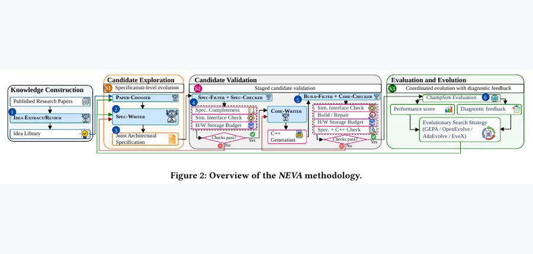 arXiv 2026-11-26 · cs.AR · #1 **[NEVA: Natural-Language Co-Evolution and Validation of Microarchitectures](https://arxiv.org/abs/2611.33346)** Khoi Le , Sayanti Jana , Matthew DeLorenzo , Jeyavijayan Rajendran , Paul Gratz Affiliation · Texas A&amp;M University [Paper](https://arxiv.org/abs/2611.33346) · [Figure source](https://arxiv.org/pdf/2611.33346) 

[EN] Abstract
Recent large language model (LLM)-guided evolutionary approaches have demonstrated the potential to automate microarchitectural design exploration. However, existing approaches primarily evolve C++ simulator code rather than reasoning directly about the microarchitectural designs it represents. As C++ code embodies hardware designs with several layers of abstraction, evolving it directly forces LLMs to reason through implementation details rather than the actual architectural mechanisms, hardware state, and decision rules that define a microarchitectural design. To this end, we propose NEVA, an LLM-guided methodology that generates new microarchitectural policies by extracting, integrating and adapting architectural concepts from published research. NEVA extracts the underlying concepts from prior works into a structured knowledge library, which then guides the evolution of joint natural-language architectural specifications. This approach addresses three key challenges: architectural representation in natural language, validation of candidate designs under hardware constraints, and the coordination of microarchitecture components using diagnostic feedback through co-evolution. We evaluate NEVA across single-core and multicore configurations using SPEC CPU2017/2026, Google, GAP, and XSBench workloads, and compare specification-level evolution against code-level evolution across different search strategies. Under Claude Opus 5.5, NEVA discovers designs achieving up to 4.8% higher held-out single-core performance than the Pythia-Mockingjay baseline. A selected EvoX design achieves improvements of 3.4% and 1.5% under full and restricted memory bandwidth, respectively, although its multicore performance does not differ significantly from the baseline. The EvoX search evaluates 40 candidates over 2.2 days, with approximately $320 in LLM usage at API list prices. <a href="https://arxiv.org/list/cs/new?show=2000#2611.33346">Source</a>

[ZH] Abstract
近期由大型语言模型（LLM）引导的演化方法展示了微架构设计探索自动化的潜力。然而，现有方法主要演化 C++ 仿真器代码，而不是直接推理代码所代表的微架构设计。由于 C++ 代码以多层抽象承载硬件设计，直接演化代码迫使 LLM 关注实现细节，而非定义微架构的真实架构机制、硬件状态与决策规则。为此，我们提出 NEVA，一种由 LLM 引导的方法，通过从已发表研究中提取、整合并适配架构概念，生成新的微架构策略。NEVA 将先前工作的底层概念提取到结构化知识库中，再用它指导联合自然语言架构规范的演化。该方法解决三项关键挑战：以自然语言表达架构、在硬件约束下验证候选设计，以及通过共同演化，利用诊断反馈协调微架构组件。我们使用 SPEC CPU2017/2026、Google、GAP 和 XSBench 工作负载，在单核与多核配置上评估 NEVA，并跨不同搜索策略比较规范级演化与代码级演化。在 Claude Opus 5.5 下，NEVA 发现的设计，其留出单核性能最高比 Pythia-Mockingjay 基线高 4.8%。选出的 EvoX 设计在完整和受限内存带宽下分别改善 3.4% 和 1.5%，但其多核性能与基线没有显著差异。EvoX 搜索在 2.2 天内评估 40 个候选，按 API 标价计算，LLM 用量约为 320 美元。 <a href="https://arxiv.org/list/cs/new?show=2000#2611.33346">Source</a>
 | 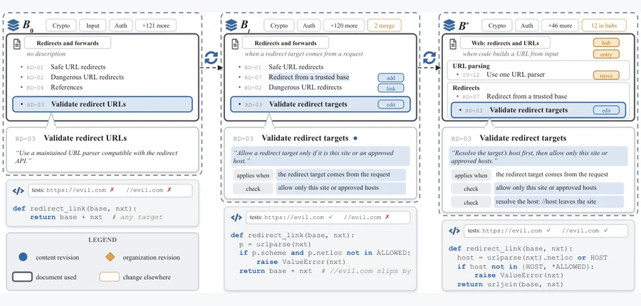 arXiv 2026-11-26 · cs.CR · #2 **[PRECEPT: Security Self-Improvement of Coding Agents via Evolving Principles](https://arxiv.org/abs/2611.33519)** Keyan Guo , Rupam Patir , Haipeng Cai , Hongxin Hu Affiliation · University at Buffalo [Paper](https://arxiv.org/abs/2611.33519) · [Figure source](https://arxiv.org/html/2611.33519v1/precept-library-cols.png) 

[EN] Abstract
AI coding agents increasingly write and submit code with limited human review, and much of it passes functional tests while remaining insecure. We show that these failures persist. Across 14 task sequences, Codex, Claude Code, and Qwen Code fixed a vulnerability 85.7% of the time when shown the failing security test, then reintroduced the same vulnerability class in a new session 26.7% of the time, about as often as agents that had never seen it (27.5%). The capability is present; the retention is not. Neither recording the repair in the agent's persistent context nor supplying published secure coding principles closed the gap: the recorded fix stayed tied to the family of the task it came from, and the principles, written for human developers, remained too general to apply to the code at hand. The knowledge exists; it is not activated. We call the missing ability security self-improvement: an agent learns from its own security failures so that each lesson persists across sessions, applies to new code, and does not break what works. We present PRECEPT, which equips coding agents with this ability through an evolving library that starts from authoritative secure coding principles and revises them against the agent's own failures, so that each principle comes to fire on the code where that agent actually goes wrong. A revision is kept only if fresh executions show it makes code more secure while keeping functional success within a small tolerance of the agent without the library. Improvement continues across evolution steps rather than saturating after the first. On task families never seen during evolution, PRECEPT's weakest agent reaches 97.1% secure working code, above the strongest unaided agent at 81.9% and the strongest baseline at 87.7%. <a href="https://arxiv.org/list/cs/new?show=2000#2611.33519">Source</a>

[ZH] Abstract
AI 编程智能体越来越多地在有限人工评审下编写和提交代码，其中许多代码虽通过功能测试，却仍不安全。我们表明，这些失败会持续存在。在 14 个任务序列中，Codex、Claude Code 和 Qwen Code 在看到失败安全测试时，有 85.7% 的情况修复漏洞，但在新会话中，又有 26.7% 的情况重新引入同类漏洞，几乎与从未见过该漏洞的智能体一样（27.5%）。能力已经存在，保留能力却没有。无论将修复记录到智能体持久上下文，还是提供已发表安全编程原则，都未弥合差距：记录的修复仍局限于源任务家族，而面向人类开发者编写的原则过于宽泛，无法应用到手头代码。知识存在，却未被激活。我们将缺失能力称为安全自我改进：智能体从自身安全失败中学习，使每条经验跨会话持续存在、适用于新代码，且不破坏已有有效行为。我们提出 PRECEPT，通过不断演化的库赋予编程智能体这一能力。该库从权威安全编程原则出发，依据智能体自身失败修订原则，使每条原则能在该智能体真正出错的代码上生效。只有当新的执行表明修订使代码更安全，并将功能成功率维持在无库智能体的小容差内，才保留该修订。改进会跨演化步骤持续，而不是第一次后便饱和。在演化期间未见的任务家族上，PRECEPT 最弱智能体达到 97.1% 安全且有效代码，高于最强无辅助智能体的 81.9% 和最强基线的 87.7%。 <a href="https://arxiv.org/list/cs/new?show=2000#2611.33519">Source</a>
 | 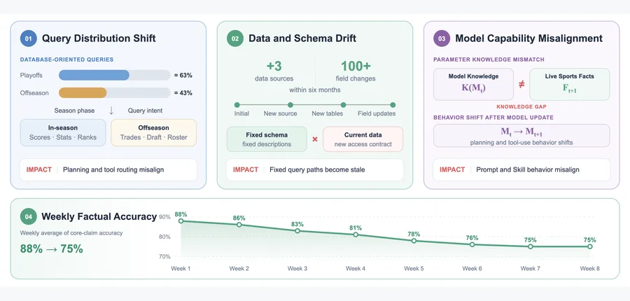 arXiv 2026-11-26 · cs.CL · #3 **[Sports Agent: A Self-Evolving System for Conversational Data Analytics](https://arxiv.org/abs/2611.33700)** Chao Chen , Fuqi Lin , Ze Chen , Ziyan Liu , Chen Li , Haishu Jiang , Bo Xu , Zihan Jiang , Yue Wu , Zheng Wang , Kun Wang… Affiliation · Alibaba Token Hub, Alibaba Group [Paper](https://arxiv.org/abs/2611.33700) · [Figure source](https://arxiv.org/html/2611.33700v1/figs/Intro-Fig1-V3.png) 

[EN] Abstract
Conversational sports analytics requires accurate, evidence-based responses with low latency. Changes in query distributions, data resources, and model behavior can degrade static agent configurations, motivating controlled evolution guided by runtime evidence. We present Sports Agent, a self-evolving framework integrating an Agentic SQL Model for structured-data reasoning, a harness for planning and tool orchestration, and a unified Feedback Engine connecting online execution with offline evolution. The engine assesses responses and execution trajectories, verifies factual claims, diagnoses failures, and generates evolution signals. Model evolution combines SQL-to-Question Scaling for coverage expansion with Graph-Guided Scaling for error-targeted synthesis. Generated questions undergo trajectory distillation and quality filtering for iterative supervised fine-tuning, followed by a separate Post-RL stage. Harness evolution translates recurrent failures into bounded prompt and skill updates, validated through independent audits, execution replay, and regression testing. Performance-tolerance checks guard against unacceptable degradation during simplification. The resulting Qwen3.6-35B-A3B-based model outperforms Qwen3.8-Max on sports question answering and analysis while achieving approximately three times the inference efficiency. Across 30 harness-evolution rounds, the aggregate performance score improves by 10.8 points. In a live sports analytics product, the evolved system improves factual correctness by 10.5 points and average response length, a proxy for answer richness, by 158.1%, while reducing average latency by 41.3% relative to the baseline. <a href="https://arxiv.org/list/cs/new?show=2000#2611.33700">Source</a>

[ZH] Abstract
对话式体育分析需要准确、基于证据且低延迟的回答。查询分布、数据资源和模型行为的变化，可能使静态智能体配置退化，因此需要由运行时证据指导的受控演化。我们提出 Sports Agent，一个整合结构化数据推理 Agentic SQL Model、规划与工具编排框架，以及连接在线执行和离线演化的统一 Feedback Engine 的自我演化框架。该引擎评估回答与执行轨迹、验证事实主张、诊断失败并生成演化信号。模型演化结合 SQL-to-Question Scaling 扩展覆盖，并用 Graph-Guided Scaling 针对错误合成数据。生成问题经过轨迹蒸馏和质量过滤，用于迭代监督微调，随后进行独立 Post-RL 阶段。框架演化将反复发生的失败转化为有界提示词与技能更新，并通过独立审计、执行重放和回归测试验证。性能容差检查防止简化期间出现不可接受退化。所得基于 Qwen3.6-35B-A3B 的模型，在体育问答与分析上优于 Qwen3.8-Max，同时推理效率约为其三倍。在 30 轮框架演化中，综合性能得分提高 10.8 个点。在一个线上体育分析产品中，相较基线，演化系统将事实正确率提高 10.5 个点，平均回答长度这一回答丰富度代理指标提高 158.1%，同时将平均延迟降低 41.3%。 <a href="https://arxiv.org/list/cs/new?show=2000#2611.33700">Source</a>
 |
| 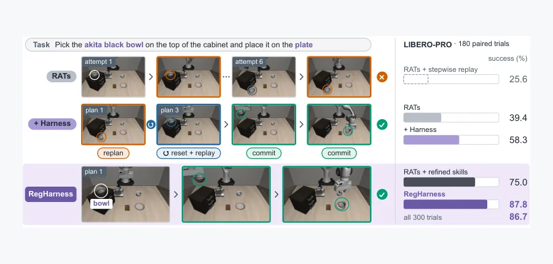 arXiv 2026-11-26 · cs.RO · #4 **[RegHarness: Regulating What Code-as-Policy Agents Keep from Steps to Skills](https://arxiv.org/abs/2611.33739)** Shengming Liu , Yunyi Gao , Xinyi Wang , Jianyong Sun , Shuai Wang , Yi Deng , Li Chenye , Mingcai Zhou , Sim Kuan Goh Affiliation · Xiamen University Malaysia / Embodied AI, Beijing Zhongke Huiling Robot Technology Co., Ltd. / Institute of Automation, Chinese Academy of Sciences [Paper](https://arxiv.org/abs/2611.33739) · [Figure source](https://arxiv.org/html/2611.33739v1/fig1_teaser_v7.png) 

[EN] Abstract
Code-as-Policy agents generate, execute, and revise robot programs, but often lack explicit mechanisms to govern what persists across executions: which actions are retained within a trial and which code modifications carry over to subsequent runs. This leaves two critical aspects of agent behavior insufficiently controlled: step-level execution and cross-run adaptation. We present RegHarness, a two-level harness that governs both forms of persistence for the RATs agent team, without relying on a vision-language-action (VLA) policy or demonstrations. Within each trial, run-time governance evaluates each proposed step from a reset scene, replaying the committed steps, while a fixed-rule controller commits the step only when both RATs' verifier and a task-long LLM auditor approve it. Between runs, a coding agent uses logged failures to develop and test revisions to skills, primitives, and rules, which remain disabled by default until explicitly enabled by the authors. Using a single low-cost model across all run-time roles, RegHarness achieves an 87.8% success rate (158/180) on paired LIBERO-PRO trials, compared with 39.4% for RATs, and a 72.0% success rate on MolmoSpaces trials. A $2\times2$ ablation study of RegHarness's two levels shows that its skill refinement alone increases RATs' successful trials from 71 to 135, whereas run-time governance alone achieves 105 and RATs' native stepwise reset-and-replay mode achieves only 46. These findings suggest that, for Code-as-Policy agents operating with low-cost models, task success depends not only on how generated programs are executed, but also on the quality of the reusable skills they invoke and how those skills evolve across runs. <a href="https://arxiv.org/list/cs/new?show=2000#2611.33739">Source</a>

[ZH] Abstract
Code-as-Policy 智能体生成、执行并修订机器人程序，但往往缺乏显式机制，治理哪些内容跨执行持续存在：哪些动作在一次试验中被保留，以及哪些代码修改传递到后续运行。这使智能体行为的两个关键方面控制不足：步骤级执行与跨运行适应。我们提出 RegHarness，一个用于 RATs 智能体团队的双层框架，同时治理两类持久性，无需视觉语言动作（VLA）策略或演示。每次试验内，运行时治理从重置场景评估每个提议步骤，重放已提交步骤；固定规则控制器只有在 RATs 验证器和任务全程 LLM 审计者都批准时，才提交该步骤。运行之间，编程智能体依据记录失败开发并测试技能、原语与规则修订；这些修订默认禁用，直到作者显式启用。RegHarness 在全部运行时角色上使用同一个低成本模型，在配对 LIBERO-PRO 试验上达到 87.8% 成功率（158/180），相比之下 RATs 为 39.4%，在 MolmoSpaces 试验上成功率为 72.0%。双层框架的 $2\times2$ 消融表明，仅技能细化就使 RATs 成功试验数从 71 增至 135，仅运行时治理达到 105，而 RATs 原生逐步重置—重放模式仅为 46。这些发现表明，对于使用低成本模型的 Code-as-Policy 智能体，任务成功不仅取决于生成程序如何执行，也取决于所调用可复用技能的质量，以及这些技能如何跨运行演化。 <a href="https://arxiv.org/list/cs/new?show=2000#2611.33739">Source</a>
 | 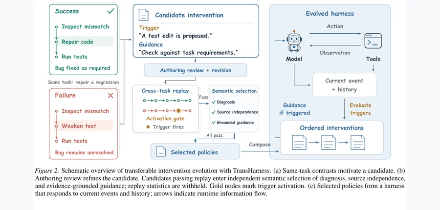 arXiv 2026-11-26 · cs.AI · #5 **[TransHarness: From Benchmark Overfitting to Transferable Harness Evolution](https://arxiv.org/abs/2611.33757)** Tianze Xia , Zimo Wang , Heng Tong , Zhaoxiang Liu , Shiguo Lian , Fan Huang , Wenyu Liu , Yunchao Wei , Xinggang Wang Affiliation · Huazhong University of Science and Technology / Unicom Data Intelligence, China Unicom / Xiamen University / Beijing Jiaotong University [Paper](https://arxiv.org/abs/2611.33757) · [Figure source](https://arxiv.org/pdf/2611.33757) 

[EN] Abstract
Harness evolution offers a path to improving coding agents without updating model weights. However, existing methods can overfit their evolution benchmarks, producing gains that fail to carry over to new tasks. To address this challenge, we introduce Transferable Harness Evolution (TransHarness), which evolves harness intervention policies from same-task success-failure contrasts. These policies couple execution-context triggers with diagnostic guidance, enabling task-dependent checks and corrections beyond the source executions. Cross-task replay and independent semantic selection retain policies that intervene selectively and ground corrections in current-task evidence rather than source-specific solutions. We further curate an independent evolution set for cross-distribution transfer and conduct a cross-benchmark evaluation covering multiple strong models and a range of lightweight and mature harnesses. Experiments show that, with only 300 source trajectories from outside the test distribution, TransHarness further improves strong agents across distinct target benchmarks, demonstrating transferable harness evolution beyond benchmark overfitting. Specifically, TransHarness achieves state-of-the-art scores of 76.4% on DeepSWE v1.1 and 95.5% on Terminal-Bench 2.1, surpassing the strongest baseline model, GPT-6 Astra, by 2.4 and 5.6 percentage points, respectively. <a href="https://arxiv.org/list/cs/new?show=2000#2611.33757">Source</a>

[ZH] Abstract
框架演化为不更新模型权重的编程智能体改进提供了一条路径。然而，现有方法可能过拟合演化基准，产生无法迁移到新任务的增益。为此，我们提出 Transferable Harness Evolution（TransHarness），通过同任务成功—失败对比演化框架干预策略。这些策略将执行上下文触发条件与诊断指导耦合，使任务相关检查与纠正能够超越源执行。跨任务重放和独立语义选择，保留能够选择性干预、并将纠正建立在当前任务证据而非源任务特定解上的策略。我们进一步整理独立演化集，用于跨分布迁移，并开展覆盖多个强模型与多种轻量和成熟框架的跨基准评测。实验表明，仅使用来自测试分布之外的 300 条源轨迹，TransHarness 就能在不同目标基准上进一步改善强智能体，展示超越基准过拟合的可迁移框架演化。具体而言，TransHarness 在 DeepSWE v1.1 和 Terminal-Bench 2.1 上分别达到最先进得分 76.4% 和 95.5%，比最强基线模型 GPT-6 Astra 分别高 2.4 和 5.6 个百分点。 <a href="https://arxiv.org/list/cs/new?show=2000#2611.33757">Source</a>
 | 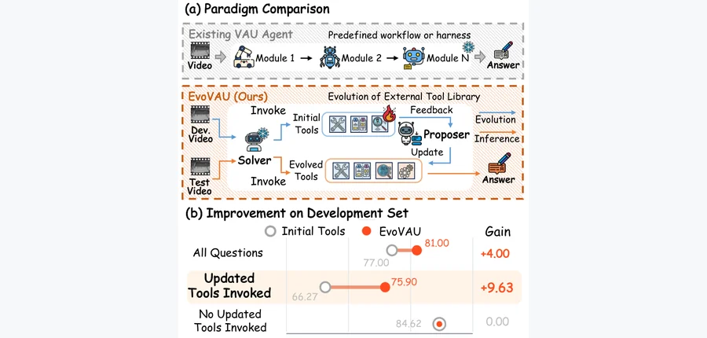 arXiv 2026-11-26 · cs.CV · #6 **[EvoVAU: Tool Evolution for Video Anomaly Understanding](https://arxiv.org/abs/2611.33808)** Benfeng Wang , Chao Huang , Yudong Cheng , Chengliang Liu , Wei Wang , Wenqi Ren Affiliation · Sun Yat-sen University / Fudan University / University of Macau [Paper](https://arxiv.org/abs/2611.33808) · [Figure source](https://arxiv.org/html/2611.33808v1/fig-motivation.png) 

[EN] Abstract
Video anomaly understanding (VAU) requires reasoning about event progression, interactions, and the contextual conditions that distinguish abnormal behavior from common activity across diverse scenes. Although video agents enable multi-round analysis, the predefined analytical operations may not adequately satisfy these diverse reasoning demands. In this paper, we present EvoVAU, a framework that evolves a reusable tool library for a frozen video solver. Guided by task outcomes and execution trajectories, an external proposer identifies potential limitations in the library and refines it, retaining task experience as analytical operations that can be reused across questions. Specifically, Cross-Version Contrastive Feedback guides tool refinement by combining current errors with paired execution trajectories from historical corrections and regressions. Adoption-Aware Selection accepts a candidate library only when overall development-set accuracy improves and corrections outnumber regressions among questions on which the solver invokes new or modified tools. Using a small development set, EvoVAU alternates tool refinement with candidate evaluation and selection. At test time, the evolved library remains fixed, with no further involvement from the proposer. Experiments on several VAU benchmarks demonstrate strong performance and the flexibility of the evolved library across anomaly domains. <a href="https://arxiv.org/list/cs/new?show=2000#2611.33808">Source</a>

[ZH] Abstract
视频异常理解（VAU）需要对事件进展、交互和上下文条件进行推理，以在多样场景中区分异常行为与常见活动。虽然视频智能体支持多轮分析，但预定义分析操作可能无法充分满足这些多样推理需求。本文提出 EvoVAU，一个为冻结视频求解器演化可复用工具库的框架。在任务结果与执行轨迹指导下，外部提议者识别工具库潜在局限并进行细化，将任务经验保留为可跨问题复用的分析操作。具体而言，Cross-Version Contrastive Feedback 将当前错误与历史纠正和退步的配对执行轨迹结合，以指导工具细化。Adoption-Aware Selection 只有在总体开发集准确率提高，且在求解器调用新增或修改工具的问题中，纠正数多于退步数时，才接受候选工具库。EvoVAU 使用小型开发集，交替进行工具细化、候选评估与选择。测试时，演化工具库保持固定，提议者不再参与。多个 VAU 基准上的实验展示了强性能，以及演化库跨异常领域的灵活性。 <a href="https://arxiv.org/list/cs/new?show=2000#2611.33808">Source</a>
 |
| 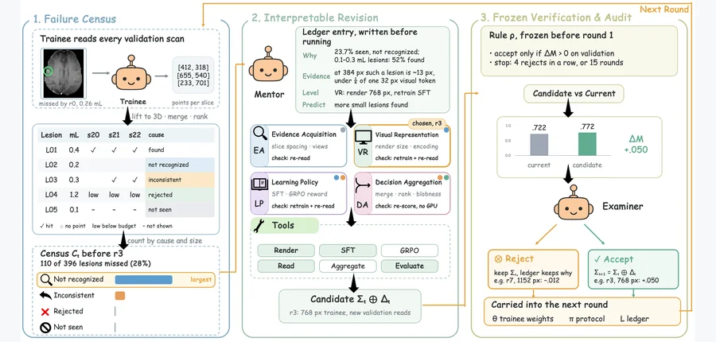 arXiv 2026-11-26 · cs.AI · #7 **[Can Its Own Misses Teach an MLLM to Find Small Brain Metastases?](https://arxiv.org/abs/2611.33836)** Yixuan Duan , Kexin Geng , Hanwen Xu , Wei Qiu Affiliation · Rice University / University of Pennsylvania [Paper](https://arxiv.org/abs/2611.33836) · [Figure source](https://arxiv.org/html/2611.33836v1/fig/pipeline.png) 

[EN] Abstract
Multimodal large language models (MLLMs) are becoming general readers of medical images, yet they remain weak at locating small abnormalities. Brain metastases expose this gap: at 384 px a 0.1 mL lesion covers less than a quarter of one visual token, and at one false positive per scan frontier MLLMs find fewer than 30% of lesions of 0.1-1 mL. Fine-tuning on one dataset helps but transfers poorly, and improving it further is slow trial and error steered by a single score. We introduce LANTERN (Lesion-finding AgeNt Through Error-driven Recursive learNing), a framework in which an MLLM improves recursively from its own misses. LANTERN recasts model development as an error-driven loop: a failure census attributes every missed lesion to one of four causes, an LLM mentor revises one of four levels (evidence acquisition, visual representation, learning policy, decision aggregation) per round, and a rule frozen before the first round decides what is kept, without test data and with every tool call audited. Over 15 unattended rounds, LANTERN raises a fine-tuned 4B MLLM from finding 75% to 94% of lesions at one false positive per scan on BraTS-MET, and 91% of those of 0.1-1 mL, compared with at most 51% and 29% for five frontier MLLMs read under the starting protocol; the gains hold on an external cohort (89%) and on unseen meningiomas (77%). These results show that an MLLM's own misses, attributed to their causes, can drive its reliable recursive self-improvement. <a href="https://arxiv.org/list/cs/new?show=2000#2611.33836">Source</a>

[ZH] Abstract
多模态大型语言模型（MLLM）正成为通用医学图像阅读器，但定位小异常的能力仍弱。脑转移瘤暴露了这一差距：在 384 px 下，0.1 mL 病灶占不到四分之一个视觉 token；每次扫描允许一个假阳性时，前沿 MLLM 找到的 0.1–1 mL 病灶少于 30%。在单个数据集上微调有帮助，但迁移较差，进一步改进仍是由单一得分引导的缓慢试错。我们提出 LANTERN（Lesion-finding AgeNt Through Error-driven Recursive learNing），一个让 MLLM 从自身漏检中递归改进的框架。LANTERN 将模型开发重构为错误驱动循环：失败普查将每个漏检病灶归因到四种原因之一，LLM 导师每轮修订四个层次之一（证据获取、视觉表征、学习策略、决策聚合），并由首轮前冻结的规则决定保留什么；不使用测试数据，且每次工具调用均被审计。在 15 个无人值守轮次中，LANTERN 在 BraTS-MET 上、每次扫描一个假阳性条件下，将微调 4B MLLM 的病灶检出率从 75% 提升至 94%，对 0.1–1 mL 病灶达到 91%；五个前沿 MLLM 在起始协议下分别最高为 51% 和 29%。增益在外部队列（89%）和未见脑膜瘤（77%）上保持。这些结果表明，将 MLLM 自身漏检归因到其原因，能够驱动可靠的递归自我改进。 <a href="https://arxiv.org/list/cs/new?show=2000#2611.33836">Source</a>
 | 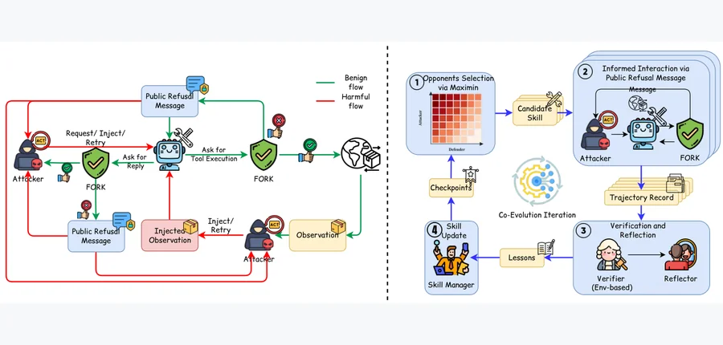 arXiv 2026-11-26 · cs.AI · #8 **[FORK: Co-Evolving Safe Disclosure and Decision Skills Against Attackers Who Read Every Refusal](https://arxiv.org/abs/2611.33879)** Hieu Man , Chao Shang , Rui Dong , Devang Kulshreshtha , Yanjun Qi , Sandesh Swamy Affiliation · University of Oregon / AWS AI Labs [Paper](https://arxiv.org/abs/2611.33879) · [Figure source](https://arxiv.org/html/2611.33879v1/overview.png) 

[EN] Abstract
When a guardrail rejects an LLM agent's action, its message reaches any attacker observing the trajectory: a fixed refusal leaves benign users unable to recover, whereas an explanation can tell the attacker what to try next. We study this as safe disclosure: explaining rejections so that authorized tasks recover without increasing adaptive attack success. Safe disclosure depends on both the decision and the message: what the guardrail blocks and what it reveals to the agent and the attacker. Because hand-written rules alone cannot anticipate how adaptive attackers probe decisions or use messages, we introduce FORK, which co-evolves a guardrail's natural-language decision and disclosure skills with an attacker that reads every public message. Each exploited message and permissive decision gives FORK evidence for a gradient-free revision of its natural-language skill library. We evaluate FORK on four benchmarks. Averaged over three agents on FORK-World, FORK cuts attack success rate (ASR) under adaptive attack from 78.4% to 14.1% and keeps utility above 85%, outperforming baselines on both ASR and utility. Notably, on MT-AgentRisk, whose environments and tasks are unseen in training, FORK lowers ASR from 70.6% to 9.1% with 93.1% benign utility. <a href="https://arxiv.org/list/cs/new?show=2000#2611.33879">Source</a>

[ZH] Abstract
当护栏拒绝 LLM 智能体动作时，其消息也会到达任何观察轨迹的攻击者：固定拒绝使良性用户无法恢复，而解释则可能告诉攻击者下一步该尝试什么。我们将其研究为安全披露：解释拒绝，使授权任务能够恢复，同时不提高自适应攻击成功率。安全披露既取决于决策，也取决于消息：护栏阻止什么，以及向智能体和攻击者透露什么。由于手写规则无法独自预见自适应攻击者如何探测决策或利用消息，我们提出 FORK，将护栏的自然语言决策与披露技能，同一个读取每条公开消息的攻击者共同演化。每次被利用的消息和过于宽松的决策，都为 FORK 对自然语言技能库进行无梯度修订提供证据。我们在四个基准上评估 FORK。在 FORK-World 上对三个智能体取平均，FORK 将自适应攻击下的攻击成功率（ASR）从 78.4% 降至 14.1%，同时保持效用高于 85%，在 ASR 与效用上均优于基线。值得注意的是，在训练未见环境与任务的 MT-AgentRisk 上，FORK 将 ASR 从 70.6% 降至 9.1%，同时保留 93.1% 良性效用。 <a href="https://arxiv.org/list/cs/new?show=2000#2611.33879">Source</a>
 | 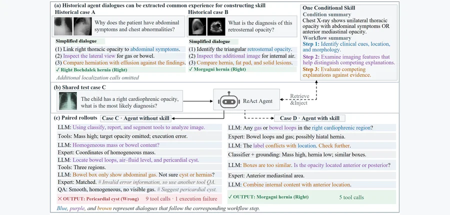 arXiv 2026-11-26 · cs.AI · #9 **[EGSE: Evidence-Grounded Skill Evolution for Medical Reasoning Agents](https://arxiv.org/abs/2611.33909)** Mingyuan Li , Tong Jia , Ziyuan Yang , Wenbo Qi , Haoran Wang , Jie Gui , Baosheng Yu Affiliation · Northeastern University, China / Nanyang Technological University / Southeast University [Paper](https://arxiv.org/abs/2611.33909) · [Figure source](https://arxiv.org/html/2611.33909v1/figures/figure1.jpg) 

[EN] Abstract
Medical reasoning agents combine foundation models with specialized tools to interpret medical images, yet reusing their historical experience remains challenging. A correct final answer can conceal flawed reasoning or tool use, synthesized advice may lack source support, and superficially similar cases may require different diagnostic procedures. In this paper, we propose EGSE, an evidence-grounded skill evolution framework that distills historical dialogues from similar cases into reusable conditional workflows and progressively refines a multi-faceted skill library through supported and validated updates to improve medical agents. EGSE evaluates intermediate reasoning and tool use and contrasts repeated successful and failed rollouts to extract useful practices and evidence-supported avoidance guidance. These experiences are synthesized into workflows with applicability conditions and checks traceable to source dialogues. Library additions and merges require source-grounded review and execution validation. At inference time, EGSE routes queries to skill nodes organized by imaging modality, question task type, and disease category, then retrieves and selects applicable workflows based on their conditions, the current images, and the question to guide evidence acquisition and interpretation. Experiments across four chest X-ray benchmarks show that EGSE outperforms representative medical agents and skill evolution methods in reasoning accuracy while reducing tool calls. It also delivers consistent accuracy gains across seven foundation models and supports skill transfer across datasets. <a href="https://arxiv.org/list/cs/new?show=2000#2611.33909">Source</a>

[ZH] Abstract
医学推理智能体将基础模型与专门工具结合以解释医学图像，但复用历史经验仍有挑战。正确最终答案可能掩盖有缺陷的推理或工具使用，合成建议可能缺乏来源支持，表面相似病例也可能需要不同诊断流程。本文提出 EGSE，一个以证据为依据的技能演化框架，将相似病例历史对话蒸馏成可复用条件工作流，通过受支持且经验证的更新，逐步细化多维技能库以改善医学智能体。EGSE 评估中间推理与工具使用，并对比重复成功和失败 rollout，提取有用做法与证据支持的规避指导。这些经验被合成为具有适用条件、且检查可追溯到源对话的工作流。库新增与合并需要来源依据审查和执行验证。推理时，EGSE 将查询路由到按影像模态、问题任务类型与疾病类别组织的技能节点，再依据条件、当前图像与问题，检索并选择适用工作流，以指导证据获取和解释。四个胸部 X 光基准上的实验表明，EGSE 在推理准确率上优于代表性医学智能体和技能演化方法，同时减少工具调用。它还在七个基础模型上产生一致准确率增益，并支持跨数据集技能迁移。 <a href="https://arxiv.org/list/cs/new?show=2000#2611.33909">Source</a>
 |
| 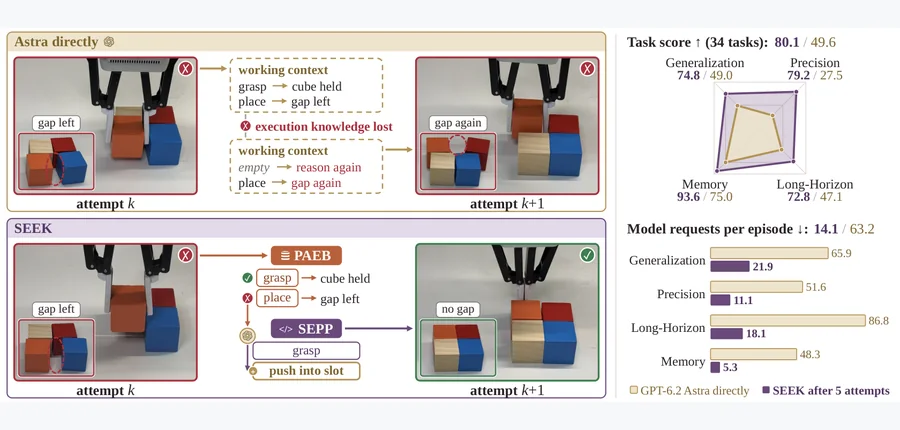 arXiv 2026-11-26 · cs.RO · #10 **[SEEK: Self-Evolution through Execution Knowledge for Agentic Robot Manipulation](https://arxiv.org/abs/2611.33915)** Zeyang Guan , Qihao Zhao , Rui Gong , Zhang Haitian , Yalun Dai , Yangyu Huang , Lingao Xiao , Haozhe Du , Xuehui Yu , Ye… Affiliation · Nanyang Technological University / Microsoft Research / National University of Singapore [Paper](https://arxiv.org/abs/2611.33915) · [Code](https://github.com/ZeyangGuan/SEEK-Agentic-Robot-Manipulation) · [Project](https://zeyangguan.github.io/SEEK-Agentic-Robot-Manipulation/) · [Figure source](https://arxiv.org/html/2611.33915v1/SEEK_framework_ppt1_intro.png) 

[EN] Abstract
General-purpose multimodal foundation models enable robots to adapt during deployment from observations and execution feedback, without task-specific demonstrations or training. However, the robot retains what it learns only in the model's working context. Once the task ends, it loses this execution knowledge, such as how to carry a bowl between two grippers. On the next attempt at the task, the robot may take just as long and repeat the same mistakes. To avoid this repetition, robots must retain execution knowledge across attempts. Yet replaying past actions is insufficient, because their effects depend on the current conditions. Procedures that determine actions from the current scene address this, but when they meet conditions that earlier attempts did not cover, revising them requires the measured effects of earlier actions. We therefore propose SEEK, an agentic framework that retains both, enabling robots to improve across attempts while keeping the underlying model fixed. To adapt retained knowledge to the current scene, SEEK adopts a Self-Evolving Programmatic Policy (SEPP) that encodes manipulation as executable procedures and determines each action from current observations. As the robot executes these procedures, SEEK records the measured effects of its actions, including those from failed attempts, in a Persistent Action-Effect Bank (PAEB). Where a retained procedure applies, it acts without a model request; where it meets a condition it does not cover, this evidence guides its revision. On RoboDojo, knowledge retained over ten attempts raises SEEK's average task score from 27.0 to 54.4 and its success rate from 19.7% to 48.0% across all 42 tasks. On 34 of these tasks with GPT-6.2 Astra, SEEK reaches 80.1 after five attempts, against 49.6 for the same model acting directly, and uses 77.6% fewer model requests. this https URL <a href="https://arxiv.org/list/cs/new?show=2000#2611.33915">Source</a>

[ZH] Abstract
通用多模态基础模型使机器人能够在部署期间依据观测与执行反馈适应，无需任务专属演示或训练。然而，机器人只将学到的内容保留在模型工作上下文中。一旦任务结束，这些执行知识，例如如何在两个夹爪间传递碗，就会丢失。下次尝试同一任务时，机器人可能仍花同样时间、重复相同错误。为避免重复，机器人必须跨尝试保留执行知识。然而，重放过往动作并不够，因为动作效果取决于当前条件。依据当前场景决定动作的流程可以解决这一点，但遇到先前尝试未覆盖的条件时，要修订流程，就需要先前动作的实测效果。因此，我们提出 SEEK，一个同时保留两者的智能体框架，使机器人在底层模型固定时跨尝试改进。为使保留知识适应当前场景，SEEK 采用 Self-Evolving Programmatic Policy（SEPP），将操作编码为可执行流程，并依据当前观测决定每个动作。机器人执行流程时，SEEK 在 Persistent Action-Effect Bank（PAEB）中记录动作实测效果，包括失败尝试的效果。保留流程适用时，它无需模型请求即可行动；遇到未覆盖条件时，这些证据指导修订。在 RoboDojo 全部 42 个任务上，跨十次尝试保留的知识，将 SEEK 平均任务得分从 27.0 提升至 54.4，成功率从 19.7% 提升至 48.0%。在其中使用 GPT-6.2 Astra 的 34 个任务上，SEEK 五次尝试后达到 80.1，而同一模型直接行动为 49.6，并减少 77.6% 模型请求。此 https URL。 <a href="https://arxiv.org/list/cs/new?show=2000#2611.33915">Source</a>
 | 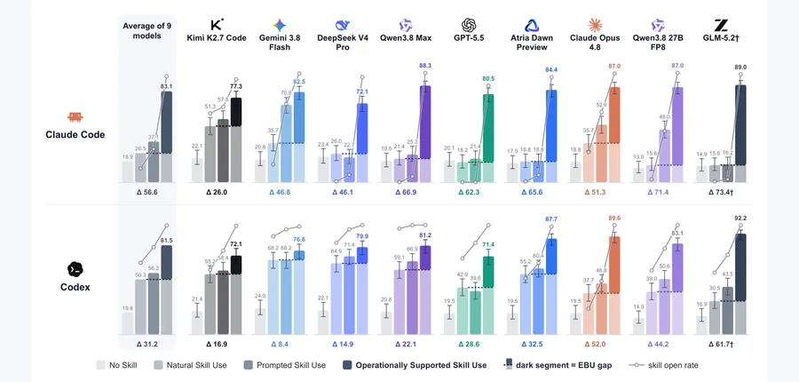 arXiv 2026-11-26 · cs.AI · #11 **[MedSkill-E$^{2}$: Evaluating and Evolving Skills for Medical Agents](https://arxiv.org/abs/2611.34250)** Jingjing Hua , Shaocong Wei , Jianghan Shen , Junzhi Ning , Min Cen , Cheng Tang , Ziyan Huang , Jiepeng Li , Fengshuo Liu… Affiliation · Shanghai Artificial Intelligence Laboratory / University of Chinese Academy of Sciences / Nanjing University / Imperial College London / Fudan University [Paper](https://arxiv.org/abs/2611.34250) · [Figure source](https://arxiv.org/html/2611.34250v1/main-results.png) 

[EN] Abstract
Large language model (LLM) agents increasingly use skills to access domain knowledge and complete real-world tasks. We observe that even when a skill specifies the rules and procedures needed for a task, agents may fail to apply them effectively during autonomous execution, a phenomenon we call skill Enable But Underuse (EBU). This issue is particularly consequential in medical tasks, where overlooking a single critical constraint can yield a plausible but incorrect result. To evaluate and address EBU, we introduce MedSkill-E$^{2}$, a framework for evaluating and evolving skills for medical agents. We construct EBU-Bench, a challenging benchmark covering 12 medically relevant task groups and associated skills, to evaluate agents' ability to use available skills autonomously. We quantify the EBU gap as the difference in skill-use accuracy between autonomous use and explicitly guided reading and application of the same skill. On EBU-Bench, all evaluated model-harness combinations exhibit EBU, with a mean gap of 43.94 percentage points (pp). For the same model, skill-use accuracy under autonomous use differs by up to 38.96 pp across harnesses. Motivated by these observations, we propose EBU-Evolve, which uses execution feedback from autonomous and explicitly guided skill use to distill effective guidance into reusable skill instructions. Relative to their pre-evolution versions, the revised skills improve skill-use accuracy during autonomous execution by 33.33 to 55.17 pp and continue to yield improvements when transferred across multiple models and harnesses. Our results show that autonomous skill-use accuracy varies across harnesses with the model and skill held fixed, and model rankings can change. EBU can persist even after a skill is opened. EBU-Evolve improves autonomous skill-use accuracy on unseen tasks within the same skill, with gains transferring across models and harnesses. <a href="https://arxiv.org/list/cs/new?show=2000#2611.34250">Source</a>

[ZH] Abstract
大型语言模型（LLM）智能体越来越多地使用技能访问领域知识并完成现实任务。我们观察到，即使技能规定了任务所需规则和流程，智能体在自主执行中仍可能无法有效应用；我们将其称为技能 Enable But Underuse（EBU，有能力却使用不足）。在医学任务中，这尤其重要，因为忽略一个关键约束就可能产生看似合理但错误的结果。为评估和解决 EBU，我们提出 MedSkill-E$^{2}$，一个评估与演化医学智能体技能的框架。我们构建 EBU-Bench，一个覆盖 12 个医学相关任务组及关联技能的挑战性基准，用于评估智能体自主使用现有技能的能力。我们将 EBU 差距量化为：同一技能的自主使用准确率，与显式指导阅读和应用时准确率的差异。在 EBU-Bench 上，所有受评模型—框架组合均表现出 EBU，平均差距为 43.94 个百分点（pp）。同一模型在不同框架下的自主技能使用准确率，最高相差 38.96 pp。受这些观察启发，我们提出 EBU-Evolve，利用自主和显式指导技能使用的执行反馈，将有效指导蒸馏为可复用技能指令。相较演化前版本，修订技能将自主执行中的技能使用准确率提高 33.33–55.17 pp，且迁移到多个模型和框架后仍持续带来改善。结果表明，在模型与技能固定时，自主技能使用准确率仍随框架变化，模型排名也可能改变。即使技能已打开，EBU 仍可能存在。EBU-Evolve 改善同一技能内未见任务的自主技能使用准确率，且增益可跨模型和框架迁移。 <a href="https://arxiv.org/list/cs/new?show=2000#2611.34250">Source</a>
 | 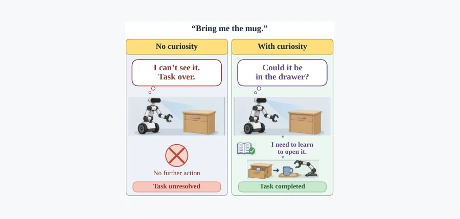 arXiv 2026-11-26 · cs.RO · #12 **[CHASE: Curiosity-Guided Skill Acquisition for Embodied Task Execution](https://arxiv.org/abs/2611.34416)** Zixuan Wang , Wei Zhang , Chenlei Zhu , Naiyu Chen , Xihua Wang , Jie Chen Affiliation · University of Alberta / Harbin Institute of Technology / Fudan University [Paper](https://arxiv.org/abs/2611.34416) · [Figure source](https://arxiv.org/html/2611.34416v1/curiosity_comparison.png) 

[EN] Abstract
Robots executing tasks in partially observed environments must resolve uncertainty while operating with incomplete skills. Inspired by human curiosity, we investigate how robots can formulate task-relevant hypotheses, seek evidence, and acquire missing skills during task execution. We propose CHASE, a Curiosity-guided Harness for Acquiring Skills from Evidence, which operationalizes curiosity as selecting investigations that resolve task uncertainty and expand executable capabilities. Four modules connect dynamic scene understanding, hypothesis-driven planning, on-demand skill acquisition, and verified execution. The planner balances information value, skill reuse, and acquisition/execution cost. Missing skills trigger bounded exploration, learning from verified segments, and held-out admission during acquisition; separate checks verify physical effects and acquired evidence. Newly admitted skills expand the executable investigation set, closing the loop between resolving uncertainty and acquiring capabilities. Simulation and real-robot experiments evaluate investigation, skill acquisition, and task execution. CHASE achieves 50-80% task success under combined information and capability gaps, with 70-90% evidence resolution. <a href="https://arxiv.org/list/cs/new?show=2000#2611.34416">Source</a>

[ZH] Abstract
机器人在部分可观测环境中执行任务时，必须一边处理不完整技能，一边消除不确定性。受人类好奇心启发，我们研究机器人如何在任务执行期间提出任务相关假设、搜寻证据并获取缺失技能。我们提出 CHASE，即 Curiosity-guided Harness for Acquiring Skills from Evidence，将好奇心操作化为：选择能够消除任务不确定性、并扩展可执行能力的调查。四个模块连接动态场景理解、假设驱动规划、按需技能获取与经验证执行。规划器平衡信息价值、技能复用以及获取/执行成本。缺失技能触发有界探索、从经验证片段学习，以及获取期间的留出采纳；独立检查验证物理效果与所得证据。新采纳技能扩展可执行调查集合，闭合消除不确定性与获取能力之间的循环。仿真与真实机器人实验评估了调查、技能获取和任务执行。在信息与能力缺口并存时，CHASE 达到 50–80% 任务成功率和 70–90% 证据解决率。 <a href="https://arxiv.org/list/cs/new?show=2000#2611.34416">Source</a>
 |
| 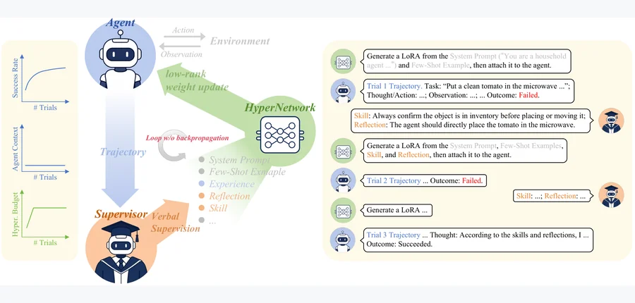 arXiv 2026-11-26 · cs.AI · #13 **[vSFT: Learning to Verbally Tune Agents at Test Time](https://arxiv.org/abs/2611.34440)** Qishuai Wen , Rui Chen , Haiwen Li , Zhiyuan Huang , Qiwen Gu , Bingjie Gao , Geng Li , Jing Tang , Xiangxiang Chu , Chun-… Affiliation · AMAP, Alibaba Group / Shenzhen Loop Area Institute / Tongji University / Shanghai Jiao Tong University / Independent Researcher [Paper](https://arxiv.org/abs/2611.34440) · [Figure source](https://arxiv.org/html/2611.34440v1/img_vSFT.png) 

[EN] Abstract
Large language model agents are increasingly improved via agentic reinforcement learning, which can be on-policy but suffers from expensive rollouts and sparse rewards, limiting its application at test time. In this paper, we present a verbally Supervised Fine-Tuning (vSFT) framework that enables the conjunction of dense feedback in natural language and weight updates at test time. Specifically, our vSFT forms a closed loop between an agent and a supervisor via a hypernetwork, in which the supervisor generates verbal supervision from the agent's failed trajectories, and the hypernetwork converts that supervision into low-rank weight updates to tune the agent. We validate that this test-time in-parameter evolving process outperforms both its in-context counterparts and prevalent reinforcement learning methods. In particular, our vSFT using Qwen3-4B outperforms GRPO and Reflexion by 8.7% and 13.9% in success rate on ALFWorld, and by 4.8% and 18.2% on WebShop, respectively. We believe that learning how to adapt a model, rather than an adapted model, offers a promising path towards more capable agents that improve themselves. <a href="https://arxiv.org/list/cs/new?show=2000#2611.34440">Source</a>

[ZH] Abstract
大型语言模型智能体越来越多地通过智能体强化学习改进，该方法可以是同策略的，但存在 rollout 昂贵、奖励稀疏的问题，限制了测试时应用。本文提出 verbally Supervised Fine-Tuning（vSFT）框架，使密集自然语言反馈与测试时权重更新能够结合。具体而言，vSFT 通过超网络在智能体与监督者之间形成闭环：监督者从智能体失败轨迹生成语言监督，超网络将该监督转化为低秩权重更新，以调整智能体。我们验证，这种测试时参数内演化过程优于上下文内对应方法和常用强化学习方法。具体而言，使用 Qwen3-4B 的 vSFT，在 ALFWorld 成功率上分别比 GRPO 与 Reflexion 高 8.7% 和 13.9%，在 WebShop 上分别高 4.8% 和 18.2%。我们认为，学习如何适配模型，而非只学习一个已适配模型，为能够自我改进的更强智能体提供了一条有前景的路径。 <a href="https://arxiv.org/list/cs/new?show=2000#2611.34440">Source</a>
 | 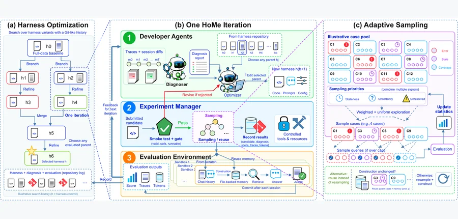 arXiv 2026-11-26 · cs.AI · #14 **[HoMe: Toward Practical Harness Optimization of Memory Systems for AI Assistants](https://arxiv.org/abs/2611.34624)** Yifei Xu , Li Yu , Zhaoyang Liu , Ce Wang , Sen Huang , Yanyan Shen , Yun Lin , Linpeng Huang , Hong Mei Affiliation · Shanghai Jiao Tong University / Alibaba Group / Peking University [Paper](https://arxiv.org/abs/2611.34624) · [Code](https://github.com/agentscope-ai/ReMe) · [Figure source](https://arxiv.org/html/2611.34624v1/sturcture3.png) 

[EN] Abstract
The behavior of memory systems for long-running AI assistants is governed by a harness, which consists of the code, prompts, and configurations for memory construction, maintenance, retrieval, and answer generation. However, optimizing the harness of a memory system remains largely manual, and unrestricted editing alone does not ensure structural improvements. In this paper, we introduce HoMe, an evaluation-driven framework that iteratively evaluates candidate harnesses and derives each new candidate from any previously evaluated harness by editing any part of it. HoMe combines session-level memory versioning with execution traces to identify shared failure mechanisms across cases and localize them to the responsible sessions and harness components. It encourages early structural exploration through candidate gating and reduces evaluation cost through smoke tests, adaptive sampling, and the reuse of constructed memory. We validate HoMe with the open-source memory system ReMe on two large-scale long-horizon memory benchmarks, LongMemEval-S and BEAM. With six formal candidate evaluations per benchmark, after a full initial evaluation, HoMe discovers harnesses that improve end-task performance over the originally strong harness while consuming far fewer query-time tokens. The code is available at this https URL . <a href="https://arxiv.org/list/cs/new?show=2000#2611.34624">Source</a>

[ZH] Abstract
面向长期运行 AI 助手的记忆系统，其行为受框架支配，框架包含记忆构建、维护、检索与回答生成的代码、提示词和配置。然而，记忆系统框架优化仍主要依赖人工，不受约束的编辑本身也不保证结构性改进。本文提出 HoMe，一个评测驱动框架，迭代评估候选框架，并通过编辑任意部分，从任何先前评估过的框架生成新候选。HoMe 将会话级记忆版本管理与执行轨迹结合，识别跨案例共享的失败机制，并定位到责任会话与框架组件。它通过候选门控鼓励早期结构探索，并通过冒烟测试、自适应采样和复用已构建记忆降低评测成本。我们使用开源记忆系统 ReMe，在两个大规模长周期记忆基准 LongMemEval-S 和 BEAM 上验证 HoMe。在一次完整初始评测之后，每个基准仅进行六次正式候选评测，HoMe 就发现了能比原本已较强框架提高最终任务性能、同时消耗更少查询时 token 的框架。代码可在此 https URL 获取。 <a href="https://arxiv.org/list/cs/new?show=2000#2611.34624">Source</a>
 | 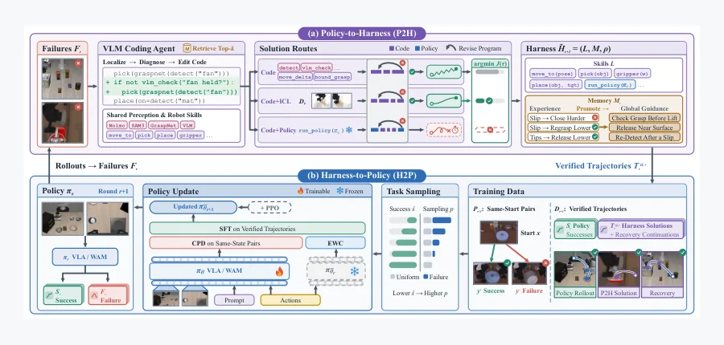 arXiv 2026-11-26 · cs.RO · #15 **[RoboEvo$^2$: Recursive Robot Self-Improvement via Harness-Policy Co-Evolution](https://arxiv.org/abs/2611.34675)** Chenzhi Liu , Jiehong Lin , Wei Huang , Xuzhao Huang , Haoyuan Li , Yang Zhang , Junchao Huang , Chenyeyang Cai , Bo Wang… Affiliation · The University of Hong Kong / Zhejiang University / Southern University of Science and Technology / The Chinese University of Hong Kong, Shenzhen / City University of Hong Kong [Paper](https://arxiv.org/abs/2611.34675) · [Code](https://github.com/kaiknower/RoboEvo2) · [Project](https://kaiknower.github.io/RoboEvo2/) · [Figure source](https://arxiv.org/html/2611.34675v1/method_roboevo2.png) 

[EN] Abstract
Robots should adapt to unfamiliar environments and acquire new skills through interaction, then execute those skills efficiently with practice. Vision-language-action policies provide efficient control, but often need additional human demonstrations to handle unfamiliar settings; reasoning agents can discover solutions using broad prior knowledge and robot-control APIs, but repeated deliberation and repair are costly. Inspired by human learning through reasoning and practice, we propose RoboEvo$^2$, a framework for recursive harness-policy co-evolution. In Policy-to-Harness (P2H) evolution, policy failures guide a coding agent to search complementary Code, Code+ICL, and Code+Policy routes, consolidating verified solutions into reusable skills, routing strategies, and experience memory. In Harness-to-Policy (H2P) evolution, verified trajectories provide supervised training, while Counterfactual Preference Distillation (CPD) teaches the policy to favor successful corrections over failures from the same starting state. The improved policy provides stronger motor skills for subsequent search, while its remaining failures redirect harness evolution, closing the reciprocal loop. Through recursive co-evolution without additional human demonstrations, RoboEvo$^2$ improves standalone success from 11.0% to 84.1% and hybrid success from 30.4% to 90.5% on LIBERO-PRO, with similar gains and reduced agentic costs on RoboTwin C2R. Further experiments demonstrate autonomous task acquisition, cross-embodiment harness transfer, and 95.0% hybrid success on the Unitree G1-D. Our models and code will be publicly released. <a href="https://arxiv.org/list/cs/new?show=2000#2611.34675">Source</a>

[ZH] Abstract
机器人应通过交互适应陌生环境并获取新技能，再通过练习高效执行。视觉语言动作策略提供高效控制，但应对陌生设置时，往往需要额外人工演示；推理智能体能够凭借广泛先验知识与机器人控制 API 发现解法，但重复思考和修复成本高。受人类通过推理与练习学习启发，我们提出 RoboEvo$^2$，一个递归框架—策略共同演化方法。在 Policy-to-Harness（P2H）演化中，策略失败指导编程智能体搜索互补的 Code、Code+ICL 和 Code+Policy 路径，将经验证解整合为可复用技能、路由策略与经验记忆。在 Harness-to-Policy（H2P）演化中，经验证轨迹提供监督训练，而 Counterfactual Preference Distillation（CPD）教会策略偏好来自同一起始状态的成功纠正，而非失败。改进策略为后续搜索提供更强运动技能，其剩余失败则重新引导框架演化，闭合相互促进的循环。在不增加人工演示的递归共同演化下，RoboEvo$^2$ 在 LIBERO-PRO 上将独立策略成功率从 11.0% 提升至 84.1%，混合成功率从 30.4% 提升至 90.5%，在 RoboTwin C2R 上也有类似增益并降低智能体成本。进一步实验展示了自主任务获取、跨具身框架迁移，以及 Unitree G1-D 上 95.0% 的混合成功率。模型和代码将公开发布。 <a href="https://arxiv.org/list/cs/new?show=2000#2611.34675">Source</a>
 |
| 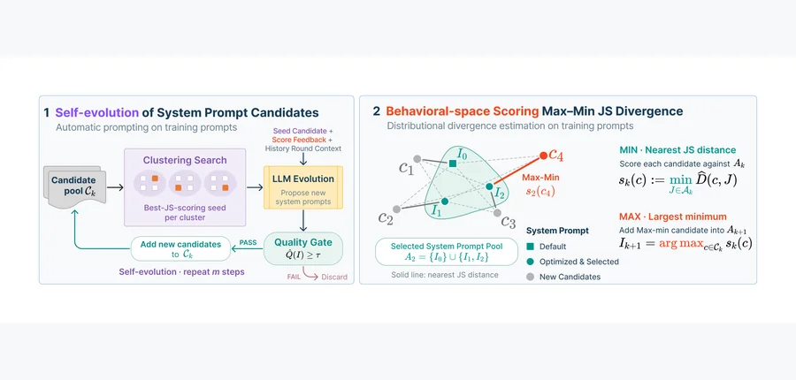 arXiv 2026-11-26 · cs.LG · #16 **[One Model, Many Modes: Evolving System Prompt Ensembles for Creative Generation](https://arxiv.org/abs/2611.34760)** Daiwei Chen , Anda He , Binwei Yao , Junjie Hu , Ramya Korlakai Vinayak Affiliation · University of Wisconsin–Madison [Paper](https://arxiv.org/abs/2611.34760) · [Figure source](https://arxiv.org/html/2611.34760v1/muse_algorithm_overview.png) 

[EN] Abstract
Preference-aligned LLMs can exhibit mode collapse, concentrating their output distributions around a narrow set of high-reward responses. This limits creative generation, which requires quality, novelty, and diversity. Existing test-time methods often emphasize diversity, giving less attention to whether individual responses are both high-quality and novel. This distinction matters in practical use, where users may seek a single compelling, original response. We formalize creative generation as a multi-objective distributional optimization problem and introduce SEPO, a training-free framework for System Prompt Ensemble Optimization. The framework combines prompt evolution with greedy max-min selection to identify behaviorally distinct system prompts under a quality constraint, then uniformly samples one prompt per response at inference time. Across four creative generation tasks with increasing quality requirements and three open-weight models, SEPO ranks first in 8 of 12 settings on the harmonic mean of quality, diversity, and novelty, while no baseline leads in more than two. On average, it raises LLM-judged diversity from 1.92 to 3.43 and novelty from 1.00 to 3.34 over base sampling (1-5 scale), with quality decreasing from 3.72 to 3.30. We further show that expanding the optimized ensemble increases separation among prompt-conditioned response distributions. These results support system prompt ensemble optimization as a promising approach to improving LLM creativity at inference time. <a href="https://arxiv.org/list/cs/new?show=2000#2611.34760">Source</a>

[ZH] Abstract
偏好对齐 LLM 可能出现模式塌缩，将输出分布集中在少量高奖励回答附近。这限制了需要质量、新颖性和多样性的创意生成。现有测试时方法通常强调多样性，却较少关注每个回答是否既高质量又新颖。这一差异在实际使用中很重要，因为用户可能只需要一个有吸引力、原创的回答。我们将创意生成形式化为多目标分布优化问题，并提出 SEPO，一个无需训练的 System Prompt Ensemble Optimization 框架。该框架结合提示词演化与贪心最大—最小选择，在质量约束下找出行为不同的系统提示词，然后在推理时每次回答均匀采样一个提示词。在四项质量要求递增的创意生成任务与三个开放权重模型上，SEPO 在质量、多样性和新颖性的调和平均值中，于 12 种设置中的 8 种排名第一，而任何基线领先的设置均不超过两种。平均而言，相较基础采样，它将 LLM 评分的多样性从 1.92 提升至 3.43、新颖性从 1.00 提升至 3.34（1–5 分量表），但质量从 3.72 降至 3.30。我们进一步表明，扩展优化后的集成会增加提示词条件回答分布间的分离。这些结果支持系统提示词集成优化作为在推理时改善 LLM 创造力的一条有前景路径。 <a href="https://arxiv.org/list/cs/new?show=2000#2611.34760">Source</a>
 | 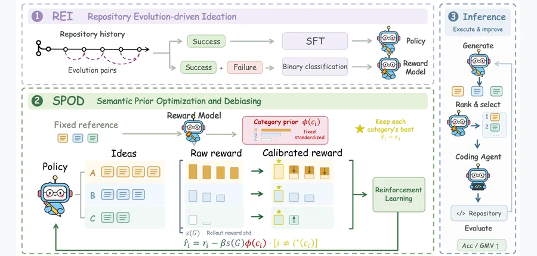 arXiv 2026-11-26 · cs.LG · #17 **[REI: Learning Ideation from Repository Evolution](https://arxiv.org/abs/2611.33183)** Muyu Zou , Xiang Feng , Yufei Xu , Shanshan Ye , Zulong Chen , Lingyu Mu , Jinxin Hu , Jing Zhang Affiliation · Alibaba Group / Wuhan University / Mohamed bin Zayed University of Artificial Intelligence [Paper](https://arxiv.org/abs/2611.33183) · [Code](https://github.com/Gabriel-reina/spod) · [Figure source](https://arxiv.org/html/2611.33183v1/REI_mainfigure_compact_v7.png) 

[EN] Abstract
As AI systems become increasingly capable of executing and evaluating experiments, ideation is emerging as a bottleneck in automated scientific and engineering iteration. In many real-world domains, useful ideas are sparse and their validation is costly, making direct online exploration inefficient. We observe that repository evolution provides a scalable source of reusable technical experience: code changes record concrete technical hypotheses, while subsequent revisions, adoption, and reuse provide signals about their utility. Based on this observation, we propose REI, a Repository Evolution-driven Ideation framework that learns reusable ideation policies from repository evolution, injecting domain-specific technical experience into model parameters and reducing reliance on costly trial-and-error. We further identify a hidden failure mode in quality-driven ideation optimization: semantic diversity collapse. Although generated ideas can remain lexically diverse, they increasingly concentrate in a small number of dominant method families, limiting cross-task generalization and long-tail exploration. To address this problem, we introduce Semantic Prior Optimization and Debiasing (SPOD), a diversity-preserving alignment mechanism that makes method identity explicit, corrects category-level reward bias, and limits redundant accumulation within the same method family while retaining strong representatives. Experiments on public benchmarks and a real-world industrial setting demonstrate improvements in ideation quality, method diversity, cross-task generalization, and long-tail exploration. <a href="https://arxiv.org/list/cs/new?show=2000#2611.33183">Source</a>

[ZH] Abstract
随着 AI 系统越来越能够执行与评估实验，构思正成为自动化科学和工程迭代的瓶颈。在许多现实领域，有用想法稀少、验证昂贵，使直接在线探索低效。我们观察到，仓库演化提供了可扩展的可复用技术经验来源：代码修改记录具体技术假设，而后续修订、采纳与复用，则提供其效用信号。基于此，我们提出 REI，一个由 Repository Evolution 驱动的 Ideation 框架，从仓库演化学习可复用构思策略，将领域技术经验注入模型参数，减少对昂贵试错的依赖。我们进一步识别出质量驱动构思优化中的隐藏失败模式：语义多样性塌缩。虽然生成想法在词汇上仍可能多样，却越来越集中于少数主导方法家族，限制跨任务泛化与长尾探索。为此，我们引入 Semantic Prior Optimization and Debiasing（SPOD），一种保留多样性的对齐机制，显式表示方法身份、纠正类别级奖励偏差，并限制同一方法家族内的冗余积累，同时保留强代表。公共基准和现实工业设置上的实验，展示了构思质量、方法多样性、跨任务泛化与长尾探索的改善。 <a href="https://arxiv.org/list/cs/new?show=2000#2611.33183">Source</a>
 | 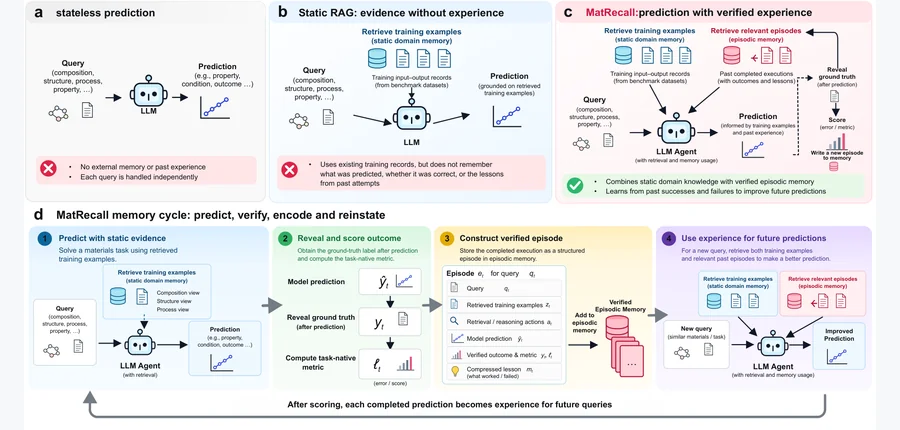 arXiv 2026-11-26 · cs.CL · #18 **[Verified experience improves materials prediction with large language models](https://arxiv.org/abs/2611.33195)** Yiming Zhang , Koji Tsuda Affiliation · The University of Tokyo / National Institute for Materials Science / RIKEN Center for Advanced Intelligence Project [Paper](https://arxiv.org/abs/2611.33195) · [Code](https://github.com/ZHymLumine/MatRecall) · [Figure source](https://arxiv.org/html/2611.33195v1/fig1_matrecall_pipeline.png) 

[EN] Abstract
Materials discovery is an iterative loop: experiments and calculations verify predictions, and each outcome can inform the next. Yet most predictors are specialized single-task models fixed after training. Large language models have recently emerged as predictors across heterogeneous tasks but generally underperform specialized models, and retrieval-augmented variants discard their own outcomes. Benchmarks also score queries in isolation, leaving improvement from outcomes untested. Here we construct MatMemBench, a sequential benchmark of 22 materials tasks that reveals outcomes only after prediction and tests online adaptation, memory retention and cross-task transfer. We present MatRecall, a framework that lets large language models store verified predictions, with evidence, outcome and error, as episodes and recall them without retraining. MatRecall improved median performance by 62% over a memory-free model, exceeded specialized models on 11 tasks, remained useful after feedback stopped and transferred between related tasks. Verified experience could become a reusable resource for self-improving discovery loops. <a href="https://arxiv.org/list/cs/new?show=2000#2611.33195">Source</a>

[ZH] Abstract
材料发现是一个迭代循环：实验和计算验证预测，每个结果都能为下一步提供信息。然而，多数预测器是训练后固定的专门单任务模型。大型语言模型近期已成为跨异构任务的预测器，但总体仍弱于专门模型，而检索增强变体会丢弃自身结果。基准也对查询分别评分，未测试从结果中改进。在此，我们构建 MatMemBench，一个包含 22 项材料任务的序列基准，仅在预测后揭示结果，并测试在线适应、记忆保留与跨任务迁移。我们提出 MatRecall，使大型语言模型能够将经验证预测连同证据、结果和错误存储为情节，并在不重新训练的情况下召回。相较无记忆模型，MatRecall 将性能中位数改善 62%，在 11 项任务上超过专门模型，在反馈停止后仍然有用，并能够在相关任务间迁移。经验证经验有望成为自我改进发现循环中的可复用资源。 <a href="https://arxiv.org/list/cs/new?show=2000#2611.33195">Source</a>
 |
| 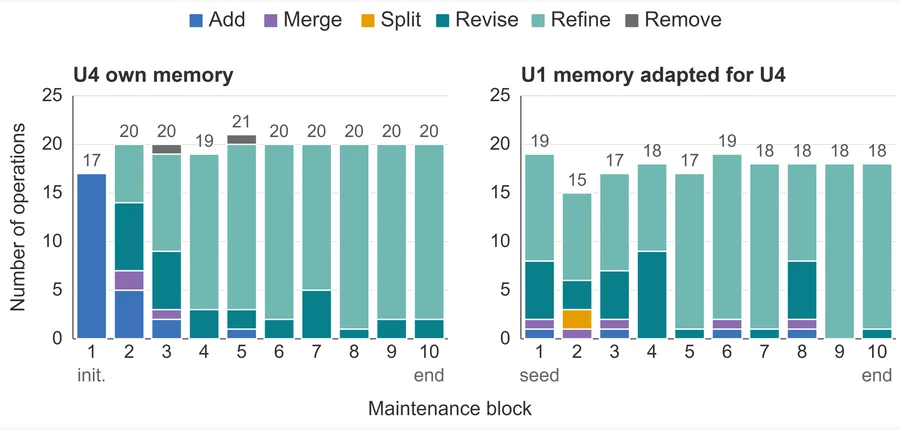 arXiv 2026-11-26 · cs.CL · #19 **[Failure Broadens, Success Sharpens: Continual Adaptation of Tool-Use Agents Across Diverse Tasks with Dual-Polarity Memory](https://arxiv.org/abs/2611.33612)** Tianmai M. Zhang , Hoda Shajari , Amr Hendy , Xiaohu Liu , Piyush Behre , Omar Zia Khan , Ankur Gupta Affiliation · University of Washington / Microsoft [Paper](https://arxiv.org/abs/2611.33612) · [Figure source](https://arxiv.org/html/2611.33612v1/memory_evolution.png) 

[EN] Abstract
Large language model agents can self-improve over time by utilizing procedural memory derived from prior task trajectories, yet the distinct utilities of memories derived from local successes and failures remain underexplored. This work studies this question in a realistic setting with heterogeneous streams of multi-domain tool-use tasks and various environment constraints common in real-world scenarios. We develop \emph{Dual-Polarity Memory with Periodic Maintenance} (DualPM), a simple, retrieval-free memory workflow characterized by (1) customizable reflection and procedural memory generation from both local successes and failures within each trajectory, and (2) periodic memory consolidation over long task streams under a given memory capacity, preventing memory explosion. Online prequential evaluation with fine-grained metrics reveals that failure memory more strongly broadens coverage, success memory better streamlines execution, while combining both polarities effectively integrates both benefits. Further studies demonstrate that DualPM enables cross-domain memory generalization and continual memory adaptation, while external evaluation on EvoMemBench reveals the portability and effectiveness of DualPM as a general long-term procedural memory method. <a href="https://arxiv.org/list/cs/new?show=2000#2611.33612">Source</a>

[ZH] Abstract
大型语言模型智能体能够利用来自过往任务轨迹的流程记忆，随时间自我改进，但从局部成功和失败中生成的记忆，其不同效用仍缺乏探索。本研究在现实设置下研究这一问题，包含异构、多领域工具使用任务流，以及现实情境常见的各种环境约束。我们开发 \emph{Dual-Polarity Memory with Periodic Maintenance}（DualPM），一个简单、无需检索的记忆工作流，具有：（1）从每条轨迹内的局部成功与失败中，进行可定制反思和流程记忆生成；（2）在给定记忆容量下，跨长任务流进行周期记忆整合，防止记忆爆炸。带细粒度指标的在线先预测后评估表明，失败记忆更能扩展覆盖，成功记忆更能简化执行，而结合两种极性能有效整合二者收益。进一步研究展示了 DualPM 的跨领域记忆泛化与持续记忆适应，而 EvoMemBench 上的外部评测揭示了 DualPM 作为通用长期流程记忆方法的可迁移性与有效性。 <a href="https://arxiv.org/list/cs/new?show=2000#2611.33612">Source</a>
 | 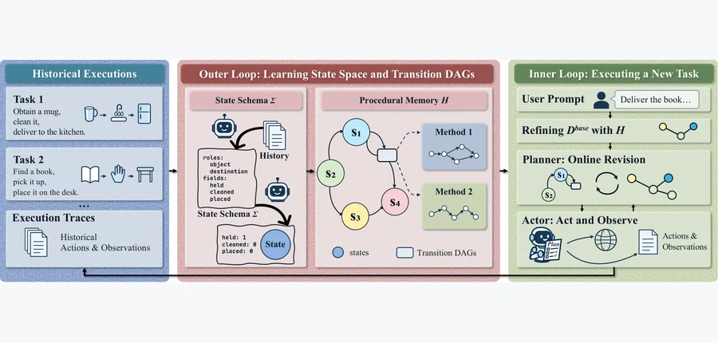 arXiv 2026-11-26 · cs.AI · #20 **[MetaDecomp: Adaptive Task Decomposition via Meta-Learned Procedural Memory](https://arxiv.org/abs/2611.33822)** Ziyi Wang , Yixiao He , Yichen Wu , Ruite Lu , Jiayu Wang , Ying Wei Affiliation · Zhejiang University / Harvard University [Paper](https://arxiv.org/abs/2611.33822) · [Figure source](https://arxiv.org/html/2611.33822v1/pipeline-MetaDecomp.png) 

[EN] Abstract
Reusing past experience in long-horizon tasks requires more than storing successful procedures: Language agents must distinguish which procedures apply and what work remains as execution progresses. We introduce MetaDecomp, an in-context meta-learning framework for adaptive task decomposition that jointly learns a task-relative state space and reusable procedures. Its outer loop builds procedural memory from successful training executions, representing task progress as abstract states and procedures between states as directed acyclic graphs of operations and dependencies. As new progress distinctions are learned, MetaDecomp revisits historical execution evidence to reassess state assignments and reorganize the procedures they support. With memory fixed at test time, the inner loop refines an initial decomposition and revises it from environmental feedback, combining applicable procedure fragments with task-specific steps missing from memory. Evaluated on ALFWorld and ScienceWorld over three seeds, MetaDecomp achieves the highest mean performance among the compared methods in four of five settings, for example, an 86.3% success rate on ALFWorld with Qwen3-4B. Fixing the initial schema or omitting historical reprojection reduces performance in component ablations. MetaDecomp also uses fewer inference tokens than ReAct and AutoRefine in all five settings. Cross-benchmark analysis identifies a low-performance area where partial coverage degrades success relative to hidden memory; high coverage improves success, while low coverage changes little. Code will be released upon acceptance. <a href="https://arxiv.org/list/cs/new?show=2000#2611.33822">Source</a>

[ZH] Abstract
在长周期任务中复用过往经验，不仅需要存储成功流程：语言智能体还必须区分哪些流程适用，以及执行推进后还剩哪些工作。我们提出 MetaDecomp，一个用于自适应任务分解的上下文内元学习框架，联合学习相对任务的状态空间与可复用流程。其外层循环从成功训练执行构建流程记忆，将任务进展表示为抽象状态，将状态间流程表示为包含操作与依赖的有向无环图。随着新的进展区分被学到，MetaDecomp 重新审视历史执行证据，重新评估状态归属，并重组其支持的流程。测试时记忆固定，内层循环细化初始分解，并依据环境反馈修订，结合适用流程片段与记忆中缺失的任务专属步骤。在 ALFWorld 和 ScienceWorld 上使用三个种子评估时，MetaDecomp 在五种设置中的四种取得受比方法最高平均性能，例如 Qwen3-4B 在 ALFWorld 上达到 86.3% 成功率。固定初始模式或不进行历史重投射，会在组件消融中降低性能。MetaDecomp 在全部五种设置中使用的推理 token 也少于 ReAct 和 AutoRefine。跨基准分析识别出一个低性能区域：部分覆盖相较隐藏记忆降低成功率；高覆盖提高成功率，而低覆盖几乎无变化。代码将在录用后发布。 <a href="https://arxiv.org/list/cs/new?show=2000#2611.33822">Source</a>
 | 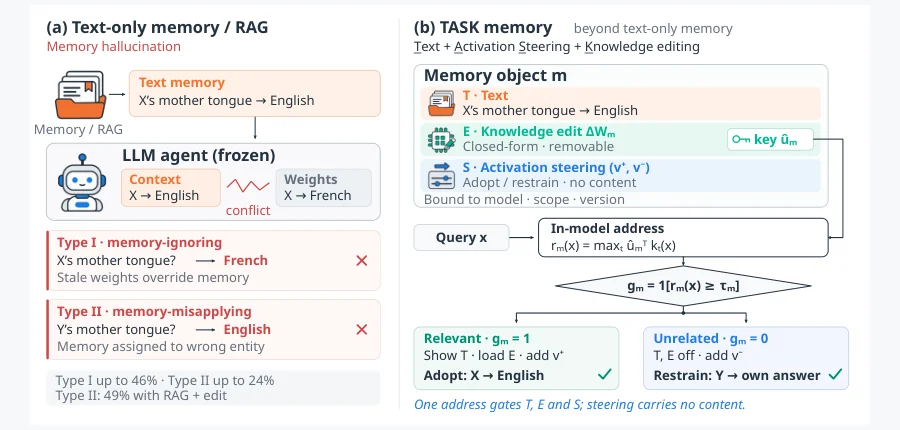 arXiv 2026-11-26 · cs.AI · #21 **[TASK Memory: Beyond Text-Only Memory with Activation Steering and Knowledge Editing against Memory Hallucination](https://arxiv.org/abs/2611.34762)** Jinkun Zhao , Wenjun Wu Affiliation · Beihang University [Paper](https://arxiv.org/abs/2611.34762) · [Figure source](https://arxiv.org/html/2611.34762v1/TASK_memory_intro.png) 

[EN] Abstract
LLM agents increasingly rely on external memory, yet they still hallucinate about what they remember. Often the correct memory is retrieved and placed in the prompt, but the answer contradicts it or the memory is applied to the wrong question. We call these use-time memory hallucinations. Across five open models, we find that they arise from the conflict between parametric knowledge and external memory and take three forms: memory-ignoring, where the model returns to a stale fact in its weights (up to 46% of queries); memory-misapplying, where it attributes the memory to unrelated entities (up to 24%, and 49% when retrieval is combined with weight editing); and version confusion, where 53% of answers about revised facts assert the superseded value when both versions remain stored. We propose TASK memory, which goes beyond text-only memory by combining a Text note with Activation Steering and Knowledge editing that share one in-model address. The text holds the content. A removable knowledge edit supplies the address through its subject key and supports multi-hop composition. A pair of steering vectors decides, query by query, whether the model adopts the memory or keeps its own answer; the vectors store no content and control how the text memory is used. On frozen models under a pre-registered, test-once protocol, TASK reduces memory-ignoring hallucinations to at most 1.5% in all ten model-dataset cells and cuts neighbour misuse from 39.2% to 7.5% (+10.8 pp composite on CounterFact). It improves a 300-memory library over BM25 RAG by 16.4 pp, an advantage that holds at 3,000 memories, resolves fact revisions without fact IDs, and adds 7.5 pp of multi-hop accuracy on MQuAKE. 21 of 23 cross-model comparisons (8B-27B, four families) are significant, and TASK beats three recent context-steering methods in 9 of 10 model-dataset cells. <a href="https://arxiv.org/list/cs/new?show=2000#2611.34762">Source</a>

[ZH] Abstract
LLM 智能体越来越依赖外部记忆，但仍会对所记内容产生幻觉。正确记忆往往已检索并放进提示词，回答却与其矛盾，或将记忆应用到错误问题。我们将其称为使用时记忆幻觉。在五个开放模型上，我们发现它源于参数知识与外部记忆冲突，并有三种形式：memory-ignoring，即模型退回权重中的过时事实（最高占 46% 查询）；memory-misapplying，即将记忆归给无关实体（最高 24%，检索与权重编辑结合时为 49%）；以及版本混淆，即两个版本都存储时，关于修订事实的回答中有 53% 坚持已被取代的值。我们提出 TASK memory，通过结合共享同一个模型内地址的 Text 笔记、Activation Steering 和 Knowledge editing，超越纯文本记忆。文本承载内容。可移除知识编辑通过主体键提供地址，并支持多跳组合。一对引导向量逐查询决定模型采纳记忆还是保留自身回答；向量不存内容，而是控制文本记忆如何使用。在预注册、仅测试一次协议下的冻结模型上，TASK 在全部十个模型—数据集单元中，将记忆忽略幻觉降至最高 1.5%，并将邻近实体误用从 39.2% 降至 7.5%（CounterFact 综合得分增加 10.8 pp）。它使 300 条记忆的库比 BM25 RAG 高 16.4 pp，这一优势在 3,000 条记忆时保持；无需事实 ID 即可解决事实修订，并在 MQuAKE 上增加 7.5 pp 多跳准确率。23 个跨模型比较（8B–27B，四个家族）中有 21 个显著，TASK 在十个模型—数据集单元中的九个优于三种近期上下文引导方法。 <a href="https://arxiv.org/list/cs/new?show=2000#2611.34762">Source</a>
 |
| 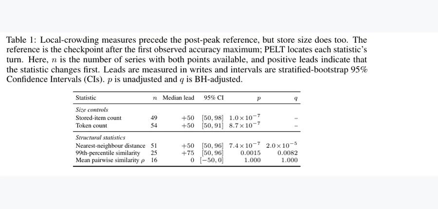 arXiv 2026-11-26 · cs.LG · #22 **[Semantic Density Does Not Predict Agent-Memory Collapse](https://arxiv.org/abs/2611.33184)** Saksham Gupta , Yash Choudhary , Arpit Upadhyay Affiliation · Independent Researcher / Vasuki Inc. / Piramal Finance [Paper](https://arxiv.org/abs/2611.33184) · [Figure source](https://arxiv.org/pdf/2611.33184) 

[EN] Abstract
Persistent textual memory can improve LLM agents, but repeated updates can erode task performance. We ask whether memory-store statistics warn before held-out accuracy declines. We registered mean pairwise cosine similarity ($\rho$) and 13 additional geometry, retrieval, and graph statistics on 805 snapshots from 13 memory methods across ALFWorld, AppWorld, ScienceWorld, WebShop, and two ARC-AGI settings. These methods store trajectories, rules, workflows, strategies, or linked records, using selective retrieval or whole-store prompting. No such statistic reliably predicted early signs of task accuracy decline, and $\rho$ had zero median lead. With the checkpoint after peak accuracy as a secondary decline point, measures of highly similar pairs and nearest-neighbor crowding changed earlier but did not consistently outperform stored-item count. We trained classifiers on this corpus and applied them unchanged to PropWorld runs of up to 5,000 crafting tasks. They falsely flagged 56.9% of checkpoints from size-limited stores with stable accuracy and detected only 18% of checkpoints after task success fell to zero. Thus, global semantic density did not provide a reliable warning, while local crowding did not transfer consistently across memory designs. In these long-horizon runs, size-limited stores remained stable, while the sole failure arose when unbounded whole-store prompting exceeded model input capacity, which token growth predicted directly. <a href="https://arxiv.org/list/cs/new?show=2000#2611.33184">Source</a>

[ZH] Abstract
持久文本记忆能够改善 LLM 智能体，但反复更新可能侵蚀任务性能。我们询问，在留出准确率下降前，记忆库统计量能否预警？我们在 13 种记忆方法、跨 ALFWorld、AppWorld、ScienceWorld、WebShop 和两种 ARC-AGI 设置的 805 个快照上，预先登记平均两两余弦相似度（$\rho$）及另外 13 项几何、检索和图统计量。这些方法存储轨迹、规则、工作流、策略或关联记录，使用选择性检索或全库提示。没有统计量能够可靠预测任务准确率下降的早期迹象，$\rho$ 的提前量中位数为零。将准确率峰值之后的检查点作为次要下降点时，高相似对和最近邻拥挤度指标更早变化，但未持续优于存储项数量。我们在该语料上训练分类器，再不作修改地用于最长 5,000 项合成任务的 PropWorld 运行。它们对大小受限、准确率稳定的库中 56.9% 检查点误报，而在任务成功率降至零之后，仅检测到 18% 检查点。因此，全局语义密度未提供可靠预警，局部拥挤度也未在不同记忆设计间一致迁移。在这些长周期运行中，大小受限库保持稳定，唯一失败出现在无界全库提示超出模型输入容量时，而 token 增长能直接预测这一失败。 <a href="https://arxiv.org/list/cs/new?show=2000#2611.33184">Source</a>
 | 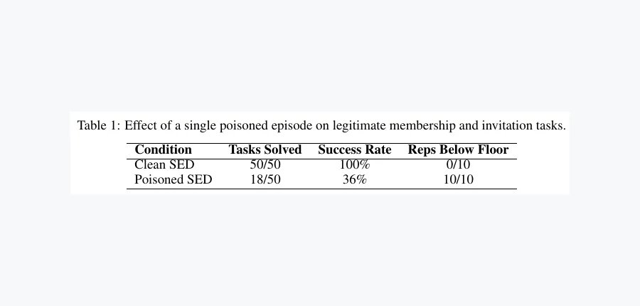 arXiv 2026-11-26 · cs.CR · #23 **[Poisoning Self-Evolving Security Policies in LLM Agents](https://arxiv.org/abs/2611.33385)** Aymen Noor , Honglu Jiang Affiliation · Miami University, Ohio [Paper](https://arxiv.org/abs/2611.33385) · [Code](https://github.com/MN-NR/PSED) · [Figure source](https://arxiv.org/pdf/2611.33385) 

[EN] Abstract
Self-evolving defenses improve LLM-agent security by learning reusable policies from observed attacks. However, we demonstrate that this learning process itself can become an attack surface. Using SED (Self-Evolving Defense) in the AgentDojo benchmark, we construct a single prompt-injection episode that causes the defense to learn an over-broad policy and subsequently refuse legitimate requests. Across 10 Nemotron runs, every poisoned run over-refuses at least one legitimate task, while unrelated-task performance remains unchanged and the original prompt-injection defense remains effective. The attack also transfers to gpt-oss-120b; however, its poisoning mechanism depends on a successful initial prompt injection and therefore fails to activate when the target agent resists the underlying injection. In contrast, integrity-oriented attacks targeting SED's judge, policy synthesis, retrieval, and organization mechanisms fail in our evaluated settings, identifying over-refusal as the primary exploitable failure mode observed in our experiments. We further identify self-poisoning from false-positive harm judgments without an attacker. Finally, contrastive policy synthesis and an automatic broadness-check gate substantially reduce, but do not eliminate over-refusal, without compromising security in our evaluated settings. <a href="https://arxiv.org/list/cs/new?show=2000#2611.33385">Source</a>

[ZH] Abstract
自我演化防御通过从观测攻击中学习可复用策略，改善 LLM 智能体安全。然而，我们展示，这一学习过程本身也可能成为攻击面。使用 AgentDojo 基准中的 SED（Self-Evolving Defense），我们构造单个提示注入回合，使防御学到过于宽泛的策略，随后拒绝合法请求。在十次 Nemotron 运行中，每个被污染运行都会对至少一项合法任务过度拒绝，而无关任务性能不变，原始提示注入防御也仍有效。攻击还可迁移到 gpt-oss-120b；但其污染机制依赖首次提示注入成功，因此当目标智能体抵御底层注入时，该机制无法激活。相比之下，在受评设置中，针对 SED 裁判、策略合成、检索和组织机制的完整性攻击均失败，表明过度拒绝是实验中观测到的主要可利用失败模式。我们还发现，没有攻击者时，假阳性危害判断也可能导致自我污染。最后，对比式策略合成和自动宽泛度检查关口，能显著减少但不能消除过度拒绝，同时不损害受评设置中的安全性。 <a href="https://arxiv.org/list/cs/new?show=2000#2611.33385">Source</a>
 | 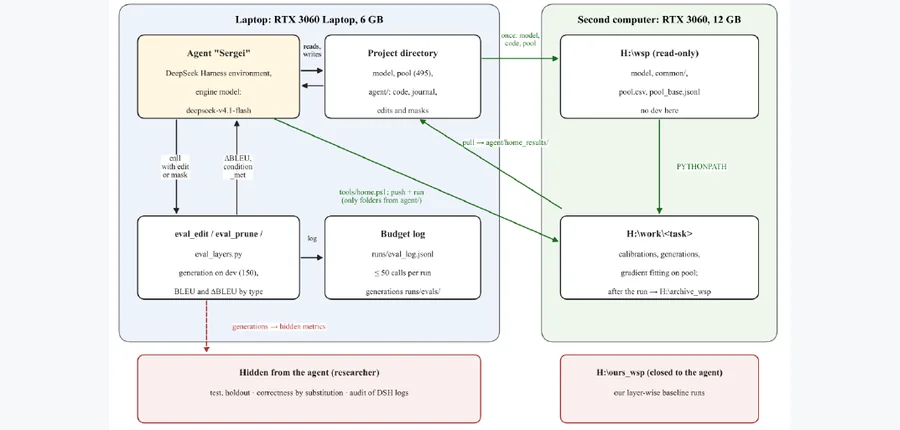 arXiv 2026-11-26 · cs.LG · #24 **[Scalpel and Brush: Pruning and Targeted Weight Editing of a Small Language Model by a Single LLM Agent](https://arxiv.org/abs/2611.33426)** Sergei Koltcov , Vera Ignatenko , Anton Surkov , Rabie Abdultawab Ramadan Affiliation · Higher School of Economics / University of Nizwa [Paper](https://arxiv.org/abs/2611.33426) · [Figure source](https://arxiv.org/pdf/2611.33426) 

[EN] Abstract
It has recently been shown that an LLM can itself edit the weights of a language model, yet it remains unclear which part of such a result is due to the agent and which part is reproduced by a random edit of the same shape, by an instruction in the prompt, or by a standard procedure without an LLM. We unify repair and pruning as sparse weight edits to optimize a metric we specify, using BLEU as an example: three tasks -- targeted weight repair ("brush"), structured MLP neuron pruning ("scalpel", zeroing pruned weights), and layer removal with repair - are assigned to a DeepSeek Harness agent powered by DeepSeek-V4.1-Flash, with up to 50 dev evaluations. We study Qwen2.5-Math-1.5B-Instruct in three independent runs per task, with final evaluation on two hidden splits. On ordinary differential equations, changing at most 0.0084% of weights raised test BLEU by 24-32% on second-order equations and by a factor of 1.8-2.5 on equations with polynomial right-hand sides. An independent substitution check showed that higher BLEU reflects notation alignment rather than improved correctness. Masks that remove 12.5-15% of MLP neurons shrink the model by 9.4-11.2% with mean BLEU loss of at most 0.01 on both hidden splits, whereas standard pruning with equal shares per layer failed the constraint at all tested shares. On seven-class GoEmotions classification, edits raise macro-F1 from 0.100 to 0.396-0.451 on test and from 0.175 to 0.455-0.476 on holdout. A ridge-based classifier written into agent-selected weight rows yields macro-F1 of 0.424 and 0.464. Pruning search with the same evaluation limit removes 15.9% of neurons versus 14-21.4% for agent runs passing the hidden check. Standard procedures without an LLM reproduce much of the performance once given the location and form of intervention found by the agent; a comparison of agentic and non-agentic search remains open. <a href="https://arxiv.org/list/cs/new?show=2000#2611.33426">Source</a>

[ZH] Abstract
近期研究表明，LLM 能够自行编辑语言模型权重，但结果中哪些来自智能体，哪些能被相同形状的随机编辑、提示词指令或无 LLM 标准流程复现，仍不清楚。我们将修复与剪枝统一为优化指定指标的稀疏权重编辑，以 BLEU 为例：将三项任务——定向权重修复（“画笔”）、结构化 MLP 神经元剪枝（“手术刀”，将剪除权重置零）、以及层移除后修复——交给由 DeepSeek-V4.1-Flash 驱动的 DeepSeek Harness 智能体，最多使用 50 次开发评测。我们在 Qwen2.5-Math-1.5B-Instruct 上，每项任务进行三次独立运行，最终在两个隐藏划分上评测。在常微分方程上，修改最高 0.0084% 的权重，使二阶方程测试 BLEU 提高 24–32%，多项式右端项方程则提高至原来的 1.8–2.5 倍。独立代入检查表明，更高 BLEU 反映符号写法对齐，而非正确性改善。移除 12.5–15% MLP 神经元的掩码，将模型缩小 9.4–11.2%，在两个隐藏划分上的平均 BLEU 损失最高为 0.01；而各层等比例标准剪枝在全部受测比例下都未满足约束。在七类 GoEmotions 分类上，编辑将测试 macro-F1 从 0.100 提升至 0.396–0.451，将留出从 0.175 提升至 0.455–0.476。写入智能体所选权重行的岭回归分类器，其 macro-F1 为 0.424 和 0.464。相同评测上限的剪枝搜索移除 15.9% 神经元，而通过隐藏检查的智能体运行移除 14–21.4%。一旦给定智能体发现的干预位置与形式，无 LLM 标准流程就能复现大部分表现；智能体搜索与非智能体搜索的比较仍是开放问题。 <a href="https://arxiv.org/list/cs/new?show=2000#2611.33426">Source</a>
 |
| 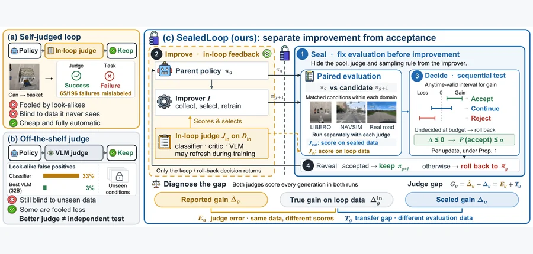 arXiv 2026-11-26 · cs.AI · #25 **[Keep or Roll Back? Out-of-Loop Judges for Self-Improving VLA and End-to-End Embodied Policies](https://arxiv.org/abs/2611.33794)** Zilin Huang , Zhengyang Wan , Kangan Qian , Zihao Sheng , Sikai Chen Affiliation · University of Wisconsin–Madison / University of California, Santa Cruz [Paper](https://arxiv.org/abs/2611.33794) · [Project](https://zilin-huang.github.io/SealedLoop/) · [Figure source](https://arxiv.org/html/2611.33794v1/fig2_framework_v10.png) 

[EN] Abstract
Self-improvement is now a practical recipe for embodied policies: a policy collects experience, is retrained, and is kept when a judge rates it higher. However, the judge is usually trained or chosen inside the same loop, so its evidence is not independent of the policy. We introduce SealedLoop, an evaluation framework that adds a sealed judge: an evaluator outside the loop that the improver cannot see or optimize against. A new policy is kept only when a sequential test on the sealed judge confirms the gain, with a bounded probability of keeping a worse one. Running the same loop under each judge, we separate two sources of a false gain, which we call judge error (the loop's judge is wrong on its own data) and transfer gap (a real gain there does not carry over to unseen conditions). We evaluate on LIBERO manipulation, NAVSIM driving, and a full-scale real vehicle. In manipulation, a success classifier accepted 65 of 196 failures in one generation. In driving, policies that gain on the loop's own frames lose in an unseen city, so even an exact in-loop judge would keep 8/15 of them. When the sealed test decides, a driving loop built to improve ends with a better policy than under its own critic (0.674 against 0.649 PDMS, from 0.638), and on driving pairs with known sealed gain the test accepted 11 of 12 real gains and none of 59 losses. In a real-world field experiment on a published improvement step, the reinforced version drove further into a curve than the version it started from in all 6 blind pairs, though neither completed it. These results show that evidence from inside the loop, however accurate, is not enough to decide whether a policy has improved. SealedLoop offers a foundation for trustworthy self-improvement of embodied policies, in which progress is judged by evidence the improving system cannot influence. <a href="https://arxiv.org/list/cs/new?show=2000#2611.33794">Source</a>

[ZH] Abstract
自我改进已成为具身策略的实用方案：策略收集经验、重新训练，并在裁判评价更高时保留。然而，裁判通常在同一循环内训练或选择，因此其证据并不独立于策略。我们提出 SealedLoop，一个增加密封裁判的评测框架：该评估器位于循环外，改进器不能查看或针对它优化。只有密封裁判上的序贯检验确认增益，才保留新策略，并对保留更差策略的概率给出上界。在每个裁判下运行相同循环，我们区分两种虚假增益来源：judge error，即循环裁判在自身数据上出错；transfer gap，即该处真实增益未能迁移到未见条件。我们在 LIBERO 操作、NAVSIM 驾驶和一辆全尺寸真实车辆上评估。在操作中，一个成功分类器在一代中接受了 196 次失败中的 65 次。在驾驶中，在循环自身帧上改善的策略，在未见城市退步，因此即便完全准确的循环内裁判，也会保留其中 8/15。当密封测试决策时，一个旨在改进的驾驶循环，最终策略优于使用自身评论者时（PDMS 从 0.638 出发，分别达到 0.674 和 0.649）；在已知密封增益的驾驶配对上，测试接受了 12 个真实增益中的 11 个，没有接受 59 个损失中的任何一个。在对某个已发表改进步骤的真实现场实验中，强化后的版本在全部六组盲配对中都比起始版本驶入弯道更远，但两者均未完成。这些结果表明，循环内部证据无论多准确，都不足以决定策略是否改善。SealedLoop 为可信具身策略自我改进提供基础：进展由改进系统无法影响的证据判断。 <a href="https://arxiv.org/list/cs/new?show=2000#2611.33794">Source</a>
 | 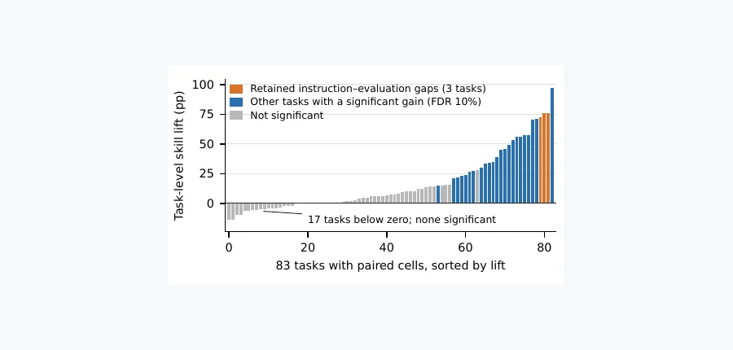 arXiv 2026-11-26 · cs.AI · #26 **[What Does Skill Lift Actually Measure? A Source-Code-Level Audit and Noise-Aware Reanalysis of SkillsBench](https://arxiv.org/abs/2611.33943)** Haozhe Zhang , Zhen Long Affiliation · Trine University / National University of Singapore [Paper](https://arxiv.org/abs/2611.33943) · [Code](https://github.com/rrrrr4788/skillsbench-lift-reanalysis) · [Figure source](https://arxiv.org/pdf/2611.33943) 

[EN] Abstract
Agent skills are directories of instructions, reference materials, and scripts loaded on demand by coding agents. According to SkillsBench, although human-curated skills can raise the passing rate by about 16.6 percentage points (pp) on average, they have actually reduced the results for some tasks. Later research has started to gate or eliminate skills according to the above per-task gains. We have audited the above benchmark at the source-code level and analysed 7,554 public trials to form 1,421 paired "(configuration, task) cells". Source-code audit identified two controlled-verified cases of grader dependence and one operational definition gap; the average lift on these three tasks was 74.6 pp, and the overall average lift for the full set was 18.7 pp. The audit also found that four tasks contained placeholder skill directories, and a certain execution harness additionally added 48 built-in skills in most runs. No task-level reduction achieved statistical significance in the pooled reanalysis with multiple-testing correction. As there were at most three runs per condition for each cell, the observed negative differences are very susceptible to run-sampling noise, and arithmetically, 58% of the cells could not have shown a decrease. Therefore, the raw numbers of negative cells cannot show that skills cause harm. A gating strategy based on the skill-free score seems to improve by 2-3 pp in the logs; however, even after shuffling condition labels to remove any skill effect, it still achieves an increase of 4-7 pp. On the held-out runs not used for fitting and decision-making, there was no statistically significant improvement. The audit ledger and analysis scripts have been published by us. <a href="https://arxiv.org/list/cs/new?show=2000#2611.33943">Source</a>

[ZH] Abstract
智能体技能是编程智能体按需加载的指令、参考材料与脚本目录。根据 SkillsBench，虽然人工整理技能平均能将通过率提高约 16.6 个百分点（pp），但在一些任务上实际降低了结果。后续研究开始依据这些逐任务增益门控或淘汰技能。我们从源代码层面审计该基准，并分析 7,554 次公开试验，形成 1,421 个配对“（配置，任务）单元”。源代码审计识别出两个受控验证的评分器依赖案例和一个操作定义缺口；这三个任务的平均提升为 74.6 pp，全体总体平均提升为 18.7 pp。审计还发现四项任务包含占位技能目录，某个执行框架在多数运行中额外加入了 48 个内置技能。经过多重检验校正的合并重分析中，没有任务级下降达到统计显著性。由于每个单元中每种条件最多只有三次运行，观测负差异很容易受运行采样噪声影响，而且从算术上看，58% 单元根本不可能显示下降。因此，负单元的原始数量不能说明技能导致损害。依据无技能得分的门控策略，在日志上似乎改善 2–3 pp；但即使打乱条件标签以消除任何技能效应，它仍会产生 4–7 pp 的提高。在未用于拟合和决策的留出运行上，没有统计显著改善。审计账本与分析脚本已公开。 <a href="https://arxiv.org/list/cs/new?show=2000#2611.33943">Source</a>
 | 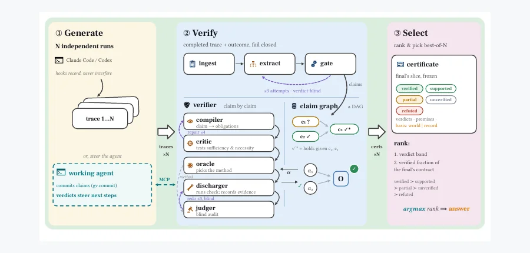 arXiv 2026-11-26 · cs.LG · #27 **[Agent-as-a-Verifier: From Scores to Evidence for General Verification](https://arxiv.org/abs/2611.34132)** Yuxuan Sun , Hao (Mark) Chen , Nagarajan Natarajan , Sushrut Karmalkar , Niranjani Prasad , Amit Sharma , Hongxiang Fan Affiliation · Imperial College London / Microsoft Research [Paper](https://arxiv.org/abs/2611.34132) · [Code](https://github.com/sunyxedu/General-Verifier) · [Figure source](https://arxiv.org/pdf/2611.34132) 

[EN] Abstract
Verification is increasingly critical across various inference and learning paradigms, such as test-time scaling, recursive intelligence and automated research, where feedback can improve efficiency and optimization. Common score-based verifiers, or discriminative reward models, predict a scalar reward for an output. While useful for filtering, rewarding, and ranking, such scores provide no explicit, auditable evidentiary basis for the judgment. In parallel, although existing generative process reward models offer text feedback, most designs do not fully exploit agentic capabilities, such as tool use and iterative reasoning, which are essential for fact-checking and fine-grained claim verification. In this paper, we address these limitations by introducing Agent-as-a-Verifier, an agentic, certificate-producing verification system that places role-separated LLM agents inside a formal-methods-inspired claim-obligation-certificate protocol. Given a generation candidate, Agent-as-a-Verifier produces a certificate by extracting a verdict-blind dependency graph of claims, independently compiling the task's acceptance contract, and deriving checkable obligations. On Terminal-Bench 2.1, Agent-as-a-Verifier achieves higher accuracy than the state-of-the-art approach. Across different downstream applications, the augmented agent also outperforms the plain agent on FrontierMath and CyberGym. More importantly, Agent-as-a-Verifier is able to identify reward-hacking solutions that deceive the benchmark evaluator, highlighting its broader potential for iterative and recursive agent optimization. Code is available at this https URL <a href="https://arxiv.org/list/cs/new?show=2000#2611.34132">Source</a>

[ZH] Abstract
验证在测试时扩展、递归智能与自动科研等推理和学习范式中日益重要，因为反馈能够提高效率和优化效果。常见基于分数的验证器或判别奖励模型，为输出预测标量奖励。虽然这有助于过滤、奖励和排序，但分数不提供显式、可审计的判断证据。与此同时，现有生成式过程奖励模型虽提供文本反馈，但多数设计未充分利用工具使用与迭代推理等智能体能力，而这些对事实检查和细粒度主张验证很关键。本文提出 Agent-as-a-Verifier，一个产生证书的智能体验证系统，将角色分离的 LLM 智能体置于受形式化方法启发的“主张—义务—证书”协议中。给定生成候选，Agent-as-a-Verifier 通过提取不知预期判定的主张依赖图、独立编译任务接受契约，并导出可检查义务，产生证书。在 Terminal-Bench 2.1 上，它比最先进方法准确率更高。在不同下游应用中，增强智能体在 FrontierMath 和 CyberGym 上也优于普通智能体。更重要的是，Agent-as-a-Verifier 能够识别欺骗基准评估器的奖励投机解，展示了其在迭代和递归智能体优化中的更广泛潜力。代码可在此 https URL 获取。 <a href="https://arxiv.org/list/cs/new?show=2000#2611.34132">Source</a>
 |
| 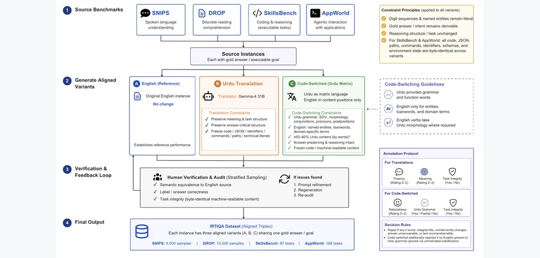 arXiv 2026-11-26 · cs.CL · #28 **[IRTIQA: Evolving in English, Evaluated in Urdu -- Does Agent Self-Evolution Transfer from English to Urdu and Code-Switched Input?](https://arxiv.org/abs/2611.34303)** Abdullah Hashmat , Danish Javed , Usman Naseem , Agha Ali Raza Affiliation · Lahore University of Management Sciences / Macquarie University [Paper](https://arxiv.org/abs/2611.34303) · [Figure source](https://arxiv.org/html/2611.34303v1/image2.png) 

[EN] Abstract
As LLM agents increasingly learn from their own experience, the tasks they learn from and are evaluated on are almost always in English. We ask whether self-evolution transfers from English to Urdu, and release IRTIQA, a benchmark of aligned English, Urdu-translated, and Urdu code-switched variants of DROP, SNIPS, AppWorld, and SkillsBench, built with a matrix-language code-switching pipeline and human verification. Using IRTIQA, we evaluate three self-evolving frameworks, Tool-R0 (self-play RL), AgentEvolver (experience-guided RL), and Autogenesis (protocol-level evolution), against their unevolved backbones. Self-evolution often raises capability: AgentEvolver lifts AppWorld goal completion from near zero to 20-36% across all conditions, and Autogenesis improves SkillsBench pass rate from 16.48% to 22.22%. But it rarely closes the language gap. Evolved systems remain stronger in English, by up to 0.26 DROP F1, the gap is largest on multi-step tasks, and code-switching behaves as a distinct condition rather than degraded translation. On a shared Gemma-4 31B backbone, the gap exists before evolution, and RL-based evolution can hurt Urdu reasoning more than English. Language parity must therefore be an explicit design target, as it does not emerge from self-improvement alone. <a href="https://arxiv.org/list/cs/new?show=2000#2611.34303">Source</a>

[ZH] Abstract
随着 LLM 智能体越来越多地从自身经验学习，其学习和评测任务几乎总是英语。我们询问，自我演化能否从英语迁移到乌尔都语，并发布 IRTIQA：一个由 DROP、SNIPS、AppWorld 和 SkillsBench 的对齐英语、乌尔都语翻译及乌尔都语语码转换变体组成的基准，通过矩阵语言语码转换流水线和人工验证构建。使用 IRTIQA，我们将三个自我演化框架——Tool-R0（自博弈 RL）、AgentEvolver（经验引导 RL）和 Autogenesis（协议级演化）——与其未演化骨干比较。自我演化往往提高能力：AgentEvolver 将所有条件下 AppWorld 目标完成率从接近零提升至 20–36%，Autogenesis 将 SkillsBench 通过率从 16.48% 提升至 22.22%。但它很少缩小语言差距。演化系统仍更擅长英语，DROP F1 差距最高为 0.26；多步骤任务差距最大，语码转换表现为独立条件，而非退化翻译。在共享 Gemma-4 31B 骨干上，差距在演化前就存在，基于 RL 的演化对乌尔都语推理的损害可能大于英语。因此，语言平等必须成为显式设计目标，因为它不会单靠自我改进自然涌现。 <a href="https://arxiv.org/list/cs/new?show=2000#2611.34303">Source</a>
 | 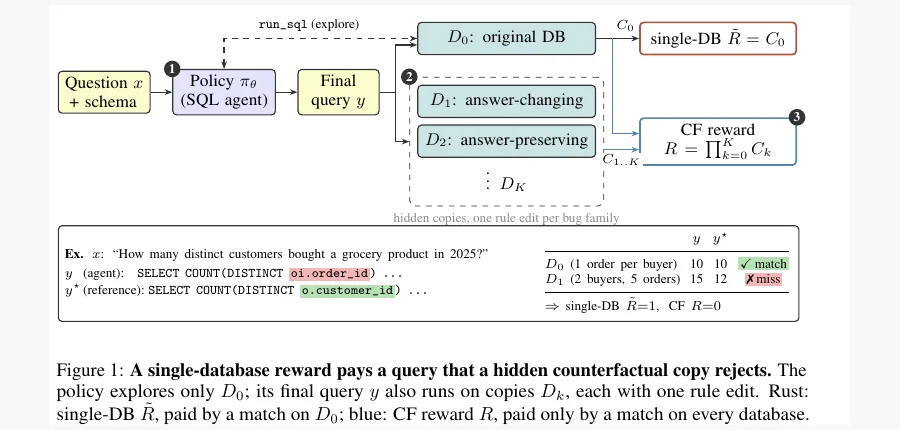 arXiv 2026-11-26 · cs.LG · #29 **[Single-Database Rewards Are Hackable: Counterfactual Execution for Trustworthy Text-to-SQL RL](https://arxiv.org/abs/2611.34363)** Shreshth Rai , Rishii Kumar Singh , Aksh Aggarwal Affiliation · Delhi Technological University [Paper](https://arxiv.org/abs/2611.34363) · [Code](https://github.com/RishiiGamer2201/counterfactual-sql-rewards) · [Figure source](https://arxiv.org/pdf/2611.34363) 

[EN] Abstract
Reinforcement learning (RL) for text-to-SQL agents pays a query when its result matches the reference on one database. However, a wrong query can match by luck when the data lack the rows that expose its bug. We study a counterfactual-database (CF) reward that also runs the final query on a few hidden, code-generated copies of the database and pays only if all results match (strict form) or by the share matched (mean form). On 1,302 synthetic audit questions, the strict form lowers the share of buggy queries paid in full from 29.5% to 16.8% and of reward hacks from 54.1% to 1.9%, rejecting 0 of 2,847 correct queries; copies from a family-blind generator do about as well. In a controlled GRPO comparison on a 3.35B model with three seeds per arm, training on the mean form did not improve in-domain accuracy (8.4% vs 11.7%), because the two rewards disagreed on only 5-7% of rollouts; on Spider it gained 1.6 points. One seed reverses both signs, so single-seed reward comparisons mislead. Code: this https URL ; data, models, demo: this https URL <a href="https://arxiv.org/list/cs/new?show=2000#2611.34363">Source</a>

[ZH] Abstract
用于 text-to-SQL 智能体的强化学习（RL），在查询结果与一个数据库上的参考结果匹配时给予奖励。然而，当数据缺少暴露缺陷的行时，错误查询也可能碰巧匹配。我们研究反事实数据库（CF）奖励：还在少量隐藏、代码生成的数据库副本上运行最终查询，只有全部结果匹配才奖励（严格形式），或依据匹配比例奖励（均值形式）。在 1,302 项合成审计问题上，严格形式将获得满奖的错误查询比例从 29.5% 降至 16.8%，将奖励投机从 54.1% 降至 1.9%，且未拒绝 2,847 个正确查询中的任何一个；不知缺陷家族的生成器产生的副本，效果也相近。在一个 3.35B 模型、每组三个种子的受控 GRPO 对比中，均值奖励训练未改善分布内准确率（8.4% 对 11.7%），因为两类奖励仅在 5–7% rollout 上不一致；在 Spider 上增加 1.6 个点。一个种子使两种效应的符号均反转，因此单种子奖励比较会误导。代码：此 https URL；数据、模型、演示：此 https URL。 <a href="https://arxiv.org/list/cs/new?show=2000#2611.34363">Source</a>
 | 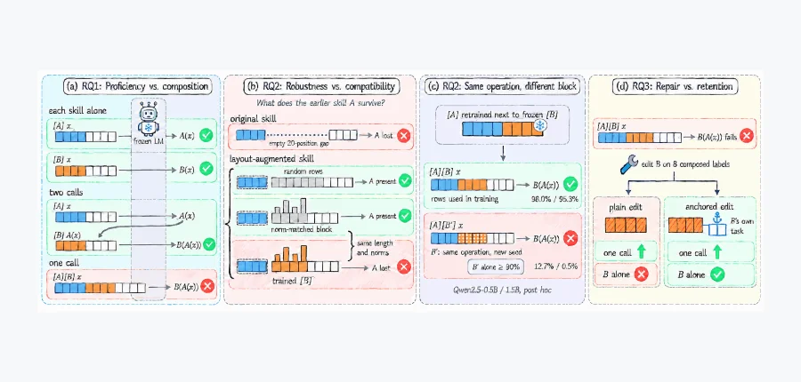 arXiv 2026-11-26 · cs.CL · #30 **[When Skills Fail to Compose: Compatibility and Retention in Language Models](https://arxiv.org/abs/2611.34398)** Yan Lin , Zhongliang Guo , Jingyu Sun , Qiyan Zhao , Ruihong Zeng , Ying Chen , Zhengtao Yao , Yan Wen , Kunyu Peng , Yuxi… Affiliation · Newcastle University / University of Melbourne / INSAIT, Sofia University / University of Aberdeen / University of Manchester / Chinese Academy of Sciences / MBZUAI / Arizona State University / University of Southern California / Karlsruhe Institute of Technology [Paper](https://arxiv.org/abs/2611.34398) · [Code](https://github.com/YanLin-Quinne/SkillCompatibility) · [Figure source](https://arxiv.org/html/2611.34398v1/overview.png) 

[EN] Abstract
Skill acquisition alone does not establish a reusable skill library: task proficiency does not specify a compositional interface. Motivated by agents that acquire and refine skills, we study independently learned soft-prompt skills on frozen language models, with skill identities and execution order supplied. Across four digit-task bases and three record-editing models, mean composition accuracy in one call is at most 7.6%, compared with 88.2% to 100% over two calls that add computation and an explicit intermediate output. Neutral-insertion training improves robustness but leaves substantial interference, which block length and per-token norm alone cannot explain on two of four digit bases. Blocks of the same operation need not be interchangeable: after training next to frozen learned partners, a post hoc test on two Qwen bases shows that replacing those partners with independently learned blocks of the same operations lowers median composition accuracy from 98.0% and 95.3% to 12.7% and 0.5%, although every replacement scores at least 90% alone. Repair can improve a composition while impairing the original skill, and rehearsal improves retention while transfer remains limited on Qwen2.5-0.5B. Internal interventions constrain explanations without identifying a shared failure mechanism. These findings motivate evaluating compatibility, retention and transfer alongside acquisition when building skill libraries for self-evolving agents. Code is available at this https URL . <a href="https://arxiv.org/list/cs/new?show=2000#2611.34398">Source</a>

[ZH] Abstract
仅有技能获取，并不构成可复用技能库：任务熟练度没有规定可组合接口。受会获取与细化技能的智能体启发，我们研究冻结语言模型上独立学习的软提示技能，并提供技能身份与执行顺序。在四个数字任务基础模型和三个记录编辑模型上，一次调用中的平均组合准确率最高为 7.6%，而增加计算和显式中间输出的两次调用为 88.2% 至 100%。中性插入训练改善稳健性，却仍留下大量干扰；在四个数字基础模型中的两个上，块长度和逐 token 范数本身无法解释干扰。同操作块也未必可互换：在冻结的已学伙伴旁训练后，对两个 Qwen 基础模型进行事后测试发现，将伙伴替换为独立学得的同操作块，会把组合准确率中位数从 98.0% 和 95.3% 降至 12.7% 和 0.5%，尽管每个替代块独立得分至少为 90%。修复可以改善组合，却损害原始技能；重放改善保留，但在 Qwen2.5-0.5B 上迁移仍有限。内部干预约束了解释，却未识别出共享失败机制。这些发现促使在为自我演化智能体构建技能库时，除获取之外，也评估兼容性、保留和迁移。代码可在此 https URL 获取。 <a href="https://arxiv.org/list/cs/new?show=2000#2611.34398">Source</a>
 |
| 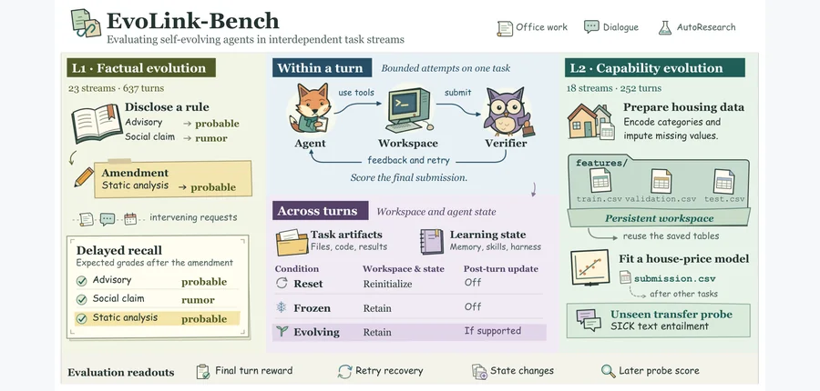 arXiv 2026-11-26 · cs.AI · #31 **[EvoLink-Bench: A Benchmark for Evaluating Self-Evolving Agents in Long-Horizon Interdependent Task Streams](https://arxiv.org/abs/2611.34400)** Wei Chen , Xiaodong Lu , Weihao Shen , Gongxun Li , Xingyu Guo , Qihang Sun , Fuwei Zhang , Zhao Zhang , Yikun Ban , Shuan… Affiliation · Beihang University [Paper](https://arxiv.org/abs/2611.34400) · [Code](https://github.com/BUAA-Self-Evolving/EvoLink-Bench) · [Figure source](https://arxiv.org/html/2611.34400v1/evolink-overview.png) 

[EN] Abstract
Large language model (LLM) agents are evolving from passive chatbots into autonomous systems that operate continuously in dynamic environments. Such agents need not only solve current tasks but also learn from past interactions to improve future performance. However, existing streaming benchmarks often rely on short task sequences or largely independent tasks, providing limited evidence of whether agents can effectively reuse experience when later tasks depend on earlier outcomes. To address this gap, we introduce \textbf{EvoLink-Bench}, a benchmark for evaluating self-evolving agents in long-horizon, interdependent task streams. It covers daily office work, multi-turn dialogue, and AutoResearch-style workflows, with persistent workspaces and dependencies across tasks. The benchmark includes two complementary levels: \textbf{L1}, which evaluates the acquisition and revision of language-expressible knowledge, and \textbf{L2}, which assesses the development of task-level capabilities through execution and feedback. Its evaluation further distinguishes within-task recovery, persistent-state updates, and experience reuse in later tasks. We evaluate five agent frameworks across three backbone configurations under three persistence conditions, covering 19,635 scored task slots from selected evaluation cohorts. Results show that no framework consistently performs best across both levels, retries recover only a limited proportion of failed tasks, and persistent-state updates do not necessarily improve subsequent performance. Furthermore, the effects of evolution differ between knowledge- and capability-level tasks, suggesting that these two forms of evolution require different learning mechanisms. Performance gains also vary across domains and task streams, with improvements on some tasks not necessarily extending to others. <a href="https://arxiv.org/list/cs/new?show=2000#2611.34400">Source</a>

[ZH] Abstract
大型语言模型（LLM）智能体正从被动聊天机器人演变为在动态环境中持续运行的自主系统。这些智能体不仅要解决当前任务，还需从过去交互学习，以改善未来表现。然而，现有流式基准通常依赖短任务序列或大体独立的任务，很少提供证据，说明后续任务依赖先前结果时，智能体能否有效复用经验。为弥合这一差距，我们提出 \textbf{EvoLink-Bench}，一个评估长周期、相互依赖任务流中自我演化智能体的基准。它覆盖日常办公、多轮对话和 AutoResearch 风格工作流，具有持久工作空间与跨任务依赖。基准包含两个互补层次：\textbf{L1} 评估可用语言表达知识的获取与修订，\textbf{L2} 评估通过执行和反馈发展任务级能力。评测进一步区分任务内恢复、持久状态更新和后续任务经验复用。我们在三个骨干配置、三种持久性条件下评估五个智能体框架，覆盖所选评测群体的 19,635 个计分任务槽。结果显示，没有框架始终在两层均最优，重试只能恢复有限比例失败任务，持久状态更新也不一定改善后续表现。此外，演化对知识级和能力级任务的影响不同，表明两种演化形式需要不同学习机制。性能增益也随领域和任务流变化，某些任务上的改善未必延伸到其他任务。 <a href="https://arxiv.org/list/cs/new?show=2000#2611.34400">Source</a>
 | 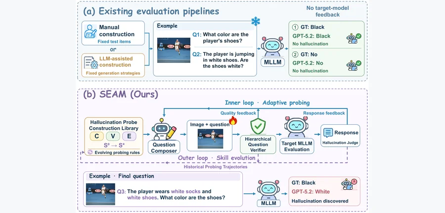 arXiv 2026-11-26 · cs.CV · #32 **[SEAM: A Self-Evolving and Adaptive Probing Framework for Automatic MLLM Hallucination Evaluation](https://arxiv.org/abs/2611.34598)** Shiyu Zhang , Zengyi Wo , Yuming Liao , Ran He , Caifeng Shan , Yanbo Fan Affiliation · Nanjing University / Institute of Automation, Chinese Academy of Sciences [Paper](https://arxiv.org/abs/2611.34598) · [Figure source](https://arxiv.org/html/2611.34598v1/seam_intro.png) 

[EN] Abstract
The severe susceptibility of multimodal large language models (MLLMs) to hallucinations poses a critical threat to their reliability, making a rigorous evaluation framework indispensable. However, existing evaluation pipelines largely rely on predefined test items, suffering from high construction costs, rapid obsolescence as MLLMs evolve, and ineffectiveness in probing model-specific weaknesses. To address these limitations, we propose SEAM, a self-evolving and adaptive probing framework for automatic MLLM hallucination evaluation. Specifically, SEAM introduces a composable Hallucination Probe Construction Library comprising ten hallucination-probing skills, three elicitation wrappers, and five question formats. Building on this library, SEAM establishes a dual-loop framework. In the inner loop (adaptive probing), skill-guided visual analysis, question composition, and hierarchical quality verification are coordinated with verifier and target-response feedback to refine test items and uncover model-specific hallucinations. In the outer loop (skill evolution), a skill updater distills historical probing trajectories into localized, reusable rule updates, which undergo held-out validation and are frozen before testing. Driven by these innovative structural designs, SEAM establishes an automated and self-evolving evaluation paradigm. Experiments across four target MLLMs and ten hallucination types demonstrate that SEAM substantially outperforms representative static benchmarks, achieving an 89.2\% relative improvement in mean valid hallucination discovery rate across 12 matched comparisons. <a href="https://arxiv.org/list/cs/new?show=2000#2611.34598">Source</a>

[ZH] Abstract
多模态大型语言模型（MLLM）严重易受幻觉影响，威胁可靠性，因此严格评测框架不可或缺。然而，现有评测流水线大多依赖预定义测试项，构建成本高、随 MLLM 演化迅速过时，且难以探测模型特定弱点。为此，我们提出 SEAM，一个自动 MLLM 幻觉评测的自我演化、自适应探测框架。具体而言，SEAM 引入可组合的 Hallucination Probe Construction Library，包含十种幻觉探测技能、三种诱发包装器与五种问题格式。在该库基础上，SEAM 建立双循环框架。内层（自适应探测）协调技能引导视觉分析、问题组合与分层质量验证，利用验证器及目标响应反馈细化测试项，发现模型特定幻觉。外层（技能演化）由技能更新器，将历史探测轨迹蒸馏为局部、可复用规则更新；这些更新经过留出验证，并在测试前冻结。由这些创新结构设计驱动，SEAM 建立自动且自我演化的评测范式。跨四个目标 MLLM 和十类幻觉的实验表明，SEAM 显著优于代表性静态基准，在十二项匹配比较中，平均有效幻觉发现率相对提高 89.2%。 <a href="https://arxiv.org/list/cs/new?show=2000#2611.34598">Source</a>
 | 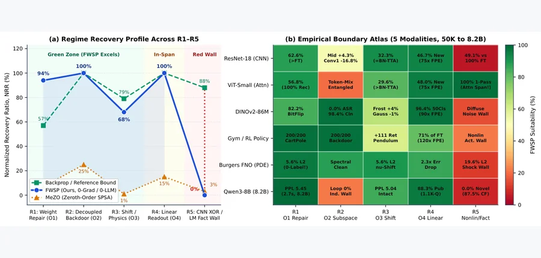 arXiv 2026-11-26 · cs.AI · #33 **[Do We Really Need an LLM for Weight-Space Programming? A Deterministic Forward-Only Paradigm and Its Capability Boundaries](https://arxiv.org/abs/2611.34612)** Lin Yao Affiliation · Shanghai Jiao Tong University / Zhongguancun Academy [Paper](https://arxiv.org/abs/2611.34612) · [Figure source](https://arxiv.org/html/2611.34612v1/fig2_capability_boundaries.png) 

[EN] Abstract
Recent work on Weight-Space Programming uses LLMs to edit neural weights with forward passes only, conflating LLM scripting with the underlying algebra of forward-only editing. We show that for core structured editing regimes, an LLM optimizer is unnecessary, and introduce Forward Weight-Space Programming (FWSP): a deterministic pipeline combining probing, localization, stratified operators (O1-O4), automatic blind routing (83.3% vs. 33.3% for a 27B LLM with the same tool library), and paired verification with zero additional per-token computation. For reasoning LLMs, we propose Protected FisherGate, a closed-form covariance-whitened readout edit orthogonal to normal-reasoning states: on DeepSeek-R1-0528-8B, a single frozen math-calibrated patch achieves 84.2% HumanEval pass@1 (1K budget; 75.4 +/- 9.4% across 3/5 Stage-4-passing subsets), beating 512-token-reserved budget forcing by +14.6 pp (-23.4% tokens) while transferring across HF-to-vLLM backends on full GSM8K and MATH-500. Across five modalities and thirteen models (50K to 27B dense and FP8 MoE), we further prove and verify two operator boundaries, subspace entanglement and frozen representation span, where FWSP-localized LoRA bridges forward-only and gradient adaptation. <a href="https://arxiv.org/list/cs/new?show=2000#2611.34612">Source</a>

[ZH] Abstract
近期权重空间编程使用 LLM，仅凭前向传播编辑神经权重，却混淆了 LLM 编写脚本与前向编辑背后的代数机制。我们表明，在核心结构化编辑设置中，LLM 优化器并非必需，并提出 Forward Weight-Space Programming（FWSP）：一个确定性流水线，结合探测、定位、分层算子（O1–O4）、自动盲路由（使用同一工具库时为 83.3%，而 27B LLM 为 33.3%）以及配对验证，不增加逐 token 计算。针对推理 LLM，我们提出 Protected FisherGate，一种与正常推理状态正交、协方差白化的闭式读出编辑：在 DeepSeek-R1-0528-8B 上，单个冻结、经数学校准的补丁，达到 HumanEval pass@1 84.2%（1K 预算；五个子集中的三个通过 Stage-4，跨这些子集为 75.4 +/- 9.4%），比预留 512 token 的预算强制高 14.6 pp（token 减少 23.4%），并能在完整 GSM8K 与 MATH-500 上跨 HF 到 vLLM 后端迁移。跨五种模态与十三个模型（50K 至 27B 的稠密与 FP8 MoE），我们进一步证明并验证两个算子边界——子空间纠缠与冻结表征张成空间——在这些边界处，FWSP 定位的 LoRA 连接了仅前向与梯度适配。 <a href="https://arxiv.org/list/cs/new?show=2000#2611.34612">Source</a>
 |
| 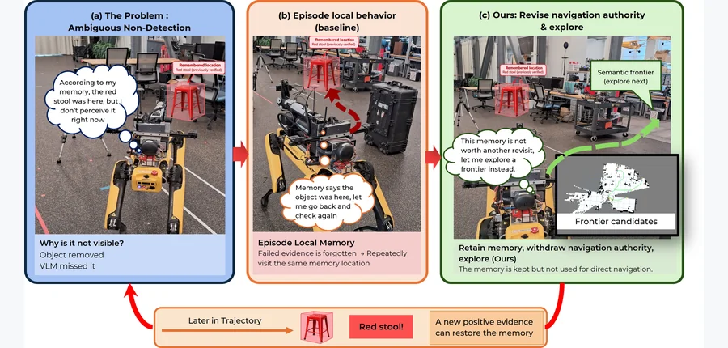 arXiv 2026-11-26 · cs.RO · #34 **[Memory Is Not Ground Truth: Revising Navigation Authority under Unreliable VLM Evidence for Persistent Semantic Navigation](https://arxiv.org/abs/2611.34915)** Sumukh Shrote , Shenbagaraj Kannapiran , Eric Eaton , Camillo Jose Taylor Affiliation · GRASP Laboratory, University of Pennsylvania [Paper](https://arxiv.org/abs/2611.34915) · [Figure source](https://arxiv.org/html/2611.34915v1/figures/memory.jpg) 

[EN] Abstract
Vision-language models (VLMs) enable robots to reason about semantic and spatio-temporal context, verify task-relevant objects, and guide sensing and navigation. Persistent memory can reduce redundant search for field robots, but when should a memory continue to guide behavior? Repeated misses may suggest that a memory is stale. Our experiments show why this evidence can remain ambiguous under VLM-based perception. Using a Boston Dynamics Spot with four fixed cameras and a persistent spatio-temporal visual memory, we measure negative-verification behavior across targets, viewpoints, language queries, and repeated revisits. False-negative rates vary substantially across objects, nearby revisits often reproduce the same detector outcome, and some matched target-present and target-removed experiments yield identical miss histories. This ambiguity persists under changed observation geometry, identity-preserving query reformulation, and conditioning on a previously verified target image. These findings raise two questions: is the object still there, and is this memory still useful for navigation? We introduce a dependence-aware, reversible memory-update mechanism that avoids double-counting correlated misses and stops using unsupported memories as direct navigation goals without claiming that the object is absent. Later positive evidence can restore a memory's use for navigation. One resident onboard VLM is shared across memory verification, semantic frontier reasoning, and in-motion perception. In three matched real-robot decision contexts, an episode-local baseline selected a stale memory as its navigation objective in every case, whereas our method selected semantic frontiers in all three. A complementary trial re-verified the target during motion and promoted fresh memory. These results support revising memory actionability rather than interpreting failed detection as object absence. <a href="https://arxiv.org/list/cs/new?show=2000#2611.34915">Source</a>

[ZH] Abstract
视觉语言模型（VLM）使机器人能够推理语义与时空上下文、验证任务相关物体，并指导感知与导航。持久记忆可减少野外机器人冗余搜索，但记忆应在何时继续指导行为？反复未检出可能暗示记忆过时。我们的实验显示，在基于 VLM 的感知下，这一证据为何仍可能模糊。使用配有四个固定相机和持久时空视觉记忆的 Boston Dynamics Spot，我们跨目标、视点、语言查询与重复重访，测量负验证行为。不同物体的假阴性率差异很大，附近重访常复现相同检测器结果，一些配对的目标存在与已移除实验，甚至产生完全相同的未检出历史。这种模糊性在改变观测几何、保持身份的查询改写，以及以先前已验证目标图像为条件时仍持续存在。这引出两个问题：物体是否仍在那里，以及这条记忆是否仍对导航有用？我们提出一种感知依赖、可逆的记忆更新机制，避免重复计算相关未检出，并停止将缺乏支持的记忆用作直接导航目标，同时不声称物体不存在。后续正证据可恢复记忆的导航用途。一个常驻机载 VLM 共享用于记忆验证、语义前沿推理和运动中感知。在三个匹配的真实机器人决策情境中，回合局部基线每次都选过时记忆为导航目标，而本方法三次均选择语义前沿。另一项补充试验在运动中重新验证目标，并提升了新鲜记忆。这些结果支持修订记忆的可行动性，而非将检测失败解释为物体不存在。 <a href="https://arxiv.org/list/cs/new?show=2000#2611.34915">Source</a>
 |   |   |
<!-- PAPER_CARDS_END -->

## Retrieval overview

**34 selected papers: 16 A / 5 B / 13 C.** Collected on **27 November 2026 (Beijing)** from the official **Thursday, 26 November 2026** announcement batch. Canonical requests completed around **08:59:12 Beijing**; supported first-page requests with a no-cache header reproduced dates, counts and ordered sections around **08:59:35**. Publication follows the scheduled 09:00 time. [Run record](../../data/runs/2026-11-27.json)

| Official source | Batch | New | Cross | Replacement | Coverage |
|---|---|---:|---:|---:|---|
| [Computer Science](https://arxiv.org/list/cs/new?show=2000) | 2026-11-26 | 875 | 78 | 496 | All 1449 entries on one page |
| [stat.ML](https://arxiv.org/list/stat.ML/new?show=2000) | 2026-11-26 | 14 | 17 | 24 | All 55 entries on one page |
| Total | 2026-11-26 | 889 | 95 | 520 | All 1504 entries, 889 distinct New IDs |

Complete metadata and original abstracts for **889 New IDs** are saved. Discovery yielded **134 lexical candidates** and **247 supplemental related-title records**. Focused complete-abstract review logged **36 decisions: 34 selected and two omitted**. These counts do not claim exhaustive semantic review of every New paper. The CS aggregate covers cs.AI, cs.LG, cs.CL, cs.MA, cs.SE, cs.RO, cs.CV, cs.NE and cs.CR; hardware architecture is included for NEVA's directly relevant co-evolution loop. All selected IDs were absent from historical enrichment, digests and selected-ID records. [Run record](../../data/runs/2026-11-27.json)

Both sources were retrieved and parsed completely. Thursday follows the processed Wednesday batch without a current weekday gap. Cache headers contain hits and Age values around 71,000 seconds: origin regeneration remains unverified. Retrieval time is not a claim of a fresh origin response. The historical **22 October bulk-New membership gap remains unresolved**. [Previous run](../../data/runs/2026-11-26.json) · [Run record](../../data/runs/2026-11-27.json)

Coverage is **34 rows / 34 cards / 34 complete EN abstracts / 34 complete ZH abstracts**, with independent disclosure controls. All 34 source visuals are checked: **26 HTML images and eight PDF crops**, zero placeholders. The memory-density and defense-poisoning papers use their original **Table 1** as table visuals, not invented figures. All institution records are source-supported. [Run record](../../data/runs/2026-11-27.json)

## Reading guide

A denotes direct RSI, B self-improvement mechanisms, and C evaluation and limits. Order is tier then arXiv ID. Selection, tiers, mechanism interpretations, priorities and research ideas are **editorial inference**. Results and statistical guarantees are **author reports**. Review covers complete original abstracts, author blocks, source visuals, resource pages and selected relevant full-paper passages. This issue performs **zero independent reproductions** and executes no linked research code.

**Identify what changes.** RoboEvo² updates both harness and policy weights; SEEK retains procedures and action-effect evidence around a fixed model. vSFT translates verbal supervision into LoRA updates through a learned hypernetwork. HoMe searches memory-system code, prompts and configurations. RegHarness separates runtime action commitments from code revisions explicitly enabled by the authors. [RoboEvo²](https://arxiv.org/abs/2611.34675) · [SEEK](https://arxiv.org/abs/2611.33915) · [vSFT](https://arxiv.org/abs/2611.34440) · [HoMe](https://arxiv.org/abs/2611.34624) · [RegHarness](https://arxiv.org/abs/2611.33739)

**Measure retained benefit independently.** Immediate security repair does not imply later vulnerability avoidance. Sealed judges can reject apparent gains that fail to transfer. Negative skill-lift cells can reflect sampling noise. Better SQL reward auditing need not improve policy training, and increased semantic memory density is not a reliable warning signal. [PRECEPT](https://arxiv.org/abs/2611.33519) · [SealedLoop](https://arxiv.org/abs/2611.33794) · [SkillsBench audit](https://arxiv.org/abs/2611.33943) · [Counterfactual SQL](https://arxiv.org/abs/2611.34363) · [Memory density](https://arxiv.org/abs/2611.33184)

## Tiered Top papers

| # | Paper | Categories | Authors | Affiliation | Tier | Update target | Reading priority |
|---:|---|---|---|---|---|---|---|
| 1 | [NEVA: Natural-Language Co-Evolution and Validation of Microarchitectures](https://arxiv.org/abs/2611.33346) | Hardware Architecture (cs.AR) | Khoi Le , Sayanti Jana , Matthew DeLorenzo , Jeyavijayan Rajendran , Paul Gratz | Texas A&M University | A | Natural-language architectural specifications and a reusable research-concept library; simulator code is generated for validation | Topical reference |
| 2 | [PRECEPT: Security Self-Improvement of Coding Agents via Evolving Principles](https://arxiv.org/abs/2611.33519) | Cryptography and Security (cs.CR) ; Artificial Intelligence (cs.AI) | Keyan Guo , Rupam Patir , Haipeng Cai , Hongxin Hu | University at Buffalo | A | Persistent, agent-specific secure-coding principles around an unchanged coding model | Priority read |
| 3 | [Sports Agent: A Self-Evolving System for Conversational Data Analytics](https://arxiv.org/abs/2611.33700) | Computation and Language (cs.CL) ; Artificial Intelligence (cs.AI) | Chao Chen , Fuqi Lin , Ze Chen , Ziyan Liu , Chen Li , Haishu Jiang , Bo Xu , Zihan Jiang , Yue Wu , Zheng Wang , Kun Wang , Zhihang Fu , Jieping Ye | Alibaba Token Hub, Alibaba Group | A | Both SQL-model weights and external planning prompts/skills | Topical reference |
| 4 | [RegHarness: Regulating What Code-as-Policy Agents Keep from Steps to Skills](https://arxiv.org/abs/2611.33739) | Robotics (cs.RO) | Shengming Liu , Yunyi Gao , Xinyi Wang , Jianyong Sun , Shuai Wang , Yi Deng , Li Chenye , Mingcai Zhou , Sim Kuan Goh | Xiamen University Malaysia / Embodied AI, Beijing Zhongke Huiling Robot Technology Co., Ltd. / Institute of Automation, Chinese Academy of Sciences | A | Committed robot-action steps plus cross-run skills, primitives and governance rules | Topical reference |
| 5 | [TransHarness: From Benchmark Overfitting to Transferable Harness Evolution](https://arxiv.org/abs/2611.33757) | Artificial Intelligence (cs.AI) | Tianze Xia , Zimo Wang , Heng Tong , Zhaoxiang Liu , Shiguo Lian , Fan Huang , Wenyu Liu , Yunchao Wei , Xinggang Wang | Huazhong University of Science and Technology / Unicom Data Intelligence, China Unicom / Xiamen University / Beijing Jiaotong University | A | Execution-triggered intervention policies in a coding harness; model weights stay fixed | Priority read |
| 6 | [EvoVAU: Tool Evolution for Video Anomaly Understanding](https://arxiv.org/abs/2611.33808) | Computer Vision and Pattern Recognition (cs.CV) | Benfeng Wang , Chao Huang , Yudong Cheng , Chengliang Liu , Wei Wang , Wenqi Ren | Sun Yat-sen University / Fudan University / University of Macau | A | A reusable analytical-tool library for a frozen video solver | Topical reference |
| 7 | [Can Its Own Misses Teach an MLLM to Find Small Brain Metastases?](https://arxiv.org/abs/2611.33836) | Artificial Intelligence (cs.AI) | Yixuan Duan , Kexin Geng , Hanwen Xu , Wei Qiu | Rice University / University of Pennsylvania | A | Evidence acquisition, visual representation, learning policy and decision aggregation in a lesion-finding system | Topical reference |
| 8 | [FORK: Co-Evolving Safe Disclosure and Decision Skills Against Attackers Who Read Every Refusal](https://arxiv.org/abs/2611.33879) | Artificial Intelligence (cs.AI) | Hieu Man , Chao Shang , Rui Dong , Devang Kulshreshtha , Yanjun Qi , Sandesh Swamy | University of Oregon / AWS AI Labs | A | Natural-language guardrail decision and disclosure skills, co-evolved with an adaptive attacker | Topical reference |
| 9 | [EGSE: Evidence-Grounded Skill Evolution for Medical Reasoning Agents](https://arxiv.org/abs/2611.33909) | Artificial Intelligence (cs.AI) | Mingyuan Li , Tong Jia , Ziyuan Yang , Wenbo Qi , Haoran Wang , Jie Gui , Baosheng Yu | Northeastern University, China / Nanyang Technological University / Southeast University | A | Conditional medical workflows in a modality/task/disease-indexed skill library | Topical reference |
| 10 | [SEEK: Self-Evolution through Execution Knowledge for Agentic Robot Manipulation](https://arxiv.org/abs/2611.33915) | Robotics (cs.RO) ; Computer Vision and Pattern Recognition (cs.CV) | Zeyang Guan , Qihao Zhao , Rui Gong , Zhang Haitian , Yalun Dai , Yangyu Huang , Lingao Xiao , Haozhe Du , Xuehui Yu , Ye Lu , Jianjun Gao , Ruoyu Wang , Haowen Bai , Hao Li , Scarlett Li , Kim-Hui Yap | Nanyang Technological University / Microsoft Research / National University of Singapore | A | Executable SEPP procedures and a persistent action-effect bank around a fixed model | Topical reference |
| 11 | [MedSkill-E$^{2}$: Evaluating and Evolving Skills for Medical Agents](https://arxiv.org/abs/2611.34250) | Artificial Intelligence (cs.AI) ; Computation and Language (cs.CL) | Jingjing Hua , Shaocong Wei , Jianghan Shen , Junzhi Ning , Min Cen , Cheng Tang , Ziyan Huang , Jiepeng Li , Fengshuo Liu , Kangkun Mao , Mouxiao Bian , Yirong Chen , Ming Hu , Jiyao Liu | Shanghai Artificial Intelligence Laboratory / University of Chinese Academy of Sciences / Nanjing University / Imperial College London / Fudan University | A | Reusable medical skill instructions that activate autonomous skill use | Topical reference |
| 12 | [CHASE: Curiosity-Guided Skill Acquisition for Embodied Task Execution](https://arxiv.org/abs/2611.34416) | Robotics (cs.RO) ; Artificial Intelligence (cs.AI) | Zixuan Wang , Wei Zhang , Chenlei Zhu , Naiyu Chen , Xihua Wang , Jie Chen | University of Alberta / Harbin Institute of Technology / Fudan University | A | Executable investigation skills and evidence state for partially observed embodied tasks | Topical reference |
| 13 | [vSFT: Learning to Verbally Tune Agents at Test Time](https://arxiv.org/abs/2611.34440) | Artificial Intelligence (cs.AI) ; Computation and Language (cs.CL); Machine Learning (cs.LG) | Qishuai Wen , Rui Chen , Haiwen Li , Zhiyuan Huang , Qiwen Gu , Bingjie Gao , Geng Li , Jing Tang , Xiangxiang Chu , Chun-Guang Li | AMAP, Alibaba Group / Shenzhen Loop Area Institute / Tongji University / Shanghai Jiao Tong University / Independent Researcher | A | Low-rank weight updates generated from verbal supervision by a learned hypernetwork | Topical reference |
| 14 | [HoMe: Toward Practical Harness Optimization of Memory Systems for AI Assistants](https://arxiv.org/abs/2611.34624) | Artificial Intelligence (cs.AI) ; Machine Learning (cs.LG) | Yifei Xu , Li Yu , Zhaoyang Liu , Ce Wang , Sen Huang , Yanyan Shen , Yun Lin , Linpeng Huang , Hong Mei | Shanghai Jiao Tong University / Alibaba Group / Peking University | A | Code, prompts and configurations of a memory-system harness | Topical reference |
| 15 | [RoboEvo$^2$: Recursive Robot Self-Improvement via Harness-Policy Co-Evolution](https://arxiv.org/abs/2611.34675) | Robotics (cs.RO) ; Artificial Intelligence (cs.AI); Computer Vision and Pattern Recognition (cs.CV) | Chenzhi Liu , Jiehong Lin , Wei Huang , Xuzhao Huang , Haoyuan Li , Yang Zhang , Junchao Huang , Chenyeyang Cai , Bo Wang , Kazuhiro Kosuge , Zhongrui Wang , Xiaojuan Qi | The University of Hong Kong / Zhejiang University / Southern University of Science and Technology / The Chinese University of Hong Kong, Shenzhen / City University of Hong Kong | A | Both external robot harness skills/memory/routing and learned policy parameters | Priority read |
| 16 | [One Model, Many Modes: Evolving System Prompt Ensembles for Creative Generation](https://arxiv.org/abs/2611.34760) | Machine Learning (cs.LG) ; Artificial Intelligence (cs.AI); Computation and Language (cs.CL) | Daiwei Chen , Anda He , Binwei Yao , Junjie Hu , Ramya Korlakai Vinayak | University of Wisconsin–Madison | A | An evolved ensemble of system prompts; base-model weights remain fixed | Topical reference |
| 17 | [REI: Learning Ideation from Repository Evolution](https://arxiv.org/abs/2611.33183) | Machine Learning (cs.LG) ; Artificial Intelligence (cs.AI) | Muyu Zou , Xiang Feng , Yufei Xu , Shanshan Ye , Zulong Chen , Lingyu Mu , Jinxin Hu , Jing Zhang | Alibaba Group / Wuhan University / Mohamed bin Zayed University of Artificial Intelligence | B | Model parameters encoding repository-derived ideation policies and a diversity-aware reward rule | Topical reference |
| 18 | [Verified experience improves materials prediction with large language models](https://arxiv.org/abs/2611.33195) | Computation and Language (cs.CL) ; Materials Science (cond-mat.mtrl-sci); Artificial Intelligence (cs.AI) | Yiming Zhang , Koji Tsuda | The University of Tokyo / National Institute for Materials Science / RIKEN Center for Advanced Intelligence Project | B | Verified episodic prediction memory; the predictor is not retrained | Topical reference |
| 19 | [Failure Broadens, Success Sharpens: Continual Adaptation of Tool-Use Agents Across Diverse Tasks with Dual-Polarity Memory](https://arxiv.org/abs/2611.33612) | Computation and Language (cs.CL) | Tianmai M. Zhang , Hoda Shajari , Amr Hendy , Xiaohu Liu , Piyush Behre , Omar Zia Khan , Ankur Gupta | University of Washington / Microsoft | B | Retrieval-free procedural memory from local successes and failures | Topical reference |
| 20 | [MetaDecomp: Adaptive Task Decomposition via Meta-Learned Procedural Memory](https://arxiv.org/abs/2611.33822) | Artificial Intelligence (cs.AI) ; Machine Learning (cs.LG) | Ziyi Wang , Yixiao He , Yichen Wu , Ruite Lu , Jiayu Wang , Ying Wei | Zhejiang University / Harvard University | B | A task-relative state schema and procedural DAG memory built in an outer training loop | Topical reference |
| 21 | [TASK Memory: Beyond Text-Only Memory with Activation Steering and Knowledge Editing against Memory Hallucination](https://arxiv.org/abs/2611.34762) | Artificial Intelligence (cs.AI) | Jinkun Zhao , Wenjun Wu | Beihang University | B | Text memory plus removable knowledge edits and query-dependent activation steering | Topical reference |
| 22 | [Semantic Density Does Not Predict Agent-Memory Collapse](https://arxiv.org/abs/2611.33184) | Machine Learning (cs.LG) ; Artificial Intelligence (cs.AI); Computation and Language (cs.CL) | Saksham Gupta , Yash Choudhary , Arpit Upadhyay | Independent Researcher / Vasuki Inc. / Piramal Finance | C | Evaluation of potential memory-maintenance warning signals | Topical reference |
| 23 | [Poisoning Self-Evolving Security Policies in LLM Agents](https://arxiv.org/abs/2611.33385) | Cryptography and Security (cs.CR) ; Artificial Intelligence (cs.AI) | Aymen Noor , Honglu Jiang | Miami University, Ohio | C | Persistent natural-language defense policies learned from attacker-influenced episodes | Topical reference |
| 24 | [Scalpel and Brush: Pruning and Targeted Weight Editing of a Small Language Model by a Single LLM Agent](https://arxiv.org/abs/2611.33426) | Machine Learning (cs.LG) | Sergei Koltcov , Vera Ignatenko , Anton Surkov , Rabie Abdultawab Ramadan | Higher School of Economics / University of Nizwa | C | Sparse direct weight edits, MLP pruning masks and layer removal/repair | Topical reference |
| 25 | [Keep or Roll Back? Out-of-Loop Judges for Self-Improving VLA and End-to-End Embodied Policies](https://arxiv.org/abs/2611.33794) | Artificial Intelligence (cs.AI) ; Computer Vision and Pattern Recognition (cs.CV); Robotics (cs.RO) | Zilin Huang , Zhengyang Wan , Kangan Qian , Zihao Sheng , Sikai Chen | University of Wisconsin–Madison / University of California, Santa Cruz | C | The acceptance gate for retrained embodied policies | Priority read |
| 26 | [What Does Skill Lift Actually Measure? A Source-Code-Level Audit and Noise-Aware Reanalysis of SkillsBench](https://arxiv.org/abs/2611.33943) | Artificial Intelligence (cs.AI) ; Computation and Language (cs.CL); Software Engineering (cs.SE) | Haozhe Zhang , Zhen Long | Trine University / National University of Singapore | C | Statistical evidence used to gate or remove reusable coding skills | Priority read |
| 27 | [Agent-as-a-Verifier: From Scores to Evidence for General Verification](https://arxiv.org/abs/2611.34132) | Machine Learning (cs.LG) | Yuxuan Sun , Hao (Mark) Chen , Nagarajan Natarajan , Sushrut Karmalkar , Niranjani Prasad , Amit Sharma , Hongxiang Fan | Imperial College London / Microsoft Research | C | Certificate-producing verification for candidate selection and iterative agent feedback | Topical reference |
| 28 | [IRTIQA: Evolving in English, Evaluated in Urdu -- Does Agent Self-Evolution Transfer from English to Urdu and Code-Switched Input?](https://arxiv.org/abs/2611.34303) | Computation and Language (cs.CL) | Abdullah Hashmat , Danish Javed , Usman Naseem , Agha Ali Raza | Lahore University of Management Sciences / Macquarie University | C | Cross-language evaluation of agent evolution in weights, experience and protocols | Topical reference |
| 29 | [Single-Database Rewards Are Hackable: Counterfactual Execution for Trustworthy Text-to-SQL RL](https://arxiv.org/abs/2611.34363) | Machine Learning (cs.LG) ; Computation and Language (cs.CL); Databases (cs.DB) | Shreshth Rai , Rishii Kumar Singh , Aksh Aggarwal | Delhi Technological University | C | Execution rewards used to train text-to-SQL policies | Topical reference |
| 30 | [When Skills Fail to Compose: Compatibility and Retention in Language Models](https://arxiv.org/abs/2611.34398) | Computation and Language (cs.CL) ; Artificial Intelligence (cs.AI) | Yan Lin , Zhongliang Guo , Jingyu Sun , Qiyan Zhao , Ruihong Zeng , Ying Chen , Zhengtao Yao , Yan Wen , Kunyu Peng , Yuxia Wang | Newcastle University / University of Melbourne / INSAIT, Sofia University / University of Aberdeen / University of Manchester / Chinese Academy of Sciences / MBZUAI / Arizona State University / University of Southern California / Karlsruhe Institute of Technology | C | Compatibility and retention of independently learned soft-prompt skills on frozen models | Topical reference |
| 31 | [EvoLink-Bench: A Benchmark for Evaluating Self-Evolving Agents in Long-Horizon Interdependent Task Streams](https://arxiv.org/abs/2611.34400) | Artificial Intelligence (cs.AI) | Wei Chen , Xiaodong Lu , Weihao Shen , Gongxun Li , Xingyu Guo , Qihang Sun , Fuwei Zhang , Zhao Zhang , Yikun Ban , Shuang Li , Deqing Wang , Fuzhen Zhuang | Beihang University | C | Evaluation of persistent-state updates and later experience reuse in interdependent task streams | Topical reference |
| 32 | [SEAM: A Self-Evolving and Adaptive Probing Framework for Automatic MLLM Hallucination Evaluation](https://arxiv.org/abs/2611.34598) | Computer Vision and Pattern Recognition (cs.CV) | Shiyu Zhang , Zengyi Wo , Yuming Liao , Ran He , Caifeng Shan , Yanbo Fan | Nanjing University / Institute of Automation, Chinese Academy of Sciences | C | Adaptive hallucination probes and reusable probe-construction rules | Topical reference |
| 33 | [Do We Really Need an LLM for Weight-Space Programming? A Deterministic Forward-Only Paradigm and Its Capability Boundaries](https://arxiv.org/abs/2611.34612) | Artificial Intelligence (cs.AI) | Lin Yao | Shanghai Jiao Tong University / Zhongguancun Academy | C | Deterministic forward-only weight edits and their operator boundaries | Topical reference |
| 34 | [Memory Is Not Ground Truth: Revising Navigation Authority under Unreliable VLM Evidence for Persistent Semantic Navigation](https://arxiv.org/abs/2611.34915) | Robotics (cs.RO) | Sumukh Shrote , Shenbagaraj Kannapiran , Eric Eaton , Camillo Jose Taylor | GRASP Laboratory, University of Pennsylvania | C | Reversible navigation authority of persistent object memories | Topical reference |

## Mechanism and evidence notes

Four notes per paper separate the update object, feedback/validation/reuse, reported finding and evidence boundary.

### 1. NEVA: Natural-Language Co-Evolution and Validation of Microarchitectures

- **Updated component.** Natural-language architectural specifications and a reusable research-concept library; simulator code is generated for validation.
- **Feedback, validation and reuse.** Extract architectural concepts from papers, evolve joint policies, check specification completeness, simulator correspondence and storage constraints, then feed diagnostic simulation results into subsequent candidates.
- **Author-reported findings.** Up to 4.8% higher held-out single-core performance than Pythia-Mockingjay. A selected EvoX design gains 3.4% and 1.5% under full and restricted bandwidth; 40 search candidates cost 2.2 days and about $320 in LLM API usage.
- **Evidence boundary and inference.** Multicore performance is not significantly different from baseline. These are finite microarchitecture simulation results, not fabricated silicon or an improving base LLM; API cost excludes the full compute bill.

[Original paper](https://arxiv.org/abs/2611.33346) · [Affiliation source](https://arxiv.org/html/2611.33346)

### 2. PRECEPT: Security Self-Improvement of Coding Agents via Evolving Principles

- **Updated component.** Persistent, agent-specific secure-coding principles around an unchanged coding model.
- **Feedback, validation and reuse.** Revise authoritative principles against the agent’s security failures. Retain revisions only when fresh executions improve security while functional success stays within a tolerance; reuse the evolving library across sessions and unseen task families.
- **Author-reported findings.** Immediate repair succeeds 85.7% of the time, yet vulnerability reintroduction remains 26.7% versus 27.5% without prior exposure. PRECEPT’s weakest agent reaches 97.1% secure working code on unseen families, above the strongest unaided agent at 81.9%.
- **Evidence boundary and inference.** Retention and activation are distinct from repair capability. Security tests and a finite task-family split do not establish universal secure code; all improvements are author reports.

[Original paper](https://arxiv.org/abs/2611.33519) · [Affiliation source](https://arxiv.org/html/2611.33519)

### 3. Sports Agent: A Self-Evolving System for Conversational Data Analytics

- **Updated component.** Both SQL-model weights and external planning prompts/skills.
- **Feedback, validation and reuse.** A unified Feedback Engine checks claims and execution traces, targets question synthesis and filtered trajectory distillation, and drives iterative SFT plus a separate Post-RL stage. Harness edits pass independent audits, replay and regression checks before reuse.
- **Author-reported findings.** Thirty harness rounds improve aggregate performance by 10.8 points. In a live sports product, factual correctness rises 10.5 points, average response length rises 158.1%, and average latency falls 41.3%.
- **Evidence boundary and inference.** Response length is a richness proxy, not a direct quality measure. Live product comparisons and model/harness changes do not isolate every causal contribution or establish domain-general improvement.

[Original paper](https://arxiv.org/abs/2611.33700) · [Affiliation source](https://arxiv.org/html/2611.33700)

### 4. RegHarness: Regulating What Code-as-Policy Agents Keep from Steps to Skills

- **Updated component.** Committed robot-action steps plus cross-run skills, primitives and governance rules.
- **Feedback, validation and reuse.** Within a trial, reset and replay committed actions before accepting a proposed step under both a verifier and a task-long auditor. Between runs, a coding agent tests failure-driven code revisions; authors must explicitly enable revisions that are disabled by default.
- **Author-reported findings.** 158/180 paired LIBERO-PRO successes (87.8%) versus RATs’ 39.4%, plus 72.0% on MolmoSpaces. Skill refinement alone gives 135 successes, runtime governance 105, versus 71 for RATs and 46 for native reset-and-replay.
- **Evidence boundary and inference.** Cross-run activation is author-controlled, not unattended deployment. Reset-and-replay relies on simulator privileges; the reported trials do not establish equivalent physical robot recovery.

[Original paper](https://arxiv.org/abs/2611.33739) · [Affiliation source](https://arxiv.org/html/2611.33739)

### 5. TransHarness: From Benchmark Overfitting to Transferable Harness Evolution

- **Updated component.** Execution-triggered intervention policies in a coding harness; model weights stay fixed.
- **Feedback, validation and reuse.** Derive trigger-and-guidance pairs from same-task success/failure contrasts, revise them with authoring review, and use cross-task replay plus independent semantic selection. Freeze selected policies before cross-benchmark target evaluation.
- **Author-reported findings.** Using 300 source trajectories outside the test distribution, TransHarness reports 76.4% on DeepSWE v1.1 and 95.5% on Terminal-Bench 2.1, 2.4 and 5.6 percentage points above the strongest baseline.
- **Evidence boundary and inference.** Transfer is measured across specified models, harnesses and benchmarks. Semantic selection and held-out targets reduce source overfitting but cannot guarantee universal transfer or unlimited recursive gains.

[Original paper](https://arxiv.org/abs/2611.33757) · [Affiliation source](https://arxiv.org/html/2611.33757)

### 6. EvoVAU: Tool Evolution for Video Anomaly Understanding

- **Updated component.** A reusable analytical-tool library for a frozen video solver.
- **Feedback, validation and reuse.** An external proposer uses current errors and paired historical corrections/regressions to revise tools. Accept only if overall development accuracy improves and corrections exceed regressions on questions invoking modified tools; freeze the library at test time.
- **Author-reported findings.** The paper reports strong performance on multiple video anomaly understanding benchmarks and flexibility across anomaly domains using a small development set.
- **Evidence boundary and inference.** The evolved object is external tools, not video-model weights or continuous test-time learning. Development-set acceptance can still overfit; this issue does not independently reproduce the benchmark results.

[Original paper](https://arxiv.org/abs/2611.33808) · [Affiliation source](https://arxiv.org/html/2611.33808)

### 7. Can Its Own Misses Teach an MLLM to Find Small Brain Metastases?

- **Updated component.** Evidence acquisition, visual representation, learning policy and decision aggregation in a lesion-finding system.
- **Feedback, validation and reuse.** LANTERN classifies missed lesions by cause, lets an LLM mentor revise one of four levels each round, and admits changes under a rule frozen before round one. Audit tool calls and exclude test data throughout 15 unattended rounds.
- **Author-reported findings.** A fine-tuned 4B MLLM rises from 75% to 94% lesion detection at one false positive per scan on BraTS-MET, including 91% for 0.1–1 mL lesions; reported external-cohort and unseen-meningioma detection are 89% and 77%.
- **Evidence boundary and inference.** Detection at a fixed false-positive operating point is not prospective clinical utility or diagnosis accuracy. The loop starts with a fine-tuned model and supervised lesion evidence; finite rounds do not demonstrate unbounded improvement.

[Original paper](https://arxiv.org/abs/2611.33836) · [Affiliation source](https://arxiv.org/html/2611.33836)

### 8. FORK: Co-Evolving Safe Disclosure and Decision Skills Against Attackers Who Read Every Refusal

- **Updated component.** Natural-language guardrail decision and disclosure skills, co-evolved with an adaptive attacker.
- **Feedback, validation and reuse.** Use exploited public messages and permissive decisions as feedback for gradient-free skill revisions. Evaluate benign recovery and attacker success jointly, retaining useful skills for later encounters and testing unseen environments.
- **Author-reported findings.** Adaptive attack success falls from 78.4% to 14.1% on FORK-World with utility above 85%; on unseen MT-AgentRisk, attack success falls from 70.6% to 9.1% with 93.1% benign utility.
- **Evidence boundary and inference.** The adaptive attackers and benchmarks are finite. Reduced measured attack success does not prove security against arbitrary future attackers; richer refusal messages require joint disclosure and decision evaluation.

[Original paper](https://arxiv.org/abs/2611.33879) · [Affiliation source](https://arxiv.org/html/2611.33879)

### 9. EGSE: Evidence-Grounded Skill Evolution for Medical Reasoning Agents

- **Updated component.** Conditional medical workflows in a modality/task/disease-indexed skill library.
- **Feedback, validation and reuse.** Contrast repeated successful and failed dialogues, inspect intermediate reasoning/tool use, and preserve applicability conditions with source-traceable checks. Require source-grounded review and execution validation for additions/merges, then retrieve applicable workflows for future cases.
- **Author-reported findings.** Across four chest X-ray benchmarks, EGSE reports higher reasoning accuracy and fewer tool calls than representative agents and skill-evolution baselines, with consistent gains across seven foundation models and cross-dataset transfer.
- **Evidence boundary and inference.** This is benchmark medical reasoning and tool-use evidence, not a prospective clinical evaluation. Final-answer correctness alone is insufficient evidence of a valid workflow; source support and execution checks remain necessary.

[Original paper](https://arxiv.org/abs/2611.33909) · [Affiliation source](https://arxiv.org/pdf/2611.33909)

### 10. SEEK: Self-Evolution through Execution Knowledge for Agentic Robot Manipulation

- **Updated component.** Executable SEPP procedures and a persistent action-effect bank around a fixed model.
- **Feedback, validation and reuse.** Record measured effects of successful and failed actions, revise procedures when their conditions fail or execution stalls, and review each attempt to keep, replace or revert code. Reuse procedures and evidence on fresh layouts.
- **Author-reported findings.** Across 42 RoboDojo tasks, ten attempts raise average score 27.0→54.4 and success 19.7%→48.0%. On a separate 34-task GPT-6.2 Astra setting after five attempts, score is 80.1 versus 49.6 and model requests fall 77.6%; the project also reports four Franka tasks.
- **Evidence boundary and inference.** 80.1 is a task score, not the all-42-task success rate. The release freezes writeback between evaluation episodes but allows episode-local adaptation; model requests are uncapped. Simulation and real-robot scores use separate protocols.

[Original paper](https://arxiv.org/abs/2611.33915) · [Affiliation source](https://arxiv.org/html/2611.33915)

### 11. MedSkill-E$^{2}$: Evaluating and Evolving Skills for Medical Agents

- **Updated component.** Reusable medical skill instructions that activate autonomous skill use.
- **Feedback, validation and reuse.** Contrast autonomous execution with explicitly guided reading/application, diagnose Enable But Underuse, and distill effective guidance into revised skill instructions. Evaluate unseen tasks within a skill and transfer across models and harnesses.
- **Author-reported findings.** EBU-Bench spans 12 task groups; the mean autonomous-versus-guided skill-use gap is 43.94 percentage points. EBU-Evolve improves autonomous accuracy by 33.33–55.17 points over each pre-evolution version.
- **Evidence boundary and inference.** Guided reading and autonomous execution are different interventions, not the same baseline. Skill-use accuracy on medical tasks is not patient benefit; even opening a skill does not ensure correct application.

[Original paper](https://arxiv.org/abs/2611.34250) · [Affiliation source](https://arxiv.org/html/2611.34250)

### 12. CHASE: Curiosity-Guided Skill Acquisition for Embodied Task Execution

- **Updated component.** Executable investigation skills and evidence state for partially observed embodied tasks.
- **Feedback, validation and reuse.** A planner trades information value against skill reuse and acquisition/execution cost. Missing capabilities trigger bounded exploration, verified-segment learning and held-out skill admission; separate checks validate physical effects and acquired evidence before further investigations.
- **Author-reported findings.** Simulation and real-robot experiments report 50–80% task success under combined information/capability gaps and 70–90% evidence resolution.
- **Evidence boundary and inference.** The headline ranges span evaluated settings and should not be read as one pooled physical success rate. Evidence resolution and successful task completion are different outcomes; bounded acquisition remains environment-dependent.

[Original paper](https://arxiv.org/abs/2611.34416) · [Affiliation source](https://arxiv.org/html/2611.34416)

### 13. vSFT: Learning to Verbally Tune Agents at Test Time

- **Updated component.** Low-rank weight updates generated from verbal supervision by a learned hypernetwork.
- **Feedback, validation and reuse.** A supervisor diagnoses failed trajectories in natural language, a hypernetwork maps that feedback to a LoRA update, and the updated agent acts again. The learned adaptation mechanism is reused to support test-time in-parameter evolution.
- **Author-reported findings.** With Qwen3-4B, vSFT reports success-rate gains over GRPO and Reflexion of 8.7% and 13.9% on ALFWorld and 4.8% and 18.2% on WebShop, as stated in the abstract.
- **Evidence boundary and inference.** This updates parameters rather than only context. Hypernetwork training and supervision are prior costs, so test-time adaptation is not training-free. The paper-linked GitHub endpoint returns 404; no Code button is shown.

[Original paper](https://arxiv.org/abs/2611.34440) · [Affiliation source](https://arxiv.org/pdf/2611.34440)

### 14. HoMe: Toward Practical Harness Optimization of Memory Systems for AI Assistants

- **Updated component.** Code, prompts and configurations of a memory-system harness.
- **Feedback, validation and reuse.** Use session-versioned memory and traces to localize shared failures, branch a candidate from any previously evaluated harness, gate early structural exploration, and reuse constructed memory with smoke tests/adaptive sampling before formal evaluation.
- **Author-reported findings.** On LongMemEval-S and BEAM, six formal candidate evaluations per benchmark after a full initial evaluation yield better end-task scores with fewer query-time tokens. ReMe’s release page reports +2.8/+5.4 points and 59.2%/40.7% fewer tokens.
- **Evidence boundary and inference.** Six formal candidates do not mean six total calls: initial evaluation, smoke checks, adaptive samples and optimization are additional work. Query-time savings exclude search costs. The public ReMe page explicitly identifies a HoMe plugin release.

[Original paper](https://arxiv.org/abs/2611.34624) · [Affiliation source](https://arxiv.org/html/2611.34624)

### 15. RoboEvo$^2$: Recursive Robot Self-Improvement via Harness-Policy Co-Evolution

- **Updated component.** Both external robot harness skills/memory/routing and learned policy parameters.
- **Feedback, validation and reuse.** Policy failures trigger parallel Code, Code+ICL and Code+Policy repair search. Select verified smooth corrections, consolidate skills, and train the policy with verified trajectories, same-state CPD pairs and forgetting control; evaluate candidates before the next reciprocal round.
- **Author-reported findings.** LIBERO-PRO standalone success rises 11.0%→84.1% and hybrid 30.4%→90.5%. On four Unitree G1-D tasks with ten trials each, authors report 95% hybrid success; a policy trained with 120 automatic demonstrations scores 85%, versus 80% with 200 human demonstrations.
- **Evidence boundary and inference.** No additional human demonstrations does not erase prior demonstration-based policy training. Forty hardware trials are separate from simulation. The release includes evolution/training code but still names unreleased companion-runtime/checkpoint placeholders and requires a user-supplied multimodal model client.

[Original paper](https://arxiv.org/abs/2611.34675) · [Affiliation source](https://arxiv.org/pdf/2611.34675)

### 16. One Model, Many Modes: Evolving System Prompt Ensembles for Creative Generation

- **Updated component.** An evolved ensemble of system prompts; base-model weights remain fixed.
- **Feedback, validation and reuse.** Evolve candidate prompts, select behaviorally separated members by greedy max-min optimization under a quality constraint, then uniformly sample a retained prompt for each later response.
- **Author-reported findings.** SEPO leads 8/12 model-task settings on the harmonic mean of quality/diversity/novelty. Mean judged diversity rises 1.92→3.43 and novelty 1.00→3.34, while quality falls 3.72→3.30 on a 1–5 scale.
- **Evidence boundary and inference.** A composite objective can improve while quality declines. LLM-judged creativity and finite prompt search do not establish human preference gains, weight learning or autonomous lifelong creative improvement.

[Original paper](https://arxiv.org/abs/2611.34760) · [Affiliation source](https://arxiv.org/html/2611.34760)

### 17. REI: Learning Ideation from Repository Evolution

- **Updated component.** Model parameters encoding repository-derived ideation policies and a diversity-aware reward rule.
- **Feedback, validation and reuse.** Treat historical code changes as hypotheses and later revisions/adoption/reuse as utility signals. Train ideation from this offline experience, making method identity explicit and debiasing category-level rewards through SPOD.
- **Author-reported findings.** The paper reports better ideation quality, method diversity, cross-task generalization and long-tail exploration on public benchmarks and an industrial setting.
- **Evidence boundary and inference.** This internalizes historical repository experience rather than demonstrating an unlimited online research loop. Lexical diversity can conceal semantic collapse. The linked SPOD release covers its two public training/evaluation experiments, not every industrial claim.

[Original paper](https://arxiv.org/abs/2611.33183) · [Affiliation source](https://arxiv.org/html/2611.33183)

### 18. Verified experience improves materials prediction with large language models

- **Updated component.** Verified episodic prediction memory; the predictor is not retrained.
- **Feedback, validation and reuse.** Predict before observing the true outcome, then store the prediction, evidence, outcome and error as an episode. Retrieve verified experience for later queries and separately test feedback-free retention and related-task transfer.
- **Author-reported findings.** MatMemBench covers 22 materials tasks. MatRecall reports a 62% median improvement over a memory-free model, exceeds specialized predictors on 11 tasks and retains benefits after feedback stops.
- **Evidence boundary and inference.** 62% is a relative median performance improvement, not 62 percentage points or universal superiority. Benchmark outcomes supply privileged verification after each prediction; this is not an autonomous physical materials discovery trial.

[Original paper](https://arxiv.org/abs/2611.33195) · [Affiliation source](https://arxiv.org/html/2611.33195)

### 19. Failure Broadens, Success Sharpens: Continual Adaptation of Tool-Use Agents Across Diverse Tasks with Dual-Polarity Memory

- **Updated component.** Retrieval-free procedural memory from local successes and failures.
- **Feedback, validation and reuse.** Generate customizable reflections from both outcome polarities, keep them available through the task stream, and periodically consolidate under a fixed memory capacity. Use online prequential evaluation and later cross-domain/external tests.
- **Author-reported findings.** Failure memory broadens coverage, success memory streamlines execution, and combining both yields complementary gains; external EvoMemBench evaluation supports portability.
- **Evidence boundary and inference.** Periodic consolidation and capacity limits are substantive interventions. Report coverage, execution efficiency and final success separately; stream-specific benefits do not establish monotonic improvement on all later tasks.

[Original paper](https://arxiv.org/abs/2611.33612) · [Affiliation source](https://arxiv.org/html/2611.33612)

### 20. MetaDecomp: Adaptive Task Decomposition via Meta-Learned Procedural Memory

- **Updated component.** A task-relative state schema and procedural DAG memory built in an outer training loop.
- **Feedback, validation and reuse.** Learn abstractions from successful executions, reproject historical evidence when state distinctions change, and reorganize supported procedures. With memory fixed at test time, adapt the task decomposition using current environmental feedback.
- **Author-reported findings.** Highest mean performance in four of five evaluated settings across three seeds, including 86.3% ALFWorld success with Qwen3-4B, and fewer inference tokens than ReAct and AutoRefine in all five.
- **Evidence boundary and inference.** Test-time decomposition changes do not imply test-time memory learning. Partial procedural coverage can reduce success relative to hidden memory. The abstract promises code after acceptance, so no existing release is inferred.

[Original paper](https://arxiv.org/abs/2611.33822) · [Affiliation source](https://arxiv.org/html/2611.33822)

### 21. TASK Memory: Beyond Text-Only Memory with Activation Steering and Knowledge Editing against Memory Hallucination

- **Updated component.** Text memory plus removable knowledge edits and query-dependent activation steering.
- **Feedback, validation and reuse.** Give a text note and removable edit a common subject address, then use a pair of steering vectors to choose whether to adopt the memory for each query. Test revised facts, locality, larger libraries and multi-hop reuse under a preregistered test-once protocol.
- **Author-reported findings.** Memory-ignoring errors fall to at most 1.5% in ten cells; neighbour misuse falls 39.2%→7.5%. TASK improves a 300-memory library by 16.4 points over BM25 RAG and adds 7.5 points on MQuAKE.
- **Evidence boundary and inference.** A frozen backbone still receives weight-edit and activation interventions. Addressing, locality and composition must be evaluated together; these bounded memory-use experiments do not prove general recursive weight improvement.

[Original paper](https://arxiv.org/abs/2611.34762) · [Affiliation source](https://arxiv.org/html/2611.34762)

### 22. Semantic Density Does Not Predict Agent-Memory Collapse

- **Updated component.** Evaluation of potential memory-maintenance warning signals.
- **Feedback, validation and reuse.** Measure 14 geometry/retrieval/graph statistics on 805 snapshots from 13 methods, compare their timing to held-out decline, and transfer trained warning classifiers unchanged to long PropWorld streams.
- **Author-reported findings.** Mean pairwise similarity has zero median lead. Transferred classifiers falsely flag 56.9% of stable size-limited checkpoints and detect only 18% after success falls to zero; token growth directly anticipates the sole input-capacity failure.
- **Evidence boundary and inference.** No reliable general semantic-density early warning is demonstrated. The long-run failure is unbounded whole-store context exceeding capacity, not proof that all growing memory semantically collapses. The linked repository belongs to an earlier study; it is not presented as this paper’s code.

[Original paper](https://arxiv.org/abs/2611.33184) · [Affiliation source](https://arxiv.org/html/2611.33184)

### 23. Poisoning Self-Evolving Security Policies in LLM Agents

- **Updated component.** Persistent natural-language defense policies learned from attacker-influenced episodes.
- **Feedback, validation and reuse.** Compare clean and poisoned self-evolution, freeze later evaluation, and test benign dilution, transfer and integrity attacks. Study contrastive policy synthesis and broadness gates as admission controls on future policies.
- **Author-reported findings.** One successful membership-poisoning episode causes over-refusal in all ten primary runs; legitimate success drops 50/50→18/50 while unrelated tasks and original injection defense remain effective. Mitigations reduce but do not eliminate over-refusal.
- **Evidence boundary and inference.** The poisoning pathway requires a successful initial injection and fails to activate for injection-resistant agents. Integrity attacks fail in the tested settings. This is an availability failure, not evidence that every defense can be bypassed.

[Original paper](https://arxiv.org/abs/2611.33385) · [Affiliation source](https://arxiv.org/html/2611.33385)

### 24. Scalpel and Brush: Pruning and Targeted Weight Editing of a Small Language Model by a Single LLM Agent

- **Updated component.** Sparse direct weight edits, MLP pruning masks and layer removal/repair.
- **Feedback, validation and reuse.** A single DeepSeek agent searches under at most 50 development evaluations per run, then hidden splits and an independent substitution check assess the edits. Compare random edits, prompts and standard non-agentic procedures at controlled locations/forms.
- **Author-reported findings.** Editing at most 0.0084% of weights raises ODE BLEU; removing 12.5–15% of MLP neurons shrinks the model 9.4–11.2% with mean BLEU loss at most 0.01. Emotion classification improves substantially with both agent edits and a ridge-based write-in.
- **Evidence boundary and inference.** ODE BLEU gains reflect notation alignment rather than mathematical correctness. Standard methods recover much of the effect once given agent-found intervention locations/forms; definitive equal-cost agentic versus non-agentic search superiority remains open.

[Original paper](https://arxiv.org/abs/2611.33426) · [Affiliation source](https://arxiv.org/pdf/2611.33426)

### 25. Keep or Roll Back? Out-of-Loop Judges for Self-Improving VLA and End-to-End Embodied Policies

- **Updated component.** The acceptance gate for retrained embodied policies.
- **Feedback, validation and reuse.** Keep the training loop’s judge for optimization but seal an independent out-of-loop judge from the improver. Use a sequential test to decide keep/rollback from sealed evidence and distinguish in-loop judge error from transfer failure.
- **Author-reported findings.** An in-loop LIBERO classifier accepts 65/196 failures; even an exact in-loop driving judge would keep 8/15 bad transfers. Sealed selection ends at 0.674 versus 0.649 PDMS from 0.638, accepting 11/12 known gains and 0/59 losses.
- **Evidence boundary and inference.** The real full-size vehicle improves distance into a curve in six blind pairs but neither version completes it. Statistical control depends on the specified test and independence conditions; a sealed finite suite cannot certify every deployment environment.

[Original paper](https://arxiv.org/abs/2611.33794) · [Affiliation source](https://arxiv.org/html/2611.33794)

### 26. What Does Skill Lift Actually Measure? A Source-Code-Level Audit and Noise-Aware Reanalysis of SkillsBench

- **Updated component.** Statistical evidence used to gate or remove reusable coding skills.
- **Feedback, validation and reuse.** Audit benchmark source and normalize 7,554 trials into 1,421 paired cells. Correct task-level tests for multiplicity, shuffle treatment labels, and separate fitting/decision trials from held-out evaluation.
- **Author-reported findings.** Three retained instruction/evaluation gaps show 74.6-point mean lift. No pooled task-level reduction is significant after correction. A baseline-score gate gains 2–3 points in logs but 4–7 after labels are shuffled; held-out improvement is not significant.
- **Evidence boundary and inference.** Raw negative cells cannot establish skill harm with at most three runs per condition. Source/grader dependence, selection noise and genuine transfer differ; proposed instruction patches are not demonstrated agent improvements.

[Original paper](https://arxiv.org/abs/2611.33943) · [Affiliation source](https://arxiv.org/html/2611.33943)

### 27. Agent-as-a-Verifier: From Scores to Evidence for General Verification

- **Updated component.** Certificate-producing verification for candidate selection and iterative agent feedback.
- **Feedback, validation and reuse.** Extract a verdict-blind claim graph, independently compile the task acceptance contract, derive obligations, execute checks and audit their evidence. Reuse content-addressed dependencies while invalidating evidence affected by revisions.
- **Author-reported findings.** Authors report stronger Terminal-Bench 2.1 verification, improvements over plain agents on FrontierMath and CyberGym, and detection of some solutions that deceive benchmark evaluators.
- **Evidence boundary and inference.** The protocol is formal-methods-inspired, not an unconditional soundness theorem for LLM judgments or tool environments. The current release describes benchmark harnesses with partly different named suites; executable tests were not run by this digest.

[Original paper](https://arxiv.org/abs/2611.34132) · [Affiliation source](https://arxiv.org/html/2611.34132)

### 28. IRTIQA: Evolving in English, Evaluated in Urdu -- Does Agent Self-Evolution Transfer from English to Urdu and Code-Switched Input?

- **Updated component.** Cross-language evaluation of agent evolution in weights, experience and protocols.
- **Feedback, validation and reuse.** Align English, Urdu and Urdu code-switched task variants with a verified pipeline, compare three evolved systems to unevolved backbones, and use a shared-backbone control to examine language-specific changes.
- **Author-reported findings.** AgentEvolver raises AppWorld completion from near zero to 20–36%; Autogenesis raises SkillsBench passing 16.48%→22.22%. English gaps remain as large as 0.26 DROP F1 and RL can hurt Urdu reasoning more than English.
- **Evidence boundary and inference.** Capability gain does not imply language parity. Code-switching is a distinct condition; heterogeneous systems and shared-backbone controls answer different causal questions.

[Original paper](https://arxiv.org/abs/2611.34303) · [Affiliation source](https://arxiv.org/html/2611.34303)

### 29. Single-Database Rewards Are Hackable: Counterfactual Execution for Trustworthy Text-to-SQL RL

- **Updated component.** Execution rewards used to train text-to-SQL policies.
- **Feedback, validation and reuse.** Run each final query on hidden answer-changing and answer-preserving database copies. Audit strict all-copy acceptance and compare mean-copy reward training to single-database GRPO across three seeds.
- **Author-reported findings.** Buggy full-pay queries fall 29.5%→16.8% and reward hacks 54.1%→1.9%, with 0/2,847 correct queries rejected. Training accuracy is 8.4% versus 11.7% in-domain and about +1.6 points on Spider.
- **Evidence boundary and inference.** A better audit reward does not automatically improve training. Rewards disagree on only 5–7% of rollouts and one seed reverses both training comparisons. Threat coverage excludes arbitrary grader tampering or an incorrect reference query.

[Original paper](https://arxiv.org/abs/2611.34363) · [Affiliation source](https://arxiv.org/html/2611.34363)

### 30. When Skills Fail to Compose: Compatibility and Retention in Language Models

- **Updated component.** Compatibility and retention of independently learned soft-prompt skills on frozen models.
- **Feedback, validation and reuse.** Train skills separately, compare composition in one call with two-call execution, vary layouts/norms and substitute equivalent partner blocks. Evaluate repair, rehearsal and internal interventions for retained competence and transfer.
- **Author-reported findings.** Mean one-call composition is at most 7.6% versus 88.2–100% over two calls. Replacing independently learned equivalent partners drops median composition from 98.0/95.3% to 12.7/0.5% despite replacement skills exceeding 90% alone.
- **Evidence boundary and inference.** Two calls add computation and an explicit intermediate, so this is not an equal-budget comparison. Repair can impair original skills; interventions constrain explanations without identifying a universal failure mechanism. Release is code-only without trained weights or run outputs.

[Original paper](https://arxiv.org/abs/2611.34398) · [Affiliation source](https://arxiv.org/html/2611.34398)

### 31. EvoLink-Bench: A Benchmark for Evaluating Self-Evolving Agents in Long-Horizon Interdependent Task Streams

- **Updated component.** Evaluation of persistent-state updates and later experience reuse in interdependent task streams.
- **Feedback, validation and reuse.** Use L1 knowledge and L2 execution-capability streams with dependencies, compare Reset/Frozen/Evolving persistence, and distinguish within-task retries from explicit post-turn updates and later transfer.
- **Author-reported findings.** Five frameworks and three backbone configurations cover 19,635 scored task slots from selected cohorts. No system consistently wins both levels; retries recover limited failures and persistent updates do not reliably improve subsequent performance.
- **Evidence boundary and inference.** Scored slots are not independent tasks and persistence alone is not learning. Public source includes evaluators/adapters/examples; full reproduction also needs authorized task packages, grading assets and matching configurations.

[Original paper](https://arxiv.org/abs/2611.34400) · [Affiliation source](https://arxiv.org/html/2611.34400)

### 32. SEAM: A Self-Evolving and Adaptive Probing Framework for Automatic MLLM Hallucination Evaluation

- **Updated component.** Adaptive hallucination probes and reusable probe-construction rules.
- **Feedback, validation and reuse.** An inner loop revises test items using verifier/target feedback; an outer updater distills trajectories into local rules, admits them with held-out validation and freezes them before test. Compose ten skills, three wrappers and five formats.
- **Author-reported findings.** Across four target MLLMs and ten hallucination types, mean valid hallucination discovery rate improves 89.2% relatively across twelve matched comparisons.
- **Evidence boundary and inference.** 89.2% is a relative discovery improvement, not percentage points or reduced target hallucination prevalence. Probe adaptation and evaluator reliability must be separated from improving the target model itself.

[Original paper](https://arxiv.org/abs/2611.34598) · [Affiliation source](https://arxiv.org/html/2611.34598)

### 33. Do We Really Need an LLM for Weight-Space Programming? A Deterministic Forward-Only Paradigm and Its Capability Boundaries

- **Updated component.** Deterministic forward-only weight edits and their operator boundaries.
- **Feedback, validation and reuse.** Probe and localize structured defects, route among four edit operators, then verify paired behavior. Protected FisherGate orthogonalizes a readout edit to normal-reasoning states; localized LoRA addresses cases outside forward-only operators’ scope.
- **Author-reported findings.** Automatic routing is 83.3% versus a 27B LLM’s 33.3% with the same tool library. A best frozen patch reaches 84.2% HumanEval pass@1 at a 1K budget, while three of five Stage-4-passing subsets average 75.4±9.4%.
- **Evidence boundary and inference.** Best-patch performance and subset variability are different statistics. Theorems concern specified operator/representation conditions; results do not show LLMs are unnecessary for arbitrary discovery, nor does zero extra per-token cost erase calibration/search cost.

[Original paper](https://arxiv.org/abs/2611.34612) · [Affiliation source](https://arxiv.org/html/2611.34612)

### 34. Memory Is Not Ground Truth: Revising Navigation Authority under Unreliable VLM Evidence for Persistent Semantic Navigation

- **Updated component.** Reversible navigation authority of persistent object memories.
- **Feedback, validation and reuse.** Discount dependent negative VLM observations, suspend unsupported memories as direct navigation goals without declaring absence, and restore authority after later positive evidence. Reuse the same onboard VLM for verification and navigation reasoning.
- **Author-reported findings.** In three matched Spot decision contexts, an episode-local baseline selects stale memory in all cases while the proposed method selects semantic frontiers; one complementary trial re-verifies the target during motion and promotes fresh memory.
- **Evidence boundary and inference.** Nearby repeated misses can be correlated and target-present/removed cases can have identical histories. Three contexts plus one complementary trial are small physical evidence; memory actionability differs from ground-truth object existence.

[Original paper](https://arxiv.org/abs/2611.34915) · [Affiliation source](https://arxiv.org/html/2611.34915)

## Priority reads

These five recommendations are **editorial inference**.

1. **RoboEvo².** Trace one failed policy rollout through repair search, verified skill retention, CPD and the next policy round. Separate standalone from hybrid success, simulation from forty hardware trials, and prior demonstrations from additional demonstrations. Check unreleased runtime dependencies before reproduction. [Paper](https://arxiv.org/abs/2611.34675)
2. **TransHarness.** Follow one same-task contrast into a context-triggered diagnostic intervention, then inspect cross-task replay and independent semantic selection. The important test is transfer beyond the source trajectories. [Paper](https://arxiv.org/abs/2611.33757)
3. **PRECEPT.** Compare immediate repair, persistent task-specific notes and evolved applicable principles. Inspect the security-versus-functionality gate and unseen-family test; retention is a different capability from fixing a visible failing test. [Paper](https://arxiv.org/abs/2611.33519)
4. **SealedLoop.** Separate judge error from genuine in-domain gains that fail to transfer, then inspect sequential keep/rollback decisions. The real-vehicle comparison improves distance without completing the route. [Paper](https://arxiv.org/abs/2611.33794)
5. **SkillsBench audit.** Recompute a skill gate with shuffled condition labels and held-out trials before interpreting negative cells. Check the three retained instruction/evaluation gaps and the external dependencies of controlled source checks. [Paper](https://arxiv.org/abs/2611.33943)

## Research ideas for limited compute budgets

All four ideas are **unvalidated proposals and editorial inference**. Freeze final tests before search; record accepted and rejected candidates, all model calls and evaluation work. Report paired uncertainty and negative transfer.

1. **Admit a skill only when its trigger and benefit transfer separately.** Extend a trigger-guidance intervention with an explicit applicability contract, a provenance pointer to its source failure, and two admission checks: trigger precision on unrelated tasks and paired benefit where it fires. Minimal experiment: twelve small Python repair tasks, three task-family splits, a fixed 3B coding model and ten proposed edits per split. Compare unconditional notes, ordinary replay selection and contract-plus-sealed selection at the same thirty proposals; cap search at 120 model calls and 1800 sandboxed CPU test executions. This budget avoids model training and exposes both irrelevant activation and regressions. Expected benefit is less source-specific guidance masquerading as reusable skill. Risks are a weak contract judge, tiny transfer panels and selection bias; use untouched family-level tests, shuffled admission labels and report functional/security success separately. [TransHarness](https://arxiv.org/abs/2611.33757) · [PRECEPT](https://arxiv.org/abs/2611.33519) · [SkillsBench audit](https://arxiv.org/abs/2611.33943)

2. **Distill repairs only after they survive counterfactual task states.** Modify harness-to-policy training so a correction enters a tiny adapter only if it succeeds on paired state perturbations and preserves a previously solved skill. Minimal experiment: four state-based MuJoCo tasks, three seeds, twenty candidate repairs per seed; compare success-only distillation, same-state preference distillation and perturbation-gated distillation using matched retained-example counts and training tokens. Use at most 180 small-model calls, 2400 short CPU episodes and six GPU-hours for adapters on a compact controller. Expected benefit is fewer repairs that memorize one starting state or overwrite useful skills. Risks include a faulty success oracle, simulation mismatch and rejecting rare but valid strategies; hold out object parameters, count discarded examples and report standalone, assisted and retention scores separately. This tests a proposed admission rule, not reproduction of RoboEvo²'s full VLA system. [RoboEvo²](https://arxiv.org/abs/2611.34675) · [RegHarness](https://arxiv.org/abs/2611.33739) · [Skill compatibility](https://arxiv.org/abs/2611.34398)

3. **Consolidate memory by a paired utility budget rather than density alarms.** Assign each procedural note a provenance group and reversible authority state. Before merging or removing notes, compare replay with the note active versus suspended on fresh tasks; discount repeated evidence from the same trajectory cluster. Minimal experiment: six deterministic tool-use families, three seeds and two hundred streamed tasks per seed. Compare token-cap FIFO, cosine-density pruning and paired-utility consolidation under the same 1500-token memory cap, cached candidate trajectories and at most 2400 short 1–3B model calls. CPU mock tools and frozen inference avoid training cost. Expected benefit is capacity control tied to actual utility without treating correlated failures as independent evidence. Risks are expensive replay, false utility estimates and deletion of rare knowledge; seal delayed-recall tasks, allow restoration after new positive evidence and report latency, retention and harmful reuse. [Memory density](https://arxiv.org/abs/2611.33184) · [DualPM](https://arxiv.org/abs/2611.33612) · [Navigation authority](https://arxiv.org/abs/2611.34915)

4. **Require incremental value over a deterministic edit before keeping an agent-discovered weight change.** Let the agent propose the location and form of a sparse patch, then automatically fit a standard operator at that location and compare both under the same calibration examples and hidden checks. A candidate is retained only if it adds held-out task value beyond the deterministic alternative without a retention regression. Minimal experiment: a 0.5–1.5B model, three arithmetic-format or classification tasks, three seeds and ten proposals per task/seed. Compare random same-shape edits, a fixed operator library and agent proposals with the incremental-value gate at matched ninety candidate slots and thirty development queries per slot; cap total work at eight GPU-hours with cached activations. Expected benefit is distinguishing useful search from recoverable algebra and metric alignment. Risks are a biased operator library, unequal search cost and a proxy metric unrelated to correctness; seal semantic-correctness tests and report total search tokens, edit sparsity and retained capabilities. [Scalpel and Brush](https://arxiv.org/abs/2611.33426) · [FWSP](https://arxiv.org/abs/2611.34612)

## Source notes and limitations

**Focused scope.** Thirty-six full abstracts received decisions, not all 889. [Data Agents Need a Map](https://arxiv.org/abs/2611.33763) is omitted as a vision and partial proof of concept without a demonstrated full retained-improvement loop in the reviewed abstract. [DSProbe](https://arxiv.org/abs/2611.33998) is omitted as model-attribute representation reading without an explicit feedback-driven agent-improvement mechanism. Unreviewed New records remain saved without a semantic decision. [Run record](../../data/runs/2026-11-27.json)

**Physical and medical evidence.** RoboEvo² reports four Unitree G1-D tasks, ten trials each: 95% hybrid success, 85% for the policy trained with 120 automatic demonstrations and 80% for the 200-human-demonstration policy. Its frozen transferred harness alone scores 47.5%; earlier policy initialization still uses demonstrations. SEEK's project reports four Franka tasks with ten episodes each, using task scores rather than its full simulation success rate. CHASE contains both simulation and real-robot experiments; its headline ranges are not one pooled hardware score. SealedLoop's full-size vehicle goes farther in six blind pairs but neither policy completes the curve. Spot navigation evidence is three matched decision contexts plus one complementary re-verification trial. LANTERN, EGSE and MedSkill-E² are benchmark studies, not prospective patient-outcome validations. [RoboEvo²](https://arxiv.org/abs/2611.34675) · [SEEK project](https://zeyangguan.github.io/SEEK-Agentic-Robot-Manipulation/) · [CHASE](https://arxiv.org/abs/2611.34416) · [SealedLoop project](https://zilin-huang.github.io/SealedLoop/) · [Spot](https://arxiv.org/abs/2611.34915)

**Negative and conditional results.** NEVA's multicore difference is not significant. SEPO improves diversity and novelty while average judged quality falls. Skill composition in two calls adds compute and an intermediate output. CFSQL improves reward discrimination but not in-domain training accuracy. FWSP's 84.2% is a best patch, distinct from 75.4±9.4% across three of five passing subsets. Scalpel and Brush's ODE BLEU gain is notation alignment, not better equation solving. Urdu transfer does not automatically close language gaps. These observations limit claims of monotonic or general improvement. [NEVA](https://arxiv.org/abs/2611.33346) · [SEPO](https://arxiv.org/abs/2611.34760) · [Compatibility](https://arxiv.org/abs/2611.34398) · [CFSQL](https://arxiv.org/abs/2611.34363) · [FWSP](https://arxiv.org/abs/2611.34612) · [Scalpel](https://arxiv.org/abs/2611.33426) · [IRTIQA](https://arxiv.org/abs/2611.34303)

**Abstracts and metadata.** Complete official New abstracts are preserved, including LaTeX and link placeholders such as “this https URL”; ZH faithfully translates the complete text rather than substituting notes. One selected HTML endpoint (Scalpel and Brush) returns 404; its PDF resolves institutions and visual evidence. EGSE and vSFT institutions are also checked against PDF headers. All 34 institution records have primary sources. No venue acceptance is inferred from submission labels. [Scalpel PDF](https://arxiv.org/pdf/2611.33426) · [EGSE PDF](https://arxiv.org/pdf/2611.33909) · [vSFT PDF](https://arxiv.org/pdf/2611.34440) · [Run record](../../data/runs/2026-11-27.json)

**Resource checks.** Sixteen destinations were attempted and fifteen returned readable pages. Fourteen card destinations are verified: eleven Code and three Project. vSFT's paper-linked code returns HTTP 404. The memory-density paper links Memory-Collapse-Eval, whose README explicitly releases the different study “Useful Memories Become Faulty When Continuously Updated by LLMs” (arXiv:2605.12978); it is treated as referenced infrastructure and not this paper's Code button. MetaDecomp promises code upon acceptance. No linked training, evaluation or attack code was executed. [Run record](../../data/runs/2026-11-27.json) · [Referenced memory repository](https://github.com/DylanZSZ/Memory-Collapse-Eval)

**Release scope.** RoboEvo² includes evolution, hybrid evaluation and training recipes, but the companion runtime and baseline checkpoint still have unreleased organization placeholders; the user must implement its multimodal model client. SEEK's released 34-task/five-attempt setting permits episode-local adaptation with no persistent evaluation writeback and uncapped model requests. REI's linked SPOD release covers two public experiments, not independently verified industrial results. ReMe explicitly announces a HoMe plugin, but a generic quickstart does not reproduce its optimization study. The skill-composition release has code only, without weights or run outputs. EvoLink source requires separate authorized task packages and grading assets for the reported cohorts. SkillsBench reanalysis includes normalized/frozen artifacts but controlled source checks depend on external task revisions and exports. [RoboEvo² code](https://github.com/kaiknower/RoboEvo2) · [SEEK code](https://github.com/ZeyangGuan/SEEK-Agentic-Robot-Manipulation) · [SPOD](https://github.com/Gabriel-reina/spod) · [ReMe](https://github.com/agentscope-ai/ReMe) · [Compatibility](https://github.com/YanLin-Quinne/SkillCompatibility) · [EvoLink](https://github.com/BUAA-Self-Evolving/EvoLink-Bench) · [Skills audit](https://github.com/rrrrr4788/skillsbench-lift-reanalysis)

**Visuals and replacements.** All 34 visuals are matched to their papers: 26 HTML figures and eight PDF crops, with page, label and crop bounds retained. The memory-density and defense-poisoning visuals are Table 1 from their respective papers. All 95 Cross-listings remain excluded. All 520 replacements are counted; individual substantive-version review was not performed and no major replacement is selected. [Run record](../../data/runs/2026-11-27.json)
